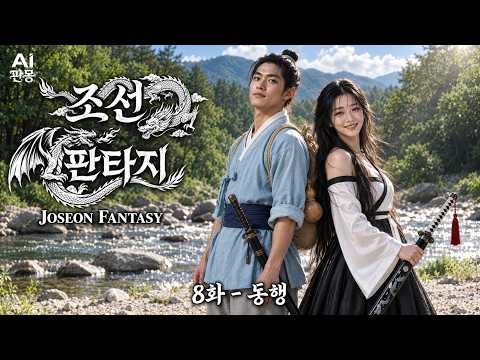

# 역사 — 성공 사례 분석: 사례별 자세히 #281–#320

`analysis.md` 의 9번 (같은 # 번호). 자동 생성 — `tools/success_analysis.py` v1.4.1 (2026-10-17 07:39 UTC). ※ 연구·교육용 — 투자 권유가 아님.

### 281. 조선에서 가장 잊힌 왕, 정말 무능하고 나약했던 왕일까? ∣ 역사이야기

- https://www.youtube.com/watch?v=LZQFW5QA-BM · 숨겨진 역사 서재 · 구독자 890 · 조회수 23,656 (×26.6, 하루 1,702.5) · 좋아요 108 (0.5%) · 72.2분 · 2026-10-03 · 주제 묶음 1. 역사 일반·이야기 · 형식 정보·해설 (그 밖) · 폴더 `W_LZQFW5QA-BM` (웹 승인)
- 썸네일: 
- 챕터: 0:00 효종의 죽음과 19세 현종의 즉위 · 3:06 심양에서 태어난 왕세자의 특별한 출생 배경 · 10:26 첫 번째 예송과 현종의 왕권 논쟁 · 22:32 두 번째 예송과 현종의 정치적 대응 · 32:29 경신대기근과 ‘100만 명 사망설’의 진실 · 44:23 혼천시계·대동법 등 현종 시대의 업적 · 50:22 현종이 후궁을 두지 않았던 이유에 대한 여러 해석 · 57:30 두 딸의 죽음과 현종 가족의 비극 · 62:55 현종실록과 현종개수실록, 기록이 엇갈린 이유
- 설명 앞부분: 조선에서 가장 잊힌 왕, 정말 무능하고 나약했던 왕일까? ∣ 역사이야기 👑 조선의 왕 현종은 왜 15년 동안 후궁을 두지 않았을까요? 이번 역사이야기에서는 현종의 즉위부터 예송 논쟁, 경신대기근, 그리고 왕실의 비극까지 핵심 사건을 짚어봅니다. 📜 특히 후궁을 두지 않은 이유에 대해서는 기록과 여러 해석을 바탕으로 당시의 시대적 배경을 살펴봅니다. 역사이야기를 통해 우리가 익숙하게 알고 있던 현종의 이미지를 다시 바라봅니다. 🔎 두 차례 예송에서 드러난 왕권의 문제와 현종실록·현종개수실록이 남긴 서로 다른 기록도 함께 확인합니다.…
- 대본 없음 (설명) — 음성인식이 끝나면 도입부·흐름이 들어감
- 댓글 5/5: 좋은 점 — 영상 0 · 감사·응원 0 · 더 알고 싶은 것 0 · 아쉬운 점 — 영상 0 · 반박·불만 — 의견 다름 0 · 정치·사회 0 · 경험 공유 0 · 구독·다음 기대 0

### 282. 세계를 다 삼킨 중국 황제 조선만은 못 건드린 이유

- https://www.youtube.com/watch?v=xuJSO9q8Wl8 · 역사탐구 · 구독자 4,930 · 조회수 129,735 (×26.3, 하루 2,245.8) · 좋아요 987 (0.8%) · 28.6분 · 2026-08-20 · 주제 묶음 3. 조선 · 형식 정보·해설 (그 밖) · 폴더 `W_xuJSO9q8Wl8` (웹 승인)
- 썸네일: 
- 설명 앞부분: 참고한 자료 위키백과 강희제 항목 — 재위 기간, 삼번의 난, 대만 정복, 네르친스크 조약, 준가르 갈단 원정, 티베트 관계, 오보이 제거 등 생애와 업적 전반 국사편찬위원회 우리역사넷 백두산 정계비 문제 — 1712년 정계비 건립 경위, 목극등 파견, 박권의 소극적 태도, 토문강 해석 논쟁 국사편찬위원회 우리역사넷 조공 및 중국에서 오는 사신 — 조선과 명 청의 조공책봉 관계, 조공국의 내정 자율성 한국민족문화대백과사전 한국학중앙연구원 조공 — 조선 청 관계가 조공제도의 대표 모델이라는 학술 설명 가톨릭신문 중국 황제와 서양 선…
- 대본 없음 (설명) — 음성인식이 끝나면 도입부·흐름이 들어감
- 댓글 175/175: 좋은 점 — 영상 1 · 감사·응원 1 · 더 알고 싶은 것 0 · 아쉬운 점 — 영상 1 · 반박·불만 — 의견 다름 7 · 정치·사회 23 · 경험 공유 5 · 구독·다음 기대 0
  - 좋은 점 — 영상 👍10 “우리 어린 시절 많이 듣던 말 중에 " 세상에 조선 없이 되는 것이 없다." 이는 이성계의 쿠테타로 건국한 조선이 아니고 우리의 고조선을 말한다는 것을 훗날 알았다. 대표적으로 조공=朝貢 이 글자는 조선에 바치는 공물을 말함이다. 역사를 개판으로 배워서 우리가 사대나…”
  - 감사·응원 👍0 “제가 평소에 궁금해 했던 것을 정리하여 이렇게 알려주시니 정말 감사합니다. 제가 궁금했던 것이 또 있습니다. 정말 조선이 중국에서 독립국이었을까 하는 겁니다. 고조선에서 고려까지는 중국과 피터지게 싸운 100% 독립국임이 확실합니다. 그런데, 이성계가 중국에 스스로 …”
  - 아쉬운 점 — 영상 👍0 “해설소리가 늘어져서 지루하네”
  - 반박·불만 — 의견 다름 👍2 “백두산 정계비의 토문강은 두만강이 맞습니다. 숙종실록 38년 (1712년) 청나라 오라총관 목극등과 조선 접반사 박권의 대화를 보면, 목극등이 "청과 조선의 경계는 어디까지 인가.?" 라고 묻고, 이에 박권이 "압록강과 두만강 입니다." 답변합니다. 이에 목극등이 "…”
  - 반박·불만 — 의견 다름 👍0 “패권국의 관리방법이겟죠. 먹을것도 없는데 굳이 왜 직접통치하겟음? 전략적 요충지도 아닌데”
  - 정치·사회 👍41 “조선이 청나라에 바친 조공은 강희제에 들어 크게 줄어서 인삼과 종이, 호랑이 가죽같은 특산품으로 대체됬고 대신 청나라가 내려주는 하사품은 은과 최고급 비단과 도자기등을 갑어치로는 조공의 10배에 달해 조선으로선 개꿀. 거기다 강희제는 조선에 큰 가뭄이 들었다는 얘기를…”
  - 정치·사회 👍29 “청나라는 중국이아니다....여진족 금나라가세운 왕국이다....여진족은 절대한족하고 아무상관없다....명나라가 한족 정통중국이다....”
  - 경험 공유 👍4 “결론은 왕조시대 !! 특히 강희제은 주변국을모두 강제합병의 주 군주로 오늘날의 중국국경을 있게한 주인공! 이런 저런 소리 다 쓰잘데없는 소리! 조선을 병자호란때 보면 바로 알수 있음. 즉 조선을 정벌하고도 단지 군신관계만 확인하고 비석 하나로 끝냄. 이것이 당시 주변…”
  - 경험 공유 👍3 “그 당시 핏줄과 가문 뿌리가 가장 큰 명분이자 아이덴티티였음 북방계 지배자들은 뿌리가 모두 한국인이었음 그래서 중국을 통일해도 북방에서 힘이 엄청나게 강력해도 한반도를 내비두거나 예우해준 것은 자신들의 조상땅임을 알기 때문임 패권자가 쓸데없이 이상하게 한 나라만 챙겨…”

### 283. 조선을 비웃으려던 명나라 사신이 세 가지 난제를 던졌다… 말똥 치우던 10살 종놈이 첫 번째 답을 내놓는 순간, 사신의 웃음이 순식간에 사라졌다 ∣ 야담 ∣ 민…

- https://www.youtube.com/watch?v=06ORKfm5PHU · 달빛야담방 · 구독자 3,190 · 조회수 83,602 (×26.2, 하루 1,709.9) · 좋아요 1,214 (1.5%) · 94.3분 · 2026-08-29 · 주제 묶음 6. 동양사 (중국·일본·몽골) · 형식 수면·낭독 (잠잘 때 듣는) · 폴더 `W_06ORKfm5PHU` (웹 승인)
- 썸네일: 
- 설명 앞부분: 조선을 비웃으려던 명나라 사신이 모두를 시험하려 세 가지 난제를 내놓았습니다. 대신들과 학자들조차 쉽게 입을 열지 못하던 그때, 말똥을 치우던 열 살 종놈이 앞으로 걸어 나왔습니다. 그리고 아이가 첫 번째 답을 말하는 순간, 사신의 얼굴에서 여유로운 웃음이 순식간에 사라졌습니다. 조선 어느 때, 명나라에서 온 사신이 자신의 지식과 지위를 믿고 조선의 사람들을 얕보며 세 가지 어려운 난제를 내놓았습니다. 궁궐의 대신들과 이름난 학자들까지 모였지만, 문제는 생각보다 훨씬 까다로웠고 누구도 선뜻 답을 내놓지 못했습니다. 사신은 그런 모…
- 대본 없음 (설명) — 음성인식이 끝나면 도입부·흐름이 들어감
- 댓글 13/13: 좋은 점 — 영상 0 · 감사·응원 0 · 더 알고 싶은 것 0 · 아쉬운 점 — 영상 0 · 반박·불만 — 의견 다름 0 · 정치·사회 0 · 경험 공유 0 · 구독·다음 기대 0

### 284. 막부가 무너진 뒤, 도쿠가와 가문은 어떻게 되었을까?

- https://www.youtube.com/watch?v=kkwFyuynkKQ · 제국 그 후  · 구독자 5,240 · 조회수 136,249 (×26.0, 하루 1,978.6) · 좋아요 1,115 (0.8%) · 25분 · 2026-08-09 · 주제 묶음 6. 동양사 (중국·일본·몽골) · 형식 정보·해설 (그 밖) · 폴더 `W_kkwFyuynkKQ` (웹 승인)
- 썸네일: 
- 설명 앞부분: 이백육십오 년. 열다섯 명의 쇼군. 사백만 석. 그리고 거의 하룻밤 사이에, 그것이 사라졌습니다. 막부가 무너졌을 때 도쿠가와 가문은 처형되지 않았습니다. 추방되지도, 국적을 잃지도 않았습니다. 그러나 만 명이 넘는 사람들이 봉급 없이 주군을 따라 시즈오카로 떠났고, 그들 중 상당수는 물도 없는 자갈 고원에서 나무뿌리를 캐며 살았습니다. 칼을 팔아 호미를 산 무사들, 인력거를 끌게 된 하타모토, 그리고 팔십 년 뒤 호텔이 들어선 쇼군들의 무덤. 로마노프는 총으로, 합스부르크는 법으로, 청 황실은 계약으로 끝났습니다. 도쿠가와 가문…
- 대본 없음 (설명) — 음성인식이 끝나면 도입부·흐름이 들어감
- 댓글 34/34: 좋은 점 — 영상 1 · 감사·응원 1 · 더 알고 싶은 것 1 · 아쉬운 점 — 영상 1 · 반박·불만 — 의견 다름 1 · 정치·사회 3 · 경험 공유 0 · 구독·다음 기대 0
  - 좋은 점 — 영상 👍4 “좋은 영상 감사합니다 🎉”
  - 감사·응원 👍4 “좋은 영상 감사합니다 🎉”
  - 더 알고 싶은 것 👍6 “아하~ 재미있는 에도 막부의 마지막이네요. 다른 제국들도 궁금합니다.”
  - 아쉬운 점 — 영상 👍3 “다 좋은데 년도에 년은 붙여서 만드세요 ai티가 너무나서 불쾌함의 골짜기 최대치 입니다 이런 사소한거부터 수정하시는게 좋을듯 합니다”
  - 반박·불만 — 의견 다름 👍1 “말도 안되는 제도. 전세가 집주인이 필요해서 세입자에게 돈을 빌리는 제도인데 이런 제도를 한다면 그냥 월세를 받고 말지”
  - 정치·사회 👍6 “도구가와 이에야스 후손들 현황: 정권 몽괴 이후 그의 후손들은 약 600명 정도로 추산, 대부분 평범한 평민들로~! <우리 조선인 전통 씨족 성씨 집안>처럼, 도구가와 가문이 현재 종씨 단체가<일본 다른 종씨 비교해서> 나름 지켜내고있는 편입니다. <다른 수 많은 인…”
  - 정치·사회 👍5 “도쿠가와 막부는 조선을 침략하지 않는 좋은 정권이었는데 미국 페리제독 땜에 결국 무너짐”

### 285. 이무기가 왕이 된 조선 ∣ ‘찬룡’ 1~6화 완전판 몰아보기

- https://www.youtube.com/watch?v=kq8suKRpa7s · 투모로우 TO:MORROW · 구독자 12,900 · 조회수 327,901 (×25.4, 하루 10,965.6) · 좋아요 3,160 (1.0%) · 52.1분 · 2026-09-17 · 주제 묶음 3. 조선 · 형식 몰아보기·통합본 (긴 영상) · 폴더 `W_kq8suKRpa7s` (웹 승인)
- 썸네일: 
- 설명 앞부분: 안녕하세요, TO:MORROW입니다. 지금까지 〈찬룡〉을 한 편 한 편 기다려주신 분들, 그리고 이번 영상을 통해 처음 〈찬룡〉을 찾아와주신 분들 모두 진심으로 반갑고 감사합니다. 이번 영상은 지금까지 공개된 〈찬룡〉 1~6화의 이야기를 약 50분 분량으로 다시 구성한 완전판입니다. 기존 에피소드를 단순히 이어 붙이는 것에 그치지 않고, 해상도와 화면 비율을 다시 다듬고 기존 회차에서 공개되지 않았던 신규·미공개 장면들도 추가했습니다. 이미 〈찬룡〉을 보셨던 분들에게는 조금 더 완성된 하나의 이야기로, 처음 찾아오신 분들에게는 〈…
- 대본 없음 (설명) — 음성인식이 끝나면 도입부·흐름이 들어감
- 댓글 318/318: 좋은 점 — 영상 2 · 감사·응원 10 · 더 알고 싶은 것 1 · 아쉬운 점 — 영상 1 · 반박·불만 — 의견 다름 1 · 정치·사회 1 · 경험 공유 4 · 구독·다음 기대 8
  - 좋은 점 — 영상 👍1 “최고의 영상미 중국거는 비교도 안됨”
  - 좋은 점 — 영상 👍1 “요즘 뭐이리 퀄좋은 영상만드는사람들이 많냐…”
  - 감사·응원 👍3 “AI영화 만드는데 제작비 많이 든다고 뉴공에서 봤는데 잘 되시기를 바랍니다 살면서 영화 많이 봤지만 퀄리티가 장난 아니네요 화이팅~!!!”
  - 감사·응원 👍2 “잘만들었지만 만화를 보아도 감동이 있는데 스토리가 약함.전체적 스케일이 좋은편이나 너무 광활함.반면 게임설정이 둔함.관계에 따른 스토리 디테일 호랑장면 . 광대춤. 반지 거시기... 장면 연출이 영화 맛집 느낌. 지나간 영화 맛집 패러디 느낌. 디터일은 좋으나 잔인함…”
  - 더 알고 싶은 것 👍1 “커매라 각도와 움직임의 자연스러움이 여느 작품들 보다 나은 듯 합니다. 앞으로 좋은 작품 많이 부탁합니다.”
  - 아쉬운 점 — 영상 👍2 “너무재밌습니다 회차가 갈수록 ai같지않고 실존배우들같습니다 퀄리티가 너무좋아요 몰아보기도 좋으네요 기다리지 않고 한번에 쭉 연달아 볼수 있어서요 다음화들도 재밌게 시청하겠습니다~~”
  - 반박·불만 — 의견 다름 👍6 “"와... 화면 구성과 스토리 모두 일반인의 바이브가 아닙니다. 제대로 공부하고 내공을 쌓은 진짜 프로의 작품 그 자체네요. AI 영화의 격을 높이셨습니다. 최고예요!"”
  - 정치·사회 👍0 “AI 기술이 엄청 발전했군요...이제 AI 영화 드라마가 활성화 되어 국민들 눈을 가리고 나라를 어지럽히는 좌파연예인들 사라지면 좋겠네요...”
  - 경험 공유 👍2 “와우 퀄리티가...쥑이네~내가 좋아하는 사극에다 스토리가 맘에듦.영화나 드라마로 만들어도 될듯....구독 좋아요 냅다 꾹~~”
  - 경험 공유 👍1 “소재도 제가 좋아하는 오컬트, 좀비, 괴물, 사극이네요 !!! AI영화 드라마의 최고가 될 것 같습니다!! 계속 기대하며 볼게요 😊”
  - 구독·다음 기대 👍4 “이런건 제대로 시작부터 완결까지 해줫으면 좋겟습니다 시간 가는줄 모르고 봣네요 ^^ 구독 좋아요 알림설정 하고 갑니다 완전 굿👍”
  - 구독·다음 기대 👍1 “시간가는줄 모르고 봤습니다... 너무 재밌게 봤어요 구독하고 자주 올께요!!!!!”

### 286. 조선 과부는 밤을 어떻게 보냈나? 500년간 숨겨온 4가지 진실∣조선시대 ∣ 풍속화 ∣ 한국역사 ∣ 조선과부 ∣ 신윤복

- https://www.youtube.com/watch?v=nlBAu4hyMXY · 조선의 호기심 · 구독자 1,730 · 조회수 43,838 (×25.3, 하루 311.1) · 좋아요 704 (1.6%) · 13.7분 · 2026-05-29 · 주제 묶음 3. 조선 · 형식 정보·해설 (그 밖) · 폴더 `W_nlBAu4hyMXY` (웹 승인)
- 썸네일: 
- 챕터: 0:00 오프닝 — 한양의 긴 밤 · 1:00 연화의 이야기 — 재가금지법의 실체 · 3:30 첫 번째 방법 — 춘화첩 (인조실록 1624 기록) · 6:30 두 번째 방법 — 시장 골목의 비밀 · 9:30 세 번째 방법 — 산사와 스님 (고려말 어사대 기록) · 13:30 네 번째 방법 — 대식(對食) (세종실록 원문 공개) · 17:00 충격의 반전 — 나라는 죽음에 상을 주었다
- 설명 앞부분: 조선 과부는 재혼이 금지된 채, 긴 밤을 어떻게 버텼을까? 세종실록에 실제로 기록된 충격적인 진실 4가지를 파헤칩니다. 이 영상에서 다루는 내용 조선 경국대전(1477년)은 과부의 재혼을 금지했습니다. 재혼하면 자식과 손자까지 3대가 과거 시험을 볼 수 없었죠. 그렇다면 젊고 건강한 몸으로 평생 혼자 살아야 했던 조선 과부들은 도대체 어떻게 버텼을까요? 오늘은 교과서에도, 사극에도 나오지 않는 조선 여성의 진짜 밤 이야기를 신윤복의 풍속화와 함께 전합니다. ⏱️ 타임스탬프 📚 참고 사료 경국대전 (1477, 성종 8년) — 재가금…
- 대본 없음 (설명) — 음성인식이 끝나면 도입부·흐름이 들어감
- 댓글 41/41: 좋은 점 — 영상 1 · 감사·응원 0 · 더 알고 싶은 것 0 · 아쉬운 점 — 영상 0 · 반박·불만 — 의견 다름 0 · 정치·사회 2 · 경험 공유 0 · 구독·다음 기대 0
  - 좋은 점 — 영상 👍21 “시대를 초월하여 성적 욕망은 억지로 눌러지지 않는다.. 조선 여인들의 삶을 이해할 수 있는 좋은 영상이군요.....”
  - 정치·사회 👍4 “조선이라는나라가잘살아졌다불쌍한여인들의삶”
  - 정치·사회 👍0 “이씨조선이 아니었다면 세종의 한글도없었다. 이제라도 더늦기전에 이씨조선으로다시 돌아가아한다. 이재명 만세!만세!만만세!!!”

### 287. 총도 없이 40cm 창으로 영국군 총과 대포를 맞서 싸운 아프리카 줄루족들의 용기

- https://www.youtube.com/watch?v=25PIXdjZbuU · 어른들의자장가 · 구독자 5,840 · 조회수 147,646 (×25.3, 하루 2,057.1) · 좋아요 729 (0.5%) · 22.4분 · 2026-08-06 · 주제 묶음 5. 세계사·서양사 · 형식 정보·해설 (그 밖) · 폴더 `W_25PIXdjZbuU` (웹 승인)
- 썸네일: 
- 설명 앞부분: 1879년 1월 22일 아침, 남아프리카의 한 계곡에서 2만 명이 넘는 줄루 전사들이 몸을 일으켰습니다. 손에 든 것은 마을 대장장이가 하나씩 두드려 만든 날 길이 40센티미터짜리 창과 소가죽 방패가 전부였고, 글자가 없어 왕의 명령도 조상의 역사도 사람의 입으로만 전하던 사람들이었습니다. 6킬로미터 앞에는 세계에서 가장 먼저 산업혁명을 이룬 나라의 군대가 최신 후장식 소총과 대포, 로켓 발사대까지 갖추고 진을 치고 있었습니다. 그런데 이 사람들은 그날 싸울 계획이 없었습니다. 달이 죽는 날이라 공격은 다음 날 새벽으로 미뤄져 있…
- 대본 없음 (설명) — 음성인식이 끝나면 도입부·흐름이 들어감
- 댓글 123/123: 좋은 점 — 영상 0 · 감사·응원 2 · 더 알고 싶은 것 0 · 아쉬운 점 — 영상 1 · 반박·불만 — 의견 다름 1 · 정치·사회 4 · 경험 공유 6 · 구독·다음 기대 0
  - 반박·불만 — 의견 다름 👍1 “줄루족들이 화승총 또는 머스킷을 가지고 있었다고 합니다. 물론 비율이 어찌되었는지는 모르겠지만, 당시에는 전세계에 돈없는 가난뱅이 나라라도 화승총정도는 다들 장만하고 있었기 때문에, 줄루족이 화승총같은걸 가지고 있는건 이상한 일이 아닙니다. 영국군은 단발식 소총을 가…”
  - 경험 공유 👍11 “내가 제일 좋아하는 전투들중 하나. 당시 유럽인들이 주장하는 문명이란게 얼마나 작위적인지를 알려주는 사건임.”
  - 경험 공유 👍3 “몇 년 전 제가 줄루 영화를 보았었는데 이걸 보니 그때가 생각나고 영상 퀄리티가 대박이네요!~”

### 288. [숨겨진 중국사] 만주의 주인은 중국이 아니었다, 금나라 정사 1권이 남긴 시조의 출신지 ∣ 역사인물 ∣ 야사 ∣ 비사

- https://www.youtube.com/watch?v=ptxr6rzOhA4 · 숨겨진중국사 · 구독자 12,500 · 조회수 311,301 (×24.9, 하루 6,082.0) · 좋아요 2,262 (0.7%) · 31.4분 · 2026-08-27 · 주제 묶음 6. 동양사 (중국·일본·몽골) · 형식 정보·해설 (그 밖) · 폴더 `W_ptxr6rzOhA4` (웹 승인)
- 썸네일: 
- 설명 앞부분: 저희는 숨겨진 역사를 재미있고 정확한 한 편의 이야기로 풀어내고자 영상을 만들고 있습니다. "매주 화,목,일 오후 12시에 새로운 이야기가 업로드 됩니다 ❤" 🎬 더 많은 영상 보기 👇
- 대본 없음 (설명) — 음성인식이 끝나면 도입부·흐름이 들어감
- 댓글 369/369: 좋은 점 — 영상 1 · 감사·응원 4 · 더 알고 싶은 것 0 · 아쉬운 점 — 영상 2 · 반박·불만 — 의견 다름 9 · 정치·사회 55 · 경험 공유 16 · 구독·다음 기대 0
  - 감사·응원 👍2 “관련해서는 내용을 잘썼고 제가보니 고려와 조선영토도 매우중요한데 내용이없고 빈약한거같아서 고려나 조선국경을 잘정리해서 소스를 드릴테니 이부분도 정리하셔서 유튜브 꼭 정리해주시면 좋을거같으니 참고하세요. 지금 제가 정리한것은 기록너머 뿐아니라 역사적팩트입니다 . 최근 …”
  - 아쉬운 점 — 영상 👍2 “간도는 우리땅 이지만 만주.연해주는우리땅 아니다? 청러 간에 맺은 국경조약이 바로 공식문서로서 맺은 건데 그러나 조선과 청 사이에 왜 그런 공식적인 국경선이란 게 문서적으로는 등장하지 않고 실록으로 간간히 전해지는가 이 문제를 풀어야 한다. 바로 당시 조선의 땅인데도…”
  - 반박·불만 — 의견 다름 👍2 “간도는 우리땅 이지만 만주.연해주는우리땅 아니다? 청러 간에 맺은 국경조약이 바로 공식문서로서 맺은 건데 그러나 조선과 청 사이에 왜 그런 공식적인 국경선이란 게 문서적으로는 등장하지 않고 실록으로 간간히 전해지는가 이 문제를 풀어야 한다. 바로 당시 조선의 땅인데도…”
  - 반박·불만 — 의견 다름 👍1 “금나라를 발해의 후예인 고려(고구려)라 함은 틀린것입니다 고구려가 복속인 지역이 있고 발해지배층이 복속인지역이 있습니다 대부분 발해가 멸망하면서 토착인과 그대로 잔존한 족속이 있었습니다. 그게 말갈. 여진이라는것은 삼강평원의 토착인이 주입니다. 후대에 후금(청)은 주…”
  - 정치·사회 👍9 “고구려와 백제, 신라는 중국 본토에 있었습니다. 고려또한 개경은 중국 탕산시일 가능성이 90%이상. 고려서경은 개경에서 걸어서 일주일 정도 현재 베이징이 고려 서경! 고려영(군사기지)이 북경에 있고, 연개소문 무덤이 베이징 옆에 있고, 최씨 무신정권이 있던 최씨 집성…”
  - 정치·사회 👍6 “대조영 이세운 나라 이름은 발해 가 아니야.고구려야. 약칭 고려 발해 라는 이름은 당나라에서 지어진 이름이야.당나라와서 신을 교신할 때 만발해 라는 이름을 썼고 평상시에는 고려 였어.오직 당나라와 만발해 한 이름을 썼어요. 일본과의 교역이나 교신에서도 고려라고 썼어.…”
  - 경험 공유 👍3 “금시조는 신라계임... 후금(청)도 조선을 형제국이라 불렀음. 만주는 예로부터 우리나라 땅이었음... 이후 몇 번이나 수복하려고 정벌 계획도 했었음... 이제 다시 가져와야 함.”
  - 경험 공유 👍2 “관련해서는 내용을 잘썼고 제가보니 고려와 조선영토도 매우중요한데 내용이없고 빈약한거같아서 고려나 조선국경을 잘정리해서 소스를 드릴테니 이부분도 정리하셔서 유튜브 꼭 정리해주시면 좋을거같으니 참고하세요. 지금 제가 정리한것은 기록너머 뿐아니라 역사적팩트입니다 . 최근 …”

### 289. 황제 자리에서 끌려 내려온 고종, 그 뒤 12년 어떻게 살았을까?ㅣ여생록

- https://www.youtube.com/watch?v=7HJVltWXC2Q · 여생록 · 구독자 967 · 조회수 23,961 (×24.8, 하루 12,664.2) · 좋아요 188 (0.8%) · 22.4분 · 2026-10-15 · 주제 묶음 11. 황제·왕·인물 · 형식 정보·해설 (그 밖) · 폴더 `W_7HJVltWXC2Q` (웹 승인)
- 썸네일: 
- 챕터: 0:00 오프닝 · 1:21 서명하지 않은 황제 · 3:11 헤이그 · 4:21 열흘의 압박 · 5:34 대리인가, 양위인가 · 6:49 덕수궁이라는 이름 · 7:38 열 살의 아들 · 8:34 떠나려 한 황제 · 9:05 덕수궁 이태왕 · 10:28 이왕가의 세비 · 11:02 덕수궁의 나날 · 12:43 막내딸과 아들 · 13:58 기록과 전해지는 이야기 · 15:35 1919년 1월 21일 · 16:46 식혜와 소문 · 18:21 3월 3일 · 19:24 판 사람인가, 버틴 사람인가 · 21:34 이태왕의 12년
- 설명 앞부분: 1907년 7월, 헤이그 특사 사건 뒤 황제 자리에서 끌려 내려온 고종. 1919년 1월 덕수궁 함녕전에서 숨을 거두기까지 12년, 그는 어떻게 살았을까요? 이번 편은 어느 한쪽 편을 들지 않습니다. "나라를 판 건 고종이다"와 "고종은 끝까지 버텼다", 두 주장의 근거를 같은 무게로 놓고, 기록에 남은 것과 남지 않은 것을 나눠 보여 드립니다. 을사조약에 없는 황제의 서명, 루스벨트에게 보낸 친서, 헤이그 특사, 그리고 퇴위 조칙에 그가 쓴 단어 '대리'. 1910년 그는 '덕수궁 이태왕'이 되었고, 그의 살림은 조선총독이 감독…
- 대본 없음 (설명) — 음성인식이 끝나면 도입부·흐름이 들어감
- 댓글 58/58: 좋은 점 — 영상 0 · 감사·응원 1 · 더 알고 싶은 것 1 · 아쉬운 점 — 영상 1 · 반박·불만 — 의견 다름 0 · 정치·사회 3 · 경험 공유 0 · 구독·다음 기대 0
  - 감사·응원 👍1 “여생록님 훌륭한 자료 몇번 반복 시청합니다. 고맙습니다.”
  - 더 알고 싶은 것 👍2 “2:59 고종이 보내려다가 못보낸 편지가 발견된 미국의 대학교 이름이 궁금합니다. 어느 대학교 인지 알려주세요...ㅠㅠ”
  - 정치·사회 👍12 “능력도 없었고 제국시대말 세계가 어떻게 돌아가는지 정확히 알지도 못한 왕. 황제가 되고 싶으면 그 밑에 제후국들인 왕들이 있어야 되는데 아무 제후국도 없이 혼자 황제라고 칭했으니 세계 어느나라가 그걸 인정 하냐. 고종 혼자 코메디 한것이지”
  - 정치·사회 👍1 “고종 이재명 김현지 누가 최악일까 단군이래”

### 290. 🌙 자면서듣는 역사 ∣ 조선왕조실록 : 조선의역사 풀스토리 500년 대서사｜달빛 역사관

- https://www.youtube.com/watch?v=Tq1ADCDu3hQ · 달빛 역사관 : 자면서 듣는 세계사 · 구독자 9,220 · 조회수 226,994 (×24.6, 하루 1,578.6) · 좋아요 1,770 (0.8%) · 104.3분 · 2026-05-26 · 주제 묶음 3. 조선 · 형식 수면·낭독 (잠잘 때 듣는) · 폴더 `W_Tq1ADCDu3hQ` (웹 승인)
- 썸네일: 
- 챕터: 0:00 프롤로그 — 오늘 밤의 초대 · 2:58 1부 — 칼을 돌린 사람 (고려 말, 위화도 회군, … · 11:37 2부 — 피로 다진 기초 (왕자의 난, 태종, 세종 … · 23:19 3부 — 빛의 왕조 (세종, 훈민정음, 집현전, 4군… · 33:03 4부 — 균열 (단종, 계유정난, 세조, 사육신, 성… · 44:18 5부 — 선비들의 꿈과 좌절 (연산군, 사화, 조광조… · 57:51 6부 — 바다가 나라를 구했다 (임진왜란, 이순신, … · 72:10 7부 — 치욕과 굴욕 사이에서 (광해군, 병자호란, … · 84:18 8부 — 마지막 빛과 긴 황혼 (영조, 사도세자, 정… · 99:48 에필로그 — 오백 년이 남긴 것
- 설명 앞부분: 잠들기 전, 오백십팔 년의 조선 역사 이야기를 들려드립니다. 위화도의 빗속에서 칼의 방향을 바꾼 한 장수의 결단으로 시작된 나라. 형제의 피로 기초를 다지고, 세종의 붓으로 찬란하게 빛났으며, 사화와 전쟁과 치욕을 버텨낸 끝에 조용히 문을 닫은 왕조. 조선 오백 년의 이야기를 오늘 밤 달빛 역사관이 머리맡에서 들려드립니다. 이번 영상은 단순한 연표가 아닙니다. 뜻을 품었다가 꺾인 사람들, 불가능한 상황에서 기적을 만들어낸 사람들, 역사가 끝난 자리에 조용히 남아 살아간 사람들의 이야기입니다. 왕들의 이야기이기도 하지만, 사실은 사…
- 대본 없음 (설명) — 음성인식이 끝나면 도입부·흐름이 들어감
- 댓글 27/27: 좋은 점 — 영상 0 · 감사·응원 1 · 더 알고 싶은 것 0 · 아쉬운 점 — 영상 1 · 반박·불만 — 의견 다름 0 · 정치·사회 1 · 경험 공유 2 · 구독·다음 기대 0
  - 감사·응원 👍0 “감사합니다. 수고하셨습니다.”
  - 아쉬운 점 — 영상 👍0 “쓸데없는 말이 너무 길다”
  - 정치·사회 👍8 “내가 그냥 안보면 되는데 조선시대는 한마디로 공산당 세습정권하고 하나도 다를바가 없다.”
  - 경험 공유 👍8 “내가 그냥 안보면 되는데 조선시대는 한마디로 공산당 세습정권하고 하나도 다를바가 없다.”
  - 경험 공유 👍1 “《이씨,조선왕조 오백년 유지 비결》 1.자기보다 난사람들 싹~죽여버리고,못난사람만 살려 부역자(사대부)부리고 2.음주섹스(관기)제도로,지네李왕족만 급번식시킨 반면,고려원주민들은 노예(상놈)신분제도로 인간가축 만들어 가난,빈곤(식민)통치 521년!"현재,중국계 李왕손1…”

### 291. 영의정만 6번 지낸 조선 최고의 천재가 죽기 직전 자신을 '죄인'이라 부른 진짜 이유∣오리 이원익,청백리,조선사

- https://www.youtube.com/watch?v=n_nHYw8fWkY · 거꾸로한국사 · 구독자 17,000 · 조회수 405,643 (×23.9, 하루 3,262.9) · 좋아요 7,954 (2.0%) · 43.8분 · 2026-06-15 · 주제 묶음 3. 조선 · 형식 정보·해설 (그 밖) · 폴더 `W_n_nHYw8fWkY` (웹 승인)
- 썸네일: 
- 챕터: 0:00 프롤로그: 비 새는 초가집에 사는 영의정 · 4:15 굽 높은 나막신을 벗어던진 137cm의 청년 · 9:30 율곡 이이의 발탁, 그리고 조선을 덮친 임진왜란 · 14:50 명나라 장수를 놀라게 한 평양성 탈환 작전 · 20:10 "이순신을 죽이려거든 나를 먼저 베시옵소서" · 26:45 백성을 살린 세금 혁명, 대동법의 시작 · 31:20 일흔 노인의 유배 생활과 거절당한 짚 돗자리 · 36:40 임금도 울어버린 두 칸 초가집과 관감당의 진실 · 40:15 "나는 백성 앞에 죄인이다" 400년을 이어온 부모님…
- 설명 앞부분: 조선 오백 년 역사상 유일하게 영의정을 여섯 번이나 지낸 오리 이원익 대감. 이순신 장군을 죽음의 문턱에서 살려내고 백성을 위한 대동법을 처음 시행한 위대한 재상이었지만, 그가 평생 살았던 곳은 비가 새는 두 칸 초가집이었습니다. 임금마저 눈물짓게 한 그의 삶과 마지막 유언에 담긴 진짜 의미는 무엇이었을까요? 평생을 묵묵히 희생하며 늙어서도 자식에게 짐이 되지 않으려 홀로 버티시는 우리네 부모님의 모습과 너무도 닮아있는 400년 전 작은 거인의 먹먹한 이야기를 전해드립니다. 타임라인 『조선왕조실록』 (선조실록, 광해군일기, 인조실…
- 같은 채널 평소 대비 ×23.9 (채널 최근 롱폼 중앙값 16,943회) · 평소 영상: 정승 15년에 나물 밥상과 낡은 관복을 고집한 청백리 전쟁 영웅 ∣ 오성 이항복,조선청백리 (16,943회) / 한국인이 꼭 알아야 하는 조선을 망친 최악의 왕비 5명 ∣ 조선역사,승정원일기,조선왕조실록 (19,237회)
- 대본 없음 (설명) — 음성인식이 끝나면 도입부·흐름이 들어감
- 댓글 444/444: 좋은 점 — 영상 6 · 감사·응원 28 · 더 알고 싶은 것 1 · 아쉬운 점 — 영상 0 · 반박·불만 — 의견 다름 6 · 정치·사회 26 · 경험 공유 12 · 구독·다음 기대 0
  - 좋은 점 — 영상 👍29 “오리대감에 대해 정사거나 야사던 조선시대에 대단한 청백리라는 사실을 알려주셔서 감사합니다”
  - 좋은 점 — 영상 👍5 “청백리 황희, 맹사성, 이원익, 정승 공감합니다. 지금 한국은 범죄인이 호의호식 하는 나라입니다.”
  - 감사·응원 👍55 “이원익대감님 고맙습니다~^^”
  - 감사·응원 👍43 “감동입니다 감사합니다 이런인물을 몰랐다니”
  - 반박·불만 — 의견 다름 👍1 “황희는 절대 청백리가 아닙니다. 조선 3대 청백리 이원익, 맹사성, 박수량”
  - 반박·불만 — 의견 다름 👍0 “쌍놈에 후손 선조가 이순신을 시기 한거지 누가 비틀어 쌍놈후손'선조에게 보고한게 아닌데”
  - 정치·사회 👍38 “국회의원 나라국자쓰는 의원 조심조심살아라 원로”
  - 정치·사회 👍9 “국회의원들 꼭.읽어라 국가원로회의 특보”
  - 경험 공유 👍2 “예나 지금이나 고위 관직은 그냥 고위 관직이 아니에요. 정확한 명칭은 "돈 벌 기회" 에요. 어디를 개발할 지, 국가가 무슨 산업에 돈을 투자할지... 그거 결정하는 사람들이니 그시기에 부동산 사고, 주식 사면 그냥 땅짚고 헤엄치기로 돈 벌지요. 옛날이라고 달랐을까.…”
  - 경험 공유 👍2 “중국 주 은 래 , 피델 카스트로< 유 언 ,비석도 세우지 말고 화장 하라.이름도 어디에도 남기지 말고 우상 화 금지 법안 통과. 공산 주의 답 다.>체게 바라< 쿠 바 국가 은행 장 하면서도 쉬는 날 이면 노동자?<근로인지 노동인지 ?>들 과 같이 일 하며 지냄>.…”

### 292. 박정희 정권 최대의 미스터리 ∣ 제3공화국 뒤흔든 정인숙 피살사건 ∣ 50년 만에 다시 보는 아들의 삶

- https://www.youtube.com/watch?v=KHWMK-goPxs · 역사의 수레바퀴 · 구독자 16,900 · 조회수 390,905 (×23.1, 하루 3,171.7) · 좋아요 4,779 (1.2%) · 42.5분 · 2026-06-16 · 주제 묶음 4. 한국 근현대사 · 형식 정보·해설 (그 밖) · 폴더 `W_KHWMK-goPxs` (웹 승인)
- 썸네일: 
- 챕터: 0:00 세 발의 총성, 그리고 사라진 권총 (오프닝) · 10:15 1막: 엘리트 신여성의 꿈, 그리고 요정 '선운각'의… · 19:55 2막: 세 살배기 아들과 '검은 수첩', 권력의 시한… · 28:40 3막: 일주일 만의 수사 종결, 과학적 모순과 은폐된… · 36:24 4막: 19년 만의 자백 번복 "나는 동생을 쏘지 않… · 39:50 에필로그: 남겨진 아들의 비극, 그리고 지워진 이름 …
- 설명 앞부분: 1970년 3월 17일 밤 11시, 강변도로에서 세 발의 총성이 울려 퍼졌습니다. 차갑게 식어버린 26세 정인숙, 그리고 허벅지에 총상을 입은 채 신음하던 친오빠 정종욱. 단순한 강도 살인인 줄 알았던 이 사건은 그녀의 피 묻은 가방이 열리면서 대한민국 현대사 최대의 정치 스캔들로 번지게 됩니다. 가방 안에서 쏟아져 나온 거액의 달러와 고위층만 가질 수 있던 회수 여권. 그리고 가장 치명적이었던 '검은 수첩'. 그 안에는 박정희 대통령, 정일권 국무총리, 이후락, 김형욱 등 당대 최고 권력자 26명의 이름이 빼곡히 적혀 있었습니다…
- 대본 없음 (설명) — 음성인식이 끝나면 도입부·흐름이 들어감
- 댓글 421/421: 좋은 점 — 영상 2 · 감사·응원 10 · 더 알고 싶은 것 4 · 아쉬운 점 — 영상 4 · 반박·불만 — 의견 다름 2 · 정치·사회 71 · 경험 공유 14 · 구독·다음 기대 0
  - 좋은 점 — 영상 👍1 “살명을 너무잘해주시고 이해가쏙쏙 고맙게 잘들었습니다 이유야 어쨋든 똑똑여자 정인숙 여사께서 명대로살지못하고간점 유감으로생각합니다 입만조심했더라면 더오래살수있을수도 오만함 권력을조금 이용했다는것이 좀 안타깝네요 그래서 여자는 입조심해야하는법 암튼 영리하고 똑똑하네요 고…”
  - 좋은 점 — 영상 👍1 “다른 나라도 역사 비사가 있소이다 오랫되고 희미한 옛이야기일 뿐, 국가발전에 도움되는 것은 없소이다”
  - 감사·응원 👍81 “잘듣고 갑니다 저는 그때 충비 6비 건설을 위해 나온 외국인 회사 마포 강변도로를 끼고 위치한 회사에 근무하고 있었죠 그때 당시 회자 되었던 소문과 뉴스 다시 들으니 마음이 이상해집니다 수고 하셨습니다 감사합니다”
  - 감사·응원 👍38 “진짜로 감사합니다”
  - 더 알고 싶은 것 👍3 “진실을부탁해요”
  - 더 알고 싶은 것 👍1 “유뷰녀 김삼화 사건에 대해서도 자세히 알려주시길”
  - 아쉬운 점 — 영상 👍13 “아오~ 같은말 하고 또하고. . . 지루하네”
  - 아쉬운 점 — 영상 👍13 “그시대는 먹고사는게 어려운시절이라 요정정치시대인듯 구타패싸움 이 많았던시대라 암흑시대 힘겨운시대였습니다”
  - 반박·불만 — 의견 다름 👍2 “박정희가 권력잡고살았다면 이나라 잘난여자 건드리고 정치 글쎄 김재규가 이나라살린거3ㅣ”
  - 정치·사회 👍81 “잘듣고 갑니다 저는 그때 충비 6비 건설을 위해 나온 외국인 회사 마포 강변도로를 끼고 위치한 회사에 근무하고 있었죠 그때 당시 회자 되었던 소문과 뉴스 다시 들으니 마음이 이상해집니다 수고 하셨습니다 감사합니다”
  - 정치·사회 👍67 “저의 남편은 정인숙이 자란 이웃에서 같이 자랐어요. 본명은 정금지 어릴 때도 뛰어나게 예뻐서 남학생들이 많이 따랐다고 했어요. 슬픈 이야기입니다. 피흘려 민주정부가 세워져서 얼마나 다행인지요. 국민이 권력자가 되어 그런일은 절대로 없어야 합니다.”
  - 경험 공유 👍30 “여자가 지혜로윘으면 저도 살고 아이도 살렸을텐데 친정에미라도 지혜롭던지 지금 누구 같으네”
  - 경험 공유 👍26 “정인숙 사건은 어릴적 아빠한데서 들었던 기억이 납니다 그리고 역사을 좋아한 나로썬 정인숙사건 정일권국무총리~~^^^ 아들만 불쌍 합니다 박정희정권은 어릴적에도 무시무시 했던것 같습니다 저희 아빠도 지역 유지이셨는데~~^^^ 참 지금아이들은 상상 할수 없는 시대 였으닌…”

### 293. 역모로 쫓긴 대감집 아씨를 가마니에 숨겨온 심마니, 조선 거상이 되다∣ 야담.수면 오디오북.조선야담.조선한국사.조선로맨스.조선사업이야기

- https://www.youtube.com/watch?v=wl-pu2vCAY4 · 설주야담 · 구독자 30,400 · 조회수 695,193 (×22.9, 하루 13,646.2) · 좋아요 7,112 (1.0%) · 53.4분 · 2026-08-27 · 주제 묶음 10. 수면·낭독 · 형식 수면·낭독 (잠잘 때 듣는) · 폴더 `W_wl-pu2vCAY4` (웹 승인)
- 썸네일: 
- 설명 앞부분: ❤️설주야담에 오신 것을 환영합니다. 조선시대를 배경으로 한 야담, 민담, 설화와 흥미로운 옛이야기를 들려드립니다. 버려지고 쫓겨난 이들이 뜻밖의 인연을 만나 서로를 구하고, 작은 은혜가 사랑과 가족으로 이어지는 이야기. 가난과 신분의 벽을 넘어 운명을 바꾸는 사람들의 이야기를 담고 있습니다. 눈보라 속에 버려진 과부를 구한 나무꾼, 갈 곳 없는 처녀에게 손을 내민 가난한 총각, 아무도 예상하지 못했던 숨겨진 사연과 반전까지. 때로는 가슴 뭉클한 사랑과 효심, 때로는 속 시원한 권선징악과 인생 역전, 그리고 마지막에는 사람의 따뜻…
- 대본 없음 (설명) — 음성인식이 끝나면 도입부·흐름이 들어감
- 댓글 174/174: 좋은 점 — 영상 4 · 감사·응원 18 · 더 알고 싶은 것 3 · 아쉬운 점 — 영상 1 · 반박·불만 — 의견 다름 0 · 정치·사회 0 · 경험 공유 3 · 구독·다음 기대 2
  - 좋은 점 — 영상 👍5 “좋은 이야기 잘 보았습니다, 아쉬운 건 아들 딸 소식이 없어 아쉽네요,”
  - 좋은 점 — 영상 👍5 “좋은이야기였읍니다”
  - 감사·응원 👍8 “귀하고 소중하신 영상 대단히 감사드립니다 서울입니다😅”
  - 감사·응원 👍7 “참 아름다운 애기네요 무진과 서린 잘만 난것갇으며 어머니도 인품 이좋으시네요 큰보물을서로 얻으셧네요 잘보앗 습니다 감사합니다”
  - 더 알고 싶은 것 👍7 “잘들었습니다~ 자주 올려주세요~”
  - 더 알고 싶은 것 👍4 “영상이 정말 재미있고 정성이 느껴집니다! 이렇게 좋은 콘텐츠를 만들어 주셔서 감사합니다. 앞으로도 좋은 영상 많이 만들어 주세요. 채널의 더 큰 발전을 응원합니다! 👏❤”
  - 아쉬운 점 — 영상 👍5 “좋은 이야기 잘 보았습니다, 아쉬운 건 아들 딸 소식이 없어 아쉽네요,”
  - 경험 공유 👍4 “나도 내일부터 약초캐러가야긋다. 잘하면 장가갈수도..”
  - 경험 공유 👍3 “나도 시골에 내려가 산속에서 나무하고 약초캐며 살아볼까 ? 서린이 같은 낭자를 만나게 될지”
  - 구독·다음 기대 👍4 “미국 텍사스주 휴스턴에서 잘 들었습니다. 깔끔한 내용전개가 좋아서 구독 및 알림설정 했습니다.”
  - 구독·다음 기대 👍4 “최근 방문한 같은 야담러중 최고십니다 ㅋ 구독하고 갈게요”

### 294. 그리스 로마 신화 완벽 정리 : 태초의 창세부터 올림포스 12신, 트로이 전쟁의 종말까지 [🌙꿀잠 오디오북]

- https://www.youtube.com/watch?v=_KdSJr42TXI · 달빛 세계사 · 구독자 18,000 · 조회수 411,168 (×22.8, 하루 5,280.8) · 좋아요 2,826 (0.7%) · 80.3분 · 2026-07-31 · 주제 묶음 10. 수면·낭독 · 형식 수면·낭독 (잠잘 때 듣는) · 폴더 `W__KdSJr42TXI` (웹 승인)
- 썸네일: 
- 챕터: 0:00 아버지를 삼킨 신들 : 카오스, 우라노스, 그리고 크… · 8:29 거인들의 대격돌 : 티타노마키아와 올림포스 핵심 신들… · 16:56 인간의 탄생과 대홍수 : 프로메테우스의 불꽃과 데우칼… · 27:20 올림포스의 밀실 : 사계절의 기원과 디오니소스의 비극 · 35:08 신의 영역을 침범한 자들 : 메두사, 아라크네, 그리… · 43:20 영웅들의 수난사 (상) : 페르세우스의 모험과 헤라클… · 54:23 영웅들의 수난사 (하) : 테세우스의 미궁과 이아손의… · 65:06 황금사과와 10년의 전쟁 : 불화의 여신과 트로이의 … · 71:38 트로이의 목마와 영웅들의 종말 : 아킬레우스의 비극과…
- 설명 앞부분: 태초의 혼돈 카오스에서 시작된 세상을 바꾼 위대한 창세 신화, 올림포스 12신의 치열한 권력 투쟁과 신의 피를 물려받은 영웅들의 거대한 수난사, 그리고 지상에서 신들의 시대가 막을 내리는 트로이 전쟁의 거대한 불꽃까지. 그리스 로마 신화의 전체 궤적과 핵심 서사를 빠짐없이 담아낸 통합 풀버전입니다. 차분하고 정갈한 스토리텔링과 함께 고대 신화가 오늘날 우리 삶과 운명에 던지는 깊은 인문학적 통찰을 느껴보시기 바랍니다. ⏱️ 타임라인 [에필로그] 신화가 인간에게 던지는 질문 : 오만, 운명, 그리고 삶의 본질 [콘텐츠 안내] 본 영…
- 같은 채널 평소 대비 ×7.5 (채널 최근 롱폼 중앙값 54,701회) · 평소 영상: 지구상에서 8,000만 명이 사라진 이유: 인류 최악의 전쟁사 [제2차 세계대전 몰아보기] (56,509회) / 초고대문명, 세계 최초의 완벽한 도시가 사라진 이유, 인더스 문명 5,000년의 수수께끼… (52,893회)
- 대본 없음 (설명) — 음성인식이 끝나면 도입부·흐름이 들어감
- 댓글 91/91: 좋은 점 — 영상 3 · 감사·응원 6 · 더 알고 싶은 것 3 · 아쉬운 점 — 영상 1 · 반박·불만 — 의견 다름 1 · 정치·사회 0 · 경험 공유 5 · 구독·다음 기대 1
  - 좋은 점 — 영상 👍9 “너무 유익하게 잘들었습니다”
  - 좋은 점 — 영상 👍8 “어제 오디세이를 보고 호기심 해결했습니다. 너무 유익하게 잘 들었습니다. 감사합니다.”
  - 감사·응원 👍12 “오디세이 보고 전체적인 맥락이 궁금해서 찾아봤어요... 많은 이해가 되었습니다. 자세한 설명과 그림에 감사드려요..❤”
  - 감사·응원 👍8 “어제 오디세이를 보고 호기심 해결했습니다. 너무 유익하게 잘 들었습니다. 감사합니다.”
  - 더 알고 싶은 것 👍12 “오디세이 보고 전체적인 맥락이 궁금해서 찾아봤어요... 많은 이해가 되었습니다. 자세한 설명과 그림에 감사드려요..❤”
  - 더 알고 싶은 것 👍4 “근데 오디세이에서 키클롭스는 포세이돈의 아들이랬는데 여기서는 우라노스의 아들이라고 하시는데 뭐가 맞는건가요??”
  - 아쉬운 점 — 영상 👍0 “광고가 너무길다”
  - 반박·불만 — 의견 다름 👍2 “말도안돼는스토리”
  - 경험 공유 👍84 “제가 어렸을적 계몽사 라는 출판사에서 50권짜리 세계명작전집이 집에 있었습니다 . 1권이 그리스신화 2권이 호머이야기였던가 .. 그 호머이야기가 트로이전쟁을 소재로했던거같은데 어릴때 읽기는읽었지만 내용을 온전히 이해하지못한채 전쟁장면묘사에 집중했던거같네요 .. 어릴때…”
  - 경험 공유 👍0 “내가 우지호를 낳았다.”
  - 구독·다음 기대 👍2 “오디세이 영화보고 바로 정주행 시간이 가는줄 모르고 과자 3봉지 순삭 감사합니다 😊”

### 295. "세종 없으면 이 사람이 1등?" 100년을 앞서간 조선 최고의 두뇌

- https://www.youtube.com/watch?v=W9NKVCxalr4 · 한국사 다시읽기 · 구독자 28,200 · 조회수 642,259 (×22.8, 하루 3,759.3) · 좋아요 6,375 (1.0%) · 27.2분 · 2026-04-29 · 주제 묶음 3. 조선 · 형식 정보·해설 (그 밖) · 폴더 `W_W9NKVCxalr4` (웹 승인)
- 썸네일: 
- 챕터: 0:00 오프닝 ㅣ 세종대왕 다음, 진짜 천재는? · 1:04 1부 ㅣ 구도장원공 - 아홉 번 시험, 아홉 번 일등… · 5:02 2부 ㅣ 천도책 - 명나라를 경악시킨 답안지 📜 · 10:19 3부 ㅣ 수미법 - 사십 년 앞서간 시스템 설계 💡 · 13:47 4부 ㅣ 금강산의 일 년 - 천재의 인간적 방황 🏔️ · 19:16 5부 ㅣ 십만양병설의 비극 - 너무 앞서간 통찰 ⚔️ · 24:30 클로징 ㅣ 오천 원권에 새겨진 이름
- 설명 앞부분: 📜 세종대왕 다음, 조선 최고의 천재는 누구일까요? 열세 살에 첫 장원, 아홉 번의 시험 모두 일등. 스물세 살에 명나라까지 경악시킨 천재. 국가 재정의 모순을 숫자로 분석하고, 수십 년 앞서 대동법의 원형을 설계했으며, 임진왜란을 정확히 예측한 비운의 천재. 오늘, 그 천재를 파헤쳐 봅니다. 🔍 ⏰ 타임라인 📚 참고 문헌 조선왕조실록 (명종실록, 선조실록, 선조수정실록) 율곡전서 ㅣ 율곡 이이 문집 동호문답 ㅣ 율곡 이이, 1569년 율곡행장 ㅣ 김장생, 1597년 한국민족문화대백과사전 십만양병설 관련 현대 학계 연구 (송복, …
- 같은 채널 평소 대비 ×130.5 (채널 최근 롱폼 중앙값 4,920회) · 평소 영상: '최대 1000명 숙청...' 남인의 핵심 정약용은 왜 살려둔 걸까? (5,110회) / "사극이 심은 환상" 암행어사가 기피 직업 1순위였던 이유 (4,731회)
- 대본 없음 (설명) — 음성인식이 끝나면 도입부·흐름이 들어감
- 댓글 735/732: 좋은 점 — 영상 14 · 감사·응원 17 · 더 알고 싶은 것 9 · 아쉬운 점 — 영상 1 · 반박·불만 — 의견 다름 13 · 정치·사회 42 · 경험 공유 15 · 구독·다음 기대 0
  - 좋은 점 — 영상 👍38 “선생님.좋은내용감사합니다.율곡이이에대해서는 유명세에비해서 잘알지 못했는데 전도책.수미법.10만 양병설.시스템분석가.청책설계자.현실정책자.방황에 대해서 잘알게되었습니다.”
  - 좋은 점 — 영상 👍11 “내가 보기에는 그냥 공부 잘 하는 학생이다. 백성에게 어떤 도움을 줬나? 수미법? 이것은 세금 걷기 편한 방법을 제안한 것. 천도설 그게 나라와 백성에 뭔 도움이 되었나? 수학도 아니고 농학도 아니고 공학도 아니다. 그냥 공부 잘 하는 사람이다. 그렇게 머리가 좋았으…”
  - 감사·응원 👍45 “장영실 정약용 김시습 율곡이이 ... 율곡선생 을 알아보고 장원을 주신 분들도 역시 천재... 천재도 천재지만 조선 500년 세종대왕 제외하고 가장 위대한 성인이신분 율곡선생 그리고 율곡선생을 알아보시고 영상 만들어주신 분께 감사드립니다.”
  - 감사·응원 👍38 “선생님.좋은내용감사합니다.율곡이이에대해서는 유명세에비해서 잘알지 못했는데 전도책.수미법.10만 양병설.시스템분석가.청책설계자.현실정책자.방황에 대해서 잘알게되었습니다.”
  - 더 알고 싶은 것 👍4 “진정한 천재였다면 자기의 경륜을 어떻게 실행해야 하는 방법도 찾았서야 하지 않았을까요?”
  - 더 알고 싶은 것 👍1 “십만 양병설? 그 기록이 어디에 있나요? 이이가 죽고 후대가 가필한거지. 뭔증거도 읎이 ....,”
  - 아쉬운 점 — 영상 👍18 “구도장원공으로 조선의 천재 중 한명이라는 것은 사실이며 동호문답에서 오패법의 폐해를 주장하고 시무육조를 통해 십만(?)양병설을 주창하기도 하였으나 그 좋은 자질을 이기호발설, 이발과 기발, 사단과 칠정 등 등 당시 주리철학에 따른 관념적이상론에 매몰된 천재 학자라는 …”
  - 반박·불만 — 의견 다름 👍14 “틀렸음 천재인줄 모르고 출신이 어째 천출이네 하면서 죽게 만든 천재들이 더 많음 암기천재는 인정못해 정약용이 제일 필요한 천재다 세종은 인정해”
  - 반박·불만 — 의견 다름 👍5 “지폐에서 없애야 할 1순위 인물 '이이'! 천재지만 별다른 '업적'이 없는 신기한 인물 이이... 시험 1등으로 자기과시만 하다가 세월을 보낸 사람? 그 좋은 머리로 뭘했는지... 참나~ 관리가 되어 국정을 리드한 것도 아니고... 그의 제안을 그가 아닌 후대의 사람…”
  - 정치·사회 👍9 “우리나라는 문치의나라 군사력을 너무등한시해서 비슷한국력의일본에게 나라가 쑥대밭되었읍 현재의우리도 다사는그런과거를 되풀이말아야 문화가발달해도 군사력등한시하면 쑥대밭댄다는걸 명심해야합니다”
  - 정치·사회 👍5 “시대를 너무 앞서 가서 힘들었던 사례는…최근에 노무현 대통령님도 계시죠…우리는 역사에서 배워야 합니다…국민들이 알아봐줍시다. 지금의 세계정세도 혼란스럽습니다… 우리나라가 다시 외세에 엉망되기 전에 우리 모두 미래를 준비합시다. 안락한 생활에 빠져서 미래를 대비하지 못…”
  - 경험 공유 👍11 “내가 보기에는 그냥 공부 잘 하는 학생이다. 백성에게 어떤 도움을 줬나? 수미법? 이것은 세금 걷기 편한 방법을 제안한 것. 천도설 그게 나라와 백성에 뭔 도움이 되었나? 수학도 아니고 농학도 아니고 공학도 아니다. 그냥 공부 잘 하는 사람이다. 그렇게 머리가 좋았으…”
  - 경험 공유 👍1 “내가 아는 신사임당은 희대의 악처요 율곡은 천하의 불효자로 후대에 남을 업적이 일도 없다, 과학지식이 많다고 전해지나 현제 고등학생 중위권 보다 못한 사람으로 전형적인 과대평가된 인간이다”

### 296. 사극은 절대 안 보여준 조선 주막의 진실 - 봉놋방·주모·1박의 기록

- https://www.youtube.com/watch?v=SiPh04Hz_ps · 해태연표 · 구독자 4,250 · 조회수 96,189 (×22.6, 하루 697.2) · 좋아요 994 (1.0%) · 33.8분 · 2026-06-01 · 주제 묶음 3. 조선 · 형식 브이로그·직접 해본 이야기 · 폴더 `W_SiPh04Hz_ps` (웹 승인)
- 썸네일: 
- 설명 앞부분: 🏮 "여기서… 자야 한단 말인가." 1779년 가을, 충주로 가던 한 양반이 봉놋방 문을 열고 멈춰 섰습니다. 사극이 그린 그 정겨운 주막은, 사실 절반이 거짓말이었습니다. 📜 이번 영상에서 다루는 진실 🔹 봉놋방 한 칸에 십수 명이 뒤엉켜 자던 진짜 풍경 🔹 사극이 단 한 번도 그리지 않은 '색주가'의 그늘 🔹 주모는 왜 조선의 가장 강력한 여성 자영업자였나 🔹 영국 여행가 이사벨라 비숍이 기록한 조선 주막의 충격 🔹 주막이 조선 후기의 정보망이자 비공식 은행이었던 이유 🔹 70년을 강가에서 한 자리를 지킨 마지막 주모, 유옥련…
- 대본 없음 (설명) — 음성인식이 끝나면 도입부·흐름이 들어감
- 댓글 45/45: 좋은 점 — 영상 0 · 감사·응원 0 · 더 알고 싶은 것 0 · 아쉬운 점 — 영상 1 · 반박·불만 — 의견 다름 0 · 정치·사회 1 · 경험 공유 0 · 구독·다음 기대 0
  - 아쉬운 점 — 영상 👍9 “영상을 너무 길게 늘려논 느낌이에요ㅜ 보다가 질림…”
  - 정치·사회 👍1 “드라마에 양반이 주연이면 그의 역할이 중요하고 주모가 주연이면 그역할이 많았겠지 고의로 안한것처럼 선동하지마라 좌파채널”

### 297. 💥💥💥저작권등록💥💥💥인생에서 10번은 반복해야 할 손자병법 풀스토리입니다'🌙수면용 세계사

- https://www.youtube.com/watch?v=sTVP1T4HjKU · 잠결에듣는세계사 · 구독자 38,500 · 조회수 869,216 (×22.6, 하루 4,944.4) · 좋아요 15,154 (1.7%) · 75분 · 2026-04-24 · 주제 묶음 5. 세계사·서양사 · 형식 수면·낭독 (잠잘 때 듣는) · 폴더 `W_sTVP1T4HjKU` (웹 승인)
- 썸네일: 
- 설명 앞부분: 인생이라는 거대한 전쟁터에서 상처받지 않고 승리하는 법, 2,500년 전 천재 전략가 손무가 남긴 최고의 지혜 『손자병법』을 깊이 있는 해설과 함께 담았습니다. 싸우지 않고 이기는 것이 최선이라는 그의 철학은 오늘날 인간관계와 사회생활에 지친 우리에게 가장 필요한 휴식과 통찰을 제공합니다. 깊은 밤, 차분한 목소리로 전하는 고전의 정수를 듣다 보면 어느새 복잡했던 마음이 정리되고 내일을 살아갈 강력한 전략이 세워질 것입니다. 지금, 당신의 삶을 바꿀 고요한 지혜 속으로 빠져보세요.
- 같은 채널 평소 대비 ×51.5 (채널 최근 롱폼 중앙값 16,862회) · 평소 영상: 💥저작권등록💥 '조선 역사상 가장 고독했던 천재, 정조대왕 풀스토리'입니다 (16,862회) / 💥저작권등록💥 '20년의 시련을 뚫고 끝내 집으로 돌아간 오디세이아 풀스토리' (20,030회)
- 대본 없음 (설명) — 음성인식이 끝나면 도입부·흐름이 들어감
- 댓글 229/229: 좋은 점 — 영상 4 · 감사·응원 24 · 더 알고 싶은 것 1 · 아쉬운 점 — 영상 3 · 반박·불만 — 의견 다름 0 · 정치·사회 3 · 경험 공유 1 · 구독·다음 기대 1
  - 좋은 점 — 영상 👍32 “손자병법은 현대인의 삶에도 도움되는 이론이네요.❤”
  - 감사·응원 👍32 “히스토리 매력에 빠지다~내가 잊고있었던 기억 더듬어 배움에 푹 빠진 타이밍~ 또 다른 하루가 시작된 새벽이다. 멈춤^ 감사합니다. 가만히 손모아 저는 새벽기도 시간입니다.”
  - 감사·응원 👍12 “열흘째 듣고 있는 데 불면증에 너무 좋습니다 감사합니다”
  - 더 알고 싶은 것 👍1 “손자병법 전체 보고 싶습니다. 방법 알려주세요”
  - 아쉬운 점 — 영상 👍4 “과장 광고가아니길~”
  - 아쉬운 점 — 영상 👍2 “너무 길어요. 10분씩 끈어서 영상을 만들면 듣는사람이 자기상황과 대비하며 생각할 시간이 필요해요. 아무리 좋은 말이라도 길어지면 지루하고 활용하기 힘들어요.”
  - 정치·사회 👍5 “지금의 이란독재 멸망은 트럼프 대통령 쩐의 전쟁으로 적의 숨겨진 은신처 탐색후 막강한 군사력 집중포화 후방기지 차단은 기필코 필승의 전략전술 인 것입니다 🎉❤”
  - 정치·사회 👍0 “듣다가 듣다가 "이서씀니다" 는 첨 듣는다 짱깨야?”
  - 경험 공유 👍32 “히스토리 매력에 빠지다~내가 잊고있었던 기억 더듬어 배움에 푹 빠진 타이밍~ 또 다른 하루가 시작된 새벽이다. 멈춤^ 감사합니다. 가만히 손모아 저는 새벽기도 시간입니다.”
  - 구독·다음 기대 👍0 “구독과 좋아요 누르고 갑니다 알림설정두요”

### 298. 나라를 잃고 미얀마로 도망친 명나라 마지막 황제, 배신 끝에 최후를 맞다 ∣ 영력제의 최후

- https://www.youtube.com/watch?v=PknqtorX34s · 대명제국 흑역사【심층 다큐】 · 구독자 2,200 · 조회수 49,498 (×22.5, 하루 1,033.3) · 좋아요 210 (0.4%) · 64.8분 · 2026-08-30 · 주제 묶음 6. 동양사 (중국·일본·몽골) · 형식 정보·해설 (그 밖) · 폴더 `W_PknqtorX34s` (웹 승인)
- 썸네일: 
- 대본 없음 (없음) — 음성인식이 끝나면 도입부·흐름이 들어감
- 댓글 17/17: 좋은 점 — 영상 0 · 감사·응원 3 · 더 알고 싶은 것 0 · 아쉬운 점 — 영상 0 · 반박·불만 — 의견 다름 0 · 정치·사회 1 · 경험 공유 0 · 구독·다음 기대 0
  - 감사·응원 👍2 “존칭어 과잉시대에 비존칭어(반말?)가 훨씬 듣기에 좋습니다. 잘 듣겠습니다. 감사합니다.”
  - 감사·응원 👍1 “감사합니다”
  - 정치·사회 👍0 “이정국과 손가망이 내전을 벌이지 않고 만주족 타도를 위해 정성공과 완벽하게 협력했다면, 오삼계 홍승주같은 배신자들이 없었다면 과연 청나라가 중국 전 영토를 지배하고 지금의 티벳 신장위구르를 아우르는 영토를 짱개들에게 물려줄수 있었을까요? 역사에 만약은 없지만 안타깝네…”

### 299. 사극이 절대 안 보여준 조선 주막의 충격적인 진짜 모습

- https://www.youtube.com/watch?v=_6pNuFtoURo · 이슈의 역사 · 구독자 7,910 · 조회수 175,417 (×22.2, 하루 1,017.1) · 좋아요 2,221 (1.3%) · 29.8분 · 2026-04-27 · 주제 묶음 3. 조선 · 형식 정보·해설 (그 밖) · 폴더 `W__6pNuFtoURo` (웹 승인)
- 썸네일: 
- 챕터: 0:00 사극이 숨긴 주막의 첫 장면 · 3:10 주막은 어떻게 생겨났나 · 7:00 한 방에 수십 명, 잠자리의 충격 · 11:10 음식은 공짜, 술값만 받는 시스템 · 15:10 주모의 진짜 정체 · 19:10 도둑과 살인, 주막의 어두운 밤 · 24:00 사극이 보여주지 않은 마지막 풍경 · 28:00 조선 주막의 진짜 얼굴
- 설명 앞부분: 사극에서 보던 깔끔한 주막은 진짜 조선 주막이 아닙니다. 한 방에 모르는 사람 수십 명이 뒤엉켜 자고, 이불도 베개도 없이 맨바닥에서 옷 입은 채로 밤을 새우던 곳. 양반도 거지도 도둑도 같은 방에 누워야 했던, 조선시대 주막의 충격적인 진짜 풍경을 정사와 야사 기록으로 따라갑니다. 음식값은 한 푼도 받지 않고 술값만 받았다는 황당한 영업 방식, 주모라는 호칭에 얽힌 오해와 실제 신분, 길 위에서 굶어 죽지 않기 위해 반드시 들러야 했던 생존 거점으로서의 주막, 그리고 그 안에서 벌어진 도난·살인 사건까지. 조선 후기 실학자들의 …
- 대본 없음 (설명) — 음성인식이 끝나면 도입부·흐름이 들어감
- 댓글 398/398: 좋은 점 — 영상 2 · 감사·응원 5 · 더 알고 싶은 것 3 · 아쉬운 점 — 영상 2 · 반박·불만 — 의견 다름 9 · 정치·사회 22 · 경험 공유 11 · 구독·다음 기대 0
  - 좋은 점 — 영상 👍5 “주막이 레전드인게 화폐 시스텡 이라고 햇어음 중국 무협 으로 치면 전표시스템 하고ㅈ비슷햇는데 오래전에 본거라 기억이 잘 안나네 ㅋㅋ”
  - 감사·응원 👍7 “정말 가난에 찌든 조선! 대한민국이 자랑스럽고, 이 시대에, 이곳에 사는 것에 감사한다”
  - 감사·응원 👍5 “그 시대에 태어나지 않은 것만 해도 감사해야 됨.”
  - 더 알고 싶은 것 👍3 “여행 길에 있는 주막이 아니라 한양 안의 술집이 사극에 많이 나오죠. 주막처럼 소개하면서... 시골에 여행길에 있는 주막이야 잘 알려진 거고. 한양 안의 숳집들에 대해서 좀 자세히 알려주는 게 좋아요. 서서 먹는 목로주점이라든가.... 예전에 KBS에서 다큐멘터리 형…”
  - 더 알고 싶은 것 👍0 “제 나이가 43세 인데 사극 드라마에서 주모가 한복입고 술부어주는 모습을 본적이 없는데요? 인심좋고 풍체좋은 아줌마가 누더기 수준의 앞치마입고 국밥이나 막걸리같은 술을내주는 모습과 손님들을 친구처럼 대하는 그런장면은 많이 봤음 혹시 제가 못본 사극인가? 혹시 주막에서…”
  - 아쉬운 점 — 영상 👍0 “내용은 좋은데 너무 비슷한 맥락의 말들이 반복되네”
  - 아쉬운 점 — 영상 👍0 “역사 유튜브를 표방하지만 중간중간 복식 등의 고증이 서양이었다가 일본이었다가 중국이었다가.. 아쉽네요.. 뭐 쉬운 방법을 택하신거겠지만.”
  - 반박·불만 — 의견 다름 👍37 “진짜 조선시대를 돌아간듯한 실감이 나는 영상입니다 🥰😍👍👍 티비에서 보는 허구는 정말 웃기는 거였군요”
  - 반박·불만 — 의견 다름 👍19 “제일 어이없는건 드라마에선 조선시대에 서민들 밥상에 반찬들이 있다는거..ㅋㅋㅋㅋㅋ 전부 개구라임”
  - 정치·사회 👍25 “사극 이전에 제도권에서 가르치는 한국사 태반이 가짜 역사거나 왜곡으로 점철되어있음. 고려 무신정권 이후 정말 별볼이 없이 운좋게 여기까지 온 자체가 기적의 역사임. 오히려 이런점을 가르쳐야.”
  - 정치·사회 👍5 “교과서에 유럽여행자들 조선여행후기에 좋은내용반 나쁜내용반만 써놔서 객관적이게 적은듯이 해놨는데 실상은 좋은거1 악평99였음ㅋㅋㅋㅋ 아프리카 중동 인도 중국 동남아 일본 다 경험해본 여행자들인데 미리 짜고 친듯이 전부 조선을 최악으로 꼽음 말이 나라지 왕이라고 주장하는…”
  - 경험 공유 👍17 “제가 50대 중반인데, 국민학교 다닐 때 TV사극을 기억해 보면 그래도 봉놋방을 잘 묘사한 것으로 생각이 듭니다. 허름한 초가집에 주모였던 분은 전원주님, 아직 건강하게 잘 활동하시죠.^^”
  - 경험 공유 👍10 “전쟁이 원흉이네 현대에도 전쟁 한 번 나면 복구 하는데 몇 십년이 걸리는데 임란 호란 연속으로 겪었으니 조선 중기 이후는 처참했을듯 임란 이후에 조선왕조는 그냥 끝내고 새왕조가 들어섰어야했는데”

### 300. [그날의 한국사] 광해군을 끌어내린 친조카 인조의 비참한 말로... "큰아버지께 죄를 지었다" 죽기 직전 흘린 26년의 천벌 ∣ 인조반정 병자호란 삼전도 굴욕

- https://www.youtube.com/watch?v=c3ED6GNQFLw · 그날의 한국사    · 구독자 806 · 조회수 17,852 (×22.1, 하루 106.3) · 좋아요 437 (2.5%) · 47.6분 · 2026-05-02 · 주제 묶음 3. 조선 · 형식 정보·해설 (그 밖) · 폴더 `W_c3ED6GNQFLw` (웹 승인)
- 썸네일: 
- 챕터: 0:00 죽기 직전 인조의 마지막 후회 · 2:00 1장 - 영광의 시작과 첫 번째 경고 · 9:00 2장 - 첫 번째 천벌, 이괄의 난 · 16:00 3장 - 두 번째 천벌, 정묘호란 · 23:00 4장 - 세 번째 천벌, 병자호란과 삼전도 굴욕 · 31:00 5장 - 마지막 천벌, 가족 몰살과 죽음의 후회 · 0:00 죽기 직전 인조의 마지막 후회 · 2:00 1장 - 영광의 시작과 첫 번째 경고 · 9:00 2장 - 첫 번째 천벌, 이괄의 난 · 16:00 3장 - 두 번째 천벌, 정묘호란 · 23:00 4장 - 세 번째 천벌, 병자호란과 삼전도 굴욕 · 31:00 5장 - 마지막 천벌, 가족 몰살과 죽음의 후회 · 0:00 죽기 직전 인조의 마지막 후회 · 2:00 1장 - 영광의 시작과 첫 번째 경고 · 9:00 2장 - 첫 번째 천벌, 이괄의 난 · 16:00 3장 - 두 번째 천벌, 정묘호란 · 23:00 4장 - 세 번째 천벌, 병자호란과 삼전도 굴욕 · 31:00 5장 - 마지막 천벌, 가족 몰살과 죽음의 후회
- 설명 앞부분: 1649년 1649년 5월 8일, 쉰다섯 살의 조선 왕 인조가 눈을 감기 직전 신하의 손을 잡고 떨리는 목소리로 속삭인 마지막 한 마디 "큰아버지... 제가 정녕 큰아버지께 죄를 지었나이다" 26년 전, 새벽에 칠백 명의 군사를 이끌고 큰아버지의 침전에 쳐들어가 왕좌에서 끌어내린 바로 그 인조 폐위된 큰아버지를 강화도로 유배 보내고 제주도까지 쫓아낸 바로 그 인조가 죽기 직전 흘린 피눈물의 한 마디 오늘은 광해군을 끌어내리고 옥좌에 앉은 친조카 인조, 그가 받은 26년의 천벌을 함께 만나보는 시간입니다 ▼ 영상 목차 ▼ ▼ 인조의…
- 대본 없음 (설명) — 음성인식이 끝나면 도입부·흐름이 들어감
- 댓글 46/46: 좋은 점 — 영상 0 · 감사·응원 1 · 더 알고 싶은 것 0 · 아쉬운 점 — 영상 0 · 반박·불만 — 의견 다름 2 · 정치·사회 4 · 경험 공유 0 · 구독·다음 기대 0
  - 감사·응원 👍1 “정말로 귀한 비디오 이네요.. 감사 합니다.. 역사 속에서 많이 배웁니다.”
  - 반박·불만 — 의견 다름 👍2 “설명은 내용은 쾐찮은데 영상은 참 어이없음 아무리 AI로 영상을 만들었다고 하지만 이게 조선이야 중국이야 도무지 추천을 누를수 없음. 편하게 AI로 영상만든다고 하지만 저거 중국역사도 아니고 우리 역사인데 너무 성의없다. 싫어요 누르고 감”
  - 정치·사회 👍15 “광해군이였더라면 금(청)에 굴욕 당하지 않고 나라가 안정되어을 것이다”
  - 정치·사회 👍8 “지금도 박근혜 윤석렬로 이어지는 참담한 탄핵의 현실이 서인(이귀 김류 이괄, 최명길, 김자점))세력과 문죄인 이죄명의 적반하장이 다를바 무엇이 있으랴 ㅎㅎㅎ”

### 301. 과학도 설명하지 못한 고고학 미스터리 50가지

- https://www.youtube.com/watch?v=0aRr9dRPf-I · Nariman · 구독자 2,680 · 조회수 59,299 (×22.1, 하루 370.9) · 좋아요 480 (0.8%) · 290분 · 2026-05-10 · 주제 묶음 8. 문명·고고학 · 형식 정보·해설 (그 밖) · 폴더 `W_0aRr9dRPf-I` (웹 승인)
- 썸네일: 
- 설명 앞부분: 고대 유적, 사라진 문명, 정체불명의 구조물, 설명하기 어려운 고고학적 발견들까지. 이 영상에서는 과학이 아직 완전히 설명하지 못한 고고학 미스터리 50가지를 따라가 봅니다. 세계 곳곳에서 발견된 이상한 유물과 고대 건축물, 잊힌 도시와 미스터리한 흔적들은 인류의 역사가 우리가 알고 있던 것보다 훨씬 더 복잡하고 신비로울 수 있음을 보여 줍니다. 일부 발견은 고대인의 놀라운 기술을 드러내고, 또 다른 발견은 아직도 연구자들 사이에서 논쟁을 불러일으키고 있습니다. 이 영상은 고대 문명, 미해결 유적, 잃어버린 역사, 고고학적 수수께…
- 대본 없음 (설명) — 음성인식이 끝나면 도입부·흐름이 들어감
- 댓글 4/4: 좋은 점 — 영상 0 · 감사·응원 0 · 더 알고 싶은 것 0 · 아쉬운 점 — 영상 0 · 반박·불만 — 의견 다름 0 · 정치·사회 0 · 경험 공유 0 · 구독·다음 기대 0

### 302. 일본을 400년간 트라우마에 시달리게 한 장수. 이순신이 아닙니다 ∣ 김시민

- https://www.youtube.com/watch?v=CF4biSGrwOg · 그랬구나! · 구독자 8,870 · 조회수 196,113 (×22.1, 하루 2,122.4) · 좋아요 5,258 (2.7%) · 65.2분 · 2026-07-16 · 주제 묶음 3. 조선 · 형식 인터뷰·강연·대담 · 폴더 `W_CF4biSGrwOg` (웹 승인)
- 썸네일: 
- 챕터: 0:00 인트로 · 1:44 모쿠소 호간의 정체 · 2:49 김시민, 그는 누구인가 · 5:42 이순신과 같은 전장에 서다 · 7:17 전쟁 준비 · 9:52 성문을 열지 않은 판단 · 14:23 전투 시작 · 16:55 둘째 날 · 20:10 셋째 날 · 22:07 넷째 날 · 25:01 다섯째 날 · 28:28 여섯째 날 — 최후의 공방 · 31:39 진주대첩 · 34:17 승리 직후 · 39:57 기록의 무게 · 43:30 공신 교서의 수난 · 45:45 2차 진주성 전투 · 52:00 일본 속의 김시민 · 61:35 에필로그
- 설명 앞부분: 3만 대군을 3,800명으로 막아낸 장수가 있습니다. 6일간 십여 차례 싸워 단 한 번도 지지 않았습니다. 조선왕조실록은 이 사람의 죽음을 딱 한 줄로 처리했습니다. "김시민을 경상우도병마절도사로 삼았는데, 얼마 뒤에 졸하였다." 이게 전부입니다. 그런데 적국 일본에서는 전혀 달랐습니다. 진주목사를 뜻하는 '모쿠소'라는 두 글자가 1626년부터 400년 넘게 가부키 무대 위에 살아 있었습니다. 이름도 모른 채, 직함 하나만으로 공포의 상징이 된 것입니다. 기록한 쪽은 한 줄로 끝냈고, 당한 쪽은 400년간 떨었습니다. 이순신과 같…
- 대본 없음 (설명) — 음성인식이 끝나면 도입부·흐름이 들어감
- 댓글 505/505: 좋은 점 — 영상 4 · 감사·응원 25 · 더 알고 싶은 것 2 · 아쉬운 점 — 영상 3 · 반박·불만 — 의견 다름 9 · 정치·사회 24 · 경험 공유 5 · 구독·다음 기대 1
  - 좋은 점 — 영상 👍20 “선조와 간신들이 문제로 국민들이 개고생 도륙당했고 화랑오개를 배웠어야 했다”
  - 좋은 점 — 영상 👍0 “김시민 장군의 이름은 들었지만 자세한 내용은 아무래도 이순신 장군만큼 알려지지 않았으니까요! 사실 강감찬, 이순신 장군 외에는 역사를 기억 못 하는 것이 현재의 문제죠. 김시민 장군뿐 아니라 훌륭한 우리 장군들이 많았습니다만 일제강점기 때 많이 전승이 끊겼을 겁니다.…”
  - 감사·응원 👍130 “김시민장군이 이토록 위대하신 분인지 몰랐습니다. 감사합니다.”
  - 감사·응원 👍83 “눈물을 흘리며 듣습니다. ㅠㅠㅠ 오늘이 있도록 희생하신 모든 선조님들께 감사를 올립니다. 부디 하늘에서 평안 하소서. _()_ .”
  - 더 알고 싶은 것 👍0 “곽재우 장군도 가망없다고 진주성 버렸듯이 경상도 장수들이 진주성을 버렸을 때, 1등 공신을 따지자면 이치전투의 영웅 남원출신 황진 장군을 비롯해 전라도 출신 장수들이 2차 진주성 전투에서 활약상도 영상 부탁드려요. 그리고 이치전투와 황진 장군을 찾아보세요. 대단한 분…”
  - 더 알고 싶은 것 👍0 “2차 진주성 전투 영웅 황진장군님도 다뤄주세요 바다엔 이순신장군님 육지엔 황진장군님 진정한 조선의 소드마스터 황진장군님 만세 만세 만세!”
  - 아쉬운 점 — 영상 👍21 “답을 내려고 하지마세요 수긍하고 다시 같은일이 반복되지 않게 하는게 역사를 배우는 목표라 생각합니다”
  - 아쉬운 점 — 영상 👍0 “역사에서 버림받을뻔한 김시민장군을 국민들 가슴에 영원히 살려주셔서 감사합니다 김시민장군님 감사합니다 님은 영웅이십니다 언젠가 어느 후손이 님을 기릴 영화를 만들날이 올것입니다 평안히 잠드소서 ()()()”
  - 반박·불만 — 의견 다름 👍74 “올공 민주화운동 열사를 국민이 지켜야 합니다ㆍ 역사에 기록하고 후손이 알아야 합니다 ㆍ 자유는 공짜가 아니죠”
  - 반박·불만 — 의견 다름 👍1 “십만양병설 사실아닙니다. 사실 아닌걸 여기저기 쓰면서 가짜를 진짜 역사로 오해. 빨리 바로 잡고 고쳐 나가야합니다. 오류가”
  - 정치·사회 👍12 “김시민이를 2등으로 평가할 정도의 선조의 실력 이러한 나라가 어찌 망하지 않겠는가? 그래서 결국 망했지. 지금도 역사는 반복되고 있다.”
  - 정치·사회 👍3 “오늘날 현대사의 역적들을 상세히 기록하여 남기길 바랍니다. 이재명 한동훈 등등등”
  - 경험 공유 👍1 “이 훌륭한 분이 나의 선대 할아버지 셨구나 나도 부끄럽지않게 살고 뭔가 사회에 좋은 기여를 해야겠다”
  - 경험 공유 👍1 “옛 어렵게 기록한 내용을 세세하고 긴박 하고 절실 했었던 (그때의) 마음을 담아 알려 주시어 감사할 따름입니다. 😢”
  - 구독·다음 기대 👍0 “좋은시간을 가졌어요. 다음편을 기대할게요”

### 303. 산골 동네 주민들이 모여 합스부르크 정예 군사들을 제압하고 귀족들을 몰살시킨 전투

- https://www.youtube.com/watch?v=e-vAN1KFcCQ · 어른들의자장가 · 구독자 5,840 · 조회수 127,238 (×21.8, 하루 1,590.8) · 좋아요 704 (0.5%) · 17.9분 · 2026-07-29 · 주제 묶음 7. 전쟁·군사사 · 형식 정보·해설 (그 밖) · 폴더 `W_e-vAN1KFcCQ` (웹 승인)
- 썸네일: 
- 설명 앞부분: 1315년 11월 15일 아침, 애게리 호숫가의 좁은 길 위에 합스부르크 기사와 보병이 2킬로미터로 늘어섰습니다. 왼쪽은 가파른 비탈, 오른쪽은 늪이었고, 비탈 위 숲에는 소와 염소를 치며 사는 사람들 1,500명이 엎드려 있었어요. 두 시간 뒤 그 길에서 죽은 사람은 1,500명이 넘었고, 죽은 쪽은 기사들이었습니다. 71년 뒤 젬파흐에서 합스부르크는 기사 1,500명을 아예 말에서 내려 창 울타리를 세웠지만, 그날 공작 한 명과 귀족 400명이 함께 죽었어요. 다시 2년 뒤 네펠스에서는 방어벽을 내주고 산으로 물러난 400여 …
- 대본 없음 (설명) — 음성인식이 끝나면 도입부·흐름이 들어감
- 댓글 28/28: 좋은 점 — 영상 0 · 감사·응원 1 · 더 알고 싶은 것 0 · 아쉬운 점 — 영상 1 · 반박·불만 — 의견 다름 2 · 정치·사회 0 · 경험 공유 0 · 구독·다음 기대 1
  - 아쉬운 점 — 영상 👍1 “지루한 설명이다”
  - 반박·불만 — 의견 다름 👍4 “스위스 는 산골 촌동네 목동 국가 거 아닙니다 로마 제국 때문에 알프스 에서 봉인된 헬베티아 人 들로서 용병 국가 이며 호전적이고 용맹 무쌍 합니다.”
  - 반박·불만 — 의견 다름 👍0 “잡스러운 헛소리를 뭐 이렇게 요란하게 뜨더냐?”
  - 구독·다음 기대 👍3 “재밌네요 ~~ 구독했습니다”

### 304. 역사책이 안 가르쳐준 이순신의 진짜 모습

- https://www.youtube.com/watch?v=h1eEOaC8OUo · 재역이(재미있는역사이야기) · 구독자 5,710 · 조회수 123,987 (×21.7, 하루 1,109.0) · 좋아요 3,195 (2.6%) · 37.1분 · 2026-06-27 · 주제 묶음 3. 조선 · 형식 정보·해설 (그 밖) · 폴더 `W_h1eEOaC8OUo` (웹 승인)
- 썸네일: 
- 설명 앞부분: 곤장을 맞고 형틀에 묶인 조선 최고의 장수, 이순신. 그를 때리라 명령한 건 적장이 아니라 그가 지키던 나라의 임금이었습니다. 전쟁 내내 일본도 죽이지 못한 사람을, 정작 조선이 죽이려 했습니다. 벼슬을 빼앗기고, 누명을 쓰고, 어머니와 막내아들까지 잃은 사람. 그런데 그는 매를 다 맞고 풀려나자마자 다시 칼을 들고 바다로 나갔습니다. 자신을 죽이려던 바로 그 나라를 위해서요. 나라가 이렇게까지 자신을 내쳤는데, 이순신은 왜 끝까지 그 나라를 지켰을까요. "충성심이 강해서"라는 흔한 답으로는 설명되지 않는, 그를 진짜로 움직인 이…
- 대본 없음 (설명) — 음성인식이 끝나면 도입부·흐름이 들어감
- 댓글 387/387: 좋은 점 — 영상 2 · 감사·응원 13 · 더 알고 싶은 것 5 · 아쉬운 점 — 영상 1 · 반박·불만 — 의견 다름 2 · 정치·사회 24 · 경험 공유 6 · 구독·다음 기대 0
  - 좋은 점 — 영상 👍3 “동서고금을 막론하고 상식.개념.정의.양심을 말아먹은 수구들에게는 어떠한 공직도 맡겨선 안된다는것을 선조가 잘 증명하고있네요 수구의 레전드 선조 !”
  - 감사·응원 👍29 “이순신 장군의 진정한 모습을 볼수 있는 이야기입니다 감사합니다”
  - 감사·응원 👍28 “이순신 통제사에 대해 과장하지 않고, 이순신 통제사의 일기를 근거로 설명해주니 고맙소.”
  - 더 알고 싶은 것 👍2 “만약 이순신 장군님이 무능한 선조를 몰아내고 직접 왕이 되었다면 지금 우리의 역사는 어떻게 바뀌었을까요? 🔥”
  - 더 알고 싶은 것 👍1 “세계해전사 세계전쟁사 인류역사상 세계역사상 전설적인장군 하늘이내려준 전쟁의신 유비무환 세계의주인공 세계해전사 병법의달인 발명가였다 지략전술가 일본어중국어 능통한천재 영웅 위인 전쟁의신 유비무환 세계의주인공 조선역사상 조선해군역사상 우리나라 역사상 세계최고의 총사령관 …”
  - 아쉬운 점 — 영상 👍1 “구독과 좋아요라는 광고가 나오는 즉시 영상 내립니다 싫어요는 어디갔어”
  - 반박·불만 — 의견 다름 👍0 “응 아닙니다. 이순신은 살려고 하다가 죽게되니 자신이 한 말이 있어 쪽팔림에 영끌해 남긴 나으 주금을 누구에게도 알리지 말라는 유언이 유명한 장수로 동상에도 죽고자 하거든 살 수 있었다는 문구가 있죠 ㅋ 거참 살려고 그리 바둥 대냐ㅉㅉ”
  - 정치·사회 👍3 “옛날이나 지금이나 지도자를 잘못 만나면 적보다 더 위험하다 돈키호테 같은 문재인이 탈원전하고 소득주도성장같은 짓거리해서 국민들 힘들게 했지 그래도 조선시대에는 백성들의 선택여지도 없었지만 지금은 투표권도 있는데 어리한 국민들이 어리한 지도자를 뽑으니 누굴 탓하랴”
  - 정치·사회 👍1 “윤석열과 동급 선조 꼴값떠는건 예나 지금이나 변하질 않아”
  - 경험 공유 👍1 “가토 이미 도착했었지~~~제시한 날짜보다 훨씬먼저 상륙했지”
  - 경험 공유 👍0 “이긍...당연하지.. 어머니가 사는 나라고... 친구가 사는 나라기 때문이지요... 임금이야... 몇십년후에 바뀌는 허수아비에 불과하니까... 버려진들 어떠하리.... 내가 사는 나라는 나의 부모 형제가 사는 나라인것을...”

### 305. 🌙 자면서듣는 역사 ∣ 조선역사 27명의 왕 조선왕조실록 완벽 정리 풀버전｜달빛 역사관

- https://www.youtube.com/watch?v=tNn6Ydh7Tdw · 달빛 역사관 : 자면서 듣는 세계사 · 구독자 9,220 · 조회수 200,024 (×21.7, 하루 1,451.6) · 좋아요 2,082 (1.0%) · 160.9분 · 2026-06-01 · 주제 묶음 3. 조선 · 형식 수면·낭독 (잠잘 때 듣는) · 폴더 `W_tNn6Ydh7Tdw` (웹 승인)
- 썸네일: 
- 챕터: 0:00 프롤로그 — 왕이 되고 싶으셨나요 · 2:24 1부 — 피 ∣ 태조 · 정종 · 태종 · 10:50 2부 — 빛 ∣ 세종 · 문종 · 23:28 3부 — 삼촌이 조카를 죽였다 ∣ 단종 · 세조 · … · 33:25 4부 — 완성과 독 ∣ 성종 · 연산군 · 44:07 5부 — 왕이지만 왕이 아닌 ∣ 중종 · 인종 · 명종 · 55:50 6부 — 도망간 왕과 남은 세자 ∣ 선조 · 광해군 … · 69:05 7부 — 현실과 명분 ∣ 광해군 후반부 · 인조 · … · 92:30 8부 — 사랑과 권력 ∣ 현종 · 숙종 · 경종 · 107:28 9부 — 아버지가 아들을 죽였다 ∣ 영조 · 사도세자… · 123:54 10부 — 왕 없는 왕조 ∣ 순조 · 헌종 · 철종 · 138:52 11부 — 황혼 ∣ 고종 · 순종 · 156:21 에필로그 — 스물일곱 명이 치른 것
- 설명 앞부분: 왕이 되고 싶으셨던 적 있으신가요. 오늘 밤 달빛 역사관이 조선의 왕 스물일곱 명을 한 명씩 들려드립니다. 태조 이성계부터 마지막 황제 순종까지. 오백십팔 년. 형제를 죽이고 왕이 된 사람, 조카를 죽이고 왕좌에 오른 사람, 아들을 뒤주에 가두어 여드레 만에 잃은 아버지, 이마를 아홉 번 땅에 찧은 왕, 그리고 도장 한 번으로 오백 년을 닫은 마지막 황제. 왕좌는 언제나, 원하는 자에게도 원하지 않는 자에게도, 반드시 대가를 요구했습니다. 단순한 역사 나열이 아닙니다. 스물일곱 명 한 사람 한 사람의 내면, 그들이 감당해야 했던 …
- 대본 없음 (설명) — 음성인식이 끝나면 도입부·흐름이 들어감
- 댓글 56/56: 좋은 점 — 영상 4 · 감사·응원 11 · 더 알고 싶은 것 0 · 아쉬운 점 — 영상 1 · 반박·불만 — 의견 다름 0 · 정치·사회 0 · 경험 공유 0 · 구독·다음 기대 0
  - 좋은 점 — 영상 👍7 “많은 도움이 됐어요감사😂”
  - 좋은 점 — 영상 👍5 “우연히 들르게되었는데 참좋은 내용 감사히 잘들었습니다”
  - 감사·응원 👍39 “고맙습니다. 잘 보고 갑니다.”
  - 감사·응원 👍9 “처음 와봤습니다. 재밌는 영상이네요. 자주 와서 봐야겠어요. 감사요”
  - 아쉬운 점 — 영상 👍1 “계속 듣고 싶었는데 말투에 뭔가 습관같은게 있는것 같은데 거슬리네요 잘때 듣기 편한 말투는 아닌것 같아요 내용은 재밌어서 계속 듣고싶은데 아쉬워요”

### 306. 사극에서는 절대 보여주지 않는 조선 평민의 진짜 밥상

- https://www.youtube.com/watch?v=sqEhpBUi3Vc · 조선의이면 · 구독자 2,840 · 조회수 61,514 (×21.7, 하루 424.9) · 좋아요 827 (1.3%) · 15.4분 · 2026-05-25 · 주제 묶음 3. 조선 · 형식 정보·해설 (그 밖) · 폴더 `W_sqEhpBUi3Vc` (웹 승인)
- 썸네일: 
- 설명 앞부분: 본 영상은 조선시대 기록과 풍속을 바탕으로 재구성한 역사 이야기입니다. 일부 장면은 이해를 돕기 위해 극적으로 각색되었습니다. 사극 속 조선 밥상에는 하얀 쌀밥, 고기반찬, 빨간 김치가 자연스럽게 올라옵니다. 하지만 실제 조선 평민의 밥상은 우리가 생각하는 모습과 많이 달랐습니다. 쌀밥은 쉽게 먹기 어려웠고, 고기는 특별한 날에나 맛볼 수 있었으며, 지금 우리가 전통이라고 믿는 빨간 김치도 조선 전기 평민의 밥상에는 없었습니다. 그렇다면 조선시대 평민들은 무엇을 먹고 하루를 버텼을까요? 이번 영상에서는 사극에서는 잘 보여주지 않는…
- 대본 없음 (설명) — 음성인식이 끝나면 도입부·흐름이 들어감
- 댓글 88/88: 좋은 점 — 영상 0 · 감사·응원 1 · 더 알고 싶은 것 2 · 아쉬운 점 — 영상 1 · 반박·불만 — 의견 다름 1 · 정치·사회 7 · 경험 공유 6 · 구독·다음 기대 0
  - 감사·응원 👍10 “70년대에도 밥그릇만 엄청 큼. 에너지원이 오로지 쌀밥뿐 그것도 정부미 먹던시절. 고기는 90년대 이후에나 좀 먹음. 70년대엔 고기가 없어서 명태국에서 명태 한조각 들어있으면 감사했지. 그 국엔 무우만 잔뜩. 정말 배고팠다. 그시절에 내 사진을 보고 울 애들이 기아…”
  - 더 알고 싶은 것 👍2 “어디에 기록되어 있는 내용일까 궁금하네요..”
  - 반박·불만 — 의견 다름 👍4 “아휴 정말이지 한국음식 너무 빨개요 김치는 말할것도 없고 지금보면 매운한식이 오래된 전통음식도 아닌데 그걸 전통이라고 지킬 가치는 없습니다.”
  - 정치·사회 👍21 “조선시대뿐만 아닙니다 박대통령 전까지 그랬습니다 저는 70넘었습니다 그래서 저는 누구보다 박정희대통령을 존경합니다 겪어봤으니까요😊”
  - 정치·사회 👍9 “그 무서운 가난을 몰아내 주신 대한민국의 위대한 박 정희 대통령. 역사가 말 한다.”
  - 경험 공유 👍35 “전 60대 초반인대 제어머니가 산에서 나물을 뜯어 죽을 만들어 드셨대요 그때는 드실게 없어 가지고 많은 예기들을 잘들었습니다 참 우리에 부모님들 고생 많이 하셨네요 저도 어릴때 보리밥 먹었는대 아버지 밥그류에 쌀밥이 그렇게 먹고 싶더라고요 지금은 너무 행복한 생활을 …”
  - 경험 공유 👍12 “제가 어렸을 땐 설날하고 추석날 소고기 먹은 기억뿐이 안 납니다.”

### 307. 한명회보다 더 악랄했던 남자, 결국 "이렇게" 죽었다

- https://www.youtube.com/watch?v=67_mrdQlz5g · 그랬구나! · 구독자 8,870 · 조회수 190,309 (×21.5, 하루 1,165.0) · 좋아요 3,177 (1.7%) · 54.5분 · 2026-05-06 · 주제 묶음 기타 · 형식 정보·해설 (그 밖) · 폴더 `W_67_mrdQlz5g` (웹 승인)
- 썸네일: 
- 챕터: 0:00 인트로 — 27세의 직언가, 62세의 간신 · 1:30 출생과 가문 — 권력과 명문의 교차점 · 3:20 과거 급제 — 안 해도 되는 시험을 일부러 친 이유 · 5:10 성종의 칼 — 공신을 견제할 무기가 된 남자 · 7:30 흙비 사건 — 황사 한 줌에 인생이 부서지다 · 11:00 유배 12년 — 기록되지 않은 침묵의 시간 · 14:30 장남 임광재의 비극 — 현숙공주 독살 미수 사건 · 18:40 성종의 마지막 선물 — 딸을 보내다 · 21:30 폐비 윤씨의 진실 — 연산군은 정말 몰랐을까 · 25:00 갑자사화 — "애통하고 애통합니다" 그 한마디 · 30:20 수백 명의 피바람 — 쇄골표풍, 뼈를 바람에 날리다 · 35:00 채홍사 임사홍 — 꺾인 등뼈의 대가 · 38:30 아들 임희재의 죽음 — 실록이 침묵한 이유 · 42:00 김처선의 직언 — 환관만이 입을 열다 · 45:30 중종반정 — 칼도 아닌 몽둥이 · 49:00 결말 — 간신인가, 시대의 악역인가 · 52:30 아웃트로 — 500년째 바람이 지나는 무덤
- 설명 앞부분: 27세에 조선 최대의 권력자 한명회를 정면으로 물어뜯었던 남자. 62세에는 아들이 찢겨 죽는 것을 보면서 입을 다물었습니다. 그 사이 30여 년, 무슨 일이 있었을까요. 1472년, 스물여섯 살의 사헌부 집의가 한명회를 탄핵하는 상소를 올렸습니다. 1504년, 같은 사람이 연산군 앞에서 한마디를 흘렸고, 수백 명이 피바람에 쓸려갔습니다. 1506년, 반정군은 이 사람에게 칼로 베는 격식조차 주지 않았습니다. 조선 최악의 간신이라 불리는 임사홍. 그런데 정말 그가 '최악'이었을까요. 12년의 유배, 아들의 죽음, 그리고 권력이라는 …
- 대본 없음 (설명) — 음성인식이 끝나면 도입부·흐름이 들어감
- 댓글 242/242: 좋은 점 — 영상 2 · 감사·응원 2 · 더 알고 싶은 것 1 · 아쉬운 점 — 영상 1 · 반박·불만 — 의견 다름 1 · 정치·사회 4 · 경험 공유 2 · 구독·다음 기대 0
  - 좋은 점 — 영상 👍27 “임사홍을 최고의 간신으로만 알고 있었는데 역사를 깊이 있게 설명해 주셔서 임사홍이란 인물을 재조명해봄니다 감사합니다”
  - 감사·응원 👍27 “임사홍을 최고의 간신으로만 알고 있었는데 역사를 깊이 있게 설명해 주셔서 임사홍이란 인물을 재조명해봄니다 감사합니다”
  - 감사·응원 👍1 “고급진 궁중사 감사하게 보고 갑니다.”
  - 더 알고 싶은 것 👍19 “아까운 인재가 시대를 잘못타고 태어나 이러지도 저러지도 못한 혈육 앞에 얼마나 가슴아리며 살았을까요? 승리한자 옆이 아니었기에 기록은 죄인으로 오명으로 남겨지는건 피할수 없는 운명이겠지요!!”
  - 아쉬운 점 — 영상 👍1 “정정하고 의로운 남자였네”
  - 반박·불만 — 의견 다름 👍4 “임사홍은악인이 아닙니다 경우가 밝은 사람시대의 비극”
  - 정치·사회 👍72 “임사홍이 희대의 간신이라고만 알고 있었는데 이영상을 보고 보고나니 그는 그시대 정치의 희생물일 가능성이 더 높군요. 삼권분립을 표방한 현재한국에서도 권력에 복종하여 엉뚱한 판결을 하는 판사들... 대통령앞에서 바른말한마디 못하는 국개나 공무원들을 보면서 과연 우리가 …”
  - 정치·사회 👍5 “역사는 승자의 뜻에 따라 쓰여지기에 연산군이 폭군이었다는 것도 의문이고 폐비 윤씨도 악랄해서 폐비된 것이 아니고 당시의 정치를 들여다보아야한다 아무리 왕의 얼굴에 상처를 내고 심하게 굴었다해도 폐비을 시킨다는 것은 말도 안된다 당시 한명회의 정치세력에서 윤씨들이 밀려…”
  - 경험 공유 👍3 “유자광 조선 최악의 간신. 임사홍은 비할바가 안된다. 연산군의 갑자사화에 임사홍이 얼마나 직접적으로 동기를 유발했는지 정확하지도 않고 실제로 임사홍이 가만 있었어도 연산군 저놈은 어차피 대량살상을 했었을 놈이다. 무엇보다 임사홍은 원래 올곧은 선비였고 유자광이는 머리…”

### 308. 팰월드 1.0 중후반 희귀 자원 쉽게 얻는 방법 (크로마이트,코랄리움,솔라이트,팰키사이트,고대 문명의 코어)

- https://www.youtube.com/watch?v=IMg_-t4j4Q8 · 퇴근한광대 · 구독자 7,090 · 조회수 152,126 (×21.5, 하루 1,751.8) · 좋아요 1,526 (1.0%) · 6.9분 · 2026-07-22 · 주제 묶음 5. 세계사·서양사 · 형식 정보·해설 (그 밖) · 폴더 `W_IMg_-t4j4Q8` (웹 승인)
- 썸네일: 
- 챕터: 0:00 오프닝 · 1:06 원정소 소개 · 1:38 원정전력이론 · 2:29 원정전력실전 · 4:17 레벨업시키기 · 4:35 팰작업연구소 · 4:48 원정 테스트 · 6:08 마무리
- 설명 앞부분: 중후반이 되면 크로마이트, 코랄리움, 슬라이트, 펠키사이트, 고대 문명의 코어 등 희귀 자원이 계속 부족해집니다. 하지만 원정을 쉽게 시작하면 직접 파밍하는 시간을 크게 줄일 수 있습니다. 이번 영상에서는 원정을 빨리 시작해야 하는 이유 추천 원정 팰 농축과 영혼 강화는 어느 정도만 하면 되는지 희귀 자원을 자동으로 수급하는 방법 을 정리했습니다. 원정은 생각보다 어렵지 않습니다. 너무 지레 겁먹지 마시고 지금부터 하나씩 시작해 보세요. 게임이 훨씬 편해질 겁니다. 타임라인
- 대본 없음 (설명) — 음성인식이 끝나면 도입부·흐름이 들어감
- 댓글 259/259: 좋은 점 — 영상 12 · 감사·응원 31 · 더 알고 싶은 것 20 · 아쉬운 점 — 영상 7 · 반박·불만 — 의견 다름 0 · 정치·사회 0 · 경험 공유 6 · 구독·다음 기대 1
  - 좋은 점 — 영상 👍4 “팰월드 하는데 막힐때마다 영상 찾아볼 때 중요한 내용 알려주셔서 구독하고갑니다”
  - 좋은 점 — 영상 👍2 “좋은 정보 감사합니다~”
  - 감사·응원 👍6 “안그래도 오늘 팰키 캐느라 너무 힘들엇는데 감사합니다..”
  - 감사·응원 👍4 “와 딱 이때 저 코어 필요했는데 감사합니다”
  - 더 알고 싶은 것 👍2 “영혼은 어디서 파밍하나요? 펠 한마리 풀영혼 강화조차 빡센데.. 해체하면 영혼나오는펠이 있나요?”
  - 더 알고 싶은 것 👍2 “탐험으로만 렙이 70이 넘었는데 세계수 진입보스도 못 깨고 코어먹을데도 막막해서 스트레스직전이었는데 꿀영상 감사합니다! 혹시 중반 전투팰 공략 만들어 주실 수 있을까요? 얼리때 잡은 애들이 너무 허접이라 렙 50이상짜리 팰사냥은 너무 힘드네요”
  - 아쉬운 점 — 영상 👍0 “이분진짜 핵심만 골라서 너무 잘알려줌 개추임”
  - 아쉬운 점 — 영상 👍0 “이거 좋다~ 코랄에서 막혀서 낚시 찍고있는데 잘안되서 해봤는데 훨낫네요”
  - 경험 공유 👍0 “오~~굿 굿 너무 궁금 했었는대 대박 ㅎ”
  - 경험 공유 👍0 “이거 좋다~ 코랄에서 막혀서 낚시 찍고있는데 잘안되서 해봤는데 훨낫네요”
  - 구독·다음 기대 👍4 “팰월드 하는데 막힐때마다 영상 찾아볼 때 중요한 내용 알려주셔서 구독하고갑니다”

### 309. 제자 4명이 전국시대를 지배했다ㅣ2500년간 금서였던 귀곡자 완전해부 ∣ 역사 ∣ 세계사 ∣ 숨겨진 중국역사 ∣ 귀곡자 ∣ 손자병법 ∣ 역사인물 ∣ 오디오북

- https://www.youtube.com/watch?v=nxTN1r6q7FE · 역사깨침 · 구독자 29,800 · 조회수 626,376 (×21.0, 하루 5,805.7) · 좋아요 7,846 (1.2%) · 44.5분 · 2026-07-01 · 주제 묶음 10. 수면·낭독 · 형식 수면·낭독 (잠잘 때 듣는) · 폴더 `W_nxTN1r6q7FE` (웹 승인)
- 썸네일: 
- 설명 앞부분: 공자에게는 제자가 3000명, 이 스승에게는 4명뿐이었습니다. 그런데 그 4명이 전국시대의 외교와 전쟁을 통째로 뒤흔들었습니다. 소진은 6국의 재상을 동시에 겸임하며 진나라를 15년간 봉쇄했고, 장의는 세 치 혀 하나로 그 동맹을 해체해 진나라 천하통일의 길을 열었습니다. 손빈은 두 무릎이 잘린 몸으로 천하무적 방연을 마릉 계곡에서 끝장냈고, 방연은 자기 이름이 새겨진 나무 아래서 스스로 목숨을 끊었습니다. 이 네 사람의 스승, 귀곡자. 그가 남긴 책 『귀곡자』 12편에는 사람의 마음을 읽고 움직이는 기술이 적혀 있었고, 역대 중…
- 같은 채널 평소 대비 ×10.9 (채널 최근 롱폼 중앙값 57,388회) · 평소 영상: 왜 어떤 사람 곁엔 귀인이 모이고, 어떤 사람은 배신만 당할까 ∣ 『사기』가 2000년 … (63,365회) / 칭기즈칸보다 더 무서운 정복자, 한쪽 다리를 절면서도 어떻게 세계를 떨게 했나? ∣ 35… (51,411회)
- 대본 없음 (설명) — 음성인식이 끝나면 도입부·흐름이 들어감
- 댓글 283/283: 좋은 점 — 영상 8 · 감사·응원 7 · 더 알고 싶은 것 5 · 아쉬운 점 — 영상 1 · 반박·불만 — 의견 다름 1 · 정치·사회 8 · 경험 공유 7 · 구독·다음 기대 0
  - 좋은 점 — 영상 👍5 “좋은 영상을 볼 수 있게 되어서 감사드립니다.”
  - 좋은 점 — 영상 👍2 “이런 걸 보면 늦은 나이라도 성경을 읽게 된 것이 얼마나 복된가. 어릴 때 춘추전국 시대 이야기를 제일 좋아했는데 귀곡선생 제자들 이야기도 재밌게 읽었다. 성경을 읽고보니 소진이나 장의나 다 부질 없고 악하고 악한 인간들의 복마전에 이용된 불쌍한 존재들이다. 인간의 …”
  - 감사·응원 👍50 “소진. "뭉치면 살고 흩어지면 죽는다." 더하고 합치고, 탐욕으로 배터져 죽는 돼지로 살고파요.ㅎ 왕비와 사랑은 종말의 일부 아닌가 싶고요. 사랑에는 죄가 없습니다. 소진, 장의, 방연, 손빈 스승이 '귀곡자'라는 역사, 이 영상으로 알게되었습니다. '귀곡자' 무협지…”
  - 감사·응원 👍5 “좋은 영상을 볼 수 있게 되어서 감사드립니다.”
  - 더 알고 싶은 것 👍1 “조나탄 분신 까지 Before Life Count 하면 무한인데 꼭 잡아주세요 . 부탁드립니다.”
  - 더 알고 싶은 것 👍0 “왜 영상 중간 중간에 나오는 이상한 소리가 나오나요? 텍스트 작성할때 오타가 영향을 준건가요? 이유가 뭔지 궁금하네요”
  - 반박·불만 — 의견 다름 👍3 “제자가 멍청하면 스승이 아무리 뛰어나도 빛을 발하지 못합니다. 청출어람이란 말이 괜히 있는게 아니죠. 여튼 이론을 실제로 펼쳐 행했다면 4명의 제자는 분명 그 빛을 발한 존재들임을”
  - 정치·사회 👍2 “군주의 영토욕심에 수백만의 백성이 죽는다 그중에는 어린아이도 있을 것이다 그리고 병법이란게 죄다 속임수인데 단기간에는 이익 일수 있으나 길게 보면 손해다 중국인들이 아직도 거짓말을 잘하고 사기 잘치는게 저런거의 영향이다 그렇게 병법에 능한 한족이 역사의 대부분을 북방…”
  - 정치·사회 👍0 “기록을 남기는 사람이나 나라가 승자임.손자병법 당대 권력자들은 필수 학문이라는거😅.김유신부터 삼국시대 귀족들은 필수 학문이었을거임.킹덤 이목 제거할라고 간자가 이목왕 만세 ㅋ 이목 전쟁은 이겨도 정치가 제거하게 만드는”
  - 경험 공유 👍7 “내가 죄를 저질렀어도 끝까지 결백을 주장하라. 그리고 쌩까라. 맹째맹”
  - 경험 공유 👍1 “내가 다 아는 내용을 디지털 ai로? 손 쉽네.”

### 310. [일본반응] 일본이 숨기고 싶었던 잔혹한 역사 한국 드라마로 넷플릭스 공개되자 일본이 발칵 뒤집혔다. 오히려 "한국 역사 다시 공부하자" 반전 분위기

- https://www.youtube.com/watch?v=iBsJYAMwbOI · 초코티비 · 구독자 7,260 · 조회수 150,905 (×20.8, 하루 82,487.6) · 좋아요 2,038 (1.4%) · 8.4분 · 2026-10-15 · 주제 묶음 1. 역사 일반·이야기 · 형식 정보·해설 (그 밖) · 폴더 `W_iBsJYAMwbOI` (웹 승인)
- 썸네일: 
- 설명 앞부분: 한국 드라마 '100일의 거짓말' 전세계 넷플릭스 공개되자 난리난 상황 대한민국의 초특급 소식을 전하는 초코티비입니다. 시청해 주셔서 감사합니다!
- 대본 없음 (설명) — 음성인식이 끝나면 도입부·흐름이 들어감
- 댓글 259/257: 좋은 점 — 영상 3 · 감사·응원 4 · 더 알고 싶은 것 1 · 아쉬운 점 — 영상 1 · 반박·불만 — 의견 다름 7 · 정치·사회 23 · 경험 공유 13 · 구독·다음 기대 1
  - 좋은 점 — 영상 👍22 “좋은영상 감사합니다. 저 또 한 열사님들의 역사를 배워갑니다”
  - 감사·응원 👍22 “좋은영상 감사합니다. 저 또 한 열사님들의 역사를 배워갑니다”
  - 감사·응원 👍2 “알고는 있었지만 지우고 싶은 역사 미국이랑도 친했지만 지들이 들어 받고 보이 두방 맞고 자친 역사를 만든 그들 8.15를 종전기념일이라고 자위하고 있는 그들 하지만 그 드라마 역할에 충실하신 배우님. 욕하지 마세요(나이든분들은 드라마 보고 욕하심) 그저 역할에 충실하…”
  - 더 알고 싶은 것 👍10 “조선놈들이 반일 히스테리에 빠지는 이유... 일제시대 전후의 역사가 너무 추악했기 때문에 남탓하기 급급해서이지. 일제시대前: 평균수명 30도 안되는 자기민족을 노예화 시킨고, 당파싸움에서 지면 3족의멸, 멸문지화 당하면서 애기들까지 죽어나간 시대 일제시대後: 한국전쟁…”
  - 반박·불만 — 의견 다름 👍0 “글쎄. 다른 많은 채널에서는 반일 역사왜곡이라고 온갖 악담과 비난을 퍼붓고 있을껄.”
  - 반박·불만 — 의견 다름 👍0 “또 역사왜곡 반일선동 세뇌 드라마냐? ㅋㅋㅋㅋㅋㅋㅋㅋㅋㅋㅋㅋㅋㅋㅋㅋㅋㅋㅋㅋㅋㅋㅋㅋㅋㅋㅋ”
  - 정치·사회 👍12 “진심으로 여명의 눈동자를 리메이크 해야 한다 일제 강점기 일본놈들의 만행과 당시 서구 열강들의 만행. 그리고 광복과 한국전쟁 거치면서 벌어진 시대의 부조리들. 이런게 다시 다뤄져서 우리 아이들과 외국인들이 그 시절에 대해서 알아야 함”
  - 정치·사회 👍8 “윤석열은 역사 교육을 다시 받아야 한다. 피가 거꾸로 솟는다. 일제 강제동원(징용) 피해자 ‘제3자 변제안’ 추진 (2023년) 내용: 2018년 대법원이 일본 피고 기업(미쓰비시중공업, 일본제철 등)에 판결한 배상금을 일본 기업 대신 행정안전부 산하 ‘일제강제동원피…”
  - 경험 공유 👍25 “어린 딸이 총맞는장면 이현주씨가 오열하는 장면보고 저도 같이 오열했어요 가슴도 미어지더라구요ㅜㅜ”
  - 경험 공유 👍7 “우리 할아버지는 1919년 3.1만세운동 독립유공자임.. 아버지는 할아버지가 만세운동에 참여했다가 옆동네 지인이 일본 헌병이 쏜 총에 맞아 돌아가셔서 장례에 참여했는데 일본 헌병이 장례 행렬에 와서 또 총을 쏘고 할아버지는 일본 헌병에게 끌려가서 살이 터질정도로 많이…”
  - 구독·다음 기대 👍0 “여명의 눈동자 ㅋㅋ. 지금 풀면 mz세대 덕분에 확실히 제대로 터질듯..근데 리메이크는 찬성인데 캐릭터가...야인시대를 정주행 해본 결과 차라리 건드리지 말고 그냥 디지털복원이 정답일지도?”

### 311. 왕의남자 감독이 만들고 주연급 배우만 10명이 나오는 역대급 명작 사극

- https://www.youtube.com/watch?v=La_DA95E-Ag · 재미난 영화  · 구독자 33,200 · 조회수 688,758 (×20.8, 하루 8,953.3) · 좋아요 3,300 (0.5%) · 44.5분 · 2026-08-01 · 주제 묶음 3. 조선 · 형식 사극·드라마·영화 리뷰 · 폴더 `W_La_DA95E-Ag` (웹 승인)
- 썸네일: 
- 대본 없음 (없음) — 음성인식이 끝나면 도입부·흐름이 들어감
- 댓글 980/980: 좋은 점 — 영상 9 · 감사·응원 2 · 더 알고 싶은 것 1 · 아쉬운 점 — 영상 7 · 반박·불만 — 의견 다름 9 · 정치·사회 26 · 경험 공유 17 · 구독·다음 기대 0
  - 좋은 점 — 영상 👍28 “이 영화 명언 '호랭이는 가죽땜시 뒤지고 사람은 이름땜시 뒤지는거여' 가 참 와닿고 나이 먹어 20년 넘게 지난 지금도 깊이 남아 마음에 새겨 있습니다”
  - 좋은 점 — 영상 👍3 “자식죽이는 레전드나라”
  - 아쉬운 점 — 영상 👍0 “Ai 리마스터에요?? 화질이 겁나 거시기 해졌네요”
  - 아쉬운 점 — 영상 👍0 “저 사자대면 씬에서 아쉬웠던 건, 당나라 사자 혼자만 진지 빠니까 뭔가 따로 놀음. 8~90년대 홍콩 영화의 코메디 배우들처럼 깐죽였으면 저 자리가 더 정신없고 재밌었을 걸 하는 아쉬움.”
  - 반박·불만 — 의견 다름 👍1 “원본 영화를 보다가 하도 욕설이 적나라해서 꺼버렸는데, 한국사람들 상스러운 면에 부끄러움을 느끼지 못하는 말도 안되는 영화였음. 원본은 시청하지 말아야.”
  - 반박·불만 — 의견 다름 👍0 “고증 다 좋은데 전라도 말고 충청도 사투리였으면 더 완벽 했을텐데 백제의 수도는 충청도지 전라도가 아닙니다”
  - 정치·사회 👍3 “나당연합은 고구려는 당나라가 먹고 백제는 신라가 먹는다는 조건이었는데 당나라가 뒤통수 때림 솔직히 신라가 먼저 도움을 요청한 대상은 당나라가 아니었음 김춘추가 직접 고구려로 가서 도움을 요청했는데 거절 당하자 당나라로 감”
  - 정치·사회 👍2 “신라가 당이랑 붙어서 배신했다고 욕들 많이 하는데 저때는 한반도의 삼국은 각자 다른 나라였음 사투리라는게 사실 다른 나라 언어였던 것. 인종도 다 다를때임. 그래서 그걸 지금의 관점으로 보면 안됨. 당나라 지배층은 지금 중국 한족의 선조가 아닌 신라와 비슷한 계통인 …”
  - 경험 공유 👍50 “정치인의 전쟁, 병사로서의 전쟁 이 걸 정말 너무 현실감 있게 표현한 수작임 안타깝게도 이 당시 한국 영화가 너무너무 좋은 작품이 많아서 당시 비평가들에게 혹평을 받음 지금 봐도 재밌는 영화고 저도 많이 좋아합니다.”
  - 경험 공유 👍7 “0:55 내가 가장좋아하는 명대사중 하나입니다”

### 312. 일본이 이순신보다 두려워 했던 인물? '괴물'이라 부르며 두려워했던 조선의 영웅

- https://www.youtube.com/watch?v=Q9d1dEUVJHI · 역사스토리 · 구독자 21,700 · 조회수 442,835 (×20.4, 하루 6,251.1) · 좋아요 3,136 (0.7%) · 15.7분 · 2026-08-07 · 주제 묶음 3. 조선 · 형식 정보·해설 (그 밖) · 폴더 `W_Q9d1dEUVJHI` (웹 승인)
- 썸네일: 
- 챕터: 0:00 일본 무대에 오른 조선인 요괴 · 0:59 모쿠소는 이름이 아니었다 · 2:09 일본군이 진주로 몰려온 이유 · 3:24 하필 그 자리에 있던 사람 · 4:36 6일 동안 무슨 일이 있었나 · 5:55 승리가 확정된 순간의 유탄 · 6:48 진주가 없으면 호남이 없다 · 7:50 히데요시의 섬뜩한 명령 · 10:12 죽은 사람이 무대에 오르다 · 12:27 조선의 기록은 한 줄이었다 · 13:25 400년 만에 돌아온 교서
- 설명 앞부분: 1804년 일본 가부키 무대에 거대한 두꺼비를 탄 남자가 등장합니다. 그가 복수를 다짐한 이유는 아버지가 일본군에게 목이 잘렸기 때문인데, 그 아버지는 일본인이 아니라 조선인이었습니다. 에도 시대 일본의 연극과 소설에는 '모쿠소'라 불리는 조선 장수가 200년 가까이 단골로 등장했습니다. 산에서 솟아나 일본군을 잡아먹는 괴물, 죽어서도 일본을 저주하는 원귀로 그려진 이 인물은 이순신 장군이 아니었습니다. 모쿠소는 사람 이름이 아니라 '진주 목사'라는 직책이 일본식으로 발음된 것이었고, 그 주인공은 임진왜란 3대 대첩 중 하나인 진…
- 대본 없음 (설명) — 음성인식이 끝나면 도입부·흐름이 들어감
- 댓글 417/417: 좋은 점 — 영상 12 · 감사·응원 13 · 더 알고 싶은 것 2 · 아쉬운 점 — 영상 3 · 반박·불만 — 의견 다름 13 · 정치·사회 31 · 경험 공유 8 · 구독·다음 기대 1
  - 좋은 점 — 영상 👍163 “경매에 나온것 조차 국가가 못가져오고 저것도 국민들 모금으로 가져온게 레전드네 이놈의 국가꼬라지 봐라”
  - 좋은 점 — 영상 👍29 “많은 것을 생각하게 하는 이야기였습니다. 좋은 영상을 올려 주셔서 정말 고맙습니다.”
  - 감사·응원 👍29 “많은 것을 생각하게 하는 이야기였습니다. 좋은 영상을 올려 주셔서 정말 고맙습니다.”
  - 감사·응원 👍27 “김시민 장군님 감사합니다! 당신의 호국 정신을 잊지않겠습니다!”
  - 더 알고 싶은 것 👍0 “제발 누가 영화로 만들어주세요~ 호프같은거 만들지 말고... 진짜 누가보면 한국 영웅은 이순신 장군 밖에 없는줄 알아요 뒤돌아보면 어벤져스 어셈블할만큼 이리도 영웅들이 많는데 안타깝습니다”
  - 더 알고 싶은 것 👍0 “김시민 장군님이 총에 안 맞고 일본 과의 전투를 지휘했다면 임진왜란 판세는 어떻게 변했을가요??”
  - 아쉬운 점 — 영상 👍1 “7:05 그동안 조선을 괴롭히던 보급문제라...ㅋ 하 자막이거 왜그러노 Ai로 만들어놓는 거 손도 안보나... 깝깝하네”
  - 반박·불만 — 의견 다름 👍1 “2005년도 1억이 없다고? 그 시절 1억이면 큰 돈도 아닌데 공무원들 먹고 쓰고 하는데 1억이면 껌값이였을건데 한심하다 .. 70년 80년 시절도 아니고 지들끼리 치고 박고 ㅈㄹ을 잘도 하면서 부끄럽다.”
  - 정치·사회 👍63 “한국사를 소홀히 해서는 나라가 바로 설수 없다. 국영수와 동급으로 올려라”
  - 정치·사회 👍1 “국민이 주인인 나라가 진심인 나라”
  - 경험 공유 👍41 “모쿠소 김시민 목사님이 지킨 진주외성을 제가 잘 정성다해 복원 설계하겠습니다.”
  - 경험 공유 👍27 “우리나라의 역사는 왜 ? 이렇게 가슴 아픈가.? 단지 내가 한국인 이어서 그런것일까??”

### 313. [조선 다잇소] 3화 : 편전에서 쓰러진 세종대왕, 조선 제일검 앞에서도 주사기를 꺼내든 이유

- https://www.youtube.com/watch?v=AAyf0Os9xt0 · 다잇소 스튜디오 · 구독자 1,070 · 조회수 21,822 (×20.4, 하루 2,998.6) · 좋아요 164 (0.8%) · 8분 · 2026-10-10 · 주제 묶음 3. 조선 · 형식 정보·해설 (그 밖) · 폴더 `W_AAyf0Os9xt0` (웹 승인)
- 썸네일: 
- 챕터: 0:00 자꾸만 어긋나는 물시계, 장영실의 깊은 고뇌 · 1:03 물길을 여닫는 마법? 현대식 '볼탑 밸브'의 등장 · 2:45 현우의 당돌한 제안 "한양에 다잇소를 열고 싶사옵니다" · 3:55 갑자기 편전에서 쓰러진 세종대왕 (소갈증 쇼크) · 4:31 "멈춰라!" 정체불명의 기물을 막아선 호위관 무명 · 6:40 세종을 살려낸 마운자로와 현대의 혈당 측정기 · 7:44 [4화 예고] 다잇소 첫날 밤 남겨진 수상한 은괴
- 설명 앞부분: 어긋나는 자격루의 물길 때문에 깊은 시름에 빠진 조선 최고의 천재 장영실! 현우가 초록색 장바구니에서 꺼낸 단돈 2천 원짜리 '볼탑 밸브'가 조선 유체역학의 흐름을 단숨에 통제해 버린다?! 기물이 스스로 물길을 여닫는 마법 같은 이치에 감탄한 장영실의 도움으로, 현우는 마침내 한양 운종가 한복판에 상점 '다잇소(多잇所)'를 열 기회를 얻게 된다. 하지만 기쁨도 잠시, 밤낮없이 옥체를 혹사하던 세종대왕이 편전 한복판에서 소갈증(당뇨) 쇼크로 의식을 잃고 쓰러지는데... 명주실과 바늘을 찾는 어전에서 현우가 꺼내든 것은 낯선 형태의 …
- 대본 없음 (설명) — 음성인식이 끝나면 도입부·흐름이 들어감
- 댓글 21/21: 좋은 점 — 영상 0 · 감사·응원 0 · 더 알고 싶은 것 0 · 아쉬운 점 — 영상 0 · 반박·불만 — 의견 다름 0 · 정치·사회 0 · 경험 공유 1 · 구독·다음 기대 1
  - 경험 공유 👍1 “제미나이한테 물어보니 세종대왕은 오히려 혈당수치가 높았을거라네요 나도 당뇨가 있는건 알고있어서 혈당높았을텐데 왠 저혈당? 이러고 봤네요”
  - 구독·다음 기대 👍3 “다잇소 4편도 기대됩니다”

### 314. 66살 할아버지 영조와 결혼한 15살 소녀 정순왕후의 최후｜한국사｜조선역사｜신유박해

- https://www.youtube.com/watch?v=_Il2QJpOgZw · 역사콕테일 · 구독자 8,260 · 조회수 167,567 (×20.3, 하루 1,452.1) · 좋아요 1,625 (1.0%) · 24.6분 · 2026-06-23 · 주제 묶음 4. 한국 근현대사 · 형식 정보·해설 (그 밖) · 폴더 `W__Il2QJpOgZw` (웹 승인)
- 썸네일: 
- 챕터: 0:00 1759년 창경궁 간택장 · 2:05 힘없는 가문의 딸, 경주 김씨가 국모로 결정된 이유 · 4:11 간택장에서 전해지는 소녀의 영리한 일화와 그 진실 · 6:37 15세 새어머니와 25세 아들 사도세자의 기묘한 관계 · 9:56 1762년 여름, 조선 왕실 최대의 비극 · 11:21 비극을 둘러싼 '어린 왕비 배후설'의 실상 · 13:34 1776년 영조의 승하와 정조의 즉위, 그리고 24년… · 16:24 1800년 정조의 갑작스러운 죽음과 쉰여섯 여인의 수…
- 설명 앞부분: 66세 영조와 혼인한 15살 정순왕후. 쉰한 살 나이 차이의 어린 신부는 어떻게 조선에서 가장 무서운 권력자가 되었을까요? 영조는 왜 하필 가장 가난한 집 딸을 골랐고, 우리가 아는 '악녀 정순왕후'의 이미지는 과연 사실일까요? 1759년, 예순여섯 살의 임금 영조는 직접 새 왕비를 골랐습니다. 그가 선택한 건 명문가의 딸이 아니라, 겨울에 멍석을 덮고 잤다는 이야기가 전해질 만큼 가난한 집안의 열다섯 살 소녀였습니다. 손녀뻘 소녀를 신부로 맞은 늙은 임금의 속셈은 무엇이었을까요. 그리고 그 어린 신부는 24년의 인내 끝에, 발 …
- 대본 없음 (설명) — 음성인식이 끝나면 도입부·흐름이 들어감
- 댓글 201/201: 좋은 점 — 영상 0 · 감사·응원 0 · 더 알고 싶은 것 0 · 아쉬운 점 — 영상 1 · 반박·불만 — 의견 다름 3 · 정치·사회 2 · 경험 공유 0 · 구독·다음 기대 0
  - 아쉬운 점 — 영상 👍3 “말이 너무 길다 지루해”
  - 반박·불만 — 의견 다름 👍13 “정순왕후는 정치력있고 중립적인 인물이지 악녀가 아닙니다 수렴청정하면서 중심을 잡은게 악녀면 권력자중 악인이 아닌 사람은 아무도 없습니다 신유박해는 조선 역사에서 미미한 천주교 박해인데 최대규모라고 하다니 팩트체크를 하고 영상을 올리십시오 조선역사상 최대 천주교 박해는…”
  - 정치·사회 👍3 “김건희네 지가 대통령인줄 알던..”

### 315. 사극 BL [연화 戀畫] EP.04 그대를 연모하오

- https://www.youtube.com/watch?v=LHz299QKvXU · ORUVE · 구독자 2,780 · 조회수 56,262 (×20.2, 하루 2,452.2) · 좋아요 820 (1.5%) · 5.8분 · 2026-09-24 · 주제 묶음 3. 조선 · 형식 정보·해설 (그 밖) · 폴더 `W_LHz299QKvXU` (웹 승인)
- 썸네일: 
- 설명 앞부분: 예상치 못한 입맞춤 이후, 도윤은 태겸에게 선을 긋는다. 하지만 태겸은 자신의 행동을 사과하면서도 마음까지 없던 일로 하지는 않겠다고 말한다. 도윤은 선금까지 돌려보내며 거리를 두려 하지만, 그를 찾아간 태겸은 다른 이와 웃고 있는 도윤을 보고 감추지 못했던 질투를 드러낸다. 멀어지려 할수록 더 선명해지는 두 사람의 마음. 그리고 도윤 앞에는 또 다른 선택이 놓이기 시작한다. 《연화 戀畫》 사랑을 그리다. 조선시대를 배경으로 한 창작 사극 BL 드라마입니다. 등장인물과 사건은 모두 허구이며 실제 역사적 인물 및 사건과 관계가 없습…
- 대본 없음 (설명) — 음성인식이 끝나면 도입부·흐름이 들어감
- 댓글 50/50: 좋은 점 — 영상 0 · 감사·응원 0 · 더 알고 싶은 것 0 · 아쉬운 점 — 영상 0 · 반박·불만 — 의견 다름 0 · 정치·사회 0 · 경험 공유 0 · 구독·다음 기대 0

### 316. [AI 판타지 드라마] 조선 판타지 - 조선에 판타지 몬스터가 침략했다!! ㅣ 8화 - 동행

- https://www.youtube.com/watch?v=zx_t3HMu1og · 판타지_몽 · 구독자 7,700 · 조회수 155,548 (×20.2, 하루 4,540.7) · 좋아요 862 (0.5%) · 14.9분 · 2026-09-13 · 주제 묶음 3. 조선 · 형식 정보·해설 (그 밖) · 폴더 `W_zx_t3HMu1og` (웹 승인)
- 썸네일: 
- 설명 앞부분: AI로 제작한 창작물 영상 입니다 시대적 배경을 참고하였으며 사실과는 전혀 무관합니다 [조선 판타지]는 조선 시대와 신화 판타지를 혼합한 퓨전 판타지 장르 입니다 조선에 신화 속 판타지 몬스터들이 침략하며 이에 맞서는 강룡과 단이의 액션 판타지 입니다 영상의 편집은 모두 CapCut 사용하여 제작하였습니다
- 대본 없음 (설명) — 음성인식이 끝나면 도입부·흐름이 들어감
- 댓글 134/134: 좋은 점 — 영상 0 · 감사·응원 8 · 더 알고 싶은 것 6 · 아쉬운 점 — 영상 0 · 반박·불만 — 의견 다름 0 · 정치·사회 0 · 경험 공유 2 · 구독·다음 기대 3
  - 감사·응원 👍8 “밥순이 단이 나왔다~~~~ 감사합니다.”
  - 감사·응원 👍2 “와 통합본 부터 정말 재미있게 봤어요 응원합니다. 감동 스펙타클 시간 가는 줄 몰랐네요 구독 꾹~~~”
  - 더 알고 싶은 것 👍4 “다음편은 언제 올라오나요?”
  - 더 알고 싶은 것 👍2 “빨리 다음거!!!! 부탁드려요!!!!”
  - 경험 공유 👍1 “나도 한약&보약 좃나게 좋아하는데. ㅋㅋㅋ 나도 먹고싶닺”
  - 구독·다음 기대 👍3 “다음편이 기다려 지내요~^^”
  - 구독·다음 기대 👍2 “잘보고 갑니다 구독하고갑니다~ 화이팅😮😅”

### 317. 노량해전의 숨겨진 기록에 충격! 전세계가 이순신 장군에 놀랄 수 밖에 없던 이유 #썬킴 #매불쇼 #이순신 #명량 #노량

- https://www.youtube.com/watch?v=PpJ3imzubBw · 강펀치 · 구독자 11,300 · 조회수 227,497 (×20.1, 하루 3,629.3) · 좋아요 3,877 (1.7%) · 29.6분 · 2026-08-15 · 주제 묶음 3. 조선 · 형식 정보·해설 (그 밖) · 폴더 `W_PpJ3imzubBw` (웹 승인)
- 썸네일: 
- 설명 앞부분: 오늘 영상에서는 단순히 '이순신이 승리했다'는 사실을 넘어, 왜 전 세계가 이순신 장군을 위대한 영웅으로 칭송하는지 그 이유를 파헤칩니다. 주요 내용: 임진왜란과 노량해전의 실체: 7년 전쟁으로 알려진 임진왜란의 복잡한 전개 과정과 휴전 협상, 그리고 전쟁의 마지막을 장식한 노량해전의 역사적 의미를 짚어봅니다. 특히 7천량 해전의 비극을 딛고 다시 일어선 우리 수군의 투혼을 다룹니다. 역사 속 충격적인 비하인드: 정유재란 당시 명나라군이 투입한 전력에는 아프리카 출신의 흑인 용병들을 비롯해, 적을 교란하기 위한 원숭이 부대와 중앙…
- 대본 없음 (설명) — 음성인식이 끝나면 도입부·흐름이 들어감
- 댓글 279/279: 좋은 점 — 영상 1 · 감사·응원 5 · 더 알고 싶은 것 1 · 아쉬운 점 — 영상 2 · 반박·불만 — 의견 다름 6 · 정치·사회 16 · 경험 공유 11 · 구독·다음 기대 0
  - 감사·응원 👍20 “감사함보다 시기와 질투가 판을치면 목숨을 걸고 내가 옳다는 것을 증명해야 합니다 역사는 결과를 기록 합니다”
  - 감사·응원 👍13 “너무 너무 재미있게 봤어요. 감사합니다”
  - 아쉬운 점 — 영상 👍0 “나라위해 목숨바친 숭고한 영웅이름가지고 낄낄거리면서 조롱하면 일베놈들과 뭐가다른가. 대단히 실망이다.”
  - 반박·불만 — 의견 다름 👍16 “백의종군은 이등병강등이 아닙니다.... 그냥 보직만 내려놓는거라, 전직 통제사로 예우받고 다 합니다.”
  - 반박·불만 — 의견 다름 👍0 “이긴전쟁은 아닙니다 조선전체가 초토화됐는데 일본은 잃은건 군대밖에 없는데 이겼다고하기에는 좀뭔가 이상하지않나요 한가정에 강도가들어와서 가정이 파탄나고 강도는 뒈졌음 그러면 내가 이겼다 할수있나 애초에 왜구는 바다에서 물리쳐야 이긴것이 아닌가”
  - 정치·사회 👍3 “원균 = 윤석열”
  - 정치·사회 👍3 “나라가 쑥대밭이 되고 수많은 사람들이 죽고 노예로 잡혀갔는데 그게 진짜 이긴 전쟁인가?”
  - 경험 공유 👍129 “내가 70인데 전남 영광에서는 코 귀를 베갈 때 그 당시에 이비야 ~! 라고 했답니다 그 후 일제강점기 때도 순사 온다 ~! 이비야 ~! 라고 헸다는 어른들 말씀을 기억합니다 죽을지 모르니 피하라 라는 말로 했다고 해요 이비야 ~! 나중에는 아이들 울음을 그치라는 뜻…”
  - 경험 공유 👍20 “감사함보다 시기와 질투가 판을치면 목숨을 걸고 내가 옳다는 것을 증명해야 합니다 역사는 결과를 기록 합니다”

### 318. 왜 전 세계는 같은 대홍수를 기억할까 ∣ 수메르부터 마야, 한국까지

- https://www.youtube.com/watch?v=Ci7XAox-ZRQ · 인류미터기 · 구독자 645 · 조회수 12,890 (×20.0, 하루 157.0) · 좋아요 234 (1.8%) · 19.4분 · 2026-07-27 · 주제 묶음 8. 문명·고고학 · 형식 정보·해설 (그 밖) · 폴더 `W_Ci7XAox-ZRQ` (웹 승인)
- 썸네일: 
- 챕터: 0:00 노아만 방주를 탄 게 아니었다 · 0:57 1872년 런던, 판화공의 발견 · 3:41 노아와 똑같은 노인의 홍수 · 5:37 홍수 이야기의 맨 밑바닥, 수메르 · 6:56 계보 바깥의 홍수: 그리스·인도·중국 · 8:30 바다 건너 마야에도 똑같은 홍수 · 9:47 흑해 범람설, 학자들의 논쟁 · 13:41 빙하기, 실제로 바다가 차올랐다 · 17:08 우리 오누이, 가장 오래된 편지
- 설명 앞부분: 노아만 방주를 탄 게 아닙니다. 수메르인도, 그리스인도, 마야인도, 그리고 한반도의 우리 조상들도 똑같은 이야기를 남겼습니다. 하늘이 무너지고 바다가 온 세상을 삼켰다는 대홍수의 기억. 서로 만난 적 없는 문명들이 왜 똑같은 대홍수 전설을 간직하고 있을까요? 1872년, 대영박물관의 조지 스미스는 충격적인 점토판을 해독합니다. 성경보다 1,000년 이상 오래된 길가메시 서사시 속에 노아의 방주와 거의 똑같은 대홍수 이야기가 기록되어 있었죠. 이후 흑해 바닥에서 발견된 옛 해안선, 빙하기가 끝나며 120m나 잠긴 도거랜드와 페르시아…
- 대본 없음 (설명) — 음성인식이 끝나면 도입부·흐름이 들어감
- 댓글 49/49: 좋은 점 — 영상 0 · 감사·응원 0 · 더 알고 싶은 것 1 · 아쉬운 점 — 영상 1 · 반박·불만 — 의견 다름 4 · 정치·사회 1 · 경험 공유 2 · 구독·다음 기대 0
  - 반박·불만 — 의견 다름 👍1 “빙하기 끝나고 대륙이 나누워 지는 과정에서 늘 식량을 얻고 사냥하던곳이 멀리 떨어지는 과정을 대홍수라고 표현 한거라봄..성경이고 수메르고 다 헛소리임 괴베클리 테페는 저 이야기 있기 5000년전임!! 왜 다 파묻혀 놓고 떠났는지 이제 5% 발견했다고 함”
  - 경험 공유 👍6 “억지로 맞추지 말아요. 내가 노아의 방주를 안 것은 중등학교 영어책에 있었기 때문이요. 역사적으로 우리 역사에 그 이야기가 나온 적은 없는 것 같습니다.”

### 319. 조선 왕의 침소는 왜 가장 추웠을까, 궁녀의 방이 더 따뜻했던 이유

- https://www.youtube.com/watch?v=apLiHkAgHfY · 역사한폭 · 구독자 540 · 조회수 10,774 (×19.9, 하루 451.9) · 좋아요 17 (0.2%) · 18.6분 · 2026-09-23 · 주제 묶음 3. 조선 · 형식 정보·해설 (그 밖) · 폴더 `W_apLiHkAgHfY` (웹 승인)
- 썸네일: 
- 챕터: 0:00 궁궐에서 가장 추운 방 · 1:13 고래와 구들장, 열이 걷는 길 · 3:25 산 하나가 연기가 되던 겨울 · 5:34 강녕전, 네 겹의 추위 · 10:49 담장 너머, 세 평의 뜨거운 밤 · 12:43 궁녀의 방이 더 따뜻했던 이유 · 14:16 태평양을 건넌 온돌 · 16:19 왕이 갖지 못한 밤, 오늘의 이불 아래
- 설명 앞부분: 우리는 궁궐 하면 가장 따뜻한 방부터 떠올립니다. 두꺼운 구들장, 밤새 꺼지지 않는 아궁이, 전담 인력까지 붙은 최고 사양의 온돌이었으니까요. 그런데 그 방의 주인, 조선의 임금은 겨울마다 입김을 뿜으며 잠을 설쳤습니다. 넓은 방, 아득히 높은 천장, 바람이 스미는 창호, 그리고 안전을 위해 멀리 떨어진 아궁이. 나라 살림과 먼 산의 숲을 태워도 열은 신분을 알아보지 못했고, 궁궐에서 가장 따뜻한 밤은 오히려 궁녀들의 작은 곁방에 있었습니다. 그리고 왕이 누리지 못한 그 온기의 원리는, 훗날 태평양을 건너 미국 가정의 밤을 데우게…
- 대본 없음 (설명) — 음성인식이 끝나면 도입부·흐름이 들어감
- 댓글 2/2: 좋은 점 — 영상 1 · 감사·응원 1 · 더 알고 싶은 것 0 · 아쉬운 점 — 영상 0 · 반박·불만 — 의견 다름 0 · 정치·사회 0 · 경험 공유 0 · 구독·다음 기대 0
  - 좋은 점 — 영상 👍1 “좋은영상 감사합니다!”
  - 감사·응원 👍1 “좋은영상 감사합니다!”

### 320. 왜 11살 꼬마며느리는 망한 집에 웃으며 시집왔을까? 그 정체는? ∣ 야담 ∣ 조선시대 ∣ 오디오북 ∣ 전설 민담

- https://www.youtube.com/watch?v=S0fim5zCQbI · 달빛잠자리이야기 · 구독자 15,700 · 조회수 307,275 (×19.6, 하루 2,261.7) · 좋아요 7,335 (2.4%) · 57분 · 2026-06-03 · 주제 묶음 3. 조선 · 형식 수면·낭독 (잠잘 때 듣는) · 폴더 `W_S0fim5zCQbI` (웹 승인)
- 썸네일: 
- 설명 앞부분: "곧, 굶어 죽을 집구석에 시집오면서 왜 저리 입이 귀에 걸렸을꼬?" 망해가는 가문을 조선 최고 부자로 만든 11살 꼬마 민며느리의 기막힌 반전! 지금 그 통쾌하고 따뜻한 성공 신화가 펼쳐집니다. 👇👇 📜 [달빛잠자리이야기 역사 한스푼 (고증 자료) 1. 조선 시대의 민며느리(조혼) 풍습 2. 10대 장원 급제가 가능했을까? 3. 정경부인(貞敬夫人)의 위상 정경부인은 조선 시대 문무관의 처에게 내리던 명명 직첩 중 최고 등급인 '정·종 1품' 여인에게 주어지는 최고의 명예였습니다. 오늘날로 치면 국무총리나 장관급 인사의 부인에게 …
- 대본 없음 (설명) — 음성인식이 끝나면 도입부·흐름이 들어감
- 댓글 338/338: 좋은 점 — 영상 2 · 감사·응원 42 · 더 알고 싶은 것 1 · 아쉬운 점 — 영상 0 · 반박·불만 — 의견 다름 1 · 정치·사회 4 · 경험 공유 3 · 구독·다음 기대 0
  - 좋은 점 — 영상 👍1 “즐청했습니다😊 다음에도 좋은 이야기 부탁 드립니다. P.S 한가지 조정 해야 할 것이 있네요. 중간 중간 말이 끊김이 좀 있고 울림이 있어요”
  - 좋은 점 — 영상 👍0 “좋은 이야기 입니다 ^^”
  - 감사·응원 👍12 “참대단한향이화이팅.웃으면복이와요.최만당이길들이기참시원하내요.향이와.할아버님.❤❤❤❤❤”
  - 감사·응원 👍8 “감탄 스럽고 꼬마 신부가 큰복덩이가 최씨집안을 우뚝세운 효부로다 ❤ 유친하고 설정하고 응원합니다 선물 🎁”
  - 반박·불만 — 의견 다름 👍6 “서울종로익선동에서잘듣고있지요”
  - 정치·사회 👍5 “여기주인장도 중국인이네 아놔”
  - 정치·사회 👍1 “중국인들의 👀 유튜브였구나!”
  - 경험 공유 👍0 “향이에 지혜가 지금 이나라에 필요할때 인거 같습니다. 자기 자신만을 생각하는 정치인들을 보고있자니 후손들 한태 미안하다. 다수를 위한다고 생각없는 정치인들 내가 그냥 웃는다”
  - 경험 공유 👍0 “대과다그가. 뭡니까 ?우리들이 알아듣지도 못하는 말. 하지마시오 재밌게. 잘. 듣다가. 마음이. 싸해지며. 듣기 싫소.. 알아듣지도 못하는 중국말. 또하네 당신. 나라가서. 싫컷 하라구 ~ 에이. 짜증나 내가. 몇시간을. 뭐한거야 중국말. 듣자고 시청하는줄. 알아 시…”

