# 역사 — 성공 사례 분석: 사례별 자세히 #281–#320

`analysis.md` 의 9번 (같은 # 번호). 자동 생성 — `tools/success_analysis.py` v1.5.1 (2026-10-22 07:33 UTC). ※ 연구·교육용 — 투자 권유가 아님.

### 281. [조선 다잇소] 3화 : 편전에서 쓰러진 세종대왕, 조선 제일검 앞에서도 주사기를 꺼내든 이유

- https://www.youtube.com/watch?v=AAyf0Os9xt0 · 다잇소 스튜디오 · 구독자 1,070 · 조회수 25,118 (×23.5, 하루 2,046.6) · 좋아요 187 (0.7%) · 8분 · 2026-10-10 · 주제 묶음 3. 조선 · 형식 정보·해설 (그 밖) · 폴더 `W_AAyf0Os9xt0` (웹 승인)
- 썸네일: 
- 챕터: 0:00 자꾸만 어긋나는 물시계, 장영실의 깊은 고뇌 · 1:03 물길을 여닫는 마법? 현대식 '볼탑 밸브'의 등장 · 2:45 현우의 당돌한 제안 "한양에 다잇소를 열고 싶사옵니다" · 3:55 갑자기 편전에서 쓰러진 세종대왕 (소갈증 쇼크) · 4:31 "멈춰라!" 정체불명의 기물을 막아선 호위관 무명 · 6:40 세종을 살려낸 마운자로와 현대의 혈당 측정기 · 7:44 [4화 예고] 다잇소 첫날 밤 남겨진 수상한 은괴
- 설명 앞부분: 어긋나는 자격루의 물길 때문에 깊은 시름에 빠진 조선 최고의 천재 장영실! 현우가 초록색 장바구니에서 꺼낸 단돈 2천 원짜리 '볼탑 밸브'가 조선 유체역학의 흐름을 단숨에 통제해 버린다?! 기물이 스스로 물길을 여닫는 마법 같은 이치에 감탄한 장영실의 도움으로, 현우는 마침내 한양 운종가 한복판에 상점 '다잇소(多잇所)'를 열 기회를 얻게 된다. 하지만 기쁨도 잠시, 밤낮없이 옥체를 혹사하던 세종대왕이 편전 한복판에서 소갈증(당뇨) 쇼크로 의식을 잃고 쓰러지는데... 명주실과 바늘을 찾는 어전에서 현우가 꺼내든 것은 낯선 형태의 …
- 대본 없음 (설명) — 음성인식이 끝나면 도입부·흐름이 들어감
- 댓글 21/21: 좋은 점 — 영상 0 · 감사·응원 0 · 더 알고 싶은 것 0 · 아쉬운 점 — 영상 0 · 반박·불만 — 의견 다름 0 · 정치·사회 0 · 경험 공유 1 · 구독·다음 기대 1
  - 경험 공유 👍1 “제미나이한테 물어보니 세종대왕은 오히려 혈당수치가 높았을거라네요 나도 당뇨가 있는건 알고있어서 혈당높았을텐데 왠 저혈당? 이러고 봤네요”
  - 구독·다음 기대 👍3 “다잇소 4편도 기대됩니다”

### 282. 그리스 로마 신화 완벽 정리 : 태초의 창세부터 올림포스 12신, 트로이 전쟁의 종말까지 [🌙꿀잠 오디오북]

- https://www.youtube.com/watch?v=_KdSJr42TXI · 달빛 세계사 · 구독자 18,000 · 조회수 416,717 (×23.1, 하루 5,029.4) · 좋아요 2,853 (0.7%) · 80.3분 · 2026-07-31 · 주제 묶음 10. 수면·낭독 · 형식 수면·낭독 (잠잘 때 듣는) · 폴더 `W__KdSJr42TXI` (웹 승인)
- 썸네일: 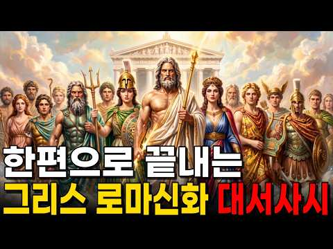
- 챕터: 0:00 아버지를 삼킨 신들 : 카오스, 우라노스, 그리고 크… · 8:29 거인들의 대격돌 : 티타노마키아와 올림포스 핵심 신들… · 16:56 인간의 탄생과 대홍수 : 프로메테우스의 불꽃과 데우칼… · 27:20 올림포스의 밀실 : 사계절의 기원과 디오니소스의 비극 · 35:08 신의 영역을 침범한 자들 : 메두사, 아라크네, 그리… · 43:20 영웅들의 수난사 (상) : 페르세우스의 모험과 헤라클… · 54:23 영웅들의 수난사 (하) : 테세우스의 미궁과 이아손의… · 65:06 황금사과와 10년의 전쟁 : 불화의 여신과 트로이의 … · 71:38 트로이의 목마와 영웅들의 종말 : 아킬레우스의 비극과…
- 설명 앞부분: 태초의 혼돈 카오스에서 시작된 세상을 바꾼 위대한 창세 신화, 올림포스 12신의 치열한 권력 투쟁과 신의 피를 물려받은 영웅들의 거대한 수난사, 그리고 지상에서 신들의 시대가 막을 내리는 트로이 전쟁의 거대한 불꽃까지. 그리스 로마 신화의 전체 궤적과 핵심 서사를 빠짐없이 담아낸 통합 풀버전입니다. 차분하고 정갈한 스토리텔링과 함께 고대 신화가 오늘날 우리 삶과 운명에 던지는 깊은 인문학적 통찰을 느껴보시기 바랍니다. ⏱️ 타임라인 [에필로그] 신화가 인간에게 던지는 질문 : 오만, 운명, 그리고 삶의 본질 [콘텐츠 안내] 본 영…
- 같은 채널 평소 대비 ×7.4 (채널 최근 롱폼 중앙값 56,563회) · 평소 영상: 인류 역사상 가장 잔혹하고 기묘했던 문명, 마야는 왜 흔적도 없이 사라졌을까? [🌙 꿀잠… (60,233회) / 초고대문명, 세계 최초의 완벽한 도시가 사라진 이유, 인더스 문명 5,000년의 수수께끼… (52,893회)
- 대본 없음 (설명) — 음성인식이 끝나면 도입부·흐름이 들어감
- 댓글 91/92: 좋은 점 — 영상 3 · 감사·응원 6 · 더 알고 싶은 것 3 · 아쉬운 점 — 영상 1 · 반박·불만 — 의견 다름 1 · 정치·사회 0 · 경험 공유 5 · 구독·다음 기대 1
  - 좋은 점 — 영상 👍9 “너무 유익하게 잘들었습니다”
  - 좋은 점 — 영상 👍8 “어제 오디세이를 보고 호기심 해결했습니다. 너무 유익하게 잘 들었습니다. 감사합니다.”
  - 감사·응원 👍12 “오디세이 보고 전체적인 맥락이 궁금해서 찾아봤어요... 많은 이해가 되었습니다. 자세한 설명과 그림에 감사드려요..❤”
  - 감사·응원 👍8 “어제 오디세이를 보고 호기심 해결했습니다. 너무 유익하게 잘 들었습니다. 감사합니다.”
  - 더 알고 싶은 것 👍12 “오디세이 보고 전체적인 맥락이 궁금해서 찾아봤어요... 많은 이해가 되었습니다. 자세한 설명과 그림에 감사드려요..❤”
  - 더 알고 싶은 것 👍4 “근데 오디세이에서 키클롭스는 포세이돈의 아들이랬는데 여기서는 우라노스의 아들이라고 하시는데 뭐가 맞는건가요??”
  - 아쉬운 점 — 영상 👍0 “광고가 너무길다”
  - 반박·불만 — 의견 다름 👍2 “말도안돼는스토리”
  - 경험 공유 👍84 “제가 어렸을적 계몽사 라는 출판사에서 50권짜리 세계명작전집이 집에 있었습니다 . 1권이 그리스신화 2권이 호머이야기였던가 .. 그 호머이야기가 트로이전쟁을 소재로했던거같은데 어릴때 읽기는읽었지만 내용을 온전히 이해하지못한채 전쟁장면묘사에 집중했던거같네요 .. 어릴때…”
  - 경험 공유 👍0 “내가 우지호를 낳았다.”
  - 구독·다음 기대 👍2 “오디세이 영화보고 바로 정주행 시간이 가는줄 모르고 과자 3봉지 순삭 감사합니다 😊”

### 283. 역모로 쫓긴 대감집 아씨를 가마니에 숨겨온 심마니, 조선 거상이 되다∣ 야담.수면 오디오북.조선야담.조선한국사.조선로맨스.조선사업이야기

- https://www.youtube.com/watch?v=wl-pu2vCAY4 · 설주야담 · 구독자 30,400 · 조회수 700,990 (×23.1, 하루 12,531.1) · 좋아요 7,208 (1.0%) · 53.4분 · 2026-08-27 · 주제 묶음 10. 수면·낭독 · 형식 수면·낭독 (잠잘 때 듣는) · 폴더 `W_wl-pu2vCAY4` (웹 승인)
- 썸네일: 
- 설명 앞부분: ❤️설주야담에 오신 것을 환영합니다. 조선시대를 배경으로 한 야담, 민담, 설화와 흥미로운 옛이야기를 들려드립니다. 버려지고 쫓겨난 이들이 뜻밖의 인연을 만나 서로를 구하고, 작은 은혜가 사랑과 가족으로 이어지는 이야기. 가난과 신분의 벽을 넘어 운명을 바꾸는 사람들의 이야기를 담고 있습니다. 눈보라 속에 버려진 과부를 구한 나무꾼, 갈 곳 없는 처녀에게 손을 내민 가난한 총각, 아무도 예상하지 못했던 숨겨진 사연과 반전까지. 때로는 가슴 뭉클한 사랑과 효심, 때로는 속 시원한 권선징악과 인생 역전, 그리고 마지막에는 사람의 따뜻…
- 같은 채널 평소 대비 ×19.2 (채널 최근 롱폼 중앙값 36,529회) · 평소 영상: "죽은 사람 건드리지 마라" 그녀를 집으로 업고간 짚신장수,조선의 거상이되다. ∣ 야담,… (36,529회) / "그 여종 건드리지 마시오!"눈더미 속에 버려진 노비를 주워왔더니, 가문을 일으킨 '금빛… (37,403회)
- 대본 없음 (설명) — 음성인식이 끝나면 도입부·흐름이 들어감
- 댓글 174/176: 좋은 점 — 영상 4 · 감사·응원 18 · 더 알고 싶은 것 3 · 아쉬운 점 — 영상 1 · 반박·불만 — 의견 다름 0 · 정치·사회 0 · 경험 공유 3 · 구독·다음 기대 2
  - 좋은 점 — 영상 👍5 “좋은 이야기 잘 보았습니다, 아쉬운 건 아들 딸 소식이 없어 아쉽네요,”
  - 좋은 점 — 영상 👍5 “좋은이야기였읍니다”
  - 감사·응원 👍8 “귀하고 소중하신 영상 대단히 감사드립니다 서울입니다😅”
  - 감사·응원 👍7 “참 아름다운 애기네요 무진과 서린 잘만 난것갇으며 어머니도 인품 이좋으시네요 큰보물을서로 얻으셧네요 잘보앗 습니다 감사합니다”
  - 더 알고 싶은 것 👍7 “잘들었습니다~ 자주 올려주세요~”
  - 더 알고 싶은 것 👍4 “영상이 정말 재미있고 정성이 느껴집니다! 이렇게 좋은 콘텐츠를 만들어 주셔서 감사합니다. 앞으로도 좋은 영상 많이 만들어 주세요. 채널의 더 큰 발전을 응원합니다! 👏❤”
  - 아쉬운 점 — 영상 👍5 “좋은 이야기 잘 보았습니다, 아쉬운 건 아들 딸 소식이 없어 아쉽네요,”
  - 경험 공유 👍4 “나도 내일부터 약초캐러가야긋다. 잘하면 장가갈수도..”
  - 경험 공유 👍3 “나도 시골에 내려가 산속에서 나무하고 약초캐며 살아볼까 ? 서린이 같은 낭자를 만나게 될지”
  - 구독·다음 기대 👍4 “미국 텍사스주 휴스턴에서 잘 들었습니다. 깔끔한 내용전개가 좋아서 구독 및 알림설정 했습니다.”
  - 구독·다음 기대 👍4 “최근 방문한 같은 야담러중 최고십니다 ㅋ 구독하고 갈게요”

### 284. 사극은 절대 안 보여준 조선 주막의 진실 - 봉놋방·주모·1박의 기록

- https://www.youtube.com/watch?v=SiPh04Hz_ps · 해태연표 · 구독자 4,250 · 조회수 96,270 (×22.6, 하루 673.4) · 좋아요 995 (1.0%) · 33.8분 · 2026-06-01 · 주제 묶음 3. 조선 · 형식 브이로그·직접 해본 이야기 · 폴더 `W_SiPh04Hz_ps` (웹 승인)
- 썸네일: 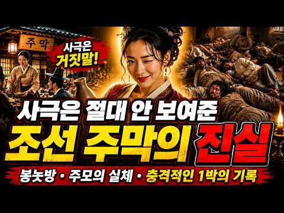
- 설명 앞부분: 🏮 "여기서… 자야 한단 말인가." 1779년 가을, 충주로 가던 한 양반이 봉놋방 문을 열고 멈춰 섰습니다. 사극이 그린 그 정겨운 주막은, 사실 절반이 거짓말이었습니다. 📜 이번 영상에서 다루는 진실 🔹 봉놋방 한 칸에 십수 명이 뒤엉켜 자던 진짜 풍경 🔹 사극이 단 한 번도 그리지 않은 '색주가'의 그늘 🔹 주모는 왜 조선의 가장 강력한 여성 자영업자였나 🔹 영국 여행가 이사벨라 비숍이 기록한 조선 주막의 충격 🔹 주막이 조선 후기의 정보망이자 비공식 은행이었던 이유 🔹 70년을 강가에서 한 자리를 지킨 마지막 주모, 유옥련…
- 대본 없음 (설명) — 음성인식이 끝나면 도입부·흐름이 들어감
- 댓글 45/45: 좋은 점 — 영상 0 · 감사·응원 0 · 더 알고 싶은 것 0 · 아쉬운 점 — 영상 1 · 반박·불만 — 의견 다름 0 · 정치·사회 1 · 경험 공유 0 · 구독·다음 기대 0
  - 아쉬운 점 — 영상 👍9 “영상을 너무 길게 늘려논 느낌이에요ㅜ 보다가 질림…”
  - 정치·사회 👍1 “드라마에 양반이 주연이면 그의 역할이 중요하고 주모가 주연이면 그역할이 많았겠지 고의로 안한것처럼 선동하지마라 좌파채널”

### 285. 나라를 잃고 미얀마로 도망친 명나라 마지막 황제, 배신 끝에 최후를 맞다 ∣ 영력제의 최후

- https://www.youtube.com/watch?v=PknqtorX34s · 대명제국 흑역사【심층 다큐】 · 구독자 2,200 · 조회수 49,651 (×22.6, 하루 938.6) · 좋아요 211 (0.4%) · 64.8분 · 2026-08-30 · 주제 묶음 6. 동양사 (중국·일본·몽골) · 형식 정보·해설 (그 밖) · 폴더 `W_PknqtorX34s` (웹 승인)
- 썸네일: 
- 같은 채널 평소 대비 ×12.6 (채널 최근 롱폼 중앙값 3,946회) · 평소 영상: 수많은 대신을 몰아낸 명나라 권신 엄숭, 결국 자신의 아들조차 구하지 못했다 (4,003회) / 중국에서는 최악의 황제로 불리지만, 한국에서는 '천자 고려'로 추앙받는 남자 ∣ 명 만력… (3,888회)
- 대본 없음 (없음) — 음성인식이 끝나면 도입부·흐름이 들어감
- 댓글 17/17: 좋은 점 — 영상 0 · 감사·응원 3 · 더 알고 싶은 것 0 · 아쉬운 점 — 영상 0 · 반박·불만 — 의견 다름 0 · 정치·사회 1 · 경험 공유 0 · 구독·다음 기대 0
  - 감사·응원 👍2 “존칭어 과잉시대에 비존칭어(반말?)가 훨씬 듣기에 좋습니다. 잘 듣겠습니다. 감사합니다.”
  - 감사·응원 👍1 “감사합니다”
  - 정치·사회 👍0 “이정국과 손가망이 내전을 벌이지 않고 만주족 타도를 위해 정성공과 완벽하게 협력했다면, 오삼계 홍승주같은 배신자들이 없었다면 과연 청나라가 중국 전 영토를 지배하고 지금의 티벳 신장위구르를 아우르는 영토를 짱개들에게 물려줄수 있었을까요? 역사에 만약은 없지만 안타깝네…”

### 286. 40분 전까지 이름도 몰랐는데 울었다 — 이순신을 처음 알게 된 외국인들

- https://www.youtube.com/watch?v=PGedVpjYgEk · 경제냥 · 구독자 3,310 · 조회수 74,108 (×22.4, 하루 3,214.8) · 좋아요 754 (1.0%) · 14.7분 · 2026-09-29 · 주제 묶음 3. 조선 · 형식 애니메이션·지도 · 폴더 `W_PGedVpjYgEk` (웹 승인)
- 썸네일: 
- 설명 앞부분: 스파르타 300 이야기 말고, '조선의 13' 이야기를 아시나요? 시카고의 한 만화가가 17년째 그리고 있는 조선 장군, 그리고 그 이야기를 처음 들은 외국 유튜버들이 어디서 놀라고, 어디서 화내고, 어디서 울었는지 따라가 봤습니다. 외국 사람들이 이 이야기에서 가장 놀란 대목, 여러분은 어디셨나요? 댓글로 남겨 주세요. 반응 영상 속 애니메이션: Extra History 'Korea: Admiral Yi' 시리즈 (2015) ■ 크리에이티브 커먼즈 저작자 표시(CC BY) 영상 ■ 유물 사진 (공공누리 제1유형 · 국립중앙박물관…
- 대본 없음 (설명) — 음성인식이 끝나면 도입부·흐름이 들어감
- 댓글 64/69: 좋은 점 — 영상 0 · 감사·응원 1 · 더 알고 싶은 것 1 · 아쉬운 점 — 영상 0 · 반박·불만 — 의견 다름 2 · 정치·사회 4 · 경험 공유 3 · 구독·다음 기대 0
  - 감사·응원 👍1 “좋은 영상 감사드립니다 멸공!❤”
  - 반박·불만 — 의견 다름 👍25 “후손들은 명량해전 이긴 걸 알고 있지만, 그 시점에는 선조의 육군 편입 요청은 오히려 더 현실적이다. 이순신은 누가 봐도 가망이 없는 전력차이를 심지어 1척도 안잃고 이겼어. 영국인들은 인정하기 싫겠지만 솔직히 넬슨과 이순신은 수준 차이가 너무 남. 그냥 중요 전투 …”
  - 반박·불만 — 의견 다름 👍5 “우리나라 사람들도 역사를 잘 모르는데 거북선을 이순신 장군이 설계하고 만든건 아닙니다~!! 그 전부터 돌격선이라고 거북선을 왜구들을 막는 용도로 있었죠~!! 그것을 이순신 장군이 현장에 상황과 자신의 실전 경험과 그 당시 현실에 맞추어서 개량한겁니다~!! 그게 거북선…”
  - 정치·사회 👍2 “왜 외국인이 나랑 똑같은 생각을 갖고 이야기하지... 진짜 이순신은 무서운 사람이네. 근데... 박정희가 세운 이명박이가 세운 동상은 치우자. 남 생각 안하는 것들이... 광화문 앞에 동상을. ㅋ 이순신이 세종이 이걸 알면!!!!!!! 스스로 그 동상에 머릴 박을 것”
  - 정치·사회 👍1 “지금도 기득권들은 영웅을 품을 만큼의 아량이 없다 지들보다 잘나면 시기와 질투로 밤잠을 설칠거다 영웅을 무너뜨려야 드발뻗고 자는 놈들이 저 국힘들이 아닌가”
  - 경험 공유 👍0 “^^ 네 이 버 ^^ 의 ^^ 메 르 카 츠 ^^ 님 ^^ 의 ^^ 글 ^^ : ^^.......^^ 명 량 대 첩 ^^ 시 ^^ 에 ^^ ....... ^^ 신에게는 아직도 열두척이 있사오니 라고 말할때는 12척이였고 장계가 올라가서 선조에게 닿을때쯤 한척을 수리하…”
  - 경험 공유 👍0 “이순신장군이 옥살이와 모진고문당한건 훙노족 노론벽파들의 모함때문인데 친일교육부가 그걸 안가르치고 왕탓으로 가르치고있다! ★이순신 장군을 명장으로 만든건 전라도 사람들이 임진왜란 이긴건 신라휴ㅇ노족에의한 매국통일신라시대때부터 일본의 해적질로부터 조정에서 물리칠 생각 않…”

### 287. 과학도 설명하지 못한 고고학 미스터리 50가지

- https://www.youtube.com/watch?v=0aRr9dRPf-I · Nariman · 구독자 2,680 · 조회수 59,826 (×22.3, 하루 362.9) · 좋아요 481 (0.8%) · 290분 · 2026-05-10 · 주제 묶음 8. 문명·고고학 · 형식 정보·해설 (그 밖) · 폴더 `W_0aRr9dRPf-I` (웹 승인)
- 썸네일: 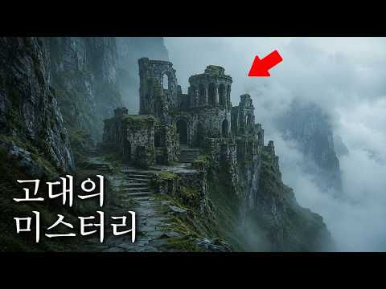
- 설명 앞부분: 고대 유적, 사라진 문명, 정체불명의 구조물, 설명하기 어려운 고고학적 발견들까지. 이 영상에서는 과학이 아직 완전히 설명하지 못한 고고학 미스터리 50가지를 따라가 봅니다. 세계 곳곳에서 발견된 이상한 유물과 고대 건축물, 잊힌 도시와 미스터리한 흔적들은 인류의 역사가 우리가 알고 있던 것보다 훨씬 더 복잡하고 신비로울 수 있음을 보여 줍니다. 일부 발견은 고대인의 놀라운 기술을 드러내고, 또 다른 발견은 아직도 연구자들 사이에서 논쟁을 불러일으키고 있습니다. 이 영상은 고대 문명, 미해결 유적, 잃어버린 역사, 고고학적 수수께…
- 같은 채널 평소 대비 ×5.8 (채널 최근 롱폼 중앙값 10,402회) · 평소 영상: 아직 풀리지 않은 고대 미스터리들｜고대 문명과 잃어버린 역사의 수수께끼 (11,206회) / 시간의 흐름을 무너뜨린 가장 미스터리한 고고학 발견들 세 시간 몰아보기 (9,597회)
- 대본 없음 (설명) — 음성인식이 끝나면 도입부·흐름이 들어감
- 댓글 4/4: 좋은 점 — 영상 0 · 감사·응원 0 · 더 알고 싶은 것 0 · 아쉬운 점 — 영상 0 · 반박·불만 — 의견 다름 0 · 정치·사회 0 · 경험 공유 0 · 구독·다음 기대 0

### 288. 사극이 절대 안 보여준 조선 주막의 충격적인 진짜 모습

- https://www.youtube.com/watch?v=_6pNuFtoURo · 이슈의 역사 · 구독자 7,910 · 조회수 175,587 (×22.2, 하루 989.4) · 좋아요 2,221 (1.3%) · 29.8분 · 2026-04-27 · 주제 묶음 3. 조선 · 형식 정보·해설 (그 밖) · 폴더 `W__6pNuFtoURo` (웹 승인)
- 썸네일: 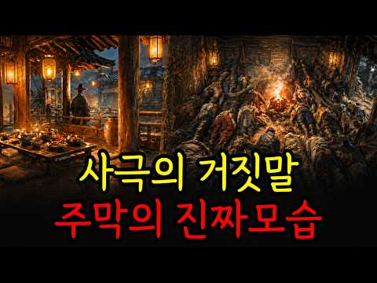
- 챕터: 0:00 사극이 숨긴 주막의 첫 장면 · 3:10 주막은 어떻게 생겨났나 · 7:00 한 방에 수십 명, 잠자리의 충격 · 11:10 음식은 공짜, 술값만 받는 시스템 · 15:10 주모의 진짜 정체 · 19:10 도둑과 살인, 주막의 어두운 밤 · 24:00 사극이 보여주지 않은 마지막 풍경 · 28:00 조선 주막의 진짜 얼굴
- 설명 앞부분: 사극에서 보던 깔끔한 주막은 진짜 조선 주막이 아닙니다. 한 방에 모르는 사람 수십 명이 뒤엉켜 자고, 이불도 베개도 없이 맨바닥에서 옷 입은 채로 밤을 새우던 곳. 양반도 거지도 도둑도 같은 방에 누워야 했던, 조선시대 주막의 충격적인 진짜 풍경을 정사와 야사 기록으로 따라갑니다. 음식값은 한 푼도 받지 않고 술값만 받았다는 황당한 영업 방식, 주모라는 호칭에 얽힌 오해와 실제 신분, 길 위에서 굶어 죽지 않기 위해 반드시 들러야 했던 생존 거점으로서의 주막, 그리고 그 안에서 벌어진 도난·살인 사건까지. 조선 후기 실학자들의 …
- 같은 채널 평소 대비 ×268.1 (채널 최근 롱폼 중앙값 655회) · 평소 영상: 조선왕조실록에 기록된 한반도 한파의 충격적 진실, 짚신 한 켤레로 영하 30도를 견뎠던 … (655회) / 지도에서 통째로 지워진 문명, 인류 역사를 리셋시킨 최악의 재앙의 정체는? (617회)
- 대본 없음 (설명) — 음성인식이 끝나면 도입부·흐름이 들어감
- 댓글 398/398: 좋은 점 — 영상 2 · 감사·응원 5 · 더 알고 싶은 것 3 · 아쉬운 점 — 영상 2 · 반박·불만 — 의견 다름 9 · 정치·사회 22 · 경험 공유 11 · 구독·다음 기대 0
  - 좋은 점 — 영상 👍5 “주막이 레전드인게 화폐 시스텡 이라고 햇어음 중국 무협 으로 치면 전표시스템 하고ㅈ비슷햇는데 오래전에 본거라 기억이 잘 안나네 ㅋㅋ”
  - 감사·응원 👍7 “정말 가난에 찌든 조선! 대한민국이 자랑스럽고, 이 시대에, 이곳에 사는 것에 감사한다”
  - 감사·응원 👍5 “그 시대에 태어나지 않은 것만 해도 감사해야 됨.”
  - 더 알고 싶은 것 👍3 “여행 길에 있는 주막이 아니라 한양 안의 술집이 사극에 많이 나오죠. 주막처럼 소개하면서... 시골에 여행길에 있는 주막이야 잘 알려진 거고. 한양 안의 숳집들에 대해서 좀 자세히 알려주는 게 좋아요. 서서 먹는 목로주점이라든가.... 예전에 KBS에서 다큐멘터리 형…”
  - 더 알고 싶은 것 👍0 “제 나이가 43세 인데 사극 드라마에서 주모가 한복입고 술부어주는 모습을 본적이 없는데요? 인심좋고 풍체좋은 아줌마가 누더기 수준의 앞치마입고 국밥이나 막걸리같은 술을내주는 모습과 손님들을 친구처럼 대하는 그런장면은 많이 봤음 혹시 제가 못본 사극인가? 혹시 주막에서…”
  - 아쉬운 점 — 영상 👍0 “내용은 좋은데 너무 비슷한 맥락의 말들이 반복되네”
  - 아쉬운 점 — 영상 👍0 “역사 유튜브를 표방하지만 중간중간 복식 등의 고증이 서양이었다가 일본이었다가 중국이었다가.. 아쉽네요.. 뭐 쉬운 방법을 택하신거겠지만.”
  - 반박·불만 — 의견 다름 👍37 “진짜 조선시대를 돌아간듯한 실감이 나는 영상입니다 🥰😍👍👍 티비에서 보는 허구는 정말 웃기는 거였군요”
  - 반박·불만 — 의견 다름 👍19 “제일 어이없는건 드라마에선 조선시대에 서민들 밥상에 반찬들이 있다는거..ㅋㅋㅋㅋㅋ 전부 개구라임”
  - 정치·사회 👍25 “사극 이전에 제도권에서 가르치는 한국사 태반이 가짜 역사거나 왜곡으로 점철되어있음. 고려 무신정권 이후 정말 별볼이 없이 운좋게 여기까지 온 자체가 기적의 역사임. 오히려 이런점을 가르쳐야.”
  - 정치·사회 👍5 “교과서에 유럽여행자들 조선여행후기에 좋은내용반 나쁜내용반만 써놔서 객관적이게 적은듯이 해놨는데 실상은 좋은거1 악평99였음ㅋㅋㅋㅋ 아프리카 중동 인도 중국 동남아 일본 다 경험해본 여행자들인데 미리 짜고 친듯이 전부 조선을 최악으로 꼽음 말이 나라지 왕이라고 주장하는…”
  - 경험 공유 👍17 “제가 50대 중반인데, 국민학교 다닐 때 TV사극을 기억해 보면 그래도 봉놋방을 잘 묘사한 것으로 생각이 듭니다. 허름한 초가집에 주모였던 분은 전원주님, 아직 건강하게 잘 활동하시죠.^^”
  - 경험 공유 👍10 “전쟁이 원흉이네 현대에도 전쟁 한 번 나면 복구 하는데 몇 십년이 걸리는데 임란 호란 연속으로 겪었으니 조선 중기 이후는 처참했을듯 임란 이후에 조선왕조는 그냥 끝내고 새왕조가 들어섰어야했는데”

### 289. [그날의 한국사] 광해군을 끌어내린 친조카 인조의 비참한 말로... "큰아버지께 죄를 지었다" 죽기 직전 흘린 26년의 천벌 ∣ 인조반정 병자호란 삼전도 굴욕

- https://www.youtube.com/watch?v=c3ED6GNQFLw · 그날의 한국사    · 구독자 806 · 조회수 17,852 (×22.1, 하루 103.3) · 좋아요 437 (2.5%) · 47.6분 · 2026-05-02 · 주제 묶음 3. 조선 · 형식 정보·해설 (그 밖) · 폴더 `W_c3ED6GNQFLw` (웹 승인)
- 썸네일: 
- 챕터: 0:00 죽기 직전 인조의 마지막 후회 · 2:00 1장 - 영광의 시작과 첫 번째 경고 · 9:00 2장 - 첫 번째 천벌, 이괄의 난 · 16:00 3장 - 두 번째 천벌, 정묘호란 · 23:00 4장 - 세 번째 천벌, 병자호란과 삼전도 굴욕 · 31:00 5장 - 마지막 천벌, 가족 몰살과 죽음의 후회 · 0:00 죽기 직전 인조의 마지막 후회 · 2:00 1장 - 영광의 시작과 첫 번째 경고 · 9:00 2장 - 첫 번째 천벌, 이괄의 난 · 16:00 3장 - 두 번째 천벌, 정묘호란 · 23:00 4장 - 세 번째 천벌, 병자호란과 삼전도 굴욕 · 31:00 5장 - 마지막 천벌, 가족 몰살과 죽음의 후회 · 0:00 죽기 직전 인조의 마지막 후회 · 2:00 1장 - 영광의 시작과 첫 번째 경고 · 9:00 2장 - 첫 번째 천벌, 이괄의 난 · 16:00 3장 - 두 번째 천벌, 정묘호란 · 23:00 4장 - 세 번째 천벌, 병자호란과 삼전도 굴욕 · 31:00 5장 - 마지막 천벌, 가족 몰살과 죽음의 후회
- 설명 앞부분: 1649년 1649년 5월 8일, 쉰다섯 살의 조선 왕 인조가 눈을 감기 직전 신하의 손을 잡고 떨리는 목소리로 속삭인 마지막 한 마디 "큰아버지... 제가 정녕 큰아버지께 죄를 지었나이다" 26년 전, 새벽에 칠백 명의 군사를 이끌고 큰아버지의 침전에 쳐들어가 왕좌에서 끌어내린 바로 그 인조 폐위된 큰아버지를 강화도로 유배 보내고 제주도까지 쫓아낸 바로 그 인조가 죽기 직전 흘린 피눈물의 한 마디 오늘은 광해군을 끌어내리고 옥좌에 앉은 친조카 인조, 그가 받은 26년의 천벌을 함께 만나보는 시간입니다 ▼ 영상 목차 ▼ ▼ 인조의…
- 같은 채널 평소 대비 ×153.9 (채널 최근 롱폼 중앙값 116회) · 평소 영상: [충격] 조선 왕을 조종한 두 여인, 김개시와 장희빈의 소름 돋는 최후 (129회) / 조선시대 '밀실 살인'의 진실, 은비녀는 알고 있었다 ∣정약용 ∣역사 스토리∣ (103회)
- 대본 없음 (설명) — 음성인식이 끝나면 도입부·흐름이 들어감
- 댓글 46/46: 좋은 점 — 영상 0 · 감사·응원 1 · 더 알고 싶은 것 0 · 아쉬운 점 — 영상 0 · 반박·불만 — 의견 다름 2 · 정치·사회 4 · 경험 공유 0 · 구독·다음 기대 0
  - 감사·응원 👍1 “정말로 귀한 비디오 이네요.. 감사 합니다.. 역사 속에서 많이 배웁니다.”
  - 반박·불만 — 의견 다름 👍2 “설명은 내용은 쾐찮은데 영상은 참 어이없음 아무리 AI로 영상을 만들었다고 하지만 이게 조선이야 중국이야 도무지 추천을 누를수 없음. 편하게 AI로 영상만든다고 하지만 저거 중국역사도 아니고 우리 역사인데 너무 성의없다. 싫어요 누르고 감”
  - 정치·사회 👍15 “광해군이였더라면 금(청)에 굴욕 당하지 않고 나라가 안정되어을 것이다”
  - 정치·사회 👍8 “지금도 박근혜 윤석렬로 이어지는 참담한 탄핵의 현실이 서인(이귀 김류 이괄, 최명길, 김자점))세력과 문죄인 이죄명의 적반하장이 다를바 무엇이 있으랴 ㅎㅎㅎ”

### 290. 일본을 400년간 트라우마에 시달리게 한 장수. 이순신이 아닙니다 ∣ 김시민

- https://www.youtube.com/watch?v=CF4biSGrwOg · 그랬구나! · 구독자 8,870 · 조회수 196,129 (×22.1, 하루 2,013.7) · 좋아요 5,258 (2.7%) · 65.2분 · 2026-07-16 · 주제 묶음 3. 조선 · 형식 인터뷰·강연·대담 · 폴더 `W_CF4biSGrwOg` (웹 승인)
- 썸네일: 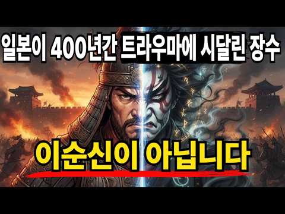
- 챕터: 0:00 인트로 · 1:44 모쿠소 호간의 정체 · 2:49 김시민, 그는 누구인가 · 5:42 이순신과 같은 전장에 서다 · 7:17 전쟁 준비 · 9:52 성문을 열지 않은 판단 · 14:23 전투 시작 · 16:55 둘째 날 · 20:10 셋째 날 · 22:07 넷째 날 · 25:01 다섯째 날 · 28:28 여섯째 날 — 최후의 공방 · 31:39 진주대첩 · 34:17 승리 직후 · 39:57 기록의 무게 · 43:30 공신 교서의 수난 · 45:45 2차 진주성 전투 · 52:00 일본 속의 김시민 · 61:35 에필로그
- 설명 앞부분: 3만 대군을 3,800명으로 막아낸 장수가 있습니다. 6일간 십여 차례 싸워 단 한 번도 지지 않았습니다. 조선왕조실록은 이 사람의 죽음을 딱 한 줄로 처리했습니다. "김시민을 경상우도병마절도사로 삼았는데, 얼마 뒤에 졸하였다." 이게 전부입니다. 그런데 적국 일본에서는 전혀 달랐습니다. 진주목사를 뜻하는 '모쿠소'라는 두 글자가 1626년부터 400년 넘게 가부키 무대 위에 살아 있었습니다. 이름도 모른 채, 직함 하나만으로 공포의 상징이 된 것입니다. 기록한 쪽은 한 줄로 끝냈고, 당한 쪽은 400년간 떨었습니다. 이순신과 같…
- 같은 채널 평소 대비 ×40.6 (채널 최근 롱폼 중앙값 4,835회) · 평소 영상: 조선 역사상 가장 위험한 결혼, 영조가 정순왕후를 데려온 이유 (4,835회) / 이순신보다 150년 전, 세종이 문신들을 제치고 우의정에 앉힌 무신 (4,338회)
- 대본 없음 (설명) — 음성인식이 끝나면 도입부·흐름이 들어감
- 댓글 505/505: 좋은 점 — 영상 4 · 감사·응원 25 · 더 알고 싶은 것 2 · 아쉬운 점 — 영상 3 · 반박·불만 — 의견 다름 9 · 정치·사회 24 · 경험 공유 5 · 구독·다음 기대 1
  - 좋은 점 — 영상 👍20 “선조와 간신들이 문제로 국민들이 개고생 도륙당했고 화랑오개를 배웠어야 했다”
  - 좋은 점 — 영상 👍0 “김시민 장군의 이름은 들었지만 자세한 내용은 아무래도 이순신 장군만큼 알려지지 않았으니까요! 사실 강감찬, 이순신 장군 외에는 역사를 기억 못 하는 것이 현재의 문제죠. 김시민 장군뿐 아니라 훌륭한 우리 장군들이 많았습니다만 일제강점기 때 많이 전승이 끊겼을 겁니다.…”
  - 감사·응원 👍130 “김시민장군이 이토록 위대하신 분인지 몰랐습니다. 감사합니다.”
  - 감사·응원 👍83 “눈물을 흘리며 듣습니다. ㅠㅠㅠ 오늘이 있도록 희생하신 모든 선조님들께 감사를 올립니다. 부디 하늘에서 평안 하소서. _()_ .”
  - 더 알고 싶은 것 👍0 “곽재우 장군도 가망없다고 진주성 버렸듯이 경상도 장수들이 진주성을 버렸을 때, 1등 공신을 따지자면 이치전투의 영웅 남원출신 황진 장군을 비롯해 전라도 출신 장수들이 2차 진주성 전투에서 활약상도 영상 부탁드려요. 그리고 이치전투와 황진 장군을 찾아보세요. 대단한 분…”
  - 더 알고 싶은 것 👍0 “2차 진주성 전투 영웅 황진장군님도 다뤄주세요 바다엔 이순신장군님 육지엔 황진장군님 진정한 조선의 소드마스터 황진장군님 만세 만세 만세!”
  - 아쉬운 점 — 영상 👍21 “답을 내려고 하지마세요 수긍하고 다시 같은일이 반복되지 않게 하는게 역사를 배우는 목표라 생각합니다”
  - 아쉬운 점 — 영상 👍0 “역사에서 버림받을뻔한 김시민장군을 국민들 가슴에 영원히 살려주셔서 감사합니다 김시민장군님 감사합니다 님은 영웅이십니다 언젠가 어느 후손이 님을 기릴 영화를 만들날이 올것입니다 평안히 잠드소서 ()()()”
  - 반박·불만 — 의견 다름 👍74 “올공 민주화운동 열사를 국민이 지켜야 합니다ㆍ 역사에 기록하고 후손이 알아야 합니다 ㆍ 자유는 공짜가 아니죠”
  - 반박·불만 — 의견 다름 👍1 “십만양병설 사실아닙니다. 사실 아닌걸 여기저기 쓰면서 가짜를 진짜 역사로 오해. 빨리 바로 잡고 고쳐 나가야합니다. 오류가”
  - 정치·사회 👍12 “김시민이를 2등으로 평가할 정도의 선조의 실력 이러한 나라가 어찌 망하지 않겠는가? 그래서 결국 망했지. 지금도 역사는 반복되고 있다.”
  - 정치·사회 👍3 “오늘날 현대사의 역적들을 상세히 기록하여 남기길 바랍니다. 이재명 한동훈 등등등”
  - 경험 공유 👍1 “이 훌륭한 분이 나의 선대 할아버지 셨구나 나도 부끄럽지않게 살고 뭔가 사회에 좋은 기여를 해야겠다”
  - 경험 공유 👍1 “옛 어렵게 기록한 내용을 세세하고 긴박 하고 절실 했었던 (그때의) 마음을 담아 알려 주시어 감사할 따름입니다. 😢”
  - 구독·다음 기대 👍0 “좋은시간을 가졌어요. 다음편을 기대할게요”

### 291. 🌙 자면서듣는 역사 ∣ 조선역사 27명의 왕 조선왕조실록 완벽 정리 풀버전｜달빛 역사관

- https://www.youtube.com/watch?v=tNn6Ydh7Tdw · 달빛 역사관 : 자면서 듣는 세계사 · 구독자 9,220 · 조회수 202,167 (×21.9, 하루 1,415.8) · 좋아요 2,087 (1.0%) · 160.9분 · 2026-06-01 · 주제 묶음 3. 조선 · 형식 수면·낭독 (잠잘 때 듣는) · 폴더 `W_tNn6Ydh7Tdw` (웹 승인)
- 썸네일: 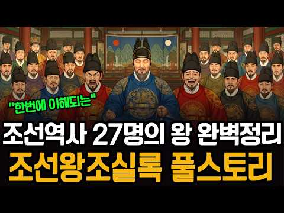
- 챕터: 0:00 프롤로그 — 왕이 되고 싶으셨나요 · 2:24 1부 — 피 ∣ 태조 · 정종 · 태종 · 10:50 2부 — 빛 ∣ 세종 · 문종 · 23:28 3부 — 삼촌이 조카를 죽였다 ∣ 단종 · 세조 · … · 33:25 4부 — 완성과 독 ∣ 성종 · 연산군 · 44:07 5부 — 왕이지만 왕이 아닌 ∣ 중종 · 인종 · 명종 · 55:50 6부 — 도망간 왕과 남은 세자 ∣ 선조 · 광해군 … · 69:05 7부 — 현실과 명분 ∣ 광해군 후반부 · 인조 · … · 92:30 8부 — 사랑과 권력 ∣ 현종 · 숙종 · 경종 · 107:28 9부 — 아버지가 아들을 죽였다 ∣ 영조 · 사도세자… · 123:54 10부 — 왕 없는 왕조 ∣ 순조 · 헌종 · 철종 · 138:52 11부 — 황혼 ∣ 고종 · 순종 · 156:21 에필로그 — 스물일곱 명이 치른 것
- 설명 앞부분: 왕이 되고 싶으셨던 적 있으신가요. 오늘 밤 달빛 역사관이 조선의 왕 스물일곱 명을 한 명씩 들려드립니다. 태조 이성계부터 마지막 황제 순종까지. 오백십팔 년. 형제를 죽이고 왕이 된 사람, 조카를 죽이고 왕좌에 오른 사람, 아들을 뒤주에 가두어 여드레 만에 잃은 아버지, 이마를 아홉 번 땅에 찧은 왕, 그리고 도장 한 번으로 오백 년을 닫은 마지막 황제. 왕좌는 언제나, 원하는 자에게도 원하지 않는 자에게도, 반드시 대가를 요구했습니다. 단순한 역사 나열이 아닙니다. 스물일곱 명 한 사람 한 사람의 내면, 그들이 감당해야 했던 …
- 같은 채널 평소 대비 ×3.3 (채널 최근 롱폼 중앙값 61,732회) · 평소 영상: 🌙 들으면서 주무세요 ∣ 약소국에서 삼국통일까지, 신라 천 년의 이야기 ｜달빛 역사관 (61,732회) / 🌙 들으면서 주무세요｜단군, 신화인가 역사인가 고조선의 역사 이야기 풀스토리｜달빛 역사관 (62,031회)
- 대본 없음 (설명) — 음성인식이 끝나면 도입부·흐름이 들어감
- 댓글 56/56: 좋은 점 — 영상 4 · 감사·응원 11 · 더 알고 싶은 것 0 · 아쉬운 점 — 영상 1 · 반박·불만 — 의견 다름 0 · 정치·사회 0 · 경험 공유 0 · 구독·다음 기대 0
  - 좋은 점 — 영상 👍7 “많은 도움이 됐어요감사😂”
  - 좋은 점 — 영상 👍5 “우연히 들르게되었는데 참좋은 내용 감사히 잘들었습니다”
  - 감사·응원 👍39 “고맙습니다. 잘 보고 갑니다.”
  - 감사·응원 👍9 “처음 와봤습니다. 재밌는 영상이네요. 자주 와서 봐야겠어요. 감사요”
  - 아쉬운 점 — 영상 👍1 “계속 듣고 싶었는데 말투에 뭔가 습관같은게 있는것 같은데 거슬리네요 잘때 듣기 편한 말투는 아닌것 같아요 내용은 재밌어서 계속 듣고싶은데 아쉬워요”

### 292. 산골 동네 주민들이 모여 합스부르크 정예 군사들을 제압하고 귀족들을 몰살시킨 전투

- https://www.youtube.com/watch?v=e-vAN1KFcCQ · 어른들의자장가 · 구독자 5,840 · 조회수 127,317 (×21.8, 하루 1,498.2) · 좋아요 706 (0.5%) · 17.9분 · 2026-07-29 · 주제 묶음 7. 전쟁·군사사 · 형식 정보·해설 (그 밖) · 폴더 `W_e-vAN1KFcCQ` (웹 승인)
- 썸네일: 
- 설명 앞부분: 1315년 11월 15일 아침, 애게리 호숫가의 좁은 길 위에 합스부르크 기사와 보병이 2킬로미터로 늘어섰습니다. 왼쪽은 가파른 비탈, 오른쪽은 늪이었고, 비탈 위 숲에는 소와 염소를 치며 사는 사람들 1,500명이 엎드려 있었어요. 두 시간 뒤 그 길에서 죽은 사람은 1,500명이 넘었고, 죽은 쪽은 기사들이었습니다. 71년 뒤 젬파흐에서 합스부르크는 기사 1,500명을 아예 말에서 내려 창 울타리를 세웠지만, 그날 공작 한 명과 귀족 400명이 함께 죽었어요. 다시 2년 뒤 네펠스에서는 방어벽을 내주고 산으로 물러난 400여 …
- 같은 채널 평소 대비 ×11.4 (채널 최근 롱폼 중앙값 11,144회) · 평소 영상: 독일군 전차와 대포 총공세를 처절하게 막아냈던 고작 20명의 최정예 소련 중대 이야기 (11,144회) / 길드 노조가 시민들로 군대를 조직해서 최정예 엘리트 군대랑 전쟁을 벌인 날 (10,742회)
- 대본 없음 (설명) — 음성인식이 끝나면 도입부·흐름이 들어감
- 댓글 28/28: 좋은 점 — 영상 0 · 감사·응원 1 · 더 알고 싶은 것 0 · 아쉬운 점 — 영상 1 · 반박·불만 — 의견 다름 2 · 정치·사회 0 · 경험 공유 0 · 구독·다음 기대 1
  - 아쉬운 점 — 영상 👍1 “지루한 설명이다”
  - 반박·불만 — 의견 다름 👍4 “스위스 는 산골 촌동네 목동 국가 거 아닙니다 로마 제국 때문에 알프스 에서 봉인된 헬베티아 人 들로서 용병 국가 이며 호전적이고 용맹 무쌍 합니다.”
  - 반박·불만 — 의견 다름 👍0 “잡스러운 헛소리를 뭐 이렇게 요란하게 뜨더냐?”
  - 구독·다음 기대 👍3 “재밌네요 ~~ 구독했습니다”

### 293. 역사책이 안 가르쳐준 이순신의 진짜 모습

- https://www.youtube.com/watch?v=h1eEOaC8OUo · 재역이(재미있는역사이야기) · 구독자 5,710 · 조회수 124,247 (×21.8, 하루 1,063.8) · 좋아요 3,196 (2.6%) · 37.1분 · 2026-06-27 · 주제 묶음 3. 조선 · 형식 정보·해설 (그 밖) · 폴더 `W_h1eEOaC8OUo` (웹 승인)
- 썸네일: 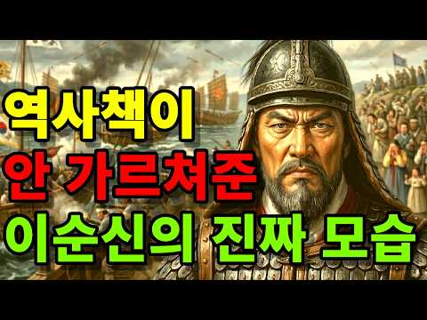
- 설명 앞부분: 곤장을 맞고 형틀에 묶인 조선 최고의 장수, 이순신. 그를 때리라 명령한 건 적장이 아니라 그가 지키던 나라의 임금이었습니다. 전쟁 내내 일본도 죽이지 못한 사람을, 정작 조선이 죽이려 했습니다. 벼슬을 빼앗기고, 누명을 쓰고, 어머니와 막내아들까지 잃은 사람. 그런데 그는 매를 다 맞고 풀려나자마자 다시 칼을 들고 바다로 나갔습니다. 자신을 죽이려던 바로 그 나라를 위해서요. 나라가 이렇게까지 자신을 내쳤는데, 이순신은 왜 끝까지 그 나라를 지켰을까요. "충성심이 강해서"라는 흔한 답으로는 설명되지 않는, 그를 진짜로 움직인 이…
- 같은 채널 평소 대비 ×13.8 (채널 최근 롱폼 중앙값 9,018회) · 평소 영상: 조선 역사상 스스로 왕좌를 버린 유일한 왕 (9,018회) / 허균이 죄목도 없이 능지처첨을 당한 진짜 이유 ∣ 허균 ∣ 허난설헌 (8,371회)
- 대본 없음 (설명) — 음성인식이 끝나면 도입부·흐름이 들어감
- 댓글 387/387: 좋은 점 — 영상 2 · 감사·응원 13 · 더 알고 싶은 것 5 · 아쉬운 점 — 영상 1 · 반박·불만 — 의견 다름 2 · 정치·사회 24 · 경험 공유 6 · 구독·다음 기대 0
  - 좋은 점 — 영상 👍3 “동서고금을 막론하고 상식.개념.정의.양심을 말아먹은 수구들에게는 어떠한 공직도 맡겨선 안된다는것을 선조가 잘 증명하고있네요 수구의 레전드 선조 !”
  - 감사·응원 👍29 “이순신 장군의 진정한 모습을 볼수 있는 이야기입니다 감사합니다”
  - 감사·응원 👍28 “이순신 통제사에 대해 과장하지 않고, 이순신 통제사의 일기를 근거로 설명해주니 고맙소.”
  - 더 알고 싶은 것 👍2 “만약 이순신 장군님이 무능한 선조를 몰아내고 직접 왕이 되었다면 지금 우리의 역사는 어떻게 바뀌었을까요? 🔥”
  - 더 알고 싶은 것 👍1 “세계해전사 세계전쟁사 인류역사상 세계역사상 전설적인장군 하늘이내려준 전쟁의신 유비무환 세계의주인공 세계해전사 병법의달인 발명가였다 지략전술가 일본어중국어 능통한천재 영웅 위인 전쟁의신 유비무환 세계의주인공 조선역사상 조선해군역사상 우리나라 역사상 세계최고의 총사령관 …”
  - 아쉬운 점 — 영상 👍1 “구독과 좋아요라는 광고가 나오는 즉시 영상 내립니다 싫어요는 어디갔어”
  - 반박·불만 — 의견 다름 👍0 “응 아닙니다. 이순신은 살려고 하다가 죽게되니 자신이 한 말이 있어 쪽팔림에 영끌해 남긴 나으 주금을 누구에게도 알리지 말라는 유언이 유명한 장수로 동상에도 죽고자 하거든 살 수 있었다는 문구가 있죠 ㅋ 거참 살려고 그리 바둥 대냐ㅉㅉ”
  - 정치·사회 👍3 “옛날이나 지금이나 지도자를 잘못 만나면 적보다 더 위험하다 돈키호테 같은 문재인이 탈원전하고 소득주도성장같은 짓거리해서 국민들 힘들게 했지 그래도 조선시대에는 백성들의 선택여지도 없었지만 지금은 투표권도 있는데 어리한 국민들이 어리한 지도자를 뽑으니 누굴 탓하랴”
  - 정치·사회 👍1 “윤석열과 동급 선조 꼴값떠는건 예나 지금이나 변하질 않아”
  - 경험 공유 👍1 “가토 이미 도착했었지~~~제시한 날짜보다 훨씬먼저 상륙했지”
  - 경험 공유 👍0 “이긍...당연하지.. 어머니가 사는 나라고... 친구가 사는 나라기 때문이지요... 임금이야... 몇십년후에 바뀌는 허수아비에 불과하니까... 버려진들 어떠하리.... 내가 사는 나라는 나의 부모 형제가 사는 나라인것을...”

### 294. 팰월드 1.0 중후반 희귀 자원 쉽게 얻는 방법 (크로마이트,코랄리움,솔라이트,팰키사이트,고대 문명의 코어)

- https://www.youtube.com/watch?v=IMg_-t4j4Q8 · 퇴근한광대 · 구독자 7,090 · 조회수 153,848 (×21.7, 하루 1,675.3) · 좋아요 1,528 (1.0%) · 6.9분 · 2026-07-22 · 주제 묶음 5. 세계사·서양사 · 형식 정보·해설 (그 밖) · 폴더 `W_IMg_-t4j4Q8` (웹 승인)
- 썸네일: 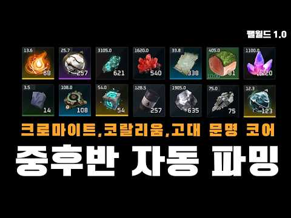
- 챕터: 0:00 오프닝 · 1:06 원정소 소개 · 1:38 원정전력이론 · 2:29 원정전력실전 · 4:17 레벨업시키기 · 4:35 팰작업연구소 · 4:48 원정 테스트 · 6:08 마무리
- 설명 앞부분: 중후반이 되면 크로마이트, 코랄리움, 슬라이트, 펠키사이트, 고대 문명의 코어 등 희귀 자원이 계속 부족해집니다. 하지만 원정을 쉽게 시작하면 직접 파밍하는 시간을 크게 줄일 수 있습니다. 이번 영상에서는 원정을 빨리 시작해야 하는 이유 추천 원정 팰 농축과 영혼 강화는 어느 정도만 하면 되는지 희귀 자원을 자동으로 수급하는 방법 을 정리했습니다. 원정은 생각보다 어렵지 않습니다. 너무 지레 겁먹지 마시고 지금부터 하나씩 시작해 보세요. 게임이 훨씬 편해질 겁니다. 타임라인
- 같은 채널 평소 대비 ×13.1 (채널 최근 롱폼 중앙값 11,753회) · 평소 영상: 거점 4개를 하나의 초대형 거점으로 만들어보겠습니다 팰월드 1.0 메가 거점 건축 #3 … (12,150회) / 팰월드 1.0 속성 추천 기술 총정리 #1 화염 속성 (11,356회)
- 대본 없음 (설명) — 음성인식이 끝나면 도입부·흐름이 들어감
- 댓글 259/259: 좋은 점 — 영상 12 · 감사·응원 31 · 더 알고 싶은 것 20 · 아쉬운 점 — 영상 7 · 반박·불만 — 의견 다름 0 · 정치·사회 0 · 경험 공유 6 · 구독·다음 기대 1
  - 좋은 점 — 영상 👍4 “팰월드 하는데 막힐때마다 영상 찾아볼 때 중요한 내용 알려주셔서 구독하고갑니다”
  - 좋은 점 — 영상 👍2 “좋은 정보 감사합니다~”
  - 감사·응원 👍6 “안그래도 오늘 팰키 캐느라 너무 힘들엇는데 감사합니다..”
  - 감사·응원 👍4 “와 딱 이때 저 코어 필요했는데 감사합니다”
  - 더 알고 싶은 것 👍2 “영혼은 어디서 파밍하나요? 펠 한마리 풀영혼 강화조차 빡센데.. 해체하면 영혼나오는펠이 있나요?”
  - 더 알고 싶은 것 👍2 “탐험으로만 렙이 70이 넘었는데 세계수 진입보스도 못 깨고 코어먹을데도 막막해서 스트레스직전이었는데 꿀영상 감사합니다! 혹시 중반 전투팰 공략 만들어 주실 수 있을까요? 얼리때 잡은 애들이 너무 허접이라 렙 50이상짜리 팰사냥은 너무 힘드네요”
  - 아쉬운 점 — 영상 👍0 “이분진짜 핵심만 골라서 너무 잘알려줌 개추임”
  - 아쉬운 점 — 영상 👍0 “이거 좋다~ 코랄에서 막혀서 낚시 찍고있는데 잘안되서 해봤는데 훨낫네요”
  - 경험 공유 👍0 “오~~굿 굿 너무 궁금 했었는대 대박 ㅎ”
  - 경험 공유 👍0 “이거 좋다~ 코랄에서 막혀서 낚시 찍고있는데 잘안되서 해봤는데 훨낫네요”
  - 구독·다음 기대 👍4 “팰월드 하는데 막힐때마다 영상 찾아볼 때 중요한 내용 알려주셔서 구독하고갑니다”

### 295. 사극에서는 절대 보여주지 않는 조선 평민의 진짜 밥상

- https://www.youtube.com/watch?v=sqEhpBUi3Vc · 조선의이면 · 구독자 2,840 · 조회수 61,515 (×21.7, 하루 410.8) · 좋아요 827 (1.3%) · 15.4분 · 2026-05-25 · 주제 묶음 3. 조선 · 형식 정보·해설 (그 밖) · 폴더 `W_sqEhpBUi3Vc` (웹 승인)
- 썸네일: 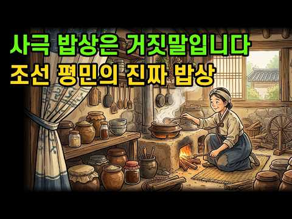
- 설명 앞부분: 본 영상은 조선시대 기록과 풍속을 바탕으로 재구성한 역사 이야기입니다. 일부 장면은 이해를 돕기 위해 극적으로 각색되었습니다. 사극 속 조선 밥상에는 하얀 쌀밥, 고기반찬, 빨간 김치가 자연스럽게 올라옵니다. 하지만 실제 조선 평민의 밥상은 우리가 생각하는 모습과 많이 달랐습니다. 쌀밥은 쉽게 먹기 어려웠고, 고기는 특별한 날에나 맛볼 수 있었으며, 지금 우리가 전통이라고 믿는 빨간 김치도 조선 전기 평민의 밥상에는 없었습니다. 그렇다면 조선시대 평민들은 무엇을 먹고 하루를 버텼을까요? 이번 영상에서는 사극에서는 잘 보여주지 않는…
- 같은 채널 평소 대비 ×53.9 (채널 최근 롱폼 중앙값 1,142회) · 평소 영상: 조선에서 가장 돈이 많았지만 자유가 없던 사람 ∣ 조선의 부자 노비 (1,142회) / 조선시대 노비가 도망치면 어떻게 됐을까? 도망노비의 충격적인 현실 (1,111회)
- 대본 없음 (설명) — 음성인식이 끝나면 도입부·흐름이 들어감
- 댓글 88/88: 좋은 점 — 영상 0 · 감사·응원 1 · 더 알고 싶은 것 2 · 아쉬운 점 — 영상 1 · 반박·불만 — 의견 다름 1 · 정치·사회 7 · 경험 공유 6 · 구독·다음 기대 0
  - 감사·응원 👍10 “70년대에도 밥그릇만 엄청 큼. 에너지원이 오로지 쌀밥뿐 그것도 정부미 먹던시절. 고기는 90년대 이후에나 좀 먹음. 70년대엔 고기가 없어서 명태국에서 명태 한조각 들어있으면 감사했지. 그 국엔 무우만 잔뜩. 정말 배고팠다. 그시절에 내 사진을 보고 울 애들이 기아…”
  - 더 알고 싶은 것 👍2 “어디에 기록되어 있는 내용일까 궁금하네요..”
  - 반박·불만 — 의견 다름 👍4 “아휴 정말이지 한국음식 너무 빨개요 김치는 말할것도 없고 지금보면 매운한식이 오래된 전통음식도 아닌데 그걸 전통이라고 지킬 가치는 없습니다.”
  - 정치·사회 👍21 “조선시대뿐만 아닙니다 박대통령 전까지 그랬습니다 저는 70넘었습니다 그래서 저는 누구보다 박정희대통령을 존경합니다 겪어봤으니까요😊”
  - 정치·사회 👍9 “그 무서운 가난을 몰아내 주신 대한민국의 위대한 박 정희 대통령. 역사가 말 한다.”
  - 경험 공유 👍35 “전 60대 초반인대 제어머니가 산에서 나물을 뜯어 죽을 만들어 드셨대요 그때는 드실게 없어 가지고 많은 예기들을 잘들었습니다 참 우리에 부모님들 고생 많이 하셨네요 저도 어릴때 보리밥 먹었는대 아버지 밥그류에 쌀밥이 그렇게 먹고 싶더라고요 지금은 너무 행복한 생활을 …”
  - 경험 공유 👍12 “제가 어렸을 땐 설날하고 추석날 소고기 먹은 기억뿐이 안 납니다.”

### 296. 제자 4명이 전국시대를 지배했다ㅣ2500년간 금서였던 귀곡자 완전해부 ∣ 역사 ∣ 세계사 ∣ 숨겨진 중국역사 ∣ 귀곡자 ∣ 손자병법 ∣ 역사인물 ∣ 오디오북

- https://www.youtube.com/watch?v=nxTN1r6q7FE · 역사깨침 · 구독자 29,800 · 조회수 642,095 (×21.6, 하루 5,688.0) · 좋아요 7,885 (1.2%) · 44.5분 · 2026-07-01 · 주제 묶음 10. 수면·낭독 · 형식 수면·낭독 (잠잘 때 듣는) · 폴더 `W_nxTN1r6q7FE` (웹 승인)
- 썸네일: 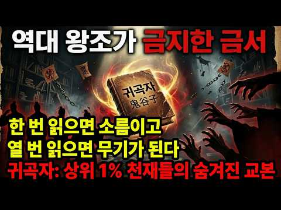
- 설명 앞부분: 공자에게는 제자가 3000명, 이 스승에게는 4명뿐이었습니다. 그런데 그 4명이 전국시대의 외교와 전쟁을 통째로 뒤흔들었습니다. 소진은 6국의 재상을 동시에 겸임하며 진나라를 15년간 봉쇄했고, 장의는 세 치 혀 하나로 그 동맹을 해체해 진나라 천하통일의 길을 열었습니다. 손빈은 두 무릎이 잘린 몸으로 천하무적 방연을 마릉 계곡에서 끝장냈고, 방연은 자기 이름이 새겨진 나무 아래서 스스로 목숨을 끊었습니다. 이 네 사람의 스승, 귀곡자. 그가 남긴 책 『귀곡자』 12편에는 사람의 마음을 읽고 움직이는 기술이 적혀 있었고, 역대 중…
- 같은 채널 평소 대비 ×11.2 (채널 최근 롱폼 중앙값 57,388회) · 평소 영상: 왜 어떤 사람 곁엔 귀인이 모이고, 어떤 사람은 배신만 당할까 ∣ 『사기』가 2000년 … (63,365회) / 칭기즈칸보다 더 무서운 정복자, 한쪽 다리를 절면서도 어떻게 세계를 떨게 했나? ∣ 35… (51,411회)
- 대본 없음 (설명) — 음성인식이 끝나면 도입부·흐름이 들어감
- 댓글 283/289: 좋은 점 — 영상 8 · 감사·응원 7 · 더 알고 싶은 것 5 · 아쉬운 점 — 영상 1 · 반박·불만 — 의견 다름 1 · 정치·사회 8 · 경험 공유 7 · 구독·다음 기대 0
  - 좋은 점 — 영상 👍5 “좋은 영상을 볼 수 있게 되어서 감사드립니다.”
  - 좋은 점 — 영상 👍2 “이런 걸 보면 늦은 나이라도 성경을 읽게 된 것이 얼마나 복된가. 어릴 때 춘추전국 시대 이야기를 제일 좋아했는데 귀곡선생 제자들 이야기도 재밌게 읽었다. 성경을 읽고보니 소진이나 장의나 다 부질 없고 악하고 악한 인간들의 복마전에 이용된 불쌍한 존재들이다. 인간의 …”
  - 감사·응원 👍50 “소진. "뭉치면 살고 흩어지면 죽는다." 더하고 합치고, 탐욕으로 배터져 죽는 돼지로 살고파요.ㅎ 왕비와 사랑은 종말의 일부 아닌가 싶고요. 사랑에는 죄가 없습니다. 소진, 장의, 방연, 손빈 스승이 '귀곡자'라는 역사, 이 영상으로 알게되었습니다. '귀곡자' 무협지…”
  - 감사·응원 👍5 “좋은 영상을 볼 수 있게 되어서 감사드립니다.”
  - 더 알고 싶은 것 👍1 “조나탄 분신 까지 Before Life Count 하면 무한인데 꼭 잡아주세요 . 부탁드립니다.”
  - 더 알고 싶은 것 👍0 “왜 영상 중간 중간에 나오는 이상한 소리가 나오나요? 텍스트 작성할때 오타가 영향을 준건가요? 이유가 뭔지 궁금하네요”
  - 반박·불만 — 의견 다름 👍3 “제자가 멍청하면 스승이 아무리 뛰어나도 빛을 발하지 못합니다. 청출어람이란 말이 괜히 있는게 아니죠. 여튼 이론을 실제로 펼쳐 행했다면 4명의 제자는 분명 그 빛을 발한 존재들임을”
  - 정치·사회 👍2 “군주의 영토욕심에 수백만의 백성이 죽는다 그중에는 어린아이도 있을 것이다 그리고 병법이란게 죄다 속임수인데 단기간에는 이익 일수 있으나 길게 보면 손해다 중국인들이 아직도 거짓말을 잘하고 사기 잘치는게 저런거의 영향이다 그렇게 병법에 능한 한족이 역사의 대부분을 북방…”
  - 정치·사회 👍0 “기록을 남기는 사람이나 나라가 승자임.손자병법 당대 권력자들은 필수 학문이라는거😅.김유신부터 삼국시대 귀족들은 필수 학문이었을거임.킹덤 이목 제거할라고 간자가 이목왕 만세 ㅋ 이목 전쟁은 이겨도 정치가 제거하게 만드는”
  - 경험 공유 👍7 “내가 죄를 저질렀어도 끝까지 결백을 주장하라. 그리고 쌩까라. 맹째맹”
  - 경험 공유 👍1 “내가 다 아는 내용을 디지털 ai로? 손 쉽네.”

### 297. 한명회보다 더 악랄했던 남자, 결국 "이렇게" 죽었다

- https://www.youtube.com/watch?v=67_mrdQlz5g · 그랬구나! · 구독자 8,870 · 조회수 190,427 (×21.5, 하루 1,131.1) · 좋아요 3,179 (1.7%) · 54.5분 · 2026-05-06 · 주제 묶음 기타 · 형식 정보·해설 (그 밖) · 폴더 `W_67_mrdQlz5g` (웹 승인)
- 썸네일: 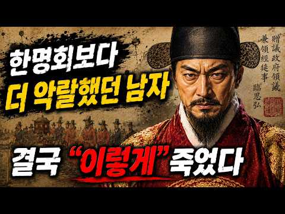
- 챕터: 0:00 인트로 — 27세의 직언가, 62세의 간신 · 1:30 출생과 가문 — 권력과 명문의 교차점 · 3:20 과거 급제 — 안 해도 되는 시험을 일부러 친 이유 · 5:10 성종의 칼 — 공신을 견제할 무기가 된 남자 · 7:30 흙비 사건 — 황사 한 줌에 인생이 부서지다 · 11:00 유배 12년 — 기록되지 않은 침묵의 시간 · 14:30 장남 임광재의 비극 — 현숙공주 독살 미수 사건 · 18:40 성종의 마지막 선물 — 딸을 보내다 · 21:30 폐비 윤씨의 진실 — 연산군은 정말 몰랐을까 · 25:00 갑자사화 — "애통하고 애통합니다" 그 한마디 · 30:20 수백 명의 피바람 — 쇄골표풍, 뼈를 바람에 날리다 · 35:00 채홍사 임사홍 — 꺾인 등뼈의 대가 · 38:30 아들 임희재의 죽음 — 실록이 침묵한 이유 · 42:00 김처선의 직언 — 환관만이 입을 열다 · 45:30 중종반정 — 칼도 아닌 몽둥이 · 49:00 결말 — 간신인가, 시대의 악역인가 · 52:30 아웃트로 — 500년째 바람이 지나는 무덤
- 설명 앞부분: 27세에 조선 최대의 권력자 한명회를 정면으로 물어뜯었던 남자. 62세에는 아들이 찢겨 죽는 것을 보면서 입을 다물었습니다. 그 사이 30여 년, 무슨 일이 있었을까요. 1472년, 스물여섯 살의 사헌부 집의가 한명회를 탄핵하는 상소를 올렸습니다. 1504년, 같은 사람이 연산군 앞에서 한마디를 흘렸고, 수백 명이 피바람에 쓸려갔습니다. 1506년, 반정군은 이 사람에게 칼로 베는 격식조차 주지 않았습니다. 조선 최악의 간신이라 불리는 임사홍. 그런데 정말 그가 '최악'이었을까요. 12년의 유배, 아들의 죽음, 그리고 권력이라는 …
- 같은 채널 평소 대비 ×39.4 (채널 최근 롱폼 중앙값 4,835회) · 평소 영상: 조선 역사상 가장 위험한 결혼, 영조가 정순왕후를 데려온 이유 (4,835회) / 이순신보다 150년 전, 세종이 문신들을 제치고 우의정에 앉힌 무신 (4,338회)
- 대본 없음 (설명) — 음성인식이 끝나면 도입부·흐름이 들어감
- 댓글 242/242: 좋은 점 — 영상 2 · 감사·응원 2 · 더 알고 싶은 것 1 · 아쉬운 점 — 영상 1 · 반박·불만 — 의견 다름 1 · 정치·사회 4 · 경험 공유 2 · 구독·다음 기대 0
  - 좋은 점 — 영상 👍27 “임사홍을 최고의 간신으로만 알고 있었는데 역사를 깊이 있게 설명해 주셔서 임사홍이란 인물을 재조명해봄니다 감사합니다”
  - 감사·응원 👍27 “임사홍을 최고의 간신으로만 알고 있었는데 역사를 깊이 있게 설명해 주셔서 임사홍이란 인물을 재조명해봄니다 감사합니다”
  - 감사·응원 👍1 “고급진 궁중사 감사하게 보고 갑니다.”
  - 더 알고 싶은 것 👍19 “아까운 인재가 시대를 잘못타고 태어나 이러지도 저러지도 못한 혈육 앞에 얼마나 가슴아리며 살았을까요? 승리한자 옆이 아니었기에 기록은 죄인으로 오명으로 남겨지는건 피할수 없는 운명이겠지요!!”
  - 아쉬운 점 — 영상 👍1 “정정하고 의로운 남자였네”
  - 반박·불만 — 의견 다름 👍4 “임사홍은악인이 아닙니다 경우가 밝은 사람시대의 비극”
  - 정치·사회 👍72 “임사홍이 희대의 간신이라고만 알고 있었는데 이영상을 보고 보고나니 그는 그시대 정치의 희생물일 가능성이 더 높군요. 삼권분립을 표방한 현재한국에서도 권력에 복종하여 엉뚱한 판결을 하는 판사들... 대통령앞에서 바른말한마디 못하는 국개나 공무원들을 보면서 과연 우리가 …”
  - 정치·사회 👍5 “역사는 승자의 뜻에 따라 쓰여지기에 연산군이 폭군이었다는 것도 의문이고 폐비 윤씨도 악랄해서 폐비된 것이 아니고 당시의 정치를 들여다보아야한다 아무리 왕의 얼굴에 상처를 내고 심하게 굴었다해도 폐비을 시킨다는 것은 말도 안된다 당시 한명회의 정치세력에서 윤씨들이 밀려…”
  - 경험 공유 👍3 “유자광 조선 최악의 간신. 임사홍은 비할바가 안된다. 연산군의 갑자사화에 임사홍이 얼마나 직접적으로 동기를 유발했는지 정확하지도 않고 실제로 임사홍이 가만 있었어도 연산군 저놈은 어차피 대량살상을 했었을 놈이다. 무엇보다 임사홍은 원래 올곧은 선비였고 유자광이는 머리…”

### 298. 사극 BL [연화 戀畫] EP.04 그대를 연모하오

- https://www.youtube.com/watch?v=LHz299QKvXU · ORUVE · 구독자 2,780 · 조회수 59,541 (×21.4, 하루 2,131.1) · 좋아요 830 (1.4%) · 5.8분 · 2026-09-24 · 주제 묶음 3. 조선 · 형식 정보·해설 (그 밖) · 폴더 `W_LHz299QKvXU` (웹 승인)
- 썸네일: 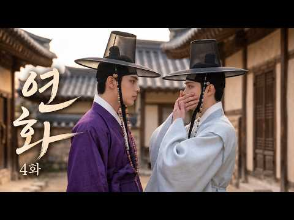
- 설명 앞부분: 예상치 못한 입맞춤 이후, 도윤은 태겸에게 선을 긋는다. 하지만 태겸은 자신의 행동을 사과하면서도 마음까지 없던 일로 하지는 않겠다고 말한다. 도윤은 선금까지 돌려보내며 거리를 두려 하지만, 그를 찾아간 태겸은 다른 이와 웃고 있는 도윤을 보고 감추지 못했던 질투를 드러낸다. 멀어지려 할수록 더 선명해지는 두 사람의 마음. 그리고 도윤 앞에는 또 다른 선택이 놓이기 시작한다. 《연화 戀畫》 사랑을 그리다. 조선시대를 배경으로 한 창작 사극 BL 드라마입니다. 등장인물과 사건은 모두 허구이며 실제 역사적 인물 및 사건과 관계가 없습…
- 대본 없음 (설명) — 음성인식이 끝나면 도입부·흐름이 들어감
- 댓글 50/50: 좋은 점 — 영상 0 · 감사·응원 0 · 더 알고 싶은 것 0 · 아쉬운 점 — 영상 0 · 반박·불만 — 의견 다름 0 · 정치·사회 0 · 경험 공유 0 · 구독·다음 기대 0

### 299. 왕의남자 감독이 만들고 주연급 배우만 10명이 나오는 역대급 명작 사극

- https://www.youtube.com/watch?v=La_DA95E-Ag · 재미난 영화  · 구독자 33,200 · 조회수 698,687 (×21.0, 하루 8,528.6) · 좋아요 3,333 (0.5%) · 44.5분 · 2026-08-01 · 주제 묶음 3. 조선 · 형식 사극·드라마·영화 리뷰 · 폴더 `W_La_DA95E-Ag` (웹 승인)
- 썸네일: 
- 같은 채널 평소 대비 ×0.9 (채널 최근 롱폼 중앙값 763,975회) · 평소 영상: 사기꾼 전도연과 간암환자 정재영에 연변깡패 오만석이 돈과 간을 찾기 위해 벌리는 쫓고쫓기… (763,975회) / 누가 죽였냐가 아니라 왜 죽였냐가 진짜 이야기인 명작 스릴러 (934,457회)
- 대본 없음 (없음) — 음성인식이 끝나면 도입부·흐름이 들어감
- 댓글 980/981: 좋은 점 — 영상 9 · 감사·응원 2 · 더 알고 싶은 것 1 · 아쉬운 점 — 영상 7 · 반박·불만 — 의견 다름 9 · 정치·사회 26 · 경험 공유 17 · 구독·다음 기대 0
  - 좋은 점 — 영상 👍28 “이 영화 명언 '호랭이는 가죽땜시 뒤지고 사람은 이름땜시 뒤지는거여' 가 참 와닿고 나이 먹어 20년 넘게 지난 지금도 깊이 남아 마음에 새겨 있습니다”
  - 좋은 점 — 영상 👍3 “자식죽이는 레전드나라”
  - 아쉬운 점 — 영상 👍0 “Ai 리마스터에요?? 화질이 겁나 거시기 해졌네요”
  - 아쉬운 점 — 영상 👍0 “저 사자대면 씬에서 아쉬웠던 건, 당나라 사자 혼자만 진지 빠니까 뭔가 따로 놀음. 8~90년대 홍콩 영화의 코메디 배우들처럼 깐죽였으면 저 자리가 더 정신없고 재밌었을 걸 하는 아쉬움.”
  - 반박·불만 — 의견 다름 👍1 “원본 영화를 보다가 하도 욕설이 적나라해서 꺼버렸는데, 한국사람들 상스러운 면에 부끄러움을 느끼지 못하는 말도 안되는 영화였음. 원본은 시청하지 말아야.”
  - 반박·불만 — 의견 다름 👍0 “고증 다 좋은데 전라도 말고 충청도 사투리였으면 더 완벽 했을텐데 백제의 수도는 충청도지 전라도가 아닙니다”
  - 정치·사회 👍3 “나당연합은 고구려는 당나라가 먹고 백제는 신라가 먹는다는 조건이었는데 당나라가 뒤통수 때림 솔직히 신라가 먼저 도움을 요청한 대상은 당나라가 아니었음 김춘추가 직접 고구려로 가서 도움을 요청했는데 거절 당하자 당나라로 감”
  - 정치·사회 👍2 “신라가 당이랑 붙어서 배신했다고 욕들 많이 하는데 저때는 한반도의 삼국은 각자 다른 나라였음 사투리라는게 사실 다른 나라 언어였던 것. 인종도 다 다를때임. 그래서 그걸 지금의 관점으로 보면 안됨. 당나라 지배층은 지금 중국 한족의 선조가 아닌 신라와 비슷한 계통인 …”
  - 경험 공유 👍50 “정치인의 전쟁, 병사로서의 전쟁 이 걸 정말 너무 현실감 있게 표현한 수작임 안타깝게도 이 당시 한국 영화가 너무너무 좋은 작품이 많아서 당시 비평가들에게 혹평을 받음 지금 봐도 재밌는 영화고 저도 많이 좋아합니다.”
  - 경험 공유 👍7 “0:55 내가 가장좋아하는 명대사중 하나입니다”

### 300. 일본이 이순신보다 두려워 했던 인물? '괴물'이라 부르며 두려워했던 조선의 영웅

- https://www.youtube.com/watch?v=Q9d1dEUVJHI · 역사스토리 · 구독자 21,700 · 조회수 442,958 (×20.4, 하루 5,840.9) · 좋아요 3,136 (0.7%) · 15.7분 · 2026-08-07 · 주제 묶음 3. 조선 · 형식 정보·해설 (그 밖) · 폴더 `W_Q9d1dEUVJHI` (웹 승인)
- 썸네일: 
- 챕터: 0:00 일본 무대에 오른 조선인 요괴 · 0:59 모쿠소는 이름이 아니었다 · 2:09 일본군이 진주로 몰려온 이유 · 3:24 하필 그 자리에 있던 사람 · 4:36 6일 동안 무슨 일이 있었나 · 5:55 승리가 확정된 순간의 유탄 · 6:48 진주가 없으면 호남이 없다 · 7:50 히데요시의 섬뜩한 명령 · 10:12 죽은 사람이 무대에 오르다 · 12:27 조선의 기록은 한 줄이었다 · 13:25 400년 만에 돌아온 교서
- 설명 앞부분: 1804년 일본 가부키 무대에 거대한 두꺼비를 탄 남자가 등장합니다. 그가 복수를 다짐한 이유는 아버지가 일본군에게 목이 잘렸기 때문인데, 그 아버지는 일본인이 아니라 조선인이었습니다. 에도 시대 일본의 연극과 소설에는 '모쿠소'라 불리는 조선 장수가 200년 가까이 단골로 등장했습니다. 산에서 솟아나 일본군을 잡아먹는 괴물, 죽어서도 일본을 저주하는 원귀로 그려진 이 인물은 이순신 장군이 아니었습니다. 모쿠소는 사람 이름이 아니라 '진주 목사'라는 직책이 일본식으로 발음된 것이었고, 그 주인공은 임진왜란 3대 대첩 중 하나인 진…
- 같은 채널 평소 대비 ×346.9 (채널 최근 롱폼 중앙값 1,277회) · 평소 영상: 조선시대 가마꾼 체험하기 ∣ 80kg 가마에 숨겨진 진실 ∣ 교군 교여지제 어연 (1,351회) / 임금이 도망친 자리에서 혼자 칼 든 의병장, 전쟁 후 역적으로 몰린 이유 (1,203회)
- 대본 없음 (설명) — 음성인식이 끝나면 도입부·흐름이 들어감
- 댓글 417/417: 좋은 점 — 영상 12 · 감사·응원 13 · 더 알고 싶은 것 2 · 아쉬운 점 — 영상 3 · 반박·불만 — 의견 다름 13 · 정치·사회 31 · 경험 공유 8 · 구독·다음 기대 1
  - 좋은 점 — 영상 👍163 “경매에 나온것 조차 국가가 못가져오고 저것도 국민들 모금으로 가져온게 레전드네 이놈의 국가꼬라지 봐라”
  - 좋은 점 — 영상 👍29 “많은 것을 생각하게 하는 이야기였습니다. 좋은 영상을 올려 주셔서 정말 고맙습니다.”
  - 감사·응원 👍29 “많은 것을 생각하게 하는 이야기였습니다. 좋은 영상을 올려 주셔서 정말 고맙습니다.”
  - 감사·응원 👍27 “김시민 장군님 감사합니다! 당신의 호국 정신을 잊지않겠습니다!”
  - 더 알고 싶은 것 👍0 “제발 누가 영화로 만들어주세요~ 호프같은거 만들지 말고... 진짜 누가보면 한국 영웅은 이순신 장군 밖에 없는줄 알아요 뒤돌아보면 어벤져스 어셈블할만큼 이리도 영웅들이 많는데 안타깝습니다”
  - 더 알고 싶은 것 👍0 “김시민 장군님이 총에 안 맞고 일본 과의 전투를 지휘했다면 임진왜란 판세는 어떻게 변했을가요??”
  - 아쉬운 점 — 영상 👍1 “7:05 그동안 조선을 괴롭히던 보급문제라...ㅋ 하 자막이거 왜그러노 Ai로 만들어놓는 거 손도 안보나... 깝깝하네”
  - 반박·불만 — 의견 다름 👍1 “2005년도 1억이 없다고? 그 시절 1억이면 큰 돈도 아닌데 공무원들 먹고 쓰고 하는데 1억이면 껌값이였을건데 한심하다 .. 70년 80년 시절도 아니고 지들끼리 치고 박고 ㅈㄹ을 잘도 하면서 부끄럽다.”
  - 정치·사회 👍63 “한국사를 소홀히 해서는 나라가 바로 설수 없다. 국영수와 동급으로 올려라”
  - 정치·사회 👍1 “국민이 주인인 나라가 진심인 나라”
  - 경험 공유 👍41 “모쿠소 김시민 목사님이 지킨 진주외성을 제가 잘 정성다해 복원 설계하겠습니다.”
  - 경험 공유 👍27 “우리나라의 역사는 왜 ? 이렇게 가슴 아픈가.? 단지 내가 한국인 이어서 그런것일까??”

### 301. 66살 할아버지 영조와 결혼한 15살 소녀 정순왕후의 최후｜한국사｜조선역사｜신유박해

- https://www.youtube.com/watch?v=_Il2QJpOgZw · 역사콕테일 · 구독자 8,260 · 조회수 167,567 (×20.3, 하루 1,391.8) · 좋아요 1,625 (1.0%) · 24.6분 · 2026-06-23 · 주제 묶음 4. 한국 근현대사 · 형식 정보·해설 (그 밖) · 폴더 `W__Il2QJpOgZw` (웹 승인)
- 썸네일: 
- 챕터: 0:00 1759년 창경궁 간택장 · 2:05 힘없는 가문의 딸, 경주 김씨가 국모로 결정된 이유 · 4:11 간택장에서 전해지는 소녀의 영리한 일화와 그 진실 · 6:37 15세 새어머니와 25세 아들 사도세자의 기묘한 관계 · 9:56 1762년 여름, 조선 왕실 최대의 비극 · 11:21 비극을 둘러싼 '어린 왕비 배후설'의 실상 · 13:34 1776년 영조의 승하와 정조의 즉위, 그리고 24년… · 16:24 1800년 정조의 갑작스러운 죽음과 쉰여섯 여인의 수…
- 설명 앞부분: 66세 영조와 혼인한 15살 정순왕후. 쉰한 살 나이 차이의 어린 신부는 어떻게 조선에서 가장 무서운 권력자가 되었을까요? 영조는 왜 하필 가장 가난한 집 딸을 골랐고, 우리가 아는 '악녀 정순왕후'의 이미지는 과연 사실일까요? 1759년, 예순여섯 살의 임금 영조는 직접 새 왕비를 골랐습니다. 그가 선택한 건 명문가의 딸이 아니라, 겨울에 멍석을 덮고 잤다는 이야기가 전해질 만큼 가난한 집안의 열다섯 살 소녀였습니다. 손녀뻘 소녀를 신부로 맞은 늙은 임금의 속셈은 무엇이었을까요. 그리고 그 어린 신부는 24년의 인내 끝에, 발 …
- 같은 채널 평소 대비 ×29.2 (채널 최근 롱폼 중앙값 5,731회) · 평소 영상: 세조가 잊지 못한다는 경혜공주의 충격적인 복수극｜한국사｜조선역사｜단종 (5,731회) / 세종도, 세조도 미친듯 사랑했던 이 여인! 알고 보니 노비..? ∣ 신빈김씨｜신분세탁｜조… (5,887회)
- 대본 없음 (설명) — 음성인식이 끝나면 도입부·흐름이 들어감
- 댓글 201/201: 좋은 점 — 영상 0 · 감사·응원 0 · 더 알고 싶은 것 0 · 아쉬운 점 — 영상 1 · 반박·불만 — 의견 다름 3 · 정치·사회 2 · 경험 공유 0 · 구독·다음 기대 0
  - 아쉬운 점 — 영상 👍3 “말이 너무 길다 지루해”
  - 반박·불만 — 의견 다름 👍13 “정순왕후는 정치력있고 중립적인 인물이지 악녀가 아닙니다 수렴청정하면서 중심을 잡은게 악녀면 권력자중 악인이 아닌 사람은 아무도 없습니다 신유박해는 조선 역사에서 미미한 천주교 박해인데 최대규모라고 하다니 팩트체크를 하고 영상을 올리십시오 조선역사상 최대 천주교 박해는…”
  - 정치·사회 👍3 “김건희네 지가 대통령인줄 알던..”

### 302. 노량해전의 숨겨진 기록에 충격! 전세계가 이순신 장군에 놀랄 수 밖에 없던 이유 #썬킴 #매불쇼 #이순신 #명량 #노량

- https://www.youtube.com/watch?v=PpJ3imzubBw · 강펀치 · 구독자 11,300 · 조회수 228,016 (×20.2, 하루 3,369.1) · 좋아요 3,881 (1.7%) · 29.6분 · 2026-08-15 · 주제 묶음 3. 조선 · 형식 정보·해설 (그 밖) · 폴더 `W_PpJ3imzubBw` (웹 승인)
- 썸네일: 
- 설명 앞부분: 오늘 영상에서는 단순히 '이순신이 승리했다'는 사실을 넘어, 왜 전 세계가 이순신 장군을 위대한 영웅으로 칭송하는지 그 이유를 파헤칩니다. 주요 내용: 임진왜란과 노량해전의 실체: 7년 전쟁으로 알려진 임진왜란의 복잡한 전개 과정과 휴전 협상, 그리고 전쟁의 마지막을 장식한 노량해전의 역사적 의미를 짚어봅니다. 특히 7천량 해전의 비극을 딛고 다시 일어선 우리 수군의 투혼을 다룹니다. 역사 속 충격적인 비하인드: 정유재란 당시 명나라군이 투입한 전력에는 아프리카 출신의 흑인 용병들을 비롯해, 적을 교란하기 위한 원숭이 부대와 중앙…
- 같은 채널 평소 대비 ×75.8 (채널 최근 롱폼 중앙값 3,010회) · 평소 영상: 뉴스공장 출연한 김민석, 거북한 이름 나오자 표정 대반전! 이낙연 꼴 된다 경고인가...… (3,010회) / 충격! 언론에서 캐나다 총리 발표를 주목하지 않은 이유... '독일 들러리 섰다'더니 K… (3,064회)
- 대본 없음 (설명) — 음성인식이 끝나면 도입부·흐름이 들어감
- 댓글 279/280: 좋은 점 — 영상 1 · 감사·응원 5 · 더 알고 싶은 것 1 · 아쉬운 점 — 영상 2 · 반박·불만 — 의견 다름 6 · 정치·사회 16 · 경험 공유 11 · 구독·다음 기대 0
  - 감사·응원 👍20 “감사함보다 시기와 질투가 판을치면 목숨을 걸고 내가 옳다는 것을 증명해야 합니다 역사는 결과를 기록 합니다”
  - 감사·응원 👍13 “너무 너무 재미있게 봤어요. 감사합니다”
  - 아쉬운 점 — 영상 👍0 “나라위해 목숨바친 숭고한 영웅이름가지고 낄낄거리면서 조롱하면 일베놈들과 뭐가다른가. 대단히 실망이다.”
  - 반박·불만 — 의견 다름 👍16 “백의종군은 이등병강등이 아닙니다.... 그냥 보직만 내려놓는거라, 전직 통제사로 예우받고 다 합니다.”
  - 반박·불만 — 의견 다름 👍0 “이긴전쟁은 아닙니다 조선전체가 초토화됐는데 일본은 잃은건 군대밖에 없는데 이겼다고하기에는 좀뭔가 이상하지않나요 한가정에 강도가들어와서 가정이 파탄나고 강도는 뒈졌음 그러면 내가 이겼다 할수있나 애초에 왜구는 바다에서 물리쳐야 이긴것이 아닌가”
  - 정치·사회 👍3 “원균 = 윤석열”
  - 정치·사회 👍3 “나라가 쑥대밭이 되고 수많은 사람들이 죽고 노예로 잡혀갔는데 그게 진짜 이긴 전쟁인가?”
  - 경험 공유 👍129 “내가 70인데 전남 영광에서는 코 귀를 베갈 때 그 당시에 이비야 ~! 라고 했답니다 그 후 일제강점기 때도 순사 온다 ~! 이비야 ~! 라고 헸다는 어른들 말씀을 기억합니다 죽을지 모르니 피하라 라는 말로 했다고 해요 이비야 ~! 나중에는 아이들 울음을 그치라는 뜻…”
  - 경험 공유 👍20 “감사함보다 시기와 질투가 판을치면 목숨을 걸고 내가 옳다는 것을 증명해야 합니다 역사는 결과를 기록 합니다”

### 303. 왜 전 세계는 같은 대홍수를 기억할까 ∣ 수메르부터 마야, 한국까지

- https://www.youtube.com/watch?v=Ci7XAox-ZRQ · 인류미터기 · 구독자 645 · 조회수 12,901 (×20.0, 하루 148.1) · 좋아요 234 (1.8%) · 19.4분 · 2026-07-27 · 주제 묶음 8. 문명·고고학 · 형식 정보·해설 (그 밖) · 폴더 `W_Ci7XAox-ZRQ` (웹 승인)
- 썸네일: 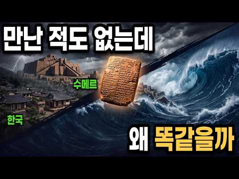
- 챕터: 0:00 노아만 방주를 탄 게 아니었다 · 0:57 1872년 런던, 판화공의 발견 · 3:41 노아와 똑같은 노인의 홍수 · 5:37 홍수 이야기의 맨 밑바닥, 수메르 · 6:56 계보 바깥의 홍수: 그리스·인도·중국 · 8:30 바다 건너 마야에도 똑같은 홍수 · 9:47 흑해 범람설, 학자들의 논쟁 · 13:41 빙하기, 실제로 바다가 차올랐다 · 17:08 우리 오누이, 가장 오래된 편지
- 설명 앞부분: 노아만 방주를 탄 게 아닙니다. 수메르인도, 그리스인도, 마야인도, 그리고 한반도의 우리 조상들도 똑같은 이야기를 남겼습니다. 하늘이 무너지고 바다가 온 세상을 삼켰다는 대홍수의 기억. 서로 만난 적 없는 문명들이 왜 똑같은 대홍수 전설을 간직하고 있을까요? 1872년, 대영박물관의 조지 스미스는 충격적인 점토판을 해독합니다. 성경보다 1,000년 이상 오래된 길가메시 서사시 속에 노아의 방주와 거의 똑같은 대홍수 이야기가 기록되어 있었죠. 이후 흑해 바닥에서 발견된 옛 해안선, 빙하기가 끝나며 120m나 잠긴 도거랜드와 페르시아…
- 같은 채널 평소 대비 ×17.7 (채널 최근 롱폼 중앙값 730회) · 평소 영상: 아무도 찾을 수 없는 곳, 칭기즈칸은 왜 자신의 흔적을 지웠나? (748회) / 인류 역사상 가장 오래된 신전, 괴베클리 테페의 진실 (712회)
- 대본 없음 (설명) — 음성인식이 끝나면 도입부·흐름이 들어감
- 댓글 49/49: 좋은 점 — 영상 0 · 감사·응원 0 · 더 알고 싶은 것 1 · 아쉬운 점 — 영상 1 · 반박·불만 — 의견 다름 4 · 정치·사회 1 · 경험 공유 2 · 구독·다음 기대 0
  - 반박·불만 — 의견 다름 👍1 “빙하기 끝나고 대륙이 나누워 지는 과정에서 늘 식량을 얻고 사냥하던곳이 멀리 떨어지는 과정을 대홍수라고 표현 한거라봄..성경이고 수메르고 다 헛소리임 괴베클리 테페는 저 이야기 있기 5000년전임!! 왜 다 파묻혀 놓고 떠났는지 이제 5% 발견했다고 함”
  - 경험 공유 👍6 “억지로 맞추지 말아요. 내가 노아의 방주를 안 것은 중등학교 영어책에 있었기 때문이요. 역사적으로 우리 역사에 그 이야기가 나온 적은 없는 것 같습니다.”

### 304. 조선 왕의 침소는 왜 가장 추웠을까, 궁녀의 방이 더 따뜻했던 이유

- https://www.youtube.com/watch?v=apLiHkAgHfY · 역사한폭 · 구독자 540 · 조회수 10,789 (×20.0, 하루 374.1) · 좋아요 17 (0.2%) · 18.6분 · 2026-09-23 · 주제 묶음 3. 조선 · 형식 정보·해설 (그 밖) · 폴더 `W_apLiHkAgHfY` (웹 승인)
- 썸네일: 
- 챕터: 0:00 궁궐에서 가장 추운 방 · 1:13 고래와 구들장, 열이 걷는 길 · 3:25 산 하나가 연기가 되던 겨울 · 5:34 강녕전, 네 겹의 추위 · 10:49 담장 너머, 세 평의 뜨거운 밤 · 12:43 궁녀의 방이 더 따뜻했던 이유 · 14:16 태평양을 건넌 온돌 · 16:19 왕이 갖지 못한 밤, 오늘의 이불 아래
- 설명 앞부분: 우리는 궁궐 하면 가장 따뜻한 방부터 떠올립니다. 두꺼운 구들장, 밤새 꺼지지 않는 아궁이, 전담 인력까지 붙은 최고 사양의 온돌이었으니까요. 그런데 그 방의 주인, 조선의 임금은 겨울마다 입김을 뿜으며 잠을 설쳤습니다. 넓은 방, 아득히 높은 천장, 바람이 스미는 창호, 그리고 안전을 위해 멀리 떨어진 아궁이. 나라 살림과 먼 산의 숲을 태워도 열은 신분을 알아보지 못했고, 궁궐에서 가장 따뜻한 밤은 오히려 궁녀들의 작은 곁방에 있었습니다. 그리고 왕이 누리지 못한 그 온기의 원리는, 훗날 태평양을 건너 미국 가정의 밤을 데우게…
- 같은 채널 평소 대비 ×4.8 (채널 최근 롱폼 중앙값 2,246회) · 평소 영상: 400년 전 조선 사람들이 먹던 김치는 왜 빨갛지 않았을까 — 잊혀진 200년의 밥상 (2,246회) / 왕이 따로 있던 섬 제주, 천 년 왕국은 어떻게 우리나라가 됐을까 (2,101회)
- 대본 없음 (설명) — 음성인식이 끝나면 도입부·흐름이 들어감
- 댓글 2/2: 좋은 점 — 영상 1 · 감사·응원 1 · 더 알고 싶은 것 0 · 아쉬운 점 — 영상 0 · 반박·불만 — 의견 다름 0 · 정치·사회 0 · 경험 공유 0 · 구독·다음 기대 0
  - 좋은 점 — 영상 👍1 “좋은영상 감사합니다!”
  - 감사·응원 👍1 “좋은영상 감사합니다!”

### 305. 우리가 몰랐던 조선시대 평민들의 충격적인 삶 ∣ 조선역사 ∣ 한국사 ∣ 조선왕조실록 ∣ 자면서 듣기 좋은 역사 이야기 ∣ 자면서 듣는 역사 이야기

- https://www.youtube.com/watch?v=IbaIAa8VCR8 · 역사킴 · 구독자 4,320 · 조회수 85,318 (×19.8, 하루 610.5) · 좋아요 678 (0.8%) · 30.3분 · 2026-06-04 · 주제 묶음 1. 역사 일반·이야기 · 형식 수면·낭독 (잠잘 때 듣는) · 폴더 `W_IbaIAa8VCR8` (웹 승인)
- 썸네일: 
- 설명 앞부분: 우리가 몰랐던 조선시대 평민들의 충격적인 삶
- 같은 채널 평소 대비 ×59.1 (채널 최근 롱폼 중앙값 1,443회) · 평소 영상: 조선시대 사람들의 충격적인 탈모 이유 ∣ 조선역사 ∣ 한국사 ∣ 조선왕조실록 ∣ 잠잘 때… (1,443회) / 영화 '왕사남' 속 단종과는 달랐던 사실?! 단종의 진짜 이야기 ∣ 조선역사 ∣ 한국사 … (1,140회)
- 대본 없음 (설명) — 음성인식이 끝나면 도입부·흐름이 들어감
- 댓글 75/77: 좋은 점 — 영상 1 · 감사·응원 1 · 더 알고 싶은 것 1 · 아쉬운 점 — 영상 1 · 반박·불만 — 의견 다름 1 · 정치·사회 0 · 경험 공유 2 · 구독·다음 기대 0
  - 좋은 점 — 영상 👍2 “ㅡ0건강,면역성에서 가장중요한게..공기다. 특히.. 본인이 가장 오래 머무는 실내공간의 공기가 맑은가..시멘트라돈가스와 화학가스에 오염되어 있는가에 따라서..호흡을통해..오염된 독성공기가 폐로들어가서 혈액을 오염시켜.. 병들이고, 독성화시키면서..혈액세포를 병들이고.…”
  - 더 알고 싶은 것 👍0 “금줄... 자세히 알려주세요. 조선 후기에 고추가 온걸로 아는데 그전엔 남자는 멀 걸었나요?”
  - 아쉬운 점 — 영상 👍8 “애니메이션 이. 일본. 캐릭터예요 . 머리가. 일본 머리모양이예요 .아쉽네요 중간중간. 틀려요. 모자도 요.”
  - 반박·불만 — 의견 다름 👍2 “ㅡ0건강,면역성에서 가장중요한게..공기다. 특히.. 본인이 가장 오래 머무는 실내공간의 공기가 맑은가..시멘트라돈가스와 화학가스에 오염되어 있는가에 따라서..호흡을통해..오염된 독성공기가 폐로들어가서 혈액을 오염시켜.. 병들이고, 독성화시키면서..혈액세포를 병들이고.…”
  - 경험 공유 👍3 “사실 우리나라의 온돌 문화는 책에서는 고조선 시대때부터 온돌이 있었다고 나와 있어서 고조선 시절부터 모든 백성들이 온돌 난방을 했던것처럼 알고 있지만 우리나라의 온돌 난방은 조선시대때도 왕족들과 극히 일부 사대부 권력층들만 온돌 난방을 했었고 대부분의 백성들은 화로만…”

### 306. 왜 11살 꼬마며느리는 망한 집에 웃으며 시집왔을까? 그 정체는? ∣ 야담 ∣ 조선시대 ∣ 오디오북 ∣ 전설 민담

- https://www.youtube.com/watch?v=S0fim5zCQbI · 달빛잠자리이야기 · 구독자 15,700 · 조회수 307,590 (×19.6, 하루 2,183.7) · 좋아요 7,345 (2.4%) · 57분 · 2026-06-03 · 주제 묶음 3. 조선 · 형식 수면·낭독 (잠잘 때 듣는) · 폴더 `W_S0fim5zCQbI` (웹 승인)
- 썸네일: 
- 설명 앞부분: "곧, 굶어 죽을 집구석에 시집오면서 왜 저리 입이 귀에 걸렸을꼬?" 망해가는 가문을 조선 최고 부자로 만든 11살 꼬마 민며느리의 기막힌 반전! 지금 그 통쾌하고 따뜻한 성공 신화가 펼쳐집니다. 👇👇 📜 [달빛잠자리이야기 역사 한스푼 (고증 자료) 1. 조선 시대의 민며느리(조혼) 풍습 2. 10대 장원 급제가 가능했을까? 3. 정경부인(貞敬夫人)의 위상 정경부인은 조선 시대 문무관의 처에게 내리던 명명 직첩 중 최고 등급인 '정·종 1품' 여인에게 주어지는 최고의 명예였습니다. 오늘날로 치면 국무총리나 장관급 인사의 부인에게 …
- 같은 채널 평소 대비 ×28.9 (채널 최근 롱폼 중앙값 10,631회) · 평소 영상: 🌡️ 한여름, 시댁 대청마루를 뜯어낸 못말리는 꼬마 며느리 ∣야담∣ 옛날이야기∣ 민담∣ … (10,631회) / 병든 서방 살리러 싱글벙글 시집 온 꼬마 며느리의 정체는? ∣ 야담 ∣ 조선시대 ∣ 오디… (11,845회)
- 대본 없음 (설명) — 음성인식이 끝나면 도입부·흐름이 들어감
- 댓글 338/342: 좋은 점 — 영상 2 · 감사·응원 42 · 더 알고 싶은 것 1 · 아쉬운 점 — 영상 0 · 반박·불만 — 의견 다름 1 · 정치·사회 4 · 경험 공유 3 · 구독·다음 기대 0
  - 좋은 점 — 영상 👍1 “즐청했습니다😊 다음에도 좋은 이야기 부탁 드립니다. P.S 한가지 조정 해야 할 것이 있네요. 중간 중간 말이 끊김이 좀 있고 울림이 있어요”
  - 좋은 점 — 영상 👍0 “좋은 이야기 입니다 ^^”
  - 감사·응원 👍12 “참대단한향이화이팅.웃으면복이와요.최만당이길들이기참시원하내요.향이와.할아버님.❤❤❤❤❤”
  - 감사·응원 👍8 “감탄 스럽고 꼬마 신부가 큰복덩이가 최씨집안을 우뚝세운 효부로다 ❤ 유친하고 설정하고 응원합니다 선물 🎁”
  - 반박·불만 — 의견 다름 👍6 “서울종로익선동에서잘듣고있지요”
  - 정치·사회 👍5 “여기주인장도 중국인이네 아놔”
  - 정치·사회 👍1 “중국인들의 👀 유튜브였구나!”
  - 경험 공유 👍0 “향이에 지혜가 지금 이나라에 필요할때 인거 같습니다. 자기 자신만을 생각하는 정치인들을 보고있자니 후손들 한태 미안하다. 다수를 위한다고 생각없는 정치인들 내가 그냥 웃는다”
  - 경험 공유 👍0 “대과다그가. 뭡니까 ?우리들이 알아듣지도 못하는 말. 하지마시오 재밌게. 잘. 듣다가. 마음이. 싸해지며. 듣기 싫소.. 알아듣지도 못하는 중국말. 또하네 당신. 나라가서. 싫컷 하라구 ~ 에이. 짜증나 내가. 몇시간을. 뭐한거야 중국말. 듣자고 시청하는줄. 알아 시…”

### 307. 한글날 특집 ∣ 외국인이 한글을 읽고 놀란 순간… 세종대왕이 열어 준 길

- https://www.youtube.com/watch?v=FziT13rkQ8I · 국뽕살롱 · 구독자 823 · 조회수 16,102 (×19.6, 하루 1,201.8) · 좋아요 75 (0.5%) · 14.4분 · 2026-10-08 · 주제 묶음 3. 조선 · 형식 정보·해설 (그 밖) · 폴더 `W_FziT13rkQ8I` (웹 승인)
- 썸네일: 
- 챕터: 0:00 처음 읽는 순간 · 1:57 세종이 열어 준 길 · 3:43 글자가 소리가 되다 · 7:40 실수해도 시작할 수 있다 · 10:15 낯선 도시를 읽는 길 · 12:45 우리가 매일 쓰는 기적
- 설명 앞부분: 10월 9일 한글날 특집. 처음 한글을 읽고 스스로 놀라는 외국인들의 실제 반응으로, 세종대왕이 훈민정음에 담으신 뜻을 돌아봅니다. 2026년은 훈민정음 반포 580주년, 한글날을 처음 기념한 지 100년이 되는 해입니다. 처음에는 낯선 기호였던 글자가, 어느 순간 익숙한 단어로 읽힙니다. ‘엘모·토토로·미키’ 이름 읽기, 친구와 배우는 ‘지수·안녕’, 한국 여행의 간판과 메뉴까지. 실제 원본 5편 속 시도와 웃음, 솔직한 어려움을 따라갑니다. ‘읽을 수 있다’는 작은 변화는 누구에게나 글을 익혀 일상에서 쓰도록 하려 했던 세종대…
- 같은 채널 평소 대비 ×61.2 (채널 최근 롱폼 중앙값 263회) · 평소 영상: 다인실 예약했는데 나 혼자? 부산 밤배를 탄 외국인의 뜻밖의 반응 (263회) / 한국 찜질방에서 하룻밤… 세 팀의 외국인 반응이 갈린 이유 (89회)
- 대본 없음 (설명) — 음성인식이 끝나면 도입부·흐름이 들어감
- 댓글 12/12: 좋은 점 — 영상 0 · 감사·응원 0 · 더 알고 싶은 것 0 · 아쉬운 점 — 영상 0 · 반박·불만 — 의견 다름 1 · 정치·사회 0 · 경험 공유 0 · 구독·다음 기대 0
  - 반박·불만 — 의견 다름 👍1 “제발 ~~~ 십월 구일은 아니죠. 시월 구일입니다. 제대로 한글을 ~~~”

### 308. 자객들에 쫓기던 왕비를 절벽으로 밀어버린 천재아이∣ 야담 ∣ 조선시대 ∣ 오디오북 ∣ 전설 민담

- https://www.youtube.com/watch?v=aI8A973spEw · 전해들은 야담 · 구독자 41,000 · 조회수 801,182 (×19.5, 하루 5,240.2) · 좋아요 20,649 (2.6%) · 82.4분 · 2026-05-22 · 주제 묶음 3. 조선 · 형식 수면·낭독 (잠잘 때 듣는) · 폴더 `W_aI8A973spEw` (웹 승인)
- 썸네일: 
- 설명 앞부분: 본 영상은 ai를 활용하였지만 등장인물을 인형으로 직접 오리고 제작하여 직접 촬영 및 연출한 영상이 사용되는 인형극 영상입니다 전해들은 야담이 새롭게 각색하고 재구성한 창작 콘텐츠입니다. 이야기의 몰입도를 높이기 위해 등장인물의 이름과 지명 등 일부 설정은 가공되었음을 알려드립니다. 전해들은 야담은 바쁜 세상살이에 지친 여러분이 잠시 발걸음을 멈추고 쉬어갈 수 있는 작은 이야기 쉼터입니다. 교과서에는 실리지 않은 기이하고도 흥미로운 야담과 야사, 우리 조상들의 해학이 담긴 민담, 그리고 역사 뒤편에 숨어 있던 비밀스러운 이야기들을…
- 같은 채널 평소 대비 ×20.9 (채널 최근 롱폼 중앙값 38,260회) · 평소 영상: 관상보는 천재아이, 잠행중인 임금인 줄 모르고 "왕이 될 상이네?" ∣ 야담 ∣ 조선시대… (38,260회) / 남편이 장원급제후 병든 아내를 호랑이굴에 버리자, 아내가 갑자기 웃음을 터뜨리는데..∣ … (42,127회)
- 대본 없음 (설명) — 음성인식이 끝나면 도입부·흐름이 들어감
- 댓글 748/750: 좋은 점 — 영상 6 · 감사·응원 51 · 더 알고 싶은 것 4 · 아쉬운 점 — 영상 11 · 반박·불만 — 의견 다름 5 · 정치·사회 1 · 경험 공유 7 · 구독·다음 기대 0
  - 좋은 점 — 영상 👍3 “바쁜 하루 중에 잠시 쉬어갈 수 있는 좋은 이야기 쉼터 같네요.”
  - 좋은 점 — 영상 👍2 “오랜만에 정말 시간 가는 줄 모르고 들었습니다. 옛이야기는 들을수록 새로운 매력이 있는 것 같네요. 좋은 영상 감사합니다.”
  - 감사·응원 👍47 “흥미롭네요 잘 들었어요 감사합니다”
  - 감사·응원 👍35 “인천논현동에서ㆍ 잘듣고 잇어요ㆍ 감사합니다”
  - 더 알고 싶은 것 👍11 “국문학과나오셨나봐 창작잘들었습니다 또올려주세요 귀가자꾸끌려갑니다”
  - 더 알고 싶은 것 👍2 “어디서 듣는지 궁금한 이유가 뭔가요? 침대에서 듣고 있긴 합니다만? ?”
  - 아쉬운 점 — 영상 👍10 “낚시하면서 듣고 있어요 😊”
  - 아쉬운 점 — 영상 👍1 “목소리가 너무 좋으셔서 듣는 내내 몰입했어요! 스토리도 흥미진진하고 재미있네요 👍”
  - 반박·불만 — 의견 다름 👍19 “서울종로익선동에서듣고있지요”
  - 반박·불만 — 의견 다름 👍5 “야담같은소리는 헛소리다”
  - 정치·사회 👍4 “정부의 선거를 앞둔 강압이 작용하지 않았을까 생각됩니다.”
  - 경험 공유 👍4 “서울에서 듣고있는데 우리남편이 부안이예요 와우 반가워요~”
  - 경험 공유 👍3 “저도 약수동에서 듣고있어요 ^^”

### 309. 400년 전 명군 후손들이 지금도 한국에 살고 있다는 충격적 진실

- https://www.youtube.com/watch?v=8hxGkzijJTc · 브라이언 히스토리 · 구독자 1,050 · 조회수 20,506 (×19.5, 하루 125.9) · 좋아요 389 (1.9%) · 13.1분 · 2026-05-12 · 주제 묶음 1. 역사 일반·이야기 · 형식 정보·해설 (그 밖) · 폴더 `W_8hxGkzijJTc` (웹 승인)
- 썸네일: 
- 챕터: 0:00 충격적 개막 - 10만 명의 비밀 · 2:30 역사의 무대 - 1592년 임진왜란 · 5:15 운명의 갈림길 - 명군들의 선택 · 8:45 첫 번째 가문 - 석씨 가문의 비극 · 12:20 두 번째 가문 - 진씨 가문의 의리 · 15:50 세 번째 가문 - 두씨 가문의 그리움 · 19:10 네 번째 가문 - 편씨 가문의 전공
- 설명 앞부분: 지금 이 순간, 당신 옆에서 살아가는 10만 명의 사람들이 간직한 놀라운 비밀! 400년 전 명나라에서 온 그들이 조선에 남은 진짜 이유는 무엇일까요? 이 영상에서 알게 되는 것: 임진왜란 때 조선을 구하러 온 명군들의 숨겨진 이야기 명군 후손들이 지금도 한국에 살고 있는 충격적 진실 고국을 버리고 조선에 뿌리내린 명장들의 선택 400년간 이어져 온 명군 후손들의 삶과 문화 🕒 타임라인:
- 같은 채널 평소 대비 ×33.5 (채널 최근 롱폼 중앙값 612회) · 평소 영상: 조선 왕들이 궁궐 귀신에 벌벌 떤 충격 실록 기록 (614회) / 조선 형벌에 징역형이 없었다고?! 충격적인 역사 (609회)
- 대본 없음 (설명) — 음성인식이 끝나면 도입부·흐름이 들어감
- 댓글 133/133: 좋은 점 — 영상 0 · 감사·응원 0 · 더 알고 싶은 것 2 · 아쉬운 점 — 영상 2 · 반박·불만 — 의견 다름 5 · 정치·사회 26 · 경험 공유 5 · 구독·다음 기대 0
  - 더 알고 싶은 것 👍8 “그런데 왜 해방 이후 한반도에 남은 일본인들에 대한 얘기는 다들 쉬쉬하는지 궁금하네요~~”
  - 더 알고 싶은 것 👍5 “편갈송 장군입니다. 편갈장군이 아니라~ 수정 부탁드려요. ^^ 전쟁후 아들 3형제가 아버지를 모시기 위해 조선으로 넘어왔고 그 자손들이 정착했습니다. 인구는 2015년 기준 16,689명이라고 나무위키에 나오네요.”
  - 아쉬운 점 — 영상 👍0 “ㅡ타민족 유입 한반도 인구 늘어나 수만은 후손들이 대한민국 발전 에 뿌리가 된겄이다 족보가 빛나는 가문들이 줄줄이 들어 왔다 그래서 인류는 하나다 인종 차별 21세기는 하는 시대는 끝난 겄이다 특히 아시아 한중 몽고 일부는 고조선 우리 민족이다 일본도 일부 삼별초ㆍ백…”
  - 반박·불만 — 의견 다름 👍6 “우리는 엄청난 다민족이예요~~ 겨우 400년?? 어이없어. 전쟁때마다 다 섞인다고요!!!”
  - 반박·불만 — 의견 다름 👍3 “한국이 다문화인건 석기시대부터지 조선때부터가 아닙니다. 석기시대, 청동기시대에 백인들도 살았어요. 단군조선의 도읍도 지금의 중국 하북성 북경 근처에 있었어요. 기자도 중국에서 온 사람이고 위만도 중국에서 왔고 중국에서 온 사람들이 고조선시대, 삼한시대 삼국시대 고려시…”
  - 정치·사회 👍66 “명군 후손이든 일본 장수의 후손이든 베트남 왕자의 후손이든 지금 한국인이라는 정체성이 중요하죠. 조선족들이 한국에 들어와서 정착을 해도 중국인이라고 떠들고 다닌다면, 그들은 명백한 중국인입니다.”
  - 정치·사회 👍27 “중국에서 왔다고 다 중국인일까? 그럼 백제 고구려 신라의 옛 영토 중국땅 사람들은 다 중국인이야?”
  - 경험 공유 👍3 “고등학교다닐때 같은반친구 석영준이 생각나네 울산 학성타운 같은아파트단지에서 1년 살았는데 그러다가 우리집이 울산대쪽으로 이사를가서”
  - 경험 공유 👍3 “아니 겨우 400년된 귀화성이 인구가 16000? ㅋㅋ 진짜 웃기네요. 수천년 이어온 신라 8박 혹은 9박 경명왕계 박씨본관 우리집안이 인구가 겨우 35,000명인데. 무슨 용 써는 재주가 탁월한가 ? 아니면 재산을 송금해서 가져온건가 ?”

### 310. 왕이 되어 약속을 지키러 돌아왔는데, 정혼녀는 날 거지 취급했다… 진짜 은인은 그녀의 동생이었다!

- https://www.youtube.com/watch?v=Pl3jaa_L3Pw · 역전 극장 · 구독자 20,500 · 조회수 396,186 (×19.3, 하루 14,309.5) · 좋아요 2,380 (0.6%) · 119.3분 · 2026-09-24 · 주제 묶음 기타 · 형식 몰아보기·통합본 (긴 영상) · 폴더 `W_Pl3jaa_L3Pw` (웹 승인)
- 썸네일: 
- 챕터: 0:00 새 왕의 귀환 — 이훤, 약속했던 여인을 중전으로 맞… · 20:10 왕을 가둔 탐관오리 — 신분을 모른 채 이훤을 짓밟는… · 40:05 목숨을 건 진짜 은인 — 박청현이 이훤을 지키다 쓰러… · 60:08 가례연의 덫 — 왕을 조롱한 권문세가들이 스스로 한자… · 80:12 왕의 분노 — 군권까지 등에 업은 탐관오리들과 이훤의…
- 설명 앞부분: 💔거지인 줄 알고 버린 정혼자, 알고 보니 조선의 왕이었다! 그날 탐관오리 가문이 무너졌다... 도시 역전, 복수 반격, 재벌 상속! 통쾌한 남자 중심 숏드라마를 만날 수 있는 역전 극장입니다. 짜릿한 반전과 몰입감 넘치는 전개, 매일 업데이트되는 인기 숏드라마를 지금 바로 만나보세요! 🔥새 왕조의 주상 이훤은 과거 굶어 죽을 위기에 놓였던 자신을 구해 주고 혼인을 약속했던 여인을 중전으로 맞이하기 위해 신분을 숨긴 채 고향 제양군으로 돌아온다. 하지만 그를 기다리고 있을 것이라 믿었던 박화진은 초라한 차림의 이훤을 거지 취급하며…
- 같은 채널 평소 대비 ×58.9 (채널 최근 롱폼 중앙값 6,730회) · 평소 영상: 여동생이 제물로 끌려가고 영근까지 빼앗겼다… 폐급 검수의 신급 검체 각성! (6,956회) / 모두가 죽었다 믿은 무패의 군신, 기억을 잃고 돌아와 재벌가를 뒤집었다! (6,503회)
- 대본 없음 (설명) — 음성인식이 끝나면 도입부·흐름이 들어감
- 댓글 159/253: 좋은 점 — 영상 0 · 감사·응원 4 · 더 알고 싶은 것 0 · 아쉬운 점 — 영상 9 · 반박·불만 — 의견 다름 4 · 정치·사회 10 · 경험 공유 3 · 구독·다음 기대 0
  - 감사·응원 👍8 “이거 짤만보고 끝까지못봐서 찾다가 완본없어서아쉬웟는데 감사😊”
  - 감사·응원 👍2 “영상 감사 합니다. 👍👍👍👏👏👏 ❤❤❤❤❤❤❤”
  - 아쉬운 점 — 영상 👍4 “영상은 잘만었네요 2시간을 지루함 없이 잘봐씁니다.”
  - 아쉬운 점 — 영상 👍3 “중국거 처럼 질질 끌고 말도 않되는 상황이 많네여 보실분들은 다 넘기고 결론만 보세요”
  - 반박·불만 — 의견 다름 👍0 “이거 배경만 우리나라지, 전형적인 중국 스토리. 이렇게 유치 찬란한 어이없는 스토리가 처음부터 끝까지 이어짐.”
  - 반박·불만 — 의견 다름 👍0 “왕이 멍청멍청 고구마열매 먹었나..그리고 중국에서 만들어 그런가 말도안돼는 억지억지 우격다짐과 꽥꽥 소리지르기..극한까지 몰고 간다고 너무 억지..중국판만 보다 한국판으로 보는데도 역시 말도 안돼..”
  - 정치·사회 👍2 “ㅋㅋ. 위계가 고증이 안됨. 현대판 훌륭하신 이재명. 대통령님.”
  - 정치·사회 👍0 “계속 소리만 지르고 앞으로 감기 않했으면 2시간동안 같은 내용반복할뻔 했네 저런놈이 왕이니 나라가 저지경이지~~ㅋㅋ”
  - 경험 공유 👍0 “30분을 내가 주상이다 기다림 ㅋ”
  - 경험 공유 👍0 “너 내가 누군지 몰라? 니 상관 데려와. 너도 나 몰라? 니 상관 데려와. 너도 나 몰라? 니 상관 데려와. 반복하다 쨔란! 나 사실 왕임”

### 311. 제1차 세계대전 최악의 소모전, 베르됭 전투 3D ∣ 완전판

- https://www.youtube.com/watch?v=34eZlgvSfDM · 에픽히스토리 코리아 · 구독자 24,600 · 조회수 475,281 (×19.3, 하루 7,681.0) · 좋아요 2,769 (0.6%) · 40.1분 · 2026-08-21 · 주제 묶음 7. 전쟁·군사사 · 형식 정보·해설 (그 밖) · 폴더 `W_34eZlgvSfDM` (웹 승인)
- 썸네일: 
- 설명 앞부분: 1916년 2월 21일, 독일군의 대포 1,000문이 베르됭 일대의 프랑스군 진지를 향해 포격을 시작했다. 인류 역사상 가장 참혹한 전투 중 하나인 베르됭 전투의 시작이었다. 300일 동안 이어진 전투에서 매일 평균 1,000명이 목숨을 잃었다. 독일군은 프랑스군을 소모전으로 끌어들여 피를 말리려 했지만, 프랑스군은 “그들은 통과하지 못한다”는 결의 아래 필사적으로 맞섰다. 정교한 3D 그래픽을 통해 베르됭이 전략적으로 중요했던 이유와 프랑스 동부를 지키던 요새망, 두오몽 요새를 둘러싼 사투, 그리고 독일군과 프랑스군의 치열한 공…
- 같은 채널 평소 대비 ×10.9 (채널 최근 롱폼 중앙값 43,554회) · 평소 영상: [나폴레옹 전쟁 시리즈] 1807년 아일라우 전투 (43,554회) / 넬슨의 해전 3D: 코펜하겐 해전 1801 (39,390회)
- 대본 없음 (설명) — 음성인식이 끝나면 도입부·흐름이 들어감
- 댓글 151/152: 좋은 점 — 영상 3 · 감사·응원 6 · 더 알고 싶은 것 2 · 아쉬운 점 — 영상 1 · 반박·불만 — 의견 다름 1 · 정치·사회 2 · 경험 공유 5 · 구독·다음 기대 2
  - 좋은 점 — 영상 👍6 “당시 영상과 사진으로만 설명 되던걸 이렇게 보니 한눈에 이해가 잘 되네요.. 좋아요~~”
  - 좋은 점 — 영상 👍0 “오랜만에 정말 아주 잘 짜여진 내용을 알기쉽게 설명해 주어 너무 고맙습니다”
  - 감사·응원 👍0 “에픽채널 영어로 겨우 듣다가 번역본 들으니 넘 좋네요 퀄리티가 넘사벽입니다. 감사드립니다.”
  - 감사·응원 👍0 “오랜만에 정말 아주 잘 짜여진 내용을 알기쉽게 설명해 주어 너무 고맙습니다”
  - 더 알고 싶은 것 👍30 “와 엄청나네요 퀄리티가... 이런 영상만 찾아보는데 제가 본 것들 중에서 1위네요 다른 1차대전 2차대전 대평양전쟁 대규모 전투도 다뤄주시면 좋겠어요”
  - 더 알고 싶은 것 👍0 “내용도 좋고 매우 잘 만들어져 있습니다 다만 배경음악을 다른 것을 써 주세요. 또 나레이션이 있을 때와 그 시이사이의 음량차이가 너무 큽니다. 음압이 너무 커서 피로도가 큽니다. 조정 부탁드립니다”
  - 아쉬운 점 — 영상 👍1 “영상이 존나 지겹습니다. 했던말 계속 언급 반복하면 넘 지루하져”
  - 정치·사회 👍0 “(약 26분 31초까지 보던 중에 문득) 샤를 드골 전 프랑스 대통령이 이 전투에 참전했다가 독일군에 포로로 붙잡히게 되었죠.”
  - 정치·사회 👍0 “전쟁이란 딱 한명의 미치광이가 일으키고 수천만명이 영문도 모른 채 학살 당하는 것이다.... 러우전쟁은 푸틴, 중동전쟁은 네타냐후, 이란전쟁은 트럼프.... 이것들이 미치광이들!!!! 우리도 하마터면 윤석열 때문에 전쟁날 뻔!!!! 베르됭 전투에서 사망한 병사 수는 …”
  - 경험 공유 👍30 “와 엄청나네요 퀄리티가... 이런 영상만 찾아보는데 제가 본 것들 중에서 1위네요 다른 1차대전 2차대전 대평양전쟁 대규모 전투도 다뤄주시면 좋겠어요”
  - 경험 공유 👍0 “서로를 죽여야 내가 살고 끝없이 죽고 죽는 가운데 사람은 존재의미를 잃고 악마가된다”
  - 구독·다음 기대 👍0 “고퀄이네 구독합니다”
  - 구독·다음 기대 👍0 “구독합니다 정말 감동적으로 잘 소재를 선정하고 만드신 영상이네요”

### 312. "조선 최고의 천재다" 전세계가 세종대왕이 만든 한글을 극찬하는 이유

- https://www.youtube.com/watch?v=T2Z6frSqJrs · 한반도 백과사전 · 구독자 4,810 · 조회수 92,177 (×19.2, 하루 6,051.7) · 좋아요 494 (0.5%) · 19.5분 · 2026-10-07 · 주제 묶음 3. 조선 · 형식 정보·해설 (그 밖) · 폴더 `W_T2Z6frSqJrs` (웹 승인)
- 썸네일: 
- 챕터: 0:00 500년 만에 발견된 설계도의 비밀 · 1:00 훈민정음 해례본, 왜 특별할까? · 2:20 사람의 몸에서 탄생한 자음 · 3:41 모음은 세상의 이치를 담았다? · 5:44 한글이 세계 최고인 진짜 이유 · 7:16 세종대왕은 왜 혼자 창제했나? · 11:08 백성을 향한 세종의 고집 · 13:06 어떻게 우리 글자가 되었을까? · 14:54 우리가 한글날을 기념하는 이유 · 15:53 디지털 시대의 천재적 설계 · 17:39 잘못 알려진 한글의 기록들 · 18:23 한글, 우리 삶을 바꾼 위대한 힘
- 설명 앞부분: 🇰🇷세종대왕은 왜 하필 28자로 만들었을까? 세계 언어학자들이 한글을 극찬하는 진짜 이유 1940년 안동에서 마침내 모습을 드러낸 『훈민정음 해례본』은 한글이 사람의 발음 기관을 본떠 철저히 공학적으로 설계된 문자라는 사실을 세상에 알렸습니다. 1443년 창제 이후 450년 동안 백성들의 삶과 문화 속에 깊이 스며든 한글은, 1894년 고종의 칙령 제1호(공문식 제14조)를 통해 마침내 한반도의 정식 공용 문자로 선포되는 역사적 반전을 맞이합니다. 세계적 학자인 재레드 다이아몬드와 제프리 샘슨이 "인류가 만든 가장 독창적이고 완벽…
- 같은 채널 평소 대비 ×4.7 (채널 최근 롱폼 중앙값 19,649회) · 평소 영상: "한국의 시민의식은 세계 1위" 세계가 한국 주차장 풍경에 극찬하는 이유 (19,861회) / “속도와 성질머리로 성공한 민족” 전세계 학자들이 분석하고 극찬한 한국의 진짜 성공 이유 (19,437회)
- 대본 없음 (설명) — 음성인식이 끝나면 도입부·흐름이 들어감
- 댓글 28/28: 좋은 점 — 영상 1 · 감사·응원 1 · 더 알고 싶은 것 0 · 아쉬운 점 — 영상 0 · 반박·불만 — 의견 다름 0 · 정치·사회 2 · 경험 공유 0 · 구독·다음 기대 0
  - 감사·응원 👍5 “참으로 대단한 어르신 입니다 세종대왕님 정말 감사합니다~ 잘 설명해주신걸 들으니 가슴이 뜨거워지는 느끼이네요~ 감사합니다 ~”
  - 정치·사회 👍0 “세종대왕 릉이 미국에 있습니다. 조선 임금님이 계신 한양이 워싱턴 디씨였고 중국이였다 일월오봉도 배경이 워싱턴 디씨 포토맥강이 조선의 한강 임진왜란은 미국에서 전쟁이었다 홍무정운 아메리카 대조선, 57, 아메리카 사도세자 저자 박인수 조지 워싱턴 = 사도세자 토마스 …”

### 313. 세종대왕이 600년 전 숨겨둔 비밀 ∣ 지금 전 세계가 뒤집힌 이유

- https://www.youtube.com/watch?v=JLOhGgZAKeA · 이상하TV · 구독자 12,400 · 조회수 235,816 (×19.0, 하루 4,371.8) · 좋아요 2,016 (0.9%) · 22.1분 · 2026-08-29 · 주제 묶음 3. 조선 · 형식 정보·해설 (그 밖) · 폴더 `W_JLOhGgZAKeA` (웹 승인)
- 썸네일: 
- 챕터: 0:00 600년 전 한글의 비밀 · 1:20 세계 문자와 한글의 차이 · 2:46 세종대왕이 글자를 만든 이유 · 5:05 과학적으로 설계된 자음 · 7:15 소리와 획의 놀라운 규칙 · 10:23 한글 창제를 둘러싼 반대 · 12:17 사라질 뻔한 해례본 · 14:30 디지털 시대에 빛난 한글 · 18:48 국경을 넘어선 한글
- 설명 앞부분: 매일 스마트폰 자판을 두드리는 순간에도 600년 전 세종대왕의 설계가 작동하고 있습니다. 한글은 누가, 왜, 어떤 원리로 만들었는지가 기록으로 남은 특별한 문자입니다. 하지만 그 위대한 글자는 탄생부터 환영받은 것은 아니었고, 창제 원리를 담은 책마저 역사 속에서 사라질 위기를 겪었습니다. 한글이 오늘날 세계의 주목을 받게 된 과정을 끝까지 확인해 보세요.
- 같은 채널 평소 대비 ×52.1 (채널 최근 롱폼 중앙값 4,530회) · 평소 영상: "동해바다를 통째로 메워버렸다" 산 하나 깎아 만든 울릉공항, 2028년 개항 앞두고 전… (4,619회) / "사막에서 버려지는 외제차, 한국 트럭만 살아남았다" 한 대 250만 원에 팔고도 12조… (4,442회)
- 대본 없음 (설명) — 음성인식이 끝나면 도입부·흐름이 들어감
- 댓글 68/68: 좋은 점 — 영상 0 · 감사·응원 10 · 더 알고 싶은 것 0 · 아쉬운 점 — 영상 2 · 반박·불만 — 의견 다름 2 · 정치·사회 4 · 경험 공유 1 · 구독·다음 기대 0
  - 감사·응원 👍22 “그져고개숙여 감사합니다라고 할뿐 감사합니다.”
  - 감사·응원 👍20 “우리 한민족은 지혜롭고 똑똑한 민족입니다 우리 손주들을 보면 너무 너무 예쁩니다 자손이 예뻐야 후손도 더 잘 되지 않을까요 너무너무 감사하고 너무 사랑했어요”
  - 아쉬운 점 — 영상 👍2 “비슷한 얘기 이곳저곳 채널에서 계속 반복해서 올리는 이유가 무엇인가,,,,,,?”
  - 아쉬운 점 — 영상 👍0 “중국 한자 아닙니다. 정정요. 신라,백제,고리가 다 말이 틀리니 지역마다 말이 틀린거구요.”
  - 반박·불만 — 의견 다름 👍0 “우리의 자랑 한글은 고작 15세기의 문자가 아닙니다 4천2백년의 오랜 역사를 자랑합니다 그렇게 위대한 문자 한글을 세종은 자신의 업적으로 꾸미면서 매우 초라하게 축소시켜 버렸지요 한글은 고조선 3세 가륵단군의 명을 받은 을보륵님에 의해 창제 되어 사용되며 발전해 왔습…”
  - 반박·불만 — 의견 다름 👍0 “중국 한자 아닙니다. 정정요. 신라,백제,고리가 다 말이 틀리니 지역마다 말이 틀린거구요.”
  - 정치·사회 👍4 “중국인들이 가장 싫어하는 한국인 1위가 세종대왕이래요.ㅋㅋ”
  - 정치·사회 👍0 “우리 민족이 세계의 중심이 되실것을 미리 알고 계시었던,, 우리 민족의 정신적 지도자 이셨던, 백범 김구 선생님의 높으신 혜안, """문화를 주도하는 나라가 세계의 중심이 된다 !!!! """ 깊이 새겨야 헐 것이며, 나라가 부유 해질수록 가난하고,, 어려운 나라를 …”
  - 경험 공유 👍4 “세종대왕의 백성을 사랑하는 마음 덕에 후손인 저희 뿐만 아니라, 오늘날, 자기 글자 없는 나라에게도 기록하는 문화보전의 첨병이 됐어요. 감사합니다!”

### 314. [리부트] 흑선봉명록 1 ∣ The King's Mystic: Chronicles of Seoha ∣ 조선 판타지 사극

- https://www.youtube.com/watch?v=Enoqsssxx5Y · 로보랩 스튜디오 · 구독자 9,220 · 조회수 173,470 (×18.8, 하루 4,454.8) · 좋아요 1,724 (1.0%) · 22.2분 · 2026-09-13 · 주제 묶음 3. 조선 · 형식 정보·해설 (그 밖) · 폴더 `W_Enoqsssxx5Y` (웹 승인)
- 썸네일: 
- 설명 앞부분: [설명] 조선의 밤, 죽은 자들이 다시 일어나기 시작한다. 왕명을 받들어 인간의 힘으로는 감당할 수 없는 기이한 사건을 해결하는 봉명방사(奉命方士), 서하. 황해도 곡산에 나타난 시귀들. 그리고 그들을 토벌하기 위해 움직이는 서하와 요괴 토벌 정예부대 암영단. 하지만 서하는 평소와 달리 직접 전투에 나서지 않고, 조용히 모든 것을 지켜보기만 하는데... 《흑선봉명록》의 새로운 시작, 첫 번째 이야기입니다. [AI 제작 / AI Production] 《흑선봉명록》은 다양한 생성형 AI 도구를 활용하여 제작한 AI 기반 실사 판타지 …
- 같은 채널 평소 대비 ×1.6 (채널 최근 롱폼 중앙값 109,296회) · 평소 영상: 흑선봉명록 7화 ∣ The King's Mystic: Chronicles of Seoha… (114,350회) / 흑선봉명록 6화 ∣ 영혼을 모으는 무당 The King's Mystic: Chronicl… (104,242회)
- 대본 없음 (설명) — 음성인식이 끝나면 도입부·흐름이 들어감
- 댓글 133/142: 좋은 점 — 영상 0 · 감사·응원 8 · 더 알고 싶은 것 3 · 아쉬운 점 — 영상 0 · 반박·불만 — 의견 다름 1 · 정치·사회 2 · 경험 공유 3 · 구독·다음 기대 7
  - 감사·응원 👍29 “정말이지 어쩔수가 없는 프로정신 구독자를 위함이라셔도 좋은 작품에 대한 욕심 또한 대단하신듯 합니다. 건강 상하시지 않는 것이 제일 우선시 되어야 할것 같습니다. 수준 높으신 구독자 분들께선 이런 이유라면 충분히 기다리며 좋은 작품을 기다릴수 있을겁니다. 말이 쓸데없…”
  - 감사·응원 👍7 “아니아니 이럴수가!!! 드디어 1편이!!! 정말 감사합니다. 얼마나 힘드셨을까요... 1편과 함께 4편도 제작했다니... 일단 댓글부터 달고 영상 봅니다. 정말 고생하셨어요. 감사합니다!!!! 🎉😂😊”
  - 더 알고 싶은 것 👍2 “4번 보고 있습니다. 건강 챙겨 가시면서 만들어 주세요..😊😊”
  - 더 알고 싶은 것 👍1 “혹시 이거 썸네일 그림 그록으로 뽑으셨나요?제얼굴처럼 나와서 ㅠ.ㅠ다른게아니라 제가그록으로 제얼굴로 유튜브 영상작업많이했어가지고 그록이 전체서버에 남을수도있다고해서 학습된것같아서 그록으로 생성하신건지 궁금해서 여쭤봅니다 ㅠㅠ 요즘따라 제얼굴이 다른사람들 그록생성작품에…”
  - 정치·사회 👍1 “남녀 주인공들 헤어스타일과 복식을 중국 스타일로 한 게 참 아쉽네요. 그것만 빼면 일반서민들 복식과 관아 사또, 포졸들 그리고 고을 건축양식까지 전부 한국사극 그대로 재현해놓았는데 유일하게 주인공들만 중국인들 데려다 놓은 것처럼 중국스타일의 머리모양과 의복을 해놓은 …”
  - 정치·사회 👍0 “조선 판타지 사극인데.. 주인공이 외모부터 의상까지 너무 중국인 같아요~~ 무비자로 조선 귀화한 화교인가요??”
  - 경험 공유 👍4 “오!제가1등이군요? 잘 보겠습니다”
  - 경험 공유 👍1 “와 디테일 미쳤다리 내가 본것중에 제일이네 왜만해서는 잘한다고 안하는 성격인데 정말 얼마나 노력했을까라는 딱봐도 정말 작품이 너무 디테일하게 잘했어 넘 쪼앙 최고얌”
  - 구독·다음 기대 👍13 “다음편도 기대할께요😊”
  - 구독·다음 기대 👍7 “늘 다음편이 기다려지는 멋진 작품 감사해요”

### 315. 어머니를 잃고 복수를 위해 입궁한 천재 여의,목욕탕에서 만난 남자가 세자였다…“봤으니 책임질게.”#숏드 #로맨스 사극

- https://www.youtube.com/watch?v=iiA2zhl7rLA · 심쿵방송 · 구독자 12,600 · 조회수 236,972 (×18.8, 하루 1,419.9) · 좋아요 910 (0.4%) · 333.2분 · 2026-05-08 · 주제 묶음 3. 조선 · 형식 정보·해설 (그 밖) · 폴더 `W_iiA2zhl7rLA` (웹 승인)
- 썸네일: 
- 설명 앞부분: 여의의 성장기∣Rise of Her Lady Physician∣女医进击录 한 건의 억울한 사건으로, 영택란은 홀로 궁궐 깊숙이 뛰어들어 남성 세력이 판을 치는 태의원에서 자신의 길을 열어가리라 다짐한다. 남자 의관들의 비웃음과 경멸 속에서, 그녀는 오로지 의술만을 무기로 역경을 헤쳐 나간다. 황태자를 치료하고, 태후를 구하며, 전염병을 진압하는 등 세상을 구한 공을 인정받아 마침내 당대 최초의 여관이 된다. 그렇게 그녀는 경멸하던 자들을 무릎 꿇게 하고, "여성도 권력의 자리에 당당히 앉는다"는 역전의 전설을 써 내려간다. Due…
- 같은 채널 평소 대비 ×231.8 (채널 최근 롱폼 중앙값 1,022회) · 평소 영상: EP02：인어 소녀와 재벌 2세의 특별한 만남 ∣ 스윈 투 스카이 ∣ Swin to Sk… (1,141회) / 평범한 남자가 범죄 세계의 왕이 되기까지!#kdrama#중드#love #숏드 (904회)
- 대본 없음 (설명) — 음성인식이 끝나면 도입부·흐름이 들어감
- 댓글 75/75: 좋은 점 — 영상 0 · 감사·응원 1 · 더 알고 싶은 것 1 · 아쉬운 점 — 영상 1 · 반박·불만 — 의견 다름 1 · 정치·사회 3 · 경험 공유 2 · 구독·다음 기대 0
  - 감사·응원 👍1 “와 악역 전문으로 하는 언니가 여주가 되다니! 언니 응원해요!! 언니 독기로 다 잡아먹어버렷!”
  - 아쉬운 점 — 영상 👍8 “자막이 다른 글자와 겹쳐서 보기가 어렵다는 점이 조금 아쉽네요”
  - 반박·불만 — 의견 다름 👍5 “대장금이네요 설마 중국의 창작물이라고 우길건 아니죠?”
  - 정치·사회 👍0 “중국인들처럼 작품속의상들도 개판 쪽수는 많은데 쓸만한작품이 없다.중국산은 허접 그 잡채 ㅋㅋ 사극을 개콘으로 만드는 재주가 뛰어나다....”

### 316. 부여 당일치기로 국사책 표지모델 찾아왔습니다 (feat. 제72회 백제문화제) ∣ KOOKIES

- https://www.youtube.com/watch?v=bd5gpHAMqPg · Kookies Box [쿠키스] · 구독자 2,280 · 조회수 41,400 (×18.2, 하루 1,384.2) · 좋아요 38 (0.1%) · 27.8분 · 2026-09-22 · 주제 묶음 1. 역사 일반·이야기 · 형식 인터뷰·강연·대담 · 폴더 `W_bd5gpHAMqPg` (웹 승인)
- 썸네일: 
- 챕터: 0:00 인트로 - 부여로 출발, 버스에서부터 우당탕 · 0:44 오늘의 목적지, 제72회 백제문화제가 열리는 부여 · 1:19 강민 진행비 횡령(?) 사건 · 2:36 오늘의 목적 - 백제금동대향로를 찾아서 · 3:50 부여행 버스 안 벼락치기 (538년 사비 천도, 66… · 4:41 부여중앙시장 먹방 & 굿뜨래페이 체험 · 8:50 국립부여박물관 - 백제금동대향로 실물 영접 · 10:01 해설사님과 함께하는 향로 이야기 (1993년 발굴 비… · 13:40 즉흥 결정, 부소산성으로! · 14:08 백마강 황포돛배 유람선 (낙화암 · 고란사) · 16:27 정림사지 오층석탑 - 홀수 탑엔 이유가 있다 · 19:05 궁남지 - 서동과 선화공주 설화 속으로 · 21:06 저녁 연잎밥정식 & 백제 상식 서바이벌 퀴즈 · 24:31 백제문화제 홍보 & 오늘 하루 소감 · 26:18 정림사지의 밤, 미디어아트로 물든 백제 · 0:00 Intro - Off to Buyeo, chaos s… · 0:44 Today's destination: Buyeo, h… · 1:19 The great "embezzlement" scan… · 2:36 Today's mission - finding the… · 3:50 Cramming Baekje history on th…
- 설명 앞부분: 계획 1도 없이 떠난 부여 당일치기 여행 🚌 그런데 국사책 표지모델(백제금동대향로)부터 정림사지, 백마강 유람선, 궁남지까지 백제의 흔적을 하루 만에 다 만나고 왔습니다 🍂 버스에서 조는 것도 잠시, 해설사님 만나서 제대로 배운 백제 역사 "왜 하필 봉황이에요?" "이게 어떻게 5층이에요?" 쿠키즈의 궁금증 폭발 현장, 지금 확인하세요! 그리고 우리가 부여를 찾은 진짜 이유 한 달 뒤 이곳에서 열리는 진짜 큰 축제, 제72회 백제문화제! 쿠키즈가 하루 동안 미리 체험한 코스, 여러분도 그대로 따라가 보세요 😊 백제의 향연 - 기억…
- 대본 없음 (설명) — 음성인식이 끝나면 도입부·흐름이 들어감
- 댓글 6/6: 좋은 점 — 영상 0 · 감사·응원 0 · 더 알고 싶은 것 0 · 아쉬운 점 — 영상 0 · 반박·불만 — 의견 다름 0 · 정치·사회 0 · 경험 공유 0 · 구독·다음 기대 0

### 317. 아직도 설명할 수 없는 미스터리한 고대 발견 15가지

- https://www.youtube.com/watch?v=mVSr1ixtdfw · Nariman · 구독자 2,680 · 조회수 48,535 (×18.1, 하루 299.9) · 좋아요 380 (0.8%) · 128분 · 2026-05-13 · 주제 묶음 8. 문명·고고학 · 형식 정보·해설 (그 밖) · 폴더 `W_mVSr1ixtdfw` (웹 승인)
- 썸네일: 
- 설명 앞부분: 고대 세계는 우리가 생각하는 것보다 훨씬 더 복잡하고, 때로는 믿기 어려울 만큼 신비로운 흔적을 남겼습니다. 이 영상에서는 아직도 명확하게 설명되지 않은 미스터리한 고대 발견 열다섯 가지를 따라가 봅니다. 정체를 알 수 없는 유물, 이해하기 어려운 고대 건축물, 사라진 문명이 남긴 흔적, 그리고 현대 과학으로도 완전히 풀리지 않은 수수께끼까지. 이 발견들은 단순한 오래된 유물이 아닙니다. 인간의 역사, 고대 기술, 잊힌 문명, 그리고 우리가 아직 모르는 과거의 비밀을 다시 생각하게 만드는 단서들입니다. 고대 문명은 정말 우리가 아…
- 같은 채널 평소 대비 ×4.7 (채널 최근 롱폼 중앙값 10,402회) · 평소 영상: 아직 풀리지 않은 고대 미스터리들｜고대 문명과 잃어버린 역사의 수수께끼 (11,206회) / 시간의 흐름을 무너뜨린 가장 미스터리한 고고학 발견들 세 시간 몰아보기 (9,597회)
- 대본 없음 (설명) — 음성인식이 끝나면 도입부·흐름이 들어감
- 댓글 5/5: 좋은 점 — 영상 0 · 감사·응원 0 · 더 알고 싶은 것 0 · 아쉬운 점 — 영상 0 · 반박·불만 — 의견 다름 0 · 정치·사회 0 · 경험 공유 0 · 구독·다음 기대 0

### 318. 만들면 곤장 80대? 고려·조선 임금들이 약과를 필사적으로 금지했던 진짜 이유

- https://www.youtube.com/watch?v=tK0dcg5wlHQ · 핵쉬운역사 · 구독자 3,680 · 조회수 66,114 (×18.0, 하루 404.9) · 좋아요 1,161 (1.8%) · 21.7분 · 2026-05-12 · 주제 묶음 2. 한국 고대·삼국·고려 · 형식 정보·해설 (그 밖) · 폴더 `W_tK0dcg5wlHQ` (웹 승인)
- 썸네일: 
- 챕터: 0:00 미국 코스트코를 강타한 500만 개의 약과 · 2:00 불교 사찰의 '가짜 고기', 약과의 기원 · 4:00 왜 '약'이라는 이름이 붙었을까? (한방 보양식) · 6:00 고려 귀족들의 사치, 송나라 사신을 놀라게 한 맛 · 8:00 조선 왕실의 필수 의례 음식으로 격상되다 · 10:00 정조의 곤장 80대 명령과 조선식 위선 · 12:00 양과자의 등장과 1000년 사치 본능의 위기 · 14:00 산업화의 그늘, 약과가 사라질 뻔했던 이유 · 16:00 뉴욕타임스가 주목한 한국의 'Honey Cookie' · 18:00 미슐랭 셰프들이 약과를 선택한 이유
- 설명 앞부분: 2024년 미국 코스트코 매대를 휩쓴 '약과' 열풍, 알고 계셨나요? 편의점에서 쉽게 사 먹는 이 달콤한 간식이 사실 한국 역사상 가장 위험한 음식이었다는 사실을 아는 사람은 많지 않습니다. 고려 명종부터 조선 정조까지, 왜 임금들은 약과 제조 금지령을 내리고 곤장 80대라는 가혹한 형벌까지 내렸을까요? 단순한 디저트를 넘어 귀족 권력의 상징이자 왕실의 최고급 진상품이었던 약과의 1000년 역사를 파헤칩니다. 신라 사찰의 '가짜 고기'에서 시작해 미국 뉴욕 미슐랭 레스토랑의 시그니처 디저트가 되기까지, 우리가 몰랐던 약과에 담긴 …
- 같은 채널 평소 대비 ×20.5 (채널 최근 롱폼 중앙값 3,225회) · 평소 영상: 임금님 보양식은 닭이 아니었다? 2,000년 복날의 충격적 진실 (3,225회) / 가난한 나라였는데 왜? 조선 사람들이 식사량 괴물이었던 진짜 이유 (대식 문화) (3,201회)
- 대본 없음 (설명) — 음성인식이 끝나면 도입부·흐름이 들어감
- 댓글 110/110: 좋은 점 — 영상 1 · 감사·응원 1 · 더 알고 싶은 것 0 · 아쉬운 점 — 영상 0 · 반박·불만 — 의견 다름 2 · 정치·사회 5 · 경험 공유 1 · 구독·다음 기대 0
  - 좋은 점 — 영상 👍1 “너무도 유익한 정보와 영상입다 만드시느라 애 쓰셨습니다”
  - 감사·응원 👍2 “몸과 마음은 내가 아니며, 이 세상은 교육을 위한 가상세계다. 나는 몸에 머무는 영혼이고, 마음이 기뻐하고 감사하며 사랑하는 영성산업으로 세계통일하여 기아,난민,전쟁을 종식하자.”
  - 반박·불만 — 의견 다름 👍0 “약과의 가치가 떨어진적은 한번도 없습니다 . 좋은 재료로 만든 약과는 진짜로 비싸서 못사먹을뿐이죠 . 그리고 곤장 80 대 는 양반들의 위선이 아니라 , 미국의 금주령이나 유럽 왕족들의 천민은 감자를 못먹게 하겠다 같은 소리 입니다 ㅋㅋㅋ 허세와 가오잡기용이지 진짜 …”
  - 정치·사회 👍1 “유엔가입국중 제일 가난한 아사자 나라가 싸면서도 당,열량이 높은 밀가루 음식도 없어서 못먹는데 밀가루음식 장려 정책으로 어쩔 수 없이 밀가루 음식을 먹엇다고????? 특히 참기름,꿀의 약과를 정책때문에 어쩔 수 없이 먹을 수 없어 약과가 없어질뻔 햇다고???”
  - 정치·사회 👍0 “이 내용을 디자인과 스토리텔링을 더해서, 약과 포장지에 사용하면, 외국인들이 우리 약과와 우리의 역사와 전통 문화를 다시보는 계기가 될 것 같네요.”
  - 경험 공유 👍2 “몸과 마음은 내가 아니며, 이 세상은 교육을 위한 가상세계다. 나는 몸에 머무는 영혼이고, 마음이 기뻐하고 감사하며 사랑하는 영성산업으로 세계통일하여 기아,난민,전쟁을 종식하자.”

### 319. 숙종이 송시열보다 무서운 진짜 이유 — 조선에서 가장 냉혹했던 왕의 46년

- https://www.youtube.com/watch?v=PPmGCBpYbO4 · 역사빌런 · 구독자 14,900 · 조회수 264,143 (×17.7, 하루 1,669.3) · 좋아요 4,790 (1.8%) · 38.5분 · 2026-05-17 · 주제 묶음 3. 조선 · 형식 정보·해설 (그 밖) · 폴더 `W_PPmGCBpYbO4` (웹 승인)
- 썸네일: 
- 챕터: 0:00 신하가 왕보다 강했던 시대 · 1:30 열세 살의 친정 선언과 신하들의 당황 · 8:00 붕당이라는 전쟁터를 물려받다 · 15:00 숙종이 발명한 정치 — 환국 · 22:00 주역 공부와 숨겨진 의도 · 27:00 장희빈의 아들과 기사환국 · 33:00 정읍의 사약 — 그리고 죽지 않은 유령 · 38:00 냉혹한 군주의 뜻밖의 인간적 면모
- 설명 앞부분: 신하가 왕보다 강했던 나라에서, 열세 살짜리 왕이 아무도 모르게 기다렸습니다. 그리고 때가 됐다 싶은 순간, 조선 최강 송시열에게 망설임 없이 사약을 내렸습니다. 📖 이 영상에서 다루는 내용 칼도 없고 군사도 없이 오직 학문과 명분만으로 왕을 옥죄던 사람. 조선 역사상 유일하게 이름 뒤에 최고의 존칭이 붙은 단 한 명의 신하, 송시열. 그런데 그 송시열에게 사약을 내린 왕이 있었습니다. 열세 살에 즉위해 수렴청정도 거부하고, 아무도 모르게 기다렸다가 때가 됐다 싶은 순간 망설임 없이 칼을 뽑은 사람. 이 왕이 무서운 건 잔인해서가…
- 같은 채널 평소 대비 ×200.1 (채널 최근 롱폼 중앙값 1,320회) · 평소 영상: 김유신은 왜 김춘추를 선택했나? 혼인으로 시작된 신라 최고의 권력동맹 (1,320회) / 흑치상지는 왜 당나라를 선택했나｜백제 부흥군을 이끌던 장수가 당나라 명장이 된 이유 (1,328회)
- 대본 없음 (설명) — 음성인식이 끝나면 도입부·흐름이 들어감
- 댓글 460/460: 좋은 점 — 영상 7 · 감사·응원 8 · 더 알고 싶은 것 2 · 아쉬운 점 — 영상 2 · 반박·불만 — 의견 다름 5 · 정치·사회 42 · 경험 공유 11 · 구독·다음 기대 1
  - 좋은 점 — 영상 👍41 “성리학이건 유교건 그건 사상일뿐 인간생활에 무슨 도움이될까 과학이같이 공존해야한다”
  - 좋은 점 — 영상 👍8 “역사빌런님. 송시열님 피를 이어받은 제가 송시열을 아는 것은 임무여요. 그 시대로 갈 수 있게 도와주시니 고맙습니다. 좋은 영상으로 잘 배울께요. 감성편지 드림.”
  - 감사·응원 👍8 “역사빌런님. 송시열님 피를 이어받은 제가 송시열을 아는 것은 임무여요. 그 시대로 갈 수 있게 도와주시니 고맙습니다. 좋은 영상으로 잘 배울께요. 감성편지 드림.”
  - 감사·응원 👍3 “좋은 영상 감사합니다”
  - 더 알고 싶은 것 👍6 “동인과 서인의 시작도 설명해주시면 좋을 것 같습니다. 영상 잘 봤습니다^^”
  - 아쉬운 점 — 영상 👍4 “다 좋은데 중간 광고가 너무 많아서 정말 성가시네요”
  - 아쉬운 점 — 영상 👍0 “군권 장악에 대한 내용이 빠져서 무척 아쉽습니다.”
  - 반박·불만 — 의견 다름 👍1 “송시열. 님이 틀렸다..”
  - 반박·불만 — 의견 다름 👍1 “웃기는 해석이다. 왕권과 신권의 다툼? 어느시대도 똑 같았다. 심지어 정조대왕조차도..”
  - 정치·사회 👍25 “이슬람 종교국가와 다를바 없는 나라. 결국 신분제와 기득권 유지에 동원된 이념. 전쟁이나 외부 유입없이 그렇게 많은 인구가 노비인 나라가 없다. 동서고금.”
  - 정치·사회 👍8 “율곡과 송시열은 완전히 결이 다른 사람이었습니다. 율곡은 개혁가였지 권력과 명예따위를 탐하던 사람이 아닙니다. 오히려 꼰대 붕당정치를 지적하여 동인과 서인에게 동시에 탄핵을 받아 낙향했던적이 수차례 반복되는 삶을 살았습니다.”
  - 경험 공유 👍49 “송시열의 마지막 사약 받는 장면이 잘못 되어 있습니다. 송시열은 자신에게 사약이 내려졌다는 것을 승복 못하고 계속 거부하고 이방저방으로 도망가는 것을 잡아다가 강제로 먹인 것이 사실입니다. 평소에는 그렇게 곧은 선비인 것처럼 굴다가 마지막 죽음 앞에서는 각종 본성이 …”
  - 경험 공유 👍31 “저도 최근에야 숙종에 대해서 좀 알게된듯... 대단한 왕이었음...”
  - 구독·다음 기대 👍1 “구독하고 자주 들려 영상 보겠습니다. 감사합니다”

### 320. 《삼국지》 사마의, 왜 그는 천하를 얻고도 가문이 멸문지화를 당했나? l 역사 인물 l 고전

- https://www.youtube.com/watch?v=0gnfP3KZ31E · 동양사 이야기 · 구독자 16,400 · 조회수 288,511 (×17.6, 하루 2,402.3) · 좋아요 3,156 (1.1%) · 46분 · 2026-06-24 · 주제 묶음 6. 동양사 (중국·일본·몽골) · 형식 정보·해설 (그 밖) · 폴더 `W_0gnfP3KZ31E` (웹 승인)
- 썸네일: 
- 설명 앞부분: 삼국지의 숨은 주인공 사마의 가문이 천하를 통일하고도 결국 멸망할 수밖에 없었던 비극적인 이유를 아시나요? 권력에 대한 끝없는 야망과 배신 그리고 무능한 후계자 선택이 불러온 파멸의 역사를 통해 진정한 국정 운영의 교훈을 함께 알아보세요.
- 같은 채널 평소 대비 ×12.7 (채널 최근 롱폼 중앙값 22,738회) · 평소 영상: 《삼국지》 서서가 어머니 때문에 유비를 버리고 조조를 택했다고? 연의와 다른 진짜 역사 … (23,210회) / 《중국 역사》 강희제가 오배를 끝낸 비밀, 6살 소년의 8년 도박 l 천고일제 l 역사 … (22,266회)
- 대본 없음 (설명) — 음성인식이 끝나면 도입부·흐름이 들어감
- 댓글 85/85: 좋은 점 — 영상 2 · 감사·응원 0 · 더 알고 싶은 것 0 · 아쉬운 점 — 영상 0 · 반박·불만 — 의견 다름 1 · 정치·사회 9 · 경험 공유 1 · 구독·다음 기대 0
  - 좋은 점 — 영상 👍1 “너무 유익합니다❤❤❤❤❤”
  - 좋은 점 — 영상 👍1 “유익한데... 기껏해야 한국 정치 뉴스 관련된 수다 듣고 있는 자칭 애국노인들이 소화하기에는 어려운 내용입니다. 잘 봤습니다.”
  - 반박·불만 — 의견 다름 👍1 “글쎄요. 이런 식으로 따지면 지구 상에 성공만 한 가족이 있나요 ? 성실패를 따질 땐 그 범위를 특정사건이나 특정인에 국한해야지 않을까요 ?”
  - 정치·사회 👍9 “아니 천하통일하고 황제가 되었는데 멸문지화라니, 역사적으로 어느 나라든지 세월이 가면 망하지 않는 나라가 없고 망하면 대부분 그 황족은 멸문되기 마련인데 사마의 가문만이 아니지. 그리고 사마의의 진나라뿐 아니라 원래 그 쪽 지방의 나라들은 몇 대 못가 단명한 것이 대…”
  - 정치·사회 👍3 “제갈량이 촉의 국력을 파악하고 북벌을 하지않고 국력을 기르며 때를 기다렸다면 위나라가 삼국을 텅일하지 못했을 것이다”

