# 역사 — 성공 사례 분석: 사례별 자세히 #281–#308

`analysis.md` 의 9번 (같은 # 번호). 자동 생성 — `tools/success_analysis.py` v1.6 (2026-11-12 04:34 UTC). ※ 연구·교육용 — 투자 권유가 아님.

### 281. 왜 경기도 곤지암은 곤지암일까? ∣ 우리가 몰랐던 진짜이야기 ∣ 신립 ∣ 허난설헌 ∣ 탄금대 ∣ 나들목 ∣ 임진왜란 ∣ 조총 ∣ 문경새재 ∣ 남한산성 #민담 #…

- https://www.youtube.com/watch?v=soiH5GMxOqk · 땅 이름의 비밀 · 구독자 33,900 · 조회수 211,808 (×6.2, 하루 4,437.1) · 좋아요 1,206 (0.6%) · 17.2분 · 2026-09-23 · 주제 묶음 3. 조선 · 형식 야담·옛날이야기 · 폴더 `W_soiH5GMxOqk` (웹 승인)
- 썸네일: 
- 설명 앞부분: 📍 이름에 담긴 역사, 땅에 새겨진 이야기 우리가 매일 지나치는 산과 강, 마을과 도시의 이름에는 오랜 역사와 흥미로운 전설이 숨어 있습니다. 『땅이름의 비밀』**은 대한민국 곳곳의 지명이 어떻게 탄생했는지, 그 속에 담긴 역사와 문화, 민담과 설화를 쉽고 재미있는 이야기로 소개하는 채널입니다. 이번 영상에서는 한 지명의 유래를 따라가며 그 지역의 역사적 배경과 숨은 이야기를 함께 살펴봅니다. 익숙했던 지명이 새로운 의미로 다가오는 특별한 시간, 함께 떠나보세요. 이런 분들께 추천합니다. 우리나라 역사와 문화에 관심 있는 분 여행…
- 같은 채널 평소 대비 ×7.8 (채널 최근 롱폼 중앙값 27,092회) · 평소 영상: 왜 전라도 나주는 나주일까? 우리가 몰랐던 이야기 ∣ 왕건 ∣ 후삼국 ∣ 견훤 ∣ 궁예 … (27,947회) / 왜 경기도 양평 용문사는 용문사일까? 우리가 몰랐던 진짜 이야기 ∣ 은행나무 ∣ 마의태자… (26,237회)
- 대본 없음 (설명) — 음성인식이 끝나면 도입부·흐름이 들어감
- 댓글 46/46: 좋은 점 — 영상 0 · 감사·응원 2 · 더 알고 싶은 것 1 · 아쉬운 점 — 영상 2 · 반박·불만 — 의견 다름 1 · 정치·사회 4 · 경험 공유 0 · 구독·다음 기대 0
  - 감사·응원 👍2 “전설과함께 지명을 다시 접할수있어 감사드립니다. 감사합니다. 용인에서 시청합니다.”
  - 아쉬운 점 — 영상 👍22 “신립은 무식하고 용감한 장수였다 질것이 뻔한 싸움은 피하고 지연전을 펼쳤어야지”
  - 아쉬운 점 — 영상 👍0 “무능한 이씨조선이 나라를 망친거지 저 당시 급히 모은 오합지졸중에 탈영이 태반이고 조령산에 매복한들 추풍령 죽령으로 치고 올라온 일본군에 포위되어 몰살 당할것도 뻔한데 뭔 개소리 그냥 신립은 시간이라도 끌어 보려고 오합지졸 델꼬 목숨걸고 싸우다 전사한거임”
  - 반박·불만 — 의견 다름 👍21 “신립이 조선최고의 명장이라고 웃기는 소리 조선최고의 2대 등장(등신지랄육갑한 두사람) 신립과 원균 한놈은 육군기병 8천과 전투마 한놈은 130여척의 판옥선과 12.000여 수군을 자멸괘멸시킨 그것도 제대로 싸워보지도 못하고 예를들어 2차진주성전투는 못살 당했으나최선을…”
  - 정치·사회 👍17 “북상하던 왜군이 문경 새재(조령)에 개미새끼 한마리 없는 걸 보고 왜장이 깜작 놀랬다는 기록이 있다고 합니다. 이 좋은 천혜의 요새를 놔두고 어떤 이유로 신립장군은 탄금대에서 배수진을 치는 악수를 두고 제대로 싸워 보지도 못하고 전멸(?)했는지…이런 무능한 장수를 선…”
  - 정치·사회 👍13 “모지리 하나 때문에 죄없는 누군가에 자식 또 아버지 남편등 아까운 목숨들이 아무 의미없이 죽었지요 원균 윤석열”

### 282. [임진왜란 통합본] 조선시대로 이동한 대한민국 해병대, 임진왜란 4대대첩 (1~4화)

- https://www.youtube.com/watch?v=T0XaUdpk_JA · 전쟁IF · 구독자 12,900 · 조회수 172,819 (×13.4, 하루 1,641.0) · 좋아요 1,795 (1.0%) · 42.6분 · 2026-07-28 · 주제 묶음 3. 조선 · 형식 몰아보기·통합본 (긴 영상) · 폴더 `W_T0XaUdpk_JA` (웹 승인)
- 썸네일: 
- 챕터: 0:00 1592년 한산도대첩 · 10:20 1592년 진주성 1차 방어전 · 20:40 1593년 행주대첩 · 30:44 1597 명량해전
- 설명 앞부분: 대한민국 해병대를 대표하는 상륙, 공정, 유격. 만약 현대 대한민국 해병대가 1592년 임진왜란 한복판으로 떨어진다면... 과연 조선을 지켜낼 수 있을까요? 현대 무기와 전술, 그리고 임진왜란의 영웅들이 만나 펼쳐지는 전쟁 IF🔥 이번 영상은 전쟁IF 임진왜란 시리즈 1~4화를 하나로 모은 통합본입니다. 한산도대첩 ✔ 진주대첩 ✔ 행주대첩 ✔ 명량해전 임진왜란의 주요 전투를 실제 역사의 흐름에 맞춰 시간 순서대로 감상하실 수 있습니다. 또한 기존 1~2편은 일부 장면을 리마스터하고, 연결 장면과 연출을 보강하여 더욱 자연스럽게 재…
- 같은 채널 평소 대비 ×0.8 (채널 최근 롱폼 중앙값 229,682회) · 평소 영상: 645년 안시성 방어에 투입된 해병대, 고구려 병사들과 함께 당나라 30만 대군을 이길 … (229,682회) / NLL에서 북한군과 조우한 해병대 수색대, 과연 미군 파일럿을 구할 수 있을까? [한국전… (223,163회)
- 대본 없음 (설명) — 음성인식이 끝나면 도입부·흐름이 들어감
- 댓글 84/90: 좋은 점 — 영상 0 · 감사·응원 1 · 더 알고 싶은 것 4 · 아쉬운 점 — 영상 0 · 반박·불만 — 의견 다름 0 · 정치·사회 6 · 경험 공유 1 · 구독·다음 기대 0
  - 감사·응원 👍3 “지금 해병대 이순신장군님의 조선수군이 합해서 전투에 임하므로 확실하게 왜군을 섬멸하게 되었습니다 감사합니다”
  - 더 알고 싶은 것 👍9 “현대군 투입 전투영상도 자주 부탁드립니다 전쟁님!”
  - 더 알고 싶은 것 👍8 “다음 전투영상도 부탁드립니다 전쟁님!”
  - 정치·사회 👍1 “우리에게 진리와 정의란 단 하나 뿐입니다. 우리가 강해지는 것. 그것이 진리이고 정의입니다. 우리가 강해지는 것을 막는 것, 그것이 부정이고 거짓이고 악입니다. 윤석렬과 국힘당 무리를 보라 이들이 우리의 적입니다. 우리를 망하게 하려고 했습니다. 지금 전쟁을 터트려서…”
  - 정치·사회 👍1 “이재명만 아니면 나라 좋음!”

### 283. 13살 조선 왕이 된 소년, 자기를 왕으로 만든 한명회를 무너뜨린 방법

- https://www.youtube.com/watch?v=6eo5h71aB1Q · 한밤의 한국사 · 구독자 50,000 · 조회수 633,386 (×12.7, 하루 6,321.6) · 좋아요 9,722 (1.5%) · 62.9분 · 2026-08-02 · 주제 묶음 3. 조선 · 형식 수면·낭독 (잠잘 때 듣는) · 폴더 `W_6eo5h71aB1Q` (웹 승인)
- 썸네일: 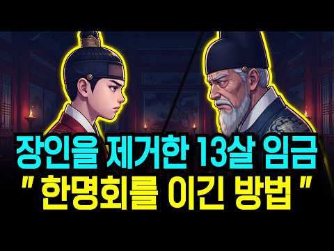
- 설명 앞부분: 1469년, 예종이 갑작스럽게 세상을 떠난 그날. 왕위 계승 서열에서도 밀려나 있던 열세 살 소년이 하루 만에 조선의 임금이 됩니다. 세자 교육 한 번 받지 못한 이 어린 왕의 이름은 성종. 그리고 그의 곁에는, 조선 최고의 권력자라 불리던 한 남자가 있었습니다. 계유정난을 설계해 세조를 왕으로 만든 킹메이커, 두 임금의 장인이자 조정을 손에 쥔 원로대신 한명회. 그는 다름 아닌 이 어린 왕을 왕좌에 앉힌 장본인이자, 성종의 장인이었습니다. 그런데 어떻게 된 일일까요. 자기 손으로 왕을 만든 한명회가, 20년도 지나지 않아 바로 …
- 같은 채널 평소 대비 ×9.0 (채널 최근 롱폼 중앙값 70,008회) · 평소 영상: 한국사 총정리 몰아보기ㅣ고조선부터 대한민국까지 5000년 풀스토리ㅣ자면서 들으세요 (70,008회) / 신선이라 불린 조선의 괴짜 홍유손의 놀라운 비밀 (73,357회)
- 대본 없음 (설명) — 음성인식이 끝나면 도입부·흐름이 들어감
- 댓글 235/251: 좋은 점 — 영상 3 · 감사·응원 8 · 더 알고 싶은 것 1 · 아쉬운 점 — 영상 7 · 반박·불만 — 의견 다름 3 · 정치·사회 5 · 경험 공유 0 · 구독·다음 기대 1
  - 좋은 점 — 영상 👍2 “자신이 저지른 잘못은 결국 어떤 식으로든 그 대가를 치르게 되는 것 같네요. 죄를 짓고도 남에게 상처를 주며 살아가는 사람의 끝이 얼마나 참담한지 보여주는 이야기였습니다. 인과응보라는 말이 정말 무섭게 와닿네요.”
  - 좋은 점 — 영상 👍1 “잘배우고갑니다❤”
  - 감사·응원 👍50 “설명이 진지하고 진실을 읽으려 애쓰신점 감사드립니다”
  - 감사·응원 👍28 “성종에 대해 좀 더 자세히 알게 돼 좋았습니다 왕위계승자가 아니라 제왕학을 배울 기회도 없었을텐데..혼자 조용히 그래도 원로들 사이에서 열심히 배워 기 존쎈 장인과 원로들을 조용히 물리친 성종에 대해 알게돼 기쁨니다 덕분에 역사에 흥미가 생기는군요 감사합니다”
  - 더 알고 싶은 것 👍0 “어..문정왕후가 수렴청정 최초 아닌가요? 어디선가 들었던것 같은데.. 알려주세요.”
  - 아쉬운 점 — 영상 👍5 “추강에 밤이드니 물결이 차노메라 낚시드리우니 고기 안무노메라 무심한 달빛에 빈 배 저어오노메라”
  - 아쉬운 점 — 영상 👍4 “내용은 참 좋은데 너무 길게 늘려 지루한게 험이군요”
  - 반박·불만 — 의견 다름 👍0 “이거 AI가 아니죠?”
  - 정치·사회 👍62 “2026년 지금도 간신 한명회 같은 종자들이 바글바글 하니 나라가 피곤하다 😮😮😮😮😮😮 5년 권력 잡으면 한목챙기는대 집중 하다 끝난다 😮😮😮😮😮😮”
  - 정치·사회 👍3 “훈구대신들과 신진사림들간의 견제와 균형이라는 구도는 좋지만 서로 죽이고 죽는 극한의 권력다툼으로 모두가 불행한 나라가 되고 결국 망하게 된다. 차라리 훈구대신들이 계속 권력을 잡았었다면 어떨까.”
  - 구독·다음 기대 👍35 “군더더기 없는 설명으로 역사의 한 구간을 잘 살피게 되었네요. 다음 영상도 기대 합니다~~^^”

### 284. 일본군 성노예 피해자 증언 ∣ 북한 피해자들 증언 1부 (뉴스타파)

- https://www.youtube.com/watch?v=DcpFycWacCI · 보이드본 Voidborne · 구독자 6,940 · 조회수 117,603 (×16.9, 하루 875.9) · 좋아요 3,677 (3.1%) · 35.1분 · 2026-06-29 · 주제 묶음 기타 · 형식 정보·해설 (그 밖) · 폴더 `W_DcpFycWacCI` (웹 승인)
- 썸네일: 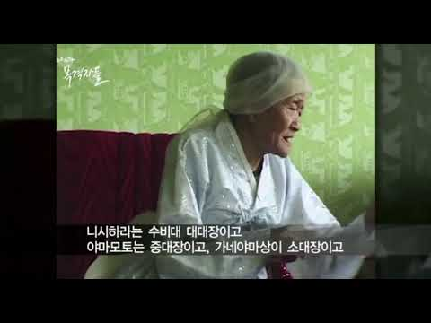
- 같은 채널 평소 대비 ×926.0 (채널 최근 롱폼 중앙값 127회) · 평소 영상: 일본군 성노예 피해자 증언 ∣ 권말례 (정대협) (129회) / 일본군 성노예 피해자 증언 ∣ 심달연 (정대협) (125회)
- 대본 없음 (없음) — 음성인식이 끝나면 도입부·흐름이 들어감
- 댓글 680/699: 좋은 점 — 영상 2 · 감사·응원 15 · 더 알고 싶은 것 11 · 아쉬운 점 — 영상 3 · 반박·불만 — 의견 다름 16 · 정치·사회 23 · 경험 공유 17 · 구독·다음 기대 1
  - 좋은 점 — 영상 👍2 “그 때의 고문들을 이렇게 자세하게 들은 적은 처음입니다. 그런 끔찍한 고문들을 어린 소녀들에게 했다니 사람이라면 할 수없는 해서는 안되는 것.. 너무나도 어린 순수하고 풋풋한 앞날이 창창한 아이들에게…… 그런 짓을…….. 일본놈들은 정말 어떻게 그런 짓을 할 수 있었…”
  - 감사·응원 👍62 “그 어린아이를 ... 살아주셔서 감사합니다”
  - 감사·응원 👍55 “피해자분들에게 너무나 죄송하고 가슴이 아파서..힘들어도 끝까지봤습니다. 눈물이 나오는게 사치처럼 느껴지도록 잔인해서 할말이 없어요. 살아주셔서 감사하다 했는데...해결되지못한채 돌아가셨다니 너무 죄송스럽습니다 일본은 천벌받을거다 하늘에서 정말 업겁의 시간동안 피해자할…”
  - 더 알고 싶은 것 👍293 “이렇게 생생한 증언과 증거가 있는데도 우리나라 유명대학 교수는 위안부가 아니라 자진해서 취직하러 간거라고 주장하고 있지. 자기딸이 그렇다면 어땠을까~ 끔찍한 일본의 만행을 세계에 알려주시길~”
  - 더 알고 싶은 것 👍6 “영어자막 부탁드려요”
  - 아쉬운 점 — 영상 👍6 “자막이 필요 합니다. 지금 프랑스 유명 역사 유튜버가 처음으로 위안부의 실체를 알리는데 너무 미화 되어서 얘기를 하고 있어요. 사람들이 댓글로 이것에 관한 영화나 정보를 원합니다. 제발 다국어로 자막 좀 제작 해 주세요. 제발요.”
  - 아쉬운 점 — 영상 👍2 “자막좀요.. 번역어려우시면 저라도 해야될것같은데 번역하다 멘탈나갈것같아서 무섭기도히고 이런거 묻히면 미래역사에재생되요”
  - 반박·불만 — 의견 다름 👍161 “일본을 막 엄청 싫어하는건 아닌데 이런 영상들을 보면 뭔가 다시 생각하게 되는 거 같음.. 진짜 너무 잔인하고 이건 사람이 할짓이 아니다 정말..”
  - 반박·불만 — 의견 다름 👍33 “살아오신게 기적이시네요 그 자리에서 열두명이라니 열네살이 견딜 기억이아닌데 말을 더 못하겠습니다”
  - 정치·사회 👍30 “나라가 힘이 없으니 자런일을 당하고 일본을 용서하면 안됌”
  - 정치·사회 👍22 “믿기지 않는 역사적사실이다. 충격적이다. 너무나 정확하고 세세하게 말씀하시는 할머니. 그 어린 나이에 얼마나 무서웠고 이 나라가 원망스러웠겠나. 이렇게 잔인하게 유린할줄은 몰랐다”
  - 경험 공유 👍428 “근데 예전에 코메디안 김구라가 위안부 할머니를 매춘부라 칭했슬때 내가 넘 놀란적이 있었다ㅡ 방송국에서 퇴출 당하리라 생각했는데 여지껏 버젓이 출연하고 있는걸 보면 이 할머니들이 생각나 그김구라새끼의 낯짝만 봐서 토할것 같아 채널을 돌려 버린다ㅡ ㅡ방송국 자체도 역사적…”
  - 경험 공유 👍138 “내가 이래서 아직까지도 일본 여행을 안감. 죽을때까지 안가고 싶음. 다 피할수는 없겠지만 최대한 일본산 제품을 소비 안하려는 이유임. 피해자분들 얼마나 고통스럽고 집에 가고 싶었을까.. 마음 아프다”
  - 구독·다음 기대 👍1 “알고리즘 나와서 구독하고갑니다 ㅠㅠ. 채널 시작해주셔서 감사합니다 영어 일본어자막. 있으면 좋을것같아요 ㅠ”

### 285. 지는 사람 목을 벤다｜사백 년 전 두만강 군영에서 실제로 벌어진 일 ∣조선이 감춘 북방 근무 1년의 기록 ∣ 부북일

- https://www.youtube.com/watch?v=0Si50CybDIU · 역사아카이브 - History Archive KR · 구독자 25,000 · 조회수 312,406 (×12.5, 하루 3,150.1) · 좋아요 1,923 (0.6%) · 91.5분 · 2026-08-03 · 주제 묶음 3. 조선 · 형식 정보·해설 (그 밖) · 폴더 `W_0Si50CybDIU` (웹 승인)
- 썸네일: 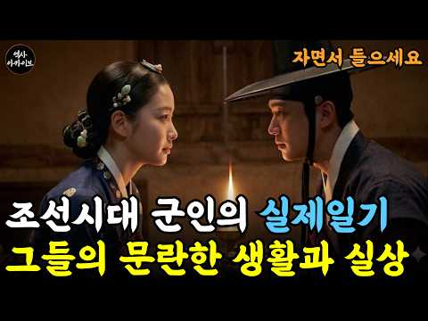
- 챕터: 0:00 문천의 밤, 칼로 끊긴 사립문 · 2:10 부북일기란 무엇인가 / 부방 제도 · 7:30 아버지 박계숙, 1605년의 길 · 13:00 마운령의 시체 두 구 · 17:20 첨사와의 정면 충돌, 곤장 세 대 · 21:40 회령 기생 배종, 그리고 딸 월매 · 25:00 아들 박취문, 1644년 겨울의 출발 · 30:30 회령 도착 — 적보다 무서운 텃세 · 36:00 활쏘기 125회, 훈련이자 유흥 · 41:00 지는 자의 목을 베라 — 참수 내기 · 46:30 호반적자 사건과 곤장 여덟 대 · 51:00 동방급제자의 의리, 김사룡 사건 · 55:20 청 사신이 활쏘기를 구경하다 · 59:00 울산에서 온 편지 한 장 · 62:30 사십 년을 건너온 만남 · 67:00 무과 초시 부정에 항의하다 · 71:00 조총 400자루 — 청렴이 족쇄가 되다 · 78:00 방환, 그리고 문천의 밤 · 83:00 아버지의 마지막 해 · 86:00 79장의 종이가 남긴 것
- 설명 앞부분: 조선의 군인이라 하면 우리는 임진왜란과 병자호란을 떠올립니다. 그러나 조선 군인의 삶에서 압도적인 비중을 차지한 것은 전투가 아니라, 아무 일도 일어나지 않는 국경을 지키는 일이었습니다. 울산박물관에 보관된 울산광역시 유형문화재 제14호 『부북일기(赴北日記)』는 그 잊힌 일상을 통째로 담은 유일무이한 기록입니다. 울산 박씨 박계숙(1569~1646)과 아들 박취문(1617~1690)이 39년의 간격을 두고 각각 함경도 회령으로 부방을 다녀오며 남긴 부자 2대의 종군일기. 눈보라와 굶주림만 있는 것이 아닙니다. 텃세와 뒷거래, 활쏘…
- 같은 채널 평소 대비 ×16.2 (채널 최근 롱폼 중앙값 19,232회) · 평소 영상: [5시간 연속재생] 조선시대 생활사 8번째 통합 ∣ 우리 조상들의 모습 (20,263회) / 황후의 치마를 들춘 남자｜이완용보다 오래 살아남은 진짜 매국노, 윤덕영 (18,201회)
- 대본 없음 (설명) — 음성인식이 끝나면 도입부·흐름이 들어감
- 댓글 38/40: 좋은 점 — 영상 1 · 감사·응원 1 · 더 알고 싶은 것 0 · 아쉬운 점 — 영상 1 · 반박·불만 — 의견 다름 1 · 정치·사회 2 · 경험 공유 1 · 구독·다음 기대 0
  - 좋은 점 — 영상 👍9 “역사를 배웠으면 조선이 성리학의 나라라는 헛소리는 하지마라”
  - 감사·응원 👍12 “나도.나름.역사에관심.책도.읽었습니다.이런.소중한.기록.책을.소개해주어.너무감사합니다.”
  - 아쉬운 점 — 영상 👍1 “내용보다..광고가 더 오래니..몰 보았는지 모르겠네..”
  - 반박·불만 — 의견 다름 👍9 “역사를 배웠으면 조선이 성리학의 나라라는 헛소리는 하지마라”
  - 경험 공유 👍12 “나도.나름.역사에관심.책도.읽었습니다.이런.소중한.기록.책을.소개해주어.너무감사합니다.”

### 286. "미국에서 난리난 이순신 장군?!" 충무공 이순신이 사무라이를 밀어내고 새로운 영웅이 된 진짜 이유

- https://www.youtube.com/watch?v=i8RNMbV3q_g · 코믹스 경제 · 구독자 35,700 · 조회수 155,418 (×4.3, 하루 4,416.0) · 좋아요 645 (0.4%) · 27분 · 2026-10-06 · 주제 묶음 3. 조선 · 형식 정보·해설 (그 밖) · 폴더 `W_i8RNMbV3q_g` (웹 승인)
- 썸네일: 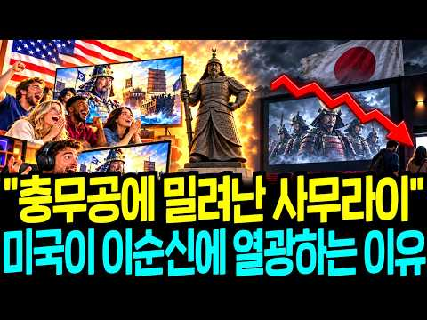
- 설명 앞부분: 📚 【교육 콘텐츠】 "가짜 10 대 300에 열광하던 미국이, 진짜 13 대 133을 찾기 시작했다" 🇰🇷 미국은 50년 동안 칼 찬 사무라이 이야기에 지갑을 열었습니다. 2024년엔 사무라이 드라마 〈쇼군〉이 에미상 18관왕에 올랐습니다. 그런데 배 13척으로 133척을 막은 조선의 이순신은 1929년부터 미 해군 잡지 구석에만 있었습니다. 진짜가 왜 가짜에게 400년이나 밀려 있었는지, 그리고 지금 그 판이 어떻게 뒤집히고 있는지 짚어 봅니다. 🎬 이번 영상의 핵심 정보 ✓ 칼의 나라가 조선에 쳐들어올 땐 칼이 아니라 조총을 …
- 같은 채널 평소 대비 ×2.9 (채널 최근 롱폼 중앙값 53,563회) · 평소 영상: "아마존도 포기한 걸 해냈다고?" 한국인들이 유달리 똑똑한 진짜 이유, 속도와 효율성이 … (53,563회) / "미국마저 등 돌렸다!" 100년 동안 독점하던 질레트, 한국 도루코 6중날에 무너진 진… (57,351회)
- 대본 없음 (설명) — 음성인식이 끝나면 도입부·흐름이 들어감
- 댓글 50/52: 좋은 점 — 영상 0 · 감사·응원 0 · 더 알고 싶은 것 1 · 아쉬운 점 — 영상 0 · 반박·불만 — 의견 다름 0 · 정치·사회 6 · 경험 공유 0 · 구독·다음 기대 0
  - 더 알고 싶은 것 👍2 “고구려 만들어 주세요~”
  - 정치·사회 👍3 “이재명대통령은 콤판씨에게 문화훈장 수여하시길..”
  - 정치·사회 👍1 “이거 이조시대 때 선조 수정실록에 나오는 엉터리 이야기입니다. 정작 선조 오리지널 실록에는 나오지도 않는 이야기이며, 일본, 명나라 등의 기록에도 없습니다. 당시 수군은 명나라가 지위했습니다. 그 기록에 없는 이야기입니다. 정신 차리세요”

### 287. 🌙 [잘 때 듣는] 로마는 왜 300년 동안 박해하던 기독교를 받아들였을까? ∣ 콘스탄티누스 대제의 일생 (100분) ∣ 숙면 세계사 ∣ 오디오북 ASMR

- https://www.youtube.com/watch?v=yz5rgz5s2YE · 잘 때 듣는 - 숙면 세계사 · 구독자 11,200 · 조회수 114,084 (×10.2, 하루 1,376.4) · 좋아요 2,101 (1.8%) · 98.6분 · 2026-08-06 · 주제 묶음 10. 수면·낭독 · 형식 수면·낭독 (잠잘 때 듣는) · 폴더 `W_yz5rgz5s2YE` (웹 승인)
- 썸네일: 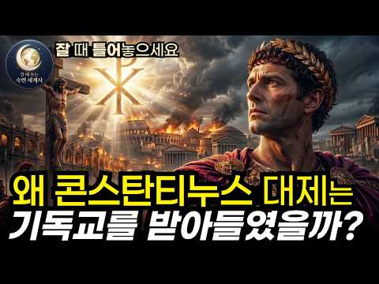
- 챕터: 0:00 프롤로그 - 자주색 황제복을 내려놓은 밤 · 2:48 제1장 병들어가는 제국, 로마 · 8:48 제2장 황금 인질로 자란 소년 · 15:26 제3장 밤을 가르는 탈출 · 21:24 제4장 권력의 격돌과 카이사르의 자리 · 28:29 브릿지1 왜 로마는 기독교를 박해했을까 · 33:58 제5장 밀비우스 다리, 방패 위의 카이로 · 40:43 제6장 313년 밀라노 칙령 · 46:08 제7장 다신교의 한계 · 51:47 브릿지2 단 하나의 신을 원한 이유 · 54:30 제8장 두 개의 태양, 제국의 통일 · 60:13 제9장 325년 니케아 공의회 · 65:42 제10장 로마의 심장이 된 기독교 · 71:08 브릿지3 황제가 잃은 가장 가까운 사람들 · 74:07 제11장 콘스탄티노폴리스의 탄생 · 80:08 제12장 궁전의 비극, 네 가지 가설 · 85:31 제13장 금화 솔리두스와 개혁 · 91:05 제14장 평생 미루어 온 세례 · 96:37 에필로그 - 천 년의 지형도를 바꾸다
- 설명 앞부분: 🌙 안녕하세요, 잘 때 듣는 숙면 세계사 '잘숙세'입니다. 오늘 밤, 여러분의 머리맡에 한 황제의 예순다섯 해를 펼쳐 드립니다. 337년 5월, 니코메디아의 어느 궁전. 임종을 앞둔 노황제가 가장 먼저 벗어 던진 것은 황제의 상징, 왕관이었습니다. 평생 로마를 다스려온 이 남자는 왜 죽음을 눈앞에 두고서야 순백의 세례복을 입었을까요. 인질로 끌려간 소년은 어떻게 로마 제국 유일의 황제가 되었는가, 하늘에서 본 낯선 문양 하나는 어떻게 300년의 박해를 끝냈는가, 가장 아끼던 장남과 아내를 향해 황제는 왜 차가운 명령을 내렸는가, …
- 같은 채널 평소 대비 ×6.2 (채널 최근 롱폼 중앙값 18,453회) · 평소 영상: 🌙 [잘 때 듣는] 600년 유럽을 떨게 한 제국은 왜 형제를 모두 죽였나 — 오스만 제… (18,453회) / 🌙 [잘 때 듣는] 지옥이 두려워 르네상스를 사버린 은행가들 ∣ 메디치 가문의 비밀 (7… (18,985회)
- 대본 없음 (설명) — 음성인식이 끝나면 도입부·흐름이 들어감
- 댓글 87/87: 좋은 점 — 영상 1 · 감사·응원 11 · 더 알고 싶은 것 0 · 아쉬운 점 — 영상 1 · 반박·불만 — 의견 다름 5 · 정치·사회 3 · 경험 공유 2 · 구독·다음 기대 0
  - 좋은 점 — 영상 👍5 “감사합니다 ^^ 잘 듣고 배웠습니다.”
  - 감사·응원 👍11 “고맙습니다.❤”
  - 감사·응원 👍5 “감사합니다 ^^ 잘 듣고 배웠습니다.”
  - 아쉬운 점 — 영상 👍0 “기독교가 박해를 받은 이유가 황제숭배 거부 때문만이 아닙니다 또 다른 더 중요한 이유가 있습니다 로마 역사책에도 기록된 겁니다 하지만 나라들은 그 이유를 말하기를 불편해 합니다 역사학자들이 로마 역사를 말할 때 부각시키지 않고 은근슬쩍 넘어가는 문제가 있습니다 역사학…”
  - 반박·불만 — 의견 다름 👍0 “기독교가 박해를 받은 이유가 황제숭배 거부 때문만이 아닙니다 또 다른 더 중요한 이유가 있습니다 로마 역사책에도 기록된 겁니다 하지만 나라들은 그 이유를 말하기를 불편해 합니다 역사학자들이 로마 역사를 말할 때 부각시키지 않고 은근슬쩍 넘어가는 문제가 있습니다 역사학…”
  - 정치·사회 👍8 “하나님께서 예루살렘에서 시작된 예수의 죽음에서의 부활 복음을 전 세계인들에게 퍼지게 하기위한 대들보로 로마를 사용했고 대영제국이 그 뒤를 미국이 그 바톤을받아 기독교를 지키고 이스라엘을 지키고 선교사를 가장많이 파송하고있다, 만일 하나님의 계획을 거부하면 그나라는 폭…”
  - 정치·사회 👍7 “비유하는 얘기로 풀자면.. 일본이 흥하다 정점에 이르러 드디어 내리막을 걷게 된 때쯤이라 하자. 지방 곳곳이 여러 우두머리가 나타나 (사두정치 ) 나뉘어 다스려지고 있던 때다. 다양한 잡신을 수없이 모셔 봐야 이렇게 별볼일 없이 쇠락하는구나 하는 깨달음을 갖게 된 시…”
  - 경험 공유 👍1 “훌륭하기가 페르시아 키루스대왕 같은 콘스탄티누스 이네요. 불행히도 가족간의 기독교신앙생활이 안되었고 아들 아내 비극을 겪고말았네요. 그래도 중국 한국 왕놈들처럼 호색 방탕 무절제 탐욕 부리지않은것만해도 하나님의 가호,축복을 누린 왕이다.”
  - 경험 공유 👍0 “그는 😮 기독교를 정치적으로 이용하려고 81권의 성경중 15개를 없애고 66개만 남겨 왜곡했었지”

### 288. 왜 11살 꼬마며느리는 망한 집에 웃으며 시집왔을까? 그 정체는? ∣ 야담 ∣ 조선시대 ∣ 오디오북 ∣ 전설 민담

- https://www.youtube.com/watch?v=S0fim5zCQbI · 달빛잠자리이야기 · 구독자 15,800 · 조회수 310,305 (×19.6, 하루 1,937.0) · 좋아요 7,396 (2.4%) · 57분 · 2026-06-03 · 주제 묶음 3. 조선 · 형식 수면·낭독 (잠잘 때 듣는) · 폴더 `W_S0fim5zCQbI` (웹 승인)
- 썸네일: 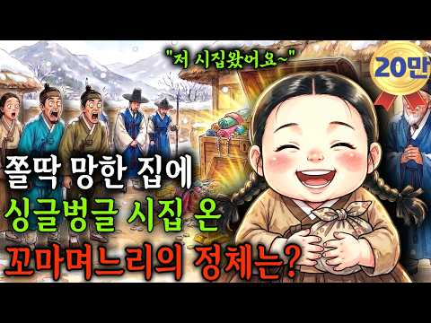
- 설명 앞부분: "곧, 굶어 죽을 집구석에 시집오면서 왜 저리 입이 귀에 걸렸을꼬?" 망해가는 가문을 조선 최고 부자로 만든 11살 꼬마 민며느리의 기막힌 반전! 지금 그 통쾌하고 따뜻한 성공 신화가 펼쳐집니다. 👇👇 📜 [달빛잠자리이야기 역사 한스푼 (고증 자료) 1. 조선 시대의 민며느리(조혼) 풍습 2. 10대 장원 급제가 가능했을까? 3. 정경부인(貞敬夫人)의 위상 정경부인은 조선 시대 문무관의 처에게 내리던 명명 직첩 중 최고 등급인 '정·종 1품' 여인에게 주어지는 최고의 명예였습니다. 오늘날로 치면 국무총리나 장관급 인사의 부인에게 …
- 같은 채널 평소 대비 ×29.0 (채널 최근 롱폼 중앙값 10,712회) · 평소 영상: 🌡️ 한여름, 시댁 대청마루를 뜯어낸 못말리는 꼬마 며느리 ∣야담∣ 옛날이야기∣ 민담∣ … (10,712회) / 병든 서방 살리러 싱글벙글 시집 온 꼬마 며느리의 정체는? ∣ 야담 ∣ 조선시대 ∣ 오디… (11,977회)
- 대본 없음 (설명) — 음성인식이 끝나면 도입부·흐름이 들어감
- 댓글 338/350: 좋은 점 — 영상 2 · 감사·응원 42 · 더 알고 싶은 것 1 · 아쉬운 점 — 영상 0 · 반박·불만 — 의견 다름 1 · 정치·사회 4 · 경험 공유 3 · 구독·다음 기대 0
  - 좋은 점 — 영상 👍1 “즐청했습니다😊 다음에도 좋은 이야기 부탁 드립니다. P.S 한가지 조정 해야 할 것이 있네요. 중간 중간 말이 끊김이 좀 있고 울림이 있어요”
  - 좋은 점 — 영상 👍0 “좋은 이야기 입니다 ^^”
  - 감사·응원 👍12 “참대단한향이화이팅.웃으면복이와요.최만당이길들이기참시원하내요.향이와.할아버님.❤❤❤❤❤”
  - 감사·응원 👍8 “감탄 스럽고 꼬마 신부가 큰복덩이가 최씨집안을 우뚝세운 효부로다 ❤ 유친하고 설정하고 응원합니다 선물 🎁”
  - 반박·불만 — 의견 다름 👍6 “서울종로익선동에서잘듣고있지요”
  - 정치·사회 👍5 “여기주인장도 중국인이네 아놔”
  - 정치·사회 👍1 “중국인들의 👀 유튜브였구나!”
  - 경험 공유 👍0 “향이에 지혜가 지금 이나라에 필요할때 인거 같습니다. 자기 자신만을 생각하는 정치인들을 보고있자니 후손들 한태 미안하다. 다수를 위한다고 생각없는 정치인들 내가 그냥 웃는다”
  - 경험 공유 👍0 “대과다그가. 뭡니까 ?우리들이 알아듣지도 못하는 말. 하지마시오 재밌게. 잘. 듣다가. 마음이. 싸해지며. 듣기 싫소.. 알아듣지도 못하는 중국말. 또하네 당신. 나라가서. 싫컷 하라구 ~ 에이. 짜증나 내가. 몇시간을. 뭐한거야 중국말. 듣자고 시청하는줄. 알아 시…”

### 289. 사극에서는 절대 보여주지 않는 조선 평민의 진짜 밥상

- https://www.youtube.com/watch?v=sqEhpBUi3Vc · 조선의이면 · 구독자 2,980 · 조회수 61,551 (×20.6, 하루 364.0) · 좋아요 827 (1.3%) · 15.4분 · 2026-05-25 · 주제 묶음 3. 조선 · 형식 정보·해설 (그 밖) · 폴더 `W_sqEhpBUi3Vc` (웹 승인)
- 썸네일: 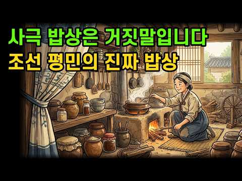
- 설명 앞부분: 본 영상은 조선시대 기록과 풍속을 바탕으로 재구성한 역사 이야기입니다. 일부 장면은 이해를 돕기 위해 극적으로 각색되었습니다. 사극 속 조선 밥상에는 하얀 쌀밥, 고기반찬, 빨간 김치가 자연스럽게 올라옵니다. 하지만 실제 조선 평민의 밥상은 우리가 생각하는 모습과 많이 달랐습니다. 쌀밥은 쉽게 먹기 어려웠고, 고기는 특별한 날에나 맛볼 수 있었으며, 지금 우리가 전통이라고 믿는 빨간 김치도 조선 전기 평민의 밥상에는 없었습니다. 그렇다면 조선시대 평민들은 무엇을 먹고 하루를 버텼을까요? 이번 영상에서는 사극에서는 잘 보여주지 않는…
- 같은 채널 평소 대비 ×53.8 (채널 최근 롱폼 중앙값 1,144회) · 평소 영상: 조선에서 가장 돈이 많았지만 자유가 없던 사람 ∣ 조선의 부자 노비 (1,144회) / 조선시대 노비가 도망치면 어떻게 됐을까? 도망노비의 충격적인 현실 (1,120회)
- 대본 없음 (설명) — 음성인식이 끝나면 도입부·흐름이 들어감
- 댓글 88/88: 좋은 점 — 영상 0 · 감사·응원 1 · 더 알고 싶은 것 2 · 아쉬운 점 — 영상 1 · 반박·불만 — 의견 다름 1 · 정치·사회 7 · 경험 공유 6 · 구독·다음 기대 0
  - 감사·응원 👍10 “70년대에도 밥그릇만 엄청 큼. 에너지원이 오로지 쌀밥뿐 그것도 정부미 먹던시절. 고기는 90년대 이후에나 좀 먹음. 70년대엔 고기가 없어서 명태국에서 명태 한조각 들어있으면 감사했지. 그 국엔 무우만 잔뜩. 정말 배고팠다. 그시절에 내 사진을 보고 울 애들이 기아…”
  - 더 알고 싶은 것 👍2 “어디에 기록되어 있는 내용일까 궁금하네요..”
  - 반박·불만 — 의견 다름 👍4 “아휴 정말이지 한국음식 너무 빨개요 김치는 말할것도 없고 지금보면 매운한식이 오래된 전통음식도 아닌데 그걸 전통이라고 지킬 가치는 없습니다.”
  - 정치·사회 👍21 “조선시대뿐만 아닙니다 박대통령 전까지 그랬습니다 저는 70넘었습니다 그래서 저는 누구보다 박정희대통령을 존경합니다 겪어봤으니까요😊”
  - 정치·사회 👍9 “그 무서운 가난을 몰아내 주신 대한민국의 위대한 박 정희 대통령. 역사가 말 한다.”
  - 경험 공유 👍35 “전 60대 초반인대 제어머니가 산에서 나물을 뜯어 죽을 만들어 드셨대요 그때는 드실게 없어 가지고 많은 예기들을 잘들었습니다 참 우리에 부모님들 고생 많이 하셨네요 저도 어릴때 보리밥 먹었는대 아버지 밥그류에 쌀밥이 그렇게 먹고 싶더라고요 지금은 너무 행복한 생활을 …”
  - 경험 공유 👍12 “제가 어렸을 땐 설날하고 추석날 소고기 먹은 기억뿐이 안 납니다.”

### 290. 우연히 주운 돌이, 역사를 바꿨습니다

- https://www.youtube.com/watch?v=SSQ9A6q9_Dg · 국립경주문화유산연구소 · 구독자 22,300 · 조회수 441,892 (×19.8, 하루 2,626.0) · 좋아요 2,249 (0.5%) · 11.8분 · 2026-05-26 · 주제 묶음 1. 역사 일반·이야기 · 형식 정보·해설 (그 밖) · 폴더 `W_SSQ9A6q9_Dg` (웹 승인)
- 썸네일: 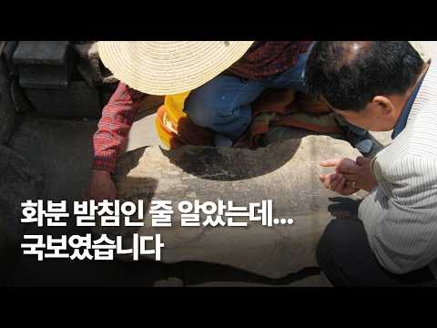
- 설명 앞부분: 최근 화제가 된 만호봉사지 금강역사상 발 발견부터 화분 받침으로 쓰이던 돌에서 발견된 포항 중성리 신라비, 월성 비편, 사천왕사 녹유신장벽전 복원 이야기까지. 우연한 발견과 집요한 조사 끝에 이어진 신라 문화유산의 숨겨진 이야기들을 담았습니다. 이번 영상에서는 국립경주문화유산연구소 연구원들의 실제 증언을 통해 경주 문화재 발굴 현장에서 어떤 방식으로 유물이 발견되고, 조각들이 연결되며, 사라졌던 역사가 복원되는지를 살펴봅니다. ☑️ 이 영상은 국립경주문화유산연구소에서 제작한 영상입니다. 영상의 활용은 공공누리 4유형에 따라서 이용…
- 같은 채널 평소 대비 ×448.6 (채널 최근 롱폼 중앙값 985회) · 평소 영상: 2026 숭문대 인문학 강좌 1회차 「황룡사의 창건과 그 의도」 (1,001회) / 2026 대담신라 2회차「황룡사로 온 생선 1300년전 신라의 택배」 (969회)
- 대본 없음 (설명) — 음성인식이 끝나면 도입부·흐름이 들어감
- 댓글 178/179: 좋은 점 — 영상 0 · 감사·응원 9 · 더 알고 싶은 것 3 · 아쉬운 점 — 영상 1 · 반박·불만 — 의견 다름 2 · 정치·사회 3 · 경험 공유 6 · 구독·다음 기대 0
  - 감사·응원 👍23 “우연을 운명으로 만들기 위해 수많은 돌들을 닦고 뒤집으셨겠죠. 연구원분들의 노력뿐만 아니라 낭만도 응원합니다!”
  - 감사·응원 👍11 “감사합니다 고맙습니다.귀한 말씀을 들려 주시고 보여주심을 기뻐 합니다./ 응원합니다.”
  - 더 알고 싶은 것 👍17 “공순아찬이라고 하면, 공순이 이름이고 아찬이 관등이라는 점 정도는 알려주셨으면 좋았는데요... 누군가에게는 당연하지만, 누군가는 또 잘 모릅니다.”
  - 더 알고 싶은 것 👍2 “우연히 주운 돌이 풀리지 않던 퍼즐을 완성시키면 얼마나 짜릿할까요? 발견자 분들의 문화재에 대한 깊은 관심과 연구원분들의 집념이 그걸 가능케 했다고 생각합니다.”
  - 아쉬운 점 — 영상 👍5 “사실 신라 경주 1000년 도읍은 세계적으로도 말이 안되는 기간입니다. 그 시기가 그리 오래 지나지도 않았구요. 엄청난 규모의 유물이 쏟아져야 하는 유지기간임에 불구하고 남아있는게 너무 극히 없는편이죠. 참 슬프고 아쉽습니다.”
  - 반박·불만 — 의견 다름 👍4 “댓글 보고 온게 아닌데 갑자기 알고리즘에 뜸. 어랏,,,신라공주 동네에 뭐 있나? 하믄서 들어옴.”
  - 반박·불만 — 의견 다름 👍0 “어릴때 분당 정자동? 밭에서 어머니와같이 찍은 사진에서도, 성인 키만한 비석?이 배경이되엇는데. 예전엔 그런걸 몰랏기에 그냥 부서지고 묻혀진 유물이 말도안돼게 만을것같아요”
  - 정치·사회 👍2 “문화유산이 맞으면 발견신고자도 왠만하면 다 포상주시길.. 대통령도 포상금 늘리라고 하셨잖아요. 발견하고 신고하고 그 번거로움을 거쳐 우리 역사에 대해 더 알게 해주신 분들에 대해 최소한의 포상이라도 꼭 하시길 바랍니다. 그럼, 건축공사하다가 유물 발견해도 도로 묻지는…”
  - 정치·사회 👍1 “우리나라가 일제강점기때 데라우치총독의 지시로 석굴암을 복원했었는데 훼손된 석굴암의 돌판들이 민가에서 자주 발견되었음 역사에서는 일본이 우리 문화재를 훼손했다하지만 현실은 조선사람들이 사찰과 왕가에서 필요한 석판과 판자들을 떼어가서 사용했음 엄격한 세습과 계급사회였기때…”
  - 경험 공유 👍7 “우리동네 이야기구만. 우리집에서 보이는 남산.”
  - 경험 공유 👍7 “담장에 비편은 생각도 안해봤네”

### 291. 2,500년 동안 누구도 답을 못 낸 고대 미스터리 TOP 7

- https://www.youtube.com/watch?v=rNrXJodHv8g · 잡학도깨비 · 구독자 2,880 · 조회수 58,733 (×20.4, 하루 338.0) · 좋아요 458 (0.8%) · 16.6분 · 2026-05-20 · 주제 묶음 8. 문명·고고학 · 형식 정보·해설 (그 밖) · 폴더 `W_rNrXJodHv8g` (웹 승인)
- 썸네일: 
- 챕터: 0:00 인트로 — 2,500년에 걸친 일곱 번의 시도 · 1:00 ① 헤로도토스 — 직접 들어가 기록한 미궁 · 3:30 ② 앙리 무오 — 발견 1년 만의 죽음 · 6:00 ③ 플린더스 페트리 — 1889년 기단만 남은 자리 · 8:30 ④ 마타하 익스페디션 — 국가안보 사유 동결 · 11:00 ⑤ 데미언 에반스의 LiDAR — 정글 속 사라진 도시 · 13:30 ⑥ 르네 차베스 — 봉인된 통로의 발견 · 16:00 ⑦ 진시황릉 본묘 — 50년 동결 · 18:30 마무리 — 일곱 자리의 공통점
- 설명 앞부분: 2,500년에 걸쳐, 학자 일곱 명이 고대 유적을 직접 들여다봤다. 누군가는 직접 들어가 기록했고, 누군가는 첨단 장비를 들고 갔다. 그리고 일곱 번 모두 — 같은 자리에서 멈췄다. 학교 교과서에서는 한 줄도 다뤄지지 않는, 진짜 고대 미스터리 일곱 가지. 헤로도토스가 직접 들어간 이집트 미궁부터, 50년째 한 삽도 닿지 않은 진시황릉 본묘까지. 귀로만 들어도 알찬 잔잔한 잡학 다큐. 헤로도토스가 본 3,000개 방의 미궁, 지금은 흔적조차 없다 앙코르와트를 알린 박물학자 앙리 무오, 발견 1년 만에 정글에서 죽다 플린더스 페트리…
- 같은 채널 평소 대비 ×22.9 (채널 최근 롱폼 중앙값 2,565회) · 평소 영상: "소설을 읽어주다 죽었습니다" 한국엔 왜 삼국지 같은 영웅 소설이 없을까? (2,565회) / 동양인과 서양인이 달라진 이유.1만 년 전 영국인의 피부는 하얗지 않았습니다. (2,300회)
- 대본 없음 (설명) — 음성인식이 끝나면 도입부·흐름이 들어감
- 댓글 7/7: 좋은 점 — 영상 0 · 감사·응원 0 · 더 알고 싶은 것 0 · 아쉬운 점 — 영상 0 · 반박·불만 — 의견 다름 0 · 정치·사회 0 · 경험 공유 0 · 구독·다음 기대 0

### 292. 60번 싸워 한 번도 지지 않았다, 조선의 조자룡 정기룡 장군

- https://www.youtube.com/watch?v=9-hT8Cpgz-g · 역사스토리 · 구독자 21,700 · 조회수 204,396 (×9.4, 하루 2,520.3) · 좋아요 1,143 (0.6%) · 17.9분 · 2026-08-21 · 주제 묶음 3. 조선 · 형식 정보·해설 (그 밖) · 폴더 `W_9-hT8Cpgz-g` (웹 승인)
- 썸네일: 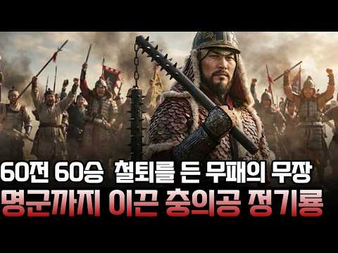
- 챕터: 0:00 임금이 꿈을 꾸고 이름을 지어준 무관 · 1:39 칼이 아니라 도리깨였던 이유 · 3:34 열 기병으로 만 명을 친 거창 기습 · 5:07 진 싸움에서 이름을 얻다, 조경 구출 · 6:36 적이 몇이냐고 묻지 않는 장수 · 8:17 사람이 몰려드는 부대 · 9:46 성을 되찾고 사람을 되돌리다 · 11:36 진주성, 피로 쓴 마지막 편지 · 12:55 정유재란, 용담천의 반격 · 14:21 명나라 군대를 지휘한 유일한 조선인 · 16:12 공신 명단에 없는 이름
- 설명 앞부분: 1586년 무과에 급제한 시골 무관 정무수는 선조가 꿈에서 용을 보았다는 이유로 기룡이라는 이름을 하사받습니다. 그런데 임진왜란이 터지자 이 남자가 손에 쥔 것은 장수의 칼이 아니라 농기구 도리깨를 닮은 무기, 편곤이었습니다. 조총 앞에서 마주 서면 지는 전쟁에서 정기룡은 마주 서지 않는 싸움을 골랐고, 거창 기습부터 금산에서의 조경 구출, 상주성 탈환, 정유재란 고령 용담천 전투, 그리고 명나라 군직 어왜총병관까지, 예순 번이 넘는 싸움을 이겨냈습니다. 그런데 전쟁이 끝난 뒤 선무공신 명단에 그의 이름은 없었습니다. 임진왜란, …
- 같은 채널 평소 대비 ×176.7 (채널 최근 롱폼 중앙값 1,156회) · 평소 영상: 임금이 도망친 자리에서 혼자 칼 든 의병장, 전쟁 후 역적으로 몰린 이유 (1,203회) / 1·21 사태 총정리 ∣ 김신조 침투 루트·실미도·푸에블로호 연결고리까지 (1,110회)
- 대본 없음 (설명) — 음성인식이 끝나면 도입부·흐름이 들어감
- 댓글 82/82: 좋은 점 — 영상 0 · 감사·응원 4 · 더 알고 싶은 것 1 · 아쉬운 점 — 영상 1 · 반박·불만 — 의견 다름 1 · 정치·사회 3 · 경험 공유 5 · 구독·다음 기대 0
  - 감사·응원 👍8 “정기룡장군을 기억합니다. 우리 선조 중 으뜸 이셨다고 아버지로부터 들었습니다. 오늘 이 역사를 접하네요. 감사합니다.”
  - 감사·응원 👍2 “정기룡장군의 후손인데 감사 합니다”
  - 더 알고 싶은 것 👍1 “518 제주43사건 동학혁명도 국가유공자 만드는 세상에 임진왜란때 혁혁한공적을 세운 정기룡장군님 이순신장군님 등의 유족 후손들에게도 국가유공자 만들어 주세요.”
  - 아쉬운 점 — 영상 👍0 “공에 비해 신분이 낮아 기록이 적게 남아 평가를 제대로 못받은게 아쉽네요. 어릴때 꽃신 주인공이 정기룡장군 이였어요”
  - 정치·사회 👍1 “이래도 바다엔 이순신 육지엔 황진이냐? 좌파황현필이 만들던 허언을 진실이라 무지성으로 믿던 너희의 무지를 내가 어릴적부터 보던 모든 책에선 바다엔 이순신 육지엔 정기룡이었습니다 황진장군님의 충혼에 감사드립니다”
  - 정치·사회 👍1 “에라.엿같은 신분제 무능한 나라 조선이 망한 이유입니다.정기룡,정충신,한명련 같은 명장들이 출신이 비천하다고 내쳐진 분들이고 위태로운 나라를 구해낸 충정은 반역에 가까운 모함과 멸시로 토사구팽 시킨 조선 왕실이고 수년후 병자호란으로 수모를 되돌려 받았고 그후에도 정신…”
  - 경험 공유 👍27 “저희 조상인 정구룡장군도 정기룡장군 휘하에서 싸우다 전사했어요. 상주가 배경이었군요. 저런 전투에서 전사하신거군요.정구룡 장군이 받은 선무원종공신이 그런 거군요.저게 무슨 공신인가 궁금했어요.정기룡장군조차 선무원종공신이라니 저평가된듯.자손들이 이걸 암행어사에게 알려서…”
  - 경험 공유 👍4 “상주시 사벌에 정기룡 장군 유적이 있습니다. 저도가서 참배를 했습니다.”

### 293. 자객들에 쫓기던 왕비를 절벽으로 밀어버린 천재아이∣ 야담 ∣ 조선시대 ∣ 오디오북 ∣ 전설 민담

- https://www.youtube.com/watch?v=aI8A973spEw · 전해들은 야담 · 구독자 41,000 · 조회수 805,271 (×19.6, 하루 4,675.6) · 좋아요 20,715 (2.6%) · 82.4분 · 2026-05-22 · 주제 묶음 3. 조선 · 형식 수면·낭독 (잠잘 때 듣는) · 폴더 `W_aI8A973spEw` (웹 승인)
- 썸네일: 
- 설명 앞부분: 본 영상은 ai를 활용하였지만 등장인물을 인형으로 직접 오리고 제작하여 직접 촬영 및 연출한 영상이 사용되는 인형극 영상입니다 전해들은 야담이 새롭게 각색하고 재구성한 창작 콘텐츠입니다. 이야기의 몰입도를 높이기 위해 등장인물의 이름과 지명 등 일부 설정은 가공되었음을 알려드립니다. 전해들은 야담은 바쁜 세상살이에 지친 여러분이 잠시 발걸음을 멈추고 쉬어갈 수 있는 작은 이야기 쉼터입니다. 교과서에는 실리지 않은 기이하고도 흥미로운 야담과 야사, 우리 조상들의 해학이 담긴 민담, 그리고 역사 뒤편에 숨어 있던 비밀스러운 이야기들을…
- 같은 채널 평소 대비 ×21.0 (채널 최근 롱폼 중앙값 38,314회) · 평소 영상: 관상보는 천재아이, 잠행중인 임금인 줄 모르고 "왕이 될 상이네?" ∣ 야담 ∣ 조선시대… (38,314회) / 남편이 장원급제후 병든 아내를 호랑이굴에 버리자, 아내가 갑자기 웃음을 터뜨리는데..∣ … (42,129회)
- 대본 없음 (설명) — 음성인식이 끝나면 도입부·흐름이 들어감
- 댓글 748/751: 좋은 점 — 영상 6 · 감사·응원 51 · 더 알고 싶은 것 4 · 아쉬운 점 — 영상 11 · 반박·불만 — 의견 다름 5 · 정치·사회 2 · 경험 공유 7 · 구독·다음 기대 0
  - 좋은 점 — 영상 👍3 “바쁜 하루 중에 잠시 쉬어갈 수 있는 좋은 이야기 쉼터 같네요.”
  - 좋은 점 — 영상 👍2 “오랜만에 정말 시간 가는 줄 모르고 들었습니다. 옛이야기는 들을수록 새로운 매력이 있는 것 같네요. 좋은 영상 감사합니다.”
  - 감사·응원 👍47 “흥미롭네요 잘 들었어요 감사합니다”
  - 감사·응원 👍35 “인천논현동에서ㆍ 잘듣고 잇어요ㆍ 감사합니다”
  - 더 알고 싶은 것 👍11 “국문학과나오셨나봐 창작잘들었습니다 또올려주세요 귀가자꾸끌려갑니다”
  - 더 알고 싶은 것 👍2 “어디서 듣는지 궁금한 이유가 뭔가요? 침대에서 듣고 있긴 합니다만? ?”
  - 아쉬운 점 — 영상 👍10 “낚시하면서 듣고 있어요 😊”
  - 아쉬운 점 — 영상 👍1 “목소리가 너무 좋으셔서 듣는 내내 몰입했어요! 스토리도 흥미진진하고 재미있네요 👍”
  - 반박·불만 — 의견 다름 👍19 “서울종로익선동에서듣고있지요”
  - 반박·불만 — 의견 다름 👍5 “야담같은소리는 헛소리다”
  - 정치·사회 👍23 “마가복음(막) 1장 15. 가라사대 때가 찼고 하나님 나라가 가까왔으니 회개하고 복음을 믿으라 하시더라 15. "The time has come," he said. "The kingdom of God is near. Repent and believe the good …”
  - 정치·사회 👍4 “정부의 선거를 앞둔 강압이 작용하지 않았을까 생각됩니다.”
  - 경험 공유 👍4 “서울에서 듣고있는데 우리남편이 부안이예요 와우 반가워요~”
  - 경험 공유 👍3 “저도 약수동에서 듣고있어요 ^^”

### 294. 3만 중공군을 호수에 수장시킨 한국군 패잔병들의 미친 복수극 #세계사 #역사다큐 #6.25전쟁 #용문산전투

- https://www.youtube.com/watch?v=xWHLDEMFc6E · 역사 전략실 · 구독자 11,200 · 조회수 190,699 (×17.0, 하루 1,260.2) · 좋아요 4,066 (2.1%) · 31.9분 · 2026-06-12 · 주제 묶음 4. 한국 근현대사 · 형식 사연·드라마 · 폴더 `W_xWHLDEMFc6E` (웹 승인)
- 썸네일: 
- 챕터: 0:00 지옥문이 열린 용문산, 징과 꽹과리를 앞세운 중공군의… · 2:34 사창리의 치욕, 무기를 버리고 도망친 6사단 패잔병들 · 5:53 머리를 깎고 피로 유서를 쓰다! 결사대로의 부활 · 7:28 가장 약한 고리를 노린 팽덕회의 5월 춘계 대공세 · 9:44 사단장의 소름 돋는 전술, 1개 연대를 통째로 미끼로… · 12:01 어둠 속의 대반격, 2연대의 맹렬한 사격과 처절한 육… · 16:34 밴 플리트 탄약량(TOT)의 위력, 좁은 계곡에서 분… · 18:10 사냥꾼과 사냥감이 뒤바뀌다! 6사단 본대의 완벽한 역습 · 26:01 파로호의 핏빛 학살, 지도상에서 지워진 중공군 제63군
- 설명 앞부분: 1951년 4월, 사창리 전투에서 기습을 당해 무기를 버리고 도망치며 미군에게 조롱받았던 한국군 제6사단 청성부대. 하지만 불과 한 달 뒤, 이들은 스스로 머리를 깎고 유서를 품은 채 용문산에 배수진을 칩니다. 적의 오만함을 역이용한 장도영 사단장의 미친 미끼 전술과 2연대의 처절한 육박전! 결국 3만 명에 달하는 중공군을 화천 저수지에 수장시키고 군단 전체를 지도상에서 지워버린 전무후무한 대승리. 6.25 전쟁의 판도를 바꾼 가장 완벽하고 잔혹한 복수극, '용문산 전투'의 핏빛 진실을 역사 전략실에서 파헤쳐 봅니다. [타임라인]…
- 같은 채널 평소 대비 ×23.5 (채널 최근 롱폼 중앙값 8,108회) · 평소 영상: 손톱과 머리카락을 남기고 떠난 75명의 청춘들, 맹호부대 특공결사대의 핏빛 15일 #안케… (8,605회) / 100만 대군을 찢어버린 4만 7천의 기적, 가우가멜라 전투의 소름 돋는 전술 #세계사 … (7,612회)
- 대본 없음 (설명) — 음성인식이 끝나면 도입부·흐름이 들어감
- 댓글 471/475: 좋은 점 — 영상 7 · 감사·응원 77 · 더 알고 싶은 것 4 · 아쉬운 점 — 영상 7 · 반박·불만 — 의견 다름 5 · 정치·사회 57 · 경험 공유 17 · 구독·다음 기대 0
  - 좋은 점 — 영상 👍25 “용문산 전투가 결국 휴전회담을 이끌어 냈구나! 장도영 장군, 죽음을 불사한 6사단, 2연대 그리고 벤플리트 장군의 막강한 화력! 이런 분들이 있었기에 지금의 대한민국이 있습니다! 감사합니다. 좋은 내용이네요!”
  - 좋은 점 — 영상 👍12 “정말 좋은 내용 감사합니다. 당시 용감했던 순국선열의 용기와 희생이 느껴지는 것 같습니다.”
  - 감사·응원 👍144 “장도영 장군님 감사합니다! 필승!!”
  - 감사·응원 👍137 “미끼로 갈려나간 무명의 2연대 병사들에게 머리숙여 감사드립니다.”
  - 더 알고 싶은 것 👍8 “감사합니다. 앞으로도 좋은 방송 부탁드립니다. 6.26맥아더 상륙장전이 유명한데 정작 우리 한국군의 전과는 잘 모르는 경우가 많은데 이를 널리 알려주시길 바랍니다.”
  - 더 알고 싶은 것 👍2 “영화로 만들어 주세요”
  - 아쉬운 점 — 영상 👍1 “좋은 영상 잘 보았습니다. 아쉬운 점이 영상은 AI로 작성하시다 보면 이상한 것이 있을 수 있는데 자막은 맞춤법에 신경을 좀 써 주시면 좋을 것 같네요..ㅎ”
  - 아쉬운 점 — 영상 👍0 “제2땅굴을 발견하여 제2의 625를 막은 그야말로 구국의 사단이었습니다 그래서 춘천전투와 신령전투를 승리로 이끄신 김종오 서단장님과 육탄용사동상을 사단사령부에 세우고 춘천을 지켜낸 7연대장 임부택 장군님동상은 7연대에 새워드렸습니다 장도영 장군님은 살아계셰서 동상을 …”
  - 반박·불만 — 의견 다름 👍1 “아닙니다. 밴플ㅈ리트의 기본 전술 지시였습니다. 적은수로 충분히 화력으로 제압이 가능한것을 간파한거지요. 장도영장군의 판단은 아닌거지요.”
  - 반박·불만 — 의견 다름 👍0 “사실 북한강쪽에 연대 1개를 전진배치 시킨 전술은 6사단장의 전술이 아닙니다. 중공군 1차 춘계공세 전훈을 분석한 유엔군 사령부에서는 '중공군은 병력은 많지만 상대적으로 화력이 빈약하다'는 점을 파악하고 서부~동부에 걸친 모든 전선의 1선 사단들에게 연대 1개씩을 추…”
  - 정치·사회 👍55 “파로호 명명식은 1955년도 입니다. 분명히 기억하건대 그때 제 아버지가 625 종군하고 나서 7사단에 근무하고 있었습니다. 이승만 대통령이 헬기에서 내리는 사진, 파로호 비석 제막식 사진, 많은 군인들 격려하는 사진들을 집에 가지고 왔습니다. 어린 나는 그게 뭔지 …”
  - 정치·사회 👍33 “6사단 철원 동송 금악산 밑에 자리 하고 있지요..청성부대 그들의 용맹함은 익히 잘 알고 있었지만 용문산 전투로 시작 중공군놈들을 끝까지 추격 화천 댐 파라호 에 수장시킨 그 공의 내용은 몰랐었는데 이제야 파로호의 그 이름을 알게 됬습니다.. 허나 일부 좌파들은 파로…”
  - 경험 공유 👍27 “내아들이 저유명한6사단 에서 군생활 내가다자랑스럽네 저영웅분들이 지금이나라 돌아가는 꼴을 를보신다면 뭐라할까 미안하고 죄송하네!!!”
  - 경험 공유 👍16 “저도 순국선열님들께 다시한번 머리숙여 감사드립니다.”

### 295. 일제강점기를 처음 제대로 공부한 일본인 아내의 반응

- https://www.youtube.com/watch?v=KIzkBsRwPzI · 유츄 Yuchu TV · 구독자 30,800 · 조회수 321,023 (×10.4, 하루 3,441.6) · 좋아요 7,458 (2.3%) · 13.1분 · 2026-08-09 · 주제 묶음 4. 한국 근현대사 · 형식 브이로그·직접 해본 이야기 · 폴더 `W_KIzkBsRwPzI` (웹 승인)
- 썸네일: 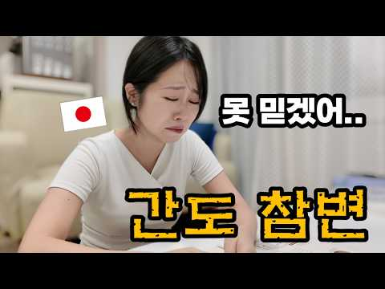
- 설명 앞부분: 안녕하세요, 유츄TV입니다😊 한국에서 생활하면서 한국사를 조금씩 공부해왔지만, 이번에는 일제강점기의 역사를 좀 더 자세히 공부해봤습니다. 간도 참변을 비롯해 당시 있었던 여러 사건들을 하나씩 알아가면서 처음 알게 된 사실도 많았고, 마음이 무거워지는 순간도 있었습니다. 일본인인 제가 한국의 역사책을 통해 일제강점기를 공부하면서 어떤 부분에서 놀랐고, 어떤 생각이 들었는지 남편과 함께 솔직하게 이야기해봤습니다. 🇯🇵일본인 아내의 한국사 시르즈🇰🇷 1️⃣한일부부∣ 갑자기 한국 역사를 배우겠다는 일본인 아내… 이유를 듣고 놀랐습니다 2…
- 같은 채널 평소 대비 ×9.5 (채널 최근 롱폼 중앙값 33,630회) · 평소 영상: 한국 시누이와 일본 아내 조합이 의외로 잘 맞는 이유 (34,176회) / 한일부부∣일본인 아내가 처음으로 한국 삶에 절망했습니다 (33,083회)
- 대본 없음 (설명) — 음성인식이 끝나면 도입부·흐름이 들어감
- 댓글 2,584/2,886: 좋은 점 — 영상 21 · 감사·응원 173 · 더 알고 싶은 것 29 · 아쉬운 점 — 영상 20 · 반박·불만 — 의견 다름 108 · 정치·사회 228 · 경험 공유 149 · 구독·다음 기대 9
  - 좋은 점 — 영상 👍12 “한국 에서는 예전에 있었던 일들 말그대로 역사를 배우는 것인데 일본에서는 이것을 반일 교육 이라고 말도 안되는 트집을 잡는데 반일교육을 받아 본 적이 없어요. 일본이 한국을 근대화 시켰다는 것은 집에 강도가 들었다가 도망가면서 폰을 떨구고 갔는데 그게 경제에 도움이 …”
  - 좋은 점 — 영상 👍9 “지나간 과거의 일이라지만 자칫 불편할 수 있는 주제를 회피하지 않고 마주친 용기가 대단합니다. 올바른 과거를 알고 기억을 해야 미래에 서로 도움이 되는 관계가 될 수 있겠지요.”
  - 감사·응원 👍228 “당신의 잘못이아닙니다. 사실을 알고 기억해주고 미안해 해주시는것도 감사합니다.”
  - 감사·응원 👍162 “과거의 일본인이 했던 만행과 잘못을 현대의 일본인에게 대신 짊어지게 하거나 죗값을 치르라고 말하고 싶지 않습니다. 다만 과거를 바르게 인식하고 반성하며 인정하는 것, 그리고 후대에 올바른 역사를 전달하는 것을 우리는 원합니다. 이것들이 오롯이 이뤄지지 않았기 때문에 …”
  - 더 알고 싶은 것 👍7 “서대문형무소 함델꼬가주시고 마루타실험도 꼭 써치해서 알려주세요.😊”
  - 더 알고 싶은 것 👍6 “사실 일본은 사람으로써 할수없는 못된짖 너무 많이하였고 학살도 많았다. 우리 나라 공식적인 침략만714번 이란 기록도있다. 일본이 역사왜곡 안하고 미래를 위해 학생들에게 바른 역사관을 잘 가르쳐주길 바랄뿐이다.”
  - 아쉬운 점 — 영상 👍6 “이상해서 영상 목록보니 명성 황후에서 헛웃음만..이 사람들 방향을 이상하게 잡았네..식민지 시절 일본의 잘못을 배우고 조선인의 고통을 공감? 이러면 무턱대고 좋아할 줄 알았나? 학교에서 가르치는 피해 의식으로 점철된, 역사 사기꾼들이 쓴 가짜 역사서 공부한다고 하면 …”
  - 아쉬운 점 — 영상 👍4 “일본인 모두가 잘못한게 아닙니다. 남편분 말처럼 이렇게 제대로된 역사를 알아주는게 중요한것 같아요. 이렇게 앞으로 태어나게될 후손들도 역사를 알아가게 될거에요. 그거면 됐어요. 그리고 반복되지 않으면 됩니다. 그리고 감사합니다.”
  - 반박·불만 — 의견 다름 👍228 “당신의 잘못이아닙니다. 사실을 알고 기억해주고 미안해 해주시는것도 감사합니다.”
  - 반박·불만 — 의견 다름 👍114 “본인이 슬퍼할 일은 아닙니다. 부정만 안 하면 될 뿐”
  - 정치·사회 👍5 “역사 공부 ? 일본 놈들이 무슨 짓을 했는지 똑똑히 가르쳐 주마. 그럼 간토 대학살 부터 알려주지 . 관동 대지진때 조선인이 우물에 독 풀었다고 거짓말 해서 일본 놈들이 자경단을 만들어 죽창으로 찌르고 칼로 베어 조선인 6661명을 죽였다. 조선을 침략해 조선인의 코…”
  - 정치·사회 👍4 “저도 교과서로 한국 역사를 배울 때.. 왜 일본의 역사와 중국의 역사와 다를까 의구심이 들었습니다. 한국은 거짓말을 하지 않는데.. 왜 일본과 중국은 거짓말을 하는 걸까??라고 늘 생각이 들었습니다. 나이가 들고 해외에서 유학을 8년 정도 하게 되면서 세상을 알게 됐…”
  - 경험 공유 👍69 “일본에서도 NHK에서 일제감점기에 대해 방송 했었던걸로 알고 있습니다 십몇년전인데 일본인이 그 방송을 보고 당시 동대문에서 장사하던 저에게 사과를 하더라구요 어머니와 따님이였는데 일본인으로서 부끄럽다 과거에 일본이 한국에게 나쁜 짓을 했었다 미안하다 이렇게 얘기해주셨…”
  - 경험 공유 👍9 “나는 부모로부터 직접일제 강점기를 들었습니다. 모든 금속식기를 빼앗아갔고 깨둥을 빼앗아가서 그 기름을 짠 찌꺼기인 깻묵을 대신 받았다. 한겨울에도 한국어를 사용하면 초등학생이었는데도 근처 저수지에가서 물을 갈어오게 했다.드등등 내가 들었던 내용은 아직도 충격적이었던 …”
  - 구독·다음 기대 👍171 “아내분이 조국의 민낯을 본다는 게 힘들건대 대단하네요. 너무 자책하지 않기를. 구독하고 갑니다”
  - 구독·다음 기대 👍4 “구독했어요 진실을 알아 봐서 감사합니다 ~^^”

### 296. 조선이 감춘 엿새의 학살 — 고려 왕족 474년 핏줄은 어떻게 사라졌나

- https://www.youtube.com/watch?v=e3Aax9sONqQ · 새벽이 깨운 역사 · 구독자 10,500 · 조회수 169,089 (×16.1, 하루 1,144.5) · 좋아요 4,161 (2.5%) · 50.1분 · 2026-06-15 · 주제 묶음 2. 한국 고대·삼국·고려 · 형식 정보·해설 (그 밖) · 폴더 `W_e3Aax9sONqQ` (웹 승인)
- 썸네일: 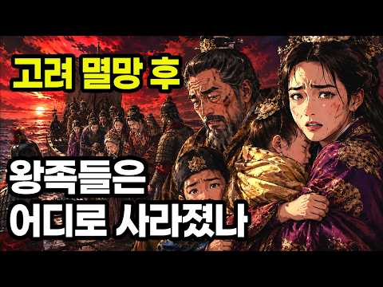
- 챕터: 0:00 돌아오지 않은 배 · 3:03 코리아 — 474년 고려의 무게 · 6:58 영웅 이성계, 그리고 무너지는 고려 · 13:39 위화도 회군과 정몽주, 선죽교 · 22:21 관용에서 학살로 — 이흥무 옥사 · 27:34 엿새의 학살 (강화·삼척·거제) · 32:40 구멍 뚫린 배, 그리고 공양왕의 두 무덤 · 36:07 살아남은 자들 — 성을 바꾼 핏줄 · 42:49 죽인 나라가 되살리다 — 숭의전과 복권 · 45:34 경순왕과 마의태자, 그리고 남은 질문
- 설명 앞부분: 1394년, 고려 왕족 수백 명이 단 엿새 만에 바다에 던져졌습니다. 조선왕조실록에 또렷이 적혀 있지만, 우리가 거의 배운 적 없는 '왕씨 몰살'의 진실입니다. 918년부터 1392년까지, 무려 474년을 이어온 고려. 코리아라는 이름의 뿌리이자, 고려청자와 금속활자, 팔만대장경을 남긴 그 찬란한 나라의 핏줄이, 새 나라 조선이 들어선 지 단 2년 만에 — 강화도에서, 삼척에서, 거제에서, 차례로 사라졌습니다. 고려의 마지막 임금 공양왕은 두 아들과 함께 끈에 목이 졸렸고, 거제 앞바다를 떠난 배 한 척은 끝내 돌아오지 않았습니다…
- 같은 채널 평소 대비 ×79.0 (채널 최근 롱폼 중앙값 2,141회) · 평소 영상: 세조를 왕으로 만든 남자, 죽은 지 17년 만에 목이 잘린 이유 ∣ 부관참시 ∣ 계유정난… (2,141회) / 스물여덟에 사지가 찢긴 병조판서 ∣ 남이는 역적이었나, 조작당한 천재였나 (2,069회)
- 대본 없음 (설명) — 음성인식이 끝나면 도입부·흐름이 들어감
- 댓글 371/401: 좋은 점 — 영상 2 · 감사·응원 11 · 더 알고 싶은 것 2 · 아쉬운 점 — 영상 4 · 반박·불만 — 의견 다름 7 · 정치·사회 21 · 경험 공유 11 · 구독·다음 기대 0
  - 좋은 점 — 영상 👍2 “ㅎㅎ 이성계가 그게 무슨 인간이냐 역사적 인물로 좋은평가를 내리기엔 수준미달 같다 군인으로서 활약을 따저봐도 썩 두드러진 업적이있는것도 아니고 별로 눈에 띠는것도없잔아 거창하게 미화하지만 활하나 잘쏘았다고 그분야에서 능력이 있는 지는 모르겠지만 전략이나 전술에 무능하…”
  - 감사·응원 👍70 “제가 고려왕족의 후손인 개성왕씨입니다. 고려시대의 비극을 잘말씀해주셔서 감사합니다.”
  - 감사·응원 👍8 “가슴이 먹멍 합니다 ! 해병 505기 좋은 동영상 잘보고갑니다 감사합니다 ❤”
  - 더 알고 싶은 것 👍3 “다음은사라진금관가야 를알려주세요 금과가야 가망할때 대마도로 피신했다는데 대마도는한국땅이고한국인김해김씨후손들이라는데맞는말인지”
  - 아쉬운 점 — 영상 👍5 “어느나라든 이같은 역사는 있지요 그만큼 권력이 중요시 되고 한나라의 통일이 되려면 상대쪽은 죄가 없어도 나중에 역모하고 어쩌고 저쩌고 해서 나라를 어지럽게 만들 요인들을 처단하는게 당연시되던 시절이죠 지금도 마찬가지 배트남 필리핀을 여성상위시대로 만들고 남자들을 가정…”
  - 아쉬운 점 — 영상 👍1 “요점섭ㅇ는 잡소리가 너무 길어”
  - 반박·불만 — 의견 다름 👍4 “몽골과 전쟁하던 진짜 강화도는 지금 인천 강화도가 아닙니다.”
  - 반박·불만 — 의견 다름 👍4 “글쎄.. 주위에 없어요”
  - 정치·사회 👍51 “저의 할머니 세분이 공주(목종녀, 충선왕녀, 공민왕녀), 마지막 할머니가 공민왕 따님…후손들이 벼슬안하고 (유언남기심)…경남 진주까지 내려와 살았습니다. 전 정말 가난하게 살았습니다. 어머니는 우리를 위해 굶으셨다는…흑흑… 그래도 선조들은 조선 시대 나라가 어려워 졌…”
  - 정치·사회 👍21 “고려의 입장에서 보면 이성계의 위화도회군은 위화도반란이라고 해야 했다. 또한 고려의 왕씨 왕좌 중에 최충헌 등 무신이 정권을 잡은 세월이 적지 않았다.”
  - 경험 공유 👍76 “왕씨들 고려 시대때까지도 토지가 중국 북부는 물론 남동쪽까지 잘 유지 했었는데 조선이 세워지면서 원나라에 거진 넘어갔다ㅡㅡ고려왕족이 정치를 잘못한것도 있지만 이성계의 개인 욕심때문에 고려땅 반이상이 다 넘어간거다!!”
  - 경험 공유 👍70 “제가 고려왕족의 후손인 개성왕씨입니다. 고려시대의 비극을 잘말씀해주셔서 감사합니다.”

### 297. 숙종이 송시열보다 무서운 진짜 이유 — 조선에서 가장 냉혹했던 왕의 46년

- https://www.youtube.com/watch?v=PPmGCBpYbO4 · 역사빌런 · 구독자 15,200 · 조회수 293,349 (×19.3, 하루 1,652.0) · 좋아요 4,989 (1.7%) · 38.5분 · 2026-05-17 · 주제 묶음 3. 조선 · 형식 정보·해설 (그 밖) · 폴더 `W_PPmGCBpYbO4` (웹 승인)
- 썸네일: 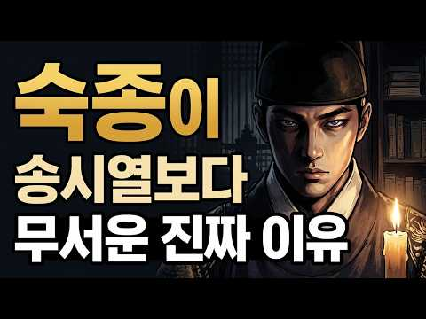
- 챕터: 0:00 신하가 왕보다 강했던 시대 · 1:30 열세 살의 친정 선언과 신하들의 당황 · 8:00 붕당이라는 전쟁터를 물려받다 · 15:00 숙종이 발명한 정치 — 환국 · 22:00 주역 공부와 숨겨진 의도 · 27:00 장희빈의 아들과 기사환국 · 33:00 정읍의 사약 — 그리고 죽지 않은 유령 · 38:00 냉혹한 군주의 뜻밖의 인간적 면모
- 설명 앞부분: 신하가 왕보다 강했던 나라에서, 열세 살짜리 왕이 아무도 모르게 기다렸습니다. 그리고 때가 됐다 싶은 순간, 조선 최강 송시열에게 망설임 없이 사약을 내렸습니다. 📖 이 영상에서 다루는 내용 칼도 없고 군사도 없이 오직 학문과 명분만으로 왕을 옥죄던 사람. 조선 역사상 유일하게 이름 뒤에 최고의 존칭이 붙은 단 한 명의 신하, 송시열. 그런데 그 송시열에게 사약을 내린 왕이 있었습니다. 열세 살에 즉위해 수렴청정도 거부하고, 아무도 모르게 기다렸다가 때가 됐다 싶은 순간 망설임 없이 칼을 뽑은 사람. 이 왕이 무서운 건 잔인해서가…
- 같은 채널 평소 대비 ×221.1 (채널 최근 롱폼 중앙값 1,327회) · 평소 영상: 김유신은 왜 김춘추를 선택했나? 혼인으로 시작된 신라 최고의 권력동맹 (1,327회) / 흑치상지는 왜 당나라를 선택했나｜백제 부흥군을 이끌던 장수가 당나라 명장이 된 이유 (1,335회)
- 대본 없음 (설명) — 음성인식이 끝나면 도입부·흐름이 들어감
- 댓글 460/471: 좋은 점 — 영상 7 · 감사·응원 8 · 더 알고 싶은 것 2 · 아쉬운 점 — 영상 2 · 반박·불만 — 의견 다름 5 · 정치·사회 42 · 경험 공유 11 · 구독·다음 기대 1
  - 좋은 점 — 영상 👍41 “성리학이건 유교건 그건 사상일뿐 인간생활에 무슨 도움이될까 과학이같이 공존해야한다”
  - 좋은 점 — 영상 👍8 “역사빌런님. 송시열님 피를 이어받은 제가 송시열을 아는 것은 임무여요. 그 시대로 갈 수 있게 도와주시니 고맙습니다. 좋은 영상으로 잘 배울께요. 감성편지 드림.”
  - 감사·응원 👍8 “역사빌런님. 송시열님 피를 이어받은 제가 송시열을 아는 것은 임무여요. 그 시대로 갈 수 있게 도와주시니 고맙습니다. 좋은 영상으로 잘 배울께요. 감성편지 드림.”
  - 감사·응원 👍3 “좋은 영상 감사합니다”
  - 더 알고 싶은 것 👍6 “동인과 서인의 시작도 설명해주시면 좋을 것 같습니다. 영상 잘 봤습니다^^”
  - 아쉬운 점 — 영상 👍4 “다 좋은데 중간 광고가 너무 많아서 정말 성가시네요”
  - 아쉬운 점 — 영상 👍0 “군권 장악에 대한 내용이 빠져서 무척 아쉽습니다.”
  - 반박·불만 — 의견 다름 👍1 “송시열. 님이 틀렸다..”
  - 반박·불만 — 의견 다름 👍1 “웃기는 해석이다. 왕권과 신권의 다툼? 어느시대도 똑 같았다. 심지어 정조대왕조차도..”
  - 정치·사회 👍25 “이슬람 종교국가와 다를바 없는 나라. 결국 신분제와 기득권 유지에 동원된 이념. 전쟁이나 외부 유입없이 그렇게 많은 인구가 노비인 나라가 없다. 동서고금.”
  - 정치·사회 👍8 “율곡과 송시열은 완전히 결이 다른 사람이었습니다. 율곡은 개혁가였지 권력과 명예따위를 탐하던 사람이 아닙니다. 오히려 꼰대 붕당정치를 지적하여 동인과 서인에게 동시에 탄핵을 받아 낙향했던적이 수차례 반복되는 삶을 살았습니다.”
  - 경험 공유 👍49 “송시열의 마지막 사약 받는 장면이 잘못 되어 있습니다. 송시열은 자신에게 사약이 내려졌다는 것을 승복 못하고 계속 거부하고 이방저방으로 도망가는 것을 잡아다가 강제로 먹인 것이 사실입니다. 평소에는 그렇게 곧은 선비인 것처럼 굴다가 마지막 죽음 앞에서는 각종 본성이 …”
  - 경험 공유 👍31 “저도 최근에야 숙종에 대해서 좀 알게된듯... 대단한 왕이었음...”
  - 구독·다음 기대 👍1 “구독하고 자주 들려 영상 보겠습니다. 감사합니다”

### 298. 사극이 안 보여준 승은 다음날 아침

- https://www.youtube.com/watch?v=C8zmRWow5a8 · 역사기록관 · 구독자 6,240 · 조회수 86,387 (×13.8, 하루 669.7) · 좋아요 1,830 (2.1%) · 25.3분 · 2026-06-16 · 주제 묶음 3. 조선 · 형식 정보·해설 (그 밖) · 폴더 `W_C8zmRWow5a8` (웹 승인)
- 썸네일: 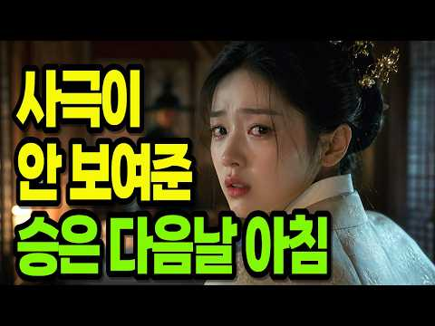
- 설명 앞부분: 조선시대, 궁녀가 임금의 '승은'을 입은 바로 그 다음 날 아침에는 과연 무슨 일이 벌어졌을까요? 사극은 늘 그 은밀한 밤에서 끝나버리지만, 한 여인의 진짜 운명은 바로 '다음 날'에 결정됐습니다. 이 영상에서 다루는 내용: ▪ '승은'의 진짜 의미와 조선 궁녀의 신분 구조 ▪ 승은 입은 다음 날 가장 먼저 찾아온 것 (축하가 아니었습니다) ▪ 승은상궁이 되면 달라지는 것 — 노동에서의 해방, 거처, 나인, 복색 ▪ 후궁이 되는 단 하나의 조건과 내명부 품계 (빈·귀인·숙의·숙원) ▪ 후궁의 처소와 생활 공간, 동궐도 속 실제 흔…
- 같은 채널 평소 대비 ×177.8 (채널 최근 롱폼 중앙값 486회) · 평소 영상: 청은 왜 항복한 인조를 왕좌에 돌려보냈을까? (486회) / 조선과 완전히 달랐던 고려 500년 총정리 (500회)
- 대본 없음 (설명) — 음성인식이 끝나면 도입부·흐름이 들어감
- 댓글 150/151: 좋은 점 — 영상 1 · 감사·응원 2 · 더 알고 싶은 것 1 · 아쉬운 점 — 영상 16 · 반박·불만 — 의견 다름 1 · 정치·사회 1 · 경험 공유 2 · 구독·다음 기대 0
  - 감사·응원 👍5 “첫글이 흰색이고 바탕이 비슷 해서제목의 글이 잘 안보입니다 잘보이게 해주십시요 화이팅입니다”
  - 감사·응원 👍1 “재미있게 잘봤습니다 감사합니다”
  - 더 알고 싶은 것 👍0 “애들은 가라😂 ㅠ이건어룬둘애기야😂진짜 궁긍해서 ㅜㅜㅜㅜ하 친정도ㅜ부자도고요 친척도😮ㅠ알고싶어요ㅜ”
  - 아쉬운 점 — 영상 👍102 “서론이 지나치게 길고 동어반복이 심해서 보기가 지지부진하네요”
  - 아쉬운 점 — 영상 👍98 “실제 이야기가 시작되기 전까지의 단계가 너무 길고, 동어반복이 계속되는데. 과정과 결론이 더 빨리나오는게 좋을 듯 하네요.”
  - 반박·불만 — 의견 다름 👍4 “나래이션 속도를 조금 더 올려주는게 어떨지.. 스피디한 설명에 길들여진 독자들이 의외로 많아서요. 듣다가 지루해질 수 있을 듯 해요(저와 주변인들 기준이니 절대적인 건 아닙니다 ㅎ)”
  - 정치·사회 👍1 “그러니 이나라가. 망하지 아비가 자식을 죽이고 자식이. 아비를 죽이고 형제가. 서로를. 죽이고 삼촌이 조카들을 죽이고 싹 없어져야 나라 전체가”
  - 경험 공유 👍1 “회임을 하던지 못하던지 임금이 한번보고 차버린경우는 매력도없고 향기가 있는줄 알았는데 별로었고 꽃잎도 맛도없고 꿔다 놓은 보리자루 었다면 내가 임금이라도 다시는 보지않았을 것이다 미련한 곰 보다 영리한 여우가 더 좋은 것이다...요즈은 미모보다 음식솜씨 없는 여자보다…”
  - 경험 공유 👍0 “나도 성은 압고싶어요”

### 299. 집을 반으로 갈라버린 조선의 노부부, 그런데 할아버지가 사라졌다

- https://www.youtube.com/watch?v=XBePem4Xz2g · 한국시대극 · 구독자 12,500 · 조회수 155,476 (×12.4, 하루 1,336.9) · 좋아요 1,350 (0.9%) · 4.8분 · 2026-07-17 · 주제 묶음 3. 조선 · 형식 브이로그·직접 해본 이야기 · 폴더 `W_XBePem4Xz2g` (웹 승인)
- 썸네일: 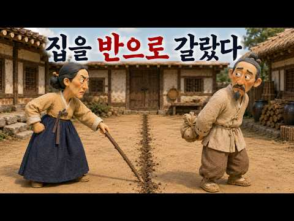
- 설명 앞부분: 평생 한집에서 살아온 노부부가 어느 날 집과 살림을 정확히 반으로 나눠버렸습니다. 집안의 마지막 소가 사라졌고, 할아버지는 자신이 팔았다고 인정하면서도 이유만은 끝내 말하지 않았습니다. 화가 난 할머니는 마당 한가운데 선을 긋고 이불과 밥그릇, 국자와 닭까지 네 것과 내 것으로 나누기 시작했습니다. 수십 년을 함께 산 부부는 같은 집에 있으면서도 서로의 선을 넘지 않았고, 자존심 때문에 밥 한 끼도 함께 먹지 않았습니다. 하지만 할머니는 자신도 모르게 주먹밥을 두 개 만들었고, 그중 하나를 남편 쪽 경계선 너머에 몰래 놓았습니다.…
- 같은 채널 평소 대비 ×16.6 (채널 최근 롱폼 중앙값 9,374회) · 평소 영상: [본편] 남편이 죽은 뒤에도 그물은 매일 젖어 돌아왔다, 그런데 그는 살아 있었다 (10,296회) / 혼례가마가 비어 있었는데, 시어머니는 혼례를 멈추지 않았다 (10,364회)
- 대본 없음 (설명) — 음성인식이 끝나면 도입부·흐름이 들어감
- 댓글 39/39: 좋은 점 — 영상 0 · 감사·응원 1 · 더 알고 싶은 것 1 · 아쉬운 점 — 영상 0 · 반박·불만 — 의견 다름 0 · 정치·사회 0 · 경험 공유 0 · 구독·다음 기대 0
  - 감사·응원 👍0 “부부싸움은 칼로물베기랍니다ㆍ 알고보면 아무일도아닌것 글 감사드립니다ㆍ”
  - 더 알고 싶은 것 👍4 “4~5분 내외로 전래동화나 명작이나 재미있는 이야기나 전설의 고향같은 영상 만들어주세요^^ 어르신들에게 보여드리고 싶네요♡”

### 300. "허준도 하지 못했다?" 실록이 유일하게 신의(神醫)라 적은 남자

- https://www.youtube.com/watch?v=JdqFMCieizE · 한국사 다시읽기 · 구독자 29,900 · 조회수 203,123 (×6.8, 하루 3,178.9) · 좋아요 822 (0.4%) · 17.8분 · 2026-08-25 · 주제 묶음 3. 조선 · 형식 정보·해설 (그 밖) · 폴더 `W_JdqFMCieizE` (웹 승인)
- 썸네일: 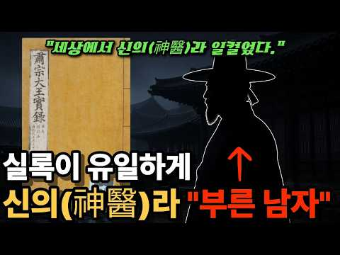
- 챕터: 0:00 신의라 불린 유일한 의원 · 1:42 종기, 조선을 덮친 죽음의 공포 · 4:07 말을 고치던 손, 사람에게 향하다 · 7:45 살을 째는 의술, 치종술의 탄생 · 10:14 두 임금을 살려낸 목숨을 건 침 · 13:30 가장 낮은 곳을 향한 신의의 마음
- 설명 앞부분: 🩺 조선왕조실록이 '신의(神醫)'라 기록한 단 한 사람 허준도, 그 어떤 명의도 얻지 못한 두 글자 '신의'. 굵은 침 한 자루로 왕과 백성의 목숨을 구한 조선 외과 의술의 선구자🪡 ⏱️ 타임라인 📚 참고 자료 『조선왕조실록』 숙종실록보궐정오 — 숙종 21년(1695) '세칭신의(世稱神醫)' 기록 『승정원일기』 — 숙종 16년(1690) 침·파종(破腫) 관련 기록 정내교, 「백태의전(白太醫傳)」 「지사공유사 부경험방(知事公遺事 附經驗方)」 (국립중앙도서관 소장 사본) 한국민족문화대백과사전 '백광현' 항목 🖼️ 안내사항 본 영상에는…
- 같은 채널 평소 대비 ×35.3 (채널 최근 롱폼 중앙값 5,761회) · 평소 영상: '최대 1000명 숙청...' 남인의 핵심 정약용은 왜 살려둔 걸까? (5,761회) / "철의 여인 정희왕후" 세조의 아내가 조선 최고의 대모인 이유 (5,944회)
- 대본 없음 (설명) — 음성인식이 끝나면 도입부·흐름이 들어감
- 댓글 36/37: 좋은 점 — 영상 1 · 감사·응원 2 · 더 알고 싶은 것 0 · 아쉬운 점 — 영상 0 · 반박·불만 — 의견 다름 0 · 정치·사회 0 · 경험 공유 0 · 구독·다음 기대 0
  - 좋은 점 — 영상 👍17 “유익한 영상 올려주셔서 감사합니다.”
  - 감사·응원 👍17 “유익한 영상 올려주셔서 감사합니다.”
  - 감사·응원 👍1 “감사합니다”

### 301. 🌙 [잘 때 듣는] 마리 앙투아네트는 왜 사지도 않은 목걸이 때문에 단두대에 올랐을까? (73분) ∣ 숙면 세계사 ∣ 오디오북 ASMR

- https://www.youtube.com/watch?v=_NDcu-xEccM · 잘 때 듣는 - 숙면 세계사 · 구독자 11,200 · 조회수 81,437 (×7.3, 하루 1,181.5) · 좋아요 1,364 (1.7%) · 73.7분 · 2026-08-20 · 주제 묶음 10. 수면·낭독 · 형식 수면·낭독 (잠잘 때 듣는) · 폴더 `W__NDcu-xEccM` (웹 승인)
- 썸네일: 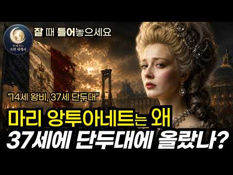
- 챕터: 0:00 프롤로그 - 혁명 광장, 한 가지 질문 · 4:40 제1장 국경에서 옷을 빼앗긴 14세 공주 · 9:50 제2장 7년간 지속된 후계자 압박 · 15:30 제3장 소박한 도피처와 과장된 소문 · 21:00 제4장 주인 잃은 괴물 목걸이 · 26:20 제5장 야망과 욕망의 결탁 · 31:30 제6장 밤의 밀회와 위조된 서명 · 37:00 제7장 해체된 보물과 완전범죄 · 42:00 제8장 폭로, 왕비는 목걸이를 산 적이 없었다 · 48:00 제9장 세기의 공개 재판과 거대한 역설 · 54:00 제10장 '마담 데피시트'와 흑색선전 · 59:30 제11장 1789년, 궁전을 끌어내린 분노 · 65:00 제12장 바렌 도주 사건 · 68:30 제13장 왕정 붕괴와 아들과의 분리 · 71:30 제14장 단두대의 마지막 5분
- 설명 앞부분: 사지도 않은 목걸이 하나가, 어떻게 한 왕비를 단두대로 보냈을까요. 열네 살에 낯선 나라로 보내진 소녀는 왜 온 나라의 증오를 받는 악녀가 되었을까요. 그녀가 정말 프랑스를 망친 것일까요, 아니면 누군가 그녀의 이름을 훔친 것일까요. 그리고 한 번의 거짓 소문은 어디까지 한 사람을 무너뜨릴 수 있을까요. 1770년, 오스트리아의 어린 공주가 프랑스로 향했습니다. 화려한 베르사유의 왕비가 되었지만, 그녀를 기다린 것은 숨 막히는 예법과 이방인을 향한 차가운 시선이었습니다. 그리고 1785년, 그녀가 사지도, 보지도 않은 다이아몬드 …
- 같은 채널 평소 대비 ×4.4 (채널 최근 롱폼 중앙값 18,453회) · 평소 영상: 🌙 [잘 때 듣는] 600년 유럽을 떨게 한 제국은 왜 형제를 모두 죽였나 — 오스만 제… (18,453회) / 🌙 [잘 때 듣는] 지옥이 두려워 르네상스를 사버린 은행가들 ∣ 메디치 가문의 비밀 (7… (18,985회)
- 대본 없음 (설명) — 음성인식이 끝나면 도입부·흐름이 들어감
- 댓글 85/92: 좋은 점 — 영상 0 · 감사·응원 4 · 더 알고 싶은 것 0 · 아쉬운 점 — 영상 1 · 반박·불만 — 의견 다름 4 · 정치·사회 8 · 경험 공유 3 · 구독·다음 기대 0
  - 감사·응원 👍35 “조선 시대에도. 역모가 일어나 왕이 바귀면. 유배를 갔었고 왕비도 궁중에서 사가로 가거나 노비신분등으로 강등된거 같은데 선진화된 프랑스의 법이 더 엄격하고 잔인한것 같네요 마리 앙투아네트. 그분의 삶은. 비교적 소박하면서도. 그녀의 정신은 다이아몬드보다 더 아름답게.…”
  - 감사·응원 👍21 “마리 앙뚜아네트에 대하여 상세하게 알게 되어서 고맙습니다”
  - 아쉬운 점 — 영상 👍1 “그냥 베르사유 궁전에서 마무리 하고 고등법원으로 안갔으면 어땠을까요? 그것도 아쉽네요”
  - 반박·불만 — 의견 다름 👍42 “무엇을 위한 혁명인가? 루이 16세와 마리 앙뚜아네트의 삶이 비참하네요 예나 지금이나 선전선동과 무지한 국민이 비극을 초래하게 됩니다”
  - 반박·불만 — 의견 다름 👍16 “김경율이 김건희를 마리앙투아네트라고했지,. 수백년이 지나도 아둔한 인간은 여전히 선전선동당하지”
  - 정치·사회 👍18 “박근혜대통령이생각난다ㅡㅡ유언비어ㅡ선동으로쫓겨난대통령😢”
  - 정치·사회 👍18 “이 영상을 보면서 보는 내내 박근혜 대통령의 생각이 머리를 맴돈다. 한 인간을 세월호라는 멍석에 돌돌말아 강물에 던져버린거나 다름없는 처참한 일이 선진국이라는 대한민국에서도 일어났었지. 그때 누군가 국회복도에 마리앙투아네트의 그림을 더럽게 묘사를해서 걸어놓았었지. 지…”
  - 경험 공유 👍11 “와~ 오해를 했었네~😮”
  - 경험 공유 👍1 “내가10살쯤 거제도에 살았는데 저의 아버지께서 사깃꾼들에게 억울한 누명을쓰고 시달림받다가 부산 양정동으로 가서숨어살았는데 이웃에 살인 사건이 나서 거제도로 간것이었습니다😅 그때 아버지께서 만화가게를 하셨는데 마리앙토아네트 왕비의 목걸이를찾으려 떠난 달타냥과 그의 친구…”

### 302. 사수 전투 │ 고당전쟁 역사상 가장 위대했던 고구려와 연개소문의 승리. AI 단편 사극 영화

- https://www.youtube.com/watch?v=w6G1N2fUNQg · 쇠꼬비 검프  · 구독자 16,900 · 조회수 286,927 (×17.0, 하루 1,736.0) · 좋아요 4,024 (1.4%) · 43.9분 · 2026-05-29 · 주제 묶음 2. 한국 고대·삼국·고려 · 형식 정보·해설 (그 밖) · 폴더 `W_w6G1N2fUNQg` (웹 승인)
- 썸네일: 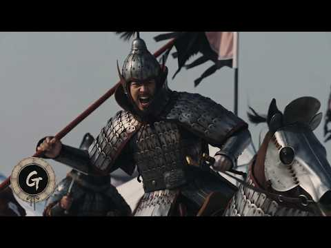
- 설명 앞부분: 안시성 전투로 잘 알려진 645년 1차 고당전쟁과 고구려가 멸망한 668년의 3차 고당전쟁의 사이에 낀 661~662년의 2차 고당전쟁은 그동안 그렇게 많이 주목받지 못 했습니다. 그러나 2차 고당전쟁에서 고구려는 당나라의 침략 야욕을 완벽하게 분쇄했습니다. 연개소문 사후 그의 아들 삼형제가 내전을 일으키기 전까지만 해도 당나라는 고구려 재침을 아예 포기할 정도로 큰 타격을 입었습니다. 그리고 그 중심에 평양 보통강(또는 합장강) 일대로 추정되는 사수에서의 승전이 있었습니다. 즉 사수 전투는 고구려와 당나라 사이에 영구적 평화를 …
- 같은 채널 평소 대비 ×2.0 (채널 최근 롱폼 중앙값 140,244회) · 평소 영상: 매소성 전투 │ 당나라 대군을 갈아버린 신라의 분노. AI 단편 사극 영화 (210,906회) / 668 평양성 전투 │ 고구려 최후의 순간을 AI로 재현 (69,581회)
- 대본 없음 (설명) — 음성인식이 끝나면 도입부·흐름이 들어감
- 댓글 1,082/1,110: 좋은 점 — 영상 10 · 감사·응원 47 · 더 알고 싶은 것 29 · 아쉬운 점 — 영상 13 · 반박·불만 — 의견 다름 10 · 정치·사회 79 · 경험 공유 41 · 구독·다음 기대 13
  - 좋은 점 — 영상 👍4 “좋은 영상 감사합니다!”
  - 좋은 점 — 영상 👍3 “선생님 저 고구려 역사 진짜 좋아하는데 정말 잘봤습니다 진심으로 이렇게 좋은 영상 보는건 처은이라서 제가 왠만하면 댓글을 잘 안쓰는데 이번 영상 정말 평생 못잊을 것 같아요!”
  - 감사·응원 👍240 “사수전투 요청드렸던 사람입니다 연개소문의 위용을 이렇게라도 볼수있어 감사드립니다. 천년이 넘게 흘렀지만 여전히 중국에 드리워져 있는 대막리지의 메아리.”
  - 감사·응원 👍66 “공대 박사 대학원생입니다 영상보고 전공 바꿀지 고민했습니다. 다음엔 고려 몽골 해주시면 감사하겠습니다.”
  - 더 알고 싶은 것 👍6 “백제 드라마도 만들어주시면 감사하겠습니다.”
  - 더 알고 싶은 것 👍4 “다음에는 살수대첩도 한 번 제작 부탁드려요 고수전쟁”
  - 아쉬운 점 — 영상 👍8 “우리 사극에 대해 블로그에서 쓰신 글부터 잘 보고 있습니다.그때 밀씀하셨던 아쉬운 점들을 이렇게 직접 구현하시는걸 보니 정말 너무 좋습니다!!”
  - 아쉬운 점 — 영상 👍5 “잘 봤습니다 헌데 무기 고증이 좀 아쉽습니다 고구려의 주무기는 7할이 맥궁이었고 엄지 사법을 썼습니다 근데 영상 중간중간 화살을 활의 왼쪽에 걸고 세 손가락으로 쏘는 지중해 사법이 많이 등장하네요 나머지 3할은 장창이 주무기였고 초근접시엔 철퇴와 도끼를 썼습니다 장검…”
  - 반박·불만 — 의견 다름 👍2 “퀄리티 장난아닙니다;; 몇번을 봐도 캐릭터들의 대화내용도 장난 아니네요. 정말 드라마보다도 잘 만들었네요!! 앞으로도 더 만들어주세요~~”
  - 반박·불만 — 의견 다름 👍2 “지난 70년 동안 너희가 죽인 고려 백성들의 피가 강을 이루고 바다를 이루었다! 내 드디어 오늘 그 오랜 전쟁을 끝내게 되었으니 참으로 기쁘구나. 또 올테면 와보거라, 이 연개소문이 살아있는 한 고려의 땅은 당적들의 육신을 탐하는 거대한 푸줏간으로 남아있을테니! 술탈…”
  - 정치·사회 👍5 “중국인들이 댓글에서 이렇게 열심히 반응하는 거 보니 퀄리티랑 중국어 연기는 인정한 셈 아닌가? ㅋㅋ”
  - 정치·사회 👍4 “자기들이 먼저 쳐들어와 놓고 피의 대가 이 ㅈㄹ.... 역시 중국인의 뻔뻔함까지 리얼하게 구현....엄청난 고증!!”
  - 경험 공유 👍13 “영상 퀄리티 죽이네요. 고증도 뛰어나 보는내내 내가 개마무사가 된듯한 느낌입니다.”
  - 경험 공유 👍6 “늦은 감상문 방효태의 연기 스타일과 소시민적 태도가 왕휘 배우 (대진제국 위 공자 앙, 옹정황제 13제) 의 소시민적 폐급 연기를 생각나게 합니다. Ai여서 가끔 허점은 보입니다만, 연기에 상당히 놀랐습니다. 현갑군의 활용: 경여년이라는 타임슬립물에서 흑기병이 무섭게…”
  - 구독·다음 기대 👍64 “다음 작품으로 광개토대왕의 사방합전 기대합니다. 헉헉...”
  - 구독·다음 기대 👍3 “아니 무슨 Ai영화를 이렇게 잘 만드나요? 40분을 10분일정도로 몰입감있게 너무 재밌게 봤읍니다. 정말 대단합니다. 더 좋은 후속 작품 기대합니다.”

### 303. “사람을 톱질하려고 만들었다고?｜물결치는 거대 양손검 플람베르주의 진짜 이유”

- https://www.youtube.com/watch?v=pjWYMEW1RNw · 슬기로운 역사보기 · 구독자 16,200 · 조회수 66,495 (×4.1, 하루 1,662.9) · 좋아요 363 (0.5%) · 11.9분 · 2026-09-18 · 주제 묶음 1. 역사 일반·이야기 · 형식 정보·해설 (그 밖) · 폴더 `W_pjWYMEW1RNw` (웹 승인)
- 썸네일: 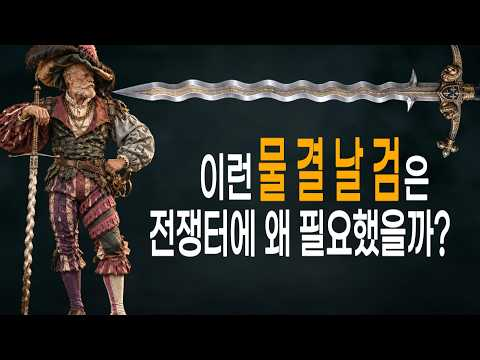
- 설명 앞부분: 물결처럼 일렁이는 기묘한 칼날. 보기만 해도 평범한 검은 아니죠. 그런데 플람베르주는 대체 왜 이렇게 만들었을까요? 상대의 검을 떨리게 만들어 손목을 마비시켰다? 사람을 톱처럼 갈아버렸다? 심지어 파이크의 창대까지 잘라버리기 위해 만들었다? 플람베르주의 독특한 모습 때문에 수백 년 동안 수많은 이야기가 따라붙었습니다. 하지만 실제 역사를 들여다보면 이 물결치는 칼날에는 조금 다른 이야기가 숨어 있습니다. 이 영상에서는: ⚔️ ‘플람베르주’라는 이름에 숨겨진 뜻 ⚔️ 물결날이 실제 전투에서 만들어낸 차이 ⚔️ 진동·끔찍한 상처·창대…
- 같은 채널 평소 대비 ×4.1 (채널 최근 롱폼 중앙값 16,048회) · 평소 영상: "포병들이 일부러 땅을 겨냥해서 대포를 쏜 이유｜라운드샷의 진짜 위력" (17,149회) / "전투기보다 ‘조종사’가 더 비싸다｜가장 위험한 임무의 탄생” (14,948회)
- 대본 없음 (설명) — 음성인식이 끝나면 도입부·흐름이 들어감
- 댓글 67/67: 좋은 점 — 영상 2 · 감사·응원 4 · 더 알고 싶은 것 2 · 아쉬운 점 — 영상 2 · 반박·불만 — 의견 다름 9 · 정치·사회 0 · 경험 공유 9 · 구독·다음 기대 1
  - 좋은 점 — 영상 👍10 “모처럼 여유있는 금요일 저녁인데, 딱 맞춰서 재미있게 보는 분야가 딱 올라왔네요. 감사합니다. 말씀하신 낭설들에 대해서는 정확하게 핵심을 짚어내셨네요. 참고로 저는 몇만번을 휘두르고 대량파괴를 하고 나서야 겨우 깨달은 내용인데, 슬기역사님께서 정확하게 핵심을 찾아내,…”
  - 감사·응원 👍10 “모처럼 여유있는 금요일 저녁인데, 딱 맞춰서 재미있게 보는 분야가 딱 올라왔네요. 감사합니다. 말씀하신 낭설들에 대해서는 정확하게 핵심을 짚어내셨네요. 참고로 저는 몇만번을 휘두르고 대량파괴를 하고 나서야 겨우 깨달은 내용인데, 슬기역사님께서 정확하게 핵심을 찾아내,…”
  - 반박·불만 — 의견 다름 👍10 “모처럼 여유있는 금요일 저녁인데, 딱 맞춰서 재미있게 보는 분야가 딱 올라왔네요. 감사합니다. 말씀하신 낭설들에 대해서는 정확하게 핵심을 짚어내셨네요. 참고로 저는 몇만번을 휘두르고 대량파괴를 하고 나서야 겨우 깨달은 내용인데, 슬기역사님께서 정확하게 핵심을 찾아내,…”
  - 반박·불만 — 의견 다름 👍7 “7:17 이 생각을 못하면 댓글로 헛소리를 당당하게 지껄이게 된다.”
  - 경험 공유 👍3 “5:07 과시라고 생각함 과거 중세에서 쓰였던 샤프롱의 리리파이프가그 예시임 당시 리리파이프를 다는 것은 큰 수고가 드는 일이었음 즉 돈이 많이 듬 그래서 나중엔 신분이나 재력을 과시하기 위해 점점 길다란 리리파이프를 다는 것이 유행이 되기도 했었음 도검 제작 과정을…”
  - 구독·다음 기대 👍1 “완전 제 관심사라 구독하고 갑니다. 영상 즐감했습니다.^^”

### 304. 효령대군, 세종보다 37년 더 살았다 ∣ 9명의 왕을 지켜본 둘째 왕자

- https://www.youtube.com/watch?v=zZQ_1_dLarU · 그날의역사 · 구독자 7,360 · 조회수 122,552 (×16.6, 하루 753.3) · 좋아요 735 (0.6%) · 21.6분 · 2026-05-31 · 주제 묶음 3. 조선 · 형식 정보·해설 (그 밖) · 폴더 `W_zZQ_1_dLarU` (웹 승인)
- 썸네일: 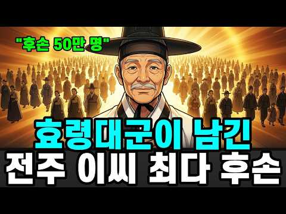
- 설명 앞부분: 조선 왕족 중에서 가장 오래 산 사람이 누구였을까요. 왕도 아니고 장수도 아니었습니다. 태종의 둘째 아들 효령대군은 23살에 동생 충녕에게 왕좌를 비키고, 그 자리에서 비로소 91년을 시작합니다. 큰형 양녕은 69세, 동생 세종은 54세, 조카 세조는 52세. 조선 왕의 평균 수명은 47세였습니다. 그런데 그는 91세까지 살아남아 태조에서 성종까지 아홉 명의 임금이 옥좌에 앉았다 내려가는 모습을 모두 지켜봤습니다. 이 영상에서 다루는 내용 1418년 6월 3일, 둘째인데 셋째에게 밀린 그날 절로 향한 발걸음 — 평생 출가하지 않은…
- 같은 채널 평소 대비 ×238.4 (채널 최근 롱폼 중앙값 514회) · 평소 영상: 정조가 즉위 20일 만에 처단한 숙의 문씨, 그 악녀를 키운 건 영조였다 (523회) / 영화가 보여주지 않은 인간 이순신의 진짜 얼굴ㅣ한국사ㅣ임진왜란 (505회)
- 대본 없음 (설명) — 음성인식이 끝나면 도입부·흐름이 들어감
- 댓글 162/162: 좋은 점 — 영상 0 · 감사·응원 3 · 더 알고 싶은 것 0 · 아쉬운 점 — 영상 1 · 반박·불만 — 의견 다름 2 · 정치·사회 2 · 경험 공유 9 · 구독·다음 기대 0
  - 감사·응원 👍12 “효령대군에게 가장 감사한 인물을 굳이 하나 꼽자면 그의 장인인 정역이 아닐까? 양녕의 장인 김한로는 사위가 폐세자가 되면서 연좌되어 삭탈관직 후 유배를 갔고 세종의 장인인 심온은 아예 역적으로 몰려 사약을 받고 온집안이 거덜이 나버린거에 비하면. 장인은 사위가 미치도…”
  - 감사·응원 👍5 “양녕대군이 폐세자가 되고 그의 차례가 되었지만 왕좌를 탐하지 않았고 마음을 비워서 90세 넘는 그 시대에 평균수명 두배를 살아 장수하였네요 ~~ 왕좌를 탐낸 조카는 피를 불렀지만 ...넘 대조되는 인생을 살았네요😊현명한듯 하네요 아주 몰입해서 끝까지 잘 시청하고 구독…”
  - 아쉬운 점 — 영상 👍3 “조선시대 장수한 왕족들 (국왕은 제외) ●왕자 1위 효령대군 : 90세 (태종의 차남) 2위 경평군 : 74세 (선조의 11남) 3위 의평군 : 70세 (정종의 장남) 4위 선성군 : 68세 (정종의 4남) 4위 덕천군 : 68세 (정종의 11남) 4위 양녕대군 : …”
  - 정치·사회 👍2 “효령대군파 유명인 후손들 정치인 : 이기붕(부통령), 이계진(전 국회의원), 이학재(인천 서구청장) 종교인 : 이만희(신천지 교주) 연예인 : 이수근(개그맨), 이휘재(방송인), 이성재(배우), 이정재(배우), 이상은(가수), 이수만(가수), 써니(가수, 소녀시대. …”
  - 경험 공유 👍7 “나의 피에는 효령대군의 피가 흐른다. 어머니가 전주이씨 효령대군의 자손이기 때문이다. 물론 아버지의 피는 고려시대 충절의 신하 우탁의 피가 흐르고..그래서 그런지 뼈가 좋은 편이고 동안의 체형을 가지고 있는 편이다. 내가 어릴때 외할머니가 돌아가시자 큰외삼촌이 3년상…”
  - 경험 공유 👍5 “저도 효령대군의 21대손 빼어날 수 돌림입니다 효령대군 할아버지 3째아들 보성군 가문입니다 파시조 이신 효령대군 할아버지 가 자랑 스럽네요”

### 305. 세계를 몰락시킨 몽골이 끝내 감추고 싶었던 대몽항쟁의 진짜 역사 ∣ 역사다큐 ∣ 한국사 ∣ 세계사 ∣ 처인성전투 ∣ 김윤후 ∣ 살리타이 ∣ 몽골 ∣ 징키츠칸

- https://www.youtube.com/watch?v=tqMy509cZhs · 역사의작은그림자 · 구독자 13,000 · 조회수 145,377 (×11.2, 하루 1,327.6) · 좋아요 5,070 (3.5%) · 71분 · 2026-07-24 · 주제 묶음 4. 한국 근현대사 · 형식 정보·해설 (그 밖) · 폴더 `W_tqMy509cZhs` (웹 승인)
- 썸네일: 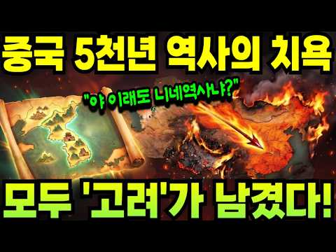
- 챕터: 0:00 몽골 총사령관 살리타를 쓰러뜨린 이름 없는 활시위 🏹 · 3:36 몽골 사신 저고여의 죽음과 다가오는 제국의 공포 📩 · 8:06 무리한 공물 요구와 고려의 미래를 내놓으라는 협박 📜 · 12:29 귀주성 30일 방어전, 몽골 노장을 감탄시킨 고려 청… · 20:59 비겁한 도망? 몽골의 공포를 무력화한 강화도 천도의 … · 33:20 처인성, 흙성에서 일어난 기적과 살리타의 최후 🏯 · 38:15 충주성의 불꽃, 노비 문서를 불태운 김윤후의 결단 🔥 · 43:52 몽골의 승리 공식을 완벽히 박살 낸 고려의 3대 비대… · 55:43 16년간 새긴 거대한 국가 선언문, 팔만대장경의 비밀… · 66:18 대몽항쟁 28년, 우리는 이 시대를 어떻게 불러야 할…
- 설명 앞부분: 우리는 고려와 몽골의 28년 전쟁을 흔히 '최씨 정권의 비겁한 도망'과 '백성들이 짓밟힌 굴욕의 역사'로 기억해 왔습니다. 하지만 유라시아를 질주하며 세계를 삼키던 몽골 제국이 유독 고려 앞에서만 28년 동안 발이 묶였던 진짜 이유는 무엇일까요? 지도에도 제대로 나오지 않는 작은 흙성 '처인성'에서 세계 최강 몽골군 총사령관 살리타를 쓰러뜨린 이름 없는 승려와 부곡민들 교과서가 단 몇 줄로 지나쳐버린 28년 대몽항쟁의 서늘하고도 위대한 진짜 얼굴을 '역사의 작은그림자'에서 추적합니다. 팔백 년 전 이 땅에 살았던 사람들이 지켜낸 …
- 같은 채널 평소 대비 ×38.1 (채널 최근 롱폼 중앙값 3,813회) · 평소 영상: 조선이 흉내 낼 수 없던 고려 474년, 그들이 대륙을 차지했던 이유 ∣ 고려거란전쟁 ∣… (3,813회) / 우리가 몰랐던 6.25 남침의 충격적 뒷이야기 57시간동안 무엇을 했나? ∣ 역사다큐 ∣… (3,632회)
- 대본 없음 (설명) — 음성인식이 끝나면 도입부·흐름이 들어감
- 댓글 460/460: 좋은 점 — 영상 14 · 감사·응원 41 · 더 알고 싶은 것 5 · 아쉬운 점 — 영상 0 · 반박·불만 — 의견 다름 3 · 정치·사회 39 · 경험 공유 11 · 구독·다음 기대 0
  - 좋은 점 — 영상 👍59 “1960년에 초등학교를 졸업했고 그때 배운 역사를 기억하고 있었습니다. 그뒤로 계속 역사를 연구하며 지금 다른 관점에서 역사를 해석한 내용을 보며 느낀점이 많습니다. 많이 배웠습니다. 감사드립니다”
  - 좋은 점 — 영상 👍43 “당신은 누구십니까? 명강의 잘들었습니다”
  - 감사·응원 👍104 “맞습니다. 항상 의심스러운 게 어떻게 그 힘든 과정에서 노비나 하층민이 버텼느냐 하는 그런 의문점이 남았는데 이제야 그 갈증이 풀리는 것 같습니다. 그 누구도 답변하지 못한 사실을 이 YouTube에서 이 작가님이 말씀을 하시네요. 정말 많은 노력을 했습니다. 그것은…”
  - 감사·응원 👍78 “이 나라를 지켜주신 선조님들의 지혜와 용기에 감사드립니다”
  - 더 알고 싶은 것 👍4 “재미있게 보고 있습니다...객관적이고 논리적인 해석으로 직관하는게 설득력이 있고 역사를 재해석하게 됩니다. 다만 조금 아쉬운게 내용이 너무 깁니다...간결하게 더 정리해서 올려주시면 더 많은 구독자가 생길거 같습니다만 적소성대 하시길”
  - 더 알고 싶은 것 👍1 “작가에 대해 자세히 알고싶네요. 대단합니다. 다른글도 찾아보겠습니다.”
  - 반박·불만 — 의견 다름 👍9 “최우 독재가 나라를구한경우. 허나 지금독재는 귄력욕 ᆢ자기배만채우는 양아치 독재프레임으로 국민선동하고 슬프네”
  - 반박·불만 — 의견 다름 👍7 “우리나라 역사상 전쟁이 일어나면 백성을 버리고 도망가는 자들은 문신들이지 전장에서 목숨걸고 싸우던 무신들이 아닙니다. 항상 말로만 애국하던 문신들 입니다. 문신이 무신들을 무시할때 항상 나라는 위기에 직면했습니다. 그래서 요즈음 우리나라 국방부가 심히 염려 됩니다”
  - 정치·사회 👍43 “애기는 맞는데 위치는 아니 올시다 고려는 대륙 동남부 만주 연해주 한반도로 대제국 이었다 여몽 전쟁은 대부분 대륙 태행산맥을 기준으로 서쪽에서 일어 났고 몽골이 깊숙이 침략 했을때는 북경을 지나 남쪽으로 내려 왔고 자금의 산동반도가 강화도로 왕의 피난처 였었고 거기서…”
  - 정치·사회 👍24 “참으로 귀한 말씀을 감명깊게 들었습니다. 생각해보니 최우의 무신 정권이 있어 대몽항쟁이 성공하였다고 확신합니다. 즉, 최우는 전쟁을 치르는 시대의 전략가였 습니다. 세계 최고의 전락가이자 무신통치자... 와 ! 위대합니다! 또하나 김윤후의 항쟁전투....몽고 수장을 …”
  - 경험 공유 👍104 “맞습니다. 항상 의심스러운 게 어떻게 그 힘든 과정에서 노비나 하층민이 버텼느냐 하는 그런 의문점이 남았는데 이제야 그 갈증이 풀리는 것 같습니다. 그 누구도 답변하지 못한 사실을 이 YouTube에서 이 작가님이 말씀을 하시네요. 정말 많은 노력을 했습니다. 그것은…”
  - 경험 공유 👍7 “강화를 본부로 치고 빠지기를 했어야 했었지”

### 306. 왕위를 포기한 효령대군, 91세까지 살아남은 기막힌 비밀 ∣ 태종 이방원의 아들 ∣ 조선역사

- https://www.youtube.com/watch?v=jCwsp1nTcXQ · 별이수놓은 역사 · 구독자 15,700 · 조회수 214,770 (×13.7, 하루 1,595.5) · 좋아요 3,523 (1.6%) · 35.7분 · 2026-06-29 · 주제 묶음 1. 역사 일반·이야기 · 형식 정보·해설 (그 밖) · 폴더 `W_jCwsp1nTcXQ` (웹 승인)
- 썸네일: 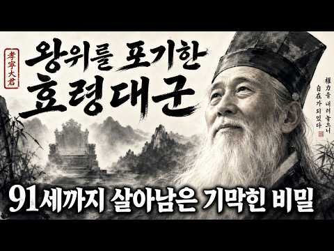
- 설명 앞부분: 📜 왕이 되지 못한 둘째 왕자, 효령대군 — 91년을 살아남은 자의 비밀 조선 태종 이방원의 둘째 아들, 효령대군. 🏯 형 양녕대군은 폐세자가 되었고, 동생 충녕대군은 세종대왕이 되었습니다. 그 사이에 끼어 왕좌를 놓친 둘째는, 무려 91세까지 살아남았습니다. ⏳ 형도, 동생도, 조카도 모두 먼저 떠나보내고 홀로 남은 한 사람. 그가 살아 있는 동안 조선의 왕은 무려 아홉 번이나 바뀌었습니다. 👑 권력을 포기하고 불교에 귀의한 그의 선택은 패배였을까요, 아니면 또 다른 승리였을까요? 🤔 그리고 600년이 흐른 뒤, 조선의 마지막을…
- 같은 채널 평소 대비 ×39.3 (채널 최근 롱폼 중앙값 5,471회) · 평소 영상: 한국판 오디세이 최부의 표해록, 우리만 가치를 모르고 있는 세계3대 중국견문록 (5,471회) / 17살에 나라를 잃은 중국황제! 어떻게 한국 명씨의 조상이 되었나? ∣ 주원장 ∣ 명옥진… (5,292회)
- 대본 없음 (설명) — 음성인식이 끝나면 도입부·흐름이 들어감
- 댓글 318/322: 좋은 점 — 영상 1 · 감사·응원 15 · 더 알고 싶은 것 2 · 아쉬운 점 — 영상 2 · 반박·불만 — 의견 다름 1 · 정치·사회 4 · 경험 공유 9 · 구독·다음 기대 0
  - 감사·응원 👍15 “역시 이야기 감사합니다 다시 배우는 느낌으로 듣습니다 그동안 잊고 살았던 역사 이야기 , 또 ㄷ고싶습니다 감사합니다.”
  - 감사·응원 👍9 “도쿄에서살고있어요 재밌게듣고있어요 공부도되고요 감사합니다🎉”
  - 더 알고 싶은 것 👍2 “무림군은 그럼 어느정도 위치였나요?”
  - 더 알고 싶은 것 👍0 “동생의 목숨같았던 손자가 조카에게 무자비하게 해침을 당할때 과연 무엇을 했는지가 참으로 궁금합니다 아무리 불심이 강해서 거기에만 몰입했다고쳐도 나라의 어른 으로써 꼭 해야할 말을 못했다면 참으로 실망스럽습니다 불심이 뭔지를 아는지 모른는지 ㅠ 그렇게 장수하고 싶었나 ㅠ”
  - 아쉬운 점 — 영상 👍1 “단종이 그렇게 되면서 세종의 대가 끊겼다는게 가장 아쉽습니다 어떤 천재가 나와서 나라에 어떤 귀한 힘을 실어줬을지가 진짜 궁금해지네요 속절없지만. 증손자가 세종보다 더 위대 한 왕이 됐을지도~~ㅠ”
  - 아쉬운 점 — 영상 👍0 “동생의 목숨같았던 손자가 조카에게 무자비하게 해침을 당할때 과연 무엇을 했는지가 참으로 궁금합니다 아무리 불심이 강해서 거기에만 몰입했다고쳐도 나라의 어른 으로써 꼭 해야할 말을 못했다면 참으로 실망스럽습니다 불심이 뭔지를 아는지 모른는지 ㅠ 그렇게 장수하고 싶었나 ㅠ”
  - 정치·사회 👍14 “정권을 잡고 국민혈세, 국고를 도적질하여 자신들이 부귀영화만을 위해 정치를 하던 무리배들, 왕일찌라도 서슴없이 독살을 하고 유약한 왕을 세우고 자신들의 호사만을 위해 나라도 팔아먹은 매국노들, 그 후예들이 지금도 똑같은 DNA을 이어받고, 여전히 국회에 공천금 내고 …”
  - 정치·사회 👍2 “결국은 긴인생이,, 고종으로 이어져,,,나라가 일본으로 넘어갔네요,,”
  - 경험 공유 👍10 “저도 효령대군의 후손 입니다ᆢ”
  - 경험 공유 👍1 “네 저도 효령대군님의 18대손 입니다 좋은 역사의 기록과 해설 감사드립니다”

### 307. 외국인들이 동궁을 보고 한국 사극에 충격받은 이유

- https://www.youtube.com/watch?v=k2LmY18bZeM · K-클래스 · 구독자 6,190 · 조회수 59,771 (×9.7, 하루 628.7) · 좋아요 1,218 (2.0%) · 9.6분 · 2026-07-25 · 주제 묶음 3. 조선 · 형식 정보·해설 (그 밖) · 폴더 `W_k2LmY18bZeM` (웹 승인)
- 썸네일: 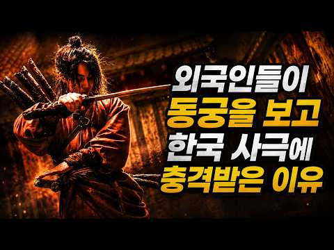
- 설명 앞부분: 🎬 영상 소개 새벽 두 시, 딱 한 편만 보려던 외국인이 해 뜨는 걸 봤습니다. 조선 궁궐을 배경으로 한 넷플릭스 드라마 〈동궁〉이 전 세계 80개국을 흔든 이유를 파헤칩니다. 세트를 바꾸지 않고 '색'만으로 두 세계를 나눈 절제된 연출, 무섭기보다 슬픈 한국식 원귀와 무속의 세계관, 화려함을 비워서 완성한 미학까지. 외국인들이 왜 이 드라마를 보고 '충격받았다'고 말하는지, 그 정체를 하나하나 분석했습니다. 💬 당신은 이 영상을 어떻게 생각하시나요? 🏷️ 관련 해시태그
- 같은 채널 평소 대비 ×12.2 (채널 최근 롱폼 중앙값 4,886회) · 평소 영상: 그래미의 굴욕! BTS 이어 스트레이 키즈까지 그래미 외면한 진짜 이유 (4,886회) / 동남아가《닥터X》에 빠졌다! 베트남·필리핀·인도네시아를 동시에 사로잡은 이유 (4,906회)
- 대본 없음 (설명) — 음성인식이 끝나면 도입부·흐름이 들어감
- 댓글 88/88: 좋은 점 — 영상 0 · 감사·응원 1 · 더 알고 싶은 것 1 · 아쉬운 점 — 영상 2 · 반박·불만 — 의견 다름 1 · 정치·사회 6 · 경험 공유 6 · 구독·다음 기대 0
  - 감사·응원 👍3 “좋은 관점, 좋은 해석. 감사합니다”
  - 아쉬운 점 — 영상 👍4 “디테일에서 중국풍을 느껴서 아쉬움이 남았어요.”
  - 아쉬운 점 — 영상 👍0 “아주 디테일한 리뷰였어요~ 아주 좋아~~ 👍 이 정도면 아주 잘 완성된 걸작의 탄생이라고 봐야~~ 뻔한 외계인 만들고 총싸움 시키는 억지 설정 영화 같은 건 만들지 말라고~ 그런 것을 하지 말아야 돼~ 솔깃한 것을 창조하란 말이다~! 한국 드라마의 위상을 계속 이어 …”
  - 반박·불만 — 의견 다름 👍81 “자꾸 중국풍이라고 하는데, 그건 중국풍이 아닙니다. 2000년 이전에 나왔던 모든 중국 사극 드라마 봐 보세요. 그런 복식 존재도 안합니다. 멀리갈 것도 없습니다. 한때 엄청난 인기를 끌었던 포청천 드라마 복식 찾아보십시오. 대부분이 그런 복장이였습니다. 심지어 수백…”
  - 정치·사회 👍96 “중국풍이라니 아주 크게 잘 못 된 표현 . 지금 중국드라마 만드는 세대들이 30년 전 우리 사극드라마 본 세대 그 세대들이 만든 걸 중국인민들이 보고 지네거라고 무식한 소리를 해데는 것 진짜 무식하지 않음”
  - 정치·사회 👍33 “중국풍은 개억지고 그건 오히려 중국인들을 띄워주고 우리문화를 중국에 스스로 넘겨주는 꼴이지 한국인들중에는 현대에 매번 보던 한복이나 의복들만 한국 전통 옷이라 생각해서 그럼 고려말에서 조선으로 넘어갈때 조선인들이 대장금이나 조선말에 의복을 입었을거라 생각하는지? 삼국…”
  - 경험 공유 👍81 “자꾸 중국풍이라고 하는데, 그건 중국풍이 아닙니다. 2000년 이전에 나왔던 모든 중국 사극 드라마 봐 보세요. 그런 복식 존재도 안합니다. 멀리갈 것도 없습니다. 한때 엄청난 인기를 끌었던 포청천 드라마 복식 찾아보십시오. 대부분이 그런 복장이였습니다. 심지어 수백…”
  - 경험 공유 👍37 “나도 밤에 잠안와서 봤다가 새벽을 경험했다 젠장 ㅎㅎ”

### 308. 팰월드 1.0 고대 문명 테크용 멀티작업팰 추천 (세계수 이후)

- https://www.youtube.com/watch?v=2KijxN_U_rs · 퇴근한광대 · 구독자 7,220 · 조회수 74,212 (×10.3, 하루 725.6) · 좋아요 535 (0.7%) · 6.5분 · 2026-07-31 · 주제 묶음 8. 문명·고고학 · 형식 정보·해설 (그 밖) · 폴더 `W_2KijxN_U_rs` (웹 승인)
- 썸네일: 
- 챕터: 0:00 오프닝 · 0:27 고대 건물 설명 · 0:43 작업대 · 1:46 발전기 · 2:32 화로 · 3:33 재배기&부엌 · 4:39 생성기&금화 · 6:03 마무리
- 설명 앞부분: 세계수에 진입하면 고대 문명 테크가 해금되면서 기존과는 다른 방식의 거점 운영이 필요해집니다. 이번 영상에서는 고대 건물별로 어떤 멀티작업 팰을 배치하면 가장 효율적인지 업무 작동 시간을 기준으로 정리했습니다 후반 거점을 준비하고 계신 분들이라면 한 번쯤 참고하시면 도움이 될 것입니다 타임라인 궁금한 점이나 다른 조합이 있다면 댓글로 남겨주세요
- 같은 채널 평소 대비 ×9.7 (채널 최근 롱폼 중앙값 7,616회) · 평소 영상: 팰월드 1.0 속성 추천 기술 총정리 #2 풀 속성 (8,050회) / 팰월드 1.0 속성 추천 기술 총정리 #4 얼음 속성 (7,182회)
- 대본 없음 (설명) — 음성인식이 끝나면 도입부·흐름이 들어감
- 댓글 110/110: 좋은 점 — 영상 4 · 감사·응원 6 · 더 알고 싶은 것 8 · 아쉬운 점 — 영상 1 · 반박·불만 — 의견 다름 1 · 정치·사회 0 · 경험 공유 3 · 구독·다음 기대 0
  - 좋은 점 — 영상 👍12 “쇼군복치는 생각도 못한 꿀팁이군요 좋다”
  - 좋은 점 — 영상 👍0 “오 좋은 꿀팁 감사합니다. 갈수록 필요 능력치는 많아져서 어떤걸 써야 하는지 고민이였어요”
  - 감사·응원 👍0 “옛날식으로 아누비스 잔뜩 굴리고 있었는데 효율팟 한번 짜봐야겠네요 감사합니다.”
  - 감사·응원 👍0 “갸아악 2등이다 정보 영상 잘 보고 있습니다! 감사합니다!”
  - 더 알고 싶은 것 👍0 “작업대에 달보미 하나만 추천하시면 다른건 어떤걸써야되나요? 달보미 2마리를 추천하시는건지...”
  - 더 알고 싶은 것 👍0 “고대문명진료소는 제약펠을 고정배치 해놔야 활성화되나요?”
  - 경험 공유 👍0 “광대님 안녕하세요 제가 이제 기존 작업장 철수하고 고대물질 생성기로 싹 도배해ㅓㅅ 한마리씩 넣어두려고 하는데 물질생성기를 일렬로 쫙두면 운반팰들이 한쪽에만 몰려있고 끝쪽는 안오던데.... 이럴땐 그냥 기존 작업장이 나은가요? 기존 종합 작업장으로 한마리씩 넣어두면 물…”
  - 경험 공유 👍0 “나즁에 고수되면 참고할만한 자료들이네요 ㅋㅋㅋ 근데 제가 이번에 노란색 아우라를 뿜는 희귀 모프링을 잡았는데 그냥 희귀랑 차이가 있나요?”

