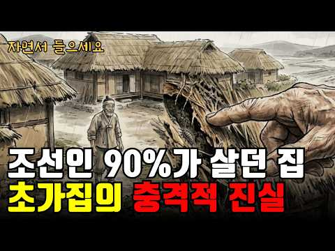
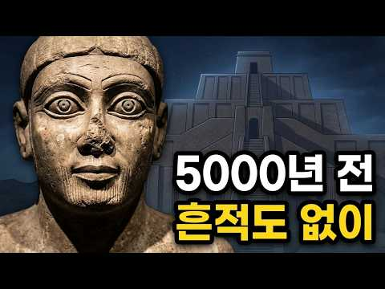
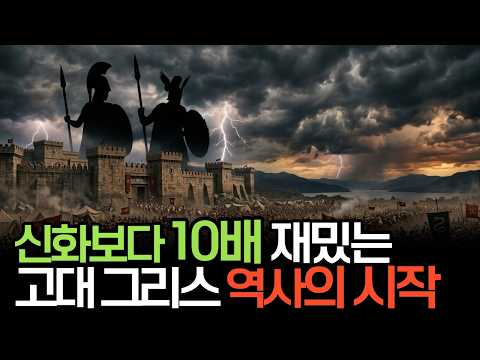
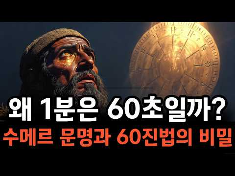

# 역사 — 성공 사례 분석: 사례별 자세히 #281–#320

`analysis.md` 의 9번 (같은 # 번호). 자동 생성 — `tools/success_analysis.py` v1.6 (2026-10-28 10:03 UTC). ※ 연구·교육용 — 투자 권유가 아님.

### 281. 독립자금에 전 재산을 쏟아부은 조선 최고 부자 경주 최부잣집 클라스

- https://www.youtube.com/watch?v=bcLdcEWs4yw · 역사본능 · 구독자 32,700 · 조회수 969,741 (×29.7, 하루 22,341.9) · 좋아요 3,696 (0.4%) · 31.7분 · 2026-09-15 · 주제 묶음 3. 조선 · 형식 정보·해설 (그 밖) · 폴더 `W_bcLdcEWs4yw` (웹 승인)
- 썸네일: 
- 설명 앞부분: 조선에서 제일 부자였던 집인데, 대문을 잠근 적이 없습니다. 부자가 삼대를 못 간다는 말과, 열두 대를 간 집이 스스로 빈손이 된 이야기를 함께 담았습니다. ※ 본 영상은 특정 인물이나 단체를 비방할 목적이 없으며, 역사·교육 정보 제공을 목적으로 제작되었습니다. 국사편찬위원회, 『우리역사넷』 교과서 용어해설 '백산상회' 독립기념관, 『월간 독립기념관』 「노블리스 오블리주를 실천한 경주 최부자」 한국학중앙연구원, 『한국민족문화대백과사전』 '경주 최부자댁', '대한광복회' 국가유산청, 국가민속문화재 제27호 경주 최부자댁 지정 자료…
- 같은 채널 평소 대비 ×57.5 (채널 최근 롱폼 중앙값 16,876회) · 평소 영상: 야인 시대 레전드, 김두한 VS 이정재 누가 더 강했을까? (17,219회) / "북괴가 알면 큰일이다" 대통령을 쏜 사람이 차 안에서 한 첫마디 (16,534회)
- 대본 없음 (설명) — 음성인식이 끝나면 도입부·흐름이 들어감
- 댓글 254/286: 좋은 점 — 영상 1 · 감사·응원 11 · 더 알고 싶은 것 0 · 아쉬운 점 — 영상 0 · 반박·불만 — 의견 다름 0 · 정치·사회 17 · 경험 공유 17 · 구독·다음 기대 1
  - 좋은 점 — 영상 👍8 “요즘 보기 드문 재미와 교훈이 함께 있는 좋은 이야기네요.”
  - 감사·응원 👍40 “대단합니다. 경주 최부자댁 기억하겠습니다. 감사합니다.”
  - 감사·응원 👍22 “존경합니다. 그리고 감사합니다.”
  - 정치·사회 👍151 “이 얘기가 사실이라면 이런 집안이 국가 유공자 대훈장을 받아야 한다. 언젠가 제대로 된 정권이 들어서면 유공자를 분별하여 진짜만 대대손손 국가가 공훈대로 혜택을 주는 날이 있길 바랍니다.”
  - 정치·사회 👍30 “영남대는 최준선생이 자금을대고 만들어 이병철한테 운영을 맡겼는데 삼성 사카린밀수 사건으로 박정희한테 땅이랑 재단 다 홀라당 뺏끼고 나몰라라 함 영남대 부지는 120만평임 울나라에서 젤 크다고 봐도 무방함 영남대는 경주 최씨 종가에 넘겨야됨 이사장에 박근혜 박근령이 왠…”
  - 경험 공유 👍215 “경주최씨 입니다 ^^ 조상님들께서 훌륭하셨으니 후손들도 멋지게 살아야죠 ㅎㅎ 저도 좋은 기운 이어받고 열심히 살고 있습니다”
  - 경험 공유 👍85 “최부자집 2형제분들 이회영 6형제분들이랑 제가 가장 존경하는분들 진짜 참어른들이시고 훌륭하신분들”
  - 구독·다음 기대 👍2 “경주 최씨..후손이 리스팩 하고 정주행 하고 갑니다.. 감사합니다..”

### 282. 왕이 지나가면 그 마을이 망하는 이유? 조선시대 임금 행차의 비극

- https://www.youtube.com/watch?v=VHZ90COisw4 · 역사와인생 · 구독자 1,260 · 조회수 37,358 (×29.6, 하루 246.8) · 좋아요 595 (1.6%) · 19.1분 · 2026-05-30 · 주제 묶음 3. 조선 · 형식 정보·해설 (그 밖) · 폴더 `W_VHZ90COisw4` (웹 승인)
- 썸네일: 
- 설명 앞부분: 사극에서 보던 화려한 임금의 행차. 그 행렬이 지나간 마을은 그 후 어떻게 됐을까요? 1670년 충청도의 한 고을이 사라진 진짜 이유, 조선왕조실록 속 '지대(支待)' 제도와 향리들의 착복, 세종·현종·정조·고종까지 임금의 행차가 백성의 부엌에 남긴 흔적을 차분히 정리해드립니다. ✓ 임금 행차 한 번에 2년 치 살림이 사라진 이유 ✓ 6,000명 행렬과 길가 마을의 현실 ✓ 정조 화성 행차와 내탕금의 의미 ✓ 고종 홍릉 행차가 한반도 최초 전차를 만든 사연 교과서 한 줄 뒤에 가려져 있던 조선 백성들의 이야기, 끝까지 함께 봐주세…
- 같은 채널 평소 대비 ×424.5 (채널 최근 롱폼 중앙값 88회) · 평소 영상: 조선시대 얼음이야기ㅣ조선의 극한 직업 장빙군ㅣ1년 내내 안 녹는 기술 (88회) / 오천원 속 인물 조선이 무시한 천재 율곡이이 조선역사ㅣ한국사 (90회)
- 대본 없음 (설명) — 음성인식이 끝나면 도입부·흐름이 들어감
- 댓글 155/155: 좋은 점 — 영상 0 · 감사·응원 2 · 더 알고 싶은 것 1 · 아쉬운 점 — 영상 1 · 반박·불만 — 의견 다름 4 · 정치·사회 15 · 경험 공유 2 · 구독·다음 기대 0
  - 감사·응원 👍0 “감사합니다”
  - 아쉬운 점 — 영상 👍32 “호환, 마마보다 무서운게 저런 행차였군요. 그래서 왕의 행차는 매년 몇회 이내로 제한했음에도 저리도 자주행차를 하고 그에따라 향리들의 수탈이 반복되었군요.”
  - 반박·불만 — 의견 다름 👍4 “저는 솔직히 경제구조의 문제도 없지 않다고 생각합니다. 조선은 농업에만 치우쳤고 공업,상업,어업,축산업,서비스업등을 홀대했고 신분을 두어 차별했으니 당연히 조선의 경제구조는 빈약할 수밖에 없고 국력이 제일 약할수 밖에 없어 만주등 잃어버린땅을 되찾지 못하고 오히려 녹…”
  - 반박·불만 — 의견 다름 👍0 “말은 바로합시다 지방향리들은 따로 녹봉이 없어서 이런식으로 충당해야했습니다 이들이 부패해서가 아닙니다”
  - 정치·사회 👍52 “법은 있지만 지켜지지 않는 나라가 조선. 지금 한국도 비슷함. 정치하는 놈들이 비슷한 놈들임”
  - 정치·사회 👍51 “조선이라는 나라가 문제”
  - 경험 공유 👍0 “1년에 휴가를 몇 번 씩 간 거야! 백성은 인간이 아니었네.... 양반만 인간이었어.... 조선의 임금은 나쁜 임금이 맞다. 국가 예산에 왕의 행차비를 책정하고 지나는 길에 거치는 마을에 하사금까지 준비해야 했었다. 그랬으면 향리, 아전, 사또들이 고을 백성의 등골을…”

### 283. “아버지, 저 버려진 논을 꼭 사야 합니다” 사흘 뒤 마을이 뒤집힌 이유∣옛날이야기∣야담∣야사∣전래동화∣라디오북∣

- https://www.youtube.com/watch?v=yWVNqrh3WUo · 옥단야담 · 구독자 12,800 · 조회수 375,487 (×29.3, 하루 2,500.6) · 좋아요 8,614 (2.3%) · 70분 · 2026-05-31 · 주제 묶음 9. 야사·야담·옛날이야기 · 형식 야담·옛날이야기 · 폴더 `W_yWVNqrh3WUo` (웹 승인)
- 썸네일: 
- 설명 앞부분: 옥단야담은 우리 조상들의 지혜와 해학이 담긴 야담, 민담, 전설을 오늘의 감성에 맞게 각색하여 들려드리는 이야기 채널입니다. 흥미롭고 신비로운 옛이야기 속에서 때로는 웃음을, 때로는 긴장감을, 때로는 깊은 여운을 전해드립니다. ✍️ 여러분의 소중한 댓글은 영상 제작에 큰 힘이 됩니다. 본 영상은 AI 기술을 보조 도구로 활용하여 제작될 수 있으나, 대본 집필과 이야기 각색, 이미지 기획을 비롯한 핵심 콘텐츠는 채널 운영자의 고유한 창작물입니다.
- 같은 채널 평소 대비 ×56.6 (채널 최근 롱폼 중앙값 6,634회) · 평소 영상: “이제 남의 집에서는 안 살아요” 쫓겨난 하인 모녀가 빈 논 한 마지기를 빌린 이유 (8,376회) / 추수 끝난 들판에서 메뚜기를 돈 주고 사온 며느리, 시어머니가 한 달 뒤 곳간 열쇠를 주… (8,888회)
- 대본 없음 (설명) — 음성인식이 끝나면 도입부·흐름이 들어감
- 댓글 130/130: 좋은 점 — 영상 0 · 감사·응원 12 · 더 알고 싶은 것 0 · 아쉬운 점 — 영상 2 · 반박·불만 — 의견 다름 2 · 정치·사회 0 · 경험 공유 1 · 구독·다음 기대 0
  - 감사·응원 👍31 “축하해 도윤아 믿어주신 아버님 감사합니다”
  - 감사·응원 👍27 “다행히 관아사또가 그래도 정직한 사람이라서 위안이되는군요 강진태편을 들지않고 공정하게 사또가 판결을 하고 도윤이와 만석씨 지혜로운 대처로 논을 지킬수있어서 통쾌하고 흐뭇하네요 감사합니다”
  - 아쉬운 점 — 영상 👍1 “자막이 왜이래요”
  - 아쉬운 점 — 영상 👍0 “했지요 와 했답니다의 반복이 듣기 힘드네요.”
  - 반박·불만 — 의견 다름 👍7 “엣날이야그지요....요즈음에 저런 바보들이 있을까요......한번 배신한 놈들은 또 배신하고...고마움은 잠시...시기와 질투는 영원합니다.....그리고 또 배신할겁니다......방법은 강진태에게 10000배 주고 팔고 다른 마을가서 논사고 밭사고 농사짓고 살면 될듯…”
  - 반박·불만 — 의견 다름 👍6 “서울종로익선동에서”

### 284. 바다에서 태어난 땅, 이름에 새겨진 역사 - 군산 이야기 1부

- https://www.youtube.com/watch?v=Zyz8I6ayBPo · 지식과 서사 · 구독자 453 · 조회수 13,203 (×29.1, 하루 392.4) · 좋아요 61 (0.5%) · 14.1분 · 2026-09-24 · 주제 묶음 1. 역사 일반·이야기 · 형식 정보·해설 (그 밖) · 폴더 `W_Zyz8I6ayBPo` (웹 승인)
- 썸네일: 
- 설명 앞부분: 내 고향 군산 이야기 1부 — 바다에서 태어난 땅, 이름에 새겨진 역사 많은 분들이 군산 하면 ‘근대 문화유산의 도시’, ‘짬뽕과 단팥빵이 맛있는 여행지’ 정도로 기억하시죠? 하지만 군산의 진짜 얼굴은 우리가 딛고 선 이 땅의 지리와 역사 속에 아주 깊숙이 숨어 있습니다. 인트로 및 군산 이야기 시작 지리적 대반전: 원래는 바다였던 땅과 간척의 역사 '군산(群山)' 지명의 유래와 고군산군도 풍요로운 곡창지대 '옥구'와 판소리 단가 〈호남가〉 군산을 지켜온 두 산: 오성산(오성묘 전설)과 월명산(수시탑) 호남 선교와 민족 교육의 요…
- 같은 채널 평소 대비 ×12.2 (채널 최근 롱폼 중앙값 1,084회) · 평소 영상: 한글날 특집 한글 이야기 정주행 - 주시경에서 공병우까지, 이광수에서 한강 작가까지 (1,103회) / 견리사의(見利思義) - 이익 앞에서 의로움을 선택한 사람들 (1,065회)
- 대본 없음 (설명) — 음성인식이 끝나면 도입부·흐름이 들어감
- 댓글 16/17: 좋은 점 — 영상 0 · 감사·응원 1 · 더 알고 싶은 것 0 · 아쉬운 점 — 영상 1 · 반박·불만 — 의견 다름 0 · 정치·사회 0 · 경험 공유 0 · 구독·다음 기대 0
  - 감사·응원 👍2 “가람 항상응원 합니다. 화이팅”
  - 아쉬운 점 — 영상 👍1 “이야기 구성이 지루하지 않고 ai 같지 않게 재미있어요!! 군산출신인데 48년만에 이런이야기를 처음들어봅니다!! 군산시민필청!! 😂😂😂😂”

### 285. 굼벵이가 떨어지는 지붕 밑에서 살았다? 조선 초가집의 모든 것∣ 조선시대 서민 주거사

- https://www.youtube.com/watch?v=lIRtKm_-_Xc · 진짜역사한잔 · 구독자 13,400 · 조회수 383,671 (×28.6, 하루 3,280.6) · 좋아요 4,602 (1.2%) · 83.4분 · 2026-07-03 · 주제 묶음 3. 조선 · 형식 정보·해설 (그 밖) · 폴더 `W_lIRtKm_-_Xc` (웹 승인)
- 썸네일: 
- 챕터: 0:00 오프닝 후킹 - 무너져가는 지붕 밑에서 · 0:40 구독 안내 · 1:00 초가집과 기와집, 신분이 가른 주거의 격차 · 3:00 볏짚 지붕과 이엉 갈이 풍습 · 5:00 좁은 방 한 칸, 대가족의 삶 · 7:00 온돌의 원리와 땔감 생존기 · 9:00 부엌과 조명, 그을음의 일상 · 11:00 장마와 지붕 붕괴, 자연재해와의 싸움 · 13:00 장독대, 텃밭, 뒷간의 순환 경제 · 15:00 빈부격차 속 초가집, 움막의 현실 · 17:00 사계절 순환 노동과 마무리
- 설명 앞부분: 조선시대 인구의 절대다수를 차지했던 평민들은 기와집이 아닌 초가집에서 태어나고 자라고 생을 마감했습니다. 이 영상은 볏짚과 흙으로 지어진 작고 낮은 초가집 안에서 사람들이 어떻게 추위와 더위를 견디고, 화재와 홍수 같은 재난에 맞서며, 가족과 이웃 공동체를 지켜냈는지를 다큐멘터리 형식으로 살펴봅니다. 본 영상은 조선왕조실록, 한국민족문화대백과사전, 우리역사넷 등 여러 사료와 학술 자료를 바탕으로 제작되었습니다.
- 같은 채널 평소 대비 ×23.0 (채널 최근 롱폼 중앙값 16,660회) · 평소 영상: [4시간연속재생] 교과서에 없는 조선시대 평민생활 세번째 이야기 (18,515회) / 매년 10명씩 죽였다 조선왕조실록이 직접 기록한 왕자 순화군의 실체 (14,804회)
- 대본 없음 (설명) — 음성인식이 끝나면 도입부·흐름이 들어감
- 댓글 392/410: 좋은 점 — 영상 7 · 감사·응원 14 · 더 알고 싶은 것 2 · 아쉬운 점 — 영상 0 · 반박·불만 — 의견 다름 9 · 정치·사회 19 · 경험 공유 29 · 구독·다음 기대 0
  - 좋은 점 — 영상 👍22 “내가 봐온 유튜브 중에 최고의 영상입니다. 감사합니다 ^^”
  - 좋은 점 — 영상 👍17 “좋은 내용과 삽화 ㅡ감사 하고 고맙습니다ㅡ어릴적 그 시절이 생각 나고 그립습니다~~”
  - 감사·응원 👍34 “가난에서 벗어나게 해준 박통.감사합니다.”
  - 감사·응원 👍22 “내가 봐온 유튜브 중에 최고의 영상입니다. 감사합니다 ^^”
  - 더 알고 싶은 것 👍1 “한능검 준비하고있는 고등학생입니다! 잘보고있습니다. 혹시 근현대사는 안 다루시는지 궁금합니다!”
  - 반박·불만 — 의견 다름 👍12 “너무 못살고 힘들게 살던 우리민족....2천년간 계급사회로 살던 민족...이런 역사가 자랑일 수는 없습니다. ...저도 초가집에서 살아본적도 있지만..이건 추억이 아닙니다. 그냥 정말 가난하고 비위생적으로 살던 시절입니다. 정말 대부분의 백성이 가난한 천민으로 살던 …”
  - 반박·불만 — 의견 다름 👍2 “새마을운동 할때 정겨운 초가집 왜 없애냐고 선동하던 문인들 많았음 괜히 세계 최빈국으로 살았던게 아님”
  - 정치·사회 👍37 “박정희 대통령 새마을사업 이전엔 초가집이지 기와집 은 동네 몃집 없었다”
  - 정치·사회 👍6 “청도 새마을 의 발상지 😮😅😂😊❤ 새마을 운동이 시작된 곳입니다 새마을 운동의 시작점 청도😅 청도의 형편은 매우 어려웠다고 들었습니다 박정희 대통령 님 시대 인데😅 어느날 박정희 대통령님 께서 기차를 타고 마침 청도를 지나가시다가😮 사람들이 길에 나와서 거리를 청소하…”
  - 경험 공유 👍68 “나도 굼뱅이 떨어지는 집에서 국민학교 때까지 살았다 ! 나 지금 70대”
  - 경험 공유 👍36 “70세 여간의 사람들이 마지막으로 기억하는 이야기입니다 영을 올리는 날엔 그 집에 우리들의 놀이터였습니다 우린 추억이었지만 우리 부모님들은 힘든 삶의 현장이었지요 부모님이 그립습니다”

### 286. 왕이 되어 약속을 지키러 돌아왔는데, 정혼녀는 날 거지 취급했다… 진짜 은인은 그녀의 동생이었다!

- https://www.youtube.com/watch?v=Pl3jaa_L3Pw · 역전 극장 · 구독자 22,800 · 조회수 641,872 (×28.1, 하루 19,000.6) · 좋아요 5,007 (0.8%) · 119.3분 · 2026-09-24 · 주제 묶음 기타 · 형식 몰아보기·통합본 (긴 영상) · 폴더 `W_Pl3jaa_L3Pw` (웹 승인)
- 썸네일: 
- 챕터: 0:00 새 왕의 귀환 — 이훤, 약속했던 여인을 중전으로 맞… · 20:10 왕을 가둔 탐관오리 — 신분을 모른 채 이훤을 짓밟는… · 40:05 목숨을 건 진짜 은인 — 박청현이 이훤을 지키다 쓰러… · 60:08 가례연의 덫 — 왕을 조롱한 권문세가들이 스스로 한자… · 80:12 왕의 분노 — 군권까지 등에 업은 탐관오리들과 이훤의…
- 설명 앞부분: 💔거지인 줄 알고 버린 정혼자, 알고 보니 조선의 왕이었다! 그날 탐관오리 가문이 무너졌다... 도시 역전, 복수 반격, 재벌 상속! 통쾌한 남자 중심 숏드라마를 만날 수 있는 역전 극장입니다. 짜릿한 반전과 몰입감 넘치는 전개, 매일 업데이트되는 인기 숏드라마를 지금 바로 만나보세요! 🔥새 왕조의 주상 이훤은 과거 굶어 죽을 위기에 놓였던 자신을 구해 주고 혼인을 약속했던 여인을 중전으로 맞이하기 위해 신분을 숨긴 채 고향 제양군으로 돌아온다. 하지만 그를 기다리고 있을 것이라 믿었던 박화진은 초라한 차림의 이훤을 거지 취급하며…
- 같은 채널 평소 대비 ×104.0 (채널 최근 롱폼 중앙값 6,173회) · 평소 영상: 딸 수술비까지 건 남편… 모두가 욕했지만 그의 진짜 정체는 천재 도박사였다! (6,173회) / 약혼녀 3명은 날 버렸고, 단 1명만 날 선택했다… 그런데 내가 천하무적 신선이라고?! (4,909회)
- 대본 없음 (설명) — 음성인식이 끝나면 도입부·흐름이 들어감
- 댓글 159/435: 좋은 점 — 영상 0 · 감사·응원 4 · 더 알고 싶은 것 0 · 아쉬운 점 — 영상 9 · 반박·불만 — 의견 다름 4 · 정치·사회 10 · 경험 공유 3 · 구독·다음 기대 0
  - 감사·응원 👍8 “이거 짤만보고 끝까지못봐서 찾다가 완본없어서아쉬웟는데 감사😊”
  - 감사·응원 👍2 “영상 감사 합니다. 👍👍👍👏👏👏 ❤❤❤❤❤❤❤”
  - 아쉬운 점 — 영상 👍4 “영상은 잘만었네요 2시간을 지루함 없이 잘봐씁니다.”
  - 아쉬운 점 — 영상 👍3 “중국거 처럼 질질 끌고 말도 않되는 상황이 많네여 보실분들은 다 넘기고 결론만 보세요”
  - 반박·불만 — 의견 다름 👍0 “이거 배경만 우리나라지, 전형적인 중국 스토리. 이렇게 유치 찬란한 어이없는 스토리가 처음부터 끝까지 이어짐.”
  - 반박·불만 — 의견 다름 👍0 “왕이 멍청멍청 고구마열매 먹었나..그리고 중국에서 만들어 그런가 말도안돼는 억지억지 우격다짐과 꽥꽥 소리지르기..극한까지 몰고 간다고 너무 억지..중국판만 보다 한국판으로 보는데도 역시 말도 안돼..”
  - 정치·사회 👍2 “ㅋㅋ. 위계가 고증이 안됨. 현대판 훌륭하신 이재명. 대통령님.”
  - 정치·사회 👍0 “계속 소리만 지르고 앞으로 감기 않했으면 2시간동안 같은 내용반복할뻔 했네 저런놈이 왕이니 나라가 저지경이지~~ㅋㅋ”
  - 경험 공유 👍0 “30분을 내가 주상이다 기다림 ㅋ”
  - 경험 공유 👍0 “너 내가 누군지 몰라? 니 상관 데려와. 너도 나 몰라? 니 상관 데려와. 너도 나 몰라? 니 상관 데려와. 반복하다 쨔란! 나 사실 왕임”

### 287. 직업이 없던 시대, 고대 인간은 하루 종일 무엇을 했을까?

- https://www.youtube.com/watch?v=de9kdpnsnzo · 한국 옛이야기 보따리 · 구독자 466 · 조회수 12,995 (×27.9, 하루 112.0) · 좋아요 197 (1.5%) · 18분 · 2026-07-04 · 주제 묶음 8. 문명·고고학 · 형식 애니메이션·지도 · 폴더 `W_de9kdpnsnzo` (웹 승인)
- 썸네일: 
- 설명 앞부분: 직업도, 회사도, 월급도 없던 시대. 고대 인간은 하루 종일 무엇을 하며 살았을까요? 우리는 흔히 원시인들이 동굴 앞에 앉아 쉬거나, 매일 사냥만 했을 거라고 생각합니다. 하지만 실제 고대 인간의 하루는 훨씬 더 복잡하고 흥미로웠습니다. 그들은 먹을 것을 찾고, 불을 지키고, 도구를 만들고, 아이를 돌보고, 가죽을 손질하고, 이동 경로를 기억하며 살아남았습니다. 직업이라는 이름은 없었지만, 공동체 안에는 각자의 역할과 지식, 기술이 존재했습니다. 이번 영상에서는 직업이 생기기 전 고대 인간들이 하루를 어떻게 보냈는지, 사냥과 채집…
- 같은 채널 평소 대비 ×99.2 (채널 최근 롱폼 중앙값 131회) · 평소 영상: 야생동물은 왜 인간을 몰래 따라올까? (131회) / “5억의 절반은 내 거야!” 이혼 7일 만에 찾아온 전남편과 시어머니, 결국 망신당했다 (145회)
- 대본 없음 (설명) — 음성인식이 끝나면 도입부·흐름이 들어감
- 댓글 9/9: 좋은 점 — 영상 0 · 감사·응원 1 · 더 알고 싶은 것 0 · 아쉬운 점 — 영상 0 · 반박·불만 — 의견 다름 0 · 정치·사회 0 · 경험 공유 0 · 구독·다음 기대 0
  - 감사·응원 👍1 “얼마나 힘들었을까요. 먼 과거의 할아버지 할머님께 깊은 감사를 드립니다.”

### 288. 바보아내와 결혼한 첫날밤 "소리내면 죽어요" ∣ 조선시대 소설 ∣ 야담 ∣ 오디오북

- https://www.youtube.com/watch?v=4NZndWA73cE · 인형극 야담 · 구독자 18,400 · 조회수 506,970 (×27.6, 하루 2,914.3) · 좋아요 7,678 (1.5%) · 80.1분 · 2026-05-07 · 주제 묶음 3. 조선 · 형식 수면·낭독 (잠잘 때 듣는) · 폴더 `W_4NZndWA73cE` (웹 승인)
- 썸네일: 
- 설명 앞부분: 이 영상은 일부 제작 과정에서 AI 기술을 참고하였지만, 화면에 등장하는 인물과 장면은 종이를 직접 오려 만든 인형과 소품을 활용해 하나하나 촬영하고 연출한 실제 인형극 영상입니다. 인형극 야담**은 조선시대를 배경으로 한 다양한 이야기와 분위기에서 영감을 받아 새롭게 구성된 창작 콘텐츠를 선보입니다. 이야기의 흐름과 몰입을 위해 등장인물의 이름, 지역, 설정 등은 일부 각색 및 재구성되어 표현됩니다. 영상에 사용된 인형, 소품, 장면 구성, 편집 결과물은 모두 직접 제작된 창작물이며, 허가 없는 복제, 재업로드, 2차 가공을 금…
- 같은 채널 평소 대비 ×26.0 (채널 최근 롱폼 중앙값 19,486회) · 평소 영상: "뒤에 암살자 있어요!" 천재소녀 외치자 왕은 충격받는데.. ∣ 조선시대 소설 ∣ 야담 … (19,772회) / "송장인 척 하세요" 쫓기는 왕비를 관속에 넣어버린 천재 쌍둥이∣ 조선시대 소설 ∣ 야담… (19,199회)
- 대본 없음 (설명) — 음성인식이 끝나면 도입부·흐름이 들어감
- 댓글 160/160: 좋은 점 — 영상 0 · 감사·응원 11 · 더 알고 싶은 것 0 · 아쉬운 점 — 영상 1 · 반박·불만 — 의견 다름 1 · 정치·사회 1 · 경험 공유 3 · 구독·다음 기대 0
  - 감사·응원 👍15 “익산시에서 보고있습니다 감사합니다”
  - 감사·응원 👍5 “덕분입니다 감사합니다”
  - 아쉬운 점 — 영상 👍2 “광고가 너무 자주 나와 아쉽네요.”
  - 반박·불만 — 의견 다름 👍0 “한국에서 만든게 아닌데? 벽에 글도 그렇고 ai대화도 그렇고”
  - 정치·사회 👍0 “평양 에서 듣고있수다 반골의 자부심 을 생태적으로 갖고있는 전라도 개딸 십만명만 평양으로 이주시키면 한두달,길어도 일년이면 북한 정권은. 무너진다 ,는걸 누구도 의심하지 않는다. 우리는 전라도 동학형명 등 519까지 전라민의 반골.기질 을 보았기때문이다.”
  - 경험 공유 👍2 “염라대왕님과 함게 듣고 있어요 제가 부르지 말라고 극구 말리고 있어요 😂😂❤”
  - 경험 공유 👍1 “우리집”

### 289. [세계사] 교회(개신교)와 성당(카톨릭)의 진짜 차이, 그들이 500년 전 나뉜 진짜 이유 ∣ 천주교 정교회 개신교 기독교

- https://www.youtube.com/watch?v=YqDWoNyHmgI · 역사로그 · 구독자 21,600 · 조회수 587,141 (×27.2, 하루 3,383.4) · 좋아요 6,675 (1.1%) · 46.7분 · 2026-05-07 · 주제 묶음 5. 세계사·서양사 · 형식 정보·해설 (그 밖) · 폴더 `W_YqDWoNyHmgI` (웹 승인)
- 썸네일: 
- 챕터: 0:00 도입부 — 길에서 본 십자가의 작은 차이 · 3:44 1세기~11세기, 천 년 동안 한 줄기였던 기독교 · 5:57 마태복음 16장 — 두 문장의 폭발력 · 9:59 1054년 균열의 지층 — 8세기부터 250년의 응축 · 11:59 하기아 소피아의 그날 — 훔베르트와 케룰라리오스 · 15:23 표면의 4가지 쟁점 — 빵·필리오케·결혼·교황권 · 17:44 진짜 이유 — 두 도시의 자존심 · 19:13 1204년 콘스탄티노플 약탈, 진짜 분기점 · 24:48 1517년 — 비텐베르크 성문의 95개조 · 26:12 면죄부 뒤의 세 사람 — 메디치·알브레히트·테첼 · 28:55 보름스→바르트부르크 — 독일어 성경의 탄생 · 32:33 1534년 영국 — 헨리 8세와 수장령 · 34:27 정리 — 한 줄기에서 세 줄기로 · 39:02 현대의 화해 — 바티칸2·JDDJ·룬드 · 41:18 현대의 분열 — 우크라이나와 키릴 · 43:50 결론 — 십자가 앞의 마지막 질문
- 설명 앞부분: 가톨릭(약 13억)·정교회(약 3억 1,700만)·개신교(약 9억 8,000만)는 1세기 한 줄기에서 출발해 1054년 동서대분열과 1517년 종교개혁을 거치며 셋으로 갈라진 23억 기독교인의 세 갈래다. 오늘 길에서 마주치는 매단 십자가와 빈 십자가, 마리아상의 유무, 성찬 빵 한 조각, 손으로 긋는 십자성호 방향까지 — 그 작은 차이 하나하나가 모두 그 1,000년 분열의 흔적이다. 지금 가까운 교회 십자가에 예수님이 매달려 계신가요, 아니면 십자가만 비어 있나요. 이 질문 하나로 시작합니다. 1054년 7월 16일 토요일 오…
- 같은 채널 평소 대비 ×6.2 (채널 최근 롱폼 중앙값 94,853회) · 평소 영상: [세계사] 유럽을 300년간 떨게 한 바이킹은 왜 흔적도 없이 사라졌나?｜당신이 아는 바… (94,853회) / [세계사] 나라 없는 세계 최대 민족, 쿠르드족의 모든 것 ∣ 쿠르드족 버림받은 민족 3… (97,238회)
- 대본 없음 (설명) — 음성인식이 끝나면 도입부·흐름이 들어감
- 댓글 935/938: 좋은 점 — 영상 17 · 감사·응원 25 · 더 알고 싶은 것 23 · 아쉬운 점 — 영상 8 · 반박·불만 — 의견 다름 67 · 정치·사회 13 · 경험 공유 66 · 구독·다음 기대 1
  - 좋은 점 — 영상 👍14 “최고점드립니다. 모든게 인간.즉 사람 문제인걸요. 요즘 우리나라의 종교 현실이 똑같다는 것을 알수있는 좋은 영상이군요.역사는늘 돌고 도는군요. 목사나.신부나 모두다 똑같은 광인들이지요. 신자들은요?”
  - 좋은 점 — 영상 👍8 “기독교는 왜 기독교이고, 천주교는 왜 천주교인가 한국 사회에서는 종종 "개신교는 가톨릭에서 분리되어 나온 종교"라는 설명이 당연한 역사적 사실처럼 반복된다. 그러나 이 표현이 과연 얼마나 정확한지, 그리고 그 안에 어떤 전제가 숨어 있는지 한 번쯤 생각해 볼 필요가 …”
  - 감사·응원 👍11 “종교 역사, 고맙습니다 마음이 아프기도 합니다만🌍🌎🌏”
  - 감사·응원 👍9 “여고시절(개신교미션스쿨)에 매주월요일 마다 듣던 종교철학 강의내용입니다. 덕분에 교리는 확실하게 알게됐고, 그때문에 지금은 개종하여 천주교신자로 살고 있습니다. 행복하고, 편안합니다. ❤하느님 구원해주셔서 감사합니다 아멘❤”
  - 더 알고 싶은 것 👍2 “몇가지 오류가 있어서 말씀드립니다. 저들의 갈등에 신학은 없고 인간만이 있다고 하셨는데 마르틴 루터는 목숨을 걸어가며 신학을 지키려고 종교개혁을 반박문을 써내려 갔습니다. 또 모든 사람이 하나님의 말씀을 읽을 수 있도록 번역을 해나갔습니다. 인간의 욕심이 종교를 분열…”
  - 더 알고 싶은 것 👍2 “수고하셨습니다 고맙고 감사합니다 얼마나 기억할지 몰라도 참 소중한 말씀 감사합니다 천주님 보호안에서 건강하시고 행복하세요 아멘🙏😌😂천주교 신자라서 행복합니다😂😂성모님을 함부로 말하지 마세요 개신교 분들 제발요 예수님 어머니 시잔아요 얼마전깢는 개신교 십자가 보면 고개…”
  - 아쉬운 점 — 영상 👍2 “몇가지 오류가 있어서 말씀드립니다. 저들의 갈등에 신학은 없고 인간만이 있다고 하셨는데 마르틴 루터는 목숨을 걸어가며 신학을 지키려고 종교개혁을 반박문을 써내려 갔습니다. 또 모든 사람이 하나님의 말씀을 읽을 수 있도록 번역을 해나갔습니다. 인간의 욕심이 종교를 분열…”
  - 아쉬운 점 — 영상 👍0 “흥미롭긴한데 잘못된 정보 잘못된 비유들이 있네요”
  - 반박·불만 — 의견 다름 👍24 “개신교나 천주고. 예수님 믿는거는 동일 합니다 마리아는 예수님어머니 일뿐 믿거나 숭배하는건 아닙니다 개신교 다니는 님들 제발 우상이니. 지옥들어가니 맘대로 잣대를 지어 말하지 않았으면 좋겠어요 심판은 하나님이 하십니다. 삼위일체. 믿는건 동일합니다”
  - 반박·불만 — 의견 다름 👍9 “숫자부터 오류가 있습니다. 계신교 신자는 6억명 정도 입니다. 하지만 교파는 10,000개가 넘지요. 문제의 중심에 카톨릭을 두고 설명하신것 같습니다. 카톨릭이던 정교회든 문제가 없다고 할 수는 없겠지요. 과거를 반성하는 현재의 모습은 매우 중요합니다. 초기교회부터 …”
  - 정치·사회 👍1 “예수가없어요 어리석은 양반 종교 따지지말고 남대문 사공회 비밀 알어봤요 어리석은 종교 인들 나라가 다넘어갔어요”
  - 정치·사회 👍1 “어차피 빵은 똑같이 육의떡이다 의미는 예수를 기억하라는 의미 형식 기독교는 말씀의 종교다 윤정부는 탐욕의 떡으로 무너진 가짜 가면 교만 오만 위장위선 가면들 가라지 자칭보수 모든사이비 도둑이다”
  - 경험 공유 👍6 “대부분의 교리와 형식, 예식은 저희 인간들이 대부분 해석하여 정하였으니 그만큼 마음(본질)이 더 중요하다고 생각합니다.”
  - 경험 공유 👍5 “" 마리아의 아들 예수야 ! 네가 사람들에게 말하기를 내가 너고 네가 바로 나라고 말하고 다녔느뇨? " 예수님이 대답했다 " 그렇게 말하지 않았고 감히 그렇게 말할 수도 없습니다 " 인간들에 의해서 선지자 예수는 졸지에 하느님이 되었고 .. 아리우스파가 싸움판에서 이…”

### 290. 황제마저 벌벌 떨게 만든 명나라 최고의 천재, 그러나 죽어서 가문 전체가 몰살당한 남자 ∣ 장거정의 위대한 개혁과 비극적인 삶

- https://www.youtube.com/watch?v=YrBIFiEaMvY · 대명제국 흑역사【심층 다큐】 · 구독자 2,210 · 조회수 59,331 (×26.9, 하루 527.6) · 좋아요 839 (1.4%) · 94.3분 · 2026-07-07 · 주제 묶음 6. 동양사 (중국·일본·몽골) · 형식 정보·해설 (그 밖) · 폴더 `W_YrBIFiEaMvY` (웹 승인)
- 썸네일: 
- 같은 채널 평소 대비 ×14.4 (채널 최근 롱폼 중앙값 4,131회) · 평소 영상: 항복에서 처형까지 15년, 청나라는 정지룡에게 무엇을 원했나 (4,131회) / 수많은 대신을 몰아낸 명나라 권신 엄숭, 결국 자신의 아들조차 구하지 못했다 (4,057회)
- 대본 없음 (없음) — 음성인식이 끝나면 도입부·흐름이 들어감
- 댓글 38/38: 좋은 점 — 영상 0 · 감사·응원 3 · 더 알고 싶은 것 0 · 아쉬운 점 — 영상 0 · 반박·불만 — 의견 다름 0 · 정치·사회 7 · 경험 공유 1 · 구독·다음 기대 0
  - 감사·응원 👍37 “명나라가 스스로 무덤을 팠네요. 그런 황제 제사를 신주단지 모시듯 모시고 조선을 흔든 송시열, 우리 역사의 희극이자 비극. 만력제한테 감사하는 정도가 아니라 몇 백년간 우리 역사를 과거로 회귀시킨 일이 바로 비극이란 얘기”
  - 감사·응원 👍14 “장거정이 만든 시스템 덕분에 ㅡㅡ만력제가 임진란 조선을 도울 국력이 남아있어 조선을 풍성하게 도와줄 여력이 되었네ㅡㅡ장거정과 만력제에게 감사합니다”
  - 정치·사회 👍37 “명나라가 스스로 무덤을 팠네요. 그런 황제 제사를 신주단지 모시듯 모시고 조선을 흔든 송시열, 우리 역사의 희극이자 비극. 만력제한테 감사하는 정도가 아니라 몇 백년간 우리 역사를 과거로 회귀시킨 일이 바로 비극이란 얘기”
  - 정치·사회 👍29 “명나라 신하들은 천재도 많았는데 병신같은 왕들이 다 죽여없애고 나라가 망했지...”

### 291. 총도 없이 40cm 창으로 영국군 총과 대포를 맞서 싸운 아프리카 줄루족들의 용기

- https://www.youtube.com/watch?v=25PIXdjZbuU · 어른들의자장가 · 구독자 6,050 · 조회수 162,036 (×26.8, 하루 1,955.6) · 좋아요 778 (0.5%) · 22.4분 · 2026-08-06 · 주제 묶음 5. 세계사·서양사 · 형식 정보·해설 (그 밖) · 폴더 `W_25PIXdjZbuU` (웹 승인)
- 썸네일: 
- 설명 앞부분: 1879년 1월 22일 아침, 남아프리카의 한 계곡에서 2만 명이 넘는 줄루 전사들이 몸을 일으켰습니다. 손에 든 것은 마을 대장장이가 하나씩 두드려 만든 날 길이 40센티미터짜리 창과 소가죽 방패가 전부였고, 글자가 없어 왕의 명령도 조상의 역사도 사람의 입으로만 전하던 사람들이었습니다. 6킬로미터 앞에는 세계에서 가장 먼저 산업혁명을 이룬 나라의 군대가 최신 후장식 소총과 대포, 로켓 발사대까지 갖추고 진을 치고 있었습니다. 그런데 이 사람들은 그날 싸울 계획이 없었습니다. 달이 죽는 날이라 공격은 다음 날 새벽으로 미뤄져 있…
- 같은 채널 평소 대비 ×14.5 (채널 최근 롱폼 중앙값 11,169회) · 평소 영상: 독일군 전차와 대포 총공세를 처절하게 막아냈던 고작 20명의 최정예 소련 중대 이야기 (11,169회) / 길드 노조가 시민들로 군대를 조직해서 최정예 엘리트 군대랑 전쟁을 벌인 날 (11,001회)
- 대본 없음 (설명) — 음성인식이 끝나면 도입부·흐름이 들어감
- 댓글 123/134: 좋은 점 — 영상 0 · 감사·응원 2 · 더 알고 싶은 것 0 · 아쉬운 점 — 영상 1 · 반박·불만 — 의견 다름 1 · 정치·사회 4 · 경험 공유 6 · 구독·다음 기대 0
  - 반박·불만 — 의견 다름 👍1 “줄루족들이 화승총 또는 머스킷을 가지고 있었다고 합니다. 물론 비율이 어찌되었는지는 모르겠지만, 당시에는 전세계에 돈없는 가난뱅이 나라라도 화승총정도는 다들 장만하고 있었기 때문에, 줄루족이 화승총같은걸 가지고 있는건 이상한 일이 아닙니다. 영국군은 단발식 소총을 가…”
  - 경험 공유 👍11 “내가 제일 좋아하는 전투들중 하나. 당시 유럽인들이 주장하는 문명이란게 얼마나 작위적인지를 알려주는 사건임.”
  - 경험 공유 👍3 “몇 년 전 제가 줄루 영화를 보았었는데 이걸 보니 그때가 생각나고 영상 퀄리티가 대박이네요!~”

### 292. 세계를 다 삼킨 중국 황제 조선만은 못 건드린 이유

- https://www.youtube.com/watch?v=xuJSO9q8Wl8 · 역사탐구 · 구독자 5,020 · 조회수 133,983 (×26.7, 하루 1,945.9) · 좋아요 1,063 (0.8%) · 28.6분 · 2026-08-20 · 주제 묶음 3. 조선 · 형식 정보·해설 (그 밖) · 폴더 `W_xuJSO9q8Wl8` (웹 승인)
- 썸네일: 
- 설명 앞부분: 참고한 자료 위키백과 강희제 항목 — 재위 기간, 삼번의 난, 대만 정복, 네르친스크 조약, 준가르 갈단 원정, 티베트 관계, 오보이 제거 등 생애와 업적 전반 국사편찬위원회 우리역사넷 백두산 정계비 문제 — 1712년 정계비 건립 경위, 목극등 파견, 박권의 소극적 태도, 토문강 해석 논쟁 국사편찬위원회 우리역사넷 조공 및 중국에서 오는 사신 — 조선과 명 청의 조공책봉 관계, 조공국의 내정 자율성 한국민족문화대백과사전 한국학중앙연구원 조공 — 조선 청 관계가 조공제도의 대표 모델이라는 학술 설명 가톨릭신문 중국 황제와 서양 선…
- 같은 채널 평소 대비 ×363.1 (채널 최근 롱폼 중앙값 369회) · 평소 영상: 넷플릭스 여배우 하영이 자랑한 증조부 안상호 고종 독살 의혹 진실 (369회) / 만주 조선인 216만명 절반은 왜 안 돌아왔나? (373회)
- 대본 없음 (설명) — 음성인식이 끝나면 도입부·흐름이 들어감
- 댓글 175/184: 좋은 점 — 영상 1 · 감사·응원 1 · 더 알고 싶은 것 0 · 아쉬운 점 — 영상 1 · 반박·불만 — 의견 다름 7 · 정치·사회 23 · 경험 공유 5 · 구독·다음 기대 0
  - 좋은 점 — 영상 👍10 “우리 어린 시절 많이 듣던 말 중에 " 세상에 조선 없이 되는 것이 없다." 이는 이성계의 쿠테타로 건국한 조선이 아니고 우리의 고조선을 말한다는 것을 훗날 알았다. 대표적으로 조공=朝貢 이 글자는 조선에 바치는 공물을 말함이다. 역사를 개판으로 배워서 우리가 사대나…”
  - 감사·응원 👍0 “제가 평소에 궁금해 했던 것을 정리하여 이렇게 알려주시니 정말 감사합니다. 제가 궁금했던 것이 또 있습니다. 정말 조선이 중국에서 독립국이었을까 하는 겁니다. 고조선에서 고려까지는 중국과 피터지게 싸운 100% 독립국임이 확실합니다. 그런데, 이성계가 중국에 스스로 …”
  - 아쉬운 점 — 영상 👍0 “해설소리가 늘어져서 지루하네”
  - 반박·불만 — 의견 다름 👍2 “백두산 정계비의 토문강은 두만강이 맞습니다. 숙종실록 38년 (1712년) 청나라 오라총관 목극등과 조선 접반사 박권의 대화를 보면, 목극등이 "청과 조선의 경계는 어디까지 인가.?" 라고 묻고, 이에 박권이 "압록강과 두만강 입니다." 답변합니다. 이에 목극등이 "…”
  - 반박·불만 — 의견 다름 👍0 “패권국의 관리방법이겟죠. 먹을것도 없는데 굳이 왜 직접통치하겟음? 전략적 요충지도 아닌데”
  - 정치·사회 👍41 “조선이 청나라에 바친 조공은 강희제에 들어 크게 줄어서 인삼과 종이, 호랑이 가죽같은 특산품으로 대체됬고 대신 청나라가 내려주는 하사품은 은과 최고급 비단과 도자기등을 갑어치로는 조공의 10배에 달해 조선으로선 개꿀. 거기다 강희제는 조선에 큰 가뭄이 들었다는 얘기를…”
  - 정치·사회 👍29 “청나라는 중국이아니다....여진족 금나라가세운 왕국이다....여진족은 절대한족하고 아무상관없다....명나라가 한족 정통중국이다....”
  - 경험 공유 👍4 “결론은 왕조시대 !! 특히 강희제은 주변국을모두 강제합병의 주 군주로 오늘날의 중국국경을 있게한 주인공! 이런 저런 소리 다 쓰잘데없는 소리! 조선을 병자호란때 보면 바로 알수 있음. 즉 조선을 정벌하고도 단지 군신관계만 확인하고 비석 하나로 끝냄. 이것이 당시 주변…”
  - 경험 공유 👍3 “그 당시 핏줄과 가문 뿌리가 가장 큰 명분이자 아이덴티티였음 북방계 지배자들은 뿌리가 모두 한국인이었음 그래서 중국을 통일해도 북방에서 힘이 엄청나게 강력해도 한반도를 내비두거나 예우해준 것은 자신들의 조상땅임을 알기 때문임 패권자가 쓸데없이 이상하게 한 나라만 챙겨…”

### 293. 조선 과부는 밤을 어떻게 보냈나? 500년간 숨겨온 4가지 진실∣조선시대 ∣ 풍속화 ∣ 한국역사 ∣ 조선과부 ∣ 신윤복

- https://www.youtube.com/watch?v=nlBAu4hyMXY · 조선의 호기심 · 구독자 1,750 · 조회수 46,314 (×26.5, 하루 304.7) · 좋아요 710 (1.5%) · 13.7분 · 2026-05-29 · 주제 묶음 3. 조선 · 형식 정보·해설 (그 밖) · 폴더 `W_nlBAu4hyMXY` (웹 승인)
- 썸네일: 
- 챕터: 0:00 오프닝 — 한양의 긴 밤 · 1:00 연화의 이야기 — 재가금지법의 실체 · 3:30 첫 번째 방법 — 춘화첩 (인조실록 1624 기록) · 6:30 두 번째 방법 — 시장 골목의 비밀 · 9:30 세 번째 방법 — 산사와 스님 (고려말 어사대 기록) · 13:30 네 번째 방법 — 대식(對食) (세종실록 원문 공개) · 17:00 충격의 반전 — 나라는 죽음에 상을 주었다
- 설명 앞부분: 조선 과부는 재혼이 금지된 채, 긴 밤을 어떻게 버텼을까? 세종실록에 실제로 기록된 충격적인 진실 4가지를 파헤칩니다. 이 영상에서 다루는 내용 조선 경국대전(1477년)은 과부의 재혼을 금지했습니다. 재혼하면 자식과 손자까지 3대가 과거 시험을 볼 수 없었죠. 그렇다면 젊고 건강한 몸으로 평생 혼자 살아야 했던 조선 과부들은 도대체 어떻게 버텼을까요? 오늘은 교과서에도, 사극에도 나오지 않는 조선 여성의 진짜 밤 이야기를 신윤복의 풍속화와 함께 전합니다. ⏱️ 타임스탬프 📚 참고 사료 경국대전 (1477, 성종 8년) — 재가금…
- 같은 채널 평소 대비 ×56.5 (채널 최근 롱폼 중앙값 819회) · 평소 영상: 조선에서 남녀는 어떻게 결혼했나 —얼굴도 모르는 사람과 결혼해야 했던충격적인 혼인 풍습【… (819회) / 비누도 샴푸도 수돗물도 없었는데 조선인이 세계에서 가장 청결했던 충격적인 이유 【조선시대… (839회)
- 대본 없음 (설명) — 음성인식이 끝나면 도입부·흐름이 들어감
- 댓글 41/41: 좋은 점 — 영상 1 · 감사·응원 0 · 더 알고 싶은 것 0 · 아쉬운 점 — 영상 0 · 반박·불만 — 의견 다름 0 · 정치·사회 2 · 경험 공유 0 · 구독·다음 기대 0
  - 좋은 점 — 영상 👍21 “시대를 초월하여 성적 욕망은 억지로 눌러지지 않는다.. 조선 여인들의 삶을 이해할 수 있는 좋은 영상이군요.....”
  - 정치·사회 👍4 “조선이라는나라가잘살아졌다불쌍한여인들의삶”
  - 정치·사회 👍0 “이씨조선이 아니었다면 세종의 한글도없었다. 이제라도 더늦기전에 이씨조선으로다시 돌아가아한다. 이재명 만세!만세!만만세!!!”

### 294. 🌙 자면서듣는 역사 ∣ 조선왕조실록 : 조선의역사 풀스토리 500년 대서사｜달빛 역사관

- https://www.youtube.com/watch?v=Tq1ADCDu3hQ · 달빛 역사관 : 자면서 듣는 세계사 · 구독자 9,330 · 조회수 244,615 (×26.2, 하루 1,579.3) · 좋아요 1,813 (0.7%) · 104.3분 · 2026-05-26 · 주제 묶음 3. 조선 · 형식 수면·낭독 (잠잘 때 듣는) · 폴더 `W_Tq1ADCDu3hQ` (웹 승인)
- 썸네일: 
- 챕터: 0:00 프롤로그 — 오늘 밤의 초대 · 2:58 1부 — 칼을 돌린 사람 (고려 말, 위화도 회군, … · 11:37 2부 — 피로 다진 기초 (왕자의 난, 태종, 세종 … · 23:19 3부 — 빛의 왕조 (세종, 훈민정음, 집현전, 4군… · 33:03 4부 — 균열 (단종, 계유정난, 세조, 사육신, 성… · 44:18 5부 — 선비들의 꿈과 좌절 (연산군, 사화, 조광조… · 57:51 6부 — 바다가 나라를 구했다 (임진왜란, 이순신, … · 72:10 7부 — 치욕과 굴욕 사이에서 (광해군, 병자호란, … · 84:18 8부 — 마지막 빛과 긴 황혼 (영조, 사도세자, 정… · 99:48 에필로그 — 오백 년이 남긴 것
- 설명 앞부분: 잠들기 전, 오백십팔 년의 조선 역사 이야기를 들려드립니다. 위화도의 빗속에서 칼의 방향을 바꾼 한 장수의 결단으로 시작된 나라. 형제의 피로 기초를 다지고, 세종의 붓으로 찬란하게 빛났으며, 사화와 전쟁과 치욕을 버텨낸 끝에 조용히 문을 닫은 왕조. 조선 오백 년의 이야기를 오늘 밤 달빛 역사관이 머리맡에서 들려드립니다. 이번 영상은 단순한 연표가 아닙니다. 뜻을 품었다가 꺾인 사람들, 불가능한 상황에서 기적을 만들어낸 사람들, 역사가 끝난 자리에 조용히 남아 살아간 사람들의 이야기입니다. 왕들의 이야기이기도 하지만, 사실은 사…
- 같은 채널 평소 대비 ×3.9 (채널 최근 롱폼 중앙값 63,086회) · 평소 영상: 🌙 들으면서 주무세요 ∣ 약소국에서 삼국통일까지, 신라 천 년의 이야기 ｜달빛 역사관 (63,086회) / 🌙 들으면서 주무세요｜단군, 신화인가 역사인가 고조선의 역사 이야기 풀스토리｜달빛 역사관 (63,515회)
- 대본 없음 (설명) — 음성인식이 끝나면 도입부·흐름이 들어감
- 댓글 27/27: 좋은 점 — 영상 0 · 감사·응원 1 · 더 알고 싶은 것 0 · 아쉬운 점 — 영상 1 · 반박·불만 — 의견 다름 0 · 정치·사회 1 · 경험 공유 2 · 구독·다음 기대 0
  - 감사·응원 👍0 “감사합니다. 수고하셨습니다.”
  - 아쉬운 점 — 영상 👍0 “쓸데없는 말이 너무 길다”
  - 정치·사회 👍8 “내가 그냥 안보면 되는데 조선시대는 한마디로 공산당 세습정권하고 하나도 다를바가 없다.”
  - 경험 공유 👍8 “내가 그냥 안보면 되는데 조선시대는 한마디로 공산당 세습정권하고 하나도 다를바가 없다.”
  - 경험 공유 👍1 “《이씨,조선왕조 오백년 유지 비결》 1.자기보다 난사람들 싹~죽여버리고,못난사람만 살려 부역자(사대부)부리고 2.음주섹스(관기)제도로,지네李왕족만 급번식시킨 반면,고려원주민들은 노예(상놈)신분제도로 인간가축 만들어 가난,빈곤(식민)통치 521년!"현재,중국계 李왕손1…”

### 295. 조선을 비웃으려던 명나라 사신이 세 가지 난제를 던졌다… 말똥 치우던 10살 종놈이 첫 번째 답을 내놓는 순간, 사신의 웃음이 순식간에 사라졌다 ∣ 야담 ∣ 민…

- https://www.youtube.com/watch?v=06ORKfm5PHU · 달빛야담방 · 구독자 3,230 · 조회수 84,554 (×26.2, 하루 1,409.8) · 좋아요 1,295 (1.5%) · 94.3분 · 2026-08-29 · 주제 묶음 6. 동양사 (중국·일본·몽골) · 형식 수면·낭독 (잠잘 때 듣는) · 폴더 `W_06ORKfm5PHU` (웹 승인)
- 썸네일: 
- 설명 앞부분: 조선을 비웃으려던 명나라 사신이 모두를 시험하려 세 가지 난제를 내놓았습니다. 대신들과 학자들조차 쉽게 입을 열지 못하던 그때, 말똥을 치우던 열 살 종놈이 앞으로 걸어 나왔습니다. 그리고 아이가 첫 번째 답을 말하는 순간, 사신의 얼굴에서 여유로운 웃음이 순식간에 사라졌습니다. 조선 어느 때, 명나라에서 온 사신이 자신의 지식과 지위를 믿고 조선의 사람들을 얕보며 세 가지 어려운 난제를 내놓았습니다. 궁궐의 대신들과 이름난 학자들까지 모였지만, 문제는 생각보다 훨씬 까다로웠고 누구도 선뜻 답을 내놓지 못했습니다. 사신은 그런 모…
- 같은 채널 평소 대비 ×11.9 (채널 최근 롱폼 중앙값 7,094회) · 평소 영상: “이 장만 거꾸로예요!” 5살 아이가 문서 속 단 한 장을 가리키며 내뱉은 한마디… 20… (7,194회) / “누가 너에게 이 병법을 가르쳤느냐?” 거지 아이에게서 용 모양의 점을 발견한 태사가 갑… (6,993회)
- 대본 없음 (설명) — 음성인식이 끝나면 도입부·흐름이 들어감
- 댓글 13/13: 좋은 점 — 영상 0 · 감사·응원 0 · 더 알고 싶은 것 0 · 아쉬운 점 — 영상 0 · 반박·불만 — 의견 다름 0 · 정치·사회 0 · 경험 공유 0 · 구독·다음 기대 0

### 296. 박정희 정권 최대의 미스터리 ∣ 제3공화국 뒤흔든 정인숙 피살사건 ∣ 50년 만에 다시 보는 아들의 삶

- https://www.youtube.com/watch?v=KHWMK-goPxs · 역사의 수레바퀴 · 구독자 17,500 · 조회수 453,659 (×25.9, 하루 3,377.0) · 좋아요 5,583 (1.2%) · 42.5분 · 2026-06-16 · 주제 묶음 4. 한국 근현대사 · 형식 정보·해설 (그 밖) · 폴더 `W_KHWMK-goPxs` (웹 승인)
- 썸네일: 
- 챕터: 0:00 세 발의 총성, 그리고 사라진 권총 (오프닝) · 10:15 1막: 엘리트 신여성의 꿈, 그리고 요정 '선운각'의… · 19:55 2막: 세 살배기 아들과 '검은 수첩', 권력의 시한… · 28:40 3막: 일주일 만의 수사 종결, 과학적 모순과 은폐된… · 36:24 4막: 19년 만의 자백 번복 "나는 동생을 쏘지 않… · 39:50 에필로그: 남겨진 아들의 비극, 그리고 지워진 이름 …
- 설명 앞부분: 1970년 3월 17일 밤 11시, 강변도로에서 세 발의 총성이 울려 퍼졌습니다. 차갑게 식어버린 26세 정인숙, 그리고 허벅지에 총상을 입은 채 신음하던 친오빠 정종욱. 단순한 강도 살인인 줄 알았던 이 사건은 그녀의 피 묻은 가방이 열리면서 대한민국 현대사 최대의 정치 스캔들로 번지게 됩니다. 가방 안에서 쏟아져 나온 거액의 달러와 고위층만 가질 수 있던 회수 여권. 그리고 가장 치명적이었던 '검은 수첩'. 그 안에는 박정희 대통령, 정일권 국무총리, 이후락, 김형욱 등 당대 최고 권력자 26명의 이름이 빼곡히 적혀 있었습니다…
- 같은 채널 평소 대비 ×21.5 (채널 최근 롱폼 중앙값 21,057회) · 평소 영상: "열차를 세워라!" 1969년 진흙탕에 뛰어든 박정희, 5천년 가난을 깨부순 거인의 결단… (21,057회) / 라면 한 그릇에 담긴 비밀 ∣ 박정희와 정주영이 새벽 공사장에서 나눈 이야기 (21,588회)
- 대본 없음 (설명) — 음성인식이 끝나면 도입부·흐름이 들어감
- 댓글 421/541: 좋은 점 — 영상 2 · 감사·응원 10 · 더 알고 싶은 것 4 · 아쉬운 점 — 영상 4 · 반박·불만 — 의견 다름 2 · 정치·사회 71 · 경험 공유 14 · 구독·다음 기대 0
  - 좋은 점 — 영상 👍1 “살명을 너무잘해주시고 이해가쏙쏙 고맙게 잘들었습니다 이유야 어쨋든 똑똑여자 정인숙 여사께서 명대로살지못하고간점 유감으로생각합니다 입만조심했더라면 더오래살수있을수도 오만함 권력을조금 이용했다는것이 좀 안타깝네요 그래서 여자는 입조심해야하는법 암튼 영리하고 똑똑하네요 고…”
  - 좋은 점 — 영상 👍1 “다른 나라도 역사 비사가 있소이다 오랫되고 희미한 옛이야기일 뿐, 국가발전에 도움되는 것은 없소이다”
  - 감사·응원 👍81 “잘듣고 갑니다 저는 그때 충비 6비 건설을 위해 나온 외국인 회사 마포 강변도로를 끼고 위치한 회사에 근무하고 있었죠 그때 당시 회자 되었던 소문과 뉴스 다시 들으니 마음이 이상해집니다 수고 하셨습니다 감사합니다”
  - 감사·응원 👍38 “진짜로 감사합니다”
  - 더 알고 싶은 것 👍3 “진실을부탁해요”
  - 더 알고 싶은 것 👍1 “유뷰녀 김삼화 사건에 대해서도 자세히 알려주시길”
  - 아쉬운 점 — 영상 👍13 “아오~ 같은말 하고 또하고. . . 지루하네”
  - 아쉬운 점 — 영상 👍13 “그시대는 먹고사는게 어려운시절이라 요정정치시대인듯 구타패싸움 이 많았던시대라 암흑시대 힘겨운시대였습니다”
  - 반박·불만 — 의견 다름 👍2 “박정희가 권력잡고살았다면 이나라 잘난여자 건드리고 정치 글쎄 김재규가 이나라살린거3ㅣ”
  - 정치·사회 👍81 “잘듣고 갑니다 저는 그때 충비 6비 건설을 위해 나온 외국인 회사 마포 강변도로를 끼고 위치한 회사에 근무하고 있었죠 그때 당시 회자 되었던 소문과 뉴스 다시 들으니 마음이 이상해집니다 수고 하셨습니다 감사합니다”
  - 정치·사회 👍67 “저의 남편은 정인숙이 자란 이웃에서 같이 자랐어요. 본명은 정금지 어릴 때도 뛰어나게 예뻐서 남학생들이 많이 따랐다고 했어요. 슬픈 이야기입니다. 피흘려 민주정부가 세워져서 얼마나 다행인지요. 국민이 권력자가 되어 그런일은 절대로 없어야 합니다.”
  - 경험 공유 👍30 “여자가 지혜로윘으면 저도 살고 아이도 살렸을텐데 친정에미라도 지혜롭던지 지금 누구 같으네”
  - 경험 공유 👍26 “정인숙 사건은 어릴적 아빠한데서 들었던 기억이 납니다 그리고 역사을 좋아한 나로썬 정인숙사건 정일권국무총리~~^^^ 아들만 불쌍 합니다 박정희정권은 어릴적에도 무시무시 했던것 같습니다 저희 아빠도 지역 유지이셨는데~~^^^ 참 지금아이들은 상상 할수 없는 시대 였으닌…”

### 297. 하멜 표류기, 13년간 조선에 체류한 네덜란드인 하멜

- https://www.youtube.com/watch?v=iwQcR8HMeSQ · 역사본능 · 구독자 32,700 · 조회수 846,389 (×25.9, 하루 37,777.2) · 좋아요 3,849 (0.4%) · 24.9분 · 2026-10-06 · 주제 묶음 3. 조선 · 형식 정보·해설 (그 밖) · 폴더 `W_iwQcR8HMeSQ` (웹 승인)
- 썸네일: 
- 설명 앞부분: 이 영상은 하멜이 어쩌다 조선에서 13년을 살게 됐는지, 그 13년을 어떻게 먹고 자고 버텼는지를 따라갑니다. 왕 앞의 장기자랑과 양반 술자리에 불려다니던 구경거리 생활, 청나라 사신 앞에서 옷을 찢고 굶어 죽은 동료, 전라도 강진 병영에서의 7년, 흉년에 남의 집 문을 두드리며 밥을 얻던 나날까지요. 그리고 그 사이 하멜이 조용히 적어 둔 조선의 모습도 함께 봅니다. 네댓 살 아이도 담배를 물던 나라, 세상에 나라가 열두 개뿐이라 믿던 사람들, 낯선 얼굴에게 흰 피부가 부럽다고 말하던 사람들이요. 마지막에는 이 이야기의 진짜 반…
- 같은 채널 평소 대비 ×50.2 (채널 최근 롱폼 중앙값 16,876회) · 평소 영상: 야인 시대 레전드, 김두한 VS 이정재 누가 더 강했을까? (17,219회) / "북괴가 알면 큰일이다" 대통령을 쏜 사람이 차 안에서 한 첫마디 (16,534회)
- 대본 없음 (설명) — 음성인식이 끝나면 도입부·흐름이 들어감
- 댓글 236/580: 좋은 점 — 영상 3 · 감사·응원 7 · 더 알고 싶은 것 3 · 아쉬운 점 — 영상 1 · 반박·불만 — 의견 다름 6 · 정치·사회 17 · 경험 공유 6 · 구독·다음 기대 0
  - 좋은 점 — 영상 👍34 “회계사라서 조선입장에서는 쓸모가없다고 판단해서 대우 별로였음. 멍청한 조선이 사실 수학부터 과학까지 번역만하면 좋은 정보를 배울수 있었는데 팽시킴. 얼마나 조선이 싫었으면 내용중에 비하하는글도 많이있음.”
  - 좋은 점 — 영상 👍14 “동네 사람들이 몰랐을리가 없지… 사람 마음을 얻었기에 가능했다. 뭔가 계획을 가지고 노력하니 큰 경을 치르더라도 모르쇠 마을 사람들 모두 그걸 일러받치지 않고 막지 않고 지켜봐준거지. 안정적인 느낌을 받는 쯤이지 않았겠나 놔줄 것이라는 믿음이 있을 때. 일본으로 해류…”
  - 감사·응원 👍17 “와 너무 재밌게 들었어요 감사”
  - 감사·응원 👍10 “잘 보았습니다~ 고맙습니다~”
  - 더 알고 싶은 것 👍4 “결국에 임금은 못받은걸로 알고있고, 최기 제주도나 한양에서 거주햇을땐 나름 좋은대우를받앗으나 유배지인 전라도로가선 그곳 사람들에 대해 안좋게써잇던건 그곳이 유배지인탓이라고 알고잇거든요. 팩트체크부탁드려요”
  - 더 알고 싶은 것 👍0 “하멜은 너무 표현력이 없었던 사람 표류기를 보면 강진 등에서 겪었던 일이나 풍습을 자세히 묘사하지 않고 그냥 궁금해서 답답항 정도다. 초등학교 일기장을 보는 느낌”
  - 아쉬운 점 — 영상 👍0 “틀린 내용이 좀 있는데”
  - 반박·불만 — 의견 다름 👍11 “바로 보내버리면 되는데 뭘 많이 봤다고 놓지 못하나 말도 안되는 소리다”
  - 반박·불만 — 의견 다름 👍8 “훈련도감으로 보낸거 보면 덩치가 있고 힘도 쎄고 그래서 이용해 먹으려고 한 것 전쟁터에도 보내서 2명이 전사 이걸 보면 힌쎈넘 이용한 것 밥만 주면 일을 부려먹을 수 있으니 인력면에서도 대박난거지 저비용 고효율 학교에서 하맬은 이름만 알았지 자세한 내용은 몰랐는데 지…”
  - 정치·사회 👍63 “명,청,일본이 어떤 나라가 표류한 선원을 저렇게 대우하나? 부끄러운 줄 알아야해요.”
  - 정치·사회 👍14 “우리가 세계를 몰랐던것은 위에가 막혀 있었던 탓이다 만약 고구려처럼 열려 있으면 지금우리나라가 이렇게 되지 않았을텐데 어떻하겠나 ~”
  - 경험 공유 👍156 “제가 의외였던건 10년이상 넘게 사실상 감금하고 종신형이라고 할수밖에 없는 대우를 한 조선에 비해 당시 일본은 하멜일행이 도망쳐오자 이들을 단 몇시간에 조사하고 네덜란드 공관으로 이송하고 나중 고국으로 보내는 절차를 아주 체계있고 나름 당시 국제법 매뉴얼에 맞게 처리…”
  - 경험 공유 👍26 “일본처럼 교역을 했었어야지. 너무 무지했어”

### 298. 일본이 억지로 바꿔 놓은 좌측통행, 한국은 차가 7천 대뿐이던 해방 이듬해 통째로 뒤집어 버렸습니다

- https://www.youtube.com/watch?v=r2ziZQKriJI · 경제 이야기꾼 · 구독자 623 · 조회수 16,101 (×25.8, 하루 545.2) · 좋아요 0 (0.0%) · 17.2분 · 2026-09-28 · 주제 묶음 1. 역사 일반·이야기 · 형식 정보·해설 (그 밖) · 폴더 `W_r2ziZQKriJI` (웹 승인)
- 썸네일: 
- 설명 앞부분: 일제강점기 좌측통행을 강요받던 우리나라는 광복 후 어떻게 우측통행으로 바꿨을까요? 7천 대뿐이던 자동차 문화가 지금의 중고차 시장까지 이어진 과정을 살핍니다. 일제강점기 일본의 영향으로 차량이 왼쪽으로 다니던 시절이 있었습니다. 하지만 광복 직후인 1946년, 우리나라는 차량 통행 방식을 오른쪽으로 과감히 뒤집었습니다. 단순히 방향만 바뀐 것이 아니라, 이후 대한민국 자동차 산업이 어떻게 성장하고 체계를 잡아갔는지 그 역사를 확인합니다. 한편, 2025년 1월부터 11월까지 신차의 빈자리를 채우며 급격히 성장한 중고차 시장의 현황…
- 같은 채널 평소 대비 ×7.8 (채널 최근 롱폼 중앙값 2,072회) · 평소 영상: 천원짜리 팔아 18원 남기던 다이소, 이사회에 들어온 일본이 배당을 더 달라 하자 500… (2,110회) / 삼성도 LG도 30년을 못 이긴 김치냉장고 딤채, 법원은 그 회사를 살리지 말고 팔라고 … (2,033회)
- 대본 없음 (설명) — 음성인식이 끝나면 도입부·흐름이 들어감
- 댓글 43/43: 좋은 점 — 영상 0 · 감사·응원 0 · 더 알고 싶은 것 1 · 아쉬운 점 — 영상 2 · 반박·불만 — 의견 다름 1 · 정치·사회 1 · 경험 공유 4 · 구독·다음 기대 0
  - 아쉬운 점 — 영상 👍1 “유튜버들 하나같이 똑같은 이ai목소리를 쓰는데 참으로 희한하단 말이지 한사람이 여러채널을 돌리나... 이ai톤은 시비를 걸어오는 말투라 듣기 상당히 거북하다...”
  - 정치·사회 👍0 “박정희 대통령당시에 전국 모든 초등학교에선 좌측통행을 생활화하는 강제 교육을 했었습니다”
  - 경험 공유 👍0 “박정희 대통령당시에 전국 모든 초등학교에선 좌측통행을 생활화하는 강제 교육을 했었습니다”

### 299. [숨겨진 중국사] 만주의 주인은 중국이 아니었다, 금나라 정사 1권이 남긴 시조의 출신지 ∣ 역사인물 ∣ 야사 ∣ 비사

- https://www.youtube.com/watch?v=ptxr6rzOhA4 · 숨겨진중국사 · 구독자 12,800 · 조회수 315,896 (×24.7, 하루 5,073.0) · 좋아요 2,292 (0.7%) · 31.4분 · 2026-08-27 · 주제 묶음 6. 동양사 (중국·일본·몽골) · 형식 정보·해설 (그 밖) · 폴더 `W_ptxr6rzOhA4` (웹 승인)
- 썸네일: 
- 설명 앞부분: 저희는 숨겨진 역사를 재미있고 정확한 한 편의 이야기로 풀어내고자 영상을 만들고 있습니다. "매주 화,목,일 오후 12시에 새로운 이야기가 업로드 됩니다 ❤" 🎬 더 많은 영상 보기 👇
- 같은 채널 평소 대비 ×25.2 (채널 최근 롱폼 중앙값 12,528회) · 평소 영상: [숨겨진 중국사] 고려가 이방인을 삼키는 방법 ∣ 역사인물 ∣ 야사 ∣ 비사 (12,553회) / [숨겨진 중국사] 청나라가 없었다면 지금의 중국도 없었다.. 소수민족한테 다 주면 남는 … (12,502회)
- 대본 없음 (설명) — 음성인식이 끝나면 도입부·흐름이 들어감
- 댓글 369/372: 좋은 점 — 영상 1 · 감사·응원 4 · 더 알고 싶은 것 0 · 아쉬운 점 — 영상 2 · 반박·불만 — 의견 다름 9 · 정치·사회 55 · 경험 공유 16 · 구독·다음 기대 0
  - 감사·응원 👍2 “관련해서는 내용을 잘썼고 제가보니 고려와 조선영토도 매우중요한데 내용이없고 빈약한거같아서 고려나 조선국경을 잘정리해서 소스를 드릴테니 이부분도 정리하셔서 유튜브 꼭 정리해주시면 좋을거같으니 참고하세요. 지금 제가 정리한것은 기록너머 뿐아니라 역사적팩트입니다 . 최근 …”
  - 아쉬운 점 — 영상 👍2 “간도는 우리땅 이지만 만주.연해주는우리땅 아니다? 청러 간에 맺은 국경조약이 바로 공식문서로서 맺은 건데 그러나 조선과 청 사이에 왜 그런 공식적인 국경선이란 게 문서적으로는 등장하지 않고 실록으로 간간히 전해지는가 이 문제를 풀어야 한다. 바로 당시 조선의 땅인데도…”
  - 반박·불만 — 의견 다름 👍2 “간도는 우리땅 이지만 만주.연해주는우리땅 아니다? 청러 간에 맺은 국경조약이 바로 공식문서로서 맺은 건데 그러나 조선과 청 사이에 왜 그런 공식적인 국경선이란 게 문서적으로는 등장하지 않고 실록으로 간간히 전해지는가 이 문제를 풀어야 한다. 바로 당시 조선의 땅인데도…”
  - 반박·불만 — 의견 다름 👍1 “금나라를 발해의 후예인 고려(고구려)라 함은 틀린것입니다 고구려가 복속인 지역이 있고 발해지배층이 복속인지역이 있습니다 대부분 발해가 멸망하면서 토착인과 그대로 잔존한 족속이 있었습니다. 그게 말갈. 여진이라는것은 삼강평원의 토착인이 주입니다. 후대에 후금(청)은 주…”
  - 정치·사회 👍9 “고구려와 백제, 신라는 중국 본토에 있었습니다. 고려또한 개경은 중국 탕산시일 가능성이 90%이상. 고려서경은 개경에서 걸어서 일주일 정도 현재 베이징이 고려 서경! 고려영(군사기지)이 북경에 있고, 연개소문 무덤이 베이징 옆에 있고, 최씨 무신정권이 있던 최씨 집성…”
  - 정치·사회 👍6 “대조영 이세운 나라 이름은 발해 가 아니야.고구려야. 약칭 고려 발해 라는 이름은 당나라에서 지어진 이름이야.당나라와서 신을 교신할 때 만발해 라는 이름을 썼고 평상시에는 고려 였어.오직 당나라와 만발해 한 이름을 썼어요. 일본과의 교역이나 교신에서도 고려라고 썼어.…”
  - 경험 공유 👍3 “금시조는 신라계임... 후금(청)도 조선을 형제국이라 불렀음. 만주는 예로부터 우리나라 땅이었음... 이후 몇 번이나 수복하려고 정벌 계획도 했었음... 이제 다시 가져와야 함.”
  - 경험 공유 👍2 “관련해서는 내용을 잘썼고 제가보니 고려와 조선영토도 매우중요한데 내용이없고 빈약한거같아서 고려나 조선국경을 잘정리해서 소스를 드릴테니 이부분도 정리하셔서 유튜브 꼭 정리해주시면 좋을거같으니 참고하세요. 지금 제가 정리한것은 기록너머 뿐아니라 역사적팩트입니다 . 최근 …”

### 300. 영의정만 6번 지낸 조선 최고의 천재가 죽기 직전 자신을 '죄인'이라 부른 진짜 이유∣오리 이원익,청백리,조선사

- https://www.youtube.com/watch?v=n_nHYw8fWkY · 거꾸로한국사 · 구독자 17,100 · 조회수 421,051 (×24.6, 하루 3,109.5) · 좋아요 8,062 (1.9%) · 43.8분 · 2026-06-15 · 주제 묶음 3. 조선 · 형식 정보·해설 (그 밖) · 폴더 `W_n_nHYw8fWkY` (웹 승인)
- 썸네일: 
- 챕터: 0:00 프롤로그: 비 새는 초가집에 사는 영의정 · 4:15 굽 높은 나막신을 벗어던진 137cm의 청년 · 9:30 율곡 이이의 발탁, 그리고 조선을 덮친 임진왜란 · 14:50 명나라 장수를 놀라게 한 평양성 탈환 작전 · 20:10 "이순신을 죽이려거든 나를 먼저 베시옵소서" · 26:45 백성을 살린 세금 혁명, 대동법의 시작 · 31:20 일흔 노인의 유배 생활과 거절당한 짚 돗자리 · 36:40 임금도 울어버린 두 칸 초가집과 관감당의 진실 · 40:15 "나는 백성 앞에 죄인이다" 400년을 이어온 부모님…
- 설명 앞부분: 조선 오백 년 역사상 유일하게 영의정을 여섯 번이나 지낸 오리 이원익 대감. 이순신 장군을 죽음의 문턱에서 살려내고 백성을 위한 대동법을 처음 시행한 위대한 재상이었지만, 그가 평생 살았던 곳은 비가 새는 두 칸 초가집이었습니다. 임금마저 눈물짓게 한 그의 삶과 마지막 유언에 담긴 진짜 의미는 무엇이었을까요? 평생을 묵묵히 희생하며 늙어서도 자식에게 짐이 되지 않으려 홀로 버티시는 우리네 부모님의 모습과 너무도 닮아있는 400년 전 작은 거인의 먹먹한 이야기를 전해드립니다. 타임라인 『조선왕조실록』 (선조실록, 광해군일기, 인조실…
- 같은 채널 평소 대비 ×24.5 (채널 최근 롱폼 중앙값 17,173회) · 평소 영상: 정승 15년에 나물 밥상과 낡은 관복을 고집한 청백리 전쟁 영웅 ∣ 오성 이항복,조선청백리 (17,173회) / 세종 다음 성군이 될 뻔했던 천재 왕세자 ∣ 효명세자,조선역사,조선왕조,승정원일기 (15,144회)
- 대본 없음 (설명) — 음성인식이 끝나면 도입부·흐름이 들어감
- 댓글 444/449: 좋은 점 — 영상 6 · 감사·응원 28 · 더 알고 싶은 것 1 · 아쉬운 점 — 영상 0 · 반박·불만 — 의견 다름 6 · 정치·사회 26 · 경험 공유 12 · 구독·다음 기대 0
  - 좋은 점 — 영상 👍29 “오리대감에 대해 정사거나 야사던 조선시대에 대단한 청백리라는 사실을 알려주셔서 감사합니다”
  - 좋은 점 — 영상 👍5 “청백리 황희, 맹사성, 이원익, 정승 공감합니다. 지금 한국은 범죄인이 호의호식 하는 나라입니다.”
  - 감사·응원 👍55 “이원익대감님 고맙습니다~^^”
  - 감사·응원 👍43 “감동입니다 감사합니다 이런인물을 몰랐다니”
  - 반박·불만 — 의견 다름 👍1 “황희는 절대 청백리가 아닙니다. 조선 3대 청백리 이원익, 맹사성, 박수량”
  - 반박·불만 — 의견 다름 👍0 “쌍놈에 후손 선조가 이순신을 시기 한거지 누가 비틀어 쌍놈후손'선조에게 보고한게 아닌데”
  - 정치·사회 👍38 “국회의원 나라국자쓰는 의원 조심조심살아라 원로”
  - 정치·사회 👍9 “국회의원들 꼭.읽어라 국가원로회의 특보”
  - 경험 공유 👍2 “예나 지금이나 고위 관직은 그냥 고위 관직이 아니에요. 정확한 명칭은 "돈 벌 기회" 에요. 어디를 개발할 지, 국가가 무슨 산업에 돈을 투자할지... 그거 결정하는 사람들이니 그시기에 부동산 사고, 주식 사면 그냥 땅짚고 헤엄치기로 돈 벌지요. 옛날이라고 달랐을까.…”
  - 경험 공유 👍2 “중국 주 은 래 , 피델 카스트로< 유 언 ,비석도 세우지 말고 화장 하라.이름도 어디에도 남기지 말고 우상 화 금지 법안 통과. 공산 주의 답 다.>체게 바라< 쿠 바 국가 은행 장 하면서도 쉬는 날 이면 노동자?<근로인지 노동인지 ?>들 과 같이 일 하며 지냄>.…”

### 301. 인류 최초 문명 수메르, 5000년 전 사라진 이유

- https://www.youtube.com/watch?v=myMdhdaPwgQ · 인류미터기 · 구독자 658 · 조회수 16,057 (×24.4, 하루 370.1) · 좋아요 71 (0.4%) · 17.4분 · 2026-09-15 · 주제 묶음 8. 문명·고고학 · 형식 정보·해설 (그 밖) · 폴더 `W_myMdhdaPwgQ` (웹 승인)
- 썸네일: 
- 챕터: 0:00 뒷자리에 오늘 태운 손님 · 0:52 5000년 전 세계 최초의 도시 · 2:59 세금 계산서에서 태어난 글자 · 5:06 오늘도 하루 종일 쓰는 그들의 발명 · 6:27 노아 홍수보다 먼저 적힌 이야기 · 7:51 없는 민족을 그려낸 형사 · 10:09 세상 어디에도 없는 언어의 지문 · 12:57 칼이 아니라 조용히 저문 도시 · 14:46 백지로 남은 진짜 이름
- 설명 앞부분: 인류 최초의 대도시를 세우고도, 정작 자신들의 이름조차 남기지 않은 사람들이 있습니다. 5000여 년 전 메소포타미아에 나타난 수메르인들은 세계 최초의 도시 우루크를 세우고, 인류 최초의 문자 쐐기문자를 만들고, 학교와 법전, 길가메시 서사시까지 수많은 '최초'를 남겼습니다. 그런데 그들의 기원과 민족적 정체는 여전히 미스터리입니다. 언어는 사라졌지만 그들이 만든 글자는 3천 년간 중동 전역을 지배했고, 19세기 재발견 이후 인류 역사의 시작점을 통째로 앞당겼습니다. 도대체 수메르인은 어디서 왔고, 왜 이름 없이 사라졌을까? 오늘…
- 같은 채널 평소 대비 ×22.1 (채널 최근 롱폼 중앙값 727회) · 평소 영상: 인류 역사상 가장 오래된 신전, 괴베클리 테페의 진실 (734회) / 진시황릉을 털었다는 말, 700년 동안 숫자만 불어난 이유 (720회)
- 대본 없음 (설명) — 음성인식이 끝나면 도입부·흐름이 들어감
- 댓글 10/10: 좋은 점 — 영상 0 · 감사·응원 0 · 더 알고 싶은 것 0 · 아쉬운 점 — 영상 0 · 반박·불만 — 의견 다름 0 · 정치·사회 0 · 경험 공유 0 · 구독·다음 기대 0

### 302. 막부가 무너진 뒤, 도쿠가와 가문은 어떻게 되었을까?

- https://www.youtube.com/watch?v=kkwFyuynkKQ · 제국 그 후  · 구독자 5,630 · 조회수 136,586 (×24.3, 하루 1,708.4) · 좋아요 1,115 (0.8%) · 25분 · 2026-08-09 · 주제 묶음 6. 동양사 (중국·일본·몽골) · 형식 정보·해설 (그 밖) · 폴더 `W_kkwFyuynkKQ` (웹 승인)
- 썸네일: 
- 설명 앞부분: 이백육십오 년. 열다섯 명의 쇼군. 사백만 석. 그리고 거의 하룻밤 사이에, 그것이 사라졌습니다. 막부가 무너졌을 때 도쿠가와 가문은 처형되지 않았습니다. 추방되지도, 국적을 잃지도 않았습니다. 그러나 만 명이 넘는 사람들이 봉급 없이 주군을 따라 시즈오카로 떠났고, 그들 중 상당수는 물도 없는 자갈 고원에서 나무뿌리를 캐며 살았습니다. 칼을 팔아 호미를 산 무사들, 인력거를 끌게 된 하타모토, 그리고 팔십 년 뒤 호텔이 들어선 쇼군들의 무덤. 로마노프는 총으로, 합스부르크는 법으로, 청 황실은 계약으로 끝났습니다. 도쿠가와 가문…
- 같은 채널 평소 대비 ×5.4 (채널 최근 롱폼 중앙값 25,448회) · 평소 영상: 웅진그룹이 무너진 뒤, 윤석금 가문은 어떻게 되었을까? (25,967회) / 삼미그룹이 무너진 뒤, 김현철 가문은 어떻게 되었을까? (24,928회)
- 대본 없음 (설명) — 음성인식이 끝나면 도입부·흐름이 들어감
- 댓글 34/34: 좋은 점 — 영상 1 · 감사·응원 1 · 더 알고 싶은 것 1 · 아쉬운 점 — 영상 1 · 반박·불만 — 의견 다름 1 · 정치·사회 3 · 경험 공유 0 · 구독·다음 기대 0
  - 좋은 점 — 영상 👍4 “좋은 영상 감사합니다 🎉”
  - 감사·응원 👍4 “좋은 영상 감사합니다 🎉”
  - 더 알고 싶은 것 👍6 “아하~ 재미있는 에도 막부의 마지막이네요. 다른 제국들도 궁금합니다.”
  - 아쉬운 점 — 영상 👍3 “다 좋은데 년도에 년은 붙여서 만드세요 ai티가 너무나서 불쾌함의 골짜기 최대치 입니다 이런 사소한거부터 수정하시는게 좋을듯 합니다”
  - 반박·불만 — 의견 다름 👍1 “말도 안되는 제도. 전세가 집주인이 필요해서 세입자에게 돈을 빌리는 제도인데 이런 제도를 한다면 그냥 월세를 받고 말지”
  - 정치·사회 👍6 “도구가와 이에야스 후손들 현황: 정권 몽괴 이후 그의 후손들은 약 600명 정도로 추산, 대부분 평범한 평민들로~! <우리 조선인 전통 씨족 성씨 집안>처럼, 도구가와 가문이 현재 종씨 단체가<일본 다른 종씨 비교해서> 나름 지켜내고있는 편입니다. <다른 수 많은 인…”
  - 정치·사회 👍5 “도쿠가와 막부는 조선을 침략하지 않는 좋은 정권이었는데 미국 페리제독 땜에 결국 무너짐”

### 303. 중국사ㅣ가족들, 집안에 갇혀 굶어 죽었다. 죽은 지 5개월 후 가문 몰락의 시작ㅣ스승이 죽자 복수를 시작한 만력제ㅣ명나라개혁ㅣ역사인물ㅣ시니어 역사

- https://www.youtube.com/watch?v=bKSQ9iKsGA0 · 역사답다 · 구독자 3,990 · 조회수 96,474 (×24.2, 하루 1,479.6) · 좋아요 588 (0.6%) · 32.7분 · 2026-08-24 · 주제 묶음 6. 동양사 (중국·일본·몽골) · 형식 정보·해설 (그 밖) · 폴더 `W_bKSQ9iKsGA0` (웹 승인)
- 썸네일: 
- 챕터: 0:00 융경제의 죽음, 열 살 황제의 탄생과 권력 암투의 시작 · 4:25 장거정의 권력 장악 — 풍보·이태후와의 삼각동맹, 고… · 8:50 어린 황제를 옥죄는 통제 — 서예 금지, 반성문, 그… · 13:15 명나라를 뒤흔든 개혁 — 고성법, 전국 토지 측량, … · 18:00 권력의 폭주 — 탈정 강행, 곤장 세례, 서원 폐지,… · 22:30 스승의 죽음, 그리고 만력제의 칼 — 시호 박탈과 가… · 27:00 장거정이 남긴 것 — 개혁가인가, 권신인가
- 설명 앞부분: 죽은 지 5개월 후 가문 몰락의 시작 , 집안에 갇혀 굶어 죽었다. 명나라 제14대 황제 만력제는 겨우 열 살에 옥좌에 올랐습니다. 그의 곁에는 명나라 역사상 가장 강력한 재상 장거정이 있었죠. 무너져가던 국고를 살려냈고, 썩어빠진 관료 사회를 도려냈으며, 북방의 외적까지 막아낸 전무후무한 개혁가, 하지만 그 권력의 끝은 참혹했습니다. 🎭 살아서는 명나라를 구했지만, 죽어서는 가문이 멸족당한 장거정. ⚖️ 그는 최고의 개혁가였을까요, 아니면 선을 넘어버린 권신이었을까요? 🔥이 영상에서는 장거정이 어떻게 권력을 잡았는지 어린 황제를…
- 같은 채널 평소 대비 ×82.4 (채널 최근 롱폼 중앙값 1,172회) · 평소 영상: 조선 왕은 매일 파인다이닝ㅣ왕의 한끼는 얼마였을까?ㅣ조선시대 수라상의 모든 것 ∣ #조선… (1,202회) / 한국사ㅣ광복, 정말 원폭 '한 방' 때문이었을까?ㅣ소련때문이었을까?ㅣ원폭을 맞고도 조선을… (1,141회)
- 대본 없음 (설명) — 음성인식이 끝나면 도입부·흐름이 들어감
- 댓글 85/85: 좋은 점 — 영상 0 · 감사·응원 3 · 더 알고 싶은 것 0 · 아쉬운 점 — 영상 1 · 반박·불만 — 의견 다름 1 · 정치·사회 4 · 경험 공유 0 · 구독·다음 기대 0
  - 감사·응원 👍2 “좋아여 감사해여❤”
  - 감사·응원 👍0 “ㅋㅋㅋ 좋은 동영상임, 감사합니다.”
  - 정치·사회 👍3 “적어도 장거정 개헉 덕분에 명나라가 이후 40년을 버틸 수 있었습니다”
  - 정치·사회 👍2 “어떻게 보면 영국처럼 황실과 정치를 분리한 선진정치가 당시 장거정의 명나라 아닌가? 싶기도 하다. 왜 꼭 황제가 정치를 직접해야 정의고 신하가 하면 나쁜거로 봐야할까? 후기에 권력에 너무 과잉 집착한 부분이나 섬세하게 만력제를 고려하지 못한 부분은 장거정의 단점이였지…”

### 304. 신화를 넘어서 팩트로 따라가 보는 고대 그리스 역사 시작의 흥미진진한 스토리 ∣ 역사감동사연 ∣ 역사라디오 ∣ 시니어역사 ∣ 오디오북

- https://www.youtube.com/watch?v=PlAkehM46F0 · 태양의 연대기 · 구독자 7,040 · 조회수 167,269 (×23.8, 하루 2,186.1) · 좋아요 433 (0.3%) · 58.9분 · 2026-08-12 · 주제 묶음 10. 수면·낭독 · 형식 수면·낭독 (잠잘 때 듣는) · 폴더 `W_PlAkehM46F0` (웹 승인)
- 썸네일: 
- 설명 앞부분: 신들의 장엄한 서사시 뒤에 철저히 가려져 있던, 척박한 땅과 거친 바다를 맨몸으로 개척해 낸 고대 그리스인들의 치열한 생존의 기록을 낱낱이 파헤쳐 봅니다. 수천 년의 침묵을 깨고 흙 속에서 걸어 나온 고고학적 진실을 통해, 허구의 전설을 넘어선 가장 위대하고도 비극적인 진짜 역사의 대서사시를 지금 시작합니다. 요즘 유튜브를 비롯한 여러 매체를 보면 참으로 많은 정보가 쏟아집니다. 그중에는 재미를 위해 사실이 왜곡되거나, 잘못된 역사적 지식이 기정사실처럼 퍼지는 경우도 많아 안타까운 마음이 듭니다. 그래서❤️ '태양의 연대기'❤️는…
- 같은 채널 평소 대비 ×47.2 (채널 최근 롱폼 중앙값 3,541회) · 평소 영상: 알아두면 인생에 도움이 되는 조선 임금들의 뒷이야기!! ∣ 역사감동사연 ∣ 역사라디오 ∣… (3,541회) / 경제 공부! 세계 8대 부국, 잘 살던 아르헨티나가 망한 이유 확실하게 알려드립니다! ∣… (1,899회)
- 대본 없음 (설명) — 음성인식이 끝나면 도입부·흐름이 들어감
- 댓글 12/12: 좋은 점 — 영상 1 · 감사·응원 1 · 더 알고 싶은 것 1 · 아쉬운 점 — 영상 0 · 반박·불만 — 의견 다름 0 · 정치·사회 0 · 경험 공유 0 · 구독·다음 기대 0
  - 좋은 점 — 영상 👍2 “목소리사 졸리긴 하지만 잘 보고 배우고 갑니다”
  - 감사·응원 👍1 “감사합니다 수고하셨습니다”
  - 더 알고 싶은 것 👍1 “참고문헌 알려주세요”

### 305. 철: 지구에서 가장 강력한 금속의 숨겨진 역사

- https://www.youtube.com/watch?v=cPSuGyyaGf0 · 고요한 우주 · 구독자 802 · 조회수 18,552 (×23.1, 하루 349.9) · 좋아요 112 (0.6%) · 55.3분 · 2026-09-05 · 주제 묶음 1. 역사 일반·이야기 · 형식 정보·해설 (그 밖) · 폴더 `W_cPSuGyyaGf0` (웹 승인)
- 썸네일: 
- 챕터: 0:00 핏방울 속 별의 파편과 숨겨진 역사 · 2:37 별의 심장부 규소 핵융합과 철 피크의 한계 · 12:52 지구 내부 끓어오르는 외핵과 자기장 다이나모 · 23:01 대산화 사건과 헤모글로빈의 산소 운반 마법 · 32:34 하늘의 운철에서 최초의 제련로와 강철의 탄생 · 41:43 베세머 전로와 스테인리스강 부동태 피막 · 51:18 철-공기 배터리와 소행성 프시케의 미래
- 설명 앞부분: 왜 철의 기원과 역사는 거대한 별을 붕괴시키는 사형 선고이자 우리 몸속 심장을 뛰게 하는 생명의 열쇠일까요? 우주의 극단적인 용광로에서 탄생해 지구의 중심과 혈관 속으로 이어진 가장 강력한 금속의 경이로운 여정을 만나보세요. 이 영상에서는 원자핵 결합 에너지 곡선의 정점인 철 피크와 거대한 초신성 폭발의 메커니즘을 과학적으로 깊이 파헤칩니다. 지구 깊은 곳 외핵의 액체 철 대류가 만들어내는 지구 다이나모와 자기장 방어막의 원리, 대산화 사건으로 원시 바다에 붉은 녹이 침전되며 형성된 호상철광층, 그리고 적혈구 헤모글로빈 중심에서 …
- 같은 채널 평소 대비 ×9.6 (채널 최근 롱폼 중앙값 1,932회) · 평소 영상: 알루미늄: 한때 금보다 비쌌던 금속 — 어떻게 이렇게 흔해졌을까? (1,932회) / 빛의 속도는 너무 느려서 외계인은 절대로 지구에 도달할 수 없다 (2,197회)
- 대본 없음 (설명) — 음성인식이 끝나면 도입부·흐름이 들어감
- 댓글 5/5: 좋은 점 — 영상 0 · 감사·응원 2 · 더 알고 싶은 것 0 · 아쉬운 점 — 영상 0 · 반박·불만 — 의견 다름 0 · 정치·사회 0 · 경험 공유 0 · 구독·다음 기대 0
  - 감사·응원 👍2 “말씀 잘 들었습니다. 감사합니다.”
  - 감사·응원 👍1 “감사합니다. 그래서 철들었다고 하는군...”

### 306. 역모로 쫓긴 대감집 아씨를 가마니에 숨겨온 심마니, 조선 거상이 되다∣ 야담.수면 오디오북.조선야담.조선한국사.조선로맨스.조선사업이야기

- https://www.youtube.com/watch?v=wl-pu2vCAY4 · 설주야담 · 구독자 30,800 · 조회수 710,269 (×23.1, 하루 11,450.4) · 좋아요 7,400 (1.0%) · 53.4분 · 2026-08-27 · 주제 묶음 10. 수면·낭독 · 형식 수면·낭독 (잠잘 때 듣는) · 폴더 `W_wl-pu2vCAY4` (웹 승인)
- 썸네일: 
- 설명 앞부분: ❤️설주야담에 오신 것을 환영합니다. 조선시대를 배경으로 한 야담, 민담, 설화와 흥미로운 옛이야기를 들려드립니다. 버려지고 쫓겨난 이들이 뜻밖의 인연을 만나 서로를 구하고, 작은 은혜가 사랑과 가족으로 이어지는 이야기. 가난과 신분의 벽을 넘어 운명을 바꾸는 사람들의 이야기를 담고 있습니다. 눈보라 속에 버려진 과부를 구한 나무꾼, 갈 곳 없는 처녀에게 손을 내민 가난한 총각, 아무도 예상하지 못했던 숨겨진 사연과 반전까지. 때로는 가슴 뭉클한 사랑과 효심, 때로는 속 시원한 권선징악과 인생 역전, 그리고 마지막에는 사람의 따뜻…
- 같은 채널 평소 대비 ×19.3 (채널 최근 롱폼 중앙값 36,889회) · 평소 영상: "죽은 사람 건드리지 마라" 그녀를 집으로 업고간 짚신장수,조선의 거상이되다. ∣ 야담,… (36,889회) / "그 여종 건드리지 마시오!"눈더미 속에 버려진 노비를 주워왔더니, 가문을 일으킨 '금빛… (37,718회)
- 대본 없음 (설명) — 음성인식이 끝나면 도입부·흐름이 들어감
- 댓글 174/180: 좋은 점 — 영상 4 · 감사·응원 18 · 더 알고 싶은 것 3 · 아쉬운 점 — 영상 1 · 반박·불만 — 의견 다름 0 · 정치·사회 0 · 경험 공유 3 · 구독·다음 기대 2
  - 좋은 점 — 영상 👍5 “좋은 이야기 잘 보았습니다, 아쉬운 건 아들 딸 소식이 없어 아쉽네요,”
  - 좋은 점 — 영상 👍5 “좋은이야기였읍니다”
  - 감사·응원 👍8 “귀하고 소중하신 영상 대단히 감사드립니다 서울입니다😅”
  - 감사·응원 👍7 “참 아름다운 애기네요 무진과 서린 잘만 난것갇으며 어머니도 인품 이좋으시네요 큰보물을서로 얻으셧네요 잘보앗 습니다 감사합니다”
  - 더 알고 싶은 것 👍7 “잘들었습니다~ 자주 올려주세요~”
  - 더 알고 싶은 것 👍4 “영상이 정말 재미있고 정성이 느껴집니다! 이렇게 좋은 콘텐츠를 만들어 주셔서 감사합니다. 앞으로도 좋은 영상 많이 만들어 주세요. 채널의 더 큰 발전을 응원합니다! 👏❤”
  - 아쉬운 점 — 영상 👍5 “좋은 이야기 잘 보았습니다, 아쉬운 건 아들 딸 소식이 없어 아쉽네요,”
  - 경험 공유 👍4 “나도 내일부터 약초캐러가야긋다. 잘하면 장가갈수도..”
  - 경험 공유 👍3 “나도 시골에 내려가 산속에서 나무하고 약초캐며 살아볼까 ? 서린이 같은 낭자를 만나게 될지”
  - 구독·다음 기대 👍4 “미국 텍사스주 휴스턴에서 잘 들었습니다. 깔끔한 내용전개가 좋아서 구독 및 알림설정 했습니다.”
  - 구독·다음 기대 👍4 “최근 방문한 같은 야담러중 최고십니다 ㅋ 구독하고 갈게요”

### 307. 그리스 로마 신화 완벽 정리 : 태초의 창세부터 올림포스 12신, 트로이 전쟁의 종말까지 [🌙꿀잠 오디오북]

- https://www.youtube.com/watch?v=_KdSJr42TXI · 달빛 세계사 · 구독자 18,600 · 조회수 426,728 (×22.9, 하루 4,797.3) · 좋아요 2,881 (0.7%) · 80.3분 · 2026-07-31 · 주제 묶음 10. 수면·낭독 · 형식 수면·낭독 (잠잘 때 듣는) · 폴더 `W__KdSJr42TXI` (웹 승인)
- 썸네일: 
- 챕터: 0:00 아버지를 삼킨 신들 : 카오스, 우라노스, 그리고 크… · 8:29 거인들의 대격돌 : 티타노마키아와 올림포스 핵심 신들… · 16:56 인간의 탄생과 대홍수 : 프로메테우스의 불꽃과 데우칼… · 27:20 올림포스의 밀실 : 사계절의 기원과 디오니소스의 비극 · 35:08 신의 영역을 침범한 자들 : 메두사, 아라크네, 그리… · 43:20 영웅들의 수난사 (상) : 페르세우스의 모험과 헤라클… · 54:23 영웅들의 수난사 (하) : 테세우스의 미궁과 이아손의… · 65:06 황금사과와 10년의 전쟁 : 불화의 여신과 트로이의 … · 71:38 트로이의 목마와 영웅들의 종말 : 아킬레우스의 비극과…
- 설명 앞부분: 태초의 혼돈 카오스에서 시작된 세상을 바꾼 위대한 창세 신화, 올림포스 12신의 치열한 권력 투쟁과 신의 피를 물려받은 영웅들의 거대한 수난사, 그리고 지상에서 신들의 시대가 막을 내리는 트로이 전쟁의 거대한 불꽃까지. 그리스 로마 신화의 전체 궤적과 핵심 서사를 빠짐없이 담아낸 통합 풀버전입니다. 차분하고 정갈한 스토리텔링과 함께 고대 신화가 오늘날 우리 삶과 운명에 던지는 깊은 인문학적 통찰을 느껴보시기 바랍니다. ⏱️ 타임라인 [에필로그] 신화가 인간에게 던지는 질문 : 오만, 운명, 그리고 삶의 본질 [콘텐츠 안내] 본 영…
- 같은 채널 평소 대비 ×7.5 (채널 최근 롱폼 중앙값 56,802회) · 평소 영상: 인류 역사상 가장 잔혹하고 기묘했던 문명, 마야는 왜 흔적도 없이 사라졌을까? [🌙 꿀잠… (60,433회) / 초고대문명, 세계 최초의 완벽한 도시가 사라진 이유, 인더스 문명 5,000년의 수수께끼… (53,172회)
- 대본 없음 (설명) — 음성인식이 끝나면 도입부·흐름이 들어감
- 댓글 91/92: 좋은 점 — 영상 3 · 감사·응원 6 · 더 알고 싶은 것 3 · 아쉬운 점 — 영상 1 · 반박·불만 — 의견 다름 1 · 정치·사회 0 · 경험 공유 5 · 구독·다음 기대 1
  - 좋은 점 — 영상 👍9 “너무 유익하게 잘들었습니다”
  - 좋은 점 — 영상 👍8 “어제 오디세이를 보고 호기심 해결했습니다. 너무 유익하게 잘 들었습니다. 감사합니다.”
  - 감사·응원 👍12 “오디세이 보고 전체적인 맥락이 궁금해서 찾아봤어요... 많은 이해가 되었습니다. 자세한 설명과 그림에 감사드려요..❤”
  - 감사·응원 👍8 “어제 오디세이를 보고 호기심 해결했습니다. 너무 유익하게 잘 들었습니다. 감사합니다.”
  - 더 알고 싶은 것 👍12 “오디세이 보고 전체적인 맥락이 궁금해서 찾아봤어요... 많은 이해가 되었습니다. 자세한 설명과 그림에 감사드려요..❤”
  - 더 알고 싶은 것 👍4 “근데 오디세이에서 키클롭스는 포세이돈의 아들이랬는데 여기서는 우라노스의 아들이라고 하시는데 뭐가 맞는건가요??”
  - 아쉬운 점 — 영상 👍0 “광고가 너무길다”
  - 반박·불만 — 의견 다름 👍2 “말도안돼는스토리”
  - 경험 공유 👍84 “제가 어렸을적 계몽사 라는 출판사에서 50권짜리 세계명작전집이 집에 있었습니다 . 1권이 그리스신화 2권이 호머이야기였던가 .. 그 호머이야기가 트로이전쟁을 소재로했던거같은데 어릴때 읽기는읽었지만 내용을 온전히 이해하지못한채 전쟁장면묘사에 집중했던거같네요 .. 어릴때…”
  - 경험 공유 👍0 “내가 우지호를 낳았다.”
  - 구독·다음 기대 👍2 “오디세이 영화보고 바로 정주행 시간이 가는줄 모르고 과자 3봉지 순삭 감사합니다 😊”

### 308. [세계사] "1분은 왜 하필 60초일까?" 오늘 아침 당신의 시계 속에 잠든 인류 최초의 문명, 수메르가 사라진 진짜 이유 l 60진법 길가메시 메소포타미아 노…

- https://www.youtube.com/watch?v=xhC-7TrEdrg · 역사로그 · 구독자 21,600 · 조회수 490,615 (×22.7, 하루 3,757.3) · 좋아요 8,595 (1.8%) · 52분 · 2026-06-19 · 주제 묶음 5. 세계사·서양사 · 형식 몰아보기·통합본 (긴 영상) · 폴더 `W_xhC-7TrEdrg` (웹 승인)
- 썸네일: 
- 챕터: 0:00 시계 속에 잠든 5천 년 — 인류 최초의 문명 수메르 · 1:02 외계인이 만들었다? — 수메르 외계인설의 진실 · 2:26 신도 외계인도 아니다 — 결핍의 땅이 문명을 낳다 · 4:45 국가는 왜 태어났나 — 물길 다툼과 최초의 권위 · 7:43 인류 최초의 글자는 영수증이었다 — 회계에서 태어난 … · 9:33 그림에서 소리로 — 쐐기문자의 위대한 도약 · 12:31 불에 타도 살아남은 점토판 — 수십만 점의 기록 · 13:39 바퀴·쟁기·학교 — 진흙 벌판의 발명들 · 16:28 당신의 손목시계는 5천 년 전에서 왔다 — 60진법과… · 20:39 함무라비보다 350년 빠른 법 — 우르남무 법전 · 22:06 임금으로 받은 맥주 — 닌카시 찬가의 비밀 · 23:38 신들의 산, 지구라트 — 정부이자 은행이자 신전 · 27:15 바벨탑·노아의 방주·에덴 — 성경의 가장 오래된 그림자 · 29:54 강물에 버려진 아기 사르곤과 최초의 작가 앤헤두안나 · 35:14 죽음의 구덩이 — 우르 왕릉 74구의 미스터리 · 39:20 그들은 사라지지 않았다 — 소금·흡수·재발견 · 46:37 길가메시의 질문 — 영생을 좇은 왕이 얻은 답 · 51:07 그들은 지금 당신의 손목 위에 살아 있다
- 설명 앞부분: 5천 년 전, 비 한 방울 아쉬운 진흙 벌판에서 인류 최초의 문명 수메르가 태어났습니다. 수메르(약 BC 3500~2004)는 메소포타미아 남부에 글자·바퀴·법·학교·60진법을 처음 세운 인류 최초의 문명입니다. 지금 이 순간 지구의 80억 인류 전부가, 그들이 짜 놓은 한 시간 60분·1분 60초의 시간 위에서 살아갑니다. 비가 거의 오지 않는 땅이라 강물을 끌어와야 했고, 그 물길을 함께 파고 다투지 않으려 규칙을 정하면서 마을은 도시가 되고 도시는 국가가 되었습니다. 국가는 영웅의 야망이 아니라 물길 다툼을 중재할 필요에서 …
- 같은 채널 평소 대비 ×5.2 (채널 최근 롱폼 중앙값 94,853회) · 평소 영상: [세계사] 유럽을 300년간 떨게 한 바이킹은 왜 흔적도 없이 사라졌나?｜당신이 아는 바… (94,853회) / [세계사] 나라 없는 세계 최대 민족, 쿠르드족의 모든 것 ∣ 쿠르드족 버림받은 민족 3… (97,238회)
- 대본 없음 (설명) — 음성인식이 끝나면 도입부·흐름이 들어감
- 댓글 270/273: 좋은 점 — 영상 9 · 감사·응원 25 · 더 알고 싶은 것 4 · 아쉬운 점 — 영상 9 · 반박·불만 — 의견 다름 3 · 정치·사회 5 · 경험 공유 9 · 구독·다음 기대 1
  - 좋은 점 — 영상 👍47 “알아듣기 편안한 설명 감사드립니다”
  - 좋은 점 — 영상 👍24 “차분하게 설명 ,참좋아요. 이해가 쏙쏙. 특히 배경음악이 없어서 교수님의 강의를 흡수합니다.”
  - 감사·응원 👍47 “알아듣기 편안한 설명 감사드립니다”
  - 감사·응원 👍9 “국회의원 100명으로 축소하고 무보수 명예직으로 하며 지자체선거 폐지하고 정당지원금 폐지하여 세금절약하여 국민배당금 월150만원이상 지급하고, 기뻐하고 감사하며 사랑하는 영성산업으로 세계통일하여 기아,난민,전쟁을 종식하자.”
  - 더 알고 싶은 것 👍4 “수메르인들이 바보인가? 왜 그렇게 힘든 지역에서 살았지? 농사짓기 좋은 지역에서 살면 되는 거였었잖아? 어떤 사람들은 그 당시에는 그 지역이 농사짓기 좋은 지역이었다고 하던데 어느 말이 맞는 거야? 답변 좀 부탁해요.”
  - 더 알고 싶은 것 👍1 “오천년 이전에 남녀가 어덯게 생겠는가 하는게 궁금하네요”
  - 아쉬운 점 — 영상 👍4 “다 아는 이야기 지루하다 제대로 알기나 하고 방송 하냐?”
  - 아쉬운 점 — 영상 👍1 “잘못된 정보가 있네요. 74명의 순장 유골 발견된 건 [거대한 죽음의 구덩이] 라는 무덤입니다. 그 옆에 푸아비 왕비의 무덤이 있는데 거긴 52명의 순장자가 발견됐습니다. 거대한 죽음의 구덩이 무덤과 푸아비 왕비의 무덤은 서로 다른 무덤입니다.”
  - 반박·불만 — 의견 다름 👍28 “수메르인들이 살던시대 기후를 지금의 그지역 기후와 같다고 단정하고 있네요 웃기는 일이군요 그린란드에서 목축을 하고 시베리아에서 공룡이 살던 때도 있었습니다”
  - 반박·불만 — 의견 다름 👍0 “서울국립중앙박물관에 견학온 유치원생들에게 메소포타미안관 쐐기문자를 벌레같이 생겨서 쐐기문자라한다는 유치원교사 말을 듣고 어이없어했던 일이 있습니다.”
  - 정치·사회 👍9 “국회의원 100명으로 축소하고 무보수 명예직으로 하며 지자체선거 폐지하고 정당지원금 폐지하여 세금절약하여 국민배당금 월150만원이상 지급하고, 기뻐하고 감사하며 사랑하는 영성산업으로 세계통일하여 기아,난민,전쟁을 종식하자.”
  - 정치·사회 👍0 “60진법이 얼마나 끈질긴지 보여 주는 일화가 하나 더 있더라고요. 프랑스 혁명 정부가 1793년에 하루를 10시간으로 나누는 십진법 시간을 법으로 정했는데, 1795년에 의무 사용을 멈췄대요. 4,000년 된 약속은 혁명으로도 못 바꿨네요.”
  - 경험 공유 👍12 “60진법을 사용하게 된 이유가 목성 공전주기가 약 12년 토성 공전주기가 약 30년 그래서 둘의 최소공배수 60을 사용하였고 환갑도 태어난 지 60년이 지나면 우주가 한바쿼 돌아 내가 태어난 해의 우주가 된다는 것에서 발전하지 않았을까요?”
  - 경험 공유 👍3 “어렸을때 궁금했었는데, 이렇게 설명해 주셔서 감사합니다. 너무 재밌었어요.❤”
  - 구독·다음 기대 👍4 “재미있어서 구독했어요 😂 모두 "팩트" 사실이길 바랄게요 🙏 영상도 고급이고, 목소리도 듣기 편하고, 정성이 담겨있어서 진심을 느낍니다...감사합니다 ^^”

### 309. 사극은 절대 안 보여준 조선 주막의 진실 - 봉놋방·주모·1박의 기록

- https://www.youtube.com/watch?v=SiPh04Hz_ps · 해태연표 · 구독자 4,250 · 조회수 96,326 (×22.7, 하루 669.2) · 좋아요 995 (1.0%) · 33.8분 · 2026-06-01 · 주제 묶음 3. 조선 · 형식 브이로그·직접 해본 이야기 · 폴더 `W_SiPh04Hz_ps` (웹 승인)
- 썸네일: 
- 설명 앞부분: 🏮 "여기서… 자야 한단 말인가." 1779년 가을, 충주로 가던 한 양반이 봉놋방 문을 열고 멈춰 섰습니다. 사극이 그린 그 정겨운 주막은, 사실 절반이 거짓말이었습니다. 📜 이번 영상에서 다루는 진실 🔹 봉놋방 한 칸에 십수 명이 뒤엉켜 자던 진짜 풍경 🔹 사극이 단 한 번도 그리지 않은 '색주가'의 그늘 🔹 주모는 왜 조선의 가장 강력한 여성 자영업자였나 🔹 영국 여행가 이사벨라 비숍이 기록한 조선 주막의 충격 🔹 주막이 조선 후기의 정보망이자 비공식 은행이었던 이유 🔹 70년을 강가에서 한 자리를 지킨 마지막 주모, 유옥련…
- 대본 없음 (설명) — 음성인식이 끝나면 도입부·흐름이 들어감
- 댓글 45/45: 좋은 점 — 영상 0 · 감사·응원 0 · 더 알고 싶은 것 0 · 아쉬운 점 — 영상 1 · 반박·불만 — 의견 다름 0 · 정치·사회 1 · 경험 공유 0 · 구독·다음 기대 0
  - 아쉬운 점 — 영상 👍9 “영상을 너무 길게 늘려논 느낌이에요ㅜ 보다가 질림…”
  - 정치·사회 👍1 “드라마에 양반이 주연이면 그의 역할이 중요하고 주모가 주연이면 그역할이 많았겠지 고의로 안한것처럼 선동하지마라 좌파채널”

### 310. 과학도 설명하지 못한 고고학 미스터리 50가지

- https://www.youtube.com/watch?v=0aRr9dRPf-I · Nariman · 구독자 2,700 · 조회수 61,078 (×22.6, 하루 357.3) · 좋아요 485 (0.8%) · 290분 · 2026-05-10 · 주제 묶음 8. 문명·고고학 · 형식 정보·해설 (그 밖) · 폴더 `W_0aRr9dRPf-I` (웹 승인)
- 썸네일: 
- 설명 앞부분: 고대 유적, 사라진 문명, 정체불명의 구조물, 설명하기 어려운 고고학적 발견들까지. 이 영상에서는 과학이 아직 완전히 설명하지 못한 고고학 미스터리 50가지를 따라가 봅니다. 세계 곳곳에서 발견된 이상한 유물과 고대 건축물, 잊힌 도시와 미스터리한 흔적들은 인류의 역사가 우리가 알고 있던 것보다 훨씬 더 복잡하고 신비로울 수 있음을 보여 줍니다. 일부 발견은 고대인의 놀라운 기술을 드러내고, 또 다른 발견은 아직도 연구자들 사이에서 논쟁을 불러일으키고 있습니다. 이 영상은 고대 문명, 미해결 유적, 잃어버린 역사, 고고학적 수수께…
- 같은 채널 평소 대비 ×5.8 (채널 최근 롱폼 중앙값 10,494회) · 평소 영상: 아직 풀리지 않은 고대 미스터리들｜고대 문명과 잃어버린 역사의 수수께끼 (11,319회) / 시간의 흐름을 무너뜨린 가장 미스터리한 고고학 발견들 세 시간 몰아보기 (9,670회)
- 대본 없음 (설명) — 음성인식이 끝나면 도입부·흐름이 들어감
- 댓글 4/4: 좋은 점 — 영상 0 · 감사·응원 0 · 더 알고 싶은 것 0 · 아쉬운 점 — 영상 0 · 반박·불만 — 의견 다름 0 · 정치·사회 0 · 경험 공유 0 · 구독·다음 기대 0

### 311. 나라를 잃고 미얀마로 도망친 명나라 마지막 황제, 배신 끝에 최후를 맞다 ∣ 영력제의 최후

- https://www.youtube.com/watch?v=PknqtorX34s · 대명제국 흑역사【심층 다큐】 · 구독자 2,210 · 조회수 49,907 (×22.6, 하루 846.0) · 좋아요 210 (0.4%) · 64.8분 · 2026-08-30 · 주제 묶음 6. 동양사 (중국·일본·몽골) · 형식 정보·해설 (그 밖) · 폴더 `W_PknqtorX34s` (웹 승인)
- 썸네일: 
- 같은 채널 평소 대비 ×12.1 (채널 최근 롱폼 중앙값 4,131회) · 평소 영상: 항복에서 처형까지 15년, 청나라는 정지룡에게 무엇을 원했나 (4,131회) / 수많은 대신을 몰아낸 명나라 권신 엄숭, 결국 자신의 아들조차 구하지 못했다 (4,057회)
- 대본 없음 (없음) — 음성인식이 끝나면 도입부·흐름이 들어감
- 댓글 17/17: 좋은 점 — 영상 0 · 감사·응원 3 · 더 알고 싶은 것 0 · 아쉬운 점 — 영상 0 · 반박·불만 — 의견 다름 0 · 정치·사회 1 · 경험 공유 0 · 구독·다음 기대 0
  - 감사·응원 👍2 “존칭어 과잉시대에 비존칭어(반말?)가 훨씬 듣기에 좋습니다. 잘 듣겠습니다. 감사합니다.”
  - 감사·응원 👍1 “감사합니다”
  - 정치·사회 👍0 “이정국과 손가망이 내전을 벌이지 않고 만주족 타도를 위해 정성공과 완벽하게 협력했다면, 오삼계 홍승주같은 배신자들이 없었다면 과연 청나라가 중국 전 영토를 지배하고 지금의 티벳 신장위구르를 아우르는 영토를 짱개들에게 물려줄수 있었을까요? 역사에 만약은 없지만 안타깝네…”

### 312. 🌙 자면서듣는 역사 ∣ 조선역사 27명의 왕 조선왕조실록 완벽 정리 풀버전｜달빛 역사관

- https://www.youtube.com/watch?v=tNn6Ydh7Tdw · 달빛 역사관 : 자면서 듣는 세계사 · 구독자 9,330 · 조회수 208,684 (×22.4, 하루 1,401.7) · 좋아요 2,100 (1.0%) · 160.9분 · 2026-06-01 · 주제 묶음 3. 조선 · 형식 수면·낭독 (잠잘 때 듣는) · 폴더 `W_tNn6Ydh7Tdw` (웹 승인)
- 썸네일: 
- 챕터: 0:00 프롤로그 — 왕이 되고 싶으셨나요 · 2:24 1부 — 피 ∣ 태조 · 정종 · 태종 · 10:50 2부 — 빛 ∣ 세종 · 문종 · 23:28 3부 — 삼촌이 조카를 죽였다 ∣ 단종 · 세조 · … · 33:25 4부 — 완성과 독 ∣ 성종 · 연산군 · 44:07 5부 — 왕이지만 왕이 아닌 ∣ 중종 · 인종 · 명종 · 55:50 6부 — 도망간 왕과 남은 세자 ∣ 선조 · 광해군 … · 69:05 7부 — 현실과 명분 ∣ 광해군 후반부 · 인조 · … · 92:30 8부 — 사랑과 권력 ∣ 현종 · 숙종 · 경종 · 107:28 9부 — 아버지가 아들을 죽였다 ∣ 영조 · 사도세자… · 123:54 10부 — 왕 없는 왕조 ∣ 순조 · 헌종 · 철종 · 138:52 11부 — 황혼 ∣ 고종 · 순종 · 156:21 에필로그 — 스물일곱 명이 치른 것
- 설명 앞부분: 왕이 되고 싶으셨던 적 있으신가요. 오늘 밤 달빛 역사관이 조선의 왕 스물일곱 명을 한 명씩 들려드립니다. 태조 이성계부터 마지막 황제 순종까지. 오백십팔 년. 형제를 죽이고 왕이 된 사람, 조카를 죽이고 왕좌에 오른 사람, 아들을 뒤주에 가두어 여드레 만에 잃은 아버지, 이마를 아홉 번 땅에 찧은 왕, 그리고 도장 한 번으로 오백 년을 닫은 마지막 황제. 왕좌는 언제나, 원하는 자에게도 원하지 않는 자에게도, 반드시 대가를 요구했습니다. 단순한 역사 나열이 아닙니다. 스물일곱 명 한 사람 한 사람의 내면, 그들이 감당해야 했던 …
- 같은 채널 평소 대비 ×3.3 (채널 최근 롱폼 중앙값 63,086회) · 평소 영상: 🌙 들으면서 주무세요 ∣ 약소국에서 삼국통일까지, 신라 천 년의 이야기 ｜달빛 역사관 (63,086회) / 🌙 들으면서 주무세요｜단군, 신화인가 역사인가 고조선의 역사 이야기 풀스토리｜달빛 역사관 (63,515회)
- 대본 없음 (설명) — 음성인식이 끝나면 도입부·흐름이 들어감
- 댓글 56/57: 좋은 점 — 영상 4 · 감사·응원 11 · 더 알고 싶은 것 0 · 아쉬운 점 — 영상 1 · 반박·불만 — 의견 다름 0 · 정치·사회 0 · 경험 공유 0 · 구독·다음 기대 0
  - 좋은 점 — 영상 👍7 “많은 도움이 됐어요감사😂”
  - 좋은 점 — 영상 👍5 “우연히 들르게되었는데 참좋은 내용 감사히 잘들었습니다”
  - 감사·응원 👍39 “고맙습니다. 잘 보고 갑니다.”
  - 감사·응원 👍9 “처음 와봤습니다. 재밌는 영상이네요. 자주 와서 봐야겠어요. 감사요”
  - 아쉬운 점 — 영상 👍1 “계속 듣고 싶었는데 말투에 뭔가 습관같은게 있는것 같은데 거슬리네요 잘때 듣기 편한 말투는 아닌것 같아요 내용은 재밌어서 계속 듣고싶은데 아쉬워요”

### 313. 팰월드 1.0 중후반 희귀 자원 쉽게 얻는 방법 (크로마이트,코랄리움,솔라이트,팰키사이트,고대 문명의 코어)

- https://www.youtube.com/watch?v=IMg_-t4j4Q8 · 퇴근한광대 · 구독자 7,140 · 조회수 157,568 (×22.1, 하루 1,609.0) · 좋아요 1,544 (1.0%) · 6.9분 · 2026-07-22 · 주제 묶음 5. 세계사·서양사 · 형식 정보·해설 (그 밖) · 폴더 `W_IMg_-t4j4Q8` (웹 승인)
- 썸네일: 
- 챕터: 0:00 오프닝 · 1:06 원정소 소개 · 1:38 원정전력이론 · 2:29 원정전력실전 · 4:17 레벨업시키기 · 4:35 팰작업연구소 · 4:48 원정 테스트 · 6:08 마무리
- 설명 앞부분: 중후반이 되면 크로마이트, 코랄리움, 슬라이트, 펠키사이트, 고대 문명의 코어 등 희귀 자원이 계속 부족해집니다. 하지만 원정을 쉽게 시작하면 직접 파밍하는 시간을 크게 줄일 수 있습니다. 이번 영상에서는 원정을 빨리 시작해야 하는 이유 추천 원정 팰 농축과 영혼 강화는 어느 정도만 하면 되는지 희귀 자원을 자동으로 수급하는 방법 을 정리했습니다. 원정은 생각보다 어렵지 않습니다. 너무 지레 겁먹지 마시고 지금부터 하나씩 시작해 보세요. 게임이 훨씬 편해질 겁니다. 타임라인
- 같은 채널 평소 대비 ×17.7 (채널 최근 롱폼 중앙값 8,905회) · 평소 영상: 거점 4개를 하나의 초대형 거점으로 만들어보겠습니다 팰월드 1.0 메가 거점 건축 #4 … (9,760회) / 팰월드 1.0 속성 추천 기술 총정리 #2 풀 속성 (8,050회)
- 대본 없음 (설명) — 음성인식이 끝나면 도입부·흐름이 들어감
- 댓글 259/259: 좋은 점 — 영상 12 · 감사·응원 31 · 더 알고 싶은 것 20 · 아쉬운 점 — 영상 7 · 반박·불만 — 의견 다름 0 · 정치·사회 0 · 경험 공유 6 · 구독·다음 기대 1
  - 좋은 점 — 영상 👍4 “팰월드 하는데 막힐때마다 영상 찾아볼 때 중요한 내용 알려주셔서 구독하고갑니다”
  - 좋은 점 — 영상 👍2 “좋은 정보 감사합니다~”
  - 감사·응원 👍6 “안그래도 오늘 팰키 캐느라 너무 힘들엇는데 감사합니다..”
  - 감사·응원 👍4 “와 딱 이때 저 코어 필요했는데 감사합니다”
  - 더 알고 싶은 것 👍2 “영혼은 어디서 파밍하나요? 펠 한마리 풀영혼 강화조차 빡센데.. 해체하면 영혼나오는펠이 있나요?”
  - 더 알고 싶은 것 👍2 “탐험으로만 렙이 70이 넘었는데 세계수 진입보스도 못 깨고 코어먹을데도 막막해서 스트레스직전이었는데 꿀영상 감사합니다! 혹시 중반 전투팰 공략 만들어 주실 수 있을까요? 얼리때 잡은 애들이 너무 허접이라 렙 50이상짜리 팰사냥은 너무 힘드네요”
  - 아쉬운 점 — 영상 👍0 “이분진짜 핵심만 골라서 너무 잘알려줌 개추임”
  - 아쉬운 점 — 영상 👍0 “이거 좋다~ 코랄에서 막혀서 낚시 찍고있는데 잘안되서 해봤는데 훨낫네요”
  - 경험 공유 👍0 “오~~굿 굿 너무 궁금 했었는대 대박 ㅎ”
  - 경험 공유 👍0 “이거 좋다~ 코랄에서 막혀서 낚시 찍고있는데 잘안되서 해봤는데 훨낫네요”
  - 구독·다음 기대 👍4 “팰월드 하는데 막힐때마다 영상 찾아볼 때 중요한 내용 알려주셔서 구독하고갑니다”

### 314. 일본을 400년간 트라우마에 시달리게 한 장수. 이순신이 아닙니다 ∣ 김시민

- https://www.youtube.com/watch?v=CF4biSGrwOg · 그랬구나! · 구독자 8,900 · 조회수 196,161 (×22.0, 하루 1,895.5) · 좋아요 5,260 (2.7%) · 65.2분 · 2026-07-16 · 주제 묶음 3. 조선 · 형식 인터뷰·강연·대담 · 폴더 `W_CF4biSGrwOg` (웹 승인)
- 썸네일: 
- 챕터: 0:00 인트로 · 1:44 모쿠소 호간의 정체 · 2:49 김시민, 그는 누구인가 · 5:42 이순신과 같은 전장에 서다 · 7:17 전쟁 준비 · 9:52 성문을 열지 않은 판단 · 14:23 전투 시작 · 16:55 둘째 날 · 20:10 셋째 날 · 22:07 넷째 날 · 25:01 다섯째 날 · 28:28 여섯째 날 — 최후의 공방 · 31:39 진주대첩 · 34:17 승리 직후 · 39:57 기록의 무게 · 43:30 공신 교서의 수난 · 45:45 2차 진주성 전투 · 52:00 일본 속의 김시민 · 61:35 에필로그
- 설명 앞부분: 3만 대군을 3,800명으로 막아낸 장수가 있습니다. 6일간 십여 차례 싸워 단 한 번도 지지 않았습니다. 조선왕조실록은 이 사람의 죽음을 딱 한 줄로 처리했습니다. "김시민을 경상우도병마절도사로 삼았는데, 얼마 뒤에 졸하였다." 이게 전부입니다. 그런데 적국 일본에서는 전혀 달랐습니다. 진주목사를 뜻하는 '모쿠소'라는 두 글자가 1626년부터 400년 넘게 가부키 무대 위에 살아 있었습니다. 이름도 모른 채, 직함 하나만으로 공포의 상징이 된 것입니다. 기록한 쪽은 한 줄로 끝냈고, 당한 쪽은 400년간 떨었습니다. 이순신과 같…
- 같은 채널 평소 대비 ×42.4 (채널 최근 롱폼 중앙값 4,632회) · 평소 영상: 조선 역사상 가장 위험한 결혼, 영조가 정순왕후를 데려온 이유 (4,915회) / 이순신보다 150년 전, 세종이 문신들을 제치고 우의정에 앉힌 무신 (4,348회)
- 대본 없음 (설명) — 음성인식이 끝나면 도입부·흐름이 들어감
- 댓글 505/505: 좋은 점 — 영상 4 · 감사·응원 25 · 더 알고 싶은 것 2 · 아쉬운 점 — 영상 3 · 반박·불만 — 의견 다름 9 · 정치·사회 24 · 경험 공유 5 · 구독·다음 기대 1
  - 좋은 점 — 영상 👍20 “선조와 간신들이 문제로 국민들이 개고생 도륙당했고 화랑오개를 배웠어야 했다”
  - 좋은 점 — 영상 👍0 “김시민 장군의 이름은 들었지만 자세한 내용은 아무래도 이순신 장군만큼 알려지지 않았으니까요! 사실 강감찬, 이순신 장군 외에는 역사를 기억 못 하는 것이 현재의 문제죠. 김시민 장군뿐 아니라 훌륭한 우리 장군들이 많았습니다만 일제강점기 때 많이 전승이 끊겼을 겁니다.…”
  - 감사·응원 👍130 “김시민장군이 이토록 위대하신 분인지 몰랐습니다. 감사합니다.”
  - 감사·응원 👍83 “눈물을 흘리며 듣습니다. ㅠㅠㅠ 오늘이 있도록 희생하신 모든 선조님들께 감사를 올립니다. 부디 하늘에서 평안 하소서. _()_ .”
  - 더 알고 싶은 것 👍0 “곽재우 장군도 가망없다고 진주성 버렸듯이 경상도 장수들이 진주성을 버렸을 때, 1등 공신을 따지자면 이치전투의 영웅 남원출신 황진 장군을 비롯해 전라도 출신 장수들이 2차 진주성 전투에서 활약상도 영상 부탁드려요. 그리고 이치전투와 황진 장군을 찾아보세요. 대단한 분…”
  - 더 알고 싶은 것 👍0 “2차 진주성 전투 영웅 황진장군님도 다뤄주세요 바다엔 이순신장군님 육지엔 황진장군님 진정한 조선의 소드마스터 황진장군님 만세 만세 만세!”
  - 아쉬운 점 — 영상 👍21 “답을 내려고 하지마세요 수긍하고 다시 같은일이 반복되지 않게 하는게 역사를 배우는 목표라 생각합니다”
  - 아쉬운 점 — 영상 👍0 “역사에서 버림받을뻔한 김시민장군을 국민들 가슴에 영원히 살려주셔서 감사합니다 김시민장군님 감사합니다 님은 영웅이십니다 언젠가 어느 후손이 님을 기릴 영화를 만들날이 올것입니다 평안히 잠드소서 ()()()”
  - 반박·불만 — 의견 다름 👍74 “올공 민주화운동 열사를 국민이 지켜야 합니다ㆍ 역사에 기록하고 후손이 알아야 합니다 ㆍ 자유는 공짜가 아니죠”
  - 반박·불만 — 의견 다름 👍1 “십만양병설 사실아닙니다. 사실 아닌걸 여기저기 쓰면서 가짜를 진짜 역사로 오해. 빨리 바로 잡고 고쳐 나가야합니다. 오류가”
  - 정치·사회 👍12 “김시민이를 2등으로 평가할 정도의 선조의 실력 이러한 나라가 어찌 망하지 않겠는가? 그래서 결국 망했지. 지금도 역사는 반복되고 있다.”
  - 정치·사회 👍3 “오늘날 현대사의 역적들을 상세히 기록하여 남기길 바랍니다. 이재명 한동훈 등등등”
  - 경험 공유 👍1 “이 훌륭한 분이 나의 선대 할아버지 셨구나 나도 부끄럽지않게 살고 뭔가 사회에 좋은 기여를 해야겠다”
  - 경험 공유 👍1 “옛 어렵게 기록한 내용을 세세하고 긴박 하고 절실 했었던 (그때의) 마음을 담아 알려 주시어 감사할 따름입니다. 😢”
  - 구독·다음 기대 👍0 “좋은시간을 가졌어요. 다음편을 기대할게요”

### 315. 제자 4명이 전국시대를 지배했다ㅣ2500년간 금서였던 귀곡자 완전해부 ∣ 역사 ∣ 세계사 ∣ 숨겨진 중국역사 ∣ 귀곡자 ∣ 손자병법 ∣ 역사인물 ∣ 오디오북

- https://www.youtube.com/watch?v=nxTN1r6q7FE · 역사깨침 · 구독자 30,500 · 조회수 668,922 (×21.9, 하루 5,622.1) · 좋아요 7,963 (1.2%) · 44.5분 · 2026-07-01 · 주제 묶음 10. 수면·낭독 · 형식 수면·낭독 (잠잘 때 듣는) · 폴더 `W_nxTN1r6q7FE` (웹 승인)
- 썸네일: 
- 설명 앞부분: 공자에게는 제자가 3000명, 이 스승에게는 4명뿐이었습니다. 그런데 그 4명이 전국시대의 외교와 전쟁을 통째로 뒤흔들었습니다. 소진은 6국의 재상을 동시에 겸임하며 진나라를 15년간 봉쇄했고, 장의는 세 치 혀 하나로 그 동맹을 해체해 진나라 천하통일의 길을 열었습니다. 손빈은 두 무릎이 잘린 몸으로 천하무적 방연을 마릉 계곡에서 끝장냈고, 방연은 자기 이름이 새겨진 나무 아래서 스스로 목숨을 끊었습니다. 이 네 사람의 스승, 귀곡자. 그가 남긴 책 『귀곡자』 12편에는 사람의 마음을 읽고 움직이는 기술이 적혀 있었고, 역대 중…
- 같은 채널 평소 대비 ×1.7 (채널 최근 롱폼 중앙값 394,350회) · 평소 영상: 왜 어떤 사람은 흥하고 어떤 사람은 망하는가？사기(史記): 사람을 읽는 상위 1%의 통찰… (424,030회) / 효장태후 — 8살 손자를 중국 최고의 황제로 키운 할머니 강희제 뒤에 숨은 진짜 권력자 … (364,671회)
- 대본 없음 (설명) — 음성인식이 끝나면 도입부·흐름이 들어감
- 댓글 283/290: 좋은 점 — 영상 8 · 감사·응원 7 · 더 알고 싶은 것 5 · 아쉬운 점 — 영상 1 · 반박·불만 — 의견 다름 1 · 정치·사회 8 · 경험 공유 7 · 구독·다음 기대 0
  - 좋은 점 — 영상 👍5 “좋은 영상을 볼 수 있게 되어서 감사드립니다.”
  - 좋은 점 — 영상 👍2 “이런 걸 보면 늦은 나이라도 성경을 읽게 된 것이 얼마나 복된가. 어릴 때 춘추전국 시대 이야기를 제일 좋아했는데 귀곡선생 제자들 이야기도 재밌게 읽었다. 성경을 읽고보니 소진이나 장의나 다 부질 없고 악하고 악한 인간들의 복마전에 이용된 불쌍한 존재들이다. 인간의 …”
  - 감사·응원 👍50 “소진. "뭉치면 살고 흩어지면 죽는다." 더하고 합치고, 탐욕으로 배터져 죽는 돼지로 살고파요.ㅎ 왕비와 사랑은 종말의 일부 아닌가 싶고요. 사랑에는 죄가 없습니다. 소진, 장의, 방연, 손빈 스승이 '귀곡자'라는 역사, 이 영상으로 알게되었습니다. '귀곡자' 무협지…”
  - 감사·응원 👍5 “좋은 영상을 볼 수 있게 되어서 감사드립니다.”
  - 더 알고 싶은 것 👍1 “조나탄 분신 까지 Before Life Count 하면 무한인데 꼭 잡아주세요 . 부탁드립니다.”
  - 더 알고 싶은 것 👍0 “왜 영상 중간 중간에 나오는 이상한 소리가 나오나요? 텍스트 작성할때 오타가 영향을 준건가요? 이유가 뭔지 궁금하네요”
  - 반박·불만 — 의견 다름 👍3 “제자가 멍청하면 스승이 아무리 뛰어나도 빛을 발하지 못합니다. 청출어람이란 말이 괜히 있는게 아니죠. 여튼 이론을 실제로 펼쳐 행했다면 4명의 제자는 분명 그 빛을 발한 존재들임을”
  - 정치·사회 👍2 “군주의 영토욕심에 수백만의 백성이 죽는다 그중에는 어린아이도 있을 것이다 그리고 병법이란게 죄다 속임수인데 단기간에는 이익 일수 있으나 길게 보면 손해다 중국인들이 아직도 거짓말을 잘하고 사기 잘치는게 저런거의 영향이다 그렇게 병법에 능한 한족이 역사의 대부분을 북방…”
  - 정치·사회 👍0 “기록을 남기는 사람이나 나라가 승자임.손자병법 당대 권력자들은 필수 학문이라는거😅.김유신부터 삼국시대 귀족들은 필수 학문이었을거임.킹덤 이목 제거할라고 간자가 이목왕 만세 ㅋ 이목 전쟁은 이겨도 정치가 제거하게 만드는”
  - 경험 공유 👍7 “내가 죄를 저질렀어도 끝까지 결백을 주장하라. 그리고 쌩까라. 맹째맹”
  - 경험 공유 👍1 “내가 다 아는 내용을 디지털 ai로? 손 쉽네.”

### 316. 역사책이 안 가르쳐준 이순신의 진짜 모습

- https://www.youtube.com/watch?v=h1eEOaC8OUo · 재역이(재미있는역사이야기) · 구독자 5,800 · 조회수 125,025 (×21.6, 하루 1,017.4) · 좋아요 3,200 (2.6%) · 37.1분 · 2026-06-27 · 주제 묶음 3. 조선 · 형식 정보·해설 (그 밖) · 폴더 `W_h1eEOaC8OUo` (웹 승인)
- 썸네일: 
- 설명 앞부분: 곤장을 맞고 형틀에 묶인 조선 최고의 장수, 이순신. 그를 때리라 명령한 건 적장이 아니라 그가 지키던 나라의 임금이었습니다. 전쟁 내내 일본도 죽이지 못한 사람을, 정작 조선이 죽이려 했습니다. 벼슬을 빼앗기고, 누명을 쓰고, 어머니와 막내아들까지 잃은 사람. 그런데 그는 매를 다 맞고 풀려나자마자 다시 칼을 들고 바다로 나갔습니다. 자신을 죽이려던 바로 그 나라를 위해서요. 나라가 이렇게까지 자신을 내쳤는데, 이순신은 왜 끝까지 그 나라를 지켰을까요. "충성심이 강해서"라는 흔한 답으로는 설명되지 않는, 그를 진짜로 움직인 이…
- 같은 채널 평소 대비 ×9.7 (채널 최근 롱폼 중앙값 12,927회) · 평소 영상: 허균이 죄목도 없이 능지처첨을 당한 진짜 이유 ∣ 허균 ∣ 허난설헌 (12,927회) / 계유정난의 진범은 한명회가 아니었다? ∣ 계유정난 ∣ 수양대군 ∣ 세종 ∣ 한명회 ∣ 단종 (17,303회)
- 대본 없음 (설명) — 음성인식이 끝나면 도입부·흐름이 들어감
- 댓글 387/388: 좋은 점 — 영상 2 · 감사·응원 13 · 더 알고 싶은 것 5 · 아쉬운 점 — 영상 1 · 반박·불만 — 의견 다름 2 · 정치·사회 24 · 경험 공유 6 · 구독·다음 기대 0
  - 좋은 점 — 영상 👍3 “동서고금을 막론하고 상식.개념.정의.양심을 말아먹은 수구들에게는 어떠한 공직도 맡겨선 안된다는것을 선조가 잘 증명하고있네요 수구의 레전드 선조 !”
  - 감사·응원 👍29 “이순신 장군의 진정한 모습을 볼수 있는 이야기입니다 감사합니다”
  - 감사·응원 👍28 “이순신 통제사에 대해 과장하지 않고, 이순신 통제사의 일기를 근거로 설명해주니 고맙소.”
  - 더 알고 싶은 것 👍2 “만약 이순신 장군님이 무능한 선조를 몰아내고 직접 왕이 되었다면 지금 우리의 역사는 어떻게 바뀌었을까요? 🔥”
  - 더 알고 싶은 것 👍1 “세계해전사 세계전쟁사 인류역사상 세계역사상 전설적인장군 하늘이내려준 전쟁의신 유비무환 세계의주인공 세계해전사 병법의달인 발명가였다 지략전술가 일본어중국어 능통한천재 영웅 위인 전쟁의신 유비무환 세계의주인공 조선역사상 조선해군역사상 우리나라 역사상 세계최고의 총사령관 …”
  - 아쉬운 점 — 영상 👍1 “구독과 좋아요라는 광고가 나오는 즉시 영상 내립니다 싫어요는 어디갔어”
  - 반박·불만 — 의견 다름 👍0 “응 아닙니다. 이순신은 살려고 하다가 죽게되니 자신이 한 말이 있어 쪽팔림에 영끌해 남긴 나으 주금을 누구에게도 알리지 말라는 유언이 유명한 장수로 동상에도 죽고자 하거든 살 수 있었다는 문구가 있죠 ㅋ 거참 살려고 그리 바둥 대냐ㅉㅉ”
  - 정치·사회 👍3 “옛날이나 지금이나 지도자를 잘못 만나면 적보다 더 위험하다 돈키호테 같은 문재인이 탈원전하고 소득주도성장같은 짓거리해서 국민들 힘들게 했지 그래도 조선시대에는 백성들의 선택여지도 없었지만 지금은 투표권도 있는데 어리한 국민들이 어리한 지도자를 뽑으니 누굴 탓하랴”
  - 정치·사회 👍1 “윤석열과 동급 선조 꼴값떠는건 예나 지금이나 변하질 않아”
  - 경험 공유 👍1 “가토 이미 도착했었지~~~제시한 날짜보다 훨씬먼저 상륙했지”
  - 경험 공유 👍0 “이긍...당연하지.. 어머니가 사는 나라고... 친구가 사는 나라기 때문이지요... 임금이야... 몇십년후에 바뀌는 허수아비에 불과하니까... 버려진들 어떠하리.... 내가 사는 나라는 나의 부모 형제가 사는 나라인것을...”

### 317. 조선야담#52 남겨진 머슴과 과부마님. 옛날이야기. 야담. 야사,

- https://www.youtube.com/watch?v=4jEcvypcCuQ · 조선의 밤 · 구독자 613 · 조회수 13,203 (×21.5, 하루 695.0) · 좋아요 86 (0.7%) · 18.2분 · 2026-10-05 · 주제 묶음 9. 야사·야담·옛날이야기 · 형식 수면·낭독 (잠잘 때 듣는) · 폴더 `W_4jEcvypcCuQ` (웹 승인)
- 썸네일: 
- 설명 앞부분: 조선 시대를 배경으로 한 흥미로운 야담과 민담, 그리고 사람들의 삶을 담은 감동적인 이야기를 전해드립니다. 신분을 뛰어넘는 사랑, 과부와 머슴의 운명, 주막에서 시작된 인연, 왕실의 비밀, 숨겨진 진실, 가슴 아픈 가족 이야기, 인생의 교훈까지. 매주 새로운 조선 야담과 옛날이야기를 만나보세요.
- 같은 채널 평소 대비 ×63.5 (채널 최근 롱폼 중앙값 208회) · 평소 영상: 조선야담.🎉그냥 흠뻑 젖고 말았소!!! 이야기 모음 # 잠잘때 듣는 옛날 이야기 (208회) / 조선야담#48 어머니의 한냥의 빚 # 민담 #야사 #야담 (205회)
- 대본 없음 (설명) — 음성인식이 끝나면 도입부·흐름이 들어감
- 댓글 1/3: 좋은 점 — 영상 0 · 감사·응원 0 · 더 알고 싶은 것 0 · 아쉬운 점 — 영상 0 · 반박·불만 — 의견 다름 0 · 정치·사회 0 · 경험 공유 0 · 구독·다음 기대 0

### 318. 한글날 특집 ∣ 외국인이 한글을 읽고 놀란 순간… 세종대왕이 열어 준 길

- https://www.youtube.com/watch?v=FziT13rkQ8I · 국뽕살롱 · 구독자 839 · 조회수 18,017 (×21.5, 하루 924.5) · 좋아요 86 (0.5%) · 14.4분 · 2026-10-08 · 주제 묶음 3. 조선 · 형식 정보·해설 (그 밖) · 폴더 `W_FziT13rkQ8I` (웹 승인)
- 썸네일: 
- 챕터: 0:00 처음 읽는 순간 · 1:57 세종이 열어 준 길 · 3:43 글자가 소리가 되다 · 7:40 실수해도 시작할 수 있다 · 10:15 낯선 도시를 읽는 길 · 12:45 우리가 매일 쓰는 기적
- 설명 앞부분: 10월 9일 한글날 특집. 처음 한글을 읽고 스스로 놀라는 외국인들의 실제 반응으로, 세종대왕이 훈민정음에 담으신 뜻을 돌아봅니다. 2026년은 훈민정음 반포 580주년, 한글날을 처음 기념한 지 100년이 되는 해입니다. 처음에는 낯선 기호였던 글자가, 어느 순간 익숙한 단어로 읽힙니다. ‘엘모·토토로·미키’ 이름 읽기, 친구와 배우는 ‘지수·안녕’, 한국 여행의 간판과 메뉴까지. 실제 원본 5편 속 시도와 웃음, 솔직한 어려움을 따라갑니다. ‘읽을 수 있다’는 작은 변화는 누구에게나 글을 익혀 일상에서 쓰도록 하려 했던 세종대…
- 같은 채널 평소 대비 ×60.7 (채널 최근 롱폼 중앙값 297회) · 평소 영상: 다인실 예약했는데 나 혼자? 부산 밤배를 탄 외국인의 뜻밖의 반응 (288회) / 한국 찜질방에서 하룻밤… 세 팀의 외국인 반응이 갈린 이유 (123회)
- 대본 없음 (설명) — 음성인식이 끝나면 도입부·흐름이 들어감
- 댓글 12/13: 좋은 점 — 영상 0 · 감사·응원 0 · 더 알고 싶은 것 0 · 아쉬운 점 — 영상 0 · 반박·불만 — 의견 다름 1 · 정치·사회 0 · 경험 공유 0 · 구독·다음 기대 0
  - 반박·불만 — 의견 다름 👍1 “제발 ~~~ 십월 구일은 아니죠. 시월 구일입니다. 제대로 한글을 ~~~”

### 319. 사극에서는 절대 보여주지 않는 조선 평민의 진짜 밥상

- https://www.youtube.com/watch?v=sqEhpBUi3Vc · 조선의이면 · 구독자 2,870 · 조회수 61,523 (×21.4, 하루 394.8) · 좋아요 827 (1.3%) · 15.4분 · 2026-05-25 · 주제 묶음 3. 조선 · 형식 정보·해설 (그 밖) · 폴더 `W_sqEhpBUi3Vc` (웹 승인)
- 썸네일: 
- 설명 앞부분: 본 영상은 조선시대 기록과 풍속을 바탕으로 재구성한 역사 이야기입니다. 일부 장면은 이해를 돕기 위해 극적으로 각색되었습니다. 사극 속 조선 밥상에는 하얀 쌀밥, 고기반찬, 빨간 김치가 자연스럽게 올라옵니다. 하지만 실제 조선 평민의 밥상은 우리가 생각하는 모습과 많이 달랐습니다. 쌀밥은 쉽게 먹기 어려웠고, 고기는 특별한 날에나 맛볼 수 있었으며, 지금 우리가 전통이라고 믿는 빨간 김치도 조선 전기 평민의 밥상에는 없었습니다. 그렇다면 조선시대 평민들은 무엇을 먹고 하루를 버텼을까요? 이번 영상에서는 사극에서는 잘 보여주지 않는…
- 같은 채널 평소 대비 ×53.8 (채널 최근 롱폼 중앙값 1,144회) · 평소 영상: 조선에서 가장 돈이 많았지만 자유가 없던 사람 ∣ 조선의 부자 노비 (1,144회) / 조선시대 노비가 도망치면 어떻게 됐을까? 도망노비의 충격적인 현실 (1,120회)
- 대본 없음 (설명) — 음성인식이 끝나면 도입부·흐름이 들어감
- 댓글 88/88: 좋은 점 — 영상 0 · 감사·응원 1 · 더 알고 싶은 것 2 · 아쉬운 점 — 영상 1 · 반박·불만 — 의견 다름 1 · 정치·사회 7 · 경험 공유 6 · 구독·다음 기대 0
  - 감사·응원 👍10 “70년대에도 밥그릇만 엄청 큼. 에너지원이 오로지 쌀밥뿐 그것도 정부미 먹던시절. 고기는 90년대 이후에나 좀 먹음. 70년대엔 고기가 없어서 명태국에서 명태 한조각 들어있으면 감사했지. 그 국엔 무우만 잔뜩. 정말 배고팠다. 그시절에 내 사진을 보고 울 애들이 기아…”
  - 더 알고 싶은 것 👍2 “어디에 기록되어 있는 내용일까 궁금하네요..”
  - 반박·불만 — 의견 다름 👍4 “아휴 정말이지 한국음식 너무 빨개요 김치는 말할것도 없고 지금보면 매운한식이 오래된 전통음식도 아닌데 그걸 전통이라고 지킬 가치는 없습니다.”
  - 정치·사회 👍21 “조선시대뿐만 아닙니다 박대통령 전까지 그랬습니다 저는 70넘었습니다 그래서 저는 누구보다 박정희대통령을 존경합니다 겪어봤으니까요😊”
  - 정치·사회 👍9 “그 무서운 가난을 몰아내 주신 대한민국의 위대한 박 정희 대통령. 역사가 말 한다.”
  - 경험 공유 👍35 “전 60대 초반인대 제어머니가 산에서 나물을 뜯어 죽을 만들어 드셨대요 그때는 드실게 없어 가지고 많은 예기들을 잘들었습니다 참 우리에 부모님들 고생 많이 하셨네요 저도 어릴때 보리밥 먹었는대 아버지 밥그류에 쌀밥이 그렇게 먹고 싶더라고요 지금은 너무 행복한 생활을 …”
  - 경험 공유 👍12 “제가 어렸을 땐 설날하고 추석날 소고기 먹은 기억뿐이 안 납니다.”

### 320. 한명회보다 더 악랄했던 남자, 결국 "이렇게" 죽었다

- https://www.youtube.com/watch?v=67_mrdQlz5g · 그랬구나! · 구독자 8,900 · 조회수 190,769 (×21.4, 하루 1,093.5) · 좋아요 3,181 (1.7%) · 54.5분 · 2026-05-06 · 주제 묶음 기타 · 형식 정보·해설 (그 밖) · 폴더 `W_67_mrdQlz5g` (웹 승인)
- 썸네일: 
- 챕터: 0:00 인트로 — 27세의 직언가, 62세의 간신 · 1:30 출생과 가문 — 권력과 명문의 교차점 · 3:20 과거 급제 — 안 해도 되는 시험을 일부러 친 이유 · 5:10 성종의 칼 — 공신을 견제할 무기가 된 남자 · 7:30 흙비 사건 — 황사 한 줌에 인생이 부서지다 · 11:00 유배 12년 — 기록되지 않은 침묵의 시간 · 14:30 장남 임광재의 비극 — 현숙공주 독살 미수 사건 · 18:40 성종의 마지막 선물 — 딸을 보내다 · 21:30 폐비 윤씨의 진실 — 연산군은 정말 몰랐을까 · 25:00 갑자사화 — "애통하고 애통합니다" 그 한마디 · 30:20 수백 명의 피바람 — 쇄골표풍, 뼈를 바람에 날리다 · 35:00 채홍사 임사홍 — 꺾인 등뼈의 대가 · 38:30 아들 임희재의 죽음 — 실록이 침묵한 이유 · 42:00 김처선의 직언 — 환관만이 입을 열다 · 45:30 중종반정 — 칼도 아닌 몽둥이 · 49:00 결말 — 간신인가, 시대의 악역인가 · 52:30 아웃트로 — 500년째 바람이 지나는 무덤
- 설명 앞부분: 27세에 조선 최대의 권력자 한명회를 정면으로 물어뜯었던 남자. 62세에는 아들이 찢겨 죽는 것을 보면서 입을 다물었습니다. 그 사이 30여 년, 무슨 일이 있었을까요. 1472년, 스물여섯 살의 사헌부 집의가 한명회를 탄핵하는 상소를 올렸습니다. 1504년, 같은 사람이 연산군 앞에서 한마디를 흘렸고, 수백 명이 피바람에 쓸려갔습니다. 1506년, 반정군은 이 사람에게 칼로 베는 격식조차 주지 않았습니다. 조선 최악의 간신이라 불리는 임사홍. 그런데 정말 그가 '최악'이었을까요. 12년의 유배, 아들의 죽음, 그리고 권력이라는 …
- 같은 채널 평소 대비 ×41.2 (채널 최근 롱폼 중앙값 4,632회) · 평소 영상: 조선 역사상 가장 위험한 결혼, 영조가 정순왕후를 데려온 이유 (4,915회) / 이순신보다 150년 전, 세종이 문신들을 제치고 우의정에 앉힌 무신 (4,348회)
- 대본 없음 (설명) — 음성인식이 끝나면 도입부·흐름이 들어감
- 댓글 242/242: 좋은 점 — 영상 2 · 감사·응원 2 · 더 알고 싶은 것 1 · 아쉬운 점 — 영상 1 · 반박·불만 — 의견 다름 1 · 정치·사회 4 · 경험 공유 2 · 구독·다음 기대 0
  - 좋은 점 — 영상 👍27 “임사홍을 최고의 간신으로만 알고 있었는데 역사를 깊이 있게 설명해 주셔서 임사홍이란 인물을 재조명해봄니다 감사합니다”
  - 감사·응원 👍27 “임사홍을 최고의 간신으로만 알고 있었는데 역사를 깊이 있게 설명해 주셔서 임사홍이란 인물을 재조명해봄니다 감사합니다”
  - 감사·응원 👍1 “고급진 궁중사 감사하게 보고 갑니다.”
  - 더 알고 싶은 것 👍19 “아까운 인재가 시대를 잘못타고 태어나 이러지도 저러지도 못한 혈육 앞에 얼마나 가슴아리며 살았을까요? 승리한자 옆이 아니었기에 기록은 죄인으로 오명으로 남겨지는건 피할수 없는 운명이겠지요!!”
  - 아쉬운 점 — 영상 👍1 “정정하고 의로운 남자였네”
  - 반박·불만 — 의견 다름 👍4 “임사홍은악인이 아닙니다 경우가 밝은 사람시대의 비극”
  - 정치·사회 👍72 “임사홍이 희대의 간신이라고만 알고 있었는데 이영상을 보고 보고나니 그는 그시대 정치의 희생물일 가능성이 더 높군요. 삼권분립을 표방한 현재한국에서도 권력에 복종하여 엉뚱한 판결을 하는 판사들... 대통령앞에서 바른말한마디 못하는 국개나 공무원들을 보면서 과연 우리가 …”
  - 정치·사회 👍5 “역사는 승자의 뜻에 따라 쓰여지기에 연산군이 폭군이었다는 것도 의문이고 폐비 윤씨도 악랄해서 폐비된 것이 아니고 당시의 정치를 들여다보아야한다 아무리 왕의 얼굴에 상처를 내고 심하게 굴었다해도 폐비을 시킨다는 것은 말도 안된다 당시 한명회의 정치세력에서 윤씨들이 밀려…”
  - 경험 공유 👍3 “유자광 조선 최악의 간신. 임사홍은 비할바가 안된다. 연산군의 갑자사화에 임사홍이 얼마나 직접적으로 동기를 유발했는지 정확하지도 않고 실제로 임사홍이 가만 있었어도 연산군 저놈은 어차피 대량살상을 했었을 놈이다. 무엇보다 임사홍은 원래 올곧은 선비였고 유자광이는 머리…”

