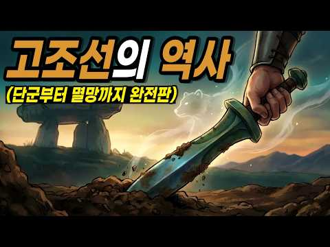
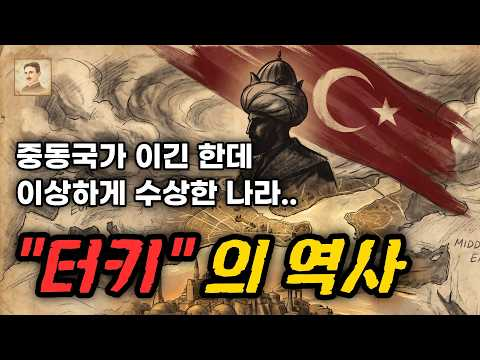

# 역사 — 성공 사례 분석: 사례별 자세히 #321–#360

`analysis.md` 의 9번 (같은 # 번호). 자동 생성 — `tools/success_analysis.py` v1.4.1 (2026-10-17 07:39 UTC). ※ 연구·교육용 — 투자 권유가 아님.

### 321. 자객들에 쫓기던 왕비를 절벽으로 밀어버린 천재아이∣ 야담 ∣ 조선시대 ∣ 오디오북 ∣ 전설 민담

- https://www.youtube.com/watch?v=aI8A973spEw · 전해들은 야담 · 구독자 41,000 · 조회수 800,721 (×19.5, 하루 5,414.1) · 좋아요 20,641 (2.6%) · 82.4분 · 2026-05-22 · 주제 묶음 3. 조선 · 형식 수면·낭독 (잠잘 때 듣는) · 폴더 `W_aI8A973spEw` (웹 승인)
- 썸네일: 
- 설명 앞부분: 본 영상은 ai를 활용하였지만 등장인물을 인형으로 직접 오리고 제작하여 직접 촬영 및 연출한 영상이 사용되는 인형극 영상입니다 전해들은 야담이 새롭게 각색하고 재구성한 창작 콘텐츠입니다. 이야기의 몰입도를 높이기 위해 등장인물의 이름과 지명 등 일부 설정은 가공되었음을 알려드립니다. 전해들은 야담은 바쁜 세상살이에 지친 여러분이 잠시 발걸음을 멈추고 쉬어갈 수 있는 작은 이야기 쉼터입니다. 교과서에는 실리지 않은 기이하고도 흥미로운 야담과 야사, 우리 조상들의 해학이 담긴 민담, 그리고 역사 뒤편에 숨어 있던 비밀스러운 이야기들을…
- 대본 없음 (설명) — 음성인식이 끝나면 도입부·흐름이 들어감
- 댓글 748/748: 좋은 점 — 영상 6 · 감사·응원 51 · 더 알고 싶은 것 4 · 아쉬운 점 — 영상 11 · 반박·불만 — 의견 다름 5 · 정치·사회 2 · 경험 공유 7 · 구독·다음 기대 0
  - 좋은 점 — 영상 👍3 “바쁜 하루 중에 잠시 쉬어갈 수 있는 좋은 이야기 쉼터 같네요.”
  - 좋은 점 — 영상 👍2 “오랜만에 정말 시간 가는 줄 모르고 들었습니다. 옛이야기는 들을수록 새로운 매력이 있는 것 같네요. 좋은 영상 감사합니다.”
  - 감사·응원 👍47 “흥미롭네요 잘 들었어요 감사합니다”
  - 감사·응원 👍35 “인천논현동에서ㆍ 잘듣고 잇어요ㆍ 감사합니다”
  - 더 알고 싶은 것 👍11 “국문학과나오셨나봐 창작잘들었습니다 또올려주세요 귀가자꾸끌려갑니다”
  - 더 알고 싶은 것 👍2 “어디서 듣는지 궁금한 이유가 뭔가요? 침대에서 듣고 있긴 합니다만? ?”
  - 아쉬운 점 — 영상 👍10 “낚시하면서 듣고 있어요 😊”
  - 아쉬운 점 — 영상 👍1 “목소리가 너무 좋으셔서 듣는 내내 몰입했어요! 스토리도 흥미진진하고 재미있네요 👍”
  - 반박·불만 — 의견 다름 👍19 “서울종로익선동에서듣고있지요”
  - 반박·불만 — 의견 다름 👍5 “야담같은소리는 헛소리다”
  - 정치·사회 👍23 “마가복음(막) 1장 15. 가라사대 때가 찼고 하나님 나라가 가까왔으니 회개하고 복음을 믿으라 하시더라 15. "The time has come," he said. "The kingdom of God is near. Repent and believe the good …”
  - 정치·사회 👍4 “정부의 선거를 앞둔 강압이 작용하지 않았을까 생각됩니다.”
  - 경험 공유 👍4 “서울에서 듣고있는데 우리남편이 부안이예요 와우 반가워요~”
  - 경험 공유 👍3 “저도 약수동에서 듣고있어요 ^^”

### 322. 400년 전 명군 후손들이 지금도 한국에 살고 있다는 충격적 진실

- https://www.youtube.com/watch?v=8hxGkzijJTc · 브라이언 히스토리 · 구독자 1,050 · 조회수 20,493 (×19.5, 하루 129.8) · 좋아요 389 (1.9%) · 13.1분 · 2026-05-12 · 주제 묶음 1. 역사 일반·이야기 · 형식 정보·해설 (그 밖) · 폴더 `W_8hxGkzijJTc` (웹 승인)
- 썸네일: 
- 챕터: 0:00 충격적 개막 - 10만 명의 비밀 · 2:30 역사의 무대 - 1592년 임진왜란 · 5:15 운명의 갈림길 - 명군들의 선택 · 8:45 첫 번째 가문 - 석씨 가문의 비극 · 12:20 두 번째 가문 - 진씨 가문의 의리 · 15:50 세 번째 가문 - 두씨 가문의 그리움 · 19:10 네 번째 가문 - 편씨 가문의 전공
- 설명 앞부분: 지금 이 순간, 당신 옆에서 살아가는 10만 명의 사람들이 간직한 놀라운 비밀! 400년 전 명나라에서 온 그들이 조선에 남은 진짜 이유는 무엇일까요? 이 영상에서 알게 되는 것: 임진왜란 때 조선을 구하러 온 명군들의 숨겨진 이야기 명군 후손들이 지금도 한국에 살고 있는 충격적 진실 고국을 버리고 조선에 뿌리내린 명장들의 선택 400년간 이어져 온 명군 후손들의 삶과 문화 🕒 타임라인:
- 대본 없음 (설명) — 음성인식이 끝나면 도입부·흐름이 들어감
- 댓글 133/133: 좋은 점 — 영상 0 · 감사·응원 0 · 더 알고 싶은 것 2 · 아쉬운 점 — 영상 2 · 반박·불만 — 의견 다름 5 · 정치·사회 26 · 경험 공유 5 · 구독·다음 기대 0
  - 더 알고 싶은 것 👍8 “그런데 왜 해방 이후 한반도에 남은 일본인들에 대한 얘기는 다들 쉬쉬하는지 궁금하네요~~”
  - 더 알고 싶은 것 👍5 “편갈송 장군입니다. 편갈장군이 아니라~ 수정 부탁드려요. ^^ 전쟁후 아들 3형제가 아버지를 모시기 위해 조선으로 넘어왔고 그 자손들이 정착했습니다. 인구는 2015년 기준 16,689명이라고 나무위키에 나오네요.”
  - 아쉬운 점 — 영상 👍0 “ㅡ타민족 유입 한반도 인구 늘어나 수만은 후손들이 대한민국 발전 에 뿌리가 된겄이다 족보가 빛나는 가문들이 줄줄이 들어 왔다 그래서 인류는 하나다 인종 차별 21세기는 하는 시대는 끝난 겄이다 특히 아시아 한중 몽고 일부는 고조선 우리 민족이다 일본도 일부 삼별초ㆍ백…”
  - 반박·불만 — 의견 다름 👍6 “우리는 엄청난 다민족이예요~~ 겨우 400년?? 어이없어. 전쟁때마다 다 섞인다고요!!!”
  - 반박·불만 — 의견 다름 👍3 “한국이 다문화인건 석기시대부터지 조선때부터가 아닙니다. 석기시대, 청동기시대에 백인들도 살았어요. 단군조선의 도읍도 지금의 중국 하북성 북경 근처에 있었어요. 기자도 중국에서 온 사람이고 위만도 중국에서 왔고 중국에서 온 사람들이 고조선시대, 삼한시대 삼국시대 고려시…”
  - 정치·사회 👍66 “명군 후손이든 일본 장수의 후손이든 베트남 왕자의 후손이든 지금 한국인이라는 정체성이 중요하죠. 조선족들이 한국에 들어와서 정착을 해도 중국인이라고 떠들고 다닌다면, 그들은 명백한 중국인입니다.”
  - 정치·사회 👍27 “중국에서 왔다고 다 중국인일까? 그럼 백제 고구려 신라의 옛 영토 중국땅 사람들은 다 중국인이야?”
  - 경험 공유 👍3 “고등학교다닐때 같은반친구 석영준이 생각나네 울산 학성타운 같은아파트단지에서 1년 살았는데 그러다가 우리집이 울산대쪽으로 이사를가서”
  - 경험 공유 👍3 “아니 겨우 400년된 귀화성이 인구가 16000? ㅋㅋ 진짜 웃기네요. 수천년 이어온 신라 8박 혹은 9박 경명왕계 박씨본관 우리집안이 인구가 겨우 35,000명인데. 무슨 용 써는 재주가 탁월한가 ? 아니면 재산을 송금해서 가져온건가 ?”

### 323. 우리가 몰랐던 조선시대 평민들의 충격적인 삶 ∣ 조선역사 ∣ 한국사 ∣ 조선왕조실록 ∣ 자면서 듣기 좋은 역사 이야기 ∣ 자면서 듣는 역사 이야기

- https://www.youtube.com/watch?v=IbaIAa8VCR8 · 역사킴 · 구독자 4,320 · 조회수 84,243 (×19.5, 하루 625.2) · 좋아요 676 (0.8%) · 30.3분 · 2026-06-04 · 주제 묶음 1. 역사 일반·이야기 · 형식 수면·낭독 (잠잘 때 듣는) · 폴더 `W_IbaIAa8VCR8` (웹 승인)
- 썸네일: 
- 설명 앞부분: 우리가 몰랐던 조선시대 평민들의 충격적인 삶
- 대본 없음 (설명) — 음성인식이 끝나면 도입부·흐름이 들어감
- 댓글 75/75: 좋은 점 — 영상 1 · 감사·응원 1 · 더 알고 싶은 것 1 · 아쉬운 점 — 영상 1 · 반박·불만 — 의견 다름 1 · 정치·사회 0 · 경험 공유 2 · 구독·다음 기대 0
  - 좋은 점 — 영상 👍2 “ㅡ0건강,면역성에서 가장중요한게..공기다. 특히.. 본인이 가장 오래 머무는 실내공간의 공기가 맑은가..시멘트라돈가스와 화학가스에 오염되어 있는가에 따라서..호흡을통해..오염된 독성공기가 폐로들어가서 혈액을 오염시켜.. 병들이고, 독성화시키면서..혈액세포를 병들이고.…”
  - 더 알고 싶은 것 👍0 “금줄... 자세히 알려주세요. 조선 후기에 고추가 온걸로 아는데 그전엔 남자는 멀 걸었나요?”
  - 아쉬운 점 — 영상 👍8 “애니메이션 이. 일본. 캐릭터예요 . 머리가. 일본 머리모양이예요 .아쉽네요 중간중간. 틀려요. 모자도 요.”
  - 반박·불만 — 의견 다름 👍2 “ㅡ0건강,면역성에서 가장중요한게..공기다. 특히.. 본인이 가장 오래 머무는 실내공간의 공기가 맑은가..시멘트라돈가스와 화학가스에 오염되어 있는가에 따라서..호흡을통해..오염된 독성공기가 폐로들어가서 혈액을 오염시켜.. 병들이고, 독성화시키면서..혈액세포를 병들이고.…”
  - 경험 공유 👍3 “사실 우리나라의 온돌 문화는 책에서는 고조선 시대때부터 온돌이 있었다고 나와 있어서 고조선 시절부터 모든 백성들이 온돌 난방을 했던것처럼 알고 있지만 우리나라의 온돌 난방은 조선시대때도 왕족들과 극히 일부 사대부 권력층들만 온돌 난방을 했었고 대부분의 백성들은 화로만…”

### 324. "조선 최고의 천재다" 전세계가 세종대왕이 만든 한글을 극찬하는 이유

- https://www.youtube.com/watch?v=T2Z6frSqJrs · 한반도 백과사전 · 구독자 4,810 · 조회수 91,873 (×19.1, 하루 8,975.7) · 좋아요 489 (0.5%) · 19.5분 · 2026-10-07 · 주제 묶음 3. 조선 · 형식 정보·해설 (그 밖) · 폴더 `W_T2Z6frSqJrs` (웹 승인)
- 썸네일: 
- 챕터: 0:00 500년 만에 발견된 설계도의 비밀 · 1:00 훈민정음 해례본, 왜 특별할까? · 2:20 사람의 몸에서 탄생한 자음 · 3:41 모음은 세상의 이치를 담았다? · 5:44 한글이 세계 최고인 진짜 이유 · 7:16 세종대왕은 왜 혼자 창제했나? · 11:08 백성을 향한 세종의 고집 · 13:06 어떻게 우리 글자가 되었을까? · 14:54 우리가 한글날을 기념하는 이유 · 15:53 디지털 시대의 천재적 설계 · 17:39 잘못 알려진 한글의 기록들 · 18:23 한글, 우리 삶을 바꾼 위대한 힘
- 설명 앞부분: 🇰🇷세종대왕은 왜 하필 28자로 만들었을까? 세계 언어학자들이 한글을 극찬하는 진짜 이유 1940년 안동에서 마침내 모습을 드러낸 『훈민정음 해례본』은 한글이 사람의 발음 기관을 본떠 철저히 공학적으로 설계된 문자라는 사실을 세상에 알렸습니다. 1443년 창제 이후 450년 동안 백성들의 삶과 문화 속에 깊이 스며든 한글은, 1894년 고종의 칙령 제1호(공문식 제14조)를 통해 마침내 한반도의 정식 공용 문자로 선포되는 역사적 반전을 맞이합니다. 세계적 학자인 재레드 다이아몬드와 제프리 샘슨이 "인류가 만든 가장 독창적이고 완벽…
- 대본 없음 (설명) — 음성인식이 끝나면 도입부·흐름이 들어감
- 댓글 28/28: 좋은 점 — 영상 1 · 감사·응원 1 · 더 알고 싶은 것 0 · 아쉬운 점 — 영상 0 · 반박·불만 — 의견 다름 0 · 정치·사회 2 · 경험 공유 0 · 구독·다음 기대 0
  - 감사·응원 👍5 “참으로 대단한 어르신 입니다 세종대왕님 정말 감사합니다~ 잘 설명해주신걸 들으니 가슴이 뜨거워지는 느끼이네요~ 감사합니다 ~”
  - 정치·사회 👍0 “세종대왕 릉이 미국에 있습니다. 조선 임금님이 계신 한양이 워싱턴 디씨였고 중국이였다 일월오봉도 배경이 워싱턴 디씨 포토맥강이 조선의 한강 임진왜란은 미국에서 전쟁이었다 홍무정운 아메리카 대조선, 57, 아메리카 사도세자 저자 박인수 조지 워싱턴 = 사도세자 토마스 …”

### 325. 세종대왕이 600년 전 숨겨둔 비밀 ∣ 지금 전 세계가 뒤집힌 이유

- https://www.youtube.com/watch?v=JLOhGgZAKeA · 이상하TV · 구독자 12,400 · 조회수 235,763 (×19.0, 하루 4,817.0) · 좋아요 2,015 (0.9%) · 22.1분 · 2026-08-29 · 주제 묶음 3. 조선 · 형식 정보·해설 (그 밖) · 폴더 `W_JLOhGgZAKeA` (웹 승인)
- 썸네일: 
- 챕터: 0:00 600년 전 한글의 비밀 · 1:20 세계 문자와 한글의 차이 · 2:46 세종대왕이 글자를 만든 이유 · 5:05 과학적으로 설계된 자음 · 7:15 소리와 획의 놀라운 규칙 · 10:23 한글 창제를 둘러싼 반대 · 12:17 사라질 뻔한 해례본 · 14:30 디지털 시대에 빛난 한글 · 18:48 국경을 넘어선 한글
- 설명 앞부분: 매일 스마트폰 자판을 두드리는 순간에도 600년 전 세종대왕의 설계가 작동하고 있습니다. 한글은 누가, 왜, 어떤 원리로 만들었는지가 기록으로 남은 특별한 문자입니다. 하지만 그 위대한 글자는 탄생부터 환영받은 것은 아니었고, 창제 원리를 담은 책마저 역사 속에서 사라질 위기를 겪었습니다. 한글이 오늘날 세계의 주목을 받게 된 과정을 끝까지 확인해 보세요.
- 대본 없음 (설명) — 음성인식이 끝나면 도입부·흐름이 들어감
- 댓글 68/68: 좋은 점 — 영상 0 · 감사·응원 10 · 더 알고 싶은 것 0 · 아쉬운 점 — 영상 2 · 반박·불만 — 의견 다름 2 · 정치·사회 4 · 경험 공유 1 · 구독·다음 기대 0
  - 감사·응원 👍22 “그져고개숙여 감사합니다라고 할뿐 감사합니다.”
  - 감사·응원 👍20 “우리 한민족은 지혜롭고 똑똑한 민족입니다 우리 손주들을 보면 너무 너무 예쁩니다 자손이 예뻐야 후손도 더 잘 되지 않을까요 너무너무 감사하고 너무 사랑했어요”
  - 아쉬운 점 — 영상 👍2 “비슷한 얘기 이곳저곳 채널에서 계속 반복해서 올리는 이유가 무엇인가,,,,,,?”
  - 아쉬운 점 — 영상 👍0 “중국 한자 아닙니다. 정정요. 신라,백제,고리가 다 말이 틀리니 지역마다 말이 틀린거구요.”
  - 반박·불만 — 의견 다름 👍0 “우리의 자랑 한글은 고작 15세기의 문자가 아닙니다 4천2백년의 오랜 역사를 자랑합니다 그렇게 위대한 문자 한글을 세종은 자신의 업적으로 꾸미면서 매우 초라하게 축소시켜 버렸지요 한글은 고조선 3세 가륵단군의 명을 받은 을보륵님에 의해 창제 되어 사용되며 발전해 왔습…”
  - 반박·불만 — 의견 다름 👍0 “중국 한자 아닙니다. 정정요. 신라,백제,고리가 다 말이 틀리니 지역마다 말이 틀린거구요.”
  - 정치·사회 👍4 “중국인들이 가장 싫어하는 한국인 1위가 세종대왕이래요.ㅋㅋ”
  - 정치·사회 👍0 “우리 민족이 세계의 중심이 되실것을 미리 알고 계시었던,, 우리 민족의 정신적 지도자 이셨던, 백범 김구 선생님의 높으신 혜안, """문화를 주도하는 나라가 세계의 중심이 된다 !!!! """ 깊이 새겨야 헐 것이며, 나라가 부유 해질수록 가난하고,, 어려운 나라를 …”
  - 경험 공유 👍4 “세종대왕의 백성을 사랑하는 마음 덕에 후손인 저희 뿐만 아니라, 오늘날, 자기 글자 없는 나라에게도 기록하는 문화보전의 첨병이 됐어요. 감사합니다!”

### 326. 40분 전까지 이름도 몰랐는데 울었다 — 이순신을 처음 알게 된 외국인들

- https://www.youtube.com/watch?v=PGedVpjYgEk · 경제냥 · 구독자 3,310 · 조회수 62,935 (×19.0, 하루 3,485.5) · 좋아요 682 (1.1%) · 14.7분 · 2026-09-29 · 주제 묶음 3. 조선 · 형식 애니메이션·지도 · 폴더 `W_PGedVpjYgEk` (웹 승인)
- 썸네일: 
- 설명 앞부분: 스파르타 300 이야기 말고, '조선의 13' 이야기를 아시나요? 시카고의 한 만화가가 17년째 그리고 있는 조선 장군, 그리고 그 이야기를 처음 들은 외국 유튜버들이 어디서 놀라고, 어디서 화내고, 어디서 울었는지 따라가 봤습니다. 외국 사람들이 이 이야기에서 가장 놀란 대목, 여러분은 어디셨나요? 댓글로 남겨 주세요. 반응 영상 속 애니메이션: Extra History 'Korea: Admiral Yi' 시리즈 (2015) ■ 크리에이티브 커먼즈 저작자 표시(CC BY) 영상 ■ 유물 사진 (공공누리 제1유형 · 국립중앙박물관…
- 대본 없음 (설명) — 음성인식이 끝나면 도입부·흐름이 들어감
- 댓글 64/64: 좋은 점 — 영상 0 · 감사·응원 1 · 더 알고 싶은 것 1 · 아쉬운 점 — 영상 0 · 반박·불만 — 의견 다름 2 · 정치·사회 4 · 경험 공유 3 · 구독·다음 기대 0
  - 감사·응원 👍1 “좋은 영상 감사드립니다 멸공!❤”
  - 반박·불만 — 의견 다름 👍25 “후손들은 명량해전 이긴 걸 알고 있지만, 그 시점에는 선조의 육군 편입 요청은 오히려 더 현실적이다. 이순신은 누가 봐도 가망이 없는 전력차이를 심지어 1척도 안잃고 이겼어. 영국인들은 인정하기 싫겠지만 솔직히 넬슨과 이순신은 수준 차이가 너무 남. 그냥 중요 전투 …”
  - 반박·불만 — 의견 다름 👍5 “우리나라 사람들도 역사를 잘 모르는데 거북선을 이순신 장군이 설계하고 만든건 아닙니다~!! 그 전부터 돌격선이라고 거북선을 왜구들을 막는 용도로 있었죠~!! 그것을 이순신 장군이 현장에 상황과 자신의 실전 경험과 그 당시 현실에 맞추어서 개량한겁니다~!! 그게 거북선…”
  - 정치·사회 👍2 “왜 외국인이 나랑 똑같은 생각을 갖고 이야기하지... 진짜 이순신은 무서운 사람이네. 근데... 박정희가 세운 이명박이가 세운 동상은 치우자. 남 생각 안하는 것들이... 광화문 앞에 동상을. ㅋ 이순신이 세종이 이걸 알면!!!!!!! 스스로 그 동상에 머릴 박을 것”
  - 정치·사회 👍1 “지금도 기득권들은 영웅을 품을 만큼의 아량이 없다 지들보다 잘나면 시기와 질투로 밤잠을 설칠거다 영웅을 무너뜨려야 드발뻗고 자는 놈들이 저 국힘들이 아닌가”
  - 경험 공유 👍0 “^^ 네 이 버 ^^ 의 ^^ 메 르 카 츠 ^^ 님 ^^ 의 ^^ 글 ^^ : ^^.......^^ 명 량 대 첩 ^^ 시 ^^ 에 ^^ ....... ^^ 신에게는 아직도 열두척이 있사오니 라고 말할때는 12척이였고 장계가 올라가서 선조에게 닿을때쯤 한척을 수리하…”
  - 경험 공유 👍0 “이순신장군이 옥살이와 모진고문당한건 훙노족 노론벽파들의 모함때문인데 친일교육부가 그걸 안가르치고 왕탓으로 가르치고있다! ★이순신 장군을 명장으로 만든건 전라도 사람들이 임진왜란 이긴건 신라휴ㅇ노족에의한 매국통일신라시대때부터 일본의 해적질로부터 조정에서 물리칠 생각 않…”

### 327. 제1차 세계대전 최악의 소모전, 베르됭 전투 3D ∣ 완전판

- https://www.youtube.com/watch?v=34eZlgvSfDM · 에픽히스토리 코리아 · 구독자 24,600 · 조회수 462,287 (×18.8, 하루 8,127.2) · 좋아요 2,738 (0.6%) · 40.1분 · 2026-08-21 · 주제 묶음 7. 전쟁·군사사 · 형식 정보·해설 (그 밖) · 폴더 `W_34eZlgvSfDM` (웹 승인)
- 썸네일: 
- 설명 앞부분: 1916년 2월 21일, 독일군의 대포 1,000문이 베르됭 일대의 프랑스군 진지를 향해 포격을 시작했다. 인류 역사상 가장 참혹한 전투 중 하나인 베르됭 전투의 시작이었다. 300일 동안 이어진 전투에서 매일 평균 1,000명이 목숨을 잃었다. 독일군은 프랑스군을 소모전으로 끌어들여 피를 말리려 했지만, 프랑스군은 “그들은 통과하지 못한다”는 결의 아래 필사적으로 맞섰다. 정교한 3D 그래픽을 통해 베르됭이 전략적으로 중요했던 이유와 프랑스 동부를 지키던 요새망, 두오몽 요새를 둘러싼 사투, 그리고 독일군과 프랑스군의 치열한 공…
- 대본 없음 (설명) — 음성인식이 끝나면 도입부·흐름이 들어감
- 댓글 151/151: 좋은 점 — 영상 3 · 감사·응원 6 · 더 알고 싶은 것 2 · 아쉬운 점 — 영상 1 · 반박·불만 — 의견 다름 1 · 정치·사회 2 · 경험 공유 5 · 구독·다음 기대 2
  - 좋은 점 — 영상 👍6 “당시 영상과 사진으로만 설명 되던걸 이렇게 보니 한눈에 이해가 잘 되네요.. 좋아요~~”
  - 좋은 점 — 영상 👍0 “오랜만에 정말 아주 잘 짜여진 내용을 알기쉽게 설명해 주어 너무 고맙습니다”
  - 감사·응원 👍0 “에픽채널 영어로 겨우 듣다가 번역본 들으니 넘 좋네요 퀄리티가 넘사벽입니다. 감사드립니다.”
  - 감사·응원 👍0 “오랜만에 정말 아주 잘 짜여진 내용을 알기쉽게 설명해 주어 너무 고맙습니다”
  - 더 알고 싶은 것 👍30 “와 엄청나네요 퀄리티가... 이런 영상만 찾아보는데 제가 본 것들 중에서 1위네요 다른 1차대전 2차대전 대평양전쟁 대규모 전투도 다뤄주시면 좋겠어요”
  - 더 알고 싶은 것 👍0 “내용도 좋고 매우 잘 만들어져 있습니다 다만 배경음악을 다른 것을 써 주세요. 또 나레이션이 있을 때와 그 시이사이의 음량차이가 너무 큽니다. 음압이 너무 커서 피로도가 큽니다. 조정 부탁드립니다”
  - 아쉬운 점 — 영상 👍1 “영상이 존나 지겹습니다. 했던말 계속 언급 반복하면 넘 지루하져”
  - 정치·사회 👍0 “(약 26분 31초까지 보던 중에 문득) 샤를 드골 전 프랑스 대통령이 이 전투에 참전했다가 독일군에 포로로 붙잡히게 되었죠.”
  - 정치·사회 👍0 “전쟁이란 딱 한명의 미치광이가 일으키고 수천만명이 영문도 모른 채 학살 당하는 것이다.... 러우전쟁은 푸틴, 중동전쟁은 네타냐후, 이란전쟁은 트럼프.... 이것들이 미치광이들!!!! 우리도 하마터면 윤석열 때문에 전쟁날 뻔!!!! 베르됭 전투에서 사망한 병사 수는 …”
  - 경험 공유 👍30 “와 엄청나네요 퀄리티가... 이런 영상만 찾아보는데 제가 본 것들 중에서 1위네요 다른 1차대전 2차대전 대평양전쟁 대규모 전투도 다뤄주시면 좋겠어요”
  - 경험 공유 👍0 “서로를 죽여야 내가 살고 끝없이 죽고 죽는 가운데 사람은 존재의미를 잃고 악마가된다”
  - 구독·다음 기대 👍0 “고퀄이네 구독합니다”
  - 구독·다음 기대 👍0 “구독합니다 정말 감동적으로 잘 소재를 선정하고 만드신 영상이네요”

### 328. 기원전 2333년에 세워졌다는 나라, 진짜였을까?

- https://www.youtube.com/watch?v=KIpCeI59BK4 · 역사본능 · 구독자 25,200 · 조회수 469,959 (×18.6, 하루 4,299.0) · 좋아요 4,094 (0.9%) · 105.9분 · 2026-06-30 · 주제 묶음 2. 한국 고대·삼국·고려 · 형식 몰아보기·통합본 (긴 영상) · 폴더 `W_KIpCeI59BK4` (웹 승인)
- 썸네일: 
- 설명 앞부분: 곰이 사람이 됐다는 단군신화. 우리는 그걸 동화처럼 배우지만, 땅속에서는 신화가 아니라 진짜 칼과 무덤과 법이 쏟아져 나왔습니다. 이 영상은 청동기와 비파형 동검에서 시작해, 단군신화에 숨은 권력의 암호, 고조선 사람들의 삶과 법, 망명자 위만의 쿠데타, 한나라와의 일 년 전쟁과 멸망, 그리고 그 나라가 우리에게 남긴 것까지를 끊김 없이 한 흐름으로 따라갑니다. 교육적 가치: 한국 고대사의 첫 단추인 고조선을, 신화와 유물과 문헌 사료를 구분해 가며 검증된 사실 중심으로 정리했습니다. 단군신화의 사회사적 해석, 청동기 사회의 계급…
- 대본 없음 (설명) — 음성인식이 끝나면 도입부·흐름이 들어감
- 댓글 424/424: 좋은 점 — 영상 5 · 감사·응원 15 · 더 알고 싶은 것 4 · 아쉬운 점 — 영상 5 · 반박·불만 — 의견 다름 10 · 정치·사회 19 · 경험 공유 14 · 구독·다음 기대 0
  - 좋은 점 — 영상 👍26 “흥미로운 내용 좋은 영상 잘 보고갑니다”
  - 좋은 점 — 영상 👍12 “와 ~학창시절에 배웠던게 새록새록 기억나면서 그때보다 더 흥미롭고 새롭게 기억되네요~영상 너무좋아요~^^”
  - 감사·응원 👍15 “감사합니다. 우리의 정체성을 조금 더 잘알게 되었어요”
  - 감사·응원 👍10 “재미있게 잘봤습니다, 감사합니다”
  - 더 알고 싶은 것 👍14 “배달국도 알고싶어요”
  - 더 알고 싶은 것 👍0 “'역사본능 역사지형 현주소가 황폐하니 염치 없습니다만 단군신화를 진화론도 아니고 과학적으로 접근하는 것은 리처드도킨스보다 품질 떨어집니다. 한국역사 삼국유사보면 신화적요소 많습니다. 그런요소 다 빼면 뭐가 남을까요?' 직업으로 삼기엔 내면이 부족인데 무엇으로 채우죠?…”
  - 아쉬운 점 — 영상 👍10 “목소리랑 대사는 좋은데..영상이 너무 너무 너무 ai 라서 안 맞는 부분이 많네요...그게 제일 아쉽습니다”
  - 아쉬운 점 — 영상 👍1 “배경과 인물이 서양풍이라 아쉽네요 ㅠ ㅠ 역사 공부 감사합니다”
  - 반박·불만 — 의견 다름 👍27 “단군 역사는 우리 나라에만 있는게 아닙니다. 같은 내용이 중앙아시아에 있음 그래서 비슷한 문화들이 많음”
  - 반박·불만 — 의견 다름 👍6 “쑥과 마늘은...? 채집물 일까요? 경작물 일까요? 고조선은 수렵채집 문화죠. 간석기 반달모양 돌칼의 용도는? 손에끼고 이삭을 똑똑 자르던 것입니다. 경작 아니고 채집이죠 서해 바다는 육지였어요. 순다랜드 라고들 하죠. 바닷물이 들어오자. 주변으로 몰려 나갑니다. 그…”
  - 정치·사회 👍105 “춘천 의암호 중도에서 발견된 고조선 유적을 발굴하다말고 레고랜드에 내주고 쌈싸서 버린 민주당 최문순 전 도지사, 국짐 김진태 전 도지사 이런 놈들이 있는한 글러먹었다. 중도유적은 이미 확인된 유적이다. 청동기 집터, 고인돌, 환호 유구는 대한민국 최대 규모의 청동기 …”
  - 정치·사회 👍17 “심지어는 그 당시 적국인 한의 후손 중국역사에서도 수도 없이 많이 나오는 나라가 고조선인데. 남의 역사도 우리선조를 인정해주는데 왜 우리 주류역사학자들은 고조선을 신화라고 할까? 누가 그렇게 가르친걸까? 그리고 왜 그들은 환단고기 라고 하면 미친듯이 싫어할까? 우리는…”
  - 경험 공유 👍8 “잘봤습니다. 앞서 말한 고조선의 신화와 역사내용들은 저는 익히 잘 알고있었습니다. 연나라장수 진개로부터 준왕, 위만, 우거왕살해까지 이는 중국역사서에 실린내용과 기록이 있기때문에 증명이 가능합니다. 단군신화의 기원전 2333년으로 부터 환웅족과 웅족의 결합으로 탄생된…”
  - 경험 공유 👍5 “고조선의 명칭이 조선으로 이어졌네요 저희 할머니가 우리조선 우리조선 이렇게 말씀하셨지요”

### 329. 어머니를 잃고 복수를 위해 입궁한 천재 여의,목욕탕에서 만난 남자가 세자였다…“봤으니 책임질게.”#숏드 #로맨스 사극

- https://www.youtube.com/watch?v=iiA2zhl7rLA · 심쿵방송 · 구독자 12,600 · 조회수 234,776 (×18.6, 하루 1,450.1) · 좋아요 908 (0.4%) · 333.2분 · 2026-05-08 · 주제 묶음 3. 조선 · 형식 정보·해설 (그 밖) · 폴더 `W_iiA2zhl7rLA` (웹 승인)
- 썸네일: 
- 설명 앞부분: 여의의 성장기∣Rise of Her Lady Physician∣女医进击录 한 건의 억울한 사건으로, 영택란은 홀로 궁궐 깊숙이 뛰어들어 남성 세력이 판을 치는 태의원에서 자신의 길을 열어가리라 다짐한다. 남자 의관들의 비웃음과 경멸 속에서, 그녀는 오로지 의술만을 무기로 역경을 헤쳐 나간다. 황태자를 치료하고, 태후를 구하며, 전염병을 진압하는 등 세상을 구한 공을 인정받아 마침내 당대 최초의 여관이 된다. 그렇게 그녀는 경멸하던 자들을 무릎 꿇게 하고, "여성도 권력의 자리에 당당히 앉는다"는 역전의 전설을 써 내려간다. Due…
- 대본 없음 (설명) — 음성인식이 끝나면 도입부·흐름이 들어감
- 댓글 75/75: 좋은 점 — 영상 0 · 감사·응원 1 · 더 알고 싶은 것 1 · 아쉬운 점 — 영상 1 · 반박·불만 — 의견 다름 1 · 정치·사회 3 · 경험 공유 2 · 구독·다음 기대 0
  - 감사·응원 👍1 “와 악역 전문으로 하는 언니가 여주가 되다니! 언니 응원해요!! 언니 독기로 다 잡아먹어버렷!”
  - 아쉬운 점 — 영상 👍8 “자막이 다른 글자와 겹쳐서 보기가 어렵다는 점이 조금 아쉽네요”
  - 반박·불만 — 의견 다름 👍5 “대장금이네요 설마 중국의 창작물이라고 우길건 아니죠?”
  - 정치·사회 👍0 “중국인들처럼 작품속의상들도 개판 쪽수는 많은데 쓸만한작품이 없다.중국산은 허접 그 잡채 ㅋㅋ 사극을 개콘으로 만드는 재주가 뛰어나다....”

### 330. [리부트] 흑선봉명록 1 ∣ The King's Mystic: Chronicles of Seoha ∣ 조선 판타지 사극

- https://www.youtube.com/watch?v=Enoqsssxx5Y · 로보랩 스튜디오 · 구독자 9,220 · 조회수 167,333 (×18.1, 하루 4,929.7) · 좋아요 1,684 (1.0%) · 22.2분 · 2026-09-13 · 주제 묶음 3. 조선 · 형식 정보·해설 (그 밖) · 폴더 `W_Enoqsssxx5Y` (웹 승인)
- 썸네일: 
- 설명 앞부분: [설명] 조선의 밤, 죽은 자들이 다시 일어나기 시작한다. 왕명을 받들어 인간의 힘으로는 감당할 수 없는 기이한 사건을 해결하는 봉명방사(奉命方士), 서하. 황해도 곡산에 나타난 시귀들. 그리고 그들을 토벌하기 위해 움직이는 서하와 요괴 토벌 정예부대 암영단. 하지만 서하는 평소와 달리 직접 전투에 나서지 않고, 조용히 모든 것을 지켜보기만 하는데... 《흑선봉명록》의 새로운 시작, 첫 번째 이야기입니다. [AI 제작 / AI Production] 《흑선봉명록》은 다양한 생성형 AI 도구를 활용하여 제작한 AI 기반 실사 판타지 …
- 대본 없음 (설명) — 음성인식이 끝나면 도입부·흐름이 들어감
- 댓글 133/133: 좋은 점 — 영상 0 · 감사·응원 8 · 더 알고 싶은 것 3 · 아쉬운 점 — 영상 0 · 반박·불만 — 의견 다름 1 · 정치·사회 2 · 경험 공유 3 · 구독·다음 기대 7
  - 감사·응원 👍29 “정말이지 어쩔수가 없는 프로정신 구독자를 위함이라셔도 좋은 작품에 대한 욕심 또한 대단하신듯 합니다. 건강 상하시지 않는 것이 제일 우선시 되어야 할것 같습니다. 수준 높으신 구독자 분들께선 이런 이유라면 충분히 기다리며 좋은 작품을 기다릴수 있을겁니다. 말이 쓸데없…”
  - 감사·응원 👍7 “아니아니 이럴수가!!! 드디어 1편이!!! 정말 감사합니다. 얼마나 힘드셨을까요... 1편과 함께 4편도 제작했다니... 일단 댓글부터 달고 영상 봅니다. 정말 고생하셨어요. 감사합니다!!!! 🎉😂😊”
  - 더 알고 싶은 것 👍2 “4번 보고 있습니다. 건강 챙겨 가시면서 만들어 주세요..😊😊”
  - 더 알고 싶은 것 👍1 “혹시 이거 썸네일 그림 그록으로 뽑으셨나요?제얼굴처럼 나와서 ㅠ.ㅠ다른게아니라 제가그록으로 제얼굴로 유튜브 영상작업많이했어가지고 그록이 전체서버에 남을수도있다고해서 학습된것같아서 그록으로 생성하신건지 궁금해서 여쭤봅니다 ㅠㅠ 요즘따라 제얼굴이 다른사람들 그록생성작품에…”
  - 정치·사회 👍1 “남녀 주인공들 헤어스타일과 복식을 중국 스타일로 한 게 참 아쉽네요. 그것만 빼면 일반서민들 복식과 관아 사또, 포졸들 그리고 고을 건축양식까지 전부 한국사극 그대로 재현해놓았는데 유일하게 주인공들만 중국인들 데려다 놓은 것처럼 중국스타일의 머리모양과 의복을 해놓은 …”
  - 정치·사회 👍0 “조선 판타지 사극인데.. 주인공이 외모부터 의상까지 너무 중국인 같아요~~ 무비자로 조선 귀화한 화교인가요??”
  - 경험 공유 👍4 “오!제가1등이군요? 잘 보겠습니다”
  - 경험 공유 👍1 “와 디테일 미쳤다리 내가 본것중에 제일이네 왜만해서는 잘한다고 안하는 성격인데 정말 얼마나 노력했을까라는 딱봐도 정말 작품이 너무 디테일하게 잘했어 넘 쪼앙 최고얌”
  - 구독·다음 기대 👍13 “다음편도 기대할께요😊”
  - 구독·다음 기대 👍7 “늘 다음편이 기다려지는 멋진 작품 감사해요”

### 331. 한글날 특집 ∣ 외국인이 한글을 읽고 놀란 순간… 세종대왕이 열어 준 길

- https://www.youtube.com/watch?v=FziT13rkQ8I · 국뽕살롱 · 구독자 823 · 조회수 14,934 (×18.1, 하루 1,777.4) · 좋아요 71 (0.5%) · 14.4분 · 2026-10-08 · 주제 묶음 3. 조선 · 형식 정보·해설 (그 밖) · 폴더 `W_FziT13rkQ8I` (웹 승인)
- 썸네일: 
- 챕터: 0:00 처음 읽는 순간 · 1:57 세종이 열어 준 길 · 3:43 글자가 소리가 되다 · 7:40 실수해도 시작할 수 있다 · 10:15 낯선 도시를 읽는 길 · 12:45 우리가 매일 쓰는 기적
- 설명 앞부분: 10월 9일 한글날 특집. 처음 한글을 읽고 스스로 놀라는 외국인들의 실제 반응으로, 세종대왕이 훈민정음에 담으신 뜻을 돌아봅니다. 2026년은 훈민정음 반포 580주년, 한글날을 처음 기념한 지 100년이 되는 해입니다. 처음에는 낯선 기호였던 글자가, 어느 순간 익숙한 단어로 읽힙니다. ‘엘모·토토로·미키’ 이름 읽기, 친구와 배우는 ‘지수·안녕’, 한국 여행의 간판과 메뉴까지. 실제 원본 5편 속 시도와 웃음, 솔직한 어려움을 따라갑니다. ‘읽을 수 있다’는 작은 변화는 누구에게나 글을 익혀 일상에서 쓰도록 하려 했던 세종대…
- 대본 없음 (설명) — 음성인식이 끝나면 도입부·흐름이 들어감
- 댓글 12/12: 좋은 점 — 영상 0 · 감사·응원 0 · 더 알고 싶은 것 0 · 아쉬운 점 — 영상 0 · 반박·불만 — 의견 다름 1 · 정치·사회 0 · 경험 공유 0 · 구독·다음 기대 0
  - 반박·불만 — 의견 다름 👍1 “제발 ~~~ 십월 구일은 아니죠. 시월 구일입니다. 제대로 한글을 ~~~”

### 332. 부여 당일치기로 국사책 표지모델 찾아왔습니다 (feat. 제72회 백제문화제) ∣ KOOKIES

- https://www.youtube.com/watch?v=bd5gpHAMqPg · Kookies Box [쿠키스] · 구독자 2,280 · 조회수 41,391 (×18.1, 하루 1,661.4) · 좋아요 38 (0.1%) · 27.8분 · 2026-09-22 · 주제 묶음 1. 역사 일반·이야기 · 형식 인터뷰·강연·대담 · 폴더 `W_bd5gpHAMqPg` (웹 승인)
- 썸네일: 
- 챕터: 0:00 인트로 - 부여로 출발, 버스에서부터 우당탕 · 0:44 오늘의 목적지, 제72회 백제문화제가 열리는 부여 · 1:19 강민 진행비 횡령(?) 사건 · 2:36 오늘의 목적 - 백제금동대향로를 찾아서 · 3:50 부여행 버스 안 벼락치기 (538년 사비 천도, 66… · 4:41 부여중앙시장 먹방 & 굿뜨래페이 체험 · 8:50 국립부여박물관 - 백제금동대향로 실물 영접 · 10:01 해설사님과 함께하는 향로 이야기 (1993년 발굴 비… · 13:40 즉흥 결정, 부소산성으로! · 14:08 백마강 황포돛배 유람선 (낙화암 · 고란사) · 16:27 정림사지 오층석탑 - 홀수 탑엔 이유가 있다 · 19:05 궁남지 - 서동과 선화공주 설화 속으로 · 21:06 저녁 연잎밥정식 & 백제 상식 서바이벌 퀴즈 · 24:31 백제문화제 홍보 & 오늘 하루 소감 · 26:18 정림사지의 밤, 미디어아트로 물든 백제 · 0:00 Intro - Off to Buyeo, chaos s… · 0:44 Today's destination: Buyeo, h… · 1:19 The great "embezzlement" scan… · 2:36 Today's mission - finding the… · 3:50 Cramming Baekje history on th…
- 설명 앞부분: 계획 1도 없이 떠난 부여 당일치기 여행 🚌 그런데 국사책 표지모델(백제금동대향로)부터 정림사지, 백마강 유람선, 궁남지까지 백제의 흔적을 하루 만에 다 만나고 왔습니다 🍂 버스에서 조는 것도 잠시, 해설사님 만나서 제대로 배운 백제 역사 "왜 하필 봉황이에요?" "이게 어떻게 5층이에요?" 쿠키즈의 궁금증 폭발 현장, 지금 확인하세요! 그리고 우리가 부여를 찾은 진짜 이유 한 달 뒤 이곳에서 열리는 진짜 큰 축제, 제72회 백제문화제! 쿠키즈가 하루 동안 미리 체험한 코스, 여러분도 그대로 따라가 보세요 😊 백제의 향연 - 기억…
- 대본 없음 (설명) — 음성인식이 끝나면 도입부·흐름이 들어감
- 댓글 6/6: 좋은 점 — 영상 0 · 감사·응원 0 · 더 알고 싶은 것 0 · 아쉬운 점 — 영상 0 · 반박·불만 — 의견 다름 0 · 정치·사회 0 · 경험 공유 0 · 구독·다음 기대 0

### 333. 아직도 설명할 수 없는 미스터리한 고대 발견 15가지

- https://www.youtube.com/watch?v=mVSr1ixtdfw · Nariman · 구독자 2,680 · 조회수 48,360 (×18.0, 하루 308.4) · 좋아요 379 (0.8%) · 128분 · 2026-05-13 · 주제 묶음 8. 문명·고고학 · 형식 정보·해설 (그 밖) · 폴더 `W_mVSr1ixtdfw` (웹 승인)
- 썸네일: 
- 설명 앞부분: 고대 세계는 우리가 생각하는 것보다 훨씬 더 복잡하고, 때로는 믿기 어려울 만큼 신비로운 흔적을 남겼습니다. 이 영상에서는 아직도 명확하게 설명되지 않은 미스터리한 고대 발견 열다섯 가지를 따라가 봅니다. 정체를 알 수 없는 유물, 이해하기 어려운 고대 건축물, 사라진 문명이 남긴 흔적, 그리고 현대 과학으로도 완전히 풀리지 않은 수수께끼까지. 이 발견들은 단순한 오래된 유물이 아닙니다. 인간의 역사, 고대 기술, 잊힌 문명, 그리고 우리가 아직 모르는 과거의 비밀을 다시 생각하게 만드는 단서들입니다. 고대 문명은 정말 우리가 아…
- 대본 없음 (설명) — 음성인식이 끝나면 도입부·흐름이 들어감
- 댓글 5/5: 좋은 점 — 영상 0 · 감사·응원 0 · 더 알고 싶은 것 0 · 아쉬운 점 — 영상 0 · 반박·불만 — 의견 다름 0 · 정치·사회 0 · 경험 공유 0 · 구독·다음 기대 0

### 334. 만들면 곤장 80대? 고려·조선 임금들이 약과를 필사적으로 금지했던 진짜 이유

- https://www.youtube.com/watch?v=tK0dcg5wlHQ · 핵쉬운역사 · 구독자 3,680 · 조회수 66,109 (×18.0, 하루 417.7) · 좋아요 1,161 (1.8%) · 21.7분 · 2026-05-12 · 주제 묶음 2. 한국 고대·삼국·고려 · 형식 정보·해설 (그 밖) · 폴더 `W_tK0dcg5wlHQ` (웹 승인)
- 썸네일: 
- 챕터: 0:00 미국 코스트코를 강타한 500만 개의 약과 · 2:00 불교 사찰의 '가짜 고기', 약과의 기원 · 4:00 왜 '약'이라는 이름이 붙었을까? (한방 보양식) · 6:00 고려 귀족들의 사치, 송나라 사신을 놀라게 한 맛 · 8:00 조선 왕실의 필수 의례 음식으로 격상되다 · 10:00 정조의 곤장 80대 명령과 조선식 위선 · 12:00 양과자의 등장과 1000년 사치 본능의 위기 · 14:00 산업화의 그늘, 약과가 사라질 뻔했던 이유 · 16:00 뉴욕타임스가 주목한 한국의 'Honey Cookie' · 18:00 미슐랭 셰프들이 약과를 선택한 이유
- 설명 앞부분: 2024년 미국 코스트코 매대를 휩쓴 '약과' 열풍, 알고 계셨나요? 편의점에서 쉽게 사 먹는 이 달콤한 간식이 사실 한국 역사상 가장 위험한 음식이었다는 사실을 아는 사람은 많지 않습니다. 고려 명종부터 조선 정조까지, 왜 임금들은 약과 제조 금지령을 내리고 곤장 80대라는 가혹한 형벌까지 내렸을까요? 단순한 디저트를 넘어 귀족 권력의 상징이자 왕실의 최고급 진상품이었던 약과의 1000년 역사를 파헤칩니다. 신라 사찰의 '가짜 고기'에서 시작해 미국 뉴욕 미슐랭 레스토랑의 시그니처 디저트가 되기까지, 우리가 몰랐던 약과에 담긴 …
- 대본 없음 (설명) — 음성인식이 끝나면 도입부·흐름이 들어감
- 댓글 110/110: 좋은 점 — 영상 1 · 감사·응원 1 · 더 알고 싶은 것 0 · 아쉬운 점 — 영상 0 · 반박·불만 — 의견 다름 2 · 정치·사회 5 · 경험 공유 1 · 구독·다음 기대 0
  - 좋은 점 — 영상 👍1 “너무도 유익한 정보와 영상입다 만드시느라 애 쓰셨습니다”
  - 감사·응원 👍2 “몸과 마음은 내가 아니며, 이 세상은 교육을 위한 가상세계다. 나는 몸에 머무는 영혼이고, 마음이 기뻐하고 감사하며 사랑하는 영성산업으로 세계통일하여 기아,난민,전쟁을 종식하자.”
  - 반박·불만 — 의견 다름 👍0 “약과의 가치가 떨어진적은 한번도 없습니다 . 좋은 재료로 만든 약과는 진짜로 비싸서 못사먹을뿐이죠 . 그리고 곤장 80 대 는 양반들의 위선이 아니라 , 미국의 금주령이나 유럽 왕족들의 천민은 감자를 못먹게 하겠다 같은 소리 입니다 ㅋㅋㅋ 허세와 가오잡기용이지 진짜 …”
  - 정치·사회 👍1 “유엔가입국중 제일 가난한 아사자 나라가 싸면서도 당,열량이 높은 밀가루 음식도 없어서 못먹는데 밀가루음식 장려 정책으로 어쩔 수 없이 밀가루 음식을 먹엇다고????? 특히 참기름,꿀의 약과를 정책때문에 어쩔 수 없이 먹을 수 없어 약과가 없어질뻔 햇다고???”
  - 정치·사회 👍0 “이 내용을 디자인과 스토리텔링을 더해서, 약과 포장지에 사용하면, 외국인들이 우리 약과와 우리의 역사와 전통 문화를 다시보는 계기가 될 것 같네요.”
  - 경험 공유 👍2 “몸과 마음은 내가 아니며, 이 세상은 교육을 위한 가상세계다. 나는 몸에 머무는 영혼이고, 마음이 기뻐하고 감사하며 사랑하는 영성산업으로 세계통일하여 기아,난민,전쟁을 종식하자.”

### 335. 숙종이 송시열보다 무서운 진짜 이유 — 조선에서 가장 냉혹했던 왕의 46년

- https://www.youtube.com/watch?v=PPmGCBpYbO4 · 역사빌런 · 구독자 14,900 · 조회수 261,833 (×17.6, 하루 1,708.7) · 좋아요 4,774 (1.8%) · 38.5분 · 2026-05-17 · 주제 묶음 3. 조선 · 형식 정보·해설 (그 밖) · 폴더 `W_PPmGCBpYbO4` (웹 승인)
- 썸네일: 
- 챕터: 0:00 신하가 왕보다 강했던 시대 · 1:30 열세 살의 친정 선언과 신하들의 당황 · 8:00 붕당이라는 전쟁터를 물려받다 · 15:00 숙종이 발명한 정치 — 환국 · 22:00 주역 공부와 숨겨진 의도 · 27:00 장희빈의 아들과 기사환국 · 33:00 정읍의 사약 — 그리고 죽지 않은 유령 · 38:00 냉혹한 군주의 뜻밖의 인간적 면모
- 설명 앞부분: 신하가 왕보다 강했던 나라에서, 열세 살짜리 왕이 아무도 모르게 기다렸습니다. 그리고 때가 됐다 싶은 순간, 조선 최강 송시열에게 망설임 없이 사약을 내렸습니다. 📖 이 영상에서 다루는 내용 칼도 없고 군사도 없이 오직 학문과 명분만으로 왕을 옥죄던 사람. 조선 역사상 유일하게 이름 뒤에 최고의 존칭이 붙은 단 한 명의 신하, 송시열. 그런데 그 송시열에게 사약을 내린 왕이 있었습니다. 열세 살에 즉위해 수렴청정도 거부하고, 아무도 모르게 기다렸다가 때가 됐다 싶은 순간 망설임 없이 칼을 뽑은 사람. 이 왕이 무서운 건 잔인해서가…
- 대본 없음 (설명) — 음성인식이 끝나면 도입부·흐름이 들어감
- 댓글 460/460: 좋은 점 — 영상 7 · 감사·응원 8 · 더 알고 싶은 것 2 · 아쉬운 점 — 영상 2 · 반박·불만 — 의견 다름 5 · 정치·사회 42 · 경험 공유 11 · 구독·다음 기대 1
  - 좋은 점 — 영상 👍41 “성리학이건 유교건 그건 사상일뿐 인간생활에 무슨 도움이될까 과학이같이 공존해야한다”
  - 좋은 점 — 영상 👍8 “역사빌런님. 송시열님 피를 이어받은 제가 송시열을 아는 것은 임무여요. 그 시대로 갈 수 있게 도와주시니 고맙습니다. 좋은 영상으로 잘 배울께요. 감성편지 드림.”
  - 감사·응원 👍8 “역사빌런님. 송시열님 피를 이어받은 제가 송시열을 아는 것은 임무여요. 그 시대로 갈 수 있게 도와주시니 고맙습니다. 좋은 영상으로 잘 배울께요. 감성편지 드림.”
  - 감사·응원 👍3 “좋은 영상 감사합니다”
  - 더 알고 싶은 것 👍6 “동인과 서인의 시작도 설명해주시면 좋을 것 같습니다. 영상 잘 봤습니다^^”
  - 아쉬운 점 — 영상 👍4 “다 좋은데 중간 광고가 너무 많아서 정말 성가시네요”
  - 아쉬운 점 — 영상 👍0 “군권 장악에 대한 내용이 빠져서 무척 아쉽습니다.”
  - 반박·불만 — 의견 다름 👍1 “송시열. 님이 틀렸다..”
  - 반박·불만 — 의견 다름 👍1 “웃기는 해석이다. 왕권과 신권의 다툼? 어느시대도 똑 같았다. 심지어 정조대왕조차도..”
  - 정치·사회 👍25 “이슬람 종교국가와 다를바 없는 나라. 결국 신분제와 기득권 유지에 동원된 이념. 전쟁이나 외부 유입없이 그렇게 많은 인구가 노비인 나라가 없다. 동서고금.”
  - 정치·사회 👍8 “율곡과 송시열은 완전히 결이 다른 사람이었습니다. 율곡은 개혁가였지 권력과 명예따위를 탐하던 사람이 아닙니다. 오히려 꼰대 붕당정치를 지적하여 동인과 서인에게 동시에 탄핵을 받아 낙향했던적이 수차례 반복되는 삶을 살았습니다.”
  - 경험 공유 👍49 “송시열의 마지막 사약 받는 장면이 잘못 되어 있습니다. 송시열은 자신에게 사약이 내려졌다는 것을 승복 못하고 계속 거부하고 이방저방으로 도망가는 것을 잡아다가 강제로 먹인 것이 사실입니다. 평소에는 그렇게 곧은 선비인 것처럼 굴다가 마지막 죽음 앞에서는 각종 본성이 …”
  - 경험 공유 👍31 “저도 최근에야 숙종에 대해서 좀 알게된듯... 대단한 왕이었음...”
  - 구독·다음 기대 👍1 “구독하고 자주 들려 영상 보겠습니다. 감사합니다”

### 336. 《삼국지》 사마의, 왜 그는 천하를 얻고도 가문이 멸문지화를 당했나? l 역사 인물 l 고전

- https://www.youtube.com/watch?v=0gnfP3KZ31E · 동양사 이야기 · 구독자 16,400 · 조회수 287,466 (×17.5, 하루 2,497.5) · 좋아요 3,144 (1.1%) · 46분 · 2026-06-24 · 주제 묶음 6. 동양사 (중국·일본·몽골) · 형식 정보·해설 (그 밖) · 폴더 `W_0gnfP3KZ31E` (웹 승인)
- 썸네일: 
- 설명 앞부분: 삼국지의 숨은 주인공 사마의 가문이 천하를 통일하고도 결국 멸망할 수밖에 없었던 비극적인 이유를 아시나요? 권력에 대한 끝없는 야망과 배신 그리고 무능한 후계자 선택이 불러온 파멸의 역사를 통해 진정한 국정 운영의 교훈을 함께 알아보세요.
- 대본 없음 (설명) — 음성인식이 끝나면 도입부·흐름이 들어감
- 댓글 85/85: 좋은 점 — 영상 2 · 감사·응원 0 · 더 알고 싶은 것 0 · 아쉬운 점 — 영상 0 · 반박·불만 — 의견 다름 1 · 정치·사회 9 · 경험 공유 1 · 구독·다음 기대 0
  - 좋은 점 — 영상 👍1 “너무 유익합니다❤❤❤❤❤”
  - 좋은 점 — 영상 👍1 “유익한데... 기껏해야 한국 정치 뉴스 관련된 수다 듣고 있는 자칭 애국노인들이 소화하기에는 어려운 내용입니다. 잘 봤습니다.”
  - 반박·불만 — 의견 다름 👍1 “글쎄요. 이런 식으로 따지면 지구 상에 성공만 한 가족이 있나요 ? 성실패를 따질 땐 그 범위를 특정사건이나 특정인에 국한해야지 않을까요 ?”
  - 정치·사회 👍9 “아니 천하통일하고 황제가 되었는데 멸문지화라니, 역사적으로 어느 나라든지 세월이 가면 망하지 않는 나라가 없고 망하면 대부분 그 황족은 멸문되기 마련인데 사마의 가문만이 아니지. 그리고 사마의의 진나라뿐 아니라 원래 그 쪽 지방의 나라들은 몇 대 못가 단명한 것이 대…”
  - 정치·사회 👍3 “제갈량이 촉의 국력을 파악하고 북벌을 하지않고 국력을 기르며 때를 기다렸다면 위나라가 삼국을 텅일하지 못했을 것이다”

### 337. 조선왕조실록에 3,000번 등장한 남자의 정체 ∣ 송시열 완전분석

- https://www.youtube.com/watch?v=rXE_DENv7GI · 역사빌런 · 구독자 14,900 · 조회수 255,127 (×17.1, 하루 1,509.7) · 좋아요 4,842 (1.9%) · 25.9분 · 2026-05-01 · 주제 묶음 3. 조선 · 형식 정보·해설 (그 밖) · 폴더 `W_rXE_DENv7GI` (웹 승인)
- 썸네일: 
- 챕터: 0:00 도입 - 조선왕조실록 속 의문의 인물 · 1:30 1막 - 성인의 반열, 송자라는 호칭의 무게 · 6:00 2막 - 학맥이 곧 권력, 900명 제자의 비밀 · 12:00 3막 - 삼전도의 치욕과 두 남자의 복수심 · 15:00 4막 - 기해독대, 왕과 선비의 밀실 대화 · 18:00 5막 - 상복 한 장이 조선을 뒤흔든 15년 · 20:00 6막 - 사문난적, 생각이 다르면 죽어야 했던 나라 · 22:00 마무리 - 송시열이 닫아버린 문
- 설명 앞부분: 벼슬을 167번 받았지만 실제로 일한 건 49일. 그런데 왕 4명이 이 사람 없으면 아무것도 못 했습니다. 벼슬을 167번 받았지만 실제로 일한 건 49일. 그런데 왕 4명이 이 사람 없으면 아무것도 못 했습니다. 조선왕조실록에 3,000번 가까이 이름이 등장한 단 한 명의 인물. 공자, 맹자 옆에 나란히 성인의 반열에 오른 조선의 선비. 그런데 그 사람, 사약을 받고 죽었습니다. 나이 83세에. 찬사와 비난을 동시에 한 몸에 받은 남자. 효종과 나눈 단 둘만의 밀실 대화. 상복 한 장으로 조선을 15년간 뒤흔든 논쟁. 그리고 생…
- 대본 없음 (설명) — 음성인식이 끝나면 도입부·흐름이 들어감
- 댓글 1,005/1,005: 좋은 점 — 영상 8 · 감사·응원 12 · 더 알고 싶은 것 2 · 아쉬운 점 — 영상 3 · 반박·불만 — 의견 다름 6 · 정치·사회 57 · 경험 공유 11 · 구독·다음 기대 0
  - 좋은 점 — 영상 👍3 “학교에서 송시열은 위대한 학자라고 배웠는데 시간이 지나 제대로 알고 보니 왕을 무시하고 당파를 체계화해서 나라를 흔든 인간이었죠. 서인이 모두 송시열의 후계였고 자기들만의 권력을 만든 세력이었는데 그 후손들이 역사학계를 주도하고 있어 송시열을 추앙하게 만들었죠. 자기…”
  - 좋은 점 — 영상 👍3 “시조인 송시열에 대해 많은걸 배웠네요!!! 감사합니다! 송시열 12대손입니다❤❤❤”
  - 감사·응원 👍4 “정말 송기열을 잘 정리하셨네요. 정말 감사합니다.”
  - 감사·응원 👍3 “시조인 송시열에 대해 많은걸 배웠네요!!! 감사합니다! 송시열 12대손입니다❤❤❤”
  - 더 알고 싶은 것 👍1 “송시열을 쉴드 치자는건 아니지만 송시열을 까는 분들께서는 지금 얼마나 훌륭하게들 사시는지 궁금함 말은 뭐 대단한 분들이셔 조선의 사대주의 두번의 참화 붕당정치의 폐해 근데 지금 이 나라도 그러고 있는데? 말은 뭐 대단들 해 그러는 당신들은 얼마나 훌륭하시냐고 아니 유…”
  - 아쉬운 점 — 영상 👍13 “조선 최강의 어그로 전문가. 그리고 사약 소믈리에.”
  - 아쉬운 점 — 영상 👍0 “Ai 목소리가 거슬려서 스킵합니다.”
  - 반박·불만 — 의견 다름 👍32 “웃기는 인간이네”
  - 반박·불만 — 의견 다름 👍4 “주자나 송시열이나 예를 바로 세우자는 이념은 일부 맞지만, 적 앞에서 글이나 평화로 이기자는 것은 이미 우리가 알고 있듯이 명이나 조선이나 청에 짓 밟히고 국민은 생고생 한거 외에 다른 아무것도 아닙니다. 지금도 그대로 마찬가지로, 셰계 전체를 보지 않고 '우리 끼리…”
  - 정치·사회 👍109 “두번 연속으로 전란에 휘말리고도 정신 못차리고 전통이 중요하다면서 하던대로 하다가 결국 나라가 넘어간거지. 그 책임은 오롯이 서인정권에게 있다고본다. 어차피 사라질 정권인데 스스로 개혁이 안되고 타국의 손에 끝장난게 안타까울 뿐이다.”
  - 정치·사회 👍48 “북벌 : 쇼 였을 뿐, 양반 5%가 노비, 천민, 농민을 짓밟는 반상의 법도가 제일인 성리학 : 송시열과 그 똘마니들, 그들의 유일한 목표였습니다. 송시열 : 그 천박한 지식에 매몰되었던 사람, 태어나지 않았더라면 조선사회의 일반 백성이 조금은 편안하게 살았을 수도 …”
  - 경험 공유 👍110 “조선을 쓰레기로 만든 사람 내가 아니면 다 반대.”
  - 경험 공유 👍6 “송시열은 조선사의 가장 형편없는 쓰레기... 송시열이 글쓴바위 가서 읽어보면 내가 충성하는데 넌 왜 날 버리냐? 등 그저 자기애만 가득한 나르시즘의 주인공...”

### 338. 400년 전 명나라에서 건너온 성씨들, 지금 10만 명입니다

- https://www.youtube.com/watch?v=hjoWlvuU9AA · 교과서엔 없는 역사 · 구독자 38,100 · 조회수 650,794 (×17.1, 하루 3,949.8) · 좋아요 5,143 (0.8%) · 9.9분 · 2026-05-05 · 주제 묶음 6. 동양사 (중국·일본·몽골) · 형식 사연·드라마 · 폴더 `W_hjoWlvuU9AA` (웹 승인)
- 썸네일: 
- 챕터: 0:00 10만 한국인의 뿌리, 임진왜란 · 0:29 전쟁 후 조선에 남은 사람들 · 1:00 임진왜란 귀화 5대 성씨 대공개 · 1:17 비극의 해주 석(石)씨, 조선을 구하고... · 2:43 이순신과 싸운 장수의 후손, 진(陳)씨 · 3:45 시성 두보 후손, 고국을 그리워하다 · 5:06 본관에 새긴 고국, 절강 편(片)씨 · 6:45 10만 후손의 시작, 영양 천(千)씨 · 8:48 400년의 시간, 명나라에서 한국인으로
- 설명 앞부분: 대한민국에 살고 있는 수많은 성씨들. 그중에는 조선시대 거대한 전란 속에서 바다를 건너와 이곳에 뿌리를 내린 사람들이 있습니다. **임진왜란** 당시 명나라에서 건너와 지금까지 역사를 이어가고 있는 가문들의 사연은 무엇일까요? 이 영상에서는 전쟁 중 파병을 오거나 멸망하는 나라를 등지고 조선으로 망명해 온 **[명나라 귀화 성씨]** 5곳의 기상천외하고 은밀한 정착기를 다룹니다. 조상들의 생생한 발자취를 지금 바로 확인해 보세요. 임진왜란 당시 조선을 구하기 위해 압록강을 건넜던 수많은 **명나라 군인들**. 그러나 그들 중 일부…
- 대본 없음 (설명) — 음성인식이 끝나면 도입부·흐름이 들어감
- 댓글 790/790: 좋은 점 — 영상 2 · 감사·응원 15 · 더 알고 싶은 것 12 · 아쉬운 점 — 영상 4 · 반박·불만 — 의견 다름 14 · 정치·사회 79 · 경험 공유 32 · 구독·다음 기대 0
  - 좋은 점 — 영상 👍2 “좋은 정보 감사합니다~.”
  - 감사·응원 👍155 “갈송 할아버지 17대손입니다 이렇게 다뤄주시니 감사하네요! 절강편씨는 원래 이씨입니다 당나라 황실 후예입니다 명나라 황제가 후궁에 빠져 나라가 도탄에 빠지자 충절의 상소문을 올려 옥에 갇히게 되었는데 일편단심 4글자를 황제에게 올려서 황제가 감복하여 옥에서 풀려나 일…”
  - 감사·응원 👍81 “훌륭하고고마운후손분들이네요 고맙습니다”
  - 더 알고 싶은 것 👍4 “그냥 명 식민지 조선이 일본 공격 받으니 조선이라는 재산 지키느라 싸운거지 영웅화 오ㅈ네 조선이 명에게 바치던 공물과 공녀 노비도 소개해주세요”
  - 더 알고 싶은 것 👍3 “안동댐강간범은 어떻게 되나요?”
  - 아쉬운 점 — 영상 👍2 “소위 상놈의 성씨라고 알려진 천방지추마골피. 가장 잘못 알려진 헛소리입니다. 이순신 장군의 부인이 지씨였는데 그러면 이순신 장군이 상놈의 집안과 혼인을 했다는말이 됩니다. 천씨는 명나라 장수의 후손으로 조선에서 높은 관직을 지냈습니다. 그런데도 상놈의 성씨라고 한다면…”
  - 반박·불만 — 의견 다름 👍23 “근데 웃기는건 명나라를 중국으로 알고있다는거. 상고시대 이후 중국한족은 없어. 실체가없는 허상이 바로 한족이야. 죄다 북방 유목왕조들이야.”
  - 반박·불만 — 의견 다름 👍2 “소위 상놈의 성씨라고 알려진 천방지추마골피. 가장 잘못 알려진 헛소리입니다. 이순신 장군의 부인이 지씨였는데 그러면 이순신 장군이 상놈의 집안과 혼인을 했다는말이 됩니다. 천씨는 명나라 장수의 후손으로 조선에서 높은 관직을 지냈습니다. 그런데도 상놈의 성씨라고 한다면…”
  - 정치·사회 👍155 “갈송 할아버지 17대손입니다 이렇게 다뤄주시니 감사하네요! 절강편씨는 원래 이씨입니다 당나라 황실 후예입니다 명나라 황제가 후궁에 빠져 나라가 도탄에 빠지자 충절의 상소문을 올려 옥에 갇히게 되었는데 일편단심 4글자를 황제에게 올려서 황제가 감복하여 옥에서 풀려나 일…”
  - 정치·사회 👍10 “제 성씨는 할아버지 말씀으론 송나라때 사신으로 왔는데 나라가 남쪽으로 밀려나는 바람에 돌아갈 길이 없어져서 그대로 귀화했다고 했네요 그리고 조상들 중에 서예가, 의병, 현감, 조정에서 일했던 분들도 계셨는데 못난 후손인 저는 그냥 집에 앉아서 유튜브나 보고 있습니다😂”
  - 경험 공유 👍76 “무지했던 사람들이 천씨를 비하했었죠... 명문가 입니다...”
  - 경험 공유 👍9 “내가 군생활 할때 우리 소대 휘귀성 집합소 편해근,봉일청,동성호,선우정,선씨가 아니고 선우씨임”

### 339. "정약용이 인정한 조선 후기 1위?" 역사 자체를 바꿀 수 있었던 최고의 천재

- https://www.youtube.com/watch?v=Z37l5sHivjA · 한국사 다시읽기 · 구독자 28,200 · 조회수 479,258 (×17.0, 하루 6,757.2) · 좋아요 5,914 (1.2%) · 24.3분 · 2026-08-07 · 주제 묶음 1. 역사 일반·이야기 · 형식 브이로그·직접 해본 이야기 · 폴더 `W_Z37l5sHivjA` (웹 승인)
- 썸네일: 
- 챕터: 0:00 🎙️ 오프닝 ∣ 정약용이 '귀신'이라 부른 사나이 · 1:39 📜 나모전 사건 ∣ 정약용을 무너뜨린 글자 하나 · 4:47 ✍️ '지이' 두 글자 ∣ 시험장에서 벌어진 일 · 6:05 🌙 소동파 시구 ∣ 남의 마음까지 읽어내다 · 10:29 🔭 서학과 천문·수학 ∣ 시대를 앞선 지성과 정조의 … · 16:47 🛡️ 무너진 방패 ∣ 정조의 죽음과 신유박해 · 19:02 🕯️ 지워진 이름 ∣ 옥중의 최후
- 설명 앞부분: 🎬 "내가 죽으면 조선의 미래는 끝난다" — 정약용이 '귀신'이라 불렀던 후기 원탑 천재 ⏱️ 타임라인 📚 참고 자료 『조선왕조실록』(정조실록·순조실록), 『일성록』 성대중, 『청성잡기』 / 황사영, 「백서」 — 당대 인물평 한국민족문화대백과사전(이가환·이익), 국사편찬위원회 우리역사넷, 한국고전종합DB ⚠️ 안내 본 영상의 일부 이미지는 생성형 AI로 제작되었으며, 실제 역사 속 인물과 장면의 모습과는 다를 수 있습니다. 시청에 참고해 주세요. 🙏
- 같은 채널 평소 대비 ×97.4 (채널 최근 롱폼 중앙값 4,920회) · 평소 영상: '최대 1000명 숙청...' 남인의 핵심 정약용은 왜 살려둔 걸까? (5,110회) / "사극이 심은 환상" 암행어사가 기피 직업 1순위였던 이유 (4,731회)
- 대본 없음 (설명) — 음성인식이 끝나면 도입부·흐름이 들어감
- 댓글 557/557: 좋은 점 — 영상 5 · 감사·응원 12 · 더 알고 싶은 것 3 · 아쉬운 점 — 영상 5 · 반박·불만 — 의견 다름 10 · 정치·사회 57 · 경험 공유 11 · 구독·다음 기대 2
  - 좋은 점 — 영상 👍5 “좋은 내용 감사합니다. 그림에 신발 신은 모습이 아쉽습니다. 버선 신은 모습이었으면 합니다. ^^;”
  - 좋은 점 — 영상 👍3 “역사 공부 잘 배웠습니다”
  - 감사·응원 👍139 “조선의 귀한 인물을 알게 하셔서 감사합니다.”
  - 감사·응원 👍67 “와우.. 그 정약용조차 경악하던 천재라니 놀랍네요. 이런 사람을 알게되어 감사합니다.”
  - 더 알고 싶은 것 👍8 “최고입니다 이런 역사얘기 많이올려주세요 ^^”
  - 더 알고 싶은 것 👍1 “당시 백성들은 왕이 바뀌면 어떻게 느꼈을까요?”
  - 아쉬운 점 — 영상 👍5 “좋은 내용 감사합니다. 그림에 신발 신은 모습이 아쉽습니다. 버선 신은 모습이었으면 합니다. ^^;”
  - 아쉬운 점 — 영상 👍0 “정약용은 이가환을읆엇다 사질뻔한천재르남김🎉🎉🎉❤❤❤”
  - 반박·불만 — 의견 다름 👍29 “요즘 인공지능에 비할 천재인듯.. 아까운 인재가 서학의 괴수라는 누명으로 고문받다 고통스럽게 옥사. 이런 천재의 .어이없는 죽음이 간신배들의 모략이었음이 안타까움을 넘어 조선역사의 어마어마한 손실이 되었네요. .. 천재는 천재를 알아본다고 이가환 정약용같은 인물들이 …”
  - 반박·불만 — 의견 다름 👍1 “대한민국은 식민사관과 반국가세력들에 의한 민족의 역사와 정체성을 왜곡선동에 의해 거짓속에서 몇세대가 살아왔습니다. 허울좋은 간판에 집착하고 실제를 모른채 암기하고 자격증따고 학위받았으나. 진짜실력을갖춘사람들을 내쳤지요 그래서 힘든 대한민국이지만 진실에 이끌려 나라를 …”
  - 정치·사회 👍195 “이가환이 어떤 인물인지 처음 알고 탄식이 나옵니다. 지금도 시대에 저항하는 족속들이 나라의 녹을 먹으며 고개를 빧빧히 들고 삽니다. 우리 사회가 외국인들이 말하듯 부러운 사회인지 의심하지 않을 수 없습니다.”
  - 정치·사회 👍84 “조선중후기 실학적인 남인이 계속 정권을 잡았다면 한국역사는 완전히 달랐을텐데..노론의 이름은 민족의 역사에서 근본주의 패거리이익 우물안개구리 어리석음 무능력..으로 영원히 기록되고 타산지석으로 삼아야한다.”
  - 경험 공유 👍17 “지금도 그래. 좌우로 나뉘어 서로 죽일듯이 물고 뜯으니, 국가적 에너지 낭비가 너무 심하다. 니가 죽어야 내가 사는 이 구조를 뜯어 고치지 않으면 대한민국 성장 엔진도 꺼질 것. 국민들이 먼저 깨어야 한다. 당리당략보다 국가를 위해 옳은 말을 하고 옳은 정치를 하는 …”
  - 경험 공유 👍4 “이가환을 아냐구요? 내가 아는 천재중에 최고였어요.”
  - 구독·다음 기대 👍3 “참 좋은 체널입니다. 구독합니다”
  - 구독·다음 기대 👍0 “이 채널을 통해 귀한 사실을 알게되네요. 정조대왕이 좀 더 오래 살았다면 조선의 운명이 바뀌었을텐데… 😢 앞으로 채널의 활약이 기대됩니다! 구독하고 갑니다 👍👍👍”

### 340. 우리가 알고있던 중국의 역사는 가짜다! 병자호란의 판도를 뒤집는 낯선 진실 ∣ 역사다큐 ∣ 한국사 ∣ 청나라 ∣ 조선시대 ∣ 조선왕조실록

- https://www.youtube.com/watch?v=25MhghC8gwg · 역사의작은그림자 · 구독자 13,000 · 조회수 219,958 (×16.9, 하루 1,546.0) · 좋아요 4,884 (2.2%) · 24.9분 · 2026-05-28 · 주제 묶음 3. 조선 · 형식 정보·해설 (그 밖) · 폴더 `W_25MhghC8gwg` (웹 승인)
- 썸네일: 
- 챕터: 0:00 삼전도의 굴욕, 홍타이지가 뱉은 충격적인 첫마디 🩸 · 1:35 누르하치가 선조에게 보낸 편지 "부모의 나라를 구하겠… · 3:10 조선 개국공신과 만주 벌판, 묘하게 얽힌 두 세계 🐎 · 4:25 청 황실 성씨 '애신각라'에 숨겨진 천 년의 미스터리… · 5:50 청나라 정사 『금사』 첫 줄에 등장하는 낯선 사내, … · 8:15 병자호란은 정복 전쟁이 아니었다? 기록이 말하는 서늘… · 10:40 변발한 청나라 상인 앞, 조선 마부의 기막힌 횡포와 … · 12:00 오랑캐인가, 잃어버린 핏줄인가? 천 년의 미스터리 ⏳
- 설명 앞부분: 쿵. 쿵. 쿵. 삼전도에서 인조가 피를 흘리며 이마를 찧던 날. 대륙의 지배자 청나라 황제가 뱉은 첫마디는 정복의 기쁨이 아닌, 섬뜩한 분노였습니다. "너희는 어찌 동족을 버렸는가." 야만적인 오랑캐인 줄만 알았던 청나라는 임진왜란 때 조선을 '부모의 나라'라 불렀습니다. 게다가 청 황실의 성씨 '애신각라'와 정사 『금사』에 기록된 고려인 '김함보'의 존재는 그들의 뿌리가 한반도에 있음을 천 년 동안 묵묵히 증명하고 있었죠. 📜 우리가 멸시하며 밀어냈던 이민족이, 어쩌면 잃어버린 우리의 절반은 아니었을까요? 병자호란의 판도를 뒤집…
- 대본 없음 (설명) — 음성인식이 끝나면 도입부·흐름이 들어감
- 댓글 1,371/1,372: 좋은 점 — 영상 11 · 감사·응원 9 · 더 알고 싶은 것 5 · 아쉬운 점 — 영상 0 · 반박·불만 — 의견 다름 20 · 정치·사회 164 · 경험 공유 26 · 구독·다음 기대 1
  - 좋은 점 — 영상 👍11 “역사에서 가장 이상한게 왜 정복하지않았나인데 이제야 이해가 되네 김씨의 나라 금 청”
  - 좋은 점 — 영상 👍5 “좋은 내용입니다 정말로 우리의 역사를 재정립해야 합니다 이성계의 조선왕조는 우리역사를 완전히 후퇴시킨 중국한족의 제후국으로의 시작이었고 지금도 우리역사학계는 환단고기를 위서라 하며 소중한 우리의 역사를 찾지 않고 있습니다”
  - 감사·응원 👍5 “감사합니다 누르하찌 지나땅은 우리의 고토입니다”
  - 감사·응원 👍5 “김함보의 이주 시기와 청황실의 사료로 보았을 때 맞는 이야기라고 생각합니다. 이런 이야기를 지금이라도 듣고서 저의 역사 인식을 바로잡을 수 있게 되어 감사합니다.”
  - 더 알고 싶은 것 👍5 “그때 조선이 멸망했다면 어떻게 역사가 흘러갔을까요?”
  - 더 알고 싶은 것 👍2 “님 숙종이 단종을. 다시. 왕으로 올린 이유. 동영상 으로. 만들어주세요”
  - 반박·불만 — 의견 다름 👍12 “청나라는 우리 민족인데. 인조는 오랑케라고 비하하다. 개구리가 되었다.. 그때 조선은 싹다 망해 버렸어야 했는데.. 아쉽다..그후 명나라를 제조지은의 나라라고 사대하면서 소중화라고 하는 어이없는 민족성..”
  - 반박·불만 — 의견 다름 👍6 “조선왕조 실록에도 이성계의 고향기록을 검증해보면 한반도 아닙니다. 합빈. 하얼빈입니다… 좀 공부좀해보시고 올리시지… 식민사관에 젖은 동영상…”
  - 정치·사회 👍284 “우리나라가 republic of josun이 아니라 republic of korea란걸 알아야한다. 우리 대한민국의 뿌리는 고려, 고구려인 korea다. 조선은 나라도 아니고 중국 공산주의자들에 의해 미화된 것이다. 북조선, 남조선과 조선을 지우고 광개토대왕의 고구려…”
  - 정치·사회 👍39 “당시 청나라가 조선이 적이었다고 생각했다면 인조가 항복했을때 바로조선의 지도층들을 몰살시키고 바로조선을 병합했을것이다.그러나 청나라는 당시조선을 적이라고 생각안했다.그래서 조선이란 나라를 그대로유지시켜준것이다.청태종생각이 맞다.나도 역사를 공부해보고 의문을 품었다.내…”
  - 경험 공유 👍39 “당시 청나라가 조선이 적이었다고 생각했다면 인조가 항복했을때 바로조선의 지도층들을 몰살시키고 바로조선을 병합했을것이다.그러나 청나라는 당시조선을 적이라고 생각안했다.그래서 조선이란 나라를 그대로유지시켜준것이다.청태종생각이 맞다.나도 역사를 공부해보고 의문을 품었다.내…”
  - 경험 공유 👍15 “내가 누누히 말하잖아. 우리 옛조상들이 중국 땅을 다스렸다고. 그 기록이 중국에 남아 있다고. 한국의 고대 역사는 일본놈들이 훔쳐가서 이 땅엔 없다. 댓글에 미친 소리 하지 말라고 하는데 고조선은 중국땅 절반이상을 다스렸다. 중국 공산당은 그사실을 한국이 아는게 죽기…”
  - 구독·다음 기대 👍4 “신진사대부 세략이 자신들의 기득권을 잃을까봐 명에 사대주의에 기댄것이 조선이 망하게 된 원인이라 봅니다. 반도에 국한된 소극적으로 임한 이유가 기득권 지키기 아니었을까 싶은데 이제라도 한민족의 문화적 저력을 바탕으로 역사적 성찰을 통해 단군의 시대를 재조명하는것이 이…”

### 341. 3만 중공군을 호수에 수장시킨 한국군 패잔병들의 미친 복수극 #세계사 #역사다큐 #6.25전쟁 #용문산전투

- https://www.youtube.com/watch?v=xWHLDEMFc6E · 역사 전략실 · 구독자 11,000 · 조회수 184,228 (×16.8, 하루 1,450.8) · 좋아요 4,034 (2.2%) · 31.9분 · 2026-06-12 · 주제 묶음 4. 한국 근현대사 · 형식 사연·드라마 · 폴더 `W_xWHLDEMFc6E` (웹 승인)
- 썸네일: 
- 챕터: 0:00 지옥문이 열린 용문산, 징과 꽹과리를 앞세운 중공군의… · 2:34 사창리의 치욕, 무기를 버리고 도망친 6사단 패잔병들 · 5:53 머리를 깎고 피로 유서를 쓰다! 결사대로의 부활 · 7:28 가장 약한 고리를 노린 팽덕회의 5월 춘계 대공세 · 9:44 사단장의 소름 돋는 전술, 1개 연대를 통째로 미끼로… · 12:01 어둠 속의 대반격, 2연대의 맹렬한 사격과 처절한 육… · 16:34 밴 플리트 탄약량(TOT)의 위력, 좁은 계곡에서 분… · 18:10 사냥꾼과 사냥감이 뒤바뀌다! 6사단 본대의 완벽한 역습 · 26:01 파로호의 핏빛 학살, 지도상에서 지워진 중공군 제63군
- 설명 앞부분: 1951년 4월, 사창리 전투에서 기습을 당해 무기를 버리고 도망치며 미군에게 조롱받았던 한국군 제6사단 청성부대. 하지만 불과 한 달 뒤, 이들은 스스로 머리를 깎고 유서를 품은 채 용문산에 배수진을 칩니다. 적의 오만함을 역이용한 장도영 사단장의 미친 미끼 전술과 2연대의 처절한 육박전! 결국 3만 명에 달하는 중공군을 화천 저수지에 수장시키고 군단 전체를 지도상에서 지워버린 전무후무한 대승리. 6.25 전쟁의 판도를 바꾼 가장 완벽하고 잔혹한 복수극, '용문산 전투'의 핏빛 진실을 역사 전략실에서 파헤쳐 봅니다. [타임라인]…
- 대본 없음 (설명) — 음성인식이 끝나면 도입부·흐름이 들어감
- 댓글 471/471: 좋은 점 — 영상 7 · 감사·응원 77 · 더 알고 싶은 것 4 · 아쉬운 점 — 영상 7 · 반박·불만 — 의견 다름 5 · 정치·사회 57 · 경험 공유 17 · 구독·다음 기대 0
  - 좋은 점 — 영상 👍25 “용문산 전투가 결국 휴전회담을 이끌어 냈구나! 장도영 장군, 죽음을 불사한 6사단, 2연대 그리고 벤플리트 장군의 막강한 화력! 이런 분들이 있었기에 지금의 대한민국이 있습니다! 감사합니다. 좋은 내용이네요!”
  - 좋은 점 — 영상 👍12 “정말 좋은 내용 감사합니다. 당시 용감했던 순국선열의 용기와 희생이 느껴지는 것 같습니다.”
  - 감사·응원 👍144 “장도영 장군님 감사합니다! 필승!!”
  - 감사·응원 👍137 “미끼로 갈려나간 무명의 2연대 병사들에게 머리숙여 감사드립니다.”
  - 더 알고 싶은 것 👍8 “감사합니다. 앞으로도 좋은 방송 부탁드립니다. 6.26맥아더 상륙장전이 유명한데 정작 우리 한국군의 전과는 잘 모르는 경우가 많은데 이를 널리 알려주시길 바랍니다.”
  - 더 알고 싶은 것 👍2 “영화로 만들어 주세요”
  - 아쉬운 점 — 영상 👍1 “좋은 영상 잘 보았습니다. 아쉬운 점이 영상은 AI로 작성하시다 보면 이상한 것이 있을 수 있는데 자막은 맞춤법에 신경을 좀 써 주시면 좋을 것 같네요..ㅎ”
  - 아쉬운 점 — 영상 👍0 “제2땅굴을 발견하여 제2의 625를 막은 그야말로 구국의 사단이었습니다 그래서 춘천전투와 신령전투를 승리로 이끄신 김종오 서단장님과 육탄용사동상을 사단사령부에 세우고 춘천을 지켜낸 7연대장 임부택 장군님동상은 7연대에 새워드렸습니다 장도영 장군님은 살아계셰서 동상을 …”
  - 반박·불만 — 의견 다름 👍1 “아닙니다. 밴플ㅈ리트의 기본 전술 지시였습니다. 적은수로 충분히 화력으로 제압이 가능한것을 간파한거지요. 장도영장군의 판단은 아닌거지요.”
  - 반박·불만 — 의견 다름 👍0 “사실 북한강쪽에 연대 1개를 전진배치 시킨 전술은 6사단장의 전술이 아닙니다. 중공군 1차 춘계공세 전훈을 분석한 유엔군 사령부에서는 '중공군은 병력은 많지만 상대적으로 화력이 빈약하다'는 점을 파악하고 서부~동부에 걸친 모든 전선의 1선 사단들에게 연대 1개씩을 추…”
  - 정치·사회 👍55 “파로호 명명식은 1955년도 입니다. 분명히 기억하건대 그때 제 아버지가 625 종군하고 나서 7사단에 근무하고 있었습니다. 이승만 대통령이 헬기에서 내리는 사진, 파로호 비석 제막식 사진, 많은 군인들 격려하는 사진들을 집에 가지고 왔습니다. 어린 나는 그게 뭔지 …”
  - 정치·사회 👍33 “6사단 철원 동송 금악산 밑에 자리 하고 있지요..청성부대 그들의 용맹함은 익히 잘 알고 있었지만 용문산 전투로 시작 중공군놈들을 끝까지 추격 화천 댐 파라호 에 수장시킨 그 공의 내용은 몰랐었는데 이제야 파로호의 그 이름을 알게 됬습니다.. 허나 일부 좌파들은 파로…”
  - 경험 공유 👍27 “내아들이 저유명한6사단 에서 군생활 내가다자랑스럽네 저영웅분들이 지금이나라 돌아가는 꼴을 를보신다면 뭐라할까 미안하고 죄송하네!!!”
  - 경험 공유 👍16 “저도 순국선열님들께 다시한번 머리숙여 감사드립니다.”

### 342. 1시간이면 완벽 이해 조선왕조실록 1대부터 27대까지 몰아보기ㅣ건국부터 멸망까지 한번에 자면서 들으세요

- https://www.youtube.com/watch?v=YfPUeVAhmfw · 한밤의 한국사 · 구독자 46,600 · 조회수 768,087 (×16.5, 하루 7,055.7) · 좋아요 7,776 (1.0%) · 69.5분 · 2026-06-30 · 주제 묶음 3. 조선 · 형식 수면·낭독 (잠잘 때 듣는) · 폴더 `W_YfPUeVAhmfw` (웹 승인)
- 썸네일: 
- 챕터: 0:00 오프닝 – 27명의 임금, 519년의 드라마 · 0:56 건국 – 이성계와 정도전 · 9:22 형제의 피로 쌓은 왕좌 – 태종 · 15:36 조선의 황금기 – 세종 · 21:25 빼앗긴 왕좌 – 단종과 세조 · 27:25 폭군과 개혁가 – 연산군과 조광조 · 32:41 임금이 도망친 전쟁 – 선조와 임진왜란 · 37:56 능력 있는 왕의 몰락 – 광해군 0 · 42:27 임금이 무릎 꿇은 날 – 인조와 병자호란 · 47:44 마지막 르네상스 – 영조와 정조 · 52:54 왕이 사라진 시대 – 세도 정치 · 57:52 저무는 나라 – 고종과 개항 · 63:10 500년의 끝 – 대한제국 멸망
- 설명 앞부분: 조선의 임금 스물일곱 명 중, 제 명에 편히 눈감은 왕은 과연 몇이나 될까요? 1392년 이성계의 건국부터 1910년 대한제국의 멸망까지, 519년 조선 왕조의 흥망성쇠를 단 한 편에 담았습니다. 형제를 죽인 왕, 조카의 왕좌를 빼앗은 왕, 아들을 뒤주에 가둔 왕, 전쟁 앞에서 백성을 버린 왕, 적장 앞에 무릎 꿇은 왕, 그리고 끝내 나라를 빼앗긴 왕까지. 조선 27명의 임금이 내린 선택이 어떻게 나라의 운명을 갈랐는지, 조선 역사 전체를 처음부터 끝까지 따라가 봅니다. 조선 건국과 정도전의 설계, 세종의 황금기, 단종과 세조의 …
- 같은 채널 평소 대비 ×12.2 (채널 최근 롱폼 중앙값 63,009회) · 평소 영상: 한국사 총정리 몰아보기ㅣ고조선부터 대한민국까지 5000년 풀스토리ㅣ자면서 들으세요 (63,009회) / 한명회도 울고 갈 조선 최악의 간신ㅣ조선왕조실록이 '소인 중의 소인'이라 부른 단 한 사… (69,488회)
- 대본 없음 (설명) — 음성인식이 끝나면 도입부·흐름이 들어감
- 댓글 126/126: 좋은 점 — 영상 8 · 감사·응원 27 · 더 알고 싶은 것 1 · 아쉬운 점 — 영상 1 · 반박·불만 — 의견 다름 0 · 정치·사회 7 · 경험 공유 2 · 구독·다음 기대 2
  - 좋은 점 — 영상 👍88 “휴가3일 내내 영상봅니다. 세종대왕의 마누라 신빈 김씨 돌아가신 년도까지 외워지네 방금 고려역사 1시간40분짜리 정주행후 잘시간에 또 봅니다. AI목소리가 듣기 좋아요”
  - 좋은 점 — 영상 👍30 “단종부터 시작하여 조선의 역사공부를 계속하며 여기까지 왔습니다.들어온 내용들이 이로써 정리가 잘 되는 큰깨달음에 깊은 감사드립니다.~”
  - 감사·응원 👍30 “단종부터 시작하여 조선의 역사공부를 계속하며 여기까지 왔습니다.들어온 내용들이 이로써 정리가 잘 되는 큰깨달음에 깊은 감사드립니다.~”
  - 감사·응원 👍27 “역사의 흐름을 알게 해주셔서 감사합니다”
  - 더 알고 싶은 것 👍2 “조선왕들 중에 제대로된 왕이 몇명이 될까요 ? 썩은왕이 매우 많은듯”
  - 아쉬운 점 — 영상 👍88 “휴가3일 내내 영상봅니다. 세종대왕의 마누라 신빈 김씨 돌아가신 년도까지 외워지네 방금 고려역사 1시간40분짜리 정주행후 잘시간에 또 봅니다. AI목소리가 듣기 좋아요”
  - 정치·사회 👍20 “기가 막힌 우리 이씨조선의 역사를 아픈 마음으로 다 봤고 힘이 없는 나라는 굴욕의 종알이 온다는 것 그래서 우리는 언제나 힘을 길러야 합니다 나와 너 여와 야 그런 모든 것 위에 내나라가 강대국으로 버티고 있어야 하는 것이 절체절명의 진리!!!! 오직 대-한-민-국 …”
  - 정치·사회 👍4 “나라가 너무썩었음 리셋코리아”
  - 경험 공유 👍3 “빠진 임금도 있지만 나름 연대별로 조선왕의 공과를 잘 들었습니다. 1910.8.29 한일합방되어 35년간의 일제강점기 거쳐 스스로의 힘(일부는 인정)이 아닌 외세에 의해 겨우 1945.8.15 독립을 맞이하자 마자 15년간의 좌우 이념 싸움 끝에 하나의 나라 기틀을 …”
  - 구독·다음 기대 👍88 “휴가3일 내내 영상봅니다. 세종대왕의 마누라 신빈 김씨 돌아가신 년도까지 외워지네 방금 고려역사 1시간40분짜리 정주행후 잘시간에 또 봅니다. AI목소리가 듣기 좋아요”
  - 구독·다음 기대 👍3 “역사 공부 세삼스럽습니다. 현제 정치인들은 조선의 역사문화를 기역하고 국민을 위한 정치 기대합니다.”

### 343. 일본군 성노예 피해자 증언 ∣ 북한 피해자들 증언 1부 (뉴스타파)

- https://www.youtube.com/watch?v=DcpFycWacCI · 보이드본 Voidborne · 구독자 6,960 · 조회수 114,538 (×16.5, 하루 1,041.8) · 좋아요 3,632 (3.2%) · 35.1분 · 2026-06-29 · 주제 묶음 기타 · 형식 정보·해설 (그 밖) · 폴더 `W_DcpFycWacCI` (웹 승인)
- 썸네일: 
- 대본 없음 (없음) — 음성인식이 끝나면 도입부·흐름이 들어감
- 댓글 680/680: 좋은 점 — 영상 2 · 감사·응원 15 · 더 알고 싶은 것 11 · 아쉬운 점 — 영상 3 · 반박·불만 — 의견 다름 16 · 정치·사회 23 · 경험 공유 17 · 구독·다음 기대 1
  - 좋은 점 — 영상 👍2 “그 때의 고문들을 이렇게 자세하게 들은 적은 처음입니다. 그런 끔찍한 고문들을 어린 소녀들에게 했다니 사람이라면 할 수없는 해서는 안되는 것.. 너무나도 어린 순수하고 풋풋한 앞날이 창창한 아이들에게…… 그런 짓을…….. 일본놈들은 정말 어떻게 그런 짓을 할 수 있었…”
  - 감사·응원 👍62 “그 어린아이를 ... 살아주셔서 감사합니다”
  - 감사·응원 👍55 “피해자분들에게 너무나 죄송하고 가슴이 아파서..힘들어도 끝까지봤습니다. 눈물이 나오는게 사치처럼 느껴지도록 잔인해서 할말이 없어요. 살아주셔서 감사하다 했는데...해결되지못한채 돌아가셨다니 너무 죄송스럽습니다 일본은 천벌받을거다 하늘에서 정말 업겁의 시간동안 피해자할…”
  - 더 알고 싶은 것 👍293 “이렇게 생생한 증언과 증거가 있는데도 우리나라 유명대학 교수는 위안부가 아니라 자진해서 취직하러 간거라고 주장하고 있지. 자기딸이 그렇다면 어땠을까~ 끔찍한 일본의 만행을 세계에 알려주시길~”
  - 더 알고 싶은 것 👍6 “영어자막 부탁드려요”
  - 아쉬운 점 — 영상 👍6 “자막이 필요 합니다. 지금 프랑스 유명 역사 유튜버가 처음으로 위안부의 실체를 알리는데 너무 미화 되어서 얘기를 하고 있어요. 사람들이 댓글로 이것에 관한 영화나 정보를 원합니다. 제발 다국어로 자막 좀 제작 해 주세요. 제발요.”
  - 아쉬운 점 — 영상 👍2 “자막좀요.. 번역어려우시면 저라도 해야될것같은데 번역하다 멘탈나갈것같아서 무섭기도히고 이런거 묻히면 미래역사에재생되요”
  - 반박·불만 — 의견 다름 👍161 “일본을 막 엄청 싫어하는건 아닌데 이런 영상들을 보면 뭔가 다시 생각하게 되는 거 같음.. 진짜 너무 잔인하고 이건 사람이 할짓이 아니다 정말..”
  - 반박·불만 — 의견 다름 👍33 “살아오신게 기적이시네요 그 자리에서 열두명이라니 열네살이 견딜 기억이아닌데 말을 더 못하겠습니다”
  - 정치·사회 👍30 “나라가 힘이 없으니 자런일을 당하고 일본을 용서하면 안됌”
  - 정치·사회 👍22 “믿기지 않는 역사적사실이다. 충격적이다. 너무나 정확하고 세세하게 말씀하시는 할머니. 그 어린 나이에 얼마나 무서웠고 이 나라가 원망스러웠겠나. 이렇게 잔인하게 유린할줄은 몰랐다”
  - 경험 공유 👍428 “근데 예전에 코메디안 김구라가 위안부 할머니를 매춘부라 칭했슬때 내가 넘 놀란적이 있었다ㅡ 방송국에서 퇴출 당하리라 생각했는데 여지껏 버젓이 출연하고 있는걸 보면 이 할머니들이 생각나 그김구라새끼의 낯짝만 봐서 토할것 같아 채널을 돌려 버린다ㅡ ㅡ방송국 자체도 역사적…”
  - 경험 공유 👍138 “내가 이래서 아직까지도 일본 여행을 안감. 죽을때까지 안가고 싶음. 다 피할수는 없겠지만 최대한 일본산 제품을 소비 안하려는 이유임. 피해자분들 얼마나 고통스럽고 집에 가고 싶었을까.. 마음 아프다”
  - 구독·다음 기대 👍1 “알고리즘 나와서 구독하고갑니다 ㅠㅠ. 채널 시작해주셔서 감사합니다 영어 일본어자막. 있으면 좋을것같아요 ㅠ”

### 344. 사수 전투 │ 고당전쟁 역사상 가장 위대했던 고구려와 연개소문의 승리. AI 단편 사극 영화

- https://www.youtube.com/watch?v=w6G1N2fUNQg · 쇠꼬비 검프  · 구독자 16,200 · 조회수 265,243 (×16.4, 하루 1,881.9) · 좋아요 3,883 (1.5%) · 43.9분 · 2026-05-29 · 주제 묶음 2. 한국 고대·삼국·고려 · 형식 정보·해설 (그 밖) · 폴더 `W_w6G1N2fUNQg` (웹 승인)
- 썸네일: 
- 설명 앞부분: 안시성 전투로 잘 알려진 645년 1차 고당전쟁과 고구려가 멸망한 668년의 3차 고당전쟁의 사이에 낀 661~662년의 2차 고당전쟁은 그동안 그렇게 많이 주목받지 못 했습니다. 그러나 2차 고당전쟁에서 고구려는 당나라의 침략 야욕을 완벽하게 분쇄했습니다. 연개소문 사후 그의 아들 삼형제가 내전을 일으키기 전까지만 해도 당나라는 고구려 재침을 아예 포기할 정도로 큰 타격을 입었습니다. 그리고 그 중심에 평양 보통강(또는 합장강) 일대로 추정되는 사수에서의 승전이 있었습니다. 즉 사수 전투는 고구려와 당나라 사이에 영구적 평화를 …
- 대본 없음 (설명) — 음성인식이 끝나면 도입부·흐름이 들어감
- 댓글 1,082/1,082: 좋은 점 — 영상 10 · 감사·응원 47 · 더 알고 싶은 것 29 · 아쉬운 점 — 영상 13 · 반박·불만 — 의견 다름 10 · 정치·사회 79 · 경험 공유 41 · 구독·다음 기대 13
  - 좋은 점 — 영상 👍4 “좋은 영상 감사합니다!”
  - 좋은 점 — 영상 👍3 “선생님 저 고구려 역사 진짜 좋아하는데 정말 잘봤습니다 진심으로 이렇게 좋은 영상 보는건 처은이라서 제가 왠만하면 댓글을 잘 안쓰는데 이번 영상 정말 평생 못잊을 것 같아요!”
  - 감사·응원 👍240 “사수전투 요청드렸던 사람입니다 연개소문의 위용을 이렇게라도 볼수있어 감사드립니다. 천년이 넘게 흘렀지만 여전히 중국에 드리워져 있는 대막리지의 메아리.”
  - 감사·응원 👍66 “공대 박사 대학원생입니다 영상보고 전공 바꿀지 고민했습니다. 다음엔 고려 몽골 해주시면 감사하겠습니다.”
  - 더 알고 싶은 것 👍6 “백제 드라마도 만들어주시면 감사하겠습니다.”
  - 더 알고 싶은 것 👍4 “다음에는 살수대첩도 한 번 제작 부탁드려요 고수전쟁”
  - 아쉬운 점 — 영상 👍8 “우리 사극에 대해 블로그에서 쓰신 글부터 잘 보고 있습니다.그때 밀씀하셨던 아쉬운 점들을 이렇게 직접 구현하시는걸 보니 정말 너무 좋습니다!!”
  - 아쉬운 점 — 영상 👍5 “잘 봤습니다 헌데 무기 고증이 좀 아쉽습니다 고구려의 주무기는 7할이 맥궁이었고 엄지 사법을 썼습니다 근데 영상 중간중간 화살을 활의 왼쪽에 걸고 세 손가락으로 쏘는 지중해 사법이 많이 등장하네요 나머지 3할은 장창이 주무기였고 초근접시엔 철퇴와 도끼를 썼습니다 장검…”
  - 반박·불만 — 의견 다름 👍2 “퀄리티 장난아닙니다;; 몇번을 봐도 캐릭터들의 대화내용도 장난 아니네요. 정말 드라마보다도 잘 만들었네요!! 앞으로도 더 만들어주세요~~”
  - 반박·불만 — 의견 다름 👍2 “지난 70년 동안 너희가 죽인 고려 백성들의 피가 강을 이루고 바다를 이루었다! 내 드디어 오늘 그 오랜 전쟁을 끝내게 되었으니 참으로 기쁘구나. 또 올테면 와보거라, 이 연개소문이 살아있는 한 고려의 땅은 당적들의 육신을 탐하는 거대한 푸줏간으로 남아있을테니! 술탈…”
  - 정치·사회 👍5 “중국인들이 댓글에서 이렇게 열심히 반응하는 거 보니 퀄리티랑 중국어 연기는 인정한 셈 아닌가? ㅋㅋ”
  - 정치·사회 👍4 “자기들이 먼저 쳐들어와 놓고 피의 대가 이 ㅈㄹ.... 역시 중국인의 뻔뻔함까지 리얼하게 구현....엄청난 고증!!”
  - 경험 공유 👍13 “영상 퀄리티 죽이네요. 고증도 뛰어나 보는내내 내가 개마무사가 된듯한 느낌입니다.”
  - 경험 공유 👍6 “늦은 감상문 방효태의 연기 스타일과 소시민적 태도가 왕휘 배우 (대진제국 위 공자 앙, 옹정황제 13제) 의 소시민적 폐급 연기를 생각나게 합니다. Ai여서 가끔 허점은 보입니다만, 연기에 상당히 놀랐습니다. 현갑군의 활용: 경여년이라는 타임슬립물에서 흑기병이 무섭게…”
  - 구독·다음 기대 👍64 “다음 작품으로 광개토대왕의 사방합전 기대합니다. 헉헉...”
  - 구독·다음 기대 👍3 “아니 무슨 Ai영화를 이렇게 잘 만드나요? 40분을 10분일정도로 몰입감있게 너무 재밌게 봤읍니다. 정말 대단합니다. 더 좋은 후속 작품 기대합니다.”

### 345. 조선야담#2 딸을 머슴에게 시집보내다~ 옛날이야기 민담 잠잘때 듣는 옛날이야기

- https://www.youtube.com/watch?v=HRbSM37fr0E · 조선야사 · 구독자 2,370 · 조회수 38,428 (×16.2, 하루 2,501.7) · 좋아요 371 (1.0%) · 101.8분 · 2026-10-01 · 주제 묶음 9. 야사·야담·옛날이야기 · 형식 수면·낭독 (잠잘 때 듣는) · 폴더 `W_HRbSM37fr0E` (웹 승인)
- 썸네일: 
- 설명 앞부분: 📜 조선 시대의 신비롭고 흥미진진한 야담, 역사 속 숨겨진 이야기, 그리고 전해 내려오는 전통 설화를 전해드립니다. 🏮 우리가 잘 몰랐던 옛이야기 속으로 떠나는 시간 여행에 여러분을 초대합니다. ⏳✨ 과거의 지혜와 재미가 담긴 이야기들을 매일 만나보세요! 🌙🐯
- 대본 없음 (설명) — 음성인식이 끝나면 도입부·흐름이 들어감
- 댓글 7/7: 좋은 점 — 영상 0 · 감사·응원 1 · 더 알고 싶은 것 0 · 아쉬운 점 — 영상 0 · 반박·불만 — 의견 다름 0 · 정치·사회 0 · 경험 공유 0 · 구독·다음 기대 0
  - 감사·응원 👍1 “조선야담~~ ! 잼 있게 보고 있읍니다.고맙읍니다. 흐 흐”

### 346. 왜 왕은 얼음을 실컷 먹을 수 있었는데도 덥다고 했을까? ㅣ조선시대 궁궐 냉방의 비밀ㅣ조선시대 여름의 현실

- https://www.youtube.com/watch?v=Bw0-7LTWfbg · 조선별채 · 구독자 14,400 · 조회수 231,414 (×16.1, 하루 1,437.7) · 좋아요 1,092 (0.5%) · 8.4분 · 2026-05-09 · 주제 묶음 3. 조선 · 형식 정보·해설 (그 밖) · 폴더 `W_Bw0-7LTWfbg` (웹 승인)
- 썸네일: 
- 설명 앞부분: 안녕하세요? 오늘은 궁궐은 정말 따뜻했을까? 후속편으로 많은 분들이 요청해주셨던 궁궐은 정말 더웠을까?를 준비했습니다. 겨울편에 이어 여름편을 만들었어요. 제 영상은 이미지는 나노 바나나 프로를 통해 만들고 있으며 원고는 인공지능 도움없이 제가 직접 공부하고 연구해서 만듭니다. 나레이션도 제가 직접합니다. 영상 내 애니메이션 상황극은 인공지능 성우의 도움을 받았습니다. 선조실록 21권, 선조 21년 윤6월 2일 《만기요람》 재용편 정조실록 2년 12월 21일 정축 2/2 기사 정조실록 52권, 정조 23년 7월 1일 태종실록 23…
- 대본 없음 (설명) — 음성인식이 끝나면 도입부·흐름이 들어감
- 댓글 284/284: 좋은 점 — 영상 1 · 감사·응원 5 · 더 알고 싶은 것 1 · 아쉬운 점 — 영상 0 · 반박·불만 — 의견 다름 1 · 정치·사회 5 · 경험 공유 4 · 구독·다음 기대 0
  - 좋은 점 — 영상 👍20 “조선 왕들도 더위는 어쩔 수 없었나 보내요 ㅎㅎ 얼음말고 방법이 없었던 걸 보니 ㅎㅎ 지금 이 시대에 태어난 것이 다행이라는 생각이 드네요 그런데 영상 진짜 고컬이네요~ 만드느라 정말 고생 많이 했겠어요 ㅎㅎ 좋은 영상 감사해요~”
  - 감사·응원 👍20 “조선 왕들도 더위는 어쩔 수 없었나 보내요 ㅎㅎ 얼음말고 방법이 없었던 걸 보니 ㅎㅎ 지금 이 시대에 태어난 것이 다행이라는 생각이 드네요 그런데 영상 진짜 고컬이네요~ 만드느라 정말 고생 많이 했겠어요 ㅎㅎ 좋은 영상 감사해요~”
  - 감사·응원 👍11 “케리어 선생님 감사합니다”
  - 더 알고 싶은 것 👍1 “이 영상은 무슨 앱으로 만드나요? 수업하는 교사인데 좀 알려주세요. 수업 내용을 영상으로 만들어 보고 싶어요. 부탁드립니다.”
  - 반박·불만 — 의견 다름 👍0 “얼음?말도 안되요. 아무리 땅을 깊게파도 그저10도정도인데 한여름에 얼음이 안 녹는건 안 믿어지네요.”
  - 정치·사회 👍1 “가만앉아서 호강은 다누리고 백성들 등골뽑아먹고 노예처럼 부렸으니 나라가 망했지… 저시절에 서양이나 일본은 어떻게하는지 보고 배울생각 안하고.. 한심.”
  - 정치·사회 👍0 “인류의 대통령 윌리스 캐리어”
  - 경험 공유 👍2 “내가 왕이었으면 빙고 옆에다 궁 하나 지어서 거기서 바람 나오게 해서 여름에 살겠다”
  - 경험 공유 👍1 “겹겹이 껴입으니 참..... 나도 유튜버 김사다함 영상보고 삘받아 작년 추석은 한복 제대로 입어보자 하고 저고리 위에 도포(소창의랑 등등은 돈이 없어 못맞췄음) 이렇게만 입었는데도 씨바 더워 디지는줄 알았음....진심 조상님들도 참......미련한건지 똥고집인지...…”

### 347. 조선이 감춘 엿새의 학살 — 고려 왕족 474년 핏줄은 어떻게 사라졌나

- https://www.youtube.com/watch?v=e3Aax9sONqQ · 새벽이 깨운 역사 · 구독자 9,750 · 조회수 156,399 (×16.0, 하루 1,267.4) · 좋아요 3,788 (2.4%) · 50.1분 · 2026-06-15 · 주제 묶음 2. 한국 고대·삼국·고려 · 형식 정보·해설 (그 밖) · 폴더 `W_e3Aax9sONqQ` (웹 승인)
- 썸네일: 
- 챕터: 0:00 돌아오지 않은 배 · 3:03 코리아 — 474년 고려의 무게 · 6:58 영웅 이성계, 그리고 무너지는 고려 · 13:39 위화도 회군과 정몽주, 선죽교 · 22:21 관용에서 학살로 — 이흥무 옥사 · 27:34 엿새의 학살 (강화·삼척·거제) · 32:40 구멍 뚫린 배, 그리고 공양왕의 두 무덤 · 36:07 살아남은 자들 — 성을 바꾼 핏줄 · 42:49 죽인 나라가 되살리다 — 숭의전과 복권 · 45:34 경순왕과 마의태자, 그리고 남은 질문
- 설명 앞부분: 1394년, 고려 왕족 수백 명이 단 엿새 만에 바다에 던져졌습니다. 조선왕조실록에 또렷이 적혀 있지만, 우리가 거의 배운 적 없는 '왕씨 몰살'의 진실입니다. 918년부터 1392년까지, 무려 474년을 이어온 고려. 코리아라는 이름의 뿌리이자, 고려청자와 금속활자, 팔만대장경을 남긴 그 찬란한 나라의 핏줄이, 새 나라 조선이 들어선 지 단 2년 만에 — 강화도에서, 삼척에서, 거제에서, 차례로 사라졌습니다. 고려의 마지막 임금 공양왕은 두 아들과 함께 끈에 목이 졸렸고, 거제 앞바다를 떠난 배 한 척은 끝내 돌아오지 않았습니다…
- 같은 채널 평소 대비 ×116.4 (채널 최근 롱폼 중앙값 1,344회) · 평소 영상: 고구려 멸망, 수십만 당나라 대군을 막고도 무너진 진짜 이유 (1,379회) / 김이박이 인구 절반인 이유 ∣ 조선 후기, 신분에는 가격표가 붙어 있었다 (1,309회)
- 대본 없음 (설명) — 음성인식이 끝나면 도입부·흐름이 들어감
- 댓글 371/371: 좋은 점 — 영상 2 · 감사·응원 11 · 더 알고 싶은 것 2 · 아쉬운 점 — 영상 4 · 반박·불만 — 의견 다름 7 · 정치·사회 21 · 경험 공유 11 · 구독·다음 기대 0
  - 좋은 점 — 영상 👍2 “ㅎㅎ 이성계가 그게 무슨 인간이냐 역사적 인물로 좋은평가를 내리기엔 수준미달 같다 군인으로서 활약을 따저봐도 썩 두드러진 업적이있는것도 아니고 별로 눈에 띠는것도없잔아 거창하게 미화하지만 활하나 잘쏘았다고 그분야에서 능력이 있는 지는 모르겠지만 전략이나 전술에 무능하…”
  - 감사·응원 👍70 “제가 고려왕족의 후손인 개성왕씨입니다. 고려시대의 비극을 잘말씀해주셔서 감사합니다.”
  - 감사·응원 👍8 “가슴이 먹멍 합니다 ! 해병 505기 좋은 동영상 잘보고갑니다 감사합니다 ❤”
  - 더 알고 싶은 것 👍3 “다음은사라진금관가야 를알려주세요 금과가야 가망할때 대마도로 피신했다는데 대마도는한국땅이고한국인김해김씨후손들이라는데맞는말인지”
  - 아쉬운 점 — 영상 👍5 “어느나라든 이같은 역사는 있지요 그만큼 권력이 중요시 되고 한나라의 통일이 되려면 상대쪽은 죄가 없어도 나중에 역모하고 어쩌고 저쩌고 해서 나라를 어지럽게 만들 요인들을 처단하는게 당연시되던 시절이죠 지금도 마찬가지 배트남 필리핀을 여성상위시대로 만들고 남자들을 가정…”
  - 아쉬운 점 — 영상 👍1 “요점섭ㅇ는 잡소리가 너무 길어”
  - 반박·불만 — 의견 다름 👍4 “몽골과 전쟁하던 진짜 강화도는 지금 인천 강화도가 아닙니다.”
  - 반박·불만 — 의견 다름 👍4 “글쎄.. 주위에 없어요”
  - 정치·사회 👍51 “저의 할머니 세분이 공주(목종녀, 충선왕녀, 공민왕녀), 마지막 할머니가 공민왕 따님…후손들이 벼슬안하고 (유언남기심)…경남 진주까지 내려와 살았습니다. 전 정말 가난하게 살았습니다. 어머니는 우리를 위해 굶으셨다는…흑흑… 그래도 선조들은 조선 시대 나라가 어려워 졌…”
  - 정치·사회 👍21 “고려의 입장에서 보면 이성계의 위화도회군은 위화도반란이라고 해야 했다. 또한 고려의 왕씨 왕좌 중에 최충헌 등 무신이 정권을 잡은 세월이 적지 않았다.”
  - 경험 공유 👍76 “왕씨들 고려 시대때까지도 토지가 중국 북부는 물론 남동쪽까지 잘 유지 했었는데 조선이 세워지면서 원나라에 거진 넘어갔다ㅡㅡ고려왕족이 정치를 잘못한것도 있지만 이성계의 개인 욕심때문에 고려땅 반이상이 다 넘어간거다!!”
  - 경험 공유 👍70 “제가 고려왕족의 후손인 개성왕씨입니다. 고려시대의 비극을 잘말씀해주셔서 감사합니다.”

### 348. [감동 사극] 악독한 계모를 피해 도망친 두 자매! 자식 없이 늙어가는 농부의 수양딸이 되어 조선 최고의 거상으로 거듭난 기막힌 사연 (힐링 썰)

- https://www.youtube.com/watch?v=9MZ_w0MHkpE · 이야기와 인생 · 구독자 5,350 · 조회수 85,209 (×15.9, 하루 845.1) · 좋아요 2,897 (3.4%) · 176.9분 · 2026-07-08 · 주제 묶음 3. 조선 · 형식 수면·낭독 (잠잘 때 듣는) · 폴더 `W_9MZ_w0MHkpE` (웹 승인)
- 썸네일: 
- 설명 앞부분: 피보다 진한 눈물로 맺어진 진짜 가족! 계모의 구박을 피해 도망친 두 자매가 일궈낸 완벽하고 가슴 뭉클한 인생 역전기 🌾✨ 안녕하세요! 저희 채널을 찾아주셔서 진심으로 감사합니다. 오늘 들려드릴 이야기는 아버지가 돌아가신 후 악독한 계모의 모진 매질과 굶주림을 견디다 못해 한겨울 밤 도망친 두 자매가, 외롭게 홀로 늙어가던 마음씨 고운 부농(富農)을 만나 벌어지는 따뜻하고 통쾌한 사극 썰입니다. "너희 같은 혹덩이들은 당장 얼어 죽어도 싸다!" 계모의 저주를 뒤로한 채 거리를 헤매다 쓰러진 자매. 그들을 거두어준 것은 평생 흙을 …
- 대본 없음 (설명) — 음성인식이 끝나면 도입부·흐름이 들어감
- 댓글 73/73: 좋은 점 — 영상 2 · 감사·응원 7 · 더 알고 싶은 것 1 · 아쉬운 점 — 영상 4 · 반박·불만 — 의견 다름 1 · 정치·사회 0 · 경험 공유 0 · 구독·다음 기대 0
  - 좋은 점 — 영상 👍10 “너무 아름답고 좋은 내용입니다. 감동 받고 갑니다.”
  - 좋은 점 — 영상 👍5 “좋은 내용에 쥔장께 감사드립니다 사람이 왜 살아가야 하는지 조용히 생각해 보게 하는 사연이네요~감사합니다~”
  - 감사·응원 👍7 “감동깊게 잘 듣고갑니다 감사합니다~~^^”
  - 감사·응원 👍5 “좋은 내용에 쥔장께 감사드립니다 사람이 왜 살아가야 하는지 조용히 생각해 보게 하는 사연이네요~감사합니다~”
  - 더 알고 싶은 것 👍10 “댓글좀 보세요. 화면을 제대로 올려주세요”
  - 아쉬운 점 — 영상 👍3 “광고가 왜이리많아 질리네”
  - 아쉬운 점 — 영상 👍2 “광고가 너무 많아 듣고 싶지 않아요”
  - 반박·불만 — 의견 다름 👍3 “화면 을 굳이 여러개를 올리는 까닥이 뭔가요 작가라는 사람 이 독자 생각을 안하고 글쓰는 모습은 화면안에 안보여도 됩니다 문장의 구성은 좋지만 내용하고 화면이 전혀 맞지 않아 이런 Ai작품은 보고 싶지 않습니다 어른만 이런것 보는것이 아닙니다. 뒷화면은 버려주세요 ㅠ…”

### 349. 조선왕조실록에 3000번 등장하는 단 한 사람ㅣ숙종의 사약을 세 사발이나 마신 노론 영수ㅣ우암 송시열

- https://www.youtube.com/watch?v=NRtLHrlkspU · 한밤의 한국사 · 구독자 46,600 · 조회수 735,768 (×15.8, 하루 5,079.1) · 좋아요 15,099 (2.1%) · 60.7분 · 2026-05-25 · 주제 묶음 3. 조선 · 형식 수면·낭독 (잠잘 때 듣는) · 폴더 `W_NRtLHrlkspU` (웹 승인)
- 썸네일: 
- 설명 앞부분: 조선왕조실록에 무려 3000번이나 등장하는 단 한 사람. 공자 다음의 '송자'라 불리며 살아서는 거유, 죽어서는 성인 반열에 오른 노학자. 그러나 83세에 사약을 세 사발이나 마시고 정읍 객사에서 비참하게 숨을 거둔 한 인간. 조선 후기 200년을 지배한 노론의 시조, 우암 송시열. 그는 성인이었을까요, 독재자였을까요. 이번 영상에서는 우암 송시열의 일생을 통해 예송논쟁, 사문난적 사건, 경신환국, 기사환국, 그리고 노론의 시작까지 조선 후기 정치사의 핵심을 한 번에 풀어드립니다. 📚 참고 자료 조선왕조실록 (효종실록·현종실록·숙…
- 같은 채널 평소 대비 ×11.7 (채널 최근 롱폼 중앙값 63,009회) · 평소 영상: 한국사 총정리 몰아보기ㅣ고조선부터 대한민국까지 5000년 풀스토리ㅣ자면서 들으세요 (63,009회) / 한명회도 울고 갈 조선 최악의 간신ㅣ조선왕조실록이 '소인 중의 소인'이라 부른 단 한 사… (69,488회)
- 대본 없음 (설명) — 음성인식이 끝나면 도입부·흐름이 들어감
- 댓글 635/635: 좋은 점 — 영상 10 · 감사·응원 9 · 더 알고 싶은 것 0 · 아쉬운 점 — 영상 3 · 반박·불만 — 의견 다름 9 · 정치·사회 46 · 경험 공유 11 · 구독·다음 기대 1
  - 좋은 점 — 영상 👍5 “학문이 인간의 삶에 유익을 끼쳐야 진정한 학문이지 삼년상이나 1년상인냐로 싸우는것이 무슨 학문인가?”
  - 좋은 점 — 영상 👍3 “조선사대부 !!!!!! 역사의 전진에 일도 도움이 안된다 !!”
  - 감사·응원 👍2 “역사는 안타까울 뿐이지. 쫑궈어도 명을 떠나 청으로 넘어가는데 안타까운 조선. 역사는 흐른다. 영원한 적도 영원한 우방도 없다. 힘내자. 대한민국!”
  - 감사·응원 👍2 “잘들어습니다 공부많이했습니다 감사합니다”
  - 아쉬운 점 — 영상 👍171 “스스로의 인문적 철학이(난 이것을 르네상스적 사고라 말한다) 없었으니 오로지 사대주의적 주자학에만 미쳐서 세상의 변화를 읽지못하다 결국 외세에 나라마저 뺏긴 조선의 역사! 500년의 역사라하여 미화만 할것이 아니라 잘못된 역사가 반복되지 않도록 철저히 반면교사로 삼아…”
  - 아쉬운 점 — 영상 👍0 “굴러먹다니 란 표현은 좀 지나치다 생각이드네요 정정하시라 말씀드리고 싶네요”
  - 반박·불만 — 의견 다름 👍1 “그리고 그 증명을 하듯 그들의 제자가 만든것이 만동묘인게 결코 우연은 아니죠. 이미 망한 명나라 황제를 섬겨서 무얼 깨닫고 무얼 얻는 게 있습니까? 결국 정신만 썩어 나가며 많은 학자가 서로 의견을 논하기 싫어 하게 만든 흐름을 굳힌거 아닙니까? 그래서 그가 비판이라…”
  - 반박·불만 — 의견 다름 👍1 “두말 필요없는 사대부의 독재자이죠. 비판이 없어지면 그 학문도 정신도 부패하고 변혁을 이끌수 없으니대깐요. 그 결과가 경술국치라고 부르기도 아까운 일제강점기니.나중에 대원군이 어찌해볼려 해도 암탉도 있었고 말입니다. 비판은 결코 욕이 아닙니다. 자신의 잘못을 알려주는…”
  - 정치·사회 👍134 “저런 정쟁, 당파싸움때문에 국민들 등만 터지는 지금의 나라가 되었다”
  - 정치·사회 👍72 “얍삽하노.저런넘들이 많으니 나라가 망했지”
  - 경험 공유 👍4 “송시열이 시조인데 그래서 그런가 나도 고집 엄청 센데.역시 피는 못 속이는구나ㅋ”
  - 경험 공유 👍2 “머리 좋은놈이 권력을 잡고. 무지한 신념에 빠지면서 오래살면서 제자를 길러내면서 확장하면... 가난과 고통과 어려운 것은 국민들. 민생이다. 권력 잡은 놈들은 자기 권력 계속 유지를 위해 정쟁할뿐이고~~ 내 살길은 내가 만들어야 한다. 과거도 지금도 미래에도 인간 본…”
  - 구독·다음 기대 👍32 “쥐새끼 처럼 궁궐에서 빤스런한 인조 설명이 너무나 감탄스럽습니다. 감동이기에 구독합니다~~”

### 350. 오천 명이 사흘을 버틴 그날, 프레임 밖엔 한국 청년들이 있었다 ∣ 지평리 전투

- https://www.youtube.com/watch?v=-H2SXWoldbw · 역사참판 · 구독자 2,890 · 조회수 45,136 (×15.6, 하루 730.1) · 좋아요 411 (0.9%) · 42.3분 · 2026-08-16 · 주제 묶음 7. 전쟁·군사사 · 형식 정보·해설 (그 밖) · 폴더 `W_-H2SXWoldbw` (웹 승인)
- 썸네일: 
- 챕터: 0:00 별을 스스로 뗀 장군, 그리고 프레임 밖의 이름들 · 3:16 지평리 이전의 겨울: 얕본 자와 준비한 자 · 6:57 적의 언어를 아는 대령, 프리먼 · 12:34 그 원 안에 있던 한국 청년들 · 15:30 첫 번째 밤, 나팔 소리와 죽음의 그물 · 24:58 뚫린 남쪽 방어선, 그리고 김재세 · 33:09 포위를 뚫은 전차와 가장 씁쓸한 진실 · 42:25 승리의 사진에서 잘려나간 얼굴들
- 설명 앞부분: 별 넷을 스스로 뗀 프랑스 장군이 있었습니다. 지구 반대편, 얼어붙은 한국의 작은 마을로 가기 위해서였죠. 우리는 지평리를 '승리'라는 한 단어로 기억합니다. 그런데 그 사흘 밤, 방어선은 실제로 뚫렸고, 되찾으러 올라간 병사들은 아군의 포탄 아래 쓰러졌습니다. 그리고 그 얼어붙은 원 안에는, 우리가 거의 들어본 적 없는 사람들이 함께 있었습니다. 프랑스 군복을 입은 한국 청년들, 미군 부대에 배속돼 참호를 지킨 스무 살의 한국군. 별을 뗀 장군과 적의 언어로 싸운 대령의 이름 뒤편에, 이름조차 남기지 못한 얼굴들이 있었어요. 오…
- 대본 없음 (설명) — 음성인식이 끝나면 도입부·흐름이 들어감
- 댓글 24/24: 좋은 점 — 영상 0 · 감사·응원 5 · 더 알고 싶은 것 0 · 아쉬운 점 — 영상 1 · 반박·불만 — 의견 다름 0 · 정치·사회 0 · 경험 공유 2 · 구독·다음 기대 0
  - 감사·응원 👍6 “진심으로 감사드립니다 Lest we forget. In Australia 🇦🇺”
  - 감사·응원 👍5 “지평 막걸리 🎉 리즈웨이~ 고마운 분입니다 프리먼 장군~ 프렌치 고맙습니다 🎉 낙동강🎉”
  - 아쉬운 점 — 영상 👍0 “개 잣같은 ai 목소리..!! 이딜가나 지겹게 듣는 ai !!!!”
  - 경험 공유 👍2 “내가 근무했던 미2사단의 Camp Red loud內 본청 건물名이 "Freeman Hall" 이었는데 역시 영웅이었구나. 감사합니다. 여러분들은 점령군이 아니었습니다. 자유는 공짜가 아니었군요. 멸공!!!”

### 351. 수메르인의 DNA를 전 세계 고대 문명과 비교했다… 문명사의 판도를 흔든 뜻밖의 결과

- https://www.youtube.com/watch?v=V40fQEAfXbM · DNA의 비밀 · 구독자 2,300 · 조회수 35,921 (×15.6, 하루 2,896.3) · 좋아요 166 (0.5%) · 19.4분 · 2026-10-04 · 주제 묶음 8. 문명·고고학 · 형식 정보·해설 (그 밖) · 폴더 `W_V40fQEAfXbM` (웹 승인)
- 썸네일: 
- 챕터: 0:00 하버드 유전학팀의 충격적인 발견 · 1:30 우바이드 문화와 수메르의 갑작스런 등장 · 4:00 레너드 울리와 수메르 문제 (언어적 고립) · 8:00 막스 플랑크 연구소의 DNA 분석 (급격한 인구 교체) · 11:20 에리두 창세비기와 수메르 왕명록의 비밀 · 14:15 고아 유전자 634개와 진화론의 모순 · 17:40 사그기가(Sag-gigga)와 아누나키의 인류 창조 · 19:30 결론: 우리는 누구인가?
- 설명 앞부분: Video: 수메르인의 DNA를 전 세계 고대 문명과 비교했다… 문명사의 판도를 흔든 뜻밖의 결과 """2018년 하버드 유전학 연구팀과 2019년 막스 플랑크 연구소의 고대 DNA 분석 결과, 수메르인의 유전자는 인류 역사상 그 어떤 집단과도 일치하지 않는 완벽한 고립을 보여주었습니다. 그들은 어디서 왔을까요? 우바이드 원시 문화에서 갑자기 고도의 수학, 천문학, 문자를 갖춘 수메르 문명으로 도약한 이유는 무엇일까요? 이 영상에서는 진화론으로 설명할 수 없는 '고아 유전자(Orphan genes)', J2a 하플로그룹의 미스터리…
- 대본 없음 (설명) — 음성인식이 끝나면 도입부·흐름이 들어감
- 댓글 9/9: 좋은 점 — 영상 0 · 감사·응원 0 · 더 알고 싶은 것 0 · 아쉬운 점 — 영상 0 · 반박·불만 — 의견 다름 1 · 정치·사회 0 · 경험 공유 0 · 구독·다음 기대 0
  - 반박·불만 — 의견 다름 👍1 “헛소리~~ 시간 낭비~~”

### 352. 돌 하나가 침묵하던 역사를 깨웠다..3천년을 버텨낸 고대이집트 문명의 실체 l 고대 이집트 파라오 역사

- https://www.youtube.com/watch?v=OHxH6e2-3sU · 역사포커스 · 구독자 10,200 · 조회수 157,041 (×15.4, 하루 896.2) · 좋아요 1,400 (0.9%) · 54.6분 · 2026-04-25 · 주제 묶음 8. 문명·고고학 · 형식 정보·해설 (그 밖) · 폴더 `W_OHxH6e2-3sU` (웹 승인)
- 썸네일: 
- 설명 앞부분: 사막 속 피라미드 뒤에 숨겨진 진짜 이집트의 이야기. 나일강이 만든 질서와 3천 년 문명의 비밀이 밝혀집니다. 왕과 신, 그리고 평범한 사람들까지 기록으로 살아난 역사. 잊혀졌던 문명이 어떻게 다시 말을 시작했는지 확인해보세요. 📢BGM Track - PerituneMaterial - Melancholy3
- 대본 없음 (설명) — 음성인식이 끝나면 도입부·흐름이 들어감
- 댓글 35/35: 좋은 점 — 영상 1 · 감사·응원 0 · 더 알고 싶은 것 0 · 아쉬운 점 — 영상 1 · 반박·불만 — 의견 다름 2 · 정치·사회 3 · 경험 공유 1 · 구독·다음 기대 0
  - 좋은 점 — 영상 👍5 “좀 길어서 지루하지만 보다채널보단 훨씬 유익하다.”
  - 아쉬운 점 — 영상 👍5 “좀 길어서 지루하지만 보다채널보단 훨씬 유익하다.”
  - 반박·불만 — 의견 다름 👍2 “역사를 어케 볼것이가? 다양한 시각이; 고대 이집트는 3000년 동안 벙영~! 이게 짧은건 아닙니다. 서서히 하향 했다가 더 정답 일 수도? 결정타는 강력한 왕국이 서서히 약해지기 시작했로 보는게 역사학자들 대부분 의견입니다. 해외에서,”
  - 정치·사회 👍21 “39:08 수천년 전 왕이 신이라고 믿었던 이집트 문명에서조차 노동파업을 정식기록으로 남겼는데, 현대 중국이나 북한 같은 국가에서 하는 검열을 보면 오히려 문명이 퇴보한 것 같음. 53:44 4천년 전 이집트인이 남긴 문구: "가난한 자에게 빵을 주고, 벌거벗은 자에…”
  - 경험 공유 👍0 “저도슬펐습니다 클레오파트라의사망딛고 뱀의 물려다 사망했기에 너무안타까웠어요 시저와 안토니우스 간다고얘기듣고 저는 그만 얼마나 아팠을까요”

### 353. 《한국사》장희빈 vs 인현왕후 , 누가 진짜 악녀일까? 사극이 감춘 진실.

- https://www.youtube.com/watch?v=_nA4lx-XhpI · 역사속을걷다 · 구독자 12,100 · 조회수 180,917 (×14.9, 하루 1,174.2) · 좋아요 2,139 (1.2%) · 52.1분 · 2026-05-16 · 주제 묶음 4. 한국 근현대사 · 형식 정보·해설 (그 밖) · 폴더 `W__nA4lx-XhpI` (웹 승인)
- 썸네일: 
- 설명 앞부분: 여러분, 만약 우리가 믿어온 한 여인의 이야기가 사실은 승자들이 만들어낸 정교한 거짓말이었다면 어떨까요. 만약 사약을 거부하며 발악했다는 그 유명한 장면이, 정사 어디에도 기록되지 않은 허구라면. 만약 그녀가 악녀가 아니라, 왕과 신하들의 권력 게임에서 이용당하고 버려진 한 명의 정치적 희생양이었다면. 우리가 알고 있는 조선 최고의 악녀, 장희빈. 오늘 그녀의 이름 뒤에 숨겨진 300년의 프레임을 벗겨내고, 실록이 말하는 진짜 장옥정의 얼굴을 마주하게 됩니다. 당신이 알고 있던 모든 것이, 지금부터 흔들리기 시작합니다. ▪ 조선왕…
- 대본 없음 (설명) — 음성인식이 끝나면 도입부·흐름이 들어감
- 댓글 299/299: 좋은 점 — 영상 0 · 감사·응원 3 · 더 알고 싶은 것 2 · 아쉬운 점 — 영상 2 · 반박·불만 — 의견 다름 7 · 정치·사회 12 · 경험 공유 7 · 구독·다음 기대 1
  - 감사·응원 👍11 “사실(史實-事實)인 이야기일 수 있겠지만, 참... 인현도 기가 찬... 사악한 보통여자였군요. 실체를 알게 해 주시어 감사합니다.”
  - 감사·응원 👍3 “구독 좋아요 꾸욱 누르고 화이팅입니다 🎉”
  - 더 알고 싶은 것 👍1 “이것 또한 거짓인거지 어떤 사실인지 누가 아나요?”
  - 반박·불만 — 의견 다름 👍12 “역사비틀기. 악을 선으로 비틀어 옳고 그름을 지우는 시도는 정신을 병들게합니다. 악을 선으로, 선을 악으로 둔갑시키기. 지금도 일어나고 있으니 선동되지 맙시다.”
  - 반박·불만 — 의견 다름 👍9 “최숙빈이 무수리였을 때 장희빈이 매질하고 항아리에 가둔 것도 사실왜곡인가요? ㅋㅋ 어이없네”
  - 정치·사회 👍17 “춘향전의 첫소절이 [숙종대왕 즉위 초에 성덕이 넙우시사 ~]으로 나옵니다. 인조이후 정권을 잡은 노론세력의 줄기가 인현왕후였고, 정치권력이 전혀 없는 중인가문 출신의 장희빈이였기에, 장희빈을 권력의 비틀음으로 악녀로 만들었겠지요. 그것을 알고있는 조선의 민초들은 성춘…”
  - 정치·사회 👍15 “여기 댓글 보면 알겠지만, 이런 장희빈 재평가 영상은 사람들에게 강력한 거부감을 일으킴 ㅋㅋㅋ 실록이 제대로 번역되기 전, 한글로 쓴 인현왕후전 나부랭이와 그를 바탕으로 쓴 드라마로 인해 이미 악녀로 굳어졌거든ㅋㅋㅋ 이성이 아닌 감성의 영역으로 넘어간 상황. 참 사람…”
  - 경험 공유 👍67 “숙빈을 궁에서 내치고 다시는 안보았다는 사실에 의아했었는데, 숙종도 숙빈의 계략에 넘어갔음을 뒤늦게 깨달은거죠~그렇다고 또 후궁을 죽일수도없고 내쫓은거죠 (역사는 승자의기록,영조가 왕된후 장희빈을 희대의 악녀로 기록한것일듯) 영조의 품성은 숙빈을 닮은듯”
  - 경험 공유 👍4 “저 이게임 해봤어요~ 붕당정치는 O X 오징어게임이지! 숙종의 간사함으로 좌 아니면 우 어딜 선택하든 한번은 환국으로 몰살당함”
  - 구독·다음 기대 👍1 “나래이션 어휘와 표현, 내용 모두 고급지고 좋습니다. 구독합니다.”

### 354. 대체 무슨 일이 있었던 걸까? 아직도 풀리지 않은 한국사 미스터리 TOP5

- https://www.youtube.com/watch?v=XTkcF4ZQXnY · 왕의서재 · 구독자 2,140 · 조회수 31,910 (×14.9, 하루 818.5) · 좋아요 93 (0.3%) · 17분 · 2026-09-08 · 주제 묶음 4. 한국 근현대사 · 형식 인터뷰·강연·대담 · 폴더 `W_XTkcF4ZQXnY` (웹 승인)
- 썸네일: 
- 챕터: 0:00 실록에 남은 소름 끼치는 기록 · 1:30 5위 궁궐의 저주 사건 · 4:30 4위 소현세자의 의문사 · 8:00 3위 정조 독살설 · 11:30 2위 명성황후, 사라진 시신의 행방 · 14:30 1위 조선 왕릉 도굴 미스터리
- 설명 앞부분: 👑 왕의 서재 — 역사를 통해 오늘을 읽고, 지혜로 미래를 준비합니다. 조선왕조실록을 중심으로 한국사 속 인물들의 진짜 이야기를 전해 드리는 채널입니다. 조선의 왕세자가 청나라에서 돌아온 지 두 달 만에 세상을 떠났습니다. 그런데 그 시신의 상태가, 도저히 정상적인 죽음으로 보이지 않았다고 실록에 기록되어 있습니다. 궁궐에서 벌어진 저주 소동, 소현세자의 의문사, 정조 독살설, 명성황후 시신의 행방, 그리고 지금까지 단 한 번도 열리지 않은 조선 왕릉의 비밀까지. 오늘은 실제 기록에 남아 있는 한국사의 다섯 가지 미스터리를 전해 …
- 대본 없음 (설명) — 음성인식이 끝나면 도입부·흐름이 들어감
- 댓글 14/14: 좋은 점 — 영상 1 · 감사·응원 1 · 더 알고 싶은 것 0 · 아쉬운 점 — 영상 0 · 반박·불만 — 의견 다름 0 · 정치·사회 0 · 경험 공유 0 · 구독·다음 기대 0
  - 좋은 점 — 영상 👍1 “좋은내용 감사합니다!”
  - 감사·응원 👍1 “좋은내용 감사합니다!”

### 355. 한 토지 소유자가 자신의 밭에서 숨겨진 계단을 발견했다… 그 아래에 있던 것은 모두를 충격에 빠뜨렸다

- https://www.youtube.com/watch?v=MKqGAsTkS8w · 오늘의 고백 · 구독자 14,300 · 조회수 205,023 (×14.3, 하루 1,627.9) · 좋아요 5,344 (2.6%) · 16.8분 · 2026-06-13 · 주제 묶음 기타 · 형식 정보·해설 (그 밖) · 폴더 `W_MKqGAsTkS8w` (웹 승인)
- 썸네일: 
- 설명 앞부분: 경상북도의 한 시골 마을. 평범한 농부가 트랙터로 밭을 갈다가 땅속에서 계단을 발견했습니다. 수십 년째 일궈온 자신의 밭에서, 단 한 번도 본 적 없는 구조물이 모습을 드러낸 것입니다. 처음엔 단순한 오래된 저장 공간이라고 생각했습니다. 하지만 조사가 시작되면서 상황은 완전히 달라졌습니다. 지하에는 방이 있었고, 통로가 있었고, 수백 년 된 문서들이 있었습니다. 그리고 그 문서들 사이에서 불과 3년 전에 작성된 기록이 발견됐습니다. 누군가가 지금도 이 공간을 사용하고 있었다는 뜻이었습니다. 800미터에 달하는 지하 통로, 두 개의…
- 대본 없음 (설명) — 음성인식이 끝나면 도입부·흐름이 들어감
- 댓글 114/114: 좋은 점 — 영상 0 · 감사·응원 0 · 더 알고 싶은 것 1 · 아쉬운 점 — 영상 2 · 반박·불만 — 의견 다름 2 · 정치·사회 1 · 경험 공유 1 · 구독·다음 기대 0
  - 더 알고 싶은 것 👍75 “진짜인가요? 진짜라는 자료 올려주세요 . 안올리면 신고 합니다.”
  - 아쉬운 점 — 영상 👍6 “낚시”
  - 아쉬운 점 — 영상 👍5 “이런 낚시질에?”
  - 반박·불만 — 의견 다름 👍8 “옛날은 방수기술이 없어서 소낙비가 오면 물이 차면 물이 다 서며 들어서 물이 꽉차 있습니다 자하에 물의 흔적이 없다는것이 말도 안됩니다”
  - 반박·불만 — 의견 다름 👍3 “Ai로 이야기로 빨려들때쯤 선동하는 냄새가 뽀록났네💣”
  - 정치·사회 👍6 “이 영상 만든 놈 돈 벌려고 한 것 같은데, 이런 분을 선거관리 위원회에 취직시켜야 안 걸리고 부정 선거를 잘 할 텐데...”
  - 경험 공유 👍1 “먹고 사는것도 여러분류라 열심히 공상소설쓰시고 거기에 낚이는 나도있으니 보면서도 ~ㅎ~ㅎ”

### 356. 조선 왕실 최악의 비극 ∣ 삼대가 죽어야 왕이 될 수 있었던 남자, 철종

- https://www.youtube.com/watch?v=_QrSVpBd6Tg · 역사아카이브 - History Archive KR · 구독자 24,200 · 조회수 343,173 (×14.2, 하루 3,125.2) · 좋아요 10,170 (3.0%) · 75.3분 · 2026-06-29 · 주제 묶음 3. 조선 · 형식 정보·해설 (그 밖) · 폴더 `W__QrSVpBd6Tg` (웹 승인)
- 썸네일: 
- 챕터: 0:00 도입부 - 강화도의 나무꾼 · 1:15 구독 안내 · 1:30 비극의 시작, 사도세자의 죽음 · 3:40 은언군의 빚과 첫 유배 · 5:50 상계군 옹립 사건과 죽음 · 8:10 신유박해, 일가의 몰락 · 11:00 원범의 탄생과 강화도 유배 · 14:20 헌종의 죽음과 왕실 혈통의 위기 · 17:00 강화도령, 즉위하다 · 19:30 안동 김씨의 세도정치 · 23:00 이하전 사건 · 25:30 임술농민봉기와 개혁의 좌절 · 28:40 동학의 등장 · 30:50 철종의 죽음과 고종의 즉위 · 33:00 마무리 - 비극의 본질
- 설명 앞부분: 강화도에서 나무를 하던 한 청년이 하루아침에 조선의 왕이 됩니다. 흔히 신데렐라 같은 행운의 이야기로 알려진 철종의 즉위는, 사실 할아버지의 사사와 큰어머니의 처형, 큰형의 죽음으로 이어지는 조선 왕실 역사상 가장 비극적인 가족사의 결말이었습니다. 사도세자의 죽음에서 시작된 이 비극이 어떻게 한 나무꾼을 왕좌에 앉히게 되었는지, 조선왕조실록과 한국민족문화대백과사전 등 공인된 사료를 바탕으로 추적합니다. 다음 영상으로 어떤 이야기를 듣고 싶으신가요? 댓글로 남겨주세요. 역사아카이브 멤버쉽 가입 : © 2025 [역사아카이브]. Al…
- 같은 채널 평소 대비 ×18.1 (채널 최근 롱폼 중앙값 18,910회) · 평소 영상: [5시간 연속재생] 조선시대 생활사 8번째 통합 ∣ 우리 조상들의 모습 (18,910회) / 황후의 치마를 들춘 남자｜이완용보다 오래 살아남은 진짜 매국노, 윤덕영 (18,031회)
- 대본 없음 (설명) — 음성인식이 끝나면 도입부·흐름이 들어감
- 댓글 192/192: 좋은 점 — 영상 1 · 감사·응원 7 · 더 알고 싶은 것 2 · 아쉬운 점 — 영상 3 · 반박·불만 — 의견 다름 2 · 정치·사회 12 · 경험 공유 6 · 구독·다음 기대 0
  - 좋은 점 — 영상 👍6 “잘 배우고 갑니다😊”
  - 감사·응원 👍18 “지금 우리나라 는 단군이 래 오천년 역사상 제일 잘 살고 있다고생각됩니다 미국편에 줄을 잘 선 건국 대통령 이승만 대통령 과 국민을 잘 살게 만들어 준 박정희 대통령 을 고맙게 생각해 야 합니다 다같이 잘 사는 국가를 만든다고 사회주의 공산주의 국가를 만든 북한 김일…”
  - 감사·응원 👍5 “잘 들었습니다 감사합니다.”
  - 더 알고 싶은 것 👍7 “실시간으로 보면서 느끼는 건데, 철종의 삶을 보면 권력의 정점이라는 왕의 자리가 오히려 한 인간의 자유를 완전히 앗아간 세상에서 가장 화려한 감옥이 아니었나 싶네요, 여러분은 어떻게 생각하시나요? 😥”
  - 더 알고 싶은 것 👍3 “이런거좀 하지맙시다. 100년 전도 모르는데 당신이 어떻게 알죠? 미리 소설이라고 말하세요 😅”
  - 아쉬운 점 — 영상 👍3 “선전. 너무 길어요”
  - 아쉬운 점 — 영상 👍0 “광고가 너무 빈번하게 등장하는군요.”
  - 반박·불만 — 의견 다름 👍0 “참어이없군요”
  - 정치·사회 👍18 “지금 우리나라 는 단군이 래 오천년 역사상 제일 잘 살고 있다고생각됩니다 미국편에 줄을 잘 선 건국 대통령 이승만 대통령 과 국민을 잘 살게 만들어 준 박정희 대통령 을 고맙게 생각해 야 합니다 다같이 잘 사는 국가를 만든다고 사회주의 공산주의 국가를 만든 북한 김일…”
  - 정치·사회 👍14 “슬픈 조선! 정조가 이뤄놓은 나라가 이 정도였나?”
  - 경험 공유 👍33 “슬퍼요 시작하자 마자요 한청년만 살아남아 살아가는 모습이여 얼마나 처절한 사연이 있을까 싶어지네요 저도 어느덧 청년이 되어서 아들이 있거든요”
  - 경험 공유 👍2 “안동김씨가. 망국의원인이었네요.조선왕조를500년을망하게했네요. 내가전주이씨인데.아마조상이 전주이씨라는 성씨를받기위해 돈으로산성씨인지도모르죠. 친정족보책은 봤습니다만. 효령대군의 자손이라고. 울.아부지는 엄청자부심을 가지고살았습니다만.역사를 뒤돌아볼때. 단종의죽음에 일…”

### 357. 왕이 되어 약속을 지키러 돌아왔는데, 정혼녀는 날 거지 취급했다… 진짜 은인은 그녀의 동생이었다!

- https://www.youtube.com/watch?v=Pl3jaa_L3Pw · 역전 극장 · 구독자 20,500 · 조회수 289,237 (×14.1, 하루 12,746.7) · 좋아요 1,301 (0.4%) · 119.3분 · 2026-09-24 · 주제 묶음 기타 · 형식 몰아보기·통합본 (긴 영상) · 폴더 `W_Pl3jaa_L3Pw` (웹 승인)
- 썸네일: 
- 챕터: 0:00 새 왕의 귀환 — 이훤, 약속했던 여인을 중전으로 맞… · 20:10 왕을 가둔 탐관오리 — 신분을 모른 채 이훤을 짓밟는… · 40:05 목숨을 건 진짜 은인 — 박청현이 이훤을 지키다 쓰러… · 60:08 가례연의 덫 — 왕을 조롱한 권문세가들이 스스로 한자… · 80:12 왕의 분노 — 군권까지 등에 업은 탐관오리들과 이훤의…
- 설명 앞부분: 💔거지인 줄 알고 버린 정혼자, 알고 보니 조선의 왕이었다! 그날 탐관오리 가문이 무너졌다... 도시 역전, 복수 반격, 재벌 상속! 통쾌한 남자 중심 숏드라마를 만날 수 있는 역전 극장입니다. 짜릿한 반전과 몰입감 넘치는 전개, 매일 업데이트되는 인기 숏드라마를 지금 바로 만나보세요! 🔥새 왕조의 주상 이훤은 과거 굶어 죽을 위기에 놓였던 자신을 구해 주고 혼인을 약속했던 여인을 중전으로 맞이하기 위해 신분을 숨긴 채 고향 제양군으로 돌아온다. 하지만 그를 기다리고 있을 것이라 믿었던 박화진은 초라한 차림의 이훤을 거지 취급하며…
- 대본 없음 (설명) — 음성인식이 끝나면 도입부·흐름이 들어감
- 댓글 159/159: 좋은 점 — 영상 0 · 감사·응원 4 · 더 알고 싶은 것 0 · 아쉬운 점 — 영상 9 · 반박·불만 — 의견 다름 4 · 정치·사회 10 · 경험 공유 3 · 구독·다음 기대 0
  - 감사·응원 👍8 “이거 짤만보고 끝까지못봐서 찾다가 완본없어서아쉬웟는데 감사😊”
  - 감사·응원 👍2 “영상 감사 합니다. 👍👍👍👏👏👏 ❤❤❤❤❤❤❤”
  - 아쉬운 점 — 영상 👍4 “영상은 잘만었네요 2시간을 지루함 없이 잘봐씁니다.”
  - 아쉬운 점 — 영상 👍3 “중국거 처럼 질질 끌고 말도 않되는 상황이 많네여 보실분들은 다 넘기고 결론만 보세요”
  - 반박·불만 — 의견 다름 👍0 “이거 배경만 우리나라지, 전형적인 중국 스토리. 이렇게 유치 찬란한 어이없는 스토리가 처음부터 끝까지 이어짐.”
  - 반박·불만 — 의견 다름 👍0 “왕이 멍청멍청 고구마열매 먹었나..그리고 중국에서 만들어 그런가 말도안돼는 억지억지 우격다짐과 꽥꽥 소리지르기..극한까지 몰고 간다고 너무 억지..중국판만 보다 한국판으로 보는데도 역시 말도 안돼..”
  - 정치·사회 👍2 “ㅋㅋ. 위계가 고증이 안됨. 현대판 훌륭하신 이재명. 대통령님.”
  - 정치·사회 👍0 “계속 소리만 지르고 앞으로 감기 않했으면 2시간동안 같은 내용반복할뻔 했네 저런놈이 왕이니 나라가 저지경이지~~ㅋㅋ”
  - 경험 공유 👍0 “30분을 내가 주상이다 기다림 ㅋ”
  - 경험 공유 👍0 “너 내가 누군지 몰라? 니 상관 데려와. 너도 나 몰라? 니 상관 데려와. 너도 나 몰라? 니 상관 데려와. 반복하다 쨔란! 나 사실 왕임”

### 358. 사극이 안 보여준 승은 다음날 아침

- https://www.youtube.com/watch?v=C8zmRWow5a8 · 역사기록관 · 구독자 6,240 · 조회수 86,145 (×13.8, 하루 700.4) · 좋아요 1,828 (2.1%) · 25.3분 · 2026-06-16 · 주제 묶음 3. 조선 · 형식 정보·해설 (그 밖) · 폴더 `W_C8zmRWow5a8` (웹 승인)
- 썸네일: 
- 설명 앞부분: 조선시대, 궁녀가 임금의 '승은'을 입은 바로 그 다음 날 아침에는 과연 무슨 일이 벌어졌을까요? 사극은 늘 그 은밀한 밤에서 끝나버리지만, 한 여인의 진짜 운명은 바로 '다음 날'에 결정됐습니다. 이 영상에서 다루는 내용: ▪ '승은'의 진짜 의미와 조선 궁녀의 신분 구조 ▪ 승은 입은 다음 날 가장 먼저 찾아온 것 (축하가 아니었습니다) ▪ 승은상궁이 되면 달라지는 것 — 노동에서의 해방, 거처, 나인, 복색 ▪ 후궁이 되는 단 하나의 조건과 내명부 품계 (빈·귀인·숙의·숙원) ▪ 후궁의 처소와 생활 공간, 동궐도 속 실제 흔…
- 대본 없음 (설명) — 음성인식이 끝나면 도입부·흐름이 들어감
- 댓글 150/150: 좋은 점 — 영상 1 · 감사·응원 2 · 더 알고 싶은 것 1 · 아쉬운 점 — 영상 16 · 반박·불만 — 의견 다름 1 · 정치·사회 1 · 경험 공유 2 · 구독·다음 기대 0
  - 감사·응원 👍5 “첫글이 흰색이고 바탕이 비슷 해서제목의 글이 잘 안보입니다 잘보이게 해주십시요 화이팅입니다”
  - 감사·응원 👍1 “재미있게 잘봤습니다 감사합니다”
  - 더 알고 싶은 것 👍0 “애들은 가라😂 ㅠ이건어룬둘애기야😂진짜 궁긍해서 ㅜㅜㅜㅜ하 친정도ㅜ부자도고요 친척도😮ㅠ알고싶어요ㅜ”
  - 아쉬운 점 — 영상 👍102 “서론이 지나치게 길고 동어반복이 심해서 보기가 지지부진하네요”
  - 아쉬운 점 — 영상 👍98 “실제 이야기가 시작되기 전까지의 단계가 너무 길고, 동어반복이 계속되는데. 과정과 결론이 더 빨리나오는게 좋을 듯 하네요.”
  - 반박·불만 — 의견 다름 👍4 “나래이션 속도를 조금 더 올려주는게 어떨지.. 스피디한 설명에 길들여진 독자들이 의외로 많아서요. 듣다가 지루해질 수 있을 듯 해요(저와 주변인들 기준이니 절대적인 건 아닙니다 ㅎ)”
  - 정치·사회 👍1 “그러니 이나라가. 망하지 아비가 자식을 죽이고 자식이. 아비를 죽이고 형제가. 서로를. 죽이고 삼촌이 조카들을 죽이고 싹 없어져야 나라 전체가”
  - 경험 공유 👍1 “회임을 하던지 못하던지 임금이 한번보고 차버린경우는 매력도없고 향기가 있는줄 알았는데 별로었고 꽃잎도 맛도없고 꿔다 놓은 보리자루 었다면 내가 임금이라도 다시는 보지않았을 것이다 미련한 곰 보다 영리한 여우가 더 좋은 것이다...요즈은 미모보다 음식솜씨 없는 여자보다…”
  - 경험 공유 👍0 “나도 성은 압고싶어요”

### 359. 중동도 아니고 유럽도 아닌 나라, 터키는 왜 이럴까?｜터키(튀르키예)의 이상한 역사 총정리

- https://www.youtube.com/watch?v=KOPcuyYROn0 · 이불 속, 역사이야기 · 구독자 27,700 · 조회수 368,494 (×13.3, 하루 2,071.3) · 좋아요 3,555 (1.0%) · 44분 · 2026-04-22 · 주제 묶음 1. 역사 일반·이야기 · 형식 정보·해설 (그 밖) · 폴더 `W_KOPcuyYROn0` (웹 승인)
- 썸네일: 
- 설명 앞부분: 안녕하세요 :) 이불 속, 역사이야기입니다 🌙 오늘은 많은 분들이 은근히 헷갈려하는 나라, 터키 이야기를 가져왔습니다. 분명 중동 같아 보이는데 또 중동이라고만 보기엔 너무 다르게 움직이고, 유럽에 가까운 것 같다가도 결정적인 순간엔 또 자기 길을 가는 나라죠. 그래서 이번 영상은 단순히 터키 역사를 연표처럼 훑는 게 아니라, 왜 터키가 지금 같은 나라가 됐는지, 그 복잡한 속사정을 한 번에 이해할 수 있게 풀어봤습니다. 이번 영상을 만들면서 가장 흥미로웠던 건 터키가 그냥 “유럽과 중동 사이에 낀 나라”가 아니라는 점이었습니다.…
- 대본 없음 (설명) — 음성인식이 끝나면 도입부·흐름이 들어감
- 댓글 87/87: 좋은 점 — 영상 0 · 감사·응원 3 · 더 알고 싶은 것 0 · 아쉬운 점 — 영상 1 · 반박·불만 — 의견 다름 2 · 정치·사회 5 · 경험 공유 1 · 구독·다음 기대 0
  - 감사·응원 👍6 “재미있게 잘 들었습니다. 감사합니다”
  - 감사·응원 👍5 “튀르키에 멀지 않은 유럽 오래 살면서도 ㅡ 나름의 * 편견으로 여행 못해봄. 유럽/ 중동/ 극동의 * 완충지대ㅡ 국가 유지( 종교/ 정치/ 국민) 변화와 생존방법 ㅡ *주체성/ 실용성에 동감됨. 현대 사회구조 흐름/ 특이한 , 정치적 성향을 이해 하게됨. 콘텐츠 통한…”
  - 아쉬운 점 — 영상 👍4 “역사 얘기들으며 자는데 목소리가 너무 좋고 귀에 부담을 두지않아서 넝수 좋네요”
  - 정치·사회 👍2 “중동 에서 겉만 멍쩡하고 오래덴 썩은부페정치로 완전 낡고병든 튀위키 터키 국민들속에는 지식인들이 다떠나고 서민들 너무나 힘들게살고 정책이 안정안데 잇는국가운영 바로 대통령 늙고병들고 정치사상 오스만제국 그자리 꿈꾸는 병든대통령 정책 바로 시런사람들이 귀한생명들이용해 …”
  - 정치·사회 👍1 “왜 터키를,튀르키에를 형제의 나라라고 할까 ???? 터키는 6.25 참전 국가임.연대 병력 3000여명을 보냈음. 장군이었던 연대장은 계급까지 대령으로 자진 강등시키며 참전한 공산주의를 극도로 혐오하는 사람이었음. 이 터키연대는 남의 전쟁이라 후방에서 꿀빨아도 그만이…”

### 360. 📸 역사책에서 찾을 수 없었던 놀라운 순간들 ∣ 희귀 역사 사진들

- https://www.youtube.com/watch?v=BF7Kb1zcVTo · 고대의 메아리 · 구독자 1,020 · 조회수 13,550 (×13.3, 하루 2,285.4) · 좋아요 43 (0.3%) · 7.7분 · 2026-10-11 · 주제 묶음 1. 역사 일반·이야기 · 형식 정보·해설 (그 밖) · 폴더 `W_BF7Kb1zcVTo` (웹 승인)
- 썸네일: 
- 설명 앞부분: 안녕하세요! 희귀한 역사 사진과 잊혀진 과거의 이야기를 전하는 고대의 메아리에 오신 것을 환영합니다. 📸 이 채널에서는 희귀한 역사 사진, 오래된 흑백 사진, 빈티지 이미지, 1900년대의 기록을 통해 우리가 미처 알지 못했던 과거의 순간들을 만나봅니다. 유명한 역사적 사건뿐만 아니라, 평범한 사람들의 일상과 그 시대의 생생한 모습까지 사진으로 살펴봅니다. 📷 이 채널에서 만나볼 수 있는 콘텐츠 쉽게 접하기 어려운 희귀 역사 사진 20세기의 일상과 사람들의 삶 오래된 흑백 사진과 빈티지 이미지 잊혀진 역사적 순간과 숨겨진 이야기 …
- 같은 채널 평소 대비 ×4.3 (채널 최근 롱폼 중앙값 3,160회) · 평소 영상: 📸 실제였다는 게 믿기 힘든 과거의 순간들 (3,259회) / 🕯️ 시간이 멈춘 듯한 역사 사진들 ∣ 과거의 희귀한 순간 100장 (3,060회)
- 대본 없음 (설명) — 음성인식이 끝나면 도입부·흐름이 들어감
- 댓글 0/0: 좋은 점 — 영상 0 · 감사·응원 0 · 더 알고 싶은 것 0 · 아쉬운 점 — 영상 0 · 반박·불만 — 의견 다름 0 · 정치·사회 0 · 경험 공유 0 · 구독·다음 기대 0

