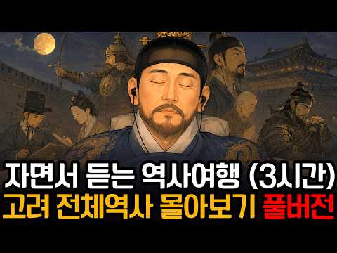
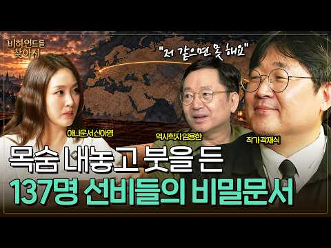
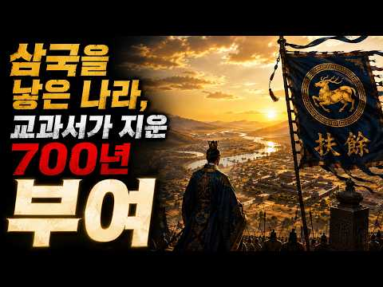
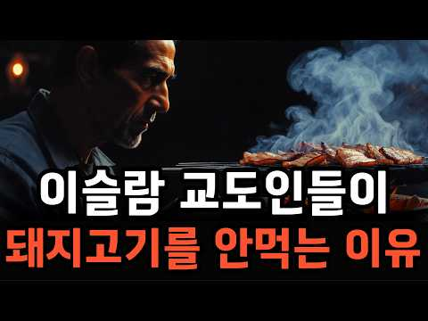
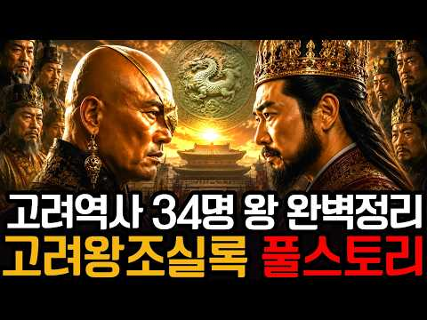

# 역사 — 성공 사례 분석: 사례별 자세히 #321–#360

`analysis.md` 의 9번 (같은 # 번호). 자동 생성 — `tools/success_analysis.py` v1.6 (2026-10-28 10:14 UTC). ※ 연구·교육용 — 투자 권유가 아님.

### 321. 충격실화! 조선시대 헬보직 T0P5 ─ 출근길이 황천길이었습니다.

- https://www.youtube.com/watch?v=Uu3Hv3Ft2VA · 역사 뒷풀이 · 구독자 1,720 · 조회수 65,079 (×37.8, 하루 409.0) · 좋아요 886 (1.4%) · 12.5분 · 2026-05-22 · 주제 묶음 3. 조선 · 형식 정보·해설 (그 밖) · 폴더 `W_Uu3Hv3Ft2VA` (웹 승인)
- 썸네일: 
- 설명 앞부분: 과거 급제하고도 도망친 사람들이 있었습니다. 조선의 엘리트들이 죽기보다 싫어했던 헬보직 5가지, 1위는 意외로 여러분이 매일 감탄하는 그것과 연결됩니다. 고됨과 고통의 종류가 달라 순위는 주관적입니다. 여러분이 생각하는 순위를 댓글로 알려주세요.
- 같은 채널 평소 대비 ×46.8 (채널 최근 롱폼 중앙값 1,391회) · 평소 영상: 대감집 숨은 권력자들 ─ 조선시대 실세 하인 TOP5 │한국사│조선역사 (1,391회) / 충격실화! 조선시대 땅부자 TOP 5 ─ 현재 가치로 계산해봤습니다 (1,271회)
- 대본 없음 (설명) — 음성인식이 끝나면 도입부·흐름이 들어감
- 댓글 78/78: 좋은 점 — 영상 0 · 감사·응원 2 · 더 알고 싶은 것 2 · 아쉬운 점 — 영상 0 · 반박·불만 — 의견 다름 1 · 정치·사회 1 · 경험 공유 1 · 구독·다음 기대 0
  - 감사·응원 👍3 “230번째 like 👍 감사합니다요 ! 항상 건강하시고 행복하세요 !”
  - 감사·응원 👍1 “조선시대 지방도 제일 좋은데가 평양 감사 아닌가요 맨날 예쁜 기생들과 술판에 놀고 먹으니까”
  - 정치·사회 👍1 “국힘스럽던나라”
  - 경험 공유 👍0 “그래도 조선은 낫다. 동아시아 최고의 헬보직 원탑! *일남태수* 그 곳으로 유배를 당하면 장례식 먼저 치르고 출발한다는 전설의 유배지, 악명높은 그 곳, *중국 역사상 최고의 지옥 일남.* 날씨는 허구한날 40도에 폭염 아니면 기약없는 폭우에, 물고기 한 번 잘못 먹…”

### 322. 조선 왕실 안에 무당이 있었던 이유

- https://www.youtube.com/watch?v=z8i6snGeNzI · 심야공중전화 · 구독자 4,160 · 조회수 45,388 (×10.9, 하루 966.9) · 좋아요 155 (0.3%) · 8.4분 · 2026-09-11 · 주제 묶음 3. 조선 · 형식 정보·해설 (그 밖) · 폴더 `W_z8i6snGeNzI` (웹 승인)
- 썸네일: 
- 설명 앞부분: 유교의 나라 조선 왕실에 무당이 있었던 진짜 이유
- 대본 없음 (설명) — 음성인식이 끝나면 도입부·흐름이 들어감
- 댓글 5/5: 좋은 점 — 영상 0 · 감사·응원 0 · 더 알고 싶은 것 0 · 아쉬운 점 — 영상 0 · 반박·불만 — 의견 다름 1 · 정치·사회 0 · 경험 공유 0 · 구독·다음 기대 0
  - 반박·불만 — 의견 다름 👍0 “어이없는 새끼들이지 무당 천시해놓고 지들은 무속은 또 겁나믿음”

### 323. 산골 동네 주민들이 모여 합스부르크 정예 군사들을 제압하고 귀족들을 몰살시킨 전투

- https://www.youtube.com/watch?v=e-vAN1KFcCQ · 어른들의자장가 · 구독자 6,050 · 조회수 127,545 (×21.1, 하루 1,400.6) · 좋아요 708 (0.6%) · 17.9분 · 2026-07-29 · 주제 묶음 7. 전쟁·군사사 · 형식 정보·해설 (그 밖) · 폴더 `W_e-vAN1KFcCQ` (웹 승인)
- 썸네일: 
- 설명 앞부분: 1315년 11월 15일 아침, 애게리 호숫가의 좁은 길 위에 합스부르크 기사와 보병이 2킬로미터로 늘어섰습니다. 왼쪽은 가파른 비탈, 오른쪽은 늪이었고, 비탈 위 숲에는 소와 염소를 치며 사는 사람들 1,500명이 엎드려 있었어요. 두 시간 뒤 그 길에서 죽은 사람은 1,500명이 넘었고, 죽은 쪽은 기사들이었습니다. 71년 뒤 젬파흐에서 합스부르크는 기사 1,500명을 아예 말에서 내려 창 울타리를 세웠지만, 그날 공작 한 명과 귀족 400명이 함께 죽었어요. 다시 2년 뒤 네펠스에서는 방어벽을 내주고 산으로 물러난 400여 …
- 같은 채널 평소 대비 ×11.4 (채널 최근 롱폼 중앙값 11,169회) · 평소 영상: 독일군 전차와 대포 총공세를 처절하게 막아냈던 고작 20명의 최정예 소련 중대 이야기 (11,169회) / 길드 노조가 시민들로 군대를 조직해서 최정예 엘리트 군대랑 전쟁을 벌인 날 (11,001회)
- 대본 없음 (설명) — 음성인식이 끝나면 도입부·흐름이 들어감
- 댓글 28/28: 좋은 점 — 영상 0 · 감사·응원 1 · 더 알고 싶은 것 0 · 아쉬운 점 — 영상 1 · 반박·불만 — 의견 다름 2 · 정치·사회 0 · 경험 공유 0 · 구독·다음 기대 1
  - 아쉬운 점 — 영상 👍1 “지루한 설명이다”
  - 반박·불만 — 의견 다름 👍4 “스위스 는 산골 촌동네 목동 국가 거 아닙니다 로마 제국 때문에 알프스 에서 봉인된 헬베티아 人 들로서 용병 국가 이며 호전적이고 용맹 무쌍 합니다.”
  - 반박·불만 — 의견 다름 👍0 “잡스러운 헛소리를 뭐 이렇게 요란하게 뜨더냐?”
  - 구독·다음 기대 👍3 “재밌네요 ~~ 구독했습니다”

### 324. 왕자 6명을 죽이려던 '정도전' 그날 밤 왜 보초도 없이 웃고 있었나?

- https://www.youtube.com/watch?v=k_3kn2lXbjg · 역사 한 숟갈 · 구독자 7,920 · 조회수 328,602 (×41.5, 하루 1,832.9) · 좋아요 5,283 (1.6%) · 64.5분 · 2026-05-02 · 주제 묶음 기타 · 형식 정보·해설 (그 밖) · 폴더 `W_k_3kn2lXbjg` (웹 승인)
- 썸네일: 
- 설명 앞부분: "이방원은 조선을 세운 최대 공신이다." 우리 모두가 끄덕이는 이 문장, 사실은 틀렸습니다. 1392년 조선 개국공신 명단 어디에도 이방원의 이름은 없었습니다. ✋ 빠뜨린 게 아닙니다. 태조 이성계가 의도적으로 뺀 겁니다. 🔹 25세의 핵심 공신은 왜 6년간 철저히 밀려났을까? 🔹 열 살짜리 막내 이방석은 어떻게 형 6명을 제치고 세자가 되었을까? 🔹 정도전은 정말 왕자들을 죽이려 했을까, 아니면 이방원이 먼저 판을 짠 걸까? 🔹 1398년 송현방,쿠데타를 기획한 사람들이 왜 보초도 없이 등불 아래 웃고 있나? 🔹 이성계의 여덟 …
- 대본 없음 (설명) — 음성인식이 끝나면 도입부·흐름이 들어감
- 댓글 347/350: 좋은 점 — 영상 4 · 감사·응원 6 · 더 알고 싶은 것 2 · 아쉬운 점 — 영상 1 · 반박·불만 — 의견 다름 3 · 정치·사회 21 · 경험 공유 6 · 구독·다음 기대 0
  - 좋은 점 — 영상 👍3 “좋은 영상 감사합니다. 저절로 몰입해서 시청했습니다”
  - 좋은 점 — 영상 👍3 “1.고려 우왕시대의 사회상이 망국의 상황이였습니다. 2.문신은 붓이 힘이고 무신은 칼이 힘입니다. 3.조선은 고려 무신정변 주역 이의방 후손의 역사서입니다. 4.태조는 정도전을 믿었지 신권정치(내각제)를 몰랐을 겁니다. 5.이방원은 과거에 급제한 머리는 문신이지만 핏…”
  - 감사·응원 👍3 “좋은 영상 감사합니다. 저절로 몰입해서 시청했습니다”
  - 감사·응원 👍3 “1.고려 우왕시대의 사회상이 망국의 상황이였습니다. 2.문신은 붓이 힘이고 무신은 칼이 힘입니다. 3.조선은 고려 무신정변 주역 이의방 후손의 역사서입니다. 4.태조는 정도전을 믿었지 신권정치(내각제)를 몰랐을 겁니다. 5.이방원은 과거에 급제한 머리는 문신이지만 핏…”
  - 더 알고 싶은 것 👍2 “너무나도 편향된 시각에서 바라본 사례, 이런 시각으로 세상의 모든 것을 바라 본다먼 선과 악이 따로 있을까요?”
  - 아쉬운 점 — 영상 👍3 “방석이 왕권을 이어받는 걸 그냥 두면, 왕권의 제일 큰 위협인 본인의 목이 날아갈게 뻔한데.. 방원이 바보도 아니고, 순순히 그냥 당하고만 있겠나? 따라서 방원의 반발은 당연한 수순인데, 이성계와 정도전이 이걸 예상하지 못했다는 건 진짜 의문임.”
  - 반박·불만 — 의견 다름 👍2 “이 나라의 주인은 군왕이요 틀렸다 이 나라의 주인은 백성이다 그럼 임금은 뭐요 백성을 위한 도구 나같은 정씨 김씨 이씨 박씨 최씨 이들을 통털어 무어라 하는지 아느냐 뭐라고 합니까 백성이다 이제 내가 너와 함께 갈 수 없는 이유를 알겠느냐 ㅎㅎ”
  - 반박·불만 — 의견 다름 👍1 “정도전이 왕자들을 모두 죽이려 했다고? 말도 안되는 개소리.”
  - 정치·사회 👍64 “이방원이 손에 피를 묻힌건 이성계 잘못이다. 정권잡으려고 손에 피를 묻힌 세조와도 다르다.”
  - 정치·사회 👍5 “나라가 신하에 넘어가면 망하지”
  - 경험 공유 👍3 “지금의 시각에서 옛날 저 당시 상황을 살아보고 경험하지 않은 사람은 누가 잘했고 누가 잘못했는지를 섣불리 판단해서는 안되고 저 시대에서는 현재와는 다르게 전쟁이나 강직한 사람들의 성향으로 인해서 알지 못하거나 밝혀지지 않은 살벌한 시대적 분위기, 정서, 관습 등이 복…”
  - 경험 공유 👍2 “이 나라의 주인은 군왕이요 틀렸다 이 나라의 주인은 백성이다 그럼 임금은 뭐요 백성을 위한 도구 나같은 정씨 김씨 이씨 박씨 최씨 이들을 통털어 무어라 하는지 아느냐 뭐라고 합니까 백성이다 이제 내가 너와 함께 갈 수 없는 이유를 알겠느냐 ㅎㅎ”

### 325. 팰월드 1.0 중후반 희귀 자원 쉽게 얻는 방법 (크로마이트,코랄리움,솔라이트,팰키사이트,고대 문명의 코어)

- https://www.youtube.com/watch?v=IMg_-t4j4Q8 · 퇴근한광대 · 구독자 7,140 · 조회수 157,568 (×22.1, 하루 1,609.0) · 좋아요 1,544 (1.0%) · 6.9분 · 2026-07-22 · 주제 묶음 5. 세계사·서양사 · 형식 정보·해설 (그 밖) · 폴더 `W_IMg_-t4j4Q8` (웹 승인)
- 썸네일: 
- 챕터: 0:00 오프닝 · 1:06 원정소 소개 · 1:38 원정전력이론 · 2:29 원정전력실전 · 4:17 레벨업시키기 · 4:35 팰작업연구소 · 4:48 원정 테스트 · 6:08 마무리
- 설명 앞부분: 중후반이 되면 크로마이트, 코랄리움, 슬라이트, 펠키사이트, 고대 문명의 코어 등 희귀 자원이 계속 부족해집니다. 하지만 원정을 쉽게 시작하면 직접 파밍하는 시간을 크게 줄일 수 있습니다. 이번 영상에서는 원정을 빨리 시작해야 하는 이유 추천 원정 팰 농축과 영혼 강화는 어느 정도만 하면 되는지 희귀 자원을 자동으로 수급하는 방법 을 정리했습니다. 원정은 생각보다 어렵지 않습니다. 너무 지레 겁먹지 마시고 지금부터 하나씩 시작해 보세요. 게임이 훨씬 편해질 겁니다. 타임라인
- 같은 채널 평소 대비 ×17.7 (채널 최근 롱폼 중앙값 8,905회) · 평소 영상: 거점 4개를 하나의 초대형 거점으로 만들어보겠습니다 팰월드 1.0 메가 거점 건축 #4 … (9,760회) / 팰월드 1.0 속성 추천 기술 총정리 #2 풀 속성 (8,050회)
- 대본 없음 (설명) — 음성인식이 끝나면 도입부·흐름이 들어감
- 댓글 259/259: 좋은 점 — 영상 12 · 감사·응원 31 · 더 알고 싶은 것 20 · 아쉬운 점 — 영상 7 · 반박·불만 — 의견 다름 0 · 정치·사회 0 · 경험 공유 6 · 구독·다음 기대 1
  - 좋은 점 — 영상 👍4 “팰월드 하는데 막힐때마다 영상 찾아볼 때 중요한 내용 알려주셔서 구독하고갑니다”
  - 좋은 점 — 영상 👍2 “좋은 정보 감사합니다~”
  - 감사·응원 👍6 “안그래도 오늘 팰키 캐느라 너무 힘들엇는데 감사합니다..”
  - 감사·응원 👍4 “와 딱 이때 저 코어 필요했는데 감사합니다”
  - 더 알고 싶은 것 👍2 “영혼은 어디서 파밍하나요? 펠 한마리 풀영혼 강화조차 빡센데.. 해체하면 영혼나오는펠이 있나요?”
  - 더 알고 싶은 것 👍2 “탐험으로만 렙이 70이 넘었는데 세계수 진입보스도 못 깨고 코어먹을데도 막막해서 스트레스직전이었는데 꿀영상 감사합니다! 혹시 중반 전투팰 공략 만들어 주실 수 있을까요? 얼리때 잡은 애들이 너무 허접이라 렙 50이상짜리 팰사냥은 너무 힘드네요”
  - 아쉬운 점 — 영상 👍0 “이분진짜 핵심만 골라서 너무 잘알려줌 개추임”
  - 아쉬운 점 — 영상 👍0 “이거 좋다~ 코랄에서 막혀서 낚시 찍고있는데 잘안되서 해봤는데 훨낫네요”
  - 경험 공유 👍0 “오~~굿 굿 너무 궁금 했었는대 대박 ㅎ”
  - 경험 공유 👍0 “이거 좋다~ 코랄에서 막혀서 낚시 찍고있는데 잘안되서 해봤는데 훨낫네요”
  - 구독·다음 기대 👍4 “팰월드 하는데 막힐때마다 영상 찾아볼 때 중요한 내용 알려주셔서 구독하고갑니다”

### 326. "정약용이 인정한 조선 후기 1위?" 역사 자체를 바꿀 수 있었던 최고의 천재

- https://www.youtube.com/watch?v=Z37l5sHivjA · 한국사 다시읽기 · 구독자 28,700 · 조회수 526,045 (×18.3, 하루 6,413.9) · 좋아요 6,157 (1.2%) · 24.3분 · 2026-08-07 · 주제 묶음 1. 역사 일반·이야기 · 형식 브이로그·직접 해본 이야기 · 폴더 `W_Z37l5sHivjA` (웹 승인)
- 썸네일: 
- 챕터: 0:00 🎙️ 오프닝 ∣ 정약용이 '귀신'이라 부른 사나이 · 1:39 📜 나모전 사건 ∣ 정약용을 무너뜨린 글자 하나 · 4:47 ✍️ '지이' 두 글자 ∣ 시험장에서 벌어진 일 · 6:05 🌙 소동파 시구 ∣ 남의 마음까지 읽어내다 · 10:29 🔭 서학과 천문·수학 ∣ 시대를 앞선 지성과 정조의 … · 16:47 🛡️ 무너진 방패 ∣ 정조의 죽음과 신유박해 · 19:02 🕯️ 지워진 이름 ∣ 옥중의 최후
- 설명 앞부분: 🎬 "내가 죽으면 조선의 미래는 끝난다" — 정약용이 '귀신'이라 불렀던 후기 원탑 천재 ⏱️ 타임라인 📚 참고 자료 『조선왕조실록』(정조실록·순조실록), 『일성록』 성대중, 『청성잡기』 / 황사영, 「백서」 — 당대 인물평 한국민족문화대백과사전(이가환·이익), 국사편찬위원회 우리역사넷, 한국고전종합DB ⚠️ 안내 본 영상의 일부 이미지는 생성형 AI로 제작되었으며, 실제 역사 속 인물과 장면의 모습과는 다를 수 있습니다. 시청에 참고해 주세요. 🙏
- 같은 채널 평소 대비 ×91.3 (채널 최근 롱폼 중앙값 5,761회) · 평소 영상: '최대 1000명 숙청...' 남인의 핵심 정약용은 왜 살려둔 걸까? (5,761회) / "철의 여인 정희왕후" 세조의 아내가 조선 최고의 대모인 이유 (5,944회)
- 대본 없음 (설명) — 음성인식이 끝나면 도입부·흐름이 들어감
- 댓글 557/567: 좋은 점 — 영상 5 · 감사·응원 12 · 더 알고 싶은 것 3 · 아쉬운 점 — 영상 5 · 반박·불만 — 의견 다름 10 · 정치·사회 57 · 경험 공유 11 · 구독·다음 기대 2
  - 좋은 점 — 영상 👍5 “좋은 내용 감사합니다. 그림에 신발 신은 모습이 아쉽습니다. 버선 신은 모습이었으면 합니다. ^^;”
  - 좋은 점 — 영상 👍3 “역사 공부 잘 배웠습니다”
  - 감사·응원 👍139 “조선의 귀한 인물을 알게 하셔서 감사합니다.”
  - 감사·응원 👍67 “와우.. 그 정약용조차 경악하던 천재라니 놀랍네요. 이런 사람을 알게되어 감사합니다.”
  - 더 알고 싶은 것 👍8 “최고입니다 이런 역사얘기 많이올려주세요 ^^”
  - 더 알고 싶은 것 👍1 “당시 백성들은 왕이 바뀌면 어떻게 느꼈을까요?”
  - 아쉬운 점 — 영상 👍5 “좋은 내용 감사합니다. 그림에 신발 신은 모습이 아쉽습니다. 버선 신은 모습이었으면 합니다. ^^;”
  - 아쉬운 점 — 영상 👍0 “정약용은 이가환을읆엇다 사질뻔한천재르남김🎉🎉🎉❤❤❤”
  - 반박·불만 — 의견 다름 👍29 “요즘 인공지능에 비할 천재인듯.. 아까운 인재가 서학의 괴수라는 누명으로 고문받다 고통스럽게 옥사. 이런 천재의 .어이없는 죽음이 간신배들의 모략이었음이 안타까움을 넘어 조선역사의 어마어마한 손실이 되었네요. .. 천재는 천재를 알아본다고 이가환 정약용같은 인물들이 …”
  - 반박·불만 — 의견 다름 👍1 “대한민국은 식민사관과 반국가세력들에 의한 민족의 역사와 정체성을 왜곡선동에 의해 거짓속에서 몇세대가 살아왔습니다. 허울좋은 간판에 집착하고 실제를 모른채 암기하고 자격증따고 학위받았으나. 진짜실력을갖춘사람들을 내쳤지요 그래서 힘든 대한민국이지만 진실에 이끌려 나라를 …”
  - 정치·사회 👍195 “이가환이 어떤 인물인지 처음 알고 탄식이 나옵니다. 지금도 시대에 저항하는 족속들이 나라의 녹을 먹으며 고개를 빧빧히 들고 삽니다. 우리 사회가 외국인들이 말하듯 부러운 사회인지 의심하지 않을 수 없습니다.”
  - 정치·사회 👍84 “조선중후기 실학적인 남인이 계속 정권을 잡았다면 한국역사는 완전히 달랐을텐데..노론의 이름은 민족의 역사에서 근본주의 패거리이익 우물안개구리 어리석음 무능력..으로 영원히 기록되고 타산지석으로 삼아야한다.”
  - 경험 공유 👍17 “지금도 그래. 좌우로 나뉘어 서로 죽일듯이 물고 뜯으니, 국가적 에너지 낭비가 너무 심하다. 니가 죽어야 내가 사는 이 구조를 뜯어 고치지 않으면 대한민국 성장 엔진도 꺼질 것. 국민들이 먼저 깨어야 한다. 당리당략보다 국가를 위해 옳은 말을 하고 옳은 정치를 하는 …”
  - 경험 공유 👍4 “이가환을 아냐구요? 내가 아는 천재중에 최고였어요.”
  - 구독·다음 기대 👍3 “참 좋은 체널입니다. 구독합니다”
  - 구독·다음 기대 👍0 “이 채널을 통해 귀한 사실을 알게되네요. 정조대왕이 좀 더 오래 살았다면 조선의 운명이 바뀌었을텐데… 😢 앞으로 채널의 활약이 기대됩니다! 구독하고 갑니다 👍👍👍”

### 327. 왕족이 너무 많아 망한 나라 ∣ 명나라 황실 30만의 비밀, 분봉제

- https://www.youtube.com/watch?v=OggTD1ptneA · 타임트래블로그 · 구독자 6,410 · 조회수 229,454 (×35.8, 하루 1,382.7) · 좋아요 1,486 (0.7%) · 20.4분 · 2026-05-15 · 주제 묶음 6. 동양사 (중국·일본·몽골) · 형식 정보·해설 (그 밖) · 폴더 `W_OggTD1ptneA` (웹 승인)
- 썸네일: 
- 설명 앞부분: 1644년, 명나라 황실 가족 30만 명이 한 해에 죽었습니다. 왕족이라서 죽은 게 아닙니다. 왕족이 너무 많아서 죽었습니다. 한 황제가 자기 가족을 다시는 굶어 죽게 두지 않겠다며 만든 분봉제가, 어떻게 300년 만에 친왕·군왕·봉국중위까지 8등급의 황손을 30만 명으로 불려 놓았는지. 그 30만 명이 어떻게 옥첩이라는 명부 한 장에 묶인 채 이자성, 장헌충, 청군의 손에 한 해에 모두 사라졌는지. 만력제의 복왕 낙양 4만 경, 숭정제 매산의 마지막, 그리고 같은 시기 정반대 답을 낸 오스만 제국의 형제살해법까지. 명청 교체기와…
- 같은 채널 평소 대비 ×38.9 (채널 최근 롱폼 중앙값 5,893회) · 평소 영상: 복수조차 허가 없인 못 했던 나라 ∣ 에도 막부 복수 제도 250년, 카타키우치 (5,965회) / 일곱 살 아이의 수명에 돈을 건 어른들 ∣ 유럽 정부가 직접 팔았던 생존 연금, 통틴 (5,821회)
- 대본 없음 (설명) — 음성인식이 끝나면 도입부·흐름이 들어감
- 댓글 243/243: 좋은 점 — 영상 1 · 감사·응원 2 · 더 알고 싶은 것 2 · 아쉬운 점 — 영상 2 · 반박·불만 — 의견 다름 5 · 정치·사회 11 · 경험 공유 4 · 구독·다음 기대 0
  - 좋은 점 — 영상 👍9 “요즘 혼자서 이 주제 공부하고있었는데 도움이 많이 됐습니다 이해가 쏙 쏙되네요 ❤❤ 감사합니다”
  - 감사·응원 👍9 “요즘 혼자서 이 주제 공부하고있었는데 도움이 많이 됐습니다 이해가 쏙 쏙되네요 ❤❤ 감사합니다”
  - 감사·응원 👍1 “망할짓 했네. 청나라에 감사해라.”
  - 더 알고 싶은 것 👍1 “유럽은 왕족 관리가 어땠는지 궁금합니다. 왕, 공작, 후작, 백작, 자작, 남작 등 귀족 작위가 많던데요.”
  - 아쉬운 점 — 영상 👍7 “본래 근세이후 한국이든 중국이든 왕조교체시 전왕조의 왕족들은 씨를 말리는게 일종의 불문의 관습이 되었는데 놀랍게도 나라와 백성을 일본에 팔아먹고 재벌이된 망국 이왕가의 떨거지들은 도살하지 못함. 상반신은 반일에 하반신은 친일인 모가지가 길어서 슬픈 짐승들이여. 명나라…”
  - 반박·불만 — 의견 다름 👍2 “명나라의 대부분의 고질적 문제는 때중이 도적놈이 만든것이라 예를 들어 해금령, 명 말기 f4의 원인인 환관정치 이 동영상의 사례처럼요 이것들 말고도 많을 것입니다. 괜히 사학자들이 송나라보다 퇴화한 통일제국이라 폄하하는 것이 아니죠”
  - 정치·사회 👍51 “30만 황살이라도 정작 직계는 희소. 청나라가 거의 다 죽임”
  - 정치·사회 👍39 “저렇게 멸족시킬라고 청나라 순치연간에도 갖은 노력을 했지만 숫자가 너무많아서 못없엤음. 결국 청황실이 탄탄해진 강희연간에 주원장 직계후손을 찾아 연은후에 봉하였고 청나라 팔기한군에 속해서 팔기군으로 청나라가 망할때까지 떵떵거리면서 살게됨..... 다만 영락제 직계후손…”
  - 경험 공유 👍161 “명청 교체는 이자성의난 때문이라 생각했었는데 알고보니 분봉제가 진짜 원인이었네요”
  - 경험 공유 👍2 “개인적인 의견은 왕족 형제들의 시선이 어디인지가 달랐던것 같습니다. 중국은 사마씨 고평릉의 난 으로 촉발된 8왕자의 내전으로 왕조가 망하는 참극을 겪었지만 조선초기 이방원의 경우는 왕자의 난을 빠르게 진압한것도 다 이때의 교훈인듯 합니다. 중국왕족의 야망은 권력에 있…”

### 328. 일본을 400년간 트라우마에 시달리게 한 장수. 이순신이 아닙니다 ∣ 김시민

- https://www.youtube.com/watch?v=CF4biSGrwOg · 그랬구나! · 구독자 8,900 · 조회수 196,161 (×22.0, 하루 1,895.5) · 좋아요 5,260 (2.7%) · 65.2분 · 2026-07-16 · 주제 묶음 3. 조선 · 형식 인터뷰·강연·대담 · 폴더 `W_CF4biSGrwOg` (웹 승인)
- 썸네일: 
- 챕터: 0:00 인트로 · 1:44 모쿠소 호간의 정체 · 2:49 김시민, 그는 누구인가 · 5:42 이순신과 같은 전장에 서다 · 7:17 전쟁 준비 · 9:52 성문을 열지 않은 판단 · 14:23 전투 시작 · 16:55 둘째 날 · 20:10 셋째 날 · 22:07 넷째 날 · 25:01 다섯째 날 · 28:28 여섯째 날 — 최후의 공방 · 31:39 진주대첩 · 34:17 승리 직후 · 39:57 기록의 무게 · 43:30 공신 교서의 수난 · 45:45 2차 진주성 전투 · 52:00 일본 속의 김시민 · 61:35 에필로그
- 설명 앞부분: 3만 대군을 3,800명으로 막아낸 장수가 있습니다. 6일간 십여 차례 싸워 단 한 번도 지지 않았습니다. 조선왕조실록은 이 사람의 죽음을 딱 한 줄로 처리했습니다. "김시민을 경상우도병마절도사로 삼았는데, 얼마 뒤에 졸하였다." 이게 전부입니다. 그런데 적국 일본에서는 전혀 달랐습니다. 진주목사를 뜻하는 '모쿠소'라는 두 글자가 1626년부터 400년 넘게 가부키 무대 위에 살아 있었습니다. 이름도 모른 채, 직함 하나만으로 공포의 상징이 된 것입니다. 기록한 쪽은 한 줄로 끝냈고, 당한 쪽은 400년간 떨었습니다. 이순신과 같…
- 같은 채널 평소 대비 ×42.4 (채널 최근 롱폼 중앙값 4,632회) · 평소 영상: 조선 역사상 가장 위험한 결혼, 영조가 정순왕후를 데려온 이유 (4,915회) / 이순신보다 150년 전, 세종이 문신들을 제치고 우의정에 앉힌 무신 (4,348회)
- 대본 없음 (설명) — 음성인식이 끝나면 도입부·흐름이 들어감
- 댓글 505/505: 좋은 점 — 영상 4 · 감사·응원 25 · 더 알고 싶은 것 2 · 아쉬운 점 — 영상 3 · 반박·불만 — 의견 다름 9 · 정치·사회 24 · 경험 공유 5 · 구독·다음 기대 1
  - 좋은 점 — 영상 👍20 “선조와 간신들이 문제로 국민들이 개고생 도륙당했고 화랑오개를 배웠어야 했다”
  - 좋은 점 — 영상 👍0 “김시민 장군의 이름은 들었지만 자세한 내용은 아무래도 이순신 장군만큼 알려지지 않았으니까요! 사실 강감찬, 이순신 장군 외에는 역사를 기억 못 하는 것이 현재의 문제죠. 김시민 장군뿐 아니라 훌륭한 우리 장군들이 많았습니다만 일제강점기 때 많이 전승이 끊겼을 겁니다.…”
  - 감사·응원 👍130 “김시민장군이 이토록 위대하신 분인지 몰랐습니다. 감사합니다.”
  - 감사·응원 👍83 “눈물을 흘리며 듣습니다. ㅠㅠㅠ 오늘이 있도록 희생하신 모든 선조님들께 감사를 올립니다. 부디 하늘에서 평안 하소서. _()_ .”
  - 더 알고 싶은 것 👍0 “곽재우 장군도 가망없다고 진주성 버렸듯이 경상도 장수들이 진주성을 버렸을 때, 1등 공신을 따지자면 이치전투의 영웅 남원출신 황진 장군을 비롯해 전라도 출신 장수들이 2차 진주성 전투에서 활약상도 영상 부탁드려요. 그리고 이치전투와 황진 장군을 찾아보세요. 대단한 분…”
  - 더 알고 싶은 것 👍0 “2차 진주성 전투 영웅 황진장군님도 다뤄주세요 바다엔 이순신장군님 육지엔 황진장군님 진정한 조선의 소드마스터 황진장군님 만세 만세 만세!”
  - 아쉬운 점 — 영상 👍21 “답을 내려고 하지마세요 수긍하고 다시 같은일이 반복되지 않게 하는게 역사를 배우는 목표라 생각합니다”
  - 아쉬운 점 — 영상 👍0 “역사에서 버림받을뻔한 김시민장군을 국민들 가슴에 영원히 살려주셔서 감사합니다 김시민장군님 감사합니다 님은 영웅이십니다 언젠가 어느 후손이 님을 기릴 영화를 만들날이 올것입니다 평안히 잠드소서 ()()()”
  - 반박·불만 — 의견 다름 👍74 “올공 민주화운동 열사를 국민이 지켜야 합니다ㆍ 역사에 기록하고 후손이 알아야 합니다 ㆍ 자유는 공짜가 아니죠”
  - 반박·불만 — 의견 다름 👍1 “십만양병설 사실아닙니다. 사실 아닌걸 여기저기 쓰면서 가짜를 진짜 역사로 오해. 빨리 바로 잡고 고쳐 나가야합니다. 오류가”
  - 정치·사회 👍12 “김시민이를 2등으로 평가할 정도의 선조의 실력 이러한 나라가 어찌 망하지 않겠는가? 그래서 결국 망했지. 지금도 역사는 반복되고 있다.”
  - 정치·사회 👍3 “오늘날 현대사의 역적들을 상세히 기록하여 남기길 바랍니다. 이재명 한동훈 등등등”
  - 경험 공유 👍1 “이 훌륭한 분이 나의 선대 할아버지 셨구나 나도 부끄럽지않게 살고 뭔가 사회에 좋은 기여를 해야겠다”
  - 경험 공유 👍1 “옛 어렵게 기록한 내용을 세세하고 긴박 하고 절실 했었던 (그때의) 마음을 담아 알려 주시어 감사할 따름입니다. 😢”
  - 구독·다음 기대 👍0 “좋은시간을 가졌어요. 다음편을 기대할게요”

### 329. 한국사 최악의 배신자 5인 최고의 1인은?

- https://www.youtube.com/watch?v=rMcAaykM45c · 오늘도 역사 · 구독자 1,050 · 조회수 36,941 (×35.2, 하루 219.2) · 좋아요 1,649 (4.5%) · 36.5분 · 2026-05-12 · 주제 묶음 4. 한국 근현대사 · 형식 정보·해설 (그 밖) · 폴더 `W_rMcAaykM45c` (웹 승인)
- 썸네일: 
- 설명 앞부분: 안녕하세요 오늘도 역사 채널 입니다 "우리가 몰랐던 역사 속 진짜 이야기, 그 이면의 진실을 파헤칩니다. 교과서에는 한 줄로 기록된 사건들, 하지만 그 속에는 우리와 닮은 사람들의 뜨거운 욕망과 선택이 있었습니다. 오늘, 시간을 거슬러 그 현장으로 함께 떠나보시죠."
- 같은 채널 평소 대비 ×142.1 (채널 최근 롱폼 중앙값 260회) · 평소 영상: 조선시대 평균수명３５세 영조는 ８２세까지 살았다 (260회) / 광개토 대왕은 왜 중원 정복을 안했나 (224회)
- 대본 없음 (설명) — 음성인식이 끝나면 도입부·흐름이 들어감
- 댓글 245/245: 좋은 점 — 영상 0 · 감사·응원 0 · 더 알고 싶은 것 0 · 아쉬운 점 — 영상 1 · 반박·불만 — 의견 다름 2 · 정치·사회 27 · 경험 공유 0 · 구독·다음 기대 0
  - 아쉬운 점 — 영상 👍8 “서론이 너무길다..ㅋ”
  - 반박·불만 — 의견 다름 👍5 “신숙주는 결코 배신자도 아니고 조선에서 배출한 최고의 천재 중 한 명입니다. 숙주나물은 예전에 신숙주의 이름이라고 말 하지만 한자도 다르고 그런 연유로 나온 이름도 아닙니다. 솔직히 말하면 조선왕조를 개창할 때 정도전은 주자성리학의 원리를 내세워 "王權과 臣權은 같아…”
  - 정치·사회 👍31 “박근혜배신 김무성 유승민 윤석열배신 한동훈 권성동 권영세”
  - 정치·사회 👍29 “요즘 정치인들 선거땐 개같이 구석구석 굽신데면서. 허리한번 안펴다가 당선되면 바로 배신 지가 최고이듯 ᆢ”

### 330. 오천 명이 사흘을 버틴 그날, 프레임 밖엔 한국 청년들이 있었다 ∣ 지평리 전투

- https://www.youtube.com/watch?v=-H2SXWoldbw · 역사참판 · 구독자 3,030 · 조회수 45,286 (×14.9, 하루 621.2) · 좋아요 417 (0.9%) · 42.3분 · 2026-08-16 · 주제 묶음 7. 전쟁·군사사 · 형식 정보·해설 (그 밖) · 폴더 `W_-H2SXWoldbw` (웹 승인)
- 썸네일: 
- 챕터: 0:00 별을 스스로 뗀 장군, 그리고 프레임 밖의 이름들 · 3:16 지평리 이전의 겨울: 얕본 자와 준비한 자 · 6:57 적의 언어를 아는 대령, 프리먼 · 12:34 그 원 안에 있던 한국 청년들 · 15:30 첫 번째 밤, 나팔 소리와 죽음의 그물 · 24:58 뚫린 남쪽 방어선, 그리고 김재세 · 33:09 포위를 뚫은 전차와 가장 씁쓸한 진실 · 42:25 승리의 사진에서 잘려나간 얼굴들
- 설명 앞부분: 별 넷을 스스로 뗀 프랑스 장군이 있었습니다. 지구 반대편, 얼어붙은 한국의 작은 마을로 가기 위해서였죠. 우리는 지평리를 '승리'라는 한 단어로 기억합니다. 그런데 그 사흘 밤, 방어선은 실제로 뚫렸고, 되찾으러 올라간 병사들은 아군의 포탄 아래 쓰러졌습니다. 그리고 그 얼어붙은 원 안에는, 우리가 거의 들어본 적 없는 사람들이 함께 있었습니다. 프랑스 군복을 입은 한국 청년들, 미군 부대에 배속돼 참호를 지킨 스무 살의 한국군. 별을 뗀 장군과 적의 언어로 싸운 대령의 이름 뒤편에, 이름조차 남기지 못한 얼굴들이 있었어요. 오…
- 같은 채널 평소 대비 ×81.7 (채널 최근 롱폼 중앙값 554회) · 평소 영상: 정원 60명 배에 14,000명, 근데 부두엔 남겨진 절반이 있었다 (554회) / 히딩크가 반말을 시킨 진짜 이유, 그리고 24년 뒤 홍명보에게 벌어진 일 (573회)
- 대본 없음 (설명) — 음성인식이 끝나면 도입부·흐름이 들어감
- 댓글 24/24: 좋은 점 — 영상 0 · 감사·응원 5 · 더 알고 싶은 것 0 · 아쉬운 점 — 영상 1 · 반박·불만 — 의견 다름 0 · 정치·사회 0 · 경험 공유 2 · 구독·다음 기대 0
  - 감사·응원 👍6 “진심으로 감사드립니다 Lest we forget. In Australia 🇦🇺”
  - 감사·응원 👍5 “지평 막걸리 🎉 리즈웨이~ 고마운 분입니다 프리먼 장군~ 프렌치 고맙습니다 🎉 낙동강🎉”
  - 아쉬운 점 — 영상 👍0 “개 잣같은 ai 목소리..!! 이딜가나 지겹게 듣는 ai !!!!”
  - 경험 공유 👍2 “내가 근무했던 미2사단의 Camp Red loud內 본청 건물名이 "Freeman Hall" 이었는데 역시 영웅이었구나. 감사합니다. 여러분들은 점령군이 아니었습니다. 자유는 공짜가 아니었군요. 멸공!!!”

### 331. 《무장가문을 사로잡은 아기 복덩이》∣ [사극 힐링] 거친 무장 가문에 떨어진 복덩이 아기?! 냉혹한 장군 형제들을 전부 사로잡는다🏮🍡

- https://www.youtube.com/watch?v=WkSUWR9v6uY · 드라마 정주행 DramaBinge · 구독자 16,200 · 조회수 168,651 (×10.4, 하루 3,315.5) · 좋아요 1,367 (0.8%) · 109분 · 2026-09-07 · 주제 묶음 3. 조선 · 형식 몰아보기·통합본 (긴 영상) · 폴더 `W_WkSUWR9v6uY` (웹 승인)
- 썸네일: 
- 설명 앞부분: 민간에서 떠돌던 행운의 아기. 냉혹한 장군 가문에 돌아와 모든 위험을 막아낸다. 온 가족이 아기만 바라보는 총애받는 삶. ❗❗❗미성년자는 팔로우 및 시청을 금지합니다❗❗❗ [창작물 성명] 콘텐츠 성격: 본 채널의 콘텐츠는 주로 독창적인 숏폼 드라마와 영화로 구성되어 있으며, 이는 유튜브의 EDSA(교육, 다큐멘터리, 과학 및 예술) 정책의 "예술적" 범주에 속합니다. 미성년자 보호: 본 영상에 등장하는 모든 미성년자 인물은 전문 배우 또는 자원봉사 배우가 연기했습니다. 모든 촬영은 안전하고 전적으로 규정을 준수하는 환경을 보장하기…
- 같은 채널 평소 대비 ×92.9 (채널 최근 롱폼 중앙값 1,814회) · 평소 영상: 《빛을 보는 여자, 날 삼킨 재벌》∣ [집착로맨스] "3억 빚 남기고 버린 전남편 보란 … (2,001회) / 《사막에 세운 제국》∣ [기적] "물 한 모금 없는 사막에서 죽어라!" 유배당한 폐태자비… (1,628회)
- 대본 없음 (설명) — 음성인식이 끝나면 도입부·흐름이 들어감
- 댓글 63/63: 좋은 점 — 영상 1 · 감사·응원 1 · 더 알고 싶은 것 0 · 아쉬운 점 — 영상 2 · 반박·불만 — 의견 다름 0 · 정치·사회 0 · 경험 공유 0 · 구독·다음 기대 0
  - 좋은 점 — 영상 👍1 “좋은 내용입니다. 아침이 즐겁네요. 한 사람에 영향력은 남녀노소를 가르지 않지만 어린아이에 영향력은 와~ 좋은 영상 감사합니다 ^^”
  - 감사·응원 👍1 “좋은 내용입니다. 아침이 즐겁네요. 한 사람에 영향력은 남녀노소를 가르지 않지만 어린아이에 영향력은 와~ 좋은 영상 감사합니다 ^^”
  - 아쉬운 점 — 영상 👍4 “마오마오 고대버전이네요. 마오마오 귀여움을 제대로 못살린게 너무 아쉽네요. 이건 무조건 애니버전으로 보는 걸 추천!! 보면 무슨 말인지 이해 될거임.”
  - 아쉬운 점 — 영상 👍1 “간만에 재미있게 힐링 하고 가요 ~ 스토리가 쫌 짧은게 아쉬워요 ~ 수고 하세요...😊😊😊😊”

### 332. "미국에서 난리난 이순신 장군?!" 충무공 이순신이 사무라이를 밀어내고 새로운 영웅이 된 진짜 이유

- https://www.youtube.com/watch?v=i8RNMbV3q_g · 코믹스 경제 · 구독자 34,000 · 조회수 152,298 (×4.5, 하루 6,939.4) · 좋아요 641 (0.4%) · 27분 · 2026-10-06 · 주제 묶음 3. 조선 · 형식 정보·해설 (그 밖) · 폴더 `W_i8RNMbV3q_g` (웹 승인)
- 썸네일: 
- 설명 앞부분: 📚 【교육 콘텐츠】 "가짜 10 대 300에 열광하던 미국이, 진짜 13 대 133을 찾기 시작했다" 🇰🇷 미국은 50년 동안 칼 찬 사무라이 이야기에 지갑을 열었습니다. 2024년엔 사무라이 드라마 〈쇼군〉이 에미상 18관왕에 올랐습니다. 그런데 배 13척으로 133척을 막은 조선의 이순신은 1929년부터 미 해군 잡지 구석에만 있었습니다. 진짜가 왜 가짜에게 400년이나 밀려 있었는지, 그리고 지금 그 판이 어떻게 뒤집히고 있는지 짚어 봅니다. 🎬 이번 영상의 핵심 정보 ✓ 칼의 나라가 조선에 쳐들어올 땐 칼이 아니라 조총을 …
- 같은 채널 평소 대비 ×2.7 (채널 최근 롱폼 중앙값 55,457회) · 평소 영상: "미국마저 등 돌렸다!" 100년 동안 독점하던 질레트, 한국 도루코 6중날에 무너진 진… (57,351회) / "아마존도 포기한 걸 해냈다고?" 한국인들이 유달리 똑똑한 진짜 이유, 속도와 효율성이 … (53,563회)
- 대본 없음 (설명) — 음성인식이 끝나면 도입부·흐름이 들어감
- 댓글 50/52: 좋은 점 — 영상 0 · 감사·응원 0 · 더 알고 싶은 것 1 · 아쉬운 점 — 영상 0 · 반박·불만 — 의견 다름 0 · 정치·사회 6 · 경험 공유 0 · 구독·다음 기대 0
  - 더 알고 싶은 것 👍2 “고구려 만들어 주세요~”
  - 정치·사회 👍3 “이재명대통령은 콤판씨에게 문화훈장 수여하시길..”
  - 정치·사회 👍1 “이거 이조시대 때 선조 수정실록에 나오는 엉터리 이야기입니다. 정작 선조 오리지널 실록에는 나오지도 않는 이야기이며, 일본, 명나라 등의 기록에도 없습니다. 당시 수군은 명나라가 지위했습니다. 그 기록에 없는 이야기입니다. 정신 차리세요”

### 333. 미국에서 계속 완판되는 이순신책 — 400년 전 조선시대 장군이 미국 영웅이 된 진짜 이유

- https://www.youtube.com/watch?v=kk5ieUmNeJU · 247경제 · 구독자 15,100 · 조회수 114,900 (×7.6, 하루 3,081.2) · 좋아요 0 (0.0%) · 21.9분 · 2026-09-21 · 주제 묶음 3. 조선 · 형식 애니메이션·지도 · 폴더 `W_kk5ieUmNeJU` (웹 승인)
- 썸네일: 
- 챕터: 0:00 미국 행사장에서 매대가 비는 만화책 · 1:28 만든 사람은 한국인이 아닙니다 · 2:03 출판사 없이 혼자 만든 책 · 3:34 2004년 드라마 한 편에서 시작됐습니다 · 5:35 "누가 이걸 사겠냐" — 전부 거절 · 5:53 미국 만화 시장의 벽 · 7:30 코믹콘 부스를 빌렸습니다 · 8:13 차에 책을 싣고 도시를 돌았습니다 · 9:33 그런데 그 자리에서 동났습니다 · 10:13 행사 120회, 16년 · 11:20 그래서 얼마나 팔렸나 — 25만 부 · 12:55 스탠 리가 서문을 썼습니다 · 14:30 미국 독자는 왜 샀을까 · 16:23 이순신 만화가 19금인 이유 · 17:27 지금 벌어지는 일 · 19:34 정직하게 짚어야 할 여섯 가지 · 20:44 "누가 사겠냐"의 답
- 설명 앞부분: 미국 행사장에서 나올 때마다 매대가 비는 책이 있습니다. 주인공이 이순신 장군입니다. 그것도 15년 넘게 이어지고 있습니다. ⚠️ 먼저 말씀드립니다 — 이건 위인전 이야기가 아니라 시장 이야기입니다. 누가 만들었나 미국 일리노이주의 만화가 **온리 콤판(Onrie Kompan)** — 한국인도 교포도 아닙니다 제목도 영어 발음 그대로 **Yi Soon Shin 자비 출판·자체 유통** — 큰 출판사 없이 작가가 직접 만들고 직접 팔았습니다 글은 미국 작가, 그림은 이탈리아 출신 만화가 등 여러 나라 사람이 참여 어떻게 시작됐나 2…
- 같은 채널 평소 대비 ×37.0 (채널 최근 롱폼 중앙값 3,102회) · 평소 영상: "먹으랄 땐 안 먹더니" 샐러드로 점심을 때우던 뉴욕 직장인들이 한국 국밥 한 그릇에 지… (3,102회) / "삼성이 텍사스 깡시골을 통째로 바꿔 놨다" 70년 멈춘 미국 시골 마을에 삼성 공장 들… (2,763회)
- 대본 없음 (설명) — 음성인식이 끝나면 도입부·흐름이 들어감
- 댓글 121/121: 좋은 점 — 영상 0 · 감사·응원 4 · 더 알고 싶은 것 0 · 아쉬운 점 — 영상 0 · 반박·불만 — 의견 다름 4 · 정치·사회 5 · 경험 공유 1 · 구독·다음 기대 0
  - 감사·응원 👍42 “정말 속상합니다 이렇게 해서라도 이순신장군을 빛내주시니 감동 입니다 이순신은 세계최고 장군입니다 역사의 소중함을 잊어서는 안됩니다 방송해주셔서 감사합니다”
  - 감사·응원 👍6 “대한민국화이팅”
  - 반박·불만 — 의견 다름 👍11 “그리스 로마 신화는 그리스인 로마인만 그리는건 아니죠 미국에서 이순신 장군님을 알린 미국만화가 잘했다고 봅니다”
  - 반박·불만 — 의견 다름 👍2 “나폴레옹과 넬슨을 프랑인과 영국인이 알려준건 아닙니다.지식이란게 대부분 그럿듯”
  - 정치·사회 👍5 “내용과 맞는 - 작가의 사진 등 출연하고 만화 작품 실물 자체를 보여줘야지 - 뭔 신빙성이... 쯧 만약 사실이라면 저 만화작가는 대한민국 정부에서 상을 줘야 함.”
  - 정치·사회 👍2 “우리가 하면 아시아인이라고 무조건 무시 오희려 외국인 미국인이 하는게 더 좋타고 생각 됩니다”
  - 경험 공유 👍1 “내가 세상에서 제일 존경하는 두분이있습니다 충무공이순신님 세종대왕님”

### 334. 🌙 고려 474년 전체 역사 몰아보기 풀버전｜한 번 보면 잊을 수 없는 고려 이야기

- https://www.youtube.com/watch?v=MPhEoG48MGw · 달빛 역사관 : 자면서 듣는 세계사 · 구독자 9,330 · 조회수 118,488 (×12.7, 하루 1,883.9) · 좋아요 753 (0.6%) · 187.9분 · 2026-08-26 · 주제 묶음 1. 역사 일반·이야기 · 형식 수면·낭독 (잠잘 때 듣는) · 폴더 `W_MPhEoG48MGw` (웹 승인)
- 썸네일: 
- 챕터: 0:00 프롤로그 · 6:45 1부 918년, 철원의 밤 · 14:39 2부 갑옷 한 벌 · 23:13 3부 아들에게 갇힌 아버지 · 31:17 4부 낙타다리 · 38:13 5부 칼과 붓 · 46:01 6부 뜰 아래에서 절하라 · 52:47 7부 종이로 감싼 화살 · 60:35 8부 화살이 다 떨어질 때까지 · 68:43 9부 귀주 · 76:20 10부 아홉 개의 성 · 84:03 11부 궁궐이 탄 밤 · 92:06 12부 하늘이 열린다는 이름 · 99:30 13부 보현원의 밤 · 106:51 14부 씨가 따로 있는가 · 114:40 15부 바다를 건넌 사람들 · 122:10 16부 태워 버린 이름 · 129:09 17부 오천이백만 자 · 137:01 18부 마지막 배 · 144:55 19부 화장값
- 설명 앞부분: 918년 유월, 철원의 어느 집 마당. 한밤중에 사내 넷이 문을 두드립니다. 1392년 칠월, 개경. 옥새 하나가 손을 바꿉니다. 그 사이에 놓인 사백칠십사 해의 이야기입니다. 거란이 세 번 왔고 몽골이 여섯 번 왔습니다. 도읍이 세 번 비었고, 궁궐은 불탔다가 다시 섰다가 또 불탔습니다. 바다 건너 섬으로 옮겨 간 조정이 있었고, 그 조정이 삼십 년을 버티는 동안 본토에서는 곡식을 지고 산으로 올라갔다 내려오기를 되풀이한 사람들이 있었습니다. 성을 지키다 죽은 사람이 있었고, 종의 이름으로 태어나 종으로 죽은 사람이 있었으며, …
- 같은 채널 평소 대비 ×1.9 (채널 최근 롱폼 중앙값 63,086회) · 평소 영상: 🌙 들으면서 주무세요 ∣ 약소국에서 삼국통일까지, 신라 천 년의 이야기 ｜달빛 역사관 (63,086회) / 🌙 들으면서 주무세요｜단군, 신화인가 역사인가 고조선의 역사 이야기 풀스토리｜달빛 역사관 (63,515회)
- 대본 없음 (설명) — 음성인식이 끝나면 도입부·흐름이 들어감
- 댓글 14/14: 좋은 점 — 영상 1 · 감사·응원 3 · 더 알고 싶은 것 0 · 아쉬운 점 — 영상 0 · 반박·불만 — 의견 다름 0 · 정치·사회 0 · 경험 공유 0 · 구독·다음 기대 0
  - 좋은 점 — 영상 👍0 “이런 유익한 영상은 많은 보템ㅇ 되어있습니다 감사합니다”
  - 감사·응원 👍18 “매번 잘 듣고 있습니다 역사 공부도 되고 좋네요 감사해요~😀”
  - 감사·응원 👍2 “고려 에서 유래한 코리아 자랑스러운 고려 태조 왕건 님 😊❤ 고려때 영토가 지금보다 넓었다 고려 역사 이야기 잘들었습니다 감사합니다”

### 335. 나를 멸시하던 양반집 아씨가 내 하녀로 팔려왔다 ∣ 흑매화 장부의 비밀 ∣조선시대 창작야담 ∣ 오디오북 ∣ 수면동화

- https://www.youtube.com/watch?v=5FJXjRvIW-s · 조선그림극장 · 구독자 1,160 · 조회수 24,374 (×21.0, 하루 232.2) · 좋아요 757 (3.1%) · 77.5분 · 2026-07-15 · 주제 묶음 3. 조선 · 형식 수면·낭독 (잠잘 때 듣는) · 폴더 `W_5FJXjRvIW-s` (웹 승인)
- 썸네일: 
- 설명 앞부분: 12년 전 나를 매질하고 쫓아내던 도도한 양반집 아씨가, 내 집의 하녀로 팔려왔다. 가문을 무너뜨린 '흑매화 장부'를 둘러싼 두 남녀의 지독한 오해와 가슴 시린 진실! 사랑채의 육중한 문이 열리고, 과거의 가난한 서동은 거대한 상단의 주인이 되어 자신을 멸시하던 아씨 한연화를 내려다봅니다. 몰락한 가문, 역적의 누명, 그리고 12년 전 서무겸을 쫓아내야만 했던 연화의 숨겨진 사연까지. 연화는 아비의 억울한 죽음을 밝히기 위해 자신의 정체를 숨긴 채 무겸의 하녀로 들어갔지만, 무겸은 이미 그녀를 알아보고 서늘한 복수인지 사랑인지 모…
- 같은 채널 평소 대비 ×6.7 (채널 최근 롱폼 중앙값 3,628회) · 평소 영상: "남의 아내를 내가 왜 보러 가?" 매일같이 집을 드나들던 사내, 시집간다는 말에 다짜고… (3,723회) / "세금 대신 네 몸을 가져가겠다!" 장터 한복판에 붉은 꽃가마를 대동하고 나타난 신임 사… (3,534회)
- 대본 없음 (설명) — 음성인식이 끝나면 도입부·흐름이 들어감
- 댓글 14/14: 좋은 점 — 영상 0 · 감사·응원 2 · 더 알고 싶은 것 0 · 아쉬운 점 — 영상 1 · 반박·불만 — 의견 다름 0 · 정치·사회 0 · 경험 공유 0 · 구독·다음 기대 0
  - 감사·응원 👍1 “분당 야탑에서 잘들었습니다. 감사합니다. ❤🎉😊”
  - 감사·응원 👍1 “내용이 좋아요. 잘 봤습니다. 감사합니다. 유럽 벨기에 ❤❤❤”
  - 아쉬운 점 — 영상 👍2 “내용 그림체 다 좋은데~ 이렇게 철자가 엉망진창이면 몰입을 너무 방해해서 완성도가 뚝 떨어져서 많이 아쉽네요 ~~~”

### 336. 왕이 지나가면 그 마을이 망하는 이유? 조선시대 임금 행차의 비극

- https://www.youtube.com/watch?v=VHZ90COisw4 · 역사와인생 · 구독자 1,260 · 조회수 37,358 (×29.6, 하루 246.8) · 좋아요 595 (1.6%) · 19.1분 · 2026-05-30 · 주제 묶음 3. 조선 · 형식 정보·해설 (그 밖) · 폴더 `W_VHZ90COisw4` (웹 승인)
- 썸네일: 
- 설명 앞부분: 사극에서 보던 화려한 임금의 행차. 그 행렬이 지나간 마을은 그 후 어떻게 됐을까요? 1670년 충청도의 한 고을이 사라진 진짜 이유, 조선왕조실록 속 '지대(支待)' 제도와 향리들의 착복, 세종·현종·정조·고종까지 임금의 행차가 백성의 부엌에 남긴 흔적을 차분히 정리해드립니다. ✓ 임금 행차 한 번에 2년 치 살림이 사라진 이유 ✓ 6,000명 행렬과 길가 마을의 현실 ✓ 정조 화성 행차와 내탕금의 의미 ✓ 고종 홍릉 행차가 한반도 최초 전차를 만든 사연 교과서 한 줄 뒤에 가려져 있던 조선 백성들의 이야기, 끝까지 함께 봐주세…
- 같은 채널 평소 대비 ×424.5 (채널 최근 롱폼 중앙값 88회) · 평소 영상: 조선시대 얼음이야기ㅣ조선의 극한 직업 장빙군ㅣ1년 내내 안 녹는 기술 (88회) / 오천원 속 인물 조선이 무시한 천재 율곡이이 조선역사ㅣ한국사 (90회)
- 대본 없음 (설명) — 음성인식이 끝나면 도입부·흐름이 들어감
- 댓글 155/155: 좋은 점 — 영상 0 · 감사·응원 2 · 더 알고 싶은 것 1 · 아쉬운 점 — 영상 1 · 반박·불만 — 의견 다름 4 · 정치·사회 15 · 경험 공유 2 · 구독·다음 기대 0
  - 감사·응원 👍0 “감사합니다”
  - 아쉬운 점 — 영상 👍32 “호환, 마마보다 무서운게 저런 행차였군요. 그래서 왕의 행차는 매년 몇회 이내로 제한했음에도 저리도 자주행차를 하고 그에따라 향리들의 수탈이 반복되었군요.”
  - 반박·불만 — 의견 다름 👍4 “저는 솔직히 경제구조의 문제도 없지 않다고 생각합니다. 조선은 농업에만 치우쳤고 공업,상업,어업,축산업,서비스업등을 홀대했고 신분을 두어 차별했으니 당연히 조선의 경제구조는 빈약할 수밖에 없고 국력이 제일 약할수 밖에 없어 만주등 잃어버린땅을 되찾지 못하고 오히려 녹…”
  - 반박·불만 — 의견 다름 👍0 “말은 바로합시다 지방향리들은 따로 녹봉이 없어서 이런식으로 충당해야했습니다 이들이 부패해서가 아닙니다”
  - 정치·사회 👍52 “법은 있지만 지켜지지 않는 나라가 조선. 지금 한국도 비슷함. 정치하는 놈들이 비슷한 놈들임”
  - 정치·사회 👍51 “조선이라는 나라가 문제”
  - 경험 공유 👍0 “1년에 휴가를 몇 번 씩 간 거야! 백성은 인간이 아니었네.... 양반만 인간이었어.... 조선의 임금은 나쁜 임금이 맞다. 국가 예산에 왕의 행차비를 책정하고 지나는 길에 거치는 마을에 하사금까지 준비해야 했었다. 그랬으면 향리, 아전, 사또들이 고을 백성의 등골을…”

### 337. 2,500년 동안 누구도 답을 못 낸 고대 미스터리 TOP 7

- https://www.youtube.com/watch?v=rNrXJodHv8g · 잡학도깨비 · 구독자 1,870 · 조회수 58,721 (×31.4, 하루 365.8) · 좋아요 458 (0.8%) · 16.6분 · 2026-05-20 · 주제 묶음 8. 문명·고고학 · 형식 정보·해설 (그 밖) · 폴더 `W_rNrXJodHv8g` (웹 승인)
- 썸네일: 
- 챕터: 0:00 인트로 — 2,500년에 걸친 일곱 번의 시도 · 1:00 ① 헤로도토스 — 직접 들어가 기록한 미궁 · 3:30 ② 앙리 무오 — 발견 1년 만의 죽음 · 6:00 ③ 플린더스 페트리 — 1889년 기단만 남은 자리 · 8:30 ④ 마타하 익스페디션 — 국가안보 사유 동결 · 11:00 ⑤ 데미언 에반스의 LiDAR — 정글 속 사라진 도시 · 13:30 ⑥ 르네 차베스 — 봉인된 통로의 발견 · 16:00 ⑦ 진시황릉 본묘 — 50년 동결 · 18:30 마무리 — 일곱 자리의 공통점
- 설명 앞부분: 2,500년에 걸쳐, 학자 일곱 명이 고대 유적을 직접 들여다봤다. 누군가는 직접 들어가 기록했고, 누군가는 첨단 장비를 들고 갔다. 그리고 일곱 번 모두 — 같은 자리에서 멈췄다. 학교 교과서에서는 한 줄도 다뤄지지 않는, 진짜 고대 미스터리 일곱 가지. 헤로도토스가 직접 들어간 이집트 미궁부터, 50년째 한 삽도 닿지 않은 진시황릉 본묘까지. 귀로만 들어도 알찬 잔잔한 잡학 다큐. 헤로도토스가 본 3,000개 방의 미궁, 지금은 흔적조차 없다 앙코르와트를 알린 박물학자 앙리 무오, 발견 1년 만에 정글에서 죽다 플린더스 페트리…
- 같은 채널 평소 대비 ×20.2 (채널 최근 롱폼 중앙값 2,912회) · 평소 영상: 일본 혼탕을 없앤 건 일본 사람들의 부끄러움이 아니었습니다. (3,260회) / "소설을 읽어주다 죽었습니다" 한국엔 왜 삼국지 같은 영웅 소설이 없을까? (2,565회)
- 대본 없음 (설명) — 음성인식이 끝나면 도입부·흐름이 들어감
- 댓글 7/7: 좋은 점 — 영상 0 · 감사·응원 0 · 더 알고 싶은 것 0 · 아쉬운 점 — 영상 0 · 반박·불만 — 의견 다름 0 · 정치·사회 0 · 경험 공유 0 · 구독·다음 기대 0

### 338. “아버지, 저 버려진 논을 꼭 사야 합니다” 사흘 뒤 마을이 뒤집힌 이유∣옛날이야기∣야담∣야사∣전래동화∣라디오북∣

- https://www.youtube.com/watch?v=yWVNqrh3WUo · 옥단야담 · 구독자 12,800 · 조회수 375,487 (×29.3, 하루 2,500.6) · 좋아요 8,614 (2.3%) · 70분 · 2026-05-31 · 주제 묶음 9. 야사·야담·옛날이야기 · 형식 야담·옛날이야기 · 폴더 `W_yWVNqrh3WUo` (웹 승인)
- 썸네일: 
- 설명 앞부분: 옥단야담은 우리 조상들의 지혜와 해학이 담긴 야담, 민담, 전설을 오늘의 감성에 맞게 각색하여 들려드리는 이야기 채널입니다. 흥미롭고 신비로운 옛이야기 속에서 때로는 웃음을, 때로는 긴장감을, 때로는 깊은 여운을 전해드립니다. ✍️ 여러분의 소중한 댓글은 영상 제작에 큰 힘이 됩니다. 본 영상은 AI 기술을 보조 도구로 활용하여 제작될 수 있으나, 대본 집필과 이야기 각색, 이미지 기획을 비롯한 핵심 콘텐츠는 채널 운영자의 고유한 창작물입니다.
- 같은 채널 평소 대비 ×56.6 (채널 최근 롱폼 중앙값 6,634회) · 평소 영상: “이제 남의 집에서는 안 살아요” 쫓겨난 하인 모녀가 빈 논 한 마지기를 빌린 이유 (8,376회) / 추수 끝난 들판에서 메뚜기를 돈 주고 사온 며느리, 시어머니가 한 달 뒤 곳간 열쇠를 주… (8,888회)
- 대본 없음 (설명) — 음성인식이 끝나면 도입부·흐름이 들어감
- 댓글 130/130: 좋은 점 — 영상 0 · 감사·응원 12 · 더 알고 싶은 것 0 · 아쉬운 점 — 영상 2 · 반박·불만 — 의견 다름 2 · 정치·사회 0 · 경험 공유 1 · 구독·다음 기대 0
  - 감사·응원 👍31 “축하해 도윤아 믿어주신 아버님 감사합니다”
  - 감사·응원 👍27 “다행히 관아사또가 그래도 정직한 사람이라서 위안이되는군요 강진태편을 들지않고 공정하게 사또가 판결을 하고 도윤이와 만석씨 지혜로운 대처로 논을 지킬수있어서 통쾌하고 흐뭇하네요 감사합니다”
  - 아쉬운 점 — 영상 👍1 “자막이 왜이래요”
  - 아쉬운 점 — 영상 👍0 “했지요 와 했답니다의 반복이 듣기 힘드네요.”
  - 반박·불만 — 의견 다름 👍7 “엣날이야그지요....요즈음에 저런 바보들이 있을까요......한번 배신한 놈들은 또 배신하고...고마움은 잠시...시기와 질투는 영원합니다.....그리고 또 배신할겁니다......방법은 강진태에게 10000배 주고 팔고 다른 마을가서 논사고 밭사고 농사짓고 살면 될듯…”
  - 반박·불만 — 의견 다름 👍6 “서울종로익선동에서”

### 339. 133척을 격파하고도 '야반도주'? 이순신이 승리 직후 짐을 싸야 했던 소름 돋는 이유 ∣ 조선시대 ∣ 한국사 ∣ 조선왕조실록

- https://www.youtube.com/watch?v=ssq5V-PjPTI · 역사한방울 · 구독자 2,240 · 조회수 75,113 (×33.5, 하루 436.9) · 좋아요 2,863 (3.8%) · 21.3분 · 2026-05-09 · 주제 묶음 3. 조선 · 형식 정보·해설 (그 밖) · 폴더 `W_ssq5V-PjPTI` (웹 승인)
- 썸네일: 
- 챕터: 0:00 승리한 장군은 왜 바다를 등졌나 · 1:25 133척 중 31척, 나머지 102척의 행방 · 3:12 주머니가 텅 비어버린 '전술적 승리' · 4:50 백성들이 차려준 마지막 밥상 · 6:30 200km의 후퇴, 칠산바다라는 천연 방패 · 8:15 아들 면의 죽음: 승리의 대가는 가혹했다 · 11:04 소금 창고에서 혼자 울던 삼도수군통제사 · 13:20 왜덕산과 코무덤, 그 품격의 차이 · 15:10 여러분께 묻습니다. 나라는 영웅을 어떻게 대했습니까?
- 설명 앞부분: 우리는 명량해전을 '13척으로 133척을 이긴 기적'으로만 기억합니다. 하지만 승리의 환호가 채 가시기도 전, 이순신 장군은 배를 돌려 북쪽으로 200km를 후퇴했습니다. "이겼는데 왜 도망쳐야 했을까?" 이 질문 하나가 우리가 몰랐던 명량해전의 진짜 민낯을 드러냅니다. 전술적으로는 완벽한 승리였지만, 전략적으로는 가진 모든 것을 쏟아부어 '빈털터리'가 되어버린 지옥 같은 상황. 그리고 그 대가로 치러야 했던 가장 가슴 아픈 희생, 막내아들 이면의 죽음까지. 교과서가 알려주지 않는, 승리 이후의 처절한 기록을 난중일기를 통해 따라…
- 같은 채널 평소 대비 ×62.3 (채널 최근 롱폼 중앙값 1,206회) · 평소 영상: 조선의 노비들은 정말 가난했을까 ? ∣ 조선시대 ∣ 한국사 ∣ 조선왕조실록 (1,206회) / 15년의 짝사랑, 궁녀를 사랑한 정조 ∣ 의빈성덕임 ∣ 조선왕조실록 ∣ 역사 (949회)
- 대본 없음 (설명) — 음성인식이 끝나면 도입부·흐름이 들어감
- 댓글 416/417: 좋은 점 — 영상 5 · 감사·응원 4 · 더 알고 싶은 것 3 · 아쉬운 점 — 영상 2 · 반박·불만 — 의견 다름 2 · 정치·사회 25 · 경험 공유 8 · 구독·다음 기대 0
  - 좋은 점 — 영상 👍9 “나도 똑같이 공감합니다.”
  - 좋은 점 — 영상 👍1 “좋은 영상입니다. 명량대첩의 승리를 이야기하는 영상은 많지만 그 이후 일에 대해 이렇게 소상히 다루는 영상은 드물지요. 다만 정보를 보충하자면 1. 당시 일본 수군의 함선은 333척입니다. 임진년에 보트 크기의 세키부네나 코바야부네로 판옥선을 공략했다가 어이없이 털린…”
  - 감사·응원 👍11 “명량해전은 당시 전라도 어선과 어부 민간인까지 총동원된 전투였을겁니다. 서남해로 총 진출할려는 왜군을 명랑에서 만조때 전투에 임해서 썰물에 전투가 엄청 치열했을거 같습니다. 들물이 시작될때까지 6시간 동안의 엄청난 전투 였을겁니다. 바다와 육지에서 진도와 해남의 민간…”
  - 감사·응원 👍3 “2번ᆢ감사 합니다”
  - 더 알고 싶은 것 👍1 “조선과백성을 구한장군 진짜장군을보라 임진왜란 승리의 일등공신 바로 경장정걸장군이시다 세계해전사 세계전쟁사 인류역사상 세계역사상 우리나라역사상 세계최고의명장 해군제독 경장정걸장군이시다 역사학자들은 역사왜곡조작 말고진실사실을 전하라 선조대왕재조명하라 선조대왕긴급명령들을보…”
  - 더 알고 싶은 것 👍1 “마니올려주시길”
  - 아쉬운 점 — 영상 👍5 “그야말로 작전상 후퇴! 적의 전력이 아직도 막강하니 정면 충돌시 재기 불가의 손실 뻔한! 일본군은 이순신따라 북상하지 않았다”
  - 아쉬운 점 — 영상 👍0 “간단한걸 빙빔둘러서 지루하게하네”
  - 반박·불만 — 의견 다름 👍1 “좋은 영상입니다. 명량대첩의 승리를 이야기하는 영상은 많지만 그 이후 일에 대해 이렇게 소상히 다루는 영상은 드물지요. 다만 정보를 보충하자면 1. 당시 일본 수군의 함선은 333척입니다. 임진년에 보트 크기의 세키부네나 코바야부네로 판옥선을 공략했다가 어이없이 털린…”
  - 정치·사회 👍11 “백성들은 적의 시체를 장사지내 주고 덕을 쌓는데... 권력층은 나라가 위태한데도 수군을 없애고 사령관을 해칠 음모를 꾸몄다....라.... 옛날이나 지금이나.....그런 것들 때문에 고생하는 건 백성들.... 백성들이 정신 차리고....맑고 선한 사람들이 권력층으로 …”
  - 정치·사회 👍5 “지금의대통령을 악마화한 자들같네 ㅠㅠ”
  - 경험 공유 👍14 “2010년대 60중반이 넘어 공부가 끝이있냐 해서 방송대 농학과를 다녔다 그때 쓴 논문이 이순신이 한산도에서 파직되고 옥에 갖히고 고문받고 풀려나고 어머님이 돌아가시고 상을 치루고 합천삼가로 내려가 권율밑에 백의종군하고 원균이 칠천량에서 조선수군 다 궤멸시키고 다시 …”
  - 경험 공유 👍11 “명량해전은 당시 전라도 어선과 어부 민간인까지 총동원된 전투였을겁니다. 서남해로 총 진출할려는 왜군을 명랑에서 만조때 전투에 임해서 썰물에 전투가 엄청 치열했을거 같습니다. 들물이 시작될때까지 6시간 동안의 엄청난 전투 였을겁니다. 바다와 육지에서 진도와 해남의 민간…”

### 340. 김창룡 — '대통령의 오른팔', 옛 부하의 손에 최후를 맞은 대한민국 특무부대장.

- https://www.youtube.com/watch?v=GX_Hq2wRnBQ · 한국인물열전 TV · 구독자 2,350 · 조회수 71,749 (×30.5, 하루 457.1) · 좋아요 1,454 (2.0%) · 84.9분 · 2026-05-24 · 주제 묶음 4. 한국 근현대사 · 형식 정보·해설 (그 밖) · 폴더 `W_GX_Hq2wRnBQ` (웹 승인)
- 썸네일: 
- 설명 앞부분: 🔥 김창룡 — '대통령의 오른팔': 권력의 정점에서 여섯 발의 총성에 쓰러진 특무부대장 이번 에피소드: 천구백오십육년 겨울 아침, 원효로에서 여섯 발의 총성과 함께 한 시대의 권력자가 쓰러졌다. 관동군 헌병에서 대한민국 특무부대장까지, 그는 어떻게 한 시대의 가장 강력한 권력을 손에 쥐었는가. 충신과 공포 사이, 반공과 친일 사이에 놓인 한 인물의 부상과 몰락을 기록으로 추적한다. 🎯 이 영상에서 다룰 내용: ✓ 노숙자에서 장교로 — 월남 직후의 재기와 정보 세계 입문 ✓ 여순 사건과 숙군 — 박정희를 체포하고 살린 운명적 교차 …
- 같은 채널 평소 대비 ×12.8 (채널 최근 롱폼 중앙값 5,609회) · 평소 영상: 임부택 — 춘천의 방패. 그 3일이 없었다면, 대한민국은 존재하지 못했다.한국전쟁 최대 … (5,837회) / 채명신 - 백골병단의 그림자 - 적진에서 사라진 지휘관. 기록되지 않은 순간 - 그날 밤… (5,381회)
- 대본 없음 (설명) — 음성인식이 끝나면 도입부·흐름이 들어감
- 댓글 185/186: 좋은 점 — 영상 2 · 감사·응원 4 · 더 알고 싶은 것 0 · 아쉬운 점 — 영상 3 · 반박·불만 — 의견 다름 0 · 정치·사회 37 · 경험 공유 6 · 구독·다음 기대 0
  - 감사·응원 👍0 “온갖고난행군? 알겄따 @@ㅈ@ 내대리 입니다 감사합니다 @@ㅈ@”
  - 감사·응원 👍0 “인간 행동 ᆢ다 자 잘 못이 ᆢ있게 마련 중요한것 오늘 의 대한민국 밑거름 ᆢ누구 행동 이 더 기여 를 했느냐 ? 인간사 =정치 결과 물 승자 의 편 정의 로와도 결과 ᆢ××× 라면 민주주의 ㆍ3.6만불 소득 78세 핏 뎅이 지만 결과가 오늘 날 국방 5대 강국 OE…”
  - 아쉬운 점 — 영상 👍1 “자막이 있었으면 좋겠네요”
  - 아쉬운 점 — 영상 👍0 “잔말이 많아 지루해서 끝까지 못 보겠다.”
  - 정치·사회 👍25 “대한민국이 현재 존재할수있었던 기초를 만든 사람중에는 수많은 이름없는 애국자들이 있었다,상층부에는이승만 대통령이 있다면 하층부에는 "나는공산당이 싷다"고외치며 죽 어간 어린애부터 침투한 개릴라들과 총격전을 하며 죽어간 이름도 알려지지않은 수많은국군장병이 있었기에 현재…”
  - 정치·사회 👍24 “남로당과 좌파들이 나라를 적화통일하려던 그 시대 상황을 제대로 이해해야 합니다. 암살자과 그들의 배후자들은 애국을 하기 위해 그를 살해했나요? 아닙니다. 배후자들을 잘 살펴보면 어느 정도의 해답이 나옵니다.”
  - 경험 공유 👍10 “김구는 해방이후 대한민국에 해로운 인물로 전략했었다”
  - 경험 공유 👍9 “김창룡 이 인간이 안두희를 시켜서 백범 김구 선생의 암살을 지시했었지..... 이승만은 안두희를 대통령 특별 사면권을 사용했고.....”

### 341. 황성옛터 (1928) — 일제강점기 금지곡 ∣ Rachel Kim ∣ 트로트 커버

- https://www.youtube.com/watch?v=a-4VLGM6YMk · 추억의 그루브 (The Nostalgia Groove) · 구독자 340 · 조회수 10,864 (×31.9, 하루 65.8) · 좋아요 119 (1.1%) · 4.2분 · 2026-05-16 · 주제 묶음 4. 한국 근현대사 · 형식 정보·해설 (그 밖) · 폴더 `W_a-4VLGM6YMk` (웹 승인)
- 썸네일: 
- 설명 앞부분: 이 노래를 처음 들었을 때, 왜 이렇게 마음이 아플까 궁금하셨나요? 그 이유가 있습니다. 1928년, 작곡가 전수린은 개성에 있는 고려 왕조의 옛 궁터 만월대를 바라보며 이 멜로디를 즉흥적으로 만들었습니다. 작사가 왕평이 가사를 붙였고, 가수 이애리수가 무대에서 처음 불렀습니다. 노래가 울려 퍼지자 객석은 눈물바다가 되었습니다. 왜였을까요? 가사 속 "황성 옛터"는 단순한 폐허가 아니었습니다. 일제강점기를 살아가던 조선인들에게 그것은 빼앗긴 나라 그 자체였습니다. "끝없는 꿈의 거리를 헤매어 있노라"는 단순한 방황이 아니라, 나라…
- 같은 채널 평소 대비 ×93.7 (채널 최근 롱폼 중앙값 116회) · 평소 영상: 미안해, 너무 미안해 ∣ 전하지 못한 진심과 후회의 기록 (감성 & 서사 강조) (118회) / 1970년대 감성으로 재탄생한 Two Steps From Hell 'Victory' ∣ … (114회)
- 대본 없음 (설명) — 음성인식이 끝나면 도입부·흐름이 들어감
- 댓글 15/15: 좋은 점 — 영상 0 · 감사·응원 0 · 더 알고 싶은 것 1 · 아쉬운 점 — 영상 0 · 반박·불만 — 의견 다름 1 · 정치·사회 0 · 경험 공유 0 · 구독·다음 기대 0
  - 더 알고 싶은 것 👍1 “아씨부탁합니다”
  - 반박·불만 — 의견 다름 👍0 “이거 모야?...자작곡이네?...원곡이 아닌데?..”

### 342. 137명이 목숨 걸고 보낸 한 통의 편지｜비하인드를 찾아서 EP.04

- https://www.youtube.com/watch?v=DITWBp42vVo · 기억의숲 · 구독자 26,200 · 조회수 61,109 (×2.3, 하루 5,060.2) · 좋아요 217 (0.4%) · 22.6분 · 2026-10-16 · 주제 묶음 기타 · 형식 정보·해설 (그 밖) · 폴더 `W_DITWBp42vVo` (웹 승인)
- 썸네일: 
- 설명 앞부분: 조선의 유림 137명이 이름을 걸고 보낸 2,674자의 편지. 늘 임금에게 올리던 글을 이번에는 낯선 외국인들에게 보냈습니다. 137명은 왜 위험을 감수하면서까지 이 편지를 세상에 전하려 했을까요? 우리가 몰랐던 그들의 이야기를 비하인드를 찾아서에서 만나보세요.
- 같은 채널 평소 대비 ×1.3 (채널 최근 롱폼 중앙값 45,450회) · 평소 영상: 배추와의 의리 (우거지된장국, 배추전, 쿡방) ∣ 의리를 찾아서 ep.08 (45,450회) / 청춘들의 의리 (재능대학교, 사진영상미디어과, 제물포, 장수사진, 재능기부) ∣ 의리를 … (44,788회)
- 대본 없음 (설명) — 음성인식이 끝나면 도입부·흐름이 들어감
- 댓글 4/4: 좋은 점 — 영상 0 · 감사·응원 1 · 더 알고 싶은 것 1 · 아쉬운 점 — 영상 0 · 반박·불만 — 의견 다름 0 · 정치·사회 0 · 경험 공유 0 · 구독·다음 기대 0
  - 감사·응원 👍1 “귀한 말씀 감사합니다. 137명 가운데 12 명이 선비 뿌리의고장 합천 선현입니다.”
  - 더 알고 싶은 것 👍0 “메이지유신, 갑오개혁,양무운동 비교해주세요”

### 343. 박정희 정권 최대의 미스터리 ∣ 제3공화국 뒤흔든 정인숙 피살사건 ∣ 50년 만에 다시 보는 아들의 삶

- https://www.youtube.com/watch?v=KHWMK-goPxs · 역사의 수레바퀴 · 구독자 17,500 · 조회수 453,659 (×25.9, 하루 3,377.0) · 좋아요 5,583 (1.2%) · 42.5분 · 2026-06-16 · 주제 묶음 4. 한국 근현대사 · 형식 정보·해설 (그 밖) · 폴더 `W_KHWMK-goPxs` (웹 승인)
- 썸네일: 
- 챕터: 0:00 세 발의 총성, 그리고 사라진 권총 (오프닝) · 10:15 1막: 엘리트 신여성의 꿈, 그리고 요정 '선운각'의… · 19:55 2막: 세 살배기 아들과 '검은 수첩', 권력의 시한… · 28:40 3막: 일주일 만의 수사 종결, 과학적 모순과 은폐된… · 36:24 4막: 19년 만의 자백 번복 "나는 동생을 쏘지 않… · 39:50 에필로그: 남겨진 아들의 비극, 그리고 지워진 이름 …
- 설명 앞부분: 1970년 3월 17일 밤 11시, 강변도로에서 세 발의 총성이 울려 퍼졌습니다. 차갑게 식어버린 26세 정인숙, 그리고 허벅지에 총상을 입은 채 신음하던 친오빠 정종욱. 단순한 강도 살인인 줄 알았던 이 사건은 그녀의 피 묻은 가방이 열리면서 대한민국 현대사 최대의 정치 스캔들로 번지게 됩니다. 가방 안에서 쏟아져 나온 거액의 달러와 고위층만 가질 수 있던 회수 여권. 그리고 가장 치명적이었던 '검은 수첩'. 그 안에는 박정희 대통령, 정일권 국무총리, 이후락, 김형욱 등 당대 최고 권력자 26명의 이름이 빼곡히 적혀 있었습니다…
- 같은 채널 평소 대비 ×21.5 (채널 최근 롱폼 중앙값 21,057회) · 평소 영상: "열차를 세워라!" 1969년 진흙탕에 뛰어든 박정희, 5천년 가난을 깨부순 거인의 결단… (21,057회) / 라면 한 그릇에 담긴 비밀 ∣ 박정희와 정주영이 새벽 공사장에서 나눈 이야기 (21,588회)
- 대본 없음 (설명) — 음성인식이 끝나면 도입부·흐름이 들어감
- 댓글 421/541: 좋은 점 — 영상 2 · 감사·응원 10 · 더 알고 싶은 것 4 · 아쉬운 점 — 영상 4 · 반박·불만 — 의견 다름 2 · 정치·사회 71 · 경험 공유 14 · 구독·다음 기대 0
  - 좋은 점 — 영상 👍1 “살명을 너무잘해주시고 이해가쏙쏙 고맙게 잘들었습니다 이유야 어쨋든 똑똑여자 정인숙 여사께서 명대로살지못하고간점 유감으로생각합니다 입만조심했더라면 더오래살수있을수도 오만함 권력을조금 이용했다는것이 좀 안타깝네요 그래서 여자는 입조심해야하는법 암튼 영리하고 똑똑하네요 고…”
  - 좋은 점 — 영상 👍1 “다른 나라도 역사 비사가 있소이다 오랫되고 희미한 옛이야기일 뿐, 국가발전에 도움되는 것은 없소이다”
  - 감사·응원 👍81 “잘듣고 갑니다 저는 그때 충비 6비 건설을 위해 나온 외국인 회사 마포 강변도로를 끼고 위치한 회사에 근무하고 있었죠 그때 당시 회자 되었던 소문과 뉴스 다시 들으니 마음이 이상해집니다 수고 하셨습니다 감사합니다”
  - 감사·응원 👍38 “진짜로 감사합니다”
  - 더 알고 싶은 것 👍3 “진실을부탁해요”
  - 더 알고 싶은 것 👍1 “유뷰녀 김삼화 사건에 대해서도 자세히 알려주시길”
  - 아쉬운 점 — 영상 👍13 “아오~ 같은말 하고 또하고. . . 지루하네”
  - 아쉬운 점 — 영상 👍13 “그시대는 먹고사는게 어려운시절이라 요정정치시대인듯 구타패싸움 이 많았던시대라 암흑시대 힘겨운시대였습니다”
  - 반박·불만 — 의견 다름 👍2 “박정희가 권력잡고살았다면 이나라 잘난여자 건드리고 정치 글쎄 김재규가 이나라살린거3ㅣ”
  - 정치·사회 👍81 “잘듣고 갑니다 저는 그때 충비 6비 건설을 위해 나온 외국인 회사 마포 강변도로를 끼고 위치한 회사에 근무하고 있었죠 그때 당시 회자 되었던 소문과 뉴스 다시 들으니 마음이 이상해집니다 수고 하셨습니다 감사합니다”
  - 정치·사회 👍67 “저의 남편은 정인숙이 자란 이웃에서 같이 자랐어요. 본명은 정금지 어릴 때도 뛰어나게 예뻐서 남학생들이 많이 따랐다고 했어요. 슬픈 이야기입니다. 피흘려 민주정부가 세워져서 얼마나 다행인지요. 국민이 권력자가 되어 그런일은 절대로 없어야 합니다.”
  - 경험 공유 👍30 “여자가 지혜로윘으면 저도 살고 아이도 살렸을텐데 친정에미라도 지혜롭던지 지금 누구 같으네”
  - 경험 공유 👍26 “정인숙 사건은 어릴적 아빠한데서 들었던 기억이 납니다 그리고 역사을 좋아한 나로썬 정인숙사건 정일권국무총리~~^^^ 아들만 불쌍 합니다 박정희정권은 어릴적에도 무시무시 했던것 같습니다 저희 아빠도 지역 유지이셨는데~~^^^ 참 지금아이들은 상상 할수 없는 시대 였으닌…”

### 344. 왜선 300척이 다시 몰려왔다, 이순신은 새 거북선 3척을 띄웠다 ∣ 대한국 프로젝트2 불침 최종편 ∣ 4K

- https://www.youtube.com/watch?v=i9VrWPX2dWg · 대한 타임슬립 본부 · 구독자 16,500 · 조회수 191,919 (×11.6, 하루 3,127.6) · 좋아요 490 (0.3%) · 9분 · 2026-08-28 · 주제 묶음 3. 조선 · 형식 사연·드라마 · 폴더 `W_i9VrWPX2dWg` (웹 승인)
- 썸네일: 
- 설명 앞부분: 왜선 300여 척이 다시 남해로 몰려옵니다. 마지막 송환선 5척을 지키기 위해 이순신과 조선 수군, 그리고 1598년에 남겨진 대한민국 함대가 마지막 물목에 섭니다. 이번 편은 「대한국 프로젝트2 — 불침: 살아남은 칼」 최종편입니다. 남아 있는 현대 화력은 이제 얼마 되지 않습니다. 그리고 조선에서 새로 만든 귀선이 처음으로 실전에 나섭니다. ■ 작전 제작 노트 불침의 마지막을 일본을 정복하는 이야기로 끝내고 싶지는 않았습니다. 이번 시리즈에서 끝까지 남기고 싶었던 것은, 현대의 화력이 멈춘 뒤에도 조선이 스스로 지킬 수 있는 …
- 같은 채널 평소 대비 ×4.0 (채널 최근 롱폼 중앙값 48,098회) · 평소 영상: 400년 전 조선에 남겨진 한국 잠수함을 찾아갔다… 그런데 우리가 처음이 아니었다 ∣ 4K (67,754회) / 이순신 대마도 상륙, 대한민국 구축함이 왜군 포대를 쐈다 ∣ 대한국 프로젝트2 ∣ 4K (79,468회)
- 대본 없음 (설명) — 음성인식이 끝나면 도입부·흐름이 들어감
- 댓글 26/26: 좋은 점 — 영상 0 · 감사·응원 3 · 더 알고 싶은 것 2 · 아쉬운 점 — 영상 0 · 반박·불만 — 의견 다름 0 · 정치·사회 0 · 경험 공유 0 · 구독·다음 기대 0
  - 감사·응원 👍4 “구독과 좋아요 이렇게나마 항상 응원 합니다 ^^”
  - 감사·응원 👍3 “아따마~ 주인장 양반 영상 자알 보고 늦게라도 고맙다고 인사드리오. 올매전에 억수로 내린비로 우리동네 통영하고 거제가 허들시리 난리가 나갔고 온동네가 젖을담은기라 그래갓고 영상도 인자 본깅께 이해하소. 그라고 다음 영상도 싸개 올리주고 그라소. 그라모 욕좀보소.”
  - 더 알고 싶은 것 👍3 “현대군 투입 전투영상도 자주 부탁드립니다 대한님!”
  - 더 알고 싶은 것 👍2 “다음 전투영상도 부탁드립니다 대한님!”

### 345. 광해를 내쫓고 왜 하필 인조를 세워서 나라를 망쳐놨을까?｜인조반정｜병자호란｜삼전도의굴욕｜한국사｜조선사｜역사

- https://www.youtube.com/watch?v=aDOcfa9fnjg · 역사콕테일 · 구독자 8,380 · 조회수 99,130 (×11.8, 하루 1,586.3) · 좋아요 375 (0.4%) · 28.9분 · 2026-08-26 · 주제 묶음 3. 조선 · 형식 정보·해설 (그 밖) · 폴더 `W_aDOcfa9fnjg` (웹 승인)
- 썸네일: 
- 챕터: 0:00 목숨 걸고 왕을 갈아치웠는데, 왜 하필 그 사람? · 4:34 광해군이 지워버린 왕자들 — 사라진 후보들 · 7:03 인조반정의 진실 — 그는 '뽑힌 왕'이 아니었다 · 8:42 서인은 왜 능양군의 손을 잡았나 · 13:37 이괄의 난 — 즉위 1년, 왕이 도성을 버리다 · 15:55 광해군의 중립외교 vs 인조의 친명배금 · 18:57 병자호란과 삼전도, 그 겨울의 47일 · 22:07 소현세자의 죽음 — 화살이 안으로 향하다
- 설명 앞부분: 광해군을 몰아내고 왕이 된 인조, 그런데 왜 하필 그였을까요? 똑똑한 왕자들을 다 놔두고 무능한 인조를 세운 대가로, 조선은 정묘호란과 병자호란, 그리고 삼전도의 굴욕까지 최악의 시기를 맞이합니다. 인조반정의 진짜 이유와 조선 몰락의 결정적 순간을 낱낱이 파헤칩니다. 1623년 인조반정, 서인 세력은 정말 인조가 이렇게까지 무능할 줄 몰랐을까요? 아니면 무능함이 오히려 그들이 원한 조건이었을까요? 능양군이 직접 병력을 쥐고 일으킨 쿠데타의 숨겨진 진실부터, 이괄의 난, 정묘호란, 병자호란, 삼전도의 삼배구고두, 그리고 아들 소현세…
- 같은 채널 평소 대비 ×19.8 (채널 최근 롱폼 중앙값 5,000회) · 평소 영상: 세조가 잊지 못한다는 경혜공주의 충격적인 복수극｜한국사｜조선역사｜단종 (5,766회) / 조선시대 사람들은 진짜로 다들 40살에 죽었을까?｜한국사｜조선평균수명｜역사 (4,235회)
- 대본 없음 (설명) — 음성인식이 끝나면 도입부·흐름이 들어감
- 댓글 92/92: 좋은 점 — 영상 0 · 감사·응원 0 · 더 알고 싶은 것 1 · 아쉬운 점 — 영상 0 · 반박·불만 — 의견 다름 2 · 정치·사회 29 · 경험 공유 2 · 구독·다음 기대 0
  - 더 알고 싶은 것 👍0 “흥미롭게 잘봤습니다~ 1900년대 이후의 영웅들의삶도 궁금하니 꼭 만들어주세요^^”
  - 정치·사회 👍20 “광해군과 인조의 비교는 결국 조선 정치가 어떻게 스스로 파국을 불러왔는지를 보여주는 대표적 사례다. 광해군은 외교·군사·정치·민생 모든 면에서 인조보다 훨씬 뛰어났다. 국제정세를 정확히 읽고 명과 후금 사이에서 중립을 유지했으며, 조선의 국력을 회복시키는 데 집중했다…”
  - 정치·사회 👍8 “자기가 무엇을 잘못했는지 모르는 사람이 정말무서운거다 인조가 딱 그런 인간이다 그러니 자기 아들 며느리 손자들까지 죽음으로몰아같지 적어도 연산군은 자기가 무엇을 잘못하는지 알고 폭정을 일으킨 거고 인조같은 인간은 한가족을 넘어서 한나라가 멸망한다 해도 자기가 무슨짓을…”
  - 경험 공유 👍1 “만일 영창대군이 정상적으로 살아있었다면 언젠가는 서인들이 영창대군을 옹립하려는 반정을 도모할것이 분명합니다. 김제남일파역시 서인이기 때문입니다. 그리고 분명히 주지할 사안은 아직 공식적인 기록이나 연구는 없지만 분명 광해군은 세자시절부터 왕위계승에 매우 불안심리를 가…”
  - 경험 공유 👍0 “사르후 전투와 관련 광해군이 강홍립 장군에게 은밀히 지시했다는 건 최근에는 근거없다고 봄. 당시 상황을 보면 조선군은 유정이 이끄는 동로군과 함께 했는데 명나라군이 앞에 그 뒤를 조선군이 따라가고 있었음. 그런데 후금군이 우선 명나라군을 거의 전멸시키고 일부 생존자가…”

### 346. 왜 경기도 곤지암은 곤지암일까? ∣ 우리가 몰랐던 진짜이야기 ∣ 신립 ∣ 허난설헌 ∣ 탄금대 ∣ 나들목 ∣ 임진왜란 ∣ 조총 ∣ 문경새재 ∣ 남한산성 #민담 #…

- https://www.youtube.com/watch?v=soiH5GMxOqk · 땅 이름의 비밀 · 구독자 32,400 · 조회수 211,448 (×6.5, 하루 6,130.2) · 좋아요 1,206 (0.6%) · 17.2분 · 2026-09-23 · 주제 묶음 3. 조선 · 형식 야담·옛날이야기 · 폴더 `W_soiH5GMxOqk` (웹 승인)
- 썸네일: 
- 설명 앞부분: 📍 이름에 담긴 역사, 땅에 새겨진 이야기 우리가 매일 지나치는 산과 강, 마을과 도시의 이름에는 오랜 역사와 흥미로운 전설이 숨어 있습니다. 『땅이름의 비밀』**은 대한민국 곳곳의 지명이 어떻게 탄생했는지, 그 속에 담긴 역사와 문화, 민담과 설화를 쉽고 재미있는 이야기로 소개하는 채널입니다. 이번 영상에서는 한 지명의 유래를 따라가며 그 지역의 역사적 배경과 숨은 이야기를 함께 살펴봅니다. 익숙했던 지명이 새로운 의미로 다가오는 특별한 시간, 함께 떠나보세요. 이런 분들께 추천합니다. 우리나라 역사와 문화에 관심 있는 분 여행…
- 같은 채널 평소 대비 ×7.6 (채널 최근 롱폼 중앙값 27,947회) · 평소 영상: 왜 전라도 나주는 나주일까? 우리가 몰랐던 이야기 ∣ 왕건 ∣ 후삼국 ∣ 견훤 ∣ 궁예 … (27,947회) / 왜 경기도 양평 용문사는 용문사일까? 우리가 몰랐던 진짜 이야기 ∣ 은행나무 ∣ 마의태자… (26,237회)
- 대본 없음 (설명) — 음성인식이 끝나면 도입부·흐름이 들어감
- 댓글 46/46: 좋은 점 — 영상 0 · 감사·응원 2 · 더 알고 싶은 것 1 · 아쉬운 점 — 영상 2 · 반박·불만 — 의견 다름 1 · 정치·사회 4 · 경험 공유 0 · 구독·다음 기대 0
  - 감사·응원 👍2 “전설과함께 지명을 다시 접할수있어 감사드립니다. 감사합니다. 용인에서 시청합니다.”
  - 아쉬운 점 — 영상 👍22 “신립은 무식하고 용감한 장수였다 질것이 뻔한 싸움은 피하고 지연전을 펼쳤어야지”
  - 아쉬운 점 — 영상 👍0 “무능한 이씨조선이 나라를 망친거지 저 당시 급히 모은 오합지졸중에 탈영이 태반이고 조령산에 매복한들 추풍령 죽령으로 치고 올라온 일본군에 포위되어 몰살 당할것도 뻔한데 뭔 개소리 그냥 신립은 시간이라도 끌어 보려고 오합지졸 델꼬 목숨걸고 싸우다 전사한거임”
  - 반박·불만 — 의견 다름 👍21 “신립이 조선최고의 명장이라고 웃기는 소리 조선최고의 2대 등장(등신지랄육갑한 두사람) 신립과 원균 한놈은 육군기병 8천과 전투마 한놈은 130여척의 판옥선과 12.000여 수군을 자멸괘멸시킨 그것도 제대로 싸워보지도 못하고 예를들어 2차진주성전투는 못살 당했으나최선을…”
  - 정치·사회 👍17 “북상하던 왜군이 문경 새재(조령)에 개미새끼 한마리 없는 걸 보고 왜장이 깜작 놀랬다는 기록이 있다고 합니다. 이 좋은 천혜의 요새를 놔두고 어떤 이유로 신립장군은 탄금대에서 배수진을 치는 악수를 두고 제대로 싸워 보지도 못하고 전멸(?)했는지…이런 무능한 장수를 선…”
  - 정치·사회 👍13 “모지리 하나 때문에 죄없는 누군가에 자식 또 아버지 남편등 아까운 목숨들이 아무 의미없이 죽었지요 원균 윤석열”

### 347. 삼국을 낳은 나라, 교과서가 지운 700년 ∣ 부여

- https://www.youtube.com/watch?v=i6EHwdbLAcU · 그랬구나! · 구독자 8,900 · 조회수 117,117 (×13.2, 하루 1,668.4) · 좋아요 1,080 (0.9%) · 123.7분 · 2026-08-19 · 주제 묶음 2. 한국 고대·삼국·고려 · 형식 인터뷰·강연·대담 · 폴더 `W_i6EHwdbLAcU` (웹 승인)
- 썸네일: 
- 챕터: 0:00 인트로 — 열 글자로 끝난 700년 왕국 · 4:38 부여의 좌표 — 이름, 위치, 수도 논쟁 · 10:07 만주 대평원 위의 나라 — 지형의 축복과 저주 · 13:44 수도는 어디였는가 — 다섯 가지 설 · 17:07 영고 — 제사·재판·국무회의를 한꺼번에 연 국가 행사 · 25:02 우제점법과 전쟁 의사결정 · 26:50 부여 사람들의 생활 — 복식, 특산물, 장례 · 31:04 동명신화의 원형 — 부여에서 고구려로 · 38:44 고구려와 백제의 부여 계승 경쟁 · 46:44 흉년이 들면 왕을 죽이는 나라 — 부여의 정치 구조 · 52:20 부여의 대외 전략 — 중국과의 동맹, 읍루와의 관계 · 58:50 북부여·동부여·부여 — 이름 하나를 둘러싼 100년 … · 65:10 285년, 첫 번째 함락 — 왕의 자살과 복국 · 72:48 346년, 두 번째 재앙 — 5만 명이 끌려간 날 · 80:00 410년 광개토대왕의 동부여 정벌 · 83:30 494년, 마지막 열 글자 — 이름 없는 왕의 항복 · 87:30 두막루 — 부여의 가장 먼 그림자 · 93:10 동북공정 — 부여를 둘러싼 역사 전쟁 · 101:10 교과서 2페이지의 비밀 — 사료 부족, 영토 문제, … · 111:00 부여의 이름이 살아남은 곳들 — 충남 부여군, 발해 …
- 설명 앞부분: 700년. 조선보다 길고, 고려보다 길고, 로마 서방제국보다 긴 시간을 버틴 나라 — 부여. 그런데 한국사 교과서에서 이 나라에 할애된 분량은 고작 2~3페이지뿐입니다. 왜 그럴까요? 이 영상은 삼국사기 고구려본기의 단 한 줄, "부여왕이 처자를 거느리고 나라를 들어 항복해 왔다"는 열 글자에서 출발합니다. 이름조차 남기지 못한 마지막 왕의 항복 장면부터, 부여의 위치와 규모, '영고'라는 제천행사의 실체, 동명신화의 원형과 고구려·백제로의 계승, 285년 선비족 침공에서 494년 멸망까지의 200년 몰락사, 그리고 두막루와 발해…
- 같은 채널 평소 대비 ×25.3 (채널 최근 롱폼 중앙값 4,632회) · 평소 영상: 조선 역사상 가장 위험한 결혼, 영조가 정순왕후를 데려온 이유 (4,915회) / 이순신보다 150년 전, 세종이 문신들을 제치고 우의정에 앉힌 무신 (4,348회)
- 대본 없음 (설명) — 음성인식이 끝나면 도입부·흐름이 들어감
- 댓글 205/207: 좋은 점 — 영상 5 · 감사·응원 11 · 더 알고 싶은 것 4 · 아쉬운 점 — 영상 2 · 반박·불만 — 의견 다름 2 · 정치·사회 13 · 경험 공유 3 · 구독·다음 기대 0
  - 좋은 점 — 영상 👍7 “부여 역사가 상당히 궁금했는데, 잘 정리해주셔서 재미있었습니다. 😊❤ 동북공정에 대해서도 잘 대응해야겠다는 생각도 드네요. 그런데 몇옃 답글들을 보니, 다 듣지도 않고 답글을 단다는 느낌도 받네요~”
  - 좋은 점 — 영상 👍6 “좋은 영상자료 감명깊게 보았습니다.감사합니다~^^”
  - 감사·응원 👍27 “안녕하세요.. 부여국민학교 부여중학교 출신입니다...항상 궁금했어요...내고향 부여가 고구려 백제 북부여 남부여 할때 그 부여와 어떤 관계일까...어떻게 만주의 그 고대국가 이름이 충청도 작은도시에 남아 있을까..설마..아니겠지...혹시 뭔 관계가 있는건가... 혼자…”
  - 감사·응원 👍19 “부여에 관한 설명이 이렇게 자세한 영상은 처음입니다. 정말 좋은 영상 감사합니다!”
  - 더 알고 싶은 것 👍8 “간도협약에 대해서도 언젠가 설명해주시면 좋겠습니다.”
  - 더 알고 싶은 것 👍0 “고조선과의 관계도 궁금해요”
  - 아쉬운 점 — 영상 👍9 “신라가 중국과 동맹을 맺고 백제와 고구려를 멸망시켜서 고구려땅인 만주와 요동, 연해주를 중국이 차지하게 된것이 정말 불행이고 비극이다. 그래놓고 삼국통일이라고 하는게 정말 뻔뻔한 역사이다”
  - 정치·사회 👍4 “서울대 국사학과 초대교수 이병도는 조선총독부 산하 조선사편수회에서 만든 식민사관 위서 『조선사』에 저자로 이름실린 식민사학자이자 친일매국노입니다. 2024년 5월 대한민국 교육부에서 행정법원에 제출한 입장문에서 대한민국 교육부는 반도사관이 식민사관 『조선사』와 내용이…”
  - 정치·사회 👍4 “당나라 정사 구당서와 신당서에 남부여=백제=일본 같은 나라로 기록되어있습니다. 그리고 당나라는 당태종 이세민시기 백제 의자왕초기까지는 백제를 종주국으로 모시던 신하국으로 기록하고 있습니다. 한반도의 작은 국가 백제가 어떻게 가능했을까요? 정답은 한반도의 작은 국가가 …”

### 348. 제자 4명이 전국시대를 지배했다ㅣ2500년간 금서였던 귀곡자 완전해부 ∣ 역사 ∣ 세계사 ∣ 숨겨진 중국역사 ∣ 귀곡자 ∣ 손자병법 ∣ 역사인물 ∣ 오디오북

- https://www.youtube.com/watch?v=nxTN1r6q7FE · 역사깨침 · 구독자 30,500 · 조회수 668,922 (×21.9, 하루 5,622.1) · 좋아요 7,963 (1.2%) · 44.5분 · 2026-07-01 · 주제 묶음 10. 수면·낭독 · 형식 수면·낭독 (잠잘 때 듣는) · 폴더 `W_nxTN1r6q7FE` (웹 승인)
- 썸네일: 
- 설명 앞부분: 공자에게는 제자가 3000명, 이 스승에게는 4명뿐이었습니다. 그런데 그 4명이 전국시대의 외교와 전쟁을 통째로 뒤흔들었습니다. 소진은 6국의 재상을 동시에 겸임하며 진나라를 15년간 봉쇄했고, 장의는 세 치 혀 하나로 그 동맹을 해체해 진나라 천하통일의 길을 열었습니다. 손빈은 두 무릎이 잘린 몸으로 천하무적 방연을 마릉 계곡에서 끝장냈고, 방연은 자기 이름이 새겨진 나무 아래서 스스로 목숨을 끊었습니다. 이 네 사람의 스승, 귀곡자. 그가 남긴 책 『귀곡자』 12편에는 사람의 마음을 읽고 움직이는 기술이 적혀 있었고, 역대 중…
- 같은 채널 평소 대비 ×1.7 (채널 최근 롱폼 중앙값 394,350회) · 평소 영상: 왜 어떤 사람은 흥하고 어떤 사람은 망하는가？사기(史記): 사람을 읽는 상위 1%의 통찰… (424,030회) / 효장태후 — 8살 손자를 중국 최고의 황제로 키운 할머니 강희제 뒤에 숨은 진짜 권력자 … (364,671회)
- 대본 없음 (설명) — 음성인식이 끝나면 도입부·흐름이 들어감
- 댓글 283/290: 좋은 점 — 영상 8 · 감사·응원 7 · 더 알고 싶은 것 5 · 아쉬운 점 — 영상 1 · 반박·불만 — 의견 다름 1 · 정치·사회 8 · 경험 공유 7 · 구독·다음 기대 0
  - 좋은 점 — 영상 👍5 “좋은 영상을 볼 수 있게 되어서 감사드립니다.”
  - 좋은 점 — 영상 👍2 “이런 걸 보면 늦은 나이라도 성경을 읽게 된 것이 얼마나 복된가. 어릴 때 춘추전국 시대 이야기를 제일 좋아했는데 귀곡선생 제자들 이야기도 재밌게 읽었다. 성경을 읽고보니 소진이나 장의나 다 부질 없고 악하고 악한 인간들의 복마전에 이용된 불쌍한 존재들이다. 인간의 …”
  - 감사·응원 👍50 “소진. "뭉치면 살고 흩어지면 죽는다." 더하고 합치고, 탐욕으로 배터져 죽는 돼지로 살고파요.ㅎ 왕비와 사랑은 종말의 일부 아닌가 싶고요. 사랑에는 죄가 없습니다. 소진, 장의, 방연, 손빈 스승이 '귀곡자'라는 역사, 이 영상으로 알게되었습니다. '귀곡자' 무협지…”
  - 감사·응원 👍5 “좋은 영상을 볼 수 있게 되어서 감사드립니다.”
  - 더 알고 싶은 것 👍1 “조나탄 분신 까지 Before Life Count 하면 무한인데 꼭 잡아주세요 . 부탁드립니다.”
  - 더 알고 싶은 것 👍0 “왜 영상 중간 중간에 나오는 이상한 소리가 나오나요? 텍스트 작성할때 오타가 영향을 준건가요? 이유가 뭔지 궁금하네요”
  - 반박·불만 — 의견 다름 👍3 “제자가 멍청하면 스승이 아무리 뛰어나도 빛을 발하지 못합니다. 청출어람이란 말이 괜히 있는게 아니죠. 여튼 이론을 실제로 펼쳐 행했다면 4명의 제자는 분명 그 빛을 발한 존재들임을”
  - 정치·사회 👍2 “군주의 영토욕심에 수백만의 백성이 죽는다 그중에는 어린아이도 있을 것이다 그리고 병법이란게 죄다 속임수인데 단기간에는 이익 일수 있으나 길게 보면 손해다 중국인들이 아직도 거짓말을 잘하고 사기 잘치는게 저런거의 영향이다 그렇게 병법에 능한 한족이 역사의 대부분을 북방…”
  - 정치·사회 👍0 “기록을 남기는 사람이나 나라가 승자임.손자병법 당대 권력자들은 필수 학문이라는거😅.김유신부터 삼국시대 귀족들은 필수 학문이었을거임.킹덤 이목 제거할라고 간자가 이목왕 만세 ㅋ 이목 전쟁은 이겨도 정치가 제거하게 만드는”
  - 경험 공유 👍7 “내가 죄를 저질렀어도 끝까지 결백을 주장하라. 그리고 쌩까라. 맹째맹”
  - 경험 공유 👍1 “내가 다 아는 내용을 디지털 ai로? 손 쉽네.”

### 349. 영의정만 6번 지낸 조선 최고의 천재가 죽기 직전 자신을 '죄인'이라 부른 진짜 이유∣오리 이원익,청백리,조선사

- https://www.youtube.com/watch?v=n_nHYw8fWkY · 거꾸로한국사 · 구독자 17,100 · 조회수 421,051 (×24.6, 하루 3,109.5) · 좋아요 8,062 (1.9%) · 43.8분 · 2026-06-15 · 주제 묶음 3. 조선 · 형식 정보·해설 (그 밖) · 폴더 `W_n_nHYw8fWkY` (웹 승인)
- 썸네일: 
- 챕터: 0:00 프롤로그: 비 새는 초가집에 사는 영의정 · 4:15 굽 높은 나막신을 벗어던진 137cm의 청년 · 9:30 율곡 이이의 발탁, 그리고 조선을 덮친 임진왜란 · 14:50 명나라 장수를 놀라게 한 평양성 탈환 작전 · 20:10 "이순신을 죽이려거든 나를 먼저 베시옵소서" · 26:45 백성을 살린 세금 혁명, 대동법의 시작 · 31:20 일흔 노인의 유배 생활과 거절당한 짚 돗자리 · 36:40 임금도 울어버린 두 칸 초가집과 관감당의 진실 · 40:15 "나는 백성 앞에 죄인이다" 400년을 이어온 부모님…
- 설명 앞부분: 조선 오백 년 역사상 유일하게 영의정을 여섯 번이나 지낸 오리 이원익 대감. 이순신 장군을 죽음의 문턱에서 살려내고 백성을 위한 대동법을 처음 시행한 위대한 재상이었지만, 그가 평생 살았던 곳은 비가 새는 두 칸 초가집이었습니다. 임금마저 눈물짓게 한 그의 삶과 마지막 유언에 담긴 진짜 의미는 무엇이었을까요? 평생을 묵묵히 희생하며 늙어서도 자식에게 짐이 되지 않으려 홀로 버티시는 우리네 부모님의 모습과 너무도 닮아있는 400년 전 작은 거인의 먹먹한 이야기를 전해드립니다. 타임라인 『조선왕조실록』 (선조실록, 광해군일기, 인조실…
- 같은 채널 평소 대비 ×24.5 (채널 최근 롱폼 중앙값 17,173회) · 평소 영상: 정승 15년에 나물 밥상과 낡은 관복을 고집한 청백리 전쟁 영웅 ∣ 오성 이항복,조선청백리 (17,173회) / 세종 다음 성군이 될 뻔했던 천재 왕세자 ∣ 효명세자,조선역사,조선왕조,승정원일기 (15,144회)
- 대본 없음 (설명) — 음성인식이 끝나면 도입부·흐름이 들어감
- 댓글 444/449: 좋은 점 — 영상 6 · 감사·응원 28 · 더 알고 싶은 것 1 · 아쉬운 점 — 영상 0 · 반박·불만 — 의견 다름 6 · 정치·사회 26 · 경험 공유 12 · 구독·다음 기대 0
  - 좋은 점 — 영상 👍29 “오리대감에 대해 정사거나 야사던 조선시대에 대단한 청백리라는 사실을 알려주셔서 감사합니다”
  - 좋은 점 — 영상 👍5 “청백리 황희, 맹사성, 이원익, 정승 공감합니다. 지금 한국은 범죄인이 호의호식 하는 나라입니다.”
  - 감사·응원 👍55 “이원익대감님 고맙습니다~^^”
  - 감사·응원 👍43 “감동입니다 감사합니다 이런인물을 몰랐다니”
  - 반박·불만 — 의견 다름 👍1 “황희는 절대 청백리가 아닙니다. 조선 3대 청백리 이원익, 맹사성, 박수량”
  - 반박·불만 — 의견 다름 👍0 “쌍놈에 후손 선조가 이순신을 시기 한거지 누가 비틀어 쌍놈후손'선조에게 보고한게 아닌데”
  - 정치·사회 👍38 “국회의원 나라국자쓰는 의원 조심조심살아라 원로”
  - 정치·사회 👍9 “국회의원들 꼭.읽어라 국가원로회의 특보”
  - 경험 공유 👍2 “예나 지금이나 고위 관직은 그냥 고위 관직이 아니에요. 정확한 명칭은 "돈 벌 기회" 에요. 어디를 개발할 지, 국가가 무슨 산업에 돈을 투자할지... 그거 결정하는 사람들이니 그시기에 부동산 사고, 주식 사면 그냥 땅짚고 헤엄치기로 돈 벌지요. 옛날이라고 달랐을까.…”
  - 경험 공유 👍2 “중국 주 은 래 , 피델 카스트로< 유 언 ,비석도 세우지 말고 화장 하라.이름도 어디에도 남기지 말고 우상 화 금지 법안 통과. 공산 주의 답 다.>체게 바라< 쿠 바 국가 은행 장 하면서도 쉬는 날 이면 노동자?<근로인지 노동인지 ?>들 과 같이 일 하며 지냄>.…”

### 350. 유대 역사가 요세푸스는 예수를 어떻게 기록했는가 ∣ 성경 밖의 결정적 증언

- https://www.youtube.com/watch?v=PE6zM8WI08M · Coram Deo · 구독자 30,200 · 조회수 198,748 (×6.6, 하루 5,378.4) · 좋아요 1,458 (0.7%) · 22.5분 · 2026-09-21 · 주제 묶음 1. 역사 일반·이야기 · 형식 정보·해설 (그 밖) · 폴더 `W_PE6zM8WI08M` (웹 승인)
- 썸네일: 
- 챕터: 0:00 인트로 – 성경 밖에서 예수를 찾는 이유 · 1:58 요세푸스, 두 세계의 증인 (유대-로마 전쟁과 그의 … · 8:57 『유대 고대사』에 숨겨진 예수의 기록 · 15:24 타키투스와 플리니우스, 로마의 기록 속 예수 · 19:51 마무리 – 이천 년을 건너온 이름
- 설명 앞부분: 유대 역사가 요세푸스는 예수를 어떻게 기록했을까요? 성경이 아닌 1세기 역사 기록 속에 남은 예수의 흔적을 따라가 봅니다. 예수를 믿지 않았던 유대인 역사가 플라비우스 요세푸스. 그가 서기 93~94년경에 완성한 방대한 역사서 『유대 고대사』에는, 놀랍게도 예수에 관한 기록이 남아 있습니다. 신앙의 눈이 아니라 역사가의 눈으로 남긴 이 기록은 과연 무엇을 증언하고 있을까요. 이 영상에서는 요세푸스가 누구인지, 그가 남긴 책들이 어떤 것인지부터 시작해, 『유대 고대사』 속 예수에 관한 두 대목을 살펴봅니다. 또한 로마 역사가 타키투…
- 같은 채널 평소 대비 ×4.7 (채널 최근 롱폼 중앙값 41,885회) · 평소 영상: 이집트 탈출은 하룻밤이면 충분했는데, 가나안 입성엔 무려 40년이 필요했던 진짜 이유 (45,558회) / 씨 뿌리는 자의 비유, 우리가 놓치고 있던 한 가지 ∣ 네 가지 땅 이야기가 아니었다 (38,212회)
- 대본 없음 (설명) — 음성인식이 끝나면 도입부·흐름이 들어감
- 댓글 228/232: 좋은 점 — 영상 1 · 감사·응원 8 · 더 알고 싶은 것 2 · 아쉬운 점 — 영상 1 · 반박·불만 — 의견 다름 16 · 정치·사회 5 · 경험 공유 19 · 구독·다음 기대 0
  - 좋은 점 — 영상 👍1 “마지막 멘트가 말이 어긋났네요 좋은 설명 감사합니다”
  - 감사·응원 👍8 “요세프스 이야기를 들려 주셔서 감사합니다 전혀 들어본적 없는 재미있는 옛날이야기에요 ❤❤❤”
  - 감사·응원 👍2 “고맙습니다 .”
  - 더 알고 싶은 것 👍1 “큰 은혜를 누렸습니다. 참고하신 책좀 알려주세요. 요세푸스. 티키타스 등”
  - 아쉬운 점 — 영상 👍9 “거짓말을 이렇게 뻔뻔하게도 하네요 요세푸스는 유대전쟁사 라는 저서를 남겼고 그는 로마와 전쟁을 반대했지만 유대부족들의 총사령관의 임무를 일정기간 맡았던 인물입니다 요세푸스는 유대인 귀족으로 태어났지만 베스파시아누스와의 인연으로(베스파시아누스가 후에 황제가 될 거라는 …”
  - 반박·불만 — 의견 다름 👍9 “거짓말을 이렇게 뻔뻔하게도 하네요 요세푸스는 유대전쟁사 라는 저서를 남겼고 그는 로마와 전쟁을 반대했지만 유대부족들의 총사령관의 임무를 일정기간 맡았던 인물입니다 요세푸스는 유대인 귀족으로 태어났지만 베스파시아누스와의 인연으로(베스파시아누스가 후에 황제가 될 거라는 …”
  - 반박·불만 — 의견 다름 👍2 “예수님은 역사하셨으니까 서양 달력 부터 기원 전후를 예수 전후로 나뉜것이겠죠 . 또한 그분을 따르던 영성 직제자들의 활동이나 로마시대 빌라도 전후의 활동 등ᆢㆍ역사들은 믿고 안믿고의 문제가 아니죠 ! 그런데 한국에서. 잘모르는 사람들에게만 죽도록 전도할것이 아니라 ,…”
  - 경험 공유 👍16 “예수는 내 안에서 부활했고 살고 계십니다. 내가 그의 증거이며 나의 부활이 또한 증거입니다.”
  - 경험 공유 👍1 “댓글로들 종교인이 맞는지?? 어찌 무교인 제가 보니 이슬람과 하나도 안틀려요”

### 351. 같은 시대 일본 서민의 충격적 집 ∣ 조선 초가 vs 일본 나가야 ∣ 어느 쪽이 더 비참했나? ∣ 역사 ∣ 한국사 ∣ 세계사 ∣ 시니어역사 ∣ 오디오북

- https://www.youtube.com/watch?v=4qt5zccnK44 · 역사깨침 · 구독자 30,500 · 조회수 359,889 (×11.8, 하루 5,382.0) · 좋아요 3,267 (0.9%) · 37.8분 · 2026-08-22 · 주제 묶음 10. 수면·낭독 · 형식 수면·낭독 (잠잘 때 듣는) · 폴더 `W_4qt5zccnK44` (웹 승인)
- 썸네일: 
- 설명 앞부분: 1735년, 한양 외곽의 초가삼간에서 눈을 뜬 남자. 같은 해, 에도의 나가야에서 눈을 뜬 남자. 한쪽은 두 평 반짜리 흙집, 다른 한쪽은 세 평짜리 나무 칸막이. 크기는 거의 같았습니다. 재료도 비슷하게 허술했습니다. 그런데 안으로 들어가면 전혀 다른 세계가 펼쳐집니다. 조선의 초가에는 온돌이 있었습니다. 한겨울에도 등을 대면 따뜻한 바닥, 그 하나로 260년을 버텼습니다. 대신 연기를 마셨고, 매년 지붕을 갈아야 했고, 도시 인프라는 없었습니다. 일본의 나가야에는 센토(공중목욕탕) 600곳, 43km 상수도, 분뇨 거래 시스템…
- 같은 채널 평소 대비 ×0.8 (채널 최근 롱폼 중앙값 474,928회) · 평소 영상: 여태후는 황제의 여자를 왜 인간돼지로 만들었을까? 중국 역사상 가장 잔인한 복수, 인체(… (525,826회) / 왜 어떤 사람은 흥하고 어떤 사람은 망하는가？사기(史記): 사람을 읽는 상위 1%의 통찰… (424,030회)
- 대본 없음 (설명) — 음성인식이 끝나면 도입부·흐름이 들어감
- 댓글 662/677: 좋은 점 — 영상 5 · 감사·응원 8 · 더 알고 싶은 것 2 · 아쉬운 점 — 영상 5 · 반박·불만 — 의견 다름 28 · 정치·사회 70 · 경험 공유 35 · 구독·다음 기대 0
  - 좋은 점 — 영상 👍6 “이 영상은 저처럼 역사를 좋아하는 사람들에게 정말 유익하고 도움이 많이 되네요. 정말 감사합니다.”
  - 좋은 점 — 영상 👍0 “00건강,면역성에서 가장중요한게..공기다. 특히.. 본인이 가장 오래 머무는 실내공간의 공기가 맑은가..시멘트라돈가스와 화학가스에 오염되어 있는가에 따라서..호흡을통해..오염된 독성공기가 폐로들어가서 혈액을 오염시켜.. 병들이고, 독성화시키면서..혈액세포를 병들이고.…”
  - 감사·응원 👍6 “이 영상은 저처럼 역사를 좋아하는 사람들에게 정말 유익하고 도움이 많이 되네요. 정말 감사합니다.”
  - 감사·응원 👍2 “저도 가난하게 자랐었는데 이십대때 지하실 살때가 그때 지하실 산다면 엄습하고 초라해 보였겠지만 저한테는 생활편의시설이 좋아서 참으로 행복했었던 기억이 있네요!!!^^--::그전집은 푸세식집이었는데 너무 좁고 냄새가 지독해 단 일분도 견딘기가 쉽지않은 나오면 머리가 띵…”
  - 더 알고 싶은 것 👍3 “고증좀 하고 만드세요 조선은 철저히 주방과 거주공간이 분리돼있는데 한곳에 다있다하니 말이안돼고 거적을 이불로 사용했다? 어느문헌에 나오나요? 좀 공부좀합시다쫌”
  - 더 알고 싶은 것 👍0 “일본 납의 집 소릴르 들으면서 어떻게 사나요?”
  - 아쉬운 점 — 영상 👍0 “영상이 너무 길어요. 더 간략하게 편집하면 좋을것 같아요.”
  - 아쉬운 점 — 영상 👍0 “너무 길다. 10분으로 줄여라!”
  - 반박·불만 — 의견 다름 👍9 “평민이 기와집와 살지 못하도록 한 적은 없었습니다. 그리고, 초가 지붕은 해마다 교체하는게 아닙니다. 몇년 사용허고, 그것도 전체가 아닌 겉만 교체 합니다.”
  - 반박·불만 — 의견 다름 👍7 “초가는 지붕 매년 교체안합니다 고증틀렸어요”
  - 정치·사회 👍2 “저도 가난하게 자랐었는데 이십대때 지하실 살때가 그때 지하실 산다면 엄습하고 초라해 보였겠지만 저한테는 생활편의시설이 좋아서 참으로 행복했었던 기억이 있네요!!!^^--::그전집은 푸세식집이었는데 너무 좁고 냄새가 지독해 단 일분도 견딘기가 쉽지않은 나오면 머리가 띵…”
  - 정치·사회 👍2 “조선은 산이 국토의 70%이다. (일본은 산이 국토의 73%이다.) << 생략 결론 조선은 땅이 부족한 나라이다. 결론 일본은 땅이 부족한 나라가 아니다. 영상 초반부터 장난질이 심하시네 ....”
  - 경험 공유 👍146 “우리 부모님도 일제시대때 10대를 보냈는데 이불이 없어 부들이나 왕골로 만든 자리를 덮고 살았고 나도 60대 지만 초등학교 졸업때까지 초가집에서 겨울에 떠놓은 물이 쾅쾅 어는 집에서 살았습니다. 어린얘들은 영양부족으로 얼굴에 버즘이 대부분 있었죠 우리나라 빠른시간에 …”
  - 경험 공유 👍23 “온돌방에 연기가 들어오는 경우는 온돌바닥이 깨진 경우입니다. 흙바름으로 마감된 바닥에 대나무나 갈대 자리를 깔았고, 건조되면서 흙바닥이 갈라지는 것이 자연스러운 현상이었습니다. 정기적으로 흙반죽을 발라 수리하면서 살았습니다. 나도 어릴 적에는 초가 세 칸 흙집에서 살…”

### 352. [세계사] 이슬람은 왜 돼지고기를 절대 안 먹을까? 1400년 금기의 진실과 역사 ∣ 이슬람 돼지고기 꾸란 할랄 하람

- https://www.youtube.com/watch?v=KKDzQPaZCao · 역사로그 · 구독자 21,600 · 조회수 319,909 (×14.8, 하루 3,810.6) · 좋아요 4,209 (1.3%) · 39.1분 · 2026-08-05 · 주제 묶음 5. 세계사·서양사 · 형식 정보·해설 (그 밖) · 폴더 `W_KKDzQPaZCao` (웹 승인)
- 썸네일: 
- 챕터: 0:00 회식 자리, 젓가락을 대지 않는 한 사람 · 0:47 19억 2천만 명 — 무슬림이 가장 많은 나라는 인도… · 2:05 할랄과 하람, 순대·젤라틴까지 뻗는 금기 · 3:12 우리가 아는 네 가지 답 · 5:24 첫 번째 붕괴 — 아나톨리아에서 시작된 돼지 가축화 · 8:08 왜 어느 종교도 닭은 금하지 않았나 · 9:25 두 번째 붕괴 — 기생충설과 연표의 충돌 · 10:12 1835년 런던, 의대생 제임스 패짓의 선모충 · 13:20 세 번째 붕괴 — 곡식 경쟁설을 깨는 낙타 · 15:05 헤로도토스의 이집트 — 신전에 못 들어간 돼지치기 · 16:39 네 번째 붕괴 — 보름달에는 왜 돼지를 먹었나 · 18:04 돼지는 이슬람보다 먼저 사라졌다 — 맥스 프라이스 · 19:36 2025년 사피르헨 — 돼지뼈 종족 지표가 무너지다 · 21:02 조선의 우금령 — 태형 50대에도 몰래 먹었다 · 22:58 꾸란 네 구절, 그리고 레위기 11장 7절의 대조 · 26:52 할랄 도축법과 예외 조항 · 29:44 학계의 여섯 갈래 가설 — "모릅니다" · 31:24 '이슬람'은 복종이라는 뜻 — 질문을 바꾸다 · 34:32 잊힌 것이 아니라 묻지 않은 것 · 37:35 밥그릇에 숟가락을 꽂지 말라던 어머니
- 설명 앞부분: 이슬람의 돼지고기 금기(하람)는 꾸란 네 구절(2장 173절·5장 3절·6장 145절·16장 115절)이 죽은 고기, 피, 돼지고기, 신이 아닌 다른 이름으로 잡은 고기를 나란히 금한 규정입니다. 오늘 세계 인구 넷 중 하나, 약 19억 2천만 명이 이 금기를 지키는데, 정작 꾸란은 왜 부정한지 그 이유를 한 줄도 적어 두지 않았습니다. 회사 회식 자리에 삼겹살이 올라오고, 한 사람만 젓가락을 대지 않습니다. 우리는 그 이유를 안다고 생각합니다. 더워서 상하니까, 기생충 때문에. 그런데 그 답들이 자료 앞에서 차례로 무너집니다. …
- 같은 채널 평소 대비 ×3.4 (채널 최근 롱폼 중앙값 94,853회) · 평소 영상: [세계사] 유럽을 300년간 떨게 한 바이킹은 왜 흔적도 없이 사라졌나?｜당신이 아는 바… (94,853회) / [세계사] 나라 없는 세계 최대 민족, 쿠르드족의 모든 것 ∣ 쿠르드족 버림받은 민족 3… (97,238회)
- 대본 없음 (설명) — 음성인식이 끝나면 도입부·흐름이 들어감
- 댓글 289/293: 좋은 점 — 영상 2 · 감사·응원 2 · 더 알고 싶은 것 2 · 아쉬운 점 — 영상 7 · 반박·불만 — 의견 다름 5 · 정치·사회 1 · 경험 공유 6 · 구독·다음 기대 0
  - 좋은 점 — 영상 👍7 “유익하게 시청했습니다,”
  - 감사·응원 👍2 “감사합니다 ~❤”
  - 감사·응원 👍0 “고맙게 시청했습니다. 군인이 실전에는 필요없는 제식훈련을 하는 것이 연상되었습니다. 제식훈련을 통해 연대감과 집단력을 키우는 것처럼 종교도 그들만의 방법이 있구나 싶었습니다. 그러나 비종교인 입장에서는 그저 자아도취며 가스라이팅이라 느껴짐도 어쩔 수 없습니다.그리고 …”
  - 더 알고 싶은 것 👍0 “설명이 아주 훌륭합니다. 상식순서대로 차분히 논리적으로 풀어갔습니다. 특히 방해음악이 없어서 좋았습니다. 그리고 우리가 '그냥' 별생각 없이 따르는 일상의 예는 무엇이 있을까요?”
  - 더 알고 싶은 것 👍0 “이슬람만 돼지고기를 안먹는 것은 아니지요....유태교인도 안식일교인도 안먹어요....코란을 믿지 않는 유태교인과 안식일교인이 돼지고기를 안먹는다는 사실은 어떻게 해석해야하나요? 이 사실은 코란에서 금한 규율이기 때문에 안먹는다는 것에는 무리한 해석입니다. 더 거슬러 …”
  - 아쉬운 점 — 영상 👍2 “댓글위 광고가 옛날돼지고기 ㅎ”
  - 아쉬운 점 — 영상 👍0 “상당히 분석적인 것 같아서 거의 끝까지 봤습니다. 원인을 찾는 것은 쉽지 않겠지만 그래도 시작부터 중간까지 상당히 분석적이라 열심히 봤는데 결국은 결론이 추측성으로 끝나서 조금은 아쉽네요.”
  - 반박·불만 — 의견 다름 👍1 “돼지하고 원수졌나요. 그 맛있는 고기를 왜 안먹어요. 참 희한한 것들입니다. 우상. 돼지고기. 모두다 제정신이 아닙니다.”
  - 반박·불만 — 의견 다름 👍0 “뭔 헛소리여 이슬람이 돼지고기 안먹는건 이슬람성전인 코란에 여러차례 돼지고기 먹지말라는 구절이 나와 그 경전을 따르는거지”
  - 정치·사회 👍0 “환경의 지배를 받는게 허접한 인간이 아닐까, 난 누구나 관심이 있으면 5분안에 설명해서 알수있는 부정선거를 설명하면서 느꼈다. 학자들 없다. 그냥 직업의 이름이다. 돼지를 일반 사람이 지금 시리아에서 키워서 팔려면 얼마이고 가능한지가 답이다. 경제에서 노인거고 그래서…”
  - 경험 공유 👍7 “원래 좋아했었는데 키우기 힘드니깐”
  - 경험 공유 👍0 “영상 볼 시간이 없으시다고요? 제가 요약해드릴게요. ' 이슬람은 돼지고기를 왜 안먹을까? 모릅니다 ' 저도 이 영상보고 날린 39분이 아깝습니다. 답이 있는줄 알고 봤는데.”

### 353. 역사책이 안 가르쳐준 이순신의 진짜 모습

- https://www.youtube.com/watch?v=h1eEOaC8OUo · 재역이(재미있는역사이야기) · 구독자 5,800 · 조회수 125,025 (×21.6, 하루 1,017.4) · 좋아요 3,200 (2.6%) · 37.1분 · 2026-06-27 · 주제 묶음 3. 조선 · 형식 정보·해설 (그 밖) · 폴더 `W_h1eEOaC8OUo` (웹 승인)
- 썸네일: 
- 설명 앞부분: 곤장을 맞고 형틀에 묶인 조선 최고의 장수, 이순신. 그를 때리라 명령한 건 적장이 아니라 그가 지키던 나라의 임금이었습니다. 전쟁 내내 일본도 죽이지 못한 사람을, 정작 조선이 죽이려 했습니다. 벼슬을 빼앗기고, 누명을 쓰고, 어머니와 막내아들까지 잃은 사람. 그런데 그는 매를 다 맞고 풀려나자마자 다시 칼을 들고 바다로 나갔습니다. 자신을 죽이려던 바로 그 나라를 위해서요. 나라가 이렇게까지 자신을 내쳤는데, 이순신은 왜 끝까지 그 나라를 지켰을까요. "충성심이 강해서"라는 흔한 답으로는 설명되지 않는, 그를 진짜로 움직인 이…
- 같은 채널 평소 대비 ×9.7 (채널 최근 롱폼 중앙값 12,927회) · 평소 영상: 허균이 죄목도 없이 능지처첨을 당한 진짜 이유 ∣ 허균 ∣ 허난설헌 (12,927회) / 계유정난의 진범은 한명회가 아니었다? ∣ 계유정난 ∣ 수양대군 ∣ 세종 ∣ 한명회 ∣ 단종 (17,303회)
- 대본 없음 (설명) — 음성인식이 끝나면 도입부·흐름이 들어감
- 댓글 387/388: 좋은 점 — 영상 2 · 감사·응원 13 · 더 알고 싶은 것 5 · 아쉬운 점 — 영상 1 · 반박·불만 — 의견 다름 2 · 정치·사회 24 · 경험 공유 6 · 구독·다음 기대 0
  - 좋은 점 — 영상 👍3 “동서고금을 막론하고 상식.개념.정의.양심을 말아먹은 수구들에게는 어떠한 공직도 맡겨선 안된다는것을 선조가 잘 증명하고있네요 수구의 레전드 선조 !”
  - 감사·응원 👍29 “이순신 장군의 진정한 모습을 볼수 있는 이야기입니다 감사합니다”
  - 감사·응원 👍28 “이순신 통제사에 대해 과장하지 않고, 이순신 통제사의 일기를 근거로 설명해주니 고맙소.”
  - 더 알고 싶은 것 👍2 “만약 이순신 장군님이 무능한 선조를 몰아내고 직접 왕이 되었다면 지금 우리의 역사는 어떻게 바뀌었을까요? 🔥”
  - 더 알고 싶은 것 👍1 “세계해전사 세계전쟁사 인류역사상 세계역사상 전설적인장군 하늘이내려준 전쟁의신 유비무환 세계의주인공 세계해전사 병법의달인 발명가였다 지략전술가 일본어중국어 능통한천재 영웅 위인 전쟁의신 유비무환 세계의주인공 조선역사상 조선해군역사상 우리나라 역사상 세계최고의 총사령관 …”
  - 아쉬운 점 — 영상 👍1 “구독과 좋아요라는 광고가 나오는 즉시 영상 내립니다 싫어요는 어디갔어”
  - 반박·불만 — 의견 다름 👍0 “응 아닙니다. 이순신은 살려고 하다가 죽게되니 자신이 한 말이 있어 쪽팔림에 영끌해 남긴 나으 주금을 누구에게도 알리지 말라는 유언이 유명한 장수로 동상에도 죽고자 하거든 살 수 있었다는 문구가 있죠 ㅋ 거참 살려고 그리 바둥 대냐ㅉㅉ”
  - 정치·사회 👍3 “옛날이나 지금이나 지도자를 잘못 만나면 적보다 더 위험하다 돈키호테 같은 문재인이 탈원전하고 소득주도성장같은 짓거리해서 국민들 힘들게 했지 그래도 조선시대에는 백성들의 선택여지도 없었지만 지금은 투표권도 있는데 어리한 국민들이 어리한 지도자를 뽑으니 누굴 탓하랴”
  - 정치·사회 👍1 “윤석열과 동급 선조 꼴값떠는건 예나 지금이나 변하질 않아”
  - 경험 공유 👍1 “가토 이미 도착했었지~~~제시한 날짜보다 훨씬먼저 상륙했지”
  - 경험 공유 👍0 “이긍...당연하지.. 어머니가 사는 나라고... 친구가 사는 나라기 때문이지요... 임금이야... 몇십년후에 바뀌는 허수아비에 불과하니까... 버려진들 어떠하리.... 내가 사는 나라는 나의 부모 형제가 사는 나라인것을...”

### 354. 🌙 고려역사 왕 34명 완벽정리 풀버전ㅣ474년, 왕건에서 공양왕까지 이야기로 듣는 고려사

- https://www.youtube.com/watch?v=dcwVkFkjIEU · 달빛 역사관 : 자면서 듣는 세계사 · 구독자 9,330 · 조회수 145,211 (×15.6, 하루 1,633.5) · 좋아요 1,301 (0.9%) · 199분 · 2026-07-31 · 주제 묶음 1. 역사 일반·이야기 · 형식 수면·낭독 (잠잘 때 듣는) · 폴더 `W_dcwVkFkjIEU` (웹 승인)
- 썸네일: 
- 챕터: 0:00 프롤로그 — 강화 앞바다 (1394 · 왕건의 탄생) · 5:00 1파트 — 없는 죄를 자백한 사람 (태조 왕건, 즉위… · 10:21 2파트 — 새벽에 온 네 사람 (1대 태조) · 16:13 3파트 — 공산의 밤 (1대 태조) · 23:12 4파트 — 자기가 세운 나라를 무너뜨리러 (1대 태조) · 30:01 5파트 — 스물아홉 (1대 태조) · 37:11 6파트 — 잠들지 못한 두 형제 (2대 혜종 · 3대… · 44:25 7파트 — 칠 년의 침묵 (4대 광종) · 51:28 8파트 — 감옥이 모자라던 해 (4대 광종 · 5대 … · 57:45 9파트 — 시무 이십팔조 (6대 성종) · 64:16 10파트 — 뜰 아래에서 절하라 (6대 성종 · 서희) · 71:15 11파트 — 천추전이 탄 밤 (7대 목종) · 78:34 12파트 — 흥화진의 이레 (8대 현종 · 양규) · 86:01 13파트 — 나주 가는 길 (8대 현종) · 92:08 14파트 — 귀주 (8대 현종 · 강감찬) · 99:18 15파트 — 하루가 걸리는 성벽 (8대 현종) · 106:18 16파트 — 성과 성 사이 (9대 덕종 · 10대 정… · 112:56 17파트 — 두 조카 (12대 순종 ~ 15대 숙종) · 119:03 18파트 — 돌려준 땅 (16대 예종 · 윤관) · 124:49 19파트 — 스스로 왕이 되려 한 사람 (17대 인종…
- 설명 앞부분: 고려 474년, 서른네 명의 임금. 왕건이 예성강 부두에서 태어난 877년부터 마지막 왕씨가 강화 앞바다에서 사라진 1394년까지. 거란이 세 번 왔고, 몽골이 마흔 해를 지나갔고, 홍건적이 도읍을 태웠습니다. 그런데 그 임금들 가운데 열두 사람이 제 명에 죽지 못했고, 그 열둘 중 성벽을 넘어온 적의 손에 죽은 사람은 하나도 없습니다. 밖은 막았는데 안에서 죽었습니다. 그 담장 안에는 대체 누가 함께 살고 있었을까요. 서희의 담판, 강감찬의 귀주, 양규가 되찾은 사람들, 무신들의 백 년, 삼별초의 마지막 바다, 변발하고 돌아온 …
- 같은 채널 평소 대비 ×2.3 (채널 최근 롱폼 중앙값 63,086회) · 평소 영상: 🌙 들으면서 주무세요 ∣ 약소국에서 삼국통일까지, 신라 천 년의 이야기 ｜달빛 역사관 (63,086회) / 🌙 들으면서 주무세요｜단군, 신화인가 역사인가 고조선의 역사 이야기 풀스토리｜달빛 역사관 (63,515회)
- 대본 없음 (설명) — 음성인식이 끝나면 도입부·흐름이 들어감
- 댓글 27/28: 좋은 점 — 영상 2 · 감사·응원 3 · 더 알고 싶은 것 0 · 아쉬운 점 — 영상 0 · 반박·불만 — 의견 다름 0 · 정치·사회 1 · 경험 공유 0 · 구독·다음 기대 0
  - 좋은 점 — 영상 👍6 “왕건이 나라 세우는 건 알았는데 그 뒤 왕들은 거의 처음 들어봅니다. 잘배우고 갑니다”
  - 좋은 점 — 영상 👍5 “잠이 안와서 들었는데 유익했습니다 다른것도 들어보고싶네요”
  - 감사·응원 👍3 “재밌어요 감사합니다”
  - 감사·응원 👍1 “재미있고 훌륭한 우리 조상님들의 처절하게 살아남은 이야기와 이름없이 소리없이 사라져간 이야깁니다 감사합니다”
  - 정치·사회 👍34 “왕건의 호통으로 시작해 공양왕의 허탈한 퇴장까지, 474년이라는 장대한 고려의 역사가 거대한 한 편의 드라마처럼 묵직한 울림으로 다가옵니다. 태조가 품었던 드넓은 이상과 거란의 침략에 맞선 무인의 기개, 무신정권의 비극과 몽골의 침략 속에서도 민초들과 함께 꺾이지 않…”

### 355. 조선 과부는 밤을 어떻게 보냈나? 500년간 숨겨온 4가지 진실∣조선시대 ∣ 풍속화 ∣ 한국역사 ∣ 조선과부 ∣ 신윤복

- https://www.youtube.com/watch?v=nlBAu4hyMXY · 조선의 호기심 · 구독자 1,750 · 조회수 46,314 (×26.5, 하루 304.7) · 좋아요 710 (1.5%) · 13.7분 · 2026-05-29 · 주제 묶음 3. 조선 · 형식 정보·해설 (그 밖) · 폴더 `W_nlBAu4hyMXY` (웹 승인)
- 썸네일: 
- 챕터: 0:00 오프닝 — 한양의 긴 밤 · 1:00 연화의 이야기 — 재가금지법의 실체 · 3:30 첫 번째 방법 — 춘화첩 (인조실록 1624 기록) · 6:30 두 번째 방법 — 시장 골목의 비밀 · 9:30 세 번째 방법 — 산사와 스님 (고려말 어사대 기록) · 13:30 네 번째 방법 — 대식(對食) (세종실록 원문 공개) · 17:00 충격의 반전 — 나라는 죽음에 상을 주었다
- 설명 앞부분: 조선 과부는 재혼이 금지된 채, 긴 밤을 어떻게 버텼을까? 세종실록에 실제로 기록된 충격적인 진실 4가지를 파헤칩니다. 이 영상에서 다루는 내용 조선 경국대전(1477년)은 과부의 재혼을 금지했습니다. 재혼하면 자식과 손자까지 3대가 과거 시험을 볼 수 없었죠. 그렇다면 젊고 건강한 몸으로 평생 혼자 살아야 했던 조선 과부들은 도대체 어떻게 버텼을까요? 오늘은 교과서에도, 사극에도 나오지 않는 조선 여성의 진짜 밤 이야기를 신윤복의 풍속화와 함께 전합니다. ⏱️ 타임스탬프 📚 참고 사료 경국대전 (1477, 성종 8년) — 재가금…
- 같은 채널 평소 대비 ×56.5 (채널 최근 롱폼 중앙값 819회) · 평소 영상: 조선에서 남녀는 어떻게 결혼했나 —얼굴도 모르는 사람과 결혼해야 했던충격적인 혼인 풍습【… (819회) / 비누도 샴푸도 수돗물도 없었는데 조선인이 세계에서 가장 청결했던 충격적인 이유 【조선시대… (839회)
- 대본 없음 (설명) — 음성인식이 끝나면 도입부·흐름이 들어감
- 댓글 41/41: 좋은 점 — 영상 1 · 감사·응원 0 · 더 알고 싶은 것 0 · 아쉬운 점 — 영상 0 · 반박·불만 — 의견 다름 0 · 정치·사회 2 · 경험 공유 0 · 구독·다음 기대 0
  - 좋은 점 — 영상 👍21 “시대를 초월하여 성적 욕망은 억지로 눌러지지 않는다.. 조선 여인들의 삶을 이해할 수 있는 좋은 영상이군요.....”
  - 정치·사회 👍4 “조선이라는나라가잘살아졌다불쌍한여인들의삶”
  - 정치·사회 👍0 “이씨조선이 아니었다면 세종의 한글도없었다. 이제라도 더늦기전에 이씨조선으로다시 돌아가아한다. 이재명 만세!만세!만만세!!!”

### 356. [세계사] "1분은 왜 하필 60초일까?" 오늘 아침 당신의 시계 속에 잠든 인류 최초의 문명, 수메르가 사라진 진짜 이유 l 60진법 길가메시 메소포타미아 노…

- https://www.youtube.com/watch?v=xhC-7TrEdrg · 역사로그 · 구독자 21,600 · 조회수 490,615 (×22.7, 하루 3,757.3) · 좋아요 8,595 (1.8%) · 52분 · 2026-06-19 · 주제 묶음 5. 세계사·서양사 · 형식 몰아보기·통합본 (긴 영상) · 폴더 `W_xhC-7TrEdrg` (웹 승인)
- 썸네일: 
- 챕터: 0:00 시계 속에 잠든 5천 년 — 인류 최초의 문명 수메르 · 1:02 외계인이 만들었다? — 수메르 외계인설의 진실 · 2:26 신도 외계인도 아니다 — 결핍의 땅이 문명을 낳다 · 4:45 국가는 왜 태어났나 — 물길 다툼과 최초의 권위 · 7:43 인류 최초의 글자는 영수증이었다 — 회계에서 태어난 … · 9:33 그림에서 소리로 — 쐐기문자의 위대한 도약 · 12:31 불에 타도 살아남은 점토판 — 수십만 점의 기록 · 13:39 바퀴·쟁기·학교 — 진흙 벌판의 발명들 · 16:28 당신의 손목시계는 5천 년 전에서 왔다 — 60진법과… · 20:39 함무라비보다 350년 빠른 법 — 우르남무 법전 · 22:06 임금으로 받은 맥주 — 닌카시 찬가의 비밀 · 23:38 신들의 산, 지구라트 — 정부이자 은행이자 신전 · 27:15 바벨탑·노아의 방주·에덴 — 성경의 가장 오래된 그림자 · 29:54 강물에 버려진 아기 사르곤과 최초의 작가 앤헤두안나 · 35:14 죽음의 구덩이 — 우르 왕릉 74구의 미스터리 · 39:20 그들은 사라지지 않았다 — 소금·흡수·재발견 · 46:37 길가메시의 질문 — 영생을 좇은 왕이 얻은 답 · 51:07 그들은 지금 당신의 손목 위에 살아 있다
- 설명 앞부분: 5천 년 전, 비 한 방울 아쉬운 진흙 벌판에서 인류 최초의 문명 수메르가 태어났습니다. 수메르(약 BC 3500~2004)는 메소포타미아 남부에 글자·바퀴·법·학교·60진법을 처음 세운 인류 최초의 문명입니다. 지금 이 순간 지구의 80억 인류 전부가, 그들이 짜 놓은 한 시간 60분·1분 60초의 시간 위에서 살아갑니다. 비가 거의 오지 않는 땅이라 강물을 끌어와야 했고, 그 물길을 함께 파고 다투지 않으려 규칙을 정하면서 마을은 도시가 되고 도시는 국가가 되었습니다. 국가는 영웅의 야망이 아니라 물길 다툼을 중재할 필요에서 …
- 같은 채널 평소 대비 ×5.2 (채널 최근 롱폼 중앙값 94,853회) · 평소 영상: [세계사] 유럽을 300년간 떨게 한 바이킹은 왜 흔적도 없이 사라졌나?｜당신이 아는 바… (94,853회) / [세계사] 나라 없는 세계 최대 민족, 쿠르드족의 모든 것 ∣ 쿠르드족 버림받은 민족 3… (97,238회)
- 대본 없음 (설명) — 음성인식이 끝나면 도입부·흐름이 들어감
- 댓글 270/273: 좋은 점 — 영상 9 · 감사·응원 25 · 더 알고 싶은 것 4 · 아쉬운 점 — 영상 9 · 반박·불만 — 의견 다름 3 · 정치·사회 5 · 경험 공유 9 · 구독·다음 기대 1
  - 좋은 점 — 영상 👍47 “알아듣기 편안한 설명 감사드립니다”
  - 좋은 점 — 영상 👍24 “차분하게 설명 ,참좋아요. 이해가 쏙쏙. 특히 배경음악이 없어서 교수님의 강의를 흡수합니다.”
  - 감사·응원 👍47 “알아듣기 편안한 설명 감사드립니다”
  - 감사·응원 👍9 “국회의원 100명으로 축소하고 무보수 명예직으로 하며 지자체선거 폐지하고 정당지원금 폐지하여 세금절약하여 국민배당금 월150만원이상 지급하고, 기뻐하고 감사하며 사랑하는 영성산업으로 세계통일하여 기아,난민,전쟁을 종식하자.”
  - 더 알고 싶은 것 👍4 “수메르인들이 바보인가? 왜 그렇게 힘든 지역에서 살았지? 농사짓기 좋은 지역에서 살면 되는 거였었잖아? 어떤 사람들은 그 당시에는 그 지역이 농사짓기 좋은 지역이었다고 하던데 어느 말이 맞는 거야? 답변 좀 부탁해요.”
  - 더 알고 싶은 것 👍1 “오천년 이전에 남녀가 어덯게 생겠는가 하는게 궁금하네요”
  - 아쉬운 점 — 영상 👍4 “다 아는 이야기 지루하다 제대로 알기나 하고 방송 하냐?”
  - 아쉬운 점 — 영상 👍1 “잘못된 정보가 있네요. 74명의 순장 유골 발견된 건 [거대한 죽음의 구덩이] 라는 무덤입니다. 그 옆에 푸아비 왕비의 무덤이 있는데 거긴 52명의 순장자가 발견됐습니다. 거대한 죽음의 구덩이 무덤과 푸아비 왕비의 무덤은 서로 다른 무덤입니다.”
  - 반박·불만 — 의견 다름 👍28 “수메르인들이 살던시대 기후를 지금의 그지역 기후와 같다고 단정하고 있네요 웃기는 일이군요 그린란드에서 목축을 하고 시베리아에서 공룡이 살던 때도 있었습니다”
  - 반박·불만 — 의견 다름 👍0 “서울국립중앙박물관에 견학온 유치원생들에게 메소포타미안관 쐐기문자를 벌레같이 생겨서 쐐기문자라한다는 유치원교사 말을 듣고 어이없어했던 일이 있습니다.”
  - 정치·사회 👍9 “국회의원 100명으로 축소하고 무보수 명예직으로 하며 지자체선거 폐지하고 정당지원금 폐지하여 세금절약하여 국민배당금 월150만원이상 지급하고, 기뻐하고 감사하며 사랑하는 영성산업으로 세계통일하여 기아,난민,전쟁을 종식하자.”
  - 정치·사회 👍0 “60진법이 얼마나 끈질긴지 보여 주는 일화가 하나 더 있더라고요. 프랑스 혁명 정부가 1793년에 하루를 10시간으로 나누는 십진법 시간을 법으로 정했는데, 1795년에 의무 사용을 멈췄대요. 4,000년 된 약속은 혁명으로도 못 바꿨네요.”
  - 경험 공유 👍12 “60진법을 사용하게 된 이유가 목성 공전주기가 약 12년 토성 공전주기가 약 30년 그래서 둘의 최소공배수 60을 사용하였고 환갑도 태어난 지 60년이 지나면 우주가 한바쿼 돌아 내가 태어난 해의 우주가 된다는 것에서 발전하지 않았을까요?”
  - 경험 공유 👍3 “어렸을때 궁금했었는데, 이렇게 설명해 주셔서 감사합니다. 너무 재밌었어요.❤”
  - 구독·다음 기대 👍4 “재미있어서 구독했어요 😂 모두 "팩트" 사실이길 바랄게요 🙏 영상도 고급이고, 목소리도 듣기 편하고, 정성이 담겨있어서 진심을 느낍니다...감사합니다 ^^”

### 357. 66살 할아버지 영조와 결혼한 15살 소녀 정순왕후의 최후｜한국사｜조선역사｜신유박해

- https://www.youtube.com/watch?v=_Il2QJpOgZw · 역사콕테일 · 구독자 8,380 · 조회수 167,567 (×20.0, 하루 1,452.2) · 좋아요 1,625 (1.0%) · 24.6분 · 2026-06-23 · 주제 묶음 4. 한국 근현대사 · 형식 정보·해설 (그 밖) · 폴더 `W__Il2QJpOgZw` (웹 승인)
- 썸네일: 
- 챕터: 0:00 1759년 창경궁 간택장 · 2:05 힘없는 가문의 딸, 경주 김씨가 국모로 결정된 이유 · 4:11 간택장에서 전해지는 소녀의 영리한 일화와 그 진실 · 6:37 15세 새어머니와 25세 아들 사도세자의 기묘한 관계 · 9:56 1762년 여름, 조선 왕실 최대의 비극 · 11:21 비극을 둘러싼 '어린 왕비 배후설'의 실상 · 13:34 1776년 영조의 승하와 정조의 즉위, 그리고 24년… · 16:24 1800년 정조의 갑작스러운 죽음과 쉰여섯 여인의 수…
- 설명 앞부분: 66세 영조와 혼인한 15살 정순왕후. 쉰한 살 나이 차이의 어린 신부는 어떻게 조선에서 가장 무서운 권력자가 되었을까요? 영조는 왜 하필 가장 가난한 집 딸을 골랐고, 우리가 아는 '악녀 정순왕후'의 이미지는 과연 사실일까요? 1759년, 예순여섯 살의 임금 영조는 직접 새 왕비를 골랐습니다. 그가 선택한 건 명문가의 딸이 아니라, 겨울에 멍석을 덮고 잤다는 이야기가 전해질 만큼 가난한 집안의 열다섯 살 소녀였습니다. 손녀뻘 소녀를 신부로 맞은 늙은 임금의 속셈은 무엇이었을까요. 그리고 그 어린 신부는 24년의 인내 끝에, 발 …
- 같은 채널 평소 대비 ×33.5 (채널 최근 롱폼 중앙값 5,000회) · 평소 영상: 세조가 잊지 못한다는 경혜공주의 충격적인 복수극｜한국사｜조선역사｜단종 (5,766회) / 조선시대 사람들은 진짜로 다들 40살에 죽었을까?｜한국사｜조선평균수명｜역사 (4,235회)
- 대본 없음 (설명) — 음성인식이 끝나면 도입부·흐름이 들어감
- 댓글 201/201: 좋은 점 — 영상 0 · 감사·응원 0 · 더 알고 싶은 것 0 · 아쉬운 점 — 영상 1 · 반박·불만 — 의견 다름 3 · 정치·사회 2 · 경험 공유 0 · 구독·다음 기대 0
  - 아쉬운 점 — 영상 👍3 “말이 너무 길다 지루해”
  - 반박·불만 — 의견 다름 👍13 “정순왕후는 정치력있고 중립적인 인물이지 악녀가 아닙니다 수렴청정하면서 중심을 잡은게 악녀면 권력자중 악인이 아닌 사람은 아무도 없습니다 신유박해는 조선 역사에서 미미한 천주교 박해인데 최대규모라고 하다니 팩트체크를 하고 영상을 올리십시오 조선역사상 최대 천주교 박해는…”
  - 정치·사회 👍3 “김건희네 지가 대통령인줄 알던..”

### 358. 한양 제일 거상이 직접 사위 집 문을 두드렸다, 매질 당하던 그날 밤 안채에서 들려온 소리에 오라버니가 한 일 ∣ 야담 옛날이야기 민담 전설 수면동화 오디오북

- https://www.youtube.com/watch?v=kHzQXzGwkkA · 붉은실야담 · 구독자 9,340 · 조회수 103,270 (×11.1, 하루 1,521.6) · 좋아요 3,585 (3.5%) · 88분 · 2026-08-21 · 주제 묶음 9. 야사·야담·옛날이야기 · 형식 수면·낭독 (잠잘 때 듣는) · 폴더 `W_kHzQXzGwkkA` (웹 승인)
- 썸네일: 
- 설명 앞부분: 안녕하세요. 이야기로 당신의 밤을 잇는 붉은실 야담 입니다. 붉은실 야담은 옛 장터와 깊은 골목, 담장 너머에서 은밀하게 전해 내려오던 사람 냄새 나는 야담과 민담, 그리고 기묘한 전설을 흥미진진하게 각색하여 들려주는 공간입니다. 기나긴 밤 잠들기 전, 혹은 조용히 눈을 감고 귀 기울이고 싶은 순간, 당신의 마음을 끝까지 붙잡아둘 단 한 편의 이야기가 되기를 바랍니다. 🕯️ 기나긴 밤, 잠들기 전 마음을 차분하게 채워줄 옛날이야기가 필요하신 분 📜 조선시대를 배경으로 한 흥미진진한 야담과 민담에 푹 빠지고 싶으신 분 ⚡ 답답한 가…
- 같은 채널 평소 대비 ×15.5 (채널 최근 롱폼 중앙값 6,656회) · 평소 영상: 폭설에 쓰러진 여종을 씻겨준 바보 머슴, 그날 밤 눈물을 쏟아낸 이유가 있었는데.. ∣ … (6,656회) / 온 마을이 외면한 과부, 하필 가장 무서운 사내가 길을 막아서는데.. ∣ 야담 옛날이야기… (6,817회)
- 대본 없음 (설명) — 음성인식이 끝나면 도입부·흐름이 들어감
- 댓글 64/68: 좋은 점 — 영상 0 · 감사·응원 7 · 더 알고 싶은 것 0 · 아쉬운 점 — 영상 1 · 반박·불만 — 의견 다름 2 · 정치·사회 0 · 경험 공유 2 · 구독·다음 기대 0
  - 감사·응원 👍9 “끈끈한 가족애중에도 여동생을 아끼는 오라비는 마음은 더 특별하죠. 감사히 잘 듣고 갑니다.😊”
  - 감사·응원 👍6 “감사합니다.”
  - 반박·불만 — 의견 다름 👍7 “말도안돼”
  - 반박·불만 — 의견 다름 👍1 “관아에서 '이기고 진 것이 아닙니다, 누이가 맞아서는 안 됩니다' 하던 우진이 한양 집 밥상에선 '맛있다' 한마디뿐인데, 그 말에 선옥이 그 집에 와서 처음 웃었다는 대목이 한참 머뭅니다.”
  - 경험 공유 👍9 “나도 이 이야기의 오라버니 같은 오빠가 있다면 차 ~~암 좋겠다는 생각이 드네요...😊💕 아늑하고 행복한 남매의 우정이 너무 아름답습니다...💕😻”

### 359. 《중국 역사》 방이 9,000개가 넘는 자금성, 청나라 시대에는 자금성에서 겨울을 어떻게 버텼을까? l 역사 l 역사 인물 l 고전

- https://www.youtube.com/watch?v=Ilv_v00VR_I · 동양사 이야기 · 구독자 16,500 · 조회수 171,547 (×10.4, 하루 2,631.6) · 좋아요 656 (0.4%) · 32.1분 · 2026-08-24 · 주제 묶음 6. 동양사 (중국·일본·몽골) · 형식 정보·해설 (그 밖) · 폴더 `W_Ilv_v00VR_I` (웹 승인)
- 썸네일: 
- 설명 앞부분: 청나라 건륭제 시대 9천 칸 자금성이 혹독한 겨울을 난 방법은? 지하 화지 시스템의 놀라운 원리와 효율, 그 숨겨진 역사적 노고를 파헤쳐 봅니다.
- 같은 채널 평소 대비 ×8.0 (채널 최근 롱폼 중앙값 21,374회) · 평소 영상: 《삼국지》 제갈량보다 똑똑해서 죽었다고? 제갈씨 가문을 멸망시킨 천재의 비극적인 몰락 l… (21,604회) / 《중국 역사》 당신이 명나라 황제로 환생한다면? 정통제 주기진의 파란만장한 일대기 l 역… (21,143회)
- 대본 없음 (설명) — 음성인식이 끝나면 도입부·흐름이 들어감
- 댓글 21/30: 좋은 점 — 영상 1 · 감사·응원 2 · 더 알고 싶은 것 0 · 아쉬운 점 — 영상 1 · 반박·불만 — 의견 다름 1 · 정치·사회 2 · 경험 공유 3 · 구독·다음 기대 0
  - 좋은 점 — 영상 👍9 “자금성도 가보고 중국 드라마를 즐겨 보면서 궁금했던 내용입니다, 방 안에 난로와 귀인들이 든 손난로만 보였으니요. 어린시절 브러쉬를 붙인 굵은 쇠줄 어깨에 걸고 다니는 굴뚝청소부를 기억하는데 자금성은 사람이 들어가서 그을음 청소를 ... 좋은자료 고맙습니다.”
  - 감사·응원 👍9 “자금성도 가보고 중국 드라마를 즐겨 보면서 궁금했던 내용입니다, 방 안에 난로와 귀인들이 든 손난로만 보였으니요. 어린시절 브러쉬를 붙인 굵은 쇠줄 어깨에 걸고 다니는 굴뚝청소부를 기억하는데 자금성은 사람이 들어가서 그을음 청소를 ... 좋은자료 고맙습니다.”
  - 감사·응원 👍3 “완전궁금했었는데 감사합니다 ❤❤❤”
  - 아쉬운 점 — 영상 👍6 “지루하게 느껴져요”
  - 반박·불만 — 의견 다름 👍10 “근데 이게 진실인가? 그러면 중국이 온돌난방이었다는 말인데 당신이 말하는 화지 시스템이 왜 알려진게 없고 말로만 때우나 말도 안되는 그 당시 중앙집중난방 그 시스템이 있다는 걸 난생 처음 들어보네 중국이 세계유산으로 등재를 하지 왜 안하나 소설 쓰지말고 자숙하게”
  - 정치·사회 👍6 “사진은 청나라!!!!!!!!!!!!!!!!!!!!!! 명나라가 아닙니다”
  - 정치·사회 👍0 “중국인이 만든 거 같은데.”
  - 경험 공유 👍3 “완전궁금했었는데 감사합니다 ❤❤❤”
  - 경험 공유 👍0 “삶은 공평하지 않고, 노력했다고 반드시 보답 받는 것도 아니다. 인생은 운명이 아니라, 매일 내가 선택한 무수한 삶의 방식이 만들어낸 결과이다. 어떻게 살아갈 것인가를 고민한다면, 양태승 작가《삶은 방식이다》를 추천합니다.”

### 360. 바보아내와 결혼한 첫날밤 "소리내면 죽어요" ∣ 조선시대 소설 ∣ 야담 ∣ 오디오북

- https://www.youtube.com/watch?v=4NZndWA73cE · 인형극 야담 · 구독자 18,400 · 조회수 506,970 (×27.6, 하루 2,914.3) · 좋아요 7,678 (1.5%) · 80.1분 · 2026-05-07 · 주제 묶음 3. 조선 · 형식 수면·낭독 (잠잘 때 듣는) · 폴더 `W_4NZndWA73cE` (웹 승인)
- 썸네일: 
- 설명 앞부분: 이 영상은 일부 제작 과정에서 AI 기술을 참고하였지만, 화면에 등장하는 인물과 장면은 종이를 직접 오려 만든 인형과 소품을 활용해 하나하나 촬영하고 연출한 실제 인형극 영상입니다. 인형극 야담**은 조선시대를 배경으로 한 다양한 이야기와 분위기에서 영감을 받아 새롭게 구성된 창작 콘텐츠를 선보입니다. 이야기의 흐름과 몰입을 위해 등장인물의 이름, 지역, 설정 등은 일부 각색 및 재구성되어 표현됩니다. 영상에 사용된 인형, 소품, 장면 구성, 편집 결과물은 모두 직접 제작된 창작물이며, 허가 없는 복제, 재업로드, 2차 가공을 금…
- 같은 채널 평소 대비 ×26.0 (채널 최근 롱폼 중앙값 19,486회) · 평소 영상: "뒤에 암살자 있어요!" 천재소녀 외치자 왕은 충격받는데.. ∣ 조선시대 소설 ∣ 야담 … (19,772회) / "송장인 척 하세요" 쫓기는 왕비를 관속에 넣어버린 천재 쌍둥이∣ 조선시대 소설 ∣ 야담… (19,199회)
- 대본 없음 (설명) — 음성인식이 끝나면 도입부·흐름이 들어감
- 댓글 160/160: 좋은 점 — 영상 0 · 감사·응원 11 · 더 알고 싶은 것 0 · 아쉬운 점 — 영상 1 · 반박·불만 — 의견 다름 1 · 정치·사회 1 · 경험 공유 3 · 구독·다음 기대 0
  - 감사·응원 👍15 “익산시에서 보고있습니다 감사합니다”
  - 감사·응원 👍5 “덕분입니다 감사합니다”
  - 아쉬운 점 — 영상 👍2 “광고가 너무 자주 나와 아쉽네요.”
  - 반박·불만 — 의견 다름 👍0 “한국에서 만든게 아닌데? 벽에 글도 그렇고 ai대화도 그렇고”
  - 정치·사회 👍0 “평양 에서 듣고있수다 반골의 자부심 을 생태적으로 갖고있는 전라도 개딸 십만명만 평양으로 이주시키면 한두달,길어도 일년이면 북한 정권은. 무너진다 ,는걸 누구도 의심하지 않는다. 우리는 전라도 동학형명 등 519까지 전라민의 반골.기질 을 보았기때문이다.”
  - 경험 공유 👍2 “염라대왕님과 함게 듣고 있어요 제가 부르지 말라고 극구 말리고 있어요 😂😂❤”
  - 경험 공유 👍1 “우리집”

