# 역사 — 성공 사례 분석: 사례별 자세히 #321–#360

`analysis.md` 의 9번 (같은 # 번호). 자동 생성 — `tools/success_analysis.py` v1.6 (2026-10-28 10:03 UTC). ※ 연구·교육용 — 투자 권유가 아님.

### 321. [조선 다잇소] 3화 : 편전에서 쓰러진 세종대왕, 조선 제일검 앞에서도 주사기를 꺼내든 이유

- https://www.youtube.com/watch?v=AAyf0Os9xt0 · 다잇소 스튜디오 · 구독자 1,410 · 조회수 30,202 (×21.4, 하루 1,644.7) · 좋아요 222 (0.7%) · 8분 · 2026-10-10 · 주제 묶음 3. 조선 · 형식 정보·해설 (그 밖) · 폴더 `W_AAyf0Os9xt0` (웹 승인)
- 썸네일: 
- 챕터: 0:00 자꾸만 어긋나는 물시계, 장영실의 깊은 고뇌 · 1:03 물길을 여닫는 마법? 현대식 '볼탑 밸브'의 등장 · 2:45 현우의 당돌한 제안 "한양에 다잇소를 열고 싶사옵니다" · 3:55 갑자기 편전에서 쓰러진 세종대왕 (소갈증 쇼크) · 4:31 "멈춰라!" 정체불명의 기물을 막아선 호위관 무명 · 6:40 세종을 살려낸 마운자로와 현대의 혈당 측정기 · 7:44 [4화 예고] 다잇소 첫날 밤 남겨진 수상한 은괴
- 설명 앞부분: 어긋나는 자격루의 물길 때문에 깊은 시름에 빠진 조선 최고의 천재 장영실! 현우가 초록색 장바구니에서 꺼낸 단돈 2천 원짜리 '볼탑 밸브'가 조선 유체역학의 흐름을 단숨에 통제해 버린다?! 기물이 스스로 물길을 여닫는 마법 같은 이치에 감탄한 장영실의 도움으로, 현우는 마침내 한양 운종가 한복판에 상점 '다잇소(多잇所)'를 열 기회를 얻게 된다. 하지만 기쁨도 잠시, 밤낮없이 옥체를 혹사하던 세종대왕이 편전 한복판에서 소갈증(당뇨) 쇼크로 의식을 잃고 쓰러지는데... 명주실과 바늘을 찾는 어전에서 현우가 꺼내든 것은 낯선 형태의 …
- 같은 채널 평소 대비 ×1.1 (채널 최근 롱폼 중앙값 27,052회) · 평소 영상: [조선 다잇소] 4화 : 돋보기안경으로 대박 난 조선 다이소, 그리고 덮쳐오는 어둠 (31,691회) / [조선 다잇소] 6화 : 조선에 기근이 들자 세종대왕 앞에 '이 작물'을 꺼내든 현우 (22,414회)
- 대본 없음 (설명) — 음성인식이 끝나면 도입부·흐름이 들어감
- 댓글 21/21: 좋은 점 — 영상 0 · 감사·응원 0 · 더 알고 싶은 것 0 · 아쉬운 점 — 영상 0 · 반박·불만 — 의견 다름 0 · 정치·사회 0 · 경험 공유 1 · 구독·다음 기대 1
  - 경험 공유 👍1 “제미나이한테 물어보니 세종대왕은 오히려 혈당수치가 높았을거라네요 나도 당뇨가 있는건 알고있어서 혈당높았을텐데 왠 저혈당? 이러고 봤네요”
  - 구독·다음 기대 👍3 “다잇소 4편도 기대됩니다”

### 322. 왕의남자 감독이 만들고 주연급 배우만 10명이 나오는 역대급 명작 사극

- https://www.youtube.com/watch?v=La_DA95E-Ag · 재미난 영화  · 구독자 34,200 · 조회수 730,044 (×21.4, 하루 8,294.7) · 좋아요 3,397 (0.5%) · 44.5분 · 2026-08-01 · 주제 묶음 3. 조선 · 형식 사극·드라마·영화 리뷰 · 폴더 `W_La_DA95E-Ag` (웹 승인)
- 썸네일: 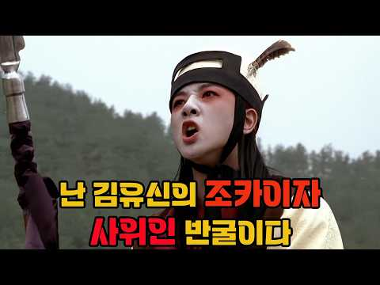
- 같은 채널 평소 대비 ×0.9 (채널 최근 롱폼 중앙값 803,466회) · 평소 영상: 후배에게 무시당하고 완주가 불가능해도 태극마크를 달고 달려야하는 무명 선수의 이야기 (811,315회) / 사기꾼 전도연과 간암환자 정재영에 연변깡패 오만석이 돈과 간을 찾기 위해 벌리는 쫓고쫓기… (795,616회)
- 대본 없음 (없음) — 음성인식이 끝나면 도입부·흐름이 들어감
- 댓글 980/1,008: 좋은 점 — 영상 9 · 감사·응원 2 · 더 알고 싶은 것 1 · 아쉬운 점 — 영상 7 · 반박·불만 — 의견 다름 9 · 정치·사회 26 · 경험 공유 17 · 구독·다음 기대 0
  - 좋은 점 — 영상 👍28 “이 영화 명언 '호랭이는 가죽땜시 뒤지고 사람은 이름땜시 뒤지는거여' 가 참 와닿고 나이 먹어 20년 넘게 지난 지금도 깊이 남아 마음에 새겨 있습니다”
  - 좋은 점 — 영상 👍3 “자식죽이는 레전드나라”
  - 아쉬운 점 — 영상 👍0 “Ai 리마스터에요?? 화질이 겁나 거시기 해졌네요”
  - 아쉬운 점 — 영상 👍0 “저 사자대면 씬에서 아쉬웠던 건, 당나라 사자 혼자만 진지 빠니까 뭔가 따로 놀음. 8~90년대 홍콩 영화의 코메디 배우들처럼 깐죽였으면 저 자리가 더 정신없고 재밌었을 걸 하는 아쉬움.”
  - 반박·불만 — 의견 다름 👍1 “원본 영화를 보다가 하도 욕설이 적나라해서 꺼버렸는데, 한국사람들 상스러운 면에 부끄러움을 느끼지 못하는 말도 안되는 영화였음. 원본은 시청하지 말아야.”
  - 반박·불만 — 의견 다름 👍0 “고증 다 좋은데 전라도 말고 충청도 사투리였으면 더 완벽 했을텐데 백제의 수도는 충청도지 전라도가 아닙니다”
  - 정치·사회 👍3 “나당연합은 고구려는 당나라가 먹고 백제는 신라가 먹는다는 조건이었는데 당나라가 뒤통수 때림 솔직히 신라가 먼저 도움을 요청한 대상은 당나라가 아니었음 김춘추가 직접 고구려로 가서 도움을 요청했는데 거절 당하자 당나라로 감”
  - 정치·사회 👍2 “신라가 당이랑 붙어서 배신했다고 욕들 많이 하는데 저때는 한반도의 삼국은 각자 다른 나라였음 사투리라는게 사실 다른 나라 언어였던 것. 인종도 다 다를때임. 그래서 그걸 지금의 관점으로 보면 안됨. 당나라 지배층은 지금 중국 한족의 선조가 아닌 신라와 비슷한 계통인 …”
  - 경험 공유 👍50 “정치인의 전쟁, 병사로서의 전쟁 이 걸 정말 너무 현실감 있게 표현한 수작임 안타깝게도 이 당시 한국 영화가 너무너무 좋은 작품이 많아서 당시 비평가들에게 혹평을 받음 지금 봐도 재밌는 영화고 저도 많이 좋아합니다.”
  - 경험 공유 👍7 “0:55 내가 가장좋아하는 명대사중 하나입니다”

### 323. [그날의 한국사] 광해군을 끌어내린 친조카 인조의 비참한 말로... "큰아버지께 죄를 지었다" 죽기 직전 흘린 26년의 천벌 ∣ 인조반정 병자호란 삼전도 굴욕

- https://www.youtube.com/watch?v=c3ED6GNQFLw · 그날의 한국사    · 구독자 847 · 조회수 17,867 (×21.1, 하루 99.8) · 좋아요 438 (2.5%) · 47.6분 · 2026-05-02 · 주제 묶음 3. 조선 · 형식 정보·해설 (그 밖) · 폴더 `W_c3ED6GNQFLw` (웹 승인)
- 썸네일: 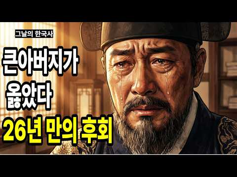
- 챕터: 0:00 죽기 직전 인조의 마지막 후회 · 2:00 1장 - 영광의 시작과 첫 번째 경고 · 9:00 2장 - 첫 번째 천벌, 이괄의 난 · 16:00 3장 - 두 번째 천벌, 정묘호란 · 23:00 4장 - 세 번째 천벌, 병자호란과 삼전도 굴욕 · 31:00 5장 - 마지막 천벌, 가족 몰살과 죽음의 후회 · 0:00 죽기 직전 인조의 마지막 후회 · 2:00 1장 - 영광의 시작과 첫 번째 경고 · 9:00 2장 - 첫 번째 천벌, 이괄의 난 · 16:00 3장 - 두 번째 천벌, 정묘호란 · 23:00 4장 - 세 번째 천벌, 병자호란과 삼전도 굴욕 · 31:00 5장 - 마지막 천벌, 가족 몰살과 죽음의 후회 · 0:00 죽기 직전 인조의 마지막 후회 · 2:00 1장 - 영광의 시작과 첫 번째 경고 · 9:00 2장 - 첫 번째 천벌, 이괄의 난 · 16:00 3장 - 두 번째 천벌, 정묘호란 · 23:00 4장 - 세 번째 천벌, 병자호란과 삼전도 굴욕 · 31:00 5장 - 마지막 천벌, 가족 몰살과 죽음의 후회
- 설명 앞부분: 1649년 1649년 5월 8일, 쉰다섯 살의 조선 왕 인조가 눈을 감기 직전 신하의 손을 잡고 떨리는 목소리로 속삭인 마지막 한 마디 "큰아버지... 제가 정녕 큰아버지께 죄를 지었나이다" 26년 전, 새벽에 칠백 명의 군사를 이끌고 큰아버지의 침전에 쳐들어가 왕좌에서 끌어내린 바로 그 인조 폐위된 큰아버지를 강화도로 유배 보내고 제주도까지 쫓아낸 바로 그 인조가 죽기 직전 흘린 피눈물의 한 마디 오늘은 광해군을 끌어내리고 옥좌에 앉은 친조카 인조, 그가 받은 26년의 천벌을 함께 만나보는 시간입니다 ▼ 영상 목차 ▼ ▼ 인조의…
- 같은 채널 평소 대비 ×207.8 (채널 최근 롱폼 중앙값 86회) · 평소 영상: 조선시대 '밀실 살인'의 진실, 은비녀는 알고 있었다 ∣정약용 ∣역사 스토리∣ (105회) / 조선왕조실록 3천 번 등장한 권력자는 왜 사약을 받았을까? ∣ 우암 송시열의 비극 (67회)
- 대본 없음 (설명) — 음성인식이 끝나면 도입부·흐름이 들어감
- 댓글 46/47: 좋은 점 — 영상 0 · 감사·응원 1 · 더 알고 싶은 것 0 · 아쉬운 점 — 영상 0 · 반박·불만 — 의견 다름 2 · 정치·사회 4 · 경험 공유 0 · 구독·다음 기대 0
  - 감사·응원 👍1 “정말로 귀한 비디오 이네요.. 감사 합니다.. 역사 속에서 많이 배웁니다.”
  - 반박·불만 — 의견 다름 👍2 “설명은 내용은 쾐찮은데 영상은 참 어이없음 아무리 AI로 영상을 만들었다고 하지만 이게 조선이야 중국이야 도무지 추천을 누를수 없음. 편하게 AI로 영상만든다고 하지만 저거 중국역사도 아니고 우리 역사인데 너무 성의없다. 싫어요 누르고 감”
  - 정치·사회 👍15 “광해군이였더라면 금(청)에 굴욕 당하지 않고 나라가 안정되어을 것이다”
  - 정치·사회 👍8 “지금도 박근혜 윤석렬로 이어지는 참담한 탄핵의 현실이 서인(이귀 김류 이괄, 최명길, 김자점))세력과 문죄인 이죄명의 적반하장이 다를바 무엇이 있으랴 ㅎㅎㅎ”

### 324. 산골 동네 주민들이 모여 합스부르크 정예 군사들을 제압하고 귀족들을 몰살시킨 전투

- https://www.youtube.com/watch?v=e-vAN1KFcCQ · 어른들의자장가 · 구독자 6,050 · 조회수 127,545 (×21.1, 하루 1,400.6) · 좋아요 708 (0.6%) · 17.9분 · 2026-07-29 · 주제 묶음 7. 전쟁·군사사 · 형식 정보·해설 (그 밖) · 폴더 `W_e-vAN1KFcCQ` (웹 승인)
- 썸네일: 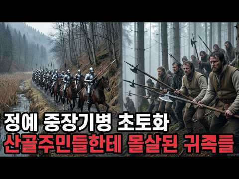
- 설명 앞부분: 1315년 11월 15일 아침, 애게리 호숫가의 좁은 길 위에 합스부르크 기사와 보병이 2킬로미터로 늘어섰습니다. 왼쪽은 가파른 비탈, 오른쪽은 늪이었고, 비탈 위 숲에는 소와 염소를 치며 사는 사람들 1,500명이 엎드려 있었어요. 두 시간 뒤 그 길에서 죽은 사람은 1,500명이 넘었고, 죽은 쪽은 기사들이었습니다. 71년 뒤 젬파흐에서 합스부르크는 기사 1,500명을 아예 말에서 내려 창 울타리를 세웠지만, 그날 공작 한 명과 귀족 400명이 함께 죽었어요. 다시 2년 뒤 네펠스에서는 방어벽을 내주고 산으로 물러난 400여 …
- 같은 채널 평소 대비 ×11.4 (채널 최근 롱폼 중앙값 11,169회) · 평소 영상: 독일군 전차와 대포 총공세를 처절하게 막아냈던 고작 20명의 최정예 소련 중대 이야기 (11,169회) / 길드 노조가 시민들로 군대를 조직해서 최정예 엘리트 군대랑 전쟁을 벌인 날 (11,001회)
- 대본 없음 (설명) — 음성인식이 끝나면 도입부·흐름이 들어감
- 댓글 28/28: 좋은 점 — 영상 0 · 감사·응원 1 · 더 알고 싶은 것 0 · 아쉬운 점 — 영상 1 · 반박·불만 — 의견 다름 2 · 정치·사회 0 · 경험 공유 0 · 구독·다음 기대 1
  - 아쉬운 점 — 영상 👍1 “지루한 설명이다”
  - 반박·불만 — 의견 다름 👍4 “스위스 는 산골 촌동네 목동 국가 거 아닙니다 로마 제국 때문에 알프스 에서 봉인된 헬베티아 人 들로서 용병 국가 이며 호전적이고 용맹 무쌍 합니다.”
  - 반박·불만 — 의견 다름 👍0 “잡스러운 헛소리를 뭐 이렇게 요란하게 뜨더냐?”
  - 구독·다음 기대 👍3 “재밌네요 ~~ 구독했습니다”

### 325. 나를 멸시하던 양반집 아씨가 내 하녀로 팔려왔다 ∣ 흑매화 장부의 비밀 ∣조선시대 창작야담 ∣ 오디오북 ∣ 수면동화

- https://www.youtube.com/watch?v=5FJXjRvIW-s · 조선그림극장 · 구독자 1,160 · 조회수 24,374 (×21.0, 하루 232.2) · 좋아요 757 (3.1%) · 77.5분 · 2026-07-15 · 주제 묶음 3. 조선 · 형식 수면·낭독 (잠잘 때 듣는) · 폴더 `W_5FJXjRvIW-s` (웹 승인)
- 썸네일: 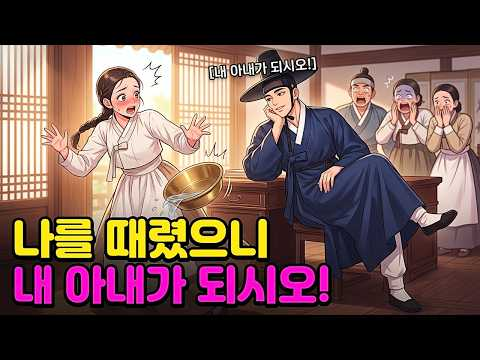
- 설명 앞부분: 12년 전 나를 매질하고 쫓아내던 도도한 양반집 아씨가, 내 집의 하녀로 팔려왔다. 가문을 무너뜨린 '흑매화 장부'를 둘러싼 두 남녀의 지독한 오해와 가슴 시린 진실! 사랑채의 육중한 문이 열리고, 과거의 가난한 서동은 거대한 상단의 주인이 되어 자신을 멸시하던 아씨 한연화를 내려다봅니다. 몰락한 가문, 역적의 누명, 그리고 12년 전 서무겸을 쫓아내야만 했던 연화의 숨겨진 사연까지. 연화는 아비의 억울한 죽음을 밝히기 위해 자신의 정체를 숨긴 채 무겸의 하녀로 들어갔지만, 무겸은 이미 그녀를 알아보고 서늘한 복수인지 사랑인지 모…
- 같은 채널 평소 대비 ×6.7 (채널 최근 롱폼 중앙값 3,628회) · 평소 영상: "남의 아내를 내가 왜 보러 가?" 매일같이 집을 드나들던 사내, 시집간다는 말에 다짜고… (3,723회) / "세금 대신 네 몸을 가져가겠다!" 장터 한복판에 붉은 꽃가마를 대동하고 나타난 신임 사… (3,534회)
- 대본 없음 (설명) — 음성인식이 끝나면 도입부·흐름이 들어감
- 댓글 14/14: 좋은 점 — 영상 0 · 감사·응원 2 · 더 알고 싶은 것 0 · 아쉬운 점 — 영상 1 · 반박·불만 — 의견 다름 0 · 정치·사회 0 · 경험 공유 0 · 구독·다음 기대 0
  - 감사·응원 👍1 “분당 야탑에서 잘들었습니다. 감사합니다. ❤🎉😊”
  - 감사·응원 👍1 “내용이 좋아요. 잘 봤습니다. 감사합니다. 유럽 벨기에 ❤❤❤”
  - 아쉬운 점 — 영상 👍2 “내용 그림체 다 좋은데~ 이렇게 철자가 엉망진창이면 몰입을 너무 방해해서 완성도가 뚝 떨어져서 많이 아쉽네요 ~~~”

### 326. 일본이 이순신보다 두려워 했던 인물? '괴물'이라 부르며 두려워했던 조선의 영웅

- https://www.youtube.com/watch?v=Q9d1dEUVJHI · 역사스토리 · 구독자 21,700 · 조회수 443,606 (×20.4, 하루 5,414.6) · 좋아요 3,136 (0.7%) · 15.7분 · 2026-08-07 · 주제 묶음 3. 조선 · 형식 정보·해설 (그 밖) · 폴더 `W_Q9d1dEUVJHI` (웹 승인)
- 썸네일: 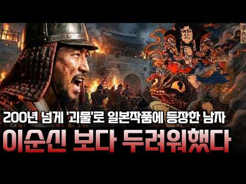
- 챕터: 0:00 일본 무대에 오른 조선인 요괴 · 0:59 모쿠소는 이름이 아니었다 · 2:09 일본군이 진주로 몰려온 이유 · 3:24 하필 그 자리에 있던 사람 · 4:36 6일 동안 무슨 일이 있었나 · 5:55 승리가 확정된 순간의 유탄 · 6:48 진주가 없으면 호남이 없다 · 7:50 히데요시의 섬뜩한 명령 · 10:12 죽은 사람이 무대에 오르다 · 12:27 조선의 기록은 한 줄이었다 · 13:25 400년 만에 돌아온 교서
- 설명 앞부분: 1804년 일본 가부키 무대에 거대한 두꺼비를 탄 남자가 등장합니다. 그가 복수를 다짐한 이유는 아버지가 일본군에게 목이 잘렸기 때문인데, 그 아버지는 일본인이 아니라 조선인이었습니다. 에도 시대 일본의 연극과 소설에는 '모쿠소'라 불리는 조선 장수가 200년 가까이 단골로 등장했습니다. 산에서 솟아나 일본군을 잡아먹는 괴물, 죽어서도 일본을 저주하는 원귀로 그려진 이 인물은 이순신 장군이 아니었습니다. 모쿠소는 사람 이름이 아니라 '진주 목사'라는 직책이 일본식으로 발음된 것이었고, 그 주인공은 임진왜란 3대 대첩 중 하나인 진…
- 같은 채널 평소 대비 ×383.6 (채널 최근 롱폼 중앙값 1,156회) · 평소 영상: 임금이 도망친 자리에서 혼자 칼 든 의병장, 전쟁 후 역적으로 몰린 이유 (1,203회) / 1·21 사태 총정리 ∣ 김신조 침투 루트·실미도·푸에블로호 연결고리까지 (1,110회)
- 대본 없음 (설명) — 음성인식이 끝나면 도입부·흐름이 들어감
- 댓글 417/417: 좋은 점 — 영상 12 · 감사·응원 13 · 더 알고 싶은 것 2 · 아쉬운 점 — 영상 3 · 반박·불만 — 의견 다름 13 · 정치·사회 31 · 경험 공유 8 · 구독·다음 기대 1
  - 좋은 점 — 영상 👍163 “경매에 나온것 조차 국가가 못가져오고 저것도 국민들 모금으로 가져온게 레전드네 이놈의 국가꼬라지 봐라”
  - 좋은 점 — 영상 👍29 “많은 것을 생각하게 하는 이야기였습니다. 좋은 영상을 올려 주셔서 정말 고맙습니다.”
  - 감사·응원 👍29 “많은 것을 생각하게 하는 이야기였습니다. 좋은 영상을 올려 주셔서 정말 고맙습니다.”
  - 감사·응원 👍27 “김시민 장군님 감사합니다! 당신의 호국 정신을 잊지않겠습니다!”
  - 더 알고 싶은 것 👍0 “제발 누가 영화로 만들어주세요~ 호프같은거 만들지 말고... 진짜 누가보면 한국 영웅은 이순신 장군 밖에 없는줄 알아요 뒤돌아보면 어벤져스 어셈블할만큼 이리도 영웅들이 많는데 안타깝습니다”
  - 더 알고 싶은 것 👍0 “김시민 장군님이 총에 안 맞고 일본 과의 전투를 지휘했다면 임진왜란 판세는 어떻게 변했을가요??”
  - 아쉬운 점 — 영상 👍1 “7:05 그동안 조선을 괴롭히던 보급문제라...ㅋ 하 자막이거 왜그러노 Ai로 만들어놓는 거 손도 안보나... 깝깝하네”
  - 반박·불만 — 의견 다름 👍1 “2005년도 1억이 없다고? 그 시절 1억이면 큰 돈도 아닌데 공무원들 먹고 쓰고 하는데 1억이면 껌값이였을건데 한심하다 .. 70년 80년 시절도 아니고 지들끼리 치고 박고 ㅈㄹ을 잘도 하면서 부끄럽다.”
  - 정치·사회 👍63 “한국사를 소홀히 해서는 나라가 바로 설수 없다. 국영수와 동급으로 올려라”
  - 정치·사회 👍1 “국민이 주인인 나라가 진심인 나라”
  - 경험 공유 👍41 “모쿠소 김시민 목사님이 지킨 진주외성을 제가 잘 정성다해 복원 설계하겠습니다.”
  - 경험 공유 👍27 “우리나라의 역사는 왜 ? 이렇게 가슴 아픈가.? 단지 내가 한국인 이어서 그런것일까??”

### 327. 우리가 몰랐던 조선시대 평민들의 충격적인 삶 ∣ 조선역사 ∣ 한국사 ∣ 조선왕조실록 ∣ 자면서 듣기 좋은 역사 이야기 ∣ 자면서 듣는 역사 이야기

- https://www.youtube.com/watch?v=IbaIAa8VCR8 · 역사킴 · 구독자 4,320 · 조회수 88,024 (×20.4, 하루 603.6) · 좋아요 686 (0.8%) · 30.3분 · 2026-06-04 · 주제 묶음 1. 역사 일반·이야기 · 형식 수면·낭독 (잠잘 때 듣는) · 폴더 `W_IbaIAa8VCR8` (웹 승인)
- 썸네일: 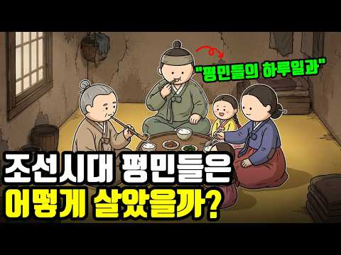
- 설명 앞부분: 우리가 몰랐던 조선시대 평민들의 충격적인 삶
- 같은 채널 평소 대비 ×60.9 (채널 최근 롱폼 중앙값 1,445회) · 평소 영상: 조선시대 사람들의 충격적인 탈모 이유 ∣ 조선역사 ∣ 한국사 ∣ 조선왕조실록 ∣ 잠잘 때… (1,445회) / 영화 '왕사남' 속 단종과는 달랐던 사실?! 단종의 진짜 이야기 ∣ 조선역사 ∣ 한국사 … (1,142회)
- 대본 없음 (설명) — 음성인식이 끝나면 도입부·흐름이 들어감
- 댓글 75/77: 좋은 점 — 영상 1 · 감사·응원 1 · 더 알고 싶은 것 1 · 아쉬운 점 — 영상 1 · 반박·불만 — 의견 다름 1 · 정치·사회 0 · 경험 공유 2 · 구독·다음 기대 0
  - 좋은 점 — 영상 👍2 “ㅡ0건강,면역성에서 가장중요한게..공기다. 특히.. 본인이 가장 오래 머무는 실내공간의 공기가 맑은가..시멘트라돈가스와 화학가스에 오염되어 있는가에 따라서..호흡을통해..오염된 독성공기가 폐로들어가서 혈액을 오염시켜.. 병들이고, 독성화시키면서..혈액세포를 병들이고.…”
  - 더 알고 싶은 것 👍0 “금줄... 자세히 알려주세요. 조선 후기에 고추가 온걸로 아는데 그전엔 남자는 멀 걸었나요?”
  - 아쉬운 점 — 영상 👍8 “애니메이션 이. 일본. 캐릭터예요 . 머리가. 일본 머리모양이예요 .아쉽네요 중간중간. 틀려요. 모자도 요.”
  - 반박·불만 — 의견 다름 👍2 “ㅡ0건강,면역성에서 가장중요한게..공기다. 특히.. 본인이 가장 오래 머무는 실내공간의 공기가 맑은가..시멘트라돈가스와 화학가스에 오염되어 있는가에 따라서..호흡을통해..오염된 독성공기가 폐로들어가서 혈액을 오염시켜.. 병들이고, 독성화시키면서..혈액세포를 병들이고.…”
  - 경험 공유 👍3 “사실 우리나라의 온돌 문화는 책에서는 고조선 시대때부터 온돌이 있었다고 나와 있어서 고조선 시절부터 모든 백성들이 온돌 난방을 했던것처럼 알고 있지만 우리나라의 온돌 난방은 조선시대때도 왕족들과 극히 일부 사대부 권력층들만 온돌 난방을 했었고 대부분의 백성들은 화로만…”

### 328. 노량해전의 숨겨진 기록에 충격! 전세계가 이순신 장군에 놀랄 수 밖에 없던 이유 #썬킴 #매불쇼 #이순신 #명량 #노량

- https://www.youtube.com/watch?v=PpJ3imzubBw · 강펀치 · 구독자 11,300 · 조회수 228,462 (×20.2, 하루 3,097.0) · 좋아요 3,884 (1.7%) · 29.6분 · 2026-08-15 · 주제 묶음 3. 조선 · 형식 정보·해설 (그 밖) · 폴더 `W_PpJ3imzubBw` (웹 승인)
- 썸네일: 
- 설명 앞부분: 오늘 영상에서는 단순히 '이순신이 승리했다'는 사실을 넘어, 왜 전 세계가 이순신 장군을 위대한 영웅으로 칭송하는지 그 이유를 파헤칩니다. 주요 내용: 임진왜란과 노량해전의 실체: 7년 전쟁으로 알려진 임진왜란의 복잡한 전개 과정과 휴전 협상, 그리고 전쟁의 마지막을 장식한 노량해전의 역사적 의미를 짚어봅니다. 특히 7천량 해전의 비극을 딛고 다시 일어선 우리 수군의 투혼을 다룹니다. 역사 속 충격적인 비하인드: 정유재란 당시 명나라군이 투입한 전력에는 아프리카 출신의 흑인 용병들을 비롯해, 적을 교란하기 위한 원숭이 부대와 중앙…
- 같은 채널 평소 대비 ×75.9 (채널 최근 롱폼 중앙값 3,010회) · 평소 영상: 뉴스공장 출연한 김민석, 거북한 이름 나오자 표정 대반전! 이낙연 꼴 된다 경고인가...… (3,010회) / 충격! 언론에서 캐나다 총리 발표를 주목하지 않은 이유... '독일 들러리 섰다'더니 K… (3,064회)
- 대본 없음 (설명) — 음성인식이 끝나면 도입부·흐름이 들어감
- 댓글 279/280: 좋은 점 — 영상 1 · 감사·응원 5 · 더 알고 싶은 것 1 · 아쉬운 점 — 영상 2 · 반박·불만 — 의견 다름 6 · 정치·사회 15 · 경험 공유 11 · 구독·다음 기대 0
  - 감사·응원 👍20 “감사함보다 시기와 질투가 판을치면 목숨을 걸고 내가 옳다는 것을 증명해야 합니다 역사는 결과를 기록 합니다”
  - 감사·응원 👍13 “너무 너무 재미있게 봤어요. 감사합니다”
  - 아쉬운 점 — 영상 👍0 “나라위해 목숨바친 숭고한 영웅이름가지고 낄낄거리면서 조롱하면 일베놈들과 뭐가다른가. 대단히 실망이다.”
  - 반박·불만 — 의견 다름 👍16 “백의종군은 이등병강등이 아닙니다.... 그냥 보직만 내려놓는거라, 전직 통제사로 예우받고 다 합니다.”
  - 반박·불만 — 의견 다름 👍0 “이긴전쟁은 아닙니다 조선전체가 초토화됐는데 일본은 잃은건 군대밖에 없는데 이겼다고하기에는 좀뭔가 이상하지않나요 한가정에 강도가들어와서 가정이 파탄나고 강도는 뒈졌음 그러면 내가 이겼다 할수있나 애초에 왜구는 바다에서 물리쳐야 이긴것이 아닌가”
  - 정치·사회 👍3 “원균 = 윤석열”
  - 정치·사회 👍3 “나라가 쑥대밭이 되고 수많은 사람들이 죽고 노예로 잡혀갔는데 그게 진짜 이긴 전쟁인가?”
  - 경험 공유 👍129 “내가 70인데 전남 영광에서는 코 귀를 베갈 때 그 당시에 이비야 ~! 라고 했답니다 그 후 일제강점기 때도 순사 온다 ~! 이비야 ~! 라고 헸다는 어른들 말씀을 기억합니다 죽을지 모르니 피하라 라는 말로 했다고 해요 이비야 ~! 나중에는 아이들 울음을 그치라는 뜻…”
  - 경험 공유 👍20 “감사함보다 시기와 질투가 판을치면 목숨을 걸고 내가 옳다는 것을 증명해야 합니다 역사는 결과를 기록 합니다”

### 329. 제1차 세계대전 최악의 소모전, 베르됭 전투 3D ∣ 완전판

- https://www.youtube.com/watch?v=34eZlgvSfDM · 에픽히스토리 코리아 · 구독자 25,200 · 조회수 508,117 (×20.2, 하루 7,475.9) · 좋아요 2,831 (0.6%) · 40.1분 · 2026-08-21 · 주제 묶음 7. 전쟁·군사사 · 형식 정보·해설 (그 밖) · 폴더 `W_34eZlgvSfDM` (웹 승인)
- 썸네일: 
- 설명 앞부분: 1916년 2월 21일, 독일군의 대포 1,000문이 베르됭 일대의 프랑스군 진지를 향해 포격을 시작했다. 인류 역사상 가장 참혹한 전투 중 하나인 베르됭 전투의 시작이었다. 300일 동안 이어진 전투에서 매일 평균 1,000명이 목숨을 잃었다. 독일군은 프랑스군을 소모전으로 끌어들여 피를 말리려 했지만, 프랑스군은 “그들은 통과하지 못한다”는 결의 아래 필사적으로 맞섰다. 정교한 3D 그래픽을 통해 베르됭이 전략적으로 중요했던 이유와 프랑스 동부를 지키던 요새망, 두오몽 요새를 둘러싼 사투, 그리고 독일군과 프랑스군의 치열한 공…
- 같은 채널 평소 대비 ×11.2 (채널 최근 롱폼 중앙값 45,333회) · 평소 영상: [나폴레옹 전쟁 시리즈] 1807년 아일라우 전투 (45,333회) / 넬슨의 해전 3D: 코펜하겐 해전 1801 (40,023회)
- 대본 없음 (설명) — 음성인식이 끝나면 도입부·흐름이 들어감
- 댓글 151/156: 좋은 점 — 영상 3 · 감사·응원 6 · 더 알고 싶은 것 2 · 아쉬운 점 — 영상 1 · 반박·불만 — 의견 다름 1 · 정치·사회 2 · 경험 공유 5 · 구독·다음 기대 2
  - 좋은 점 — 영상 👍6 “당시 영상과 사진으로만 설명 되던걸 이렇게 보니 한눈에 이해가 잘 되네요.. 좋아요~~”
  - 좋은 점 — 영상 👍0 “오랜만에 정말 아주 잘 짜여진 내용을 알기쉽게 설명해 주어 너무 고맙습니다”
  - 감사·응원 👍0 “에픽채널 영어로 겨우 듣다가 번역본 들으니 넘 좋네요 퀄리티가 넘사벽입니다. 감사드립니다.”
  - 감사·응원 👍0 “오랜만에 정말 아주 잘 짜여진 내용을 알기쉽게 설명해 주어 너무 고맙습니다”
  - 더 알고 싶은 것 👍30 “와 엄청나네요 퀄리티가... 이런 영상만 찾아보는데 제가 본 것들 중에서 1위네요 다른 1차대전 2차대전 대평양전쟁 대규모 전투도 다뤄주시면 좋겠어요”
  - 더 알고 싶은 것 👍0 “내용도 좋고 매우 잘 만들어져 있습니다 다만 배경음악을 다른 것을 써 주세요. 또 나레이션이 있을 때와 그 시이사이의 음량차이가 너무 큽니다. 음압이 너무 커서 피로도가 큽니다. 조정 부탁드립니다”
  - 아쉬운 점 — 영상 👍1 “영상이 존나 지겹습니다. 했던말 계속 언급 반복하면 넘 지루하져”
  - 정치·사회 👍0 “(약 26분 31초까지 보던 중에 문득) 샤를 드골 전 프랑스 대통령이 이 전투에 참전했다가 독일군에 포로로 붙잡히게 되었죠.”
  - 정치·사회 👍0 “전쟁이란 딱 한명의 미치광이가 일으키고 수천만명이 영문도 모른 채 학살 당하는 것이다.... 러우전쟁은 푸틴, 중동전쟁은 네타냐후, 이란전쟁은 트럼프.... 이것들이 미치광이들!!!! 우리도 하마터면 윤석열 때문에 전쟁날 뻔!!!! 베르됭 전투에서 사망한 병사 수는 …”
  - 경험 공유 👍30 “와 엄청나네요 퀄리티가... 이런 영상만 찾아보는데 제가 본 것들 중에서 1위네요 다른 1차대전 2차대전 대평양전쟁 대규모 전투도 다뤄주시면 좋겠어요”
  - 경험 공유 👍0 “서로를 죽여야 내가 살고 끝없이 죽고 죽는 가운데 사람은 존재의미를 잃고 악마가된다”
  - 구독·다음 기대 👍0 “고퀄이네 구독합니다”
  - 구독·다음 기대 👍0 “구독합니다 정말 감동적으로 잘 소재를 선정하고 만드신 영상이네요”

### 330. 조선 왕의 침소는 왜 가장 추웠을까, 궁녀의 방이 더 따뜻했던 이유

- https://www.youtube.com/watch?v=apLiHkAgHfY · 역사한폭 · 구독자 539 · 조회수 10,798 (×20.0, 하루 309.2) · 좋아요 17 (0.2%) · 18.6분 · 2026-09-23 · 주제 묶음 3. 조선 · 형식 정보·해설 (그 밖) · 폴더 `W_apLiHkAgHfY` (웹 승인)
- 썸네일: 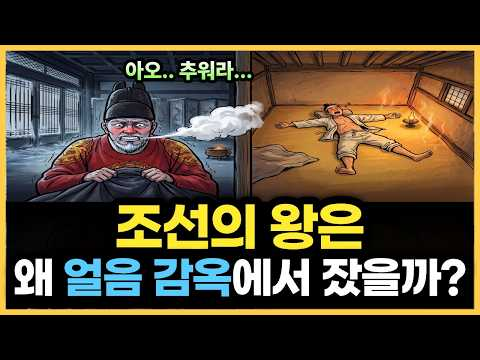
- 챕터: 0:00 궁궐에서 가장 추운 방 · 1:13 고래와 구들장, 열이 걷는 길 · 3:25 산 하나가 연기가 되던 겨울 · 5:34 강녕전, 네 겹의 추위 · 10:49 담장 너머, 세 평의 뜨거운 밤 · 12:43 궁녀의 방이 더 따뜻했던 이유 · 14:16 태평양을 건넌 온돌 · 16:19 왕이 갖지 못한 밤, 오늘의 이불 아래
- 설명 앞부분: 우리는 궁궐 하면 가장 따뜻한 방부터 떠올립니다. 두꺼운 구들장, 밤새 꺼지지 않는 아궁이, 전담 인력까지 붙은 최고 사양의 온돌이었으니까요. 그런데 그 방의 주인, 조선의 임금은 겨울마다 입김을 뿜으며 잠을 설쳤습니다. 넓은 방, 아득히 높은 천장, 바람이 스미는 창호, 그리고 안전을 위해 멀리 떨어진 아궁이. 나라 살림과 먼 산의 숲을 태워도 열은 신분을 알아보지 못했고, 궁궐에서 가장 따뜻한 밤은 오히려 궁녀들의 작은 곁방에 있었습니다. 그리고 왕이 누리지 못한 그 온기의 원리는, 훗날 태평양을 건너 미국 가정의 밤을 데우게…
- 같은 채널 평소 대비 ×4.9 (채널 최근 롱폼 중앙값 2,200회) · 평소 영상: 400년 전 조선 사람들이 먹던 김치는 왜 빨갛지 않았을까 — 잊혀진 200년의 밥상 (2,246회) / 왕이 따로 있던 섬 제주, 천 년 왕국은 어떻게 우리나라가 됐을까 (2,155회)
- 대본 없음 (설명) — 음성인식이 끝나면 도입부·흐름이 들어감
- 댓글 2/2: 좋은 점 — 영상 1 · 감사·응원 1 · 더 알고 싶은 것 0 · 아쉬운 점 — 영상 0 · 반박·불만 — 의견 다름 0 · 정치·사회 0 · 경험 공유 0 · 구독·다음 기대 0
  - 좋은 점 — 영상 👍1 “좋은영상 감사합니다!”
  - 감사·응원 👍1 “좋은영상 감사합니다!”

### 331. 66살 할아버지 영조와 결혼한 15살 소녀 정순왕후의 최후｜한국사｜조선역사｜신유박해

- https://www.youtube.com/watch?v=_Il2QJpOgZw · 역사콕테일 · 구독자 8,380 · 조회수 167,567 (×20.0, 하루 1,452.2) · 좋아요 1,625 (1.0%) · 24.6분 · 2026-06-23 · 주제 묶음 4. 한국 근현대사 · 형식 정보·해설 (그 밖) · 폴더 `W__Il2QJpOgZw` (웹 승인)
- 썸네일: 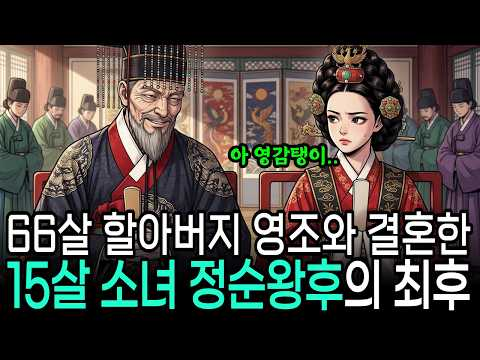
- 챕터: 0:00 1759년 창경궁 간택장 · 2:05 힘없는 가문의 딸, 경주 김씨가 국모로 결정된 이유 · 4:11 간택장에서 전해지는 소녀의 영리한 일화와 그 진실 · 6:37 15세 새어머니와 25세 아들 사도세자의 기묘한 관계 · 9:56 1762년 여름, 조선 왕실 최대의 비극 · 11:21 비극을 둘러싼 '어린 왕비 배후설'의 실상 · 13:34 1776년 영조의 승하와 정조의 즉위, 그리고 24년… · 16:24 1800년 정조의 갑작스러운 죽음과 쉰여섯 여인의 수…
- 설명 앞부분: 66세 영조와 혼인한 15살 정순왕후. 쉰한 살 나이 차이의 어린 신부는 어떻게 조선에서 가장 무서운 권력자가 되었을까요? 영조는 왜 하필 가장 가난한 집 딸을 골랐고, 우리가 아는 '악녀 정순왕후'의 이미지는 과연 사실일까요? 1759년, 예순여섯 살의 임금 영조는 직접 새 왕비를 골랐습니다. 그가 선택한 건 명문가의 딸이 아니라, 겨울에 멍석을 덮고 잤다는 이야기가 전해질 만큼 가난한 집안의 열다섯 살 소녀였습니다. 손녀뻘 소녀를 신부로 맞은 늙은 임금의 속셈은 무엇이었을까요. 그리고 그 어린 신부는 24년의 인내 끝에, 발 …
- 같은 채널 평소 대비 ×33.5 (채널 최근 롱폼 중앙값 5,000회) · 평소 영상: 세조가 잊지 못한다는 경혜공주의 충격적인 복수극｜한국사｜조선역사｜단종 (5,766회) / 조선시대 사람들은 진짜로 다들 40살에 죽었을까?｜한국사｜조선평균수명｜역사 (4,235회)
- 대본 없음 (설명) — 음성인식이 끝나면 도입부·흐름이 들어감
- 댓글 201/201: 좋은 점 — 영상 0 · 감사·응원 0 · 더 알고 싶은 것 0 · 아쉬운 점 — 영상 1 · 반박·불만 — 의견 다름 3 · 정치·사회 2 · 경험 공유 0 · 구독·다음 기대 0
  - 아쉬운 점 — 영상 👍3 “말이 너무 길다 지루해”
  - 반박·불만 — 의견 다름 👍13 “정순왕후는 정치력있고 중립적인 인물이지 악녀가 아닙니다 수렴청정하면서 중심을 잡은게 악녀면 권력자중 악인이 아닌 사람은 아무도 없습니다 신유박해는 조선 역사에서 미미한 천주교 박해인데 최대규모라고 하다니 팩트체크를 하고 영상을 올리십시오 조선역사상 최대 천주교 박해는…”
  - 정치·사회 👍3 “김건희네 지가 대통령인줄 알던..”

### 332. 우연히 주운 돌이, 역사를 바꿨습니다

- https://www.youtube.com/watch?v=SSQ9A6q9_Dg · 국립경주문화유산연구소 · 구독자 22,400 · 조회수 441,772 (×19.7, 하루 2,849.5) · 좋아요 2,249 (0.5%) · 11.8분 · 2026-05-26 · 주제 묶음 1. 역사 일반·이야기 · 형식 정보·해설 (그 밖) · 폴더 `W_SSQ9A6q9_Dg` (웹 승인)
- 썸네일: 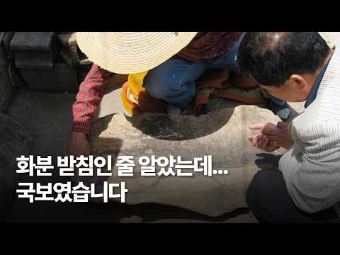
- 설명 앞부분: 최근 화제가 된 만호봉사지 금강역사상 발 발견부터 화분 받침으로 쓰이던 돌에서 발견된 포항 중성리 신라비, 월성 비편, 사천왕사 녹유신장벽전 복원 이야기까지. 우연한 발견과 집요한 조사 끝에 이어진 신라 문화유산의 숨겨진 이야기들을 담았습니다. 이번 영상에서는 국립경주문화유산연구소 연구원들의 실제 증언을 통해 경주 문화재 발굴 현장에서 어떤 방식으로 유물이 발견되고, 조각들이 연결되며, 사라졌던 역사가 복원되는지를 살펴봅니다. ☑️ 이 영상은 국립경주문화유산연구소에서 제작한 영상입니다. 영상의 활용은 공공누리 4유형에 따라서 이용…
- 같은 채널 평소 대비 ×448.5 (채널 최근 롱폼 중앙값 985회) · 평소 영상: 2026 숭문대 인문학 강좌 1회차 「황룡사의 창건과 그 의도」 (1,001회) / 2026 대담신라 2회차「황룡사로 온 생선 1300년전 신라의 택배」 (969회)
- 대본 없음 (설명) — 음성인식이 끝나면 도입부·흐름이 들어감
- 댓글 178/179: 좋은 점 — 영상 0 · 감사·응원 9 · 더 알고 싶은 것 3 · 아쉬운 점 — 영상 1 · 반박·불만 — 의견 다름 2 · 정치·사회 3 · 경험 공유 6 · 구독·다음 기대 0
  - 감사·응원 👍23 “우연을 운명으로 만들기 위해 수많은 돌들을 닦고 뒤집으셨겠죠. 연구원분들의 노력뿐만 아니라 낭만도 응원합니다!”
  - 감사·응원 👍11 “감사합니다 고맙습니다.귀한 말씀을 들려 주시고 보여주심을 기뻐 합니다./ 응원합니다.”
  - 더 알고 싶은 것 👍17 “공순아찬이라고 하면, 공순이 이름이고 아찬이 관등이라는 점 정도는 알려주셨으면 좋았는데요... 누군가에게는 당연하지만, 누군가는 또 잘 모릅니다.”
  - 더 알고 싶은 것 👍2 “우연히 주운 돌이 풀리지 않던 퍼즐을 완성시키면 얼마나 짜릿할까요? 발견자 분들의 문화재에 대한 깊은 관심과 연구원분들의 집념이 그걸 가능케 했다고 생각합니다.”
  - 아쉬운 점 — 영상 👍5 “사실 신라 경주 1000년 도읍은 세계적으로도 말이 안되는 기간입니다. 그 시기가 그리 오래 지나지도 않았구요. 엄청난 규모의 유물이 쏟아져야 하는 유지기간임에 불구하고 남아있는게 너무 극히 없는편이죠. 참 슬프고 아쉽습니다.”
  - 반박·불만 — 의견 다름 👍4 “댓글 보고 온게 아닌데 갑자기 알고리즘에 뜸. 어랏,,,신라공주 동네에 뭐 있나? 하믄서 들어옴.”
  - 반박·불만 — 의견 다름 👍0 “어릴때 분당 정자동? 밭에서 어머니와같이 찍은 사진에서도, 성인 키만한 비석?이 배경이되엇는데. 예전엔 그런걸 몰랏기에 그냥 부서지고 묻혀진 유물이 말도안돼게 만을것같아요”
  - 정치·사회 👍2 “문화유산이 맞으면 발견신고자도 왠만하면 다 포상주시길.. 대통령도 포상금 늘리라고 하셨잖아요. 발견하고 신고하고 그 번거로움을 거쳐 우리 역사에 대해 더 알게 해주신 분들에 대해 최소한의 포상이라도 꼭 하시길 바랍니다. 그럼, 건축공사하다가 유물 발견해도 도로 묻지는…”
  - 정치·사회 👍1 “우리나라가 일제강점기때 데라우치총독의 지시로 석굴암을 복원했었는데 훼손된 석굴암의 돌판들이 민가에서 자주 발견되었음 역사에서는 일본이 우리 문화재를 훼손했다하지만 현실은 조선사람들이 사찰과 왕가에서 필요한 석판과 판자들을 떼어가서 사용했음 엄격한 세습과 계급사회였기때…”
  - 경험 공유 👍7 “우리동네 이야기구만. 우리집에서 보이는 남산.”
  - 경험 공유 👍7 “담장에 비편은 생각도 안해봤네”

### 333. 왜 11살 꼬마며느리는 망한 집에 웃으며 시집왔을까? 그 정체는? ∣ 야담 ∣ 조선시대 ∣ 오디오북 ∣ 전설 민담

- https://www.youtube.com/watch?v=S0fim5zCQbI · 달빛잠자리이야기 · 구독자 15,700 · 조회수 308,503 (×19.6, 하루 2,099.4) · 좋아요 7,355 (2.4%) · 57분 · 2026-06-03 · 주제 묶음 3. 조선 · 형식 수면·낭독 (잠잘 때 듣는) · 폴더 `W_S0fim5zCQbI` (웹 승인)
- 썸네일: 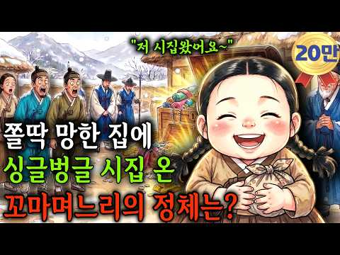
- 설명 앞부분: "곧, 굶어 죽을 집구석에 시집오면서 왜 저리 입이 귀에 걸렸을꼬?" 망해가는 가문을 조선 최고 부자로 만든 11살 꼬마 민며느리의 기막힌 반전! 지금 그 통쾌하고 따뜻한 성공 신화가 펼쳐집니다. 👇👇 📜 [달빛잠자리이야기 역사 한스푼 (고증 자료) 1. 조선 시대의 민며느리(조혼) 풍습 2. 10대 장원 급제가 가능했을까? 3. 정경부인(貞敬夫人)의 위상 정경부인은 조선 시대 문무관의 처에게 내리던 명명 직첩 중 최고 등급인 '정·종 1품' 여인에게 주어지는 최고의 명예였습니다. 오늘날로 치면 국무총리나 장관급 인사의 부인에게 …
- 같은 채널 평소 대비 ×28.8 (채널 최근 롱폼 중앙값 10,712회) · 평소 영상: 🌡️ 한여름, 시댁 대청마루를 뜯어낸 못말리는 꼬마 며느리 ∣야담∣ 옛날이야기∣ 민담∣ … (10,712회) / 병든 서방 살리러 싱글벙글 시집 온 꼬마 며느리의 정체는? ∣ 야담 ∣ 조선시대 ∣ 오디… (11,977회)
- 대본 없음 (설명) — 음성인식이 끝나면 도입부·흐름이 들어감
- 댓글 338/348: 좋은 점 — 영상 2 · 감사·응원 42 · 더 알고 싶은 것 1 · 아쉬운 점 — 영상 0 · 반박·불만 — 의견 다름 1 · 정치·사회 4 · 경험 공유 3 · 구독·다음 기대 0
  - 좋은 점 — 영상 👍1 “즐청했습니다😊 다음에도 좋은 이야기 부탁 드립니다. P.S 한가지 조정 해야 할 것이 있네요. 중간 중간 말이 끊김이 좀 있고 울림이 있어요”
  - 좋은 점 — 영상 👍0 “좋은 이야기 입니다 ^^”
  - 감사·응원 👍12 “참대단한향이화이팅.웃으면복이와요.최만당이길들이기참시원하내요.향이와.할아버님.❤❤❤❤❤”
  - 감사·응원 👍8 “감탄 스럽고 꼬마 신부가 큰복덩이가 최씨집안을 우뚝세운 효부로다 ❤ 유친하고 설정하고 응원합니다 선물 🎁”
  - 반박·불만 — 의견 다름 👍6 “서울종로익선동에서잘듣고있지요”
  - 정치·사회 👍5 “여기주인장도 중국인이네 아놔”
  - 정치·사회 👍1 “중국인들의 👀 유튜브였구나!”
  - 경험 공유 👍0 “향이에 지혜가 지금 이나라에 필요할때 인거 같습니다. 자기 자신만을 생각하는 정치인들을 보고있자니 후손들 한태 미안하다. 다수를 위한다고 생각없는 정치인들 내가 그냥 웃는다”
  - 경험 공유 👍0 “대과다그가. 뭡니까 ?우리들이 알아듣지도 못하는 말. 하지마시오 재밌게. 잘. 듣다가. 마음이. 싸해지며. 듣기 싫소.. 알아듣지도 못하는 중국말. 또하네 당신. 나라가서. 싫컷 하라구 ~ 에이. 짜증나 내가. 몇시간을. 뭐한거야 중국말. 듣자고 시청하는줄. 알아 시…”

### 334. 자객들에 쫓기던 왕비를 절벽으로 밀어버린 천재아이∣ 야담 ∣ 조선시대 ∣ 오디오북 ∣ 전설 민담

- https://www.youtube.com/watch?v=aI8A973spEw · 전해들은 야담 · 구독자 41,000 · 조회수 802,326 (×19.6, 하루 5,046.6) · 좋아요 20,659 (2.6%) · 82.4분 · 2026-05-22 · 주제 묶음 3. 조선 · 형식 수면·낭독 (잠잘 때 듣는) · 폴더 `W_aI8A973spEw` (웹 승인)
- 썸네일: 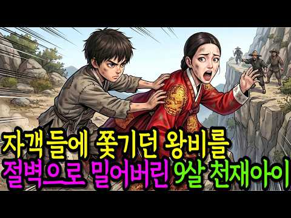
- 설명 앞부분: 본 영상은 ai를 활용하였지만 등장인물을 인형으로 직접 오리고 제작하여 직접 촬영 및 연출한 영상이 사용되는 인형극 영상입니다 전해들은 야담이 새롭게 각색하고 재구성한 창작 콘텐츠입니다. 이야기의 몰입도를 높이기 위해 등장인물의 이름과 지명 등 일부 설정은 가공되었음을 알려드립니다. 전해들은 야담은 바쁜 세상살이에 지친 여러분이 잠시 발걸음을 멈추고 쉬어갈 수 있는 작은 이야기 쉼터입니다. 교과서에는 실리지 않은 기이하고도 흥미로운 야담과 야사, 우리 조상들의 해학이 담긴 민담, 그리고 역사 뒤편에 숨어 있던 비밀스러운 이야기들을…
- 같은 채널 평소 대비 ×20.9 (채널 최근 롱폼 중앙값 38,314회) · 평소 영상: 관상보는 천재아이, 잠행중인 임금인 줄 모르고 "왕이 될 상이네?" ∣ 야담 ∣ 조선시대… (38,314회) / 남편이 장원급제후 병든 아내를 호랑이굴에 버리자, 아내가 갑자기 웃음을 터뜨리는데..∣ … (42,129회)
- 대본 없음 (설명) — 음성인식이 끝나면 도입부·흐름이 들어감
- 댓글 748/750: 좋은 점 — 영상 6 · 감사·응원 51 · 더 알고 싶은 것 4 · 아쉬운 점 — 영상 11 · 반박·불만 — 의견 다름 5 · 정치·사회 1 · 경험 공유 7 · 구독·다음 기대 0
  - 좋은 점 — 영상 👍3 “바쁜 하루 중에 잠시 쉬어갈 수 있는 좋은 이야기 쉼터 같네요.”
  - 좋은 점 — 영상 👍2 “오랜만에 정말 시간 가는 줄 모르고 들었습니다. 옛이야기는 들을수록 새로운 매력이 있는 것 같네요. 좋은 영상 감사합니다.”
  - 감사·응원 👍47 “흥미롭네요 잘 들었어요 감사합니다”
  - 감사·응원 👍35 “인천논현동에서ㆍ 잘듣고 잇어요ㆍ 감사합니다”
  - 더 알고 싶은 것 👍11 “국문학과나오셨나봐 창작잘들었습니다 또올려주세요 귀가자꾸끌려갑니다”
  - 더 알고 싶은 것 👍2 “어디서 듣는지 궁금한 이유가 뭔가요? 침대에서 듣고 있긴 합니다만? ?”
  - 아쉬운 점 — 영상 👍10 “낚시하면서 듣고 있어요 😊”
  - 아쉬운 점 — 영상 👍1 “목소리가 너무 좋으셔서 듣는 내내 몰입했어요! 스토리도 흥미진진하고 재미있네요 👍”
  - 반박·불만 — 의견 다름 👍19 “서울종로익선동에서듣고있지요”
  - 반박·불만 — 의견 다름 👍5 “야담같은소리는 헛소리다”
  - 정치·사회 👍4 “정부의 선거를 앞둔 강압이 작용하지 않았을까 생각됩니다.”
  - 경험 공유 👍4 “서울에서 듣고있는데 우리남편이 부안이예요 와우 반가워요~”
  - 경험 공유 👍3 “저도 약수동에서 듣고있어요 ^^”

### 335. 400년 전 명군 후손들이 지금도 한국에 살고 있다는 충격적 진실

- https://www.youtube.com/watch?v=8hxGkzijJTc · 브라이언 히스토리 · 구독자 1,050 · 조회수 20,529 (×19.6, 하루 121.5) · 좋아요 389 (1.9%) · 13.1분 · 2026-05-12 · 주제 묶음 1. 역사 일반·이야기 · 형식 정보·해설 (그 밖) · 폴더 `W_8hxGkzijJTc` (웹 승인)
- 썸네일: 
- 챕터: 0:00 충격적 개막 - 10만 명의 비밀 · 2:30 역사의 무대 - 1592년 임진왜란 · 5:15 운명의 갈림길 - 명군들의 선택 · 8:45 첫 번째 가문 - 석씨 가문의 비극 · 12:20 두 번째 가문 - 진씨 가문의 의리 · 15:50 세 번째 가문 - 두씨 가문의 그리움 · 19:10 네 번째 가문 - 편씨 가문의 전공
- 설명 앞부분: 지금 이 순간, 당신 옆에서 살아가는 10만 명의 사람들이 간직한 놀라운 비밀! 400년 전 명나라에서 온 그들이 조선에 남은 진짜 이유는 무엇일까요? 이 영상에서 알게 되는 것: 임진왜란 때 조선을 구하러 온 명군들의 숨겨진 이야기 명군 후손들이 지금도 한국에 살고 있는 충격적 진실 고국을 버리고 조선에 뿌리내린 명장들의 선택 400년간 이어져 온 명군 후손들의 삶과 문화 🕒 타임라인:
- 같은 채널 평소 대비 ×33.1 (채널 최근 롱폼 중앙값 621회) · 평소 영상: 오디세이 속 신 7명 총정리, 이정도는 알고 봐야 합니다 (621회) / 조선 왕들이 궁궐 귀신에 벌벌 떤 충격 실록 기록 (614회)
- 대본 없음 (설명) — 음성인식이 끝나면 도입부·흐름이 들어감
- 댓글 133/133: 좋은 점 — 영상 0 · 감사·응원 0 · 더 알고 싶은 것 2 · 아쉬운 점 — 영상 2 · 반박·불만 — 의견 다름 5 · 정치·사회 26 · 경험 공유 5 · 구독·다음 기대 0
  - 더 알고 싶은 것 👍8 “그런데 왜 해방 이후 한반도에 남은 일본인들에 대한 얘기는 다들 쉬쉬하는지 궁금하네요~~”
  - 더 알고 싶은 것 👍5 “편갈송 장군입니다. 편갈장군이 아니라~ 수정 부탁드려요. ^^ 전쟁후 아들 3형제가 아버지를 모시기 위해 조선으로 넘어왔고 그 자손들이 정착했습니다. 인구는 2015년 기준 16,689명이라고 나무위키에 나오네요.”
  - 아쉬운 점 — 영상 👍0 “ㅡ타민족 유입 한반도 인구 늘어나 수만은 후손들이 대한민국 발전 에 뿌리가 된겄이다 족보가 빛나는 가문들이 줄줄이 들어 왔다 그래서 인류는 하나다 인종 차별 21세기는 하는 시대는 끝난 겄이다 특히 아시아 한중 몽고 일부는 고조선 우리 민족이다 일본도 일부 삼별초ㆍ백…”
  - 반박·불만 — 의견 다름 👍6 “우리는 엄청난 다민족이예요~~ 겨우 400년?? 어이없어. 전쟁때마다 다 섞인다고요!!!”
  - 반박·불만 — 의견 다름 👍3 “한국이 다문화인건 석기시대부터지 조선때부터가 아닙니다. 석기시대, 청동기시대에 백인들도 살았어요. 단군조선의 도읍도 지금의 중국 하북성 북경 근처에 있었어요. 기자도 중국에서 온 사람이고 위만도 중국에서 왔고 중국에서 온 사람들이 고조선시대, 삼한시대 삼국시대 고려시…”
  - 정치·사회 👍66 “명군 후손이든 일본 장수의 후손이든 베트남 왕자의 후손이든 지금 한국인이라는 정체성이 중요하죠. 조선족들이 한국에 들어와서 정착을 해도 중국인이라고 떠들고 다닌다면, 그들은 명백한 중국인입니다.”
  - 정치·사회 👍27 “중국에서 왔다고 다 중국인일까? 그럼 백제 고구려 신라의 옛 영토 중국땅 사람들은 다 중국인이야?”
  - 경험 공유 👍3 “고등학교다닐때 같은반친구 석영준이 생각나네 울산 학성타운 같은아파트단지에서 1년 살았는데 그러다가 우리집이 울산대쪽으로 이사를가서”
  - 경험 공유 👍3 “아니 겨우 400년된 귀화성이 인구가 16000? ㅋㅋ 진짜 웃기네요. 수천년 이어온 신라 8박 혹은 9박 경명왕계 박씨본관 우리집안이 인구가 겨우 35,000명인데. 무슨 용 써는 재주가 탁월한가 ? 아니면 재산을 송금해서 가져온건가 ?”

### 336. 12만 대군을 궤멸시킨 영하 40도의 사투, 장진호 포위망 돌파극 #세계사 #역사다큐 #장진호전투 #625전쟁 #흥남철

- https://www.youtube.com/watch?v=ODl3vZ-txdc · 역사 전략실 · 구독자 11,100 · 조회수 213,991 (×19.3, 하루 1,632.6) · 좋아요 3,775 (1.8%) · 28.9분 · 2026-06-19 · 주제 묶음 5. 세계사·서양사 · 형식 정보·해설 (그 밖) · 폴더 `W_ODl3vZ-txdc` (웹 승인)
- 썸네일: 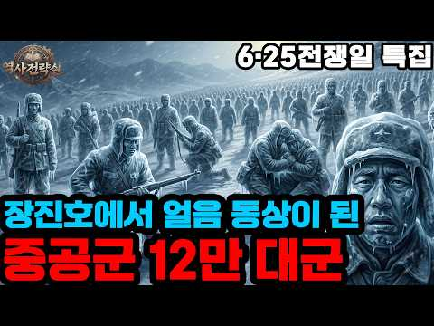
- 챕터: 0:00 승리에 도취된 사령부, 덫에 빠진 미군 · 5:14 영하 40도, 무기마저 파괴한 극한의 추위 · 8:01 스미스 장군의 선견지명: 하갈우리 임시 활주로 건설 · 8:20 12만 대군의 기습과 톡동고개 여우 중대의 사투 · 10:16 "퇴각이 아니다!" 불가능을 뚫는 능선 쟁탈전 · 20:58 절망의 수문교, 하늘에서 떨어진 강철 다리 · 23:27 얼음 동상이 되어버린 중공군의 비극 · 25:17 흥남 부두, 10만 명을 살려낸 크리스마스의 기적
- 설명 앞부분: 1950년 겨울, 영하 40도의 장진호에서 미 해병대 1만 5천 명은 12만 명의 중공군 최정예 부대에게 완벽히 포위당했습니다. 맥아더 사령부의 오만함이 부른 절망적인 위기 속에서, 살인적인 추위와 압도적인 적의 인해전술을 뚫고 나온 올리버 스미스 장군의 천재적인 전술과 병사들의 처절한 사투를 조명합니다. 인류 전쟁사상 가장 기적적인 포위망 돌파 작전이자 적의 주력을 궤멸시킨 핏빛 역사를 역사 전략실에서 파헤쳐 봅니다. 타임라인: 로이 애플먼 (Roy E. Appleman), 『East of Chosin: Entrapment an…
- 같은 채널 평소 대비 ×26.4 (채널 최근 롱폼 중앙값 8,108회) · 평소 영상: 손톱과 머리카락을 남기고 떠난 75명의 청춘들, 맹호부대 특공결사대의 핏빛 15일 #안케… (8,605회) / 100만 대군을 찢어버린 4만 7천의 기적, 가우가멜라 전투의 소름 돋는 전술 #세계사 … (7,612회)
- 대본 없음 (설명) — 음성인식이 끝나면 도입부·흐름이 들어감
- 댓글 514/514: 좋은 점 — 영상 1 · 감사·응원 73 · 더 알고 싶은 것 2 · 아쉬운 점 — 영상 2 · 반박·불만 — 의견 다름 7 · 정치·사회 43 · 경험 공유 10 · 구독·다음 기대 0
  - 감사·응원 👍314 “미군 병사들 너무 감사합니다. 당신들이 있었기에 오늘날 대한민국이 있습니다.”
  - 감사·응원 👍278 “625전쟁때 희생하신 미군장병들께 깊이 감사합니다 부디 천국에서 행복을 누리시길 바랍니다”
  - 더 알고 싶은 것 👍59 “국방부의 항미원조를 인정하는듯한 작금의 태도를 국민은 어떻게 해석해야하는지 ???? 진짜 걱정입니다 ....”
  - 더 알고 싶은 것 👍0 “26분37초 지도 표기 SEA OF JAPAN? 언제부터 동해가 일본해가 됐죠? 보기 안좋네요. 역사 관련 영상에 큰 오류 같네요.”
  - 아쉬운 점 — 영상 👍1 “당시 무조건 북진하지 말고 한반도에서 동서라인이 가장 짧은 안주, 원산 라인에서 진격 멈추고 중공군과 일전을 벌였어야 하는데, 맥아더가 상황을 너무 안이하게 판단한 잘못이 두고두고 아쉽네요. 그 이후도 휴전선 부근에서 일진일퇴의 고지전만을 전개할 것이 아니라, 원산,…”
  - 아쉬운 점 — 영상 👍0 “북괴도 무리하게 낙동강을 넘어 설려다 후방을 소흘히 하고 지키지 못해 작전을 허용했듯이 하여간 욕심이 지나치면 안된다는 평범한 진리를 외면한 채 미국이 병법을 모르고 자만감에 무작정 밀고 올라간게 큰 실수였음. 쥐도 도망갈 구멍을 만들어 주면서 쫓고 바둑에서도 아생연…”
  - 반박·불만 — 의견 다름 👍7 “다좋은데 어이없게 피난민속에 죄인이가 있었다는거😢”
  - 반박·불만 — 의견 다름 👍0 “와 그걸 맥아더의 오만한 오판으로 몰고 가다니 ㅎㄷㄷ 당시 미군이 중공군을 이길 수 없어서 북한지역을 다 내준 거라 생각하는 사람은 아무 것도 모르는 것임. 한국전쟁 때 미군은 융단폭격이라는 것을 밥멋듯 했었는데, 이것은 하늘이 새까맣게 보일 정도로 셀 수도 없이 많…”
  - 정치·사회 👍96 “미군들의 수많은 희생이 있었기에 이나라가 자유를 지킬 수 있었습니다. 감사합니다 이것을 잊으면 인간도 아니고 나라도 아니다”
  - 정치·사회 👍15 “모든 일에는 반드시 비주류의 이야기에 한번은 귀를 기울여야 한다. 운동, 선거, 사업, 전쟁 모두 같다.”
  - 경험 공유 👍81 “남의 나라에 와서 이렇게 희생되고 고생을 하고 돈을 쏟아 붓고 믿어지지 않아요 우리도 남을 위하여 이렇게 전쟁을 해봤던가요 ?? 감사합니다 고맙습니다”
  - 경험 공유 👍10 “그동안 내가 알던 장진호 전투보다 훨씬 열악하고 치열 했네요. 자유를 위해 고생하고 죽어가신 분들께 감사드립니다. 스미스소장은 원예학과 출신이고 매러디스 빅토리아호 선장님은 기적을 체험하시고 후에 종교인이 되셨습니다”

### 337. 어머니를 잃고 복수를 위해 입궁한 천재 여의,목욕탕에서 만난 남자가 세자였다…“봤으니 책임질게.”#숏드 #로맨스 사극

- https://www.youtube.com/watch?v=iiA2zhl7rLA · 심쿵방송 · 구독자 12,600 · 조회수 241,235 (×19.1, 하루 1,394.5) · 좋아요 913 (0.4%) · 333.2분 · 2026-05-08 · 주제 묶음 3. 조선 · 형식 정보·해설 (그 밖) · 폴더 `W_iiA2zhl7rLA` (웹 승인)
- 썸네일: 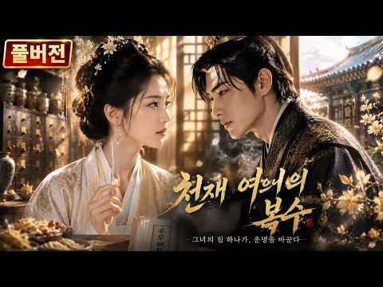
- 설명 앞부분: 여의의 성장기∣Rise of Her Lady Physician∣女医进击录 한 건의 억울한 사건으로, 영택란은 홀로 궁궐 깊숙이 뛰어들어 남성 세력이 판을 치는 태의원에서 자신의 길을 열어가리라 다짐한다. 남자 의관들의 비웃음과 경멸 속에서, 그녀는 오로지 의술만을 무기로 역경을 헤쳐 나간다. 황태자를 치료하고, 태후를 구하며, 전염병을 진압하는 등 세상을 구한 공을 인정받아 마침내 당대 최초의 여관이 된다. 그렇게 그녀는 경멸하던 자들을 무릎 꿇게 하고, "여성도 권력의 자리에 당당히 앉는다"는 역전의 전설을 써 내려간다. Due…
- 같은 채널 평소 대비 ×15.7 (채널 최근 롱폼 중앙값 15,407회) · 평소 영상: 【THE END】도골을 빼앗기고 파혼당한 천재 검객, 다시 깨어나 세상을 뒤흔들다! ∣ … (15,407회) / 【5】도골을 빼앗기고 파혼당한 천재 검객, 다시 깨어나 세상을 뒤흔들다! ∣ 독검구천 ∣… (27,176회)
- 대본 없음 (설명) — 음성인식이 끝나면 도입부·흐름이 들어감
- 댓글 75/82: 좋은 점 — 영상 0 · 감사·응원 1 · 더 알고 싶은 것 1 · 아쉬운 점 — 영상 1 · 반박·불만 — 의견 다름 1 · 정치·사회 3 · 경험 공유 2 · 구독·다음 기대 0
  - 감사·응원 👍1 “와 악역 전문으로 하는 언니가 여주가 되다니! 언니 응원해요!! 언니 독기로 다 잡아먹어버렷!”
  - 아쉬운 점 — 영상 👍8 “자막이 다른 글자와 겹쳐서 보기가 어렵다는 점이 조금 아쉽네요”
  - 반박·불만 — 의견 다름 👍5 “대장금이네요 설마 중국의 창작물이라고 우길건 아니죠?”
  - 정치·사회 👍0 “중국인들처럼 작품속의상들도 개판 쪽수는 많은데 쓸만한작품이 없다.중국산은 허접 그 잡채 ㅋㅋ 사극을 개콘으로 만드는 재주가 뛰어나다....”

### 338. 400년 전 명나라에서 건너온 성씨들, 지금 10만 명입니다

- https://www.youtube.com/watch?v=hjoWlvuU9AA · 교과서엔 없는 역사 · 구독자 38,300 · 조회수 711,231 (×18.6, 하루 4,044.4) · 좋아요 5,259 (0.7%) · 9.9분 · 2026-05-05 · 주제 묶음 6. 동양사 (중국·일본·몽골) · 형식 사연·드라마 · 폴더 `W_hjoWlvuU9AA` (웹 승인)
- 썸네일: 
- 챕터: 0:00 10만 한국인의 뿌리, 임진왜란 · 0:29 전쟁 후 조선에 남은 사람들 · 1:00 임진왜란 귀화 5대 성씨 대공개 · 1:17 비극의 해주 석(石)씨, 조선을 구하고... · 2:43 이순신과 싸운 장수의 후손, 진(陳)씨 · 3:45 시성 두보 후손, 고국을 그리워하다 · 5:06 본관에 새긴 고국, 절강 편(片)씨 · 6:45 10만 후손의 시작, 영양 천(千)씨 · 8:48 400년의 시간, 명나라에서 한국인으로
- 설명 앞부분: 대한민국에 살고 있는 수많은 성씨들. 그중에는 조선시대 거대한 전란 속에서 바다를 건너와 이곳에 뿌리를 내린 사람들이 있습니다. **임진왜란** 당시 명나라에서 건너와 지금까지 역사를 이어가고 있는 가문들의 사연은 무엇일까요? 이 영상에서는 전쟁 중 파병을 오거나 멸망하는 나라를 등지고 조선으로 망명해 온 **[명나라 귀화 성씨]** 5곳의 기상천외하고 은밀한 정착기를 다룹니다. 조상들의 생생한 발자취를 지금 바로 확인해 보세요. 임진왜란 당시 조선을 구하기 위해 압록강을 건넜던 수많은 **명나라 군인들**. 그러나 그들 중 일부…
- 대본 없음 (설명) — 음성인식이 끝나면 도입부·흐름이 들어감
- 댓글 790/816: 좋은 점 — 영상 2 · 감사·응원 15 · 더 알고 싶은 것 12 · 아쉬운 점 — 영상 4 · 반박·불만 — 의견 다름 14 · 정치·사회 79 · 경험 공유 32 · 구독·다음 기대 0
  - 좋은 점 — 영상 👍2 “좋은 정보 감사합니다~.”
  - 감사·응원 👍155 “갈송 할아버지 17대손입니다 이렇게 다뤄주시니 감사하네요! 절강편씨는 원래 이씨입니다 당나라 황실 후예입니다 명나라 황제가 후궁에 빠져 나라가 도탄에 빠지자 충절의 상소문을 올려 옥에 갇히게 되었는데 일편단심 4글자를 황제에게 올려서 황제가 감복하여 옥에서 풀려나 일…”
  - 감사·응원 👍81 “훌륭하고고마운후손분들이네요 고맙습니다”
  - 더 알고 싶은 것 👍4 “그냥 명 식민지 조선이 일본 공격 받으니 조선이라는 재산 지키느라 싸운거지 영웅화 오ㅈ네 조선이 명에게 바치던 공물과 공녀 노비도 소개해주세요”
  - 더 알고 싶은 것 👍3 “안동댐강간범은 어떻게 되나요?”
  - 아쉬운 점 — 영상 👍2 “소위 상놈의 성씨라고 알려진 천방지추마골피. 가장 잘못 알려진 헛소리입니다. 이순신 장군의 부인이 지씨였는데 그러면 이순신 장군이 상놈의 집안과 혼인을 했다는말이 됩니다. 천씨는 명나라 장수의 후손으로 조선에서 높은 관직을 지냈습니다. 그런데도 상놈의 성씨라고 한다면…”
  - 반박·불만 — 의견 다름 👍23 “근데 웃기는건 명나라를 중국으로 알고있다는거. 상고시대 이후 중국한족은 없어. 실체가없는 허상이 바로 한족이야. 죄다 북방 유목왕조들이야.”
  - 반박·불만 — 의견 다름 👍2 “소위 상놈의 성씨라고 알려진 천방지추마골피. 가장 잘못 알려진 헛소리입니다. 이순신 장군의 부인이 지씨였는데 그러면 이순신 장군이 상놈의 집안과 혼인을 했다는말이 됩니다. 천씨는 명나라 장수의 후손으로 조선에서 높은 관직을 지냈습니다. 그런데도 상놈의 성씨라고 한다면…”
  - 정치·사회 👍155 “갈송 할아버지 17대손입니다 이렇게 다뤄주시니 감사하네요! 절강편씨는 원래 이씨입니다 당나라 황실 후예입니다 명나라 황제가 후궁에 빠져 나라가 도탄에 빠지자 충절의 상소문을 올려 옥에 갇히게 되었는데 일편단심 4글자를 황제에게 올려서 황제가 감복하여 옥에서 풀려나 일…”
  - 정치·사회 👍10 “제 성씨는 할아버지 말씀으론 송나라때 사신으로 왔는데 나라가 남쪽으로 밀려나는 바람에 돌아갈 길이 없어져서 그대로 귀화했다고 했네요 그리고 조상들 중에 서예가, 의병, 현감, 조정에서 일했던 분들도 계셨는데 못난 후손인 저는 그냥 집에 앉아서 유튜브나 보고 있습니다😂”
  - 경험 공유 👍76 “무지했던 사람들이 천씨를 비하했었죠... 명문가 입니다...”
  - 경험 공유 👍9 “내가 군생활 할때 우리 소대 휘귀성 집합소 편해근,봉일청,동성호,선우정,선씨가 아니고 선우씨임”

### 339. "정약용이 인정한 조선 후기 1위?" 역사 자체를 바꿀 수 있었던 최고의 천재

- https://www.youtube.com/watch?v=Z37l5sHivjA · 한국사 다시읽기 · 구독자 28,700 · 조회수 526,045 (×18.3, 하루 6,413.9) · 좋아요 6,157 (1.2%) · 24.3분 · 2026-08-07 · 주제 묶음 1. 역사 일반·이야기 · 형식 브이로그·직접 해본 이야기 · 폴더 `W_Z37l5sHivjA` (웹 승인)
- 썸네일: 
- 챕터: 0:00 🎙️ 오프닝 ∣ 정약용이 '귀신'이라 부른 사나이 · 1:39 📜 나모전 사건 ∣ 정약용을 무너뜨린 글자 하나 · 4:47 ✍️ '지이' 두 글자 ∣ 시험장에서 벌어진 일 · 6:05 🌙 소동파 시구 ∣ 남의 마음까지 읽어내다 · 10:29 🔭 서학과 천문·수학 ∣ 시대를 앞선 지성과 정조의 … · 16:47 🛡️ 무너진 방패 ∣ 정조의 죽음과 신유박해 · 19:02 🕯️ 지워진 이름 ∣ 옥중의 최후
- 설명 앞부분: 🎬 "내가 죽으면 조선의 미래는 끝난다" — 정약용이 '귀신'이라 불렀던 후기 원탑 천재 ⏱️ 타임라인 📚 참고 자료 『조선왕조실록』(정조실록·순조실록), 『일성록』 성대중, 『청성잡기』 / 황사영, 「백서」 — 당대 인물평 한국민족문화대백과사전(이가환·이익), 국사편찬위원회 우리역사넷, 한국고전종합DB ⚠️ 안내 본 영상의 일부 이미지는 생성형 AI로 제작되었으며, 실제 역사 속 인물과 장면의 모습과는 다를 수 있습니다. 시청에 참고해 주세요. 🙏
- 같은 채널 평소 대비 ×91.3 (채널 최근 롱폼 중앙값 5,761회) · 평소 영상: '최대 1000명 숙청...' 남인의 핵심 정약용은 왜 살려둔 걸까? (5,761회) / "철의 여인 정희왕후" 세조의 아내가 조선 최고의 대모인 이유 (5,944회)
- 대본 없음 (설명) — 음성인식이 끝나면 도입부·흐름이 들어감
- 댓글 557/567: 좋은 점 — 영상 5 · 감사·응원 12 · 더 알고 싶은 것 3 · 아쉬운 점 — 영상 5 · 반박·불만 — 의견 다름 10 · 정치·사회 57 · 경험 공유 11 · 구독·다음 기대 2
  - 좋은 점 — 영상 👍5 “좋은 내용 감사합니다. 그림에 신발 신은 모습이 아쉽습니다. 버선 신은 모습이었으면 합니다. ^^;”
  - 좋은 점 — 영상 👍3 “역사 공부 잘 배웠습니다”
  - 감사·응원 👍139 “조선의 귀한 인물을 알게 하셔서 감사합니다.”
  - 감사·응원 👍67 “와우.. 그 정약용조차 경악하던 천재라니 놀랍네요. 이런 사람을 알게되어 감사합니다.”
  - 더 알고 싶은 것 👍8 “최고입니다 이런 역사얘기 많이올려주세요 ^^”
  - 더 알고 싶은 것 👍1 “당시 백성들은 왕이 바뀌면 어떻게 느꼈을까요?”
  - 아쉬운 점 — 영상 👍5 “좋은 내용 감사합니다. 그림에 신발 신은 모습이 아쉽습니다. 버선 신은 모습이었으면 합니다. ^^;”
  - 아쉬운 점 — 영상 👍0 “정약용은 이가환을읆엇다 사질뻔한천재르남김🎉🎉🎉❤❤❤”
  - 반박·불만 — 의견 다름 👍29 “요즘 인공지능에 비할 천재인듯.. 아까운 인재가 서학의 괴수라는 누명으로 고문받다 고통스럽게 옥사. 이런 천재의 .어이없는 죽음이 간신배들의 모략이었음이 안타까움을 넘어 조선역사의 어마어마한 손실이 되었네요. .. 천재는 천재를 알아본다고 이가환 정약용같은 인물들이 …”
  - 반박·불만 — 의견 다름 👍1 “대한민국은 식민사관과 반국가세력들에 의한 민족의 역사와 정체성을 왜곡선동에 의해 거짓속에서 몇세대가 살아왔습니다. 허울좋은 간판에 집착하고 실제를 모른채 암기하고 자격증따고 학위받았으나. 진짜실력을갖춘사람들을 내쳤지요 그래서 힘든 대한민국이지만 진실에 이끌려 나라를 …”
  - 정치·사회 👍195 “이가환이 어떤 인물인지 처음 알고 탄식이 나옵니다. 지금도 시대에 저항하는 족속들이 나라의 녹을 먹으며 고개를 빧빧히 들고 삽니다. 우리 사회가 외국인들이 말하듯 부러운 사회인지 의심하지 않을 수 없습니다.”
  - 정치·사회 👍84 “조선중후기 실학적인 남인이 계속 정권을 잡았다면 한국역사는 완전히 달랐을텐데..노론의 이름은 민족의 역사에서 근본주의 패거리이익 우물안개구리 어리석음 무능력..으로 영원히 기록되고 타산지석으로 삼아야한다.”
  - 경험 공유 👍17 “지금도 그래. 좌우로 나뉘어 서로 죽일듯이 물고 뜯으니, 국가적 에너지 낭비가 너무 심하다. 니가 죽어야 내가 사는 이 구조를 뜯어 고치지 않으면 대한민국 성장 엔진도 꺼질 것. 국민들이 먼저 깨어야 한다. 당리당략보다 국가를 위해 옳은 말을 하고 옳은 정치를 하는 …”
  - 경험 공유 👍4 “이가환을 아냐구요? 내가 아는 천재중에 최고였어요.”
  - 구독·다음 기대 👍3 “참 좋은 체널입니다. 구독합니다”
  - 구독·다음 기대 👍0 “이 채널을 통해 귀한 사실을 알게되네요. 정조대왕이 좀 더 오래 살았다면 조선의 운명이 바뀌었을텐데… 😢 앞으로 채널의 활약이 기대됩니다! 구독하고 갑니다 👍👍👍”

### 340. "조선 최고의 천재다" 전세계가 세종대왕이 만든 한글을 극찬하는 이유

- https://www.youtube.com/watch?v=T2Z6frSqJrs · 한반도 백과사전 · 구독자 5,070 · 조회수 92,888 (×18.3, 하루 4,356.6) · 좋아요 500 (0.5%) · 19.5분 · 2026-10-07 · 주제 묶음 3. 조선 · 형식 정보·해설 (그 밖) · 폴더 `W_T2Z6frSqJrs` (웹 승인)
- 썸네일: 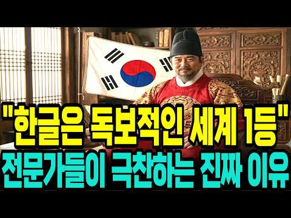
- 챕터: 0:00 500년 만에 발견된 설계도의 비밀 · 1:00 훈민정음 해례본, 왜 특별할까? · 2:20 사람의 몸에서 탄생한 자음 · 3:41 모음은 세상의 이치를 담았다? · 5:44 한글이 세계 최고인 진짜 이유 · 7:16 세종대왕은 왜 혼자 창제했나? · 11:08 백성을 향한 세종의 고집 · 13:06 어떻게 우리 글자가 되었을까? · 14:54 우리가 한글날을 기념하는 이유 · 15:53 디지털 시대의 천재적 설계 · 17:39 잘못 알려진 한글의 기록들 · 18:23 한글, 우리 삶을 바꾼 위대한 힘
- 설명 앞부분: 🇰🇷세종대왕은 왜 하필 28자로 만들었을까? 세계 언어학자들이 한글을 극찬하는 진짜 이유 1940년 안동에서 마침내 모습을 드러낸 『훈민정음 해례본』은 한글이 사람의 발음 기관을 본떠 철저히 공학적으로 설계된 문자라는 사실을 세상에 알렸습니다. 1443년 창제 이후 450년 동안 백성들의 삶과 문화 속에 깊이 스며든 한글은, 1894년 고종의 칙령 제1호(공문식 제14조)를 통해 마침내 한반도의 정식 공용 문자로 선포되는 역사적 반전을 맞이합니다. 세계적 학자인 재레드 다이아몬드와 제프리 샘슨이 "인류가 만든 가장 독창적이고 완벽…
- 같은 채널 평소 대비 ×4.8 (채널 최근 롱폼 중앙값 19,549회) · 평소 영상: "한글날 100주년의 위대함" 외국인들이 줄 서서 한글을 배우는 진짜 이유 (19,549회) / “속도와 성질머리로 성공한 민족” 전세계 학자들이 분석하고 극찬한 한국의 진짜 성공 이유 (19,442회)
- 대본 없음 (설명) — 음성인식이 끝나면 도입부·흐름이 들어감
- 댓글 28/28: 좋은 점 — 영상 1 · 감사·응원 1 · 더 알고 싶은 것 0 · 아쉬운 점 — 영상 0 · 반박·불만 — 의견 다름 0 · 정치·사회 2 · 경험 공유 0 · 구독·다음 기대 0
  - 감사·응원 👍5 “참으로 대단한 어르신 입니다 세종대왕님 정말 감사합니다~ 잘 설명해주신걸 들으니 가슴이 뜨거워지는 느끼이네요~ 감사합니다 ~”
  - 정치·사회 👍0 “세종대왕 릉이 미국에 있습니다. 조선 임금님이 계신 한양이 워싱턴 디씨였고 중국이였다 일월오봉도 배경이 워싱턴 디씨 포토맥강이 조선의 한강 임진왜란은 미국에서 전쟁이었다 홍무정운 아메리카 대조선, 57, 아메리카 사도세자 저자 박인수 조지 워싱턴 = 사도세자 토마스 …”

### 341. 1시간이면 완벽 이해 조선왕조실록 1대부터 27대까지 몰아보기ㅣ건국부터 멸망까지 한번에 자면서 들으세요

- https://www.youtube.com/watch?v=YfPUeVAhmfw · 한밤의 한국사 · 구독자 47,800 · 조회수 869,281 (×18.2, 하루 7,246.9) · 좋아요 8,016 (0.9%) · 69.5분 · 2026-06-30 · 주제 묶음 3. 조선 · 형식 수면·낭독 (잠잘 때 듣는) · 폴더 `W_YfPUeVAhmfw` (웹 승인)
- 썸네일: 
- 챕터: 0:00 오프닝 – 27명의 임금, 519년의 드라마 · 0:56 건국 – 이성계와 정도전 · 9:22 형제의 피로 쌓은 왕좌 – 태종 · 15:36 조선의 황금기 – 세종 · 21:25 빼앗긴 왕좌 – 단종과 세조 · 27:25 폭군과 개혁가 – 연산군과 조광조 · 32:41 임금이 도망친 전쟁 – 선조와 임진왜란 · 37:56 능력 있는 왕의 몰락 – 광해군 0 · 42:27 임금이 무릎 꿇은 날 – 인조와 병자호란 · 47:44 마지막 르네상스 – 영조와 정조 · 52:54 왕이 사라진 시대 – 세도 정치 · 57:52 저무는 나라 – 고종과 개항 · 63:10 500년의 끝 – 대한제국 멸망
- 설명 앞부분: 조선의 임금 스물일곱 명 중, 제 명에 편히 눈감은 왕은 과연 몇이나 될까요? 1392년 이성계의 건국부터 1910년 대한제국의 멸망까지, 519년 조선 왕조의 흥망성쇠를 단 한 편에 담았습니다. 형제를 죽인 왕, 조카의 왕좌를 빼앗은 왕, 아들을 뒤주에 가둔 왕, 전쟁 앞에서 백성을 버린 왕, 적장 앞에 무릎 꿇은 왕, 그리고 끝내 나라를 빼앗긴 왕까지. 조선 27명의 임금이 내린 선택이 어떻게 나라의 운명을 갈랐는지, 조선 역사 전체를 처음부터 끝까지 따라가 봅니다. 조선 건국과 정도전의 설계, 세종의 황금기, 단종과 세조의 …
- 같은 채널 평소 대비 ×12.4 (채널 최근 롱폼 중앙값 70,008회) · 평소 영상: 한국사 총정리 몰아보기ㅣ고조선부터 대한민국까지 5000년 풀스토리ㅣ자면서 들으세요 (70,008회) / 신선이라 불린 조선의 괴짜 홍유손의 놀라운 비밀 (73,357회)
- 대본 없음 (설명) — 음성인식이 끝나면 도입부·흐름이 들어감
- 댓글 126/133: 좋은 점 — 영상 8 · 감사·응원 27 · 더 알고 싶은 것 1 · 아쉬운 점 — 영상 1 · 반박·불만 — 의견 다름 0 · 정치·사회 7 · 경험 공유 2 · 구독·다음 기대 2
  - 좋은 점 — 영상 👍88 “휴가3일 내내 영상봅니다. 세종대왕의 마누라 신빈 김씨 돌아가신 년도까지 외워지네 방금 고려역사 1시간40분짜리 정주행후 잘시간에 또 봅니다. AI목소리가 듣기 좋아요”
  - 좋은 점 — 영상 👍30 “단종부터 시작하여 조선의 역사공부를 계속하며 여기까지 왔습니다.들어온 내용들이 이로써 정리가 잘 되는 큰깨달음에 깊은 감사드립니다.~”
  - 감사·응원 👍30 “단종부터 시작하여 조선의 역사공부를 계속하며 여기까지 왔습니다.들어온 내용들이 이로써 정리가 잘 되는 큰깨달음에 깊은 감사드립니다.~”
  - 감사·응원 👍27 “역사의 흐름을 알게 해주셔서 감사합니다”
  - 더 알고 싶은 것 👍2 “조선왕들 중에 제대로된 왕이 몇명이 될까요 ? 썩은왕이 매우 많은듯”
  - 아쉬운 점 — 영상 👍88 “휴가3일 내내 영상봅니다. 세종대왕의 마누라 신빈 김씨 돌아가신 년도까지 외워지네 방금 고려역사 1시간40분짜리 정주행후 잘시간에 또 봅니다. AI목소리가 듣기 좋아요”
  - 정치·사회 👍20 “기가 막힌 우리 이씨조선의 역사를 아픈 마음으로 다 봤고 힘이 없는 나라는 굴욕의 종알이 온다는 것 그래서 우리는 언제나 힘을 길러야 합니다 나와 너 여와 야 그런 모든 것 위에 내나라가 강대국으로 버티고 있어야 하는 것이 절체절명의 진리!!!! 오직 대-한-민-국 …”
  - 정치·사회 👍4 “나라가 너무썩었음 리셋코리아”
  - 경험 공유 👍3 “빠진 임금도 있지만 나름 연대별로 조선왕의 공과를 잘 들었습니다. 1910.8.29 한일합방되어 35년간의 일제강점기 거쳐 스스로의 힘(일부는 인정)이 아닌 외세에 의해 겨우 1945.8.15 독립을 맞이하자 마자 15년간의 좌우 이념 싸움 끝에 하나의 나라 기틀을 …”
  - 구독·다음 기대 👍88 “휴가3일 내내 영상봅니다. 세종대왕의 마누라 신빈 김씨 돌아가신 년도까지 외워지네 방금 고려역사 1시간40분짜리 정주행후 잘시간에 또 봅니다. AI목소리가 듣기 좋아요”
  - 구독·다음 기대 👍3 “역사 공부 세삼스럽습니다. 현제 정치인들은 조선의 역사문화를 기역하고 국민을 위한 정치 기대합니다.”

### 342. 부여 당일치기로 국사책 표지모델 찾아왔습니다 (feat. 제72회 백제문화제) ∣ KOOKIES

- https://www.youtube.com/watch?v=bd5gpHAMqPg · Kookies Box [쿠키스] · 구독자 2,280 · 조회수 41,412 (×18.2, 하루 1,150.2) · 좋아요 38 (0.1%) · 27.8분 · 2026-09-22 · 주제 묶음 1. 역사 일반·이야기 · 형식 인터뷰·강연·대담 · 폴더 `W_bd5gpHAMqPg` (웹 승인)
- 썸네일: 
- 챕터: 0:00 인트로 - 부여로 출발, 버스에서부터 우당탕 · 0:44 오늘의 목적지, 제72회 백제문화제가 열리는 부여 · 1:19 강민 진행비 횡령(?) 사건 · 2:36 오늘의 목적 - 백제금동대향로를 찾아서 · 3:50 부여행 버스 안 벼락치기 (538년 사비 천도, 66… · 4:41 부여중앙시장 먹방 & 굿뜨래페이 체험 · 8:50 국립부여박물관 - 백제금동대향로 실물 영접 · 10:01 해설사님과 함께하는 향로 이야기 (1993년 발굴 비… · 13:40 즉흥 결정, 부소산성으로! · 14:08 백마강 황포돛배 유람선 (낙화암 · 고란사) · 16:27 정림사지 오층석탑 - 홀수 탑엔 이유가 있다 · 19:05 궁남지 - 서동과 선화공주 설화 속으로 · 21:06 저녁 연잎밥정식 & 백제 상식 서바이벌 퀴즈 · 24:31 백제문화제 홍보 & 오늘 하루 소감 · 26:18 정림사지의 밤, 미디어아트로 물든 백제 · 0:00 Intro - Off to Buyeo, chaos s… · 0:44 Today's destination: Buyeo, h… · 1:19 The great "embezzlement" scan… · 2:36 Today's mission - finding the… · 3:50 Cramming Baekje history on th…
- 설명 앞부분: 계획 1도 없이 떠난 부여 당일치기 여행 🚌 그런데 국사책 표지모델(백제금동대향로)부터 정림사지, 백마강 유람선, 궁남지까지 백제의 흔적을 하루 만에 다 만나고 왔습니다 🍂 버스에서 조는 것도 잠시, 해설사님 만나서 제대로 배운 백제 역사 "왜 하필 봉황이에요?" "이게 어떻게 5층이에요?" 쿠키즈의 궁금증 폭발 현장, 지금 확인하세요! 그리고 우리가 부여를 찾은 진짜 이유 한 달 뒤 이곳에서 열리는 진짜 큰 축제, 제72회 백제문화제! 쿠키즈가 하루 동안 미리 체험한 코스, 여러분도 그대로 따라가 보세요 😊 백제의 향연 - 기억…
- 대본 없음 (설명) — 음성인식이 끝나면 도입부·흐름이 들어감
- 댓글 6/6: 좋은 점 — 영상 0 · 감사·응원 0 · 더 알고 싶은 것 0 · 아쉬운 점 — 영상 0 · 반박·불만 — 의견 다름 0 · 정치·사회 0 · 경험 공유 0 · 구독·다음 기대 0

### 343. 아직도 설명할 수 없는 미스터리한 고대 발견 15가지

- https://www.youtube.com/watch?v=mVSr1ixtdfw · Nariman · 구독자 2,700 · 조회수 49,027 (×18.2, 하루 292.0) · 좋아요 383 (0.8%) · 128분 · 2026-05-13 · 주제 묶음 8. 문명·고고학 · 형식 정보·해설 (그 밖) · 폴더 `W_mVSr1ixtdfw` (웹 승인)
- 썸네일: 
- 설명 앞부분: 고대 세계는 우리가 생각하는 것보다 훨씬 더 복잡하고, 때로는 믿기 어려울 만큼 신비로운 흔적을 남겼습니다. 이 영상에서는 아직도 명확하게 설명되지 않은 미스터리한 고대 발견 열다섯 가지를 따라가 봅니다. 정체를 알 수 없는 유물, 이해하기 어려운 고대 건축물, 사라진 문명이 남긴 흔적, 그리고 현대 과학으로도 완전히 풀리지 않은 수수께끼까지. 이 발견들은 단순한 오래된 유물이 아닙니다. 인간의 역사, 고대 기술, 잊힌 문명, 그리고 우리가 아직 모르는 과거의 비밀을 다시 생각하게 만드는 단서들입니다. 고대 문명은 정말 우리가 아…
- 같은 채널 평소 대비 ×4.7 (채널 최근 롱폼 중앙값 10,494회) · 평소 영상: 아직 풀리지 않은 고대 미스터리들｜고대 문명과 잃어버린 역사의 수수께끼 (11,319회) / 시간의 흐름을 무너뜨린 가장 미스터리한 고고학 발견들 세 시간 몰아보기 (9,670회)
- 대본 없음 (설명) — 음성인식이 끝나면 도입부·흐름이 들어감
- 댓글 5/5: 좋은 점 — 영상 0 · 감사·응원 0 · 더 알고 싶은 것 0 · 아쉬운 점 — 영상 0 · 반박·불만 — 의견 다름 0 · 정치·사회 0 · 경험 공유 0 · 구독·다음 기대 0

### 344. 만들면 곤장 80대? 고려·조선 임금들이 약과를 필사적으로 금지했던 진짜 이유

- https://www.youtube.com/watch?v=tK0dcg5wlHQ · 핵쉬운역사 · 구독자 3,680 · 조회수 66,129 (×18.0, 하루 390.4) · 좋아요 1,161 (1.8%) · 21.7분 · 2026-05-12 · 주제 묶음 2. 한국 고대·삼국·고려 · 형식 정보·해설 (그 밖) · 폴더 `W_tK0dcg5wlHQ` (웹 승인)
- 썸네일: 
- 챕터: 0:00 미국 코스트코를 강타한 500만 개의 약과 · 2:00 불교 사찰의 '가짜 고기', 약과의 기원 · 4:00 왜 '약'이라는 이름이 붙었을까? (한방 보양식) · 6:00 고려 귀족들의 사치, 송나라 사신을 놀라게 한 맛 · 8:00 조선 왕실의 필수 의례 음식으로 격상되다 · 10:00 정조의 곤장 80대 명령과 조선식 위선 · 12:00 양과자의 등장과 1000년 사치 본능의 위기 · 14:00 산업화의 그늘, 약과가 사라질 뻔했던 이유 · 16:00 뉴욕타임스가 주목한 한국의 'Honey Cookie' · 18:00 미슐랭 셰프들이 약과를 선택한 이유
- 설명 앞부분: 2024년 미국 코스트코 매대를 휩쓴 '약과' 열풍, 알고 계셨나요? 편의점에서 쉽게 사 먹는 이 달콤한 간식이 사실 한국 역사상 가장 위험한 음식이었다는 사실을 아는 사람은 많지 않습니다. 고려 명종부터 조선 정조까지, 왜 임금들은 약과 제조 금지령을 내리고 곤장 80대라는 가혹한 형벌까지 내렸을까요? 단순한 디저트를 넘어 귀족 권력의 상징이자 왕실의 최고급 진상품이었던 약과의 1000년 역사를 파헤칩니다. 신라 사찰의 '가짜 고기'에서 시작해 미국 뉴욕 미슐랭 레스토랑의 시그니처 디저트가 되기까지, 우리가 몰랐던 약과에 담긴 …
- 같은 채널 평소 대비 ×20.5 (채널 최근 롱폼 중앙값 3,230회) · 평소 영상: 임금님 보양식은 닭이 아니었다? 2,000년 복날의 충격적 진실 (3,230회) / 가난한 나라였는데 왜? 조선 사람들이 식사량 괴물이었던 진짜 이유 (대식 문화) (3,207회)
- 대본 없음 (설명) — 음성인식이 끝나면 도입부·흐름이 들어감
- 댓글 110/110: 좋은 점 — 영상 1 · 감사·응원 1 · 더 알고 싶은 것 0 · 아쉬운 점 — 영상 0 · 반박·불만 — 의견 다름 2 · 정치·사회 5 · 경험 공유 1 · 구독·다음 기대 0
  - 좋은 점 — 영상 👍1 “너무도 유익한 정보와 영상입다 만드시느라 애 쓰셨습니다”
  - 감사·응원 👍2 “몸과 마음은 내가 아니며, 이 세상은 교육을 위한 가상세계다. 나는 몸에 머무는 영혼이고, 마음이 기뻐하고 감사하며 사랑하는 영성산업으로 세계통일하여 기아,난민,전쟁을 종식하자.”
  - 반박·불만 — 의견 다름 👍0 “약과의 가치가 떨어진적은 한번도 없습니다 . 좋은 재료로 만든 약과는 진짜로 비싸서 못사먹을뿐이죠 . 그리고 곤장 80 대 는 양반들의 위선이 아니라 , 미국의 금주령이나 유럽 왕족들의 천민은 감자를 못먹게 하겠다 같은 소리 입니다 ㅋㅋㅋ 허세와 가오잡기용이지 진짜 …”
  - 정치·사회 👍1 “유엔가입국중 제일 가난한 아사자 나라가 싸면서도 당,열량이 높은 밀가루 음식도 없어서 못먹는데 밀가루음식 장려 정책으로 어쩔 수 없이 밀가루 음식을 먹엇다고????? 특히 참기름,꿀의 약과를 정책때문에 어쩔 수 없이 먹을 수 없어 약과가 없어질뻔 햇다고???”
  - 정치·사회 👍0 “이 내용을 디자인과 스토리텔링을 더해서, 약과 포장지에 사용하면, 외국인들이 우리 약과와 우리의 역사와 전통 문화를 다시보는 계기가 될 것 같네요.”
  - 경험 공유 👍2 “몸과 마음은 내가 아니며, 이 세상은 교육을 위한 가상세계다. 나는 몸에 머무는 영혼이고, 마음이 기뻐하고 감사하며 사랑하는 영성산업으로 세계통일하여 기아,난민,전쟁을 종식하자.”

### 345. 숙종이 송시열보다 무서운 진짜 이유 — 조선에서 가장 냉혹했던 왕의 46년

- https://www.youtube.com/watch?v=PPmGCBpYbO4 · 역사빌런 · 구독자 14,900 · 조회수 267,452 (×17.9, 하루 1,627.6) · 좋아요 4,817 (1.8%) · 38.5분 · 2026-05-17 · 주제 묶음 3. 조선 · 형식 정보·해설 (그 밖) · 폴더 `W_PPmGCBpYbO4` (웹 승인)
- 썸네일: 
- 챕터: 0:00 신하가 왕보다 강했던 시대 · 1:30 열세 살의 친정 선언과 신하들의 당황 · 8:00 붕당이라는 전쟁터를 물려받다 · 15:00 숙종이 발명한 정치 — 환국 · 22:00 주역 공부와 숨겨진 의도 · 27:00 장희빈의 아들과 기사환국 · 33:00 정읍의 사약 — 그리고 죽지 않은 유령 · 38:00 냉혹한 군주의 뜻밖의 인간적 면모
- 설명 앞부분: 신하가 왕보다 강했던 나라에서, 열세 살짜리 왕이 아무도 모르게 기다렸습니다. 그리고 때가 됐다 싶은 순간, 조선 최강 송시열에게 망설임 없이 사약을 내렸습니다. 📖 이 영상에서 다루는 내용 칼도 없고 군사도 없이 오직 학문과 명분만으로 왕을 옥죄던 사람. 조선 역사상 유일하게 이름 뒤에 최고의 존칭이 붙은 단 한 명의 신하, 송시열. 그런데 그 송시열에게 사약을 내린 왕이 있었습니다. 열세 살에 즉위해 수렴청정도 거부하고, 아무도 모르게 기다렸다가 때가 됐다 싶은 순간 망설임 없이 칼을 뽑은 사람. 이 왕이 무서운 건 잔인해서가…
- 같은 채널 평소 대비 ×201.5 (채널 최근 롱폼 중앙값 1,327회) · 평소 영상: 김유신은 왜 김춘추를 선택했나? 혼인으로 시작된 신라 최고의 권력동맹 (1,327회) / 흑치상지는 왜 당나라를 선택했나｜백제 부흥군을 이끌던 장수가 당나라 명장이 된 이유 (1,335회)
- 대본 없음 (설명) — 음성인식이 끝나면 도입부·흐름이 들어감
- 댓글 460/463: 좋은 점 — 영상 7 · 감사·응원 8 · 더 알고 싶은 것 2 · 아쉬운 점 — 영상 2 · 반박·불만 — 의견 다름 5 · 정치·사회 42 · 경험 공유 11 · 구독·다음 기대 1
  - 좋은 점 — 영상 👍41 “성리학이건 유교건 그건 사상일뿐 인간생활에 무슨 도움이될까 과학이같이 공존해야한다”
  - 좋은 점 — 영상 👍8 “역사빌런님. 송시열님 피를 이어받은 제가 송시열을 아는 것은 임무여요. 그 시대로 갈 수 있게 도와주시니 고맙습니다. 좋은 영상으로 잘 배울께요. 감성편지 드림.”
  - 감사·응원 👍8 “역사빌런님. 송시열님 피를 이어받은 제가 송시열을 아는 것은 임무여요. 그 시대로 갈 수 있게 도와주시니 고맙습니다. 좋은 영상으로 잘 배울께요. 감성편지 드림.”
  - 감사·응원 👍3 “좋은 영상 감사합니다”
  - 더 알고 싶은 것 👍6 “동인과 서인의 시작도 설명해주시면 좋을 것 같습니다. 영상 잘 봤습니다^^”
  - 아쉬운 점 — 영상 👍4 “다 좋은데 중간 광고가 너무 많아서 정말 성가시네요”
  - 아쉬운 점 — 영상 👍0 “군권 장악에 대한 내용이 빠져서 무척 아쉽습니다.”
  - 반박·불만 — 의견 다름 👍1 “송시열. 님이 틀렸다..”
  - 반박·불만 — 의견 다름 👍1 “웃기는 해석이다. 왕권과 신권의 다툼? 어느시대도 똑 같았다. 심지어 정조대왕조차도..”
  - 정치·사회 👍25 “이슬람 종교국가와 다를바 없는 나라. 결국 신분제와 기득권 유지에 동원된 이념. 전쟁이나 외부 유입없이 그렇게 많은 인구가 노비인 나라가 없다. 동서고금.”
  - 정치·사회 👍8 “율곡과 송시열은 완전히 결이 다른 사람이었습니다. 율곡은 개혁가였지 권력과 명예따위를 탐하던 사람이 아닙니다. 오히려 꼰대 붕당정치를 지적하여 동인과 서인에게 동시에 탄핵을 받아 낙향했던적이 수차례 반복되는 삶을 살았습니다.”
  - 경험 공유 👍49 “송시열의 마지막 사약 받는 장면이 잘못 되어 있습니다. 송시열은 자신에게 사약이 내려졌다는 것을 승복 못하고 계속 거부하고 이방저방으로 도망가는 것을 잡아다가 강제로 먹인 것이 사실입니다. 평소에는 그렇게 곧은 선비인 것처럼 굴다가 마지막 죽음 앞에서는 각종 본성이 …”
  - 경험 공유 👍31 “저도 최근에야 숙종에 대해서 좀 알게된듯... 대단한 왕이었음...”
  - 구독·다음 기대 👍1 “구독하고 자주 들려 영상 보겠습니다. 감사합니다”

### 346. 《삼국지》 사마의, 왜 그는 천하를 얻고도 가문이 멸문지화를 당했나? l 역사 인물 l 고전

- https://www.youtube.com/watch?v=0gnfP3KZ31E · 동양사 이야기 · 구독자 16,500 · 조회수 290,876 (×17.6, 하루 2,305.0) · 좋아요 3,176 (1.1%) · 46분 · 2026-06-24 · 주제 묶음 6. 동양사 (중국·일본·몽골) · 형식 정보·해설 (그 밖) · 폴더 `W_0gnfP3KZ31E` (웹 승인)
- 썸네일: 
- 설명 앞부분: 삼국지의 숨은 주인공 사마의 가문이 천하를 통일하고도 결국 멸망할 수밖에 없었던 비극적인 이유를 아시나요? 권력에 대한 끝없는 야망과 배신 그리고 무능한 후계자 선택이 불러온 파멸의 역사를 통해 진정한 국정 운영의 교훈을 함께 알아보세요.
- 같은 채널 평소 대비 ×13.5 (채널 최근 롱폼 중앙값 21,604회) · 평소 영상: 《삼국지》 제갈량보다 똑똑해서 죽었다고? 제갈씨 가문을 멸망시킨 천재의 비극적인 몰락 l… (21,604회) / 《중국 역사》 당신이 명나라 황제로 환생한다면? 정통제 주기진의 파란만장한 일대기 l 역… (21,143회)
- 대본 없음 (설명) — 음성인식이 끝나면 도입부·흐름이 들어감
- 댓글 85/85: 좋은 점 — 영상 2 · 감사·응원 0 · 더 알고 싶은 것 0 · 아쉬운 점 — 영상 0 · 반박·불만 — 의견 다름 1 · 정치·사회 9 · 경험 공유 1 · 구독·다음 기대 0
  - 좋은 점 — 영상 👍1 “너무 유익합니다❤❤❤❤❤”
  - 좋은 점 — 영상 👍1 “유익한데... 기껏해야 한국 정치 뉴스 관련된 수다 듣고 있는 자칭 애국노인들이 소화하기에는 어려운 내용입니다. 잘 봤습니다.”
  - 반박·불만 — 의견 다름 👍1 “글쎄요. 이런 식으로 따지면 지구 상에 성공만 한 가족이 있나요 ? 성실패를 따질 땐 그 범위를 특정사건이나 특정인에 국한해야지 않을까요 ?”
  - 정치·사회 👍9 “아니 천하통일하고 황제가 되었는데 멸문지화라니, 역사적으로 어느 나라든지 세월이 가면 망하지 않는 나라가 없고 망하면 대부분 그 황족은 멸문되기 마련인데 사마의 가문만이 아니지. 그리고 사마의의 진나라뿐 아니라 원래 그 쪽 지방의 나라들은 몇 대 못가 단명한 것이 대…”
  - 정치·사회 👍3 “제갈량이 촉의 국력을 파악하고 북벌을 하지않고 국력을 기르며 때를 기다렸다면 위나라가 삼국을 텅일하지 못했을 것이다”

### 347. [리부트] 흑선봉명록 1 ∣ The King's Mystic: Chronicles of Seoha ∣ 조선 판타지 사극

- https://www.youtube.com/watch?v=Enoqsssxx5Y · 로보랩 스튜디오 · 구독자 10,800 · 조회수 185,601 (×17.2, 하루 4,121.7) · 좋아요 1,781 (1.0%) · 22.2분 · 2026-09-13 · 주제 묶음 3. 조선 · 형식 정보·해설 (그 밖) · 폴더 `W_Enoqsssxx5Y` (웹 승인)
- 썸네일: 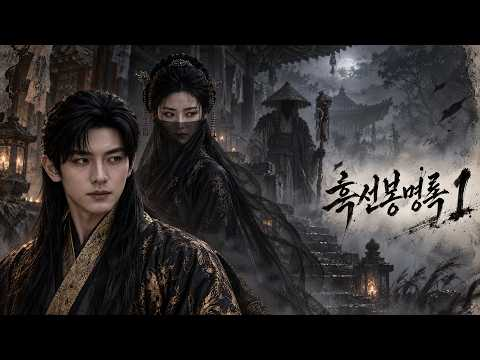
- 설명 앞부분: [설명] 조선의 밤, 죽은 자들이 다시 일어나기 시작한다. 왕명을 받들어 인간의 힘으로는 감당할 수 없는 기이한 사건을 해결하는 봉명방사(奉命方士), 서하. 황해도 곡산에 나타난 시귀들. 그리고 그들을 토벌하기 위해 움직이는 서하와 요괴 토벌 정예부대 암영단. 하지만 서하는 평소와 달리 직접 전투에 나서지 않고, 조용히 모든 것을 지켜보기만 하는데... 《흑선봉명록》의 새로운 시작, 첫 번째 이야기입니다. [AI 제작 / AI Production] 《흑선봉명록》은 다양한 생성형 AI 도구를 활용하여 제작한 AI 기반 실사 판타지 …
- 같은 채널 평소 대비 ×1.5 (채널 최근 롱폼 중앙값 127,735회) · 평소 영상: 흑선봉명록 6화 ∣ 영혼을 모으는 무당 The King's Mystic: Chronicl… (127,735회) / 흑선봉명록 5화｜비극의 시작 ∣ The King's Mystic: Chronicles o… (109,172회)
- 대본 없음 (설명) — 음성인식이 끝나면 도입부·흐름이 들어감
- 댓글 133/144: 좋은 점 — 영상 0 · 감사·응원 8 · 더 알고 싶은 것 3 · 아쉬운 점 — 영상 0 · 반박·불만 — 의견 다름 1 · 정치·사회 2 · 경험 공유 3 · 구독·다음 기대 7
  - 감사·응원 👍29 “정말이지 어쩔수가 없는 프로정신 구독자를 위함이라셔도 좋은 작품에 대한 욕심 또한 대단하신듯 합니다. 건강 상하시지 않는 것이 제일 우선시 되어야 할것 같습니다. 수준 높으신 구독자 분들께선 이런 이유라면 충분히 기다리며 좋은 작품을 기다릴수 있을겁니다. 말이 쓸데없…”
  - 감사·응원 👍7 “아니아니 이럴수가!!! 드디어 1편이!!! 정말 감사합니다. 얼마나 힘드셨을까요... 1편과 함께 4편도 제작했다니... 일단 댓글부터 달고 영상 봅니다. 정말 고생하셨어요. 감사합니다!!!! 🎉😂😊”
  - 더 알고 싶은 것 👍2 “4번 보고 있습니다. 건강 챙겨 가시면서 만들어 주세요..😊😊”
  - 더 알고 싶은 것 👍1 “혹시 이거 썸네일 그림 그록으로 뽑으셨나요?제얼굴처럼 나와서 ㅠ.ㅠ다른게아니라 제가그록으로 제얼굴로 유튜브 영상작업많이했어가지고 그록이 전체서버에 남을수도있다고해서 학습된것같아서 그록으로 생성하신건지 궁금해서 여쭤봅니다 ㅠㅠ 요즘따라 제얼굴이 다른사람들 그록생성작품에…”
  - 정치·사회 👍1 “남녀 주인공들 헤어스타일과 복식을 중국 스타일로 한 게 참 아쉽네요. 그것만 빼면 일반서민들 복식과 관아 사또, 포졸들 그리고 고을 건축양식까지 전부 한국사극 그대로 재현해놓았는데 유일하게 주인공들만 중국인들 데려다 놓은 것처럼 중국스타일의 머리모양과 의복을 해놓은 …”
  - 정치·사회 👍0 “조선 판타지 사극인데.. 주인공이 외모부터 의상까지 너무 중국인 같아요~~ 무비자로 조선 귀화한 화교인가요??”
  - 경험 공유 👍4 “오!제가1등이군요? 잘 보겠습니다”
  - 경험 공유 👍1 “와 디테일 미쳤다리 내가 본것중에 제일이네 왜만해서는 잘한다고 안하는 성격인데 정말 얼마나 노력했을까라는 딱봐도 정말 작품이 너무 디테일하게 잘했어 넘 쪼앙 최고얌”
  - 구독·다음 기대 👍13 “다음편도 기대할께요😊”
  - 구독·다음 기대 👍7 “늘 다음편이 기다려지는 멋진 작품 감사해요”

### 348. 조선야담#2 딸을 머슴에게 시집보내다~ 옛날이야기 민담 잠잘때 듣는 옛날이야기

- https://www.youtube.com/watch?v=HRbSM37fr0E · 조선야사 · 구독자 2,370 · 조회수 40,535 (×17.1, 하루 2,209.1) · 좋아요 379 (0.9%) · 101.8분 · 2026-10-01 · 주제 묶음 9. 야사·야담·옛날이야기 · 형식 수면·낭독 (잠잘 때 듣는) · 폴더 `W_HRbSM37fr0E` (웹 승인)
- 썸네일: 
- 설명 앞부분: 📜 조선 시대의 신비롭고 흥미진진한 야담, 역사 속 숨겨진 이야기, 그리고 전해 내려오는 전통 설화를 전해드립니다. 🏮 우리가 잘 몰랐던 옛이야기 속으로 떠나는 시간 여행에 여러분을 초대합니다. ⏳✨ 과거의 지혜와 재미가 담긴 이야기들을 매일 만나보세요! 🌙🐯
- 같은 채널 평소 대비 ×463.3 (채널 최근 롱폼 중앙값 88회) · 평소 영상: 조선야담🎉 오뉴월 서릿발 같은 여자의 한 이야기모음 #민담 #야담 #고전소설 #옛날이야기 (91회) / 조선야담 🎉애첩의 털과 바꾼 전재산 잠잘때 듣는 옛날 이야기 (91회)
- 대본 없음 (설명) — 음성인식이 끝나면 도입부·흐름이 들어감
- 댓글 7/7: 좋은 점 — 영상 0 · 감사·응원 1 · 더 알고 싶은 것 0 · 아쉬운 점 — 영상 0 · 반박·불만 — 의견 다름 0 · 정치·사회 0 · 경험 공유 0 · 구독·다음 기대 0
  - 감사·응원 👍1 “조선야담~~ ! 잼 있게 보고 있읍니다.고맙읍니다. 흐 흐”

### 349. 📸 역사책에서 찾을 수 없었던 놀라운 순간들 ∣ 희귀 역사 사진들

- https://www.youtube.com/watch?v=BF7Kb1zcVTo · 고대의 메아리 · 구독자 1,040 · 조회수 17,712 (×17.0, 하루 1,486.1) · 좋아요 50 (0.3%) · 7.7분 · 2026-10-11 · 주제 묶음 1. 역사 일반·이야기 · 형식 정보·해설 (그 밖) · 폴더 `W_BF7Kb1zcVTo` (웹 승인)
- 썸네일: 
- 설명 앞부분: 안녕하세요! 희귀한 역사 사진과 잊혀진 과거의 이야기를 전하는 고대의 메아리에 오신 것을 환영합니다. 📸 이 채널에서는 희귀한 역사 사진, 오래된 흑백 사진, 빈티지 이미지, 1900년대의 기록을 통해 우리가 미처 알지 못했던 과거의 순간들을 만나봅니다. 유명한 역사적 사건뿐만 아니라, 평범한 사람들의 일상과 그 시대의 생생한 모습까지 사진으로 살펴봅니다. 📷 이 채널에서 만나볼 수 있는 콘텐츠 쉽게 접하기 어려운 희귀 역사 사진 20세기의 일상과 사람들의 삶 오래된 흑백 사진과 빈티지 이미지 잊혀진 역사적 순간과 숨겨진 이야기 …
- 같은 채널 평소 대비 ×5.4 (채널 최근 롱폼 중앙값 3,259회) · 평소 영상: 📸 실제였다는 게 믿기 힘든 과거의 순간들 (3,259회) / 📸 오래된 사진이 말해주는 진짜 역사 (3,318회)
- 대본 없음 (설명) — 음성인식이 끝나면 도입부·흐름이 들어감
- 댓글 0/0: 좋은 점 — 영상 0 · 감사·응원 0 · 더 알고 싶은 것 0 · 아쉬운 점 — 영상 0 · 반박·불만 — 의견 다름 0 · 정치·사회 0 · 경험 공유 0 · 구독·다음 기대 0

### 350. 아들 못 낳아 쫓겨난 며느리와 조선 시대 복권 '만인계' ∣ 야담 ∣ 옛날이야기 ∣ 민담 ∣ 전설 ∣ 설화 ∣ 야사 ∣ 오디오북

- https://www.youtube.com/watch?v=lOxKrQam1PE · 야담재인 · 구독자 15,800 · 조회수 268,718 (×17.0, 하루 1,509.6) · 좋아요 9,399 (3.5%) · 112.5분 · 2026-05-03 · 주제 묶음 9. 야사·야담·옛날이야기 · 형식 수면·낭독 (잠잘 때 듣는) · 폴더 `W_lOxKrQam1PE` (웹 승인)
- 썸네일: 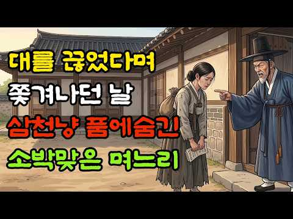
- 설명 앞부분: 아들 못 낳는다고 시집에서 쫓겨난 며느리가 길에서 우연히 산 만인계 표 일등에 당첨되는데... ‘야담재인’은 옛날 이야기를 차분한 낭독 형식으로 전하는 오디오북 채널입니다. 💡이런 분들께 추천합니다! 🎧잠들기 전 편안한 옛날이야기를 듣고 싶은 분 🎧옛날이야기, 야담과 민담, 전설, 설화, 야사를 좋아하시는 분 🎧사랑과 희생이 담긴 감동 이야기, 삶의 지혜를 찾는 분 🎧운전할때나 휴식 시간에 들을 오디오북을 찾는 분 📢 '야담재인' 채널에서 듣고 싶은 옛 이야기를 댓글에 남겨주세요! ※ 본 채널의 영상은 조사하거나 제보 받은 이야기…
- 같은 채널 평소 대비 ×70.6 (채널 최근 롱폼 중앙값 3,807회) · 평소 영상: 노비 취급받던 며느리에게 거상 시아버지가 큰절을? #옛날이야기 #민담 #오디오북 #수면동… (3,924회) / 관아에 끌려갔다 거상되어 돌아온 아들, 부모는 치참하게 아내에게 버려져 있었다. #옛날이… (3,690회)
- 대본 없음 (설명) — 음성인식이 끝나면 도입부·흐름이 들어감
- 댓글 192/194: 좋은 점 — 영상 5 · 감사·응원 18 · 더 알고 싶은 것 1 · 아쉬운 점 — 영상 1 · 반박·불만 — 의견 다름 2 · 정치·사회 2 · 경험 공유 3 · 구독·다음 기대 0
  - 좋은 점 — 영상 👍7 “좋은 말씀 고맙지만 잘듣고. 😂 광고는 정말 싫어요 ㅠ😢”
  - 좋은 점 — 영상 👍7 “잘 듣고 감사합니다 좋은 말씀은 마음속에 간직하겠읍니다 여기는 청도에서 들었읍니다”
  - 감사·응원 👍64 “사람의 값은 가진 것이 아니라 견딘 것에서 나온다는... 인내를 배우기는 했지만 이리도 절실한 말씀은 처음입니다... 고맙습니다 ~”
  - 감사·응원 👍15 “아산보명사 감사합니다 🎉”
  - 더 알고 싶은 것 👍4 “좋은 글에 삽화가 따로따로 심지어 글과 전혀 다른 삽화 신경써서 올려주세요.”
  - 아쉬운 점 — 영상 👍5 “아고 지루해..”
  - 반박·불만 — 의견 다름 👍25 “양반이었다면서 글울 몰라서 당했다고? 말도 안돼”
  - 반박·불만 — 의견 다름 👍11 “모든이야기 집사람을 이름으로 부른다 나는 62년 결혼생활 단한번도 이름 부르지 안앗고 거으ㅣ 반말도 안햇다 부모님께 배웟다”
  - 정치·사회 👍0 “복은 쫒겨나는 길에 따라온다 사람의 값은 견딘것에서 나온 법이다.. 이 글 한준 건진 것으로 이 야감의 가치는 충분하네요. 이재명 대통령이 연상된다..수십년 견디고 지금 꽃을 피우지 않던가? 근데 그냥 할머니 였을까? 하늘이 보낸 선인같으네요..”
  - 정치·사회 👍0 “돈을보고 재혼은 틀림없이 후회합니다. 뻔뻔한짓이 조선족인가”
  - 경험 공유 👍4 “우리집에는 개가4마리 고양이 3마리인데 동물들은 사람을 절대로 미워하지 않읍니다”
  - 경험 공유 👍2 “충청도 어느집 안..저정도 재산.됫는디....1. .며느리.에게... 잘해주엇음...일단.집안사람..😊.먼동내..사람 에게 도...모질게. 안한듯.(수십년지나고..타지.에서..고향분이. 보리고개.어려우면..그집으로...[그래서..아.할아버지.내가.부자구나...음]..…”

### 351. 우리가 알고있던 중국의 역사는 가짜다! 병자호란의 판도를 뒤집는 낯선 진실 ∣ 역사다큐 ∣ 한국사 ∣ 청나라 ∣ 조선시대 ∣ 조선왕조실록

- https://www.youtube.com/watch?v=25MhghC8gwg · 역사의작은그림자 · 구독자 13,000 · 조회수 220,427 (×17.0, 하루 1,437.3) · 좋아요 4,884 (2.2%) · 24.9분 · 2026-05-28 · 주제 묶음 3. 조선 · 형식 정보·해설 (그 밖) · 폴더 `W_25MhghC8gwg` (웹 승인)
- 썸네일: 
- 챕터: 0:00 삼전도의 굴욕, 홍타이지가 뱉은 충격적인 첫마디 🩸 · 1:35 누르하치가 선조에게 보낸 편지 "부모의 나라를 구하겠… · 3:10 조선 개국공신과 만주 벌판, 묘하게 얽힌 두 세계 🐎 · 4:25 청 황실 성씨 '애신각라'에 숨겨진 천 년의 미스터리… · 5:50 청나라 정사 『금사』 첫 줄에 등장하는 낯선 사내, … · 8:15 병자호란은 정복 전쟁이 아니었다? 기록이 말하는 서늘… · 10:40 변발한 청나라 상인 앞, 조선 마부의 기막힌 횡포와 … · 12:00 오랑캐인가, 잃어버린 핏줄인가? 천 년의 미스터리 ⏳
- 설명 앞부분: 쿵. 쿵. 쿵. 삼전도에서 인조가 피를 흘리며 이마를 찧던 날. 대륙의 지배자 청나라 황제가 뱉은 첫마디는 정복의 기쁨이 아닌, 섬뜩한 분노였습니다. "너희는 어찌 동족을 버렸는가." 야만적인 오랑캐인 줄만 알았던 청나라는 임진왜란 때 조선을 '부모의 나라'라 불렀습니다. 게다가 청 황실의 성씨 '애신각라'와 정사 『금사』에 기록된 고려인 '김함보'의 존재는 그들의 뿌리가 한반도에 있음을 천 년 동안 묵묵히 증명하고 있었죠. 📜 우리가 멸시하며 밀어냈던 이민족이, 어쩌면 잃어버린 우리의 절반은 아니었을까요? 병자호란의 판도를 뒤집…
- 같은 채널 평소 대비 ×57.8 (채널 최근 롱폼 중앙값 3,813회) · 평소 영상: 조선이 흉내 낼 수 없던 고려 474년, 그들이 대륙을 차지했던 이유 ∣ 고려거란전쟁 ∣… (3,813회) / 우리가 몰랐던 6.25 남침의 충격적 뒷이야기 57시간동안 무엇을 했나? ∣ 역사다큐 ∣… (3,632회)
- 대본 없음 (설명) — 음성인식이 끝나면 도입부·흐름이 들어감
- 댓글 1,371/1,372: 좋은 점 — 영상 11 · 감사·응원 9 · 더 알고 싶은 것 5 · 아쉬운 점 — 영상 0 · 반박·불만 — 의견 다름 20 · 정치·사회 164 · 경험 공유 26 · 구독·다음 기대 1
  - 좋은 점 — 영상 👍11 “역사에서 가장 이상한게 왜 정복하지않았나인데 이제야 이해가 되네 김씨의 나라 금 청”
  - 좋은 점 — 영상 👍5 “좋은 내용입니다 정말로 우리의 역사를 재정립해야 합니다 이성계의 조선왕조는 우리역사를 완전히 후퇴시킨 중국한족의 제후국으로의 시작이었고 지금도 우리역사학계는 환단고기를 위서라 하며 소중한 우리의 역사를 찾지 않고 있습니다”
  - 감사·응원 👍5 “감사합니다 누르하찌 지나땅은 우리의 고토입니다”
  - 감사·응원 👍5 “김함보의 이주 시기와 청황실의 사료로 보았을 때 맞는 이야기라고 생각합니다. 이런 이야기를 지금이라도 듣고서 저의 역사 인식을 바로잡을 수 있게 되어 감사합니다.”
  - 더 알고 싶은 것 👍5 “그때 조선이 멸망했다면 어떻게 역사가 흘러갔을까요?”
  - 더 알고 싶은 것 👍2 “님 숙종이 단종을. 다시. 왕으로 올린 이유. 동영상 으로. 만들어주세요”
  - 반박·불만 — 의견 다름 👍12 “청나라는 우리 민족인데. 인조는 오랑케라고 비하하다. 개구리가 되었다.. 그때 조선은 싹다 망해 버렸어야 했는데.. 아쉽다..그후 명나라를 제조지은의 나라라고 사대하면서 소중화라고 하는 어이없는 민족성..”
  - 반박·불만 — 의견 다름 👍6 “조선왕조 실록에도 이성계의 고향기록을 검증해보면 한반도 아닙니다. 합빈. 하얼빈입니다… 좀 공부좀해보시고 올리시지… 식민사관에 젖은 동영상…”
  - 정치·사회 👍284 “우리나라가 republic of josun이 아니라 republic of korea란걸 알아야한다. 우리 대한민국의 뿌리는 고려, 고구려인 korea다. 조선은 나라도 아니고 중국 공산주의자들에 의해 미화된 것이다. 북조선, 남조선과 조선을 지우고 광개토대왕의 고구려…”
  - 정치·사회 👍39 “당시 청나라가 조선이 적이었다고 생각했다면 인조가 항복했을때 바로조선의 지도층들을 몰살시키고 바로조선을 병합했을것이다.그러나 청나라는 당시조선을 적이라고 생각안했다.그래서 조선이란 나라를 그대로유지시켜준것이다.청태종생각이 맞다.나도 역사를 공부해보고 의문을 품었다.내…”
  - 경험 공유 👍39 “당시 청나라가 조선이 적이었다고 생각했다면 인조가 항복했을때 바로조선의 지도층들을 몰살시키고 바로조선을 병합했을것이다.그러나 청나라는 당시조선을 적이라고 생각안했다.그래서 조선이란 나라를 그대로유지시켜준것이다.청태종생각이 맞다.나도 역사를 공부해보고 의문을 품었다.내…”
  - 경험 공유 👍15 “내가 누누히 말하잖아. 우리 옛조상들이 중국 땅을 다스렸다고. 그 기록이 중국에 남아 있다고. 한국의 고대 역사는 일본놈들이 훔쳐가서 이 땅엔 없다. 댓글에 미친 소리 하지 말라고 하는데 고조선은 중국땅 절반이상을 다스렸다. 중국 공산당은 그사실을 한국이 아는게 죽기…”
  - 구독·다음 기대 👍4 “신진사대부 세략이 자신들의 기득권을 잃을까봐 명에 사대주의에 기댄것이 조선이 망하게 된 원인이라 봅니다. 반도에 국한된 소극적으로 임한 이유가 기득권 지키기 아니었을까 싶은데 이제라도 한민족의 문화적 저력을 바탕으로 역사적 성찰을 통해 단군의 시대를 재조명하는것이 이…”

### 352. 3만 중공군을 호수에 수장시킨 한국군 패잔병들의 미친 복수극 #세계사 #역사다큐 #6.25전쟁 #용문산전투

- https://www.youtube.com/watch?v=xWHLDEMFc6E · 역사 전략실 · 구독자 11,100 · 조회수 186,489 (×16.8, 하루 1,350.7) · 좋아요 4,053 (2.2%) · 31.9분 · 2026-06-12 · 주제 묶음 4. 한국 근현대사 · 형식 사연·드라마 · 폴더 `W_xWHLDEMFc6E` (웹 승인)
- 썸네일: 
- 챕터: 0:00 지옥문이 열린 용문산, 징과 꽹과리를 앞세운 중공군의… · 2:34 사창리의 치욕, 무기를 버리고 도망친 6사단 패잔병들 · 5:53 머리를 깎고 피로 유서를 쓰다! 결사대로의 부활 · 7:28 가장 약한 고리를 노린 팽덕회의 5월 춘계 대공세 · 9:44 사단장의 소름 돋는 전술, 1개 연대를 통째로 미끼로… · 12:01 어둠 속의 대반격, 2연대의 맹렬한 사격과 처절한 육… · 16:34 밴 플리트 탄약량(TOT)의 위력, 좁은 계곡에서 분… · 18:10 사냥꾼과 사냥감이 뒤바뀌다! 6사단 본대의 완벽한 역습 · 26:01 파로호의 핏빛 학살, 지도상에서 지워진 중공군 제63군
- 설명 앞부분: 1951년 4월, 사창리 전투에서 기습을 당해 무기를 버리고 도망치며 미군에게 조롱받았던 한국군 제6사단 청성부대. 하지만 불과 한 달 뒤, 이들은 스스로 머리를 깎고 유서를 품은 채 용문산에 배수진을 칩니다. 적의 오만함을 역이용한 장도영 사단장의 미친 미끼 전술과 2연대의 처절한 육박전! 결국 3만 명에 달하는 중공군을 화천 저수지에 수장시키고 군단 전체를 지도상에서 지워버린 전무후무한 대승리. 6.25 전쟁의 판도를 바꾼 가장 완벽하고 잔혹한 복수극, '용문산 전투'의 핏빛 진실을 역사 전략실에서 파헤쳐 봅니다. [타임라인]…
- 같은 채널 평소 대비 ×23.0 (채널 최근 롱폼 중앙값 8,108회) · 평소 영상: 손톱과 머리카락을 남기고 떠난 75명의 청춘들, 맹호부대 특공결사대의 핏빛 15일 #안케… (8,605회) / 100만 대군을 찢어버린 4만 7천의 기적, 가우가멜라 전투의 소름 돋는 전술 #세계사 … (7,612회)
- 대본 없음 (설명) — 음성인식이 끝나면 도입부·흐름이 들어감
- 댓글 471/477: 좋은 점 — 영상 7 · 감사·응원 77 · 더 알고 싶은 것 4 · 아쉬운 점 — 영상 7 · 반박·불만 — 의견 다름 5 · 정치·사회 57 · 경험 공유 17 · 구독·다음 기대 0
  - 좋은 점 — 영상 👍25 “용문산 전투가 결국 휴전회담을 이끌어 냈구나! 장도영 장군, 죽음을 불사한 6사단, 2연대 그리고 벤플리트 장군의 막강한 화력! 이런 분들이 있었기에 지금의 대한민국이 있습니다! 감사합니다. 좋은 내용이네요!”
  - 좋은 점 — 영상 👍12 “정말 좋은 내용 감사합니다. 당시 용감했던 순국선열의 용기와 희생이 느껴지는 것 같습니다.”
  - 감사·응원 👍144 “장도영 장군님 감사합니다! 필승!!”
  - 감사·응원 👍137 “미끼로 갈려나간 무명의 2연대 병사들에게 머리숙여 감사드립니다.”
  - 더 알고 싶은 것 👍8 “감사합니다. 앞으로도 좋은 방송 부탁드립니다. 6.26맥아더 상륙장전이 유명한데 정작 우리 한국군의 전과는 잘 모르는 경우가 많은데 이를 널리 알려주시길 바랍니다.”
  - 더 알고 싶은 것 👍2 “영화로 만들어 주세요”
  - 아쉬운 점 — 영상 👍1 “좋은 영상 잘 보았습니다. 아쉬운 점이 영상은 AI로 작성하시다 보면 이상한 것이 있을 수 있는데 자막은 맞춤법에 신경을 좀 써 주시면 좋을 것 같네요..ㅎ”
  - 아쉬운 점 — 영상 👍0 “제2땅굴을 발견하여 제2의 625를 막은 그야말로 구국의 사단이었습니다 그래서 춘천전투와 신령전투를 승리로 이끄신 김종오 서단장님과 육탄용사동상을 사단사령부에 세우고 춘천을 지켜낸 7연대장 임부택 장군님동상은 7연대에 새워드렸습니다 장도영 장군님은 살아계셰서 동상을 …”
  - 반박·불만 — 의견 다름 👍1 “아닙니다. 밴플ㅈ리트의 기본 전술 지시였습니다. 적은수로 충분히 화력으로 제압이 가능한것을 간파한거지요. 장도영장군의 판단은 아닌거지요.”
  - 반박·불만 — 의견 다름 👍0 “사실 북한강쪽에 연대 1개를 전진배치 시킨 전술은 6사단장의 전술이 아닙니다. 중공군 1차 춘계공세 전훈을 분석한 유엔군 사령부에서는 '중공군은 병력은 많지만 상대적으로 화력이 빈약하다'는 점을 파악하고 서부~동부에 걸친 모든 전선의 1선 사단들에게 연대 1개씩을 추…”
  - 정치·사회 👍55 “파로호 명명식은 1955년도 입니다. 분명히 기억하건대 그때 제 아버지가 625 종군하고 나서 7사단에 근무하고 있었습니다. 이승만 대통령이 헬기에서 내리는 사진, 파로호 비석 제막식 사진, 많은 군인들 격려하는 사진들을 집에 가지고 왔습니다. 어린 나는 그게 뭔지 …”
  - 정치·사회 👍33 “6사단 철원 동송 금악산 밑에 자리 하고 있지요..청성부대 그들의 용맹함은 익히 잘 알고 있었지만 용문산 전투로 시작 중공군놈들을 끝까지 추격 화천 댐 파라호 에 수장시킨 그 공의 내용은 몰랐었는데 이제야 파로호의 그 이름을 알게 됬습니다.. 허나 일부 좌파들은 파로…”
  - 경험 공유 👍27 “내아들이 저유명한6사단 에서 군생활 내가다자랑스럽네 저영웅분들이 지금이나라 돌아가는 꼴을 를보신다면 뭐라할까 미안하고 죄송하네!!!”
  - 경험 공유 👍16 “저도 순국선열님들께 다시한번 머리숙여 감사드립니다.”

### 353. 사수 전투 │ 고당전쟁 역사상 가장 위대했던 고구려와 연개소문의 승리. AI 단편 사극 영화

- https://www.youtube.com/watch?v=w6G1N2fUNQg · 쇠꼬비 검프  · 구독자 16,500 · 조회수 276,363 (×16.8, 하루 1,817.8) · 좋아요 3,963 (1.4%) · 43.9분 · 2026-05-29 · 주제 묶음 2. 한국 고대·삼국·고려 · 형식 정보·해설 (그 밖) · 폴더 `W_w6G1N2fUNQg` (웹 승인)
- 썸네일: 
- 설명 앞부분: 안시성 전투로 잘 알려진 645년 1차 고당전쟁과 고구려가 멸망한 668년의 3차 고당전쟁의 사이에 낀 661~662년의 2차 고당전쟁은 그동안 그렇게 많이 주목받지 못 했습니다. 그러나 2차 고당전쟁에서 고구려는 당나라의 침략 야욕을 완벽하게 분쇄했습니다. 연개소문 사후 그의 아들 삼형제가 내전을 일으키기 전까지만 해도 당나라는 고구려 재침을 아예 포기할 정도로 큰 타격을 입었습니다. 그리고 그 중심에 평양 보통강(또는 합장강) 일대로 추정되는 사수에서의 승전이 있었습니다. 즉 사수 전투는 고구려와 당나라 사이에 영구적 평화를 …
- 같은 채널 평소 대비 ×2.0 (채널 최근 롱폼 중앙값 140,244회) · 평소 영상: 매소성 전투 │ 당나라 대군을 갈아버린 신라의 분노. AI 단편 사극 영화 (210,906회) / 668 평양성 전투 │ 고구려 최후의 순간을 AI로 재현 (69,581회)
- 대본 없음 (설명) — 음성인식이 끝나면 도입부·흐름이 들어감
- 댓글 1,082/1,095: 좋은 점 — 영상 10 · 감사·응원 47 · 더 알고 싶은 것 29 · 아쉬운 점 — 영상 13 · 반박·불만 — 의견 다름 10 · 정치·사회 79 · 경험 공유 41 · 구독·다음 기대 13
  - 좋은 점 — 영상 👍4 “좋은 영상 감사합니다!”
  - 좋은 점 — 영상 👍3 “선생님 저 고구려 역사 진짜 좋아하는데 정말 잘봤습니다 진심으로 이렇게 좋은 영상 보는건 처은이라서 제가 왠만하면 댓글을 잘 안쓰는데 이번 영상 정말 평생 못잊을 것 같아요!”
  - 감사·응원 👍240 “사수전투 요청드렸던 사람입니다 연개소문의 위용을 이렇게라도 볼수있어 감사드립니다. 천년이 넘게 흘렀지만 여전히 중국에 드리워져 있는 대막리지의 메아리.”
  - 감사·응원 👍66 “공대 박사 대학원생입니다 영상보고 전공 바꿀지 고민했습니다. 다음엔 고려 몽골 해주시면 감사하겠습니다.”
  - 더 알고 싶은 것 👍6 “백제 드라마도 만들어주시면 감사하겠습니다.”
  - 더 알고 싶은 것 👍4 “다음에는 살수대첩도 한 번 제작 부탁드려요 고수전쟁”
  - 아쉬운 점 — 영상 👍8 “우리 사극에 대해 블로그에서 쓰신 글부터 잘 보고 있습니다.그때 밀씀하셨던 아쉬운 점들을 이렇게 직접 구현하시는걸 보니 정말 너무 좋습니다!!”
  - 아쉬운 점 — 영상 👍5 “잘 봤습니다 헌데 무기 고증이 좀 아쉽습니다 고구려의 주무기는 7할이 맥궁이었고 엄지 사법을 썼습니다 근데 영상 중간중간 화살을 활의 왼쪽에 걸고 세 손가락으로 쏘는 지중해 사법이 많이 등장하네요 나머지 3할은 장창이 주무기였고 초근접시엔 철퇴와 도끼를 썼습니다 장검…”
  - 반박·불만 — 의견 다름 👍2 “퀄리티 장난아닙니다;; 몇번을 봐도 캐릭터들의 대화내용도 장난 아니네요. 정말 드라마보다도 잘 만들었네요!! 앞으로도 더 만들어주세요~~”
  - 반박·불만 — 의견 다름 👍2 “지난 70년 동안 너희가 죽인 고려 백성들의 피가 강을 이루고 바다를 이루었다! 내 드디어 오늘 그 오랜 전쟁을 끝내게 되었으니 참으로 기쁘구나. 또 올테면 와보거라, 이 연개소문이 살아있는 한 고려의 땅은 당적들의 육신을 탐하는 거대한 푸줏간으로 남아있을테니! 술탈…”
  - 정치·사회 👍5 “중국인들이 댓글에서 이렇게 열심히 반응하는 거 보니 퀄리티랑 중국어 연기는 인정한 셈 아닌가? ㅋㅋ”
  - 정치·사회 👍4 “자기들이 먼저 쳐들어와 놓고 피의 대가 이 ㅈㄹ.... 역시 중국인의 뻔뻔함까지 리얼하게 구현....엄청난 고증!!”
  - 경험 공유 👍13 “영상 퀄리티 죽이네요. 고증도 뛰어나 보는내내 내가 개마무사가 된듯한 느낌입니다.”
  - 경험 공유 👍6 “늦은 감상문 방효태의 연기 스타일과 소시민적 태도가 왕휘 배우 (대진제국 위 공자 앙, 옹정황제 13제) 의 소시민적 폐급 연기를 생각나게 합니다. Ai여서 가끔 허점은 보입니다만, 연기에 상당히 놀랐습니다. 현갑군의 활용: 경여년이라는 타임슬립물에서 흑기병이 무섭게…”
  - 구독·다음 기대 👍64 “다음 작품으로 광개토대왕의 사방합전 기대합니다. 헉헉...”
  - 구독·다음 기대 👍3 “아니 무슨 Ai영화를 이렇게 잘 만드나요? 40분을 10분일정도로 몰입감있게 너무 재밌게 봤읍니다. 정말 대단합니다. 더 좋은 후속 작품 기대합니다.”

### 354. 일본군 성노예 피해자 증언 ∣ 북한 피해자들 증언 1부 (뉴스타파)

- https://www.youtube.com/watch?v=DcpFycWacCI · 보이드본 Voidborne · 구독자 6,960 · 조회수 116,152 (×16.7, 하루 959.7) · 좋아요 3,655 (3.1%) · 35.1분 · 2026-06-29 · 주제 묶음 기타 · 형식 정보·해설 (그 밖) · 폴더 `W_DcpFycWacCI` (웹 승인)
- 썸네일: 
- 같은 채널 평소 대비 ×914.6 (채널 최근 롱폼 중앙값 127회) · 평소 영상: 일본군 성노예 피해자 증언 ∣ 권말례 (정대협) (129회) / 일본군 성노예 피해자 증언 ∣ 심달연 (정대협) (125회)
- 대본 없음 (없음) — 음성인식이 끝나면 도입부·흐름이 들어감
- 댓글 680/694: 좋은 점 — 영상 2 · 감사·응원 15 · 더 알고 싶은 것 11 · 아쉬운 점 — 영상 3 · 반박·불만 — 의견 다름 16 · 정치·사회 23 · 경험 공유 17 · 구독·다음 기대 1
  - 좋은 점 — 영상 👍2 “그 때의 고문들을 이렇게 자세하게 들은 적은 처음입니다. 그런 끔찍한 고문들을 어린 소녀들에게 했다니 사람이라면 할 수없는 해서는 안되는 것.. 너무나도 어린 순수하고 풋풋한 앞날이 창창한 아이들에게…… 그런 짓을…….. 일본놈들은 정말 어떻게 그런 짓을 할 수 있었…”
  - 감사·응원 👍62 “그 어린아이를 ... 살아주셔서 감사합니다”
  - 감사·응원 👍55 “피해자분들에게 너무나 죄송하고 가슴이 아파서..힘들어도 끝까지봤습니다. 눈물이 나오는게 사치처럼 느껴지도록 잔인해서 할말이 없어요. 살아주셔서 감사하다 했는데...해결되지못한채 돌아가셨다니 너무 죄송스럽습니다 일본은 천벌받을거다 하늘에서 정말 업겁의 시간동안 피해자할…”
  - 더 알고 싶은 것 👍293 “이렇게 생생한 증언과 증거가 있는데도 우리나라 유명대학 교수는 위안부가 아니라 자진해서 취직하러 간거라고 주장하고 있지. 자기딸이 그렇다면 어땠을까~ 끔찍한 일본의 만행을 세계에 알려주시길~”
  - 더 알고 싶은 것 👍6 “영어자막 부탁드려요”
  - 아쉬운 점 — 영상 👍6 “자막이 필요 합니다. 지금 프랑스 유명 역사 유튜버가 처음으로 위안부의 실체를 알리는데 너무 미화 되어서 얘기를 하고 있어요. 사람들이 댓글로 이것에 관한 영화나 정보를 원합니다. 제발 다국어로 자막 좀 제작 해 주세요. 제발요.”
  - 아쉬운 점 — 영상 👍2 “자막좀요.. 번역어려우시면 저라도 해야될것같은데 번역하다 멘탈나갈것같아서 무섭기도히고 이런거 묻히면 미래역사에재생되요”
  - 반박·불만 — 의견 다름 👍161 “일본을 막 엄청 싫어하는건 아닌데 이런 영상들을 보면 뭔가 다시 생각하게 되는 거 같음.. 진짜 너무 잔인하고 이건 사람이 할짓이 아니다 정말..”
  - 반박·불만 — 의견 다름 👍33 “살아오신게 기적이시네요 그 자리에서 열두명이라니 열네살이 견딜 기억이아닌데 말을 더 못하겠습니다”
  - 정치·사회 👍30 “나라가 힘이 없으니 자런일을 당하고 일본을 용서하면 안됌”
  - 정치·사회 👍22 “믿기지 않는 역사적사실이다. 충격적이다. 너무나 정확하고 세세하게 말씀하시는 할머니. 그 어린 나이에 얼마나 무서웠고 이 나라가 원망스러웠겠나. 이렇게 잔인하게 유린할줄은 몰랐다”
  - 경험 공유 👍428 “근데 예전에 코메디안 김구라가 위안부 할머니를 매춘부라 칭했슬때 내가 넘 놀란적이 있었다ㅡ 방송국에서 퇴출 당하리라 생각했는데 여지껏 버젓이 출연하고 있는걸 보면 이 할머니들이 생각나 그김구라새끼의 낯짝만 봐서 토할것 같아 채널을 돌려 버린다ㅡ ㅡ방송국 자체도 역사적…”
  - 경험 공유 👍138 “내가 이래서 아직까지도 일본 여행을 안감. 죽을때까지 안가고 싶음. 다 피할수는 없겠지만 최대한 일본산 제품을 소비 안하려는 이유임. 피해자분들 얼마나 고통스럽고 집에 가고 싶었을까.. 마음 아프다”
  - 구독·다음 기대 👍1 “알고리즘 나와서 구독하고갑니다 ㅠㅠ. 채널 시작해주셔서 감사합니다 영어 일본어자막. 있으면 좋을것같아요 ㅠ”

### 355. 조선이 감춘 엿새의 학살 — 고려 왕족 474년 핏줄은 어떻게 사라졌나

- https://www.youtube.com/watch?v=e3Aax9sONqQ · 새벽이 깨운 역사 · 구독자 10,000 · 조회수 166,909 (×16.7, 하루 1,241.0) · 좋아요 4,097 (2.5%) · 50.1분 · 2026-06-15 · 주제 묶음 2. 한국 고대·삼국·고려 · 형식 정보·해설 (그 밖) · 폴더 `W_e3Aax9sONqQ` (웹 승인)
- 썸네일: 
- 챕터: 0:00 돌아오지 않은 배 · 3:03 코리아 — 474년 고려의 무게 · 6:58 영웅 이성계, 그리고 무너지는 고려 · 13:39 위화도 회군과 정몽주, 선죽교 · 22:21 관용에서 학살로 — 이흥무 옥사 · 27:34 엿새의 학살 (강화·삼척·거제) · 32:40 구멍 뚫린 배, 그리고 공양왕의 두 무덤 · 36:07 살아남은 자들 — 성을 바꾼 핏줄 · 42:49 죽인 나라가 되살리다 — 숭의전과 복권 · 45:34 경순왕과 마의태자, 그리고 남은 질문
- 설명 앞부분: 1394년, 고려 왕족 수백 명이 단 엿새 만에 바다에 던져졌습니다. 조선왕조실록에 또렷이 적혀 있지만, 우리가 거의 배운 적 없는 '왕씨 몰살'의 진실입니다. 918년부터 1392년까지, 무려 474년을 이어온 고려. 코리아라는 이름의 뿌리이자, 고려청자와 금속활자, 팔만대장경을 남긴 그 찬란한 나라의 핏줄이, 새 나라 조선이 들어선 지 단 2년 만에 — 강화도에서, 삼척에서, 거제에서, 차례로 사라졌습니다. 고려의 마지막 임금 공양왕은 두 아들과 함께 끈에 목이 졸렸고, 거제 앞바다를 떠난 배 한 척은 끝내 돌아오지 않았습니다…
- 같은 채널 평소 대비 ×78.0 (채널 최근 롱폼 중앙값 2,141회) · 평소 영상: 세조를 왕으로 만든 남자, 죽은 지 17년 만에 목이 잘린 이유 ∣ 부관참시 ∣ 계유정난… (2,141회) / 스물여덟에 사지가 찢긴 병조판서 ∣ 남이는 역적이었나, 조작당한 천재였나 (2,069회)
- 대본 없음 (설명) — 음성인식이 끝나면 도입부·흐름이 들어감
- 댓글 371/399: 좋은 점 — 영상 2 · 감사·응원 11 · 더 알고 싶은 것 2 · 아쉬운 점 — 영상 4 · 반박·불만 — 의견 다름 7 · 정치·사회 21 · 경험 공유 11 · 구독·다음 기대 0
  - 좋은 점 — 영상 👍2 “ㅎㅎ 이성계가 그게 무슨 인간이냐 역사적 인물로 좋은평가를 내리기엔 수준미달 같다 군인으로서 활약을 따저봐도 썩 두드러진 업적이있는것도 아니고 별로 눈에 띠는것도없잔아 거창하게 미화하지만 활하나 잘쏘았다고 그분야에서 능력이 있는 지는 모르겠지만 전략이나 전술에 무능하…”
  - 감사·응원 👍70 “제가 고려왕족의 후손인 개성왕씨입니다. 고려시대의 비극을 잘말씀해주셔서 감사합니다.”
  - 감사·응원 👍8 “가슴이 먹멍 합니다 ! 해병 505기 좋은 동영상 잘보고갑니다 감사합니다 ❤”
  - 더 알고 싶은 것 👍3 “다음은사라진금관가야 를알려주세요 금과가야 가망할때 대마도로 피신했다는데 대마도는한국땅이고한국인김해김씨후손들이라는데맞는말인지”
  - 아쉬운 점 — 영상 👍5 “어느나라든 이같은 역사는 있지요 그만큼 권력이 중요시 되고 한나라의 통일이 되려면 상대쪽은 죄가 없어도 나중에 역모하고 어쩌고 저쩌고 해서 나라를 어지럽게 만들 요인들을 처단하는게 당연시되던 시절이죠 지금도 마찬가지 배트남 필리핀을 여성상위시대로 만들고 남자들을 가정…”
  - 아쉬운 점 — 영상 👍1 “요점섭ㅇ는 잡소리가 너무 길어”
  - 반박·불만 — 의견 다름 👍4 “몽골과 전쟁하던 진짜 강화도는 지금 인천 강화도가 아닙니다.”
  - 반박·불만 — 의견 다름 👍4 “글쎄.. 주위에 없어요”
  - 정치·사회 👍51 “저의 할머니 세분이 공주(목종녀, 충선왕녀, 공민왕녀), 마지막 할머니가 공민왕 따님…후손들이 벼슬안하고 (유언남기심)…경남 진주까지 내려와 살았습니다. 전 정말 가난하게 살았습니다. 어머니는 우리를 위해 굶으셨다는…흑흑… 그래도 선조들은 조선 시대 나라가 어려워 졌…”
  - 정치·사회 👍21 “고려의 입장에서 보면 이성계의 위화도회군은 위화도반란이라고 해야 했다. 또한 고려의 왕씨 왕좌 중에 최충헌 등 무신이 정권을 잡은 세월이 적지 않았다.”
  - 경험 공유 👍76 “왕씨들 고려 시대때까지도 토지가 중국 북부는 물론 남동쪽까지 잘 유지 했었는데 조선이 세워지면서 원나라에 거진 넘어갔다ㅡㅡ고려왕족이 정치를 잘못한것도 있지만 이성계의 개인 욕심때문에 고려땅 반이상이 다 넘어간거다!!”
  - 경험 공유 👍70 “제가 고려왕족의 후손인 개성왕씨입니다. 고려시대의 비극을 잘말씀해주셔서 감사합니다.”

### 356. 세종대왕이 600년 전 숨겨둔 비밀 ∣ 지금 전 세계가 뒤집힌 이유

- https://www.youtube.com/watch?v=JLOhGgZAKeA · 이상하TV · 구독자 14,300 · 조회수 235,870 (×16.5, 하루 3,928.9) · 좋아요 2,015 (0.9%) · 22.1분 · 2026-08-29 · 주제 묶음 3. 조선 · 형식 정보·해설 (그 밖) · 폴더 `W_JLOhGgZAKeA` (웹 승인)
- 썸네일: 
- 챕터: 0:00 600년 전 한글의 비밀 · 1:20 세계 문자와 한글의 차이 · 2:46 세종대왕이 글자를 만든 이유 · 5:05 과학적으로 설계된 자음 · 7:15 소리와 획의 놀라운 규칙 · 10:23 한글 창제를 둘러싼 반대 · 12:17 사라질 뻔한 해례본 · 14:30 디지털 시대에 빛난 한글 · 18:48 국경을 넘어선 한글
- 설명 앞부분: 매일 스마트폰 자판을 두드리는 순간에도 600년 전 세종대왕의 설계가 작동하고 있습니다. 한글은 누가, 왜, 어떤 원리로 만들었는지가 기록으로 남은 특별한 문자입니다. 하지만 그 위대한 글자는 탄생부터 환영받은 것은 아니었고, 창제 원리를 담은 책마저 역사 속에서 사라질 위기를 겪었습니다. 한글이 오늘날 세계의 주목을 받게 된 과정을 끝까지 확인해 보세요.
- 같은 채널 평소 대비 ×35.9 (채널 최근 롱폼 중앙값 6,578회) · 평소 영상: 혼자 다 만드는 미친 나라 — 조선·반도체·원전·방산, 하버드가 경악한 한국의 비밀 (6,578회) / "한국인은 설명이 안 됩니다" — 30년간 한국을 관찰한 외국인이 결론 내린 단 하나의 … (6,499회)
- 대본 없음 (설명) — 음성인식이 끝나면 도입부·흐름이 들어감
- 댓글 68/68: 좋은 점 — 영상 0 · 감사·응원 10 · 더 알고 싶은 것 0 · 아쉬운 점 — 영상 2 · 반박·불만 — 의견 다름 2 · 정치·사회 4 · 경험 공유 1 · 구독·다음 기대 0
  - 감사·응원 👍22 “그져고개숙여 감사합니다라고 할뿐 감사합니다.”
  - 감사·응원 👍20 “우리 한민족은 지혜롭고 똑똑한 민족입니다 우리 손주들을 보면 너무 너무 예쁩니다 자손이 예뻐야 후손도 더 잘 되지 않을까요 너무너무 감사하고 너무 사랑했어요”
  - 아쉬운 점 — 영상 👍2 “비슷한 얘기 이곳저곳 채널에서 계속 반복해서 올리는 이유가 무엇인가,,,,,,?”
  - 아쉬운 점 — 영상 👍0 “중국 한자 아닙니다. 정정요. 신라,백제,고리가 다 말이 틀리니 지역마다 말이 틀린거구요.”
  - 반박·불만 — 의견 다름 👍0 “우리의 자랑 한글은 고작 15세기의 문자가 아닙니다 4천2백년의 오랜 역사를 자랑합니다 그렇게 위대한 문자 한글을 세종은 자신의 업적으로 꾸미면서 매우 초라하게 축소시켜 버렸지요 한글은 고조선 3세 가륵단군의 명을 받은 을보륵님에 의해 창제 되어 사용되며 발전해 왔습…”
  - 반박·불만 — 의견 다름 👍0 “중국 한자 아닙니다. 정정요. 신라,백제,고리가 다 말이 틀리니 지역마다 말이 틀린거구요.”
  - 정치·사회 👍4 “중국인들이 가장 싫어하는 한국인 1위가 세종대왕이래요.ㅋㅋ”
  - 정치·사회 👍0 “우리 민족이 세계의 중심이 되실것을 미리 알고 계시었던,, 우리 민족의 정신적 지도자 이셨던, 백범 김구 선생님의 높으신 혜안, """문화를 주도하는 나라가 세계의 중심이 된다 !!!! """ 깊이 새겨야 헐 것이며, 나라가 부유 해질수록 가난하고,, 어려운 나라를 …”
  - 경험 공유 👍4 “세종대왕의 백성을 사랑하는 마음 덕에 후손인 저희 뿐만 아니라, 오늘날, 자기 글자 없는 나라에게도 기록하는 문화보전의 첨병이 됐어요. 감사합니다!”

### 357. 왜 왕은 얼음을 실컷 먹을 수 있었는데도 덥다고 했을까? ㅣ조선시대 궁궐 냉방의 비밀ㅣ조선시대 여름의 현실

- https://www.youtube.com/watch?v=Bw0-7LTWfbg · 조선별채 · 구독자 14,500 · 조회수 238,849 (×16.5, 하루 1,388.2) · 좋아요 1,103 (0.5%) · 8.4분 · 2026-05-09 · 주제 묶음 3. 조선 · 형식 정보·해설 (그 밖) · 폴더 `W_Bw0-7LTWfbg` (웹 승인)
- 썸네일: 
- 설명 앞부분: 안녕하세요? 오늘은 궁궐은 정말 따뜻했을까? 후속편으로 많은 분들이 요청해주셨던 궁궐은 정말 더웠을까?를 준비했습니다. 겨울편에 이어 여름편을 만들었어요. 제 영상은 이미지는 나노 바나나 프로를 통해 만들고 있으며 원고는 인공지능 도움없이 제가 직접 공부하고 연구해서 만듭니다. 나레이션도 제가 직접합니다. 영상 내 애니메이션 상황극은 인공지능 성우의 도움을 받았습니다. 선조실록 21권, 선조 21년 윤6월 2일 《만기요람》 재용편 정조실록 2년 12월 21일 정축 2/2 기사 정조실록 52권, 정조 23년 7월 1일 태종실록 23…
- 같은 채널 평소 대비 ×20.7 (채널 최근 롱폼 중앙값 11,511회) · 평소 영상: 왜 왕은 정결하게 씻었는데도 전염병에 걸렸을까? 궁궐 위생과 제사 (11,784회) / 무심하면 이긴다 단종의 누나 경혜공주가 선택한 삶ㅣ공주에서 비구니가 된 이유 (11,238회)
- 대본 없음 (설명) — 음성인식이 끝나면 도입부·흐름이 들어감
- 댓글 284/285: 좋은 점 — 영상 1 · 감사·응원 5 · 더 알고 싶은 것 1 · 아쉬운 점 — 영상 0 · 반박·불만 — 의견 다름 1 · 정치·사회 5 · 경험 공유 4 · 구독·다음 기대 0
  - 좋은 점 — 영상 👍20 “조선 왕들도 더위는 어쩔 수 없었나 보내요 ㅎㅎ 얼음말고 방법이 없었던 걸 보니 ㅎㅎ 지금 이 시대에 태어난 것이 다행이라는 생각이 드네요 그런데 영상 진짜 고컬이네요~ 만드느라 정말 고생 많이 했겠어요 ㅎㅎ 좋은 영상 감사해요~”
  - 감사·응원 👍20 “조선 왕들도 더위는 어쩔 수 없었나 보내요 ㅎㅎ 얼음말고 방법이 없었던 걸 보니 ㅎㅎ 지금 이 시대에 태어난 것이 다행이라는 생각이 드네요 그런데 영상 진짜 고컬이네요~ 만드느라 정말 고생 많이 했겠어요 ㅎㅎ 좋은 영상 감사해요~”
  - 감사·응원 👍11 “케리어 선생님 감사합니다”
  - 더 알고 싶은 것 👍1 “이 영상은 무슨 앱으로 만드나요? 수업하는 교사인데 좀 알려주세요. 수업 내용을 영상으로 만들어 보고 싶어요. 부탁드립니다.”
  - 반박·불만 — 의견 다름 👍0 “얼음?말도 안되요. 아무리 땅을 깊게파도 그저10도정도인데 한여름에 얼음이 안 녹는건 안 믿어지네요.”
  - 정치·사회 👍1 “가만앉아서 호강은 다누리고 백성들 등골뽑아먹고 노예처럼 부렸으니 나라가 망했지… 저시절에 서양이나 일본은 어떻게하는지 보고 배울생각 안하고.. 한심.”
  - 정치·사회 👍0 “인류의 대통령 윌리스 캐리어”
  - 경험 공유 👍2 “내가 왕이었으면 빙고 옆에다 궁 하나 지어서 거기서 바람 나오게 해서 여름에 살겠다”
  - 경험 공유 👍1 “겹겹이 껴입으니 참..... 나도 유튜버 김사다함 영상보고 삘받아 작년 추석은 한복 제대로 입어보자 하고 저고리 위에 도포(소창의랑 등등은 돈이 없어 못맞췄음) 이렇게만 입었는데도 씨바 더워 디지는줄 알았음....진심 조상님들도 참......미련한건지 똥고집인지...…”

### 358. 이순신을 살린 대한민국 함대, 1598년 조선에 갇혔다 ∣ 1시간 Full Movie ∣ 4K

- https://www.youtube.com/watch?v=dUD9yKNxGps · 대한 타임슬립 본부 · 구독자 16,500 · 조회수 270,217 (×16.4, 하루 8,099.1) · 좋아요 1,893 (0.7%) · 60.4분 · 2026-09-25 · 주제 묶음 3. 조선 · 형식 몰아보기·통합본 (긴 영상) · 폴더 `W_dUD9yKNxGps` (웹 승인)
- 썸네일: 
- 챕터: 0:00 부산진·동래성 — 왜선 700척, 전쟁의 시작 · 7:27 노량 — 대한민국 함대가 1598년에 갇히다 · 22:20 체포령 — 이순신을 다시 잡아오라 · 32:22 부산 — 묶인 조선인을 태운 수송선 · 40:16 대마도 — 끌려간 백성을 되찾다 · 46:35 규슈 — 코무덤과 남겨진 기록 · 51:48 노량 — 왜선 300척, 다시 남해로 · 56:56 1603 — 현대 화력이 멈춘 뒤, 조선은 달라졌다
- 설명 앞부분: 1592년 부산진과 동래성에서 시작된 전쟁. 1598년 노량에서 이순신을 살린 대한민국 함대는 돌아가지 못했습니다. 그리고 그들은 조선에 남았습니다. 부산 회수, 대마도와 규슈, 코무덤에 남겨진 기록, 다시 조선을 향해 몰려온 왜선 300척. 그리고 1603년, 현대의 화력이 멈춘 뒤에도 스스로 침략을 막아내기 시작한 조선까지. 《대한국 프로젝트2 — 불침》 부산진·동래성 서막 + 전 7편 + 1603 확장 피날레를 하나의 장편으로 구성한 완성판 Full Movie입니다. ■ 작전 제작 노트 대한국 프로젝트를 처음 기획할 때, 하…
- 같은 채널 평소 대비 ×5.6 (채널 최근 롱폼 중앙값 48,098회) · 평소 영상: 400년 전 조선에 남겨진 한국 잠수함을 찾아갔다… 그런데 우리가 처음이 아니었다 ∣ 4K (67,754회) / 이순신 대마도 상륙, 대한민국 구축함이 왜군 포대를 쐈다 ∣ 대한국 프로젝트2 ∣ 4K (79,468회)
- 대본 없음 (설명) — 음성인식이 끝나면 도입부·흐름이 들어감
- 댓글 108/176: 좋은 점 — 영상 1 · 감사·응원 2 · 더 알고 싶은 것 7 · 아쉬운 점 — 영상 0 · 반박·불만 — 의견 다름 3 · 정치·사회 0 · 경험 공유 0 · 구독·다음 기대 0
  - 좋은 점 — 영상 👍1 “통 쾌 하 다 시 원 하 다 좋은영상 감사합니다 👏 👏 👏 👏 👏 👏 👏 👏 👏 👏 👏 👏”
  - 감사·응원 👍1 “통 쾌 하 다 시 원 하 다 좋은영상 감사합니다 👏 👏 👏 👏 👏 👏 👏 👏 👏 👏 👏 👏”
  - 감사·응원 👍1 “돌아가면 가짜 국방부에. 엄청깨지겠네. 그래도 고맙다”
  - 더 알고 싶은 것 👍7 “다음 전투영사아도 부탁드립니다 대한님!”
  - 더 알고 싶은 것 👍4 “해군의 어느 함정에서도 정복을 착용하고 근무하는 경우가 있으면 ✋️ 손 꼽아 보시오!(근무복/전투복으로 변경 부탁드립니다 🙏)😮”
  - 반박·불만 — 의견 다름 👍1 “통통배에 기계식 한다고 물바퀴을 할봐에야 뒤에 프로펠라 방식으로하지 말도안돼😂😂😂하긴 조선시대에 간자체 말이안돼지😢😢😢”
  - 반박·불만 — 의견 다름 👍0 “이지스함 중량이 얼마인데 그냥 깔아뭉개도 될일을 왜 함포를 쏘나요? 함포는 멀리서 쏘는 용도이고 항모전단이 대열을 이탈하는 것도 웃기는데 대열갖춰서 쏴도 당시 왜군을 다 물리칠만한 탄약이 존재하는지도 체크해야하는데 우리전단이 96셀 자랑하는 이지스함이 두어척에 구축함…”

### 359. 조선왕조실록에 3000번 등장하는 단 한 사람ㅣ숙종의 사약을 세 사발이나 마신 노론 영수ㅣ우암 송시열

- https://www.youtube.com/watch?v=NRtLHrlkspU · 한밤의 한국사 · 구독자 47,800 · 조회수 767,687 (×16.1, 하루 4,922.6) · 좋아요 15,643 (2.0%) · 60.7분 · 2026-05-25 · 주제 묶음 3. 조선 · 형식 수면·낭독 (잠잘 때 듣는) · 폴더 `W_NRtLHrlkspU` (웹 승인)
- 썸네일: 
- 설명 앞부분: 조선왕조실록에 무려 3000번이나 등장하는 단 한 사람. 공자 다음의 '송자'라 불리며 살아서는 거유, 죽어서는 성인 반열에 오른 노학자. 그러나 83세에 사약을 세 사발이나 마시고 정읍 객사에서 비참하게 숨을 거둔 한 인간. 조선 후기 200년을 지배한 노론의 시조, 우암 송시열. 그는 성인이었을까요, 독재자였을까요. 이번 영상에서는 우암 송시열의 일생을 통해 예송논쟁, 사문난적 사건, 경신환국, 기사환국, 그리고 노론의 시작까지 조선 후기 정치사의 핵심을 한 번에 풀어드립니다. 📚 참고 자료 조선왕조실록 (효종실록·현종실록·숙…
- 같은 채널 평소 대비 ×11.0 (채널 최근 롱폼 중앙값 70,008회) · 평소 영상: 한국사 총정리 몰아보기ㅣ고조선부터 대한민국까지 5000년 풀스토리ㅣ자면서 들으세요 (70,008회) / 신선이라 불린 조선의 괴짜 홍유손의 놀라운 비밀 (73,357회)
- 대본 없음 (설명) — 음성인식이 끝나면 도입부·흐름이 들어감
- 댓글 635/667: 좋은 점 — 영상 10 · 감사·응원 9 · 더 알고 싶은 것 0 · 아쉬운 점 — 영상 3 · 반박·불만 — 의견 다름 9 · 정치·사회 46 · 경험 공유 11 · 구독·다음 기대 1
  - 좋은 점 — 영상 👍5 “학문이 인간의 삶에 유익을 끼쳐야 진정한 학문이지 삼년상이나 1년상인냐로 싸우는것이 무슨 학문인가?”
  - 좋은 점 — 영상 👍3 “조선사대부 !!!!!! 역사의 전진에 일도 도움이 안된다 !!”
  - 감사·응원 👍2 “역사는 안타까울 뿐이지. 쫑궈어도 명을 떠나 청으로 넘어가는데 안타까운 조선. 역사는 흐른다. 영원한 적도 영원한 우방도 없다. 힘내자. 대한민국!”
  - 감사·응원 👍2 “잘들어습니다 공부많이했습니다 감사합니다”
  - 아쉬운 점 — 영상 👍171 “스스로의 인문적 철학이(난 이것을 르네상스적 사고라 말한다) 없었으니 오로지 사대주의적 주자학에만 미쳐서 세상의 변화를 읽지못하다 결국 외세에 나라마저 뺏긴 조선의 역사! 500년의 역사라하여 미화만 할것이 아니라 잘못된 역사가 반복되지 않도록 철저히 반면교사로 삼아…”
  - 아쉬운 점 — 영상 👍0 “굴러먹다니 란 표현은 좀 지나치다 생각이드네요 정정하시라 말씀드리고 싶네요”
  - 반박·불만 — 의견 다름 👍1 “그리고 그 증명을 하듯 그들의 제자가 만든것이 만동묘인게 결코 우연은 아니죠. 이미 망한 명나라 황제를 섬겨서 무얼 깨닫고 무얼 얻는 게 있습니까? 결국 정신만 썩어 나가며 많은 학자가 서로 의견을 논하기 싫어 하게 만든 흐름을 굳힌거 아닙니까? 그래서 그가 비판이라…”
  - 반박·불만 — 의견 다름 👍1 “두말 필요없는 사대부의 독재자이죠. 비판이 없어지면 그 학문도 정신도 부패하고 변혁을 이끌수 없으니대깐요. 그 결과가 경술국치라고 부르기도 아까운 일제강점기니.나중에 대원군이 어찌해볼려 해도 암탉도 있었고 말입니다. 비판은 결코 욕이 아닙니다. 자신의 잘못을 알려주는…”
  - 정치·사회 👍134 “저런 정쟁, 당파싸움때문에 국민들 등만 터지는 지금의 나라가 되었다”
  - 정치·사회 👍72 “얍삽하노.저런넘들이 많으니 나라가 망했지”
  - 경험 공유 👍4 “송시열이 시조인데 그래서 그런가 나도 고집 엄청 센데.역시 피는 못 속이는구나ㅋ”
  - 경험 공유 👍2 “머리 좋은놈이 권력을 잡고. 무지한 신념에 빠지면서 오래살면서 제자를 길러내면서 확장하면... 가난과 고통과 어려운 것은 국민들. 민생이다. 권력 잡은 놈들은 자기 권력 계속 유지를 위해 정쟁할뿐이고~~ 내 살길은 내가 만들어야 한다. 과거도 지금도 미래에도 인간 본…”
  - 구독·다음 기대 👍32 “쥐새끼 처럼 궁궐에서 빤스런한 인조 설명이 너무나 감탄스럽습니다. 감동이기에 구독합니다~~”

### 360. [감동 사극] 악독한 계모를 피해 도망친 두 자매! 자식 없이 늙어가는 농부의 수양딸이 되어 조선 최고의 거상으로 거듭난 기막힌 사연 (힐링 썰)

- https://www.youtube.com/watch?v=9MZ_w0MHkpE · 이야기와 인생 · 구독자 5,350 · 조회수 85,217 (×15.9, 하루 761.4) · 좋아요 2,897 (3.4%) · 176.9분 · 2026-07-08 · 주제 묶음 3. 조선 · 형식 수면·낭독 (잠잘 때 듣는) · 폴더 `W_9MZ_w0MHkpE` (웹 승인)
- 썸네일: 
- 설명 앞부분: 피보다 진한 눈물로 맺어진 진짜 가족! 계모의 구박을 피해 도망친 두 자매가 일궈낸 완벽하고 가슴 뭉클한 인생 역전기 🌾✨ 안녕하세요! 저희 채널을 찾아주셔서 진심으로 감사합니다. 오늘 들려드릴 이야기는 아버지가 돌아가신 후 악독한 계모의 모진 매질과 굶주림을 견디다 못해 한겨울 밤 도망친 두 자매가, 외롭게 홀로 늙어가던 마음씨 고운 부농(富農)을 만나 벌어지는 따뜻하고 통쾌한 사극 썰입니다. "너희 같은 혹덩이들은 당장 얼어 죽어도 싸다!" 계모의 저주를 뒤로한 채 거리를 헤매다 쓰러진 자매. 그들을 거두어준 것은 평생 흙을 …
- 같은 채널 평소 대비 ×24.2 (채널 최근 롱폼 중앙값 3,526회) · 평소 영상: [감동 사극] "제발 이 아이만은 살려주십시오!" 피투성이 여인이 매달린 선비의 소름 돋… (3,526회) / [사극 로맨스] 숲에서 길을 잃은 태자의 입맛을 사로잡은 산골 처녀의 '비법 훈제 고기'… (3,644회)
- 대본 없음 (설명) — 음성인식이 끝나면 도입부·흐름이 들어감
- 댓글 73/73: 좋은 점 — 영상 2 · 감사·응원 7 · 더 알고 싶은 것 1 · 아쉬운 점 — 영상 4 · 반박·불만 — 의견 다름 1 · 정치·사회 0 · 경험 공유 0 · 구독·다음 기대 0
  - 좋은 점 — 영상 👍10 “너무 아름답고 좋은 내용입니다. 감동 받고 갑니다.”
  - 좋은 점 — 영상 👍5 “좋은 내용에 쥔장께 감사드립니다 사람이 왜 살아가야 하는지 조용히 생각해 보게 하는 사연이네요~감사합니다~”
  - 감사·응원 👍7 “감동깊게 잘 듣고갑니다 감사합니다~~^^”
  - 감사·응원 👍5 “좋은 내용에 쥔장께 감사드립니다 사람이 왜 살아가야 하는지 조용히 생각해 보게 하는 사연이네요~감사합니다~”
  - 더 알고 싶은 것 👍10 “댓글좀 보세요. 화면을 제대로 올려주세요”
  - 아쉬운 점 — 영상 👍3 “광고가 왜이리많아 질리네”
  - 아쉬운 점 — 영상 👍2 “광고가 너무 많아 듣고 싶지 않아요”
  - 반박·불만 — 의견 다름 👍3 “화면 을 굳이 여러개를 올리는 까닥이 뭔가요 작가라는 사람 이 독자 생각을 안하고 글쓰는 모습은 화면안에 안보여도 됩니다 문장의 구성은 좋지만 내용하고 화면이 전혀 맞지 않아 이런 Ai작품은 보고 싶지 않습니다 어른만 이런것 보는것이 아닙니다. 뒷화면은 버려주세요 ㅠ…”

