# 역사 — 성공 사례 분석: 사례별 자세히 #321–#360

`analysis.md` 의 9번 (같은 # 번호). 자동 생성 — `tools/success_analysis.py` v1.4.1 (2026-10-21 07:27 UTC). ※ 연구·교육용 — 투자 권유가 아님.

### 321. 숙종이 송시열보다 무서운 진짜 이유 — 조선에서 가장 냉혹했던 왕의 46년

- https://www.youtube.com/watch?v=PPmGCBpYbO4 · 역사빌런 · 구독자 14,900 · 조회수 264,143 (×17.7, 하루 1,680.0) · 좋아요 4,790 (1.8%) · 38.5분 · 2026-05-17 · 주제 묶음 3. 조선 · 형식 정보·해설 (그 밖) · 폴더 `W_PPmGCBpYbO4` (웹 승인)
- 썸네일: 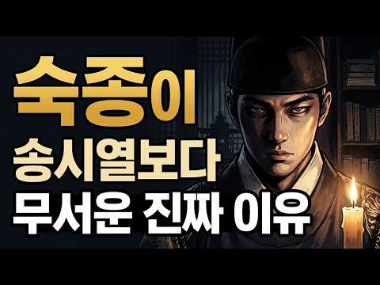
- 챕터: 0:00 신하가 왕보다 강했던 시대 · 1:30 열세 살의 친정 선언과 신하들의 당황 · 8:00 붕당이라는 전쟁터를 물려받다 · 15:00 숙종이 발명한 정치 — 환국 · 22:00 주역 공부와 숨겨진 의도 · 27:00 장희빈의 아들과 기사환국 · 33:00 정읍의 사약 — 그리고 죽지 않은 유령 · 38:00 냉혹한 군주의 뜻밖의 인간적 면모
- 설명 앞부분: 신하가 왕보다 강했던 나라에서, 열세 살짜리 왕이 아무도 모르게 기다렸습니다. 그리고 때가 됐다 싶은 순간, 조선 최강 송시열에게 망설임 없이 사약을 내렸습니다. 📖 이 영상에서 다루는 내용 칼도 없고 군사도 없이 오직 학문과 명분만으로 왕을 옥죄던 사람. 조선 역사상 유일하게 이름 뒤에 최고의 존칭이 붙은 단 한 명의 신하, 송시열. 그런데 그 송시열에게 사약을 내린 왕이 있었습니다. 열세 살에 즉위해 수렴청정도 거부하고, 아무도 모르게 기다렸다가 때가 됐다 싶은 순간 망설임 없이 칼을 뽑은 사람. 이 왕이 무서운 건 잔인해서가…
- 같은 채널 평소 대비 ×199.5 (채널 최근 롱폼 중앙값 1,324회) · 평소 영상: 흑치상지는 왜 당나라를 선택했나｜백제 부흥군을 이끌던 장수가 당나라 명장이 된 이유 (1,328회) / 김유신은 왜 김춘추를 선택했나? 혼인으로 시작된 신라 최고의 권력동맹 (1,320회)
- 대본 없음 (설명) — 음성인식이 끝나면 도입부·흐름이 들어감
- 댓글 460/460: 좋은 점 — 영상 7 · 감사·응원 8 · 더 알고 싶은 것 2 · 아쉬운 점 — 영상 2 · 반박·불만 — 의견 다름 5 · 정치·사회 42 · 경험 공유 11 · 구독·다음 기대 1
  - 좋은 점 — 영상 👍41 “성리학이건 유교건 그건 사상일뿐 인간생활에 무슨 도움이될까 과학이같이 공존해야한다”
  - 좋은 점 — 영상 👍8 “역사빌런님. 송시열님 피를 이어받은 제가 송시열을 아는 것은 임무여요. 그 시대로 갈 수 있게 도와주시니 고맙습니다. 좋은 영상으로 잘 배울께요. 감성편지 드림.”
  - 감사·응원 👍8 “역사빌런님. 송시열님 피를 이어받은 제가 송시열을 아는 것은 임무여요. 그 시대로 갈 수 있게 도와주시니 고맙습니다. 좋은 영상으로 잘 배울께요. 감성편지 드림.”
  - 감사·응원 👍3 “좋은 영상 감사합니다”
  - 더 알고 싶은 것 👍6 “동인과 서인의 시작도 설명해주시면 좋을 것 같습니다. 영상 잘 봤습니다^^”
  - 아쉬운 점 — 영상 👍4 “다 좋은데 중간 광고가 너무 많아서 정말 성가시네요”
  - 아쉬운 점 — 영상 👍0 “군권 장악에 대한 내용이 빠져서 무척 아쉽습니다.”
  - 반박·불만 — 의견 다름 👍1 “송시열. 님이 틀렸다..”
  - 반박·불만 — 의견 다름 👍1 “웃기는 해석이다. 왕권과 신권의 다툼? 어느시대도 똑 같았다. 심지어 정조대왕조차도..”
  - 정치·사회 👍25 “이슬람 종교국가와 다를바 없는 나라. 결국 신분제와 기득권 유지에 동원된 이념. 전쟁이나 외부 유입없이 그렇게 많은 인구가 노비인 나라가 없다. 동서고금.”
  - 정치·사회 👍8 “율곡과 송시열은 완전히 결이 다른 사람이었습니다. 율곡은 개혁가였지 권력과 명예따위를 탐하던 사람이 아닙니다. 오히려 꼰대 붕당정치를 지적하여 동인과 서인에게 동시에 탄핵을 받아 낙향했던적이 수차례 반복되는 삶을 살았습니다.”
  - 경험 공유 👍49 “송시열의 마지막 사약 받는 장면이 잘못 되어 있습니다. 송시열은 자신에게 사약이 내려졌다는 것을 승복 못하고 계속 거부하고 이방저방으로 도망가는 것을 잡아다가 강제로 먹인 것이 사실입니다. 평소에는 그렇게 곧은 선비인 것처럼 굴다가 마지막 죽음 앞에서는 각종 본성이 …”
  - 경험 공유 👍31 “저도 최근에야 숙종에 대해서 좀 알게된듯... 대단한 왕이었음...”
  - 구독·다음 기대 👍1 “구독하고 자주 들려 영상 보겠습니다. 감사합니다”

### 322. 《삼국지》 사마의, 왜 그는 천하를 얻고도 가문이 멸문지화를 당했나? l 역사 인물 l 고전

- https://www.youtube.com/watch?v=0gnfP3KZ31E · 동양사 이야기 · 구독자 16,400 · 조회수 288,511 (×17.6, 하루 2,422.6) · 좋아요 3,156 (1.1%) · 46분 · 2026-06-24 · 주제 묶음 6. 동양사 (중국·일본·몽골) · 형식 정보·해설 (그 밖) · 폴더 `W_0gnfP3KZ31E` (웹 승인)
- 썸네일: 
- 설명 앞부분: 삼국지의 숨은 주인공 사마의 가문이 천하를 통일하고도 결국 멸망할 수밖에 없었던 비극적인 이유를 아시나요? 권력에 대한 끝없는 야망과 배신 그리고 무능한 후계자 선택이 불러온 파멸의 역사를 통해 진정한 국정 운영의 교훈을 함께 알아보세요.
- 같은 채널 평소 대비 ×12.7 (채널 최근 롱폼 중앙값 22,738회) · 평소 영상: 《삼국지》 서서가 어머니 때문에 유비를 버리고 조조를 택했다고? 연의와 다른 진짜 역사 … (23,210회) / 《중국 역사》 강희제가 오배를 끝낸 비밀, 6살 소년의 8년 도박 l 천고일제 l 역사 … (22,266회)
- 대본 없음 (설명) — 음성인식이 끝나면 도입부·흐름이 들어감
- 댓글 85/85: 좋은 점 — 영상 2 · 감사·응원 0 · 더 알고 싶은 것 0 · 아쉬운 점 — 영상 0 · 반박·불만 — 의견 다름 1 · 정치·사회 9 · 경험 공유 1 · 구독·다음 기대 0
  - 좋은 점 — 영상 👍1 “너무 유익합니다❤❤❤❤❤”
  - 좋은 점 — 영상 👍1 “유익한데... 기껏해야 한국 정치 뉴스 관련된 수다 듣고 있는 자칭 애국노인들이 소화하기에는 어려운 내용입니다. 잘 봤습니다.”
  - 반박·불만 — 의견 다름 👍1 “글쎄요. 이런 식으로 따지면 지구 상에 성공만 한 가족이 있나요 ? 성실패를 따질 땐 그 범위를 특정사건이나 특정인에 국한해야지 않을까요 ?”
  - 정치·사회 👍9 “아니 천하통일하고 황제가 되었는데 멸문지화라니, 역사적으로 어느 나라든지 세월이 가면 망하지 않는 나라가 없고 망하면 대부분 그 황족은 멸문되기 마련인데 사마의 가문만이 아니지. 그리고 사마의의 진나라뿐 아니라 원래 그 쪽 지방의 나라들은 몇 대 못가 단명한 것이 대…”
  - 정치·사회 👍3 “제갈량이 촉의 국력을 파악하고 북벌을 하지않고 국력을 기르며 때를 기다렸다면 위나라가 삼국을 텅일하지 못했을 것이다”

### 323. 📸 역사책에서 찾을 수 없었던 놀라운 순간들 ∣ 희귀 역사 사진들

- https://www.youtube.com/watch?v=BF7Kb1zcVTo · 고대의 메아리 · 구독자 1,020 · 조회수 17,703 (×17.4, 하루 1,784.5) · 좋아요 50 (0.3%) · 7.7분 · 2026-10-11 · 주제 묶음 1. 역사 일반·이야기 · 형식 정보·해설 (그 밖) · 폴더 `W_BF7Kb1zcVTo` (웹 승인)
- 썸네일: 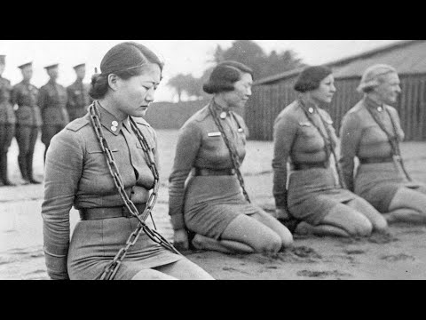
- 설명 앞부분: 안녕하세요! 희귀한 역사 사진과 잊혀진 과거의 이야기를 전하는 고대의 메아리에 오신 것을 환영합니다. 📸 이 채널에서는 희귀한 역사 사진, 오래된 흑백 사진, 빈티지 이미지, 1900년대의 기록을 통해 우리가 미처 알지 못했던 과거의 순간들을 만나봅니다. 유명한 역사적 사건뿐만 아니라, 평범한 사람들의 일상과 그 시대의 생생한 모습까지 사진으로 살펴봅니다. 📷 이 채널에서 만나볼 수 있는 콘텐츠 쉽게 접하기 어려운 희귀 역사 사진 20세기의 일상과 사람들의 삶 오래된 흑백 사진과 빈티지 이미지 잊혀진 역사적 순간과 숨겨진 이야기 …
- 같은 채널 평소 대비 ×5.4 (채널 최근 롱폼 중앙값 3,259회) · 평소 영상: 📸 실제였다는 게 믿기 힘든 과거의 순간들 (3,259회) / 📸 오래된 사진이 말해주는 진짜 역사 (3,316회)
- 대본 없음 (설명) — 음성인식이 끝나면 도입부·흐름이 들어감
- 댓글 0/0: 좋은 점 — 영상 0 · 감사·응원 0 · 더 알고 싶은 것 0 · 아쉬운 점 — 영상 0 · 반박·불만 — 의견 다름 0 · 정치·사회 0 · 경험 공유 0 · 구독·다음 기대 0

### 324. 400년 전 명나라에서 건너온 성씨들, 지금 10만 명입니다

- https://www.youtube.com/watch?v=hjoWlvuU9AA · 교과서엔 없는 역사 · 구독자 38,100 · 조회수 661,238 (×17.4, 하루 3,918.2) · 좋아요 5,170 (0.8%) · 9.9분 · 2026-05-05 · 주제 묶음 6. 동양사 (중국·일본·몽골) · 형식 사연·드라마 · 폴더 `W_hjoWlvuU9AA` (웹 승인)
- 썸네일: 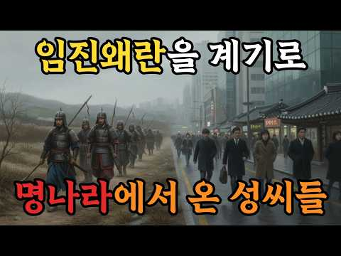
- 챕터: 0:00 10만 한국인의 뿌리, 임진왜란 · 0:29 전쟁 후 조선에 남은 사람들 · 1:00 임진왜란 귀화 5대 성씨 대공개 · 1:17 비극의 해주 석(石)씨, 조선을 구하고... · 2:43 이순신과 싸운 장수의 후손, 진(陳)씨 · 3:45 시성 두보 후손, 고국을 그리워하다 · 5:06 본관에 새긴 고국, 절강 편(片)씨 · 6:45 10만 후손의 시작, 영양 천(千)씨 · 8:48 400년의 시간, 명나라에서 한국인으로
- 설명 앞부분: 대한민국에 살고 있는 수많은 성씨들. 그중에는 조선시대 거대한 전란 속에서 바다를 건너와 이곳에 뿌리를 내린 사람들이 있습니다. **임진왜란** 당시 명나라에서 건너와 지금까지 역사를 이어가고 있는 가문들의 사연은 무엇일까요? 이 영상에서는 전쟁 중 파병을 오거나 멸망하는 나라를 등지고 조선으로 망명해 온 **[명나라 귀화 성씨]** 5곳의 기상천외하고 은밀한 정착기를 다룹니다. 조상들의 생생한 발자취를 지금 바로 확인해 보세요. 임진왜란 당시 조선을 구하기 위해 압록강을 건넜던 수많은 **명나라 군인들**. 그러나 그들 중 일부…
- 대본 없음 (설명) — 음성인식이 끝나면 도입부·흐름이 들어감
- 댓글 790/794: 좋은 점 — 영상 2 · 감사·응원 15 · 더 알고 싶은 것 12 · 아쉬운 점 — 영상 4 · 반박·불만 — 의견 다름 14 · 정치·사회 79 · 경험 공유 32 · 구독·다음 기대 0
  - 좋은 점 — 영상 👍2 “좋은 정보 감사합니다~.”
  - 감사·응원 👍155 “갈송 할아버지 17대손입니다 이렇게 다뤄주시니 감사하네요! 절강편씨는 원래 이씨입니다 당나라 황실 후예입니다 명나라 황제가 후궁에 빠져 나라가 도탄에 빠지자 충절의 상소문을 올려 옥에 갇히게 되었는데 일편단심 4글자를 황제에게 올려서 황제가 감복하여 옥에서 풀려나 일…”
  - 감사·응원 👍81 “훌륭하고고마운후손분들이네요 고맙습니다”
  - 더 알고 싶은 것 👍4 “그냥 명 식민지 조선이 일본 공격 받으니 조선이라는 재산 지키느라 싸운거지 영웅화 오ㅈ네 조선이 명에게 바치던 공물과 공녀 노비도 소개해주세요”
  - 더 알고 싶은 것 👍3 “안동댐강간범은 어떻게 되나요?”
  - 아쉬운 점 — 영상 👍2 “소위 상놈의 성씨라고 알려진 천방지추마골피. 가장 잘못 알려진 헛소리입니다. 이순신 장군의 부인이 지씨였는데 그러면 이순신 장군이 상놈의 집안과 혼인을 했다는말이 됩니다. 천씨는 명나라 장수의 후손으로 조선에서 높은 관직을 지냈습니다. 그런데도 상놈의 성씨라고 한다면…”
  - 반박·불만 — 의견 다름 👍23 “근데 웃기는건 명나라를 중국으로 알고있다는거. 상고시대 이후 중국한족은 없어. 실체가없는 허상이 바로 한족이야. 죄다 북방 유목왕조들이야.”
  - 반박·불만 — 의견 다름 👍2 “소위 상놈의 성씨라고 알려진 천방지추마골피. 가장 잘못 알려진 헛소리입니다. 이순신 장군의 부인이 지씨였는데 그러면 이순신 장군이 상놈의 집안과 혼인을 했다는말이 됩니다. 천씨는 명나라 장수의 후손으로 조선에서 높은 관직을 지냈습니다. 그런데도 상놈의 성씨라고 한다면…”
  - 정치·사회 👍155 “갈송 할아버지 17대손입니다 이렇게 다뤄주시니 감사하네요! 절강편씨는 원래 이씨입니다 당나라 황실 후예입니다 명나라 황제가 후궁에 빠져 나라가 도탄에 빠지자 충절의 상소문을 올려 옥에 갇히게 되었는데 일편단심 4글자를 황제에게 올려서 황제가 감복하여 옥에서 풀려나 일…”
  - 정치·사회 👍10 “제 성씨는 할아버지 말씀으론 송나라때 사신으로 왔는데 나라가 남쪽으로 밀려나는 바람에 돌아갈 길이 없어져서 그대로 귀화했다고 했네요 그리고 조상들 중에 서예가, 의병, 현감, 조정에서 일했던 분들도 계셨는데 못난 후손인 저는 그냥 집에 앉아서 유튜브나 보고 있습니다😂”
  - 경험 공유 👍76 “무지했던 사람들이 천씨를 비하했었죠... 명문가 입니다...”
  - 경험 공유 👍9 “내가 군생활 할때 우리 소대 휘귀성 집합소 편해근,봉일청,동성호,선우정,선씨가 아니고 선우씨임”

### 325. "정약용이 인정한 조선 후기 1위?" 역사 자체를 바꿀 수 있었던 최고의 천재

- https://www.youtube.com/watch?v=Z37l5sHivjA · 한국사 다시읽기 · 구독자 28,200 · 조회수 487,316 (×17.3, 하루 6,504.7) · 좋아요 5,946 (1.2%) · 24.3분 · 2026-08-07 · 주제 묶음 1. 역사 일반·이야기 · 형식 브이로그·직접 해본 이야기 · 폴더 `W_Z37l5sHivjA` (웹 승인)
- 썸네일: 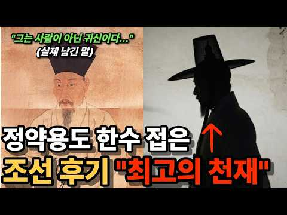
- 챕터: 0:00 🎙️ 오프닝 ∣ 정약용이 '귀신'이라 부른 사나이 · 1:39 📜 나모전 사건 ∣ 정약용을 무너뜨린 글자 하나 · 4:47 ✍️ '지이' 두 글자 ∣ 시험장에서 벌어진 일 · 6:05 🌙 소동파 시구 ∣ 남의 마음까지 읽어내다 · 10:29 🔭 서학과 천문·수학 ∣ 시대를 앞선 지성과 정조의 … · 16:47 🛡️ 무너진 방패 ∣ 정조의 죽음과 신유박해 · 19:02 🕯️ 지워진 이름 ∣ 옥중의 최후
- 설명 앞부분: 🎬 "내가 죽으면 조선의 미래는 끝난다" — 정약용이 '귀신'이라 불렀던 후기 원탑 천재 ⏱️ 타임라인 📚 참고 자료 『조선왕조실록』(정조실록·순조실록), 『일성록』 성대중, 『청성잡기』 / 황사영, 「백서」 — 당대 인물평 한국민족문화대백과사전(이가환·이익), 국사편찬위원회 우리역사넷, 한국고전종합DB ⚠️ 안내 본 영상의 일부 이미지는 생성형 AI로 제작되었으며, 실제 역사 속 인물과 장면의 모습과는 다를 수 있습니다. 시청에 참고해 주세요. 🙏
- 같은 채널 평소 대비 ×99.0 (채널 최근 롱폼 중앙값 4,920회) · 평소 영상: '최대 1000명 숙청...' 남인의 핵심 정약용은 왜 살려둔 걸까? (5,110회) / "사극이 심은 환상" 암행어사가 기피 직업 1순위였던 이유 (4,731회)
- 대본 없음 (설명) — 음성인식이 끝나면 도입부·흐름이 들어감
- 댓글 557/557: 좋은 점 — 영상 5 · 감사·응원 12 · 더 알고 싶은 것 3 · 아쉬운 점 — 영상 5 · 반박·불만 — 의견 다름 10 · 정치·사회 57 · 경험 공유 11 · 구독·다음 기대 2
  - 좋은 점 — 영상 👍5 “좋은 내용 감사합니다. 그림에 신발 신은 모습이 아쉽습니다. 버선 신은 모습이었으면 합니다. ^^;”
  - 좋은 점 — 영상 👍3 “역사 공부 잘 배웠습니다”
  - 감사·응원 👍139 “조선의 귀한 인물을 알게 하셔서 감사합니다.”
  - 감사·응원 👍67 “와우.. 그 정약용조차 경악하던 천재라니 놀랍네요. 이런 사람을 알게되어 감사합니다.”
  - 더 알고 싶은 것 👍8 “최고입니다 이런 역사얘기 많이올려주세요 ^^”
  - 더 알고 싶은 것 👍1 “당시 백성들은 왕이 바뀌면 어떻게 느꼈을까요?”
  - 아쉬운 점 — 영상 👍5 “좋은 내용 감사합니다. 그림에 신발 신은 모습이 아쉽습니다. 버선 신은 모습이었으면 합니다. ^^;”
  - 아쉬운 점 — 영상 👍0 “정약용은 이가환을읆엇다 사질뻔한천재르남김🎉🎉🎉❤❤❤”
  - 반박·불만 — 의견 다름 👍29 “요즘 인공지능에 비할 천재인듯.. 아까운 인재가 서학의 괴수라는 누명으로 고문받다 고통스럽게 옥사. 이런 천재의 .어이없는 죽음이 간신배들의 모략이었음이 안타까움을 넘어 조선역사의 어마어마한 손실이 되었네요. .. 천재는 천재를 알아본다고 이가환 정약용같은 인물들이 …”
  - 반박·불만 — 의견 다름 👍1 “대한민국은 식민사관과 반국가세력들에 의한 민족의 역사와 정체성을 왜곡선동에 의해 거짓속에서 몇세대가 살아왔습니다. 허울좋은 간판에 집착하고 실제를 모른채 암기하고 자격증따고 학위받았으나. 진짜실력을갖춘사람들을 내쳤지요 그래서 힘든 대한민국이지만 진실에 이끌려 나라를 …”
  - 정치·사회 👍195 “이가환이 어떤 인물인지 처음 알고 탄식이 나옵니다. 지금도 시대에 저항하는 족속들이 나라의 녹을 먹으며 고개를 빧빧히 들고 삽니다. 우리 사회가 외국인들이 말하듯 부러운 사회인지 의심하지 않을 수 없습니다.”
  - 정치·사회 👍84 “조선중후기 실학적인 남인이 계속 정권을 잡았다면 한국역사는 완전히 달랐을텐데..노론의 이름은 민족의 역사에서 근본주의 패거리이익 우물안개구리 어리석음 무능력..으로 영원히 기록되고 타산지석으로 삼아야한다.”
  - 경험 공유 👍17 “지금도 그래. 좌우로 나뉘어 서로 죽일듯이 물고 뜯으니, 국가적 에너지 낭비가 너무 심하다. 니가 죽어야 내가 사는 이 구조를 뜯어 고치지 않으면 대한민국 성장 엔진도 꺼질 것. 국민들이 먼저 깨어야 한다. 당리당략보다 국가를 위해 옳은 말을 하고 옳은 정치를 하는 …”
  - 경험 공유 👍4 “이가환을 아냐구요? 내가 아는 천재중에 최고였어요.”
  - 구독·다음 기대 👍3 “참 좋은 체널입니다. 구독합니다”
  - 구독·다음 기대 👍0 “이 채널을 통해 귀한 사실을 알게되네요. 정조대왕이 좀 더 오래 살았다면 조선의 운명이 바뀌었을텐데… 😢 앞으로 채널의 활약이 기대됩니다! 구독하고 갑니다 👍👍👍”

### 326. 조선왕조실록에 3,000번 등장한 남자의 정체 ∣ 송시열 완전분석

- https://www.youtube.com/watch?v=rXE_DENv7GI · 역사빌런 · 구독자 14,900 · 조회수 255,738 (×17.2, 하루 1,478.4) · 좋아요 4,843 (1.9%) · 25.9분 · 2026-05-01 · 주제 묶음 3. 조선 · 형식 정보·해설 (그 밖) · 폴더 `W_rXE_DENv7GI` (웹 승인)
- 썸네일: 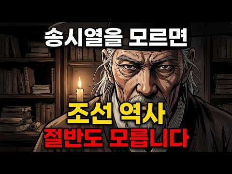
- 챕터: 0:00 도입 - 조선왕조실록 속 의문의 인물 · 1:30 1막 - 성인의 반열, 송자라는 호칭의 무게 · 6:00 2막 - 학맥이 곧 권력, 900명 제자의 비밀 · 12:00 3막 - 삼전도의 치욕과 두 남자의 복수심 · 15:00 4막 - 기해독대, 왕과 선비의 밀실 대화 · 18:00 5막 - 상복 한 장이 조선을 뒤흔든 15년 · 20:00 6막 - 사문난적, 생각이 다르면 죽어야 했던 나라 · 22:00 마무리 - 송시열이 닫아버린 문
- 설명 앞부분: 벼슬을 167번 받았지만 실제로 일한 건 49일. 그런데 왕 4명이 이 사람 없으면 아무것도 못 했습니다. 벼슬을 167번 받았지만 실제로 일한 건 49일. 그런데 왕 4명이 이 사람 없으면 아무것도 못 했습니다. 조선왕조실록에 3,000번 가까이 이름이 등장한 단 한 명의 인물. 공자, 맹자 옆에 나란히 성인의 반열에 오른 조선의 선비. 그런데 그 사람, 사약을 받고 죽었습니다. 나이 83세에. 찬사와 비난을 동시에 한 몸에 받은 남자. 효종과 나눈 단 둘만의 밀실 대화. 상복 한 장으로 조선을 15년간 뒤흔든 논쟁. 그리고 생…
- 같은 채널 평소 대비 ×193.2 (채널 최근 롱폼 중앙값 1,324회) · 평소 영상: 흑치상지는 왜 당나라를 선택했나｜백제 부흥군을 이끌던 장수가 당나라 명장이 된 이유 (1,328회) / 김유신은 왜 김춘추를 선택했나? 혼인으로 시작된 신라 최고의 권력동맹 (1,320회)
- 대본 없음 (설명) — 음성인식이 끝나면 도입부·흐름이 들어감
- 댓글 1,005/1,005: 좋은 점 — 영상 8 · 감사·응원 12 · 더 알고 싶은 것 2 · 아쉬운 점 — 영상 3 · 반박·불만 — 의견 다름 6 · 정치·사회 57 · 경험 공유 11 · 구독·다음 기대 0
  - 좋은 점 — 영상 👍3 “학교에서 송시열은 위대한 학자라고 배웠는데 시간이 지나 제대로 알고 보니 왕을 무시하고 당파를 체계화해서 나라를 흔든 인간이었죠. 서인이 모두 송시열의 후계였고 자기들만의 권력을 만든 세력이었는데 그 후손들이 역사학계를 주도하고 있어 송시열을 추앙하게 만들었죠. 자기…”
  - 좋은 점 — 영상 👍3 “시조인 송시열에 대해 많은걸 배웠네요!!! 감사합니다! 송시열 12대손입니다❤❤❤”
  - 감사·응원 👍4 “정말 송기열을 잘 정리하셨네요. 정말 감사합니다.”
  - 감사·응원 👍3 “시조인 송시열에 대해 많은걸 배웠네요!!! 감사합니다! 송시열 12대손입니다❤❤❤”
  - 더 알고 싶은 것 👍1 “송시열을 쉴드 치자는건 아니지만 송시열을 까는 분들께서는 지금 얼마나 훌륭하게들 사시는지 궁금함 말은 뭐 대단한 분들이셔 조선의 사대주의 두번의 참화 붕당정치의 폐해 근데 지금 이 나라도 그러고 있는데? 말은 뭐 대단들 해 그러는 당신들은 얼마나 훌륭하시냐고 아니 유…”
  - 아쉬운 점 — 영상 👍13 “조선 최강의 어그로 전문가. 그리고 사약 소믈리에.”
  - 아쉬운 점 — 영상 👍0 “Ai 목소리가 거슬려서 스킵합니다.”
  - 반박·불만 — 의견 다름 👍32 “웃기는 인간이네”
  - 반박·불만 — 의견 다름 👍4 “주자나 송시열이나 예를 바로 세우자는 이념은 일부 맞지만, 적 앞에서 글이나 평화로 이기자는 것은 이미 우리가 알고 있듯이 명이나 조선이나 청에 짓 밟히고 국민은 생고생 한거 외에 다른 아무것도 아닙니다. 지금도 그대로 마찬가지로, 셰계 전체를 보지 않고 '우리 끼리…”
  - 정치·사회 👍109 “두번 연속으로 전란에 휘말리고도 정신 못차리고 전통이 중요하다면서 하던대로 하다가 결국 나라가 넘어간거지. 그 책임은 오롯이 서인정권에게 있다고본다. 어차피 사라질 정권인데 스스로 개혁이 안되고 타국의 손에 끝장난게 안타까울 뿐이다.”
  - 정치·사회 👍48 “북벌 : 쇼 였을 뿐, 양반 5%가 노비, 천민, 농민을 짓밟는 반상의 법도가 제일인 성리학 : 송시열과 그 똘마니들, 그들의 유일한 목표였습니다. 송시열 : 그 천박한 지식에 매몰되었던 사람, 태어나지 않았더라면 조선사회의 일반 백성이 조금은 편안하게 살았을 수도 …”
  - 경험 공유 👍110 “조선을 쓰레기로 만든 사람 내가 아니면 다 반대.”
  - 경험 공유 👍6 “송시열은 조선사의 가장 형편없는 쓰레기... 송시열이 글쓴바위 가서 읽어보면 내가 충성하는데 넌 왜 날 버리냐? 등 그저 자기애만 가득한 나르시즘의 주인공...”

### 327. 1시간이면 완벽 이해 조선왕조실록 1대부터 27대까지 몰아보기ㅣ건국부터 멸망까지 한번에 자면서 들으세요

- https://www.youtube.com/watch?v=YfPUeVAhmfw · 한밤의 한국사 · 구독자 46,600 · 조회수 799,057 (×17.1, 하루 7,080.6) · 좋아요 7,851 (1.0%) · 69.5분 · 2026-06-30 · 주제 묶음 3. 조선 · 형식 수면·낭독 (잠잘 때 듣는) · 폴더 `W_YfPUeVAhmfw` (웹 승인)
- 썸네일: 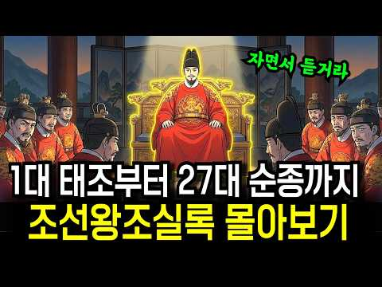
- 챕터: 0:00 오프닝 – 27명의 임금, 519년의 드라마 · 0:56 건국 – 이성계와 정도전 · 9:22 형제의 피로 쌓은 왕좌 – 태종 · 15:36 조선의 황금기 – 세종 · 21:25 빼앗긴 왕좌 – 단종과 세조 · 27:25 폭군과 개혁가 – 연산군과 조광조 · 32:41 임금이 도망친 전쟁 – 선조와 임진왜란 · 37:56 능력 있는 왕의 몰락 – 광해군 0 · 42:27 임금이 무릎 꿇은 날 – 인조와 병자호란 · 47:44 마지막 르네상스 – 영조와 정조 · 52:54 왕이 사라진 시대 – 세도 정치 · 57:52 저무는 나라 – 고종과 개항 · 63:10 500년의 끝 – 대한제국 멸망
- 설명 앞부분: 조선의 임금 스물일곱 명 중, 제 명에 편히 눈감은 왕은 과연 몇이나 될까요? 1392년 이성계의 건국부터 1910년 대한제국의 멸망까지, 519년 조선 왕조의 흥망성쇠를 단 한 편에 담았습니다. 형제를 죽인 왕, 조카의 왕좌를 빼앗은 왕, 아들을 뒤주에 가둔 왕, 전쟁 앞에서 백성을 버린 왕, 적장 앞에 무릎 꿇은 왕, 그리고 끝내 나라를 빼앗긴 왕까지. 조선 27명의 임금이 내린 선택이 어떻게 나라의 운명을 갈랐는지, 조선 역사 전체를 처음부터 끝까지 따라가 봅니다. 조선 건국과 정도전의 설계, 세종의 황금기, 단종과 세조의 …
- 같은 채널 평소 대비 ×12.2 (채널 최근 롱폼 중앙값 65,357회) · 평소 영상: 한국사 총정리 몰아보기ㅣ고조선부터 대한민국까지 5000년 풀스토리ㅣ자면서 들으세요 (65,357회) / 한명회도 울고 갈 조선 최악의 간신ㅣ조선왕조실록이 '소인 중의 소인'이라 부른 단 한 사… (69,488회)
- 대본 없음 (설명) — 음성인식이 끝나면 도입부·흐름이 들어감
- 댓글 126/128: 좋은 점 — 영상 8 · 감사·응원 27 · 더 알고 싶은 것 1 · 아쉬운 점 — 영상 1 · 반박·불만 — 의견 다름 0 · 정치·사회 7 · 경험 공유 2 · 구독·다음 기대 2
  - 좋은 점 — 영상 👍88 “휴가3일 내내 영상봅니다. 세종대왕의 마누라 신빈 김씨 돌아가신 년도까지 외워지네 방금 고려역사 1시간40분짜리 정주행후 잘시간에 또 봅니다. AI목소리가 듣기 좋아요”
  - 좋은 점 — 영상 👍30 “단종부터 시작하여 조선의 역사공부를 계속하며 여기까지 왔습니다.들어온 내용들이 이로써 정리가 잘 되는 큰깨달음에 깊은 감사드립니다.~”
  - 감사·응원 👍30 “단종부터 시작하여 조선의 역사공부를 계속하며 여기까지 왔습니다.들어온 내용들이 이로써 정리가 잘 되는 큰깨달음에 깊은 감사드립니다.~”
  - 감사·응원 👍27 “역사의 흐름을 알게 해주셔서 감사합니다”
  - 더 알고 싶은 것 👍2 “조선왕들 중에 제대로된 왕이 몇명이 될까요 ? 썩은왕이 매우 많은듯”
  - 아쉬운 점 — 영상 👍88 “휴가3일 내내 영상봅니다. 세종대왕의 마누라 신빈 김씨 돌아가신 년도까지 외워지네 방금 고려역사 1시간40분짜리 정주행후 잘시간에 또 봅니다. AI목소리가 듣기 좋아요”
  - 정치·사회 👍20 “기가 막힌 우리 이씨조선의 역사를 아픈 마음으로 다 봤고 힘이 없는 나라는 굴욕의 종알이 온다는 것 그래서 우리는 언제나 힘을 길러야 합니다 나와 너 여와 야 그런 모든 것 위에 내나라가 강대국으로 버티고 있어야 하는 것이 절체절명의 진리!!!! 오직 대-한-민-국 …”
  - 정치·사회 👍4 “나라가 너무썩었음 리셋코리아”
  - 경험 공유 👍3 “빠진 임금도 있지만 나름 연대별로 조선왕의 공과를 잘 들었습니다. 1910.8.29 한일합방되어 35년간의 일제강점기 거쳐 스스로의 힘(일부는 인정)이 아닌 외세에 의해 겨우 1945.8.15 독립을 맞이하자 마자 15년간의 좌우 이념 싸움 끝에 하나의 나라 기틀을 …”
  - 구독·다음 기대 👍88 “휴가3일 내내 영상봅니다. 세종대왕의 마누라 신빈 김씨 돌아가신 년도까지 외워지네 방금 고려역사 1시간40분짜리 정주행후 잘시간에 또 봅니다. AI목소리가 듣기 좋아요”
  - 구독·다음 기대 👍3 “역사 공부 세삼스럽습니다. 현제 정치인들은 조선의 역사문화를 기역하고 국민을 위한 정치 기대합니다.”

### 328. 조선야담#2 딸을 머슴에게 시집보내다~ 옛날이야기 민담 잠잘때 듣는 옛날이야기

- https://www.youtube.com/watch?v=HRbSM37fr0E · 조선야사 · 구독자 2,370 · 조회수 40,535 (×17.1, 하루 2,094.6) · 좋아요 379 (0.9%) · 101.8분 · 2026-10-01 · 주제 묶음 9. 야사·야담·옛날이야기 · 형식 수면·낭독 (잠잘 때 듣는) · 폴더 `W_HRbSM37fr0E` (웹 승인)
- 썸네일: 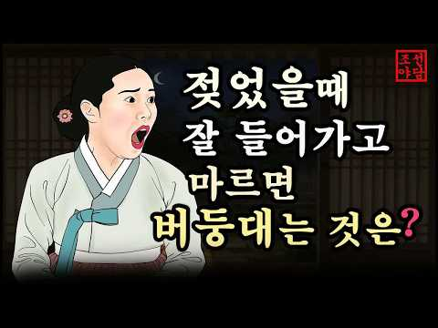
- 설명 앞부분: 📜 조선 시대의 신비롭고 흥미진진한 야담, 역사 속 숨겨진 이야기, 그리고 전해 내려오는 전통 설화를 전해드립니다. 🏮 우리가 잘 몰랐던 옛이야기 속으로 떠나는 시간 여행에 여러분을 초대합니다. ⏳✨ 과거의 지혜와 재미가 담긴 이야기들을 매일 만나보세요! 🌙🐯
- 같은 채널 평소 대비 ×428.9 (채널 최근 롱폼 중앙값 94회) · 평소 영상: 조선야담🎉선비를 보쌈한 여인 애첩의 털과 바꾼 전재산 양반을 참교육한 머슴한주간 이야기모… (97회) / 조선야담 밤새 불태웠구나!! 중간광고없는 옛날 이야기 모음 #민담#야담#옛날이야기 (92회)
- 대본 없음 (설명) — 음성인식이 끝나면 도입부·흐름이 들어감
- 댓글 7/7: 좋은 점 — 영상 0 · 감사·응원 1 · 더 알고 싶은 것 0 · 아쉬운 점 — 영상 0 · 반박·불만 — 의견 다름 0 · 정치·사회 0 · 경험 공유 0 · 구독·다음 기대 0
  - 감사·응원 👍1 “조선야담~~ ! 잼 있게 보고 있읍니다.고맙읍니다. 흐 흐”

### 329. 우리가 알고있던 중국의 역사는 가짜다! 병자호란의 판도를 뒤집는 낯선 진실 ∣ 역사다큐 ∣ 한국사 ∣ 청나라 ∣ 조선시대 ∣ 조선왕조실록

- https://www.youtube.com/watch?v=25MhghC8gwg · 역사의작은그림자 · 구독자 13,000 · 조회수 220,066 (×16.9, 하루 1,504.5) · 좋아요 4,885 (2.2%) · 24.9분 · 2026-05-28 · 주제 묶음 3. 조선 · 형식 정보·해설 (그 밖) · 폴더 `W_25MhghC8gwg` (웹 승인)
- 썸네일: 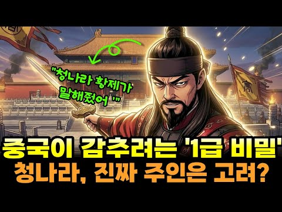
- 챕터: 0:00 삼전도의 굴욕, 홍타이지가 뱉은 충격적인 첫마디 🩸 · 1:35 누르하치가 선조에게 보낸 편지 "부모의 나라를 구하겠… · 3:10 조선 개국공신과 만주 벌판, 묘하게 얽힌 두 세계 🐎 · 4:25 청 황실 성씨 '애신각라'에 숨겨진 천 년의 미스터리… · 5:50 청나라 정사 『금사』 첫 줄에 등장하는 낯선 사내, … · 8:15 병자호란은 정복 전쟁이 아니었다? 기록이 말하는 서늘… · 10:40 변발한 청나라 상인 앞, 조선 마부의 기막힌 횡포와 … · 12:00 오랑캐인가, 잃어버린 핏줄인가? 천 년의 미스터리 ⏳
- 설명 앞부분: 쿵. 쿵. 쿵. 삼전도에서 인조가 피를 흘리며 이마를 찧던 날. 대륙의 지배자 청나라 황제가 뱉은 첫마디는 정복의 기쁨이 아닌, 섬뜩한 분노였습니다. "너희는 어찌 동족을 버렸는가." 야만적인 오랑캐인 줄만 알았던 청나라는 임진왜란 때 조선을 '부모의 나라'라 불렀습니다. 게다가 청 황실의 성씨 '애신각라'와 정사 『금사』에 기록된 고려인 '김함보'의 존재는 그들의 뿌리가 한반도에 있음을 천 년 동안 묵묵히 증명하고 있었죠. 📜 우리가 멸시하며 밀어냈던 이민족이, 어쩌면 잃어버린 우리의 절반은 아니었을까요? 병자호란의 판도를 뒤집…
- 같은 채널 평소 대비 ×57.7 (채널 최근 롱폼 중앙값 3,812회) · 평소 영상: 조선이 흉내 낼 수 없던 고려 474년, 그들이 대륙을 차지했던 이유 ∣ 고려거란전쟁 ∣… (3,812회) / 우리가 몰랐던 6.25 남침의 충격적 뒷이야기 57시간동안 무엇을 했나? ∣ 역사다큐 ∣… (3,626회)
- 대본 없음 (설명) — 음성인식이 끝나면 도입부·흐름이 들어감
- 댓글 1,371/1,372: 좋은 점 — 영상 11 · 감사·응원 9 · 더 알고 싶은 것 5 · 아쉬운 점 — 영상 0 · 반박·불만 — 의견 다름 20 · 정치·사회 164 · 경험 공유 26 · 구독·다음 기대 1
  - 좋은 점 — 영상 👍11 “역사에서 가장 이상한게 왜 정복하지않았나인데 이제야 이해가 되네 김씨의 나라 금 청”
  - 좋은 점 — 영상 👍5 “좋은 내용입니다 정말로 우리의 역사를 재정립해야 합니다 이성계의 조선왕조는 우리역사를 완전히 후퇴시킨 중국한족의 제후국으로의 시작이었고 지금도 우리역사학계는 환단고기를 위서라 하며 소중한 우리의 역사를 찾지 않고 있습니다”
  - 감사·응원 👍5 “감사합니다 누르하찌 지나땅은 우리의 고토입니다”
  - 감사·응원 👍5 “김함보의 이주 시기와 청황실의 사료로 보았을 때 맞는 이야기라고 생각합니다. 이런 이야기를 지금이라도 듣고서 저의 역사 인식을 바로잡을 수 있게 되어 감사합니다.”
  - 더 알고 싶은 것 👍5 “그때 조선이 멸망했다면 어떻게 역사가 흘러갔을까요?”
  - 더 알고 싶은 것 👍2 “님 숙종이 단종을. 다시. 왕으로 올린 이유. 동영상 으로. 만들어주세요”
  - 반박·불만 — 의견 다름 👍12 “청나라는 우리 민족인데. 인조는 오랑케라고 비하하다. 개구리가 되었다.. 그때 조선은 싹다 망해 버렸어야 했는데.. 아쉽다..그후 명나라를 제조지은의 나라라고 사대하면서 소중화라고 하는 어이없는 민족성..”
  - 반박·불만 — 의견 다름 👍6 “조선왕조 실록에도 이성계의 고향기록을 검증해보면 한반도 아닙니다. 합빈. 하얼빈입니다… 좀 공부좀해보시고 올리시지… 식민사관에 젖은 동영상…”
  - 정치·사회 👍284 “우리나라가 republic of josun이 아니라 republic of korea란걸 알아야한다. 우리 대한민국의 뿌리는 고려, 고구려인 korea다. 조선은 나라도 아니고 중국 공산주의자들에 의해 미화된 것이다. 북조선, 남조선과 조선을 지우고 광개토대왕의 고구려…”
  - 정치·사회 👍39 “당시 청나라가 조선이 적이었다고 생각했다면 인조가 항복했을때 바로조선의 지도층들을 몰살시키고 바로조선을 병합했을것이다.그러나 청나라는 당시조선을 적이라고 생각안했다.그래서 조선이란 나라를 그대로유지시켜준것이다.청태종생각이 맞다.나도 역사를 공부해보고 의문을 품었다.내…”
  - 경험 공유 👍39 “당시 청나라가 조선이 적이었다고 생각했다면 인조가 항복했을때 바로조선의 지도층들을 몰살시키고 바로조선을 병합했을것이다.그러나 청나라는 당시조선을 적이라고 생각안했다.그래서 조선이란 나라를 그대로유지시켜준것이다.청태종생각이 맞다.나도 역사를 공부해보고 의문을 품었다.내…”
  - 경험 공유 👍15 “내가 누누히 말하잖아. 우리 옛조상들이 중국 땅을 다스렸다고. 그 기록이 중국에 남아 있다고. 한국의 고대 역사는 일본놈들이 훔쳐가서 이 땅엔 없다. 댓글에 미친 소리 하지 말라고 하는데 고조선은 중국땅 절반이상을 다스렸다. 중국 공산당은 그사실을 한국이 아는게 죽기…”
  - 구독·다음 기대 👍4 “신진사대부 세략이 자신들의 기득권을 잃을까봐 명에 사대주의에 기댄것이 조선이 망하게 된 원인이라 봅니다. 반도에 국한된 소극적으로 임한 이유가 기득권 지키기 아니었을까 싶은데 이제라도 한민족의 문화적 저력을 바탕으로 역사적 성찰을 통해 단군의 시대를 재조명하는것이 이…”

### 330. 3만 중공군을 호수에 수장시킨 한국군 패잔병들의 미친 복수극 #세계사 #역사다큐 #6.25전쟁 #용문산전투

- https://www.youtube.com/watch?v=xWHLDEMFc6E · 역사 전략실 · 구독자 11,000 · 조회수 184,891 (×16.8, 하루 1,411.6) · 좋아요 4,039 (2.2%) · 31.9분 · 2026-06-12 · 주제 묶음 4. 한국 근현대사 · 형식 사연·드라마 · 폴더 `W_xWHLDEMFc6E` (웹 승인)
- 썸네일: 
- 챕터: 0:00 지옥문이 열린 용문산, 징과 꽹과리를 앞세운 중공군의… · 2:34 사창리의 치욕, 무기를 버리고 도망친 6사단 패잔병들 · 5:53 머리를 깎고 피로 유서를 쓰다! 결사대로의 부활 · 7:28 가장 약한 고리를 노린 팽덕회의 5월 춘계 대공세 · 9:44 사단장의 소름 돋는 전술, 1개 연대를 통째로 미끼로… · 12:01 어둠 속의 대반격, 2연대의 맹렬한 사격과 처절한 육… · 16:34 밴 플리트 탄약량(TOT)의 위력, 좁은 계곡에서 분… · 18:10 사냥꾼과 사냥감이 뒤바뀌다! 6사단 본대의 완벽한 역습 · 26:01 파로호의 핏빛 학살, 지도상에서 지워진 중공군 제63군
- 설명 앞부분: 1951년 4월, 사창리 전투에서 기습을 당해 무기를 버리고 도망치며 미군에게 조롱받았던 한국군 제6사단 청성부대. 하지만 불과 한 달 뒤, 이들은 스스로 머리를 깎고 유서를 품은 채 용문산에 배수진을 칩니다. 적의 오만함을 역이용한 장도영 사단장의 미친 미끼 전술과 2연대의 처절한 육박전! 결국 3만 명에 달하는 중공군을 화천 저수지에 수장시키고 군단 전체를 지도상에서 지워버린 전무후무한 대승리. 6.25 전쟁의 판도를 바꾼 가장 완벽하고 잔혹한 복수극, '용문산 전투'의 핏빛 진실을 역사 전략실에서 파헤쳐 봅니다. [타임라인]…
- 같은 채널 평소 대비 ×21.3 (채널 최근 롱폼 중앙값 8,696회) · 평소 영상: 9명 vs 300명. 영국이 50년간 철저히 숨겨야만 했던 기적의 방어전 #미르바트전투 … (8,923회) / 손톱과 머리카락을 남기고 떠난 75명의 청춘들, 맹호부대 특공결사대의 핏빛 15일 #안케… (8,469회)
- 대본 없음 (설명) — 음성인식이 끝나면 도입부·흐름이 들어감
- 댓글 471/474: 좋은 점 — 영상 7 · 감사·응원 77 · 더 알고 싶은 것 4 · 아쉬운 점 — 영상 7 · 반박·불만 — 의견 다름 5 · 정치·사회 57 · 경험 공유 17 · 구독·다음 기대 0
  - 좋은 점 — 영상 👍25 “용문산 전투가 결국 휴전회담을 이끌어 냈구나! 장도영 장군, 죽음을 불사한 6사단, 2연대 그리고 벤플리트 장군의 막강한 화력! 이런 분들이 있었기에 지금의 대한민국이 있습니다! 감사합니다. 좋은 내용이네요!”
  - 좋은 점 — 영상 👍12 “정말 좋은 내용 감사합니다. 당시 용감했던 순국선열의 용기와 희생이 느껴지는 것 같습니다.”
  - 감사·응원 👍144 “장도영 장군님 감사합니다! 필승!!”
  - 감사·응원 👍137 “미끼로 갈려나간 무명의 2연대 병사들에게 머리숙여 감사드립니다.”
  - 더 알고 싶은 것 👍8 “감사합니다. 앞으로도 좋은 방송 부탁드립니다. 6.26맥아더 상륙장전이 유명한데 정작 우리 한국군의 전과는 잘 모르는 경우가 많은데 이를 널리 알려주시길 바랍니다.”
  - 더 알고 싶은 것 👍2 “영화로 만들어 주세요”
  - 아쉬운 점 — 영상 👍1 “좋은 영상 잘 보았습니다. 아쉬운 점이 영상은 AI로 작성하시다 보면 이상한 것이 있을 수 있는데 자막은 맞춤법에 신경을 좀 써 주시면 좋을 것 같네요..ㅎ”
  - 아쉬운 점 — 영상 👍0 “제2땅굴을 발견하여 제2의 625를 막은 그야말로 구국의 사단이었습니다 그래서 춘천전투와 신령전투를 승리로 이끄신 김종오 서단장님과 육탄용사동상을 사단사령부에 세우고 춘천을 지켜낸 7연대장 임부택 장군님동상은 7연대에 새워드렸습니다 장도영 장군님은 살아계셰서 동상을 …”
  - 반박·불만 — 의견 다름 👍1 “아닙니다. 밴플ㅈ리트의 기본 전술 지시였습니다. 적은수로 충분히 화력으로 제압이 가능한것을 간파한거지요. 장도영장군의 판단은 아닌거지요.”
  - 반박·불만 — 의견 다름 👍0 “사실 북한강쪽에 연대 1개를 전진배치 시킨 전술은 6사단장의 전술이 아닙니다. 중공군 1차 춘계공세 전훈을 분석한 유엔군 사령부에서는 '중공군은 병력은 많지만 상대적으로 화력이 빈약하다'는 점을 파악하고 서부~동부에 걸친 모든 전선의 1선 사단들에게 연대 1개씩을 추…”
  - 정치·사회 👍55 “파로호 명명식은 1955년도 입니다. 분명히 기억하건대 그때 제 아버지가 625 종군하고 나서 7사단에 근무하고 있었습니다. 이승만 대통령이 헬기에서 내리는 사진, 파로호 비석 제막식 사진, 많은 군인들 격려하는 사진들을 집에 가지고 왔습니다. 어린 나는 그게 뭔지 …”
  - 정치·사회 👍33 “6사단 철원 동송 금악산 밑에 자리 하고 있지요..청성부대 그들의 용맹함은 익히 잘 알고 있었지만 용문산 전투로 시작 중공군놈들을 끝까지 추격 화천 댐 파라호 에 수장시킨 그 공의 내용은 몰랐었는데 이제야 파로호의 그 이름을 알게 됬습니다.. 허나 일부 좌파들은 파로…”
  - 경험 공유 👍27 “내아들이 저유명한6사단 에서 군생활 내가다자랑스럽네 저영웅분들이 지금이나라 돌아가는 꼴을 를보신다면 뭐라할까 미안하고 죄송하네!!!”
  - 경험 공유 👍16 “저도 순국선열님들께 다시한번 머리숙여 감사드립니다.”

### 331. 사수 전투 │ 고당전쟁 역사상 가장 위대했던 고구려와 연개소문의 승리. AI 단편 사극 영화

- https://www.youtube.com/watch?v=w6G1N2fUNQg · 쇠꼬비 검프  · 구독자 16,200 · 조회수 269,033 (×16.6, 하루 1,856.2) · 좋아요 3,914 (1.5%) · 43.9분 · 2026-05-29 · 주제 묶음 2. 한국 고대·삼국·고려 · 형식 정보·해설 (그 밖) · 폴더 `W_w6G1N2fUNQg` (웹 승인)
- 썸네일: 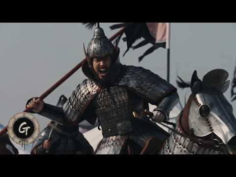
- 설명 앞부분: 안시성 전투로 잘 알려진 645년 1차 고당전쟁과 고구려가 멸망한 668년의 3차 고당전쟁의 사이에 낀 661~662년의 2차 고당전쟁은 그동안 그렇게 많이 주목받지 못 했습니다. 그러나 2차 고당전쟁에서 고구려는 당나라의 침략 야욕을 완벽하게 분쇄했습니다. 연개소문 사후 그의 아들 삼형제가 내전을 일으키기 전까지만 해도 당나라는 고구려 재침을 아예 포기할 정도로 큰 타격을 입었습니다. 그리고 그 중심에 평양 보통강(또는 합장강) 일대로 추정되는 사수에서의 승전이 있었습니다. 즉 사수 전투는 고구려와 당나라 사이에 영구적 평화를 …
- 같은 채널 평소 대비 ×2.0 (채널 최근 롱폼 중앙값 137,775회) · 평소 영상: 매소성 전투 │ 당나라 대군을 갈아버린 신라의 분노. AI 단편 사극 영화 (206,486회) / 668 평양성 전투 │ 고구려 최후의 순간을 AI로 재현 (69,064회)
- 대본 없음 (설명) — 음성인식이 끝나면 도입부·흐름이 들어감
- 댓글 1,082/1,087: 좋은 점 — 영상 10 · 감사·응원 47 · 더 알고 싶은 것 29 · 아쉬운 점 — 영상 13 · 반박·불만 — 의견 다름 10 · 정치·사회 79 · 경험 공유 41 · 구독·다음 기대 13
  - 좋은 점 — 영상 👍4 “좋은 영상 감사합니다!”
  - 좋은 점 — 영상 👍3 “선생님 저 고구려 역사 진짜 좋아하는데 정말 잘봤습니다 진심으로 이렇게 좋은 영상 보는건 처은이라서 제가 왠만하면 댓글을 잘 안쓰는데 이번 영상 정말 평생 못잊을 것 같아요!”
  - 감사·응원 👍240 “사수전투 요청드렸던 사람입니다 연개소문의 위용을 이렇게라도 볼수있어 감사드립니다. 천년이 넘게 흘렀지만 여전히 중국에 드리워져 있는 대막리지의 메아리.”
  - 감사·응원 👍66 “공대 박사 대학원생입니다 영상보고 전공 바꿀지 고민했습니다. 다음엔 고려 몽골 해주시면 감사하겠습니다.”
  - 더 알고 싶은 것 👍6 “백제 드라마도 만들어주시면 감사하겠습니다.”
  - 더 알고 싶은 것 👍4 “다음에는 살수대첩도 한 번 제작 부탁드려요 고수전쟁”
  - 아쉬운 점 — 영상 👍8 “우리 사극에 대해 블로그에서 쓰신 글부터 잘 보고 있습니다.그때 밀씀하셨던 아쉬운 점들을 이렇게 직접 구현하시는걸 보니 정말 너무 좋습니다!!”
  - 아쉬운 점 — 영상 👍5 “잘 봤습니다 헌데 무기 고증이 좀 아쉽습니다 고구려의 주무기는 7할이 맥궁이었고 엄지 사법을 썼습니다 근데 영상 중간중간 화살을 활의 왼쪽에 걸고 세 손가락으로 쏘는 지중해 사법이 많이 등장하네요 나머지 3할은 장창이 주무기였고 초근접시엔 철퇴와 도끼를 썼습니다 장검…”
  - 반박·불만 — 의견 다름 👍2 “퀄리티 장난아닙니다;; 몇번을 봐도 캐릭터들의 대화내용도 장난 아니네요. 정말 드라마보다도 잘 만들었네요!! 앞으로도 더 만들어주세요~~”
  - 반박·불만 — 의견 다름 👍2 “지난 70년 동안 너희가 죽인 고려 백성들의 피가 강을 이루고 바다를 이루었다! 내 드디어 오늘 그 오랜 전쟁을 끝내게 되었으니 참으로 기쁘구나. 또 올테면 와보거라, 이 연개소문이 살아있는 한 고려의 땅은 당적들의 육신을 탐하는 거대한 푸줏간으로 남아있을테니! 술탈…”
  - 정치·사회 👍5 “중국인들이 댓글에서 이렇게 열심히 반응하는 거 보니 퀄리티랑 중국어 연기는 인정한 셈 아닌가? ㅋㅋ”
  - 정치·사회 👍4 “자기들이 먼저 쳐들어와 놓고 피의 대가 이 ㅈㄹ.... 역시 중국인의 뻔뻔함까지 리얼하게 구현....엄청난 고증!!”
  - 경험 공유 👍13 “영상 퀄리티 죽이네요. 고증도 뛰어나 보는내내 내가 개마무사가 된듯한 느낌입니다.”
  - 경험 공유 👍6 “늦은 감상문 방효태의 연기 스타일과 소시민적 태도가 왕휘 배우 (대진제국 위 공자 앙, 옹정황제 13제) 의 소시민적 폐급 연기를 생각나게 합니다. Ai여서 가끔 허점은 보입니다만, 연기에 상당히 놀랐습니다. 현갑군의 활용: 경여년이라는 타임슬립물에서 흑기병이 무섭게…”
  - 구독·다음 기대 👍64 “다음 작품으로 광개토대왕의 사방합전 기대합니다. 헉헉...”
  - 구독·다음 기대 👍3 “아니 무슨 Ai영화를 이렇게 잘 만드나요? 40분을 10분일정도로 몰입감있게 너무 재밌게 봤읍니다. 정말 대단합니다. 더 좋은 후속 작품 기대합니다.”

### 332. 일본군 성노예 피해자 증언 ∣ 북한 피해자들 증언 1부 (뉴스타파)

- https://www.youtube.com/watch?v=DcpFycWacCI · 보이드본 Voidborne · 구독자 6,960 · 조회수 115,007 (×16.5, 하루 1,009.4) · 좋아요 3,644 (3.2%) · 35.1분 · 2026-06-29 · 주제 묶음 기타 · 형식 정보·해설 (그 밖) · 폴더 `W_DcpFycWacCI` (웹 승인)
- 썸네일: 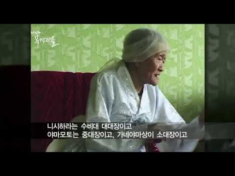
- 같은 채널 평소 대비 ×966.4 (채널 최근 롱폼 중앙값 119회) · 평소 영상: 일본군 성노예 피해자 증언 ∣ 김군자 (정대협) (123회) / 일본군 성노예 피해자 증언 ∣ 김화선 (정대협) (115회)
- 대본 없음 (없음) — 음성인식이 끝나면 도입부·흐름이 들어감
- 댓글 680/680: 좋은 점 — 영상 2 · 감사·응원 15 · 더 알고 싶은 것 11 · 아쉬운 점 — 영상 3 · 반박·불만 — 의견 다름 16 · 정치·사회 23 · 경험 공유 17 · 구독·다음 기대 1
  - 좋은 점 — 영상 👍2 “그 때의 고문들을 이렇게 자세하게 들은 적은 처음입니다. 그런 끔찍한 고문들을 어린 소녀들에게 했다니 사람이라면 할 수없는 해서는 안되는 것.. 너무나도 어린 순수하고 풋풋한 앞날이 창창한 아이들에게…… 그런 짓을…….. 일본놈들은 정말 어떻게 그런 짓을 할 수 있었…”
  - 감사·응원 👍62 “그 어린아이를 ... 살아주셔서 감사합니다”
  - 감사·응원 👍55 “피해자분들에게 너무나 죄송하고 가슴이 아파서..힘들어도 끝까지봤습니다. 눈물이 나오는게 사치처럼 느껴지도록 잔인해서 할말이 없어요. 살아주셔서 감사하다 했는데...해결되지못한채 돌아가셨다니 너무 죄송스럽습니다 일본은 천벌받을거다 하늘에서 정말 업겁의 시간동안 피해자할…”
  - 더 알고 싶은 것 👍293 “이렇게 생생한 증언과 증거가 있는데도 우리나라 유명대학 교수는 위안부가 아니라 자진해서 취직하러 간거라고 주장하고 있지. 자기딸이 그렇다면 어땠을까~ 끔찍한 일본의 만행을 세계에 알려주시길~”
  - 더 알고 싶은 것 👍6 “영어자막 부탁드려요”
  - 아쉬운 점 — 영상 👍6 “자막이 필요 합니다. 지금 프랑스 유명 역사 유튜버가 처음으로 위안부의 실체를 알리는데 너무 미화 되어서 얘기를 하고 있어요. 사람들이 댓글로 이것에 관한 영화나 정보를 원합니다. 제발 다국어로 자막 좀 제작 해 주세요. 제발요.”
  - 아쉬운 점 — 영상 👍2 “자막좀요.. 번역어려우시면 저라도 해야될것같은데 번역하다 멘탈나갈것같아서 무섭기도히고 이런거 묻히면 미래역사에재생되요”
  - 반박·불만 — 의견 다름 👍161 “일본을 막 엄청 싫어하는건 아닌데 이런 영상들을 보면 뭔가 다시 생각하게 되는 거 같음.. 진짜 너무 잔인하고 이건 사람이 할짓이 아니다 정말..”
  - 반박·불만 — 의견 다름 👍33 “살아오신게 기적이시네요 그 자리에서 열두명이라니 열네살이 견딜 기억이아닌데 말을 더 못하겠습니다”
  - 정치·사회 👍30 “나라가 힘이 없으니 자런일을 당하고 일본을 용서하면 안됌”
  - 정치·사회 👍22 “믿기지 않는 역사적사실이다. 충격적이다. 너무나 정확하고 세세하게 말씀하시는 할머니. 그 어린 나이에 얼마나 무서웠고 이 나라가 원망스러웠겠나. 이렇게 잔인하게 유린할줄은 몰랐다”
  - 경험 공유 👍428 “근데 예전에 코메디안 김구라가 위안부 할머니를 매춘부라 칭했슬때 내가 넘 놀란적이 있었다ㅡ 방송국에서 퇴출 당하리라 생각했는데 여지껏 버젓이 출연하고 있는걸 보면 이 할머니들이 생각나 그김구라새끼의 낯짝만 봐서 토할것 같아 채널을 돌려 버린다ㅡ ㅡ방송국 자체도 역사적…”
  - 경험 공유 👍138 “내가 이래서 아직까지도 일본 여행을 안감. 죽을때까지 안가고 싶음. 다 피할수는 없겠지만 최대한 일본산 제품을 소비 안하려는 이유임. 피해자분들 얼마나 고통스럽고 집에 가고 싶었을까.. 마음 아프다”
  - 구독·다음 기대 👍1 “알고리즘 나와서 구독하고갑니다 ㅠㅠ. 채널 시작해주셔서 감사합니다 영어 일본어자막. 있으면 좋을것같아요 ㅠ”

### 333. 왜 왕은 얼음을 실컷 먹을 수 있었는데도 덥다고 했을까? ㅣ조선시대 궁궐 냉방의 비밀ㅣ조선시대 여름의 현실

- https://www.youtube.com/watch?v=Bw0-7LTWfbg · 조선별채 · 구독자 14,400 · 조회수 233,337 (×16.2, 하루 1,414.5) · 좋아요 1,099 (0.5%) · 8.4분 · 2026-05-09 · 주제 묶음 3. 조선 · 형식 정보·해설 (그 밖) · 폴더 `W_Bw0-7LTWfbg` (웹 승인)
- 썸네일: 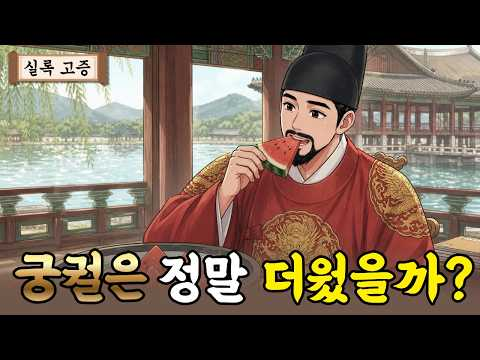
- 설명 앞부분: 안녕하세요? 오늘은 궁궐은 정말 따뜻했을까? 후속편으로 많은 분들이 요청해주셨던 궁궐은 정말 더웠을까?를 준비했습니다. 겨울편에 이어 여름편을 만들었어요. 제 영상은 이미지는 나노 바나나 프로를 통해 만들고 있으며 원고는 인공지능 도움없이 제가 직접 공부하고 연구해서 만듭니다. 나레이션도 제가 직접합니다. 영상 내 애니메이션 상황극은 인공지능 성우의 도움을 받았습니다. 선조실록 21권, 선조 21년 윤6월 2일 《만기요람》 재용편 정조실록 2년 12월 21일 정축 2/2 기사 정조실록 52권, 정조 23년 7월 1일 태종실록 23…
- 같은 채널 평소 대비 ×21.8 (채널 최근 롱폼 중앙값 10,706회) · 평소 영상: 무심하면 이긴다 단종의 누나 경혜공주가 선택한 삶ㅣ공주에서 비구니가 된 이유 (10,706회) / 왜 왕은 정결하게 씻었는데도 전염병에 걸렸을까? 궁궐 위생과 제사 (11,274회)
- 대본 없음 (설명) — 음성인식이 끝나면 도입부·흐름이 들어감
- 댓글 284/284: 좋은 점 — 영상 1 · 감사·응원 5 · 더 알고 싶은 것 1 · 아쉬운 점 — 영상 0 · 반박·불만 — 의견 다름 1 · 정치·사회 5 · 경험 공유 4 · 구독·다음 기대 0
  - 좋은 점 — 영상 👍20 “조선 왕들도 더위는 어쩔 수 없었나 보내요 ㅎㅎ 얼음말고 방법이 없었던 걸 보니 ㅎㅎ 지금 이 시대에 태어난 것이 다행이라는 생각이 드네요 그런데 영상 진짜 고컬이네요~ 만드느라 정말 고생 많이 했겠어요 ㅎㅎ 좋은 영상 감사해요~”
  - 감사·응원 👍20 “조선 왕들도 더위는 어쩔 수 없었나 보내요 ㅎㅎ 얼음말고 방법이 없었던 걸 보니 ㅎㅎ 지금 이 시대에 태어난 것이 다행이라는 생각이 드네요 그런데 영상 진짜 고컬이네요~ 만드느라 정말 고생 많이 했겠어요 ㅎㅎ 좋은 영상 감사해요~”
  - 감사·응원 👍11 “케리어 선생님 감사합니다”
  - 더 알고 싶은 것 👍1 “이 영상은 무슨 앱으로 만드나요? 수업하는 교사인데 좀 알려주세요. 수업 내용을 영상으로 만들어 보고 싶어요. 부탁드립니다.”
  - 반박·불만 — 의견 다름 👍0 “얼음?말도 안되요. 아무리 땅을 깊게파도 그저10도정도인데 한여름에 얼음이 안 녹는건 안 믿어지네요.”
  - 정치·사회 👍1 “가만앉아서 호강은 다누리고 백성들 등골뽑아먹고 노예처럼 부렸으니 나라가 망했지… 저시절에 서양이나 일본은 어떻게하는지 보고 배울생각 안하고.. 한심.”
  - 정치·사회 👍0 “인류의 대통령 윌리스 캐리어”
  - 경험 공유 👍2 “내가 왕이었으면 빙고 옆에다 궁 하나 지어서 거기서 바람 나오게 해서 여름에 살겠다”
  - 경험 공유 👍1 “겹겹이 껴입으니 참..... 나도 유튜버 김사다함 영상보고 삘받아 작년 추석은 한복 제대로 입어보자 하고 저고리 위에 도포(소창의랑 등등은 돈이 없어 못맞췄음) 이렇게만 입었는데도 씨바 더워 디지는줄 알았음....진심 조상님들도 참......미련한건지 똥고집인지...…”

### 334. 조선이 감춘 엿새의 학살 — 고려 왕족 474년 핏줄은 어떻게 사라졌나

- https://www.youtube.com/watch?v=e3Aax9sONqQ · 새벽이 깨운 역사 · 구독자 9,750 · 조회수 156,767 (×16.1, 하루 1,230.6) · 좋아요 3,799 (2.4%) · 50.1분 · 2026-06-15 · 주제 묶음 2. 한국 고대·삼국·고려 · 형식 정보·해설 (그 밖) · 폴더 `W_e3Aax9sONqQ` (웹 승인)
- 썸네일: 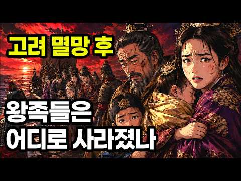
- 챕터: 0:00 돌아오지 않은 배 · 3:03 코리아 — 474년 고려의 무게 · 6:58 영웅 이성계, 그리고 무너지는 고려 · 13:39 위화도 회군과 정몽주, 선죽교 · 22:21 관용에서 학살로 — 이흥무 옥사 · 27:34 엿새의 학살 (강화·삼척·거제) · 32:40 구멍 뚫린 배, 그리고 공양왕의 두 무덤 · 36:07 살아남은 자들 — 성을 바꾼 핏줄 · 42:49 죽인 나라가 되살리다 — 숭의전과 복권 · 45:34 경순왕과 마의태자, 그리고 남은 질문
- 설명 앞부분: 1394년, 고려 왕족 수백 명이 단 엿새 만에 바다에 던져졌습니다. 조선왕조실록에 또렷이 적혀 있지만, 우리가 거의 배운 적 없는 '왕씨 몰살'의 진실입니다. 918년부터 1392년까지, 무려 474년을 이어온 고려. 코리아라는 이름의 뿌리이자, 고려청자와 금속활자, 팔만대장경을 남긴 그 찬란한 나라의 핏줄이, 새 나라 조선이 들어선 지 단 2년 만에 — 강화도에서, 삼척에서, 거제에서, 차례로 사라졌습니다. 고려의 마지막 임금 공양왕은 두 아들과 함께 끈에 목이 졸렸고, 거제 앞바다를 떠난 배 한 척은 끝내 돌아오지 않았습니다…
- 같은 채널 평소 대비 ×116.6 (채널 최근 롱폼 중앙값 1,344회) · 평소 영상: 고구려 멸망, 수십만 당나라 대군을 막고도 무너진 진짜 이유 (1,379회) / 김이박이 인구 절반인 이유 ∣ 조선 후기, 신분에는 가격표가 붙어 있었다 (1,309회)
- 대본 없음 (설명) — 음성인식이 끝나면 도입부·흐름이 들어감
- 댓글 371/371: 좋은 점 — 영상 2 · 감사·응원 11 · 더 알고 싶은 것 2 · 아쉬운 점 — 영상 4 · 반박·불만 — 의견 다름 7 · 정치·사회 21 · 경험 공유 11 · 구독·다음 기대 0
  - 좋은 점 — 영상 👍2 “ㅎㅎ 이성계가 그게 무슨 인간이냐 역사적 인물로 좋은평가를 내리기엔 수준미달 같다 군인으로서 활약을 따저봐도 썩 두드러진 업적이있는것도 아니고 별로 눈에 띠는것도없잔아 거창하게 미화하지만 활하나 잘쏘았다고 그분야에서 능력이 있는 지는 모르겠지만 전략이나 전술에 무능하…”
  - 감사·응원 👍70 “제가 고려왕족의 후손인 개성왕씨입니다. 고려시대의 비극을 잘말씀해주셔서 감사합니다.”
  - 감사·응원 👍8 “가슴이 먹멍 합니다 ! 해병 505기 좋은 동영상 잘보고갑니다 감사합니다 ❤”
  - 더 알고 싶은 것 👍3 “다음은사라진금관가야 를알려주세요 금과가야 가망할때 대마도로 피신했다는데 대마도는한국땅이고한국인김해김씨후손들이라는데맞는말인지”
  - 아쉬운 점 — 영상 👍5 “어느나라든 이같은 역사는 있지요 그만큼 권력이 중요시 되고 한나라의 통일이 되려면 상대쪽은 죄가 없어도 나중에 역모하고 어쩌고 저쩌고 해서 나라를 어지럽게 만들 요인들을 처단하는게 당연시되던 시절이죠 지금도 마찬가지 배트남 필리핀을 여성상위시대로 만들고 남자들을 가정…”
  - 아쉬운 점 — 영상 👍1 “요점섭ㅇ는 잡소리가 너무 길어”
  - 반박·불만 — 의견 다름 👍4 “몽골과 전쟁하던 진짜 강화도는 지금 인천 강화도가 아닙니다.”
  - 반박·불만 — 의견 다름 👍4 “글쎄.. 주위에 없어요”
  - 정치·사회 👍51 “저의 할머니 세분이 공주(목종녀, 충선왕녀, 공민왕녀), 마지막 할머니가 공민왕 따님…후손들이 벼슬안하고 (유언남기심)…경남 진주까지 내려와 살았습니다. 전 정말 가난하게 살았습니다. 어머니는 우리를 위해 굶으셨다는…흑흑… 그래도 선조들은 조선 시대 나라가 어려워 졌…”
  - 정치·사회 👍21 “고려의 입장에서 보면 이성계의 위화도회군은 위화도반란이라고 해야 했다. 또한 고려의 왕씨 왕좌 중에 최충헌 등 무신이 정권을 잡은 세월이 적지 않았다.”
  - 경험 공유 👍76 “왕씨들 고려 시대때까지도 토지가 중국 북부는 물론 남동쪽까지 잘 유지 했었는데 조선이 세워지면서 원나라에 거진 넘어갔다ㅡㅡ고려왕족이 정치를 잘못한것도 있지만 이성계의 개인 욕심때문에 고려땅 반이상이 다 넘어간거다!!”
  - 경험 공유 👍70 “제가 고려왕족의 후손인 개성왕씨입니다. 고려시대의 비극을 잘말씀해주셔서 감사합니다.”

### 335. 조선왕조실록에 3000번 등장하는 단 한 사람ㅣ숙종의 사약을 세 사발이나 마신 노론 영수ㅣ우암 송시열

- https://www.youtube.com/watch?v=NRtLHrlkspU · 한밤의 한국사 · 구독자 46,600 · 조회수 749,009 (×16.1, 하루 5,031.9) · 좋아요 15,342 (2.1%) · 60.7분 · 2026-05-25 · 주제 묶음 3. 조선 · 형식 수면·낭독 (잠잘 때 듣는) · 폴더 `W_NRtLHrlkspU` (웹 승인)
- 썸네일: 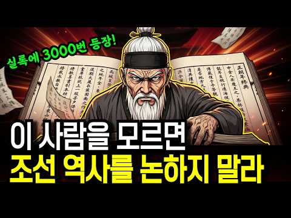
- 설명 앞부분: 조선왕조실록에 무려 3000번이나 등장하는 단 한 사람. 공자 다음의 '송자'라 불리며 살아서는 거유, 죽어서는 성인 반열에 오른 노학자. 그러나 83세에 사약을 세 사발이나 마시고 정읍 객사에서 비참하게 숨을 거둔 한 인간. 조선 후기 200년을 지배한 노론의 시조, 우암 송시열. 그는 성인이었을까요, 독재자였을까요. 이번 영상에서는 우암 송시열의 일생을 통해 예송논쟁, 사문난적 사건, 경신환국, 기사환국, 그리고 노론의 시작까지 조선 후기 정치사의 핵심을 한 번에 풀어드립니다. 📚 참고 자료 조선왕조실록 (효종실록·현종실록·숙…
- 같은 채널 평소 대비 ×11.5 (채널 최근 롱폼 중앙값 65,357회) · 평소 영상: 한국사 총정리 몰아보기ㅣ고조선부터 대한민국까지 5000년 풀스토리ㅣ자면서 들으세요 (65,357회) / 한명회도 울고 갈 조선 최악의 간신ㅣ조선왕조실록이 '소인 중의 소인'이라 부른 단 한 사… (69,488회)
- 대본 없음 (설명) — 음성인식이 끝나면 도입부·흐름이 들어감
- 댓글 635/645: 좋은 점 — 영상 10 · 감사·응원 9 · 더 알고 싶은 것 0 · 아쉬운 점 — 영상 3 · 반박·불만 — 의견 다름 9 · 정치·사회 46 · 경험 공유 11 · 구독·다음 기대 1
  - 좋은 점 — 영상 👍5 “학문이 인간의 삶에 유익을 끼쳐야 진정한 학문이지 삼년상이나 1년상인냐로 싸우는것이 무슨 학문인가?”
  - 좋은 점 — 영상 👍3 “조선사대부 !!!!!! 역사의 전진에 일도 도움이 안된다 !!”
  - 감사·응원 👍2 “역사는 안타까울 뿐이지. 쫑궈어도 명을 떠나 청으로 넘어가는데 안타까운 조선. 역사는 흐른다. 영원한 적도 영원한 우방도 없다. 힘내자. 대한민국!”
  - 감사·응원 👍2 “잘들어습니다 공부많이했습니다 감사합니다”
  - 아쉬운 점 — 영상 👍171 “스스로의 인문적 철학이(난 이것을 르네상스적 사고라 말한다) 없었으니 오로지 사대주의적 주자학에만 미쳐서 세상의 변화를 읽지못하다 결국 외세에 나라마저 뺏긴 조선의 역사! 500년의 역사라하여 미화만 할것이 아니라 잘못된 역사가 반복되지 않도록 철저히 반면교사로 삼아…”
  - 아쉬운 점 — 영상 👍0 “굴러먹다니 란 표현은 좀 지나치다 생각이드네요 정정하시라 말씀드리고 싶네요”
  - 반박·불만 — 의견 다름 👍1 “그리고 그 증명을 하듯 그들의 제자가 만든것이 만동묘인게 결코 우연은 아니죠. 이미 망한 명나라 황제를 섬겨서 무얼 깨닫고 무얼 얻는 게 있습니까? 결국 정신만 썩어 나가며 많은 학자가 서로 의견을 논하기 싫어 하게 만든 흐름을 굳힌거 아닙니까? 그래서 그가 비판이라…”
  - 반박·불만 — 의견 다름 👍1 “두말 필요없는 사대부의 독재자이죠. 비판이 없어지면 그 학문도 정신도 부패하고 변혁을 이끌수 없으니대깐요. 그 결과가 경술국치라고 부르기도 아까운 일제강점기니.나중에 대원군이 어찌해볼려 해도 암탉도 있었고 말입니다. 비판은 결코 욕이 아닙니다. 자신의 잘못을 알려주는…”
  - 정치·사회 👍134 “저런 정쟁, 당파싸움때문에 국민들 등만 터지는 지금의 나라가 되었다”
  - 정치·사회 👍72 “얍삽하노.저런넘들이 많으니 나라가 망했지”
  - 경험 공유 👍4 “송시열이 시조인데 그래서 그런가 나도 고집 엄청 센데.역시 피는 못 속이는구나ㅋ”
  - 경험 공유 👍2 “머리 좋은놈이 권력을 잡고. 무지한 신념에 빠지면서 오래살면서 제자를 길러내면서 확장하면... 가난과 고통과 어려운 것은 국민들. 민생이다. 권력 잡은 놈들은 자기 권력 계속 유지를 위해 정쟁할뿐이고~~ 내 살길은 내가 만들어야 한다. 과거도 지금도 미래에도 인간 본…”
  - 구독·다음 기대 👍32 “쥐새끼 처럼 궁궐에서 빤스런한 인조 설명이 너무나 감탄스럽습니다. 감동이기에 구독합니다~~”

### 336. [감동 사극] 악독한 계모를 피해 도망친 두 자매! 자식 없이 늙어가는 농부의 수양딸이 되어 조선 최고의 거상으로 거듭난 기막힌 사연 (힐링 썰)

- https://www.youtube.com/watch?v=9MZ_w0MHkpE · 이야기와 인생 · 구독자 5,350 · 조회수 85,211 (×15.9, 하루 812.9) · 좋아요 2,897 (3.4%) · 176.9분 · 2026-07-08 · 주제 묶음 3. 조선 · 형식 수면·낭독 (잠잘 때 듣는) · 폴더 `W_9MZ_w0MHkpE` (웹 승인)
- 썸네일: 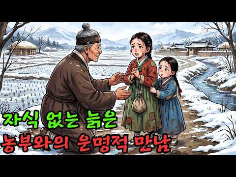
- 설명 앞부분: 피보다 진한 눈물로 맺어진 진짜 가족! 계모의 구박을 피해 도망친 두 자매가 일궈낸 완벽하고 가슴 뭉클한 인생 역전기 🌾✨ 안녕하세요! 저희 채널을 찾아주셔서 진심으로 감사합니다. 오늘 들려드릴 이야기는 아버지가 돌아가신 후 악독한 계모의 모진 매질과 굶주림을 견디다 못해 한겨울 밤 도망친 두 자매가, 외롭게 홀로 늙어가던 마음씨 고운 부농(富農)을 만나 벌어지는 따뜻하고 통쾌한 사극 썰입니다. "너희 같은 혹덩이들은 당장 얼어 죽어도 싸다!" 계모의 저주를 뒤로한 채 거리를 헤매다 쓰러진 자매. 그들을 거두어준 것은 평생 흙을 …
- 같은 채널 평소 대비 ×24.2 (채널 최근 롱폼 중앙값 3,526회) · 평소 영상: [감동 사극] "제발 이 아이만은 살려주십시오!" 피투성이 여인이 매달린 선비의 소름 돋… (3,526회) / [사극 로맨스] 숲에서 길을 잃은 태자의 입맛을 사로잡은 산골 처녀의 '비법 훈제 고기'… (3,643회)
- 대본 없음 (설명) — 음성인식이 끝나면 도입부·흐름이 들어감
- 댓글 73/73: 좋은 점 — 영상 2 · 감사·응원 7 · 더 알고 싶은 것 1 · 아쉬운 점 — 영상 4 · 반박·불만 — 의견 다름 1 · 정치·사회 0 · 경험 공유 0 · 구독·다음 기대 0
  - 좋은 점 — 영상 👍10 “너무 아름답고 좋은 내용입니다. 감동 받고 갑니다.”
  - 좋은 점 — 영상 👍5 “좋은 내용에 쥔장께 감사드립니다 사람이 왜 살아가야 하는지 조용히 생각해 보게 하는 사연이네요~감사합니다~”
  - 감사·응원 👍7 “감동깊게 잘 듣고갑니다 감사합니다~~^^”
  - 감사·응원 👍5 “좋은 내용에 쥔장께 감사드립니다 사람이 왜 살아가야 하는지 조용히 생각해 보게 하는 사연이네요~감사합니다~”
  - 더 알고 싶은 것 👍10 “댓글좀 보세요. 화면을 제대로 올려주세요”
  - 아쉬운 점 — 영상 👍3 “광고가 왜이리많아 질리네”
  - 아쉬운 점 — 영상 👍2 “광고가 너무 많아 듣고 싶지 않아요”
  - 반박·불만 — 의견 다름 👍3 “화면 을 굳이 여러개를 올리는 까닥이 뭔가요 작가라는 사람 이 독자 생각을 안하고 글쓰는 모습은 화면안에 안보여도 됩니다 문장의 구성은 좋지만 내용하고 화면이 전혀 맞지 않아 이런 Ai작품은 보고 싶지 않습니다 어른만 이런것 보는것이 아닙니다. 뒷화면은 버려주세요 ㅠ…”

### 337. 오천 명이 사흘을 버틴 그날, 프레임 밖엔 한국 청년들이 있었다 ∣ 지평리 전투

- https://www.youtube.com/watch?v=-H2SXWoldbw · 역사참판 · 구독자 2,890 · 조회수 45,197 (×15.6, 하루 686.8) · 좋아요 415 (0.9%) · 42.3분 · 2026-08-16 · 주제 묶음 7. 전쟁·군사사 · 형식 정보·해설 (그 밖) · 폴더 `W_-H2SXWoldbw` (웹 승인)
- 썸네일: 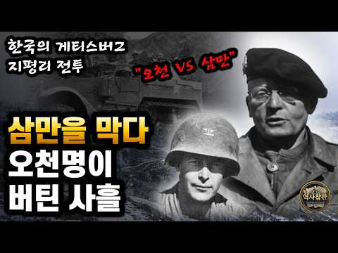
- 챕터: 0:00 별을 스스로 뗀 장군, 그리고 프레임 밖의 이름들 · 3:16 지평리 이전의 겨울: 얕본 자와 준비한 자 · 6:57 적의 언어를 아는 대령, 프리먼 · 12:34 그 원 안에 있던 한국 청년들 · 15:30 첫 번째 밤, 나팔 소리와 죽음의 그물 · 24:58 뚫린 남쪽 방어선, 그리고 김재세 · 33:09 포위를 뚫은 전차와 가장 씁쓸한 진실 · 42:25 승리의 사진에서 잘려나간 얼굴들
- 설명 앞부분: 별 넷을 스스로 뗀 프랑스 장군이 있었습니다. 지구 반대편, 얼어붙은 한국의 작은 마을로 가기 위해서였죠. 우리는 지평리를 '승리'라는 한 단어로 기억합니다. 그런데 그 사흘 밤, 방어선은 실제로 뚫렸고, 되찾으러 올라간 병사들은 아군의 포탄 아래 쓰러졌습니다. 그리고 그 얼어붙은 원 안에는, 우리가 거의 들어본 적 없는 사람들이 함께 있었습니다. 프랑스 군복을 입은 한국 청년들, 미군 부대에 배속돼 참호를 지킨 스무 살의 한국군. 별을 뗀 장군과 적의 언어로 싸운 대령의 이름 뒤편에, 이름조차 남기지 못한 얼굴들이 있었어요. 오…
- 같은 채널 평소 대비 ×82.8 (채널 최근 롱폼 중앙값 546회) · 평소 영상: 정원 60명 배에 14,000명, 근데 부두엔 남겨진 절반이 있었다 (546회) / 히딩크가 반말을 시킨 진짜 이유, 그리고 24년 뒤 홍명보에게 벌어진 일 (572회)
- 대본 없음 (설명) — 음성인식이 끝나면 도입부·흐름이 들어감
- 댓글 24/24: 좋은 점 — 영상 0 · 감사·응원 5 · 더 알고 싶은 것 0 · 아쉬운 점 — 영상 1 · 반박·불만 — 의견 다름 0 · 정치·사회 0 · 경험 공유 2 · 구독·다음 기대 0
  - 감사·응원 👍6 “진심으로 감사드립니다 Lest we forget. In Australia 🇦🇺”
  - 감사·응원 👍5 “지평 막걸리 🎉 리즈웨이~ 고마운 분입니다 프리먼 장군~ 프렌치 고맙습니다 🎉 낙동강🎉”
  - 아쉬운 점 — 영상 👍0 “개 잣같은 ai 목소리..!! 이딜가나 지겹게 듣는 ai !!!!”
  - 경험 공유 👍2 “내가 근무했던 미2사단의 Camp Red loud內 본청 건물名이 "Freeman Hall" 이었는데 역시 영웅이었구나. 감사합니다. 여러분들은 점령군이 아니었습니다. 자유는 공짜가 아니었군요. 멸공!!!”

### 338. 수메르인의 DNA를 전 세계 고대 문명과 비교했다… 문명사의 판도를 흔든 뜻밖의 결과

- https://www.youtube.com/watch?v=V40fQEAfXbM · DNA의 비밀 · 구독자 2,300 · 조회수 35,955 (×15.6, 하루 2,193.2) · 좋아요 166 (0.5%) · 19.4분 · 2026-10-04 · 주제 묶음 8. 문명·고고학 · 형식 정보·해설 (그 밖) · 폴더 `W_V40fQEAfXbM` (웹 승인)
- 썸네일: 
- 챕터: 0:00 하버드 유전학팀의 충격적인 발견 · 1:30 우바이드 문화와 수메르의 갑작스런 등장 · 4:00 레너드 울리와 수메르 문제 (언어적 고립) · 8:00 막스 플랑크 연구소의 DNA 분석 (급격한 인구 교체) · 11:20 에리두 창세비기와 수메르 왕명록의 비밀 · 14:15 고아 유전자 634개와 진화론의 모순 · 17:40 사그기가(Sag-gigga)와 아누나키의 인류 창조 · 19:30 결론: 우리는 누구인가?
- 설명 앞부분: Video: 수메르인의 DNA를 전 세계 고대 문명과 비교했다… 문명사의 판도를 흔든 뜻밖의 결과 """2018년 하버드 유전학 연구팀과 2019년 막스 플랑크 연구소의 고대 DNA 분석 결과, 수메르인의 유전자는 인류 역사상 그 어떤 집단과도 일치하지 않는 완벽한 고립을 보여주었습니다. 그들은 어디서 왔을까요? 우바이드 원시 문화에서 갑자기 고도의 수학, 천문학, 문자를 갖춘 수메르 문명으로 도약한 이유는 무엇일까요? 이 영상에서는 진화론으로 설명할 수 없는 '고아 유전자(Orphan genes)', J2a 하플로그룹의 미스터리…
- 같은 채널 평소 대비 ×115.2 (채널 최근 롱폼 중앙값 312회) · 평소 영상: 한국인의 DNA를 유럽인과 비교했다… 예상과 전혀 다른 충격적인 결과가 나왔다 (312회) / 미국 흑인의 DNA에서 아무도 예상하지 못한 흔적이 발견됐다… 다른 집단에서는 찾을 수 … (295회)
- 대본 없음 (설명) — 음성인식이 끝나면 도입부·흐름이 들어감
- 댓글 9/9: 좋은 점 — 영상 0 · 감사·응원 0 · 더 알고 싶은 것 0 · 아쉬운 점 — 영상 0 · 반박·불만 — 의견 다름 1 · 정치·사회 0 · 경험 공유 0 · 구독·다음 기대 0
  - 반박·불만 — 의견 다름 👍1 “헛소리~~ 시간 낭비~~”

### 339. 돌 하나가 침묵하던 역사를 깨웠다..3천년을 버텨낸 고대이집트 문명의 실체 l 고대 이집트 파라오 역사

- https://www.youtube.com/watch?v=OHxH6e2-3sU · 역사포커스 · 구독자 10,200 · 조회수 157,158 (×15.4, 하루 876.9) · 좋아요 1,401 (0.9%) · 54.6분 · 2026-04-25 · 주제 묶음 8. 문명·고고학 · 형식 정보·해설 (그 밖) · 폴더 `W_OHxH6e2-3sU` (웹 승인)
- 썸네일: 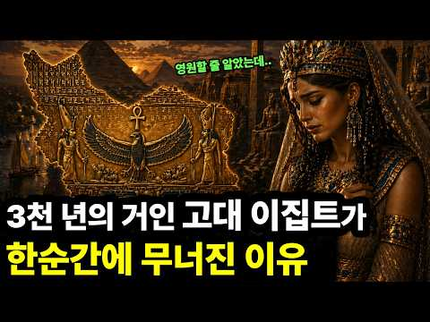
- 설명 앞부분: 사막 속 피라미드 뒤에 숨겨진 진짜 이집트의 이야기. 나일강이 만든 질서와 3천 년 문명의 비밀이 밝혀집니다. 왕과 신, 그리고 평범한 사람들까지 기록으로 살아난 역사. 잊혀졌던 문명이 어떻게 다시 말을 시작했는지 확인해보세요. 📢BGM Track - PerituneMaterial - Melancholy3
- 같은 채널 평소 대비 ×32.3 (채널 최근 롱폼 중앙값 4,866회) · 평소 영상: 핵보유국을 건드린 최빈국.. 아프간이 싸움을 멈추지 않는 진짜이유 l 파키스탄 아프가니스… (4,948회) / 로마도 정복 못한 스코틀랜드 북부의 지배자, 픽트족이 사라진 충격적인 이유 l 픽트족 역… (4,783회)
- 대본 없음 (설명) — 음성인식이 끝나면 도입부·흐름이 들어감
- 댓글 35/35: 좋은 점 — 영상 1 · 감사·응원 0 · 더 알고 싶은 것 0 · 아쉬운 점 — 영상 1 · 반박·불만 — 의견 다름 2 · 정치·사회 3 · 경험 공유 1 · 구독·다음 기대 0
  - 좋은 점 — 영상 👍5 “좀 길어서 지루하지만 보다채널보단 훨씬 유익하다.”
  - 아쉬운 점 — 영상 👍5 “좀 길어서 지루하지만 보다채널보단 훨씬 유익하다.”
  - 반박·불만 — 의견 다름 👍2 “역사를 어케 볼것이가? 다양한 시각이; 고대 이집트는 3000년 동안 벙영~! 이게 짧은건 아닙니다. 서서히 하향 했다가 더 정답 일 수도? 결정타는 강력한 왕국이 서서히 약해지기 시작했로 보는게 역사학자들 대부분 의견입니다. 해외에서,”
  - 정치·사회 👍21 “39:08 수천년 전 왕이 신이라고 믿었던 이집트 문명에서조차 노동파업을 정식기록으로 남겼는데, 현대 중국이나 북한 같은 국가에서 하는 검열을 보면 오히려 문명이 퇴보한 것 같음. 53:44 4천년 전 이집트인이 남긴 문구: "가난한 자에게 빵을 주고, 벌거벗은 자에…”
  - 경험 공유 👍0 “저도슬펐습니다 클레오파트라의사망딛고 뱀의 물려다 사망했기에 너무안타까웠어요 시저와 안토니우스 간다고얘기듣고 저는 그만 얼마나 아팠을까요”

### 340. 《한국사》장희빈 vs 인현왕후 , 누가 진짜 악녀일까? 사극이 감춘 진실.

- https://www.youtube.com/watch?v=_nA4lx-XhpI · 역사속을걷다 · 구독자 12,100 · 조회수 181,284 (×15.0, 하루 1,146.9) · 좋아요 2,141 (1.2%) · 52.1분 · 2026-05-16 · 주제 묶음 4. 한국 근현대사 · 형식 정보·해설 (그 밖) · 폴더 `W__nA4lx-XhpI` (웹 승인)
- 썸네일: 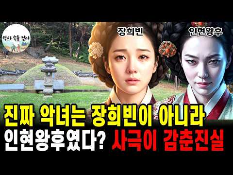
- 설명 앞부분: 여러분, 만약 우리가 믿어온 한 여인의 이야기가 사실은 승자들이 만들어낸 정교한 거짓말이었다면 어떨까요. 만약 사약을 거부하며 발악했다는 그 유명한 장면이, 정사 어디에도 기록되지 않은 허구라면. 만약 그녀가 악녀가 아니라, 왕과 신하들의 권력 게임에서 이용당하고 버려진 한 명의 정치적 희생양이었다면. 우리가 알고 있는 조선 최고의 악녀, 장희빈. 오늘 그녀의 이름 뒤에 숨겨진 300년의 프레임을 벗겨내고, 실록이 말하는 진짜 장옥정의 얼굴을 마주하게 됩니다. 당신이 알고 있던 모든 것이, 지금부터 흔들리기 시작합니다. ▪ 조선왕…
- 같은 채널 평소 대비 ×178.1 (채널 최근 롱폼 중앙값 1,018회) · 평소 영상: 《한국사》광해군은 왜 인목왕후를 서궁에 가뒀나. 사극이 숨긴 진짜 이야기 (1,190회) / 《한국사》교과서는 전부 거짓말? 당신이 몰랐던 선조의 충격적 진실 (1,198회)
- 대본 없음 (설명) — 음성인식이 끝나면 도입부·흐름이 들어감
- 댓글 299/300: 좋은 점 — 영상 0 · 감사·응원 3 · 더 알고 싶은 것 2 · 아쉬운 점 — 영상 2 · 반박·불만 — 의견 다름 7 · 정치·사회 12 · 경험 공유 7 · 구독·다음 기대 1
  - 감사·응원 👍11 “사실(史實-事實)인 이야기일 수 있겠지만, 참... 인현도 기가 찬... 사악한 보통여자였군요. 실체를 알게 해 주시어 감사합니다.”
  - 감사·응원 👍3 “구독 좋아요 꾸욱 누르고 화이팅입니다 🎉”
  - 더 알고 싶은 것 👍1 “이것 또한 거짓인거지 어떤 사실인지 누가 아나요?”
  - 반박·불만 — 의견 다름 👍12 “역사비틀기. 악을 선으로 비틀어 옳고 그름을 지우는 시도는 정신을 병들게합니다. 악을 선으로, 선을 악으로 둔갑시키기. 지금도 일어나고 있으니 선동되지 맙시다.”
  - 반박·불만 — 의견 다름 👍9 “최숙빈이 무수리였을 때 장희빈이 매질하고 항아리에 가둔 것도 사실왜곡인가요? ㅋㅋ 어이없네”
  - 정치·사회 👍17 “춘향전의 첫소절이 [숙종대왕 즉위 초에 성덕이 넙우시사 ~]으로 나옵니다. 인조이후 정권을 잡은 노론세력의 줄기가 인현왕후였고, 정치권력이 전혀 없는 중인가문 출신의 장희빈이였기에, 장희빈을 권력의 비틀음으로 악녀로 만들었겠지요. 그것을 알고있는 조선의 민초들은 성춘…”
  - 정치·사회 👍15 “여기 댓글 보면 알겠지만, 이런 장희빈 재평가 영상은 사람들에게 강력한 거부감을 일으킴 ㅋㅋㅋ 실록이 제대로 번역되기 전, 한글로 쓴 인현왕후전 나부랭이와 그를 바탕으로 쓴 드라마로 인해 이미 악녀로 굳어졌거든ㅋㅋㅋ 이성이 아닌 감성의 영역으로 넘어간 상황. 참 사람…”
  - 경험 공유 👍67 “숙빈을 궁에서 내치고 다시는 안보았다는 사실에 의아했었는데, 숙종도 숙빈의 계략에 넘어갔음을 뒤늦게 깨달은거죠~그렇다고 또 후궁을 죽일수도없고 내쫓은거죠 (역사는 승자의기록,영조가 왕된후 장희빈을 희대의 악녀로 기록한것일듯) 영조의 품성은 숙빈을 닮은듯”
  - 경험 공유 👍4 “저 이게임 해봤어요~ 붕당정치는 O X 오징어게임이지! 숙종의 간사함으로 좌 아니면 우 어딜 선택하든 한번은 환국으로 몰살당함”
  - 구독·다음 기대 👍1 “나래이션 어휘와 표현, 내용 모두 고급지고 좋습니다. 구독합니다.”

### 341. 대체 무슨 일이 있었던 걸까? 아직도 풀리지 않은 한국사 미스터리 TOP5

- https://www.youtube.com/watch?v=XTkcF4ZQXnY · 왕의서재 · 구독자 2,140 · 조회수 31,912 (×14.9, 하루 742.6) · 좋아요 93 (0.3%) · 17분 · 2026-09-08 · 주제 묶음 4. 한국 근현대사 · 형식 인터뷰·강연·대담 · 폴더 `W_XTkcF4ZQXnY` (웹 승인)
- 썸네일: 
- 챕터: 0:00 실록에 남은 소름 끼치는 기록 · 1:30 5위 궁궐의 저주 사건 · 4:30 4위 소현세자의 의문사 · 8:00 3위 정조 독살설 · 11:30 2위 명성황후, 사라진 시신의 행방 · 14:30 1위 조선 왕릉 도굴 미스터리
- 설명 앞부분: 👑 왕의 서재 — 역사를 통해 오늘을 읽고, 지혜로 미래를 준비합니다. 조선왕조실록을 중심으로 한국사 속 인물들의 진짜 이야기를 전해 드리는 채널입니다. 조선의 왕세자가 청나라에서 돌아온 지 두 달 만에 세상을 떠났습니다. 그런데 그 시신의 상태가, 도저히 정상적인 죽음으로 보이지 않았다고 실록에 기록되어 있습니다. 궁궐에서 벌어진 저주 소동, 소현세자의 의문사, 정조 독살설, 명성황후 시신의 행방, 그리고 지금까지 단 한 번도 열리지 않은 조선 왕릉의 비밀까지. 오늘은 실제 기록에 남아 있는 한국사의 다섯 가지 미스터리를 전해 …
- 같은 채널 평소 대비 ×50.7 (채널 최근 롱폼 중앙값 630회) · 평소 영상: 호랑이를 잡는 군대가 조선에 있었다? 아무나 들어갈 수 없었던 최정예 부대 TOP3 (692회) / 독립하면 3대가 망하고 친일하면 3대가 흥한다, 그 말은 사실이었다 (568회)
- 대본 없음 (설명) — 음성인식이 끝나면 도입부·흐름이 들어감
- 댓글 14/14: 좋은 점 — 영상 1 · 감사·응원 1 · 더 알고 싶은 것 0 · 아쉬운 점 — 영상 0 · 반박·불만 — 의견 다름 0 · 정치·사회 0 · 경험 공유 0 · 구독·다음 기대 0
  - 좋은 점 — 영상 👍1 “좋은내용 감사합니다!”
  - 감사·응원 👍1 “좋은내용 감사합니다!”

### 342. 효령대군, 세종보다 37년 더 살았다 ∣ 9명의 왕을 지켜본 둘째 왕자

- https://www.youtube.com/watch?v=zZQ_1_dLarU · 그날의역사 · 구독자 7,060 · 조회수 103,515 (×14.7, 하루 727.2) · 좋아요 709 (0.7%) · 21.6분 · 2026-05-31 · 주제 묶음 3. 조선 · 형식 정보·해설 (그 밖) · 폴더 `W_zZQ_1_dLarU` (웹 승인)
- 썸네일: 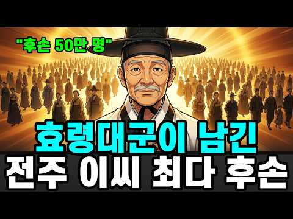
- 설명 앞부분: 조선 왕족 중에서 가장 오래 산 사람이 누구였을까요. 왕도 아니고 장수도 아니었습니다. 태종의 둘째 아들 효령대군은 23살에 동생 충녕에게 왕좌를 비키고, 그 자리에서 비로소 91년을 시작합니다. 큰형 양녕은 69세, 동생 세종은 54세, 조카 세조는 52세. 조선 왕의 평균 수명은 47세였습니다. 그런데 그는 91세까지 살아남아 태조에서 성종까지 아홉 명의 임금이 옥좌에 앉았다 내려가는 모습을 모두 지켜봤습니다. 이 영상에서 다루는 내용 1418년 6월 3일, 둘째인데 셋째에게 밀린 그날 절로 향한 발걸음 — 평생 출가하지 않은…
- 같은 채널 평소 대비 ×209.3 (채널 최근 롱폼 중앙값 494회) · 평소 영상: 정조가 즉위 20일 만에 처단한 숙의 문씨, 그 악녀를 키운 건 영조였다 (510회) / 영화가 보여주지 않은 인간 이순신의 진짜 얼굴ㅣ한국사ㅣ임진왜란 (479회)
- 대본 없음 (설명) — 음성인식이 끝나면 도입부·흐름이 들어감
- 댓글 162/162: 좋은 점 — 영상 0 · 감사·응원 3 · 더 알고 싶은 것 0 · 아쉬운 점 — 영상 1 · 반박·불만 — 의견 다름 2 · 정치·사회 2 · 경험 공유 9 · 구독·다음 기대 0
  - 감사·응원 👍12 “효령대군에게 가장 감사한 인물을 굳이 하나 꼽자면 그의 장인인 정역이 아닐까? 양녕의 장인 김한로는 사위가 폐세자가 되면서 연좌되어 삭탈관직 후 유배를 갔고 세종의 장인인 심온은 아예 역적으로 몰려 사약을 받고 온집안이 거덜이 나버린거에 비하면. 장인은 사위가 미치도…”
  - 감사·응원 👍5 “양녕대군이 폐세자가 되고 그의 차례가 되었지만 왕좌를 탐하지 않았고 마음을 비워서 90세 넘는 그 시대에 평균수명 두배를 살아 장수하였네요 ~~ 왕좌를 탐낸 조카는 피를 불렀지만 ...넘 대조되는 인생을 살았네요😊현명한듯 하네요 아주 몰입해서 끝까지 잘 시청하고 구독…”
  - 아쉬운 점 — 영상 👍3 “조선시대 장수한 왕족들 (국왕은 제외) ●왕자 1위 효령대군 : 90세 (태종의 차남) 2위 경평군 : 74세 (선조의 11남) 3위 의평군 : 70세 (정종의 장남) 4위 선성군 : 68세 (정종의 4남) 4위 덕천군 : 68세 (정종의 11남) 4위 양녕대군 : …”
  - 정치·사회 👍2 “효령대군파 유명인 후손들 정치인 : 이기붕(부통령), 이계진(전 국회의원), 이학재(인천 서구청장) 종교인 : 이만희(신천지 교주) 연예인 : 이수근(개그맨), 이휘재(방송인), 이성재(배우), 이정재(배우), 이상은(가수), 이수만(가수), 써니(가수, 소녀시대. …”
  - 경험 공유 👍7 “나의 피에는 효령대군의 피가 흐른다. 어머니가 전주이씨 효령대군의 자손이기 때문이다. 물론 아버지의 피는 고려시대 충절의 신하 우탁의 피가 흐르고..그래서 그런지 뼈가 좋은 편이고 동안의 체형을 가지고 있는 편이다. 내가 어릴때 외할머니가 돌아가시자 큰외삼촌이 3년상…”
  - 경험 공유 👍5 “저도 효령대군의 21대손 빼어날 수 돌림입니다 효령대군 할아버지 3째아들 보성군 가문입니다 파시조 이신 효령대군 할아버지 가 자랑 스럽네요”

### 343. 한 토지 소유자가 자신의 밭에서 숨겨진 계단을 발견했다… 그 아래에 있던 것은 모두를 충격에 빠뜨렸다

- https://www.youtube.com/watch?v=MKqGAsTkS8w · 오늘의 고백 · 구독자 14,300 · 조회수 205,023 (×14.3, 하루 1,577.9) · 좋아요 5,344 (2.6%) · 16.8분 · 2026-06-13 · 주제 묶음 기타 · 형식 정보·해설 (그 밖) · 폴더 `W_MKqGAsTkS8w` (웹 승인)
- 썸네일: 
- 설명 앞부분: 경상북도의 한 시골 마을. 평범한 농부가 트랙터로 밭을 갈다가 땅속에서 계단을 발견했습니다. 수십 년째 일궈온 자신의 밭에서, 단 한 번도 본 적 없는 구조물이 모습을 드러낸 것입니다. 처음엔 단순한 오래된 저장 공간이라고 생각했습니다. 하지만 조사가 시작되면서 상황은 완전히 달라졌습니다. 지하에는 방이 있었고, 통로가 있었고, 수백 년 된 문서들이 있었습니다. 그리고 그 문서들 사이에서 불과 3년 전에 작성된 기록이 발견됐습니다. 누군가가 지금도 이 공간을 사용하고 있었다는 뜻이었습니다. 800미터에 달하는 지하 통로, 두 개의…
- 같은 채널 평소 대비 ×33.1 (채널 최근 롱폼 중앙값 6,189회) · 평소 영상: 깊은 바닷속에서 기묘한 돔이 발견됐다… 그 안에 있던 것은 아무도 예상하지 못했다 (6,189회) / 바닷속 동굴을 탐험하던 다이버가 발견한 정체불명의 알들… 전문가들도 정체를 몰랐다 (6,066회)
- 대본 없음 (설명) — 음성인식이 끝나면 도입부·흐름이 들어감
- 댓글 114/114: 좋은 점 — 영상 0 · 감사·응원 0 · 더 알고 싶은 것 1 · 아쉬운 점 — 영상 2 · 반박·불만 — 의견 다름 2 · 정치·사회 1 · 경험 공유 1 · 구독·다음 기대 0
  - 더 알고 싶은 것 👍75 “진짜인가요? 진짜라는 자료 올려주세요 . 안올리면 신고 합니다.”
  - 아쉬운 점 — 영상 👍6 “낚시”
  - 아쉬운 점 — 영상 👍5 “이런 낚시질에?”
  - 반박·불만 — 의견 다름 👍8 “옛날은 방수기술이 없어서 소낙비가 오면 물이 차면 물이 다 서며 들어서 물이 꽉차 있습니다 자하에 물의 흔적이 없다는것이 말도 안됩니다”
  - 반박·불만 — 의견 다름 👍3 “Ai로 이야기로 빨려들때쯤 선동하는 냄새가 뽀록났네💣”
  - 정치·사회 👍6 “이 영상 만든 놈 돈 벌려고 한 것 같은데, 이런 분을 선거관리 위원회에 취직시켜야 안 걸리고 부정 선거를 잘 할 텐데...”
  - 경험 공유 👍1 “먹고 사는것도 여러분류라 열심히 공상소설쓰시고 거기에 낚이는 나도있으니 보면서도 ~ㅎ~ㅎ”

### 344. 조선 왕실 최악의 비극 ∣ 삼대가 죽어야 왕이 될 수 있었던 남자, 철종

- https://www.youtube.com/watch?v=_QrSVpBd6Tg · 역사아카이브 - History Archive KR · 구독자 24,200 · 조회수 344,433 (×14.2, 하루 3,026.6) · 좋아요 10,196 (3.0%) · 75.3분 · 2026-06-29 · 주제 묶음 3. 조선 · 형식 정보·해설 (그 밖) · 폴더 `W__QrSVpBd6Tg` (웹 승인)
- 썸네일: 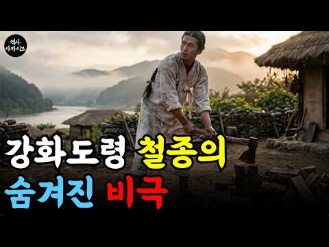
- 챕터: 0:00 도입부 - 강화도의 나무꾼 · 1:15 구독 안내 · 1:30 비극의 시작, 사도세자의 죽음 · 3:40 은언군의 빚과 첫 유배 · 5:50 상계군 옹립 사건과 죽음 · 8:10 신유박해, 일가의 몰락 · 11:00 원범의 탄생과 강화도 유배 · 14:20 헌종의 죽음과 왕실 혈통의 위기 · 17:00 강화도령, 즉위하다 · 19:30 안동 김씨의 세도정치 · 23:00 이하전 사건 · 25:30 임술농민봉기와 개혁의 좌절 · 28:40 동학의 등장 · 30:50 철종의 죽음과 고종의 즉위 · 33:00 마무리 - 비극의 본질
- 설명 앞부분: 강화도에서 나무를 하던 한 청년이 하루아침에 조선의 왕이 됩니다. 흔히 신데렐라 같은 행운의 이야기로 알려진 철종의 즉위는, 사실 할아버지의 사사와 큰어머니의 처형, 큰형의 죽음으로 이어지는 조선 왕실 역사상 가장 비극적인 가족사의 결말이었습니다. 사도세자의 죽음에서 시작된 이 비극이 어떻게 한 나무꾼을 왕좌에 앉히게 되었는지, 조선왕조실록과 한국민족문화대백과사전 등 공인된 사료를 바탕으로 추적합니다. 다음 영상으로 어떤 이야기를 듣고 싶으신가요? 댓글로 남겨주세요. 역사아카이브 멤버쉽 가입 : © 2025 [역사아카이브]. Al…
- 같은 채널 평소 대비 ×18.2 (채널 최근 롱폼 중앙값 18,910회) · 평소 영상: [5시간 연속재생] 조선시대 생활사 8번째 통합 ∣ 우리 조상들의 모습 (18,910회) / 황후의 치마를 들춘 남자｜이완용보다 오래 살아남은 진짜 매국노, 윤덕영 (18,054회)
- 대본 없음 (설명) — 음성인식이 끝나면 도입부·흐름이 들어감
- 댓글 192/192: 좋은 점 — 영상 1 · 감사·응원 7 · 더 알고 싶은 것 2 · 아쉬운 점 — 영상 3 · 반박·불만 — 의견 다름 2 · 정치·사회 12 · 경험 공유 6 · 구독·다음 기대 0
  - 좋은 점 — 영상 👍6 “잘 배우고 갑니다😊”
  - 감사·응원 👍18 “지금 우리나라 는 단군이 래 오천년 역사상 제일 잘 살고 있다고생각됩니다 미국편에 줄을 잘 선 건국 대통령 이승만 대통령 과 국민을 잘 살게 만들어 준 박정희 대통령 을 고맙게 생각해 야 합니다 다같이 잘 사는 국가를 만든다고 사회주의 공산주의 국가를 만든 북한 김일…”
  - 감사·응원 👍5 “잘 들었습니다 감사합니다.”
  - 더 알고 싶은 것 👍7 “실시간으로 보면서 느끼는 건데, 철종의 삶을 보면 권력의 정점이라는 왕의 자리가 오히려 한 인간의 자유를 완전히 앗아간 세상에서 가장 화려한 감옥이 아니었나 싶네요, 여러분은 어떻게 생각하시나요? 😥”
  - 더 알고 싶은 것 👍3 “이런거좀 하지맙시다. 100년 전도 모르는데 당신이 어떻게 알죠? 미리 소설이라고 말하세요 😅”
  - 아쉬운 점 — 영상 👍3 “선전. 너무 길어요”
  - 아쉬운 점 — 영상 👍0 “광고가 너무 빈번하게 등장하는군요.”
  - 반박·불만 — 의견 다름 👍0 “참어이없군요”
  - 정치·사회 👍18 “지금 우리나라 는 단군이 래 오천년 역사상 제일 잘 살고 있다고생각됩니다 미국편에 줄을 잘 선 건국 대통령 이승만 대통령 과 국민을 잘 살게 만들어 준 박정희 대통령 을 고맙게 생각해 야 합니다 다같이 잘 사는 국가를 만든다고 사회주의 공산주의 국가를 만든 북한 김일…”
  - 정치·사회 👍14 “슬픈 조선! 정조가 이뤄놓은 나라가 이 정도였나?”
  - 경험 공유 👍33 “슬퍼요 시작하자 마자요 한청년만 살아남아 살아가는 모습이여 얼마나 처절한 사연이 있을까 싶어지네요 저도 어느덧 청년이 되어서 아들이 있거든요”
  - 경험 공유 👍2 “안동김씨가. 망국의원인이었네요.조선왕조를500년을망하게했네요. 내가전주이씨인데.아마조상이 전주이씨라는 성씨를받기위해 돈으로산성씨인지도모르죠. 친정족보책은 봤습니다만. 효령대군의 자손이라고. 울.아부지는 엄청자부심을 가지고살았습니다만.역사를 뒤돌아볼때. 단종의죽음에 일…”

### 345. 이순신을 살린 대한민국 함대, 1598년 조선에 갇혔다 ∣ 1시간 Full Movie ∣ 4K

- https://www.youtube.com/watch?v=dUD9yKNxGps · 대한 타임슬립 본부 · 구독자 16,100 · 조회수 224,770 (×14.0, 하루 8,556.5) · 좋아요 1,574 (0.7%) · 60.4분 · 2026-09-25 · 주제 묶음 3. 조선 · 형식 몰아보기·통합본 (긴 영상) · 폴더 `W_dUD9yKNxGps` (웹 승인)
- 썸네일: 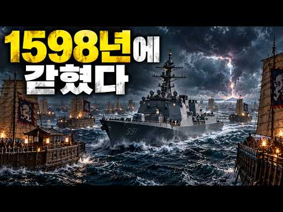
- 챕터: 0:00 부산진·동래성 — 왜선 700척, 전쟁의 시작 · 7:27 노량 — 대한민국 함대가 1598년에 갇히다 · 22:20 체포령 — 이순신을 다시 잡아오라 · 32:22 부산 — 묶인 조선인을 태운 수송선 · 40:16 대마도 — 끌려간 백성을 되찾다 · 46:35 규슈 — 코무덤과 남겨진 기록 · 51:48 노량 — 왜선 300척, 다시 남해로 · 56:56 1603 — 현대 화력이 멈춘 뒤, 조선은 달라졌다
- 설명 앞부분: 1592년 부산진과 동래성에서 시작된 전쟁. 1598년 노량에서 이순신을 살린 대한민국 함대는 돌아가지 못했습니다. 그리고 그들은 조선에 남았습니다. 부산 회수, 대마도와 규슈, 코무덤에 남겨진 기록, 다시 조선을 향해 몰려온 왜선 300척. 그리고 1603년, 현대의 화력이 멈춘 뒤에도 스스로 침략을 막아내기 시작한 조선까지. 《대한국 프로젝트2 — 불침》 부산진·동래성 서막 + 전 7편 + 1603 확장 피날레를 하나의 장편으로 구성한 완성판 Full Movie입니다. ■ 작전 제작 노트 대한국 프로젝트를 처음 기획할 때, 하…
- 같은 채널 평소 대비 ×3.6 (채널 최근 롱폼 중앙값 61,870회) · 평소 영상: 400년 전 조선에 남겨진 한국 잠수함을 찾아갔다… 그런데 우리가 처음이 아니었다 ∣ 4K (61,870회) / 이순신 대마도 상륙, 대한민국 구축함이 왜군 포대를 쐈다 ∣ 대한국 프로젝트2 ∣ 4K (77,902회)
- 대본 없음 (설명) — 음성인식이 끝나면 도입부·흐름이 들어감
- 댓글 108/139: 좋은 점 — 영상 1 · 감사·응원 2 · 더 알고 싶은 것 7 · 아쉬운 점 — 영상 0 · 반박·불만 — 의견 다름 3 · 정치·사회 0 · 경험 공유 0 · 구독·다음 기대 0
  - 좋은 점 — 영상 👍1 “통 쾌 하 다 시 원 하 다 좋은영상 감사합니다 👏 👏 👏 👏 👏 👏 👏 👏 👏 👏 👏 👏”
  - 감사·응원 👍1 “통 쾌 하 다 시 원 하 다 좋은영상 감사합니다 👏 👏 👏 👏 👏 👏 👏 👏 👏 👏 👏 👏”
  - 감사·응원 👍1 “돌아가면 가짜 국방부에. 엄청깨지겠네. 그래도 고맙다”
  - 더 알고 싶은 것 👍7 “다음 전투영사아도 부탁드립니다 대한님!”
  - 더 알고 싶은 것 👍4 “해군의 어느 함정에서도 정복을 착용하고 근무하는 경우가 있으면 ✋️ 손 꼽아 보시오!(근무복/전투복으로 변경 부탁드립니다 🙏)😮”
  - 반박·불만 — 의견 다름 👍1 “통통배에 기계식 한다고 물바퀴을 할봐에야 뒤에 프로펠라 방식으로하지 말도안돼😂😂😂하긴 조선시대에 간자체 말이안돼지😢😢😢”
  - 반박·불만 — 의견 다름 👍0 “이지스함 중량이 얼마인데 그냥 깔아뭉개도 될일을 왜 함포를 쏘나요? 함포는 멀리서 쏘는 용도이고 항모전단이 대열을 이탈하는 것도 웃기는데 대열갖춰서 쏴도 당시 왜군을 다 물리칠만한 탄약이 존재하는지도 체크해야하는데 우리전단이 96셀 자랑하는 이지스함이 두어척에 구축함…”

### 346. 사극이 안 보여준 승은 다음날 아침

- https://www.youtube.com/watch?v=C8zmRWow5a8 · 역사기록관 · 구독자 6,240 · 조회수 86,284 (×13.8, 하루 679.4) · 좋아요 1,829 (2.1%) · 25.3분 · 2026-06-16 · 주제 묶음 3. 조선 · 형식 정보·해설 (그 밖) · 폴더 `W_C8zmRWow5a8` (웹 승인)
- 썸네일: 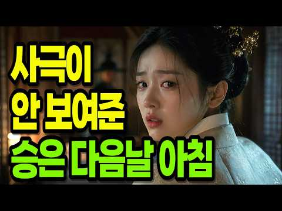
- 설명 앞부분: 조선시대, 궁녀가 임금의 '승은'을 입은 바로 그 다음 날 아침에는 과연 무슨 일이 벌어졌을까요? 사극은 늘 그 은밀한 밤에서 끝나버리지만, 한 여인의 진짜 운명은 바로 '다음 날'에 결정됐습니다. 이 영상에서 다루는 내용: ▪ '승은'의 진짜 의미와 조선 궁녀의 신분 구조 ▪ 승은 입은 다음 날 가장 먼저 찾아온 것 (축하가 아니었습니다) ▪ 승은상궁이 되면 달라지는 것 — 노동에서의 해방, 거처, 나인, 복색 ▪ 후궁이 되는 단 하나의 조건과 내명부 품계 (빈·귀인·숙의·숙원) ▪ 후궁의 처소와 생활 공간, 동궐도 속 실제 흔…
- 같은 채널 평소 대비 ×186.2 (채널 최근 롱폼 중앙값 464회) · 평소 영상: 청은 왜 항복한 인조를 왕좌에 돌려보냈을까? (483회) / 임진왜란 당시 처참했던 백성들의 삶 (444회)
- 대본 없음 (설명) — 음성인식이 끝나면 도입부·흐름이 들어감
- 댓글 150/151: 좋은 점 — 영상 1 · 감사·응원 2 · 더 알고 싶은 것 1 · 아쉬운 점 — 영상 16 · 반박·불만 — 의견 다름 1 · 정치·사회 1 · 경험 공유 2 · 구독·다음 기대 0
  - 감사·응원 👍5 “첫글이 흰색이고 바탕이 비슷 해서제목의 글이 잘 안보입니다 잘보이게 해주십시요 화이팅입니다”
  - 감사·응원 👍1 “재미있게 잘봤습니다 감사합니다”
  - 더 알고 싶은 것 👍0 “애들은 가라😂 ㅠ이건어룬둘애기야😂진짜 궁긍해서 ㅜㅜㅜㅜ하 친정도ㅜ부자도고요 친척도😮ㅠ알고싶어요ㅜ”
  - 아쉬운 점 — 영상 👍102 “서론이 지나치게 길고 동어반복이 심해서 보기가 지지부진하네요”
  - 아쉬운 점 — 영상 👍98 “실제 이야기가 시작되기 전까지의 단계가 너무 길고, 동어반복이 계속되는데. 과정과 결론이 더 빨리나오는게 좋을 듯 하네요.”
  - 반박·불만 — 의견 다름 👍4 “나래이션 속도를 조금 더 올려주는게 어떨지.. 스피디한 설명에 길들여진 독자들이 의외로 많아서요. 듣다가 지루해질 수 있을 듯 해요(저와 주변인들 기준이니 절대적인 건 아닙니다 ㅎ)”
  - 정치·사회 👍1 “그러니 이나라가. 망하지 아비가 자식을 죽이고 자식이. 아비를 죽이고 형제가. 서로를. 죽이고 삼촌이 조카들을 죽이고 싹 없어져야 나라 전체가”
  - 경험 공유 👍1 “회임을 하던지 못하던지 임금이 한번보고 차버린경우는 매력도없고 향기가 있는줄 알았는데 별로었고 꽃잎도 맛도없고 꿔다 놓은 보리자루 었다면 내가 임금이라도 다시는 보지않았을 것이다 미련한 곰 보다 영리한 여우가 더 좋은 것이다...요즈은 미모보다 음식솜씨 없는 여자보다…”
  - 경험 공유 👍0 “나도 성은 압고싶어요”

### 347. 《삼국지》 제갈량을 능가한 삼국지 최고의 책사는 누구? 와룡의 라이벌 6인 l 역사 인물 l 고전

- https://www.youtube.com/watch?v=V26QZgQ3Ejw · 동양사 이야기 · 구독자 16,400 · 조회수 218,766 (×13.3, 하루 2,541.1) · 좋아요 1,160 (0.5%) · 40.2분 · 2026-07-27 · 주제 묶음 6. 동양사 (중국·일본·몽골) · 형식 오디오북·낭독 (명언·인생조언) · 폴더 `W_V26QZgQ3Ejw` (웹 승인)
- 썸네일: 
- 설명 앞부분: 삼국지 시대를 뒤흔든 최고의 책사 6인을 소개합니다. 제갈량 공명과 어깨를 나란히 한 지략가들은 누가 있었을까요? 주유, 곽가, 방통, 사마의, 육손 등 와룡의 라이벌들이 펼친 지혜와 전략의 깊이를 함께 살펴보세요.
- 같은 채널 평소 대비 ×9.6 (채널 최근 롱폼 중앙값 22,738회) · 평소 영상: 《삼국지》 서서가 어머니 때문에 유비를 버리고 조조를 택했다고? 연의와 다른 진짜 역사 … (23,210회) / 《중국 역사》 강희제가 오배를 끝낸 비밀, 6살 소년의 8년 도박 l 천고일제 l 역사 … (22,266회)
- 대본 없음 (설명) — 음성인식이 끝나면 도입부·흐름이 들어감
- 댓글 185/185: 좋은 점 — 영상 1 · 감사·응원 3 · 더 알고 싶은 것 1 · 아쉬운 점 — 영상 4 · 반박·불만 — 의견 다름 7 · 정치·사회 3 · 경험 공유 10 · 구독·다음 기대 0
  - 감사·응원 👍0 “감사합니다.”
  - 아쉬운 점 — 영상 👍0 “설명이. 지루하다 간단하게 요약만”
  - 아쉬운 점 — 영상 👍0 “숟가락얹냐 더 알만한 조사하구해라 뻔한거퍼서 나르지마리ㅜ”
  - 반박·불만 — 의견 다름 👍0 “행정가로선 엄청 뛰어났다 생각하네요 위나라에 비해 인재 자원풀이 말도 안되게 떨어져도 북벌이란 꿈을 꿀 수 있게 군사적 행정적 뒷 받침을 한건 사실이니깐요 위 촉 오 기준 인구 비율로 따지면 6:1:2수준이라는데 저런 국력으로 곽가 사마의 주유 육손??? 누가와도 북…”
  - 정치·사회 👍0 “삼국지 시대는 지금으로 치면 나라가 내전에 빠지고 군웅이 할거하는 동남아 아프리카 그리고 중동같은 지옥 그 자체였을 듯. 위촉오 그 어느쪽이든 같은 나라 국민들끼리 벌인 내전이고 그 결과물은 위진남북조 그리고 5호16국의 대환장 시대 😊”
  - 경험 공유 👍0 “내가 보았던 어린이 만화 삼국지는 왜 유비가 삼국통일하고 끝난걸까 어린애들 속이려구 만들었나 보다”
  - 경험 공유 👍0 “이거슨 몇년의 시간을 결과로 판단하는거고 인정합니다. 다만 시간을 더 쪼개고 우리가 그 시점으로 가서 살아본게 아니니 뭐라고 단정지을수 없겠습니다. 그래도. 제갈량이 죽으면서 유선한테 한 말이, 내가 가진게없다는말을한거는 내 자식들이 본인이 죽어도 유선을 배신할 능력…”

### 348. "김춘택의 아들!" 반란군이 외친 그 한마디, 영조는 평생 울었다

- https://www.youtube.com/watch?v=jE5InvqFO4w · 역사방 · 구독자 2,220 · 조회수 28,563 (×12.9, 하루 219.1) · 좋아요 544 (1.9%) · 36.7분 · 2026-06-12 · 주제 묶음 기타 · 형식 정보·해설 (그 밖) · 폴더 `W_jE5InvqFO4w` (웹 승인)
- 썸네일: 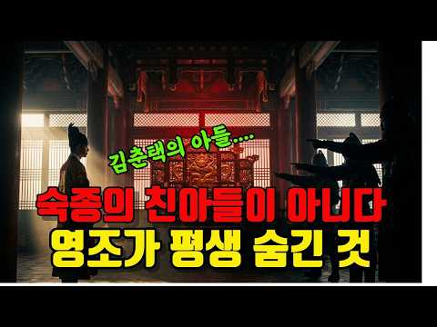
- 설명 앞부분: 영조는 숙종의 친아들이 아니라는 소문이 있었습니다. 1728년, 세 개의 도에서 동시에 반란이 일어났고, 사형장에서 반란군은 "김춘택의 아들!"이라 외쳤습니다. 조선 역대 임금 중 자기 어머니가 누구인지를 평생 증명해야 했던 왕. 52년 재위, 82세까지 살았지만 단 네 글자 '이모비야(爾母婢耶)'에 눈물을 멈추지 못했던 왕. 이 영상은 영조의 어머니 숙빈 최씨의 진짜 신분, 무수리설·침방 나인설·각심이설의 진실, 그리고 영조가 평생에 걸쳐 어머니의 이름을 높이려 했던 기록을 추적합니다. ※ 본 영상의 모든 내용은 조선왕조실록, …
- 같은 채널 평소 대비 ×80.5 (채널 최근 롱폼 중앙값 355회) · 평소 영상: 네팔 사망자 788명 vs 중국 16명, 같은 빙하인데 왜 50배 차이날까 ∣ 1400년… (355회) / 세자가 가장 사랑한 여자를 왜 죽였을까? — 사도세자와 빙애 (357회)
- 대본 없음 (설명) — 음성인식이 끝나면 도입부·흐름이 들어감
- 댓글 137/138: 좋은 점 — 영상 0 · 감사·응원 1 · 더 알고 싶은 것 3 · 아쉬운 점 — 영상 1 · 반박·불만 — 의견 다름 3 · 정치·사회 0 · 경험 공유 3 · 구독·다음 기대 0
  - 감사·응원 👍3 “감사합니더. 분명히 고쳤을 가능성이큽니다 더 좋게”
  - 더 알고 싶은 것 👍6 “김춘택의 초상화와 영조의 어진을 올려 주세요.”
  - 더 알고 싶은 것 👍3 “진실의 역사을. 계속 알려 주세요”
  - 반박·불만 — 의견 다름 👍4 “조선왕실 의 질병내력 중 하나가 등창에 잘 걸리고 등창때문에 죽었던 왕이 여러명이 있었다는 사실 입니다! 대표적 으로 등창 때문에 죽은 왕이 효종인데 효종은 영조의 증조 할아버지 이고 영조의 손자인 정조도 등창으로 돌아 가셨다는 기록이 있읍니다! 손자는 아버지가 아닌…”
  - 반박·불만 — 의견 다름 👍1 “선조의 어머니는 비교대상이 아닙니다. 후궁이 아니고 그냥 왕자군의 부인신분이죠. 선조가 방계승통을 했기에 그 부모는 그냥 종친신분이니 후궁과는 개념이 완전 다른 것이죠. 그리고 연산군의 생모도 후궁출신입니다. 한때 왕비였다가 왕비지위가 박탈된것이고 연산군 즉위후에 제…”
  - 경험 공유 👍3 “조선 국무총리 조정 ㆍ ㆍㆍ ㅡ 우리 엄마 조상 시조어른”
  - 경험 공유 👍2 “영조의 어머니에 대한 효심이 참 애틋하군요 영특한 연잉군과 아버지 숙종과의 관계가 궁금해요 저는 청풍김씨 로 숙종의 모후 명성왕후께서 우리집안입니다 숙종이후 조선왕들은 모두 우리 외손이지요”

### 349. 기적적으로 살아난 사육신 박팽년의 후손 이야기 ∣ 사육신,박팽년

- https://www.youtube.com/watch?v=_PA2GUeMIPA · 거꾸로한국사 · 구독자 17,000 · 조회수 218,307 (×12.8, 하루 1,589.9) · 좋아요 7,169 (3.3%) · 26.2분 · 2026-06-06 · 주제 묶음 1. 역사 일반·이야기 · 형식 정보·해설 (그 밖) · 폴더 `W__PA2GUeMIPA` (웹 승인)
- 썸네일: 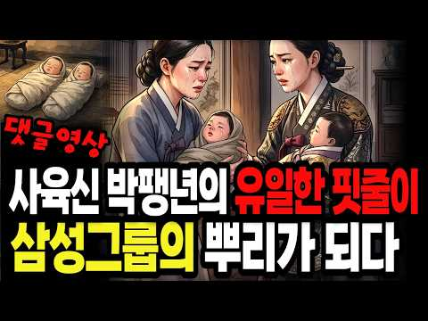
- 챕터: 0:00 댓글 하나에서 시작된 이야기 · 2:10 박팽년은 누구인가 — 집현전 학사에서 사육신까지 · 6:30 삼대 멸문 — 아버지, 형제, 아들, 손자까지 · 10:40 여종의 결단 — 자기 딸과 바꿔치기한 그날 · 16:20 박비에서 박일산으로 — 17년 노비, 왕 앞에 서다 · 21:00 500년 후 — 삼성의 뿌리, 국회의장, 묘골마을 · 24:30 다음 편 예고 — 성삼문 가문과 신숙주 가문
- 설명 앞부분: 삼대가 멸문당한 사육신 박팽년. 아버지, 형제, 아들, 손자까지 모조리 처형당한 그 가문에서 여종 한 명이 목숨을 걸고 아기 하나를 살려냅니다. 자기 딸과 바꿔치기한 그 아기. 17년간 노비로 살다 왕 앞에 선 그 아이의 이름은 박비. 박팽년의 유일한 핏줄과 그 후손 이야기 입니다. 지난 영상에 달린 댓글에서 시작된 이야기입니다. 역사는 이름 없는 사람의 선택으로 살아남았습니다. 타임라인 한국민족문화대백과사전 — 박팽년 한국민족문화대백과사전 — 박기정 조선왕조실록 — 세조실록 2년 6월 8일 조선왕조실록 — 성종실록 8년 기사 (…
- 같은 채널 평소 대비 ×12.9 (채널 최근 롱폼 중앙값 16,943회) · 평소 영상: 정승 15년에 나물 밥상과 낡은 관복을 고집한 청백리 전쟁 영웅 ∣ 오성 이항복,조선청백리 (16,943회) / 한국인이 꼭 알아야 하는 조선을 망친 최악의 왕비 5명 ∣ 조선역사,승정원일기,조선왕조실록 (19,237회)
- 대본 없음 (설명) — 음성인식이 끝나면 도입부·흐름이 들어감
- 댓글 406/406: 좋은 점 — 영상 10 · 감사·응원 28 · 더 알고 싶은 것 9 · 아쉬운 점 — 영상 1 · 반박·불만 — 의견 다름 4 · 정치·사회 15 · 경험 공유 14 · 구독·다음 기대 0
  - 좋은 점 — 영상 👍160 “박팽년의 후손이 잘 된 것은 하늘의 도움이다. 오랫동안 후손들이 빛나는 길을 걷기를 바랍니다.”
  - 좋은 점 — 영상 👍17 “눈물이 나오네요 ..이래서 역사를 아는것이 지금 현재의 시대를 살아가는데 밑거름이 되는 중요함입니다 감사합니다. 유익했어요”
  - 감사·응원 👍166 “감사드립니다 여종님 아마도 후손들이 잘되었으리란 생각이 드네요 복받으셨길~~”
  - 감사·응원 👍60 “박팽년 응원합니다 응원합시다”
  - 더 알고 싶은 것 👍95 “학교 다닐때 국사 시험 잘 칠라고 외웠던 사육신 중 한분인 박팽년이 궁금해서 들어왔습니다. 😅 천재는 천재를 낳고 또 후대에 또 천재를 낳고.. 그 DNA가 진짜 대단하네요. 시험 잘 칠라고 외울땐 아무 생각 없었는데 영상 보고나서 와아! 했어요”
  - 더 알고 싶은 것 👍14 “신숙주와 정인지도 함 다뤄 주세요. 작년 가을 육신사에 다시 갔더니 너무 깔끔하게 잘 정돈되어 있었습니다.”
  - 아쉬운 점 — 영상 👍1 “반이상 틀린내용”
  - 반박·불만 — 의견 다름 👍0 “이병철아닙니다 삼성회장은 김무형입니다 사실을 알려주세요 거짓은 이젠 안됩니다 어렸을때 우리집안에서 역사교육을 받았는데 사육신은 없었다고 했습니다 진짜 조선역사를 공부해서 사실을 알려주시고 삼성은 김해김씨왕 김수로의 건설회사 이름입니다 서울 사람들은 오래전부터 알고 있…”
  - 반박·불만 — 의견 다름 👍0 “팽년이는 박씬데 한민족 최고자본가 삼성은 이씨고 보도 않고 댓글 달고 나감 헛소리 같아서리”
  - 정치·사회 👍76 “가장 중요한 것은 박팽년의 여종이 자기가 낳은 딸을 주인의 아들과 바꾸면서 주인의 아들도 살고 자기의 딸도 살았습니다. 참으로 훌륭한 사람이었습니다.그 후손 중에 박두을 여사가 태어났습니다. 그리고 그분이 이병철 회장의 아내가 되고 이건희 회장의 어머니가 되고 이재용…”
  - 정치·사회 👍18 “박준규 국회의장이 박팽년의 후손이고 이병철의 부인이 박팽년의 후손이라니? 박준규의장 역시 국가에 충성을 다하고 박팽년이 단종임금을 죽음으로 섬겼듯이 박정희 대통령께 충심 바쳐 나라의 디딤돌이 되었구나... 그런데 박팽년의 며느리가 면천 되었다면 그 종의 딸도 면천 되…”
  - 경험 공유 👍60 “내가 육십대 후반인데 어릴때 작은아빠가 박팽년할아버지에 대해 이야길 들으며 성장했어요 저도 순천박가의 후손입니딘”
  - 경험 공유 👍14 “제가 순천박씨고 조상은 박팽년으로 단순하게 일화정도로 그저 알고만 지냈는데 이렇게 자세히 말씀해주셔서 감사합니다 아주 유익하게 보았습니다 주관이 뚜렷하고 한길만 가는 제 가족이 그 핏줄이라 그런가 ㅎ”

### 350. 전 재산을 세 번 나눠주고도, 세 번 다시 부자가 된 역대급 천재 ∣ ⟪사기⟫에 유일하게 두 번 기록된 유일한 사람, 범려 ∣ 인물역사 ∣ 세계사 ∣ 시니어역사…

- https://www.youtube.com/watch?v=gp_BBbaN5Lw · 역사깨침 · 구독자 29,800 · 조회수 382,474 (×12.8, 하루 3,241.0) · 좋아요 4,544 (1.2%) · 48.9분 · 2026-06-25 · 주제 묶음 10. 수면·낭독 · 형식 수면·낭독 (잠잘 때 듣는) · 폴더 `W_gp_BBbaN5Lw` (웹 승인)
- 썸네일: 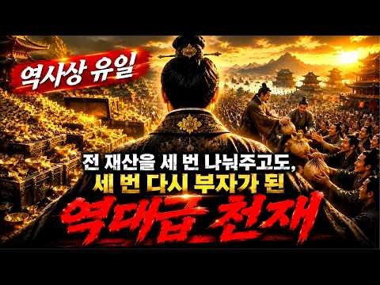
- 설명 앞부분: 2500년 전 중국, 초나라의 가난한 청년 범려는 망해가는 월나라를 선택합니다. 22년간 와신상담 끝에 오나라를 멸망시킨 최고의 공신이 되지만, 승리 직후 모든 것을 버리고 사라집니다. 이름을 세 번 바꾸고, 세 번 천금을 모으고, 세 번 전부 나눠준 남자. 사마천의 《사기》 130권 중 유일하게 두 번 등장하는 인물, 범려의 인생 전체를 다룹니다. 토사구팽의 진짜 기원, 중국 4대 미인 서시와의 전설, 스승 계연의 2500년 전 경제론, 둘째 아들의 비극, 그리고 산둥성에 지금도 남아 있는 범려의 무덤까지. 단순한 성공담이 아닌…
- 같은 채널 평소 대비 ×6.7 (채널 최근 롱폼 중앙값 57,388회) · 평소 영상: 왜 어떤 사람 곁엔 귀인이 모이고, 어떤 사람은 배신만 당할까 ∣ 『사기』가 2000년 … (63,365회) / 칭기즈칸보다 더 무서운 정복자, 한쪽 다리를 절면서도 어떻게 세계를 떨게 했나? ∣ 35… (51,411회)
- 대본 없음 (설명) — 음성인식이 끝나면 도입부·흐름이 들어감
- 댓글 169/169: 좋은 점 — 영상 1 · 감사·응원 5 · 더 알고 싶은 것 3 · 아쉬운 점 — 영상 1 · 반박·불만 — 의견 다름 2 · 정치·사회 3 · 경험 공유 1 · 구독·다음 기대 0
  - 좋은 점 — 영상 👍0 “역사는 살아 있네요 좋은 이야기 최고 입니다 감사합니다”
  - 감사·응원 👍1 “감사합니다!”
  - 감사·응원 👍1 “충실하고 정성스러운 영상 감사드립니다”
  - 더 알고 싶은 것 👍10 “어떻게 이렇게 재미있고 흥미진진하게 이야기를 들려주실 수 있나요?”
  - 더 알고 싶은 것 👍3 “볌려의 세아들의 이야기는 다른사람으로알고있읍니다 사마천의 기록에 정말있는기록이지 확인 말씀 부탁합니다 ㅡ”
  - 아쉬운 점 — 영상 👍1 “구독 낚시질하지마라!!~~~~”
  - 반박·불만 — 의견 다름 👍1 “한 틀렸습니다.와신은 합려가 월나라에 패해 죽자 부차가 와신을 한 입니다.”
  - 정치·사회 👍20 “월나라가 재기한건 범려의 공을 무시할순 없지만 계책은 문종이 짠겟이였어요 7개계책 1. 쌀을 빌리기 2.국고를 탕진시키기 3.미녀를 보내기 4.군주가 충신을 멀리하게하기 등등입니다 이계책들에 의해서 오나라는 끝내 무너집니다”
  - 정치·사회 👍0 “2500년 전 범려는 N차 생을 산 현자 아닌가요? 아뭏턴 나라가 크서 그런지 인재가 많았네요. 조선시대 왕이 경전을 3번씩 매일 나가 신하들과 공부하고 정사를 토론했듯이, 지금 지도자들도 정치쇼만 할것이 아니라 이런 남의 나라 현자 전 읽기라도 하면 좋겠네요”
  - 경험 공유 👍7 “어느 누구가 부을 쌓을려면 누군가희생이 있을건데 그희생은 나몰라 하고 배픈거만 애기 하면 나도 할수있어 천조국을보세요 돈과권력있으면 아무나 때리고 빵하나주면 그게다 선행입니다”

### 351. 조선왕조실록 1대 태조부터 27대 순종까지 조선왕 27명 완벽 총정리 ∣ 세상에서 제일쉬운 한국사

- https://www.youtube.com/watch?v=luixAMxkKk8 · 별이수놓은 역사 · 구독자 15,300 · 조회수 195,799 (×12.8, 하루 1,394.4) · 좋아요 2,278 (1.2%) · 94.6분 · 2026-06-02 · 주제 묶음 3. 조선 · 형식 정보·해설 (그 밖) · 폴더 `W_luixAMxkKk8` (웹 승인)
- 썸네일: 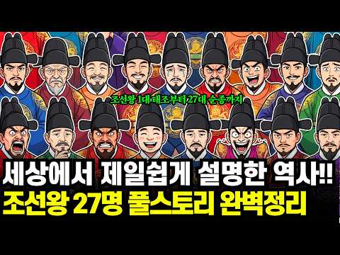
- 설명 앞부분: 519년, 27명의 왕, 평균 재위 기간 19년. 조선왕조는 1392년 태조 이성계의 건국부터 1910년 순종의 퇴위와 대한제국 멸망까지, 한반도 역사에서 가장 긴 왕조 중 하나였습니다. 이번 영상에서는 조선 1대 태조부터 27대 순종까지 한 번에 정리합니다. 학교에서 외웠던 “태정태세문단세…”가 누구였는지, 세종대왕·태종 이방원·세조 수양대군·연산군·광해군·영조·정조·고종이 조선 역사에서 어떤 의미를 갖는지 쉽고 강렬하게 풀어드립니다. 👑 이 영상에서 다루는 내용 조선 27대 왕 전체 흐름 정리 태조 이성계와 위화도 회군 왕자의…
- 같은 채널 평소 대비 ×37.8 (채널 최근 롱폼 중앙값 5,179회) · 평소 영상: 한국판 오디세이 최부의 표해록, 우리만 가치를 모르고 있는 세계3대 중국견문록 (5,179회) / 심수경이 갈아치운 역대급 최초최다 기록들, 75세 최고령 정승, 77세 의병 총괄대장, … (4,660회)
- 대본 없음 (설명) — 음성인식이 끝나면 도입부·흐름이 들어감
- 댓글 182/183: 좋은 점 — 영상 4 · 감사·응원 11 · 더 알고 싶은 것 0 · 아쉬운 점 — 영상 1 · 반박·불만 — 의견 다름 1 · 정치·사회 2 · 경험 공유 3 · 구독·다음 기대 0
  - 좋은 점 — 영상 👍14 “정말 명쾌하고 간결하게 이씨왕조의 역사를 설명하여서 매우 유익한 시간을 가졌습니다. 고맙습니다.”
  - 좋은 점 — 영상 👍10 “역사 공부 잘 배웠어요 세종대왕 한글 높이 평가 됩니다”
  - 감사·응원 👍27 “이제야 라도 이씨왕조 519년을 정확히 알게해주샤서 감사 합니다 고맙습니다 성경에 이스라엘 역사를 떠올리면서 인간이 얼마나 악한지 또 한번 느낌니다 악한중에서도 세상에 유익을 주먄서 역사가 이루어 져서 그나마 다행입니다 많이 도움을 주셨습니다 앞으로 정치 하는 대통령…”
  - 감사·응원 👍14 “정말 명쾌하고 간결하게 이씨왕조의 역사를 설명하여서 매우 유익한 시간을 가졌습니다. 고맙습니다.”
  - 아쉬운 점 — 영상 👍1 “지루하지않게 편안하게 잘들었습니다~구독 누르고가니 또뵈요!!”
  - 반박·불만 — 의견 다름 👍5 “요즘 같으면 80세 이상 사는건 일도 아닌데 그 시대엔 의학(의술) 발달이 안 되어 단명을 했네요. 항생제 몇 알이면 까짓 피부병쯤 아무 것도 아닌데 말입니다.”
  - 정치·사회 👍27 “이제야 라도 이씨왕조 519년을 정확히 알게해주샤서 감사 합니다 고맙습니다 성경에 이스라엘 역사를 떠올리면서 인간이 얼마나 악한지 또 한번 느낌니다 악한중에서도 세상에 유익을 주먄서 역사가 이루어 져서 그나마 다행입니다 많이 도움을 주셨습니다 앞으로 정치 하는 대통령…”
  - 정치·사회 👍0 “이성계 나라 잘망해지 박정희 대통령 나라살린분”
  - 경험 공유 👍1 “조선 시대로 돌아갈 수 았다면,,, 고려를 반역 하고, 삐져나온 이성계 놈! 도끼로 온몸을 난자하여 죽였슬 터아다. 놈이 빠져 나오므로 만주 드넓은 벌판을 잃었고, 놈 후손들 패악과, 일본에 나라 팔아먹고, 이어 육이오 전쟁!,,, 모두 이성계 놈, 고려를 반역 하고…”
  - 경험 공유 👍0 “읽기로 삼십이년 동안이라 해야하지 않을까요?서른 두년 동안은 듣기가 잉??이랬어요 옛날엔 그랬나요?군대식인가??20:36초에요~맞는건지 묻는거에요~저도 잘 몰라서~”

### 352. [임진왜란 통합본] 조선시대로 이동한 대한민국 해병대, 임진왜란 4대대첩 (1~4화)

- https://www.youtube.com/watch?v=T0XaUdpk_JA · 전쟁IF · 구독자 12,400 · 조회수 157,050 (×12.7, 하루 1,848.2) · 좋아요 1,694 (1.1%) · 42.6분 · 2026-07-28 · 주제 묶음 3. 조선 · 형식 몰아보기·통합본 (긴 영상) · 폴더 `W_T0XaUdpk_JA` (웹 승인)
- 썸네일: 
- 챕터: 0:00 1592년 한산도대첩 · 10:20 1592년 진주성 1차 방어전 · 20:40 1593년 행주대첩 · 30:44 1597 명량해전
- 설명 앞부분: 대한민국 해병대를 대표하는 상륙, 공정, 유격. 만약 현대 대한민국 해병대가 1592년 임진왜란 한복판으로 떨어진다면... 과연 조선을 지켜낼 수 있을까요? 현대 무기와 전술, 그리고 임진왜란의 영웅들이 만나 펼쳐지는 전쟁 IF🔥 이번 영상은 전쟁IF 임진왜란 시리즈 1~4화를 하나로 모은 통합본입니다. 한산도대첩 ✔ 진주대첩 ✔ 행주대첩 ✔ 명량해전 임진왜란의 주요 전투를 실제 역사의 흐름에 맞춰 시간 순서대로 감상하실 수 있습니다. 또한 기존 1~2편은 일부 장면을 리마스터하고, 연결 장면과 연출을 보강하여 더욱 자연스럽게 재…
- 같은 채널 평소 대비 ×0.7 (채널 최근 롱폼 중앙값 228,996회) · 평소 영상: 645년 안시성 방어에 투입된 해병대, 고구려 병사들과 함께 당나라 30만 대군을 이길 … (228,996회) / NLL에서 북한군과 조우한 해병대 수색대, 과연 미군 파일럿을 구할 수 있을까? [한국전… (218,643회)
- 대본 없음 (설명) — 음성인식이 끝나면 도입부·흐름이 들어감
- 댓글 84/85: 좋은 점 — 영상 0 · 감사·응원 1 · 더 알고 싶은 것 4 · 아쉬운 점 — 영상 0 · 반박·불만 — 의견 다름 0 · 정치·사회 6 · 경험 공유 1 · 구독·다음 기대 0
  - 감사·응원 👍3 “지금 해병대 이순신장군님의 조선수군이 합해서 전투에 임하므로 확실하게 왜군을 섬멸하게 되었습니다 감사합니다”
  - 더 알고 싶은 것 👍9 “현대군 투입 전투영상도 자주 부탁드립니다 전쟁님!”
  - 더 알고 싶은 것 👍8 “다음 전투영상도 부탁드립니다 전쟁님!”
  - 정치·사회 👍1 “우리에게 진리와 정의란 단 하나 뿐입니다. 우리가 강해지는 것. 그것이 진리이고 정의입니다. 우리가 강해지는 것을 막는 것, 그것이 부정이고 거짓이고 악입니다. 윤석렬과 국힘당 무리를 보라 이들이 우리의 적입니다. 우리를 망하게 하려고 했습니다. 지금 전쟁을 터트려서…”
  - 정치·사회 👍1 “이재명만 아니면 나라 좋음!”

### 353. 단 12명으로 몽골 대군을 막아선 고려의 괴물 장수 김경손

- https://www.youtube.com/watch?v=m441159aCfI · 정치수달TV · 구독자 8,310 · 조회수 104,002 (×12.5, 하루 705.8) · 좋아요 1,713 (1.7%) · 29.4분 · 2026-05-26 · 주제 묶음 2. 한국 고대·삼국·고려 · 형식 정보·해설 (그 밖) · 폴더 `W_m441159aCfI` (웹 승인)
- 썸네일: 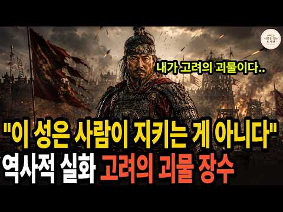
- 설명 앞부분: 세계의 절반을 정복한 몽골 대군 앞에서, 단 12명으로 맞선 고려의 장수가 있었습니다. 1231년, 칭기즈칸의 후예들이 한반도에 들이닥쳤습니다. 사마르칸트와 부하라를 잿더미로 만든 그 군대 앞에서, 의주가 무너지고 철주가 무너졌습니다. 그런데 압록강 아래 작은 성, 정주에서 이상한 일이 벌어집니다. 한 사내가 성문을 열고, 단 12명의 결사대만 데리고 몽골 정예 선봉을 향해 정면으로 걸어 나간 겁니다. 그의 이름은 김경손(金慶孫). 이 영상은 1231년 가을, 정주성 앞 들판과 귀주성 성벽 위에서 벌어진 실화를 따라갑니다. 화살이…
- 같은 채널 평소 대비 ×2.5 (채널 최근 롱폼 중앙값 42,341회) · 평소 영상: 김민석이 던진 사이다 한마디에 매불쇼 최욱 멘붕 온 이유 (42,341회) / 야사보다 충격적인 중국 5,000년 유일한 여황제, 측천무후의 진짜 이야기 (42,367회)
- 대본 없음 (설명) — 음성인식이 끝나면 도입부·흐름이 들어감
- 댓글 103/103: 좋은 점 — 영상 1 · 감사·응원 1 · 더 알고 싶은 것 1 · 아쉬운 점 — 영상 1 · 반박·불만 — 의견 다름 3 · 정치·사회 8 · 경험 공유 0 · 구독·다음 기대 0
  - 좋은 점 — 영상 👍1 “대한민국 역사에서 제일 위대한 한사람 박정희에 대해서 한번 정리해 주세요.”
  - 더 알고 싶은 것 👍1 “대한민국 역사에서 제일 위대한 한사람 박정희에 대해서 한번 정리해 주세요.”
  - 아쉬운 점 — 영상 👍0 “하두 지루한 영상이라 그냥 고려사 읽음. 주인들이 다 도망가서 할 수 없이 정주성 버리고 귀주감. 귀주에서 12인 쌍소금 불음. 이후 행적은 시시함”
  - 반박·불만 — 의견 다름 👍3 “한반도 글쎄요 고려의 중심부는 북경 개경 북경 은 서경이요 개경은 북경 동쪽 머지 않은 곳에 있었다 고려 말기 마지막 수도는 심양 이었다”
  - 반박·불만 — 의견 다름 👍2 “12명이 10만 몽골군에 전면전이라니 화살만으로도 끝장나것소 12명의 별동대는 야간 기습전이었지 주간 전면은 아닙니다 거란전에서 양규 장군과 김흥숙의 별동대가 전면전을 하다가 고슴도치가 된 것이 숫적 열세와 주간이기 때문이외다”
  - 정치·사회 👍19 “단군의 얼이 살아숨시는곳 강감찬장군님 김경손장군님 이순신장군님 그 뒤를이어 대대손손 정이넘치는 나라가 되길”
  - 정치·사회 👍3 “김경손과 무신정권을 영화로 만들어 주세요. 민족의 긍지를 느끼고 싶습니다”

### 354. 임진왜란 이후 에도막부의 등장, 일본의 260년 극적인 변화는?

- https://www.youtube.com/watch?v=yjX-IdjN48M · 매불월드 · 구독자 3,030 · 조회수 37,901 (×12.5, 하루 303.0) · 좋아요 479 (1.3%) · 33.4분 · 2026-06-18 · 주제 묶음 3. 조선 · 형식 정보·해설 (그 밖) · 폴더 `W_yjX-IdjN48M` (웹 승인)
- 썸네일: 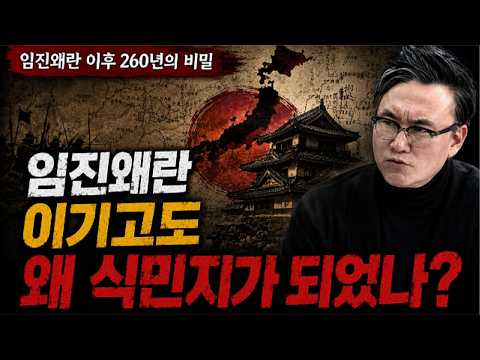
- 설명 앞부분: 임진왜란 이후 도쿠가와 이에야스가 세키가하라 전투에서 승리하며 260년간의 에도막부 시대가 열렸고, 황무지였던 에도는 대도시로 발전했습니다. 이 시기 일본 내부의 변화와 체제 정비 과정은 향후 메이지유신 등 근대화 열강으로 진입하는 발판이 되었다는 평가를 받습니다. 매불월드는 방대한 영상 속에서 재미있고 의미 있는 장면을 선별해 자막과 편집을 통해 새롭게 재구성합니다. 단순한 영상 전달이 아닌, 핵심 포인트를 더 살리고 맥락을 쉽게 이해할 수 있도록 해설 자막과 편집을 직접 제작하여 콘텐츠의 완성도를 높이고 있습니다. 본 영상은 …
- 같은 채널 평소 대비 ×55.5 (채널 최근 롱폼 중앙값 682회) · 평소 영상: 한복부터 쇼트트랙까지…베이징 올림픽을 둘러싼 논쟁 (753회) / 우리가 먹는 탕수육은 어떻게 시작됐을까? 이름과 탄생의 배경 (612회)
- 대본 없음 (설명) — 음성인식이 끝나면 도입부·흐름이 들어감
- 댓글 180/180: 좋은 점 — 영상 2 · 감사·응원 4 · 더 알고 싶은 것 1 · 아쉬운 점 — 영상 2 · 반박·불만 — 의견 다름 4 · 정치·사회 9 · 경험 공유 14 · 구독·다음 기대 0
  - 감사·응원 👍5 “썬킴 화이팅”
  - 아쉬운 점 — 영상 👍12 “저들이 좋던 싫던 메이지유신으로 서양문물 받아들이고 발전을 꽤할떄 우리는 뭐하고 있었는지 생각해보면 많이 아쉽습니다.”
  - 아쉬운 점 — 영상 👍3 “썬킴은 쓸떼없는 얘길 너무길게하네요 초반에 혜종이 어쩌고 장판이 어쩌고 으이그 ㅉㅉ”
  - 반박·불만 — 의견 다름 👍1 “알고있는 임진왜란은 싹다 거짓이다 선조실록, 징비록에 부산포에 처음나타난 왜군이 한양도성에 15일만에 나타난다 . 니가해봐 가능한 일인지 6.25당시 파죽지세로 3.8선넘은 북한군이 낙동강전선에 45일만에 나타난다. 말도안되는 소설이지 한반도에서 벌어진게 아니다 . …”
  - 정치·사회 👍11 “건국때부터 합의없는 매국노 기득권보유국.... 돈과 권력이 사람위에 칼춤을 추는 나라. 그런 개씹나라가 한국이다. 밥을 굶지 않지만... 사람으로 사는게 매우어렵다.”
  - 정치·사회 👍3 “임진왜란 당시에 전국민의 50% 이상 노비였음 노비는 납세와 병역면제, 군인도 없고 재정도 없으니 무슨 수로 싸우나 그 후로도 정신을 못차리고 그 노비제도를 그대로 유지했지 오로지 양반 기득권층이 기득권을 놓지 않으려고 설사 나라가 망할지라도”
  - 경험 공유 👍0 “저때 조선의양반이란 잡놈 조선이 망할때까지 당파싸움 이념놀이만했다 내가 저때 백성으로 태어나면 무조건 탈조선합니다”

### 355. 집을 반으로 갈라버린 조선의 노부부, 그런데 할아버지가 사라졌다

- https://www.youtube.com/watch?v=XBePem4Xz2g · 한국시대극 · 구독자 12,500 · 조회수 155,443 (×12.4, 하루 1,620.0) · 좋아요 1,350 (0.9%) · 4.8분 · 2026-07-17 · 주제 묶음 3. 조선 · 형식 브이로그·직접 해본 이야기 · 폴더 `W_XBePem4Xz2g` (웹 승인)
- 썸네일: 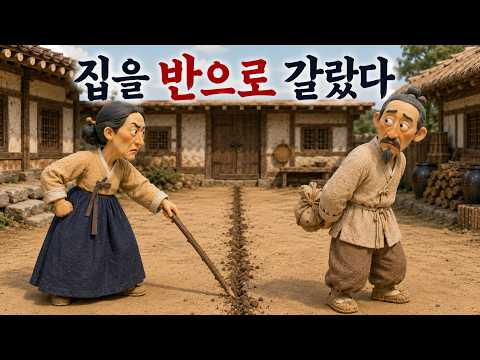
- 설명 앞부분: 평생 한집에서 살아온 노부부가 어느 날 집과 살림을 정확히 반으로 나눠버렸습니다. 집안의 마지막 소가 사라졌고, 할아버지는 자신이 팔았다고 인정하면서도 이유만은 끝내 말하지 않았습니다. 화가 난 할머니는 마당 한가운데 선을 긋고 이불과 밥그릇, 국자와 닭까지 네 것과 내 것으로 나누기 시작했습니다. 수십 년을 함께 산 부부는 같은 집에 있으면서도 서로의 선을 넘지 않았고, 자존심 때문에 밥 한 끼도 함께 먹지 않았습니다. 하지만 할머니는 자신도 모르게 주먹밥을 두 개 만들었고, 그중 하나를 남편 쪽 경계선 너머에 몰래 놓았습니다.…
- 같은 채널 평소 대비 ×15.0 (채널 최근 롱폼 중앙값 10,330회) · 평소 영상: 혼례가마가 비어 있었는데, 시어머니는 혼례를 멈추지 않았다 (10,364회) / [본편] 남편이 죽은 뒤에도 그물은 매일 젖어 돌아왔다, 그런데 그는 살아 있었다 (10,296회)
- 대본 없음 (설명) — 음성인식이 끝나면 도입부·흐름이 들어감
- 댓글 39/39: 좋은 점 — 영상 0 · 감사·응원 1 · 더 알고 싶은 것 1 · 아쉬운 점 — 영상 0 · 반박·불만 — 의견 다름 0 · 정치·사회 0 · 경험 공유 0 · 구독·다음 기대 0
  - 감사·응원 👍0 “부부싸움은 칼로물베기랍니다ㆍ 알고보면 아무일도아닌것 글 감사드립니다ㆍ”
  - 더 알고 싶은 것 👍4 “4~5분 내외로 전래동화나 명작이나 재미있는 이야기나 전설의 고향같은 영상 만들어주세요^^ 어르신들에게 보여드리고 싶네요♡”

### 356. 겁쟁이라 불리던 6사단은 어떻게 중공군 3개 사단을 호수에 묻었나 ∣ 용문산·파로호 대첩

- https://www.youtube.com/watch?v=K-D-pHlxoFo · 역사참판 · 구독자 2,890 · 조회수 35,486 (×12.3, 하루 351.9) · 좋아요 580 (1.6%) · 16.5분 · 2026-07-12 · 주제 묶음 기타 · 형식 정보·해설 (그 밖) · 폴더 `W_K-D-pHlxoFo` (웹 승인)
- 썸네일: 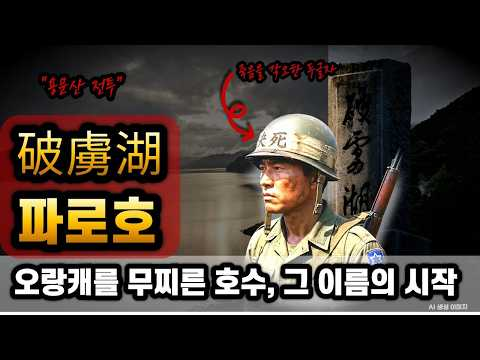
- 챕터: 0:00 호수에 잠긴 2만 명, 그날의 시작 · 1:21 겁쟁이라 조롱받던 블루스타 · 3:04 결사, 철모에 새긴 두 글자 · 4:23 1개 연대 vs 3개 사단 · 6:18 본진인 줄 알았다는 치명적 착각 · 8:00 화천댐을 확보하라 · 10:09 건널 수 없는 물 앞에서 · 12:21 현대판 살수대첩, 그리고 남은 이름
- 설명 앞부분: 1951년 5월, 강원도 화천의 한 저수지. 총에 맞아서가 아니라, 물에 빠져 수많은 병사가 목숨을 잃었습니다. 그리고 이 어마어마한 규모의 적을 몰아넣은 부대는, 얼마 전까지 같은 편에게도 겁쟁이라 손가락질받던 이들이었습니다. 사창리에서 등을 보이고 도망쳤던 6사단. 그들이 한 달 만에 어떻게 완전히 다른 부대가 되었을까요. 철모에 두 글자, 결사를 써넣은 병사들이 1개 연대로 3개 사단을 오판에 빠뜨리고, 마침내 그들을 호수에 묻기까지. 그 며칠간의 이야기를 처음부터 끝까지 따라가 봅니다. 겁쟁이와 영웅의 거리는, 사실 그렇게…
- 같은 채널 평소 대비 ×65.0 (채널 최근 롱폼 중앙값 546회) · 평소 영상: 정원 60명 배에 14,000명, 근데 부두엔 남겨진 절반이 있었다 (546회) / 히딩크가 반말을 시킨 진짜 이유, 그리고 24년 뒤 홍명보에게 벌어진 일 (572회)
- 대본 없음 (설명) — 음성인식이 끝나면 도입부·흐름이 들어감
- 댓글 103/103: 좋은 점 — 영상 0 · 감사·응원 3 · 더 알고 싶은 것 1 · 아쉬운 점 — 영상 1 · 반박·불만 — 의견 다름 0 · 정치·사회 9 · 경험 공유 1 · 구독·다음 기대 0
  - 감사·응원 👍8 “파라호를 처음 알았어요 감사합니다”
  - 더 알고 싶은 것 👍1 “무얼좀 호도 하고 계신대요. 그 작전에는 한국 해병대 제 1 연대, 미 해병대 포병 이 참전 했습니다. 맨날 후퇴만 하는 육군 제 6 사단 에 기회를 사기를 부여 해주고자 당 시 해병대와 미국 해병대는 아무렇지 않게 받아들였고 육군 위주의 역사편찬이 이렇게 호도 하는…”
  - 아쉬운 점 — 영상 👍0 “이제는 이런 영상도 개 잣같은 ai 목소리....!!”
  - 정치·사회 👍12 “파로호 전투를 전세계에 알려야 됩니다. 기념식도 크게하고... 이승만대통령님이 호수이름을 파로호라고 바꾸었다. 그만큼 대승 이었다.”
  - 정치·사회 👍12 “저 파로호 명칭을 바꿀려 한 자?... 가 있었지요.중국인들이 싫어 한다고...중공한태 무얼 쳐먹은지는 모르겠고...파로호 명칭 절대로 바꾸면 않됍니다.자지손손...영원히 존제해야 합니다.”
  - 경험 공유 👍5 “나라를 구한 6사단. 저도 6사단 출신입니다.”

### 357. 왜 조선 궁녀들은 승은의 밤에 사시나무 떨듯 떨었을까? ∣ 조선왕조실록 ∣ 궁중 생활사

- https://www.youtube.com/watch?v=kW4V815so3A · 비사록 · 구독자 7,290 · 조회수 89,284 (×12.2, 하루 544.9) · 좋아요 851 (0.9%) · 43.5분 · 2026-05-10 · 주제 묶음 3. 조선 · 형식 정보·해설 (그 밖) · 폴더 `W_kW4V815so3A` (웹 승인)
- 썸네일: 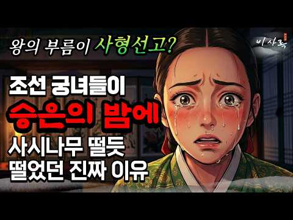
- 설명 앞부분: 🏯 "전하, 오늘은 어느 문으로 드시겠습니까?" 칠흑 같은 궁궐의 밤, 왕의 발걸음이 멈추는 문턱 하나에 한 여인의 인생 전체가 걸려 있었습니다. 우리가 '신데렐라 스토리'라 부르던 조선 궁녀의 승은. 실록이 증언하는 그 실체는 로맨스가 아닌 잔혹한 박제의 기록이었습니다. 오늘 비사록이 중종실록·숙종실록·세종실록을 바탕으로 500년 내명부의 민낯을 낱낱이 밝힙니다. 본 영상의 모든 내용(제목, 섬네일, 대본, 음성, 영상 구성, 데이터 분석 등)은 '비사록' 채널의 독자적인 창작 자산입니다. ⓒ 비사록. All rights res…
- 같은 채널 평소 대비 ×42.0 (채널 최근 롱폼 중앙값 2,126회) · 평소 영상: 임진왜란 7년, 백성들이 먹은 충격적인 음식 ∣ 임진왜란 선조 실록 백성 참혹한 실상 (2,126회) / 왕자의 아내가 된 여자들은 어떻게 살았을까? ∣ 부부인들의 숨겨진 진실 ∣ 조선 궁중 생… (2,138회)
- 대본 없음 (설명) — 음성인식이 끝나면 도입부·흐름이 들어감
- 댓글 116/116: 좋은 점 — 영상 0 · 감사·응원 0 · 더 알고 싶은 것 0 · 아쉬운 점 — 영상 2 · 반박·불만 — 의견 다름 0 · 정치·사회 1 · 경험 공유 1 · 구독·다음 기대 0
  - 아쉬운 점 — 영상 👍17 “재밌긴한데 반복이 너무 많아요 조금만 짧게 간결하게 하심 좋을듯요”
  - 아쉬운 점 — 영상 👍2 “아니 비슷한 내용 계속 반복되네;;;;;;”
  - 정치·사회 👍7 “자유라는것이 없고 알지도 못했던 나라에 이승만 대통령이 자유를 선언하고 자유라는것을 대한민국에 합법화 하였다. 대한민국과 같이 자유를 누리고 자유에 대해 아는 국가는 별로 없다.”
  - 경험 공유 👍42 “내가 승은상궁이었어도 무당을 불러 굿하거나 궁 우물에 몸 던졌을거다... 정식품계를 못받으면 걍 궁녀로사는게 이득이겠다요”

### 358. "목감기 때문에 못 갑니다" 고종이 도망친 그날, 이완용은 어떻게 나라를 팔았나 ∣ 김기욱 X 김재원

- https://www.youtube.com/watch?v=PNPiVTupkFM · 기웃기웃 김기욱 · 구독자 1,730 · 조회수 21,030 (×12.2, 하루 284.8) · 좋아요 274 (1.3%) · 18.6분 · 2026-08-08 · 주제 묶음 기타 · 형식 정보·해설 (그 밖) · 폴더 `W_PNPiVTupkFM` (웹 승인)
- 썸네일: 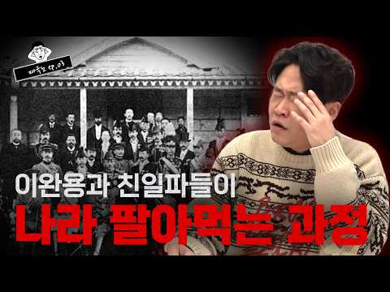
- 설명 앞부분: 타임라인
- 같은 채널 평소 대비 ×19.5 (채널 최근 롱폼 중앙값 1,080회) · 평소 영상: 추석특집 정일영 교수의 마라맛 입담 1시간 총집편! (1,245회) / 제주연인 사건으로 보는 대한민국 교제범죄의 현실 ep.01 ∣ 허민숙 입법조사관 X 김기욱 (916회)
- 대본 없음 (설명) — 음성인식이 끝나면 도입부·흐름이 들어감
- 댓글 98/98: 좋은 점 — 영상 0 · 감사·응원 1 · 더 알고 싶은 것 0 · 아쉬운 점 — 영상 0 · 반박·불만 — 의견 다름 6 · 정치·사회 6 · 경험 공유 2 · 구독·다음 기대 0
  - 반박·불만 — 의견 다름 👍1 “야 이사람들아 역사를 제대로배워라ㅡ조선왕조 말기 고종이후는 뭣땜에 망한지 제대로 배우고 유툽해라ㅡ조선은 가난하기로 그야말로 원시시대라해도 과언이 아니란걸알아라 그틈을 이용해 일본은 엄청난 경제지원 즉 빚을 놓기 시작해 말기 왕실은 일본이 아니면 밥도 못먹을 지경에 왔…”
  - 반박·불만 — 의견 다름 👍0 “결론이 이해가 안되는게 그 책임이라는거는 왕이 지는거지 신하가지는게 아닙니다 그래서 헌법도 없고 대한국 국제라는 괴상한걸 만들어서 절대권력을 탐하려 했던게 고종입니다. 이완용이 매국노라고? 오케이 이건 이견의 여지가 없습니다. 근데 그 상황에서 고종은 책임이 없나? …”
  - 정치·사회 👍3 “친북 진중 현 정권이 나라 팔아먹는 과정도 설명해 봐라... 과거와 현재 진행형은 무게감이 다르다...”
  - 정치·사회 👍3 “고종하는짓이 문재인하고 똑같내 회피하는 거”
  - 경험 공유 👍0 “그런데 저 상황에서 이완용이가 아니고 다른사람이있었다고한들 바뀌는게있었을까요?욕하는분들도있지만 양심상 세계정세를 알고 저위치에있었으면 나도 특별한답은없을듯한데 아이러니하네요”
  - 경험 공유 👍0 “이완용이 보빙사랑 같이 다녀왔어요?? 미국을 실제 경험을 했었나”

### 359. 임진왜란에 떨어진 대한육군, 현대 K 육군 박격포의 미친 화력에 경악한 왜군들(천군, 제2부: 참전)

- https://www.youtube.com/watch?v=DA5EjQoVSbM · 스튜디오진혼 · 구독자 12,500 · 조회수 150,520 (×12.0, 하루 894.7) · 좋아요 957 (0.6%) · 7.8분 · 2026-05-06 · 주제 묶음 3. 조선 · 형식 사연·드라마 · 폴더 `W_DA5EjQoVSbM` (웹 승인)
- 썸네일: 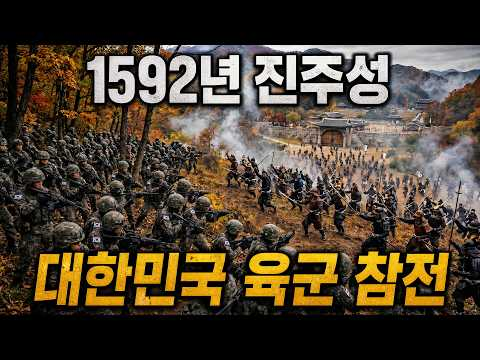
- 설명 앞부분: "절대 물러서지 마라! 우리가 죽으면 조선이 죽는다!" 1592년 임진왜란, 함락 직전의 진주성에 대한민국 육군 대대가 떨어졌다. 병력 수는 3만 대 4천. 압도적인 수적 열세 속에서 왜군의 조총 부대가 진주성 성문을 향해 진격해 오는데... "사격 개시!" 조총의 사거리를 아득히 벗어난 위치에서 불을 뿜는 K-2 소총과 박격포. 난생처음 겪어보는 압도적인 현대 화력 앞에 왜군 본대는 추풍낙엽처럼 쓰러지며 패닉에 빠진다. 세월을 건너온 대한민국 국군과 진주목사 김시민의 조선군이 만들어내는 압도적인 반격! (본 영상은 전투의 리얼리…
- 같은 채널 평소 대비 ×3.1 (채널 최근 롱폼 중앙값 47,966회) · 평소 영상: 1592년 조선에 떨어진 K-2 흑표 전차, 진주대첩 3만 왜군 판도를 바꾸다 [천군: … (36,406회) / 육군 500명이 임진왜란에 떨어지면 벌어지는 일 ㄷㄷ(천군, 제1부: 과거) (85,574회)
- 대본 없음 (설명) — 음성인식이 끝나면 도입부·흐름이 들어감
- 댓글 68/68: 좋은 점 — 영상 0 · 감사·응원 2 · 더 알고 싶은 것 2 · 아쉬운 점 — 영상 0 · 반박·불만 — 의견 다름 1 · 정치·사회 0 · 경험 공유 0 · 구독·다음 기대 1
  - 감사·응원 👍6 “울 국군 화이팅🎉🎉🎉”
  - 감사·응원 👍6 “다음 3화도 매우 기대됩니다 진혼님 감사합니다 👍👍”
  - 더 알고 싶은 것 👍6 “다음 전투영상도 부탁드립니다 진혼님!”
  - 더 알고 싶은 것 👍5 “현대군 투입 전투영상도 자주 부탁드립니다 진혼님!”
  - 반박·불만 — 의견 다름 👍0 “일본군 전투방식이 전혀 아닌데요 철포부대를 맞닥드리면 은폐 엄폐하고 측면을 노리는 기동전술을 썼는데 여기선 무조건 돌격이네요 ㅎㅎ 재미있는 영상임”
  - 구독·다음 기대 👍6 “다음 3화도 매우 기대됩니다 진혼님 감사합니다 👍👍”

### 360. 광해를 내쫓고 왜 하필 인조를 세워서 나라를 망쳐놨을까?｜인조반정｜병자호란｜삼전도의굴욕｜한국사｜조선사｜역사

- https://www.youtube.com/watch?v=aDOcfa9fnjg · 역사콕테일 · 구독자 8,260 · 조회수 98,926 (×12.0, 하루 1,785.8) · 좋아요 375 (0.4%) · 28.9분 · 2026-08-26 · 주제 묶음 3. 조선 · 형식 정보·해설 (그 밖) · 폴더 `W_aDOcfa9fnjg` (웹 승인)
- 썸네일: 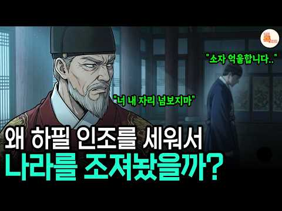
- 챕터: 0:00 목숨 걸고 왕을 갈아치웠는데, 왜 하필 그 사람? · 4:34 광해군이 지워버린 왕자들 — 사라진 후보들 · 7:03 인조반정의 진실 — 그는 '뽑힌 왕'이 아니었다 · 8:42 서인은 왜 능양군의 손을 잡았나 · 13:37 이괄의 난 — 즉위 1년, 왕이 도성을 버리다 · 15:55 광해군의 중립외교 vs 인조의 친명배금 · 18:57 병자호란과 삼전도, 그 겨울의 47일 · 22:07 소현세자의 죽음 — 화살이 안으로 향하다
- 설명 앞부분: 광해군을 몰아내고 왕이 된 인조, 그런데 왜 하필 그였을까요? 똑똑한 왕자들을 다 놔두고 무능한 인조를 세운 대가로, 조선은 정묘호란과 병자호란, 그리고 삼전도의 굴욕까지 최악의 시기를 맞이합니다. 인조반정의 진짜 이유와 조선 몰락의 결정적 순간을 낱낱이 파헤칩니다. 1623년 인조반정, 서인 세력은 정말 인조가 이렇게까지 무능할 줄 몰랐을까요? 아니면 무능함이 오히려 그들이 원한 조건이었을까요? 능양군이 직접 병력을 쥐고 일으킨 쿠데타의 숨겨진 진실부터, 이괄의 난, 정묘호란, 병자호란, 삼전도의 삼배구고두, 그리고 아들 소현세…
- 같은 채널 평소 대비 ×17.3 (채널 최근 롱폼 중앙값 5,731회) · 평소 영상: 세조가 잊지 못한다는 경혜공주의 충격적인 복수극｜한국사｜조선역사｜단종 (5,731회) / 세종도, 세조도 미친듯 사랑했던 이 여인! 알고 보니 노비..? ∣ 신빈김씨｜신분세탁｜조… (5,887회)
- 대본 없음 (설명) — 음성인식이 끝나면 도입부·흐름이 들어감
- 댓글 92/92: 좋은 점 — 영상 0 · 감사·응원 0 · 더 알고 싶은 것 1 · 아쉬운 점 — 영상 0 · 반박·불만 — 의견 다름 2 · 정치·사회 29 · 경험 공유 2 · 구독·다음 기대 0
  - 더 알고 싶은 것 👍0 “흥미롭게 잘봤습니다~ 1900년대 이후의 영웅들의삶도 궁금하니 꼭 만들어주세요^^”
  - 정치·사회 👍20 “광해군과 인조의 비교는 결국 조선 정치가 어떻게 스스로 파국을 불러왔는지를 보여주는 대표적 사례다. 광해군은 외교·군사·정치·민생 모든 면에서 인조보다 훨씬 뛰어났다. 국제정세를 정확히 읽고 명과 후금 사이에서 중립을 유지했으며, 조선의 국력을 회복시키는 데 집중했다…”
  - 정치·사회 👍8 “자기가 무엇을 잘못했는지 모르는 사람이 정말무서운거다 인조가 딱 그런 인간이다 그러니 자기 아들 며느리 손자들까지 죽음으로몰아같지 적어도 연산군은 자기가 무엇을 잘못하는지 알고 폭정을 일으킨 거고 인조같은 인간은 한가족을 넘어서 한나라가 멸망한다 해도 자기가 무슨짓을…”
  - 경험 공유 👍1 “만일 영창대군이 정상적으로 살아있었다면 언젠가는 서인들이 영창대군을 옹립하려는 반정을 도모할것이 분명합니다. 김제남일파역시 서인이기 때문입니다. 그리고 분명히 주지할 사안은 아직 공식적인 기록이나 연구는 없지만 분명 광해군은 세자시절부터 왕위계승에 매우 불안심리를 가…”
  - 경험 공유 👍0 “사르후 전투와 관련 광해군이 강홍립 장군에게 은밀히 지시했다는 건 최근에는 근거없다고 봄. 당시 상황을 보면 조선군은 유정이 이끄는 동로군과 함께 했는데 명나라군이 앞에 그 뒤를 조선군이 따라가고 있었음. 그런데 후금군이 우선 명나라군을 거의 전멸시키고 일부 생존자가…”

