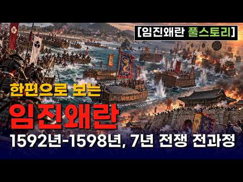
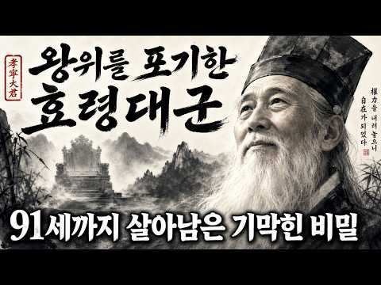
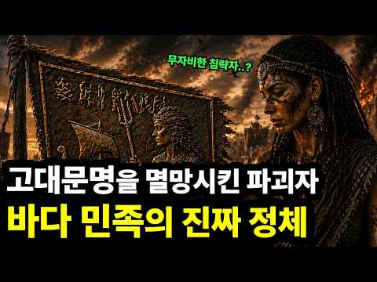
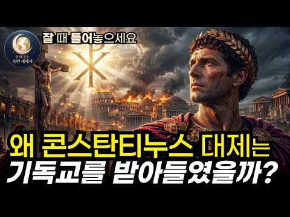
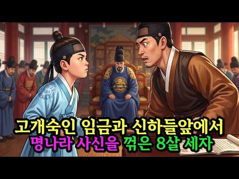
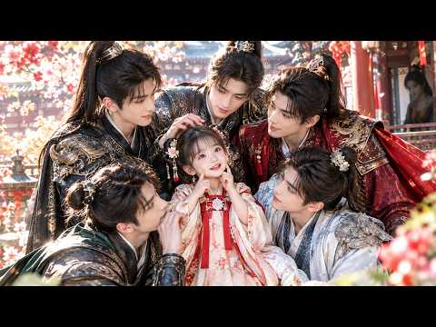

# 역사 — 성공 사례 분석: 사례별 자세히 #361–#400

`analysis.md` 의 9번 (같은 # 번호). 자동 생성 — `tools/success_analysis.py` v1.4.1 (2026-10-17 07:39 UTC). ※ 연구·교육용 — 투자 권유가 아님.

### 361. 《삼국지》 제갈량을 능가한 삼국지 최고의 책사는 누구? 와룡의 라이벌 6인 l 역사 인물 l 고전

- https://www.youtube.com/watch?v=V26QZgQ3Ejw · 동양사 이야기 · 구독자 16,400 · 조회수 216,469 (×13.2, 하루 2,636.6) · 좋아요 1,152 (0.5%) · 40.2분 · 2026-07-27 · 주제 묶음 6. 동양사 (중국·일본·몽골) · 형식 오디오북·낭독 (명언·인생조언) · 폴더 `W_V26QZgQ3Ejw` (웹 승인)
- 썸네일: 
- 설명 앞부분: 삼국지 시대를 뒤흔든 최고의 책사 6인을 소개합니다. 제갈량 공명과 어깨를 나란히 한 지략가들은 누가 있었을까요? 주유, 곽가, 방통, 사마의, 육손 등 와룡의 라이벌들이 펼친 지혜와 전략의 깊이를 함께 살펴보세요.
- 대본 없음 (설명) — 음성인식이 끝나면 도입부·흐름이 들어감
- 댓글 185/185: 좋은 점 — 영상 1 · 감사·응원 3 · 더 알고 싶은 것 1 · 아쉬운 점 — 영상 4 · 반박·불만 — 의견 다름 7 · 정치·사회 3 · 경험 공유 10 · 구독·다음 기대 0
  - 감사·응원 👍0 “감사합니다.”
  - 아쉬운 점 — 영상 👍0 “설명이. 지루하다 간단하게 요약만”
  - 아쉬운 점 — 영상 👍0 “숟가락얹냐 더 알만한 조사하구해라 뻔한거퍼서 나르지마리ㅜ”
  - 반박·불만 — 의견 다름 👍0 “행정가로선 엄청 뛰어났다 생각하네요 위나라에 비해 인재 자원풀이 말도 안되게 떨어져도 북벌이란 꿈을 꿀 수 있게 군사적 행정적 뒷 받침을 한건 사실이니깐요 위 촉 오 기준 인구 비율로 따지면 6:1:2수준이라는데 저런 국력으로 곽가 사마의 주유 육손??? 누가와도 북…”
  - 정치·사회 👍0 “삼국지 시대는 지금으로 치면 나라가 내전에 빠지고 군웅이 할거하는 동남아 아프리카 그리고 중동같은 지옥 그 자체였을 듯. 위촉오 그 어느쪽이든 같은 나라 국민들끼리 벌인 내전이고 그 결과물은 위진남북조 그리고 5호16국의 대환장 시대 😊”
  - 경험 공유 👍0 “내가 보았던 어린이 만화 삼국지는 왜 유비가 삼국통일하고 끝난걸까 어린애들 속이려구 만들었나 보다”
  - 경험 공유 👍0 “이거슨 몇년의 시간을 결과로 판단하는거고 인정합니다. 다만 시간을 더 쪼개고 우리가 그 시점으로 가서 살아본게 아니니 뭐라고 단정지을수 없겠습니다. 그래도. 제갈량이 죽으면서 유선한테 한 말이, 내가 가진게없다는말을한거는 내 자식들이 본인이 죽어도 유선을 배신할 능력…”

### 362. 효령대군, 세종보다 37년 더 살았다 ∣ 9명의 왕을 지켜본 둘째 왕자

- https://www.youtube.com/watch?v=zZQ_1_dLarU · 그날의역사 · 구독자 7,060 · 조회수 92,321 (×13.1, 하루 667.2) · 좋아요 688 (0.8%) · 21.6분 · 2026-05-31 · 주제 묶음 3. 조선 · 형식 정보·해설 (그 밖) · 폴더 `W_zZQ_1_dLarU` (웹 승인)
- 썸네일: 
- 설명 앞부분: 조선 왕족 중에서 가장 오래 산 사람이 누구였을까요. 왕도 아니고 장수도 아니었습니다. 태종의 둘째 아들 효령대군은 23살에 동생 충녕에게 왕좌를 비키고, 그 자리에서 비로소 91년을 시작합니다. 큰형 양녕은 69세, 동생 세종은 54세, 조카 세조는 52세. 조선 왕의 평균 수명은 47세였습니다. 그런데 그는 91세까지 살아남아 태조에서 성종까지 아홉 명의 임금이 옥좌에 앉았다 내려가는 모습을 모두 지켜봤습니다. 이 영상에서 다루는 내용 1418년 6월 3일, 둘째인데 셋째에게 밀린 그날 절로 향한 발걸음 — 평생 출가하지 않은…
- 대본 없음 (설명) — 음성인식이 끝나면 도입부·흐름이 들어감
- 댓글 162/162: 좋은 점 — 영상 0 · 감사·응원 3 · 더 알고 싶은 것 0 · 아쉬운 점 — 영상 1 · 반박·불만 — 의견 다름 2 · 정치·사회 2 · 경험 공유 9 · 구독·다음 기대 0
  - 감사·응원 👍12 “효령대군에게 가장 감사한 인물을 굳이 하나 꼽자면 그의 장인인 정역이 아닐까? 양녕의 장인 김한로는 사위가 폐세자가 되면서 연좌되어 삭탈관직 후 유배를 갔고 세종의 장인인 심온은 아예 역적으로 몰려 사약을 받고 온집안이 거덜이 나버린거에 비하면. 장인은 사위가 미치도…”
  - 감사·응원 👍5 “양녕대군이 폐세자가 되고 그의 차례가 되었지만 왕좌를 탐하지 않았고 마음을 비워서 90세 넘는 그 시대에 평균수명 두배를 살아 장수하였네요 ~~ 왕좌를 탐낸 조카는 피를 불렀지만 ...넘 대조되는 인생을 살았네요😊현명한듯 하네요 아주 몰입해서 끝까지 잘 시청하고 구독…”
  - 아쉬운 점 — 영상 👍3 “조선시대 장수한 왕족들 (국왕은 제외) ●왕자 1위 효령대군 : 90세 (태종의 차남) 2위 경평군 : 74세 (선조의 11남) 3위 의평군 : 70세 (정종의 장남) 4위 선성군 : 68세 (정종의 4남) 4위 덕천군 : 68세 (정종의 11남) 4위 양녕대군 : …”
  - 정치·사회 👍2 “효령대군파 유명인 후손들 정치인 : 이기붕(부통령), 이계진(전 국회의원), 이학재(인천 서구청장) 종교인 : 이만희(신천지 교주) 연예인 : 이수근(개그맨), 이휘재(방송인), 이성재(배우), 이정재(배우), 이상은(가수), 이수만(가수), 써니(가수, 소녀시대. …”
  - 경험 공유 👍7 “나의 피에는 효령대군의 피가 흐른다. 어머니가 전주이씨 효령대군의 자손이기 때문이다. 물론 아버지의 피는 고려시대 충절의 신하 우탁의 피가 흐르고..그래서 그런지 뼈가 좋은 편이고 동안의 체형을 가지고 있는 편이다. 내가 어릴때 외할머니가 돌아가시자 큰외삼촌이 3년상…”
  - 경험 공유 👍5 “저도 효령대군의 21대손 빼어날 수 돌림입니다 효령대군 할아버지 3째아들 보성군 가문입니다 파시조 이신 효령대군 할아버지 가 자랑 스럽네요”

### 363. "김춘택의 아들!" 반란군이 외친 그 한마디, 영조는 평생 울었다

- https://www.youtube.com/watch?v=jE5InvqFO4w · 역사방 · 구독자 2,220 · 조회수 28,516 (×12.8, 하루 225.6) · 좋아요 542 (1.9%) · 36.7분 · 2026-06-12 · 주제 묶음 기타 · 형식 정보·해설 (그 밖) · 폴더 `W_jE5InvqFO4w` (웹 승인)
- 썸네일: 
- 설명 앞부분: 영조는 숙종의 친아들이 아니라는 소문이 있었습니다. 1728년, 세 개의 도에서 동시에 반란이 일어났고, 사형장에서 반란군은 "김춘택의 아들!"이라 외쳤습니다. 조선 역대 임금 중 자기 어머니가 누구인지를 평생 증명해야 했던 왕. 52년 재위, 82세까지 살았지만 단 네 글자 '이모비야(爾母婢耶)'에 눈물을 멈추지 못했던 왕. 이 영상은 영조의 어머니 숙빈 최씨의 진짜 신분, 무수리설·침방 나인설·각심이설의 진실, 그리고 영조가 평생에 걸쳐 어머니의 이름을 높이려 했던 기록을 추적합니다. ※ 본 영상의 모든 내용은 조선왕조실록, …
- 대본 없음 (설명) — 음성인식이 끝나면 도입부·흐름이 들어감
- 댓글 137/137: 좋은 점 — 영상 0 · 감사·응원 1 · 더 알고 싶은 것 3 · 아쉬운 점 — 영상 1 · 반박·불만 — 의견 다름 3 · 정치·사회 0 · 경험 공유 3 · 구독·다음 기대 0
  - 감사·응원 👍3 “감사합니더. 분명히 고쳤을 가능성이큽니다 더 좋게”
  - 더 알고 싶은 것 👍6 “김춘택의 초상화와 영조의 어진을 올려 주세요.”
  - 더 알고 싶은 것 👍3 “진실의 역사을. 계속 알려 주세요”
  - 반박·불만 — 의견 다름 👍4 “조선왕실 의 질병내력 중 하나가 등창에 잘 걸리고 등창때문에 죽었던 왕이 여러명이 있었다는 사실 입니다! 대표적 으로 등창 때문에 죽은 왕이 효종인데 효종은 영조의 증조 할아버지 이고 영조의 손자인 정조도 등창으로 돌아 가셨다는 기록이 있읍니다! 손자는 아버지가 아닌…”
  - 반박·불만 — 의견 다름 👍1 “선조의 어머니는 비교대상이 아닙니다. 후궁이 아니고 그냥 왕자군의 부인신분이죠. 선조가 방계승통을 했기에 그 부모는 그냥 종친신분이니 후궁과는 개념이 완전 다른 것이죠. 그리고 연산군의 생모도 후궁출신입니다. 한때 왕비였다가 왕비지위가 박탈된것이고 연산군 즉위후에 제…”
  - 경험 공유 👍3 “조선 국무총리 조정 ㆍ ㆍㆍ ㅡ 우리 엄마 조상 시조어른”
  - 경험 공유 👍2 “영조의 어머니에 대한 효심이 참 애틋하군요 영특한 연잉군과 아버지 숙종과의 관계가 궁금해요 저는 청풍김씨 로 숙종의 모후 명성왕후께서 우리집안입니다 숙종이후 조선왕들은 모두 우리 외손이지요”

### 364. 기적적으로 살아난 사육신 박팽년의 후손 이야기 ∣ 사육신,박팽년

- https://www.youtube.com/watch?v=_PA2GUeMIPA · 거꾸로한국사 · 구독자 17,000 · 조회수 218,079 (×12.8, 하루 1,635.8) · 좋아요 7,169 (3.3%) · 26.2분 · 2026-06-06 · 주제 묶음 1. 역사 일반·이야기 · 형식 정보·해설 (그 밖) · 폴더 `W__PA2GUeMIPA` (웹 승인)
- 썸네일: 
- 챕터: 0:00 댓글 하나에서 시작된 이야기 · 2:10 박팽년은 누구인가 — 집현전 학사에서 사육신까지 · 6:30 삼대 멸문 — 아버지, 형제, 아들, 손자까지 · 10:40 여종의 결단 — 자기 딸과 바꿔치기한 그날 · 16:20 박비에서 박일산으로 — 17년 노비, 왕 앞에 서다 · 21:00 500년 후 — 삼성의 뿌리, 국회의장, 묘골마을 · 24:30 다음 편 예고 — 성삼문 가문과 신숙주 가문
- 설명 앞부분: 삼대가 멸문당한 사육신 박팽년. 아버지, 형제, 아들, 손자까지 모조리 처형당한 그 가문에서 여종 한 명이 목숨을 걸고 아기 하나를 살려냅니다. 자기 딸과 바꿔치기한 그 아기. 17년간 노비로 살다 왕 앞에 선 그 아이의 이름은 박비. 박팽년의 유일한 핏줄과 그 후손 이야기 입니다. 지난 영상에 달린 댓글에서 시작된 이야기입니다. 역사는 이름 없는 사람의 선택으로 살아남았습니다. 타임라인 한국민족문화대백과사전 — 박팽년 한국민족문화대백과사전 — 박기정 조선왕조실록 — 세조실록 2년 6월 8일 조선왕조실록 — 성종실록 8년 기사 (…
- 같은 채널 평소 대비 ×12.9 (채널 최근 롱폼 중앙값 16,943회) · 평소 영상: 정승 15년에 나물 밥상과 낡은 관복을 고집한 청백리 전쟁 영웅 ∣ 오성 이항복,조선청백리 (16,943회) / 한국인이 꼭 알아야 하는 조선을 망친 최악의 왕비 5명 ∣ 조선역사,승정원일기,조선왕조실록 (19,237회)
- 대본 없음 (설명) — 음성인식이 끝나면 도입부·흐름이 들어감
- 댓글 406/406: 좋은 점 — 영상 10 · 감사·응원 28 · 더 알고 싶은 것 9 · 아쉬운 점 — 영상 1 · 반박·불만 — 의견 다름 4 · 정치·사회 15 · 경험 공유 14 · 구독·다음 기대 0
  - 좋은 점 — 영상 👍160 “박팽년의 후손이 잘 된 것은 하늘의 도움이다. 오랫동안 후손들이 빛나는 길을 걷기를 바랍니다.”
  - 좋은 점 — 영상 👍17 “눈물이 나오네요 ..이래서 역사를 아는것이 지금 현재의 시대를 살아가는데 밑거름이 되는 중요함입니다 감사합니다. 유익했어요”
  - 감사·응원 👍166 “감사드립니다 여종님 아마도 후손들이 잘되었으리란 생각이 드네요 복받으셨길~~”
  - 감사·응원 👍60 “박팽년 응원합니다 응원합시다”
  - 더 알고 싶은 것 👍95 “학교 다닐때 국사 시험 잘 칠라고 외웠던 사육신 중 한분인 박팽년이 궁금해서 들어왔습니다. 😅 천재는 천재를 낳고 또 후대에 또 천재를 낳고.. 그 DNA가 진짜 대단하네요. 시험 잘 칠라고 외울땐 아무 생각 없었는데 영상 보고나서 와아! 했어요”
  - 더 알고 싶은 것 👍14 “신숙주와 정인지도 함 다뤄 주세요. 작년 가을 육신사에 다시 갔더니 너무 깔끔하게 잘 정돈되어 있었습니다.”
  - 아쉬운 점 — 영상 👍1 “반이상 틀린내용”
  - 반박·불만 — 의견 다름 👍0 “이병철아닙니다 삼성회장은 김무형입니다 사실을 알려주세요 거짓은 이젠 안됩니다 어렸을때 우리집안에서 역사교육을 받았는데 사육신은 없었다고 했습니다 진짜 조선역사를 공부해서 사실을 알려주시고 삼성은 김해김씨왕 김수로의 건설회사 이름입니다 서울 사람들은 오래전부터 알고 있…”
  - 반박·불만 — 의견 다름 👍0 “팽년이는 박씬데 한민족 최고자본가 삼성은 이씨고 보도 않고 댓글 달고 나감 헛소리 같아서리”
  - 정치·사회 👍76 “가장 중요한 것은 박팽년의 여종이 자기가 낳은 딸을 주인의 아들과 바꾸면서 주인의 아들도 살고 자기의 딸도 살았습니다. 참으로 훌륭한 사람이었습니다.그 후손 중에 박두을 여사가 태어났습니다. 그리고 그분이 이병철 회장의 아내가 되고 이건희 회장의 어머니가 되고 이재용…”
  - 정치·사회 👍18 “박준규 국회의장이 박팽년의 후손이고 이병철의 부인이 박팽년의 후손이라니? 박준규의장 역시 국가에 충성을 다하고 박팽년이 단종임금을 죽음으로 섬겼듯이 박정희 대통령께 충심 바쳐 나라의 디딤돌이 되었구나... 그런데 박팽년의 며느리가 면천 되었다면 그 종의 딸도 면천 되…”
  - 경험 공유 👍60 “내가 육십대 후반인데 어릴때 작은아빠가 박팽년할아버지에 대해 이야길 들으며 성장했어요 저도 순천박가의 후손입니딘”
  - 경험 공유 👍14 “제가 순천박씨고 조상은 박팽년으로 단순하게 일화정도로 그저 알고만 지냈는데 이렇게 자세히 말씀해주셔서 감사합니다 아주 유익하게 보았습니다 주관이 뚜렷하고 한길만 가는 제 가족이 그 핏줄이라 그런가 ㅎ”

### 365. 조선왕조실록 1대 태조부터 27대 순종까지 조선왕 27명 완벽 총정리 ∣ 세상에서 제일쉬운 한국사

- https://www.youtube.com/watch?v=luixAMxkKk8 · 별이수놓은 역사 · 구독자 15,300 · 조회수 192,473 (×12.6, 하루 1,410.9) · 좋아요 2,266 (1.2%) · 94.6분 · 2026-06-02 · 주제 묶음 3. 조선 · 형식 정보·해설 (그 밖) · 폴더 `W_luixAMxkKk8` (웹 승인)
- 썸네일: 
- 설명 앞부분: 519년, 27명의 왕, 평균 재위 기간 19년. 조선왕조는 1392년 태조 이성계의 건국부터 1910년 순종의 퇴위와 대한제국 멸망까지, 한반도 역사에서 가장 긴 왕조 중 하나였습니다. 이번 영상에서는 조선 1대 태조부터 27대 순종까지 한 번에 정리합니다. 학교에서 외웠던 “태정태세문단세…”가 누구였는지, 세종대왕·태종 이방원·세조 수양대군·연산군·광해군·영조·정조·고종이 조선 역사에서 어떤 의미를 갖는지 쉽고 강렬하게 풀어드립니다. 👑 이 영상에서 다루는 내용 조선 27대 왕 전체 흐름 정리 태조 이성계와 위화도 회군 왕자의…
- 대본 없음 (설명) — 음성인식이 끝나면 도입부·흐름이 들어감
- 댓글 182/182: 좋은 점 — 영상 4 · 감사·응원 11 · 더 알고 싶은 것 0 · 아쉬운 점 — 영상 1 · 반박·불만 — 의견 다름 1 · 정치·사회 2 · 경험 공유 3 · 구독·다음 기대 0
  - 좋은 점 — 영상 👍14 “정말 명쾌하고 간결하게 이씨왕조의 역사를 설명하여서 매우 유익한 시간을 가졌습니다. 고맙습니다.”
  - 좋은 점 — 영상 👍10 “역사 공부 잘 배웠어요 세종대왕 한글 높이 평가 됩니다”
  - 감사·응원 👍27 “이제야 라도 이씨왕조 519년을 정확히 알게해주샤서 감사 합니다 고맙습니다 성경에 이스라엘 역사를 떠올리면서 인간이 얼마나 악한지 또 한번 느낌니다 악한중에서도 세상에 유익을 주먄서 역사가 이루어 져서 그나마 다행입니다 많이 도움을 주셨습니다 앞으로 정치 하는 대통령…”
  - 감사·응원 👍14 “정말 명쾌하고 간결하게 이씨왕조의 역사를 설명하여서 매우 유익한 시간을 가졌습니다. 고맙습니다.”
  - 아쉬운 점 — 영상 👍1 “지루하지않게 편안하게 잘들었습니다~구독 누르고가니 또뵈요!!”
  - 반박·불만 — 의견 다름 👍5 “요즘 같으면 80세 이상 사는건 일도 아닌데 그 시대엔 의학(의술) 발달이 안 되어 단명을 했네요. 항생제 몇 알이면 까짓 피부병쯤 아무 것도 아닌데 말입니다.”
  - 정치·사회 👍27 “이제야 라도 이씨왕조 519년을 정확히 알게해주샤서 감사 합니다 고맙습니다 성경에 이스라엘 역사를 떠올리면서 인간이 얼마나 악한지 또 한번 느낌니다 악한중에서도 세상에 유익을 주먄서 역사가 이루어 져서 그나마 다행입니다 많이 도움을 주셨습니다 앞으로 정치 하는 대통령…”
  - 정치·사회 👍0 “이성계 나라 잘망해지 박정희 대통령 나라살린분”
  - 경험 공유 👍1 “조선 시대로 돌아갈 수 았다면,,, 고려를 반역 하고, 삐져나온 이성계 놈! 도끼로 온몸을 난자하여 죽였슬 터아다. 놈이 빠져 나오므로 만주 드넓은 벌판을 잃었고, 놈 후손들 패악과, 일본에 나라 팔아먹고, 이어 육이오 전쟁!,,, 모두 이성계 놈, 고려를 반역 하고…”
  - 경험 공유 👍0 “읽기로 삼십이년 동안이라 해야하지 않을까요?서른 두년 동안은 듣기가 잉??이랬어요 옛날엔 그랬나요?군대식인가??20:36초에요~맞는건지 묻는거에요~저도 잘 몰라서~”

### 366. 임진왜란 이후 에도막부의 등장, 일본의 260년 극적인 변화는?

- https://www.youtube.com/watch?v=yjX-IdjN48M · 매불월드 · 구독자 3,030 · 조회수 37,898 (×12.5, 하루 313.0) · 좋아요 479 (1.3%) · 33.4분 · 2026-06-18 · 주제 묶음 3. 조선 · 형식 정보·해설 (그 밖) · 폴더 `W_yjX-IdjN48M` (웹 승인)
- 썸네일: 
- 설명 앞부분: 임진왜란 이후 도쿠가와 이에야스가 세키가하라 전투에서 승리하며 260년간의 에도막부 시대가 열렸고, 황무지였던 에도는 대도시로 발전했습니다. 이 시기 일본 내부의 변화와 체제 정비 과정은 향후 메이지유신 등 근대화 열강으로 진입하는 발판이 되었다는 평가를 받습니다. 매불월드는 방대한 영상 속에서 재미있고 의미 있는 장면을 선별해 자막과 편집을 통해 새롭게 재구성합니다. 단순한 영상 전달이 아닌, 핵심 포인트를 더 살리고 맥락을 쉽게 이해할 수 있도록 해설 자막과 편집을 직접 제작하여 콘텐츠의 완성도를 높이고 있습니다. 본 영상은 …
- 대본 없음 (설명) — 음성인식이 끝나면 도입부·흐름이 들어감
- 댓글 180/180: 좋은 점 — 영상 2 · 감사·응원 4 · 더 알고 싶은 것 1 · 아쉬운 점 — 영상 2 · 반박·불만 — 의견 다름 4 · 정치·사회 9 · 경험 공유 14 · 구독·다음 기대 0
  - 감사·응원 👍5 “썬킴 화이팅”
  - 아쉬운 점 — 영상 👍12 “저들이 좋던 싫던 메이지유신으로 서양문물 받아들이고 발전을 꽤할떄 우리는 뭐하고 있었는지 생각해보면 많이 아쉽습니다.”
  - 아쉬운 점 — 영상 👍3 “썬킴은 쓸떼없는 얘길 너무길게하네요 초반에 혜종이 어쩌고 장판이 어쩌고 으이그 ㅉㅉ”
  - 반박·불만 — 의견 다름 👍1 “알고있는 임진왜란은 싹다 거짓이다 선조실록, 징비록에 부산포에 처음나타난 왜군이 한양도성에 15일만에 나타난다 . 니가해봐 가능한 일인지 6.25당시 파죽지세로 3.8선넘은 북한군이 낙동강전선에 45일만에 나타난다. 말도안되는 소설이지 한반도에서 벌어진게 아니다 . …”
  - 정치·사회 👍11 “건국때부터 합의없는 매국노 기득권보유국.... 돈과 권력이 사람위에 칼춤을 추는 나라. 그런 개씹나라가 한국이다. 밥을 굶지 않지만... 사람으로 사는게 매우어렵다.”
  - 정치·사회 👍3 “임진왜란 당시에 전국민의 50% 이상 노비였음 노비는 납세와 병역면제, 군인도 없고 재정도 없으니 무슨 수로 싸우나 그 후로도 정신을 못차리고 그 노비제도를 그대로 유지했지 오로지 양반 기득권층이 기득권을 놓지 않으려고 설사 나라가 망할지라도”
  - 경험 공유 👍0 “저때 조선의양반이란 잡놈 조선이 망할때까지 당파싸움 이념놀이만했다 내가 저때 백성으로 태어나면 무조건 탈조선합니다”

### 367. [임진왜란 통합본] 조선시대로 이동한 대한민국 해병대, 임진왜란 4대대첩 (1~4화)

- https://www.youtube.com/watch?v=T0XaUdpk_JA · 전쟁IF · 구독자 12,400 · 조회수 155,041 (×12.5, 하루 1,914.5) · 좋아요 1,672 (1.1%) · 42.6분 · 2026-07-28 · 주제 묶음 3. 조선 · 형식 몰아보기·통합본 (긴 영상) · 폴더 `W_T0XaUdpk_JA` (웹 승인)
- 썸네일: 
- 챕터: 0:00 1592년 한산도대첩 · 10:20 1592년 진주성 1차 방어전 · 20:40 1593년 행주대첩 · 30:44 1597 명량해전
- 설명 앞부분: 대한민국 해병대를 대표하는 상륙, 공정, 유격. 만약 현대 대한민국 해병대가 1592년 임진왜란 한복판으로 떨어진다면... 과연 조선을 지켜낼 수 있을까요? 현대 무기와 전술, 그리고 임진왜란의 영웅들이 만나 펼쳐지는 전쟁 IF🔥 이번 영상은 전쟁IF 임진왜란 시리즈 1~4화를 하나로 모은 통합본입니다. 한산도대첩 ✔ 진주대첩 ✔ 행주대첩 ✔ 명량해전 임진왜란의 주요 전투를 실제 역사의 흐름에 맞춰 시간 순서대로 감상하실 수 있습니다. 또한 기존 1~2편은 일부 장면을 리마스터하고, 연결 장면과 연출을 보강하여 더욱 자연스럽게 재…
- 대본 없음 (설명) — 음성인식이 끝나면 도입부·흐름이 들어감
- 댓글 84/84: 좋은 점 — 영상 0 · 감사·응원 1 · 더 알고 싶은 것 4 · 아쉬운 점 — 영상 0 · 반박·불만 — 의견 다름 0 · 정치·사회 6 · 경험 공유 1 · 구독·다음 기대 0
  - 감사·응원 👍3 “지금 해병대 이순신장군님의 조선수군이 합해서 전투에 임하므로 확실하게 왜군을 섬멸하게 되었습니다 감사합니다”
  - 더 알고 싶은 것 👍9 “현대군 투입 전투영상도 자주 부탁드립니다 전쟁님!”
  - 더 알고 싶은 것 👍8 “다음 전투영상도 부탁드립니다 전쟁님!”
  - 정치·사회 👍1 “우리에게 진리와 정의란 단 하나 뿐입니다. 우리가 강해지는 것. 그것이 진리이고 정의입니다. 우리가 강해지는 것을 막는 것, 그것이 부정이고 거짓이고 악입니다. 윤석렬과 국힘당 무리를 보라 이들이 우리의 적입니다. 우리를 망하게 하려고 했습니다. 지금 전쟁을 터트려서…”
  - 정치·사회 👍1 “이재명만 아니면 나라 좋음!”

### 368. 단 12명으로 몽골 대군을 막아선 고려의 괴물 장수 김경손

- https://www.youtube.com/watch?v=m441159aCfI · 정치수달TV · 구독자 8,310 · 조회수 103,469 (×12.4, 하루 721.7) · 좋아요 1,707 (1.7%) · 29.4분 · 2026-05-26 · 주제 묶음 2. 한국 고대·삼국·고려 · 형식 정보·해설 (그 밖) · 폴더 `W_m441159aCfI` (웹 승인)
- 썸네일: 
- 설명 앞부분: 세계의 절반을 정복한 몽골 대군 앞에서, 단 12명으로 맞선 고려의 장수가 있었습니다. 1231년, 칭기즈칸의 후예들이 한반도에 들이닥쳤습니다. 사마르칸트와 부하라를 잿더미로 만든 그 군대 앞에서, 의주가 무너지고 철주가 무너졌습니다. 그런데 압록강 아래 작은 성, 정주에서 이상한 일이 벌어집니다. 한 사내가 성문을 열고, 단 12명의 결사대만 데리고 몽골 정예 선봉을 향해 정면으로 걸어 나간 겁니다. 그의 이름은 김경손(金慶孫). 이 영상은 1231년 가을, 정주성 앞 들판과 귀주성 성벽 위에서 벌어진 실화를 따라갑니다. 화살이…
- 대본 없음 (설명) — 음성인식이 끝나면 도입부·흐름이 들어감
- 댓글 103/103: 좋은 점 — 영상 1 · 감사·응원 1 · 더 알고 싶은 것 1 · 아쉬운 점 — 영상 1 · 반박·불만 — 의견 다름 3 · 정치·사회 8 · 경험 공유 0 · 구독·다음 기대 0
  - 좋은 점 — 영상 👍1 “대한민국 역사에서 제일 위대한 한사람 박정희에 대해서 한번 정리해 주세요.”
  - 더 알고 싶은 것 👍1 “대한민국 역사에서 제일 위대한 한사람 박정희에 대해서 한번 정리해 주세요.”
  - 아쉬운 점 — 영상 👍0 “하두 지루한 영상이라 그냥 고려사 읽음. 주인들이 다 도망가서 할 수 없이 정주성 버리고 귀주감. 귀주에서 12인 쌍소금 불음. 이후 행적은 시시함”
  - 반박·불만 — 의견 다름 👍3 “한반도 글쎄요 고려의 중심부는 북경 개경 북경 은 서경이요 개경은 북경 동쪽 머지 않은 곳에 있었다 고려 말기 마지막 수도는 심양 이었다”
  - 반박·불만 — 의견 다름 👍2 “12명이 10만 몽골군에 전면전이라니 화살만으로도 끝장나것소 12명의 별동대는 야간 기습전이었지 주간 전면은 아닙니다 거란전에서 양규 장군과 김흥숙의 별동대가 전면전을 하다가 고슴도치가 된 것이 숫적 열세와 주간이기 때문이외다”
  - 정치·사회 👍19 “단군의 얼이 살아숨시는곳 강감찬장군님 김경손장군님 이순신장군님 그 뒤를이어 대대손손 정이넘치는 나라가 되길”
  - 정치·사회 👍3 “김경손과 무신정권을 영화로 만들어 주세요. 민족의 긍지를 느끼고 싶습니다”

### 369. 집을 반으로 갈라버린 조선의 노부부, 그런데 할아버지가 사라졌다

- https://www.youtube.com/watch?v=XBePem4Xz2g · 한국시대극 · 구독자 12,500 · 조회수 155,436 (×12.4, 하루 1,690.2) · 좋아요 1,350 (0.9%) · 4.8분 · 2026-07-17 · 주제 묶음 3. 조선 · 형식 브이로그·직접 해본 이야기 · 폴더 `W_XBePem4Xz2g` (웹 승인)
- 썸네일: 
- 설명 앞부분: 평생 한집에서 살아온 노부부가 어느 날 집과 살림을 정확히 반으로 나눠버렸습니다. 집안의 마지막 소가 사라졌고, 할아버지는 자신이 팔았다고 인정하면서도 이유만은 끝내 말하지 않았습니다. 화가 난 할머니는 마당 한가운데 선을 긋고 이불과 밥그릇, 국자와 닭까지 네 것과 내 것으로 나누기 시작했습니다. 수십 년을 함께 산 부부는 같은 집에 있으면서도 서로의 선을 넘지 않았고, 자존심 때문에 밥 한 끼도 함께 먹지 않았습니다. 하지만 할머니는 자신도 모르게 주먹밥을 두 개 만들었고, 그중 하나를 남편 쪽 경계선 너머에 몰래 놓았습니다.…
- 같은 채널 평소 대비 ×15.0 (채널 최근 롱폼 중앙값 10,330회) · 평소 영상: 혼례가마가 비어 있었는데, 시어머니는 혼례를 멈추지 않았다 (10,364회) / [본편] 남편이 죽은 뒤에도 그물은 매일 젖어 돌아왔다, 그런데 그는 살아 있었다 (10,296회)
- 대본 없음 (설명) — 음성인식이 끝나면 도입부·흐름이 들어감
- 댓글 39/39: 좋은 점 — 영상 0 · 감사·응원 1 · 더 알고 싶은 것 1 · 아쉬운 점 — 영상 0 · 반박·불만 — 의견 다름 0 · 정치·사회 0 · 경험 공유 0 · 구독·다음 기대 0
  - 감사·응원 👍0 “부부싸움은 칼로물베기랍니다ㆍ 알고보면 아무일도아닌것 글 감사드립니다ㆍ”
  - 더 알고 싶은 것 👍4 “4~5분 내외로 전래동화나 명작이나 재미있는 이야기나 전설의 고향같은 영상 만들어주세요^^ 어르신들에게 보여드리고 싶네요♡”

### 370. 전 재산을 세 번 나눠주고도, 세 번 다시 부자가 된 역대급 천재 ∣ ⟪사기⟫에 유일하게 두 번 기록된 유일한 사람, 범려 ∣ 인물역사 ∣ 세계사 ∣ 시니어역사…

- https://www.youtube.com/watch?v=gp_BBbaN5Lw · 역사깨침 · 구독자 29,800 · 조회수 369,161 (×12.4, 하루 3,237.6) · 좋아요 4,486 (1.2%) · 48.9분 · 2026-06-25 · 주제 묶음 10. 수면·낭독 · 형식 수면·낭독 (잠잘 때 듣는) · 폴더 `W_gp_BBbaN5Lw` (웹 승인)
- 썸네일: 
- 설명 앞부분: 2500년 전 중국, 초나라의 가난한 청년 범려는 망해가는 월나라를 선택합니다. 22년간 와신상담 끝에 오나라를 멸망시킨 최고의 공신이 되지만, 승리 직후 모든 것을 버리고 사라집니다. 이름을 세 번 바꾸고, 세 번 천금을 모으고, 세 번 전부 나눠준 남자. 사마천의 《사기》 130권 중 유일하게 두 번 등장하는 인물, 범려의 인생 전체를 다룹니다. 토사구팽의 진짜 기원, 중국 4대 미인 서시와의 전설, 스승 계연의 2500년 전 경제론, 둘째 아들의 비극, 그리고 산둥성에 지금도 남아 있는 범려의 무덤까지. 단순한 성공담이 아닌…
- 같은 채널 평소 대비 ×6.4 (채널 최근 롱폼 중앙값 57,388회) · 평소 영상: 왜 어떤 사람 곁엔 귀인이 모이고, 어떤 사람은 배신만 당할까 ∣ 『사기』가 2000년 … (63,365회) / 칭기즈칸보다 더 무서운 정복자, 한쪽 다리를 절면서도 어떻게 세계를 떨게 했나? ∣ 35… (51,411회)
- 대본 없음 (설명) — 음성인식이 끝나면 도입부·흐름이 들어감
- 댓글 169/169: 좋은 점 — 영상 1 · 감사·응원 5 · 더 알고 싶은 것 3 · 아쉬운 점 — 영상 1 · 반박·불만 — 의견 다름 2 · 정치·사회 3 · 경험 공유 1 · 구독·다음 기대 0
  - 좋은 점 — 영상 👍0 “역사는 살아 있네요 좋은 이야기 최고 입니다 감사합니다”
  - 감사·응원 👍1 “감사합니다!”
  - 감사·응원 👍1 “충실하고 정성스러운 영상 감사드립니다”
  - 더 알고 싶은 것 👍10 “어떻게 이렇게 재미있고 흥미진진하게 이야기를 들려주실 수 있나요?”
  - 더 알고 싶은 것 👍3 “볌려의 세아들의 이야기는 다른사람으로알고있읍니다 사마천의 기록에 정말있는기록이지 확인 말씀 부탁합니다 ㅡ”
  - 아쉬운 점 — 영상 👍1 “구독 낚시질하지마라!!~~~~”
  - 반박·불만 — 의견 다름 👍1 “한 틀렸습니다.와신은 합려가 월나라에 패해 죽자 부차가 와신을 한 입니다.”
  - 정치·사회 👍20 “월나라가 재기한건 범려의 공을 무시할순 없지만 계책은 문종이 짠겟이였어요 7개계책 1. 쌀을 빌리기 2.국고를 탕진시키기 3.미녀를 보내기 4.군주가 충신을 멀리하게하기 등등입니다 이계책들에 의해서 오나라는 끝내 무너집니다”
  - 정치·사회 👍0 “2500년 전 범려는 N차 생을 산 현자 아닌가요? 아뭏턴 나라가 크서 그런지 인재가 많았네요. 조선시대 왕이 경전을 3번씩 매일 나가 신하들과 공부하고 정사를 토론했듯이, 지금 지도자들도 정치쇼만 할것이 아니라 이런 남의 나라 현자 전 읽기라도 하면 좋겠네요”
  - 경험 공유 👍7 “어느 누구가 부을 쌓을려면 누군가희생이 있을건데 그희생은 나몰라 하고 배픈거만 애기 하면 나도 할수있어 천조국을보세요 돈과권력있으면 아무나 때리고 빵하나주면 그게다 선행입니다”

### 371. 이순신을 살린 대한민국 함대, 1598년 조선에 갇혔다 ∣ 1시간 Full Movie ∣ 4K

- https://www.youtube.com/watch?v=dUD9yKNxGps · 대한 타임슬립 본부 · 구독자 16,100 · 조회수 199,103 (×12.4, 하루 8,937.4) · 좋아요 1,399 (0.7%) · 60.4분 · 2026-09-25 · 주제 묶음 3. 조선 · 형식 몰아보기·통합본 (긴 영상) · 폴더 `W_dUD9yKNxGps` (웹 승인)
- 썸네일: 
- 챕터: 0:00 부산진·동래성 — 왜선 700척, 전쟁의 시작 · 7:27 노량 — 대한민국 함대가 1598년에 갇히다 · 22:20 체포령 — 이순신을 다시 잡아오라 · 32:22 부산 — 묶인 조선인을 태운 수송선 · 40:16 대마도 — 끌려간 백성을 되찾다 · 46:35 규슈 — 코무덤과 남겨진 기록 · 51:48 노량 — 왜선 300척, 다시 남해로 · 56:56 1603 — 현대 화력이 멈춘 뒤, 조선은 달라졌다
- 설명 앞부분: 1592년 부산진과 동래성에서 시작된 전쟁. 1598년 노량에서 이순신을 살린 대한민국 함대는 돌아가지 못했습니다. 그리고 그들은 조선에 남았습니다. 부산 회수, 대마도와 규슈, 코무덤에 남겨진 기록, 다시 조선을 향해 몰려온 왜선 300척. 그리고 1603년, 현대의 화력이 멈춘 뒤에도 스스로 침략을 막아내기 시작한 조선까지. 《대한국 프로젝트2 — 불침》 부산진·동래성 서막 + 전 7편 + 1603 확장 피날레를 하나의 장편으로 구성한 완성판 Full Movie입니다. ■ 작전 제작 노트 대한국 프로젝트를 처음 기획할 때, 하…
- 대본 없음 (설명) — 음성인식이 끝나면 도입부·흐름이 들어감
- 댓글 108/108: 좋은 점 — 영상 1 · 감사·응원 2 · 더 알고 싶은 것 7 · 아쉬운 점 — 영상 0 · 반박·불만 — 의견 다름 3 · 정치·사회 0 · 경험 공유 0 · 구독·다음 기대 0
  - 좋은 점 — 영상 👍1 “통 쾌 하 다 시 원 하 다 좋은영상 감사합니다 👏 👏 👏 👏 👏 👏 👏 👏 👏 👏 👏 👏”
  - 감사·응원 👍1 “통 쾌 하 다 시 원 하 다 좋은영상 감사합니다 👏 👏 👏 👏 👏 👏 👏 👏 👏 👏 👏 👏”
  - 감사·응원 👍1 “돌아가면 가짜 국방부에. 엄청깨지겠네. 그래도 고맙다”
  - 더 알고 싶은 것 👍7 “다음 전투영사아도 부탁드립니다 대한님!”
  - 더 알고 싶은 것 👍4 “해군의 어느 함정에서도 정복을 착용하고 근무하는 경우가 있으면 ✋️ 손 꼽아 보시오!(근무복/전투복으로 변경 부탁드립니다 🙏)😮”
  - 반박·불만 — 의견 다름 👍1 “통통배에 기계식 한다고 물바퀴을 할봐에야 뒤에 프로펠라 방식으로하지 말도안돼😂😂😂하긴 조선시대에 간자체 말이안돼지😢😢😢”
  - 반박·불만 — 의견 다름 👍0 “이지스함 중량이 얼마인데 그냥 깔아뭉개도 될일을 왜 함포를 쏘나요? 함포는 멀리서 쏘는 용도이고 항모전단이 대열을 이탈하는 것도 웃기는데 대열갖춰서 쏴도 당시 왜군을 다 물리칠만한 탄약이 존재하는지도 체크해야하는데 우리전단이 96셀 자랑하는 이지스함이 두어척에 구축함…”

### 372. 겁쟁이라 불리던 6사단은 어떻게 중공군 3개 사단을 호수에 묻었나 ∣ 용문산·파로호 대첩

- https://www.youtube.com/watch?v=K-D-pHlxoFo · 역사참판 · 구독자 2,890 · 조회수 35,468 (×12.3, 하루 366.2) · 좋아요 580 (1.6%) · 16.5분 · 2026-07-12 · 주제 묶음 기타 · 형식 정보·해설 (그 밖) · 폴더 `W_K-D-pHlxoFo` (웹 승인)
- 썸네일: 
- 챕터: 0:00 호수에 잠긴 2만 명, 그날의 시작 · 1:21 겁쟁이라 조롱받던 블루스타 · 3:04 결사, 철모에 새긴 두 글자 · 4:23 1개 연대 vs 3개 사단 · 6:18 본진인 줄 알았다는 치명적 착각 · 8:00 화천댐을 확보하라 · 10:09 건널 수 없는 물 앞에서 · 12:21 현대판 살수대첩, 그리고 남은 이름
- 설명 앞부분: 1951년 5월, 강원도 화천의 한 저수지. 총에 맞아서가 아니라, 물에 빠져 수많은 병사가 목숨을 잃었습니다. 그리고 이 어마어마한 규모의 적을 몰아넣은 부대는, 얼마 전까지 같은 편에게도 겁쟁이라 손가락질받던 이들이었습니다. 사창리에서 등을 보이고 도망쳤던 6사단. 그들이 한 달 만에 어떻게 완전히 다른 부대가 되었을까요. 철모에 두 글자, 결사를 써넣은 병사들이 1개 연대로 3개 사단을 오판에 빠뜨리고, 마침내 그들을 호수에 묻기까지. 그 며칠간의 이야기를 처음부터 끝까지 따라가 봅니다. 겁쟁이와 영웅의 거리는, 사실 그렇게…
- 대본 없음 (설명) — 음성인식이 끝나면 도입부·흐름이 들어감
- 댓글 103/103: 좋은 점 — 영상 0 · 감사·응원 3 · 더 알고 싶은 것 1 · 아쉬운 점 — 영상 1 · 반박·불만 — 의견 다름 0 · 정치·사회 9 · 경험 공유 1 · 구독·다음 기대 0
  - 감사·응원 👍8 “파라호를 처음 알았어요 감사합니다”
  - 더 알고 싶은 것 👍1 “무얼좀 호도 하고 계신대요. 그 작전에는 한국 해병대 제 1 연대, 미 해병대 포병 이 참전 했습니다. 맨날 후퇴만 하는 육군 제 6 사단 에 기회를 사기를 부여 해주고자 당 시 해병대와 미국 해병대는 아무렇지 않게 받아들였고 육군 위주의 역사편찬이 이렇게 호도 하는…”
  - 아쉬운 점 — 영상 👍0 “이제는 이런 영상도 개 잣같은 ai 목소리....!!”
  - 정치·사회 👍12 “파로호 전투를 전세계에 알려야 됩니다. 기념식도 크게하고... 이승만대통령님이 호수이름을 파로호라고 바꾸었다. 그만큼 대승 이었다.”
  - 정치·사회 👍12 “저 파로호 명칭을 바꿀려 한 자?... 가 있었지요.중국인들이 싫어 한다고...중공한태 무얼 쳐먹은지는 모르겠고...파로호 명칭 절대로 바꾸면 않됍니다.자지손손...영원히 존제해야 합니다.”
  - 경험 공유 👍5 “나라를 구한 6사단. 저도 6사단 출신입니다.”

### 373. 왜 조선 궁녀들은 승은의 밤에 사시나무 떨듯 떨었을까? ∣ 조선왕조실록 ∣ 궁중 생활사

- https://www.youtube.com/watch?v=kW4V815so3A · 비사록 · 구독자 7,290 · 조회수 88,765 (×12.2, 하루 555.3) · 좋아요 851 (1.0%) · 43.5분 · 2026-05-10 · 주제 묶음 3. 조선 · 형식 정보·해설 (그 밖) · 폴더 `W_kW4V815so3A` (웹 승인)
- 썸네일: 
- 설명 앞부분: 🏯 "전하, 오늘은 어느 문으로 드시겠습니까?" 칠흑 같은 궁궐의 밤, 왕의 발걸음이 멈추는 문턱 하나에 한 여인의 인생 전체가 걸려 있었습니다. 우리가 '신데렐라 스토리'라 부르던 조선 궁녀의 승은. 실록이 증언하는 그 실체는 로맨스가 아닌 잔혹한 박제의 기록이었습니다. 오늘 비사록이 중종실록·숙종실록·세종실록을 바탕으로 500년 내명부의 민낯을 낱낱이 밝힙니다. 본 영상의 모든 내용(제목, 섬네일, 대본, 음성, 영상 구성, 데이터 분석 등)은 '비사록' 채널의 독자적인 창작 자산입니다. ⓒ 비사록. All rights res…
- 대본 없음 (설명) — 음성인식이 끝나면 도입부·흐름이 들어감
- 댓글 116/116: 좋은 점 — 영상 0 · 감사·응원 0 · 더 알고 싶은 것 0 · 아쉬운 점 — 영상 2 · 반박·불만 — 의견 다름 0 · 정치·사회 1 · 경험 공유 1 · 구독·다음 기대 0
  - 아쉬운 점 — 영상 👍17 “재밌긴한데 반복이 너무 많아요 조금만 짧게 간결하게 하심 좋을듯요”
  - 아쉬운 점 — 영상 👍2 “아니 비슷한 내용 계속 반복되네;;;;;;”
  - 정치·사회 👍7 “자유라는것이 없고 알지도 못했던 나라에 이승만 대통령이 자유를 선언하고 자유라는것을 대한민국에 합법화 하였다. 대한민국과 같이 자유를 누리고 자유에 대해 아는 국가는 별로 없다.”
  - 경험 공유 👍42 “내가 승은상궁이었어도 무당을 불러 굿하거나 궁 우물에 몸 던졌을거다... 정식품계를 못받으면 걍 궁녀로사는게 이득이겠다요”

### 374. "목감기 때문에 못 갑니다" 고종이 도망친 그날, 이완용은 어떻게 나라를 팔았나 ∣ 김기욱 X 김재원

- https://www.youtube.com/watch?v=PNPiVTupkFM · 기웃기웃 김기욱 · 구독자 1,730 · 조회수 21,024 (×12.2, 하루 300.9) · 좋아요 274 (1.3%) · 18.6분 · 2026-08-08 · 주제 묶음 기타 · 형식 정보·해설 (그 밖) · 폴더 `W_PNPiVTupkFM` (웹 승인)
- 썸네일: 
- 설명 앞부분: 타임라인
- 대본 없음 (설명) — 음성인식이 끝나면 도입부·흐름이 들어감
- 댓글 98/98: 좋은 점 — 영상 0 · 감사·응원 1 · 더 알고 싶은 것 0 · 아쉬운 점 — 영상 0 · 반박·불만 — 의견 다름 6 · 정치·사회 6 · 경험 공유 2 · 구독·다음 기대 0
  - 반박·불만 — 의견 다름 👍1 “야 이사람들아 역사를 제대로배워라ㅡ조선왕조 말기 고종이후는 뭣땜에 망한지 제대로 배우고 유툽해라ㅡ조선은 가난하기로 그야말로 원시시대라해도 과언이 아니란걸알아라 그틈을 이용해 일본은 엄청난 경제지원 즉 빚을 놓기 시작해 말기 왕실은 일본이 아니면 밥도 못먹을 지경에 왔…”
  - 반박·불만 — 의견 다름 👍0 “결론이 이해가 안되는게 그 책임이라는거는 왕이 지는거지 신하가지는게 아닙니다 그래서 헌법도 없고 대한국 국제라는 괴상한걸 만들어서 절대권력을 탐하려 했던게 고종입니다. 이완용이 매국노라고? 오케이 이건 이견의 여지가 없습니다. 근데 그 상황에서 고종은 책임이 없나? …”
  - 정치·사회 👍3 “친북 진중 현 정권이 나라 팔아먹는 과정도 설명해 봐라... 과거와 현재 진행형은 무게감이 다르다...”
  - 정치·사회 👍3 “고종하는짓이 문재인하고 똑같내 회피하는 거”
  - 경험 공유 👍0 “그런데 저 상황에서 이완용이가 아니고 다른사람이있었다고한들 바뀌는게있었을까요?욕하는분들도있지만 양심상 세계정세를 알고 저위치에있었으면 나도 특별한답은없을듯한데 아이러니하네요”
  - 경험 공유 👍0 “이완용이 보빙사랑 같이 다녀왔어요?? 미국을 실제 경험을 했었나”

### 375. 임진왜란에 떨어진 대한육군, 현대 K 육군 박격포의 미친 화력에 경악한 왜군들(천군, 제2부: 참전)

- https://www.youtube.com/watch?v=DA5EjQoVSbM · 스튜디오진혼 · 구독자 12,500 · 조회수 150,436 (×12.0, 하루 916.0) · 좋아요 957 (0.6%) · 7.8분 · 2026-05-06 · 주제 묶음 3. 조선 · 형식 사연·드라마 · 폴더 `W_DA5EjQoVSbM` (웹 승인)
- 썸네일: 
- 설명 앞부분: "절대 물러서지 마라! 우리가 죽으면 조선이 죽는다!" 1592년 임진왜란, 함락 직전의 진주성에 대한민국 육군 대대가 떨어졌다. 병력 수는 3만 대 4천. 압도적인 수적 열세 속에서 왜군의 조총 부대가 진주성 성문을 향해 진격해 오는데... "사격 개시!" 조총의 사거리를 아득히 벗어난 위치에서 불을 뿜는 K-2 소총과 박격포. 난생처음 겪어보는 압도적인 현대 화력 앞에 왜군 본대는 추풍낙엽처럼 쓰러지며 패닉에 빠진다. 세월을 건너온 대한민국 국군과 진주목사 김시민의 조선군이 만들어내는 압도적인 반격! (본 영상은 전투의 리얼리…
- 대본 없음 (설명) — 음성인식이 끝나면 도입부·흐름이 들어감
- 댓글 68/68: 좋은 점 — 영상 0 · 감사·응원 2 · 더 알고 싶은 것 2 · 아쉬운 점 — 영상 0 · 반박·불만 — 의견 다름 1 · 정치·사회 0 · 경험 공유 0 · 구독·다음 기대 1
  - 감사·응원 👍6 “울 국군 화이팅🎉🎉🎉”
  - 감사·응원 👍6 “다음 3화도 매우 기대됩니다 진혼님 감사합니다 👍👍”
  - 더 알고 싶은 것 👍6 “다음 전투영상도 부탁드립니다 진혼님!”
  - 더 알고 싶은 것 👍5 “현대군 투입 전투영상도 자주 부탁드립니다 진혼님!”
  - 반박·불만 — 의견 다름 👍0 “일본군 전투방식이 전혀 아닌데요 철포부대를 맞닥드리면 은폐 엄폐하고 측면을 노리는 기동전술을 썼는데 여기선 무조건 돌격이네요 ㅎㅎ 재미있는 영상임”
  - 구독·다음 기대 👍6 “다음 3화도 매우 기대됩니다 진혼님 감사합니다 👍👍”

### 376. AI 판타지 드라마 ∣ 고려제일검, 현대에 나타나다 ∣ EP.02 일본편 하

- https://www.youtube.com/watch?v=AdJgSItMuIE · 비드라마 스튜디오 BeDrama Studio · 구독자 7,700 · 조회수 92,054 (×12.0, 하루 625.5) · 좋아요 1,390 (1.5%) · 9.2분 · 2026-05-23 · 주제 묶음 2. 한국 고대·삼국·고려 · 형식 정보·해설 (그 밖) · 폴더 `W_AdJgSItMuIE` (웹 승인)
- 썸네일: 
- 설명 앞부분: 일본에서 제일 강한 승병 여성 무사 그리고 보물과 힘에 집착하는 여성 요괴 이들은 모두 일본 역사 속에 기록된 인물들이 모티브입니다 그들의 진명은 무엇일까요?
- 대본 없음 (설명) — 음성인식이 끝나면 도입부·흐름이 들어감
- 댓글 126/126: 좋은 점 — 영상 0 · 감사·응원 3 · 더 알고 싶은 것 1 · 아쉬운 점 — 영상 1 · 반박·불만 — 의견 다름 0 · 정치·사회 0 · 경험 공유 2 · 구독·다음 기대 4
  - 감사·응원 👍7 “요즘 ai드라마들이 막 나오던데 그중에서도 제일 재미있게 보고있습니다. 감사합니다”
  - 감사·응원 👍1 “빨리 나온편이네요! 기다렸습니다! 감사합니다 잘 감상했습니다!”
  - 더 알고 싶은 것 👍1 “다음화는 또 언제 나오나요?너무 잼있어서 시간 가는줄 모르고 봤어요!”
  - 아쉬운 점 — 영상 👍0 “재밌네요 일본에서 유명한 실존 무사들을 더 등장시켜서 대결 신을 늘리는 것도 재밌을 것 같네요 인물들에 대한 자막이 있었으면 좋겠어요”
  - 경험 공유 👍0 “이렇게 해서 서서히 구독자 모아서 상업화 시켜나가겠다는 건가? 수익모델이 무척이나 궁금하지만 흥하길 바란다. 서사-영상퀄러티 모두 어마어마한 것 같다. 내가 생각했던 속도보다 3년 이상 빨리 이런 일이 진행되고 있네.”
  - 구독·다음 기대 👍9 “세상에. 너무 재미있습니다. 영상 퀄리티도 훌륭합니다. 3편이 기대됩니다.”
  - 구독·다음 기대 👍3 “존나잼당~~~구독박고 기다린 보람이잇구먼ㅋㅋㅋㅋ”

### 377. 광해를 내쫓고 왜 하필 인조를 세워서 나라를 망쳐놨을까?｜인조반정｜병자호란｜삼전도의굴욕｜한국사｜조선사｜역사

- https://www.youtube.com/watch?v=aDOcfa9fnjg · 역사콕테일 · 구독자 8,260 · 조회수 98,790 (×12.0, 하루 1,921.8) · 좋아요 375 (0.4%) · 28.9분 · 2026-08-26 · 주제 묶음 3. 조선 · 형식 정보·해설 (그 밖) · 폴더 `W_aDOcfa9fnjg` (웹 승인)
- 썸네일: 
- 챕터: 0:00 목숨 걸고 왕을 갈아치웠는데, 왜 하필 그 사람? · 4:34 광해군이 지워버린 왕자들 — 사라진 후보들 · 7:03 인조반정의 진실 — 그는 '뽑힌 왕'이 아니었다 · 8:42 서인은 왜 능양군의 손을 잡았나 · 13:37 이괄의 난 — 즉위 1년, 왕이 도성을 버리다 · 15:55 광해군의 중립외교 vs 인조의 친명배금 · 18:57 병자호란과 삼전도, 그 겨울의 47일 · 22:07 소현세자의 죽음 — 화살이 안으로 향하다
- 설명 앞부분: 광해군을 몰아내고 왕이 된 인조, 그런데 왜 하필 그였을까요? 똑똑한 왕자들을 다 놔두고 무능한 인조를 세운 대가로, 조선은 정묘호란과 병자호란, 그리고 삼전도의 굴욕까지 최악의 시기를 맞이합니다. 인조반정의 진짜 이유와 조선 몰락의 결정적 순간을 낱낱이 파헤칩니다. 1623년 인조반정, 서인 세력은 정말 인조가 이렇게까지 무능할 줄 몰랐을까요? 아니면 무능함이 오히려 그들이 원한 조건이었을까요? 능양군이 직접 병력을 쥐고 일으킨 쿠데타의 숨겨진 진실부터, 이괄의 난, 정묘호란, 병자호란, 삼전도의 삼배구고두, 그리고 아들 소현세…
- 대본 없음 (설명) — 음성인식이 끝나면 도입부·흐름이 들어감
- 댓글 92/92: 좋은 점 — 영상 0 · 감사·응원 0 · 더 알고 싶은 것 1 · 아쉬운 점 — 영상 0 · 반박·불만 — 의견 다름 2 · 정치·사회 29 · 경험 공유 2 · 구독·다음 기대 0
  - 더 알고 싶은 것 👍0 “흥미롭게 잘봤습니다~ 1900년대 이후의 영웅들의삶도 궁금하니 꼭 만들어주세요^^”
  - 정치·사회 👍20 “광해군과 인조의 비교는 결국 조선 정치가 어떻게 스스로 파국을 불러왔는지를 보여주는 대표적 사례다. 광해군은 외교·군사·정치·민생 모든 면에서 인조보다 훨씬 뛰어났다. 국제정세를 정확히 읽고 명과 후금 사이에서 중립을 유지했으며, 조선의 국력을 회복시키는 데 집중했다…”
  - 정치·사회 👍8 “자기가 무엇을 잘못했는지 모르는 사람이 정말무서운거다 인조가 딱 그런 인간이다 그러니 자기 아들 며느리 손자들까지 죽음으로몰아같지 적어도 연산군은 자기가 무엇을 잘못하는지 알고 폭정을 일으킨 거고 인조같은 인간은 한가족을 넘어서 한나라가 멸망한다 해도 자기가 무슨짓을…”
  - 경험 공유 👍1 “만일 영창대군이 정상적으로 살아있었다면 언젠가는 서인들이 영창대군을 옹립하려는 반정을 도모할것이 분명합니다. 김제남일파역시 서인이기 때문입니다. 그리고 분명히 주지할 사안은 아직 공식적인 기록이나 연구는 없지만 분명 광해군은 세자시절부터 왕위계승에 매우 불안심리를 가…”
  - 경험 공유 👍0 “사르후 전투와 관련 광해군이 강홍립 장군에게 은밀히 지시했다는 건 최근에는 근거없다고 봄. 당시 상황을 보면 조선군은 유정이 이끄는 동로군과 함께 했는데 명나라군이 앞에 그 뒤를 조선군이 따라가고 있었음. 그런데 후금군이 우선 명나라군을 거의 전멸시키고 일부 생존자가…”

### 378. 《한국사》 조선 왕들이 쓰러진 충격적 비밀… 수라상에 있는 비밀은? l 조선시대 l 실록

- https://www.youtube.com/watch?v=3kLrgAozH3w · 한국사 이야기 · 구독자 24,200 · 조회수 288,828 (×11.9, 하루 13,621.1) · 좋아요 498 (0.2%) · 37.9분 · 2026-09-26 · 주제 묶음 3. 조선 · 형식 정보·해설 (그 밖) · 폴더 `W_3kLrgAozH3w` (웹 승인)
- 썸네일: 
- 설명 앞부분: 조선 왕 27명의 평균 수명은 왜 짧았을까요? 수라상의 과식, 운동 부족, 스트레스와 당시 의료의 한계가 왕들의 건강을 악화시킨 과정을 살펴봅니다.
- 대본 없음 (설명) — 음성인식이 끝나면 도입부·흐름이 들어감
- 댓글 19/19: 좋은 점 — 영상 0 · 감사·응원 0 · 더 알고 싶은 것 0 · 아쉬운 점 — 영상 0 · 반박·불만 — 의견 다름 1 · 정치·사회 0 · 경험 공유 1 · 구독·다음 기대 0
  - 반박·불만 — 의견 다름 👍7 “틀렸습니다. 커다란 교자상에 수라를 들지 않았습니다. 임금의 밥상 크기가 궁금하면 국립민속박물관 16수장고 소반을 가서 보시오. 당시 백성들이 잘 죽는 이유는 영양실조로 허약해졌고, 쉴새 없는 출산으로 뼈가 삭았고, 그래서 전염병을 이길 힘이 없었기 때문이오.”
  - 경험 공유 👍0 “무슨 소리야? 어릴때 죽은 얘들이 무슨 기록에 있다고 어른 수명을 깍아먹어 이 무슨 개소리지? 그 시대에는 전염병. 홍역 장티프스 등 걸리면 사망이고.... 이사람 완전히 ×도 모르면서 완전 웃기네. 당신 몇살인지 모르지만 1960년대 시골 가봤니? 파리가 얼마나 많…”

### 379. 📸 우리가 알고 있던 역사와 완전히 다른 이야기

- https://www.youtube.com/watch?v=UXhJpWnQbRo · 희귀 역사 사진 · 구독자 8,590 · 조회수 101,976 (×11.9, 하루 607.4) · 좋아요 1,364 (1.3%) · 29분 · 2026-05-02 · 주제 묶음 1. 역사 일반·이야기 · 형식 정보·해설 (그 밖) · 폴더 `W_UXhJpWnQbRo` (웹 승인)
- 썸네일: 
- 설명 앞부분: 안녕하세요, 민준 박입니다. 개인 채널 희귀 역사 사진에 오신 것을 환영합니다 📸 이 영상에서는 희귀 역사 사진, 옛날 사진, 오래된 사진, 빈티지 이미지, 흑백 사진들을 통해 우리가 잘 알지 못했던 과거의 순간들을 만나보실 수 있습니다. 단순히 유명한 역사 장면이 아니라, 실제 사람들의 삶과 분위기가 그대로 담긴 사진들을 중심으로 소개합니다. 이 채널은 사진을 그냥 보여주는 것이 아니라, 사진 속 이야기와 시대의 분위기, 그리고 우리가 놓치기 쉬운 디테일까지 함께 전달하는 것을 목표로 하고 있습니다. 오래된 사진 한 장이 때로는…
- 대본 없음 (설명) — 음성인식이 끝나면 도입부·흐름이 들어감
- 댓글 36/36: 좋은 점 — 영상 2 · 감사·응원 0 · 더 알고 싶은 것 2 · 아쉬운 점 — 영상 2 · 반박·불만 — 의견 다름 0 · 정치·사회 0 · 경험 공유 0 · 구독·다음 기대 0
  - 좋은 점 — 영상 👍29 “참 좋은 채널이고 좋은영상인데 썸네일 조작이미지 또는 어그로 썸네일 때문에 짜증나네요.”
  - 좋은 점 — 영상 👍0 “썸넬 조작 ㅈ같네. 좋은 내용인데 이딴식으로 하면 할거는 비추 차단밖에 없음”
  - 더 알고 싶은 것 👍0 “진짜... 그밖에도 우리가 모르고 있는 장면들은 몇장면이나 더 있을까요?”
  - 더 알고 싶은 것 👍0 “이런 사기같은! 썸 네일 사진이 궁금해서 들어왔더니~”
  - 아쉬운 점 — 영상 👍29 “참 좋은 채널이고 좋은영상인데 썸네일 조작이미지 또는 어그로 썸네일 때문에 짜증나네요.”
  - 아쉬운 점 — 영상 👍0 “정정요청합니다 11:07 에 나오는 한국전쟁 크리스마스 예배모습은 1945년이 아니라 1950~1952년 사이입니다.”

### 380. 왜선 300척이 다시 몰려왔다, 이순신은 새 거북선 3척을 띄웠다 ∣ 대한국 프로젝트2 불침 최종편 ∣ 4K

- https://www.youtube.com/watch?v=i9VrWPX2dWg · 대한 타임슬립 본부 · 구독자 16,100 · 조회수 187,615 (×11.7, 하루 3,731.6) · 좋아요 486 (0.3%) · 9분 · 2026-08-28 · 주제 묶음 3. 조선 · 형식 사연·드라마 · 폴더 `W_i9VrWPX2dWg` (웹 승인)
- 썸네일: 
- 설명 앞부분: 왜선 300여 척이 다시 남해로 몰려옵니다. 마지막 송환선 5척을 지키기 위해 이순신과 조선 수군, 그리고 1598년에 남겨진 대한민국 함대가 마지막 물목에 섭니다. 이번 편은 「대한국 프로젝트2 — 불침: 살아남은 칼」 최종편입니다. 남아 있는 현대 화력은 이제 얼마 되지 않습니다. 그리고 조선에서 새로 만든 귀선이 처음으로 실전에 나섭니다. ■ 작전 제작 노트 불침의 마지막을 일본을 정복하는 이야기로 끝내고 싶지는 않았습니다. 이번 시리즈에서 끝까지 남기고 싶었던 것은, 현대의 화력이 멈춘 뒤에도 조선이 스스로 지킬 수 있는 …
- 대본 없음 (설명) — 음성인식이 끝나면 도입부·흐름이 들어감
- 댓글 26/26: 좋은 점 — 영상 0 · 감사·응원 3 · 더 알고 싶은 것 2 · 아쉬운 점 — 영상 0 · 반박·불만 — 의견 다름 0 · 정치·사회 0 · 경험 공유 0 · 구독·다음 기대 0
  - 감사·응원 👍4 “구독과 좋아요 이렇게나마 항상 응원 합니다 ^^”
  - 감사·응원 👍3 “아따마~ 주인장 양반 영상 자알 보고 늦게라도 고맙다고 인사드리오. 올매전에 억수로 내린비로 우리동네 통영하고 거제가 허들시리 난리가 나갔고 온동네가 젖을담은기라 그래갓고 영상도 인자 본깅께 이해하소. 그라고 다음 영상도 싸개 올리주고 그라소. 그라모 욕좀보소.”
  - 더 알고 싶은 것 👍3 “현대군 투입 전투영상도 자주 부탁드립니다 대한님!”
  - 더 알고 싶은 것 👍2 “다음 전투영상도 부탁드립니다 대한님!”

### 381. 한양 제일 거상이 직접 사위 집 문을 두드렸다, 매질 당하던 그날 밤 안채에서 들려온 소리에 오라버니가 한 일 ∣ 야담 옛날이야기 민담 전설 수면동화 오디오북

- https://www.youtube.com/watch?v=kHzQXzGwkkA · 붉은실야담 · 구독자 8,920 · 조회수 102,829 (×11.5, 하루 1,810.9) · 좋아요 3,579 (3.5%) · 88분 · 2026-08-21 · 주제 묶음 9. 야사·야담·옛날이야기 · 형식 수면·낭독 (잠잘 때 듣는) · 폴더 `W_kHzQXzGwkkA` (웹 승인)
- 썸네일: 
- 설명 앞부분: 안녕하세요. 이야기로 당신의 밤을 잇는 붉은실 야담 입니다. 붉은실 야담은 옛 장터와 깊은 골목, 담장 너머에서 은밀하게 전해 내려오던 사람 냄새 나는 야담과 민담, 그리고 기묘한 전설을 흥미진진하게 각색하여 들려주는 공간입니다. 기나긴 밤 잠들기 전, 혹은 조용히 눈을 감고 귀 기울이고 싶은 순간, 당신의 마음을 끝까지 붙잡아둘 단 한 편의 이야기가 되기를 바랍니다. 🕯️ 기나긴 밤, 잠들기 전 마음을 차분하게 채워줄 옛날이야기가 필요하신 분 📜 조선시대를 배경으로 한 흥미진진한 야담과 민담에 푹 빠지고 싶으신 분 ⚡ 답답한 가…
- 대본 없음 (설명) — 음성인식이 끝나면 도입부·흐름이 들어감
- 댓글 64/64: 좋은 점 — 영상 0 · 감사·응원 7 · 더 알고 싶은 것 0 · 아쉬운 점 — 영상 1 · 반박·불만 — 의견 다름 2 · 정치·사회 0 · 경험 공유 2 · 구독·다음 기대 0
  - 감사·응원 👍9 “끈끈한 가족애중에도 여동생을 아끼는 오라비는 마음은 더 특별하죠. 감사히 잘 듣고 갑니다.😊”
  - 감사·응원 👍6 “감사합니다.”
  - 반박·불만 — 의견 다름 👍7 “말도안돼”
  - 반박·불만 — 의견 다름 👍1 “관아에서 '이기고 진 것이 아닙니다, 누이가 맞아서는 안 됩니다' 하던 우진이 한양 집 밥상에선 '맛있다' 한마디뿐인데, 그 말에 선옥이 그 집에 와서 처음 웃었다는 대목이 한참 머뭅니다.”
  - 경험 공유 👍9 “나도 이 이야기의 오라버니 같은 오빠가 있다면 차 ~~암 좋겠다는 생각이 드네요...😊💕 아늑하고 행복한 남매의 우정이 너무 아름답습니다...💕😻”

### 382. 미국 인터넷을 뜨겁게 달군 "이순신 장군 열풍"뜨거운 댓글 반응 / “이런 사람이 진짜 있었냐” 지금 미국이 이순신에 열광하는 진짜 이유

- https://www.youtube.com/watch?v=iuHGTcdrKzs · 홍시채널 · 구독자 41,300 · 조회수 473,175 (×11.5, 하루 20,246.1) · 좋아요 5,900 (1.2%) · 26.3분 · 2026-09-23 · 주제 묶음 3. 조선 · 형식 애니메이션·지도 · 폴더 `W_iuHGTcdrKzs` (웹 승인)
- 썸네일: 
- 설명 앞부분: 이제 한국 역사까지 파고 있는 미국인들 동북아 역사에 대한 미국인들의 뜨거운 관심 '닌자 사무라이 비켜' '실존 영웅 나가신다' 미국의 한 만화 가게, 슈퍼맨과 배트맨이 늘어선 진열대 사이에 낯선 얼굴 하나가 놓여 있습니다. 400여 년 전, 배 열세 척으로 133척의 적을 막아낸 조선의 장군. 닌자와 사무라이에 열광하던 미국 젊은 세대가 이제 "진짜 영웅"을 찾아내고 눈을 반짝이고 있습니다. 미국 해군이 100년 전부터 주목했던 그 이름, 이순신. 지구 반대편에서 다시 살아나고 있는 그의 이야기를 지금 만나보세요. ⚠️ 안내 사…
- 대본 없음 (설명) — 음성인식이 끝나면 도입부·흐름이 들어감
- 댓글 473/473: 좋은 점 — 영상 3 · 감사·응원 36 · 더 알고 싶은 것 2 · 아쉬운 점 — 영상 3 · 반박·불만 — 의견 다름 7 · 정치·사회 33 · 경험 공유 14 · 구독·다음 기대 1
  - 좋은 점 — 영상 👍182 “이순신 장군은 현실 영웅입니다 만화 영웅하곤 차원이 다릅니다 현신했던 레전드 입니다 가장 유명하고 한국인은 잊지말아야할 장군님의 가르침은 " 왜는 간사하기 짝이없어 신의를 지켰다는 얘기를 들은적이 없다 " 였습니다”
  - 좋은 점 — 영상 👍4 “귀에 쏙쏙 들어오네요. 도서관에서 블루투스로 집중해서 듣고 있어요. 구독, 꾹 하고 갑니다.”
  - 감사·응원 👍68 “이순신 장군 최고이십니다 😊 대란민국 화이팅🎉🎉🎉”
  - 감사·응원 👍36 “대한민국 화이팅! 이순신 장군님 만세!”
  - 더 알고 싶은 것 👍1 “이순신 장군님은 진짜 영웅입니다 세게에 알려주세요”
  - 더 알고 싶은 것 👍0 “아무리 그래도 진실은 알고 합시다. 난중일기 읽어보면 그 당시 문화였지만 수많은 관노들과 잠자리를 하고 직접 기록한 기록들이 많이 있습니다. 그럼에도 우리 민족의 가장 위대한 영웅 중 한명이라는 사실은 변함 없습니다. 단, 대조적으로 조선의 왕이란 것들과 문관 양반이…”
  - 아쉬운 점 — 영상 👍1 “국뽕이 아니라 아쉬움만 듭니다. 지구 역사상 가장 위대한 제독! 그 분을 이제사 지구인들이 알게되었다는 것! 그것은 우리의 국력이 세계 5위에 이르렇을매 가능하게 되었다는 것! 나는 이번달 초에 스파이더맨을 보면서 너무 너무 유치하고 촌스럽고 말도 안되는 100% 거…”
  - 아쉬운 점 — 영상 👍1 “이순신 장군님은 실제 영웅 이시니까...사무라이? 이게 미친 놈들인게 사무라이 자체가 악당이었지 칼 시험한다고 지들 백성들을 베고 다닌다는게 말이 되나? 미개하고 미친놈들일 뿐이었지. 그리고 화면을 좀더 연구하세요 같은거 돌리고 또 이거 짜집기 저거 짜집기 보기 안좋…”
  - 반박·불만 — 의견 다름 👍1 “국뽕이 아니라 아쉬움만 듭니다. 지구 역사상 가장 위대한 제독! 그 분을 이제사 지구인들이 알게되었다는 것! 그것은 우리의 국력이 세계 5위에 이르렇을매 가능하게 되었다는 것! 나는 이번달 초에 스파이더맨을 보면서 너무 너무 유치하고 촌스럽고 말도 안되는 100% 거…”
  - 반박·불만 — 의견 다름 👍1 “넬슨은 이순신에 견줄 수준이 못되지. 넬슨은 당시 영국이라는 강력한 국가의 최대의 지원을 받으며 싸웠고, 이순신장군님은 이건 그냥 나가서 죽으라는 환경이었음. 말도 안되는 최악의 여건에서 그냥 너무 쉽게 개발라버림. 압살함. 넬슨은 어디까지나 인간의 범주고, 이순신 …”
  - 정치·사회 👍49 “그동안 우리나라가 너무 힘이 없어 전세계가 알지도 못했고 관심도 없었기 때문입니다. 지금은 우리나라의 국력이 엄청나게 상승해서 세상이 관심을 갖게되고 역사를 알게 되어 비로소 이순신장군을 알게되었다고 생각합니다. 그래서 국력이 중요하다고 생각합니다”
  - 정치·사회 👍19 “이순신 장군님이 목숨걸고 지켜낸 이강토 이강산을 중국인들과 불체자들이 야금야금 잠식하고 있는 현실이 너무 슬프다~~ㅠ”
  - 경험 공유 👍66 “내가 세상에서 제일 존경하는 두분이 있습니다 충무공 이순신님 세종대왕님”
  - 경험 공유 👍29 “인품도 대단하셨지요. 감옥을 방문해보고 포로된 일본군 소년에게 명심보감을 보내 주면서 감옥에서 공부하도록까지 해 주셨지요.. 제가 고등학교 다니던 1968년. 광화문에 전차가 없어지고 이순신 장군 동상이 세워졌습니다(박정희 지시로 알고 있습니다. 왜정시대 일본군 했던…”
  - 구독·다음 기대 👍2 “헐리우드 대작 기대합니다 1억달러제작비 대작❤❤❤❤❤❤❤”

### 383. "충무공에 푹 빠진 미국" 초능력도 없는 400년 전 이순신 장군 이야기에 열광하는 진짜 이유

- https://www.youtube.com/watch?v=HlGkmhX0J6c · 코믹스 경제 · 구독자 32,600 · 조회수 367,638 (×11.3, 하루 15,407.6) · 좋아요 2,559 (0.7%) · 24.1분 · 2026-09-23 · 주제 묶음 3. 조선 · 형식 애니메이션·지도 · 폴더 `W_HlGkmhX0J6c` (웹 승인)
- 썸네일: 
- 설명 앞부분: 📚 【교육 콘텐츠】 "아시아 이야기는 안 팔린다던 미국에서, 조선 장군이 25만 부를 팔았습니다." 🇰🇷 미국 출판사들은 이순신 만화를 한 곳도 빠짐없이 돌려보냈습니다. 이유는 딱 하나, 아시아 이야기라서였습니다. 시카고의 한 미국 만화가는 16년 동안 코믹콘 장터를 돌며 이 책을 손으로 팔았습니다. 마블과 DC가 시장의 63%를 쥔 미국 한복판에서요. 🎬 이번 영상의 핵심 정보 ✓ 드라마 DVD 한 장이 미국 청년의 인생을 바꾼 과정 ✓ 가게에 들어가지 못한 책을 행사장마다 매진시킨 판매 전략 ✓ 스탠 리가 서문을 쓰고 업계 거…
- 대본 없음 (설명) — 음성인식이 끝나면 도입부·흐름이 들어감
- 댓글 154/154: 좋은 점 — 영상 0 · 감사·응원 4 · 더 알고 싶은 것 2 · 아쉬운 점 — 영상 2 · 반박·불만 — 의견 다름 4 · 정치·사회 13 · 경험 공유 2 · 구독·다음 기대 0
  - 감사·응원 👍4 “감사합니다. 만화책 만들려고 한국에 여러차례 와서 공부하고 배우고 갔어요.”
  - 감사·응원 👍2 “온리 콤판! 진심으로 감사합니다. 17년간 이순신 알리기에 목숨을 걸었다니... 그것도 순 미국인이...”
  - 더 알고 싶은 것 👍14 “구역질나는 정치판 꼴을 보다 참으로 오랜만에 신선한 보람을 느꼈습니다. 참 설명 내용과 화면이 가슴 벅차게 하네요. 국운이 이렇게 사방에서 상승하건만 우리 국민들의 진가는 언제 쯤 발현 될 수 있을까요?”
  - 더 알고 싶은 것 👍10 “와 이순신장군을 미국인이 만화로 그렸다고 대단하다 콤판 대단하다 이제 k콘텐츠 바람을 타고 1위는 따논당상이다 과연 미국인이 한국인의 정서를 얼마나 잘 전달했을지 궁금하다”
  - 아쉬운 점 — 영상 👍0 “이순신이 100원짜리 동전이고, 새가 500원짜리고, 천원, 오천원 짜리의 인물은 뭐냐? 만원 짜리 세종은 억지로 이해 하겠다만, 신사임당이 오만원짜리 라니 참 우습다 오래전에 오백원 커다란 짜리 지폐가 있었는데 거북선 이었지? 화폐 디자인 좀 바꾸자, 미국은 조지워…”
  - 아쉬운 점 — 영상 👍0 “Ai목소리가 좀 구리네 신경좀 쓰세요”
  - 반박·불만 — 의견 다름 👍1 “한국의 아무도 못한것을 미국인이 해 냈군요 ..10년전에 미국에 5성호텔에 갔을때 후론트 남자직원이 '이순신'을 알고 있다고 감동이었다고 한국인을 다시 보게 되었다고 .. 내게 말한적이 있었습니다.. 이 무명작가의 말도 안되는 노력이었군요 ...대한민국 정치인 수천명…”
  - 반박·불만 — 의견 다름 👍0 “동벌이도 좋고 뽕도 좋은데..제발 선은 지키자. 선동 꺼리라도 되면 그나마 인정.. 쌩 구라 수준이면 이건 범죄야”
  - 정치·사회 👍50 “콤판은 대단한 미국인입니다. 한국정부가 콤판에게 표창장이라도 수여해야 할 듯 합니다.”
  - 정치·사회 👍25 “한국 정부나 삼성이나 현대같은 기업은 저런 사람 후원 안하고 뭐하고있나? 삼성도 이제는 국가 마케팅을 해야할 때 아닌가? 20년 전에는 한국 기업임을 숨기고 일본 기업처럼 속였으나, 이젠 한국 마케팅 해야할 때가 아닌가? 이제는 국가 홍보도 좀 하고 문화, 예술영역에…”
  - 경험 공유 👍1 “이순신 해전 이야기를 "오딧세이" 영화 처럼 만들날이 왔으면 합니다. 내가 돈이 있으면 미국에서 만들어 보고 싶네요.”

### 384. 조선의 왕비 46명 몰아보기 살아서 중전이 된 42명과 추존 왕후 4명 까지 한 번에 보는 풀스토리 ∣ 역사

- https://www.youtube.com/watch?v=Az6ATKEByaY · 세상의모든역사 · 구독자 4,000 · 조회수 44,996 (×11.2, 하루 398.5) · 좋아요 431 (1.0%) · 300.2분 · 2026-06-26 · 주제 묶음 1. 역사 일반·이야기 · 형식 수면·낭독 (잠잘 때 듣는) · 폴더 `W_Az6ATKEByaY` (웹 승인)
- 썸네일: 
- 챕터: 0:00 조선 왕비와 중궁전의 권력 구조 · 17:37 조선 초기 왕비들 ∣ 원경왕후와 소헌왕후 · 34:50 단종과 세조 시대 ∣ 어린 왕비와 대비 정치 · 65:24 반정과 사화 ∣ 폐위와 왕비의 운명 · 108:11 선조와 광해군 시대 ∣ 전쟁과 왕위 계승 · 152:56 숙종의 궁궐 ∣ 인현왕후와 장희빈 · 189:43 영조와 정조 시대 ∣ 왕비와 후계 문제 · 215:36 세도 정치 시대 ∣ 왕비와 외척 가문 · 257:06 조선 말기 ∣ 명성황후와 외세 · 297:20 마지막 황후들 ∣ 대한제국과 왕실의 변화
- 설명 앞부분: 🌙틀어놓고 주무세요 조선의 왕비는 왕의 곁에 앉은 배우자이면서 동시에 왕위 계승과 외척, 왕실의 정통성이 만나는 자리였습니다. 신의왕후와 신덕왕후에서 시작해 원경왕후·소헌왕후·정희왕후·문정왕후·인현왕후·명성황후를 거쳐 대한제국의 마지막 황후들까지, 조선과 대한제국 왕실 여성들의 삶을 시대순으로 살펴봅니다. 후사를 둘러싼 압박, 친정 가문과 외척 정치, 폐위와 복위, 수렴청정, 반정과 전쟁, 세도 정치와 외세의 개입까지 중궁전을 통해 조선 500년의 권력 구조가 어떻게 변화했는지 함께 정리했습니다. ■ 주요 교육 내용 조선 초기 왕…
- 대본 없음 (설명) — 음성인식이 끝나면 도입부·흐름이 들어감
- 댓글 9/9: 좋은 점 — 영상 0 · 감사·응원 0 · 더 알고 싶은 것 0 · 아쉬운 점 — 영상 1 · 반박·불만 — 의견 다름 0 · 정치·사회 0 · 경험 공유 0 · 구독·다음 기대 0
  - 아쉬운 점 — 영상 👍0 “한줄로 끝날말을 질질 끌어서 반복하고 몇분이나 물고늘어지네 그냥 시간끌기 넘 지루해서 잠은오네 ㅋ”

### 385. 영화도 담지 못한 단종의 진짜 최후, 삼족을 멸한다는데 그 시신을 거둔 아전이 있었다 [조선왕조실록]

- https://www.youtube.com/watch?v=HbaG82CmZF4 · 조선왕조실록이야기 · 구독자 19,500 · 조회수 219,462 (×11.2, 하루 3,666.2) · 좋아요 3,683 (1.7%) · 50.1분 · 2026-08-18 · 주제 묶음 3. 조선 · 형식 정보·해설 (그 밖) · 폴더 `W_HbaG82CmZF4` (웹 승인)
- 썸네일: 
- 챕터: 0:00 400년 만에 세상에 드러난 무덤과 엄흥도의 비밀 · 1:38 영월의 평범한 아전이었던 엄흥도, 그는 누구인가? · 4:34 12살 어린 나이에 왕위에 오른 단종의 외로운 시작 · 7:00 수양대군의 야심과 피바람의 시작 '계유정난' · 11:15 눈물의 양위와 세조의 즉위, 그리고 단종의 영월 유배 · 15:38 강과 절벽에 갇힌 기이한 감옥 '청령포'에서의 삶 · 18:58 홍수로 인해 관풍헌으로 옮겨진 단종과 엄흥도와의 거리 · 21:20 단종 복위 운동의 실패와 사육신의 장렬한 죽음 · 23:59 금성대군의 복위 거사와 수북 땅의 참혹한 학살 · 26:41 17세 소년 단종의 마지막 순간과 뒤섞인 역사적 기록들 · 31:33 삼족을 멸하는 위협 속에서 단종의 시신을 거둔 엄흥도… · 37:34 자취를 감춘 엄흥도 일가와 400년간 이어진 숨바꼭질 · 40:10 숙종 대에 이르러 단종의 복권과 함께 빛을 발한 엄흥… · 44:50 가짜 무덤 뒤에 숨겨진 진짜 무덤과 500년 만의 진실
- 설명 앞부분: 단종의 죽음과 그 시신을 거둔 아전 엄흥도의 실화입니다. 최근 발견된 엄흥도 진묘 소식과 함께, 계유정난부터 영월 유배, 단종의 마지막까지 조선왕조실록에 기록된 그대로 풀어드립니다. 영화 「왕과 사는 남자」로 다시 주목받은 단종과 엄흥도. 하지만 영화도 다 담지 못한 진짜 이야기가 실록 속에 남아 있습니다. 삼족을 멸한다는 서슬 퍼런 위협 속에서, 버려진 어린 임금의 시신을 목숨 걸고 거둔 한 사람. 영월의 늙은 아전, 엄흥도의 이야기를 들려드립니다. 400년 넘게 숨겨져 있던 엄흥도 무덤의 진짜 위치를 추적합니다. 후손들이 여러…
- 같은 채널 평소 대비 ×21.0 (채널 최근 롱폼 중앙값 10,448회) · 평소 영상: 역대 조선 왕들의 진짜 인성과 몰랐던 사생활 조선왕조실록 재밌는 이야기 (10,448회) / 12살에 팔려간 기생, 그녀가 조선의 법을 깨버렸다 [조선왕조실록] (10,166회)
- 대본 없음 (설명) — 음성인식이 끝나면 도입부·흐름이 들어감
- 댓글 535/535: 좋은 점 — 영상 2 · 감사·응원 15 · 더 알고 싶은 것 1 · 아쉬운 점 — 영상 0 · 반박·불만 — 의견 다름 0 · 정치·사회 8 · 경험 공유 1 · 구독·다음 기대 1
  - 좋은 점 — 영상 👍2 “당연 충신이죠 잘듣고 배우고 갑니다”
  - 감사·응원 👍24 “충신 중에 충신이었음을 고백하며 너무나 위대한 우리의 선조 이 셨음을 감사드립니다”
  - 감사·응원 👍6 “슬프고 가슴아픈 역사이야기 고맙습니다.”
  - 더 알고 싶은 것 👍2 “하필 영월인지 궁금해서요”
  - 정치·사회 👍3 “엄흥도 .환생,지금,나라지키려 희생으로 ,박정희 .윤석열 ,전한길 ,장동혁 .또 애국자님들 다 엄흥동 .혼을담아지요 ,.”
  - 정치·사회 👍2 “세조가조카죽였지만그가조선을살린거는왜말이없나세종이만든국경을확실히한임금이고김종서가충신이라도혼자독단적으로 국정을농단하는데가만히있어야하나계유정난이없어서면김종서는권신으로살아생전에국정농단하다가 임금을허수아비로만들인물아무리충신이라도혼자독단적으로하면나라가온전할수없다고려시대무신의난예…”
  - 경험 공유 👍25 “인간이라면 내가모시든 왕이 죄없이 죽음을당하고 강물에던져 뜨 있는걸보면 선비로서 충신이었다면 비록 삼족을 멸한다해도 뛰어들지 않았을까 싶네요 옛 시대에는 충신은 두 임금을 섬기지 않는다죠 엄흥도 또한 진정한 충신이시죠”
  - 구독·다음 기대 👍24 “조선의 훌륭한 인물 입니다 단종도 엄홍도 모두 자랑스럽습니다 요즘에도 이런 인물이 나타나길 기대합니다 관세음 보살 ❤❤❤”

### 386. 조선시대 밥상 ∣ 드라마에서 본 그 음식, 전부 가짜였다 ∣ 한국사

- https://www.youtube.com/watch?v=oPQVIFZZo4I · 한국사 뒤편 · 구독자 1,180 · 조회수 13,254 (×11.2, 하루 77.6) · 좋아요 173 (1.3%) · 15.3분 · 2026-04-29 · 주제 묶음 3. 조선 · 형식 브이로그·직접 해본 이야기 · 폴더 `W_oPQVIFZZo4I` (웹 승인)
- 썸네일: 
- 챕터: 0:00 인트로 - 드라마가 거짓말을 했다 · 1:20 구조 설명 - 왜 우리가 몰랐나 · 2:40 첫 번째 - 국밥은 찬밥 처리에서 시작됐다 · 5:10 두 번째 - 빨간 김치는 200년도 안 됐다 · 7:30 세 번째 - 냉면은 원래 겨울 음식이었다 · 10:00 네 번째 - 삼겹살은 60년 된 음식이다 · 12:20 다섯 번째 - 왕도 먹고 싶은 거 못 먹었다 · 14:20 마무리
- 설명 앞부분: 국밥은 어떻게 생겨난 줄 아십니까. 주막에서 남은 찬밥 처리하다가 생겨난 음식입니다. 빨간 김치는 200년도 안 됐고, 삼겹살은 60년 된 음식이고, 냉면은 원래 겨울에 먹던 음식이었습니다. 우리가 당연하게 알고 있던 것들이 사실은 전혀 달랐습니다. 대장금에서 본 그 화려한 밥상, 오늘 다 뒤집어 드리겠습니다. ▸ 타임라인 ▸ 참고 문헌 조선왕조실록 한국민족문화대백과사전 이문건 묵재일기 황윤석 이재난고 이유원 임하필기 산림경제 증보산림경제 ※ 이 영상은 AI 이미지 생성 도구를 활용하여 역사적 장면을 시각적으로 재구성하였습니다.
- 대본 없음 (설명) — 음성인식이 끝나면 도입부·흐름이 들어감
- 댓글 53/53: 좋은 점 — 영상 0 · 감사·응원 0 · 더 알고 싶은 것 1 · 아쉬운 점 — 영상 1 · 반박·불만 — 의견 다름 3 · 정치·사회 0 · 경험 공유 1 · 구독·다음 기대 0
  - 아쉬운 점 — 영상 👍3 “삼국사기 부터 고구려 문헌에도 국밥에 대한 말이 있는데 이양반이 AI음성으로 장난질을 하네 고추가루는 조선시대 맞는데 그 전에 문헌에 이미 구려 때 국밥이 있었단다.”
  - 반박·불만 — 의견 다름 👍4 “고추 가 늦게 들어 간거지 김치 역사가 짦은게 아니죠”
  - 반박·불만 — 의견 다름 👍0 “드라마를 저렇게 개판으로 만드니 국민(주 시청자 여자)들이 무식해져 현실에 오판이 생기는 것임. 특히 양가집 처자가 주도적으로 연애를 하고, 정치와 사회문제를 논하고 이런 말도 안되는 드라마를 만드는 얼치기 작가뇬들...”
  - 경험 공유 👍2 “나도 밀가루 배달하면서 알게됨.”

### 387. 100년 전 부산의 모습｜1928년 일제강점기 컬러복원【Ep.01】｜Life in Busan under Japanese Rule (1928)

- https://www.youtube.com/watch?v=2esMNsdBMQc · 기억을색으로 · 구독자 7,690 · 조회수 86,025 (×11.2, 하루 827.9) · 좋아요 1,210 (1.4%) · 8.5분 · 2026-07-05 · 주제 묶음 4. 한국 근현대사 · 형식 정보·해설 (그 밖) · 폴더 `W_2esMNsdBMQc` (웹 승인)
- 썸네일: 
- 챕터: 0:00 Intro 및 영상 설명 · 0:18 부산 중구 주요 모습(광복로 축제 등) · 1:17 조선와사전기주식회사 앞 모습 · 1:31 용두산 공원 · 1:58 중앙동, 부산부청, 부립병원, 부평동 · 2:58 1920년대 부산 주요 건물들 · 4:13 1920년대 부산 주요 사찰 · 5:25 경남도청, 철도병원, 서구 시가 · 6:05 1920년대 부산의 주요 명소들 · 6:58 1920년대 부산의 학교들 · 7:31 1920년대 송도, 해운대
- 설명 앞부분: 1928년 부산에서 촬영된 흑백기록 사진들과 일본이 발행한 엽서 자료를, 컬러 복원과 Ai 모션 기술로 재구성하여, 약 100년 전 부산의 풍경을 보다 생생하게 되살린 역사 아카이브입니다. 100년 전, 부산은 어떤 도시였을까요? 일제강점기 시절, 한반도를 대표하는 국제항이자 관문이었던 부산에는 수많은 사람들이 오가고, 거리와 시장, 항구와 철도는 쉼 없이 움직이고 있었습니다. 광복로와 대청로의 거리 풍경, 부평시장과 북빈항, 부산역과 부산세관, 부산부청과 용두산공원, 동래온천장과 송도해수욕장, 해운대와 범어사까지. 도시의 성장과…
- 대본 없음 (설명) — 음성인식이 끝나면 도입부·흐름이 들어감
- 댓글 385/386: 좋은 점 — 영상 3 · 감사·응원 11 · 더 알고 싶은 것 3 · 아쉬운 점 — 영상 7 · 반박·불만 — 의견 다름 4 · 정치·사회 9 · 경험 공유 12 · 구독·다음 기대 0
  - 좋은 점 — 영상 👍2 “영상 잘 봤습니다😊 부산 토박이인데 좋은 정보 감사합니다”
  - 좋은 점 — 영상 👍1 “일제시대에 경성대학교 건물 지어서 해방후 서울대학교가 됨. 붉은벽돌로 지은 학교. 사진 보니 그 당시 조선은 서당에서 뭘 배웠겠는가?”
  - 감사·응원 👍46 “500년이나 국민을 노예로 한 조선, 조선의 노예제도를 해방한 일본에 항상 감사해야 한다.”
  - 감사·응원 👍10 “역사라는 것은 참 아이러니 합니다. 이 땅에 근대화가 시작된 것은 일본의 식민지배 이후의 이야기 입니다. 그 이전에도 전기를 도입하려고 하는 시도와 같은 근대화와 비슷한 움직임은 있었고, 그걸 근대화라고 주장하는 얼나간 사람들이 있지만, 아쉽게도 일본에 의해 강제로 …”
  - 더 알고 싶은 것 👍14 “아무리 수만 번 생각을 해 봐도 일본이 말기암적 사대 주자성리학의 쓰레기 왕조 조선을 통치한 기간이 없었다면 지금 이 나란 어찌 됐을까? 어떤 모습으로 살고 있을까? 참 궁금하다. 그리고 이 채널엔 쩌~그 영상이 없고 서울, 경상도만 있어서 넘 좋다👍👍👍 바로 구독!…”
  - 더 알고 싶은 것 👍1 “일제시대 어떤 수탈이 있었죠? 😢”
  - 아쉬운 점 — 영상 👍79 “부산에 이런멋진건물이 있었다는것이 놀랍고 아쉽습니다. 남아있었다면 모두 중요한 문화재인데 최근 부산세관건물을 복원한다는 뉴스을접했습니다.”
  - 아쉬운 점 — 영상 👍14 “영상 참 잘봤습니다. 현재 부산에 남아있는 일제시대 근대건축물은 경남도청. 부경고. 한성은해. 기상청. 백제병원. 한국전력. 일신여학교. 동양척신주식회사. 총 8개정도 있네요. 영상에서는 부경고. 경남도청 2개만 나오구요. 다른 근대건물축도 나왔으면 좋겠는데 조금 아…”
  - 경험 공유 👍7 “사실 부산이라고 해봤자 전쟁전까지 저기가 다임,,그나마 나머진 고을,,지금은 원도심이 아주 그지 동네 되었지만,,,오히려,,,저시대가 건물도 이쁘고 좋네”
  - 경험 공유 👍7 “저는 81년 생이지만 일본식 특유의 판자 수평으로 포갠 건물로된 초등학교를 나왔고 제가 살던곳 읍사무소는 저당시 5:10 일본식 벽돌 건물이였습니”

### 388. 조선 왕실 안에 무당이 있었던 이유

- https://www.youtube.com/watch?v=z8i6snGeNzI · 심야공중전화 · 구독자 4,140 · 조회수 45,357 (×11.0, 하루 1,265.0) · 좋아요 155 (0.3%) · 8.4분 · 2026-09-11 · 주제 묶음 3. 조선 · 형식 정보·해설 (그 밖) · 폴더 `W_z8i6snGeNzI` (웹 승인)
- 썸네일: 
- 설명 앞부분: 유교의 나라 조선 왕실에 무당이 있었던 진짜 이유
- 대본 없음 (설명) — 음성인식이 끝나면 도입부·흐름이 들어감
- 댓글 5/5: 좋은 점 — 영상 0 · 감사·응원 0 · 더 알고 싶은 것 0 · 아쉬운 점 — 영상 0 · 반박·불만 — 의견 다름 1 · 정치·사회 0 · 경험 공유 0 · 구독·다음 기대 0
  - 반박·불만 — 의견 다름 👍0 “어이없는 새끼들이지 무당 천시해놓고 지들은 무속은 또 겁나믿음”

### 389. 오삼계의 일생을 천천히 따라가다 ∣ 산해관을 열어 명나라를 팔아넘긴 장군에서 청나라에 반기를 든 반란군 황제까지

- https://www.youtube.com/watch?v=4C3AKdwvLkQ · 청나라 비밀문서 · 구독자 1,280 · 조회수 13,878 (×10.8, 하루 119.7) · 좋아요 230 (1.7%) · 94분 · 2026-06-23 · 주제 묶음 6. 동양사 (중국·일본·몽골) · 형식 정보·해설 (그 밖) · 폴더 `W_4C3AKdwvLkQ` (웹 승인)
- 썸네일: 
- 설명 앞부분: 충신에서 권신으로, 그리고 강희제의 최대 정적으로 변해버린 한 영웅. 끝없는 권력욕 속에서 스스로 몰락의 길을 걸었던 오배는 왜 감옥에서 눈물로 생을 마감해야 했을까요? 청나라 초기 최대 권력자의 영광과 추락을 천천히 따라가 봅니다.
- 대본 없음 (설명) — 음성인식이 끝나면 도입부·흐름이 들어감
- 댓글 11/11: 좋은 점 — 영상 0 · 감사·응원 1 · 더 알고 싶은 것 0 · 아쉬운 점 — 영상 0 · 반박·불만 — 의견 다름 0 · 정치·사회 1 · 경험 공유 0 · 구독·다음 기대 0
  - 정치·사회 👍1 “청나라가 통일? 완전한 정복이 아니고~ㅋ”

### 390. 사계 (四季) ∣ 조선힙합 (Official Music Video)

- https://www.youtube.com/watch?v=HUl-kxbFBII · 조선힙합 Official · 구독자 28,700 · 조회수 309,466 (×10.8, 하루 2,530.8) · 좋아요 691 (0.2%) · 5.8분 · 2026-06-17 · 주제 묶음 3. 조선 · 형식 정보·해설 (그 밖) · 폴더 `W_HUl-kxbFBII` (웹 승인)
- 썸네일: 
- 설명 앞부분: 꽃은 피고 지고, 계절은 다시 돌아옵니다. 《사계 (四季)》는 봄, 여름, 가을, 겨울을 따라 흐르는 한 사람의 인생을 담은 곡입니다. 꿈을 품었던 봄, 뜨겁게 달렸던 여름, 지나온 시간을 돌아보는 가을, 그리고 모든 것을 품어내는 겨울. 우리는 수많은 계절을 지나며 살아갑니다. 때로는 꽃처럼 피어나고, 때로는 낙엽처럼 흩어지지만, 겨울 끝에 다시 봄이 찾아오듯 우리의 삶 또한 계속 이어집니다. 조선의 정서와 현대 힙합의 감성을 담아 사계절의 순환 속에 인생의 이야기를 그려냈습니다. 🎧 Music by 조선힙합 Official l…
- 대본 없음 (설명) — 음성인식이 끝나면 도입부·흐름이 들어감
- 댓글 95/95: 좋은 점 — 영상 0 · 감사·응원 7 · 더 알고 싶은 것 3 · 아쉬운 점 — 영상 1 · 반박·불만 — 의견 다름 0 · 정치·사회 1 · 경험 공유 1 · 구독·다음 기대 1
  - 감사·응원 👍11 “유튜브 처음으로 조선힙합에 정기결재 했네요 저에겐 너무 크나큰 힐링 입니다 감사해요~~^^”
  - 감사·응원 👍4 “좋은노래 잘듣고 갑니다~ 감사합니다^_^”
  - 더 알고 싶은 것 👍2 “명곡이네요 Ai로 만들어진게 맞나요? 한편의 시보다 가사 내용이 좋아서 자꾸자꾸 듣게되요 뜰수밖에없는 노래 응원합니다”
  - 아쉬운 점 — 영상 👍2 “노래가 아니라 시다!! 또 무한반복하겠네 ^^”
  - 정치·사회 👍0 “주자성리학탈레반의 조선! 조선왕은 백성등쳐먹은 기득권! 조선미화는 시대착오적 이나라가 다시 조선으로회귀해도아무것도모르는 우매한국민들 안타깝다”
  - 경험 공유 👍3 “정말 나온날부터 계속 들어요 한국적인 음악 국악느낌의 음악 제가 너무 좋아합니다. 죽을때까지 들어볼께요~”
  - 구독·다음 기대 👍1 “멜론엔 이노래 안뜨내요 매일 듣고싶은데 ㅜ”

### 391. "스파이더맨보다 이순신" 미국 덕후들이 46만 부 사재기한 진짜 이유

- https://www.youtube.com/watch?v=6pf_oTBbTws · 이상하TV · 구독자 12,400 · 조회수 132,226 (×10.7, 하루 12,081.9) · 좋아요 1,886 (1.4%) · 18.9분 · 2026-10-06 · 주제 묶음 3. 조선 · 형식 애니메이션·지도 · 폴더 `W_6pf_oTBbTws` (웹 승인)
- 썸네일: 
- 챕터: 0:00 미국 박람회의 이순신 열풍 · 0:35 작가 온리 콤판의 출발점 · 2:25 출판 거절과 직접 판매 · 4:13 실존 영웅의 압도적 기록 · 5:57 열세를 뒤집은 해전 서사 · 7:09 세계 작가들이 만든 협업 · 8:16 스탠 리가 쓴 특별한 서문 · 9:11 사료 연구와 역사 고증 · 10:53 인디 만화의 판매 기록 · 13:59 한국 방문과 다음 이야기
- 대본 없음 (없음) — 음성인식이 끝나면 도입부·흐름이 들어감
- 댓글 120/120: 좋은 점 — 영상 1 · 감사·응원 8 · 더 알고 싶은 것 1 · 아쉬운 점 — 영상 1 · 반박·불만 — 의견 다름 1 · 정치·사회 13 · 경험 공유 2 · 구독·다음 기대 0
  - 좋은 점 — 영상 👍18 “콤판 당신을 이순신만큼 존경합니다😊감사합니다 우리이순신님을 널리, 알려주셔서”
  - 감사·응원 👍40 “미국인이 답답할수도 있는 불멸의 이순신을 보고..이순신장군님한테 빠져서 8년을 공부하고 만화를 그렸어요 정말 대단한분임.. 이런 짜집기 ai영상 말고 콤판유투브를 봐야함 Onrie Kompan 10년전에 알게되었는데 진짜 고맙고 존경스러움”
  - 감사·응원 👍18 “콤판 당신을 이순신만큼 존경합니다😊감사합니다 우리이순신님을 널리, 알려주셔서”
  - 더 알고 싶은 것 👍0 “헉... 한반도라니;;;;; 진심 두근거리네요. 미국의 간접 지배 80년사를 어떻게 바라볼지.. 너무나 궁금합니다.”
  - 아쉬운 점 — 영상 👍40 “미국인이 답답할수도 있는 불멸의 이순신을 보고..이순신장군님한테 빠져서 8년을 공부하고 만화를 그렸어요 정말 대단한분임.. 이런 짜집기 ai영상 말고 콤판유투브를 봐야함 Onrie Kompan 10년전에 알게되었는데 진짜 고맙고 존경스러움”
  - 반박·불만 — 의견 다름 👍11 “어릴때 꼬맹이때부터 드라마로 봤던 이순신이라..이정도는 기본인줄 알았지만, 가만생각해보면, 그 모함과 모진 고문, 일본의 침략앞에 배도 다 타버리거나 파괴되버린 상황에서 "신에게는 아직 12척의 배가 있습니다" 라고 목숨을 다해 싸워 이겨낸 정말 말도안되는 영웅이라는…”
  - 정치·사회 👍13 “이재명대통령은 콤판씨에게 문화훈장 수여하시길.❤❤❤.”
  - 정치·사회 👍6 “우리나라 사람들이 못한걸 외국인이 해주네...”
  - 경험 공유 👍1 “오, 부천에 왔었구나 가려고 했었는데 ㅠ.ㅠ”
  - 경험 공유 👍1 “더디어 올 것이 왔네 성웅이순신은 조선 한국에만 알기엔 너무나 안타까웠다 일찍이 세계각국의해군사관학교에서 이순신을 가르쳐왔지마는 세계적 인물로서는 크게 유명하지는 않았다 이제 미국의 한 만화가의 노력으로 세상에 크게 알려지게되어 너무나 기쁘다 내가 가장 존경하는분 성…”

### 392. 1592년, 임진왜란에 떨어진 대한민국 해병대 소대의 부산진성 전투 ∣ 맹호소대 1화

- https://www.youtube.com/watch?v=WCcDKmeCnzA · 전쟁극장 Films · 구독자 21,900 · 조회수 230,434 (×10.5, 하루 1,720.2) · 좋아요 1,418 (0.6%) · 8.4분 · 2026-06-05 · 주제 묶음 3. 조선 · 형식 정보·해설 (그 밖) · 폴더 `W_WCcDKmeCnzA` (웹 승인)
- 썸네일: 
- 챕터: 0:00 인트로 · 0:15 강태현 중위, 상륙 훈련 브리핑을 위해 상관과 면담 · 1:11 부산 상륙 훈련 시작 · 1:15 부산을 향해 진격하는 왜군 함대 · 1:49 왜군의 접근을 발견한 조선군 · 2:50 부산진성 공격을 위해 선발된 왜군 7천 명 · 4:06 1592년 조선으로 떨어진 맹호소대 · 4:30 바다에서 벌어진 맹호소대와 왜군의 첫 교전 · 6:15 부산진성 공격을 시작한 왜군 · 6:57 조선군과 함께 전투에 합류한 맹호소대 · 7:45 서로 다른 시대의 첫 만남
- 설명 앞부분: 1592년 임진왜란의 시작, 왜군은 대규모 병력을 이끌고 조선의 첫 관문이었던 부산진성으로 향한다. 당시 부산진성을 지키고 있던 장수는 부산진첨사 정발. 그는 끝까지 성을 지키기 위해 조선군과 함께 왜군의 상륙에 맞섰다. 그러나 그 절체절명의 순간, 정체를 알 수 없는 대한민국 해병대 소대가 조선 땅에 나타난다. 현대의 무기와 전술을 가진 맹호소대는 부산진성을 지키기 위해 조선군과 함께 왜군 15만 명에 맞서 싸우게 된다. 역사 속에서 함락되었던 부산진성. 과연 대한민국 해병대 소대는 정발 장군과 함께 전투의 흐름을 바꾸고, 부산…
- 대본 없음 (설명) — 음성인식이 끝나면 도입부·흐름이 들어감
- 댓글 134/134: 좋은 점 — 영상 1 · 감사·응원 1 · 더 알고 싶은 것 5 · 아쉬운 점 — 영상 1 · 반박·불만 — 의견 다름 2 · 정치·사회 1 · 경험 공유 0 · 구독·다음 기대 0
  - 좋은 점 — 영상 👍0 “앞으로 더 좋은 영상 퀄리티 기대하겠습니다..솔직히 지금 만든 영상은 평점 2점 이하 수준입니다..중공군이 한국말 하는 인물설정..조금 아쉽습니다”
  - 더 알고 싶은 것 👍3 “다음 전투영상도 부탁드립니다 전쟁님!”
  - 더 알고 싶은 것 👍0 “6.25전쟁을 참여했던 중공군 10만명을 f-16전투기로 학살하는 영상도 만들어주세요”
  - 아쉬운 점 — 영상 👍0 “앞으로 더 좋은 영상 퀄리티 기대하겠습니다..솔직히 지금 만든 영상은 평점 2점 이하 수준입니다..중공군이 한국말 하는 인물설정..조금 아쉽습니다”
  - 반박·불만 — 의견 다름 👍1 “빨간명찰이 아닌데”
  - 반박·불만 — 의견 다름 👍0 “해병은 해군이 아니고 육군입니다.상륙전 한다고 바다 사나이가 아닙니다 그리고 현대전 상륙전은 힘듬.......”
  - 정치·사회 👍0 “선조는동망가고이나라가52세지만우리나라는정말불쌍한나라입니다”

### 393. [🌙조선시대] 한편으로 보는 임진왜란 ∣ 1592년-1599년, 7년 전쟁 전과정

- https://www.youtube.com/watch?v=9ZEt85_5oyw · 별빛연대기 · 구독자 3,000 · 조회수 31,383 (×10.5, 하루 945.9) · 좋아요 143 (0.5%) · 113.7분 · 2026-09-14 · 주제 묶음 3. 조선 · 형식 정보·해설 (그 밖) · 폴더 `W_9ZEt85_5oyw` (웹 승인)
- 썸네일: 
- 설명 앞부분: 1592년 4월, 부산에 상륙한 일본군은 불과 수십 일 만에 한성을 점령하고 평양까지 북상했습니다. 조선은 전쟁 준비가 부족했고, 초기 전투에서 연이어 패배했습니다. 그러나 전쟁은 일본의 예상대로 끝나지 않았습니다. 바다에서는 이순신과 조선 수군이 일본군의 보급로를 위협했고, 육지에서는 의병과 관군이 곳곳에서 저항했습니다. 명나라의 참전 이후 전쟁은 조선과 일본만의 싸움을 넘어 동아시아 전체가 얽힌 장기전으로 변해갔습니다. 평양성 전투, 행주대첩, 한산도대첩, 진주성 전투, 강화 협상, 정유재란, 명량해전, 울산성 전투, 그리고 …
- 대본 없음 (설명) — 음성인식이 끝나면 도입부·흐름이 들어감
- 댓글 20/20: 좋은 점 — 영상 2 · 감사·응원 1 · 더 알고 싶은 것 1 · 아쉬운 점 — 영상 0 · 반박·불만 — 의견 다름 0 · 정치·사회 0 · 경험 공유 0 · 구독·다음 기대 0
  - 좋은 점 — 영상 👍2 “한 편으로 임진왜란의 전체 흐름을 보니까 그동안 따로 알고 있던 전투들이 어떻게 연결되는지 이제야 이해가 되네요. 이순신 장군의 해전뿐만 아니라 육지에서의 전투, 의병, 명나라 참전, 강화협상과 정유재란까지 이어지는 과정이 정말 복잡했군요. 긴 영상인데도 차분하게 들…”
  - 감사·응원 👍2 “임진왜란 전편을 볼수 있어 좋으네요. 우리가 잘 알고있다고 생각하는 전쟁이지만 다시 보니 새롭고, 모르고 있던 세세한 부분까지 들여다 볼수있는 영상이네요 잘봤습니다 감사합니다❤”
  - 더 알고 싶은 것 👍2 “한 편으로 임진왜란의 전체 흐름을 보니까 그동안 따로 알고 있던 전투들이 어떻게 연결되는지 이제야 이해가 되네요. 이순신 장군의 해전뿐만 아니라 육지에서의 전투, 의병, 명나라 참전, 강화협상과 정유재란까지 이어지는 과정이 정말 복잡했군요. 긴 영상인데도 차분하게 들…”

### 394. 왕위를 포기한 효령대군, 91세까지 살아남은 기막힌 비밀 ∣ 태종 이방원의 아들 ∣ 조선역사

- https://www.youtube.com/watch?v=jCwsp1nTcXQ · 별이수놓은 역사 · 구독자 15,300 · 조회수 157,521 (×10.3, 하루 1,428.4) · 좋아요 3,270 (2.1%) · 35.7분 · 2026-06-29 · 주제 묶음 1. 역사 일반·이야기 · 형식 정보·해설 (그 밖) · 폴더 `W_jCwsp1nTcXQ` (웹 승인)
- 썸네일: 
- 설명 앞부분: 📜 왕이 되지 못한 둘째 왕자, 효령대군 — 91년을 살아남은 자의 비밀 조선 태종 이방원의 둘째 아들, 효령대군. 🏯 형 양녕대군은 폐세자가 되었고, 동생 충녕대군은 세종대왕이 되었습니다. 그 사이에 끼어 왕좌를 놓친 둘째는, 무려 91세까지 살아남았습니다. ⏳ 형도, 동생도, 조카도 모두 먼저 떠나보내고 홀로 남은 한 사람. 그가 살아 있는 동안 조선의 왕은 무려 아홉 번이나 바뀌었습니다. 👑 권력을 포기하고 불교에 귀의한 그의 선택은 패배였을까요, 아니면 또 다른 승리였을까요? 🤔 그리고 600년이 흐른 뒤, 조선의 마지막을…
- 대본 없음 (설명) — 음성인식이 끝나면 도입부·흐름이 들어감
- 댓글 318/318: 좋은 점 — 영상 1 · 감사·응원 15 · 더 알고 싶은 것 2 · 아쉬운 점 — 영상 2 · 반박·불만 — 의견 다름 1 · 정치·사회 4 · 경험 공유 9 · 구독·다음 기대 0
  - 감사·응원 👍15 “역시 이야기 감사합니다 다시 배우는 느낌으로 듣습니다 그동안 잊고 살았던 역사 이야기 , 또 ㄷ고싶습니다 감사합니다.”
  - 감사·응원 👍9 “도쿄에서살고있어요 재밌게듣고있어요 공부도되고요 감사합니다🎉”
  - 더 알고 싶은 것 👍2 “무림군은 그럼 어느정도 위치였나요?”
  - 더 알고 싶은 것 👍0 “동생의 목숨같았던 손자가 조카에게 무자비하게 해침을 당할때 과연 무엇을 했는지가 참으로 궁금합니다 아무리 불심이 강해서 거기에만 몰입했다고쳐도 나라의 어른 으로써 꼭 해야할 말을 못했다면 참으로 실망스럽습니다 불심이 뭔지를 아는지 모른는지 ㅠ 그렇게 장수하고 싶었나 ㅠ”
  - 아쉬운 점 — 영상 👍1 “단종이 그렇게 되면서 세종의 대가 끊겼다는게 가장 아쉽습니다 어떤 천재가 나와서 나라에 어떤 귀한 힘을 실어줬을지가 진짜 궁금해지네요 속절없지만. 증손자가 세종보다 더 위대 한 왕이 됐을지도~~ㅠ”
  - 아쉬운 점 — 영상 👍0 “동생의 목숨같았던 손자가 조카에게 무자비하게 해침을 당할때 과연 무엇을 했는지가 참으로 궁금합니다 아무리 불심이 강해서 거기에만 몰입했다고쳐도 나라의 어른 으로써 꼭 해야할 말을 못했다면 참으로 실망스럽습니다 불심이 뭔지를 아는지 모른는지 ㅠ 그렇게 장수하고 싶었나 ㅠ”
  - 정치·사회 👍14 “정권을 잡고 국민혈세, 국고를 도적질하여 자신들이 부귀영화만을 위해 정치를 하던 무리배들, 왕일찌라도 서슴없이 독살을 하고 유약한 왕을 세우고 자신들의 호사만을 위해 나라도 팔아먹은 매국노들, 그 후예들이 지금도 똑같은 DNA을 이어받고, 여전히 국회에 공천금 내고 …”
  - 정치·사회 👍2 “결국은 긴인생이,, 고종으로 이어져,,,나라가 일본으로 넘어갔네요,,”
  - 경험 공유 👍10 “저도 효령대군의 후손 입니다ᆢ”
  - 경험 공유 👍1 “네 저도 효령대군님의 18대손 입니다 좋은 역사의 기록과 해설 감사드립니다”

### 395. 무자비한 파괴자...? 고대문명을 몰락시킨 미스터리한 바다 민족의 충격적인 실체 l 바다민족의 역사

- https://www.youtube.com/watch?v=fo3UgV-bl8E · 역사포커스 · 구독자 10,200 · 조회수 104,974 (×10.3, 하루 616.2) · 좋아요 1,376 (1.3%) · 37.9분 · 2026-04-29 · 주제 묶음 1. 역사 일반·이야기 · 형식 정보·해설 (그 밖) · 폴더 `W_fo3UgV-bl8E` (웹 승인)
- 썸네일: 
- 설명 앞부분: 기원전 1200년, 정체불명의 ‘바다 민족’이 동지중해를 휩쓸며 한 시대를 끝냈습니다. 하지만 그들은 단순한 침략자가 아니라, 가뭄과 붕괴 속에서 떠밀린 난민이자 생존자였습니다. 무너진 청동기 문명 위에서 철과 알파벳, 새로운 세계 질서가 탄생합니다. 그리고 그들의 흔적은 지금도 우리가 쓰는 글자와 지명 속에 남아 있습니다. 📢BGM Track - PerituneMaterial - Melancholy3
- 대본 없음 (설명) — 음성인식이 끝나면 도입부·흐름이 들어감
- 댓글 85/85: 좋은 점 — 영상 1 · 감사·응원 3 · 더 알고 싶은 것 0 · 아쉬운 점 — 영상 0 · 반박·불만 — 의견 다름 1 · 정치·사회 3 · 경험 공유 1 · 구독·다음 기대 0
  - 좋은 점 — 영상 👍10 “얼핏 보면 요즘 흔한 양산형 AI 렉카인 것 같지만 알고보면 참 귀하고 유익한 채널임.”
  - 감사·응원 👍2 “선생님 오늘도 배우고 이습니다 감사 드려요😅”
  - 감사·응원 👍1 “오늘은2026년5월2일 토요일 현재시각 오후9시47분 여호와의눈이 온땅을 두루감찰하사 전심으로 자기를 향하는자에게 능력을 베푸시나니라고 말씀하신주님 아버지하나님 캐나다 잠수함사업80조수주를 미국해군군함 구축함 이지스함 잠수함 프릿킷트함 무인잠수정 줌왈트건조 항공모함건…”
  - 반박·불만 — 의견 다름 👍3 “바이킹의 이미지가 셰르덴 해적들때문에 생긴듯... 뿔달린 투구, 방패, 칼... 원래 진짜 바이킹은 그런 이미지가 아닌데 영화때문에 그렇게 알고 있다고 하는데 그 영화를 만들때 참고한 이미지가 셰르덴인들 이었나보다.”
  - 정치·사회 👍1 “드라마틱한 해양민족 침략과 청동기시대의 종말! 중국 은 청동으로 제기를. 중동 메소포타미아 이집트 레판트 아나톨리아 는 무기를 만들었네! 화약으로 중국인은 폭죽을 유럽인은 대포를. 만들어 역사를 바꾸었다!”
  - 정치·사회 👍1 “오늘은2026년5월2일 토요일 현재시각 오후9시46분 일을행하는 여호와 그것을 지어성취하시는 여호와 그이름을 여호와라 하는자가 이같이 이르노라 너는 내게 부르짖으라 내가 네게 응답하겠고 네가 알지못하는 크고 비밀한일을 네게 보이리라 말씀하신주님 아버지하나님 존경하는 …”
  - 경험 공유 👍1 “오늘은2026년5월2일 토요일 현재시각 오후9시46분 일을행하는 여호와 그것을 지어성취하시는 여호와 그이름을 여호와라 하는자가 이같이 이르노라 너는 내게 부르짖으라 내가 네게 응답하겠고 네가 알지못하는 크고 비밀한일을 네게 보이리라 말씀하신주님 아버지하나님 존경하는 …”

### 396. AI 판타지 드라마 ∣ 고려제일검, 현대에 나타나다 ∣ EP.03 고려의 땅, 한국

- https://www.youtube.com/watch?v=nG_APZQePXA · 비드라마 스튜디오 BeDrama Studio · 구독자 7,700 · 조회수 78,489 (×10.2, 하루 555.6) · 좋아요 1,099 (1.4%) · 8.8분 · 2026-05-29 · 주제 묶음 2. 한국 고대·삼국·고려 · 형식 정보·해설 (그 밖) · 폴더 `W_nG_APZQePXA` (웹 승인)
- 썸네일: 
- 설명 앞부분: 옛 영웅들이 현대에 등장한다! 드디어 한국편이 시작되었습니다 이번편에는 마지막까지 꼭 시청하셔야합니다, 역사상 가장 위대한 정복자와 역사상 가장 뛰어난 해상지휘관이 등장합니다
- 대본 없음 (설명) — 음성인식이 끝나면 도입부·흐름이 들어감
- 댓글 184/184: 좋은 점 — 영상 0 · 감사·응원 4 · 더 알고 싶은 것 4 · 아쉬운 점 — 영상 3 · 반박·불만 — 의견 다름 4 · 정치·사회 2 · 경험 공유 4 · 구독·다음 기대 2
  - 감사·응원 👍4 “우와 ✨️ 벌써 나왔다구요 감사합니다🙇‍♂️”
  - 감사·응원 👍2 “오~놀라워라. 갈수록 흥미진진해지는군요. 재미있게 시청하고 있습니다. 감사합니다.”
  - 더 알고 싶은 것 👍0 “다음편 빨리 부탁드려요 현기증난단말예요 😢😢😢”
  - 더 알고 싶은 것 👍0 “와!! 빌드업 미쳤다!! 기다린 보람이 느껴지는군요!! 빨리 만들어주세요!!”
  - 아쉬운 점 — 영상 👍1 “어휴~ 별 생각없이 봤는데 넘 짧은게 아쉽네요. 구독 빠악 누릅니다. 감사히 잘 봤습니다.”
  - 아쉬운 점 — 영상 👍1 “화질이지리내 배경음억이업내”
  - 반박·불만 — 의견 다름 👍0 “다음화 얼른주세요 ㅠㅠㅠ 말도 안 되게 재밌네 이거”
  - 반박·불만 — 의견 다름 👍0 “아마..뭐?내가 아는 아마테라스가 아닌데??”
  - 정치·사회 👍0 “준경이형 부정선거로 썩어버린 대한민국도 조져주세요”
  - 정치·사회 👍0 “준경이형 부정선거로 썩어버린 대한민국도 조져주세요”
  - 경험 공유 👍0 “이순신 장군님도 북방 경험이 있고 난중일기에 심양왕씨들 반란 기록이 있을 정도로 난중에도 북방을 신경쓰던 그런분 이었다 . 이상하게도 북방기록 있는 원본만이 분실됬고 그간 사본들만이 남아있음 우리땅도 아닌곳을 걱정 했을까 싶기도”
  - 경험 공유 👍0 “아마..뭐?내가 아는 아마테라스가 아닌데??”
  - 구독·다음 기대 👍0 “진짜 재밌다 ㅋㅋ 시간가는 줄 모르고 정주행해버렸네. 근데 AI라도 창작인데 누가 저작권같은거 무시하고 따라하거나 훔쳐가면 어캄 ㅜㅜ”
  - 구독·다음 기대 👍0 “세계관이 점점 넓어지네요 넘 잼있어요 더 다양한 캐릭터들 기대할게요 ㅎ”

### 397. 🌙 [잘 때 듣는] 로마는 왜 300년 동안 박해하던 기독교를 받아들였을까? ∣ 콘스탄티누스 대제의 일생 (100분) ∣ 숙면 세계사 ∣ 오디오북 ASMR

- https://www.youtube.com/watch?v=yz5rgz5s2YE · 잘 때 듣는 - 숙면 세계사 · 구독자 10,900 · 조회수 111,050 (×10.2, 하루 1,546.7) · 좋아요 2,059 (1.8%) · 98.6분 · 2026-08-06 · 주제 묶음 10. 수면·낭독 · 형식 수면·낭독 (잠잘 때 듣는) · 폴더 `W_yz5rgz5s2YE` (웹 승인)
- 썸네일: 
- 챕터: 0:00 프롤로그 - 자주색 황제복을 내려놓은 밤 · 2:48 제1장 병들어가는 제국, 로마 · 8:48 제2장 황금 인질로 자란 소년 · 15:26 제3장 밤을 가르는 탈출 · 21:24 제4장 권력의 격돌과 카이사르의 자리 · 28:29 브릿지1 왜 로마는 기독교를 박해했을까 · 33:58 제5장 밀비우스 다리, 방패 위의 카이로 · 40:43 제6장 313년 밀라노 칙령 · 46:08 제7장 다신교의 한계 · 51:47 브릿지2 단 하나의 신을 원한 이유 · 54:30 제8장 두 개의 태양, 제국의 통일 · 60:13 제9장 325년 니케아 공의회 · 65:42 제10장 로마의 심장이 된 기독교 · 71:08 브릿지3 황제가 잃은 가장 가까운 사람들 · 74:07 제11장 콘스탄티노폴리스의 탄생 · 80:08 제12장 궁전의 비극, 네 가지 가설 · 85:31 제13장 금화 솔리두스와 개혁 · 91:05 제14장 평생 미루어 온 세례 · 96:37 에필로그 - 천 년의 지형도를 바꾸다
- 설명 앞부분: 🌙 안녕하세요, 잘 때 듣는 숙면 세계사 '잘숙세'입니다. 오늘 밤, 여러분의 머리맡에 한 황제의 예순다섯 해를 펼쳐 드립니다. 337년 5월, 니코메디아의 어느 궁전. 임종을 앞둔 노황제가 가장 먼저 벗어 던진 것은 황제의 상징, 왕관이었습니다. 평생 로마를 다스려온 이 남자는 왜 죽음을 눈앞에 두고서야 순백의 세례복을 입었을까요. 인질로 끌려간 소년은 어떻게 로마 제국 유일의 황제가 되었는가, 하늘에서 본 낯선 문양 하나는 어떻게 300년의 박해를 끝냈는가, 가장 아끼던 장남과 아내를 향해 황제는 왜 차가운 명령을 내렸는가, …
- 대본 없음 (설명) — 음성인식이 끝나면 도입부·흐름이 들어감
- 댓글 87/87: 좋은 점 — 영상 1 · 감사·응원 11 · 더 알고 싶은 것 0 · 아쉬운 점 — 영상 1 · 반박·불만 — 의견 다름 5 · 정치·사회 3 · 경험 공유 2 · 구독·다음 기대 0
  - 좋은 점 — 영상 👍5 “감사합니다 ^^ 잘 듣고 배웠습니다.”
  - 감사·응원 👍11 “고맙습니다.❤”
  - 감사·응원 👍5 “감사합니다 ^^ 잘 듣고 배웠습니다.”
  - 아쉬운 점 — 영상 👍0 “기독교가 박해를 받은 이유가 황제숭배 거부 때문만이 아닙니다 또 다른 더 중요한 이유가 있습니다 로마 역사책에도 기록된 겁니다 하지만 나라들은 그 이유를 말하기를 불편해 합니다 역사학자들이 로마 역사를 말할 때 부각시키지 않고 은근슬쩍 넘어가는 문제가 있습니다 역사학…”
  - 반박·불만 — 의견 다름 👍0 “기독교가 박해를 받은 이유가 황제숭배 거부 때문만이 아닙니다 또 다른 더 중요한 이유가 있습니다 로마 역사책에도 기록된 겁니다 하지만 나라들은 그 이유를 말하기를 불편해 합니다 역사학자들이 로마 역사를 말할 때 부각시키지 않고 은근슬쩍 넘어가는 문제가 있습니다 역사학…”
  - 정치·사회 👍8 “하나님께서 예루살렘에서 시작된 예수의 죽음에서의 부활 복음을 전 세계인들에게 퍼지게 하기위한 대들보로 로마를 사용했고 대영제국이 그 뒤를 미국이 그 바톤을받아 기독교를 지키고 이스라엘을 지키고 선교사를 가장많이 파송하고있다, 만일 하나님의 계획을 거부하면 그나라는 폭…”
  - 정치·사회 👍7 “비유하는 얘기로 풀자면.. 일본이 흥하다 정점에 이르러 드디어 내리막을 걷게 된 때쯤이라 하자. 지방 곳곳이 여러 우두머리가 나타나 (사두정치 ) 나뉘어 다스려지고 있던 때다. 다양한 잡신을 수없이 모셔 봐야 이렇게 별볼일 없이 쇠락하는구나 하는 깨달음을 갖게 된 시…”
  - 경험 공유 👍1 “훌륭하기가 페르시아 키루스대왕 같은 콘스탄티누스 이네요. 불행히도 가족간의 기독교신앙생활이 안되었고 아들 아내 비극을 겪고말았네요. 그래도 중국 한국 왕놈들처럼 호색 방탕 무절제 탐욕 부리지않은것만해도 하나님의 가호,축복을 누린 왕이다.”
  - 경험 공유 👍0 “그는 😮 기독교를 정치적으로 이용하려고 81권의 성경중 15개를 없애고 66개만 남겨 왜곡했었지”

### 398. 임금을 능멸한 명나라 사신의 코를 납작하게 만든 8살 세자 ∣ 야담 ∣ 옛날이야기 ∣ 민담 ∣ 수면동화 ∣ 오디오북

- https://www.youtube.com/watch?v=SAbogjdAt5c · 재미난야담 · 구독자 2,840 · 조회수 28,648 (×10.1, 하루 522.2) · 좋아요 978 (3.4%) · 110.6분 · 2026-08-23 · 주제 묶음 9. 야사·야담·옛날이야기 · 형식 수면·낭독 (잠잘 때 듣는) · 폴더 `W_SAbogjdAt5c` (웹 승인)
- 썸네일: 
- 설명 앞부분: 여덟 살 세자 앞에서 대국 사신은 이 나라를 멸시하고 비웃었습니다. "임금부터가 우습구나!" 국서를 내던지며 던진 그 한마디에 어전은 얼어붙었습니다. 그런데 이 어린 세자에게 조정 대신들조차 알지 못하는 패가 하나 숨겨져 있었다는 것을 아무도 알지 못했습니다. 사흘의 시한을 걸고 시작된 문답 대결, 그 끝에 드러난 것은 사신의 정체만이 아니었습니다. 조선 야담 속에 전해지는 통쾌한 반전, 지금 함께 확인해보세요.
- 대본 없음 (설명) — 음성인식이 끝나면 도입부·흐름이 들어감
- 댓글 56/56: 좋은 점 — 영상 0 · 감사·응원 0 · 더 알고 싶은 것 0 · 아쉬운 점 — 영상 1 · 반박·불만 — 의견 다름 0 · 정치·사회 1 · 경험 공유 1 · 구독·다음 기대 0
  - 아쉬운 점 — 영상 👍1 “1시간 넘으면 재밌 없는데요 지루하다 조그만 보고”
  - 정치·사회 👍1 “명나라에 꼼작 못하는 조선 조정은 조선을 세운 이성계가 고려를 배신하고 외세인 멍나라를 등에 업고 쿠데타로 정권을 잡았기 때문입니다”
  - 경험 공유 👍2 “주인공 세자 잘듣고 있습니다 허태 다른 야담 에서 벌써 시청 했습니다 너무 나도 똑같이 비슷하네요? 좋아요 ❤❤❤”

### 399. [🌙조선시대] 조선 산성방어 왜 무너졌나? - 병자호란

- https://www.youtube.com/watch?v=TiyiiqTQTWs · 별빛연대기 · 구독자 3,000 · 조회수 30,166 (×10.1, 하루 2,819.9) · 좋아요 80 (0.3%) · 100.7분 · 2026-10-06 · 주제 묶음 3. 조선 · 형식 수면·낭독 (잠잘 때 듣는) · 폴더 `W_TiyiiqTQTWs` (웹 승인)
- 썸네일: 
- 설명 앞부분: 🌙 잠자기 전에 듣는 역사이야기 — 병자호란 풀스토리 1636년 겨울, 청 태종 홍타이지가 이끄는 청군이 압록강을 넘어 조선으로 진격합니다. 불과 열흘 남짓한 시간 만에 청군은 한양 가까이까지 도달했고, 인조와 조선 조정은 남한산성으로 들어갑니다. 그러나 혹독한 겨울. 끊어져 가는 식량과 군량. 도착하지 못한 근왕군. 그리고 강화도의 함락. 남한산성 안에서는 끝까지 싸워야 한다는 척화론과 백성과 나라를 보존하기 위해 화의를 해야 한다는 주화론이 충돌합니다. 결국 1637년 음력 1월 30일, 인조는 남한산성을 나와 삼전도로 향합니…
- 대본 없음 (설명) — 음성인식이 끝나면 도입부·흐름이 들어감
- 댓글 13/13: 좋은 점 — 영상 1 · 감사·응원 1 · 더 알고 싶은 것 0 · 아쉬운 점 — 영상 0 · 반박·불만 — 의견 다름 0 · 정치·사회 0 · 경험 공유 0 · 구독·다음 기대 0
  - 좋은 점 — 영상 👍2 “삼전도 장면으로 시작해서 끝까지 몰입해서 봤습니다. 정묘호란부터 차근차근 짚어주시니 왜 그 지경까지 갔는지 비로소 이해가 되네요. 잘 봤습니다”

### 400. 《무장가문을 사로잡은 아기 복덩이》∣ [사극 힐링] 거친 무장 가문에 떨어진 복덩이 아기?! 냉혹한 장군 형제들을 전부 사로잡는다🏮🍡

- https://www.youtube.com/watch?v=WkSUWR9v6uY · 드라마 정주행 DramaBinge · 구독자 16,100 · 조회수 161,928 (×10.1, 하루 4,070.9) · 좋아요 1,359 (0.8%) · 109분 · 2026-09-07 · 주제 묶음 3. 조선 · 형식 몰아보기·통합본 (긴 영상) · 폴더 `W_WkSUWR9v6uY` (웹 승인)
- 썸네일: 
- 설명 앞부분: 민간에서 떠돌던 행운의 아기. 냉혹한 장군 가문에 돌아와 모든 위험을 막아낸다. 온 가족이 아기만 바라보는 총애받는 삶. ❗❗❗미성년자는 팔로우 및 시청을 금지합니다❗❗❗ [창작물 성명] 콘텐츠 성격: 본 채널의 콘텐츠는 주로 독창적인 숏폼 드라마와 영화로 구성되어 있으며, 이는 유튜브의 EDSA(교육, 다큐멘터리, 과학 및 예술) 정책의 "예술적" 범주에 속합니다. 미성년자 보호: 본 영상에 등장하는 모든 미성년자 인물은 전문 배우 또는 자원봉사 배우가 연기했습니다. 모든 촬영은 안전하고 전적으로 규정을 준수하는 환경을 보장하기…
- 대본 없음 (설명) — 음성인식이 끝나면 도입부·흐름이 들어감
- 댓글 63/63: 좋은 점 — 영상 1 · 감사·응원 1 · 더 알고 싶은 것 0 · 아쉬운 점 — 영상 2 · 반박·불만 — 의견 다름 0 · 정치·사회 0 · 경험 공유 0 · 구독·다음 기대 0
  - 좋은 점 — 영상 👍1 “좋은 내용입니다. 아침이 즐겁네요. 한 사람에 영향력은 남녀노소를 가르지 않지만 어린아이에 영향력은 와~ 좋은 영상 감사합니다 ^^”
  - 감사·응원 👍1 “좋은 내용입니다. 아침이 즐겁네요. 한 사람에 영향력은 남녀노소를 가르지 않지만 어린아이에 영향력은 와~ 좋은 영상 감사합니다 ^^”
  - 아쉬운 점 — 영상 👍4 “마오마오 고대버전이네요. 마오마오 귀여움을 제대로 못살린게 너무 아쉽네요. 이건 무조건 애니버전으로 보는 걸 추천!! 보면 무슨 말인지 이해 될거임.”
  - 아쉬운 점 — 영상 👍1 “간만에 재미있게 힐링 하고 가요 ~ 스토리가 쫌 짧은게 아쉬워요 ~ 수고 하세요...😊😊😊😊”

