# 역사 — 성공 사례 분석: 사례별 자세히 #361–#400

`analysis.md` 의 9번 (같은 # 번호). 자동 생성 — `tools/success_analysis.py` v1.5.1 (2026-10-24 07:34 UTC). ※ 연구·교육용 — 투자 권유가 아님.

### 361. 사수 전투 │ 고당전쟁 역사상 가장 위대했던 고구려와 연개소문의 승리. AI 단편 사극 영화

- https://www.youtube.com/watch?v=w6G1N2fUNQg · 쇠꼬비 검프  · 구독자 16,500 · 조회수 271,455 (×16.4, 하루 1,834.9) · 좋아요 3,928 (1.5%) · 43.9분 · 2026-05-29 · 주제 묶음 2. 한국 고대·삼국·고려 · 형식 정보·해설 (그 밖) · 폴더 `W_w6G1N2fUNQg` (웹 승인)
- 썸네일: 
- 설명 앞부분: 안시성 전투로 잘 알려진 645년 1차 고당전쟁과 고구려가 멸망한 668년의 3차 고당전쟁의 사이에 낀 661~662년의 2차 고당전쟁은 그동안 그렇게 많이 주목받지 못 했습니다. 그러나 2차 고당전쟁에서 고구려는 당나라의 침략 야욕을 완벽하게 분쇄했습니다. 연개소문 사후 그의 아들 삼형제가 내전을 일으키기 전까지만 해도 당나라는 고구려 재침을 아예 포기할 정도로 큰 타격을 입었습니다. 그리고 그 중심에 평양 보통강(또는 합장강) 일대로 추정되는 사수에서의 승전이 있었습니다. 즉 사수 전투는 고구려와 당나라 사이에 영구적 평화를 …
- 같은 채널 평소 대비 ×2.0 (채널 최근 롱폼 중앙값 137,775회) · 평소 영상: 매소성 전투 │ 당나라 대군을 갈아버린 신라의 분노. AI 단편 사극 영화 (206,486회) / 668 평양성 전투 │ 고구려 최후의 순간을 AI로 재현 (69,064회)
- 대본 없음 (설명) — 음성인식이 끝나면 도입부·흐름이 들어감
- 댓글 1,082/1,091: 좋은 점 — 영상 10 · 감사·응원 47 · 더 알고 싶은 것 29 · 아쉬운 점 — 영상 13 · 반박·불만 — 의견 다름 10 · 정치·사회 79 · 경험 공유 41 · 구독·다음 기대 13
  - 좋은 점 — 영상 👍4 “좋은 영상 감사합니다!”
  - 좋은 점 — 영상 👍3 “선생님 저 고구려 역사 진짜 좋아하는데 정말 잘봤습니다 진심으로 이렇게 좋은 영상 보는건 처은이라서 제가 왠만하면 댓글을 잘 안쓰는데 이번 영상 정말 평생 못잊을 것 같아요!”
  - 감사·응원 👍240 “사수전투 요청드렸던 사람입니다 연개소문의 위용을 이렇게라도 볼수있어 감사드립니다. 천년이 넘게 흘렀지만 여전히 중국에 드리워져 있는 대막리지의 메아리.”
  - 감사·응원 👍66 “공대 박사 대학원생입니다 영상보고 전공 바꿀지 고민했습니다. 다음엔 고려 몽골 해주시면 감사하겠습니다.”
  - 더 알고 싶은 것 👍6 “백제 드라마도 만들어주시면 감사하겠습니다.”
  - 더 알고 싶은 것 👍4 “다음에는 살수대첩도 한 번 제작 부탁드려요 고수전쟁”
  - 아쉬운 점 — 영상 👍8 “우리 사극에 대해 블로그에서 쓰신 글부터 잘 보고 있습니다.그때 밀씀하셨던 아쉬운 점들을 이렇게 직접 구현하시는걸 보니 정말 너무 좋습니다!!”
  - 아쉬운 점 — 영상 👍5 “잘 봤습니다 헌데 무기 고증이 좀 아쉽습니다 고구려의 주무기는 7할이 맥궁이었고 엄지 사법을 썼습니다 근데 영상 중간중간 화살을 활의 왼쪽에 걸고 세 손가락으로 쏘는 지중해 사법이 많이 등장하네요 나머지 3할은 장창이 주무기였고 초근접시엔 철퇴와 도끼를 썼습니다 장검…”
  - 반박·불만 — 의견 다름 👍2 “퀄리티 장난아닙니다;; 몇번을 봐도 캐릭터들의 대화내용도 장난 아니네요. 정말 드라마보다도 잘 만들었네요!! 앞으로도 더 만들어주세요~~”
  - 반박·불만 — 의견 다름 👍2 “지난 70년 동안 너희가 죽인 고려 백성들의 피가 강을 이루고 바다를 이루었다! 내 드디어 오늘 그 오랜 전쟁을 끝내게 되었으니 참으로 기쁘구나. 또 올테면 와보거라, 이 연개소문이 살아있는 한 고려의 땅은 당적들의 육신을 탐하는 거대한 푸줏간으로 남아있을테니! 술탈…”
  - 정치·사회 👍5 “중국인들이 댓글에서 이렇게 열심히 반응하는 거 보니 퀄리티랑 중국어 연기는 인정한 셈 아닌가? ㅋㅋ”
  - 정치·사회 👍4 “자기들이 먼저 쳐들어와 놓고 피의 대가 이 ㅈㄹ.... 역시 중국인의 뻔뻔함까지 리얼하게 구현....엄청난 고증!!”
  - 경험 공유 👍13 “영상 퀄리티 죽이네요. 고증도 뛰어나 보는내내 내가 개마무사가 된듯한 느낌입니다.”
  - 경험 공유 👍6 “늦은 감상문 방효태의 연기 스타일과 소시민적 태도가 왕휘 배우 (대진제국 위 공자 앙, 옹정황제 13제) 의 소시민적 폐급 연기를 생각나게 합니다. Ai여서 가끔 허점은 보입니다만, 연기에 상당히 놀랐습니다. 현갑군의 활용: 경여년이라는 타임슬립물에서 흑기병이 무섭게…”
  - 구독·다음 기대 👍64 “다음 작품으로 광개토대왕의 사방합전 기대합니다. 헉헉...”
  - 구독·다음 기대 👍3 “아니 무슨 Ai영화를 이렇게 잘 만드나요? 40분을 10분일정도로 몰입감있게 너무 재밌게 봤읍니다. 정말 대단합니다. 더 좋은 후속 작품 기대합니다.”

### 362. 왜 왕은 얼음을 실컷 먹을 수 있었는데도 덥다고 했을까? ㅣ조선시대 궁궐 냉방의 비밀ㅣ조선시대 여름의 현실

- https://www.youtube.com/watch?v=Bw0-7LTWfbg · 조선별채 · 구독자 14,500 · 조회수 235,055 (×16.2, 하루 1,399.5) · 좋아요 1,099 (0.5%) · 8.4분 · 2026-05-09 · 주제 묶음 3. 조선 · 형식 정보·해설 (그 밖) · 폴더 `W_Bw0-7LTWfbg` (웹 승인)
- 썸네일: 
- 설명 앞부분: 안녕하세요? 오늘은 궁궐은 정말 따뜻했을까? 후속편으로 많은 분들이 요청해주셨던 궁궐은 정말 더웠을까?를 준비했습니다. 겨울편에 이어 여름편을 만들었어요. 제 영상은 이미지는 나노 바나나 프로를 통해 만들고 있으며 원고는 인공지능 도움없이 제가 직접 공부하고 연구해서 만듭니다. 나레이션도 제가 직접합니다. 영상 내 애니메이션 상황극은 인공지능 성우의 도움을 받았습니다. 선조실록 21권, 선조 21년 윤6월 2일 《만기요람》 재용편 정조실록 2년 12월 21일 정축 2/2 기사 정조실록 52권, 정조 23년 7월 1일 태종실록 23…
- 같은 채널 평소 대비 ×22.0 (채널 최근 롱폼 중앙값 10,706회) · 평소 영상: 무심하면 이긴다 단종의 누나 경혜공주가 선택한 삶ㅣ공주에서 비구니가 된 이유 (10,706회) / 왜 왕은 정결하게 씻었는데도 전염병에 걸렸을까? 궁궐 위생과 제사 (11,274회)
- 대본 없음 (설명) — 음성인식이 끝나면 도입부·흐름이 들어감
- 댓글 284/284: 좋은 점 — 영상 1 · 감사·응원 5 · 더 알고 싶은 것 1 · 아쉬운 점 — 영상 0 · 반박·불만 — 의견 다름 1 · 정치·사회 5 · 경험 공유 4 · 구독·다음 기대 0
  - 좋은 점 — 영상 👍20 “조선 왕들도 더위는 어쩔 수 없었나 보내요 ㅎㅎ 얼음말고 방법이 없었던 걸 보니 ㅎㅎ 지금 이 시대에 태어난 것이 다행이라는 생각이 드네요 그런데 영상 진짜 고컬이네요~ 만드느라 정말 고생 많이 했겠어요 ㅎㅎ 좋은 영상 감사해요~”
  - 감사·응원 👍20 “조선 왕들도 더위는 어쩔 수 없었나 보내요 ㅎㅎ 얼음말고 방법이 없었던 걸 보니 ㅎㅎ 지금 이 시대에 태어난 것이 다행이라는 생각이 드네요 그런데 영상 진짜 고컬이네요~ 만드느라 정말 고생 많이 했겠어요 ㅎㅎ 좋은 영상 감사해요~”
  - 감사·응원 👍11 “케리어 선생님 감사합니다”
  - 더 알고 싶은 것 👍1 “이 영상은 무슨 앱으로 만드나요? 수업하는 교사인데 좀 알려주세요. 수업 내용을 영상으로 만들어 보고 싶어요. 부탁드립니다.”
  - 반박·불만 — 의견 다름 👍0 “얼음?말도 안되요. 아무리 땅을 깊게파도 그저10도정도인데 한여름에 얼음이 안 녹는건 안 믿어지네요.”
  - 정치·사회 👍1 “가만앉아서 호강은 다누리고 백성들 등골뽑아먹고 노예처럼 부렸으니 나라가 망했지… 저시절에 서양이나 일본은 어떻게하는지 보고 배울생각 안하고.. 한심.”
  - 정치·사회 👍0 “인류의 대통령 윌리스 캐리어”
  - 경험 공유 👍2 “내가 왕이었으면 빙고 옆에다 궁 하나 지어서 거기서 바람 나오게 해서 여름에 살겠다”
  - 경험 공유 👍1 “겹겹이 껴입으니 참..... 나도 유튜버 김사다함 영상보고 삘받아 작년 추석은 한복 제대로 입어보자 하고 저고리 위에 도포(소창의랑 등등은 돈이 없어 못맞췄음) 이렇게만 입었는데도 씨바 더워 디지는줄 알았음....진심 조상님들도 참......미련한건지 똥고집인지...…”

### 363. [감동 사극] 악독한 계모를 피해 도망친 두 자매! 자식 없이 늙어가는 농부의 수양딸이 되어 조선 최고의 거상으로 거듭난 기막힌 사연 (힐링 썰)

- https://www.youtube.com/watch?v=9MZ_w0MHkpE · 이야기와 인생 · 구독자 5,350 · 조회수 85,211 (×15.9, 하루 790.2) · 좋아요 2,897 (3.4%) · 176.9분 · 2026-07-08 · 주제 묶음 3. 조선 · 형식 수면·낭독 (잠잘 때 듣는) · 폴더 `W_9MZ_w0MHkpE` (웹 승인)
- 썸네일: 
- 설명 앞부분: 피보다 진한 눈물로 맺어진 진짜 가족! 계모의 구박을 피해 도망친 두 자매가 일궈낸 완벽하고 가슴 뭉클한 인생 역전기 🌾✨ 안녕하세요! 저희 채널을 찾아주셔서 진심으로 감사합니다. 오늘 들려드릴 이야기는 아버지가 돌아가신 후 악독한 계모의 모진 매질과 굶주림을 견디다 못해 한겨울 밤 도망친 두 자매가, 외롭게 홀로 늙어가던 마음씨 고운 부농(富農)을 만나 벌어지는 따뜻하고 통쾌한 사극 썰입니다. "너희 같은 혹덩이들은 당장 얼어 죽어도 싸다!" 계모의 저주를 뒤로한 채 거리를 헤매다 쓰러진 자매. 그들을 거두어준 것은 평생 흙을 …
- 같은 채널 평소 대비 ×24.2 (채널 최근 롱폼 중앙값 3,526회) · 평소 영상: [감동 사극] "제발 이 아이만은 살려주십시오!" 피투성이 여인이 매달린 선비의 소름 돋… (3,526회) / [사극 로맨스] 숲에서 길을 잃은 태자의 입맛을 사로잡은 산골 처녀의 '비법 훈제 고기'… (3,643회)
- 대본 없음 (설명) — 음성인식이 끝나면 도입부·흐름이 들어감
- 댓글 73/73: 좋은 점 — 영상 2 · 감사·응원 7 · 더 알고 싶은 것 1 · 아쉬운 점 — 영상 4 · 반박·불만 — 의견 다름 1 · 정치·사회 0 · 경험 공유 0 · 구독·다음 기대 0
  - 좋은 점 — 영상 👍10 “너무 아름답고 좋은 내용입니다. 감동 받고 갑니다.”
  - 좋은 점 — 영상 👍5 “좋은 내용에 쥔장께 감사드립니다 사람이 왜 살아가야 하는지 조용히 생각해 보게 하는 사연이네요~감사합니다~”
  - 감사·응원 👍7 “감동깊게 잘 듣고갑니다 감사합니다~~^^”
  - 감사·응원 👍5 “좋은 내용에 쥔장께 감사드립니다 사람이 왜 살아가야 하는지 조용히 생각해 보게 하는 사연이네요~감사합니다~”
  - 더 알고 싶은 것 👍10 “댓글좀 보세요. 화면을 제대로 올려주세요”
  - 아쉬운 점 — 영상 👍3 “광고가 왜이리많아 질리네”
  - 아쉬운 점 — 영상 👍2 “광고가 너무 많아 듣고 싶지 않아요”
  - 반박·불만 — 의견 다름 👍3 “화면 을 굳이 여러개를 올리는 까닥이 뭔가요 작가라는 사람 이 독자 생각을 안하고 글쓰는 모습은 화면안에 안보여도 됩니다 문장의 구성은 좋지만 내용하고 화면이 전혀 맞지 않아 이런 Ai작품은 보고 싶지 않습니다 어른만 이런것 보는것이 아닙니다. 뒷화면은 버려주세요 ㅠ…”

### 364. 조선이 감춘 엿새의 학살 — 고려 왕족 474년 핏줄은 어떻게 사라졌나

- https://www.youtube.com/watch?v=e3Aax9sONqQ · 새벽이 깨운 역사 · 구독자 10,000 · 조회수 158,519 (×15.8, 하루 1,215.6) · 좋아요 3,857 (2.4%) · 50.1분 · 2026-06-15 · 주제 묶음 2. 한국 고대·삼국·고려 · 형식 정보·해설 (그 밖) · 폴더 `W_e3Aax9sONqQ` (웹 승인)
- 썸네일: 
- 챕터: 0:00 돌아오지 않은 배 · 3:03 코리아 — 474년 고려의 무게 · 6:58 영웅 이성계, 그리고 무너지는 고려 · 13:39 위화도 회군과 정몽주, 선죽교 · 22:21 관용에서 학살로 — 이흥무 옥사 · 27:34 엿새의 학살 (강화·삼척·거제) · 32:40 구멍 뚫린 배, 그리고 공양왕의 두 무덤 · 36:07 살아남은 자들 — 성을 바꾼 핏줄 · 42:49 죽인 나라가 되살리다 — 숭의전과 복권 · 45:34 경순왕과 마의태자, 그리고 남은 질문
- 설명 앞부분: 1394년, 고려 왕족 수백 명이 단 엿새 만에 바다에 던져졌습니다. 조선왕조실록에 또렷이 적혀 있지만, 우리가 거의 배운 적 없는 '왕씨 몰살'의 진실입니다. 918년부터 1392년까지, 무려 474년을 이어온 고려. 코리아라는 이름의 뿌리이자, 고려청자와 금속활자, 팔만대장경을 남긴 그 찬란한 나라의 핏줄이, 새 나라 조선이 들어선 지 단 2년 만에 — 강화도에서, 삼척에서, 거제에서, 차례로 사라졌습니다. 고려의 마지막 임금 공양왕은 두 아들과 함께 끈에 목이 졸렸고, 거제 앞바다를 떠난 배 한 척은 끝내 돌아오지 않았습니다…
- 같은 채널 평소 대비 ×75.3 (채널 최근 롱폼 중앙값 2,105회) · 평소 영상: 세조를 왕으로 만든 남자, 죽은 지 17년 만에 목이 잘린 이유 ∣ 부관참시 ∣ 계유정난… (2,141회) / 스물여덟에 사지가 찢긴 병조판서 ∣ 남이는 역적이었나, 조작당한 천재였나 (2,069회)
- 대본 없음 (설명) — 음성인식이 끝나면 도입부·흐름이 들어감
- 댓글 371/372: 좋은 점 — 영상 2 · 감사·응원 11 · 더 알고 싶은 것 2 · 아쉬운 점 — 영상 4 · 반박·불만 — 의견 다름 7 · 정치·사회 21 · 경험 공유 11 · 구독·다음 기대 0
  - 좋은 점 — 영상 👍2 “ㅎㅎ 이성계가 그게 무슨 인간이냐 역사적 인물로 좋은평가를 내리기엔 수준미달 같다 군인으로서 활약을 따저봐도 썩 두드러진 업적이있는것도 아니고 별로 눈에 띠는것도없잔아 거창하게 미화하지만 활하나 잘쏘았다고 그분야에서 능력이 있는 지는 모르겠지만 전략이나 전술에 무능하…”
  - 감사·응원 👍70 “제가 고려왕족의 후손인 개성왕씨입니다. 고려시대의 비극을 잘말씀해주셔서 감사합니다.”
  - 감사·응원 👍8 “가슴이 먹멍 합니다 ! 해병 505기 좋은 동영상 잘보고갑니다 감사합니다 ❤”
  - 더 알고 싶은 것 👍3 “다음은사라진금관가야 를알려주세요 금과가야 가망할때 대마도로 피신했다는데 대마도는한국땅이고한국인김해김씨후손들이라는데맞는말인지”
  - 아쉬운 점 — 영상 👍5 “어느나라든 이같은 역사는 있지요 그만큼 권력이 중요시 되고 한나라의 통일이 되려면 상대쪽은 죄가 없어도 나중에 역모하고 어쩌고 저쩌고 해서 나라를 어지럽게 만들 요인들을 처단하는게 당연시되던 시절이죠 지금도 마찬가지 배트남 필리핀을 여성상위시대로 만들고 남자들을 가정…”
  - 아쉬운 점 — 영상 👍1 “요점섭ㅇ는 잡소리가 너무 길어”
  - 반박·불만 — 의견 다름 👍4 “몽골과 전쟁하던 진짜 강화도는 지금 인천 강화도가 아닙니다.”
  - 반박·불만 — 의견 다름 👍4 “글쎄.. 주위에 없어요”
  - 정치·사회 👍51 “저의 할머니 세분이 공주(목종녀, 충선왕녀, 공민왕녀), 마지막 할머니가 공민왕 따님…후손들이 벼슬안하고 (유언남기심)…경남 진주까지 내려와 살았습니다. 전 정말 가난하게 살았습니다. 어머니는 우리를 위해 굶으셨다는…흑흑… 그래도 선조들은 조선 시대 나라가 어려워 졌…”
  - 정치·사회 👍21 “고려의 입장에서 보면 이성계의 위화도회군은 위화도반란이라고 해야 했다. 또한 고려의 왕씨 왕좌 중에 최충헌 등 무신이 정권을 잡은 세월이 적지 않았다.”
  - 경험 공유 👍76 “왕씨들 고려 시대때까지도 토지가 중국 북부는 물론 남동쪽까지 잘 유지 했었는데 조선이 세워지면서 원나라에 거진 넘어갔다ㅡㅡ고려왕족이 정치를 잘못한것도 있지만 이성계의 개인 욕심때문에 고려땅 반이상이 다 넘어간거다!!”
  - 경험 공유 👍70 “제가 고려왕족의 후손인 개성왕씨입니다. 고려시대의 비극을 잘말씀해주셔서 감사합니다.”

### 365. 조선왕조실록에 3000번 등장하는 단 한 사람ㅣ숙종의 사약을 세 사발이나 마신 노론 영수ㅣ우암 송시열

- https://www.youtube.com/watch?v=NRtLHrlkspU · 한밤의 한국사 · 구독자 47,800 · 조회수 753,652 (×15.8, 하루 4,962.9) · 좋아요 15,410 (2.0%) · 60.7분 · 2026-05-25 · 주제 묶음 3. 조선 · 형식 수면·낭독 (잠잘 때 듣는) · 폴더 `W_NRtLHrlkspU` (웹 승인)
- 썸네일: 
- 설명 앞부분: 조선왕조실록에 무려 3000번이나 등장하는 단 한 사람. 공자 다음의 '송자'라 불리며 살아서는 거유, 죽어서는 성인 반열에 오른 노학자. 그러나 83세에 사약을 세 사발이나 마시고 정읍 객사에서 비참하게 숨을 거둔 한 인간. 조선 후기 200년을 지배한 노론의 시조, 우암 송시열. 그는 성인이었을까요, 독재자였을까요. 이번 영상에서는 우암 송시열의 일생을 통해 예송논쟁, 사문난적 사건, 경신환국, 기사환국, 그리고 노론의 시작까지 조선 후기 정치사의 핵심을 한 번에 풀어드립니다. 📚 참고 자료 조선왕조실록 (효종실록·현종실록·숙…
- 같은 채널 평소 대비 ×11.2 (채널 최근 롱폼 중앙값 67,116회) · 평소 영상: 한국사 총정리 몰아보기ㅣ고조선부터 대한민국까지 5000년 풀스토리ㅣ자면서 들으세요 (67,116회) / 신선이라 불린 조선의 괴짜 홍유손의 놀라운 비밀 (73,357회)
- 대본 없음 (설명) — 음성인식이 끝나면 도입부·흐름이 들어감
- 댓글 635/650: 좋은 점 — 영상 10 · 감사·응원 9 · 더 알고 싶은 것 0 · 아쉬운 점 — 영상 3 · 반박·불만 — 의견 다름 9 · 정치·사회 46 · 경험 공유 11 · 구독·다음 기대 1
  - 좋은 점 — 영상 👍5 “학문이 인간의 삶에 유익을 끼쳐야 진정한 학문이지 삼년상이나 1년상인냐로 싸우는것이 무슨 학문인가?”
  - 좋은 점 — 영상 👍3 “조선사대부 !!!!!! 역사의 전진에 일도 도움이 안된다 !!”
  - 감사·응원 👍2 “역사는 안타까울 뿐이지. 쫑궈어도 명을 떠나 청으로 넘어가는데 안타까운 조선. 역사는 흐른다. 영원한 적도 영원한 우방도 없다. 힘내자. 대한민국!”
  - 감사·응원 👍2 “잘들어습니다 공부많이했습니다 감사합니다”
  - 아쉬운 점 — 영상 👍171 “스스로의 인문적 철학이(난 이것을 르네상스적 사고라 말한다) 없었으니 오로지 사대주의적 주자학에만 미쳐서 세상의 변화를 읽지못하다 결국 외세에 나라마저 뺏긴 조선의 역사! 500년의 역사라하여 미화만 할것이 아니라 잘못된 역사가 반복되지 않도록 철저히 반면교사로 삼아…”
  - 아쉬운 점 — 영상 👍0 “굴러먹다니 란 표현은 좀 지나치다 생각이드네요 정정하시라 말씀드리고 싶네요”
  - 반박·불만 — 의견 다름 👍1 “그리고 그 증명을 하듯 그들의 제자가 만든것이 만동묘인게 결코 우연은 아니죠. 이미 망한 명나라 황제를 섬겨서 무얼 깨닫고 무얼 얻는 게 있습니까? 결국 정신만 썩어 나가며 많은 학자가 서로 의견을 논하기 싫어 하게 만든 흐름을 굳힌거 아닙니까? 그래서 그가 비판이라…”
  - 반박·불만 — 의견 다름 👍1 “두말 필요없는 사대부의 독재자이죠. 비판이 없어지면 그 학문도 정신도 부패하고 변혁을 이끌수 없으니대깐요. 그 결과가 경술국치라고 부르기도 아까운 일제강점기니.나중에 대원군이 어찌해볼려 해도 암탉도 있었고 말입니다. 비판은 결코 욕이 아닙니다. 자신의 잘못을 알려주는…”
  - 정치·사회 👍134 “저런 정쟁, 당파싸움때문에 국민들 등만 터지는 지금의 나라가 되었다”
  - 정치·사회 👍72 “얍삽하노.저런넘들이 많으니 나라가 망했지”
  - 경험 공유 👍4 “송시열이 시조인데 그래서 그런가 나도 고집 엄청 센데.역시 피는 못 속이는구나ㅋ”
  - 경험 공유 👍2 “머리 좋은놈이 권력을 잡고. 무지한 신념에 빠지면서 오래살면서 제자를 길러내면서 확장하면... 가난과 고통과 어려운 것은 국민들. 민생이다. 권력 잡은 놈들은 자기 권력 계속 유지를 위해 정쟁할뿐이고~~ 내 살길은 내가 만들어야 한다. 과거도 지금도 미래에도 인간 본…”
  - 구독·다음 기대 👍32 “쥐새끼 처럼 궁궐에서 빤스런한 인조 설명이 너무나 감탄스럽습니다. 감동이기에 구독합니다~~”

### 366. 수메르인의 DNA를 전 세계 고대 문명과 비교했다… 문명사의 판도를 흔든 뜻밖의 결과

- https://www.youtube.com/watch?v=V40fQEAfXbM · DNA의 비밀 · 구독자 2,310 · 조회수 35,963 (×15.6, 하루 1,853.9) · 좋아요 166 (0.5%) · 19.4분 · 2026-10-04 · 주제 묶음 8. 문명·고고학 · 형식 정보·해설 (그 밖) · 폴더 `W_V40fQEAfXbM` (웹 승인)
- 썸네일: 
- 챕터: 0:00 하버드 유전학팀의 충격적인 발견 · 1:30 우바이드 문화와 수메르의 갑작스런 등장 · 4:00 레너드 울리와 수메르 문제 (언어적 고립) · 8:00 막스 플랑크 연구소의 DNA 분석 (급격한 인구 교체) · 11:20 에리두 창세비기와 수메르 왕명록의 비밀 · 14:15 고아 유전자 634개와 진화론의 모순 · 17:40 사그기가(Sag-gigga)와 아누나키의 인류 창조 · 19:30 결론: 우리는 누구인가?
- 설명 앞부분: Video: 수메르인의 DNA를 전 세계 고대 문명과 비교했다… 문명사의 판도를 흔든 뜻밖의 결과 """2018년 하버드 유전학 연구팀과 2019년 막스 플랑크 연구소의 고대 DNA 분석 결과, 수메르인의 유전자는 인류 역사상 그 어떤 집단과도 일치하지 않는 완벽한 고립을 보여주었습니다. 그들은 어디서 왔을까요? 우바이드 원시 문화에서 갑자기 고도의 수학, 천문학, 문자를 갖춘 수메르 문명으로 도약한 이유는 무엇일까요? 이 영상에서는 진화론으로 설명할 수 없는 '고아 유전자(Orphan genes)', J2a 하플로그룹의 미스터리…
- 같은 채널 평소 대비 ×104.8 (채널 최근 롱폼 중앙값 343회) · 평소 영상: 40,000년 전 남겨진 정체불명의 메시지가 발견됐다… 과학자들도 해독하지 못했다 (343회) / 사해 두루마리에서 DNA를 추출했다… 과학자들도 예상하지 못한 정체불명의 흔적이 발견됐다 (341회)
- 대본 없음 (설명) — 음성인식이 끝나면 도입부·흐름이 들어감
- 댓글 9/9: 좋은 점 — 영상 0 · 감사·응원 0 · 더 알고 싶은 것 0 · 아쉬운 점 — 영상 0 · 반박·불만 — 의견 다름 1 · 정치·사회 0 · 경험 공유 0 · 구독·다음 기대 0
  - 반박·불만 — 의견 다름 👍1 “헛소리~~ 시간 낭비~~”

### 367. 《한국사》장희빈 vs 인현왕후 , 누가 진짜 악녀일까? 사극이 감춘 진실.

- https://www.youtube.com/watch?v=_nA4lx-XhpI · 역사속을걷다 · 구독자 12,100 · 조회수 182,210 (×15.1, 하루 1,131.2) · 좋아요 2,146 (1.2%) · 52.1분 · 2026-05-16 · 주제 묶음 4. 한국 근현대사 · 형식 정보·해설 (그 밖) · 폴더 `W__nA4lx-XhpI` (웹 승인)
- 썸네일: 
- 설명 앞부분: 여러분, 만약 우리가 믿어온 한 여인의 이야기가 사실은 승자들이 만들어낸 정교한 거짓말이었다면 어떨까요. 만약 사약을 거부하며 발악했다는 그 유명한 장면이, 정사 어디에도 기록되지 않은 허구라면. 만약 그녀가 악녀가 아니라, 왕과 신하들의 권력 게임에서 이용당하고 버려진 한 명의 정치적 희생양이었다면. 우리가 알고 있는 조선 최고의 악녀, 장희빈. 오늘 그녀의 이름 뒤에 숨겨진 300년의 프레임을 벗겨내고, 실록이 말하는 진짜 장옥정의 얼굴을 마주하게 됩니다. 당신이 알고 있던 모든 것이, 지금부터 흔들리기 시작합니다. ▪ 조선왕…
- 같은 채널 평소 대비 ×179.0 (채널 최근 롱폼 중앙값 1,018회) · 평소 영상: 《한국사》광해군은 왜 인목왕후를 서궁에 가뒀나. 사극이 숨긴 진짜 이야기 (1,190회) / 《한국사》교과서는 전부 거짓말? 당신이 몰랐던 선조의 충격적 진실 (1,198회)
- 대본 없음 (설명) — 음성인식이 끝나면 도입부·흐름이 들어감
- 댓글 299/301: 좋은 점 — 영상 0 · 감사·응원 3 · 더 알고 싶은 것 2 · 아쉬운 점 — 영상 2 · 반박·불만 — 의견 다름 7 · 정치·사회 12 · 경험 공유 7 · 구독·다음 기대 1
  - 감사·응원 👍11 “사실(史實-事實)인 이야기일 수 있겠지만, 참... 인현도 기가 찬... 사악한 보통여자였군요. 실체를 알게 해 주시어 감사합니다.”
  - 감사·응원 👍3 “구독 좋아요 꾸욱 누르고 화이팅입니다 🎉”
  - 더 알고 싶은 것 👍1 “이것 또한 거짓인거지 어떤 사실인지 누가 아나요?”
  - 반박·불만 — 의견 다름 👍12 “역사비틀기. 악을 선으로 비틀어 옳고 그름을 지우는 시도는 정신을 병들게합니다. 악을 선으로, 선을 악으로 둔갑시키기. 지금도 일어나고 있으니 선동되지 맙시다.”
  - 반박·불만 — 의견 다름 👍9 “최숙빈이 무수리였을 때 장희빈이 매질하고 항아리에 가둔 것도 사실왜곡인가요? ㅋㅋ 어이없네”
  - 정치·사회 👍17 “춘향전의 첫소절이 [숙종대왕 즉위 초에 성덕이 넙우시사 ~]으로 나옵니다. 인조이후 정권을 잡은 노론세력의 줄기가 인현왕후였고, 정치권력이 전혀 없는 중인가문 출신의 장희빈이였기에, 장희빈을 권력의 비틀음으로 악녀로 만들었겠지요. 그것을 알고있는 조선의 민초들은 성춘…”
  - 정치·사회 👍15 “여기 댓글 보면 알겠지만, 이런 장희빈 재평가 영상은 사람들에게 강력한 거부감을 일으킴 ㅋㅋㅋ 실록이 제대로 번역되기 전, 한글로 쓴 인현왕후전 나부랭이와 그를 바탕으로 쓴 드라마로 인해 이미 악녀로 굳어졌거든ㅋㅋㅋ 이성이 아닌 감성의 영역으로 넘어간 상황. 참 사람…”
  - 경험 공유 👍67 “숙빈을 궁에서 내치고 다시는 안보았다는 사실에 의아했었는데, 숙종도 숙빈의 계략에 넘어갔음을 뒤늦게 깨달은거죠~그렇다고 또 후궁을 죽일수도없고 내쫓은거죠 (역사는 승자의기록,영조가 왕된후 장희빈을 희대의 악녀로 기록한것일듯) 영조의 품성은 숙빈을 닮은듯”
  - 경험 공유 👍4 “저 이게임 해봤어요~ 붕당정치는 O X 오징어게임이지! 숙종의 간사함으로 좌 아니면 우 어딜 선택하든 한번은 환국으로 몰살당함”
  - 구독·다음 기대 👍1 “나래이션 어휘와 표현, 내용 모두 고급지고 좋습니다. 구독합니다.”

### 368. 오천 명이 사흘을 버틴 그날, 프레임 밖엔 한국 청년들이 있었다 ∣ 지평리 전투

- https://www.youtube.com/watch?v=-H2SXWoldbw · 역사참판 · 구독자 3,030 · 조회수 45,224 (×14.9, 하루 657.2) · 좋아요 415 (0.9%) · 42.3분 · 2026-08-16 · 주제 묶음 7. 전쟁·군사사 · 형식 정보·해설 (그 밖) · 폴더 `W_-H2SXWoldbw` (웹 승인)
- 썸네일: 
- 챕터: 0:00 별을 스스로 뗀 장군, 그리고 프레임 밖의 이름들 · 3:16 지평리 이전의 겨울: 얕본 자와 준비한 자 · 6:57 적의 언어를 아는 대령, 프리먼 · 12:34 그 원 안에 있던 한국 청년들 · 15:30 첫 번째 밤, 나팔 소리와 죽음의 그물 · 24:58 뚫린 남쪽 방어선, 그리고 김재세 · 33:09 포위를 뚫은 전차와 가장 씁쓸한 진실 · 42:25 승리의 사진에서 잘려나간 얼굴들
- 설명 앞부분: 별 넷을 스스로 뗀 프랑스 장군이 있었습니다. 지구 반대편, 얼어붙은 한국의 작은 마을로 가기 위해서였죠. 우리는 지평리를 '승리'라는 한 단어로 기억합니다. 그런데 그 사흘 밤, 방어선은 실제로 뚫렸고, 되찾으러 올라간 병사들은 아군의 포탄 아래 쓰러졌습니다. 그리고 그 얼어붙은 원 안에는, 우리가 거의 들어본 적 없는 사람들이 함께 있었습니다. 프랑스 군복을 입은 한국 청년들, 미군 부대에 배속돼 참호를 지킨 스무 살의 한국군. 별을 뗀 장군과 적의 언어로 싸운 대령의 이름 뒤편에, 이름조차 남기지 못한 얼굴들이 있었어요. 오…
- 같은 채널 평소 대비 ×82.4 (채널 최근 롱폼 중앙값 549회) · 평소 영상: 정원 60명 배에 14,000명, 근데 부두엔 남겨진 절반이 있었다 (549회) / 히딩크가 반말을 시킨 진짜 이유, 그리고 24년 뒤 홍명보에게 벌어진 일 (572회)
- 대본 없음 (설명) — 음성인식이 끝나면 도입부·흐름이 들어감
- 댓글 24/24: 좋은 점 — 영상 0 · 감사·응원 5 · 더 알고 싶은 것 0 · 아쉬운 점 — 영상 1 · 반박·불만 — 의견 다름 0 · 정치·사회 0 · 경험 공유 2 · 구독·다음 기대 0
  - 감사·응원 👍6 “진심으로 감사드립니다 Lest we forget. In Australia 🇦🇺”
  - 감사·응원 👍5 “지평 막걸리 🎉 리즈웨이~ 고마운 분입니다 프리먼 장군~ 프렌치 고맙습니다 🎉 낙동강🎉”
  - 아쉬운 점 — 영상 👍0 “개 잣같은 ai 목소리..!! 이딜가나 지겹게 듣는 ai !!!!”
  - 경험 공유 👍2 “내가 근무했던 미2사단의 Camp Red loud內 본청 건물名이 "Freeman Hall" 이었는데 역시 영웅이었구나. 감사합니다. 여러분들은 점령군이 아니었습니다. 자유는 공짜가 아니었군요. 멸공!!!”

### 369. 이순신을 살린 대한민국 함대, 1598년 조선에 갇혔다 ∣ 1시간 Full Movie ∣ 4K

- https://www.youtube.com/watch?v=dUD9yKNxGps · 대한 타임슬립 본부 · 구독자 16,500 · 조회수 245,090 (×14.8, 하루 8,372.4) · 좋아요 1,730 (0.7%) · 60.4분 · 2026-09-25 · 주제 묶음 3. 조선 · 형식 몰아보기·통합본 (긴 영상) · 폴더 `W_dUD9yKNxGps` (웹 승인)
- 썸네일: 
- 챕터: 0:00 부산진·동래성 — 왜선 700척, 전쟁의 시작 · 7:27 노량 — 대한민국 함대가 1598년에 갇히다 · 22:20 체포령 — 이순신을 다시 잡아오라 · 32:22 부산 — 묶인 조선인을 태운 수송선 · 40:16 대마도 — 끌려간 백성을 되찾다 · 46:35 규슈 — 코무덤과 남겨진 기록 · 51:48 노량 — 왜선 300척, 다시 남해로 · 56:56 1603 — 현대 화력이 멈춘 뒤, 조선은 달라졌다
- 설명 앞부분: 1592년 부산진과 동래성에서 시작된 전쟁. 1598년 노량에서 이순신을 살린 대한민국 함대는 돌아가지 못했습니다. 그리고 그들은 조선에 남았습니다. 부산 회수, 대마도와 규슈, 코무덤에 남겨진 기록, 다시 조선을 향해 몰려온 왜선 300척. 그리고 1603년, 현대의 화력이 멈춘 뒤에도 스스로 침략을 막아내기 시작한 조선까지. 《대한국 프로젝트2 — 불침》 부산진·동래성 서막 + 전 7편 + 1603 확장 피날레를 하나의 장편으로 구성한 완성판 Full Movie입니다. ■ 작전 제작 노트 대한국 프로젝트를 처음 기획할 때, 하…
- 같은 채널 평소 대비 ×4.5 (채널 최근 롱폼 중앙값 54,790회) · 평소 영상: 400년 전 조선에 남겨진 한국 잠수함을 찾아갔다… 그런데 우리가 처음이 아니었다 ∣ 4K (61,870회) / 이순신 대마도 상륙, 대한민국 구축함이 왜군 포대를 쐈다 ∣ 대한국 프로젝트2 ∣ 4K (78,360회)
- 대본 없음 (설명) — 음성인식이 끝나면 도입부·흐름이 들어감
- 댓글 108/157: 좋은 점 — 영상 1 · 감사·응원 2 · 더 알고 싶은 것 7 · 아쉬운 점 — 영상 0 · 반박·불만 — 의견 다름 3 · 정치·사회 0 · 경험 공유 0 · 구독·다음 기대 0
  - 좋은 점 — 영상 👍1 “통 쾌 하 다 시 원 하 다 좋은영상 감사합니다 👏 👏 👏 👏 👏 👏 👏 👏 👏 👏 👏 👏”
  - 감사·응원 👍1 “통 쾌 하 다 시 원 하 다 좋은영상 감사합니다 👏 👏 👏 👏 👏 👏 👏 👏 👏 👏 👏 👏”
  - 감사·응원 👍1 “돌아가면 가짜 국방부에. 엄청깨지겠네. 그래도 고맙다”
  - 더 알고 싶은 것 👍7 “다음 전투영사아도 부탁드립니다 대한님!”
  - 더 알고 싶은 것 👍4 “해군의 어느 함정에서도 정복을 착용하고 근무하는 경우가 있으면 ✋️ 손 꼽아 보시오!(근무복/전투복으로 변경 부탁드립니다 🙏)😮”
  - 반박·불만 — 의견 다름 👍1 “통통배에 기계식 한다고 물바퀴을 할봐에야 뒤에 프로펠라 방식으로하지 말도안돼😂😂😂하긴 조선시대에 간자체 말이안돼지😢😢😢”
  - 반박·불만 — 의견 다름 👍0 “이지스함 중량이 얼마인데 그냥 깔아뭉개도 될일을 왜 함포를 쏘나요? 함포는 멀리서 쏘는 용도이고 항모전단이 대열을 이탈하는 것도 웃기는데 대열갖춰서 쏴도 당시 왜군을 다 물리칠만한 탄약이 존재하는지도 체크해야하는데 우리전단이 96셀 자랑하는 이지스함이 두어척에 구축함…”

### 370. 효령대군, 세종보다 37년 더 살았다 ∣ 9명의 왕을 지켜본 둘째 왕자

- https://www.youtube.com/watch?v=zZQ_1_dLarU · 그날의역사 · 구독자 7,180 · 조회수 105,891 (×14.8, 하루 728.5) · 좋아요 714 (0.7%) · 21.6분 · 2026-05-31 · 주제 묶음 3. 조선 · 형식 정보·해설 (그 밖) · 폴더 `W_zZQ_1_dLarU` (웹 승인)
- 썸네일: 
- 설명 앞부분: 조선 왕족 중에서 가장 오래 산 사람이 누구였을까요. 왕도 아니고 장수도 아니었습니다. 태종의 둘째 아들 효령대군은 23살에 동생 충녕에게 왕좌를 비키고, 그 자리에서 비로소 91년을 시작합니다. 큰형 양녕은 69세, 동생 세종은 54세, 조카 세조는 52세. 조선 왕의 평균 수명은 47세였습니다. 그런데 그는 91세까지 살아남아 태조에서 성종까지 아홉 명의 임금이 옥좌에 앉았다 내려가는 모습을 모두 지켜봤습니다. 이 영상에서 다루는 내용 1418년 6월 3일, 둘째인데 셋째에게 밀린 그날 절로 향한 발걸음 — 평생 출가하지 않은…
- 같은 채널 평소 대비 ×214.1 (채널 최근 롱폼 중앙값 494회) · 평소 영상: 정조가 즉위 20일 만에 처단한 숙의 문씨, 그 악녀를 키운 건 영조였다 (510회) / 영화가 보여주지 않은 인간 이순신의 진짜 얼굴ㅣ한국사ㅣ임진왜란 (479회)
- 대본 없음 (설명) — 음성인식이 끝나면 도입부·흐름이 들어감
- 댓글 162/162: 좋은 점 — 영상 0 · 감사·응원 3 · 더 알고 싶은 것 0 · 아쉬운 점 — 영상 1 · 반박·불만 — 의견 다름 2 · 정치·사회 2 · 경험 공유 9 · 구독·다음 기대 0
  - 감사·응원 👍12 “효령대군에게 가장 감사한 인물을 굳이 하나 꼽자면 그의 장인인 정역이 아닐까? 양녕의 장인 김한로는 사위가 폐세자가 되면서 연좌되어 삭탈관직 후 유배를 갔고 세종의 장인인 심온은 아예 역적으로 몰려 사약을 받고 온집안이 거덜이 나버린거에 비하면. 장인은 사위가 미치도…”
  - 감사·응원 👍5 “양녕대군이 폐세자가 되고 그의 차례가 되었지만 왕좌를 탐하지 않았고 마음을 비워서 90세 넘는 그 시대에 평균수명 두배를 살아 장수하였네요 ~~ 왕좌를 탐낸 조카는 피를 불렀지만 ...넘 대조되는 인생을 살았네요😊현명한듯 하네요 아주 몰입해서 끝까지 잘 시청하고 구독…”
  - 아쉬운 점 — 영상 👍3 “조선시대 장수한 왕족들 (국왕은 제외) ●왕자 1위 효령대군 : 90세 (태종의 차남) 2위 경평군 : 74세 (선조의 11남) 3위 의평군 : 70세 (정종의 장남) 4위 선성군 : 68세 (정종의 4남) 4위 덕천군 : 68세 (정종의 11남) 4위 양녕대군 : …”
  - 정치·사회 👍2 “효령대군파 유명인 후손들 정치인 : 이기붕(부통령), 이계진(전 국회의원), 이학재(인천 서구청장) 종교인 : 이만희(신천지 교주) 연예인 : 이수근(개그맨), 이휘재(방송인), 이성재(배우), 이정재(배우), 이상은(가수), 이수만(가수), 써니(가수, 소녀시대. …”
  - 경험 공유 👍7 “나의 피에는 효령대군의 피가 흐른다. 어머니가 전주이씨 효령대군의 자손이기 때문이다. 물론 아버지의 피는 고려시대 충절의 신하 우탁의 피가 흐르고..그래서 그런지 뼈가 좋은 편이고 동안의 체형을 가지고 있는 편이다. 내가 어릴때 외할머니가 돌아가시자 큰외삼촌이 3년상…”
  - 경험 공유 👍5 “저도 효령대군의 21대손 빼어날 수 돌림입니다 효령대군 할아버지 3째아들 보성군 가문입니다 파시조 이신 효령대군 할아버지 가 자랑 스럽네요”

### 371. 대체 무슨 일이 있었던 걸까? 아직도 풀리지 않은 한국사 미스터리 TOP5

- https://www.youtube.com/watch?v=XTkcF4ZQXnY · 왕의서재 · 구독자 2,230 · 조회수 31,916 (×14.3, 하루 694.1) · 좋아요 93 (0.3%) · 17분 · 2026-09-08 · 주제 묶음 4. 한국 근현대사 · 형식 인터뷰·강연·대담 · 폴더 `W_XTkcF4ZQXnY` (웹 승인)
- 썸네일: 
- 챕터: 0:00 실록에 남은 소름 끼치는 기록 · 1:30 5위 궁궐의 저주 사건 · 4:30 4위 소현세자의 의문사 · 8:00 3위 정조 독살설 · 11:30 2위 명성황후, 사라진 시신의 행방 · 14:30 1위 조선 왕릉 도굴 미스터리
- 설명 앞부분: 👑 왕의 서재 — 역사를 통해 오늘을 읽고, 지혜로 미래를 준비합니다. 조선왕조실록을 중심으로 한국사 속 인물들의 진짜 이야기를 전해 드리는 채널입니다. 조선의 왕세자가 청나라에서 돌아온 지 두 달 만에 세상을 떠났습니다. 그런데 그 시신의 상태가, 도저히 정상적인 죽음으로 보이지 않았다고 실록에 기록되어 있습니다. 궁궐에서 벌어진 저주 소동, 소현세자의 의문사, 정조 독살설, 명성황후 시신의 행방, 그리고 지금까지 단 한 번도 열리지 않은 조선 왕릉의 비밀까지. 오늘은 실제 기록에 남아 있는 한국사의 다섯 가지 미스터리를 전해 …
- 같은 채널 평소 대비 ×46.1 (채널 최근 롱폼 중앙값 692회) · 평소 영상: 호랑이를 잡는 군대가 조선에 있었다? 아무나 들어갈 수 없었던 최정예 부대 TOP3 (692회) / 고구려 멸망 30년 만에 다시 세워진 나라, 당나라까지 무너뜨린 발해의 주역 TOP5 (763회)
- 대본 없음 (설명) — 음성인식이 끝나면 도입부·흐름이 들어감
- 댓글 14/14: 좋은 점 — 영상 1 · 감사·응원 1 · 더 알고 싶은 것 0 · 아쉬운 점 — 영상 0 · 반박·불만 — 의견 다름 0 · 정치·사회 0 · 경험 공유 0 · 구독·다음 기대 0
  - 좋은 점 — 영상 👍1 “좋은내용 감사합니다!”
  - 감사·응원 👍1 “좋은내용 감사합니다!”

### 372. 조선 왕실 최악의 비극 ∣ 삼대가 죽어야 왕이 될 수 있었던 남자, 철종

- https://www.youtube.com/watch?v=_QrSVpBd6Tg · 역사아카이브 - History Archive KR · 구독자 24,400 · 조회수 344,889 (×14.1, 하루 2,952.7) · 좋아요 10,198 (3.0%) · 75.3분 · 2026-06-29 · 주제 묶음 3. 조선 · 형식 정보·해설 (그 밖) · 폴더 `W__QrSVpBd6Tg` (웹 승인)
- 썸네일: 
- 챕터: 0:00 도입부 - 강화도의 나무꾼 · 1:15 구독 안내 · 1:30 비극의 시작, 사도세자의 죽음 · 3:40 은언군의 빚과 첫 유배 · 5:50 상계군 옹립 사건과 죽음 · 8:10 신유박해, 일가의 몰락 · 11:00 원범의 탄생과 강화도 유배 · 14:20 헌종의 죽음과 왕실 혈통의 위기 · 17:00 강화도령, 즉위하다 · 19:30 안동 김씨의 세도정치 · 23:00 이하전 사건 · 25:30 임술농민봉기와 개혁의 좌절 · 28:40 동학의 등장 · 30:50 철종의 죽음과 고종의 즉위 · 33:00 마무리 - 비극의 본질
- 설명 앞부분: 강화도에서 나무를 하던 한 청년이 하루아침에 조선의 왕이 됩니다. 흔히 신데렐라 같은 행운의 이야기로 알려진 철종의 즉위는, 사실 할아버지의 사사와 큰어머니의 처형, 큰형의 죽음으로 이어지는 조선 왕실 역사상 가장 비극적인 가족사의 결말이었습니다. 사도세자의 죽음에서 시작된 이 비극이 어떻게 한 나무꾼을 왕좌에 앉히게 되었는지, 조선왕조실록과 한국민족문화대백과사전 등 공인된 사료를 바탕으로 추적합니다. 다음 영상으로 어떤 이야기를 듣고 싶으신가요? 댓글로 남겨주세요. 역사아카이브 멤버쉽 가입 : © 2025 [역사아카이브]. Al…
- 같은 채널 평소 대비 ×17.0 (채널 최근 롱폼 중앙값 20,263회) · 평소 영상: [5시간 연속재생] 조선시대 생활사 8번째 통합 ∣ 우리 조상들의 모습 (20,263회) / 조선 왕들은 왜 웃으면서 왕이 될 수 없었나 ∣ 조선 27명 왕의 첫날 몰아보기 (22,546회)
- 대본 없음 (설명) — 음성인식이 끝나면 도입부·흐름이 들어감
- 댓글 192/192: 좋은 점 — 영상 1 · 감사·응원 7 · 더 알고 싶은 것 2 · 아쉬운 점 — 영상 3 · 반박·불만 — 의견 다름 2 · 정치·사회 12 · 경험 공유 6 · 구독·다음 기대 0
  - 좋은 점 — 영상 👍6 “잘 배우고 갑니다😊”
  - 감사·응원 👍18 “지금 우리나라 는 단군이 래 오천년 역사상 제일 잘 살고 있다고생각됩니다 미국편에 줄을 잘 선 건국 대통령 이승만 대통령 과 국민을 잘 살게 만들어 준 박정희 대통령 을 고맙게 생각해 야 합니다 다같이 잘 사는 국가를 만든다고 사회주의 공산주의 국가를 만든 북한 김일…”
  - 감사·응원 👍5 “잘 들었습니다 감사합니다.”
  - 더 알고 싶은 것 👍7 “실시간으로 보면서 느끼는 건데, 철종의 삶을 보면 권력의 정점이라는 왕의 자리가 오히려 한 인간의 자유를 완전히 앗아간 세상에서 가장 화려한 감옥이 아니었나 싶네요, 여러분은 어떻게 생각하시나요? 😥”
  - 더 알고 싶은 것 👍3 “이런거좀 하지맙시다. 100년 전도 모르는데 당신이 어떻게 알죠? 미리 소설이라고 말하세요 😅”
  - 아쉬운 점 — 영상 👍3 “선전. 너무 길어요”
  - 아쉬운 점 — 영상 👍0 “광고가 너무 빈번하게 등장하는군요.”
  - 반박·불만 — 의견 다름 👍0 “참어이없군요”
  - 정치·사회 👍18 “지금 우리나라 는 단군이 래 오천년 역사상 제일 잘 살고 있다고생각됩니다 미국편에 줄을 잘 선 건국 대통령 이승만 대통령 과 국민을 잘 살게 만들어 준 박정희 대통령 을 고맙게 생각해 야 합니다 다같이 잘 사는 국가를 만든다고 사회주의 공산주의 국가를 만든 북한 김일…”
  - 정치·사회 👍14 “슬픈 조선! 정조가 이뤄놓은 나라가 이 정도였나?”
  - 경험 공유 👍33 “슬퍼요 시작하자 마자요 한청년만 살아남아 살아가는 모습이여 얼마나 처절한 사연이 있을까 싶어지네요 저도 어느덧 청년이 되어서 아들이 있거든요”
  - 경험 공유 👍2 “안동김씨가. 망국의원인이었네요.조선왕조를500년을망하게했네요. 내가전주이씨인데.아마조상이 전주이씨라는 성씨를받기위해 돈으로산성씨인지도모르죠. 친정족보책은 봤습니다만. 효령대군의 자손이라고. 울.아부지는 엄청자부심을 가지고살았습니다만.역사를 뒤돌아볼때. 단종의죽음에 일…”

### 373. 사극이 안 보여준 승은 다음날 아침

- https://www.youtube.com/watch?v=C8zmRWow5a8 · 역사기록관 · 구독자 6,240 · 조회수 86,387 (×13.8, 하루 664.5) · 좋아요 1,830 (2.1%) · 25.3분 · 2026-06-16 · 주제 묶음 3. 조선 · 형식 정보·해설 (그 밖) · 폴더 `W_C8zmRWow5a8` (웹 승인)
- 썸네일: 
- 설명 앞부분: 조선시대, 궁녀가 임금의 '승은'을 입은 바로 그 다음 날 아침에는 과연 무슨 일이 벌어졌을까요? 사극은 늘 그 은밀한 밤에서 끝나버리지만, 한 여인의 진짜 운명은 바로 '다음 날'에 결정됐습니다. 이 영상에서 다루는 내용: ▪ '승은'의 진짜 의미와 조선 궁녀의 신분 구조 ▪ 승은 입은 다음 날 가장 먼저 찾아온 것 (축하가 아니었습니다) ▪ 승은상궁이 되면 달라지는 것 — 노동에서의 해방, 거처, 나인, 복색 ▪ 후궁이 되는 단 하나의 조건과 내명부 품계 (빈·귀인·숙의·숙원) ▪ 후궁의 처소와 생활 공간, 동궐도 속 실제 흔…
- 같은 채널 평소 대비 ×194.6 (채널 최근 롱폼 중앙값 444회) · 평소 영상: 임진왜란 당시 처참했던 백성들의 삶 (444회) / 사극에서 절대 안보여주는 한양골목의 진짜 냄새 (429회)
- 대본 없음 (설명) — 음성인식이 끝나면 도입부·흐름이 들어감
- 댓글 150/151: 좋은 점 — 영상 1 · 감사·응원 2 · 더 알고 싶은 것 1 · 아쉬운 점 — 영상 16 · 반박·불만 — 의견 다름 1 · 정치·사회 1 · 경험 공유 2 · 구독·다음 기대 0
  - 감사·응원 👍5 “첫글이 흰색이고 바탕이 비슷 해서제목의 글이 잘 안보입니다 잘보이게 해주십시요 화이팅입니다”
  - 감사·응원 👍1 “재미있게 잘봤습니다 감사합니다”
  - 더 알고 싶은 것 👍0 “애들은 가라😂 ㅠ이건어룬둘애기야😂진짜 궁긍해서 ㅜㅜㅜㅜ하 친정도ㅜ부자도고요 친척도😮ㅠ알고싶어요ㅜ”
  - 아쉬운 점 — 영상 👍102 “서론이 지나치게 길고 동어반복이 심해서 보기가 지지부진하네요”
  - 아쉬운 점 — 영상 👍98 “실제 이야기가 시작되기 전까지의 단계가 너무 길고, 동어반복이 계속되는데. 과정과 결론이 더 빨리나오는게 좋을 듯 하네요.”
  - 반박·불만 — 의견 다름 👍4 “나래이션 속도를 조금 더 올려주는게 어떨지.. 스피디한 설명에 길들여진 독자들이 의외로 많아서요. 듣다가 지루해질 수 있을 듯 해요(저와 주변인들 기준이니 절대적인 건 아닙니다 ㅎ)”
  - 정치·사회 👍1 “그러니 이나라가. 망하지 아비가 자식을 죽이고 자식이. 아비를 죽이고 형제가. 서로를. 죽이고 삼촌이 조카들을 죽이고 싹 없어져야 나라 전체가”
  - 경험 공유 👍1 “회임을 하던지 못하던지 임금이 한번보고 차버린경우는 매력도없고 향기가 있는줄 알았는데 별로었고 꽃잎도 맛도없고 꿔다 놓은 보리자루 었다면 내가 임금이라도 다시는 보지않았을 것이다 미련한 곰 보다 영리한 여우가 더 좋은 것이다...요즈은 미모보다 음식솜씨 없는 여자보다…”
  - 경험 공유 👍0 “나도 성은 압고싶어요”

### 374. 한 토지 소유자가 자신의 밭에서 숨겨진 계단을 발견했다… 그 아래에 있던 것은 모두를 충격에 빠뜨렸다

- https://www.youtube.com/watch?v=MKqGAsTkS8w · 오늘의 고백 · 구독자 15,200 · 조회수 205,026 (×13.5, 하루 1,542.2) · 좋아요 5,344 (2.6%) · 16.8분 · 2026-06-13 · 주제 묶음 기타 · 형식 정보·해설 (그 밖) · 폴더 `W_MKqGAsTkS8w` (웹 승인)
- 썸네일: 
- 설명 앞부분: 경상북도의 한 시골 마을. 평범한 농부가 트랙터로 밭을 갈다가 땅속에서 계단을 발견했습니다. 수십 년째 일궈온 자신의 밭에서, 단 한 번도 본 적 없는 구조물이 모습을 드러낸 것입니다. 처음엔 단순한 오래된 저장 공간이라고 생각했습니다. 하지만 조사가 시작되면서 상황은 완전히 달라졌습니다. 지하에는 방이 있었고, 통로가 있었고, 수백 년 된 문서들이 있었습니다. 그리고 그 문서들 사이에서 불과 3년 전에 작성된 기록이 발견됐습니다. 누군가가 지금도 이 공간을 사용하고 있었다는 뜻이었습니다. 800미터에 달하는 지하 통로, 두 개의…
- 같은 채널 평소 대비 ×29.8 (채널 최근 롱폼 중앙값 6,873회) · 평소 영상: 절벽 아래에 갇힌 수백 개의 정체불명 물체… 가까이 간 순간 모두가 소름 돋았다 (7,490회) / 우연히 발견된 바닷속 계단과 입구… 그 안을 본 순간 충격에 빠졌다 (7,540회)
- 대본 없음 (설명) — 음성인식이 끝나면 도입부·흐름이 들어감
- 댓글 114/114: 좋은 점 — 영상 0 · 감사·응원 0 · 더 알고 싶은 것 1 · 아쉬운 점 — 영상 2 · 반박·불만 — 의견 다름 2 · 정치·사회 1 · 경험 공유 1 · 구독·다음 기대 0
  - 더 알고 싶은 것 👍75 “진짜인가요? 진짜라는 자료 올려주세요 . 안올리면 신고 합니다.”
  - 아쉬운 점 — 영상 👍6 “낚시”
  - 아쉬운 점 — 영상 👍5 “이런 낚시질에?”
  - 반박·불만 — 의견 다름 👍8 “옛날은 방수기술이 없어서 소낙비가 오면 물이 차면 물이 다 서며 들어서 물이 꽉차 있습니다 자하에 물의 흔적이 없다는것이 말도 안됩니다”
  - 반박·불만 — 의견 다름 👍3 “Ai로 이야기로 빨려들때쯤 선동하는 냄새가 뽀록났네💣”
  - 정치·사회 👍6 “이 영상 만든 놈 돈 벌려고 한 것 같은데, 이런 분을 선거관리 위원회에 취직시켜야 안 걸리고 부정 선거를 잘 할 텐데...”
  - 경험 공유 👍1 “먹고 사는것도 여러분류라 열심히 공상소설쓰시고 거기에 낚이는 나도있으니 보면서도 ~ㅎ~ㅎ”

### 375. 《삼국지》 제갈량을 능가한 삼국지 최고의 책사는 누구? 와룡의 라이벌 6인 l 역사 인물 l 고전

- https://www.youtube.com/watch?v=V26QZgQ3Ejw · 동양사 이야기 · 구독자 16,500 · 조회수 219,168 (×13.3, 하루 2,459.9) · 좋아요 1,160 (0.5%) · 40.2분 · 2026-07-27 · 주제 묶음 6. 동양사 (중국·일본·몽골) · 형식 오디오북·낭독 (명언·인생조언) · 폴더 `W_V26QZgQ3Ejw` (웹 승인)
- 썸네일: 
- 설명 앞부분: 삼국지 시대를 뒤흔든 최고의 책사 6인을 소개합니다. 제갈량 공명과 어깨를 나란히 한 지략가들은 누가 있었을까요? 주유, 곽가, 방통, 사마의, 육손 등 와룡의 라이벌들이 펼친 지혜와 전략의 깊이를 함께 살펴보세요.
- 같은 채널 평소 대비 ×9.8 (채널 최근 롱폼 중앙값 22,266회) · 평소 영상: 《중국 역사》 강희제가 오배를 끝낸 비밀, 6살 소년의 8년 도박 l 천고일제 l 역사 … (22,266회) / 《삼국지》 제갈량보다 똑똑해서 죽었다고? 제갈씨 가문을 멸망시킨 천재의 비극적인 몰락 l… (21,513회)
- 대본 없음 (설명) — 음성인식이 끝나면 도입부·흐름이 들어감
- 댓글 185/185: 좋은 점 — 영상 1 · 감사·응원 3 · 더 알고 싶은 것 1 · 아쉬운 점 — 영상 4 · 반박·불만 — 의견 다름 7 · 정치·사회 3 · 경험 공유 10 · 구독·다음 기대 0
  - 감사·응원 👍0 “감사합니다.”
  - 아쉬운 점 — 영상 👍0 “설명이. 지루하다 간단하게 요약만”
  - 아쉬운 점 — 영상 👍0 “숟가락얹냐 더 알만한 조사하구해라 뻔한거퍼서 나르지마리ㅜ”
  - 반박·불만 — 의견 다름 👍0 “행정가로선 엄청 뛰어났다 생각하네요 위나라에 비해 인재 자원풀이 말도 안되게 떨어져도 북벌이란 꿈을 꿀 수 있게 군사적 행정적 뒷 받침을 한건 사실이니깐요 위 촉 오 기준 인구 비율로 따지면 6:1:2수준이라는데 저런 국력으로 곽가 사마의 주유 육손??? 누가와도 북…”
  - 정치·사회 👍0 “삼국지 시대는 지금으로 치면 나라가 내전에 빠지고 군웅이 할거하는 동남아 아프리카 그리고 중동같은 지옥 그 자체였을 듯. 위촉오 그 어느쪽이든 같은 나라 국민들끼리 벌인 내전이고 그 결과물은 위진남북조 그리고 5호16국의 대환장 시대 😊”
  - 경험 공유 👍0 “내가 보았던 어린이 만화 삼국지는 왜 유비가 삼국통일하고 끝난걸까 어린애들 속이려구 만들었나 보다”
  - 경험 공유 👍0 “이거슨 몇년의 시간을 결과로 판단하는거고 인정합니다. 다만 시간을 더 쪼개고 우리가 그 시점으로 가서 살아본게 아니니 뭐라고 단정지을수 없겠습니다. 그래도. 제갈량이 죽으면서 유선한테 한 말이, 내가 가진게없다는말을한거는 내 자식들이 본인이 죽어도 유선을 배신할 능력…”

### 376. 조선왕조실록 1대 태조부터 27대 순종까지 조선왕 27명 완벽 총정리 ∣ 세상에서 제일쉬운 한국사

- https://www.youtube.com/watch?v=luixAMxkKk8 · 별이수놓은 역사 · 구독자 15,400 · 조회수 199,097 (×12.9, 하루 1,388.2) · 좋아요 2,287 (1.1%) · 94.6분 · 2026-06-02 · 주제 묶음 3. 조선 · 형식 정보·해설 (그 밖) · 폴더 `W_luixAMxkKk8` (웹 승인)
- 썸네일: 
- 설명 앞부분: 519년, 27명의 왕, 평균 재위 기간 19년. 조선왕조는 1392년 태조 이성계의 건국부터 1910년 순종의 퇴위와 대한제국 멸망까지, 한반도 역사에서 가장 긴 왕조 중 하나였습니다. 이번 영상에서는 조선 1대 태조부터 27대 순종까지 한 번에 정리합니다. 학교에서 외웠던 “태정태세문단세…”가 누구였는지, 세종대왕·태종 이방원·세조 수양대군·연산군·광해군·영조·정조·고종이 조선 역사에서 어떤 의미를 갖는지 쉽고 강렬하게 풀어드립니다. 👑 이 영상에서 다루는 내용 조선 27대 왕 전체 흐름 정리 태조 이성계와 위화도 회군 왕자의…
- 같은 채널 평소 대비 ×38.4 (채널 최근 롱폼 중앙값 5,179회) · 평소 영상: 한국판 오디세이 최부의 표해록, 우리만 가치를 모르고 있는 세계3대 중국견문록 (5,179회) / 심수경이 갈아치운 역대급 최초최다 기록들, 75세 최고령 정승, 77세 의병 총괄대장, … (4,660회)
- 대본 없음 (설명) — 음성인식이 끝나면 도입부·흐름이 들어감
- 댓글 182/184: 좋은 점 — 영상 4 · 감사·응원 11 · 더 알고 싶은 것 0 · 아쉬운 점 — 영상 1 · 반박·불만 — 의견 다름 1 · 정치·사회 2 · 경험 공유 3 · 구독·다음 기대 0
  - 좋은 점 — 영상 👍14 “정말 명쾌하고 간결하게 이씨왕조의 역사를 설명하여서 매우 유익한 시간을 가졌습니다. 고맙습니다.”
  - 좋은 점 — 영상 👍10 “역사 공부 잘 배웠어요 세종대왕 한글 높이 평가 됩니다”
  - 감사·응원 👍27 “이제야 라도 이씨왕조 519년을 정확히 알게해주샤서 감사 합니다 고맙습니다 성경에 이스라엘 역사를 떠올리면서 인간이 얼마나 악한지 또 한번 느낌니다 악한중에서도 세상에 유익을 주먄서 역사가 이루어 져서 그나마 다행입니다 많이 도움을 주셨습니다 앞으로 정치 하는 대통령…”
  - 감사·응원 👍14 “정말 명쾌하고 간결하게 이씨왕조의 역사를 설명하여서 매우 유익한 시간을 가졌습니다. 고맙습니다.”
  - 아쉬운 점 — 영상 👍1 “지루하지않게 편안하게 잘들었습니다~구독 누르고가니 또뵈요!!”
  - 반박·불만 — 의견 다름 👍5 “요즘 같으면 80세 이상 사는건 일도 아닌데 그 시대엔 의학(의술) 발달이 안 되어 단명을 했네요. 항생제 몇 알이면 까짓 피부병쯤 아무 것도 아닌데 말입니다.”
  - 정치·사회 👍27 “이제야 라도 이씨왕조 519년을 정확히 알게해주샤서 감사 합니다 고맙습니다 성경에 이스라엘 역사를 떠올리면서 인간이 얼마나 악한지 또 한번 느낌니다 악한중에서도 세상에 유익을 주먄서 역사가 이루어 져서 그나마 다행입니다 많이 도움을 주셨습니다 앞으로 정치 하는 대통령…”
  - 정치·사회 👍0 “이성계 나라 잘망해지 박정희 대통령 나라살린분”
  - 경험 공유 👍1 “조선 시대로 돌아갈 수 았다면,,, 고려를 반역 하고, 삐져나온 이성계 놈! 도끼로 온몸을 난자하여 죽였슬 터아다. 놈이 빠져 나오므로 만주 드넓은 벌판을 잃었고, 놈 후손들 패악과, 일본에 나라 팔아먹고, 이어 육이오 전쟁!,,, 모두 이성계 놈, 고려를 반역 하고…”
  - 경험 공유 👍0 “읽기로 삼십이년 동안이라 해야하지 않을까요?서른 두년 동안은 듣기가 잉??이랬어요 옛날엔 그랬나요?군대식인가??20:36초에요~맞는건지 묻는거에요~저도 잘 몰라서~”

### 377. "김춘택의 아들!" 반란군이 외친 그 한마디, 영조는 평생 울었다

- https://www.youtube.com/watch?v=jE5InvqFO4w · 역사방 · 구독자 2,230 · 조회수 28,608 (×12.8, 하루 214.5) · 좋아요 544 (1.9%) · 36.7분 · 2026-06-12 · 주제 묶음 기타 · 형식 정보·해설 (그 밖) · 폴더 `W_jE5InvqFO4w` (웹 승인)
- 썸네일: 
- 설명 앞부분: 영조는 숙종의 친아들이 아니라는 소문이 있었습니다. 1728년, 세 개의 도에서 동시에 반란이 일어났고, 사형장에서 반란군은 "김춘택의 아들!"이라 외쳤습니다. 조선 역대 임금 중 자기 어머니가 누구인지를 평생 증명해야 했던 왕. 52년 재위, 82세까지 살았지만 단 네 글자 '이모비야(爾母婢耶)'에 눈물을 멈추지 못했던 왕. 이 영상은 영조의 어머니 숙빈 최씨의 진짜 신분, 무수리설·침방 나인설·각심이설의 진실, 그리고 영조가 평생에 걸쳐 어머니의 이름을 높이려 했던 기록을 추적합니다. ※ 본 영상의 모든 내용은 조선왕조실록, …
- 같은 채널 평소 대비 ×80.6 (채널 최근 롱폼 중앙값 355회) · 평소 영상: 네팔 사망자 788명 vs 중국 16명, 같은 빙하인데 왜 50배 차이날까 ∣ 1400년… (355회) / 세자가 가장 사랑한 여자를 왜 죽였을까? — 사도세자와 빙애 (357회)
- 대본 없음 (설명) — 음성인식이 끝나면 도입부·흐름이 들어감
- 댓글 137/138: 좋은 점 — 영상 0 · 감사·응원 1 · 더 알고 싶은 것 3 · 아쉬운 점 — 영상 1 · 반박·불만 — 의견 다름 3 · 정치·사회 0 · 경험 공유 3 · 구독·다음 기대 0
  - 감사·응원 👍3 “감사합니더. 분명히 고쳤을 가능성이큽니다 더 좋게”
  - 더 알고 싶은 것 👍6 “김춘택의 초상화와 영조의 어진을 올려 주세요.”
  - 더 알고 싶은 것 👍3 “진실의 역사을. 계속 알려 주세요”
  - 반박·불만 — 의견 다름 👍4 “조선왕실 의 질병내력 중 하나가 등창에 잘 걸리고 등창때문에 죽었던 왕이 여러명이 있었다는 사실 입니다! 대표적 으로 등창 때문에 죽은 왕이 효종인데 효종은 영조의 증조 할아버지 이고 영조의 손자인 정조도 등창으로 돌아 가셨다는 기록이 있읍니다! 손자는 아버지가 아닌…”
  - 반박·불만 — 의견 다름 👍1 “선조의 어머니는 비교대상이 아닙니다. 후궁이 아니고 그냥 왕자군의 부인신분이죠. 선조가 방계승통을 했기에 그 부모는 그냥 종친신분이니 후궁과는 개념이 완전 다른 것이죠. 그리고 연산군의 생모도 후궁출신입니다. 한때 왕비였다가 왕비지위가 박탈된것이고 연산군 즉위후에 제…”
  - 경험 공유 👍3 “조선 국무총리 조정 ㆍ ㆍㆍ ㅡ 우리 엄마 조상 시조어른”
  - 경험 공유 👍2 “영조의 어머니에 대한 효심이 참 애틋하군요 영특한 연잉군과 아버지 숙종과의 관계가 궁금해요 저는 청풍김씨 로 숙종의 모후 명성왕후께서 우리집안입니다 숙종이후 조선왕들은 모두 우리 외손이지요”

### 378. 기적적으로 살아난 사육신 박팽년의 후손 이야기 ∣ 사육신,박팽년

- https://www.youtube.com/watch?v=_PA2GUeMIPA · 거꾸로한국사 · 구독자 17,100 · 조회수 218,463 (×12.8, 하루 1,556.9) · 좋아요 7,173 (3.3%) · 26.2분 · 2026-06-06 · 주제 묶음 1. 역사 일반·이야기 · 형식 정보·해설 (그 밖) · 폴더 `W__PA2GUeMIPA` (웹 승인)
- 썸네일: 
- 챕터: 0:00 댓글 하나에서 시작된 이야기 · 2:10 박팽년은 누구인가 — 집현전 학사에서 사육신까지 · 6:30 삼대 멸문 — 아버지, 형제, 아들, 손자까지 · 10:40 여종의 결단 — 자기 딸과 바꿔치기한 그날 · 16:20 박비에서 박일산으로 — 17년 노비, 왕 앞에 서다 · 21:00 500년 후 — 삼성의 뿌리, 국회의장, 묘골마을 · 24:30 다음 편 예고 — 성삼문 가문과 신숙주 가문
- 설명 앞부분: 삼대가 멸문당한 사육신 박팽년. 아버지, 형제, 아들, 손자까지 모조리 처형당한 그 가문에서 여종 한 명이 목숨을 걸고 아기 하나를 살려냅니다. 자기 딸과 바꿔치기한 그 아기. 17년간 노비로 살다 왕 앞에 선 그 아이의 이름은 박비. 박팽년의 유일한 핏줄과 그 후손 이야기 입니다. 지난 영상에 달린 댓글에서 시작된 이야기입니다. 역사는 이름 없는 사람의 선택으로 살아남았습니다. 타임라인 한국민족문화대백과사전 — 박팽년 한국민족문화대백과사전 — 박기정 조선왕조실록 — 세조실록 2년 6월 8일 조선왕조실록 — 성종실록 8년 기사 (…
- 같은 채널 평소 대비 ×12.7 (채널 최근 롱폼 중앙값 17,173회) · 평소 영상: 정승 15년에 나물 밥상과 낡은 관복을 고집한 청백리 전쟁 영웅 ∣ 오성 이항복,조선청백리 (17,173회) / 세종 다음 성군이 될 뻔했던 천재 왕세자 ∣ 효명세자,조선역사,조선왕조,승정원일기 (15,144회)
- 대본 없음 (설명) — 음성인식이 끝나면 도입부·흐름이 들어감
- 댓글 406/406: 좋은 점 — 영상 10 · 감사·응원 28 · 더 알고 싶은 것 9 · 아쉬운 점 — 영상 1 · 반박·불만 — 의견 다름 4 · 정치·사회 15 · 경험 공유 14 · 구독·다음 기대 0
  - 좋은 점 — 영상 👍160 “박팽년의 후손이 잘 된 것은 하늘의 도움이다. 오랫동안 후손들이 빛나는 길을 걷기를 바랍니다.”
  - 좋은 점 — 영상 👍17 “눈물이 나오네요 ..이래서 역사를 아는것이 지금 현재의 시대를 살아가는데 밑거름이 되는 중요함입니다 감사합니다. 유익했어요”
  - 감사·응원 👍166 “감사드립니다 여종님 아마도 후손들이 잘되었으리란 생각이 드네요 복받으셨길~~”
  - 감사·응원 👍60 “박팽년 응원합니다 응원합시다”
  - 더 알고 싶은 것 👍95 “학교 다닐때 국사 시험 잘 칠라고 외웠던 사육신 중 한분인 박팽년이 궁금해서 들어왔습니다. 😅 천재는 천재를 낳고 또 후대에 또 천재를 낳고.. 그 DNA가 진짜 대단하네요. 시험 잘 칠라고 외울땐 아무 생각 없었는데 영상 보고나서 와아! 했어요”
  - 더 알고 싶은 것 👍14 “신숙주와 정인지도 함 다뤄 주세요. 작년 가을 육신사에 다시 갔더니 너무 깔끔하게 잘 정돈되어 있었습니다.”
  - 아쉬운 점 — 영상 👍1 “반이상 틀린내용”
  - 반박·불만 — 의견 다름 👍0 “이병철아닙니다 삼성회장은 김무형입니다 사실을 알려주세요 거짓은 이젠 안됩니다 어렸을때 우리집안에서 역사교육을 받았는데 사육신은 없었다고 했습니다 진짜 조선역사를 공부해서 사실을 알려주시고 삼성은 김해김씨왕 김수로의 건설회사 이름입니다 서울 사람들은 오래전부터 알고 있…”
  - 반박·불만 — 의견 다름 👍0 “팽년이는 박씬데 한민족 최고자본가 삼성은 이씨고 보도 않고 댓글 달고 나감 헛소리 같아서리”
  - 정치·사회 👍76 “가장 중요한 것은 박팽년의 여종이 자기가 낳은 딸을 주인의 아들과 바꾸면서 주인의 아들도 살고 자기의 딸도 살았습니다. 참으로 훌륭한 사람이었습니다.그 후손 중에 박두을 여사가 태어났습니다. 그리고 그분이 이병철 회장의 아내가 되고 이건희 회장의 어머니가 되고 이재용…”
  - 정치·사회 👍18 “박준규 국회의장이 박팽년의 후손이고 이병철의 부인이 박팽년의 후손이라니? 박준규의장 역시 국가에 충성을 다하고 박팽년이 단종임금을 죽음으로 섬겼듯이 박정희 대통령께 충심 바쳐 나라의 디딤돌이 되었구나... 그런데 박팽년의 며느리가 면천 되었다면 그 종의 딸도 면천 되…”
  - 경험 공유 👍60 “내가 육십대 후반인데 어릴때 작은아빠가 박팽년할아버지에 대해 이야길 들으며 성장했어요 저도 순천박가의 후손입니딘”
  - 경험 공유 👍14 “제가 순천박씨고 조상은 박팽년으로 단순하게 일화정도로 그저 알고만 지냈는데 이렇게 자세히 말씀해주셔서 감사합니다 아주 유익하게 보았습니다 주관이 뚜렷하고 한길만 가는 제 가족이 그 핏줄이라 그런가 ㅎ”

### 379. [임진왜란 통합본] 조선시대로 이동한 대한민국 해병대, 임진왜란 4대대첩 (1~4화)

- https://www.youtube.com/watch?v=T0XaUdpk_JA · 전쟁IF · 구독자 12,500 · 조회수 158,688 (×12.7, 하루 1,803.7) · 좋아요 1,702 (1.1%) · 42.6분 · 2026-07-28 · 주제 묶음 3. 조선 · 형식 몰아보기·통합본 (긴 영상) · 폴더 `W_T0XaUdpk_JA` (웹 승인)
- 썸네일: 
- 챕터: 0:00 1592년 한산도대첩 · 10:20 1592년 진주성 1차 방어전 · 20:40 1593년 행주대첩 · 30:44 1597 명량해전
- 설명 앞부분: 대한민국 해병대를 대표하는 상륙, 공정, 유격. 만약 현대 대한민국 해병대가 1592년 임진왜란 한복판으로 떨어진다면... 과연 조선을 지켜낼 수 있을까요? 현대 무기와 전술, 그리고 임진왜란의 영웅들이 만나 펼쳐지는 전쟁 IF🔥 이번 영상은 전쟁IF 임진왜란 시리즈 1~4화를 하나로 모은 통합본입니다. 한산도대첩 ✔ 진주대첩 ✔ 행주대첩 ✔ 명량해전 임진왜란의 주요 전투를 실제 역사의 흐름에 맞춰 시간 순서대로 감상하실 수 있습니다. 또한 기존 1~2편은 일부 장면을 리마스터하고, 연결 장면과 연출을 보강하여 더욱 자연스럽게 재…
- 같은 채널 평소 대비 ×0.7 (채널 최근 롱폼 중앙값 228,996회) · 평소 영상: 645년 안시성 방어에 투입된 해병대, 고구려 병사들과 함께 당나라 30만 대군을 이길 … (228,996회) / NLL에서 북한군과 조우한 해병대 수색대, 과연 미군 파일럿을 구할 수 있을까? [한국전… (218,643회)
- 대본 없음 (설명) — 음성인식이 끝나면 도입부·흐름이 들어감
- 댓글 84/85: 좋은 점 — 영상 0 · 감사·응원 1 · 더 알고 싶은 것 4 · 아쉬운 점 — 영상 0 · 반박·불만 — 의견 다름 0 · 정치·사회 6 · 경험 공유 1 · 구독·다음 기대 0
  - 감사·응원 👍3 “지금 해병대 이순신장군님의 조선수군이 합해서 전투에 임하므로 확실하게 왜군을 섬멸하게 되었습니다 감사합니다”
  - 더 알고 싶은 것 👍9 “현대군 투입 전투영상도 자주 부탁드립니다 전쟁님!”
  - 더 알고 싶은 것 👍8 “다음 전투영상도 부탁드립니다 전쟁님!”
  - 정치·사회 👍1 “우리에게 진리와 정의란 단 하나 뿐입니다. 우리가 강해지는 것. 그것이 진리이고 정의입니다. 우리가 강해지는 것을 막는 것, 그것이 부정이고 거짓이고 악입니다. 윤석렬과 국힘당 무리를 보라 이들이 우리의 적입니다. 우리를 망하게 하려고 했습니다. 지금 전쟁을 터트려서…”
  - 정치·사회 👍1 “이재명만 아니면 나라 좋음!”

### 380. 전 재산을 세 번 나눠주고도, 세 번 다시 부자가 된 역대급 천재 ∣ ⟪사기⟫에 유일하게 두 번 기록된 유일한 사람, 범려 ∣ 인물역사 ∣ 세계사 ∣ 시니어역사…

- https://www.youtube.com/watch?v=gp_BBbaN5Lw · 역사깨침 · 구독자 30,500 · 조회수 382,474 (×12.5, 하루 3,160.5) · 좋아요 4,544 (1.2%) · 48.9분 · 2026-06-25 · 주제 묶음 10. 수면·낭독 · 형식 수면·낭독 (잠잘 때 듣는) · 폴더 `W_gp_BBbaN5Lw` (웹 승인)
- 썸네일: 
- 설명 앞부분: 2500년 전 중국, 초나라의 가난한 청년 범려는 망해가는 월나라를 선택합니다. 22년간 와신상담 끝에 오나라를 멸망시킨 최고의 공신이 되지만, 승리 직후 모든 것을 버리고 사라집니다. 이름을 세 번 바꾸고, 세 번 천금을 모으고, 세 번 전부 나눠준 남자. 사마천의 《사기》 130권 중 유일하게 두 번 등장하는 인물, 범려의 인생 전체를 다룹니다. 토사구팽의 진짜 기원, 중국 4대 미인 서시와의 전설, 스승 계연의 2500년 전 경제론, 둘째 아들의 비극, 그리고 산둥성에 지금도 남아 있는 범려의 무덤까지. 단순한 성공담이 아닌…
- 같은 채널 평소 대비 ×0.9 (채널 최근 롱폼 중앙값 424,030회) · 평소 영상: 왜 어떤 사람은 흥하고 어떤 사람은 망하는가？사기(史記): 사람을 읽는 상위 1%의 통찰… (424,030회) / 효장태후 — 8살 손자를 중국 최고의 황제로 키운 할머니 강희제 뒤에 숨은 진짜 권력자 … (364,671회)
- 대본 없음 (설명) — 음성인식이 끝나면 도입부·흐름이 들어감
- 댓글 169/169: 좋은 점 — 영상 1 · 감사·응원 5 · 더 알고 싶은 것 3 · 아쉬운 점 — 영상 1 · 반박·불만 — 의견 다름 2 · 정치·사회 3 · 경험 공유 1 · 구독·다음 기대 0
  - 좋은 점 — 영상 👍0 “역사는 살아 있네요 좋은 이야기 최고 입니다 감사합니다”
  - 감사·응원 👍1 “감사합니다!”
  - 감사·응원 👍1 “충실하고 정성스러운 영상 감사드립니다”
  - 더 알고 싶은 것 👍10 “어떻게 이렇게 재미있고 흥미진진하게 이야기를 들려주실 수 있나요?”
  - 더 알고 싶은 것 👍3 “볌려의 세아들의 이야기는 다른사람으로알고있읍니다 사마천의 기록에 정말있는기록이지 확인 말씀 부탁합니다 ㅡ”
  - 아쉬운 점 — 영상 👍1 “구독 낚시질하지마라!!~~~~”
  - 반박·불만 — 의견 다름 👍1 “한 틀렸습니다.와신은 합려가 월나라에 패해 죽자 부차가 와신을 한 입니다.”
  - 정치·사회 👍20 “월나라가 재기한건 범려의 공을 무시할순 없지만 계책은 문종이 짠겟이였어요 7개계책 1. 쌀을 빌리기 2.국고를 탕진시키기 3.미녀를 보내기 4.군주가 충신을 멀리하게하기 등등입니다 이계책들에 의해서 오나라는 끝내 무너집니다”
  - 정치·사회 👍0 “2500년 전 범려는 N차 생을 산 현자 아닌가요? 아뭏턴 나라가 크서 그런지 인재가 많았네요. 조선시대 왕이 경전을 3번씩 매일 나가 신하들과 공부하고 정사를 토론했듯이, 지금 지도자들도 정치쇼만 할것이 아니라 이런 남의 나라 현자 전 읽기라도 하면 좋겠네요”
  - 경험 공유 👍7 “어느 누구가 부을 쌓을려면 누군가희생이 있을건데 그희생은 나몰라 하고 배픈거만 애기 하면 나도 할수있어 천조국을보세요 돈과권력있으면 아무나 때리고 빵하나주면 그게다 선행입니다”

### 381. 단 12명으로 몽골 대군을 막아선 고려의 괴물 장수 김경손

- https://www.youtube.com/watch?v=m441159aCfI · 정치수달TV · 구독자 8,370 · 조회수 104,254 (×12.5, 하루 693.4) · 좋아요 1,713 (1.6%) · 29.4분 · 2026-05-26 · 주제 묶음 2. 한국 고대·삼국·고려 · 형식 정보·해설 (그 밖) · 폴더 `W_m441159aCfI` (웹 승인)
- 썸네일: 
- 설명 앞부분: 세계의 절반을 정복한 몽골 대군 앞에서, 단 12명으로 맞선 고려의 장수가 있었습니다. 1231년, 칭기즈칸의 후예들이 한반도에 들이닥쳤습니다. 사마르칸트와 부하라를 잿더미로 만든 그 군대 앞에서, 의주가 무너지고 철주가 무너졌습니다. 그런데 압록강 아래 작은 성, 정주에서 이상한 일이 벌어집니다. 한 사내가 성문을 열고, 단 12명의 결사대만 데리고 몽골 정예 선봉을 향해 정면으로 걸어 나간 겁니다. 그의 이름은 김경손(金慶孫). 이 영상은 1231년 가을, 정주성 앞 들판과 귀주성 성벽 위에서 벌어진 실화를 따라갑니다. 화살이…
- 같은 채널 평소 대비 ×2.5 (채널 최근 롱폼 중앙값 42,341회) · 평소 영상: 김민석이 던진 사이다 한마디에 매불쇼 최욱 멘붕 온 이유 (42,341회) / 야사보다 충격적인 중국 5,000년 유일한 여황제, 측천무후의 진짜 이야기 (42,529회)
- 대본 없음 (설명) — 음성인식이 끝나면 도입부·흐름이 들어감
- 댓글 103/103: 좋은 점 — 영상 1 · 감사·응원 1 · 더 알고 싶은 것 1 · 아쉬운 점 — 영상 1 · 반박·불만 — 의견 다름 3 · 정치·사회 8 · 경험 공유 0 · 구독·다음 기대 0
  - 좋은 점 — 영상 👍1 “대한민국 역사에서 제일 위대한 한사람 박정희에 대해서 한번 정리해 주세요.”
  - 더 알고 싶은 것 👍1 “대한민국 역사에서 제일 위대한 한사람 박정희에 대해서 한번 정리해 주세요.”
  - 아쉬운 점 — 영상 👍0 “하두 지루한 영상이라 그냥 고려사 읽음. 주인들이 다 도망가서 할 수 없이 정주성 버리고 귀주감. 귀주에서 12인 쌍소금 불음. 이후 행적은 시시함”
  - 반박·불만 — 의견 다름 👍3 “한반도 글쎄요 고려의 중심부는 북경 개경 북경 은 서경이요 개경은 북경 동쪽 머지 않은 곳에 있었다 고려 말기 마지막 수도는 심양 이었다”
  - 반박·불만 — 의견 다름 👍2 “12명이 10만 몽골군에 전면전이라니 화살만으로도 끝장나것소 12명의 별동대는 야간 기습전이었지 주간 전면은 아닙니다 거란전에서 양규 장군과 김흥숙의 별동대가 전면전을 하다가 고슴도치가 된 것이 숫적 열세와 주간이기 때문이외다”
  - 정치·사회 👍19 “단군의 얼이 살아숨시는곳 강감찬장군님 김경손장군님 이순신장군님 그 뒤를이어 대대손손 정이넘치는 나라가 되길”
  - 정치·사회 👍3 “김경손과 무신정권을 영화로 만들어 주세요. 민족의 긍지를 느끼고 싶습니다”

### 382. 집을 반으로 갈라버린 조선의 노부부, 그런데 할아버지가 사라졌다

- https://www.youtube.com/watch?v=XBePem4Xz2g · 한국시대극 · 구독자 12,500 · 조회수 155,445 (×12.4, 하루 1,570.8) · 좋아요 1,350 (0.9%) · 4.8분 · 2026-07-17 · 주제 묶음 3. 조선 · 형식 브이로그·직접 해본 이야기 · 폴더 `W_XBePem4Xz2g` (웹 승인)
- 썸네일: 
- 설명 앞부분: 평생 한집에서 살아온 노부부가 어느 날 집과 살림을 정확히 반으로 나눠버렸습니다. 집안의 마지막 소가 사라졌고, 할아버지는 자신이 팔았다고 인정하면서도 이유만은 끝내 말하지 않았습니다. 화가 난 할머니는 마당 한가운데 선을 긋고 이불과 밥그릇, 국자와 닭까지 네 것과 내 것으로 나누기 시작했습니다. 수십 년을 함께 산 부부는 같은 집에 있으면서도 서로의 선을 넘지 않았고, 자존심 때문에 밥 한 끼도 함께 먹지 않았습니다. 하지만 할머니는 자신도 모르게 주먹밥을 두 개 만들었고, 그중 하나를 남편 쪽 경계선 너머에 몰래 놓았습니다.…
- 같은 채널 평소 대비 ×15.1 (채널 최근 롱폼 중앙값 10,296회) · 평소 영상: [본편] 남편이 죽은 뒤에도 그물은 매일 젖어 돌아왔다, 그런데 그는 살아 있었다 (10,296회) / 혼례가마가 비어 있었는데, 시어머니는 혼례를 멈추지 않았다 (10,364회)
- 대본 없음 (설명) — 음성인식이 끝나면 도입부·흐름이 들어감
- 댓글 39/39: 좋은 점 — 영상 0 · 감사·응원 1 · 더 알고 싶은 것 1 · 아쉬운 점 — 영상 0 · 반박·불만 — 의견 다름 0 · 정치·사회 0 · 경험 공유 0 · 구독·다음 기대 0
  - 감사·응원 👍0 “부부싸움은 칼로물베기랍니다ㆍ 알고보면 아무일도아닌것 글 감사드립니다ㆍ”
  - 더 알고 싶은 것 👍4 “4~5분 내외로 전래동화나 명작이나 재미있는 이야기나 전설의 고향같은 영상 만들어주세요^^ 어르신들에게 보여드리고 싶네요♡”

### 383. 임진왜란 이후 에도막부의 등장, 일본의 260년 극적인 변화는?

- https://www.youtube.com/watch?v=yjX-IdjN48M · 매불월드 · 구독자 3,060 · 조회수 37,902 (×12.4, 하루 295.9) · 좋아요 479 (1.3%) · 33.4분 · 2026-06-18 · 주제 묶음 3. 조선 · 형식 정보·해설 (그 밖) · 폴더 `W_yjX-IdjN48M` (웹 승인)
- 썸네일: 
- 설명 앞부분: 임진왜란 이후 도쿠가와 이에야스가 세키가하라 전투에서 승리하며 260년간의 에도막부 시대가 열렸고, 황무지였던 에도는 대도시로 발전했습니다. 이 시기 일본 내부의 변화와 체제 정비 과정은 향후 메이지유신 등 근대화 열강으로 진입하는 발판이 되었다는 평가를 받습니다. 매불월드는 방대한 영상 속에서 재미있고 의미 있는 장면을 선별해 자막과 편집을 통해 새롭게 재구성합니다. 단순한 영상 전달이 아닌, 핵심 포인트를 더 살리고 맥락을 쉽게 이해할 수 있도록 해설 자막과 편집을 직접 제작하여 콘텐츠의 완성도를 높이고 있습니다. 본 영상은 …
- 같은 채널 평소 대비 ×50.3 (채널 최근 롱폼 중앙값 753회) · 평소 영상: 한복부터 쇼트트랙까지…베이징 올림픽을 둘러싼 논쟁 (753회) / 우리가 먹는 탕수육은 어떻게 시작됐을까? 이름과 탄생의 배경 (612회)
- 대본 없음 (설명) — 음성인식이 끝나면 도입부·흐름이 들어감
- 댓글 180/180: 좋은 점 — 영상 2 · 감사·응원 4 · 더 알고 싶은 것 1 · 아쉬운 점 — 영상 2 · 반박·불만 — 의견 다름 4 · 정치·사회 9 · 경험 공유 14 · 구독·다음 기대 0
  - 감사·응원 👍5 “썬킴 화이팅”
  - 아쉬운 점 — 영상 👍12 “저들이 좋던 싫던 메이지유신으로 서양문물 받아들이고 발전을 꽤할떄 우리는 뭐하고 있었는지 생각해보면 많이 아쉽습니다.”
  - 아쉬운 점 — 영상 👍3 “썬킴은 쓸떼없는 얘길 너무길게하네요 초반에 혜종이 어쩌고 장판이 어쩌고 으이그 ㅉㅉ”
  - 반박·불만 — 의견 다름 👍1 “알고있는 임진왜란은 싹다 거짓이다 선조실록, 징비록에 부산포에 처음나타난 왜군이 한양도성에 15일만에 나타난다 . 니가해봐 가능한 일인지 6.25당시 파죽지세로 3.8선넘은 북한군이 낙동강전선에 45일만에 나타난다. 말도안되는 소설이지 한반도에서 벌어진게 아니다 . …”
  - 정치·사회 👍11 “건국때부터 합의없는 매국노 기득권보유국.... 돈과 권력이 사람위에 칼춤을 추는 나라. 그런 개씹나라가 한국이다. 밥을 굶지 않지만... 사람으로 사는게 매우어렵다.”
  - 정치·사회 👍3 “임진왜란 당시에 전국민의 50% 이상 노비였음 노비는 납세와 병역면제, 군인도 없고 재정도 없으니 무슨 수로 싸우나 그 후로도 정신을 못차리고 그 노비제도를 그대로 유지했지 오로지 양반 기득권층이 기득권을 놓지 않으려고 설사 나라가 망할지라도”
  - 경험 공유 👍0 “저때 조선의양반이란 잡놈 조선이 망할때까지 당파싸움 이념놀이만했다 내가 저때 백성으로 태어나면 무조건 탈조선합니다”

### 384. "목감기 때문에 못 갑니다" 고종이 도망친 그날, 이완용은 어떻게 나라를 팔았나 ∣ 김기욱 X 김재원

- https://www.youtube.com/watch?v=PNPiVTupkFM · 기웃기웃 김기욱 · 구독자 1,740 · 조회수 21,038 (×12.1, 하루 273.7) · 좋아요 274 (1.3%) · 18.6분 · 2026-08-08 · 주제 묶음 기타 · 형식 정보·해설 (그 밖) · 폴더 `W_PNPiVTupkFM` (웹 승인)
- 썸네일: 
- 설명 앞부분: 타임라인
- 같은 채널 평소 대비 ×19.5 (채널 최근 롱폼 중앙값 1,080회) · 평소 영상: 추석특집 정일영 교수의 마라맛 입담 1시간 총집편! (1,245회) / 제주연인 사건으로 보는 대한민국 교제범죄의 현실 ep.01 ∣ 허민숙 입법조사관 X 김기욱 (916회)
- 대본 없음 (설명) — 음성인식이 끝나면 도입부·흐름이 들어감
- 댓글 98/98: 좋은 점 — 영상 0 · 감사·응원 1 · 더 알고 싶은 것 0 · 아쉬운 점 — 영상 0 · 반박·불만 — 의견 다름 6 · 정치·사회 6 · 경험 공유 2 · 구독·다음 기대 0
  - 반박·불만 — 의견 다름 👍1 “야 이사람들아 역사를 제대로배워라ㅡ조선왕조 말기 고종이후는 뭣땜에 망한지 제대로 배우고 유툽해라ㅡ조선은 가난하기로 그야말로 원시시대라해도 과언이 아니란걸알아라 그틈을 이용해 일본은 엄청난 경제지원 즉 빚을 놓기 시작해 말기 왕실은 일본이 아니면 밥도 못먹을 지경에 왔…”
  - 반박·불만 — 의견 다름 👍0 “결론이 이해가 안되는게 그 책임이라는거는 왕이 지는거지 신하가지는게 아닙니다 그래서 헌법도 없고 대한국 국제라는 괴상한걸 만들어서 절대권력을 탐하려 했던게 고종입니다. 이완용이 매국노라고? 오케이 이건 이견의 여지가 없습니다. 근데 그 상황에서 고종은 책임이 없나? …”
  - 정치·사회 👍3 “친북 진중 현 정권이 나라 팔아먹는 과정도 설명해 봐라... 과거와 현재 진행형은 무게감이 다르다...”
  - 정치·사회 👍3 “고종하는짓이 문재인하고 똑같내 회피하는 거”
  - 경험 공유 👍0 “그런데 저 상황에서 이완용이가 아니고 다른사람이있었다고한들 바뀌는게있었을까요?욕하는분들도있지만 양심상 세계정세를 알고 저위치에있었으면 나도 특별한답은없을듯한데 아이러니하네요”
  - 경험 공유 👍0 “이완용이 보빙사랑 같이 다녀왔어요?? 미국을 실제 경험을 했었나”

### 385. 임진왜란에 떨어진 대한육군, 현대 K 육군 박격포의 미친 화력에 경악한 왜군들(천군, 제2부: 참전)

- https://www.youtube.com/watch?v=DA5EjQoVSbM · 스튜디오진혼 · 구독자 12,500 · 조회수 150,561 (×12.0, 하루 879.3) · 좋아요 957 (0.6%) · 7.8분 · 2026-05-06 · 주제 묶음 3. 조선 · 형식 사연·드라마 · 폴더 `W_DA5EjQoVSbM` (웹 승인)
- 썸네일: 
- 설명 앞부분: "절대 물러서지 마라! 우리가 죽으면 조선이 죽는다!" 1592년 임진왜란, 함락 직전의 진주성에 대한민국 육군 대대가 떨어졌다. 병력 수는 3만 대 4천. 압도적인 수적 열세 속에서 왜군의 조총 부대가 진주성 성문을 향해 진격해 오는데... "사격 개시!" 조총의 사거리를 아득히 벗어난 위치에서 불을 뿜는 K-2 소총과 박격포. 난생처음 겪어보는 압도적인 현대 화력 앞에 왜군 본대는 추풍낙엽처럼 쓰러지며 패닉에 빠진다. 세월을 건너온 대한민국 국군과 진주목사 김시민의 조선군이 만들어내는 압도적인 반격! (본 영상은 전투의 리얼리…
- 같은 채널 평소 대비 ×3.1 (채널 최근 롱폼 중앙값 48,410회) · 평소 영상: 육군 500명이 임진왜란에 떨어지면 벌어지는 일 ㄷㄷ(천군, 제1부: 과거) (85,641회) / 대한민국 최정예 육군이 임진왜란 진주대첩에 참전한다면 벌어지는 일[천군 5화: 최후의결전] (25,755회)
- 대본 없음 (설명) — 음성인식이 끝나면 도입부·흐름이 들어감
- 댓글 68/68: 좋은 점 — 영상 0 · 감사·응원 2 · 더 알고 싶은 것 2 · 아쉬운 점 — 영상 0 · 반박·불만 — 의견 다름 1 · 정치·사회 0 · 경험 공유 0 · 구독·다음 기대 1
  - 감사·응원 👍6 “울 국군 화이팅🎉🎉🎉”
  - 감사·응원 👍6 “다음 3화도 매우 기대됩니다 진혼님 감사합니다 👍👍”
  - 더 알고 싶은 것 👍6 “다음 전투영상도 부탁드립니다 진혼님!”
  - 더 알고 싶은 것 👍5 “현대군 투입 전투영상도 자주 부탁드립니다 진혼님!”
  - 반박·불만 — 의견 다름 👍0 “일본군 전투방식이 전혀 아닌데요 철포부대를 맞닥드리면 은폐 엄폐하고 측면을 노리는 기동전술을 썼는데 여기선 무조건 돌격이네요 ㅎㅎ 재미있는 영상임”
  - 구독·다음 기대 👍6 “다음 3화도 매우 기대됩니다 진혼님 감사합니다 👍👍”

### 386. 왜 조선 궁녀들은 승은의 밤에 사시나무 떨듯 떨었을까? ∣ 조선왕조실록 ∣ 궁중 생활사

- https://www.youtube.com/watch?v=kW4V815so3A · 비사록 · 구독자 7,460 · 조회수 89,841 (×12.0, 하루 538.4) · 좋아요 851 (0.9%) · 43.5분 · 2026-05-10 · 주제 묶음 3. 조선 · 형식 정보·해설 (그 밖) · 폴더 `W_kW4V815so3A` (웹 승인)
- 썸네일: 
- 설명 앞부분: 🏯 "전하, 오늘은 어느 문으로 드시겠습니까?" 칠흑 같은 궁궐의 밤, 왕의 발걸음이 멈추는 문턱 하나에 한 여인의 인생 전체가 걸려 있었습니다. 우리가 '신데렐라 스토리'라 부르던 조선 궁녀의 승은. 실록이 증언하는 그 실체는 로맨스가 아닌 잔혹한 박제의 기록이었습니다. 오늘 비사록이 중종실록·숙종실록·세종실록을 바탕으로 500년 내명부의 민낯을 낱낱이 밝힙니다. 본 영상의 모든 내용(제목, 섬네일, 대본, 음성, 영상 구성, 데이터 분석 등)은 '비사록' 채널의 독자적인 창작 자산입니다. ⓒ 비사록. All rights res…
- 같은 채널 평소 대비 ×42.1 (채널 최근 롱폼 중앙값 2,132회) · 평소 영상: 왕자의 아내가 된 여자들은 어떻게 살았을까? ∣ 부부인들의 숨겨진 진실 ∣ 조선 궁중 생… (2,138회) / 임진왜란 7년, 백성들이 먹은 충격적인 음식 ∣ 임진왜란 선조 실록 백성 참혹한 실상 (2,126회)
- 대본 없음 (설명) — 음성인식이 끝나면 도입부·흐름이 들어감
- 댓글 116/116: 좋은 점 — 영상 0 · 감사·응원 0 · 더 알고 싶은 것 0 · 아쉬운 점 — 영상 2 · 반박·불만 — 의견 다름 0 · 정치·사회 1 · 경험 공유 1 · 구독·다음 기대 0
  - 아쉬운 점 — 영상 👍17 “재밌긴한데 반복이 너무 많아요 조금만 짧게 간결하게 하심 좋을듯요”
  - 아쉬운 점 — 영상 👍2 “아니 비슷한 내용 계속 반복되네;;;;;;”
  - 정치·사회 👍7 “자유라는것이 없고 알지도 못했던 나라에 이승만 대통령이 자유를 선언하고 자유라는것을 대한민국에 합법화 하였다. 대한민국과 같이 자유를 누리고 자유에 대해 아는 국가는 별로 없다.”
  - 경험 공유 👍42 “내가 승은상궁이었어도 무당을 불러 굿하거나 궁 우물에 몸 던졌을거다... 정식품계를 못받으면 걍 궁녀로사는게 이득이겠다요”

### 387. 《한국사》 조선 왕들이 쓰러진 충격적 비밀… 수라상에 있는 비밀은? l 조선시대 l 실록

- https://www.youtube.com/watch?v=3kLrgAozH3w · 한국사 이야기 · 구독자 24,200 · 조회수 289,288 (×11.9, 하루 10,258.2) · 좋아요 499 (0.2%) · 37.9분 · 2026-09-26 · 주제 묶음 3. 조선 · 형식 정보·해설 (그 밖) · 폴더 `W_3kLrgAozH3w` (웹 승인)
- 썸네일: 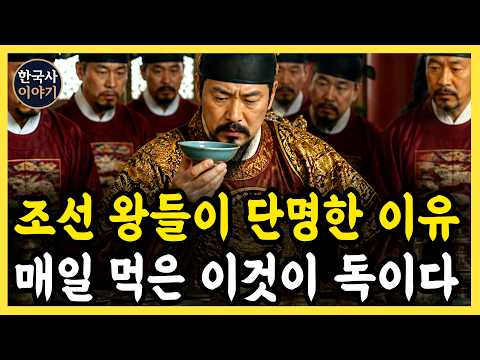
- 설명 앞부분: 조선 왕 27명의 평균 수명은 왜 짧았을까요? 수라상의 과식, 운동 부족, 스트레스와 당시 의료의 한계가 왕들의 건강을 악화시킨 과정을 살펴봅니다.
- 같은 채널 평소 대비 ×21.2 (채널 최근 롱폼 중앙값 13,619회) · 평소 영상: 《한국사》 조선 왕들을 괴롭힌 정체는? 종기의 잔혹사 l 역사 l 조선시대 l 야사 (13,619회) / 《한국사》 조선 왕실 500년 간 왜 쌍둥이가 없었을까? l 조선시대 l 조선왕조실록 (13,661회)
- 대본 없음 (설명) — 음성인식이 끝나면 도입부·흐름이 들어감
- 댓글 19/20: 좋은 점 — 영상 0 · 감사·응원 0 · 더 알고 싶은 것 0 · 아쉬운 점 — 영상 0 · 반박·불만 — 의견 다름 1 · 정치·사회 0 · 경험 공유 1 · 구독·다음 기대 0
  - 반박·불만 — 의견 다름 👍7 “틀렸습니다. 커다란 교자상에 수라를 들지 않았습니다. 임금의 밥상 크기가 궁금하면 국립민속박물관 16수장고 소반을 가서 보시오. 당시 백성들이 잘 죽는 이유는 영양실조로 허약해졌고, 쉴새 없는 출산으로 뼈가 삭았고, 그래서 전염병을 이길 힘이 없었기 때문이오.”
  - 경험 공유 👍0 “무슨 소리야? 어릴때 죽은 얘들이 무슨 기록에 있다고 어른 수명을 깍아먹어 이 무슨 개소리지? 그 시대에는 전염병. 홍역 장티프스 등 걸리면 사망이고.... 이사람 완전히 ×도 모르면서 완전 웃기네. 당신 몇살인지 모르지만 1960년대 시골 가봤니? 파리가 얼마나 많…”

### 388. 조선의 태평성대를 이룬 성종은 왜 그렇게 밤마다 여인을 찾았을까?｜한국사｜역사｜조선사｜경국대전｜폐비윤씨

- https://www.youtube.com/watch?v=UKT7EqDmqdk · 역사콕테일 · 구독자 8,380 · 조회수 99,512 (×11.9, 하루 995.2) · 좋아요 1,644 (1.7%) · 34.3분 · 2026-07-16 · 주제 묶음 4. 한국 근현대사 · 형식 정보·해설 (그 밖) · 폴더 `W_UKT7EqDmqdk` (웹 승인)
- 썸네일: 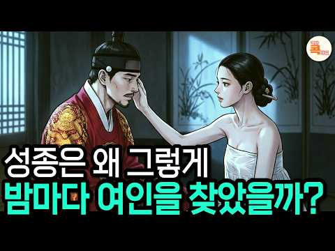
- 챕터: 0:00 서른아홉에 죽어가는 임금, 그의 두 얼굴 · 1:49 원래 왕이 될 사람이 아니었던 소년 · 4:02 낮의 성종 — 하루 세 번 경연, 25년의 공부 · 5:43 밤의 성종 — 스물여덟 명의 자식이 말하는 것 · 10:02 경국대전과 사림 — 진짜 성군이라 불리는 이유 · 15:43 어우동 사건과 이중잣대의 민낯 · 19:55 왕비 윤씨가 쫓겨나게 된 진짜 사정 · 24:41 사약의 방아쇠를 당긴 것은 무엇이었나
- 설명 앞부분: 경국대전을 완성해 조선의 뼈대를 세운 임금, 성종. 그런데 왜 실록은 그의 밤을 전혀 다른 얼굴로 기록했을까요? 세 명의 왕비와 아홉 명의 후궁, 스물여덟 명의 자식. 낮에는 하루 세 번 경연을 열며 나라를 다스린 완벽한 성군이, 밤에는 왜 그렇게 다른 사람이 되었는지. 그리고 그 밤의 그림자가 어떻게 폐비 윤씨의 비극과 연산군이라는 폭군으로 이어졌는지, 실록의 기록을 따라 그 두 얼굴을 하나하나 마주해 봅니다. 교과서가 절반만 알려준 성종의 진짜 이야기. 낮의 저울과 밤의 저울, 여러분의 판단은 어느 쪽으로 기울까요? ⏱ 타임라…
- 같은 채널 평소 대비 ×17.4 (채널 최근 롱폼 중앙값 5,731회) · 평소 영상: 세조가 잊지 못한다는 경혜공주의 충격적인 복수극｜한국사｜조선역사｜단종 (5,731회) / 세종도, 세조도 미친듯 사랑했던 이 여인! 알고 보니 노비..? ∣ 신빈김씨｜신분세탁｜조… (5,887회)
- 대본 없음 (설명) — 음성인식이 끝나면 도입부·흐름이 들어감
- 댓글 141/141: 좋은 점 — 영상 0 · 감사·응원 2 · 더 알고 싶은 것 1 · 아쉬운 점 — 영상 1 · 반박·불만 — 의견 다름 0 · 정치·사회 4 · 경험 공유 1 · 구독·다음 기대 0
  - 감사·응원 👍1 “구독 좋아요 꾹 자세한 설명 잘 봤습니다 감사합니다”
  - 더 알고 싶은 것 👍5 “지나치게 통제가 강하고 차별적인 법은 나라와 스스로를. 망하게 하는 법입니다ㆍ그래서 폭군을 키웠다는 것이 현실이고 문제였죠! 성군의. 기준은. 백성의 삶이 차별없이. 평안했나 라면 어떤평가를 받을까요?”
  - 아쉬운 점 — 영상 👍6 “경국대전을 완성한 성군이죠,,, 세종도 여자, 자식이 많았어요. 연산군이 성종의 총명함과 명석함을 이어받았으면 좋았겠는데 폐비 윤씨를 닮아버렸으니 아쉽네요. 20년간 임금으로서, 남자로서 완벽. ㅋㅋㅋ. 39살에 죽었네요.”
  - 정치·사회 👍6 “장인인 한명회를 몰아낸건 아주 현명하게 처리한듯 보통아닌듯 해요 하지만 부인 윤씨를 내치고 내쳤으면 세자도 몰아냈으면 연산군 폭군안나왔을텐데요 적장자 서자 따지지말고 자녀들도 많았고 그중에서 인성좋은 세자를 왕위물렸으면 조선나라가 바뀌었을텐데요~~”
  - 정치·사회 👍1 “성군이셨습니다 .나라의 기틀을450년 동안 유지했고 자신의 문란한 성 가족과의 생활은 조족지혈의 과오라 생각되요 부디 대한민국도 성종과 같은 대통령이 나타나길 두손모아 기원해요”

### 389. 📸 우리가 알고 있던 역사와 완전히 다른 이야기

- https://www.youtube.com/watch?v=UXhJpWnQbRo · 희귀 역사 사진 · 구독자 8,680 · 조회수 102,016 (×11.8, 하루 583.3) · 좋아요 1,364 (1.3%) · 29분 · 2026-05-02 · 주제 묶음 1. 역사 일반·이야기 · 형식 정보·해설 (그 밖) · 폴더 `W_UXhJpWnQbRo` (웹 승인)
- 썸네일: 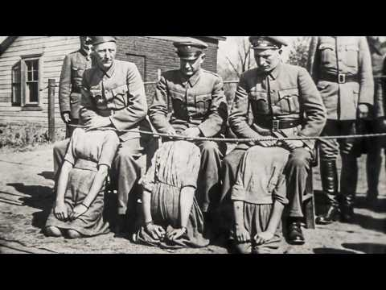
- 설명 앞부분: 안녕하세요, 민준 박입니다. 개인 채널 희귀 역사 사진에 오신 것을 환영합니다 📸 이 영상에서는 희귀 역사 사진, 옛날 사진, 오래된 사진, 빈티지 이미지, 흑백 사진들을 통해 우리가 잘 알지 못했던 과거의 순간들을 만나보실 수 있습니다. 단순히 유명한 역사 장면이 아니라, 실제 사람들의 삶과 분위기가 그대로 담긴 사진들을 중심으로 소개합니다. 이 채널은 사진을 그냥 보여주는 것이 아니라, 사진 속 이야기와 시대의 분위기, 그리고 우리가 놓치기 쉬운 디테일까지 함께 전달하는 것을 목표로 하고 있습니다. 오래된 사진 한 장이 때로는…
- 같은 채널 평소 대비 ×11.2 (채널 최근 롱폼 중앙값 9,106회) · 평소 영상: 📸 오래된 사진이 말해주는 진짜 역사 ∣ 희귀 역사 사진들 (9,106회) / 📸 우리가 상상하지 못했던 역사의 모습 ∣ 희귀 역사 사진들 (9,042회)
- 대본 없음 (설명) — 음성인식이 끝나면 도입부·흐름이 들어감
- 댓글 36/36: 좋은 점 — 영상 2 · 감사·응원 0 · 더 알고 싶은 것 2 · 아쉬운 점 — 영상 2 · 반박·불만 — 의견 다름 0 · 정치·사회 0 · 경험 공유 0 · 구독·다음 기대 0
  - 좋은 점 — 영상 👍29 “참 좋은 채널이고 좋은영상인데 썸네일 조작이미지 또는 어그로 썸네일 때문에 짜증나네요.”
  - 좋은 점 — 영상 👍0 “썸넬 조작 ㅈ같네. 좋은 내용인데 이딴식으로 하면 할거는 비추 차단밖에 없음”
  - 더 알고 싶은 것 👍0 “진짜... 그밖에도 우리가 모르고 있는 장면들은 몇장면이나 더 있을까요?”
  - 더 알고 싶은 것 👍0 “이런 사기같은! 썸 네일 사진이 궁금해서 들어왔더니~”
  - 아쉬운 점 — 영상 👍29 “참 좋은 채널이고 좋은영상인데 썸네일 조작이미지 또는 어그로 썸네일 때문에 짜증나네요.”
  - 아쉬운 점 — 영상 👍0 “정정요청합니다 11:07 에 나오는 한국전쟁 크리스마스 예배모습은 1945년이 아니라 1950~1952년 사이입니다.”

### 390. 겁쟁이라 불리던 6사단은 어떻게 중공군 3개 사단을 호수에 묻었나 ∣ 용문산·파로호 대첩

- https://www.youtube.com/watch?v=K-D-pHlxoFo · 역사참판 · 구독자 3,030 · 조회수 35,501 (×11.7, 하루 341.8) · 좋아요 580 (1.6%) · 16.5분 · 2026-07-12 · 주제 묶음 기타 · 형식 정보·해설 (그 밖) · 폴더 `W_K-D-pHlxoFo` (웹 승인)
- 썸네일: 
- 챕터: 0:00 호수에 잠긴 2만 명, 그날의 시작 · 1:21 겁쟁이라 조롱받던 블루스타 · 3:04 결사, 철모에 새긴 두 글자 · 4:23 1개 연대 vs 3개 사단 · 6:18 본진인 줄 알았다는 치명적 착각 · 8:00 화천댐을 확보하라 · 10:09 건널 수 없는 물 앞에서 · 12:21 현대판 살수대첩, 그리고 남은 이름
- 설명 앞부분: 1951년 5월, 강원도 화천의 한 저수지. 총에 맞아서가 아니라, 물에 빠져 수많은 병사가 목숨을 잃었습니다. 그리고 이 어마어마한 규모의 적을 몰아넣은 부대는, 얼마 전까지 같은 편에게도 겁쟁이라 손가락질받던 이들이었습니다. 사창리에서 등을 보이고 도망쳤던 6사단. 그들이 한 달 만에 어떻게 완전히 다른 부대가 되었을까요. 철모에 두 글자, 결사를 써넣은 병사들이 1개 연대로 3개 사단을 오판에 빠뜨리고, 마침내 그들을 호수에 묻기까지. 그 며칠간의 이야기를 처음부터 끝까지 따라가 봅니다. 겁쟁이와 영웅의 거리는, 사실 그렇게…
- 같은 채널 평소 대비 ×64.7 (채널 최근 롱폼 중앙값 549회) · 평소 영상: 정원 60명 배에 14,000명, 근데 부두엔 남겨진 절반이 있었다 (549회) / 히딩크가 반말을 시킨 진짜 이유, 그리고 24년 뒤 홍명보에게 벌어진 일 (572회)
- 대본 없음 (설명) — 음성인식이 끝나면 도입부·흐름이 들어감
- 댓글 103/103: 좋은 점 — 영상 0 · 감사·응원 3 · 더 알고 싶은 것 1 · 아쉬운 점 — 영상 1 · 반박·불만 — 의견 다름 0 · 정치·사회 9 · 경험 공유 1 · 구독·다음 기대 0
  - 감사·응원 👍8 “파라호를 처음 알았어요 감사합니다”
  - 더 알고 싶은 것 👍1 “무얼좀 호도 하고 계신대요. 그 작전에는 한국 해병대 제 1 연대, 미 해병대 포병 이 참전 했습니다. 맨날 후퇴만 하는 육군 제 6 사단 에 기회를 사기를 부여 해주고자 당 시 해병대와 미국 해병대는 아무렇지 않게 받아들였고 육군 위주의 역사편찬이 이렇게 호도 하는…”
  - 아쉬운 점 — 영상 👍0 “이제는 이런 영상도 개 잣같은 ai 목소리....!!”
  - 정치·사회 👍12 “파로호 전투를 전세계에 알려야 됩니다. 기념식도 크게하고... 이승만대통령님이 호수이름을 파로호라고 바꾸었다. 그만큼 대승 이었다.”
  - 정치·사회 👍12 “저 파로호 명칭을 바꿀려 한 자?... 가 있었지요.중국인들이 싫어 한다고...중공한태 무얼 쳐먹은지는 모르겠고...파로호 명칭 절대로 바꾸면 않됍니다.자지손손...영원히 존제해야 합니다.”
  - 경험 공유 👍5 “나라를 구한 6사단. 저도 6사단 출신입니다.”

### 391. 왜선 300척이 다시 몰려왔다, 이순신은 새 거북선 3척을 띄웠다 ∣ 대한국 프로젝트2 불침 최종편 ∣ 4K

- https://www.youtube.com/watch?v=i9VrWPX2dWg · 대한 타임슬립 본부 · 구독자 16,500 · 조회수 189,706 (×11.5, 하루 3,312.3) · 좋아요 488 (0.3%) · 9분 · 2026-08-28 · 주제 묶음 3. 조선 · 형식 사연·드라마 · 폴더 `W_i9VrWPX2dWg` (웹 승인)
- 썸네일: 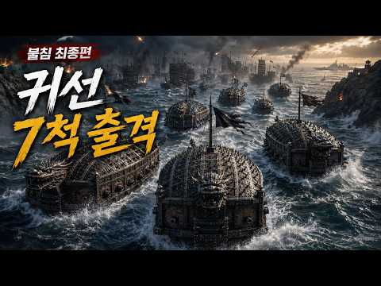
- 설명 앞부분: 왜선 300여 척이 다시 남해로 몰려옵니다. 마지막 송환선 5척을 지키기 위해 이순신과 조선 수군, 그리고 1598년에 남겨진 대한민국 함대가 마지막 물목에 섭니다. 이번 편은 「대한국 프로젝트2 — 불침: 살아남은 칼」 최종편입니다. 남아 있는 현대 화력은 이제 얼마 되지 않습니다. 그리고 조선에서 새로 만든 귀선이 처음으로 실전에 나섭니다. ■ 작전 제작 노트 불침의 마지막을 일본을 정복하는 이야기로 끝내고 싶지는 않았습니다. 이번 시리즈에서 끝까지 남기고 싶었던 것은, 현대의 화력이 멈춘 뒤에도 조선이 스스로 지킬 수 있는 …
- 같은 채널 평소 대비 ×3.5 (채널 최근 롱폼 중앙값 54,790회) · 평소 영상: 400년 전 조선에 남겨진 한국 잠수함을 찾아갔다… 그런데 우리가 처음이 아니었다 ∣ 4K (61,870회) / 이순신 대마도 상륙, 대한민국 구축함이 왜군 포대를 쐈다 ∣ 대한국 프로젝트2 ∣ 4K (78,360회)
- 대본 없음 (설명) — 음성인식이 끝나면 도입부·흐름이 들어감
- 댓글 26/26: 좋은 점 — 영상 0 · 감사·응원 3 · 더 알고 싶은 것 2 · 아쉬운 점 — 영상 0 · 반박·불만 — 의견 다름 0 · 정치·사회 0 · 경험 공유 0 · 구독·다음 기대 0
  - 감사·응원 👍4 “구독과 좋아요 이렇게나마 항상 응원 합니다 ^^”
  - 감사·응원 👍3 “아따마~ 주인장 양반 영상 자알 보고 늦게라도 고맙다고 인사드리오. 올매전에 억수로 내린비로 우리동네 통영하고 거제가 허들시리 난리가 나갔고 온동네가 젖을담은기라 그래갓고 영상도 인자 본깅께 이해하소. 그라고 다음 영상도 싸개 올리주고 그라소. 그라모 욕좀보소.”
  - 더 알고 싶은 것 👍3 “현대군 투입 전투영상도 자주 부탁드립니다 대한님!”
  - 더 알고 싶은 것 👍2 “다음 전투영상도 부탁드립니다 대한님!”

### 392. 조선시대 밥상 ∣ 드라마에서 본 그 음식, 전부 가짜였다 ∣ 한국사

- https://www.youtube.com/watch?v=oPQVIFZZo4I · 한국사 뒤편 · 구독자 1,180 · 조회수 13,260 (×11.2, 하루 74.5) · 좋아요 173 (1.3%) · 15.3분 · 2026-04-29 · 주제 묶음 3. 조선 · 형식 브이로그·직접 해본 이야기 · 폴더 `W_oPQVIFZZo4I` (웹 승인)
- 썸네일: 
- 챕터: 0:00 인트로 - 드라마가 거짓말을 했다 · 1:20 구조 설명 - 왜 우리가 몰랐나 · 2:40 첫 번째 - 국밥은 찬밥 처리에서 시작됐다 · 5:10 두 번째 - 빨간 김치는 200년도 안 됐다 · 7:30 세 번째 - 냉면은 원래 겨울 음식이었다 · 10:00 네 번째 - 삼겹살은 60년 된 음식이다 · 12:20 다섯 번째 - 왕도 먹고 싶은 거 못 먹었다 · 14:20 마무리
- 설명 앞부분: 국밥은 어떻게 생겨난 줄 아십니까. 주막에서 남은 찬밥 처리하다가 생겨난 음식입니다. 빨간 김치는 200년도 안 됐고, 삼겹살은 60년 된 음식이고, 냉면은 원래 겨울에 먹던 음식이었습니다. 우리가 당연하게 알고 있던 것들이 사실은 전혀 달랐습니다. 대장금에서 본 그 화려한 밥상, 오늘 다 뒤집어 드리겠습니다. ▸ 타임라인 ▸ 참고 문헌 조선왕조실록 한국민족문화대백과사전 이문건 묵재일기 황윤석 이재난고 이유원 임하필기 산림경제 증보산림경제 ※ 이 영상은 AI 이미지 생성 도구를 활용하여 역사적 장면을 시각적으로 재구성하였습니다.
- 같은 채널 평소 대비 ×21.4 (채널 최근 롱폼 중앙값 618회) · 평소 영상: [역사] 조선왕비의 ‘용변’은 왜 권력이 되었을까?｜조선 왕실의 은밀한 야사 (654회) / 조선 왕의 하루 일과 시간표｜새벽 4시부터 밤 … (583회)
- 대본 없음 (설명) — 음성인식이 끝나면 도입부·흐름이 들어감
- 댓글 53/53: 좋은 점 — 영상 0 · 감사·응원 0 · 더 알고 싶은 것 1 · 아쉬운 점 — 영상 1 · 반박·불만 — 의견 다름 3 · 정치·사회 0 · 경험 공유 1 · 구독·다음 기대 0
  - 아쉬운 점 — 영상 👍3 “삼국사기 부터 고구려 문헌에도 국밥에 대한 말이 있는데 이양반이 AI음성으로 장난질을 하네 고추가루는 조선시대 맞는데 그 전에 문헌에 이미 구려 때 국밥이 있었단다.”
  - 반박·불만 — 의견 다름 👍4 “고추 가 늦게 들어 간거지 김치 역사가 짦은게 아니죠”
  - 반박·불만 — 의견 다름 👍0 “드라마를 저렇게 개판으로 만드니 국민(주 시청자 여자)들이 무식해져 현실에 오판이 생기는 것임. 특히 양가집 처자가 주도적으로 연애를 하고, 정치와 사회문제를 논하고 이런 말도 안되는 드라마를 만드는 얼치기 작가뇬들...”
  - 경험 공유 👍2 “나도 밀가루 배달하면서 알게됨.”

### 393. 미국 인터넷을 뜨겁게 달군 "이순신 장군 열풍"뜨거운 댓글 반응 / “이런 사람이 진짜 있었냐” 지금 미국이 이순신에 열광하는 진짜 이유

- https://www.youtube.com/watch?v=iuHGTcdrKzs · 홍시채널 · 구독자 42,500 · 조회수 477,168 (×11.2, 하루 15,713.2) · 좋아요 5,933 (1.2%) · 26.3분 · 2026-09-23 · 주제 묶음 3. 조선 · 형식 애니메이션·지도 · 폴더 `W_iuHGTcdrKzs` (웹 승인)
- 썸네일: 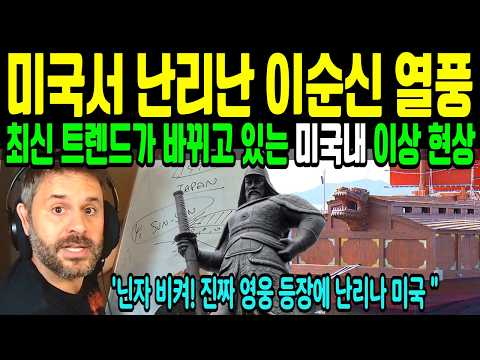
- 설명 앞부분: 이제 한국 역사까지 파고 있는 미국인들 동북아 역사에 대한 미국인들의 뜨거운 관심 '닌자 사무라이 비켜' '실존 영웅 나가신다' 미국의 한 만화 가게, 슈퍼맨과 배트맨이 늘어선 진열대 사이에 낯선 얼굴 하나가 놓여 있습니다. 400여 년 전, 배 열세 척으로 133척의 적을 막아낸 조선의 장군. 닌자와 사무라이에 열광하던 미국 젊은 세대가 이제 "진짜 영웅"을 찾아내고 눈을 반짝이고 있습니다. 미국 해군이 100년 전부터 주목했던 그 이름, 이순신. 지구 반대편에서 다시 살아나고 있는 그의 이야기를 지금 만나보세요. ⚠️ 안내 사…
- 같은 채널 평소 대비 ×5.0 (채널 최근 롱폼 중앙값 95,011회) · 평소 영상: “한국이 날 망쳐놨어요” 미국으로 돌아간 그가 남긴 말 ∣ 외국인들이 말하지 못한 한국의… (103,727회) / 유럽·미국인들이 한국으로 몰려오는 충격적인 이유/ 런던·뉴욕 직항 싹 다 매진… (108,956회)
- 대본 없음 (설명) — 음성인식이 끝나면 도입부·흐름이 들어감
- 댓글 473/475: 좋은 점 — 영상 3 · 감사·응원 36 · 더 알고 싶은 것 2 · 아쉬운 점 — 영상 3 · 반박·불만 — 의견 다름 7 · 정치·사회 32 · 경험 공유 14 · 구독·다음 기대 1
  - 좋은 점 — 영상 👍182 “이순신 장군은 현실 영웅입니다 만화 영웅하곤 차원이 다릅니다 현신했던 레전드 입니다 가장 유명하고 한국인은 잊지말아야할 장군님의 가르침은 " 왜는 간사하기 짝이없어 신의를 지켰다는 얘기를 들은적이 없다 " 였습니다”
  - 좋은 점 — 영상 👍4 “귀에 쏙쏙 들어오네요. 도서관에서 블루투스로 집중해서 듣고 있어요. 구독, 꾹 하고 갑니다.”
  - 감사·응원 👍68 “이순신 장군 최고이십니다 😊 대란민국 화이팅🎉🎉🎉”
  - 감사·응원 👍36 “대한민국 화이팅! 이순신 장군님 만세!”
  - 더 알고 싶은 것 👍1 “이순신 장군님은 진짜 영웅입니다 세게에 알려주세요”
  - 더 알고 싶은 것 👍0 “아무리 그래도 진실은 알고 합시다. 난중일기 읽어보면 그 당시 문화였지만 수많은 관노들과 잠자리를 하고 직접 기록한 기록들이 많이 있습니다. 그럼에도 우리 민족의 가장 위대한 영웅 중 한명이라는 사실은 변함 없습니다. 단, 대조적으로 조선의 왕이란 것들과 문관 양반이…”
  - 아쉬운 점 — 영상 👍1 “국뽕이 아니라 아쉬움만 듭니다. 지구 역사상 가장 위대한 제독! 그 분을 이제사 지구인들이 알게되었다는 것! 그것은 우리의 국력이 세계 5위에 이르렇을매 가능하게 되었다는 것! 나는 이번달 초에 스파이더맨을 보면서 너무 너무 유치하고 촌스럽고 말도 안되는 100% 거…”
  - 아쉬운 점 — 영상 👍1 “이순신 장군님은 실제 영웅 이시니까...사무라이? 이게 미친 놈들인게 사무라이 자체가 악당이었지 칼 시험한다고 지들 백성들을 베고 다닌다는게 말이 되나? 미개하고 미친놈들일 뿐이었지. 그리고 화면을 좀더 연구하세요 같은거 돌리고 또 이거 짜집기 저거 짜집기 보기 안좋…”
  - 반박·불만 — 의견 다름 👍1 “국뽕이 아니라 아쉬움만 듭니다. 지구 역사상 가장 위대한 제독! 그 분을 이제사 지구인들이 알게되었다는 것! 그것은 우리의 국력이 세계 5위에 이르렇을매 가능하게 되었다는 것! 나는 이번달 초에 스파이더맨을 보면서 너무 너무 유치하고 촌스럽고 말도 안되는 100% 거…”
  - 반박·불만 — 의견 다름 👍1 “넬슨은 이순신에 견줄 수준이 못되지. 넬슨은 당시 영국이라는 강력한 국가의 최대의 지원을 받으며 싸웠고, 이순신장군님은 이건 그냥 나가서 죽으라는 환경이었음. 말도 안되는 최악의 여건에서 그냥 너무 쉽게 개발라버림. 압살함. 넬슨은 어디까지나 인간의 범주고, 이순신 …”
  - 정치·사회 👍49 “그동안 우리나라가 너무 힘이 없어 전세계가 알지도 못했고 관심도 없었기 때문입니다. 지금은 우리나라의 국력이 엄청나게 상승해서 세상이 관심을 갖게되고 역사를 알게 되어 비로소 이순신장군을 알게되었다고 생각합니다. 그래서 국력이 중요하다고 생각합니다”
  - 정치·사회 👍19 “이순신 장군님이 목숨걸고 지켜낸 이강토 이강산을 중국인들과 불체자들이 야금야금 잠식하고 있는 현실이 너무 슬프다~~ㅠ”
  - 경험 공유 👍66 “내가 세상에서 제일 존경하는 두분이 있습니다 충무공 이순신님 세종대왕님”
  - 경험 공유 👍29 “인품도 대단하셨지요. 감옥을 방문해보고 포로된 일본군 소년에게 명심보감을 보내 주면서 감옥에서 공부하도록까지 해 주셨지요.. 제가 고등학교 다니던 1968년. 광화문에 전차가 없어지고 이순신 장군 동상이 세워졌습니다(박정희 지시로 알고 있습니다. 왜정시대 일본군 했던…”
  - 구독·다음 기대 👍2 “헐리우드 대작 기대합니다 1억달러제작비 대작❤❤❤❤❤❤❤”

### 394. 100년 전 부산의 모습｜1928년 일제강점기 컬러복원【Ep.01】｜Life in Busan under Japanese Rule (1928)

- https://www.youtube.com/watch?v=2esMNsdBMQc · 기억을색으로 · 구독자 7,710 · 조회수 86,236 (×11.2, 하루 777.6) · 좋아요 1,210 (1.4%) · 8.5분 · 2026-07-05 · 주제 묶음 4. 한국 근현대사 · 형식 정보·해설 (그 밖) · 폴더 `W_2esMNsdBMQc` (웹 승인)
- 썸네일: 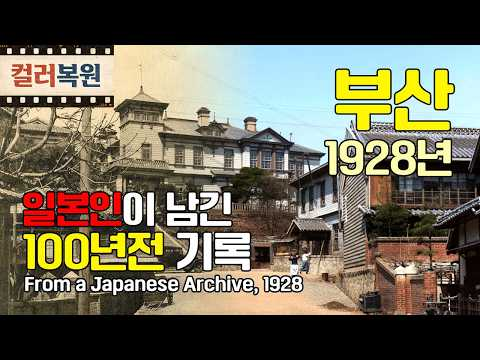
- 챕터: 0:00 Intro 및 영상 설명 · 0:18 부산 중구 주요 모습(광복로 축제 등) · 1:17 조선와사전기주식회사 앞 모습 · 1:31 용두산 공원 · 1:58 중앙동, 부산부청, 부립병원, 부평동 · 2:58 1920년대 부산 주요 건물들 · 4:13 1920년대 부산 주요 사찰 · 5:25 경남도청, 철도병원, 서구 시가 · 6:05 1920년대 부산의 주요 명소들 · 6:58 1920년대 부산의 학교들 · 7:31 1920년대 송도, 해운대
- 설명 앞부분: 1928년 부산에서 촬영된 흑백기록 사진들과 일본이 발행한 엽서 자료를, 컬러 복원과 Ai 모션 기술로 재구성하여, 약 100년 전 부산의 풍경을 보다 생생하게 되살린 역사 아카이브입니다. 100년 전, 부산은 어떤 도시였을까요? 일제강점기 시절, 한반도를 대표하는 국제항이자 관문이었던 부산에는 수많은 사람들이 오가고, 거리와 시장, 항구와 철도는 쉼 없이 움직이고 있었습니다. 광복로와 대청로의 거리 풍경, 부평시장과 북빈항, 부산역과 부산세관, 부산부청과 용두산공원, 동래온천장과 송도해수욕장, 해운대와 범어사까지. 도시의 성장과…
- 같은 채널 평소 대비 ×4.6 (채널 최근 롱폼 중앙값 18,685회) · 평소 영상: 1952년 전쟁 속 부산의 일상들 3편 Wartime Hustle: Rare 1952 R… (18,685회) / [2편] 1952-53년 대구: 전쟁 속 사람들의 일상생활 (20,350회)
- 대본 없음 (설명) — 음성인식이 끝나면 도입부·흐름이 들어감
- 댓글 385/386: 좋은 점 — 영상 3 · 감사·응원 11 · 더 알고 싶은 것 3 · 아쉬운 점 — 영상 7 · 반박·불만 — 의견 다름 4 · 정치·사회 9 · 경험 공유 12 · 구독·다음 기대 0
  - 좋은 점 — 영상 👍2 “영상 잘 봤습니다😊 부산 토박이인데 좋은 정보 감사합니다”
  - 좋은 점 — 영상 👍1 “일제시대에 경성대학교 건물 지어서 해방후 서울대학교가 됨. 붉은벽돌로 지은 학교. 사진 보니 그 당시 조선은 서당에서 뭘 배웠겠는가?”
  - 감사·응원 👍46 “500년이나 국민을 노예로 한 조선, 조선의 노예제도를 해방한 일본에 항상 감사해야 한다.”
  - 감사·응원 👍10 “역사라는 것은 참 아이러니 합니다. 이 땅에 근대화가 시작된 것은 일본의 식민지배 이후의 이야기 입니다. 그 이전에도 전기를 도입하려고 하는 시도와 같은 근대화와 비슷한 움직임은 있었고, 그걸 근대화라고 주장하는 얼나간 사람들이 있지만, 아쉽게도 일본에 의해 강제로 …”
  - 더 알고 싶은 것 👍14 “아무리 수만 번 생각을 해 봐도 일본이 말기암적 사대 주자성리학의 쓰레기 왕조 조선을 통치한 기간이 없었다면 지금 이 나란 어찌 됐을까? 어떤 모습으로 살고 있을까? 참 궁금하다. 그리고 이 채널엔 쩌~그 영상이 없고 서울, 경상도만 있어서 넘 좋다👍👍👍 바로 구독!…”
  - 더 알고 싶은 것 👍1 “일제시대 어떤 수탈이 있었죠? 😢”
  - 아쉬운 점 — 영상 👍79 “부산에 이런멋진건물이 있었다는것이 놀랍고 아쉽습니다. 남아있었다면 모두 중요한 문화재인데 최근 부산세관건물을 복원한다는 뉴스을접했습니다.”
  - 아쉬운 점 — 영상 👍14 “영상 참 잘봤습니다. 현재 부산에 남아있는 일제시대 근대건축물은 경남도청. 부경고. 한성은해. 기상청. 백제병원. 한국전력. 일신여학교. 동양척신주식회사. 총 8개정도 있네요. 영상에서는 부경고. 경남도청 2개만 나오구요. 다른 근대건물축도 나왔으면 좋겠는데 조금 아…”
  - 경험 공유 👍7 “사실 부산이라고 해봤자 전쟁전까지 저기가 다임,,그나마 나머진 고을,,지금은 원도심이 아주 그지 동네 되었지만,,,오히려,,,저시대가 건물도 이쁘고 좋네”
  - 경험 공유 👍7 “저는 81년 생이지만 일본식 특유의 판자 수평으로 포갠 건물로된 초등학교를 나왔고 제가 살던곳 읍사무소는 저당시 5:10 일본식 벽돌 건물이였습니”

### 395. 조선의 왕비 46명 몰아보기 살아서 중전이 된 42명과 추존 왕후 4명 까지 한 번에 보는 풀스토리 ∣ 역사

- https://www.youtube.com/watch?v=Az6ATKEByaY · 세상의모든역사 · 구독자 4,100 · 조회수 45,717 (×11.2, 하루 381.3) · 좋아요 439 (1.0%) · 300.2분 · 2026-06-26 · 주제 묶음 1. 역사 일반·이야기 · 형식 수면·낭독 (잠잘 때 듣는) · 폴더 `W_Az6ATKEByaY` (웹 승인)
- 썸네일: 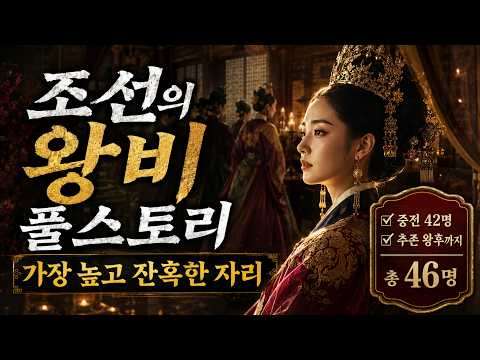
- 챕터: 0:00 조선 왕비와 중궁전의 권력 구조 · 17:37 조선 초기 왕비들 ∣ 원경왕후와 소헌왕후 · 34:50 단종과 세조 시대 ∣ 어린 왕비와 대비 정치 · 65:24 반정과 사화 ∣ 폐위와 왕비의 운명 · 108:11 선조와 광해군 시대 ∣ 전쟁과 왕위 계승 · 152:56 숙종의 궁궐 ∣ 인현왕후와 장희빈 · 189:43 영조와 정조 시대 ∣ 왕비와 후계 문제 · 215:36 세도 정치 시대 ∣ 왕비와 외척 가문 · 257:06 조선 말기 ∣ 명성황후와 외세 · 297:20 마지막 황후들 ∣ 대한제국과 왕실의 변화
- 설명 앞부분: 🌙틀어놓고 주무세요 조선의 왕비는 왕의 곁에 앉은 배우자이면서 동시에 왕위 계승과 외척, 왕실의 정통성이 만나는 자리였습니다. 신의왕후와 신덕왕후에서 시작해 원경왕후·소헌왕후·정희왕후·문정왕후·인현왕후·명성황후를 거쳐 대한제국의 마지막 황후들까지, 조선과 대한제국 왕실 여성들의 삶을 시대순으로 살펴봅니다. 후사를 둘러싼 압박, 친정 가문과 외척 정치, 폐위와 복위, 수렴청정, 반정과 전쟁, 세도 정치와 외세의 개입까지 중궁전을 통해 조선 500년의 권력 구조가 어떻게 변화했는지 함께 정리했습니다. ■ 주요 교육 내용 조선 초기 왕…
- 같은 채널 평소 대비 ×45.2 (채널 최근 롱폼 중앙값 1,012회) · 평소 영상: 고려 시대 딸들이 조선보다 훨씬 부자였다? 700년 재산권의 역사 (1,045회) / 황제가 포로로 돌아왔는데 성문을 닫았다｜명나라를 구한 8년의 선택 (978회)
- 대본 없음 (설명) — 음성인식이 끝나면 도입부·흐름이 들어감
- 댓글 9/9: 좋은 점 — 영상 0 · 감사·응원 0 · 더 알고 싶은 것 0 · 아쉬운 점 — 영상 1 · 반박·불만 — 의견 다름 0 · 정치·사회 0 · 경험 공유 0 · 구독·다음 기대 0
  - 아쉬운 점 — 영상 👍0 “한줄로 끝날말을 질질 끌어서 반복하고 몇분이나 물고늘어지네 그냥 시간끌기 넘 지루해서 잠은오네 ㅋ”

### 396. 영화도 담지 못한 단종의 진짜 최후, 삼족을 멸한다는데 그 시신을 거둔 아전이 있었다 [조선왕조실록]

- https://www.youtube.com/watch?v=HbaG82CmZF4 · 조선왕조실록이야기 · 구독자 19,700 · 조회수 219,675 (×11.2, 하루 3,285.7) · 좋아요 3,687 (1.7%) · 50.1분 · 2026-08-18 · 주제 묶음 3. 조선 · 형식 정보·해설 (그 밖) · 폴더 `W_HbaG82CmZF4` (웹 승인)
- 썸네일: 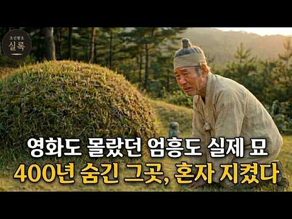
- 챕터: 0:00 400년 만에 세상에 드러난 무덤과 엄흥도의 비밀 · 1:38 영월의 평범한 아전이었던 엄흥도, 그는 누구인가? · 4:34 12살 어린 나이에 왕위에 오른 단종의 외로운 시작 · 7:00 수양대군의 야심과 피바람의 시작 '계유정난' · 11:15 눈물의 양위와 세조의 즉위, 그리고 단종의 영월 유배 · 15:38 강과 절벽에 갇힌 기이한 감옥 '청령포'에서의 삶 · 18:58 홍수로 인해 관풍헌으로 옮겨진 단종과 엄흥도와의 거리 · 21:20 단종 복위 운동의 실패와 사육신의 장렬한 죽음 · 23:59 금성대군의 복위 거사와 수북 땅의 참혹한 학살 · 26:41 17세 소년 단종의 마지막 순간과 뒤섞인 역사적 기록들 · 31:33 삼족을 멸하는 위협 속에서 단종의 시신을 거둔 엄흥도… · 37:34 자취를 감춘 엄흥도 일가와 400년간 이어진 숨바꼭질 · 40:10 숙종 대에 이르러 단종의 복권과 함께 빛을 발한 엄흥… · 44:50 가짜 무덤 뒤에 숨겨진 진짜 무덤과 500년 만의 진실
- 설명 앞부분: 단종의 죽음과 그 시신을 거둔 아전 엄흥도의 실화입니다. 최근 발견된 엄흥도 진묘 소식과 함께, 계유정난부터 영월 유배, 단종의 마지막까지 조선왕조실록에 기록된 그대로 풀어드립니다. 영화 「왕과 사는 남자」로 다시 주목받은 단종과 엄흥도. 하지만 영화도 다 담지 못한 진짜 이야기가 실록 속에 남아 있습니다. 삼족을 멸한다는 서슬 퍼런 위협 속에서, 버려진 어린 임금의 시신을 목숨 걸고 거둔 한 사람. 영월의 늙은 아전, 엄흥도의 이야기를 들려드립니다. 400년 넘게 숨겨져 있던 엄흥도 무덤의 진짜 위치를 추적합니다. 후손들이 여러…
- 같은 채널 평소 대비 ×21.2 (채널 최근 롱폼 중앙값 10,358회) · 평소 영상: 역대 조선 왕들의 진짜 인성과 몰랐던 사생활 조선왕조실록 재밌는 이야기 (10,525회) / 12살에 팔려간 기생, 그녀가 조선의 법을 깨버렸다 [조선왕조실록] (10,192회)
- 대본 없음 (설명) — 음성인식이 끝나면 도입부·흐름이 들어감
- 댓글 535/536: 좋은 점 — 영상 2 · 감사·응원 15 · 더 알고 싶은 것 1 · 아쉬운 점 — 영상 0 · 반박·불만 — 의견 다름 0 · 정치·사회 8 · 경험 공유 1 · 구독·다음 기대 1
  - 좋은 점 — 영상 👍2 “당연 충신이죠 잘듣고 배우고 갑니다”
  - 감사·응원 👍24 “충신 중에 충신이었음을 고백하며 너무나 위대한 우리의 선조 이 셨음을 감사드립니다”
  - 감사·응원 👍6 “슬프고 가슴아픈 역사이야기 고맙습니다.”
  - 더 알고 싶은 것 👍2 “하필 영월인지 궁금해서요”
  - 정치·사회 👍3 “엄흥도 .환생,지금,나라지키려 희생으로 ,박정희 .윤석열 ,전한길 ,장동혁 .또 애국자님들 다 엄흥동 .혼을담아지요 ,.”
  - 정치·사회 👍2 “세조가조카죽였지만그가조선을살린거는왜말이없나세종이만든국경을확실히한임금이고김종서가충신이라도혼자독단적으로 국정을농단하는데가만히있어야하나계유정난이없어서면김종서는권신으로살아생전에국정농단하다가 임금을허수아비로만들인물아무리충신이라도혼자독단적으로하면나라가온전할수없다고려시대무신의난예…”
  - 경험 공유 👍25 “인간이라면 내가모시든 왕이 죄없이 죽음을당하고 강물에던져 뜨 있는걸보면 선비로서 충신이었다면 비록 삼족을 멸한다해도 뛰어들지 않았을까 싶네요 옛 시대에는 충신은 두 임금을 섬기지 않는다죠 엄흥도 또한 진정한 충신이시죠”
  - 구독·다음 기대 👍24 “조선의 훌륭한 인물 입니다 단종도 엄홍도 모두 자랑스럽습니다 요즘에도 이런 인물이 나타나길 기대합니다 관세음 보살 ❤❤❤”

### 397. "충무공에 푹 빠진 미국" 초능력도 없는 400년 전 이순신 장군 이야기에 열광하는 진짜 이유

- https://www.youtube.com/watch?v=HlGkmhX0J6c · 코믹스 경제 · 구독자 34,000 · 조회수 378,852 (×11.1, 하루 12,277.7) · 좋아요 2,580 (0.7%) · 24.1분 · 2026-09-23 · 주제 묶음 3. 조선 · 형식 애니메이션·지도 · 폴더 `W_HlGkmhX0J6c` (웹 승인)
- 썸네일: 
- 설명 앞부분: 📚 【교육 콘텐츠】 "아시아 이야기는 안 팔린다던 미국에서, 조선 장군이 25만 부를 팔았습니다." 🇰🇷 미국 출판사들은 이순신 만화를 한 곳도 빠짐없이 돌려보냈습니다. 이유는 딱 하나, 아시아 이야기라서였습니다. 시카고의 한 미국 만화가는 16년 동안 코믹콘 장터를 돌며 이 책을 손으로 팔았습니다. 마블과 DC가 시장의 63%를 쥔 미국 한복판에서요. 🎬 이번 영상의 핵심 정보 ✓ 드라마 DVD 한 장이 미국 청년의 인생을 바꾼 과정 ✓ 가게에 들어가지 못한 책을 행사장마다 매진시킨 판매 전략 ✓ 스탠 리가 서문을 쓰고 업계 거…
- 같은 채널 평소 대비 ×7.3 (채널 최근 롱폼 중앙값 51,708회) · 평소 영상: "아마존도 포기한 걸 해냈다고?" 한국인들이 유달리 똑똑한 진짜 이유, 속도와 효율성이 … (53,209회) / "석탄 없이 쇳물 만든다" 포스코가 세계 최초 수소 제철소를 위해 41만 평 바다를 메우… (50,207회)
- 대본 없음 (설명) — 음성인식이 끝나면 도입부·흐름이 들어감
- 댓글 154/154: 좋은 점 — 영상 0 · 감사·응원 4 · 더 알고 싶은 것 2 · 아쉬운 점 — 영상 2 · 반박·불만 — 의견 다름 4 · 정치·사회 13 · 경험 공유 2 · 구독·다음 기대 0
  - 감사·응원 👍4 “감사합니다. 만화책 만들려고 한국에 여러차례 와서 공부하고 배우고 갔어요.”
  - 감사·응원 👍2 “온리 콤판! 진심으로 감사합니다. 17년간 이순신 알리기에 목숨을 걸었다니... 그것도 순 미국인이...”
  - 더 알고 싶은 것 👍14 “구역질나는 정치판 꼴을 보다 참으로 오랜만에 신선한 보람을 느꼈습니다. 참 설명 내용과 화면이 가슴 벅차게 하네요. 국운이 이렇게 사방에서 상승하건만 우리 국민들의 진가는 언제 쯤 발현 될 수 있을까요?”
  - 더 알고 싶은 것 👍10 “와 이순신장군을 미국인이 만화로 그렸다고 대단하다 콤판 대단하다 이제 k콘텐츠 바람을 타고 1위는 따논당상이다 과연 미국인이 한국인의 정서를 얼마나 잘 전달했을지 궁금하다”
  - 아쉬운 점 — 영상 👍0 “이순신이 100원짜리 동전이고, 새가 500원짜리고, 천원, 오천원 짜리의 인물은 뭐냐? 만원 짜리 세종은 억지로 이해 하겠다만, 신사임당이 오만원짜리 라니 참 우습다 오래전에 오백원 커다란 짜리 지폐가 있었는데 거북선 이었지? 화폐 디자인 좀 바꾸자, 미국은 조지워…”
  - 아쉬운 점 — 영상 👍0 “Ai목소리가 좀 구리네 신경좀 쓰세요”
  - 반박·불만 — 의견 다름 👍1 “한국의 아무도 못한것을 미국인이 해 냈군요 ..10년전에 미국에 5성호텔에 갔을때 후론트 남자직원이 '이순신'을 알고 있다고 감동이었다고 한국인을 다시 보게 되었다고 .. 내게 말한적이 있었습니다.. 이 무명작가의 말도 안되는 노력이었군요 ...대한민국 정치인 수천명…”
  - 반박·불만 — 의견 다름 👍0 “동벌이도 좋고 뽕도 좋은데..제발 선은 지키자. 선동 꺼리라도 되면 그나마 인정.. 쌩 구라 수준이면 이건 범죄야”
  - 정치·사회 👍50 “콤판은 대단한 미국인입니다. 한국정부가 콤판에게 표창장이라도 수여해야 할 듯 합니다.”
  - 정치·사회 👍25 “한국 정부나 삼성이나 현대같은 기업은 저런 사람 후원 안하고 뭐하고있나? 삼성도 이제는 국가 마케팅을 해야할 때 아닌가? 20년 전에는 한국 기업임을 숨기고 일본 기업처럼 속였으나, 이젠 한국 마케팅 해야할 때가 아닌가? 이제는 국가 홍보도 좀 하고 문화, 예술영역에…”
  - 경험 공유 👍1 “이순신 해전 이야기를 "오딧세이" 영화 처럼 만들날이 왔으면 합니다. 내가 돈이 있으면 미국에서 만들어 보고 싶네요.”

### 398. 한양 제일 거상이 직접 사위 집 문을 두드렸다, 매질 당하던 그날 밤 안채에서 들려온 소리에 오라버니가 한 일 ∣ 야담 옛날이야기 민담 전설 수면동화 오디오북

- https://www.youtube.com/watch?v=kHzQXzGwkkA · 붉은실야담 · 구독자 9,340 · 조회수 103,153 (×11.0, 하루 1,617.3) · 좋아요 3,586 (3.5%) · 88분 · 2026-08-21 · 주제 묶음 9. 야사·야담·옛날이야기 · 형식 수면·낭독 (잠잘 때 듣는) · 폴더 `W_kHzQXzGwkkA` (웹 승인)
- 썸네일: 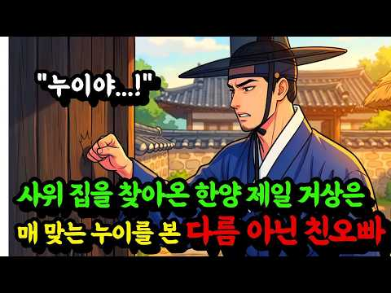
- 설명 앞부분: 안녕하세요. 이야기로 당신의 밤을 잇는 붉은실 야담 입니다. 붉은실 야담은 옛 장터와 깊은 골목, 담장 너머에서 은밀하게 전해 내려오던 사람 냄새 나는 야담과 민담, 그리고 기묘한 전설을 흥미진진하게 각색하여 들려주는 공간입니다. 기나긴 밤 잠들기 전, 혹은 조용히 눈을 감고 귀 기울이고 싶은 순간, 당신의 마음을 끝까지 붙잡아둘 단 한 편의 이야기가 되기를 바랍니다. 🕯️ 기나긴 밤, 잠들기 전 마음을 차분하게 채워줄 옛날이야기가 필요하신 분 📜 조선시대를 배경으로 한 흥미진진한 야담과 민담에 푹 빠지고 싶으신 분 ⚡ 답답한 가…
- 같은 채널 평소 대비 ×15.8 (채널 최근 롱폼 중앙값 6,510회) · 평소 영상: 폭설에 쓰러진 여종을 씻겨준 바보 머슴, 그날 밤 눈물을 쏟아낸 이유가 있었는데.. ∣ … (6,638회) / 바보 머슴을 거둔 몰락한 아씨, 알고 보니 조선 근위대 장군을 품에 들인 것이었는데.. … (6,382회)
- 대본 없음 (설명) — 음성인식이 끝나면 도입부·흐름이 들어감
- 댓글 64/68: 좋은 점 — 영상 0 · 감사·응원 7 · 더 알고 싶은 것 0 · 아쉬운 점 — 영상 1 · 반박·불만 — 의견 다름 2 · 정치·사회 0 · 경험 공유 2 · 구독·다음 기대 0
  - 감사·응원 👍9 “끈끈한 가족애중에도 여동생을 아끼는 오라비는 마음은 더 특별하죠. 감사히 잘 듣고 갑니다.😊”
  - 감사·응원 👍6 “감사합니다.”
  - 반박·불만 — 의견 다름 👍7 “말도안돼”
  - 반박·불만 — 의견 다름 👍1 “관아에서 '이기고 진 것이 아닙니다, 누이가 맞아서는 안 됩니다' 하던 우진이 한양 집 밥상에선 '맛있다' 한마디뿐인데, 그 말에 선옥이 그 집에 와서 처음 웃었다는 대목이 한참 머뭅니다.”
  - 경험 공유 👍9 “나도 이 이야기의 오라버니 같은 오빠가 있다면 차 ~~암 좋겠다는 생각이 드네요...😊💕 아늑하고 행복한 남매의 우정이 너무 아름답습니다...💕😻”

### 399. 오삼계의 일생을 천천히 따라가다 ∣ 산해관을 열어 명나라를 팔아넘긴 장군에서 청나라에 반기를 든 반란군 황제까지

- https://www.youtube.com/watch?v=4C3AKdwvLkQ · 청나라 비밀문서 · 구독자 1,280 · 조회수 14,022 (×10.9, 하루 114.0) · 좋아요 230 (1.6%) · 94분 · 2026-06-23 · 주제 묶음 6. 동양사 (중국·일본·몽골) · 형식 정보·해설 (그 밖) · 폴더 `W_4C3AKdwvLkQ` (웹 승인)
- 썸네일: 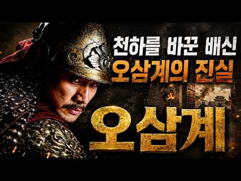
- 설명 앞부분: 충신에서 권신으로, 그리고 강희제의 최대 정적으로 변해버린 한 영웅. 끝없는 권력욕 속에서 스스로 몰락의 길을 걸었던 오배는 왜 감옥에서 눈물로 생을 마감해야 했을까요? 청나라 초기 최대 권력자의 영광과 추락을 천천히 따라가 봅니다.
- 같은 채널 평소 대비 ×9.3 (채널 최근 롱폼 중앙값 1,507회) · 평소 영상: 납란명주와 납란성덕의 일생을 천천히 따라가다 ∣ 강희제 시대 가장 빛났던 부자가 함께 몰… (1,507회) / 윤사의 일생을 천천히 따라가다 ∣ 청나라 최고의 현왕에서 이름마저 빼앗기고 아키나로 눈을… (1,520회)
- 대본 없음 (설명) — 음성인식이 끝나면 도입부·흐름이 들어감
- 댓글 11/11: 좋은 점 — 영상 0 · 감사·응원 1 · 더 알고 싶은 것 0 · 아쉬운 점 — 영상 0 · 반박·불만 — 의견 다름 0 · 정치·사회 1 · 경험 공유 0 · 구독·다음 기대 0
  - 정치·사회 👍1 “청나라가 통일? 완전한 정복이 아니고~ㅋ”

### 400. 조선 왕실 안에 무당이 있었던 이유

- https://www.youtube.com/watch?v=z8i6snGeNzI · 심야공중전화 · 구독자 4,160 · 조회수 45,377 (×10.9, 하루 1,059.0) · 좋아요 155 (0.3%) · 8.4분 · 2026-09-11 · 주제 묶음 3. 조선 · 형식 정보·해설 (그 밖) · 폴더 `W_z8i6snGeNzI` (웹 승인)
- 썸네일: 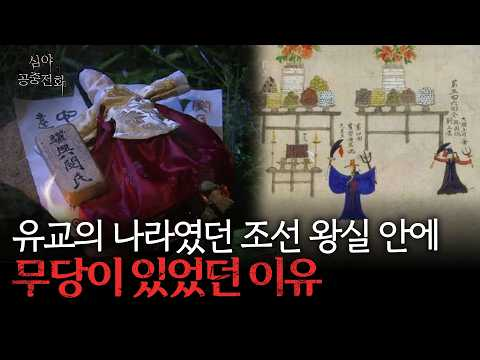
- 설명 앞부분: 유교의 나라 조선 왕실에 무당이 있었던 진짜 이유
- 같은 채널 평소 대비 ×74.6 (채널 최근 롱폼 중앙값 608회) · 평소 영상: 미국에서 산업안전보건법이 생긴 이유 (608회) / 대한제국의 멸망 그 후, 황족들은 어떻게 살았을까 (585회)
- 대본 없음 (설명) — 음성인식이 끝나면 도입부·흐름이 들어감
- 댓글 5/5: 좋은 점 — 영상 0 · 감사·응원 0 · 더 알고 싶은 것 0 · 아쉬운 점 — 영상 0 · 반박·불만 — 의견 다름 1 · 정치·사회 0 · 경험 공유 0 · 구독·다음 기대 0
  - 반박·불만 — 의견 다름 👍0 “어이없는 새끼들이지 무당 천시해놓고 지들은 무속은 또 겁나믿음”

