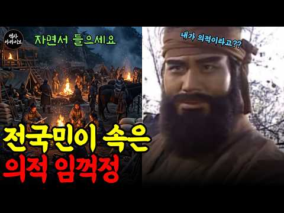
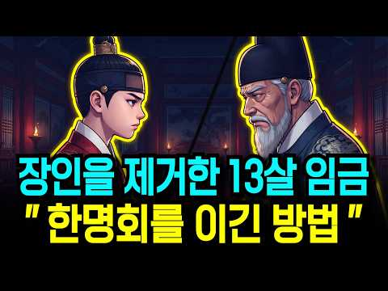
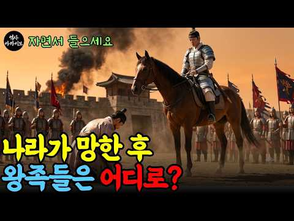
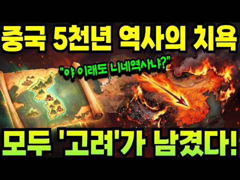
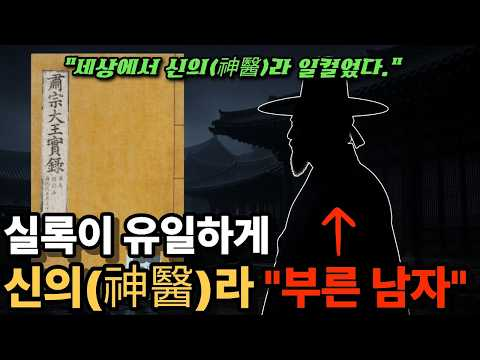

# 역사 — 성공 사례 분석: 사례별 자세히 #361–#400

`analysis.md` 의 9번 (같은 # 번호). 자동 생성 — `tools/success_analysis.py` v1.6 (2026-10-28 10:14 UTC). ※ 연구·교육용 — 투자 권유가 아님.

### 361. 사극은 절대 안 보여준 조선 주막의 진실 - 봉놋방·주모·1박의 기록

- https://www.youtube.com/watch?v=SiPh04Hz_ps · 해태연표 · 구독자 4,250 · 조회수 96,326 (×22.7, 하루 669.2) · 좋아요 995 (1.0%) · 33.8분 · 2026-06-01 · 주제 묶음 3. 조선 · 형식 브이로그·직접 해본 이야기 · 폴더 `W_SiPh04Hz_ps` (웹 승인)
- 썸네일: 
- 설명 앞부분: 🏮 "여기서… 자야 한단 말인가." 1779년 가을, 충주로 가던 한 양반이 봉놋방 문을 열고 멈춰 섰습니다. 사극이 그린 그 정겨운 주막은, 사실 절반이 거짓말이었습니다. 📜 이번 영상에서 다루는 진실 🔹 봉놋방 한 칸에 십수 명이 뒤엉켜 자던 진짜 풍경 🔹 사극이 단 한 번도 그리지 않은 '색주가'의 그늘 🔹 주모는 왜 조선의 가장 강력한 여성 자영업자였나 🔹 영국 여행가 이사벨라 비숍이 기록한 조선 주막의 충격 🔹 주막이 조선 후기의 정보망이자 비공식 은행이었던 이유 🔹 70년을 강가에서 한 자리를 지킨 마지막 주모, 유옥련…
- 대본 없음 (설명) — 음성인식이 끝나면 도입부·흐름이 들어감
- 댓글 45/45: 좋은 점 — 영상 0 · 감사·응원 0 · 더 알고 싶은 것 0 · 아쉬운 점 — 영상 1 · 반박·불만 — 의견 다름 0 · 정치·사회 1 · 경험 공유 0 · 구독·다음 기대 0
  - 아쉬운 점 — 영상 👍9 “영상을 너무 길게 늘려논 느낌이에요ㅜ 보다가 질림…”
  - 정치·사회 👍1 “드라마에 양반이 주연이면 그의 역할이 중요하고 주모가 주연이면 그역할이 많았겠지 고의로 안한것처럼 선동하지마라 좌파채널”

### 362. 영화도 담지 못한 단종의 진짜 최후, 삼족을 멸한다는데 그 시신을 거둔 아전이 있었다 [조선왕조실록]

- https://www.youtube.com/watch?v=HbaG82CmZF4 · 조선왕조실록이야기 · 구독자 19,700 · 조회수 219,812 (×11.2, 하루 3,098.1) · 좋아요 3,689 (1.7%) · 50.1분 · 2026-08-18 · 주제 묶음 3. 조선 · 형식 정보·해설 (그 밖) · 폴더 `W_HbaG82CmZF4` (웹 승인)
- 썸네일: 
- 챕터: 0:00 400년 만에 세상에 드러난 무덤과 엄흥도의 비밀 · 1:38 영월의 평범한 아전이었던 엄흥도, 그는 누구인가? · 4:34 12살 어린 나이에 왕위에 오른 단종의 외로운 시작 · 7:00 수양대군의 야심과 피바람의 시작 '계유정난' · 11:15 눈물의 양위와 세조의 즉위, 그리고 단종의 영월 유배 · 15:38 강과 절벽에 갇힌 기이한 감옥 '청령포'에서의 삶 · 18:58 홍수로 인해 관풍헌으로 옮겨진 단종과 엄흥도와의 거리 · 21:20 단종 복위 운동의 실패와 사육신의 장렬한 죽음 · 23:59 금성대군의 복위 거사와 수북 땅의 참혹한 학살 · 26:41 17세 소년 단종의 마지막 순간과 뒤섞인 역사적 기록들 · 31:33 삼족을 멸하는 위협 속에서 단종의 시신을 거둔 엄흥도… · 37:34 자취를 감춘 엄흥도 일가와 400년간 이어진 숨바꼭질 · 40:10 숙종 대에 이르러 단종의 복권과 함께 빛을 발한 엄흥… · 44:50 가짜 무덤 뒤에 숨겨진 진짜 무덤과 500년 만의 진실
- 설명 앞부분: 단종의 죽음과 그 시신을 거둔 아전 엄흥도의 실화입니다. 최근 발견된 엄흥도 진묘 소식과 함께, 계유정난부터 영월 유배, 단종의 마지막까지 조선왕조실록에 기록된 그대로 풀어드립니다. 영화 「왕과 사는 남자」로 다시 주목받은 단종과 엄흥도. 하지만 영화도 다 담지 못한 진짜 이야기가 실록 속에 남아 있습니다. 삼족을 멸한다는 서슬 퍼런 위협 속에서, 버려진 어린 임금의 시신을 목숨 걸고 거둔 한 사람. 영월의 늙은 아전, 엄흥도의 이야기를 들려드립니다. 400년 넘게 숨겨져 있던 엄흥도 무덤의 진짜 위치를 추적합니다. 후손들이 여러…
- 같은 채널 평소 대비 ×26.3 (채널 최근 롱폼 중앙값 8,365회) · 평소 영상: 지금 이란이 당하는 일, 조선도 겪었다 ∣ 명나라에 끌려간 1만 3천, 그들은 왜 오랑캐… (8,365회) / 조선 500년 유일한 왕비, 시아버지가 친정을 몰살했는데 쫓겨나지 않은 진짜 이유 ∣ 세… (7,283회)
- 대본 없음 (설명) — 음성인식이 끝나면 도입부·흐름이 들어감
- 댓글 535/536: 좋은 점 — 영상 2 · 감사·응원 15 · 더 알고 싶은 것 1 · 아쉬운 점 — 영상 0 · 반박·불만 — 의견 다름 0 · 정치·사회 8 · 경험 공유 1 · 구독·다음 기대 1
  - 좋은 점 — 영상 👍2 “당연 충신이죠 잘듣고 배우고 갑니다”
  - 감사·응원 👍24 “충신 중에 충신이었음을 고백하며 너무나 위대한 우리의 선조 이 셨음을 감사드립니다”
  - 감사·응원 👍6 “슬프고 가슴아픈 역사이야기 고맙습니다.”
  - 더 알고 싶은 것 👍2 “하필 영월인지 궁금해서요”
  - 정치·사회 👍3 “엄흥도 .환생,지금,나라지키려 희생으로 ,박정희 .윤석열 ,전한길 ,장동혁 .또 애국자님들 다 엄흥동 .혼을담아지요 ,.”
  - 정치·사회 👍2 “세조가조카죽였지만그가조선을살린거는왜말이없나세종이만든국경을확실히한임금이고김종서가충신이라도혼자독단적으로 국정을농단하는데가만히있어야하나계유정난이없어서면김종서는권신으로살아생전에국정농단하다가 임금을허수아비로만들인물아무리충신이라도혼자독단적으로하면나라가온전할수없다고려시대무신의난예…”
  - 경험 공유 👍25 “인간이라면 내가모시든 왕이 죄없이 죽음을당하고 강물에던져 뜨 있는걸보면 선비로서 충신이었다면 비록 삼족을 멸한다해도 뛰어들지 않았을까 싶네요 옛 시대에는 충신은 두 임금을 섬기지 않는다죠 엄흥도 또한 진정한 충신이시죠”
  - 구독·다음 기대 👍24 “조선의 훌륭한 인물 입니다 단종도 엄홍도 모두 자랑스럽습니다 요즘에도 이런 인물이 나타나길 기대합니다 관세음 보살 ❤❤❤”

### 363. 의적이 아니었다 ∣ 조선왕조실록이 기록한 임꺽정의 진짜 얼굴

- https://www.youtube.com/watch?v=Tq2dRv5ICiw · 역사아카이브 - History Archive KR · 구독자 24,400 · 조회수 147,893 (×6.1, 하루 3,799.9) · 좋아요 797 (0.5%) · 89.8분 · 2026-09-19 · 주제 묶음 3. 조선 · 형식 정보·해설 (그 밖) · 폴더 `W_Tq2dRv5ICiw` (웹 승인)
- 썸네일: 
- 챕터: 0:00 구월산의 마지막 아침 · 2:10 명종의 조선, 무너지는 나라 · 6:30 백정으로 태어난다는 것 · 11:00 구월산으로 들어가다 · 16:20 포도관 이억근의 죽음 · 21:40 눈 위에 거꾸로 찍힌 발자국 · 25:30 도성 한복판에 나타나다 · 30:10 배신 — 참모 서림이 잡히다 · 35:00 평산 마산리, 관군 오백 명의 패배 · 40:20 두 번의 가짜 임꺽정 · 46:00 토벌이 만든 또 다른 피해 · 50:30 대낮의 불길, 평산 서른여 호 · 55:00 남치근과 국가 총동원 · 60:10 도둑이야 — 최후의 순간 · 66:00 처형, 그리고 서림의 운명 · 70:30 왕정의 잘못이다 — 사관의 기록 · 76:00 전설은 어떻게 태어나는가 · 82:00 소설이 완성한 얼굴 · 88:00 의적인가 흉악범인가
- 설명 앞부분: 사람들은 임꺽정을 의적이라 부릅니다. 탐관오리의 곳간을 털어 굶주린 백성에게 나눠준 민중의 영웅. 그런데 조선왕조실록을 펼치면 전혀 다른 장면이 나옵니다. 개성부 포도관이 살해되고, 선전관이 살해되고, 관군 오백 명이 무너지고, 대낮에 민가 서른여 호가 불탔습니다. 조선은 이 사내 하나를 잡기 위해 다섯 개 도에 장수를 배치하고, 한양의 시장을 닫고, 황해도의 세금을 전부 면제했습니다. 그 사이 가짜 임꺽정이 두 번 잡혔고, 보고를 올린 관리들은 모두 파직당했습니다. 그리고 실록의 사관은 이렇게 적었습니다. 그들이 도둑이 된 것은…
- 같은 채널 평소 대비 ×7.7 (채널 최근 롱폼 중앙값 19,202회) · 평소 영상: [5시간 연속재생] 조선시대 생활사 8번째 통합 ∣ 우리 조상들의 모습 (20,263회) / 인질이었던 왕자가 왕이 되어 복수를 꿈꾸다 ∣ 효종 북벌의 진실 (18,141회)
- 대본 없음 (설명) — 음성인식이 끝나면 도입부·흐름이 들어감
- 댓글 46/53: 좋은 점 — 영상 0 · 감사·응원 0 · 더 알고 싶은 것 0 · 아쉬운 점 — 영상 3 · 반박·불만 — 의견 다름 1 · 정치·사회 3 · 경험 공유 1 · 구독·다음 기대 1
  - 아쉬운 점 — 영상 👍1 “번역한거야? AI목소리 진짜 구셕질이 난다”
  - 아쉬운 점 — 영상 👍0 “서론이 너무 길어요”
  - 반박·불만 — 의견 다름 👍1 “어지러운 시대의 썩은 관리들로 인하여 생겨난 도적놈이 백성들에게 좋은 일을 하기도 하고 백성들에게 노략질도 하고.... 복합적 인물이죠. 동학난도 같습니다. 어지러운 시대에 썩은 관리의 학정으로 일어난 백성들이 집단으로 난을 일으켜서 항의를 하고 동시에 백성들을 노략…”
  - 정치·사회 👍2 “제2의 홍길동과 임꺽정은 쌍팔년도 민주화폭동시대 폭동전과자와 폭동앵벌이 촛불폭동앵벌이 탄핵폭동앵벌이”
  - 정치·사회 👍2 “임꺽정도 지금 시대에 나타났으면 좌파의 선봉이 되었을까? 우파이 선봉이 되었을까?”
  - 경험 공유 👍3 “내가 고등학교때 국사시간에 선생님이 그랬슴 "홍길동 임꺽정 이런책은 커가는 애들에게 읽지 못하게 해야한다 신세한탄 불평불만 폭력난동만 배우게하는 불량 잡서다 " 이런 말씀이 백번 맞다고 본다 다른학교에서는 어떻게 가르쳤는지 모르지만 ....”
  - 구독·다음 기대 👍4 “임꺽정에 대해 우리가 몰랐던 진짜 역사 이야기를 알기 쉽게 풀어주셔서 정말 흥미진진하게 잘 봤습니다! 다음 영상도 기대할게요 👍”

### 364. 임금을 능멸한 명나라 사신의 코를 납작하게 만든 8살 세자 ∣ 야담 ∣ 옛날이야기 ∣ 민담 ∣ 수면동화 ∣ 오디오북

- https://www.youtube.com/watch?v=SAbogjdAt5c · 재미난야담 · 구독자 2,840 · 조회수 28,856 (×10.2, 하루 437.6) · 좋아요 980 (3.4%) · 110.6분 · 2026-08-23 · 주제 묶음 9. 야사·야담·옛날이야기 · 형식 수면·낭독 (잠잘 때 듣는) · 폴더 `W_SAbogjdAt5c` (웹 승인)
- 썸네일: 
- 설명 앞부분: 여덟 살 세자 앞에서 대국 사신은 이 나라를 멸시하고 비웃었습니다. "임금부터가 우습구나!" 국서를 내던지며 던진 그 한마디에 어전은 얼어붙었습니다. 그런데 이 어린 세자에게 조정 대신들조차 알지 못하는 패가 하나 숨겨져 있었다는 것을 아무도 알지 못했습니다. 사흘의 시한을 걸고 시작된 문답 대결, 그 끝에 드러난 것은 사신의 정체만이 아니었습니다. 조선 야담 속에 전해지는 통쾌한 반전, 지금 함께 확인해보세요.
- 같은 채널 평소 대비 ×12.5 (채널 최근 롱폼 중앙값 2,304회) · 평소 영상: 12살 많은 동네 과부에게 청혼한 꼬마도련님, 그 진짜 이유는 ∣ 야담 ∣ 옛날이야기 ∣… (3,076회) / 병든 형을 위해 밤마다 서리하던 소년, 재판정에서 속임수를 짚어내다 ∣ 야담 ∣ 옛날이야… (1,531회)
- 대본 없음 (설명) — 음성인식이 끝나면 도입부·흐름이 들어감
- 댓글 56/56: 좋은 점 — 영상 0 · 감사·응원 0 · 더 알고 싶은 것 0 · 아쉬운 점 — 영상 1 · 반박·불만 — 의견 다름 0 · 정치·사회 1 · 경험 공유 1 · 구독·다음 기대 0
  - 아쉬운 점 — 영상 👍1 “1시간 넘으면 재밌 없는데요 지루하다 조그만 보고”
  - 정치·사회 👍1 “명나라에 꼼작 못하는 조선 조정은 조선을 세운 이성계가 고려를 배신하고 외세인 멍나라를 등에 업고 쿠데타로 정권을 잡았기 때문입니다”
  - 경험 공유 👍2 “주인공 세자 잘듣고 있습니다 허태 다른 야담 에서 벌써 시청 했습니다 너무 나도 똑같이 비슷하네요? 좋아요 ❤❤❤”

### 365. 1시간이면 완벽 이해 조선왕조실록 1대부터 27대까지 몰아보기ㅣ건국부터 멸망까지 한번에 자면서 들으세요

- https://www.youtube.com/watch?v=YfPUeVAhmfw · 한밤의 한국사 · 구독자 47,800 · 조회수 869,281 (×18.2, 하루 7,246.9) · 좋아요 8,016 (0.9%) · 69.5분 · 2026-06-30 · 주제 묶음 3. 조선 · 형식 수면·낭독 (잠잘 때 듣는) · 폴더 `W_YfPUeVAhmfw` (웹 승인)
- 썸네일: 
- 챕터: 0:00 오프닝 – 27명의 임금, 519년의 드라마 · 0:56 건국 – 이성계와 정도전 · 9:22 형제의 피로 쌓은 왕좌 – 태종 · 15:36 조선의 황금기 – 세종 · 21:25 빼앗긴 왕좌 – 단종과 세조 · 27:25 폭군과 개혁가 – 연산군과 조광조 · 32:41 임금이 도망친 전쟁 – 선조와 임진왜란 · 37:56 능력 있는 왕의 몰락 – 광해군 0 · 42:27 임금이 무릎 꿇은 날 – 인조와 병자호란 · 47:44 마지막 르네상스 – 영조와 정조 · 52:54 왕이 사라진 시대 – 세도 정치 · 57:52 저무는 나라 – 고종과 개항 · 63:10 500년의 끝 – 대한제국 멸망
- 설명 앞부분: 조선의 임금 스물일곱 명 중, 제 명에 편히 눈감은 왕은 과연 몇이나 될까요? 1392년 이성계의 건국부터 1910년 대한제국의 멸망까지, 519년 조선 왕조의 흥망성쇠를 단 한 편에 담았습니다. 형제를 죽인 왕, 조카의 왕좌를 빼앗은 왕, 아들을 뒤주에 가둔 왕, 전쟁 앞에서 백성을 버린 왕, 적장 앞에 무릎 꿇은 왕, 그리고 끝내 나라를 빼앗긴 왕까지. 조선 27명의 임금이 내린 선택이 어떻게 나라의 운명을 갈랐는지, 조선 역사 전체를 처음부터 끝까지 따라가 봅니다. 조선 건국과 정도전의 설계, 세종의 황금기, 단종과 세조의 …
- 같은 채널 평소 대비 ×12.4 (채널 최근 롱폼 중앙값 70,008회) · 평소 영상: 한국사 총정리 몰아보기ㅣ고조선부터 대한민국까지 5000년 풀스토리ㅣ자면서 들으세요 (70,008회) / 신선이라 불린 조선의 괴짜 홍유손의 놀라운 비밀 (73,357회)
- 대본 없음 (설명) — 음성인식이 끝나면 도입부·흐름이 들어감
- 댓글 126/133: 좋은 점 — 영상 8 · 감사·응원 27 · 더 알고 싶은 것 1 · 아쉬운 점 — 영상 1 · 반박·불만 — 의견 다름 0 · 정치·사회 7 · 경험 공유 2 · 구독·다음 기대 2
  - 좋은 점 — 영상 👍88 “휴가3일 내내 영상봅니다. 세종대왕의 마누라 신빈 김씨 돌아가신 년도까지 외워지네 방금 고려역사 1시간40분짜리 정주행후 잘시간에 또 봅니다. AI목소리가 듣기 좋아요”
  - 좋은 점 — 영상 👍30 “단종부터 시작하여 조선의 역사공부를 계속하며 여기까지 왔습니다.들어온 내용들이 이로써 정리가 잘 되는 큰깨달음에 깊은 감사드립니다.~”
  - 감사·응원 👍30 “단종부터 시작하여 조선의 역사공부를 계속하며 여기까지 왔습니다.들어온 내용들이 이로써 정리가 잘 되는 큰깨달음에 깊은 감사드립니다.~”
  - 감사·응원 👍27 “역사의 흐름을 알게 해주셔서 감사합니다”
  - 더 알고 싶은 것 👍2 “조선왕들 중에 제대로된 왕이 몇명이 될까요 ? 썩은왕이 매우 많은듯”
  - 아쉬운 점 — 영상 👍88 “휴가3일 내내 영상봅니다. 세종대왕의 마누라 신빈 김씨 돌아가신 년도까지 외워지네 방금 고려역사 1시간40분짜리 정주행후 잘시간에 또 봅니다. AI목소리가 듣기 좋아요”
  - 정치·사회 👍20 “기가 막힌 우리 이씨조선의 역사를 아픈 마음으로 다 봤고 힘이 없는 나라는 굴욕의 종알이 온다는 것 그래서 우리는 언제나 힘을 길러야 합니다 나와 너 여와 야 그런 모든 것 위에 내나라가 강대국으로 버티고 있어야 하는 것이 절체절명의 진리!!!! 오직 대-한-민-국 …”
  - 정치·사회 👍4 “나라가 너무썩었음 리셋코리아”
  - 경험 공유 👍3 “빠진 임금도 있지만 나름 연대별로 조선왕의 공과를 잘 들었습니다. 1910.8.29 한일합방되어 35년간의 일제강점기 거쳐 스스로의 힘(일부는 인정)이 아닌 외세에 의해 겨우 1945.8.15 독립을 맞이하자 마자 15년간의 좌우 이념 싸움 끝에 하나의 나라 기틀을 …”
  - 구독·다음 기대 👍88 “휴가3일 내내 영상봅니다. 세종대왕의 마누라 신빈 김씨 돌아가신 년도까지 외워지네 방금 고려역사 1시간40분짜리 정주행후 잘시간에 또 봅니다. AI목소리가 듣기 좋아요”
  - 구독·다음 기대 👍3 “역사 공부 세삼스럽습니다. 현제 정치인들은 조선의 역사문화를 기역하고 국민을 위한 정치 기대합니다.”

### 366. "목감기 때문에 못 갑니다" 고종이 도망친 그날, 이완용은 어떻게 나라를 팔았나 ∣ 김기욱 X 김재원

- https://www.youtube.com/watch?v=PNPiVTupkFM · 기웃기웃 김기욱 · 구독자 1,740 · 조회수 21,055 (×12.1, 하루 260.1) · 좋아요 274 (1.3%) · 18.6분 · 2026-08-08 · 주제 묶음 기타 · 형식 정보·해설 (그 밖) · 폴더 `W_PNPiVTupkFM` (웹 승인)
- 썸네일: 
- 설명 앞부분: 타임라인
- 같은 채널 평소 대비 ×16.9 (채널 최근 롱폼 중앙값 1,248회) · 평소 영상: 추석특집 정일영 교수의 마라맛 입담 1시간 총집편! (1,573회) / 제주연인 사건으로 보는 대한민국 교제범죄의 현실 ep.01 ∣ 허민숙 입법조사관 X 김기욱 (923회)
- 대본 없음 (설명) — 음성인식이 끝나면 도입부·흐름이 들어감
- 댓글 98/98: 좋은 점 — 영상 0 · 감사·응원 1 · 더 알고 싶은 것 0 · 아쉬운 점 — 영상 0 · 반박·불만 — 의견 다름 6 · 정치·사회 6 · 경험 공유 2 · 구독·다음 기대 0
  - 반박·불만 — 의견 다름 👍1 “야 이사람들아 역사를 제대로배워라ㅡ조선왕조 말기 고종이후는 뭣땜에 망한지 제대로 배우고 유툽해라ㅡ조선은 가난하기로 그야말로 원시시대라해도 과언이 아니란걸알아라 그틈을 이용해 일본은 엄청난 경제지원 즉 빚을 놓기 시작해 말기 왕실은 일본이 아니면 밥도 못먹을 지경에 왔…”
  - 반박·불만 — 의견 다름 👍0 “결론이 이해가 안되는게 그 책임이라는거는 왕이 지는거지 신하가지는게 아닙니다 그래서 헌법도 없고 대한국 국제라는 괴상한걸 만들어서 절대권력을 탐하려 했던게 고종입니다. 이완용이 매국노라고? 오케이 이건 이견의 여지가 없습니다. 근데 그 상황에서 고종은 책임이 없나? …”
  - 정치·사회 👍3 “친북 진중 현 정권이 나라 팔아먹는 과정도 설명해 봐라... 과거와 현재 진행형은 무게감이 다르다...”
  - 정치·사회 👍3 “고종하는짓이 문재인하고 똑같내 회피하는 거”
  - 경험 공유 👍0 “그런데 저 상황에서 이완용이가 아니고 다른사람이있었다고한들 바뀌는게있었을까요?욕하는분들도있지만 양심상 세계정세를 알고 저위치에있었으면 나도 특별한답은없을듯한데 아이러니하네요”
  - 경험 공유 👍0 “이완용이 보빙사랑 같이 다녀왔어요?? 미국을 실제 경험을 했었나”

### 367. 《한국사》 조선시대 가장 못생긴 왕은 누구였을까? 왕들의 실제 외모 l 역사 인물 l 조선왕조실록

- https://www.youtube.com/watch?v=UBBAEzyQQMA · 한국사 이야기 · 구독자 24,200 · 조회수 72,814 (×3.0, 하루 3,588.5) · 좋아요 383 (0.5%) · 37.8분 · 2026-10-08 · 주제 묶음 3. 조선 · 형식 정보·해설 (그 밖) · 폴더 `W_UBBAEzyQQMA` (웹 승인)
- 썸네일: 
- 설명 앞부분: 조선시대 왕들의 실제 외모는 어땠을까요? 세종·세조·중종의 얼굴 기록부터 어진 소실, 천연두 흔적, 고종과 순종의 사진까지 역사 속 왕들의 진짜 모습을 살펴봅니다.
- 같은 채널 평소 대비 ×5.3 (채널 최근 롱폼 중앙값 13,638회) · 평소 영상: 《한국사》 조선 왕들을 괴롭힌 정체는? 종기의 잔혹사 l 역사 l 조선시대 l 야사 (13,638회) / 《한국사》 조선시대 평민들의 연애와 결혼은 어떤 모습이었을까요? l 조선시대 l 생활사 (13,551회)
- 대본 없음 (설명) — 음성인식이 끝나면 도입부·흐름이 들어감
- 댓글 56/56: 좋은 점 — 영상 1 · 감사·응원 2 · 더 알고 싶은 것 1 · 아쉬운 점 — 영상 0 · 반박·불만 — 의견 다름 1 · 정치·사회 1 · 경험 공유 2 · 구독·다음 기대 0
  - 좋은 점 — 영상 👍1 “고기가 비만 당뇨 일으킨다는 비의학적 궤변은 왜 맨날 역사 유튜브에서 퍼트리는거임? 그냥 과식하고 운동안해서지 단백질은 오히려 비만 당뇨에 도움이 됨. 당뇨엔 탄수화물 줄이고 고기 더 많이 먹어야 함”
  - 더 알고 싶은 것 👍3 “선조들의얼굴은 사진도 없던시절의 왕의 얼굴가지고 가타부타 말을 안했으면 좋겠습니다 얼굴이 잘생겻으면뭐? 어쩔것이고 못생겻다면 뭘어떻게 할것인가요? 서양에서도 그랫네요”
  - 정치·사회 👍5 “사진도 안찍어놓았다는게 놀랍다. 우리나라가 그런 나라다. 참으로 한심하지않나?”

### 368. 12만 대군을 궤멸시킨 영하 40도의 사투, 장진호 포위망 돌파극 #세계사 #역사다큐 #장진호전투 #625전쟁 #흥남철

- https://www.youtube.com/watch?v=ODl3vZ-txdc · 역사 전략실 · 구독자 11,100 · 조회수 213,991 (×19.3, 하루 1,632.6) · 좋아요 3,775 (1.8%) · 28.9분 · 2026-06-19 · 주제 묶음 5. 세계사·서양사 · 형식 정보·해설 (그 밖) · 폴더 `W_ODl3vZ-txdc` (웹 승인)
- 썸네일: 
- 챕터: 0:00 승리에 도취된 사령부, 덫에 빠진 미군 · 5:14 영하 40도, 무기마저 파괴한 극한의 추위 · 8:01 스미스 장군의 선견지명: 하갈우리 임시 활주로 건설 · 8:20 12만 대군의 기습과 톡동고개 여우 중대의 사투 · 10:16 "퇴각이 아니다!" 불가능을 뚫는 능선 쟁탈전 · 20:58 절망의 수문교, 하늘에서 떨어진 강철 다리 · 23:27 얼음 동상이 되어버린 중공군의 비극 · 25:17 흥남 부두, 10만 명을 살려낸 크리스마스의 기적
- 설명 앞부분: 1950년 겨울, 영하 40도의 장진호에서 미 해병대 1만 5천 명은 12만 명의 중공군 최정예 부대에게 완벽히 포위당했습니다. 맥아더 사령부의 오만함이 부른 절망적인 위기 속에서, 살인적인 추위와 압도적인 적의 인해전술을 뚫고 나온 올리버 스미스 장군의 천재적인 전술과 병사들의 처절한 사투를 조명합니다. 인류 전쟁사상 가장 기적적인 포위망 돌파 작전이자 적의 주력을 궤멸시킨 핏빛 역사를 역사 전략실에서 파헤쳐 봅니다. 타임라인: 로이 애플먼 (Roy E. Appleman), 『East of Chosin: Entrapment an…
- 같은 채널 평소 대비 ×26.4 (채널 최근 롱폼 중앙값 8,108회) · 평소 영상: 손톱과 머리카락을 남기고 떠난 75명의 청춘들, 맹호부대 특공결사대의 핏빛 15일 #안케… (8,605회) / 100만 대군을 찢어버린 4만 7천의 기적, 가우가멜라 전투의 소름 돋는 전술 #세계사 … (7,612회)
- 대본 없음 (설명) — 음성인식이 끝나면 도입부·흐름이 들어감
- 댓글 514/514: 좋은 점 — 영상 1 · 감사·응원 73 · 더 알고 싶은 것 2 · 아쉬운 점 — 영상 2 · 반박·불만 — 의견 다름 7 · 정치·사회 43 · 경험 공유 10 · 구독·다음 기대 0
  - 감사·응원 👍314 “미군 병사들 너무 감사합니다. 당신들이 있었기에 오늘날 대한민국이 있습니다.”
  - 감사·응원 👍278 “625전쟁때 희생하신 미군장병들께 깊이 감사합니다 부디 천국에서 행복을 누리시길 바랍니다”
  - 더 알고 싶은 것 👍59 “국방부의 항미원조를 인정하는듯한 작금의 태도를 국민은 어떻게 해석해야하는지 ???? 진짜 걱정입니다 ....”
  - 더 알고 싶은 것 👍0 “26분37초 지도 표기 SEA OF JAPAN? 언제부터 동해가 일본해가 됐죠? 보기 안좋네요. 역사 관련 영상에 큰 오류 같네요.”
  - 아쉬운 점 — 영상 👍1 “당시 무조건 북진하지 말고 한반도에서 동서라인이 가장 짧은 안주, 원산 라인에서 진격 멈추고 중공군과 일전을 벌였어야 하는데, 맥아더가 상황을 너무 안이하게 판단한 잘못이 두고두고 아쉽네요. 그 이후도 휴전선 부근에서 일진일퇴의 고지전만을 전개할 것이 아니라, 원산,…”
  - 아쉬운 점 — 영상 👍0 “북괴도 무리하게 낙동강을 넘어 설려다 후방을 소흘히 하고 지키지 못해 작전을 허용했듯이 하여간 욕심이 지나치면 안된다는 평범한 진리를 외면한 채 미국이 병법을 모르고 자만감에 무작정 밀고 올라간게 큰 실수였음. 쥐도 도망갈 구멍을 만들어 주면서 쫓고 바둑에서도 아생연…”
  - 반박·불만 — 의견 다름 👍7 “다좋은데 어이없게 피난민속에 죄인이가 있었다는거😢”
  - 반박·불만 — 의견 다름 👍0 “와 그걸 맥아더의 오만한 오판으로 몰고 가다니 ㅎㄷㄷ 당시 미군이 중공군을 이길 수 없어서 북한지역을 다 내준 거라 생각하는 사람은 아무 것도 모르는 것임. 한국전쟁 때 미군은 융단폭격이라는 것을 밥멋듯 했었는데, 이것은 하늘이 새까맣게 보일 정도로 셀 수도 없이 많…”
  - 정치·사회 👍96 “미군들의 수많은 희생이 있었기에 이나라가 자유를 지킬 수 있었습니다. 감사합니다 이것을 잊으면 인간도 아니고 나라도 아니다”
  - 정치·사회 👍15 “모든 일에는 반드시 비주류의 이야기에 한번은 귀를 기울여야 한다. 운동, 선거, 사업, 전쟁 모두 같다.”
  - 경험 공유 👍81 “남의 나라에 와서 이렇게 희생되고 고생을 하고 돈을 쏟아 붓고 믿어지지 않아요 우리도 남을 위하여 이렇게 전쟁을 해봤던가요 ?? 감사합니다 고맙습니다”
  - 경험 공유 👍10 “그동안 내가 알던 장진호 전투보다 훨씬 열악하고 치열 했네요. 자유를 위해 고생하고 죽어가신 분들께 감사드립니다. 스미스소장은 원예학과 출신이고 매러디스 빅토리아호 선장님은 기적을 체험하시고 후에 종교인이 되셨습니다”

### 369. 13살 조선 왕이 된 소년, 자기를 왕으로 만든 한명회를 무너뜨린 방법

- https://www.youtube.com/watch?v=6eo5h71aB1Q · 한밤의 한국사 · 구독자 47,800 · 조회수 603,825 (×12.6, 하루 6,944.4) · 좋아요 9,296 (1.5%) · 62.9분 · 2026-08-02 · 주제 묶음 3. 조선 · 형식 수면·낭독 (잠잘 때 듣는) · 폴더 `W_6eo5h71aB1Q` (웹 승인)
- 썸네일: 
- 설명 앞부분: 1469년, 예종이 갑작스럽게 세상을 떠난 그날. 왕위 계승 서열에서도 밀려나 있던 열세 살 소년이 하루 만에 조선의 임금이 됩니다. 세자 교육 한 번 받지 못한 이 어린 왕의 이름은 성종. 그리고 그의 곁에는, 조선 최고의 권력자라 불리던 한 남자가 있었습니다. 계유정난을 설계해 세조를 왕으로 만든 킹메이커, 두 임금의 장인이자 조정을 손에 쥔 원로대신 한명회. 그는 다름 아닌 이 어린 왕을 왕좌에 앉힌 장본인이자, 성종의 장인이었습니다. 그런데 어떻게 된 일일까요. 자기 손으로 왕을 만든 한명회가, 20년도 지나지 않아 바로 …
- 같은 채널 평소 대비 ×8.6 (채널 최근 롱폼 중앙값 70,008회) · 평소 영상: 한국사 총정리 몰아보기ㅣ고조선부터 대한민국까지 5000년 풀스토리ㅣ자면서 들으세요 (70,008회) / 신선이라 불린 조선의 괴짜 홍유손의 놀라운 비밀 (73,357회)
- 대본 없음 (설명) — 음성인식이 끝나면 도입부·흐름이 들어감
- 댓글 235/246: 좋은 점 — 영상 3 · 감사·응원 8 · 더 알고 싶은 것 1 · 아쉬운 점 — 영상 7 · 반박·불만 — 의견 다름 3 · 정치·사회 5 · 경험 공유 0 · 구독·다음 기대 1
  - 좋은 점 — 영상 👍2 “자신이 저지른 잘못은 결국 어떤 식으로든 그 대가를 치르게 되는 것 같네요. 죄를 짓고도 남에게 상처를 주며 살아가는 사람의 끝이 얼마나 참담한지 보여주는 이야기였습니다. 인과응보라는 말이 정말 무섭게 와닿네요.”
  - 좋은 점 — 영상 👍1 “잘배우고갑니다❤”
  - 감사·응원 👍50 “설명이 진지하고 진실을 읽으려 애쓰신점 감사드립니다”
  - 감사·응원 👍28 “성종에 대해 좀 더 자세히 알게 돼 좋았습니다 왕위계승자가 아니라 제왕학을 배울 기회도 없었을텐데..혼자 조용히 그래도 원로들 사이에서 열심히 배워 기 존쎈 장인과 원로들을 조용히 물리친 성종에 대해 알게돼 기쁨니다 덕분에 역사에 흥미가 생기는군요 감사합니다”
  - 더 알고 싶은 것 👍0 “어..문정왕후가 수렴청정 최초 아닌가요? 어디선가 들었던것 같은데.. 알려주세요.”
  - 아쉬운 점 — 영상 👍5 “추강에 밤이드니 물결이 차노메라 낚시드리우니 고기 안무노메라 무심한 달빛에 빈 배 저어오노메라”
  - 아쉬운 점 — 영상 👍4 “내용은 참 좋은데 너무 길게 늘려 지루한게 험이군요”
  - 반박·불만 — 의견 다름 👍0 “이거 AI가 아니죠?”
  - 정치·사회 👍62 “2026년 지금도 간신 한명회 같은 종자들이 바글바글 하니 나라가 피곤하다 😮😮😮😮😮😮 5년 권력 잡으면 한목챙기는대 집중 하다 끝난다 😮😮😮😮😮😮”
  - 정치·사회 👍3 “훈구대신들과 신진사림들간의 견제와 균형이라는 구도는 좋지만 서로 죽이고 죽는 극한의 권력다툼으로 모두가 불행한 나라가 되고 결국 망하게 된다. 차라리 훈구대신들이 계속 권력을 잡았었다면 어떨까.”
  - 구독·다음 기대 👍35 “군더더기 없는 설명으로 역사의 한 구간을 잘 살피게 되었네요. 다음 영상도 기대 합니다~~^^”

### 370. 1900년대초 서울 생활모습 - 전차가 다니던 그시절

- https://www.youtube.com/watch?v=ht6n6gTswvM · 아카이브 코리아 · 구독자 3,660 · 조회수 17,662 (×4.8, 하루 529.8) · 좋아요 105 (0.6%) · 8.7분 · 2026-09-25 · 주제 묶음 4. 한국 근현대사 · 형식 정보·해설 (그 밖) · 폴더 `W_ht6n6gTswvM` (웹 승인)
- 썸네일: 
- 챕터: 0:00 인사 · 0:41 전차가 놓이다 · 2:23 황제의 도시 · 3:42 두 개의 독립문 · 4:04 빈 궁궐 · 5:10 길 위의 사람들 · 6:40 장이 서던 자리 · 7:21 성 밖에서 · 8:03 그 뒤
- 설명 앞부분: 대한제국 시절의 서울입니다. 황제의 돈으로 전차가 놓이고, 그 선로 옆으로 가마와 지게와 소달구지가 함께 다니던 십여 년의 기록입니다. 본편 사진 중 일부는 AI 채색 기술로 색을 입혔고, 나머지는 아카이브가 컬러로 소장한 원본입니다. 일부 장면은 흑백으로 시작해 색이 번지도록 연출했습니다. 사진 자체는 아카이브 원본 그대로입니다. 본편의 모든 사진은 아카이브가 소장한 실제 기록이며, 생성형 AI 로 만든 이미지가 아닙니다. 국제일본문화연구센터(日文研) · 퍼블릭도메인 kutsukake.nichibun.ac.jp/CHO 1900년…
- 같은 채널 평소 대비 ×1.1 (채널 최근 롱폼 중앙값 16,416회) · 평소 영상: 1970년대 서울 생활모습 — 골목과 거리 (16,442회) / 1996년 서울, 30년전 우리가 잊고 있던 풍경 (16,391회)
- 대본 없음 (설명) — 음성인식이 끝나면 도입부·흐름이 들어감
- 댓글 3/3: 좋은 점 — 영상 0 · 감사·응원 0 · 더 알고 싶은 것 0 · 아쉬운 점 — 영상 0 · 반박·불만 — 의견 다름 0 · 정치·사회 0 · 경험 공유 0 · 구독·다음 기대 0

### 371. 원수의 잔에 술을 따른 왕, 적국 왕실의 조상이 된 왕 ∣ 한국사 망국 왕족 이야기

- https://www.youtube.com/watch?v=2PzIlfWCTow · 역사아카이브 - History Archive KR · 구독자 24,400 · 조회수 76,275 (×3.1, 하루 3,494.8) · 좋아요 246 (0.3%) · 83.4분 · 2026-10-01 · 주제 묶음 4. 한국 근현대사 · 형식 정보·해설 (그 밖) · 폴더 `W_2PzIlfWCTow` (웹 승인)
- 썸네일: 
- 챕터: 0:00 오프닝 · 3:30 백제의 마지막 여름 · 11:55 포로가 된 왕과 적국의 신하가 된 왕자 · 17:17 백제 부흥운동과 형제의 전쟁 · 25:06 평양성 함락과 보장왕 · 32:21 안승과 보덕국 · 37:25 김유신, 망국 왕족의 후손 · 39:30 발해의 마지막 왕과 세자 · 46:21 천 년 왕국을 넘긴 경순왕 · 55:10 견훤, 자기 나라를 치러 간 왕 · 57:16 강화나루의 비극, 고려 왕씨 · 66:30 대한제국 황실, 가장 긴 포로 생활 · 78:34 핏줄이라는 죄
- 설명 앞부분: 나라가 무너지는 날, 왕의 핏줄을 타고난 사람들에게는 무슨 일이 벌어졌을까요? 강화나루의 바다에 던져진 고려 왕씨들, 사비성 대청 아래에서 적장들의 잔에 술을 따른 의자왕, 상복으로 변장하고 상하이로 향하다 붙잡힌 의친왕까지. 같은 망국의 왕족인데 누구는 포로가 되고, 누구는 부흥군의 왕이 되고, 누구는 자신을 무너뜨린 나라의 귀족이 되었습니다. 백제, 고구려, 가야, 발해, 신라, 후백제, 고려, 대한제국. 천삼백 년에 걸친 한반도 망국의 역사 속에서 무너진 왕조의 마지막 사람들이 걸어간 길을 삼국사기, 고려사, 조선왕조실록, …
- 같은 채널 평소 대비 ×4.0 (채널 최근 롱폼 중앙값 19,202회) · 평소 영상: [5시간 연속재생] 조선시대 생활사 8번째 통합 ∣ 우리 조상들의 모습 (20,263회) / 인질이었던 왕자가 왕이 되어 복수를 꿈꾸다 ∣ 효종 북벌의 진실 (18,141회)
- 대본 없음 (설명) — 음성인식이 끝나면 도입부·흐름이 들어감
- 댓글 5/5: 좋은 점 — 영상 0 · 감사·응원 0 · 더 알고 싶은 것 0 · 아쉬운 점 — 영상 0 · 반박·불만 — 의견 다름 0 · 정치·사회 0 · 경험 공유 0 · 구독·다음 기대 0

### 372. 《삼국지》 제갈량을 능가한 삼국지 최고의 책사는 누구? 와룡의 라이벌 6인 l 역사 인물 l 고전

- https://www.youtube.com/watch?v=V26QZgQ3Ejw · 동양사 이야기 · 구독자 16,500 · 조회수 219,687 (×13.3, 하루 2,357.5) · 좋아요 1,161 (0.5%) · 40.2분 · 2026-07-27 · 주제 묶음 6. 동양사 (중국·일본·몽골) · 형식 오디오북·낭독 (명언·인생조언) · 폴더 `W_V26QZgQ3Ejw` (웹 승인)
- 썸네일: 
- 설명 앞부분: 삼국지 시대를 뒤흔든 최고의 책사 6인을 소개합니다. 제갈량 공명과 어깨를 나란히 한 지략가들은 누가 있었을까요? 주유, 곽가, 방통, 사마의, 육손 등 와룡의 라이벌들이 펼친 지혜와 전략의 깊이를 함께 살펴보세요.
- 같은 채널 평소 대비 ×10.3 (채널 최근 롱폼 중앙값 21,374회) · 평소 영상: 《삼국지》 제갈량보다 똑똑해서 죽었다고? 제갈씨 가문을 멸망시킨 천재의 비극적인 몰락 l… (21,604회) / 《중국 역사》 당신이 명나라 황제로 환생한다면? 정통제 주기진의 파란만장한 일대기 l 역… (21,143회)
- 대본 없음 (설명) — 음성인식이 끝나면 도입부·흐름이 들어감
- 댓글 185/185: 좋은 점 — 영상 1 · 감사·응원 3 · 더 알고 싶은 것 1 · 아쉬운 점 — 영상 4 · 반박·불만 — 의견 다름 7 · 정치·사회 3 · 경험 공유 10 · 구독·다음 기대 0
  - 감사·응원 👍0 “감사합니다.”
  - 아쉬운 점 — 영상 👍0 “설명이. 지루하다 간단하게 요약만”
  - 아쉬운 점 — 영상 👍0 “숟가락얹냐 더 알만한 조사하구해라 뻔한거퍼서 나르지마리ㅜ”
  - 반박·불만 — 의견 다름 👍0 “행정가로선 엄청 뛰어났다 생각하네요 위나라에 비해 인재 자원풀이 말도 안되게 떨어져도 북벌이란 꿈을 꿀 수 있게 군사적 행정적 뒷 받침을 한건 사실이니깐요 위 촉 오 기준 인구 비율로 따지면 6:1:2수준이라는데 저런 국력으로 곽가 사마의 주유 육손??? 누가와도 북…”
  - 정치·사회 👍0 “삼국지 시대는 지금으로 치면 나라가 내전에 빠지고 군웅이 할거하는 동남아 아프리카 그리고 중동같은 지옥 그 자체였을 듯. 위촉오 그 어느쪽이든 같은 나라 국민들끼리 벌인 내전이고 그 결과물은 위진남북조 그리고 5호16국의 대환장 시대 😊”
  - 경험 공유 👍0 “내가 보았던 어린이 만화 삼국지는 왜 유비가 삼국통일하고 끝난걸까 어린애들 속이려구 만들었나 보다”
  - 경험 공유 👍0 “이거슨 몇년의 시간을 결과로 판단하는거고 인정합니다. 다만 시간을 더 쪼개고 우리가 그 시점으로 가서 살아본게 아니니 뭐라고 단정지을수 없겠습니다. 그래도. 제갈량이 죽으면서 유선한테 한 말이, 내가 가진게없다는말을한거는 내 자식들이 본인이 죽어도 유선을 배신할 능력…”

### 373. [감동 사극] 악독한 계모를 피해 도망친 두 자매! 자식 없이 늙어가는 농부의 수양딸이 되어 조선 최고의 거상으로 거듭난 기막힌 사연 (힐링 썰)

- https://www.youtube.com/watch?v=9MZ_w0MHkpE · 이야기와 인생 · 구독자 5,350 · 조회수 85,217 (×15.9, 하루 761.4) · 좋아요 2,897 (3.4%) · 176.9분 · 2026-07-08 · 주제 묶음 3. 조선 · 형식 수면·낭독 (잠잘 때 듣는) · 폴더 `W_9MZ_w0MHkpE` (웹 승인)
- 썸네일: 
- 설명 앞부분: 피보다 진한 눈물로 맺어진 진짜 가족! 계모의 구박을 피해 도망친 두 자매가 일궈낸 완벽하고 가슴 뭉클한 인생 역전기 🌾✨ 안녕하세요! 저희 채널을 찾아주셔서 진심으로 감사합니다. 오늘 들려드릴 이야기는 아버지가 돌아가신 후 악독한 계모의 모진 매질과 굶주림을 견디다 못해 한겨울 밤 도망친 두 자매가, 외롭게 홀로 늙어가던 마음씨 고운 부농(富農)을 만나 벌어지는 따뜻하고 통쾌한 사극 썰입니다. "너희 같은 혹덩이들은 당장 얼어 죽어도 싸다!" 계모의 저주를 뒤로한 채 거리를 헤매다 쓰러진 자매. 그들을 거두어준 것은 평생 흙을 …
- 같은 채널 평소 대비 ×24.2 (채널 최근 롱폼 중앙값 3,526회) · 평소 영상: [감동 사극] "제발 이 아이만은 살려주십시오!" 피투성이 여인이 매달린 선비의 소름 돋… (3,526회) / [사극 로맨스] 숲에서 길을 잃은 태자의 입맛을 사로잡은 산골 처녀의 '비법 훈제 고기'… (3,644회)
- 대본 없음 (설명) — 음성인식이 끝나면 도입부·흐름이 들어감
- 댓글 73/73: 좋은 점 — 영상 2 · 감사·응원 7 · 더 알고 싶은 것 1 · 아쉬운 점 — 영상 4 · 반박·불만 — 의견 다름 1 · 정치·사회 0 · 경험 공유 0 · 구독·다음 기대 0
  - 좋은 점 — 영상 👍10 “너무 아름답고 좋은 내용입니다. 감동 받고 갑니다.”
  - 좋은 점 — 영상 👍5 “좋은 내용에 쥔장께 감사드립니다 사람이 왜 살아가야 하는지 조용히 생각해 보게 하는 사연이네요~감사합니다~”
  - 감사·응원 👍7 “감동깊게 잘 듣고갑니다 감사합니다~~^^”
  - 감사·응원 👍5 “좋은 내용에 쥔장께 감사드립니다 사람이 왜 살아가야 하는지 조용히 생각해 보게 하는 사연이네요~감사합니다~”
  - 더 알고 싶은 것 👍10 “댓글좀 보세요. 화면을 제대로 올려주세요”
  - 아쉬운 점 — 영상 👍3 “광고가 왜이리많아 질리네”
  - 아쉬운 점 — 영상 👍2 “광고가 너무 많아 듣고 싶지 않아요”
  - 반박·불만 — 의견 다름 👍3 “화면 을 굳이 여러개를 올리는 까닥이 뭔가요 작가라는 사람 이 독자 생각을 안하고 글쓰는 모습은 화면안에 안보여도 됩니다 문장의 구성은 좋지만 내용하고 화면이 전혀 맞지 않아 이런 Ai작품은 보고 싶지 않습니다 어른만 이런것 보는것이 아닙니다. 뒷화면은 버려주세요 ㅠ…”

### 374. [임진왜란 통합본] 조선시대로 이동한 대한민국 해병대, 임진왜란 4대대첩 (1~4화)

- https://www.youtube.com/watch?v=T0XaUdpk_JA · 전쟁IF · 구독자 12,500 · 조회수 161,627 (×12.9, 하루 1,755.5) · 좋아요 1,719 (1.1%) · 42.6분 · 2026-07-28 · 주제 묶음 3. 조선 · 형식 몰아보기·통합본 (긴 영상) · 폴더 `W_T0XaUdpk_JA` (웹 승인)
- 썸네일: 
- 챕터: 0:00 1592년 한산도대첩 · 10:20 1592년 진주성 1차 방어전 · 20:40 1593년 행주대첩 · 30:44 1597 명량해전
- 설명 앞부분: 대한민국 해병대를 대표하는 상륙, 공정, 유격. 만약 현대 대한민국 해병대가 1592년 임진왜란 한복판으로 떨어진다면... 과연 조선을 지켜낼 수 있을까요? 현대 무기와 전술, 그리고 임진왜란의 영웅들이 만나 펼쳐지는 전쟁 IF🔥 이번 영상은 전쟁IF 임진왜란 시리즈 1~4화를 하나로 모은 통합본입니다. 한산도대첩 ✔ 진주대첩 ✔ 행주대첩 ✔ 명량해전 임진왜란의 주요 전투를 실제 역사의 흐름에 맞춰 시간 순서대로 감상하실 수 있습니다. 또한 기존 1~2편은 일부 장면을 리마스터하고, 연결 장면과 연출을 보강하여 더욱 자연스럽게 재…
- 같은 채널 평소 대비 ×0.7 (채널 최근 롱폼 중앙값 229,682회) · 평소 영상: 645년 안시성 방어에 투입된 해병대, 고구려 병사들과 함께 당나라 30만 대군을 이길 … (229,682회) / NLL에서 북한군과 조우한 해병대 수색대, 과연 미군 파일럿을 구할 수 있을까? [한국전… (223,163회)
- 대본 없음 (설명) — 음성인식이 끝나면 도입부·흐름이 들어감
- 댓글 84/89: 좋은 점 — 영상 0 · 감사·응원 1 · 더 알고 싶은 것 4 · 아쉬운 점 — 영상 0 · 반박·불만 — 의견 다름 0 · 정치·사회 6 · 경험 공유 1 · 구독·다음 기대 0
  - 감사·응원 👍3 “지금 해병대 이순신장군님의 조선수군이 합해서 전투에 임하므로 확실하게 왜군을 섬멸하게 되었습니다 감사합니다”
  - 더 알고 싶은 것 👍9 “현대군 투입 전투영상도 자주 부탁드립니다 전쟁님!”
  - 더 알고 싶은 것 👍8 “다음 전투영상도 부탁드립니다 전쟁님!”
  - 정치·사회 👍1 “우리에게 진리와 정의란 단 하나 뿐입니다. 우리가 강해지는 것. 그것이 진리이고 정의입니다. 우리가 강해지는 것을 막는 것, 그것이 부정이고 거짓이고 악입니다. 윤석렬과 국힘당 무리를 보라 이들이 우리의 적입니다. 우리를 망하게 하려고 했습니다. 지금 전쟁을 터트려서…”
  - 정치·사회 👍1 “이재명만 아니면 나라 좋음!”

### 375. 우리가 몰랐던 조선시대 평민들의 충격적인 삶 ∣ 조선역사 ∣ 한국사 ∣ 조선왕조실록 ∣ 자면서 듣기 좋은 역사 이야기 ∣ 자면서 듣는 역사 이야기

- https://www.youtube.com/watch?v=IbaIAa8VCR8 · 역사킴 · 구독자 4,320 · 조회수 88,024 (×20.4, 하루 603.6) · 좋아요 686 (0.8%) · 30.3분 · 2026-06-04 · 주제 묶음 1. 역사 일반·이야기 · 형식 수면·낭독 (잠잘 때 듣는) · 폴더 `W_IbaIAa8VCR8` (웹 승인)
- 썸네일: 
- 설명 앞부분: 우리가 몰랐던 조선시대 평민들의 충격적인 삶
- 같은 채널 평소 대비 ×60.9 (채널 최근 롱폼 중앙값 1,445회) · 평소 영상: 조선시대 사람들의 충격적인 탈모 이유 ∣ 조선역사 ∣ 한국사 ∣ 조선왕조실록 ∣ 잠잘 때… (1,445회) / 영화 '왕사남' 속 단종과는 달랐던 사실?! 단종의 진짜 이야기 ∣ 조선역사 ∣ 한국사 … (1,142회)
- 대본 없음 (설명) — 음성인식이 끝나면 도입부·흐름이 들어감
- 댓글 75/77: 좋은 점 — 영상 1 · 감사·응원 1 · 더 알고 싶은 것 1 · 아쉬운 점 — 영상 1 · 반박·불만 — 의견 다름 1 · 정치·사회 0 · 경험 공유 2 · 구독·다음 기대 0
  - 좋은 점 — 영상 👍2 “ㅡ0건강,면역성에서 가장중요한게..공기다. 특히.. 본인이 가장 오래 머무는 실내공간의 공기가 맑은가..시멘트라돈가스와 화학가스에 오염되어 있는가에 따라서..호흡을통해..오염된 독성공기가 폐로들어가서 혈액을 오염시켜.. 병들이고, 독성화시키면서..혈액세포를 병들이고.…”
  - 더 알고 싶은 것 👍0 “금줄... 자세히 알려주세요. 조선 후기에 고추가 온걸로 아는데 그전엔 남자는 멀 걸었나요?”
  - 아쉬운 점 — 영상 👍8 “애니메이션 이. 일본. 캐릭터예요 . 머리가. 일본 머리모양이예요 .아쉽네요 중간중간. 틀려요. 모자도 요.”
  - 반박·불만 — 의견 다름 👍2 “ㅡ0건강,면역성에서 가장중요한게..공기다. 특히.. 본인이 가장 오래 머무는 실내공간의 공기가 맑은가..시멘트라돈가스와 화학가스에 오염되어 있는가에 따라서..호흡을통해..오염된 독성공기가 폐로들어가서 혈액을 오염시켜.. 병들이고, 독성화시키면서..혈액세포를 병들이고.…”
  - 경험 공유 👍3 “사실 우리나라의 온돌 문화는 책에서는 고조선 시대때부터 온돌이 있었다고 나와 있어서 고조선 시절부터 모든 백성들이 온돌 난방을 했던것처럼 알고 있지만 우리나라의 온돌 난방은 조선시대때도 왕족들과 극히 일부 사대부 권력층들만 온돌 난방을 했었고 대부분의 백성들은 화로만…”

### 376. 임진왜란 때, 포로로 끌려간 조선인 10만 명은 어떻게 되었을까?

- https://www.youtube.com/watch?v=Mmv7xy1M_uM · 세놀토 SENOLTO · 구독자 49,500 · 조회수 158,784 (×3.2, 하루 6,907.0) · 좋아요 650 (0.4%) · 33.9분 · 2026-10-05 · 주제 묶음 3. 조선 · 형식 정보·해설 (그 밖) · 폴더 `W_Mmv7xy1M_uM` (웹 승인)
- 썸네일: 
- 설명 앞부분: 임진왜란 당시 일본으로 끌려간 10만 명의 조선인들은 과연 어떤 삶을 살았을까요? 그들이 남긴 역사의 흔적을 따라가 보겠습니다. 🎬──── [ AI ] This content was created with the assistance of AI tools.
- 같은 채널 평소 대비 ×12.7 (채널 최근 롱폼 중앙값 12,547회) · 평소 영상: 일본이 조선을 장악하게 만든 조선의 결정적 실수 (12,547회) / 급증하는 일본 빈 집, 도쿄 중심까지 번 진 일본 빈 집 900만 채 시대, 왜 일까? (10,351회)
- 대본 없음 (설명) — 음성인식이 끝나면 도입부·흐름이 들어감
- 댓글 340/339: 좋은 점 — 영상 1 · 감사·응원 4 · 더 알고 싶은 것 5 · 아쉬운 점 — 영상 0 · 반박·불만 — 의견 다름 11 · 정치·사회 29 · 경험 공유 15 · 구독·다음 기대 0
  - 좋은 점 — 영상 👍1 “유익하네요 감사 ^^”
  - 감사·응원 👍1 “유익하네요 감사 ^^”
  - 감사·응원 👍1 “세놀토님덕분에 알려지지 않고 잊혀져가는 그당시 사람들의 이야기를 알수있게 되고 그로인해 관심을 가지고 들여다볼수 있는 계기를 만들어주시는것 같읍니다 저는 개인적으로 화풍을 곁들인 일러스트의 영상과 나레이션 음악 모두 마음에 듭니다 이것을 만드신 세놀토님의 노고에 감사…”
  - 더 알고 싶은 것 👍0 “세놀토님 대마도편과 임진왜란포편의 각ost도 직접 만드신것 같은데요 쇼트로 각ost를 올려주시면 ost편집본으로 남겨질수 있어 좋을것 같아요”
  - 반박·불만 — 의견 다름 👍0 “일제 시대를 배경으로 하는 드라마를 보면 일본순사가 백주대낮에 사람을 총으로 쏴 죽이는 장면이 많이 나오던데 대표적인 왜곡입니다. 일본경찰은 그정도로 무자비 하게 식민지 정책을 펼치지 않았습니다. 그리고 많은 조선사람들이 더 많은 돈을 벌려고 일본본토로 넘어 갔습니다…”
  - 반박·불만 — 의견 다름 👍0 “천박한 쌍놈 한국 베트남족들은 말도 안돼는 개소리 지어내지 말고 한국섬으로 돌아가”
  - 정치·사회 👍3 “개인적인 소견이긴 하지만 영화 최종병기 활을 보고 느꼈던 건데 청나라 군대에 포로로 끌려갔다가 필사적으로 탈출해서 조선 땅에 들어가려 하니 국경을 경비하는 관료들이 청나라 정부의 압력으로 입국을 막으며 오히려 청나라 군인들보다 자국의 백성들을 홀대하는 장면을 보고 자…”
  - 정치·사회 👍1 “일본에 끌려간 조선인 포로들 중에 일본 최고권력에 가장 높이 올라갔던 사람은 오타아 줄리아로 알려졌던 김다아 줄리아지요. 2023년에 발견된 줄리아가 친남동생에게 보낸 친필편지에 의하면 1580년생 한양출신이고 아버지는 조선의 최고위 무관이었는데 편지내용상 당시 오위…”
  - 경험 공유 👍0 “영상 보기 앞서 내가 알기론 전쟁후 사명대사는 1605년 교토에서 도쿠가와 이에야스와 담판을 지어 강화를 맺고 조선인 포로 3천여 명을 데리고 함께 귀국하는 성과를 이끌어 냄”

### 377. 60번 싸워 한 번도 지지 않았다, 조선의 조자룡 정기룡 장군

- https://www.youtube.com/watch?v=9-hT8Cpgz-g · 역사스토리 · 구독자 21,700 · 조회수 204,053 (×9.4, 하루 3,007.3) · 좋아요 1,143 (0.6%) · 17.9분 · 2026-08-21 · 주제 묶음 3. 조선 · 형식 정보·해설 (그 밖) · 폴더 `W_9-hT8Cpgz-g` (웹 승인)
- 썸네일: 
- 챕터: 0:00 임금이 꿈을 꾸고 이름을 지어준 무관 · 1:39 칼이 아니라 도리깨였던 이유 · 3:34 열 기병으로 만 명을 친 거창 기습 · 5:07 진 싸움에서 이름을 얻다, 조경 구출 · 6:36 적이 몇이냐고 묻지 않는 장수 · 8:17 사람이 몰려드는 부대 · 9:46 성을 되찾고 사람을 되돌리다 · 11:36 진주성, 피로 쓴 마지막 편지 · 12:55 정유재란, 용담천의 반격 · 14:21 명나라 군대를 지휘한 유일한 조선인 · 16:12 공신 명단에 없는 이름
- 설명 앞부분: 1586년 무과에 급제한 시골 무관 정무수는 선조가 꿈에서 용을 보았다는 이유로 기룡이라는 이름을 하사받습니다. 그런데 임진왜란이 터지자 이 남자가 손에 쥔 것은 장수의 칼이 아니라 농기구 도리깨를 닮은 무기, 편곤이었습니다. 조총 앞에서 마주 서면 지는 전쟁에서 정기룡은 마주 서지 않는 싸움을 골랐고, 거창 기습부터 금산에서의 조경 구출, 상주성 탈환, 정유재란 고령 용담천 전투, 그리고 명나라 군직 어왜총병관까지, 예순 번이 넘는 싸움을 이겨냈습니다. 그런데 전쟁이 끝난 뒤 선무공신 명단에 그의 이름은 없었습니다. 임진왜란, …
- 같은 채널 평소 대비 ×176.4 (채널 최근 롱폼 중앙값 1,156회) · 평소 영상: 임금이 도망친 자리에서 혼자 칼 든 의병장, 전쟁 후 역적으로 몰린 이유 (1,203회) / 1·21 사태 총정리 ∣ 김신조 침투 루트·실미도·푸에블로호 연결고리까지 (1,110회)
- 대본 없음 (설명) — 음성인식이 끝나면 도입부·흐름이 들어감
- 댓글 82/82: 좋은 점 — 영상 0 · 감사·응원 4 · 더 알고 싶은 것 1 · 아쉬운 점 — 영상 1 · 반박·불만 — 의견 다름 1 · 정치·사회 3 · 경험 공유 5 · 구독·다음 기대 0
  - 감사·응원 👍8 “정기룡장군을 기억합니다. 우리 선조 중 으뜸 이셨다고 아버지로부터 들었습니다. 오늘 이 역사를 접하네요. 감사합니다.”
  - 감사·응원 👍2 “정기룡장군의 후손인데 감사 합니다”
  - 더 알고 싶은 것 👍1 “518 제주43사건 동학혁명도 국가유공자 만드는 세상에 임진왜란때 혁혁한공적을 세운 정기룡장군님 이순신장군님 등의 유족 후손들에게도 국가유공자 만들어 주세요.”
  - 아쉬운 점 — 영상 👍0 “공에 비해 신분이 낮아 기록이 적게 남아 평가를 제대로 못받은게 아쉽네요. 어릴때 꽃신 주인공이 정기룡장군 이였어요”
  - 정치·사회 👍1 “이래도 바다엔 이순신 육지엔 황진이냐? 좌파황현필이 만들던 허언을 진실이라 무지성으로 믿던 너희의 무지를 내가 어릴적부터 보던 모든 책에선 바다엔 이순신 육지엔 정기룡이었습니다 황진장군님의 충혼에 감사드립니다”
  - 정치·사회 👍1 “에라.엿같은 신분제 무능한 나라 조선이 망한 이유입니다.정기룡,정충신,한명련 같은 명장들이 출신이 비천하다고 내쳐진 분들이고 위태로운 나라를 구해낸 충정은 반역에 가까운 모함과 멸시로 토사구팽 시킨 조선 왕실이고 수년후 병자호란으로 수모를 되돌려 받았고 그후에도 정신…”
  - 경험 공유 👍27 “저희 조상인 정구룡장군도 정기룡장군 휘하에서 싸우다 전사했어요. 상주가 배경이었군요. 저런 전투에서 전사하신거군요.정구룡 장군이 받은 선무원종공신이 그런 거군요.저게 무슨 공신인가 궁금했어요.정기룡장군조차 선무원종공신이라니 저평가된듯.자손들이 이걸 암행어사에게 알려서…”
  - 경험 공유 👍4 “상주시 사벌에 정기룡 장군 유적이 있습니다. 저도가서 참배를 했습니다.”

### 378. 일본군 성노예 피해자 증언 ∣ 북한 피해자들 증언 1부 (뉴스타파)

- https://www.youtube.com/watch?v=DcpFycWacCI · 보이드본 Voidborne · 구독자 6,960 · 조회수 116,152 (×16.7, 하루 959.7) · 좋아요 3,655 (3.1%) · 35.1분 · 2026-06-29 · 주제 묶음 기타 · 형식 정보·해설 (그 밖) · 폴더 `W_DcpFycWacCI` (웹 승인)
- 썸네일: 
- 같은 채널 평소 대비 ×914.6 (채널 최근 롱폼 중앙값 127회) · 평소 영상: 일본군 성노예 피해자 증언 ∣ 권말례 (정대협) (129회) / 일본군 성노예 피해자 증언 ∣ 심달연 (정대협) (125회)
- 대본 없음 (없음) — 음성인식이 끝나면 도입부·흐름이 들어감
- 댓글 680/694: 좋은 점 — 영상 2 · 감사·응원 15 · 더 알고 싶은 것 11 · 아쉬운 점 — 영상 3 · 반박·불만 — 의견 다름 16 · 정치·사회 23 · 경험 공유 17 · 구독·다음 기대 1
  - 좋은 점 — 영상 👍2 “그 때의 고문들을 이렇게 자세하게 들은 적은 처음입니다. 그런 끔찍한 고문들을 어린 소녀들에게 했다니 사람이라면 할 수없는 해서는 안되는 것.. 너무나도 어린 순수하고 풋풋한 앞날이 창창한 아이들에게…… 그런 짓을…….. 일본놈들은 정말 어떻게 그런 짓을 할 수 있었…”
  - 감사·응원 👍62 “그 어린아이를 ... 살아주셔서 감사합니다”
  - 감사·응원 👍55 “피해자분들에게 너무나 죄송하고 가슴이 아파서..힘들어도 끝까지봤습니다. 눈물이 나오는게 사치처럼 느껴지도록 잔인해서 할말이 없어요. 살아주셔서 감사하다 했는데...해결되지못한채 돌아가셨다니 너무 죄송스럽습니다 일본은 천벌받을거다 하늘에서 정말 업겁의 시간동안 피해자할…”
  - 더 알고 싶은 것 👍293 “이렇게 생생한 증언과 증거가 있는데도 우리나라 유명대학 교수는 위안부가 아니라 자진해서 취직하러 간거라고 주장하고 있지. 자기딸이 그렇다면 어땠을까~ 끔찍한 일본의 만행을 세계에 알려주시길~”
  - 더 알고 싶은 것 👍6 “영어자막 부탁드려요”
  - 아쉬운 점 — 영상 👍6 “자막이 필요 합니다. 지금 프랑스 유명 역사 유튜버가 처음으로 위안부의 실체를 알리는데 너무 미화 되어서 얘기를 하고 있어요. 사람들이 댓글로 이것에 관한 영화나 정보를 원합니다. 제발 다국어로 자막 좀 제작 해 주세요. 제발요.”
  - 아쉬운 점 — 영상 👍2 “자막좀요.. 번역어려우시면 저라도 해야될것같은데 번역하다 멘탈나갈것같아서 무섭기도히고 이런거 묻히면 미래역사에재생되요”
  - 반박·불만 — 의견 다름 👍161 “일본을 막 엄청 싫어하는건 아닌데 이런 영상들을 보면 뭔가 다시 생각하게 되는 거 같음.. 진짜 너무 잔인하고 이건 사람이 할짓이 아니다 정말..”
  - 반박·불만 — 의견 다름 👍33 “살아오신게 기적이시네요 그 자리에서 열두명이라니 열네살이 견딜 기억이아닌데 말을 더 못하겠습니다”
  - 정치·사회 👍30 “나라가 힘이 없으니 자런일을 당하고 일본을 용서하면 안됌”
  - 정치·사회 👍22 “믿기지 않는 역사적사실이다. 충격적이다. 너무나 정확하고 세세하게 말씀하시는 할머니. 그 어린 나이에 얼마나 무서웠고 이 나라가 원망스러웠겠나. 이렇게 잔인하게 유린할줄은 몰랐다”
  - 경험 공유 👍428 “근데 예전에 코메디안 김구라가 위안부 할머니를 매춘부라 칭했슬때 내가 넘 놀란적이 있었다ㅡ 방송국에서 퇴출 당하리라 생각했는데 여지껏 버젓이 출연하고 있는걸 보면 이 할머니들이 생각나 그김구라새끼의 낯짝만 봐서 토할것 같아 채널을 돌려 버린다ㅡ ㅡ방송국 자체도 역사적…”
  - 경험 공유 👍138 “내가 이래서 아직까지도 일본 여행을 안감. 죽을때까지 안가고 싶음. 다 피할수는 없겠지만 최대한 일본산 제품을 소비 안하려는 이유임. 피해자분들 얼마나 고통스럽고 집에 가고 싶었을까.. 마음 아프다”
  - 구독·다음 기대 👍1 “알고리즘 나와서 구독하고갑니다 ㅠㅠ. 채널 시작해주셔서 감사합니다 영어 일본어자막. 있으면 좋을것같아요 ㅠ”

### 379. 사극에서는 절대 보여주지 않는 조선 평민의 진짜 밥상

- https://www.youtube.com/watch?v=sqEhpBUi3Vc · 조선의이면 · 구독자 2,870 · 조회수 61,523 (×21.4, 하루 394.8) · 좋아요 827 (1.3%) · 15.4분 · 2026-05-25 · 주제 묶음 3. 조선 · 형식 정보·해설 (그 밖) · 폴더 `W_sqEhpBUi3Vc` (웹 승인)
- 썸네일: 
- 설명 앞부분: 본 영상은 조선시대 기록과 풍속을 바탕으로 재구성한 역사 이야기입니다. 일부 장면은 이해를 돕기 위해 극적으로 각색되었습니다. 사극 속 조선 밥상에는 하얀 쌀밥, 고기반찬, 빨간 김치가 자연스럽게 올라옵니다. 하지만 실제 조선 평민의 밥상은 우리가 생각하는 모습과 많이 달랐습니다. 쌀밥은 쉽게 먹기 어려웠고, 고기는 특별한 날에나 맛볼 수 있었으며, 지금 우리가 전통이라고 믿는 빨간 김치도 조선 전기 평민의 밥상에는 없었습니다. 그렇다면 조선시대 평민들은 무엇을 먹고 하루를 버텼을까요? 이번 영상에서는 사극에서는 잘 보여주지 않는…
- 같은 채널 평소 대비 ×53.8 (채널 최근 롱폼 중앙값 1,144회) · 평소 영상: 조선에서 가장 돈이 많았지만 자유가 없던 사람 ∣ 조선의 부자 노비 (1,144회) / 조선시대 노비가 도망치면 어떻게 됐을까? 도망노비의 충격적인 현실 (1,120회)
- 대본 없음 (설명) — 음성인식이 끝나면 도입부·흐름이 들어감
- 댓글 88/88: 좋은 점 — 영상 0 · 감사·응원 1 · 더 알고 싶은 것 2 · 아쉬운 점 — 영상 1 · 반박·불만 — 의견 다름 1 · 정치·사회 7 · 경험 공유 6 · 구독·다음 기대 0
  - 감사·응원 👍10 “70년대에도 밥그릇만 엄청 큼. 에너지원이 오로지 쌀밥뿐 그것도 정부미 먹던시절. 고기는 90년대 이후에나 좀 먹음. 70년대엔 고기가 없어서 명태국에서 명태 한조각 들어있으면 감사했지. 그 국엔 무우만 잔뜩. 정말 배고팠다. 그시절에 내 사진을 보고 울 애들이 기아…”
  - 더 알고 싶은 것 👍2 “어디에 기록되어 있는 내용일까 궁금하네요..”
  - 반박·불만 — 의견 다름 👍4 “아휴 정말이지 한국음식 너무 빨개요 김치는 말할것도 없고 지금보면 매운한식이 오래된 전통음식도 아닌데 그걸 전통이라고 지킬 가치는 없습니다.”
  - 정치·사회 👍21 “조선시대뿐만 아닙니다 박대통령 전까지 그랬습니다 저는 70넘었습니다 그래서 저는 누구보다 박정희대통령을 존경합니다 겪어봤으니까요😊”
  - 정치·사회 👍9 “그 무서운 가난을 몰아내 주신 대한민국의 위대한 박 정희 대통령. 역사가 말 한다.”
  - 경험 공유 👍35 “전 60대 초반인대 제어머니가 산에서 나물을 뜯어 죽을 만들어 드셨대요 그때는 드실게 없어 가지고 많은 예기들을 잘들었습니다 참 우리에 부모님들 고생 많이 하셨네요 저도 어릴때 보리밥 먹었는대 아버지 밥그류에 쌀밥이 그렇게 먹고 싶더라고요 지금은 너무 행복한 생활을 …”
  - 경험 공유 👍12 “제가 어렸을 땐 설날하고 추석날 소고기 먹은 기억뿐이 안 납니다.”

### 380. [미국반응]“굴욕적인 패배를 보여줬을 뿐인데.. 이것이 진짜 역사를 대하는 품격! 미국 영화계가 한국의 K사극 영화를 보고 큰 충격에 빠진 이유!”

- https://www.youtube.com/watch?v=7AsY1jh4zsE · 한류클라쓰TV · 구독자 45,200 · 조회수 156,021 (×3.5, 하루 6,163.0) · 좋아요 1,756 (1.1%) · 12.5분 · 2026-10-03 · 주제 묶음 1. 역사 일반·이야기 · 형식 사연·드라마 · 폴더 `W_7AsY1jh4zsE` (웹 승인)
- 썸네일: 
- 설명 앞부분: [미국반응]“굴욕적인 패배를 보여줬을 뿐인데.. 이것이 진짜 역사를 대하는 품격! 미국 영화계가 한국의 K사극 영화를 보고 큰 충격에 빠진 이유!”
- 같은 채널 평소 대비 ×4.4 (채널 최근 롱폼 중앙값 35,357회) · 평소 영상: [중국,미국,남미통합반응]“한국이 이제는 너무 무섭다! 중국·미국·남미 동시 폭발하며 K… (35,357회) / [일본반응]"그동안 속았습니다!""외면하고 싶은데 눈을 못 떼겠다" 역대급 항일 스릴러 … (35,679회)
- 대본 없음 (설명) — 음성인식이 끝나면 도입부·흐름이 들어감
- 댓글 209/216: 좋은 점 — 영상 3 · 감사·응원 5 · 더 알고 싶은 것 1 · 아쉬운 점 — 영상 1 · 반박·불만 — 의견 다름 3 · 정치·사회 14 · 경험 공유 5 · 구독·다음 기대 0
  - 좋은 점 — 영상 👍3 “좋은 정보 감사합니다 😊😊”
  - 좋은 점 — 영상 👍1 “개인적으로 남한산성은 더 흥했어야 한다고 생각합니다. 사실 개봉당시에 저 역시도 굳이 뻔한 패배의 역사를 다룬 장르가 와닿지 않았지만 다시 돌아간다면 꼭 극장에서 봐야겠다는 생각을 할만큼 완성도가 높은 영화라고 다시 생각하고 있습니다”
  - 감사·응원 👍4 “이 영화 전 김훈이란 명문을 보유한 것에 감사드립니다. 좋은 작품으로 늘 가슴에 불을 새겨주셔서 감사합니다 작가님.”
  - 감사·응원 👍4 “다양한 콘텐츠 응원합니다 😊😊”
  - 더 알고 싶은 것 👍1 “역사성찰 할려면 고려시대 여진족 정벌도 한번 다뤄주시면 갈라수전투와 오연총의 무능도”
  - 아쉬운 점 — 영상 👍1 “개인적으로 남한산성은 더 흥했어야 한다고 생각합니다. 사실 개봉당시에 저 역시도 굳이 뻔한 패배의 역사를 다룬 장르가 와닿지 않았지만 다시 돌아간다면 꼭 극장에서 봐야겠다는 생각을 할만큼 완성도가 높은 영화라고 다시 생각하고 있습니다”
  - 반박·불만 — 의견 다름 👍17 “뭉칠땐 스님들도 승병이되어 같이 싸우셨습니다~~~같이 온국민이 싸우는...그날이~ 아...아..아닙니다~”
  - 반박·불만 — 의견 다름 👍5 “요즘 보면 희안하게 역시 말도안되는 if만든 영화가 용기있는 영화다 하는데 남한산성이 진짜 용기있는 감독이 만든 정말 앞으로 나아갈수 있는 영화다 역사가 영화보다 더 영화같고 역사가 만들어진 교훈보다 더 진실된 교훈이다 라는걸 모르나”
  - 정치·사회 👍10 “영화관에서 보는데 침묵과 숨소리 그런것들이 많은 미장셴스러운 영화이고 감독의 의도도 너무 뻔해 보이긴 했지만 현 국제정세 생각하면 한번쯤 곱씹어 봐야할 영화이긴 했음 강대국 사이에 낀 우리나라가 끝까지 살아남으려면 어찌해야하나 보여주는 교훈같은 영화”
  - 정치·사회 👍9 “아! 제발 지금 대통령을 포함해서, 이 굴곡지고 한편 품의를 지킨 역사의 나라를 더 이상 수렁으로 빠뜨리지 말아달라.”
  - 경험 공유 👍12 “인트로 딱! 내가 바라던 바인데~ 짧게 바뀌었네~ ㅋㅋㅋㅋㅋㅋㅋㅋ”
  - 경험 공유 👍3 “내가 손꼽는 명작중의 하나.”

### 381. 왜 11살 꼬마며느리는 망한 집에 웃으며 시집왔을까? 그 정체는? ∣ 야담 ∣ 조선시대 ∣ 오디오북 ∣ 전설 민담

- https://www.youtube.com/watch?v=S0fim5zCQbI · 달빛잠자리이야기 · 구독자 15,700 · 조회수 308,503 (×19.6, 하루 2,099.4) · 좋아요 7,355 (2.4%) · 57분 · 2026-06-03 · 주제 묶음 3. 조선 · 형식 수면·낭독 (잠잘 때 듣는) · 폴더 `W_S0fim5zCQbI` (웹 승인)
- 썸네일: 
- 설명 앞부분: "곧, 굶어 죽을 집구석에 시집오면서 왜 저리 입이 귀에 걸렸을꼬?" 망해가는 가문을 조선 최고 부자로 만든 11살 꼬마 민며느리의 기막힌 반전! 지금 그 통쾌하고 따뜻한 성공 신화가 펼쳐집니다. 👇👇 📜 [달빛잠자리이야기 역사 한스푼 (고증 자료) 1. 조선 시대의 민며느리(조혼) 풍습 2. 10대 장원 급제가 가능했을까? 3. 정경부인(貞敬夫人)의 위상 정경부인은 조선 시대 문무관의 처에게 내리던 명명 직첩 중 최고 등급인 '정·종 1품' 여인에게 주어지는 최고의 명예였습니다. 오늘날로 치면 국무총리나 장관급 인사의 부인에게 …
- 같은 채널 평소 대비 ×28.8 (채널 최근 롱폼 중앙값 10,712회) · 평소 영상: 🌡️ 한여름, 시댁 대청마루를 뜯어낸 못말리는 꼬마 며느리 ∣야담∣ 옛날이야기∣ 민담∣ … (10,712회) / 병든 서방 살리러 싱글벙글 시집 온 꼬마 며느리의 정체는? ∣ 야담 ∣ 조선시대 ∣ 오디… (11,977회)
- 대본 없음 (설명) — 음성인식이 끝나면 도입부·흐름이 들어감
- 댓글 338/348: 좋은 점 — 영상 2 · 감사·응원 42 · 더 알고 싶은 것 1 · 아쉬운 점 — 영상 0 · 반박·불만 — 의견 다름 1 · 정치·사회 4 · 경험 공유 3 · 구독·다음 기대 0
  - 좋은 점 — 영상 👍1 “즐청했습니다😊 다음에도 좋은 이야기 부탁 드립니다. P.S 한가지 조정 해야 할 것이 있네요. 중간 중간 말이 끊김이 좀 있고 울림이 있어요”
  - 좋은 점 — 영상 👍0 “좋은 이야기 입니다 ^^”
  - 감사·응원 👍12 “참대단한향이화이팅.웃으면복이와요.최만당이길들이기참시원하내요.향이와.할아버님.❤❤❤❤❤”
  - 감사·응원 👍8 “감탄 스럽고 꼬마 신부가 큰복덩이가 최씨집안을 우뚝세운 효부로다 ❤ 유친하고 설정하고 응원합니다 선물 🎁”
  - 반박·불만 — 의견 다름 👍6 “서울종로익선동에서잘듣고있지요”
  - 정치·사회 👍5 “여기주인장도 중국인이네 아놔”
  - 정치·사회 👍1 “중국인들의 👀 유튜브였구나!”
  - 경험 공유 👍0 “향이에 지혜가 지금 이나라에 필요할때 인거 같습니다. 자기 자신만을 생각하는 정치인들을 보고있자니 후손들 한태 미안하다. 다수를 위한다고 생각없는 정치인들 내가 그냥 웃는다”
  - 경험 공유 👍0 “대과다그가. 뭡니까 ?우리들이 알아듣지도 못하는 말. 하지마시오 재밌게. 잘. 듣다가. 마음이. 싸해지며. 듣기 싫소.. 알아듣지도 못하는 중국말. 또하네 당신. 나라가서. 싫컷 하라구 ~ 에이. 짜증나 내가. 몇시간을. 뭐한거야 중국말. 듣자고 시청하는줄. 알아 시…”

### 382. 과학도 설명하지 못한 고고학 미스터리 50가지

- https://www.youtube.com/watch?v=0aRr9dRPf-I · Nariman · 구독자 2,700 · 조회수 61,078 (×22.6, 하루 357.3) · 좋아요 485 (0.8%) · 290분 · 2026-05-10 · 주제 묶음 8. 문명·고고학 · 형식 정보·해설 (그 밖) · 폴더 `W_0aRr9dRPf-I` (웹 승인)
- 썸네일: 
- 설명 앞부분: 고대 유적, 사라진 문명, 정체불명의 구조물, 설명하기 어려운 고고학적 발견들까지. 이 영상에서는 과학이 아직 완전히 설명하지 못한 고고학 미스터리 50가지를 따라가 봅니다. 세계 곳곳에서 발견된 이상한 유물과 고대 건축물, 잊힌 도시와 미스터리한 흔적들은 인류의 역사가 우리가 알고 있던 것보다 훨씬 더 복잡하고 신비로울 수 있음을 보여 줍니다. 일부 발견은 고대인의 놀라운 기술을 드러내고, 또 다른 발견은 아직도 연구자들 사이에서 논쟁을 불러일으키고 있습니다. 이 영상은 고대 문명, 미해결 유적, 잃어버린 역사, 고고학적 수수께…
- 같은 채널 평소 대비 ×5.8 (채널 최근 롱폼 중앙값 10,494회) · 평소 영상: 아직 풀리지 않은 고대 미스터리들｜고대 문명과 잃어버린 역사의 수수께끼 (11,319회) / 시간의 흐름을 무너뜨린 가장 미스터리한 고고학 발견들 세 시간 몰아보기 (9,670회)
- 대본 없음 (설명) — 음성인식이 끝나면 도입부·흐름이 들어감
- 댓글 4/4: 좋은 점 — 영상 0 · 감사·응원 0 · 더 알고 싶은 것 0 · 아쉬운 점 — 영상 0 · 반박·불만 — 의견 다름 0 · 정치·사회 0 · 경험 공유 0 · 구독·다음 기대 0

### 383. 우연히 주운 돌이, 역사를 바꿨습니다

- https://www.youtube.com/watch?v=SSQ9A6q9_Dg · 국립경주문화유산연구소 · 구독자 22,400 · 조회수 441,772 (×19.7, 하루 2,849.5) · 좋아요 2,249 (0.5%) · 11.8분 · 2026-05-26 · 주제 묶음 1. 역사 일반·이야기 · 형식 정보·해설 (그 밖) · 폴더 `W_SSQ9A6q9_Dg` (웹 승인)
- 썸네일: 
- 설명 앞부분: 최근 화제가 된 만호봉사지 금강역사상 발 발견부터 화분 받침으로 쓰이던 돌에서 발견된 포항 중성리 신라비, 월성 비편, 사천왕사 녹유신장벽전 복원 이야기까지. 우연한 발견과 집요한 조사 끝에 이어진 신라 문화유산의 숨겨진 이야기들을 담았습니다. 이번 영상에서는 국립경주문화유산연구소 연구원들의 실제 증언을 통해 경주 문화재 발굴 현장에서 어떤 방식으로 유물이 발견되고, 조각들이 연결되며, 사라졌던 역사가 복원되는지를 살펴봅니다. ☑️ 이 영상은 국립경주문화유산연구소에서 제작한 영상입니다. 영상의 활용은 공공누리 4유형에 따라서 이용…
- 같은 채널 평소 대비 ×448.5 (채널 최근 롱폼 중앙값 985회) · 평소 영상: 2026 숭문대 인문학 강좌 1회차 「황룡사의 창건과 그 의도」 (1,001회) / 2026 대담신라 2회차「황룡사로 온 생선 1300년전 신라의 택배」 (969회)
- 대본 없음 (설명) — 음성인식이 끝나면 도입부·흐름이 들어감
- 댓글 178/179: 좋은 점 — 영상 0 · 감사·응원 9 · 더 알고 싶은 것 3 · 아쉬운 점 — 영상 1 · 반박·불만 — 의견 다름 2 · 정치·사회 3 · 경험 공유 6 · 구독·다음 기대 0
  - 감사·응원 👍23 “우연을 운명으로 만들기 위해 수많은 돌들을 닦고 뒤집으셨겠죠. 연구원분들의 노력뿐만 아니라 낭만도 응원합니다!”
  - 감사·응원 👍11 “감사합니다 고맙습니다.귀한 말씀을 들려 주시고 보여주심을 기뻐 합니다./ 응원합니다.”
  - 더 알고 싶은 것 👍17 “공순아찬이라고 하면, 공순이 이름이고 아찬이 관등이라는 점 정도는 알려주셨으면 좋았는데요... 누군가에게는 당연하지만, 누군가는 또 잘 모릅니다.”
  - 더 알고 싶은 것 👍2 “우연히 주운 돌이 풀리지 않던 퍼즐을 완성시키면 얼마나 짜릿할까요? 발견자 분들의 문화재에 대한 깊은 관심과 연구원분들의 집념이 그걸 가능케 했다고 생각합니다.”
  - 아쉬운 점 — 영상 👍5 “사실 신라 경주 1000년 도읍은 세계적으로도 말이 안되는 기간입니다. 그 시기가 그리 오래 지나지도 않았구요. 엄청난 규모의 유물이 쏟아져야 하는 유지기간임에 불구하고 남아있는게 너무 극히 없는편이죠. 참 슬프고 아쉽습니다.”
  - 반박·불만 — 의견 다름 👍4 “댓글 보고 온게 아닌데 갑자기 알고리즘에 뜸. 어랏,,,신라공주 동네에 뭐 있나? 하믄서 들어옴.”
  - 반박·불만 — 의견 다름 👍0 “어릴때 분당 정자동? 밭에서 어머니와같이 찍은 사진에서도, 성인 키만한 비석?이 배경이되엇는데. 예전엔 그런걸 몰랏기에 그냥 부서지고 묻혀진 유물이 말도안돼게 만을것같아요”
  - 정치·사회 👍2 “문화유산이 맞으면 발견신고자도 왠만하면 다 포상주시길.. 대통령도 포상금 늘리라고 하셨잖아요. 발견하고 신고하고 그 번거로움을 거쳐 우리 역사에 대해 더 알게 해주신 분들에 대해 최소한의 포상이라도 꼭 하시길 바랍니다. 그럼, 건축공사하다가 유물 발견해도 도로 묻지는…”
  - 정치·사회 👍1 “우리나라가 일제강점기때 데라우치총독의 지시로 석굴암을 복원했었는데 훼손된 석굴암의 돌판들이 민가에서 자주 발견되었음 역사에서는 일본이 우리 문화재를 훼손했다하지만 현실은 조선사람들이 사찰과 왕가에서 필요한 석판과 판자들을 떼어가서 사용했음 엄격한 세습과 계급사회였기때…”
  - 경험 공유 👍7 “우리동네 이야기구만. 우리집에서 보이는 남산.”
  - 경험 공유 👍7 “담장에 비편은 생각도 안해봤네”

### 384. 일제강점기를 처음 제대로 공부한 일본인 아내의 반응

- https://www.youtube.com/watch?v=KIzkBsRwPzI · 유츄 Yuchu TV · 구독자 30,200 · 조회수 307,117 (×10.2, 하루 3,837.5) · 좋아요 7,241 (2.4%) · 13.1분 · 2026-08-09 · 주제 묶음 4. 한국 근현대사 · 형식 브이로그·직접 해본 이야기 · 폴더 `W_KIzkBsRwPzI` (웹 승인)
- 썸네일: 
- 설명 앞부분: 안녕하세요, 유츄TV입니다😊 한국에서 생활하면서 한국사를 조금씩 공부해왔지만, 이번에는 일제강점기의 역사를 좀 더 자세히 공부해봤습니다. 간도 참변을 비롯해 당시 있었던 여러 사건들을 하나씩 알아가면서 처음 알게 된 사실도 많았고, 마음이 무거워지는 순간도 있었습니다. 일본인인 제가 한국의 역사책을 통해 일제강점기를 공부하면서 어떤 부분에서 놀랐고, 어떤 생각이 들었는지 남편과 함께 솔직하게 이야기해봤습니다. 🇯🇵일본인 아내의 한국사 시르즈🇰🇷 1️⃣한일부부∣ 갑자기 한국 역사를 배우겠다는 일본인 아내… 이유를 듣고 놀랐습니다 2…
- 같은 채널 평소 대비 ×9.1 (채널 최근 롱폼 중앙값 33,630회) · 평소 영상: 한국 시누이와 일본 아내 조합이 의외로 잘 맞는 이유 (34,176회) / 한일부부∣일본인 아내가 처음으로 한국 삶에 절망했습니다 (33,083회)
- 대본 없음 (설명) — 음성인식이 끝나면 도입부·흐름이 들어감
- 댓글 2,584/2,734: 좋은 점 — 영상 21 · 감사·응원 173 · 더 알고 싶은 것 29 · 아쉬운 점 — 영상 20 · 반박·불만 — 의견 다름 108 · 정치·사회 228 · 경험 공유 149 · 구독·다음 기대 9
  - 좋은 점 — 영상 👍12 “한국 에서는 예전에 있었던 일들 말그대로 역사를 배우는 것인데 일본에서는 이것을 반일 교육 이라고 말도 안되는 트집을 잡는데 반일교육을 받아 본 적이 없어요. 일본이 한국을 근대화 시켰다는 것은 집에 강도가 들었다가 도망가면서 폰을 떨구고 갔는데 그게 경제에 도움이 …”
  - 좋은 점 — 영상 👍9 “지나간 과거의 일이라지만 자칫 불편할 수 있는 주제를 회피하지 않고 마주친 용기가 대단합니다. 올바른 과거를 알고 기억을 해야 미래에 서로 도움이 되는 관계가 될 수 있겠지요.”
  - 감사·응원 👍228 “당신의 잘못이아닙니다. 사실을 알고 기억해주고 미안해 해주시는것도 감사합니다.”
  - 감사·응원 👍162 “과거의 일본인이 했던 만행과 잘못을 현대의 일본인에게 대신 짊어지게 하거나 죗값을 치르라고 말하고 싶지 않습니다. 다만 과거를 바르게 인식하고 반성하며 인정하는 것, 그리고 후대에 올바른 역사를 전달하는 것을 우리는 원합니다. 이것들이 오롯이 이뤄지지 않았기 때문에 …”
  - 더 알고 싶은 것 👍7 “서대문형무소 함델꼬가주시고 마루타실험도 꼭 써치해서 알려주세요.😊”
  - 더 알고 싶은 것 👍6 “사실 일본은 사람으로써 할수없는 못된짖 너무 많이하였고 학살도 많았다. 우리 나라 공식적인 침략만714번 이란 기록도있다. 일본이 역사왜곡 안하고 미래를 위해 학생들에게 바른 역사관을 잘 가르쳐주길 바랄뿐이다.”
  - 아쉬운 점 — 영상 👍6 “이상해서 영상 목록보니 명성 황후에서 헛웃음만..이 사람들 방향을 이상하게 잡았네..식민지 시절 일본의 잘못을 배우고 조선인의 고통을 공감? 이러면 무턱대고 좋아할 줄 알았나? 학교에서 가르치는 피해 의식으로 점철된, 역사 사기꾼들이 쓴 가짜 역사서 공부한다고 하면 …”
  - 아쉬운 점 — 영상 👍4 “일본인 모두가 잘못한게 아닙니다. 남편분 말처럼 이렇게 제대로된 역사를 알아주는게 중요한것 같아요. 이렇게 앞으로 태어나게될 후손들도 역사를 알아가게 될거에요. 그거면 됐어요. 그리고 반복되지 않으면 됩니다. 그리고 감사합니다.”
  - 반박·불만 — 의견 다름 👍228 “당신의 잘못이아닙니다. 사실을 알고 기억해주고 미안해 해주시는것도 감사합니다.”
  - 반박·불만 — 의견 다름 👍114 “본인이 슬퍼할 일은 아닙니다. 부정만 안 하면 될 뿐”
  - 정치·사회 👍5 “역사 공부 ? 일본 놈들이 무슨 짓을 했는지 똑똑히 가르쳐 주마. 그럼 간토 대학살 부터 알려주지 . 관동 대지진때 조선인이 우물에 독 풀었다고 거짓말 해서 일본 놈들이 자경단을 만들어 죽창으로 찌르고 칼로 베어 조선인 6661명을 죽였다. 조선을 침략해 조선인의 코…”
  - 정치·사회 👍4 “저도 교과서로 한국 역사를 배울 때.. 왜 일본의 역사와 중국의 역사와 다를까 의구심이 들었습니다. 한국은 거짓말을 하지 않는데.. 왜 일본과 중국은 거짓말을 하는 걸까??라고 늘 생각이 들었습니다. 나이가 들고 해외에서 유학을 8년 정도 하게 되면서 세상을 알게 됐…”
  - 경험 공유 👍69 “일본에서도 NHK에서 일제감점기에 대해 방송 했었던걸로 알고 있습니다 십몇년전인데 일본인이 그 방송을 보고 당시 동대문에서 장사하던 저에게 사과를 하더라구요 어머니와 따님이였는데 일본인으로서 부끄럽다 과거에 일본이 한국에게 나쁜 짓을 했었다 미안하다 이렇게 얘기해주셨…”
  - 경험 공유 👍9 “나는 부모로부터 직접일제 강점기를 들었습니다. 모든 금속식기를 빼앗아갔고 깨둥을 빼앗아가서 그 기름을 짠 찌꺼기인 깻묵을 대신 받았다. 한겨울에도 한국어를 사용하면 초등학생이었는데도 근처 저수지에가서 물을 갈어오게 했다.드등등 내가 들었던 내용은 아직도 충격적이었던 …”
  - 구독·다음 기대 👍171 “아내분이 조국의 민낯을 본다는 게 힘들건대 대단하네요. 너무 자책하지 않기를. 구독하고 갑니다”
  - 구독·다음 기대 👍4 “구독했어요 진실을 알아 봐서 감사합니다 ~^^”

### 385. 조선의 기이한 하늘 기록에서 영감을 받은 역사 미스터리 SF

- https://www.youtube.com/watch?v=k3_pkuXeBcg · 미니드라마 스튜디오 · 구독자 3,400 · 조회수 25,548 (×7.5, 하루 426.2) · 좋아요 101 (0.4%) · 8.5분 · 2026-08-29 · 주제 묶음 1. 역사 일반·이야기 · 형식 정보·해설 (그 밖) · 폴더 `W_k3_pkuXeBcg` (웹 승인)
- 썸네일: 
- 설명 앞부분: 조선의 다섯 고을에서 비슷한 시기에 반복해서 목격된 정체불명의 비행체. 조선시대를 배경으로 SF적 상상력을 결합한 역사 미스터리물입니다. 실제 역사적 시대감 위에 미지의 비행체, 인간이 이해할 수 없는 현상을 겹쳐 하나의 미스터리를 만들어갑니다. 과연 조선의 다섯 고을에 나타난 것은 무엇이었을까요? 그리고 왜? ※ 본 콘텐츠는 역사적 배경을 바탕으로 창작된 픽션입니다.
- 같은 채널 평소 대비 ×0.1 (채널 최근 롱폼 중앙값 198,040회) · 평소 영상: [5부] 이 결혼, 안 합니다. - 전 남친 어머니와의 악연 (199,257회) / [4부] 이 결혼, 안 합니다. - 하린이 챙긴 봉투는? (196,824회)
- 대본 없음 (설명) — 음성인식이 끝나면 도입부·흐름이 들어감
- 댓글 2/2: 좋은 점 — 영상 0 · 감사·응원 0 · 더 알고 싶은 것 0 · 아쉬운 점 — 영상 0 · 반박·불만 — 의견 다름 0 · 정치·사회 0 · 경험 공유 0 · 구독·다음 기대 0

### 386. 사미자가 직접 겪은 친일파의 악행, 그리고 광복

- https://www.youtube.com/watch?v=MfUbyKigbfc · 오미자 말고 사미자 · 구독자 9,900 · 조회수 40,794 (×4.1, 하루 1,233.3) · 좋아요 554 (1.4%) · 14.4분 · 2026-09-25 · 주제 묶음 1. 역사 일반·이야기 · 형식 인터뷰·강연·대담 · 폴더 `W_MfUbyKigbfc` (웹 승인)
- 썸네일: 
- 챕터: 0:00 오프닝 · 1:03 8월 15일 광복 · 2:36 일제강점기 기억 · 3:46 친일파는 어떻게...? · 4:13 김구 선생님 서거 · 6:20 생생한 6.25 전쟁 이야기 · 9:37 미자쌤이 기억하는 6.25 전쟁 · 10:27 1.4후퇴 피난길 · 12:53 미자쌤의 눈물 · 13:33 아웃트로
- 설명 앞부분: 오늘은 직접 겪은 전쟁 이야기를 해봤어요 할머니 할아버지랑~ 온 가족이 같이 보기 좋은 꼬꼬미 많은 사랑 부탁드려요 ※ 출연자에 대한 무분별한 욕설 및 비방 댓글은 삭제될 수 있습니다.
- 대본 없음 (설명) — 음성인식이 끝나면 도입부·흐름이 들어감
- 댓글 65/66: 좋은 점 — 영상 1 · 감사·응원 11 · 더 알고 싶은 것 3 · 아쉬운 점 — 영상 0 · 반박·불만 — 의견 다름 0 · 정치·사회 3 · 경험 공유 5 · 구독·다음 기대 0
  - 좋은 점 — 영상 👍4 “추석날 역사이야기 듣기 좋습니다”
  - 감사·응원 👍22 “귀한 얘기 감사합니다. 더 듣고 싶습니다❤❤❤”
  - 감사·응원 👍20 “이렇게 귀한 영상 올려주셔서 감사합니다 추석에 할머니 할아버지가 얘기해주시는 것 같아서 너무 좋습니다”
  - 정치·사회 👍0 “젊은 Pd들 세명이나 있으면서 1950년의 사건 질문에 한국전쟁이란 명쾌히 안 나오는 게 충격이예요. 이명박 정부에서 중고등학교에서 근현대사 교육이 필수 아니라 선택으로 바꿨다는데 그 폐해일까요? 문제가 심각함을 느낍니다. 역사를 제대로 모르면 반복된다는데 좀 걱정되…”
  - 정치·사회 👍0 “목숨받쳐서 일궈낸 자유민주주인데 요즘 나라가 너무 안타까운 방향으로 가는듯 합니다. 진짜 저시절 ㅠ 정말 힘들게 목숨걸고 찾은 대한민국인것을”
  - 경험 공유 👍19 “내가 우리 할미한테 이런걸 못 묻고 보내드린걸 평생 후회했는데 울 할미 친척이라 하셨던 미자선생님이 대신 말씀해주셔서 너무 감사합니다”
  - 경험 공유 👍1 “아니 김구선생님 시신을 다 공개했었다고? 대박이다 몰랐던 이야기들 들려주셔서 감사합니다”

### 387. 조선이 감춘 엿새의 학살 — 고려 왕족 474년 핏줄은 어떻게 사라졌나

- https://www.youtube.com/watch?v=e3Aax9sONqQ · 새벽이 깨운 역사 · 구독자 10,000 · 조회수 166,909 (×16.7, 하루 1,241.0) · 좋아요 4,097 (2.5%) · 50.1분 · 2026-06-15 · 주제 묶음 2. 한국 고대·삼국·고려 · 형식 정보·해설 (그 밖) · 폴더 `W_e3Aax9sONqQ` (웹 승인)
- 썸네일: 
- 챕터: 0:00 돌아오지 않은 배 · 3:03 코리아 — 474년 고려의 무게 · 6:58 영웅 이성계, 그리고 무너지는 고려 · 13:39 위화도 회군과 정몽주, 선죽교 · 22:21 관용에서 학살로 — 이흥무 옥사 · 27:34 엿새의 학살 (강화·삼척·거제) · 32:40 구멍 뚫린 배, 그리고 공양왕의 두 무덤 · 36:07 살아남은 자들 — 성을 바꾼 핏줄 · 42:49 죽인 나라가 되살리다 — 숭의전과 복권 · 45:34 경순왕과 마의태자, 그리고 남은 질문
- 설명 앞부분: 1394년, 고려 왕족 수백 명이 단 엿새 만에 바다에 던져졌습니다. 조선왕조실록에 또렷이 적혀 있지만, 우리가 거의 배운 적 없는 '왕씨 몰살'의 진실입니다. 918년부터 1392년까지, 무려 474년을 이어온 고려. 코리아라는 이름의 뿌리이자, 고려청자와 금속활자, 팔만대장경을 남긴 그 찬란한 나라의 핏줄이, 새 나라 조선이 들어선 지 단 2년 만에 — 강화도에서, 삼척에서, 거제에서, 차례로 사라졌습니다. 고려의 마지막 임금 공양왕은 두 아들과 함께 끈에 목이 졸렸고, 거제 앞바다를 떠난 배 한 척은 끝내 돌아오지 않았습니다…
- 같은 채널 평소 대비 ×78.0 (채널 최근 롱폼 중앙값 2,141회) · 평소 영상: 세조를 왕으로 만든 남자, 죽은 지 17년 만에 목이 잘린 이유 ∣ 부관참시 ∣ 계유정난… (2,141회) / 스물여덟에 사지가 찢긴 병조판서 ∣ 남이는 역적이었나, 조작당한 천재였나 (2,069회)
- 대본 없음 (설명) — 음성인식이 끝나면 도입부·흐름이 들어감
- 댓글 371/399: 좋은 점 — 영상 2 · 감사·응원 11 · 더 알고 싶은 것 2 · 아쉬운 점 — 영상 4 · 반박·불만 — 의견 다름 7 · 정치·사회 21 · 경험 공유 11 · 구독·다음 기대 0
  - 좋은 점 — 영상 👍2 “ㅎㅎ 이성계가 그게 무슨 인간이냐 역사적 인물로 좋은평가를 내리기엔 수준미달 같다 군인으로서 활약을 따저봐도 썩 두드러진 업적이있는것도 아니고 별로 눈에 띠는것도없잔아 거창하게 미화하지만 활하나 잘쏘았다고 그분야에서 능력이 있는 지는 모르겠지만 전략이나 전술에 무능하…”
  - 감사·응원 👍70 “제가 고려왕족의 후손인 개성왕씨입니다. 고려시대의 비극을 잘말씀해주셔서 감사합니다.”
  - 감사·응원 👍8 “가슴이 먹멍 합니다 ! 해병 505기 좋은 동영상 잘보고갑니다 감사합니다 ❤”
  - 더 알고 싶은 것 👍3 “다음은사라진금관가야 를알려주세요 금과가야 가망할때 대마도로 피신했다는데 대마도는한국땅이고한국인김해김씨후손들이라는데맞는말인지”
  - 아쉬운 점 — 영상 👍5 “어느나라든 이같은 역사는 있지요 그만큼 권력이 중요시 되고 한나라의 통일이 되려면 상대쪽은 죄가 없어도 나중에 역모하고 어쩌고 저쩌고 해서 나라를 어지럽게 만들 요인들을 처단하는게 당연시되던 시절이죠 지금도 마찬가지 배트남 필리핀을 여성상위시대로 만들고 남자들을 가정…”
  - 아쉬운 점 — 영상 👍1 “요점섭ㅇ는 잡소리가 너무 길어”
  - 반박·불만 — 의견 다름 👍4 “몽골과 전쟁하던 진짜 강화도는 지금 인천 강화도가 아닙니다.”
  - 반박·불만 — 의견 다름 👍4 “글쎄.. 주위에 없어요”
  - 정치·사회 👍51 “저의 할머니 세분이 공주(목종녀, 충선왕녀, 공민왕녀), 마지막 할머니가 공민왕 따님…후손들이 벼슬안하고 (유언남기심)…경남 진주까지 내려와 살았습니다. 전 정말 가난하게 살았습니다. 어머니는 우리를 위해 굶으셨다는…흑흑… 그래도 선조들은 조선 시대 나라가 어려워 졌…”
  - 정치·사회 👍21 “고려의 입장에서 보면 이성계의 위화도회군은 위화도반란이라고 해야 했다. 또한 고려의 왕씨 왕좌 중에 최충헌 등 무신이 정권을 잡은 세월이 적지 않았다.”
  - 경험 공유 👍76 “왕씨들 고려 시대때까지도 토지가 중국 북부는 물론 남동쪽까지 잘 유지 했었는데 조선이 세워지면서 원나라에 거진 넘어갔다ㅡㅡ고려왕족이 정치를 잘못한것도 있지만 이성계의 개인 욕심때문에 고려땅 반이상이 다 넘어간거다!!”
  - 경험 공유 👍70 “제가 고려왕족의 후손인 개성왕씨입니다. 고려시대의 비극을 잘말씀해주셔서 감사합니다.”

### 388. 자객들에 쫓기던 왕비를 절벽으로 밀어버린 천재아이∣ 야담 ∣ 조선시대 ∣ 오디오북 ∣ 전설 민담

- https://www.youtube.com/watch?v=aI8A973spEw · 전해들은 야담 · 구독자 41,000 · 조회수 802,326 (×19.6, 하루 5,046.6) · 좋아요 20,659 (2.6%) · 82.4분 · 2026-05-22 · 주제 묶음 3. 조선 · 형식 수면·낭독 (잠잘 때 듣는) · 폴더 `W_aI8A973spEw` (웹 승인)
- 썸네일: 
- 설명 앞부분: 본 영상은 ai를 활용하였지만 등장인물을 인형으로 직접 오리고 제작하여 직접 촬영 및 연출한 영상이 사용되는 인형극 영상입니다 전해들은 야담이 새롭게 각색하고 재구성한 창작 콘텐츠입니다. 이야기의 몰입도를 높이기 위해 등장인물의 이름과 지명 등 일부 설정은 가공되었음을 알려드립니다. 전해들은 야담은 바쁜 세상살이에 지친 여러분이 잠시 발걸음을 멈추고 쉬어갈 수 있는 작은 이야기 쉼터입니다. 교과서에는 실리지 않은 기이하고도 흥미로운 야담과 야사, 우리 조상들의 해학이 담긴 민담, 그리고 역사 뒤편에 숨어 있던 비밀스러운 이야기들을…
- 같은 채널 평소 대비 ×20.9 (채널 최근 롱폼 중앙값 38,314회) · 평소 영상: 관상보는 천재아이, 잠행중인 임금인 줄 모르고 "왕이 될 상이네?" ∣ 야담 ∣ 조선시대… (38,314회) / 남편이 장원급제후 병든 아내를 호랑이굴에 버리자, 아내가 갑자기 웃음을 터뜨리는데..∣ … (42,129회)
- 대본 없음 (설명) — 음성인식이 끝나면 도입부·흐름이 들어감
- 댓글 748/750: 좋은 점 — 영상 6 · 감사·응원 51 · 더 알고 싶은 것 4 · 아쉬운 점 — 영상 11 · 반박·불만 — 의견 다름 5 · 정치·사회 2 · 경험 공유 7 · 구독·다음 기대 0
  - 좋은 점 — 영상 👍3 “바쁜 하루 중에 잠시 쉬어갈 수 있는 좋은 이야기 쉼터 같네요.”
  - 좋은 점 — 영상 👍2 “오랜만에 정말 시간 가는 줄 모르고 들었습니다. 옛이야기는 들을수록 새로운 매력이 있는 것 같네요. 좋은 영상 감사합니다.”
  - 감사·응원 👍47 “흥미롭네요 잘 들었어요 감사합니다”
  - 감사·응원 👍35 “인천논현동에서ㆍ 잘듣고 잇어요ㆍ 감사합니다”
  - 더 알고 싶은 것 👍11 “국문학과나오셨나봐 창작잘들었습니다 또올려주세요 귀가자꾸끌려갑니다”
  - 더 알고 싶은 것 👍2 “어디서 듣는지 궁금한 이유가 뭔가요? 침대에서 듣고 있긴 합니다만? ?”
  - 아쉬운 점 — 영상 👍10 “낚시하면서 듣고 있어요 😊”
  - 아쉬운 점 — 영상 👍1 “목소리가 너무 좋으셔서 듣는 내내 몰입했어요! 스토리도 흥미진진하고 재미있네요 👍”
  - 반박·불만 — 의견 다름 👍19 “서울종로익선동에서듣고있지요”
  - 반박·불만 — 의견 다름 👍5 “야담같은소리는 헛소리다”
  - 정치·사회 👍23 “마가복음(막) 1장 15. 가라사대 때가 찼고 하나님 나라가 가까왔으니 회개하고 복음을 믿으라 하시더라 15. "The time has come," he said. "The kingdom of God is near. Repent and believe the good …”
  - 정치·사회 👍4 “정부의 선거를 앞둔 강압이 작용하지 않았을까 생각됩니다.”
  - 경험 공유 👍4 “서울에서 듣고있는데 우리남편이 부안이예요 와우 반가워요~”
  - 경험 공유 👍3 “저도 약수동에서 듣고있어요 ^^”

### 389. 🌙 [잘 때 듣는] 로마는 왜 300년 동안 박해하던 기독교를 받아들였을까? ∣ 콘스탄티누스 대제의 일생 (100분) ∣ 숙면 세계사 ∣ 오디오북 ASMR

- https://www.youtube.com/watch?v=yz5rgz5s2YE · 잘 때 듣는 - 숙면 세계사 · 구독자 11,200 · 조회수 114,084 (×10.2, 하루 1,376.4) · 좋아요 2,101 (1.8%) · 98.6분 · 2026-08-06 · 주제 묶음 10. 수면·낭독 · 형식 수면·낭독 (잠잘 때 듣는) · 폴더 `W_yz5rgz5s2YE` (웹 승인)
- 썸네일: 
- 챕터: 0:00 프롤로그 - 자주색 황제복을 내려놓은 밤 · 2:48 제1장 병들어가는 제국, 로마 · 8:48 제2장 황금 인질로 자란 소년 · 15:26 제3장 밤을 가르는 탈출 · 21:24 제4장 권력의 격돌과 카이사르의 자리 · 28:29 브릿지1 왜 로마는 기독교를 박해했을까 · 33:58 제5장 밀비우스 다리, 방패 위의 카이로 · 40:43 제6장 313년 밀라노 칙령 · 46:08 제7장 다신교의 한계 · 51:47 브릿지2 단 하나의 신을 원한 이유 · 54:30 제8장 두 개의 태양, 제국의 통일 · 60:13 제9장 325년 니케아 공의회 · 65:42 제10장 로마의 심장이 된 기독교 · 71:08 브릿지3 황제가 잃은 가장 가까운 사람들 · 74:07 제11장 콘스탄티노폴리스의 탄생 · 80:08 제12장 궁전의 비극, 네 가지 가설 · 85:31 제13장 금화 솔리두스와 개혁 · 91:05 제14장 평생 미루어 온 세례 · 96:37 에필로그 - 천 년의 지형도를 바꾸다
- 설명 앞부분: 🌙 안녕하세요, 잘 때 듣는 숙면 세계사 '잘숙세'입니다. 오늘 밤, 여러분의 머리맡에 한 황제의 예순다섯 해를 펼쳐 드립니다. 337년 5월, 니코메디아의 어느 궁전. 임종을 앞둔 노황제가 가장 먼저 벗어 던진 것은 황제의 상징, 왕관이었습니다. 평생 로마를 다스려온 이 남자는 왜 죽음을 눈앞에 두고서야 순백의 세례복을 입었을까요. 인질로 끌려간 소년은 어떻게 로마 제국 유일의 황제가 되었는가, 하늘에서 본 낯선 문양 하나는 어떻게 300년의 박해를 끝냈는가, 가장 아끼던 장남과 아내를 향해 황제는 왜 차가운 명령을 내렸는가, …
- 같은 채널 평소 대비 ×5.9 (채널 최근 롱폼 중앙값 19,210회) · 평소 영상: 🌙 [잘 때 듣는] 왜 네덜란드인 박연은 29년 동안 고향 귀환을 포기하고 조선의 군관이… (19,434회) / 🌙 [잘 때 듣는] 지옥이 두려워 르네상스를 사버린 은행가들 ∣ 메디치 가문의 비밀 (7… (18,985회)
- 대본 없음 (설명) — 음성인식이 끝나면 도입부·흐름이 들어감
- 댓글 87/87: 좋은 점 — 영상 1 · 감사·응원 11 · 더 알고 싶은 것 0 · 아쉬운 점 — 영상 1 · 반박·불만 — 의견 다름 5 · 정치·사회 3 · 경험 공유 2 · 구독·다음 기대 0
  - 좋은 점 — 영상 👍5 “감사합니다 ^^ 잘 듣고 배웠습니다.”
  - 감사·응원 👍11 “고맙습니다.❤”
  - 감사·응원 👍5 “감사합니다 ^^ 잘 듣고 배웠습니다.”
  - 아쉬운 점 — 영상 👍0 “기독교가 박해를 받은 이유가 황제숭배 거부 때문만이 아닙니다 또 다른 더 중요한 이유가 있습니다 로마 역사책에도 기록된 겁니다 하지만 나라들은 그 이유를 말하기를 불편해 합니다 역사학자들이 로마 역사를 말할 때 부각시키지 않고 은근슬쩍 넘어가는 문제가 있습니다 역사학…”
  - 반박·불만 — 의견 다름 👍0 “기독교가 박해를 받은 이유가 황제숭배 거부 때문만이 아닙니다 또 다른 더 중요한 이유가 있습니다 로마 역사책에도 기록된 겁니다 하지만 나라들은 그 이유를 말하기를 불편해 합니다 역사학자들이 로마 역사를 말할 때 부각시키지 않고 은근슬쩍 넘어가는 문제가 있습니다 역사학…”
  - 정치·사회 👍8 “하나님께서 예루살렘에서 시작된 예수의 죽음에서의 부활 복음을 전 세계인들에게 퍼지게 하기위한 대들보로 로마를 사용했고 대영제국이 그 뒤를 미국이 그 바톤을받아 기독교를 지키고 이스라엘을 지키고 선교사를 가장많이 파송하고있다, 만일 하나님의 계획을 거부하면 그나라는 폭…”
  - 정치·사회 👍7 “비유하는 얘기로 풀자면.. 일본이 흥하다 정점에 이르러 드디어 내리막을 걷게 된 때쯤이라 하자. 지방 곳곳이 여러 우두머리가 나타나 (사두정치 ) 나뉘어 다스려지고 있던 때다. 다양한 잡신을 수없이 모셔 봐야 이렇게 별볼일 없이 쇠락하는구나 하는 깨달음을 갖게 된 시…”
  - 경험 공유 👍1 “훌륭하기가 페르시아 키루스대왕 같은 콘스탄티누스 이네요. 불행히도 가족간의 기독교신앙생활이 안되었고 아들 아내 비극을 겪고말았네요. 그래도 중국 한국 왕놈들처럼 호색 방탕 무절제 탐욕 부리지않은것만해도 하나님의 가호,축복을 누린 왕이다.”
  - 경험 공유 👍0 “그는 😮 기독교를 정치적으로 이용하려고 81권의 성경중 15개를 없애고 66개만 남겨 왜곡했었지”

### 390. 3만 중공군을 호수에 수장시킨 한국군 패잔병들의 미친 복수극 #세계사 #역사다큐 #6.25전쟁 #용문산전투

- https://www.youtube.com/watch?v=xWHLDEMFc6E · 역사 전략실 · 구독자 11,100 · 조회수 186,489 (×16.8, 하루 1,350.7) · 좋아요 4,053 (2.2%) · 31.9분 · 2026-06-12 · 주제 묶음 4. 한국 근현대사 · 형식 사연·드라마 · 폴더 `W_xWHLDEMFc6E` (웹 승인)
- 썸네일: 
- 챕터: 0:00 지옥문이 열린 용문산, 징과 꽹과리를 앞세운 중공군의… · 2:34 사창리의 치욕, 무기를 버리고 도망친 6사단 패잔병들 · 5:53 머리를 깎고 피로 유서를 쓰다! 결사대로의 부활 · 7:28 가장 약한 고리를 노린 팽덕회의 5월 춘계 대공세 · 9:44 사단장의 소름 돋는 전술, 1개 연대를 통째로 미끼로… · 12:01 어둠 속의 대반격, 2연대의 맹렬한 사격과 처절한 육… · 16:34 밴 플리트 탄약량(TOT)의 위력, 좁은 계곡에서 분… · 18:10 사냥꾼과 사냥감이 뒤바뀌다! 6사단 본대의 완벽한 역습 · 26:01 파로호의 핏빛 학살, 지도상에서 지워진 중공군 제63군
- 설명 앞부분: 1951년 4월, 사창리 전투에서 기습을 당해 무기를 버리고 도망치며 미군에게 조롱받았던 한국군 제6사단 청성부대. 하지만 불과 한 달 뒤, 이들은 스스로 머리를 깎고 유서를 품은 채 용문산에 배수진을 칩니다. 적의 오만함을 역이용한 장도영 사단장의 미친 미끼 전술과 2연대의 처절한 육박전! 결국 3만 명에 달하는 중공군을 화천 저수지에 수장시키고 군단 전체를 지도상에서 지워버린 전무후무한 대승리. 6.25 전쟁의 판도를 바꾼 가장 완벽하고 잔혹한 복수극, '용문산 전투'의 핏빛 진실을 역사 전략실에서 파헤쳐 봅니다. [타임라인]…
- 같은 채널 평소 대비 ×23.0 (채널 최근 롱폼 중앙값 8,108회) · 평소 영상: 손톱과 머리카락을 남기고 떠난 75명의 청춘들, 맹호부대 특공결사대의 핏빛 15일 #안케… (8,605회) / 100만 대군을 찢어버린 4만 7천의 기적, 가우가멜라 전투의 소름 돋는 전술 #세계사 … (7,612회)
- 대본 없음 (설명) — 음성인식이 끝나면 도입부·흐름이 들어감
- 댓글 471/477: 좋은 점 — 영상 7 · 감사·응원 77 · 더 알고 싶은 것 4 · 아쉬운 점 — 영상 7 · 반박·불만 — 의견 다름 5 · 정치·사회 57 · 경험 공유 17 · 구독·다음 기대 0
  - 좋은 점 — 영상 👍25 “용문산 전투가 결국 휴전회담을 이끌어 냈구나! 장도영 장군, 죽음을 불사한 6사단, 2연대 그리고 벤플리트 장군의 막강한 화력! 이런 분들이 있었기에 지금의 대한민국이 있습니다! 감사합니다. 좋은 내용이네요!”
  - 좋은 점 — 영상 👍12 “정말 좋은 내용 감사합니다. 당시 용감했던 순국선열의 용기와 희생이 느껴지는 것 같습니다.”
  - 감사·응원 👍144 “장도영 장군님 감사합니다! 필승!!”
  - 감사·응원 👍137 “미끼로 갈려나간 무명의 2연대 병사들에게 머리숙여 감사드립니다.”
  - 더 알고 싶은 것 👍8 “감사합니다. 앞으로도 좋은 방송 부탁드립니다. 6.26맥아더 상륙장전이 유명한데 정작 우리 한국군의 전과는 잘 모르는 경우가 많은데 이를 널리 알려주시길 바랍니다.”
  - 더 알고 싶은 것 👍2 “영화로 만들어 주세요”
  - 아쉬운 점 — 영상 👍1 “좋은 영상 잘 보았습니다. 아쉬운 점이 영상은 AI로 작성하시다 보면 이상한 것이 있을 수 있는데 자막은 맞춤법에 신경을 좀 써 주시면 좋을 것 같네요..ㅎ”
  - 아쉬운 점 — 영상 👍0 “제2땅굴을 발견하여 제2의 625를 막은 그야말로 구국의 사단이었습니다 그래서 춘천전투와 신령전투를 승리로 이끄신 김종오 서단장님과 육탄용사동상을 사단사령부에 세우고 춘천을 지켜낸 7연대장 임부택 장군님동상은 7연대에 새워드렸습니다 장도영 장군님은 살아계셰서 동상을 …”
  - 반박·불만 — 의견 다름 👍1 “아닙니다. 밴플ㅈ리트의 기본 전술 지시였습니다. 적은수로 충분히 화력으로 제압이 가능한것을 간파한거지요. 장도영장군의 판단은 아닌거지요.”
  - 반박·불만 — 의견 다름 👍0 “사실 북한강쪽에 연대 1개를 전진배치 시킨 전술은 6사단장의 전술이 아닙니다. 중공군 1차 춘계공세 전훈을 분석한 유엔군 사령부에서는 '중공군은 병력은 많지만 상대적으로 화력이 빈약하다'는 점을 파악하고 서부~동부에 걸친 모든 전선의 1선 사단들에게 연대 1개씩을 추…”
  - 정치·사회 👍55 “파로호 명명식은 1955년도 입니다. 분명히 기억하건대 그때 제 아버지가 625 종군하고 나서 7사단에 근무하고 있었습니다. 이승만 대통령이 헬기에서 내리는 사진, 파로호 비석 제막식 사진, 많은 군인들 격려하는 사진들을 집에 가지고 왔습니다. 어린 나는 그게 뭔지 …”
  - 정치·사회 👍33 “6사단 철원 동송 금악산 밑에 자리 하고 있지요..청성부대 그들의 용맹함은 익히 잘 알고 있었지만 용문산 전투로 시작 중공군놈들을 끝까지 추격 화천 댐 파라호 에 수장시킨 그 공의 내용은 몰랐었는데 이제야 파로호의 그 이름을 알게 됬습니다.. 허나 일부 좌파들은 파로…”
  - 경험 공유 👍27 “내아들이 저유명한6사단 에서 군생활 내가다자랑스럽네 저영웅분들이 지금이나라 돌아가는 꼴을 를보신다면 뭐라할까 미안하고 죄송하네!!!”
  - 경험 공유 👍16 “저도 순국선열님들께 다시한번 머리숙여 감사드립니다.”

### 391. 집을 반으로 갈라버린 조선의 노부부, 그런데 할아버지가 사라졌다

- https://www.youtube.com/watch?v=XBePem4Xz2g · 한국시대극 · 구독자 12,500 · 조회수 155,449 (×12.4, 하루 1,508.5) · 좋아요 1,350 (0.9%) · 4.8분 · 2026-07-17 · 주제 묶음 3. 조선 · 형식 브이로그·직접 해본 이야기 · 폴더 `W_XBePem4Xz2g` (웹 승인)
- 썸네일: 
- 설명 앞부분: 평생 한집에서 살아온 노부부가 어느 날 집과 살림을 정확히 반으로 나눠버렸습니다. 집안의 마지막 소가 사라졌고, 할아버지는 자신이 팔았다고 인정하면서도 이유만은 끝내 말하지 않았습니다. 화가 난 할머니는 마당 한가운데 선을 긋고 이불과 밥그릇, 국자와 닭까지 네 것과 내 것으로 나누기 시작했습니다. 수십 년을 함께 산 부부는 같은 집에 있으면서도 서로의 선을 넘지 않았고, 자존심 때문에 밥 한 끼도 함께 먹지 않았습니다. 하지만 할머니는 자신도 모르게 주먹밥을 두 개 만들었고, 그중 하나를 남편 쪽 경계선 너머에 몰래 놓았습니다.…
- 같은 채널 평소 대비 ×15.1 (채널 최근 롱폼 중앙값 10,296회) · 평소 영상: [본편] 남편이 죽은 뒤에도 그물은 매일 젖어 돌아왔다, 그런데 그는 살아 있었다 (10,296회) / 혼례가마가 비어 있었는데, 시어머니는 혼례를 멈추지 않았다 (10,364회)
- 대본 없음 (설명) — 음성인식이 끝나면 도입부·흐름이 들어감
- 댓글 39/39: 좋은 점 — 영상 0 · 감사·응원 1 · 더 알고 싶은 것 1 · 아쉬운 점 — 영상 0 · 반박·불만 — 의견 다름 0 · 정치·사회 0 · 경험 공유 0 · 구독·다음 기대 0
  - 감사·응원 👍0 “부부싸움은 칼로물베기랍니다ㆍ 알고보면 아무일도아닌것 글 감사드립니다ㆍ”
  - 더 알고 싶은 것 👍4 “4~5분 내외로 전래동화나 명작이나 재미있는 이야기나 전설의 고향같은 영상 만들어주세요^^ 어르신들에게 보여드리고 싶네요♡”

### 392. [그날의 한국사] 광해군을 끌어내린 친조카 인조의 비참한 말로... "큰아버지께 죄를 지었다" 죽기 직전 흘린 26년의 천벌 ∣ 인조반정 병자호란 삼전도 굴욕

- https://www.youtube.com/watch?v=c3ED6GNQFLw · 그날의 한국사    · 구독자 847 · 조회수 17,867 (×21.1, 하루 99.8) · 좋아요 438 (2.5%) · 47.6분 · 2026-05-02 · 주제 묶음 3. 조선 · 형식 정보·해설 (그 밖) · 폴더 `W_c3ED6GNQFLw` (웹 승인)
- 썸네일: 
- 챕터: 0:00 죽기 직전 인조의 마지막 후회 · 2:00 1장 - 영광의 시작과 첫 번째 경고 · 9:00 2장 - 첫 번째 천벌, 이괄의 난 · 16:00 3장 - 두 번째 천벌, 정묘호란 · 23:00 4장 - 세 번째 천벌, 병자호란과 삼전도 굴욕 · 31:00 5장 - 마지막 천벌, 가족 몰살과 죽음의 후회 · 0:00 죽기 직전 인조의 마지막 후회 · 2:00 1장 - 영광의 시작과 첫 번째 경고 · 9:00 2장 - 첫 번째 천벌, 이괄의 난 · 16:00 3장 - 두 번째 천벌, 정묘호란 · 23:00 4장 - 세 번째 천벌, 병자호란과 삼전도 굴욕 · 31:00 5장 - 마지막 천벌, 가족 몰살과 죽음의 후회 · 0:00 죽기 직전 인조의 마지막 후회 · 2:00 1장 - 영광의 시작과 첫 번째 경고 · 9:00 2장 - 첫 번째 천벌, 이괄의 난 · 16:00 3장 - 두 번째 천벌, 정묘호란 · 23:00 4장 - 세 번째 천벌, 병자호란과 삼전도 굴욕 · 31:00 5장 - 마지막 천벌, 가족 몰살과 죽음의 후회
- 설명 앞부분: 1649년 1649년 5월 8일, 쉰다섯 살의 조선 왕 인조가 눈을 감기 직전 신하의 손을 잡고 떨리는 목소리로 속삭인 마지막 한 마디 "큰아버지... 제가 정녕 큰아버지께 죄를 지었나이다" 26년 전, 새벽에 칠백 명의 군사를 이끌고 큰아버지의 침전에 쳐들어가 왕좌에서 끌어내린 바로 그 인조 폐위된 큰아버지를 강화도로 유배 보내고 제주도까지 쫓아낸 바로 그 인조가 죽기 직전 흘린 피눈물의 한 마디 오늘은 광해군을 끌어내리고 옥좌에 앉은 친조카 인조, 그가 받은 26년의 천벌을 함께 만나보는 시간입니다 ▼ 영상 목차 ▼ ▼ 인조의…
- 같은 채널 평소 대비 ×207.8 (채널 최근 롱폼 중앙값 86회) · 평소 영상: 조선시대 '밀실 살인'의 진실, 은비녀는 알고 있었다 ∣정약용 ∣역사 스토리∣ (105회) / 조선왕조실록 3천 번 등장한 권력자는 왜 사약을 받았을까? ∣ 우암 송시열의 비극 (67회)
- 대본 없음 (설명) — 음성인식이 끝나면 도입부·흐름이 들어감
- 댓글 46/47: 좋은 점 — 영상 0 · 감사·응원 1 · 더 알고 싶은 것 0 · 아쉬운 점 — 영상 0 · 반박·불만 — 의견 다름 2 · 정치·사회 4 · 경험 공유 0 · 구독·다음 기대 0
  - 감사·응원 👍1 “정말로 귀한 비디오 이네요.. 감사 합니다.. 역사 속에서 많이 배웁니다.”
  - 반박·불만 — 의견 다름 👍2 “설명은 내용은 쾐찮은데 영상은 참 어이없음 아무리 AI로 영상을 만들었다고 하지만 이게 조선이야 중국이야 도무지 추천을 누를수 없음. 편하게 AI로 영상만든다고 하지만 저거 중국역사도 아니고 우리 역사인데 너무 성의없다. 싫어요 누르고 감”
  - 정치·사회 👍15 “광해군이였더라면 금(청)에 굴욕 당하지 않고 나라가 안정되어을 것이다”
  - 정치·사회 👍8 “지금도 박근혜 윤석렬로 이어지는 참담한 탄핵의 현실이 서인(이귀 김류 이괄, 최명길, 김자점))세력과 문죄인 이죄명의 적반하장이 다를바 무엇이 있으랴 ㅎㅎㅎ”

### 393. 세계를 몰락시킨 몽골이 끝내 감추고 싶었던 대몽항쟁의 진짜 역사 ∣ 역사다큐 ∣ 한국사 ∣ 세계사 ∣ 처인성전투 ∣ 김윤후 ∣ 살리타이 ∣ 몽골 ∣ 징키츠칸

- https://www.youtube.com/watch?v=tqMy509cZhs · 역사의작은그림자 · 구독자 13,000 · 조회수 144,902 (×11.2, 하루 1,505.3) · 좋아요 5,060 (3.5%) · 71분 · 2026-07-24 · 주제 묶음 4. 한국 근현대사 · 형식 정보·해설 (그 밖) · 폴더 `W_tqMy509cZhs` (웹 승인)
- 썸네일: 
- 챕터: 0:00 몽골 총사령관 살리타를 쓰러뜨린 이름 없는 활시위 🏹 · 3:36 몽골 사신 저고여의 죽음과 다가오는 제국의 공포 📩 · 8:06 무리한 공물 요구와 고려의 미래를 내놓으라는 협박 📜 · 12:29 귀주성 30일 방어전, 몽골 노장을 감탄시킨 고려 청… · 20:59 비겁한 도망? 몽골의 공포를 무력화한 강화도 천도의 … · 33:20 처인성, 흙성에서 일어난 기적과 살리타의 최후 🏯 · 38:15 충주성의 불꽃, 노비 문서를 불태운 김윤후의 결단 🔥 · 43:52 몽골의 승리 공식을 완벽히 박살 낸 고려의 3대 비대… · 55:43 16년간 새긴 거대한 국가 선언문, 팔만대장경의 비밀… · 66:18 대몽항쟁 28년, 우리는 이 시대를 어떻게 불러야 할…
- 설명 앞부분: 우리는 고려와 몽골의 28년 전쟁을 흔히 '최씨 정권의 비겁한 도망'과 '백성들이 짓밟힌 굴욕의 역사'로 기억해 왔습니다. 하지만 유라시아를 질주하며 세계를 삼키던 몽골 제국이 유독 고려 앞에서만 28년 동안 발이 묶였던 진짜 이유는 무엇일까요? 지도에도 제대로 나오지 않는 작은 흙성 '처인성'에서 세계 최강 몽골군 총사령관 살리타를 쓰러뜨린 이름 없는 승려와 부곡민들 교과서가 단 몇 줄로 지나쳐버린 28년 대몽항쟁의 서늘하고도 위대한 진짜 얼굴을 '역사의 작은그림자'에서 추적합니다. 팔백 년 전 이 땅에 살았던 사람들이 지켜낸 …
- 같은 채널 평소 대비 ×38.0 (채널 최근 롱폼 중앙값 3,813회) · 평소 영상: 조선이 흉내 낼 수 없던 고려 474년, 그들이 대륙을 차지했던 이유 ∣ 고려거란전쟁 ∣… (3,813회) / 우리가 몰랐던 6.25 남침의 충격적 뒷이야기 57시간동안 무엇을 했나? ∣ 역사다큐 ∣… (3,632회)
- 대본 없음 (설명) — 음성인식이 끝나면 도입부·흐름이 들어감
- 댓글 460/461: 좋은 점 — 영상 14 · 감사·응원 41 · 더 알고 싶은 것 5 · 아쉬운 점 — 영상 0 · 반박·불만 — 의견 다름 3 · 정치·사회 39 · 경험 공유 11 · 구독·다음 기대 0
  - 좋은 점 — 영상 👍59 “1960년에 초등학교를 졸업했고 그때 배운 역사를 기억하고 있었습니다. 그뒤로 계속 역사를 연구하며 지금 다른 관점에서 역사를 해석한 내용을 보며 느낀점이 많습니다. 많이 배웠습니다. 감사드립니다”
  - 좋은 점 — 영상 👍43 “당신은 누구십니까? 명강의 잘들었습니다”
  - 감사·응원 👍104 “맞습니다. 항상 의심스러운 게 어떻게 그 힘든 과정에서 노비나 하층민이 버텼느냐 하는 그런 의문점이 남았는데 이제야 그 갈증이 풀리는 것 같습니다. 그 누구도 답변하지 못한 사실을 이 YouTube에서 이 작가님이 말씀을 하시네요. 정말 많은 노력을 했습니다. 그것은…”
  - 감사·응원 👍78 “이 나라를 지켜주신 선조님들의 지혜와 용기에 감사드립니다”
  - 더 알고 싶은 것 👍4 “재미있게 보고 있습니다...객관적이고 논리적인 해석으로 직관하는게 설득력이 있고 역사를 재해석하게 됩니다. 다만 조금 아쉬운게 내용이 너무 깁니다...간결하게 더 정리해서 올려주시면 더 많은 구독자가 생길거 같습니다만 적소성대 하시길”
  - 더 알고 싶은 것 👍1 “작가에 대해 자세히 알고싶네요. 대단합니다. 다른글도 찾아보겠습니다.”
  - 반박·불만 — 의견 다름 👍9 “최우 독재가 나라를구한경우. 허나 지금독재는 귄력욕 ᆢ자기배만채우는 양아치 독재프레임으로 국민선동하고 슬프네”
  - 반박·불만 — 의견 다름 👍7 “우리나라 역사상 전쟁이 일어나면 백성을 버리고 도망가는 자들은 문신들이지 전장에서 목숨걸고 싸우던 무신들이 아닙니다. 항상 말로만 애국하던 문신들 입니다. 문신이 무신들을 무시할때 항상 나라는 위기에 직면했습니다. 그래서 요즈음 우리나라 국방부가 심히 염려 됩니다”
  - 정치·사회 👍43 “애기는 맞는데 위치는 아니 올시다 고려는 대륙 동남부 만주 연해주 한반도로 대제국 이었다 여몽 전쟁은 대부분 대륙 태행산맥을 기준으로 서쪽에서 일어 났고 몽골이 깊숙이 침략 했을때는 북경을 지나 남쪽으로 내려 왔고 자금의 산동반도가 강화도로 왕의 피난처 였었고 거기서…”
  - 정치·사회 👍24 “참으로 귀한 말씀을 감명깊게 들었습니다. 생각해보니 최우의 무신 정권이 있어 대몽항쟁이 성공하였다고 확신합니다. 즉, 최우는 전쟁을 치르는 시대의 전략가였 습니다. 세계 최고의 전락가이자 무신통치자... 와 ! 위대합니다! 또하나 김윤후의 항쟁전투....몽고 수장을 …”
  - 경험 공유 👍104 “맞습니다. 항상 의심스러운 게 어떻게 그 힘든 과정에서 노비나 하층민이 버텼느냐 하는 그런 의문점이 남았는데 이제야 그 갈증이 풀리는 것 같습니다. 그 누구도 답변하지 못한 사실을 이 YouTube에서 이 작가님이 말씀을 하시네요. 정말 많은 노력을 했습니다. 그것은…”
  - 경험 공유 👍7 “강화를 본부로 치고 빠지기를 했어야 했었지”

### 394. 400년 전 명군 후손들이 지금도 한국에 살고 있다는 충격적 진실

- https://www.youtube.com/watch?v=8hxGkzijJTc · 브라이언 히스토리 · 구독자 1,050 · 조회수 20,529 (×19.6, 하루 121.5) · 좋아요 389 (1.9%) · 13.1분 · 2026-05-12 · 주제 묶음 1. 역사 일반·이야기 · 형식 정보·해설 (그 밖) · 폴더 `W_8hxGkzijJTc` (웹 승인)
- 썸네일: 
- 챕터: 0:00 충격적 개막 - 10만 명의 비밀 · 2:30 역사의 무대 - 1592년 임진왜란 · 5:15 운명의 갈림길 - 명군들의 선택 · 8:45 첫 번째 가문 - 석씨 가문의 비극 · 12:20 두 번째 가문 - 진씨 가문의 의리 · 15:50 세 번째 가문 - 두씨 가문의 그리움 · 19:10 네 번째 가문 - 편씨 가문의 전공
- 설명 앞부분: 지금 이 순간, 당신 옆에서 살아가는 10만 명의 사람들이 간직한 놀라운 비밀! 400년 전 명나라에서 온 그들이 조선에 남은 진짜 이유는 무엇일까요? 이 영상에서 알게 되는 것: 임진왜란 때 조선을 구하러 온 명군들의 숨겨진 이야기 명군 후손들이 지금도 한국에 살고 있는 충격적 진실 고국을 버리고 조선에 뿌리내린 명장들의 선택 400년간 이어져 온 명군 후손들의 삶과 문화 🕒 타임라인:
- 같은 채널 평소 대비 ×33.1 (채널 최근 롱폼 중앙값 621회) · 평소 영상: 오디세이 속 신 7명 총정리, 이정도는 알고 봐야 합니다 (621회) / 조선 왕들이 궁궐 귀신에 벌벌 떤 충격 실록 기록 (614회)
- 대본 없음 (설명) — 음성인식이 끝나면 도입부·흐름이 들어감
- 댓글 133/133: 좋은 점 — 영상 0 · 감사·응원 0 · 더 알고 싶은 것 2 · 아쉬운 점 — 영상 2 · 반박·불만 — 의견 다름 5 · 정치·사회 26 · 경험 공유 5 · 구독·다음 기대 0
  - 더 알고 싶은 것 👍8 “그런데 왜 해방 이후 한반도에 남은 일본인들에 대한 얘기는 다들 쉬쉬하는지 궁금하네요~~”
  - 더 알고 싶은 것 👍5 “편갈송 장군입니다. 편갈장군이 아니라~ 수정 부탁드려요. ^^ 전쟁후 아들 3형제가 아버지를 모시기 위해 조선으로 넘어왔고 그 자손들이 정착했습니다. 인구는 2015년 기준 16,689명이라고 나무위키에 나오네요.”
  - 아쉬운 점 — 영상 👍0 “ㅡ타민족 유입 한반도 인구 늘어나 수만은 후손들이 대한민국 발전 에 뿌리가 된겄이다 족보가 빛나는 가문들이 줄줄이 들어 왔다 그래서 인류는 하나다 인종 차별 21세기는 하는 시대는 끝난 겄이다 특히 아시아 한중 몽고 일부는 고조선 우리 민족이다 일본도 일부 삼별초ㆍ백…”
  - 반박·불만 — 의견 다름 👍6 “우리는 엄청난 다민족이예요~~ 겨우 400년?? 어이없어. 전쟁때마다 다 섞인다고요!!!”
  - 반박·불만 — 의견 다름 👍3 “한국이 다문화인건 석기시대부터지 조선때부터가 아닙니다. 석기시대, 청동기시대에 백인들도 살았어요. 단군조선의 도읍도 지금의 중국 하북성 북경 근처에 있었어요. 기자도 중국에서 온 사람이고 위만도 중국에서 왔고 중국에서 온 사람들이 고조선시대, 삼한시대 삼국시대 고려시…”
  - 정치·사회 👍66 “명군 후손이든 일본 장수의 후손이든 베트남 왕자의 후손이든 지금 한국인이라는 정체성이 중요하죠. 조선족들이 한국에 들어와서 정착을 해도 중국인이라고 떠들고 다닌다면, 그들은 명백한 중국인입니다.”
  - 정치·사회 👍27 “중국에서 왔다고 다 중국인일까? 그럼 백제 고구려 신라의 옛 영토 중국땅 사람들은 다 중국인이야?”
  - 경험 공유 👍3 “고등학교다닐때 같은반친구 석영준이 생각나네 울산 학성타운 같은아파트단지에서 1년 살았는데 그러다가 우리집이 울산대쪽으로 이사를가서”
  - 경험 공유 👍3 “아니 겨우 400년된 귀화성이 인구가 16000? ㅋㅋ 진짜 웃기네요. 수천년 이어온 신라 8박 혹은 9박 경명왕계 박씨본관 우리집안이 인구가 겨우 35,000명인데. 무슨 용 써는 재주가 탁월한가 ? 아니면 재산을 송금해서 가져온건가 ?”

### 395. "한국인들 건드리면 큰일 난다!" 지금 미국 난리 난 이순신 열풍.. 찾아볼수록 더 놀란 미국인들

- https://www.youtube.com/watch?v=o7LyCfzJXlM · 해외감동오픈 · 구독자 37,700 · 조회수 132,215 (×3.5, 하루 4,268.4) · 좋아요 3,232 (2.4%) · 41분 · 2026-09-27 · 주제 묶음 3. 조선 · 형식 애니메이션·지도 · 폴더 `W_o7LyCfzJXlM` (웹 승인)
- 썸네일: 
- 챕터: 0:00 지금 미국에서 난리 난 이순신, "한국인들 건드리면 … · 3:15 "한국은 졌다, 중국이 구해 줬다?" 미국 반응에 쳐… · 5:29 을지문덕 살수대첩, 수나라 30만 5천 명 중 2,7… · 11:23 안시성 전투, 당 태종이 깊이 후회한 단 하나의 성 · 16:58 강감찬 귀주대첩, 갑옷 버리고 달아난 거란 총대장 · 18:29 고려 몽골 전쟁, 세상을 삼킨 몽골이 30년을 매달린… · 23:33 이순신 한산도·명량·노량, 13척으로 130척을 막은… · 30:08 아덴만 여명 작전, 미 해병대 출신이 본 영상과 "머… · 35:02 2019 일본 수출 규제, 불화수소로 반격한 한국 · 39:10 한국인들 건드리면 큰일 난다, 이 나라는 끝을 본다
- 설명 앞부분: "한국 건드리면 큰일 난다" 미국인들이 한국사 기록을 보고 놀란 이유 한국 기록 말고, 쳐들어온 쪽 나라들의 역사책을 먼저 펼쳐 봤습니다 요즘 미국에서 이름이 부쩍 알려지고 있는 한국 사람이 있습니다. 이순신 장군입니다. 그런데 한국 역사를 더 찾아본 사람들은, 이순신만 그런 게 아니었다는 걸 알게 됩니다. 그런데 그 이야기 밑에는 이런 글도 달립니다. "한국은 졌다. 중국이 와서 구해 준 거다." "한국 사람들은 기분 좋으려고 역사를 고쳐 쓴다." 그래서 이번 영상에서는 한국 기록만 앞세우지 않았습니다. 이 나라를 건드렸던 쪽 …
- 같은 채널 평소 대비 ×1.7 (채널 최근 롱폼 중앙값 77,764회) · 평소 영상: 한국 문화에 미친 미국인들! 미국에서 인기 있는 한국식 생활 8가지 ㅣ"세상에, 미국이 … (79,407회) / 미국 언론 발칵! 한국이 거대한 상어를 품에 안았다 l 외국인들이 부산을 못 떠나는 소름… (76,120회)
- 대본 없음 (설명) — 음성인식이 끝나면 도입부·흐름이 들어감
- 댓글 84/83: 좋은 점 — 영상 0 · 감사·응원 8 · 더 알고 싶은 것 0 · 아쉬운 점 — 영상 0 · 반박·불만 — 의견 다름 2 · 정치·사회 8 · 경험 공유 1 · 구독·다음 기대 0
  - 감사·응원 👍17 “응원합니다 ❤ 몽골은 형제의 나라여 ❤❤❤”
  - 감사·응원 👍7 “감사합니다”
  - 반박·불만 — 의견 다름 👍10 “알고보면 우리에겐 역사적 기록이 남아있지 않습니다 유일한 역사서인 삼국사기는 조선이 건국하며 정도전 일당이 5차례나 고쳐쓴 역사서 이니까요 수나라 군사가 평양까지 왔다는 것도 사실이 아닙니다 삼국사기에서 말하는 살수는 청천강이 아닌 당시 살수로 불리던 요동의 주남하 …”
  - 반박·불만 — 의견 다름 👍3 “웃기는 우리 조상의 영역 우리의 고려 고구려 백제 신라는 한반도 만주 연해주는 물론 대륙 대부분 이었다 단군조선 이전의 영역은 헤아리기 힘들 정도의 영역이었고 고구려 고려의 주무대 수도 지역은 지금의 북경 지역이고 수당 거란 과의 전쟁은 대부분 태행산맥 서북쪽에서 일…”
  - 정치·사회 👍17 “정조대왕의 개혁정신 세종대왕의 애민정신 이순신장군의 전투력 이재명 글로벌대통령 = 세계지도자 이재명 입니다”
  - 정치·사회 👍2 “대한민국 은 하늘이 도움받고 있는.신의 나라 잘못 견더리며. 큰일이 납니다. 기적의 나라 우리나라 탐 내는 나라가 넘많아요. 근데 분명 명심 해야 합니다🎉🎉🎉”
  - 경험 공유 👍2 “나의 생각이지만 옛날 사람들이 침략 전쟁에는 지략적이라 잘 대처했다고 생각은 하지만. 한편으론 침략만 당했지 침략을 해본적 없다고 한 건 싸움이 싫어한 것보다는 국내의 내정이 워낙에 험난했다 생각합니다. 하지만 일본이 전쟁의 참패에 내정이 심각했다고 봅니다. 그 기세…”

### 396. 국명 미스터리｜상(商)은 왜 은(殷)이 되었을까?

- https://www.youtube.com/watch?v=Nxwp-fQdyb0 · 품격있는 지식인들을 위한 @한밤愛책방  · 구독자 7,660 · 조회수 31,403 (×4.1, 하루 864.3) · 좋아요 144 (0.5%) · 18.1분 · 2026-09-22 · 주제 묶음 기타 · 형식 정보·해설 (그 밖) · 폴더 `W_Nxwp-fQdyb0` (웹 승인)
- 썸네일: 
- 설명 앞부분: 우리는 고대 중국의 역사를 이야기할 때 흔히 하·은·주라고 부릅니다. 그런데 잠깐, 한 가지 이상한 점이 있습니다. ‘은나라’의 진짜 이름은 정말 은(殷)이었을까요? 이번 **〈국명 미스터리〉**에서는 고대 중국의 국명이 어떻게 만들어지고, 어떻게 후대의 역사 속에서 바뀌어 갔는지를 추적합니다. 문헌과 고고학 자료 속에서 확인되는 상나라(商)의 흔적부터, 이리두 문화와 하나라를 둘러싼 논쟁, 상나라를 무너뜨린 주나라의 등장, 그리고 ‘상’이라는 이름이 ‘은’이라는 이름으로 굳어진 과정까지 살펴봅니다. 특히 당대 갑골문에서 상나라가…
- 같은 채널 평소 대비 ×8.8 (채널 최근 롱폼 중앙값 3,581회) · 평소 영상: 중국 칼의 역사 ∣ 중국은 일체식, 한국은 조립식 (4,895회) / 중국은 무너지고 있는가? ∣ 이븐 칼둔의 아사비야로 읽는 중국의 결속 위기 (5,589회)
- 대본 없음 (설명) — 음성인식이 끝나면 도입부·흐름이 들어감
- 댓글 29/29: 좋은 점 — 영상 0 · 감사·응원 0 · 더 알고 싶은 것 0 · 아쉬운 점 — 영상 0 · 반박·불만 — 의견 다름 1 · 정치·사회 4 · 경험 공유 0 · 구독·다음 기대 0
  - 반박·불만 — 의견 다름 👍0 “참 웃기는 방송이네.. 尚書즉 서경에 나오는 것을 훨씬 후대의 史記에 탓을 하군.”
  - 정치·사회 👍6 “우리나라도 마한 진한 변한 이렇게 알고 있지만 진한만 해도 70여개 국가로 국명이 사서에 기록된 국가가 몇 밖에 안됨. 그나마 그것도 초기 백제가 영역을 확장하는 과정에서 멸망시키고 흡수하는 사례에서 나타나는데... 영화 황산벌에서 보면 백제 귀족들이 이 나라가 부여…”
  - 정치·사회 👍1 “편파된 콘텐츠입니다. 상나라 말기에 임금의 폭정으로 국민의 인심이 떠나고 강태공이 문왕을 도와 주나라가 창업된겁니다.”

### 397. 팰월드 1.0 고대 문명 테크용 멀티작업팰 추천 (세계수 이후)

- https://www.youtube.com/watch?v=2KijxN_U_rs · 퇴근한광대 · 구독자 7,140 · 조회수 71,667 (×10.0, 하루 804.9) · 좋아요 523 (0.7%) · 6.5분 · 2026-07-31 · 주제 묶음 8. 문명·고고학 · 형식 정보·해설 (그 밖) · 폴더 `W_2KijxN_U_rs` (웹 승인)
- 썸네일: 
- 챕터: 0:00 오프닝 · 0:27 고대 건물 설명 · 0:43 작업대 · 1:46 발전기 · 2:32 화로 · 3:33 재배기&부엌 · 4:39 생성기&금화 · 6:03 마무리
- 설명 앞부분: 세계수에 진입하면 고대 문명 테크가 해금되면서 기존과는 다른 방식의 거점 운영이 필요해집니다. 이번 영상에서는 고대 건물별로 어떤 멀티작업 팰을 배치하면 가장 효율적인지 업무 작동 시간을 기준으로 정리했습니다 후반 거점을 준비하고 계신 분들이라면 한 번쯤 참고하시면 도움이 될 것입니다 타임라인 궁금한 점이나 다른 조합이 있다면 댓글로 남겨주세요
- 같은 채널 평소 대비 ×8.0 (채널 최근 롱폼 중앙값 8,905회) · 평소 영상: 거점 4개를 하나의 초대형 거점으로 만들어보겠습니다 팰월드 1.0 메가 거점 건축 #4 … (9,760회) / 팰월드 1.0 속성 추천 기술 총정리 #2 풀 속성 (8,050회)
- 대본 없음 (설명) — 음성인식이 끝나면 도입부·흐름이 들어감
- 댓글 110/110: 좋은 점 — 영상 4 · 감사·응원 6 · 더 알고 싶은 것 8 · 아쉬운 점 — 영상 1 · 반박·불만 — 의견 다름 1 · 정치·사회 0 · 경험 공유 3 · 구독·다음 기대 0
  - 좋은 점 — 영상 👍12 “쇼군복치는 생각도 못한 꿀팁이군요 좋다”
  - 좋은 점 — 영상 👍0 “오 좋은 꿀팁 감사합니다. 갈수록 필요 능력치는 많아져서 어떤걸 써야 하는지 고민이였어요”
  - 감사·응원 👍0 “옛날식으로 아누비스 잔뜩 굴리고 있었는데 효율팟 한번 짜봐야겠네요 감사합니다.”
  - 감사·응원 👍0 “갸아악 2등이다 정보 영상 잘 보고 있습니다! 감사합니다!”
  - 더 알고 싶은 것 👍0 “작업대에 달보미 하나만 추천하시면 다른건 어떤걸써야되나요? 달보미 2마리를 추천하시는건지...”
  - 더 알고 싶은 것 👍0 “고대문명진료소는 제약펠을 고정배치 해놔야 활성화되나요?”
  - 경험 공유 👍0 “광대님 안녕하세요 제가 이제 기존 작업장 철수하고 고대물질 생성기로 싹 도배해ㅓㅅ 한마리씩 넣어두려고 하는데 물질생성기를 일렬로 쫙두면 운반팰들이 한쪽에만 몰려있고 끝쪽는 안오던데.... 이럴땐 그냥 기존 작업장이 나은가요? 기존 종합 작업장으로 한마리씩 넣어두면 물…”
  - 경험 공유 👍0 “나즁에 고수되면 참고할만한 자료들이네요 ㅋㅋㅋ 근데 제가 이번에 노란색 아우라를 뿜는 희귀 모프링을 잡았는데 그냥 희귀랑 차이가 있나요?”

### 398. "허준도 하지 못했다?" 실록이 유일하게 신의(神醫)라 적은 남자

- https://www.youtube.com/watch?v=JdqFMCieizE · 한국사 다시읽기 · 구독자 28,700 · 조회수 203,123 (×7.1, 하루 3,178.9) · 좋아요 822 (0.4%) · 17.8분 · 2026-08-25 · 주제 묶음 3. 조선 · 형식 정보·해설 (그 밖) · 폴더 `W_JdqFMCieizE` (웹 승인)
- 썸네일: 
- 챕터: 0:00 신의라 불린 유일한 의원 · 1:42 종기, 조선을 덮친 죽음의 공포 · 4:07 말을 고치던 손, 사람에게 향하다 · 7:45 살을 째는 의술, 치종술의 탄생 · 10:14 두 임금을 살려낸 목숨을 건 침 · 13:30 가장 낮은 곳을 향한 신의의 마음
- 설명 앞부분: 🩺 조선왕조실록이 '신의(神醫)'라 기록한 단 한 사람 허준도, 그 어떤 명의도 얻지 못한 두 글자 '신의'. 굵은 침 한 자루로 왕과 백성의 목숨을 구한 조선 외과 의술의 선구자🪡 ⏱️ 타임라인 📚 참고 자료 『조선왕조실록』 숙종실록보궐정오 — 숙종 21년(1695) '세칭신의(世稱神醫)' 기록 『승정원일기』 — 숙종 16년(1690) 침·파종(破腫) 관련 기록 정내교, 「백태의전(白太醫傳)」 「지사공유사 부경험방(知事公遺事 附經驗方)」 (국립중앙도서관 소장 사본) 한국민족문화대백과사전 '백광현' 항목 🖼️ 안내사항 본 영상에는…
- 같은 채널 평소 대비 ×35.3 (채널 최근 롱폼 중앙값 5,761회) · 평소 영상: '최대 1000명 숙청...' 남인의 핵심 정약용은 왜 살려둔 걸까? (5,761회) / "철의 여인 정희왕후" 세조의 아내가 조선 최고의 대모인 이유 (5,944회)
- 대본 없음 (설명) — 음성인식이 끝나면 도입부·흐름이 들어감
- 댓글 36/37: 좋은 점 — 영상 1 · 감사·응원 2 · 더 알고 싶은 것 0 · 아쉬운 점 — 영상 0 · 반박·불만 — 의견 다름 0 · 정치·사회 0 · 경험 공유 0 · 구독·다음 기대 0
  - 좋은 점 — 영상 👍17 “유익한 영상 올려주셔서 감사합니다.”
  - 감사·응원 👍17 “유익한 영상 올려주셔서 감사합니다.”
  - 감사·응원 👍1 “감사합니다”

### 399. 어머니를 잃고 복수를 위해 입궁한 천재 여의,목욕탕에서 만난 남자가 세자였다…“봤으니 책임질게.”#숏드 #로맨스 사극

- https://www.youtube.com/watch?v=iiA2zhl7rLA · 심쿵방송 · 구독자 12,600 · 조회수 241,235 (×19.1, 하루 1,394.5) · 좋아요 913 (0.4%) · 333.2분 · 2026-05-08 · 주제 묶음 3. 조선 · 형식 정보·해설 (그 밖) · 폴더 `W_iiA2zhl7rLA` (웹 승인)
- 썸네일: 
- 설명 앞부분: 여의의 성장기∣Rise of Her Lady Physician∣女医进击录 한 건의 억울한 사건으로, 영택란은 홀로 궁궐 깊숙이 뛰어들어 남성 세력이 판을 치는 태의원에서 자신의 길을 열어가리라 다짐한다. 남자 의관들의 비웃음과 경멸 속에서, 그녀는 오로지 의술만을 무기로 역경을 헤쳐 나간다. 황태자를 치료하고, 태후를 구하며, 전염병을 진압하는 등 세상을 구한 공을 인정받아 마침내 당대 최초의 여관이 된다. 그렇게 그녀는 경멸하던 자들을 무릎 꿇게 하고, "여성도 권력의 자리에 당당히 앉는다"는 역전의 전설을 써 내려간다. Due…
- 같은 채널 평소 대비 ×15.7 (채널 최근 롱폼 중앙값 15,407회) · 평소 영상: 【THE END】도골을 빼앗기고 파혼당한 천재 검객, 다시 깨어나 세상을 뒤흔들다! ∣ … (15,407회) / 【5】도골을 빼앗기고 파혼당한 천재 검객, 다시 깨어나 세상을 뒤흔들다! ∣ 독검구천 ∣… (27,176회)
- 대본 없음 (설명) — 음성인식이 끝나면 도입부·흐름이 들어감
- 댓글 75/82: 좋은 점 — 영상 0 · 감사·응원 1 · 더 알고 싶은 것 1 · 아쉬운 점 — 영상 1 · 반박·불만 — 의견 다름 1 · 정치·사회 3 · 경험 공유 2 · 구독·다음 기대 0
  - 감사·응원 👍1 “와 악역 전문으로 하는 언니가 여주가 되다니! 언니 응원해요!! 언니 독기로 다 잡아먹어버렷!”
  - 아쉬운 점 — 영상 👍8 “자막이 다른 글자와 겹쳐서 보기가 어렵다는 점이 조금 아쉽네요”
  - 반박·불만 — 의견 다름 👍5 “대장금이네요 설마 중국의 창작물이라고 우길건 아니죠?”
  - 정치·사회 👍0 “중국인들처럼 작품속의상들도 개판 쪽수는 많은데 쓸만한작품이 없다.중국산은 허접 그 잡채 ㅋㅋ 사극을 개콘으로 만드는 재주가 뛰어나다....”

### 400. 사수 전투 │ 고당전쟁 역사상 가장 위대했던 고구려와 연개소문의 승리. AI 단편 사극 영화

- https://www.youtube.com/watch?v=w6G1N2fUNQg · 쇠꼬비 검프  · 구독자 16,500 · 조회수 276,363 (×16.8, 하루 1,817.8) · 좋아요 3,963 (1.4%) · 43.9분 · 2026-05-29 · 주제 묶음 2. 한국 고대·삼국·고려 · 형식 정보·해설 (그 밖) · 폴더 `W_w6G1N2fUNQg` (웹 승인)
- 썸네일: 
- 설명 앞부분: 안시성 전투로 잘 알려진 645년 1차 고당전쟁과 고구려가 멸망한 668년의 3차 고당전쟁의 사이에 낀 661~662년의 2차 고당전쟁은 그동안 그렇게 많이 주목받지 못 했습니다. 그러나 2차 고당전쟁에서 고구려는 당나라의 침략 야욕을 완벽하게 분쇄했습니다. 연개소문 사후 그의 아들 삼형제가 내전을 일으키기 전까지만 해도 당나라는 고구려 재침을 아예 포기할 정도로 큰 타격을 입었습니다. 그리고 그 중심에 평양 보통강(또는 합장강) 일대로 추정되는 사수에서의 승전이 있었습니다. 즉 사수 전투는 고구려와 당나라 사이에 영구적 평화를 …
- 같은 채널 평소 대비 ×2.0 (채널 최근 롱폼 중앙값 140,244회) · 평소 영상: 매소성 전투 │ 당나라 대군을 갈아버린 신라의 분노. AI 단편 사극 영화 (210,906회) / 668 평양성 전투 │ 고구려 최후의 순간을 AI로 재현 (69,581회)
- 대본 없음 (설명) — 음성인식이 끝나면 도입부·흐름이 들어감
- 댓글 1,082/1,095: 좋은 점 — 영상 10 · 감사·응원 47 · 더 알고 싶은 것 29 · 아쉬운 점 — 영상 13 · 반박·불만 — 의견 다름 10 · 정치·사회 79 · 경험 공유 41 · 구독·다음 기대 13
  - 좋은 점 — 영상 👍4 “좋은 영상 감사합니다!”
  - 좋은 점 — 영상 👍3 “선생님 저 고구려 역사 진짜 좋아하는데 정말 잘봤습니다 진심으로 이렇게 좋은 영상 보는건 처은이라서 제가 왠만하면 댓글을 잘 안쓰는데 이번 영상 정말 평생 못잊을 것 같아요!”
  - 감사·응원 👍240 “사수전투 요청드렸던 사람입니다 연개소문의 위용을 이렇게라도 볼수있어 감사드립니다. 천년이 넘게 흘렀지만 여전히 중국에 드리워져 있는 대막리지의 메아리.”
  - 감사·응원 👍66 “공대 박사 대학원생입니다 영상보고 전공 바꿀지 고민했습니다. 다음엔 고려 몽골 해주시면 감사하겠습니다.”
  - 더 알고 싶은 것 👍6 “백제 드라마도 만들어주시면 감사하겠습니다.”
  - 더 알고 싶은 것 👍4 “다음에는 살수대첩도 한 번 제작 부탁드려요 고수전쟁”
  - 아쉬운 점 — 영상 👍8 “우리 사극에 대해 블로그에서 쓰신 글부터 잘 보고 있습니다.그때 밀씀하셨던 아쉬운 점들을 이렇게 직접 구현하시는걸 보니 정말 너무 좋습니다!!”
  - 아쉬운 점 — 영상 👍5 “잘 봤습니다 헌데 무기 고증이 좀 아쉽습니다 고구려의 주무기는 7할이 맥궁이었고 엄지 사법을 썼습니다 근데 영상 중간중간 화살을 활의 왼쪽에 걸고 세 손가락으로 쏘는 지중해 사법이 많이 등장하네요 나머지 3할은 장창이 주무기였고 초근접시엔 철퇴와 도끼를 썼습니다 장검…”
  - 반박·불만 — 의견 다름 👍2 “퀄리티 장난아닙니다;; 몇번을 봐도 캐릭터들의 대화내용도 장난 아니네요. 정말 드라마보다도 잘 만들었네요!! 앞으로도 더 만들어주세요~~”
  - 반박·불만 — 의견 다름 👍2 “지난 70년 동안 너희가 죽인 고려 백성들의 피가 강을 이루고 바다를 이루었다! 내 드디어 오늘 그 오랜 전쟁을 끝내게 되었으니 참으로 기쁘구나. 또 올테면 와보거라, 이 연개소문이 살아있는 한 고려의 땅은 당적들의 육신을 탐하는 거대한 푸줏간으로 남아있을테니! 술탈…”
  - 정치·사회 👍5 “중국인들이 댓글에서 이렇게 열심히 반응하는 거 보니 퀄리티랑 중국어 연기는 인정한 셈 아닌가? ㅋㅋ”
  - 정치·사회 👍4 “자기들이 먼저 쳐들어와 놓고 피의 대가 이 ㅈㄹ.... 역시 중국인의 뻔뻔함까지 리얼하게 구현....엄청난 고증!!”
  - 경험 공유 👍13 “영상 퀄리티 죽이네요. 고증도 뛰어나 보는내내 내가 개마무사가 된듯한 느낌입니다.”
  - 경험 공유 👍6 “늦은 감상문 방효태의 연기 스타일과 소시민적 태도가 왕휘 배우 (대진제국 위 공자 앙, 옹정황제 13제) 의 소시민적 폐급 연기를 생각나게 합니다. Ai여서 가끔 허점은 보입니다만, 연기에 상당히 놀랐습니다. 현갑군의 활용: 경여년이라는 타임슬립물에서 흑기병이 무섭게…”
  - 구독·다음 기대 👍64 “다음 작품으로 광개토대왕의 사방합전 기대합니다. 헉헉...”
  - 구독·다음 기대 👍3 “아니 무슨 Ai영화를 이렇게 잘 만드나요? 40분을 10분일정도로 몰입감있게 너무 재밌게 봤읍니다. 정말 대단합니다. 더 좋은 후속 작품 기대합니다.”

