# 역사 — 성공 사례 분석: 사례별 자세히 #401–#440

`analysis.md` 의 9번 (같은 # 번호). 자동 생성 — `tools/success_analysis.py` v1.4.1 (2026-10-17 07:39 UTC). ※ 연구·교육용 — 투자 권유가 아님.

### 401. 세종대왕님 감사합니다. 베토벤 9번 환희의 송가 지휘하면서 한글로 불러봤습니다ㅣ닌텐도 스위치 마에스트로

- https://www.youtube.com/watch?v=tN1bnh8GQOI · 사이좋음 · 구독자 3,150 · 조회수 31,676 (×10.1, 하루 3,833.2) · 좋아요 573 (1.8%) · 5.3분 · 2026-10-09 · 주제 묶음 3. 조선 · 형식 브이로그·직접 해본 이야기 · 폴더 `W_tN1bnh8GQOI` (웹 승인)
- 썸네일: 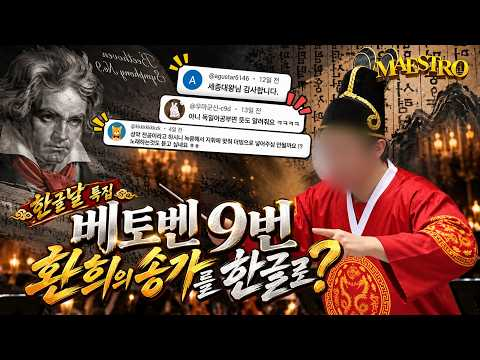
- 설명 앞부분: 🇰🇷 **한글날 특집! 베토벤 9번을 한글로?! 준비했습니다. 🎼 베토벤 교향곡 제9번 4악장 「환희의 송가」 독일어 가사를 한국어로 번역하고, 직접 노래까지 부르면서 지휘해봤습니다. 🎤 그런데 왜 곤룡포에 익선관까지 썼냐고요? 한글날 기념으로 남편 놀리면 재밌잖아요. 👑 성악 전공자가 마에스트로 게임을 만나면 벌어지는 일ㅋㅋㅋ 오늘도 쓸데없이 진지한 남편의 도전, 재밌게 봐주세요! 🇰🇷 **훈민정음 창제의 뜻을 기리며, 한글날을 축하합니다. 나랏말싸미 듕귁에 달아 문자 와로 서르 사맛디 아니할세 이런 전차로 어린 백셩이 니르고져…
- 대본 없음 (설명) — 음성인식이 끝나면 도입부·흐름이 들어감
- 댓글 242/242: 좋은 점 — 영상 1 · 감사·응원 8 · 더 알고 싶은 것 0 · 아쉬운 점 — 영상 1 · 반박·불만 — 의견 다름 0 · 정치·사회 0 · 경험 공유 9 · 구독·다음 기대 1
  - 좋은 점 — 영상 👍2 “잘 봤어요!! 친근하게 좋은 곡을 알려줘서 고마워요😊”
  - 감사·응원 👍22 “배 보고 성악 전공이라고 예상했는데 바리톤이셨다니👍 고품격 게임방송 감사합니다 ❤”
  - 감사·응원 👍3 “진화하는 컨텐츠에 댓글을 안쓸 수가 없었습니다 존경스럽습니다 ㅠㅠ.. 부드러운 날개가 귓가에 맴도는 ㅋㅋㅋㅋ 가사에서 빵빵터지네요 정성 가득한 영상 멋집니다 화이팅 😂”
  - 아쉬운 점 — 영상 👍1 “제목에 노래부르면서 한 점을 강조해봐요 어그로 좀 더 끌어봅시다!”
  - 경험 공유 👍122 “내가 살다살다 나인심포니 소프라노 멜로디를 다 불러보네... 지금 살아서 이 댓글 달고 있는 게 기적이다 진짜😢”
  - 경험 공유 👍18 “이런 정성스런 영상을 누추한 제가 보다니...너무 멋져요”

### 402. "어떻게 하루 종일 안지치고 싸웠을까?｜세계 최강 로마군의 ‘병력 교대’ 시스템"

- https://www.youtube.com/watch?v=0G6JWsVnOdc · 슬기로운 역사보기 · 구독자 16,300 · 조회수 162,925 (×10.0, 하루 2,012.8) · 좋아요 1,504 (0.9%) · 13.7분 · 2026-07-28 · 주제 묶음 5. 세계사·서양사 · 형식 정보·해설 (그 밖) · 폴더 `W_0G6JWsVnOdc` (웹 승인)
- 썸네일: 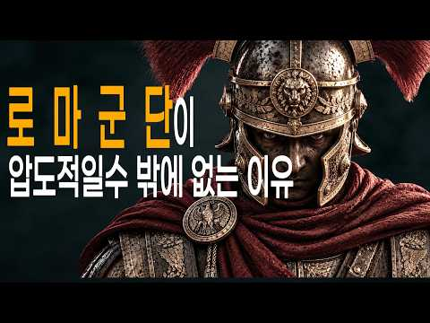
- 설명 앞부분: 영화 속 로마군은 한 번 돌격하면 끝까지 밀어붙입니다. 하지만 실제 역사는 전혀 달랐습니다. 수십 킬로그램의 장비를 착용한 병사가 몇 시간 동안 계속 싸우는 것은 현실적으로 불가능했습니다. 그런데도 로마군은 아침부터 해 질 때까지 전투를 이어가며 지중해를 제패했죠. 그 비밀은 병사의 괴력도, 정신력도 아니었습니다. 바로 치밀하게 계산된 '병력 교대 시스템'이었습니다. 이 영상에서는 ⚔️ 로마군은 왜 몇 시간 동안 전투를 지속할 수 있었는가 ⚔️ 영화에서는 거의 볼 수 없는 트리플렉스 아키에스의 진실 ⚔️ 하스타티·프린키페스·트리아…
- 대본 없음 (설명) — 음성인식이 끝나면 도입부·흐름이 들어감
- 댓글 135/135: 좋은 점 — 영상 5 · 감사·응원 7 · 더 알고 싶은 것 0 · 아쉬운 점 — 영상 1 · 반박·불만 — 의견 다름 3 · 정치·사회 4 · 경험 공유 9 · 구독·다음 기대 0
  - 좋은 점 — 영상 👍35 “오~ 저같은 덕후에게 너무 너무 유익한영상이네요~ 역시 로마는 클라스가 다르네요”
  - 좋은 점 — 영상 👍9 “좋은 정보가 있는 영상이다 !!”
  - 감사·응원 👍76 “전투방식을 이렇게 디테일하게 보여주니까 어떻게 싸웠을지 보이는듯합니다 감사합니다”
  - 감사·응원 👍11 “아 이래서 로마 군단이 융통성이 뛰어났고 전술 변화에 민감했다고 하는군요. 백인대장의 역할이 눈앞에 그려집니다. 몇 십 년을 전쟁사를 공부했는데 이런 디테일을 놓쳤네요. 고맙습니다.”
  - 아쉬운 점 — 영상 👍5 “팔랑크스(로마 레기온도 팔랑크스의 일종) 끼리의 싸움은, 서로 밀착해서 방패 끼리의 힘겨루기 싸움이었음! 누가 방패를 더 강하게 잡고 버티느냐의 싸움으로, 방패를 떨어뜨리면 끝장! 서로 방패로 온 힘을 다해서 밀집해서 밀치기 때문에, 뭔, 싸우는 도중에 부대가 뒤로 …”
  - 정치·사회 👍3 “공들여 만드신 영상 잘 봤습니다. 그 동안의 나무와 숲을 동시에 볼 수 있는 영상들 중에서도, 특히 전체와 일부, 유기적인 연관성이 한번에 잘 표현되어서 보기가 편합니다. 본래 부분 요소들은 종이 위에서, 종합 편성은 머리속에서 이뤄지는건데, 짧은 영상으로도 표현해 …”
  - 정치·사회 👍0 “종합하면 고대에 갖추기 힘든 군사 조직력 이라는 것임. 그런데 당시 동아시아에서도 이 정도 조직적 군사력이 있었고 오히려 원거리 무기가 최적화 되었기에 로마 vs. 진나라 싸움은 진나라가 이겼을 가능성이 높음.”
  - 경험 공유 👍12 “오.. 안그래도 리치가 긴 호플리테스가 군단병보다 훨씬 강하지 않을까 생각했었는데, 기동성보단 이런 시스템이 강한거였군요.”
  - 경험 공유 👍7 “제목보고 갑자기 머리 속에 질문이 하나 생겨서 들어왔어요 ㅋㅋ 한번도 생각안해봤었는데 교대하는게 체력적으로 엄청 도움되었겠네요”

### 403. 러시아가 몽골 타타르 기병 박살 낸 방법 – 몰로디 전투 1572

- https://www.youtube.com/watch?v=YjpJgo3xmZ4 · Historie Chronicle · 구독자 12,200 · 조회수 121,670 (×10.0, 하루 676.3) · 좋아요 1,603 (1.3%) · 26분 · 2026-04-20 · 주제 묶음 6. 동양사 (중국·일본·몽골) · 형식 정보·해설 (그 밖) · 폴더 `W_YjpJgo3xmZ4` (웹 승인)
- 썸네일: 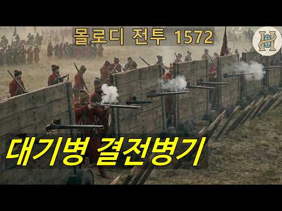
- 챕터: 0:00 인트로 · 0:30 계속된 타타르의 위협 · 3:59 미하일 보로틴스키 · 8:59 이 시대의 군대 · 13:42 몰로디 전투 · 23:21 결과 및 의의
- 설명 앞부분: 이 영상은 1572년 일어난 이반 4세 치하 러시아 차르국 보로틴스키 장군의 군대와 크림 타타르 연합군 사이에서 벌어진 몰로디 전투를 다루고 있는 역사 다큐멘터리 영상입니다.
- 대본 없음 (설명) — 음성인식이 끝나면 도입부·흐름이 들어감
- 댓글 169/169: 좋은 점 — 영상 2 · 감사·응원 5 · 더 알고 싶은 것 2 · 아쉬운 점 — 영상 0 · 반박·불만 — 의견 다름 1 · 정치·사회 2 · 경험 공유 5 · 구독·다음 기대 0
  - 좋은 점 — 영상 👍11 “귀주대첩의 강감찬이 검차를 사용한 것과 비슷하네요. 기병에게는 이동식 바리케이트가 효과적인 것 같습니다. 좋은 영상 감사드립니다!”
  - 좋은 점 — 영상 👍8 “이곳의 영상들은 너무 재미있고 유익합니다 그렇지만 이나라의 영상 조금 저시대의 영상 조금 이런식이니 세대의 흐름이 일관성 있는 영상이 만들어지면 좋겠어요”
  - 감사·응원 👍11 “귀주대첩의 강감찬이 검차를 사용한 것과 비슷하네요. 기병에게는 이동식 바리케이트가 효과적인 것 같습니다. 좋은 영상 감사드립니다!”
  - 감사·응원 👍7 “볼때마다 탄복을하고 너무나 감사드립니다 ^^”
  - 더 알고 싶은 것 👍3 “영상 잘 보고 있습니다 페이푸스 호 전투도 소개해주시면 감사하겟습니다”
  - 더 알고 싶은 것 👍0 “Bgm정보좀 알수있을까요??”
  - 정치·사회 👍1 “러시아랑 청나라가 몽골 줘팬거 보면. 몽골 자업자득임 러시아가 한짓은 몽골이 한짓의 1/100도 안됨”
  - 경험 공유 👍9 “평범하게 잘 가다가 드립치는게 킬포임 ㅋㅋ 그나저나 영상 중반에 카프카스 전통복식인 초카 복장이 나왔는데 16세기때도 초카 복장이 있었는지 제가 기억이 안나고 좀 모자라다보니 여쭈어 봅니다.”
  - 경험 공유 👍6 “내가 보로딘스키라면 군권을 쥐었을 때 이반4세부터 작살내고 시작했을 듯.”

### 404. 100만 대군을 숲에 가두고 썰어버린 약소국의 미친 전술 (feat. 스탈린의 분노) #세계사 #역사다큐 #스탈린 #모티전

- https://www.youtube.com/watch?v=JxcyT7cCW2w · 역사 전략실 · 구독자 11,000 · 조회수 108,024 (×9.8, 하루 782.9) · 좋아요 2,154 (2.0%) · 22.5분 · 2026-06-01 · 주제 묶음 5. 세계사·서양사 · 형식 인터뷰·강연·대담 · 폴더 `W_JxcyT7cCW2w` (웹 승인)
- 썸네일: 
- 챕터: 0:00 일주일의 승리를 호언장담한 스탈린의 오만한 계산 · 2:41 45만 붉은 군대의 침공과 '대숙청'이 부른 치명적 … · 4:45 강철 괴물을 박살낸 다윗의 무기, 몰로토프 칵테일 · 8:30 영하 40도의 지옥, 라테 임도에 갇힌 30km의 붉… · 10:38 붉은 군대를 도륙한 핀란드의 통나무 쪼개기, '모티 … · 15:35 하얀 사신 시모 해위해의 등장과 44사단의 완벽한 궤멸 · 18:26 거대한 대륙의 물량전과 핀란드가 끝내 지켜낸 가치 · 20:23 히틀러의 치명적 오판? 겨울전쟁이 쏘아 올린 거대한 …
- 설명 앞부분: 1939년 11월, 스탈린이 이끄는 거대한 소련의 붉은 군대가 핀란드를 침공합니다. 전차 한 대 제대로 없던 핀란드를 향해 스탈린은 일주일 만에 헬싱키를 점령할 것이라 호언장담했죠. 하지만 영하 40도의 숲속에서 핀란드군은 붉은 군대의 허리를 끊고 조각내는 잔혹한 '모티 전술'로 맞섭니다. 30킬로미터에 달하는 소련군 대열을 완벽한 지옥으로 밀어넣은 핀란드 하얀 유령들의 처절한 사투. 강대국의 오만함과 약소국의 기적이 격돌한 '겨울전쟁'의 끔찍하고도 위대한 전말을 역사 전략실에서 파헤쳐 봅니다. [타임라인] 1. 윌리엄 트로터(W…
- 대본 없음 (설명) — 음성인식이 끝나면 도입부·흐름이 들어감
- 댓글 97/97: 좋은 점 — 영상 3 · 감사·응원 1 · 더 알고 싶은 것 0 · 아쉬운 점 — 영상 0 · 반박·불만 — 의견 다름 0 · 정치·사회 6 · 경험 공유 3 · 구독·다음 기대 0
  - 좋은 점 — 영상 👍16 “너무 좋은 자료네요 감사합니다”
  - 좋은 점 — 영상 👍2 “좋은 영상 입니다”
  - 감사·응원 👍16 “너무 좋은 자료네요 감사합니다”
  - 정치·사회 👍6 “우리도 계엄사태로 경험많은 고위장군 중 50%이상이 숙청되어 감방에 있거나 해임되고 형사소송중. 학생운동 경력이 전부인 많은 정치인들, 국회의원들이 사실상 군대를 해체시키는건 아닌지? 이미 드론사령부는 해체되고 특전사, 정보사, 보안부대는 해체중. 일부 계엄관련 장군…”
  - 정치·사회 👍4 “본래 싸움 못하는 나라가. 얼떨결에 넓은 땅을 차지하다보니 그땅을 지키기위해 항상 힘쎈척 해야 되는 나라임”
  - 경험 공유 👍4 “이 당시 핀란드 군은 후방 군인들과 교체 시 후방로 간 군인들은 핀란드식 사우나로 원기 회복 후 다시 투입되니 전투력 만렙이죠. 반면 소련군들은 추위에 계속 노출되니 죽고 싶었을 겁니다. 전방에서 겨울을 보낸 저도 핀란드 추위는 아니지만 영하 10도는 체감상 영하 3…”
  - 경험 공유 👍1 “나도 우리 와이프 만나고 재산이 고깃덩어리로 변했는데;;”

### 405. 외국인들이 동궁을 보고 한국 사극에 충격받은 이유

- https://www.youtube.com/watch?v=k2LmY18bZeM · K-클래스 · 구독자 6,050 · 조회수 59,280 (×9.8, 하루 705.9) · 좋아요 1,218 (2.1%) · 9.6분 · 2026-07-25 · 주제 묶음 3. 조선 · 형식 정보·해설 (그 밖) · 폴더 `W_k2LmY18bZeM` (웹 승인)
- 썸네일: 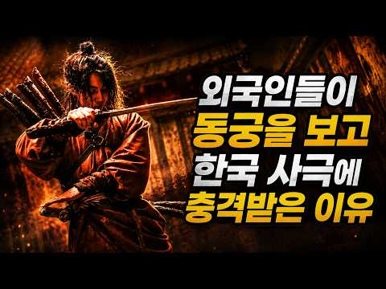
- 설명 앞부분: 🎬 영상 소개 새벽 두 시, 딱 한 편만 보려던 외국인이 해 뜨는 걸 봤습니다. 조선 궁궐을 배경으로 한 넷플릭스 드라마 〈동궁〉이 전 세계 80개국을 흔든 이유를 파헤칩니다. 세트를 바꾸지 않고 '색'만으로 두 세계를 나눈 절제된 연출, 무섭기보다 슬픈 한국식 원귀와 무속의 세계관, 화려함을 비워서 완성한 미학까지. 외국인들이 왜 이 드라마를 보고 '충격받았다'고 말하는지, 그 정체를 하나하나 분석했습니다. 💬 당신은 이 영상을 어떻게 생각하시나요? 🏷️ 관련 해시태그
- 대본 없음 (설명) — 음성인식이 끝나면 도입부·흐름이 들어감
- 댓글 88/88: 좋은 점 — 영상 0 · 감사·응원 1 · 더 알고 싶은 것 1 · 아쉬운 점 — 영상 2 · 반박·불만 — 의견 다름 1 · 정치·사회 6 · 경험 공유 6 · 구독·다음 기대 0
  - 감사·응원 👍3 “좋은 관점, 좋은 해석. 감사합니다”
  - 아쉬운 점 — 영상 👍4 “디테일에서 중국풍을 느껴서 아쉬움이 남았어요.”
  - 아쉬운 점 — 영상 👍0 “아주 디테일한 리뷰였어요~ 아주 좋아~~ 👍 이 정도면 아주 잘 완성된 걸작의 탄생이라고 봐야~~ 뻔한 외계인 만들고 총싸움 시키는 억지 설정 영화 같은 건 만들지 말라고~ 그런 것을 하지 말아야 돼~ 솔깃한 것을 창조하란 말이다~! 한국 드라마의 위상을 계속 이어 …”
  - 반박·불만 — 의견 다름 👍81 “자꾸 중국풍이라고 하는데, 그건 중국풍이 아닙니다. 2000년 이전에 나왔던 모든 중국 사극 드라마 봐 보세요. 그런 복식 존재도 안합니다. 멀리갈 것도 없습니다. 한때 엄청난 인기를 끌었던 포청천 드라마 복식 찾아보십시오. 대부분이 그런 복장이였습니다. 심지어 수백…”
  - 정치·사회 👍96 “중국풍이라니 아주 크게 잘 못 된 표현 . 지금 중국드라마 만드는 세대들이 30년 전 우리 사극드라마 본 세대 그 세대들이 만든 걸 중국인민들이 보고 지네거라고 무식한 소리를 해데는 것 진짜 무식하지 않음”
  - 정치·사회 👍33 “중국풍은 개억지고 그건 오히려 중국인들을 띄워주고 우리문화를 중국에 스스로 넘겨주는 꼴이지 한국인들중에는 현대에 매번 보던 한복이나 의복들만 한국 전통 옷이라 생각해서 그럼 고려말에서 조선으로 넘어갈때 조선인들이 대장금이나 조선말에 의복을 입었을거라 생각하는지? 삼국…”
  - 경험 공유 👍81 “자꾸 중국풍이라고 하는데, 그건 중국풍이 아닙니다. 2000년 이전에 나왔던 모든 중국 사극 드라마 봐 보세요. 그런 복식 존재도 안합니다. 멀리갈 것도 없습니다. 한때 엄청난 인기를 끌었던 포청천 드라마 복식 찾아보십시오. 대부분이 그런 복장이였습니다. 심지어 수백…”
  - 경험 공유 👍37 “나도 밤에 잠안와서 봤다가 새벽을 경험했다 젠장 ㅎㅎ”

### 406. 팰월드 1.0 고대 문명 테크용 멀티작업팰 추천 (세계수 이후)

- https://www.youtube.com/watch?v=2KijxN_U_rs · 퇴근한광대 · 구독자 7,090 · 조회수 69,431 (×9.8, 하루 890.8) · 좋아요 515 (0.7%) · 6.5분 · 2026-07-31 · 주제 묶음 8. 문명·고고학 · 형식 정보·해설 (그 밖) · 폴더 `W_2KijxN_U_rs` (웹 승인)
- 썸네일: 
- 챕터: 0:00 오프닝 · 0:27 고대 건물 설명 · 0:43 작업대 · 1:46 발전기 · 2:32 화로 · 3:33 재배기&부엌 · 4:39 생성기&금화 · 6:03 마무리
- 설명 앞부분: 세계수에 진입하면 고대 문명 테크가 해금되면서 기존과는 다른 방식의 거점 운영이 필요해집니다. 이번 영상에서는 고대 건물별로 어떤 멀티작업 팰을 배치하면 가장 효율적인지 업무 작동 시간을 기준으로 정리했습니다 후반 거점을 준비하고 계신 분들이라면 한 번쯤 참고하시면 도움이 될 것입니다 타임라인 궁금한 점이나 다른 조합이 있다면 댓글로 남겨주세요
- 대본 없음 (설명) — 음성인식이 끝나면 도입부·흐름이 들어감
- 댓글 110/110: 좋은 점 — 영상 4 · 감사·응원 6 · 더 알고 싶은 것 8 · 아쉬운 점 — 영상 1 · 반박·불만 — 의견 다름 1 · 정치·사회 0 · 경험 공유 3 · 구독·다음 기대 0
  - 좋은 점 — 영상 👍12 “쇼군복치는 생각도 못한 꿀팁이군요 좋다”
  - 좋은 점 — 영상 👍0 “오 좋은 꿀팁 감사합니다. 갈수록 필요 능력치는 많아져서 어떤걸 써야 하는지 고민이였어요”
  - 감사·응원 👍0 “옛날식으로 아누비스 잔뜩 굴리고 있었는데 효율팟 한번 짜봐야겠네요 감사합니다.”
  - 감사·응원 👍0 “갸아악 2등이다 정보 영상 잘 보고 있습니다! 감사합니다!”
  - 더 알고 싶은 것 👍0 “작업대에 달보미 하나만 추천하시면 다른건 어떤걸써야되나요? 달보미 2마리를 추천하시는건지...”
  - 더 알고 싶은 것 👍0 “고대문명진료소는 제약펠을 고정배치 해놔야 활성화되나요?”
  - 경험 공유 👍0 “광대님 안녕하세요 제가 이제 기존 작업장 철수하고 고대물질 생성기로 싹 도배해ㅓㅅ 한마리씩 넣어두려고 하는데 물질생성기를 일렬로 쫙두면 운반팰들이 한쪽에만 몰려있고 끝쪽는 안오던데.... 이럴땐 그냥 기존 작업장이 나은가요? 기존 종합 작업장으로 한마리씩 넣어두면 물…”
  - 경험 공유 👍0 “나즁에 고수되면 참고할만한 자료들이네요 ㅋㅋㅋ 근데 제가 이번에 노란색 아우라를 뿜는 희귀 모프링을 잡았는데 그냥 희귀랑 차이가 있나요?”

### 407. 일제강점기를 처음 제대로 공부한 일본인 아내의 반응

- https://www.youtube.com/watch?v=KIzkBsRwPzI · 유츄 Yuchu TV · 구독자 30,100 · 조회수 293,124 (×9.7, 하루 4,251.6) · 좋아요 7,044 (2.4%) · 13.1분 · 2026-08-09 · 주제 묶음 4. 한국 근현대사 · 형식 브이로그·직접 해본 이야기 · 폴더 `W_KIzkBsRwPzI` (웹 승인)
- 썸네일: 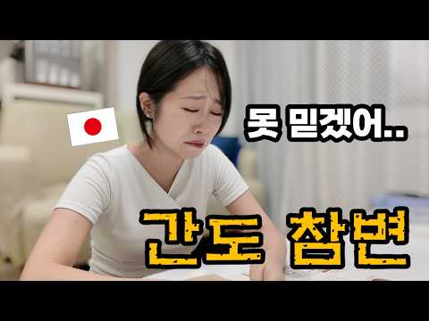
- 설명 앞부분: 안녕하세요, 유츄TV입니다😊 한국에서 생활하면서 한국사를 조금씩 공부해왔지만, 이번에는 일제강점기의 역사를 좀 더 자세히 공부해봤습니다. 간도 참변을 비롯해 당시 있었던 여러 사건들을 하나씩 알아가면서 처음 알게 된 사실도 많았고, 마음이 무거워지는 순간도 있었습니다. 일본인인 제가 한국의 역사책을 통해 일제강점기를 공부하면서 어떤 부분에서 놀랐고, 어떤 생각이 들었는지 남편과 함께 솔직하게 이야기해봤습니다. 🇯🇵일본인 아내의 한국사 시르즈🇰🇷 1️⃣한일부부∣ 갑자기 한국 역사를 배우겠다는 일본인 아내… 이유를 듣고 놀랐습니다 2…
- 대본 없음 (설명) — 음성인식이 끝나면 도입부·흐름이 들어감
- 댓글 2,584/2,626: 좋은 점 — 영상 21 · 감사·응원 173 · 더 알고 싶은 것 29 · 아쉬운 점 — 영상 20 · 반박·불만 — 의견 다름 108 · 정치·사회 228 · 경험 공유 149 · 구독·다음 기대 9
  - 좋은 점 — 영상 👍12 “한국 에서는 예전에 있었던 일들 말그대로 역사를 배우는 것인데 일본에서는 이것을 반일 교육 이라고 말도 안되는 트집을 잡는데 반일교육을 받아 본 적이 없어요. 일본이 한국을 근대화 시켰다는 것은 집에 강도가 들었다가 도망가면서 폰을 떨구고 갔는데 그게 경제에 도움이 …”
  - 좋은 점 — 영상 👍9 “지나간 과거의 일이라지만 자칫 불편할 수 있는 주제를 회피하지 않고 마주친 용기가 대단합니다. 올바른 과거를 알고 기억을 해야 미래에 서로 도움이 되는 관계가 될 수 있겠지요.”
  - 감사·응원 👍228 “당신의 잘못이아닙니다. 사실을 알고 기억해주고 미안해 해주시는것도 감사합니다.”
  - 감사·응원 👍162 “과거의 일본인이 했던 만행과 잘못을 현대의 일본인에게 대신 짊어지게 하거나 죗값을 치르라고 말하고 싶지 않습니다. 다만 과거를 바르게 인식하고 반성하며 인정하는 것, 그리고 후대에 올바른 역사를 전달하는 것을 우리는 원합니다. 이것들이 오롯이 이뤄지지 않았기 때문에 …”
  - 더 알고 싶은 것 👍7 “서대문형무소 함델꼬가주시고 마루타실험도 꼭 써치해서 알려주세요.😊”
  - 더 알고 싶은 것 👍6 “사실 일본은 사람으로써 할수없는 못된짖 너무 많이하였고 학살도 많았다. 우리 나라 공식적인 침략만714번 이란 기록도있다. 일본이 역사왜곡 안하고 미래를 위해 학생들에게 바른 역사관을 잘 가르쳐주길 바랄뿐이다.”
  - 아쉬운 점 — 영상 👍6 “이상해서 영상 목록보니 명성 황후에서 헛웃음만..이 사람들 방향을 이상하게 잡았네..식민지 시절 일본의 잘못을 배우고 조선인의 고통을 공감? 이러면 무턱대고 좋아할 줄 알았나? 학교에서 가르치는 피해 의식으로 점철된, 역사 사기꾼들이 쓴 가짜 역사서 공부한다고 하면 …”
  - 아쉬운 점 — 영상 👍4 “일본인 모두가 잘못한게 아닙니다. 남편분 말처럼 이렇게 제대로된 역사를 알아주는게 중요한것 같아요. 이렇게 앞으로 태어나게될 후손들도 역사를 알아가게 될거에요. 그거면 됐어요. 그리고 반복되지 않으면 됩니다. 그리고 감사합니다.”
  - 반박·불만 — 의견 다름 👍228 “당신의 잘못이아닙니다. 사실을 알고 기억해주고 미안해 해주시는것도 감사합니다.”
  - 반박·불만 — 의견 다름 👍114 “본인이 슬퍼할 일은 아닙니다. 부정만 안 하면 될 뿐”
  - 정치·사회 👍5 “역사 공부 ? 일본 놈들이 무슨 짓을 했는지 똑똑히 가르쳐 주마. 그럼 간토 대학살 부터 알려주지 . 관동 대지진때 조선인이 우물에 독 풀었다고 거짓말 해서 일본 놈들이 자경단을 만들어 죽창으로 찌르고 칼로 베어 조선인 6661명을 죽였다. 조선을 침략해 조선인의 코…”
  - 정치·사회 👍4 “저도 교과서로 한국 역사를 배울 때.. 왜 일본의 역사와 중국의 역사와 다를까 의구심이 들었습니다. 한국은 거짓말을 하지 않는데.. 왜 일본과 중국은 거짓말을 하는 걸까??라고 늘 생각이 들었습니다. 나이가 들고 해외에서 유학을 8년 정도 하게 되면서 세상을 알게 됐…”
  - 경험 공유 👍69 “일본에서도 NHK에서 일제감점기에 대해 방송 했었던걸로 알고 있습니다 십몇년전인데 일본인이 그 방송을 보고 당시 동대문에서 장사하던 저에게 사과를 하더라구요 어머니와 따님이였는데 일본인으로서 부끄럽다 과거에 일본이 한국에게 나쁜 짓을 했었다 미안하다 이렇게 얘기해주셨…”
  - 경험 공유 👍9 “나는 부모로부터 직접일제 강점기를 들었습니다. 모든 금속식기를 빼앗아갔고 깨둥을 빼앗아가서 그 기름을 짠 찌꺼기인 깻묵을 대신 받았다. 한겨울에도 한국어를 사용하면 초등학생이었는데도 근처 저수지에가서 물을 갈어오게 했다.드등등 내가 들었던 내용은 아직도 충격적이었던 …”
  - 구독·다음 기대 👍171 “아내분이 조국의 민낯을 본다는 게 힘들건대 대단하네요. 너무 자책하지 않기를. 구독하고 갑니다”
  - 구독·다음 기대 👍4 “구독했어요 진실을 알아 봐서 감사합니다 ~^^”

### 408. 세종대왕릉의 저주, 왕족들이 줄줄이 죽고 예종이 관 뚜껑을 열자 드러난 충격적 광경

- https://www.youtube.com/watch?v=TEULswg17Es · 왕조의 숨은 이야기 · 구독자 1,550 · 조회수 14,756 (×9.5, 하루 153.9) · 좋아요 243 (1.7%) · 24.2분 · 2026-07-13 · 주제 묶음 3. 조선 · 형식 정보·해설 (그 밖) · 폴더 `W_TEULswg17Es` (웹 승인)
- 썸네일: 
- 설명 앞부분: 세종대왕의 영릉에는 정말 왕실 장남들을 죽음으로 몰아넣은 저주가 있었을까요? 이 영상에서는 풍수관 최양선의 불길한 경고, 문종·단종·의경세자·인성대군으로 이어진 네 세대의 비극, 그리고 예종이 세종과 소헌왕후의 능을 여주로 옮긴 이유를 추적합니다. 이장 후 불과 8개월 만에 급사한 예종과 400년 뒤 다시 드러난 옛 석실의 비밀을 통해, 조선 왕릉을 둘러싼 풍수와 권력, 역사적 미스터리의 진실을 살펴봅니다.
- 같은 채널 평소 대비 ×17.7 (채널 최근 롱폼 중앙값 834회) · 평소 영상: 조선 후궁의 말년, 궁에서 쫓겨난 뒤 짐승만도 못했던 비참한 삶 (863회) / 왕과 사는 남자 실제 역사 ∣ 엄흥도는 왜 사라졌나, 영화가 감춘 570년의 진실 (804회)
- 대본 없음 (설명) — 음성인식이 끝나면 도입부·흐름이 들어감
- 댓글 6/6: 좋은 점 — 영상 0 · 감사·응원 0 · 더 알고 싶은 것 0 · 아쉬운 점 — 영상 0 · 반박·불만 — 의견 다름 0 · 정치·사회 0 · 경험 공유 0 · 구독·다음 기대 0

### 409. "야, 이 자식아. 전쟁 지면 너도 책임 있어" '산보하듯' 남침하자던 박헌영에게 잉크병 던진 김일성 [호준석의 역사전쟁 EP.30]

- https://www.youtube.com/watch?v=dg8J-vvh6ZM · 오늘의시각 · 구독자 38,200 · 조회수 363,028 (×9.5, 하루 2,074.6) · 좋아요 4,331 (1.2%) · 14.5분 · 2026-04-25 · 주제 묶음 1. 역사 일반·이야기 · 형식 정보·해설 (그 밖) · 폴더 `W_dg8J-vvh6ZM` (웹 승인)
- 썸네일: 
- 설명 앞부분: 1950년 11월 7일. 북한 수뇌부는 국군과 유엔군의 공세에 중국 접경지대까지 쫓겨 가 있었습니다. 인민군 최고사령부는 압록강 주변 고산진, 내각은 자강도 강계의 임시 방공호에서 업무를 봤습니다. 이날은 공산주의 소련을 탄생시킨 ‘러시아혁명 기념일’이었습니다. 이날 6.25전쟁 주범인 39세 김일성은 주위에서 주는 술을 다 받아먹었습니다. 패전의 분노를 삭이지 못하는 모습이었습니다.
- 같은 채널 평소 대비 ×9.7 (채널 최근 롱폼 중앙값 37,379회) · 평소 영상: 오늘의 대한민국을 만든 영웅들, 6.25전쟁 영웅 시리즈 몰아보기 [호준석의 역사전쟁 스… (41,223회) / 전쟁사업기념관의 '항미원조', 안규백 국방장관의 '마오쩌둥 좌우명' 논란... 6.25전… (33,535회)
- 대본 없음 (설명) — 음성인식이 끝나면 도입부·흐름이 들어감
- 댓글 679/680: 좋은 점 — 영상 5 · 감사·응원 11 · 더 알고 싶은 것 1 · 아쉬운 점 — 영상 1 · 반박·불만 — 의견 다름 9 · 정치·사회 121 · 경험 공유 13 · 구독·다음 기대 0
  - 좋은 점 — 영상 👍12 “좋은내용감사합니다.”
  - 좋은 점 — 영상 👍1 “좋은 영상 만들어주셔서 감사합니다”
  - 감사·응원 👍18 “세월호 무적화물 고철 7천톤 화주가 일으킨 더불어 공산당 무장폭동. 518 북조선 특수군 참전 무장폭동 .사전투표 뻥튀기 570만표 투표도둑질 반역도당 부정선거 무장폭동 카르텔 박멸시켜야 무장폭동과 적화통일 막는다구 데모하네요 감사합니다”
  - 감사·응원 👍12 “좋은내용감사합니다.”
  - 더 알고 싶은 것 👍0 “제주 4,3사건과 여수순천 사건이 북한이 저지른 소행인가요?.... 답변 부탁드립니다..”
  - 아쉬운 점 — 영상 👍3 “자료출처를 적어주시니 너무 좋습니다”
  - 반박·불만 — 의견 다름 👍124 “북한군이 남침 3일만에 서울을 집어 먹고서 계속 남하하지 않은체 서울에서 몇칠을 머문 덕분에 미군과 국군이 전열을 재 정비할 시간이 생겼었는데 왜 북한군이 계속 남하를 하지 않은 이유를 이 영상을 보고서 알았다.이유야 어떻든 하늘이 한국의 공산화를 막을 기회를 준것은…”
  - 반박·불만 — 의견 다름 👍15 “당시 북한도 남한도 민족주의자들이 선전선동해서 김구 연설만 들어봐도 민족주의 좌익색깔이 묻어나더만. 이승만이 그래서 김구와 멀어졌던거고.공산당과 민족주의는 결이 비슷해.”
  - 정치·사회 👍804 “제발 중국인 없는 세상서 살고싶다”
  - 정치·사회 👍205 “멸공 공산당된 국회”
  - 경험 공유 👍4 “4.3은 남로당 무장폭동인데, 산간주민들에게 빨치산에 협력하지 말고 산간에서 내려오라 여러차례 방송도 하고, 삐라도 뿌리고 했었고, 산간지역주민들이 빨치산과 같이 산에 숨어 들어갔으니 이들도 빨치산으로 간주 된것, 물론 빨치산들에게 강제로 따라가게 된 사람들도 있었고…”
  - 경험 공유 👍3 “21세기에 달탐험,ai,우주로 테마가 옮겨지는데 아직도 저런구닥다리 이념으로 실현가능하겠는가? 저런이념이 미래를 제시할수있는가?? 내가 생각하기엔 아니다! 그냥 구시대유물뿐이고 과거에 사는 사람들뿐 아닌가봄.”

### 410. 지는 사람 목을 벤다｜사백 년 전 두만강 군영에서 실제로 벌어진 일 ∣조선이 감춘 북방 근무 1년의 기록 ∣ 부북일

- https://www.youtube.com/watch?v=0Si50CybDIU · 역사아카이브 - History Archive KR · 구독자 24,200 · 조회수 228,754 (×9.4, 하루 3,056.6) · 좋아요 1,708 (0.8%) · 91.5분 · 2026-08-03 · 주제 묶음 3. 조선 · 형식 정보·해설 (그 밖) · 폴더 `W_0Si50CybDIU` (웹 승인)
- 썸네일: 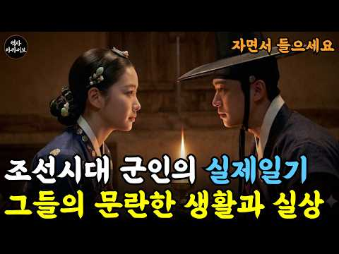
- 챕터: 0:00 문천의 밤, 칼로 끊긴 사립문 · 2:10 부북일기란 무엇인가 / 부방 제도 · 7:30 아버지 박계숙, 1605년의 길 · 13:00 마운령의 시체 두 구 · 17:20 첨사와의 정면 충돌, 곤장 세 대 · 21:40 회령 기생 배종, 그리고 딸 월매 · 25:00 아들 박취문, 1644년 겨울의 출발 · 30:30 회령 도착 — 적보다 무서운 텃세 · 36:00 활쏘기 125회, 훈련이자 유흥 · 41:00 지는 자의 목을 베라 — 참수 내기 · 46:30 호반적자 사건과 곤장 여덟 대 · 51:00 동방급제자의 의리, 김사룡 사건 · 55:20 청 사신이 활쏘기를 구경하다 · 59:00 울산에서 온 편지 한 장 · 62:30 사십 년을 건너온 만남 · 67:00 무과 초시 부정에 항의하다 · 71:00 조총 400자루 — 청렴이 족쇄가 되다 · 78:00 방환, 그리고 문천의 밤 · 83:00 아버지의 마지막 해 · 86:00 79장의 종이가 남긴 것
- 설명 앞부분: 조선의 군인이라 하면 우리는 임진왜란과 병자호란을 떠올립니다. 그러나 조선 군인의 삶에서 압도적인 비중을 차지한 것은 전투가 아니라, 아무 일도 일어나지 않는 국경을 지키는 일이었습니다. 울산박물관에 보관된 울산광역시 유형문화재 제14호 『부북일기(赴北日記)』는 그 잊힌 일상을 통째로 담은 유일무이한 기록입니다. 울산 박씨 박계숙(1569~1646)과 아들 박취문(1617~1690)이 39년의 간격을 두고 각각 함경도 회령으로 부방을 다녀오며 남긴 부자 2대의 종군일기. 눈보라와 굶주림만 있는 것이 아닙니다. 텃세와 뒷거래, 활쏘…
- 같은 채널 평소 대비 ×12.4 (채널 최근 롱폼 중앙값 18,470회) · 평소 영상: [5시간 연속재생] 조선시대 생활사 8번째 통합 ∣ 우리 조상들의 모습 (18,910회) / 황후의 치마를 들춘 남자｜이완용보다 오래 살아남은 진짜 매국노, 윤덕영 (18,031회)
- 대본 없음 (설명) — 음성인식이 끝나면 도입부·흐름이 들어감
- 댓글 38/38: 좋은 점 — 영상 1 · 감사·응원 1 · 더 알고 싶은 것 0 · 아쉬운 점 — 영상 1 · 반박·불만 — 의견 다름 1 · 정치·사회 2 · 경험 공유 1 · 구독·다음 기대 0
  - 좋은 점 — 영상 👍9 “역사를 배웠으면 조선이 성리학의 나라라는 헛소리는 하지마라”
  - 감사·응원 👍12 “나도.나름.역사에관심.책도.읽었습니다.이런.소중한.기록.책을.소개해주어.너무감사합니다.”
  - 아쉬운 점 — 영상 👍1 “내용보다..광고가 더 오래니..몰 보았는지 모르겠네..”
  - 반박·불만 — 의견 다름 👍9 “역사를 배웠으면 조선이 성리학의 나라라는 헛소리는 하지마라”
  - 경험 공유 👍12 “나도.나름.역사에관심.책도.읽었습니다.이런.소중한.기록.책을.소개해주어.너무감사합니다.”

### 411. 왕이 직접 만든 괴물 ∣ 조선 역사상 가장 위험한 남자 홍윤성의 모든 것

- https://www.youtube.com/watch?v=5dELsNr_kgU · 역사 추적자 · 구독자 8,060 · 조회수 76,004 (×9.4, 하루 466.5) · 좋아요 1,286 (1.7%) · 28.8분 · 2026-05-07 · 주제 묶음 1. 역사 일반·이야기 · 형식 정보·해설 (그 밖) · 폴더 `W_5dELsNr_kgU` (웹 승인)
- 썸네일: 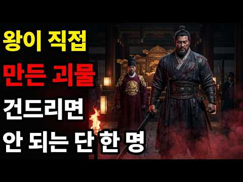
- 챕터: 0:00 오프닝 — 처벌받지 않은 남자 · 2:00 1장 · 괴물의 탄생 — 홍윤성은 누구인가 · 8:00 2장 · 피로 세운 왕좌 — 계유정난의 진실 · 14:00 3장 · 왕의 남자 — 권력의 정점 · 19:00 4장 · 통제 불능 — 살인, 폭행, 강탈 (핵심) · 27:00 5장 · 세조는 왜 눈을 감았나 — 왕의 침묵 · 32:00 6장 · 권력의 끝 — 남은 것과 사라진 것 · 37:00 에필로그 · 역사가 우리에게 묻는 것
- 설명 앞부분: 세조가 직접 만든 괴물. 그것이 홍윤성을 한 마디로 설명하는 가장 정확한 표현입니다. 그는 처음부터 괴물이 아니었습니다. 하지만 왕이 "이 사람은 내 사람이다"라고 선언한 순간. 법도, 제도도, 사헌부도 그를 건드릴 수 없었습니다. 그리고 그 순간부터 — 그는 달라지기 시작했습니다. 사람을 때려죽였습니다. 처벌 없었습니다. 노파를 살해했습니다. 처벌 없었습니다. 종친을 폭행했습니다. 처벌 없었습니다. 남의 첩을 강탈했습니다. 처벌 없었습니다. 세조가 살아있는 한. 이 패턴은 단 한 번도 깨지지 않았습니다. 오늘 영상은 조선왕조실록…
- 대본 없음 (설명) — 음성인식이 끝나면 도입부·흐름이 들어감
- 댓글 57/68 (다 받지 못함): 좋은 점 — 영상 0 · 감사·응원 0 · 더 알고 싶은 것 0 · 아쉬운 점 — 영상 1 · 반박·불만 — 의견 다름 2 · 정치·사회 4 · 경험 공유 2 · 구독·다음 기대 0
  - 아쉬운 점 — 영상 👍0 “다좋은데 구독좋아요는 한번만 말하소...... 그리고 이야기하는내용 전개가.. 너무 길다.. 쓸데없는이야기를 자꾸키워넣음.. 내용에.절반이상이......먼...반복교육인가..... 조정이필요해보임”
  - 반박·불만 — 의견 다름 👍3 “정보가 정확하지 않네요 좌익2등 공신이구만요 1등공신이 아닙니다”
  - 반박·불만 — 의견 다름 👍0 “역사를 귀를 기우리면서 인물을 보면서 성씨를 볼려고 않함 각 성씨의 시조를 찾아보면 왕이 자기 성을 만들던지 성씨를 받던지 이게 핵심인데 이런게 없는 성씨가 잇다는거..실록을 다 읽을려며 얼마나 걸릴까요..표의 문자인데 그 시대 문자를 현실은 아니죠..자꾸 한글이 소…”
  - 정치·사회 👍13 “홍윤성은 이재명 과 똑 같네”
  - 정치·사회 👍3 “조선이라는나라는27명의왕들중정상적이고왕이라칭할수있는왕은과연 얼마나될까심지어나라을 위태롭게또는나라을팔아 넘긴왕정신불안정한왕 이러한무능한왕들에의해 조선500년을왜구라고 깔보든일본의식민지가 되고말맜다그러나지금 의나라을보라전과자범죄자 좌파이재명이통치하는 나라가과연조선의무능한…”
  - 경험 공유 👍9 “세조는 ... 한명회를 두려워함 .. 자기를 왕으로 만들었기에 .. 언제든지 자기를 내칠수있다 스스로 판단함 .. 그걸 안 한명회는 함부로 몸 안굴림. 이래서 내가 한명회를 무척 좋아하죠 ...”
  - 경험 공유 👍0 “홍윤성에 관한 기록이나 여러가지 자료를 읽어보면 신분은 양반이었지만 과거에 연달아 낙방한게 한명회와 좀 닮은 구석이 있더군요. 그래서 그 당시 계유정난때 기존의 기득권 세력들인 중신들이 문으로 들어오자마자 살생부에 이름이 적힌 사람 베는것을 자기에게 꼭 맡겨달라 했다…”

### 412. 세종은 왜 장영실을 버렸나... 가마부상은 핑계일뿐, 진짜 목적은 따로 있었다? ㅣ 노비출신천재장영실 ㅣ장영실사라진이유

- https://www.youtube.com/watch?v=1RZ8WZKegt8 · 세상사실록 · 구독자 13,700 · 조회수 128,916 (×9.4, 하루 809.6) · 좋아요 1,511 (1.2%) · 37.9분 · 2026-05-11 · 주제 묶음 3. 조선 · 형식 정보·해설 (그 밖) · 폴더 `W_1RZ8WZKegt8` (웹 승인)
- 썸네일: 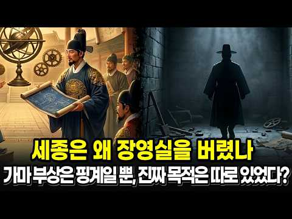
- 챕터: 0:00 인트로 — 1,893권에서 사라진 이름 · 1:30 장영실은 누구인가 — 노비에서 시작된 삶 · 4:00 세종의 파격 — 관노비에게 관직을 주다 · 6:30 중국 파견과 조선형 과학기기의 탄생 · 8:00 자격루 — 15세기 아날로그-디지털 변환의 비밀 · 12:00 앙부일구 — 세종이 거리에 세운 공공시계 · 14:00 옥루 — 물로 돌아가는 금빛 태양 · 16:30 측우기와 수표 — 유럽보다 200년 앞선 시스템 · 18:00 1442년, 가마 사건의 전말 · 21:00 가마가 진짜 이유였을까? — 4가지 단서 · 26:00 장영실 이후의 조선 — 고칠 수 있는 사람이 없었다 · 29:00 지워진 건 장영실뿐이었을까 · 31:00 여러분이 세종이었다면?
- 설명 앞부분: 노비 출신으로 정3품까지 오른 조선 유일의 사람, 장영실 🔧 자격루, 혼천의, 앙부일구, 측우기… 20년간 세종의 오른팔이었던 이 천재가 가마 하나 부서졌다는 이유로 곤장 100대를 맞고 사라집니다. 그리고 조선왕조실록 1,893권 어디에도, 이 사람의 이름은 다시 나오지 않습니다. 무덤도, 초상화도, 사망 기록도 없습니다. 가마가 정말 이유였을까요? 세종은 왜 이번만큼은 장영실을 지키지 않았을까요? 장영실이 사라진 뒤, 조선의 과학은 어떻게 됐을까요? 15세기 조선 최고의 천재가 지워진 과정을, 처음부터 끝까지 뒤집어 봅니다. …
- 대본 없음 (설명) — 음성인식이 끝나면 도입부·흐름이 들어감
- 댓글 0/219 (다 받지 못함): 좋은 점 — 영상 0 · 감사·응원 0 · 더 알고 싶은 것 0 · 아쉬운 점 — 영상 0 · 반박·불만 — 의견 다름 0 · 정치·사회 0 · 경험 공유 0 · 구독·다음 기대 0

### 413. 60번 싸워 한 번도 지지 않았다, 조선의 조자룡 정기룡 장군

- https://www.youtube.com/watch?v=9-hT8Cpgz-g · 역사스토리 · 구독자 21,700 · 조회수 203,775 (×9.4, 하루 3,589.7) · 좋아요 1,143 (0.6%) · 17.9분 · 2026-08-21 · 주제 묶음 3. 조선 · 형식 정보·해설 (그 밖) · 폴더 `W_9-hT8Cpgz-g` (웹 승인)
- 썸네일: 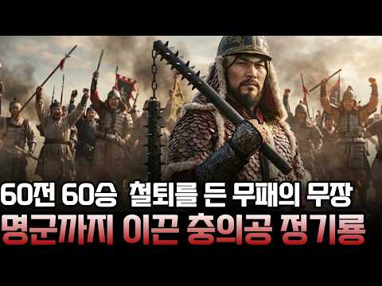
- 챕터: 0:00 임금이 꿈을 꾸고 이름을 지어준 무관 · 1:39 칼이 아니라 도리깨였던 이유 · 3:34 열 기병으로 만 명을 친 거창 기습 · 5:07 진 싸움에서 이름을 얻다, 조경 구출 · 6:36 적이 몇이냐고 묻지 않는 장수 · 8:17 사람이 몰려드는 부대 · 9:46 성을 되찾고 사람을 되돌리다 · 11:36 진주성, 피로 쓴 마지막 편지 · 12:55 정유재란, 용담천의 반격 · 14:21 명나라 군대를 지휘한 유일한 조선인 · 16:12 공신 명단에 없는 이름
- 설명 앞부분: 1586년 무과에 급제한 시골 무관 정무수는 선조가 꿈에서 용을 보았다는 이유로 기룡이라는 이름을 하사받습니다. 그런데 임진왜란이 터지자 이 남자가 손에 쥔 것은 장수의 칼이 아니라 농기구 도리깨를 닮은 무기, 편곤이었습니다. 조총 앞에서 마주 서면 지는 전쟁에서 정기룡은 마주 서지 않는 싸움을 골랐고, 거창 기습부터 금산에서의 조경 구출, 상주성 탈환, 정유재란 고령 용담천 전투, 그리고 명나라 군직 어왜총병관까지, 예순 번이 넘는 싸움을 이겨냈습니다. 그런데 전쟁이 끝난 뒤 선무공신 명단에 그의 이름은 없었습니다. 임진왜란, …
- 대본 없음 (설명) — 음성인식이 끝나면 도입부·흐름이 들어감
- 댓글 0/82 (다 받지 못함): 좋은 점 — 영상 0 · 감사·응원 0 · 더 알고 싶은 것 0 · 아쉬운 점 — 영상 0 · 반박·불만 — 의견 다름 0 · 정치·사회 0 · 경험 공유 0 · 구독·다음 기대 0

### 414. 1592년, 왜군이 조선을 침략한 순간… 이순신은 현대전력과 함께 반격했다

- https://www.youtube.com/watch?v=byJ4-8wapS0 · 시간실록 · 구독자 8,390 · 조회수 78,480 (×9.3, 하루 549.2) · 좋아요 1,068 (1.4%) · 29분 · 2026-05-27 · 주제 묶음 3. 조선 · 형식 정보·해설 (그 밖) · 폴더 `W_byJ4-8wapS0` (웹 승인)
- 썸네일: 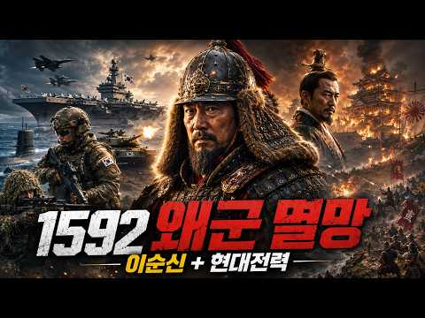
- 설명 앞부분: 1592년, 왜군이 조선을 침략한 그날. 역사는 그대로 흘러가지 않았다. 탄금대로 진격하던 왜군 선봉대 앞에 대한민국 현대전력이 모습을 드러낸다. K2 소총, 맥밀란 저격총, 전차, 잠수함, 항공모함까지. 그리고 그 모든 전력을 마주한 이순신 장군. 조선을 무너뜨리려던 왜군의 진격은 이제 완전히 다른 전쟁으로 바뀐다. 이 영상은 임진왜란을 바탕으로 한 가상 역사 퓨전 전쟁 시리즈입니다. 실제 역사와 창작 설정이 결합된 픽션 콘텐츠입니다. 끝까지 보시면 이순신 장군과 현대전력이 어떻게 전세를 뒤집는지 확인할 수 있습니다. 사실 기반…
- 대본 없음 (설명) — 음성인식이 끝나면 도입부·흐름이 들어감
- 댓글 0/101 (다 받지 못함): 좋은 점 — 영상 0 · 감사·응원 0 · 더 알고 싶은 것 0 · 아쉬운 점 — 영상 0 · 반박·불만 — 의견 다름 0 · 정치·사회 0 · 경험 공유 0 · 구독·다음 기대 0

### 415. [AI 단편영화] 임진왜란 명량에 현대해군이 나타났다｜이순신의 승리를 지키러 온 후손들

- https://www.youtube.com/watch?v=VeX5H6ej6lQ · 타임머신 타고 전장속으로 · 구독자 3,230 · 조회수 30,128 (×9.3, 하루 223.2) · 좋아요 313 (1.0%) · 13.6분 · 2026-06-04 · 주제 묶음 3. 조선 · 형식 정보·해설 (그 밖) · 폴더 `W_VeX5H6ej6lQ` (웹 승인)
- 썸네일: 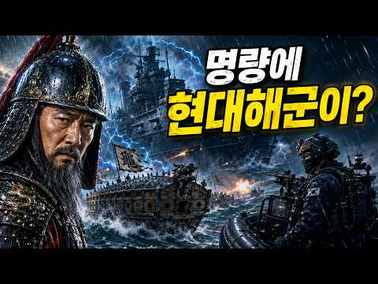
- 챕터: 0:00 1597년 명량, 12척의 배로 거대한 침략군을 막아… · 0:30 기록에 존재하지 않는 검은 함선(철갑함)의 등장 · 1:00 시간기록국 현장감시관 '한서진', 이상 신호를 감지하다 · 1:39 대한민국 해군 특수임무팀 '강태오 팀장'과 고속단정 … · 2:28 "그대는 누구의 군사인가?" 이순신 장군과 후손들의 … · 3:10 이순신의 전장을 빼앗지 않고 기록 밖의 적만 제거하는… · 3:40 현대의 화력으로 일본 목선의 진격을 끊어내다 · 4:24 시대를 넘어온 철갑함의 반격과 예비 포대 가동 · 5:21 포격의 사각을 파고드는 강태오의 고속단정 · 5:51 "적의 목선을 갈라라" 조선 수군의 화포 엄호 · 6:21 철갑함 외벽 접안, 선내로 진입하는 해군 특수임무팀 · 7:13 좁은 포실 안에서 마주친 서로 다른 시대의 병사들 · 8:01 포실 확보 완료, 철갑함의 심장부로 향하는 길 · 8:16 메이지 장교의 마지막 방어선과 치열한 선내 통로 교전 · 8:43 이 배가 명량에 존재할 수 있었던 이유 '푸른 균열'… · 9:00 주변 지지 구조물(고정점) 동시 타격 작전 수립 · 9:29 "지금이다, 적을 몰아붙여라" 제자리로 돌아오는 전장… · 10:11 무너지는 일본 함대의 진형과 철갑함의 흔들림 · 10:56 균열을 붙잡고 있는 고정점을 향한 현대군의 집중 사격 · 11:11 메이지 장교의 마지막 저항과 붕괴되는 함선 내부
- 설명 앞부분: 만약 명량해전에 일본 메이지 시대의 ‘철갑함’이 난입했다면? “그대들은 누구의 군사인가?” “장군님의 승리를 지키러 온 후손입니다.” 1597년 명량의 밤바다. 12척의 배로 거대한 침략군을 마주한 이순신 장군의 전장에, 있어서는 안 될 기록 밖의 침입자 ‘일본 메이지 시대 철갑함’이 나타납니다. 시공간의 균열로 인해 무너져가는 역사의 고정점. 이 왜곡을 막기 위해 시간기록국 현장감시관 ‘한서진’은 긴급 신호를 보냅니다. 그리고 대한민국 해군 특수임무 대응팀. 강태오 팀장과 대원들이 명량의 거친 소용돌이 속으로 진입합니다. “장군…
- 대본 없음 (설명) — 음성인식이 끝나면 도입부·흐름이 들어감
- 댓글 0/16 (다 받지 못함): 좋은 점 — 영상 0 · 감사·응원 0 · 더 알고 싶은 것 0 · 아쉬운 점 — 영상 0 · 반박·불만 — 의견 다름 0 · 정치·사회 0 · 경험 공유 0 · 구독·다음 기대 0

### 416. 역사에 기록된 가장 멋있었던 죽음들

- https://www.youtube.com/watch?v=tMIab7lVg88 · 쉽게 설명해서! · 구독자 18,100 · 조회수 168,628 (×9.3, 하루 1,605.3) · 좋아요 1,398 (0.8%) · 19.1분 · 2026-07-04 · 주제 묶음 1. 역사 일반·이야기 · 형식 정보·해설 (그 밖) · 폴더 `W_tMIab7lVg88` (웹 승인)
- 썸네일: 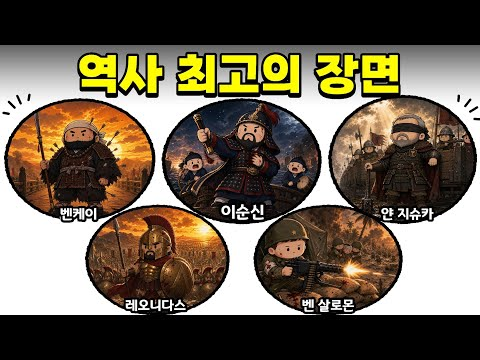
- 챕터: 0:00 벤케이, 서서 죽은 전설 · 4:34 레오니다스의 최후 · 8:35 두 눈을 잃은 지슈카 · 10:40 마지막 북소리와 이순신 · 15:39 벤 살로몬의 최후 · 18:35 아웃트로
- 설명 앞부분: 역사에 남은 마지막 순간들은 이상하게 오래 기억됩니다. 이번 편에서는 끝까지 물러서지 않았던 다섯 사람의 이야기를 가져왔습니다. 벤케이, 레오니다스, 얀 지슈카, 이순신, 그리고 벤 살로몬까지. 서로 다른 시대와 나라의 인물들이지만, 마지막 장면만큼은 묘하게 닮아 있습니다. 다음에 다뤘으면 하는 역사 이야기나, 기억에 남는 인물 있으면 댓글로 남겨주세요.
- 같은 채널 평소 대비 ×3.7 (채널 최근 롱폼 중앙값 45,620회) · 평소 영상: 독재자들의 특이한 집착들 Top6 (46,498회) / 역사상 가장 이상하고 엉뚱한 형별과 재판 Top10 (44,741회)
- 대본 없음 (설명) — 음성인식이 끝나면 도입부·흐름이 들어감
- 댓글 109/109: 좋은 점 — 영상 5 · 감사·응원 3 · 더 알고 싶은 것 3 · 아쉬운 점 — 영상 2 · 반박·불만 — 의견 다름 2 · 정치·사회 0 · 경험 공유 2 · 구독·다음 기대 0
  - 좋은 점 — 영상 👍23 “이순신 장군님은 레전드가 맞다.”
  - 좋은 점 — 영상 👍8 “여러 나라별로 영웅들 알려주셔서 너무 좋아요❤”
  - 감사·응원 👍1 “좋은 영상을 올려주셔서 감사합니다!”
  - 감사·응원 👍1 “감사합니다. 장군님ㅜㅜ”
  - 더 알고 싶은 것 👍6 “양규장군님과 김숙흥별장님도 그리고 황진장군님을 올려주셨으면 합니다. 구국의 영웅으로 백성을 지키기위해 용맹한 행동 숭고한 정신은 영상에 나오는 위인, 인물들과 나란히 소개하는 것이 좋을 것 같습니다. 우리가 우리의 훌륭한 선조를 기억할 수있길 바랍니다.”
  - 더 알고 싶은 것 👍3 “솔직히 '가장 멋있는 죽음'이라기보다는 무능한 윗선들 때문에 발생한 '가장 억울하고 안타까운 희생' 아닌가요? 특히 이순신 장군님은 선조만 아니었어도 끝까지 살아남아 조선을 재건하셨을 텐데 말이죠. 영웅답게 죽는 것보다 차라리 얀 지슈카처럼 무능한 권력에 맞서 끝까지…”
  - 아쉬운 점 — 영상 👍12 “양규장군님이 빠진게 좀 아쉽네요”
  - 아쉬운 점 — 영상 👍0 “설명이 조금 아쉬워요 전부 습니다로 끝나니까 초등학생이 국어책읽는 느낌이네여ㅠ "였죠" "였으나" 같은걸 섞어쓰면 좋을거같은데요 너무 습니다만 쓰니까 집중이안돼여”
  - 반박·불만 — 의견 다름 👍0 “말도 안되지..인간의 몸은 뇌가 죽으면 온몸이 헝겁처럼 흘러내려..절대 서있을수가 없어.원래 일본넘들도 중국넘처럼 뻥이 많다.”
  - 반박·불만 — 의견 다름 👍0 “입은 삐툴어져도 말은 바로 하라 그랬다고 이순신장군이 원균의 모함에 삭탈관직을 당한게 아닙니다. 왜군의 계략에 속아서 사지로 출동을 명했는데 이순신 장군이 이를 알고 출동을 거부했던것 입니다 그런데 그 계략에 속아 넘어간게 조정관료들이 이순신의 인기에 선조가 질투한다…”
  - 경험 공유 👍0 “백의종군은 그저 일개병사로의 강등이 아니라 실질적인 그 부대의 명예 고문같은 역활을 했었다고 아는데...”

### 417. 홍수속에서 황금비단 대신 '썩은 나무'를 건져 대박난 뱃사공 · 야담 · 조선이야기 · 수면동화 · 옛날이야기 · 사극

- https://www.youtube.com/watch?v=aT-MjEjvu4M · 언니야담 · 구독자 6,040 · 조회수 55,738 (×9.2, 하루 432.3) · 좋아요 888 (1.6%) · 29.5분 · 2026-06-10 · 주제 묶음 9. 야사·야담·옛날이야기 · 형식 수면·낭독 (잠잘 때 듣는) · 폴더 `W_aT-MjEjvu4M` (웹 승인)
- 썸네일: 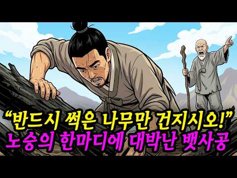
- 설명 앞부분: 마포 나루터의 뱃사공인 칠성이가 폭우 속에서 비단 궤짝 대신 썩은 나무토막 7개를 건져 올린 기묘한 이야기입니다. 낯선 노승의 예언과 침향에 얽힌 반전의 역사속으로 여러분을 초대합니다. 📢 본 영상은 고전 기록과 민담을 바탕으로 AI 기술을 활용하여 제작된 '창작 콘텐츠'입니다. 영상 속 인물, 사건, 배경은 서사적 몰입을 위해 연출된 가상이며, 역사적 사실과는 무관함을 알려드립니다. This video is a work of 'Artistic Creative Content' produced using AI technology, …
- 대본 없음 (설명) — 음성인식이 끝나면 도입부·흐름이 들어감
- 댓글 0/25 (다 받지 못함): 좋은 점 — 영상 0 · 감사·응원 0 · 더 알고 싶은 것 0 · 아쉬운 점 — 영상 0 · 반박·불만 — 의견 다름 0 · 정치·사회 0 · 경험 공유 0 · 구독·다음 기대 0

### 418. [한국사] 조선 건국 후 고려의 왕족들은 어떻게 됐을까? ∣ 정사 ∣ 야사

- https://www.youtube.com/watch?v=vXqCx5yiyls · 역사꾼 · 구독자 12,900 · 조회수 115,837 (×9.0, 하루 665.9) · 좋아요 1,544 (1.3%) · 17.2분 · 2026-04-26 · 주제 묶음 4. 한국 근현대사 · 형식 정보·해설 (그 밖) · 폴더 `W_vXqCx5yiyls` (웹 승인)
- 썸네일: 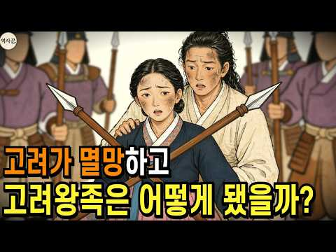
- 챕터: 0:00 인트로 – 왜 왕씨는 드물까? · 1:30 파트1 – 피로 물든 바다의 미스터리 · 8:00 파트2 – 거제도, 강화도, 삼척의 불안한 유배 · 14:30 파트3 – 배 밑바닥에 구멍을 뚫어라 · 21:00 파트4 – 목숨을 건 성씨 세탁 · 27:30 파트5 – 500년 권력의 무상함 · 33:00 아웃트로 – 당신의 가문 이야기를 들려주세요
- 설명 앞부분: 왜 대한민국에는 왕씨가 드물까요? 500년 고려 왕족의 성씨가 씨가 마른 이유, 사극에서 차마 다루지 못한 충격적인 진실을 파헤칩니다. 김씨는 천만 명, 이씨는 700만 명인데 왕씨는 고작 2만 명. 474년이나 이어진 고려의 왕족인데 왜 이렇게 적을까요? 자연스럽게 몰락한 게 아닙니다. 누군가가 의도적으로 씨를 말린 겁니다. 1392년 조선 건국 직후, 고려 왕족들은 거제도, 강화도, 삼척 같은 외진 곳으로 쫓겨났습니다. 살려주겠다는 약속을 믿었습니다. 그런데 2년 뒤, 더 좋은 곳으로 옮겨주겠다며 배에 태웠습니다. 바다 한가운…
- 같은 채널 평소 대비 ×34.4 (채널 최근 롱폼 중앙값 3,365회) · 평소 영상: [한국사] 조선이 망할 수 밖에 없던 이유 ∣ 정사 ∣ 야사 (3,365회) / [한국사] 편의점보다 많았다! 조선 경제를 움직인 주모들의 기막힌 돈 버는 법 ∣ 정사 … (3,440회)
- 대본 없음 (설명) — 음성인식이 끝나면 도입부·흐름이 들어감
- 댓글 0/324 (다 받지 못함): 좋은 점 — 영상 0 · 감사·응원 0 · 더 알고 싶은 것 0 · 아쉬운 점 — 영상 0 · 반박·불만 — 의견 다름 0 · 정치·사회 0 · 경험 공유 0 · 구독·다음 기대 0

### 419. [한국사] 조선의 노비들은 어떻게 살았을까? 대부분의 사람들은 몰랐던 충격적인 노비의 삶 ∣ 정사 ∣ 야사

- https://www.youtube.com/watch?v=gbQwCONfulQ · 역사꾼 · 구독자 12,900 · 조회수 114,757 (×8.9, 하루 656.0) · 좋아요 1,443 (1.3%) · 15.7분 · 2026-04-25 · 주제 묶음 4. 한국 근현대사 · 형식 정보·해설 (그 밖) · 폴더 `W_gbQwCONfulQ` (웹 승인)
- 썸네일: 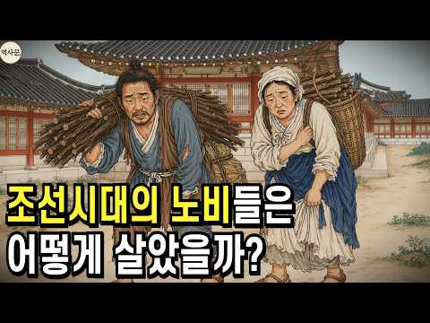
- 챕터: 0:00 인트로 – 사극이 보여주지 않은 진실 · 1:30 파트1 – 소 한 마리 값도 안 되던 목숨 · 8:00 파트2 – 흉년이 오면 딸을 팔았습니다 · 14:30 파트3 – 노비가 노비를 샀다 · 21:00 파트4 – 내 새끼들이 짐승처럼 나뉘어 갔습니다 · 27:30 파트5 – 족쇄를 차고도 삶을 지켜낸 생명력 · 33:00 아웃트로 – 당신의 가족 역사를 들려주세요
- 설명 앞부분: 소 한 마리 값도 안 되던 사람들, 조선 노비의 진짜 삶을 기록으로 파헤칩니다. 조선시대 노비 매매 문서를 펼쳐보면 충격적인 사실이 드러납니다. 건장한 성인 남자 한 명의 가격이 소 한 마리에도 미치지 못했습니다. 소는 밭을 갈 수 있으니 사람보다 비쌌던 겁니다. 사람을 셀 때도 '명'이 아닌 짐승을 세는 단위 '구'로 기록했습니다. 이게 조선의 현실이었습니다. 그런데 사극에서 보여주지 않는 장면이 있습니다. 주인과 수백 리 떨어진 곳에서 자기 집을 짓고 자기 땅을 일구던 외거노비, 악착같이 돈을 모아 기와집을 사고 심지어 다른 …
- 같은 채널 평소 대비 ×34.1 (채널 최근 롱폼 중앙값 3,365회) · 평소 영상: [한국사] 조선이 망할 수 밖에 없던 이유 ∣ 정사 ∣ 야사 (3,365회) / [한국사] 편의점보다 많았다! 조선 경제를 움직인 주모들의 기막힌 돈 버는 법 ∣ 정사 … (3,440회)
- 대본 없음 (설명) — 음성인식이 끝나면 도입부·흐름이 들어감
- 댓글 303/303: 좋은 점 — 영상 0 · 감사·응원 6 · 더 알고 싶은 것 1 · 아쉬운 점 — 영상 3 · 반박·불만 — 의견 다름 6 · 정치·사회 26 · 경험 공유 8 · 구독·다음 기대 0
  - 감사·응원 👍3 “일본한테 감사해라 일제강점기 아니었으면 지금도 저렇게 살고 있을꺼다 독립운동 그거. 대부분 초창기 때 양반들이 일본이들어와서 신분제 박살내고 노비 없애니까 다시 조선으로 돌아가서 노비부리며 살려고 한거 그이상이하도 아니였음”
  - 감사·응원 👍1 “음... 모두가 노비에 후손인걸 자랑스럽게 생각합시다. 또한 현대에 와서 찐노비 후손임을 몸에 문신으로 표시하는 멋쟁이들을 응원 합시다.”
  - 더 알고 싶은 것 👍0 “일본의 속국vs 조선시대 노비 어떤게 더 비참했을까요? 일제시대엔 어느신분이 싫었을까요?조선시대엔 누가 기득권이였을까요?이것만봐도 양반들이 얼마나 짐승이였는지 답이나옴 일본이나 양반이나 같은클라스”
  - 반박·불만 — 의견 다름 👍0 “유튜브에서 역사학자라는 인간이 조선시대 노비는 서양의 노예와 달랐다라고 선동하고 다니던거 생각나네. 자율성이 있었고, 일반백성과 별차이가 없었고 때로는 일부러 노비가 되기도 했다. 우리가 생각하는 노예와는 다른 살만한 계층이었다고 개소리 하는거 보고 어이가 없었음.지…”
  - 정치·사회 👍44 “자국민을 노비쓴 미친나라가 조선임ㅉㅉ보통 침략해서 다른 민족을 종으로 부리는데 우리는 같은 민족을 종으로 부림ㅋㅋ조선시대는 노비의 나라였음ㅋㅋ”
  - 정치·사회 👍37 “조선은 멸망 만이 답이 였음.신분을 깨부술수 없도록 나라가 건국됨. 자국민을 상대로 사람을 물건 취급한건 지구상 유일할것.아직 왕 양반 따지는 사람이 있더라만은”
  - 경험 공유 👍19 “악마이성계 세운나라 이성계.일본에합병때 신분제폐지하니 백성 7 평민천민 노비70%가 일본지배환영..오죽착당해 원한이갚엇으면 나라뺏어간일본통치를환영하갯냐..왕족 양반놈들은싫어해 저희들도 농사짓고 노동해야돼니..”
  - 경험 공유 👍0 “1804년에 작성된 우리집 호구단자( 지금의 주민등록등본)에 성도없는 수십여명의 노비들 후손들은 지금은 양반되어서 잘살고 있을겁니다”

### 420. 미국서 터진 새로운 한류 충무공 이순신, 그들이 열광하는 진짜 이유

- https://www.youtube.com/watch?v=yhTI4EZgG5g · 스피드경제 · 구독자 8,450 · 조회수 74,202 (×8.8, 하루 3,349.6) · 좋아요 1,937 (2.6%) · 22분 · 2026-09-25 · 주제 묶음 3. 조선 · 형식 정보·해설 (그 밖) · 폴더 `W_yhTI4EZgG5g` (웹 승인)
- 썸네일: 
- 설명 앞부분: ⚔️ 칼의 전사라던 사무라이가 들고 온 건 총이었습니다. 그리고 그 총 앞에서 한 번도 지지 않은 조선 제독이 지금 미국에서 새로운 한류가 되고 있습니다. 🔥 일본 학자는 거북선을 깎아내렸지만 일본 해군 제독은 넬슨보다 위라고 적었고, 미국 해군은 100년 가까이 이 이름을 연구해 왔습니다. 다루는 내용 ・ 미국 시장에서 46만 부 넘게 팔린 이순신 그래픽노블 ・ 미 해군연구소 독자 투표에서 주목받은 거북선 ・ 13척 대 133척, 울돌목의 물살을 읽은 명량해전 ・ 1901년 일본 학자 하야시 다이스케의 거북선 철갑 부정 ・ 19…
- 대본 없음 (설명) — 음성인식이 끝나면 도입부·흐름이 들어감
- 댓글 0/91 (다 받지 못함): 좋은 점 — 영상 0 · 감사·응원 0 · 더 알고 싶은 것 0 · 아쉬운 점 — 영상 0 · 반박·불만 — 의견 다름 0 · 정치·사회 0 · 경험 공유 0 · 구독·다음 기대 0

### 421. 조선의 기이한 하늘 기록에서 영감을 받은 역사 미스터리 SF

- https://www.youtube.com/watch?v=k3_pkuXeBcg · 미니드라마 스튜디오 · 구독자 2,910 · 조회수 25,462 (×8.8, 하루 521.2) · 좋아요 101 (0.4%) · 8.5분 · 2026-08-29 · 주제 묶음 1. 역사 일반·이야기 · 형식 정보·해설 (그 밖) · 폴더 `W_k3_pkuXeBcg` (웹 승인)
- 썸네일: 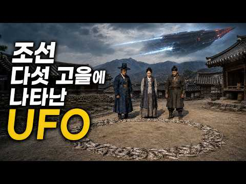
- 설명 앞부분: 조선의 다섯 고을에서 비슷한 시기에 반복해서 목격된 정체불명의 비행체. 조선시대를 배경으로 SF적 상상력을 결합한 역사 미스터리물입니다. 실제 역사적 시대감 위에 미지의 비행체, 인간이 이해할 수 없는 현상을 겹쳐 하나의 미스터리를 만들어갑니다. 과연 조선의 다섯 고을에 나타난 것은 무엇이었을까요? 그리고 왜? ※ 본 콘텐츠는 역사적 배경을 바탕으로 창작된 픽션입니다.
- 대본 없음 (설명) — 음성인식이 끝나면 도입부·흐름이 들어감
- 댓글 0/2 (다 받지 못함): 좋은 점 — 영상 0 · 감사·응원 0 · 더 알고 싶은 것 0 · 아쉬운 점 — 영상 0 · 반박·불만 — 의견 다름 0 · 정치·사회 0 · 경험 공유 0 · 구독·다음 기대 0

### 422. 세종대왕함 성능개량 접고 신형 국산 구축함 ‘KDDX 배치2’로 전면 대체

- https://www.youtube.com/watch?v=t1GYmItUasY · 밀스토리 밀담 · 구독자 9,390 · 조회수 74,636 (×8.0, 하루 663.9) · 좋아요 2,152 (2.9%) · 20분 · 2026-06-26 · 주제 묶음 3. 조선 · 형식 정보·해설 (그 밖) · 폴더 `W_t1GYmItUasY` (웹 승인)
- 썸네일: 
- 설명 앞부분: 해군, ‘세종대왕함’ 성능개량 중단 대신 국산 이지스 ‘KDDX 배치2’ 건조 7.8조원 KDDX 우선협상 대상자 선정! 미국산 이지스 가고 '국산 이지스' 온다 대한민국 해군이 기존 세종대왕급 이지스 구축함 성능개량 사업을 추진하는 대신 차세대 한국형 구축함인 KDDX 배치-2 확보에 무게를 두는 방향으로 장기 전력계획을 조정한 것으로 알려졌다. 군과 방산업계에 따르면 해군은 세종대왕함, 율곡이이함, 서애류성룡함 등 KDX-3 배치-1 3척의 대규모 성능개량보다는 향후 개발될 KDDX 배치-2를 확보해 전력을 대체하는 방안을 검…
- 대본 없음 (설명) — 음성인식이 끝나면 도입부·흐름이 들어감
- 댓글 0/199 (다 받지 못함): 좋은 점 — 영상 0 · 감사·응원 0 · 더 알고 싶은 것 0 · 아쉬운 점 — 영상 0 · 반박·불만 — 의견 다름 0 · 정치·사회 0 · 경험 공유 0 · 구독·다음 기대 0

### 423. [4K] 260522 올데이프로젝트 (ALLDAY PROJECT) 직캠 Full Ver. ∣ 2026 고려대학교 입실렌티 ∣ 고려대 축제 ( Famous, Wi…

- https://www.youtube.com/watch?v=aisP83aXT9k · machrowh · 구독자 4,990 · 조회수 39,434 (×7.9, 하루 267.0) · 좋아요 864 (2.2%) · 18.2분 · 2026-05-22 · 주제 묶음 2. 한국 고대·삼국·고려 · 형식 정보·해설 (그 밖) · 폴더 `W_aisP83aXT9k` (웹 승인)
- 썸네일: 
- 챕터: 0:00 Famous · 4:35 Look At Me · 8:47 Wicked · 14:06 One More Time
- 설명 앞부분: [4K] 260522 올데이프로젝트 (ALLDAY PROJECT) 직캠 Full Ver. ∣ 2026 고려대학교 입실렌티 ∣ 고려대 축제
- 대본 없음 (설명) — 음성인식이 끝나면 도입부·흐름이 들어감
- 댓글 0/32 (다 받지 못함): 좋은 점 — 영상 0 · 감사·응원 0 · 더 알고 싶은 것 0 · 아쉬운 점 — 영상 0 · 반박·불만 — 의견 다름 0 · 정치·사회 0 · 경험 공유 0 · 구독·다음 기대 0

### 424. [4K] 서울을 열광시키는 이순신의 후예들 , 대한민국 해군 의장대 퍼레이드 ∣ Seoul ROK - Navy Honor Guard parade

- https://www.youtube.com/watch?v=wZQ8lD6HGgc · 걸어서 서울속으로 · 구독자 2,610 · 조회수 20,609 (×7.9, 하루 124.2) · 좋아요 283 (1.4%) · 11.8분 · 2026-05-04 · 주제 묶음 3. 조선 · 형식 정보·해설 (그 밖) · 폴더 `W_wZQ8lD6HGgc` (웹 승인)
- 썸네일: 
- 설명 앞부분: 충무공 이순신 탄신일을 맞아 그의 의지를 이어 바다를 수호하는 대한민국 해군 의장대의 화려한 퍼레이드 입니다 그 뜨거운 현장을 지금 감상해 보세요! Filming Date: 2026.04.25. Saturday Weather: sunny Location: 서울특별시 중구 마른내로 47
- 대본 없음 (설명) — 음성인식이 끝나면 도입부·흐름이 들어감
- 댓글 0/48 (다 받지 못함): 좋은 점 — 영상 0 · 감사·응원 0 · 더 알고 싶은 것 0 · 아쉬운 점 — 영상 0 · 반박·불만 — 의견 다름 0 · 정치·사회 0 · 경험 공유 0 · 구독·다음 기대 0

### 425. 황제의 여자가 되는 순간, 죽을 날이 정해지는 나라 ∣ 명나라 70년 순장 제도

- https://www.youtube.com/watch?v=zZfMQjHQFwg · 타임트래블로그 · 구독자 6,340 · 조회수 49,946 (×7.9, 하루 365.0) · 좋아요 370 (0.7%) · 19.8분 · 2026-06-02 · 주제 묶음 6. 동양사 (중국·일본·몽골) · 형식 정보·해설 (그 밖) · 폴더 `W_zZfMQjHQFwg` (웹 승인)
- 썸네일: 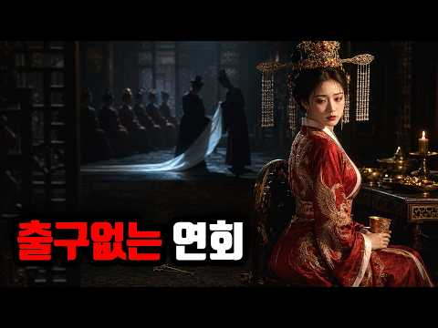
- 설명 앞부분: 1424년 명나라, 영락제가 죽자 자금성 후궁 서른 명이 같은 날 함께 묻혔습니다. 황제의 여자가 된 게 죄였습니다. 살아남은 건, 아들을 낳은 소수뿐이었습니다. 명나라 황실에서는 황제가 숨을 거둘 때마다, 자식 없는 후궁들을 한방에 모아 순장했습니다. 홍무제가 죽자 마흔 명, 영락제가 죽자 서른 명이 같은 방으로 들어갔고, 그중에는 조선이 바친 공녀 여비 한씨의 이름까지 올라 있었습니다. 입궁 스무날 만에 절명시 한 편을 남기고 사라진 곽애, 누이의 죽음을 발판 삼아 출세한 한확, 그리고 70년 만에 이 제도를 끝낸 정통제까지.…
- 대본 없음 (설명) — 음성인식이 끝나면 도입부·흐름이 들어감
- 댓글 0/44 (다 받지 못함): 좋은 점 — 영상 0 · 감사·응원 0 · 더 알고 싶은 것 0 · 아쉬운 점 — 영상 0 · 반박·불만 — 의견 다름 0 · 정치·사회 0 · 경험 공유 0 · 구독·다음 기대 0

### 426. 10만 명나라 대군이 닷새 만에 전멸한 이유 (누르하치와 사르후 전투)

- https://www.youtube.com/watch?v=qKvJfxLs168 · 쉬운 역사탐험가 · 구독자 2,360 · 조회수 18,095 (×7.7, 하루 189.8) · 좋아요 291 (1.6%) · 22.5분 · 2026-07-13 · 주제 묶음 6. 동양사 (중국·일본·몽골) · 형식 정보·해설 (그 밖) · 폴더 `W_qKvJfxLs168` (웹 승인)
- 썸네일: 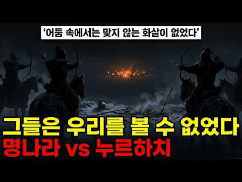
- 챕터: 0:00 복수의 시작: 눈밭에서 맹세한 24세 청년 · 2:10 36년의 인내: 명나라 국경 시장의 비밀 · 4:20 조공의 함정: 명나라의 눈을 가린 위장술 · 6:30 일곱 가지 원한과 칠대한 선포 · 8:40 명나라의 오만: 10만 대군 출정의 비극 · 10:50 전술의 승리: 넷으로 나뉜 명군을 각개격파하다 · 13:00 사르후 전투의 날: 안개 속에서 벌어진 학살 · 15:10 조선군의 운명: 명나라에 끌려간 1만 3천 명 · 19:30 명나라가 패배할 수밖에 없었던 진짜 이유
- 설명 앞부분: 1583년 겨울, 만주 산속의 한 청년이 아버지를 잃고 36년 동안 복수를 준비했습니다. 당시 세계 최강대국이었던 명나라는 그를 하찮은 오랑캐로 여겼죠. 하지만 누르하치는 명나라의 틈을 파고들어 결국 10만 대군을 단 5일 만에 무너뜨렸습니다. 사르후 전투에서 벌어진 충격적인 전략과 명나라의 몰락 과정을 통해, 역사가 어떻게 뒤집히는지 그 치밀한 복수극의 전말을 공개합니다. 누르하치가 어떻게 명나라의 오만을 역이용해 대제국 청나라의 기틀을 닦았는지 확인해보세요. 타임라인
- 대본 없음 (설명) — 음성인식이 끝나면 도입부·흐름이 들어감
- 댓글 0/27 (다 받지 못함): 좋은 점 — 영상 0 · 감사·응원 0 · 더 알고 싶은 것 0 · 아쉬운 점 — 영상 0 · 반박·불만 — 의견 다름 0 · 정치·사회 0 · 경험 공유 0 · 구독·다음 기대 0

### 427. 미국에서 계속 완판되는 이순신책 — 400년 전 조선시대 장군이 미국 영웅이 된 진짜 이유

- https://www.youtube.com/watch?v=kk5ieUmNeJU · 247경제 · 구독자 15,000 · 조회수 114,867 (×7.7, 하루 4,383.5) · 좋아요 0 (0.0%) · 21.9분 · 2026-09-21 · 주제 묶음 3. 조선 · 형식 애니메이션·지도 · 폴더 `W_kk5ieUmNeJU` (웹 승인)
- 썸네일: 
- 챕터: 0:00 미국 행사장에서 매대가 비는 만화책 · 1:28 만든 사람은 한국인이 아닙니다 · 2:03 출판사 없이 혼자 만든 책 · 3:34 2004년 드라마 한 편에서 시작됐습니다 · 5:35 "누가 이걸 사겠냐" — 전부 거절 · 5:53 미국 만화 시장의 벽 · 7:30 코믹콘 부스를 빌렸습니다 · 8:13 차에 책을 싣고 도시를 돌았습니다 · 9:33 그런데 그 자리에서 동났습니다 · 10:13 행사 120회, 16년 · 11:20 그래서 얼마나 팔렸나 — 25만 부 · 12:55 스탠 리가 서문을 썼습니다 · 14:30 미국 독자는 왜 샀을까 · 16:23 이순신 만화가 19금인 이유 · 17:27 지금 벌어지는 일 · 19:34 정직하게 짚어야 할 여섯 가지 · 20:44 "누가 사겠냐"의 답
- 설명 앞부분: 미국 행사장에서 나올 때마다 매대가 비는 책이 있습니다. 주인공이 이순신 장군입니다. 그것도 15년 넘게 이어지고 있습니다. ⚠️ 먼저 말씀드립니다 — 이건 위인전 이야기가 아니라 시장 이야기입니다. 누가 만들었나 미국 일리노이주의 만화가 **온리 콤판(Onrie Kompan)** — 한국인도 교포도 아닙니다 제목도 영어 발음 그대로 **Yi Soon Shin 자비 출판·자체 유통** — 큰 출판사 없이 작가가 직접 만들고 직접 팔았습니다 글은 미국 작가, 그림은 이탈리아 출신 만화가 등 여러 나라 사람이 참여 어떻게 시작됐나 2…
- 대본 없음 (설명) — 음성인식이 끝나면 도입부·흐름이 들어감
- 댓글 0/121 (다 받지 못함): 좋은 점 — 영상 0 · 감사·응원 0 · 더 알고 싶은 것 0 · 아쉬운 점 — 영상 0 · 반박·불만 — 의견 다름 0 · 정치·사회 0 · 경험 공유 0 · 구독·다음 기대 0

### 428. 거지가 되어 정혼자를 데리러온 사위에게 본처 딸을 시집보낸 계모 ∣ 야담

- https://www.youtube.com/watch?v=smRrpCIxycs · 88야담- 조선 야사 이야기 · 구독자 20,200 · 조회수 154,409 (×7.6, 하루 892.6) · 좋아요 4,805 (3.1%) · 98.3분 · 2026-04-27 · 주제 묶음 9. 야사·야담·옛날이야기 · 형식 야담·옛날이야기 · 폴더 `W_smRrpCIxycs` (웹 승인)
- 썸네일: 
- 챕터: 0:00 거지 도령, 대문을 두드리다 · 2:11 봄날의 심판, 계모의 죄상이 드러나다 · 14:02 14년 전, 독약을 달여준 친구 · 25:34 대제학 집안의 정혼, 계모의 음모 · 35:54 암행어사 이신, 서윤의 진실을 파헤치다 · 47:44 거지로 변장한 사위, 계모의 본심을 시험하다 · 61:23 대제학 며느리가 된 서윤, 복손의 의미를 되찾다 · 75:17 어사 출두, 13년 원한의 심판 · 87:14 탐욕의 최후, 복손에 깃든 행복
- 설명 앞부분: 📖 오늘의 이야기 "거지와 불구라니, 이보다 더한 천생연분이 어디 있겠느냐!" 계모의 조롱 속에 거지 사위에게 시집 간 서윤. 정화수 한 사발로 치른 초라한 혼례, 소금 세례 속에 쫓겨나듯 떠난 신혼부부. 하지만 누더기 속에 감춰진 사내의 정체는? 한 여인의 탐욕이 불러온 비극과, 끝내 진실을 밝혀낸 정의의 이야기가 펼쳐집니다. 💛 "행복합시다" 댓글로 여러분께 행운을 보내드립니다 🍀 ✦ 88야담의 창작 이야기 ※이 영상은 조선시대의 생활상과 사회적 풍속, 전통 설화 및 역사문화 자료에서 이야깃거리를 얻어 새롭게 구성한 창작 야담…
- 대본 없음 (설명) — 음성인식이 끝나면 도입부·흐름이 들어감
- 댓글 0/242 (다 받지 못함): 좋은 점 — 영상 0 · 감사·응원 0 · 더 알고 싶은 것 0 · 아쉬운 점 — 영상 0 · 반박·불만 — 의견 다름 0 · 정치·사회 0 · 경험 공유 0 · 구독·다음 기대 0

### 429. 조선 왕족의 몰락, 마지막 황손이 호텔 방에서 홀로 죽은 섬뜩한 이유

- https://www.youtube.com/watch?v=gtT2dqrU87A · 역사 한 숟갈 · 구독자 7,870 · 조회수 58,945 (×7.5, 하루 419.8) · 좋아요 1,293 (2.2%) · 51.4분 · 2026-05-29 · 주제 묶음 3. 조선 · 형식 정보·해설 (그 밖) · 폴더 `W_gtT2dqrU87A` (웹 승인)
- 썸네일: 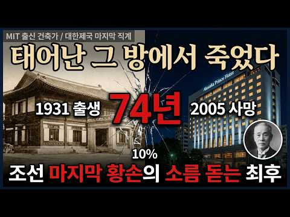
- 챕터: 0:00 한 달 사이 두 번 꺼진 낙선재의 불 · 0:49 열세 명의 자녀, 백 년 뒤 남은 직계는 · 2:13 나라가 무너진 날, 왕은 무엇이 되었나 · 3:22 새벽에 올린 식혜 한 그릇의 의문 · 5:00 21년 전, 커피 한 잔이 바꾼 운명 · 6:16 해방은 왔는데 왜 문은 닫혔나 · 8:08 열한 살, 아버지 곁에서 떼어진 소년 · 10:07 불임 판정을 받았다던 신부의 진실 · 12:36 고향 땅에서 열흘을 못 넘긴 아기 · 16:03 56년 만의 귀국, 그러나 들것에 실려 · 17:01 가해국의 황녀가 택한 뜻밖의 길 · 21:01 일곱 살에 보호막을 잃은 막내딸 · 24:15 산속으로 걸어 들어간 스물네 살 · 26:14 "고종에게 딸이 있었느냐?" · 29:50 방탕한 왕자인가, 숨은 저항자인가 · 37:56 이름을 지킨 동생의 마지막 출근길 · 44:47 태어난 그 방에서 멈춘 마지막 심장
- 설명 앞부분: 1989년 4월, 창덕궁 낙선재에서 두 여인이 아홉 날 간격으로 세상을 떠났습니다. 한 사람은 대한제국 마지막 공주, 다른 한 사람은 일본에서 건너온 왕세자비. 고종 황제의 열 세명의 자녀 가운데 성인까지 살아남은 사람은 넷뿐이었고, 그 넷의 후손마저 반세기 만에 모두 흩어졌습니다. ⏱️ 타임라인 🔹 고종은 정말 식혜 한 그릇에 독살당했을까? 🔹 영친왕의 첫 아들 이진은 왜 돌도 되기 전에 죽었을까? 🔹 덕혜옹주의 딸 정혜는 어디로 사라졌을까? 🔹 의친왕의 방탕은 연기였을까, 진짜였을까? 🔹 이구는 왜 자기가 태어난 집이 변한 호…
- 대본 없음 (설명) — 음성인식이 끝나면 도입부·흐름이 들어감
- 댓글 0/170 (다 받지 못함): 좋은 점 — 영상 0 · 감사·응원 0 · 더 알고 싶은 것 0 · 아쉬운 점 — 영상 0 · 반박·불만 — 의견 다름 0 · 정치·사회 0 · 경험 공유 0 · 구독·다음 기대 0

### 430. 왜군 10만vs조선 6천명 임진왜란 숨은 영웅 황진 "이순신이 전부가 아니다?" 왜군 10만을 9일만에 절망에 빠뜨린 '이유'황진 "바다엔 이순신, 육지엔 황진…

- https://www.youtube.com/watch?v=onNW9QzwZPM · 역사스캔 · 구독자 7,310 · 조회수 52,976 (×7.2, 하루 449.5) · 좋아요 2,315 (4.4%) · 79.2분 · 2026-06-21 · 주제 묶음 3. 조선 · 형식 정보·해설 (그 밖) · 폴더 `W_onNW9QzwZPM` (웹 승인)
- 썸네일: 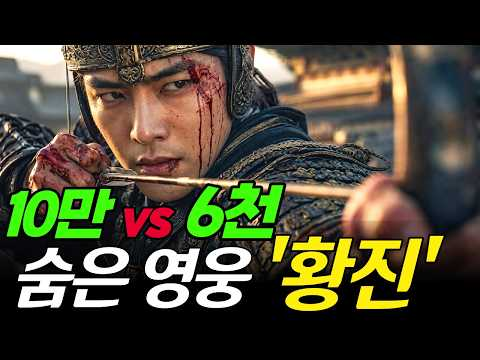
- 챕터: 0:00 도입 - 왜군이 꼽은 조선 최대 패전지의 비밀 · 3:30 인물 소개 - 황희 정승의 5대손, 키 8척의 호랑이 · 7:00 1592년 임진왜란 발발 - 호남이 없으면 나라도 없다 · 10:30 단서 1 - 웅치·안덕원 전투, 김제 군수 정담의 마… · 15:00 단서 2 - 이치 전투, 1500 vs 15000의 … · 21:00 심화 - 칠본창 후쿠시마 마사노리를 무너뜨린 사내 2… · 28:30 클라이맥스 - 9일간 진주성 농성, 그 처절했던 마지막 · 33:00 결론 - 우리는 왜 이 이름을 몰랐을까
- 설명 앞부분: 왜군 10만vs조선 6천명 임진왜란 숨은 영웅 황진 "이순신이 전부가 아니다?" 왜군 10만을 9일만에 절망에 빠뜨린 '이유'황진 "바다엔 이순신, 육지엔 황진 이치전투 여러분, 임진왜란 7년 전쟁에서 일본군이 가장 두려워했던 조선의 육군 장수가 누구인지 아십니까? 🤔 『선조수정실록』은 단 한 줄로 적었습니다. "왜적이 조선의 3대 전투를 일컬을 때, 이치 전투를 첫째로 꼽았다(倭中稱朝鮮三大戰 而梨峙爲最)." 한산도 대첩이 아닙니다. 행주 대첩도 아닙니다. 일본인들이 직접 입에 올린 조선 3대 패전 1위는, 황진 장군의 이치 전투…
- 대본 없음 (설명) — 음성인식이 끝나면 도입부·흐름이 들어감
- 댓글 0/344 (다 받지 못함): 좋은 점 — 영상 0 · 감사·응원 0 · 더 알고 싶은 것 0 · 아쉬운 점 — 영상 0 · 반박·불만 — 의견 다름 0 · 정치·사회 0 · 경험 공유 0 · 구독·다음 기대 0

### 431. 왜 경기도 곤지암은 곤지암일까? ∣ 우리가 몰랐던 진짜이야기 ∣ 신립 ∣ 허난설헌 ∣ 탄금대 ∣ 나들목 ∣ 임진왜란 ∣ 조총 ∣ 문경새재 ∣ 남한산성 #민담 #…

- https://www.youtube.com/watch?v=soiH5GMxOqk · 땅 이름의 비밀 · 구독자 28,900 · 조회수 208,150 (×7.2, 하루 8,894.4) · 좋아요 1,196 (0.6%) · 17.2분 · 2026-09-23 · 주제 묶음 3. 조선 · 형식 야담·옛날이야기 · 폴더 `W_soiH5GMxOqk` (웹 승인)
- 썸네일: 
- 설명 앞부분: 📍 이름에 담긴 역사, 땅에 새겨진 이야기 우리가 매일 지나치는 산과 강, 마을과 도시의 이름에는 오랜 역사와 흥미로운 전설이 숨어 있습니다. 『땅이름의 비밀』**은 대한민국 곳곳의 지명이 어떻게 탄생했는지, 그 속에 담긴 역사와 문화, 민담과 설화를 쉽고 재미있는 이야기로 소개하는 채널입니다. 이번 영상에서는 한 지명의 유래를 따라가며 그 지역의 역사적 배경과 숨은 이야기를 함께 살펴봅니다. 익숙했던 지명이 새로운 의미로 다가오는 특별한 시간, 함께 떠나보세요. 이런 분들께 추천합니다. 우리나라 역사와 문화에 관심 있는 분 여행…
- 같은 채널 평소 대비 ×8.1 (채널 최근 롱폼 중앙값 25,693회) · 평소 영상: 왜 전라도 나주는 나주일까? 우리가 몰랐던 이야기 ∣ 왕건 ∣ 후삼국 ∣ 견훤 ∣ 궁예 … (26,096회) / 왜 경기도 양평 용문사는 용문사일까? 우리가 몰랐던 진짜 이야기 ∣ 은행나무 ∣ 마의태자… (25,290회)
- 대본 없음 (설명) — 음성인식이 끝나면 도입부·흐름이 들어감
- 댓글 46/46: 좋은 점 — 영상 0 · 감사·응원 2 · 더 알고 싶은 것 1 · 아쉬운 점 — 영상 2 · 반박·불만 — 의견 다름 1 · 정치·사회 4 · 경험 공유 0 · 구독·다음 기대 0
  - 감사·응원 👍2 “전설과함께 지명을 다시 접할수있어 감사드립니다. 감사합니다. 용인에서 시청합니다.”
  - 아쉬운 점 — 영상 👍22 “신립은 무식하고 용감한 장수였다 질것이 뻔한 싸움은 피하고 지연전을 펼쳤어야지”
  - 아쉬운 점 — 영상 👍0 “무능한 이씨조선이 나라를 망친거지 저 당시 급히 모은 오합지졸중에 탈영이 태반이고 조령산에 매복한들 추풍령 죽령으로 치고 올라온 일본군에 포위되어 몰살 당할것도 뻔한데 뭔 개소리 그냥 신립은 시간이라도 끌어 보려고 오합지졸 델꼬 목숨걸고 싸우다 전사한거임”
  - 반박·불만 — 의견 다름 👍21 “신립이 조선최고의 명장이라고 웃기는 소리 조선최고의 2대 등장(등신지랄육갑한 두사람) 신립과 원균 한놈은 육군기병 8천과 전투마 한놈은 130여척의 판옥선과 12.000여 수군을 자멸괘멸시킨 그것도 제대로 싸워보지도 못하고 예를들어 2차진주성전투는 못살 당했으나최선을…”
  - 정치·사회 👍17 “북상하던 왜군이 문경 새재(조령)에 개미새끼 한마리 없는 걸 보고 왜장이 깜작 놀랬다는 기록이 있다고 합니다. 이 좋은 천혜의 요새를 놔두고 어떤 이유로 신립장군은 탄금대에서 배수진을 치는 악수를 두고 제대로 싸워 보지도 못하고 전멸(?)했는지…이런 무능한 장수를 선…”
  - 정치·사회 👍13 “모지리 하나 때문에 죄없는 누군가에 자식 또 아버지 남편등 아까운 목숨들이 아무 의미없이 죽었지요 원균 윤석열”

### 432. 첩 셋에게 눌려 살던 양반집 시어머니, 열한 살 며느리가 판을 뒤집는데.. ∣ 야담 옛날이야기 민담 전설 설화 달빛잠자리이야기

- https://www.youtube.com/watch?v=wg9LyGH6fmw · 달빛잠자리이야기 · 구독자 15,700 · 조회수 112,400 (×7.2, 하루 1,655.3) · 좋아요 3,669 (3.3%) · 61.5분 · 2026-08-10 · 주제 묶음 9. 야사·야담·옛날이야기 · 형식 수면·낭독 (잠잘 때 듣는) · 폴더 `W_wg9LyGH6fmw` (웹 승인)
- 썸네일: 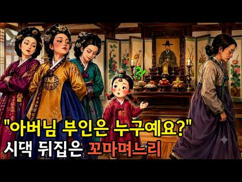
- 설명 앞부분: "나가시면 이제 이 집은 누구꺼예요?" 어느 날 밤, 보따리를 싸는 시어머니를 본 향이는 그저 궁금한 것을 물었을 뿐입니다. 그 한마디가 십 년 동안 잠들어 있던 한 여인의 자리를 깨웠습니다. 철없는 며느리의 눈에는 그 모든 것이 이상하게만 보였습니다. 📜 달빛잠자리 이야기 역사한스푼 — 조선시대 정실과 첩, 그리고 곳간 열쇠 🗝️ 조선시대 양반가에서 곳간 열쇠는 단순한 도구가 아니었습니다. 집안 살림을 총괄하는 안주인의 권한 그 자체를 상징하는 물건이었지요. 열쇠를 쥔 사람이 곧 그 집의 실질적인 안주인으로 여겨질 만큼, 열쇠의…
- 대본 없음 (설명) — 음성인식이 끝나면 도입부·흐름이 들어감
- 댓글 0/116 (다 받지 못함): 좋은 점 — 영상 0 · 감사·응원 0 · 더 알고 싶은 것 0 · 아쉬운 점 — 영상 0 · 반박·불만 — 의견 다름 0 · 정치·사회 0 · 경험 공유 0 · 구독·다음 기대 0

### 433. [역사TV] 4K 효의왕후, 정조에게 사랑받지 못했다는 왕비, 사실은 달랐습니다 #조선왕조실록 #한국사 #조선역사

- https://www.youtube.com/watch?v=j2DKlA7Biv4 · 재밌는한국역사tv · 구독자 19,200 · 조회수 135,798 (×7.1, 하루 2,168.0) · 좋아요 1,237 (0.9%) · 56분 · 2026-08-15 · 주제 묶음 3. 조선 · 형식 정보·해설 (그 밖) · 폴더 `W_j2DKlA7Biv4` (웹 승인)
- 썸네일: 
- 챕터: 0:00 죽은 왕비 때문에 옮긴 왕릉 · 1:54 아홉 살의 세손빈 · 6:16 뒤주, 그리고 어머님 곁에 · 12:17 후궁을 들이라는 교지 · 25:07 산실을 준비하던 날 · 36:34 중전의 아들로 삼으라
- 설명 앞부분: 경기도 화성에 건릉이라는 왕릉이 있습니다. 정조가 잠든 곳인데, 봉분이 하나뿐입니다. 그 안에 두 사람이 함께 누워 있거든요. 정조가 먼저 세상을 떠나고 스물한 해 뒤, 그 아내가 눈을 감았습니다. 그러자 나라가 이미 묻혀 있던 임금의 무덤을 파서, 능 자체를 통째로 옮겼습니다. 죽은 왕비 하나 때문에 왕릉을 옮긴 겁니다. 오늘 이야기의 주인공은 그 여인, 효의왕후 김씨입니다. 아홉 살에 정조의 아내로 정해져 예순아홉에 눈을 감을 때까지, 육십 년을 궁궐에서 산 사람입니다. 그런데 이 여인의 이름 앞에는 늘 한 문장이 따라붙습니다…
- 대본 없음 (설명) — 음성인식이 끝나면 도입부·흐름이 들어감
- 댓글 0/69 (다 받지 못함): 좋은 점 — 영상 0 · 감사·응원 0 · 더 알고 싶은 것 0 · 아쉬운 점 — 영상 0 · 반박·불만 — 의견 다름 0 · 정치·사회 0 · 경험 공유 0 · 구독·다음 기대 0

### 434. 🌙 [잘 때 듣는] 마리 앙투아네트는 왜 사지도 않은 목걸이 때문에 단두대에 올랐을까? (73분) ∣ 숙면 세계사 ∣ 오디오북 ASMR

- https://www.youtube.com/watch?v=_NDcu-xEccM · 잘 때 듣는 - 숙면 세계사 · 구독자 10,900 · 조회수 76,868 (×7.0, 하루 1,329.0) · 좋아요 1,284 (1.7%) · 73.7분 · 2026-08-20 · 주제 묶음 10. 수면·낭독 · 형식 수면·낭독 (잠잘 때 듣는) · 폴더 `W__NDcu-xEccM` (웹 승인)
- 썸네일: 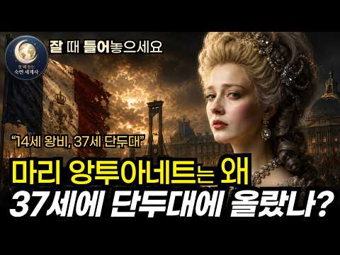
- 챕터: 0:00 프롤로그 - 혁명 광장, 한 가지 질문 · 4:40 제1장 국경에서 옷을 빼앗긴 14세 공주 · 9:50 제2장 7년간 지속된 후계자 압박 · 15:30 제3장 소박한 도피처와 과장된 소문 · 21:00 제4장 주인 잃은 괴물 목걸이 · 26:20 제5장 야망과 욕망의 결탁 · 31:30 제6장 밤의 밀회와 위조된 서명 · 37:00 제7장 해체된 보물과 완전범죄 · 42:00 제8장 폭로, 왕비는 목걸이를 산 적이 없었다 · 48:00 제9장 세기의 공개 재판과 거대한 역설 · 54:00 제10장 '마담 데피시트'와 흑색선전 · 59:30 제11장 1789년, 궁전을 끌어내린 분노 · 65:00 제12장 바렌 도주 사건 · 68:30 제13장 왕정 붕괴와 아들과의 분리 · 71:30 제14장 단두대의 마지막 5분
- 설명 앞부분: 사지도 않은 목걸이 하나가, 어떻게 한 왕비를 단두대로 보냈을까요. 열네 살에 낯선 나라로 보내진 소녀는 왜 온 나라의 증오를 받는 악녀가 되었을까요. 그녀가 정말 프랑스를 망친 것일까요, 아니면 누군가 그녀의 이름을 훔친 것일까요. 그리고 한 번의 거짓 소문은 어디까지 한 사람을 무너뜨릴 수 있을까요. 1770년, 오스트리아의 어린 공주가 프랑스로 향했습니다. 화려한 베르사유의 왕비가 되었지만, 그녀를 기다린 것은 숨 막히는 예법과 이방인을 향한 차가운 시선이었습니다. 그리고 1785년, 그녀가 사지도, 보지도 않은 다이아몬드 …
- 대본 없음 (설명) — 음성인식이 끝나면 도입부·흐름이 들어감
- 댓글 0/83 (다 받지 못함): 좋은 점 — 영상 0 · 감사·응원 0 · 더 알고 싶은 것 0 · 아쉬운 점 — 영상 0 · 반박·불만 — 의견 다름 0 · 정치·사회 0 · 경험 공유 0 · 구독·다음 기대 0

### 435. 2026년, 대한민국을 대한제국으로 만드는 왕과 사는 남자들 — 유시민에게 "감히"를 묻는 그들은 누구인가?

- https://www.youtube.com/watch?v=AI8f_HV3rZk · 민주 파수꾼 · 구독자 7,600 · 조회수 52,832 (×7.0, 하루 7,097.2) · 좋아요 2,749 (5.2%) · 21.9분 · 2026-10-09 · 주제 묶음 4. 한국 근현대사 · 형식 정보·해설 (그 밖) · 폴더 `W_AI8f_HV3rZk` (웹 승인)
- 썸네일: 
- 설명 앞부분: 대통령을 비판하는 사람에게 「감히」를 묻는 이들은, 대통령을 무엇이라고 생각하는 걸까요. 원로와 곁의 정치인, 그리고 대통령 자신의 말을 날짜와 함께 그대로 옮겼습니다. 그리고 그 물음에 가장 먼저 답한 사람의 말로 마무리합니다. 지난 영상 — 황석영 도올 김갑수가 이재명 대통령 비판은 막고 칭송하는 이유 인용 영상: 최욱의 매불쇼 (2026.03.18 · 03.25) / 미디어오늘 유시민 작가 대담 (2026.09.22) 들머리 이야기는 안데르센 「벌거벗은 임금님」(1837)을 옮긴 것입니다. 이미지: 위키미디어 공용 (장면 이…
- 대본 없음 (설명) — 음성인식이 끝나면 도입부·흐름이 들어감
- 댓글 0/180 (다 받지 못함): 좋은 점 — 영상 0 · 감사·응원 0 · 더 알고 싶은 것 0 · 아쉬운 점 — 영상 0 · 반박·불만 — 의견 다름 0 · 정치·사회 0 · 경험 공유 0 · 구독·다음 기대 0

### 436. 성균관 수석을 꺾은 일곱 살 거지 아이에게, 임금이 눈물을 쏟으며 무릎을 꿇었습니다 ∣ 야담∣ 민담∣ 설화∣ 옛날이야기∣ 수면동화∣ 오디오북

- https://www.youtube.com/watch?v=uFLxZ2FVYBg · 야담마을 · 구독자 25,100 · 조회수 171,581 (×6.8, 하루 1,138.0) · 좋아요 6,646 (3.9%) · 109.7분 · 2026-05-19 · 주제 묶음 9. 야사·야담·옛날이야기 · 형식 수면·낭독 (잠잘 때 듣는) · 폴더 `W_uFLxZ2FVYBg` (웹 승인)
- 썸네일: 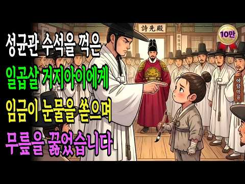
- 설명 앞부분: 손등에 나비 흉터를 감추고 살아온 일곱 살 고아가, 숯 한 자루로 성균관 수석을 꺾고 임금 앞에 섰습니다. 넉 해 전 불길 속에서 어머니가 아이를 안으며 남긴 옥가락지 자국이, 아이의 손등에 나비가 되어 남아 있었지요. 아이가 쓴 시 한 수에 임금이 용포를 적시며 무릎을 꿇었습니다. 죽은 줄 알았던 원자가 살아 돌아온 것이었지요. 어머니의 사랑은 불에도 타지 않고, 숯으로 쓴 진심은 반드시 닿는다는 것을 보여주는 이야기입니다. [이 채널은 AI 기반 영상 제작 기술을 활용하여 다양한 콘텐츠를 제작하고 공유하는 채널입니다] 야담마을…
- 대본 없음 (설명) — 음성인식이 끝나면 도입부·흐름이 들어감
- 댓글 0/293 (다 받지 못함): 좋은 점 — 영상 0 · 감사·응원 0 · 더 알고 싶은 것 0 · 아쉬운 점 — 영상 0 · 반박·불만 — 의견 다름 0 · 정치·사회 0 · 경험 공유 0 · 구독·다음 기대 0

### 437. "수백 명의 기사가 수천 명을 무너뜨린 방법｜중세 최강의 랜스 돌격"

- https://www.youtube.com/watch?v=Obv1Lozqg18 · 슬기로운 역사보기 · 구독자 16,300 · 조회수 109,742 (×6.7, 하루 1,608.6) · 좋아요 1,085 (1.0%) · 13.7분 · 2026-08-10 · 주제 묶음 5. 세계사·서양사 · 형식 인터뷰·강연·대담 · 폴더 `W_Obv1Lozqg18` (웹 승인)
- 썸네일: 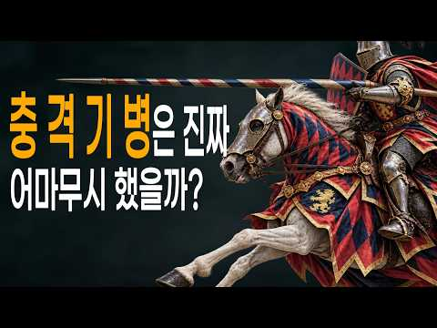
- 설명 앞부분: 기사 하면 가장 먼저 떠오르는 무기, 바로 ‘검’. 하지만 실제 중세 전장에서 기사들의 진짜 한 방은 검이 아니었습니다. 수백 kg의 군마와 중갑 기사의 질주를 하나의 창끝에 집중시키는 무기, 바로 **랜스**였습니다. 단순히 창을 겨드랑이에 끼웠을 뿐인데, 이 작은 변화는 기병을 중세 전장의 무시무시한 충격 병기로 바꿔놓았습니다. 이 영상에서는: ⚔️ 기사에게 검보다 랜스가 중요했던 이유 🐎 말의 질주를 무기로 바꾼 ‘카우치드 랜스’의 원리 🛡️ 수백 명의 기사 돌격이 보병 대형을 무너뜨린 방법 🔥 보두앵 4세와 살라딘이 맞붙은…
- 대본 없음 (설명) — 음성인식이 끝나면 도입부·흐름이 들어감
- 댓글 0/189 (다 받지 못함): 좋은 점 — 영상 0 · 감사·응원 0 · 더 알고 싶은 것 0 · 아쉬운 점 — 영상 0 · 반박·불만 — 의견 다름 0 · 정치·사회 0 · 경험 공유 0 · 구독·다음 기대 0

### 438. 명나라도 욕한 조선의 최악의 왕!! 실록도 쪽팔려했던 선조의 충격적인 진짜 모습

- https://www.youtube.com/watch?v=IVm9Nrtk7Us · 사실과 기록 · 구독자 8,670 · 조회수 58,029 (×6.7, 하루 400.6) · 좋아요 1,011 (1.7%) · 44.3분 · 2026-05-25 · 주제 묶음 6. 동양사 (중국·일본·몽골) · 형식 정보·해설 (그 밖) · 폴더 `W_IVm9Nrtk7Us` (웹 승인)
- 썸네일: 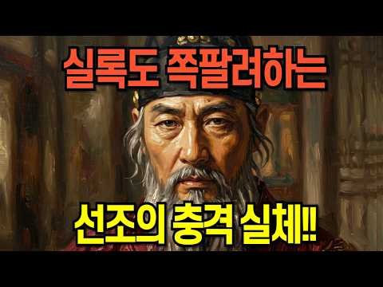
- 설명 앞부분: 📜 조선의 왕 중 가장 멍청했던 왕은 누구일까요?. ⚔️ 전쟁 경고를 묵살하고 🏃‍♂️ 백성을 버리고 의주까지 도망가고 🔥 백성들 손에 경복궁이 불타고 😱 명나라로 망명까지 시도하고 💀 자기 대신 싸운 영웅들을 고문하고 죽이고 🎭 십수 차례 양위 소동으로 아들 광해군을 괴롭히고 이번 영상에서는 선조실록, 선조수정실록, 징비록, 그리고 명나라 송응창의 『경략복국요편』까지 1차 사료를 근거로, 우리가 몰랐던 선조의 진짜 모습을 파헤쳐 봅니다.. 📚 참고 자료. 조선왕조실록 (선조실록·선조수정실록) 징비록 (류성룡) 경략복국요편 (송응…
- 대본 없음 (설명) — 음성인식이 끝나면 도입부·흐름이 들어감
- 댓글 0/272 (다 받지 못함): 좋은 점 — 영상 0 · 감사·응원 0 · 더 알고 싶은 것 0 · 아쉬운 점 — 영상 0 · 반박·불만 — 의견 다름 0 · 정치·사회 0 · 경험 공유 0 · 구독·다음 기대 0

### 439. 승률 100% 이순신 장군이 설계한 지옥도

- https://www.youtube.com/watch?v=wScaIvRspYc · 엑스톨(Extol) · 구독자 30,500 · 조회수 199,135 (×6.5, 하루 1,270.6) · 좋아요 2,319 (1.2%) · 11.4분 · 2026-05-13 · 주제 묶음 3. 조선 · 형식 정보·해설 (그 밖) · 폴더 `W_wScaIvRspYc` (웹 승인)
- 썸네일: 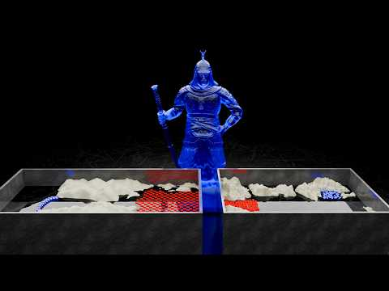
- 설명 앞부분: 이순신은 왜 23전 23승이었는가. 학익진의 물리학, 명량 조류 계산, 판옥선 설계의 비밀을 3D로 재현했습니다. 이 영상에서 다루는 것: 판옥선이 이길 수밖에 없었던 구조적 이유 학익진이 완성되는 순간, 포위된 배에 쏟아지는 포탄의 수 견내량이 아닌 한산도 앞바다를 선택한 물리학적 이유 초속 6m 울돌목 조류를 무기로 만든 방법 철쇠줄, 조류 반전, 협로 — 명량의 3가지 설계
- 대본 없음 (설명) — 음성인식이 끝나면 도입부·흐름이 들어감
- 댓글 0/331 (다 받지 못함): 좋은 점 — 영상 0 · 감사·응원 0 · 더 알고 싶은 것 0 · 아쉬운 점 — 영상 0 · 반박·불만 — 의견 다름 0 · 정치·사회 0 · 경험 공유 0 · 구독·다음 기대 0

### 440. 류큐 왕국이 무너진 뒤, 오키나와 왕실은 어떻게 되었을까?

- https://www.youtube.com/watch?v=ZjlRMwPi0Ik · 제국 그 후  · 구독자 5,240 · 조회수 34,128 (×6.5, 하루 509.2) · 좋아요 656 (1.9%) · 24.2분 · 2026-08-11 · 주제 묶음 3. 조선 · 형식 애니메이션·지도 · 폴더 `W_ZjlRMwPi0Ik` (웹 승인)
- 썸네일: 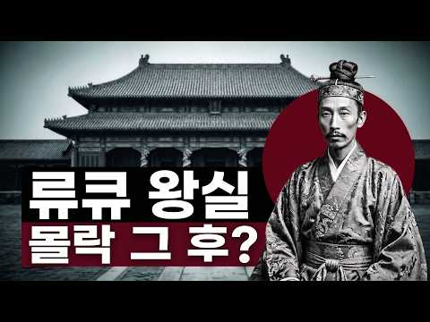
- 설명 앞부분: 태평양 한가운데, 450년을 이어온 왕국이 있었습니다. 그 왕국이 무너지는 데 걸린 시간은 단 사흘이었습니다. 류큐 왕국— 한때 '만국을 잇는 다리'라 불리며 동아시아 무역의 중심에 섰던 나라. 1879년, 일본의 병력 앞에 국호는 지도에서 사라지고 마지막 국왕은 도쿄로 끌려갔습니다. 이 영상은 왕조가 무너진 뒤를 따라갑니다. 남겨진 왕족과 사족들은 어디로 갔는지, 조국의 복원을 위해 목숨을 바친 이는 누구였는지, 그리고 지금 그 핏줄을 잇는 사람은 무엇을 하고 있는지. 로마노프, 합스부르크, 대한제국과는 다른 길을 걸은 한 왕조…
- 대본 없음 (설명) — 음성인식이 끝나면 도입부·흐름이 들어감
- 댓글 0/86 (다 받지 못함): 좋은 점 — 영상 0 · 감사·응원 0 · 더 알고 싶은 것 0 · 아쉬운 점 — 영상 0 · 반박·불만 — 의견 다름 0 · 정치·사회 0 · 경험 공유 0 · 구독·다음 기대 0

