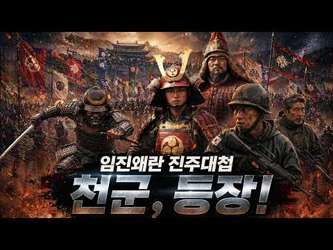
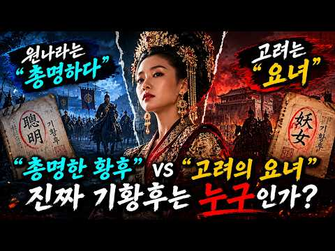
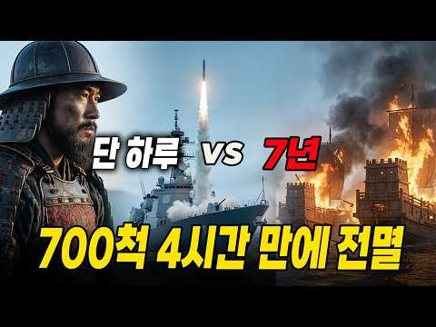
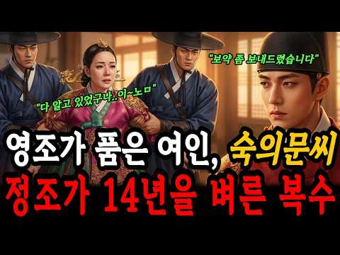
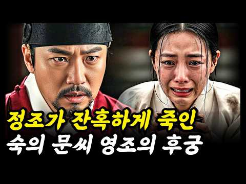
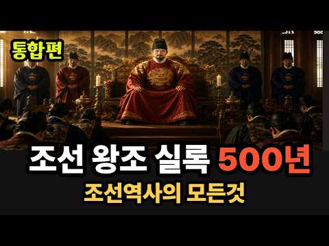
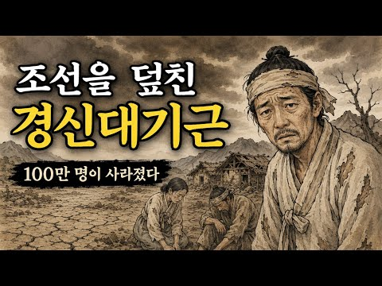
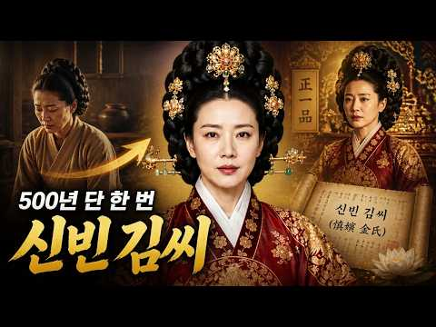
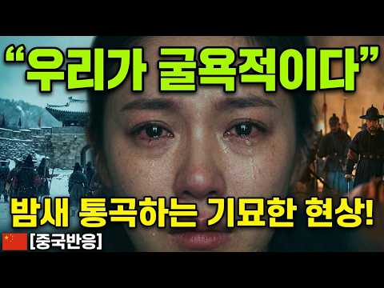
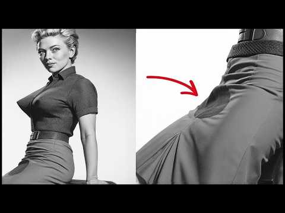

# 역사 — 성공 사례 분석: 사례별 자세히 #401–#440

`analysis.md` 의 9번 (같은 # 번호). 자동 생성 — `tools/success_analysis.py` v1.4.1 (2026-10-19 07:24 UTC). ※ 연구·교육용 — 투자 권유가 아님.

### 401. 1592년, 왜군이 조선을 침략한 순간… 이순신은 현대전력과 함께 반격했다

- https://www.youtube.com/watch?v=byJ4-8wapS0 · 시간실록 · 구독자 8,390 · 조회수 78,480 (×9.3, 하루 541.6) · 좋아요 1,068 (1.4%) · 29분 · 2026-05-27 · 주제 묶음 3. 조선 · 형식 정보·해설 (그 밖) · 폴더 `W_byJ4-8wapS0` (웹 승인)
- 썸네일: 
- 설명 앞부분: 1592년, 왜군이 조선을 침략한 그날. 역사는 그대로 흘러가지 않았다. 탄금대로 진격하던 왜군 선봉대 앞에 대한민국 현대전력이 모습을 드러낸다. K2 소총, 맥밀란 저격총, 전차, 잠수함, 항공모함까지. 그리고 그 모든 전력을 마주한 이순신 장군. 조선을 무너뜨리려던 왜군의 진격은 이제 완전히 다른 전쟁으로 바뀐다. 이 영상은 임진왜란을 바탕으로 한 가상 역사 퓨전 전쟁 시리즈입니다. 실제 역사와 창작 설정이 결합된 픽션 콘텐츠입니다. 끝까지 보시면 이순신 장군과 현대전력이 어떻게 전세를 뒤집는지 확인할 수 있습니다. 사실 기반…
- 같은 채널 평소 대비 ×1.2 (채널 최근 롱폼 중앙값 65,432회) · 평소 영상: 국정원 전학생 시즌2 6화 ∣ 아사달의 귀환 — 이번엔 네가 필요해 (59,092회) / 용병들과의 진짜 전투가 시작됐다 ∣ 국정원 전학생 시즌2 EP.5 (55,997회)
- 대본 없음 (설명) — 음성인식이 끝나면 도입부·흐름이 들어감
- 댓글 101/101: 좋은 점 — 영상 0 · 감사·응원 0 · 더 알고 싶은 것 2 · 아쉬운 점 — 영상 1 · 반박·불만 — 의견 다름 0 · 정치·사회 1 · 경험 공유 2 · 구독·다음 기대 0
  - 더 알고 싶은 것 👍4 “다음 전투영상도 부탁드립니다 시간실록님!”
  - 더 알고 싶은 것 👍4 “현대군 투입 전투영상도 자주 부탁드립니다 시간실록님!”
  - 아쉬운 점 — 영상 👍3 “정말 잘만드셨습니다. 잘만드셨는데... 해군들 회의중에 별(장성)들이 너무 많고 동근무복(검정) 으로 보이는데 근무복에는 견장계급장이 달리지가 않는데 견장이 있네요 그리고 하근무복을 표현하고 싶으신거였다면 옅은 갈색으로 표현하셔야하는건데 해군관련해서 디테일이 조금 떨…”
  - 정치·사회 👍0 “복장이 중국인데 대한민국 해군 복장이 아님”
  - 경험 공유 👍3 “나 어릴때 역사배우면서 이런 상상했었는데 ㅎㅎ”
  - 경험 공유 👍1 “우리집에 왜왔니”

### 402. 역사에 기록된 가장 멋있었던 죽음들

- https://www.youtube.com/watch?v=tMIab7lVg88 · 쉽게 설명해서! · 구독자 18,100 · 조회수 168,628 (×9.3, 하루 1,575.5) · 좋아요 1,398 (0.8%) · 19.1분 · 2026-07-04 · 주제 묶음 1. 역사 일반·이야기 · 형식 정보·해설 (그 밖) · 폴더 `W_tMIab7lVg88` (웹 승인)
- 썸네일: 
- 챕터: 0:00 벤케이, 서서 죽은 전설 · 4:34 레오니다스의 최후 · 8:35 두 눈을 잃은 지슈카 · 10:40 마지막 북소리와 이순신 · 15:39 벤 살로몬의 최후 · 18:35 아웃트로
- 설명 앞부분: 역사에 남은 마지막 순간들은 이상하게 오래 기억됩니다. 이번 편에서는 끝까지 물러서지 않았던 다섯 사람의 이야기를 가져왔습니다. 벤케이, 레오니다스, 얀 지슈카, 이순신, 그리고 벤 살로몬까지. 서로 다른 시대와 나라의 인물들이지만, 마지막 장면만큼은 묘하게 닮아 있습니다. 다음에 다뤘으면 하는 역사 이야기나, 기억에 남는 인물 있으면 댓글로 남겨주세요.
- 같은 채널 평소 대비 ×3.7 (채널 최근 롱폼 중앙값 45,620회) · 평소 영상: 독재자들의 특이한 집착들 Top6 (46,498회) / 역사상 가장 이상하고 엉뚱한 형별과 재판 Top10 (44,741회)
- 대본 없음 (설명) — 음성인식이 끝나면 도입부·흐름이 들어감
- 댓글 109/109: 좋은 점 — 영상 5 · 감사·응원 3 · 더 알고 싶은 것 3 · 아쉬운 점 — 영상 2 · 반박·불만 — 의견 다름 2 · 정치·사회 0 · 경험 공유 2 · 구독·다음 기대 0
  - 좋은 점 — 영상 👍23 “이순신 장군님은 레전드가 맞다.”
  - 좋은 점 — 영상 👍8 “여러 나라별로 영웅들 알려주셔서 너무 좋아요❤”
  - 감사·응원 👍1 “좋은 영상을 올려주셔서 감사합니다!”
  - 감사·응원 👍1 “감사합니다. 장군님ㅜㅜ”
  - 더 알고 싶은 것 👍6 “양규장군님과 김숙흥별장님도 그리고 황진장군님을 올려주셨으면 합니다. 구국의 영웅으로 백성을 지키기위해 용맹한 행동 숭고한 정신은 영상에 나오는 위인, 인물들과 나란히 소개하는 것이 좋을 것 같습니다. 우리가 우리의 훌륭한 선조를 기억할 수있길 바랍니다.”
  - 더 알고 싶은 것 👍3 “솔직히 '가장 멋있는 죽음'이라기보다는 무능한 윗선들 때문에 발생한 '가장 억울하고 안타까운 희생' 아닌가요? 특히 이순신 장군님은 선조만 아니었어도 끝까지 살아남아 조선을 재건하셨을 텐데 말이죠. 영웅답게 죽는 것보다 차라리 얀 지슈카처럼 무능한 권력에 맞서 끝까지…”
  - 아쉬운 점 — 영상 👍12 “양규장군님이 빠진게 좀 아쉽네요”
  - 아쉬운 점 — 영상 👍0 “설명이 조금 아쉬워요 전부 습니다로 끝나니까 초등학생이 국어책읽는 느낌이네여ㅠ "였죠" "였으나" 같은걸 섞어쓰면 좋을거같은데요 너무 습니다만 쓰니까 집중이안돼여”
  - 반박·불만 — 의견 다름 👍0 “말도 안되지..인간의 몸은 뇌가 죽으면 온몸이 헝겁처럼 흘러내려..절대 서있을수가 없어.원래 일본넘들도 중국넘처럼 뻥이 많다.”
  - 반박·불만 — 의견 다름 👍0 “입은 삐툴어져도 말은 바로 하라 그랬다고 이순신장군이 원균의 모함에 삭탈관직을 당한게 아닙니다. 왜군의 계략에 속아서 사지로 출동을 명했는데 이순신 장군이 이를 알고 출동을 거부했던것 입니다 그런데 그 계략에 속아 넘어간게 조정관료들이 이순신의 인기에 선조가 질투한다…”
  - 경험 공유 👍0 “백의종군은 그저 일개병사로의 강등이 아니라 실질적인 그 부대의 명예 고문같은 역활을 했었다고 아는데...”

### 403. 홍수속에서 황금비단 대신 '썩은 나무'를 건져 대박난 뱃사공 · 야담 · 조선이야기 · 수면동화 · 옛날이야기 · 사극

- https://www.youtube.com/watch?v=aT-MjEjvu4M · 언니야담 · 구독자 6,040 · 조회수 55,738 (×9.2, 하루 425.7) · 좋아요 888 (1.6%) · 29.5분 · 2026-06-10 · 주제 묶음 9. 야사·야담·옛날이야기 · 형식 수면·낭독 (잠잘 때 듣는) · 폴더 `W_aT-MjEjvu4M` (웹 승인)
- 썸네일: 
- 설명 앞부분: 마포 나루터의 뱃사공인 칠성이가 폭우 속에서 비단 궤짝 대신 썩은 나무토막 7개를 건져 올린 기묘한 이야기입니다. 낯선 노승의 예언과 침향에 얽힌 반전의 역사속으로 여러분을 초대합니다. 📢 본 영상은 고전 기록과 민담을 바탕으로 AI 기술을 활용하여 제작된 '창작 콘텐츠'입니다. 영상 속 인물, 사건, 배경은 서사적 몰입을 위해 연출된 가상이며, 역사적 사실과는 무관함을 알려드립니다. This video is a work of 'Artistic Creative Content' produced using AI technology, …
- 같은 채널 평소 대비 ×2.0 (채널 최근 롱폼 중앙값 28,361회) · 평소 영상: 지혜로운 아내의 철없는 한량 남편 길들이기 l 야담 민담 전설 설화 (29,550회) / 계모에게 쫓겨나는 어린 도련님을 따라나선 지혜로운 여종의 정체 ·야담·민담·수면동화·옛날… (27,172회)
- 대본 없음 (설명) — 음성인식이 끝나면 도입부·흐름이 들어감
- 댓글 25/25: 좋은 점 — 영상 0 · 감사·응원 2 · 더 알고 싶은 것 0 · 아쉬운 점 — 영상 0 · 반박·불만 — 의견 다름 0 · 정치·사회 0 · 경험 공유 0 · 구독·다음 기대 1
  - 감사·응원 👍1 “이야기 잘 듣고 갑니다 감사합니다”
  - 감사·응원 👍1 “아멘 항상 감사합니다.”
  - 구독·다음 기대 👍2 “오늘도 언니야담 재미있게. 동영상 잘 보았습니다 다음편 기다리겠습니다”

### 404. [한국사] 조선 건국 후 고려의 왕족들은 어떻게 됐을까? ∣ 정사 ∣ 야사

- https://www.youtube.com/watch?v=vXqCx5yiyls · 역사꾼 · 구독자 12,900 · 조회수 115,837 (×9.0, 하루 658.4) · 좋아요 1,544 (1.3%) · 17.2분 · 2026-04-26 · 주제 묶음 4. 한국 근현대사 · 형식 정보·해설 (그 밖) · 폴더 `W_vXqCx5yiyls` (웹 승인)
- 썸네일: 
- 챕터: 0:00 인트로 – 왜 왕씨는 드물까? · 1:30 파트1 – 피로 물든 바다의 미스터리 · 8:00 파트2 – 거제도, 강화도, 삼척의 불안한 유배 · 14:30 파트3 – 배 밑바닥에 구멍을 뚫어라 · 21:00 파트4 – 목숨을 건 성씨 세탁 · 27:30 파트5 – 500년 권력의 무상함 · 33:00 아웃트로 – 당신의 가문 이야기를 들려주세요
- 설명 앞부분: 왜 대한민국에는 왕씨가 드물까요? 500년 고려 왕족의 성씨가 씨가 마른 이유, 사극에서 차마 다루지 못한 충격적인 진실을 파헤칩니다. 김씨는 천만 명, 이씨는 700만 명인데 왕씨는 고작 2만 명. 474년이나 이어진 고려의 왕족인데 왜 이렇게 적을까요? 자연스럽게 몰락한 게 아닙니다. 누군가가 의도적으로 씨를 말린 겁니다. 1392년 조선 건국 직후, 고려 왕족들은 거제도, 강화도, 삼척 같은 외진 곳으로 쫓겨났습니다. 살려주겠다는 약속을 믿었습니다. 그런데 2년 뒤, 더 좋은 곳으로 옮겨주겠다며 배에 태웠습니다. 바다 한가운…
- 같은 채널 평소 대비 ×34.4 (채널 최근 롱폼 중앙값 3,365회) · 평소 영상: [한국사] 조선이 망할 수 밖에 없던 이유 ∣ 정사 ∣ 야사 (3,365회) / [한국사] 편의점보다 많았다! 조선 경제를 움직인 주모들의 기막힌 돈 버는 법 ∣ 정사 … (3,440회)
- 대본 없음 (설명) — 음성인식이 끝나면 도입부·흐름이 들어감
- 댓글 322/324: 좋은 점 — 영상 3 · 감사·응원 2 · 더 알고 싶은 것 1 · 아쉬운 점 — 영상 1 · 반박·불만 — 의견 다름 4 · 정치·사회 21 · 경험 공유 8 · 구독·다음 기대 0
  - 좋은 점 — 영상 👍48 “학교에서 배웠지... 지금 전씨, 옥씨가 예전에 다 왕씨였다는거..”
  - 좋은 점 — 영상 👍1 “마씨인데흥미진진하게봣네요좋은영상감사드립니다”
  - 감사·응원 👍1 “마씨인데흥미진진하게봣네요좋은영상감사드립니다”
  - 더 알고 싶은 것 👍1 “고씨왕족은 어디있을까요? 예맥족 고씨가 1대왕이었는데 ㅠㅜ”
  - 아쉬운 점 — 영상 👍0 “참 어그로 오지네. 분량 뽑으려고 참 애쓴다.”
  - 반박·불만 — 의견 다름 👍14 “역사도 진실을 알면.... 엄청난 왜곡으로 포장이 되어 있습니다..... 한두건이 아닙니다...... 사기꾼,날강도가 영웅이 되고 훈장을 받고 ,국가유공자가되는 사례는 차고넘치죠..... 그걸 막으려도 힘을쓴 진짜 국가유공자가 되어야할 자들은... 매국노라는 이름으로…”
  - 반박·불만 — 의견 다름 👍2 “결론적으로 이야기해서 이 이야기는 사실이 아닙니다. 그러므로 조선왕조실록에 왕씨들을 수장시켰다는 내용은 없습니다. 다만 일정수의 왕씨들을 거제도에 격리시킨건 맞습니다. 이 격리시킬때 왕씨들을 태우고 거제도로 떠나는 배를보고 사람들이 지어낸 이야기라는게 추정입니다. 이…”
  - 정치·사회 👍33 “중국땅 북동남쪽이 고려땅 상당수 왕씨 중국인이 되었고 성씨또한 그대로 왕씨임”
  - 정치·사회 👍6 “강화는 현재의 호남성 남단 끝. 大 河 - - - - 3 皇都 (1388년 이전의 대륙과 북방은 안전지대) (호광성) 大 江 - - - 2순행 1순행 (2순행에서 서울이 열림) 4개월~수백년 (大都,요양 이원화 하기전) 요수,漢水 - - 요양 제주 강화 <--- (황…”
  - 경험 공유 👍16 “욍씨 씨만 말린게 아니라 고려 천문 지리 역사서도 거의 수거해서 불태웠지(이성계~예종까지. 음양산전도감 설치 및 수서령). 송나라 소동파는 고려사신들이 방문할 때마다 송나라의 귀한 서적을 여러 수레에 싣고 가져가는 것을 비난했을 정도였고 송나라 서긍이 쓴 선화봉사고려…”
  - 경험 공유 👍8 “우리집안도 단종복위운동 정축지변으로 순흥지역30리 주민몰살로 순흥안씨가 피해를 입었다. 우리집은 양반으로 잘살다가 도망쳐서 수백년을 봉화군 산꼴에서 화전민으로 숨어지냈다..ㅠㅠ”

### 405. [한국사] 조선의 노비들은 어떻게 살았을까? 대부분의 사람들은 몰랐던 충격적인 노비의 삶 ∣ 정사 ∣ 야사

- https://www.youtube.com/watch?v=gbQwCONfulQ · 역사꾼 · 구독자 12,900 · 조회수 114,757 (×8.9, 하루 648.6) · 좋아요 1,443 (1.3%) · 15.7분 · 2026-04-25 · 주제 묶음 4. 한국 근현대사 · 형식 정보·해설 (그 밖) · 폴더 `W_gbQwCONfulQ` (웹 승인)
- 썸네일: 
- 챕터: 0:00 인트로 – 사극이 보여주지 않은 진실 · 1:30 파트1 – 소 한 마리 값도 안 되던 목숨 · 8:00 파트2 – 흉년이 오면 딸을 팔았습니다 · 14:30 파트3 – 노비가 노비를 샀다 · 21:00 파트4 – 내 새끼들이 짐승처럼 나뉘어 갔습니다 · 27:30 파트5 – 족쇄를 차고도 삶을 지켜낸 생명력 · 33:00 아웃트로 – 당신의 가족 역사를 들려주세요
- 설명 앞부분: 소 한 마리 값도 안 되던 사람들, 조선 노비의 진짜 삶을 기록으로 파헤칩니다. 조선시대 노비 매매 문서를 펼쳐보면 충격적인 사실이 드러납니다. 건장한 성인 남자 한 명의 가격이 소 한 마리에도 미치지 못했습니다. 소는 밭을 갈 수 있으니 사람보다 비쌌던 겁니다. 사람을 셀 때도 '명'이 아닌 짐승을 세는 단위 '구'로 기록했습니다. 이게 조선의 현실이었습니다. 그런데 사극에서 보여주지 않는 장면이 있습니다. 주인과 수백 리 떨어진 곳에서 자기 집을 짓고 자기 땅을 일구던 외거노비, 악착같이 돈을 모아 기와집을 사고 심지어 다른 …
- 같은 채널 평소 대비 ×34.1 (채널 최근 롱폼 중앙값 3,365회) · 평소 영상: [한국사] 조선이 망할 수 밖에 없던 이유 ∣ 정사 ∣ 야사 (3,365회) / [한국사] 편의점보다 많았다! 조선 경제를 움직인 주모들의 기막힌 돈 버는 법 ∣ 정사 … (3,440회)
- 대본 없음 (설명) — 음성인식이 끝나면 도입부·흐름이 들어감
- 댓글 303/303: 좋은 점 — 영상 0 · 감사·응원 6 · 더 알고 싶은 것 1 · 아쉬운 점 — 영상 3 · 반박·불만 — 의견 다름 6 · 정치·사회 26 · 경험 공유 8 · 구독·다음 기대 0
  - 감사·응원 👍3 “일본한테 감사해라 일제강점기 아니었으면 지금도 저렇게 살고 있을꺼다 독립운동 그거. 대부분 초창기 때 양반들이 일본이들어와서 신분제 박살내고 노비 없애니까 다시 조선으로 돌아가서 노비부리며 살려고 한거 그이상이하도 아니였음”
  - 감사·응원 👍1 “음... 모두가 노비에 후손인걸 자랑스럽게 생각합시다. 또한 현대에 와서 찐노비 후손임을 몸에 문신으로 표시하는 멋쟁이들을 응원 합시다.”
  - 더 알고 싶은 것 👍0 “일본의 속국vs 조선시대 노비 어떤게 더 비참했을까요? 일제시대엔 어느신분이 싫었을까요?조선시대엔 누가 기득권이였을까요?이것만봐도 양반들이 얼마나 짐승이였는지 답이나옴 일본이나 양반이나 같은클라스”
  - 반박·불만 — 의견 다름 👍0 “유튜브에서 역사학자라는 인간이 조선시대 노비는 서양의 노예와 달랐다라고 선동하고 다니던거 생각나네. 자율성이 있었고, 일반백성과 별차이가 없었고 때로는 일부러 노비가 되기도 했다. 우리가 생각하는 노예와는 다른 살만한 계층이었다고 개소리 하는거 보고 어이가 없었음.지…”
  - 정치·사회 👍44 “자국민을 노비쓴 미친나라가 조선임ㅉㅉ보통 침략해서 다른 민족을 종으로 부리는데 우리는 같은 민족을 종으로 부림ㅋㅋ조선시대는 노비의 나라였음ㅋㅋ”
  - 정치·사회 👍37 “조선은 멸망 만이 답이 였음.신분을 깨부술수 없도록 나라가 건국됨. 자국민을 상대로 사람을 물건 취급한건 지구상 유일할것.아직 왕 양반 따지는 사람이 있더라만은”
  - 경험 공유 👍19 “악마이성계 세운나라 이성계.일본에합병때 신분제폐지하니 백성 7 평민천민 노비70%가 일본지배환영..오죽착당해 원한이갚엇으면 나라뺏어간일본통치를환영하갯냐..왕족 양반놈들은싫어해 저희들도 농사짓고 노동해야돼니..”
  - 경험 공유 👍0 “1804년에 작성된 우리집 호구단자( 지금의 주민등록등본)에 성도없는 수십여명의 노비들 후손들은 지금은 양반되어서 잘살고 있을겁니다”

### 406. 미국서 터진 새로운 한류 충무공 이순신, 그들이 열광하는 진짜 이유

- https://www.youtube.com/watch?v=yhTI4EZgG5g · 스피드경제 · 구독자 8,450 · 조회수 74,298 (×8.8, 하루 3,077.5) · 좋아요 1,938 (2.6%) · 22분 · 2026-09-25 · 주제 묶음 3. 조선 · 형식 정보·해설 (그 밖) · 폴더 `W_yhTI4EZgG5g` (웹 승인)
- 썸네일: 
- 설명 앞부분: ⚔️ 칼의 전사라던 사무라이가 들고 온 건 총이었습니다. 그리고 그 총 앞에서 한 번도 지지 않은 조선 제독이 지금 미국에서 새로운 한류가 되고 있습니다. 🔥 일본 학자는 거북선을 깎아내렸지만 일본 해군 제독은 넬슨보다 위라고 적었고, 미국 해군은 100년 가까이 이 이름을 연구해 왔습니다. 다루는 내용 ・ 미국 시장에서 46만 부 넘게 팔린 이순신 그래픽노블 ・ 미 해군연구소 독자 투표에서 주목받은 거북선 ・ 13척 대 133척, 울돌목의 물살을 읽은 명량해전 ・ 1901년 일본 학자 하야시 다이스케의 거북선 철갑 부정 ・ 19…
- 같은 채널 평소 대비 ×79.5 (채널 최근 롱폼 중앙값 934회) · 평소 영상: 미국에 트럼프가 최우방도 버리자 일본이 새우등 터진 이유 (934회) / 통계로는 설명이 안 된다. 소득은 미국의 절반인데 외국인들이 입 모아 한국을 진짜 부자나… (888회)
- 대본 없음 (설명) — 음성인식이 끝나면 도입부·흐름이 들어감
- 댓글 91/91: 좋은 점 — 영상 0 · 감사·응원 5 · 더 알고 싶은 것 0 · 아쉬운 점 — 영상 2 · 반박·불만 — 의견 다름 0 · 정치·사회 9 · 경험 공유 1 · 구독·다음 기대 0
  - 감사·응원 👍13 “대다나다 대한민국 화이팅 입니다.🎉🎉🎉”
  - 감사·응원 👍1 “대한민국화이팅”
  - 아쉬운 점 — 영상 👍2 “이것이 다는 이니죠 닛뽕국 사무라이는 용병으로 쓰였지요 언제 나는 펙트만 1624년쯤 네달란드 동인도회사 용병으로 채용된거죠 채용이유는 체격이 작고 먹는것도 짜디짠 밥에 작은생선조각 하나 올려주면 그만 끝 이들이 한짖은 인도네시아 어느섬에 있는 향신로 정향을 독점하려…”
  - 아쉬운 점 — 영상 👍1 “구독 완료!!! 좋아요는 sure~^^ 왜냐하면? 최소한 AI음성이 아니기 때문에~ 사람 목소리!!! 이거 쭈욱 유지하시길~^^”
  - 정치·사회 👍10 “생각할수록 찌질한 선조 그래도 나라가 버틴건 도처에서 나라를 위해. 싸웠던 애국열사들 덕분이었다”
  - 정치·사회 👍8 “정부는 그작가 찾아 표창하고 현금포상하세요ᆢ”
  - 경험 공유 👍0 “나도 어릴때부터 지금까지 제일존경하는이순신장군님 요즘은 너무너무좋아”

### 407. 조선의 기이한 하늘 기록에서 영감을 받은 역사 미스터리 SF

- https://www.youtube.com/watch?v=k3_pkuXeBcg · 미니드라마 스튜디오 · 구독자 2,910 · 조회수 25,462 (×8.8, 하루 500.8) · 좋아요 101 (0.4%) · 8.5분 · 2026-08-29 · 주제 묶음 1. 역사 일반·이야기 · 형식 정보·해설 (그 밖) · 폴더 `W_k3_pkuXeBcg` (웹 승인)
- 썸네일: 
- 설명 앞부분: 조선의 다섯 고을에서 비슷한 시기에 반복해서 목격된 정체불명의 비행체. 조선시대를 배경으로 SF적 상상력을 결합한 역사 미스터리물입니다. 실제 역사적 시대감 위에 미지의 비행체, 인간이 이해할 수 없는 현상을 겹쳐 하나의 미스터리를 만들어갑니다. 과연 조선의 다섯 고을에 나타난 것은 무엇이었을까요? 그리고 왜? ※ 본 콘텐츠는 역사적 배경을 바탕으로 창작된 픽션입니다.
- 같은 채널 평소 대비 ×0.2 (채널 최근 롱폼 중앙값 166,247회) · 평소 영상: [5부] 이 결혼, 안 합니다. - 전 남친 어머니와의 악연 (166,247회) / [4부] 이 결혼, 안 합니다. - 하린이 챙긴 봉투는? (168,514회)
- 대본 없음 (설명) — 음성인식이 끝나면 도입부·흐름이 들어감
- 댓글 2/2: 좋은 점 — 영상 0 · 감사·응원 0 · 더 알고 싶은 것 0 · 아쉬운 점 — 영상 0 · 반박·불만 — 의견 다름 0 · 정치·사회 0 · 경험 공유 0 · 구독·다음 기대 0

### 408. 세종대왕함 성능개량 접고 신형 국산 구축함 ‘KDDX 배치2’로 전면 대체

- https://www.youtube.com/watch?v=t1GYmItUasY · 밀스토리 밀담 · 구독자 9,390 · 조회수 74,636 (×8.0, 하루 652.3) · 좋아요 2,152 (2.9%) · 20분 · 2026-06-26 · 주제 묶음 3. 조선 · 형식 정보·해설 (그 밖) · 폴더 `W_t1GYmItUasY` (웹 승인)
- 썸네일: 
- 설명 앞부분: 해군, ‘세종대왕함’ 성능개량 중단 대신 국산 이지스 ‘KDDX 배치2’ 건조 7.8조원 KDDX 우선협상 대상자 선정! 미국산 이지스 가고 '국산 이지스' 온다 대한민국 해군이 기존 세종대왕급 이지스 구축함 성능개량 사업을 추진하는 대신 차세대 한국형 구축함인 KDDX 배치-2 확보에 무게를 두는 방향으로 장기 전력계획을 조정한 것으로 알려졌다. 군과 방산업계에 따르면 해군은 세종대왕함, 율곡이이함, 서애류성룡함 등 KDX-3 배치-1 3척의 대규모 성능개량보다는 향후 개발될 KDDX 배치-2를 확보해 전력을 대체하는 방안을 검…
- 같은 채널 평소 대비 ×3.5 (채널 최근 롱폼 중앙값 21,184회) · 평소 영상: KF-21 국산화 전력 완성을 위한 마지막 퍼즐, 국산 장거리 공대공 미사일 개발 (21,534회) / 한국형 6세대 전투기 개발 시작, KF-21 다음은 꼬리 없는 전투기 (20,834회)
- 대본 없음 (설명) — 음성인식이 끝나면 도입부·흐름이 들어감
- 댓글 200/199: 좋은 점 — 영상 2 · 감사·응원 2 · 더 알고 싶은 것 5 · 아쉬운 점 — 영상 1 · 반박·불만 — 의견 다름 2 · 정치·사회 6 · 경험 공유 5 · 구독·다음 기대 0
  - 좋은 점 — 영상 👍14 “정보도 유익하고 보람님 미모도 유익한 밀담 밀당 야호~🎉”
  - 좋은 점 — 영상 👍7 “1...국산 레이더 2...국산 전투 지휘 체계 3...국산 탄도탄 요격 미사일 4...국산 함대함, 함대공, 함대지, 미사일 5...국산 어뢰 6...국산 소나 7...국산 CISW 8...국산 무인기(정찰 및 공격) 9...대 드론 요격 무기(국산 레이져 무기) …”
  - 감사·응원 👍7 “1...국산 레이더 2...국산 전투 지휘 체계 3...국산 탄도탄 요격 미사일 4...국산 함대함, 함대공, 함대지, 미사일 5...국산 어뢰 6...국산 소나 7...국산 CISW 8...국산 무인기(정찰 및 공격) 9...대 드론 요격 무기(국산 레이져 무기) …”
  - 감사·응원 👍1 “감사합니다”
  - 더 알고 싶은 것 👍2 “KDDX BATCH 1은 어디로 가고 BATCH 2로 바로 가는지 궁금합니다.~”
  - 더 알고 싶은 것 👍1 “포항급/울산급 전부 퇴역하는데, 이를 대체하는 함정이 나오는지도 궁금하네요(1600-2000톤급)”
  - 아쉬운 점 — 영상 👍0 “수상함 설계강자인 현대중 뻘짓이 아쉽네요 뻘짓만 안했어도 상선이든 군함이든 현대중이 잘만드는데”
  - 반박·불만 — 의견 다름 👍0 “기존 DDG-1 어차피 DDG-2 사업 다마치면 바로 오버홀 들어가면서 이지스레이더 시스템 업그레이드 및 BMD 개수 그리고 더 나아가서 CEC개수(?) 힘수소나 및 예인소나 교체 사업 계획하고 있었는데 무슨 말도 안되는 소리 하는 것인가? 옆나라 일본도 아타고급 2…”
  - 정치·사회 👍9 “비윤리 기업이 수주하면 나라가 바로서지 못합니다 정부에서 아주 잘 한겁니다”
  - 정치·사회 👍4 “감점 적용, 편드는 게 아니라 이 건 확실하게 잘 한 일이라고 본다. 방산업체의 보안문제는 아무리 짚어도 부족함이 없다. 원칙이 지켜지는 나라가 돼야 한다.”
  - 경험 공유 👍6 “너무 오랫동안 방송 안해서 궁금했었는데 새 채널로 돌아 왔군요 한보람 아나운서도 보고 싶었슴니다”
  - 경험 공유 👍0 “기존 DDG-1 어차피 DDG-2 사업 다마치면 바로 오버홀 들어가면서 이지스레이더 시스템 업그레이드 및 BMD 개수 그리고 더 나아가서 CEC개수(?) 힘수소나 및 예인소나 교체 사업 계획하고 있었는데 무슨 말도 안되는 소리 하는 것인가? 옆나라 일본도 아타고급 2…”

### 409. [4K] 260522 올데이프로젝트 (ALLDAY PROJECT) 직캠 Full Ver. ∣ 2026 고려대학교 입실렌티 ∣ 고려대 축제 ( Famous, Wi…

- https://www.youtube.com/watch?v=aisP83aXT9k · machrowh · 구독자 4,990 · 조회수 39,434 (×7.9, 하루 263.5) · 좋아요 864 (2.2%) · 18.2분 · 2026-05-22 · 주제 묶음 2. 한국 고대·삼국·고려 · 형식 정보·해설 (그 밖) · 폴더 `W_aisP83aXT9k` (웹 승인)
- 썸네일: 
- 챕터: 0:00 Famous · 4:35 Look At Me · 8:47 Wicked · 14:06 One More Time
- 설명 앞부분: [4K] 260522 올데이프로젝트 (ALLDAY PROJECT) 직캠 Full Ver. ∣ 2026 고려대학교 입실렌티 ∣ 고려대 축제
- 같은 채널 평소 대비 ×1.1 (채널 최근 롱폼 중앙값 36,404회) · 평소 영상: [4K] 260522 미야오 (MEOVV) 직캠 Full Ver. ∣ 2026 고려대학교… (40,838회) / [4K] 260522 에스파 (AESPA) 직캠 Full Ver. ∣ 2026 고려대학교… (30,090회)
- 대본 없음 (설명) — 음성인식이 끝나면 도입부·흐름이 들어감
- 댓글 32/32: 좋은 점 — 영상 0 · 감사·응원 0 · 더 알고 싶은 것 0 · 아쉬운 점 — 영상 0 · 반박·불만 — 의견 다름 0 · 정치·사회 0 · 경험 공유 1 · 구독·다음 기대 0

### 410. [4K] 서울을 열광시키는 이순신의 후예들 , 대한민국 해군 의장대 퍼레이드 ∣ Seoul ROK - Navy Honor Guard parade

- https://www.youtube.com/watch?v=wZQ8lD6HGgc · 걸어서 서울속으로 · 구독자 2,610 · 조회수 20,609 (×7.9, 하루 122.8) · 좋아요 283 (1.4%) · 11.8분 · 2026-05-04 · 주제 묶음 3. 조선 · 형식 정보·해설 (그 밖) · 폴더 `W_wZQ8lD6HGgc` (웹 승인)
- 썸네일: 
- 설명 앞부분: 충무공 이순신 탄신일을 맞아 그의 의지를 이어 바다를 수호하는 대한민국 해군 의장대의 화려한 퍼레이드 입니다 그 뜨거운 현장을 지금 감상해 보세요! Filming Date: 2026.04.25. Saturday Weather: sunny Location: 서울특별시 중구 마른내로 47
- 같은 채널 평소 대비 ×9.0 (채널 최근 롱폼 중앙값 2,280회) · 평소 영상: [4K] 서울에 이런 풍경이?, 창경궁 물빛연화에 몰려든 역대급 인파 ∣ Seoul Ro… (2,280회) / [4K] 연등회와 함께하는 서울!, 외국인들의 시선을 강탈하는 청계천과 조계사 ∣ Seo… (1,769회)
- 대본 없음 (설명) — 음성인식이 끝나면 도입부·흐름이 들어감
- 댓글 48/48: 좋은 점 — 영상 0 · 감사·응원 1 · 더 알고 싶은 것 0 · 아쉬운 점 — 영상 0 · 반박·불만 — 의견 다름 0 · 정치·사회 0 · 경험 공유 1 · 구독·다음 기대 0
  - 감사·응원 👍3 “대한민국 멋진 해군 수고 많으셨습니다 든든하고 멋지십니다 힘든 군생활중에 연습 하시느라 노고가 크셨습니다 감사합니다 👏👏👏👏👏🇰🇷🇰🇷🇰🇷🇰🇷🇰🇷”
  - 경험 공유 👍1 “제 직속 후임들이네요 제가 저 행사멤버였던게 엊그제 같은데 벌써 20년이 훌쩍 넘어버렸습니다 처음에는 별 감흥이 없었는데 10년 20년이 지나 나이가 30 40이 넘어가니 옛 추억이 하나둘씩 떠오르네요 50 60 이상되면 더 그러겠죠 제가 했을때보다 동작이 조금 바꼈…”

### 411. 황제의 여자가 되는 순간, 죽을 날이 정해지는 나라 ∣ 명나라 70년 순장 제도

- https://www.youtube.com/watch?v=zZfMQjHQFwg · 타임트래블로그 · 구독자 6,340 · 조회수 49,946 (×7.9, 하루 359.7) · 좋아요 370 (0.7%) · 19.8분 · 2026-06-02 · 주제 묶음 6. 동양사 (중국·일본·몽골) · 형식 정보·해설 (그 밖) · 폴더 `W_zZfMQjHQFwg` (웹 승인)
- 썸네일: 
- 설명 앞부분: 1424년 명나라, 영락제가 죽자 자금성 후궁 서른 명이 같은 날 함께 묻혔습니다. 황제의 여자가 된 게 죄였습니다. 살아남은 건, 아들을 낳은 소수뿐이었습니다. 명나라 황실에서는 황제가 숨을 거둘 때마다, 자식 없는 후궁들을 한방에 모아 순장했습니다. 홍무제가 죽자 마흔 명, 영락제가 죽자 서른 명이 같은 방으로 들어갔고, 그중에는 조선이 바친 공녀 여비 한씨의 이름까지 올라 있었습니다. 입궁 스무날 만에 절명시 한 편을 남기고 사라진 곽애, 누이의 죽음을 발판 삼아 출세한 한확, 그리고 70년 만에 이 제도를 끝낸 정통제까지.…
- 같은 채널 평소 대비 ×8.7 (채널 최근 롱폼 중앙값 5,745회) · 평소 영상: 일곱 살 아이의 수명에 돈을 건 어른들 ∣ 유럽 정부가 직접 팔았던 생존 연금, 통틴 (5,745회) / 28년간 옥좌가 비어도 잘만 굴러간 나라 ∣ 명나라 멸망의 진짜 시작, 만력제의 침묵 (5,772회)
- 대본 없음 (설명) — 음성인식이 끝나면 도입부·흐름이 들어감
- 댓글 44/44: 좋은 점 — 영상 0 · 감사·응원 0 · 더 알고 싶은 것 0 · 아쉬운 점 — 영상 0 · 반박·불만 — 의견 다름 1 · 정치·사회 2 · 경험 공유 1 · 구독·다음 기대 0
  - 정치·사회 👍1 “예. 여기 명나라의 순장 풍습이 나왔네요. 순장 풍습은 고 대때 한반도 삼국 시대중에서 가야에서 빈번했었고 3국 모두가 실시했다가 가야가 신라에 흡수가 되고 신라 지증왕때 폐지가 되었습니다. 물론 그 당시에도 좀 아니다라고 느낀 부분도 있었었겠지만 솔까말 인권적인 부…”
  - 경험 공유 👍1 “예. 여기 명나라의 순장 풍습이 나왔네요. 순장 풍습은 고 대때 한반도 삼국 시대중에서 가야에서 빈번했었고 3국 모두가 실시했다가 가야가 신라에 흡수가 되고 신라 지증왕때 폐지가 되었습니다. 물론 그 당시에도 좀 아니다라고 느낀 부분도 있었었겠지만 솔까말 인권적인 부…”

### 412. 10만 명나라 대군이 닷새 만에 전멸한 이유 (누르하치와 사르후 전투)

- https://www.youtube.com/watch?v=qKvJfxLs168 · 쉬운 역사탐험가 · 구독자 2,360 · 조회수 18,095 (×7.7, 하루 185.9) · 좋아요 291 (1.6%) · 22.5분 · 2026-07-13 · 주제 묶음 6. 동양사 (중국·일본·몽골) · 형식 정보·해설 (그 밖) · 폴더 `W_qKvJfxLs168` (웹 승인)
- 썸네일: 
- 챕터: 0:00 복수의 시작: 눈밭에서 맹세한 24세 청년 · 2:10 36년의 인내: 명나라 국경 시장의 비밀 · 4:20 조공의 함정: 명나라의 눈을 가린 위장술 · 6:30 일곱 가지 원한과 칠대한 선포 · 8:40 명나라의 오만: 10만 대군 출정의 비극 · 10:50 전술의 승리: 넷으로 나뉜 명군을 각개격파하다 · 13:00 사르후 전투의 날: 안개 속에서 벌어진 학살 · 15:10 조선군의 운명: 명나라에 끌려간 1만 3천 명 · 19:30 명나라가 패배할 수밖에 없었던 진짜 이유
- 설명 앞부분: 1583년 겨울, 만주 산속의 한 청년이 아버지를 잃고 36년 동안 복수를 준비했습니다. 당시 세계 최강대국이었던 명나라는 그를 하찮은 오랑캐로 여겼죠. 하지만 누르하치는 명나라의 틈을 파고들어 결국 10만 대군을 단 5일 만에 무너뜨렸습니다. 사르후 전투에서 벌어진 충격적인 전략과 명나라의 몰락 과정을 통해, 역사가 어떻게 뒤집히는지 그 치밀한 복수극의 전말을 공개합니다. 누르하치가 어떻게 명나라의 오만을 역이용해 대제국 청나라의 기틀을 닦았는지 확인해보세요. 타임라인
- 같은 채널 평소 대비 ×3.6 (채널 최근 롱폼 중앙값 5,027회) · 평소 영상: 87만 대군이 8만에게 제대로 싸워보지도 못하고 사라진 날, 중국 역사가 뒤집힌 이유 (5,027회) / 세계 부의 3분의 1을 가졌던 청나라가 단 100년 만에 몰락한 이유 (5,753회)
- 대본 없음 (설명) — 음성인식이 끝나면 도입부·흐름이 들어감
- 댓글 27/27: 좋은 점 — 영상 0 · 감사·응원 0 · 더 알고 싶은 것 0 · 아쉬운 점 — 영상 0 · 반박·불만 — 의견 다름 0 · 정치·사회 2 · 경험 공유 0 · 구독·다음 기대 0
  - 정치·사회 👍5 “샤르후전투에서 조명연합군의 패배원인은 병력을 지나치게 작게 분산시킨 명군지휘부의 오판과훈련조차안된 병사들 지휘부의 분열이 패전의. 원인입니다 그뒤에는 명나라 정부의 부패등이 더큰문제였구요 당시 명군은 두꺼운 성채에서는 어느정도 누루하치군과 전투가 됐지만 야전에서 보병…”
  - 정치·사회 👍3 “[명사]는 명나라 자채의 역사서가 아니라 만주족 청나라가 편찬했으니, 당연히 편파적이고 그대로 모두 믿을 수 없지”

### 413. 미국에서 계속 완판되는 이순신책 — 400년 전 조선시대 장군이 미국 영웅이 된 진짜 이유

- https://www.youtube.com/watch?v=kk5ieUmNeJU · 247경제 · 구독자 15,000 · 조회수 114,873 (×7.7, 하루 4,074.3) · 좋아요 0 (0.0%) · 21.9분 · 2026-09-21 · 주제 묶음 3. 조선 · 형식 애니메이션·지도 · 폴더 `W_kk5ieUmNeJU` (웹 승인)
- 썸네일: 
- 챕터: 0:00 미국 행사장에서 매대가 비는 만화책 · 1:28 만든 사람은 한국인이 아닙니다 · 2:03 출판사 없이 혼자 만든 책 · 3:34 2004년 드라마 한 편에서 시작됐습니다 · 5:35 "누가 이걸 사겠냐" — 전부 거절 · 5:53 미국 만화 시장의 벽 · 7:30 코믹콘 부스를 빌렸습니다 · 8:13 차에 책을 싣고 도시를 돌았습니다 · 9:33 그런데 그 자리에서 동났습니다 · 10:13 행사 120회, 16년 · 11:20 그래서 얼마나 팔렸나 — 25만 부 · 12:55 스탠 리가 서문을 썼습니다 · 14:30 미국 독자는 왜 샀을까 · 16:23 이순신 만화가 19금인 이유 · 17:27 지금 벌어지는 일 · 19:34 정직하게 짚어야 할 여섯 가지 · 20:44 "누가 사겠냐"의 답
- 설명 앞부분: 미국 행사장에서 나올 때마다 매대가 비는 책이 있습니다. 주인공이 이순신 장군입니다. 그것도 15년 넘게 이어지고 있습니다. ⚠️ 먼저 말씀드립니다 — 이건 위인전 이야기가 아니라 시장 이야기입니다. 누가 만들었나 미국 일리노이주의 만화가 **온리 콤판(Onrie Kompan)** — 한국인도 교포도 아닙니다 제목도 영어 발음 그대로 **Yi Soon Shin 자비 출판·자체 유통** — 큰 출판사 없이 작가가 직접 만들고 직접 팔았습니다 글은 미국 작가, 그림은 이탈리아 출신 만화가 등 여러 나라 사람이 참여 어떻게 시작됐나 2…
- 같은 채널 평소 대비 ×15.7 (채널 최근 롱폼 중앙값 7,334회) · 평소 영상: "내릴 땅이 없어서 산을 깎았습니다" 바다를 메워 활주로를 올린 울릉공항 공사의 진짜 규모 (7,334회) / "삼겹살이 채소보다 싸다" - 돼지값 폭락으로 보는 중국 식량의 몰락 (7,495회)
- 대본 없음 (설명) — 음성인식이 끝나면 도입부·흐름이 들어감
- 댓글 121/121: 좋은 점 — 영상 0 · 감사·응원 4 · 더 알고 싶은 것 0 · 아쉬운 점 — 영상 0 · 반박·불만 — 의견 다름 4 · 정치·사회 5 · 경험 공유 1 · 구독·다음 기대 0
  - 감사·응원 👍42 “정말 속상합니다 이렇게 해서라도 이순신장군을 빛내주시니 감동 입니다 이순신은 세계최고 장군입니다 역사의 소중함을 잊어서는 안됩니다 방송해주셔서 감사합니다”
  - 감사·응원 👍6 “대한민국화이팅”
  - 반박·불만 — 의견 다름 👍11 “그리스 로마 신화는 그리스인 로마인만 그리는건 아니죠 미국에서 이순신 장군님을 알린 미국만화가 잘했다고 봅니다”
  - 반박·불만 — 의견 다름 👍2 “나폴레옹과 넬슨을 프랑인과 영국인이 알려준건 아닙니다.지식이란게 대부분 그럿듯”
  - 정치·사회 👍5 “내용과 맞는 - 작가의 사진 등 출연하고 만화 작품 실물 자체를 보여줘야지 - 뭔 신빙성이... 쯧 만약 사실이라면 저 만화작가는 대한민국 정부에서 상을 줘야 함.”
  - 정치·사회 👍2 “우리가 하면 아시아인이라고 무조건 무시 오희려 외국인 미국인이 하는게 더 좋타고 생각 됩니다”
  - 경험 공유 👍1 “내가 세상에서 제일 존경하는 두분이있습니다 충무공이순신님 세종대왕님”

### 414. 거지가 되어 정혼자를 데리러온 사위에게 본처 딸을 시집보낸 계모 ∣ 야담

- https://www.youtube.com/watch?v=smRrpCIxycs · 88야담- 조선 야사 이야기 · 구독자 20,200 · 조회수 154,409 (×7.6, 하루 882.5) · 좋아요 4,805 (3.1%) · 98.3분 · 2026-04-27 · 주제 묶음 9. 야사·야담·옛날이야기 · 형식 야담·옛날이야기 · 폴더 `W_smRrpCIxycs` (웹 승인)
- 썸네일: 
- 챕터: 0:00 거지 도령, 대문을 두드리다 · 2:11 봄날의 심판, 계모의 죄상이 드러나다 · 14:02 14년 전, 독약을 달여준 친구 · 25:34 대제학 집안의 정혼, 계모의 음모 · 35:54 암행어사 이신, 서윤의 진실을 파헤치다 · 47:44 거지로 변장한 사위, 계모의 본심을 시험하다 · 61:23 대제학 며느리가 된 서윤, 복손의 의미를 되찾다 · 75:17 어사 출두, 13년 원한의 심판 · 87:14 탐욕의 최후, 복손에 깃든 행복
- 설명 앞부분: 📖 오늘의 이야기 "거지와 불구라니, 이보다 더한 천생연분이 어디 있겠느냐!" 계모의 조롱 속에 거지 사위에게 시집 간 서윤. 정화수 한 사발로 치른 초라한 혼례, 소금 세례 속에 쫓겨나듯 떠난 신혼부부. 하지만 누더기 속에 감춰진 사내의 정체는? 한 여인의 탐욕이 불러온 비극과, 끝내 진실을 밝혀낸 정의의 이야기가 펼쳐집니다. 💛 "행복합시다" 댓글로 여러분께 행운을 보내드립니다 🍀 ✦ 88야담의 창작 이야기 ※이 영상은 조선시대의 생활상과 사회적 풍속, 전통 설화 및 역사문화 자료에서 이야깃거리를 얻어 새롭게 구성한 창작 야담…
- 같은 채널 평소 대비 ×24.6 (채널 최근 롱폼 중앙값 6,285회) · 평소 영상: 흉가만 골라 들어간 며느리, 마루 밑 유언장 한 장으로 조선 최고의 갑부가 되다 ∣ 옛날… (6,313회) / 유산상속과 정승댁과의 혼인을 걸고 세 딸을 시험한 눈 먼척 연기한 아버지의 지혜 ∣ 유산… (6,257회)
- 대본 없음 (설명) — 음성인식이 끝나면 도입부·흐름이 들어감
- 댓글 243/242: 좋은 점 — 영상 1 · 감사·응원 17 · 더 알고 싶은 것 1 · 아쉬운 점 — 영상 1 · 반박·불만 — 의견 다름 1 · 정치·사회 0 · 경험 공유 0 · 구독·다음 기대 0
  - 좋은 점 — 영상 👍3 “정말 멋지네요! 참재미있네요 잘 봤어요~ 좋은 영상 올려주셔서 감사합니다 좋은 하루 되세요. (◠‿◠✿)♥”
  - 감사·응원 👍4 “이신 어사님!은 사랑이어라.감동있게잘들었습니다 감사합니다❤❤❤😂😂😂😂”
  - 감사·응원 👍4 “드라마한편본거같아요. 감사합니다.”
  - 더 알고 싶은 것 👍3 “정말 재이잇고. 감동으로 잘들었습니다 해피앤딩으로 끝을 맺으니. 흐믓하니 참 감사합니다 다음에도 좋은. 글 부탁합니다 서울에서”
  - 아쉬운 점 — 영상 👍6 “이런식으로 하니까 참 재미있고 지루하지도 않네요”
  - 반박·불만 — 의견 다름 👍6 “세상에 이런 아버지 가 있네요 남의 자식는 호의호식 하고 친딸을 고생 시키고 천벌을 받을 아버지 계모 보다 더 나쁜 사람이 아버지 입니다 아버지 는 자격이 없어요 이런사람 양반 도 아니죠 글을 읽고 배운 사람이”

### 415. 조선 왕족의 몰락, 마지막 황손이 호텔 방에서 홀로 죽은 섬뜩한 이유

- https://www.youtube.com/watch?v=gtT2dqrU87A · 역사 한 숟갈 · 구독자 7,870 · 조회수 58,945 (×7.5, 하루 414.0) · 좋아요 1,293 (2.2%) · 51.4분 · 2026-05-29 · 주제 묶음 3. 조선 · 형식 정보·해설 (그 밖) · 폴더 `W_gtT2dqrU87A` (웹 승인)
- 썸네일: 
- 챕터: 0:00 한 달 사이 두 번 꺼진 낙선재의 불 · 0:49 열세 명의 자녀, 백 년 뒤 남은 직계는 · 2:13 나라가 무너진 날, 왕은 무엇이 되었나 · 3:22 새벽에 올린 식혜 한 그릇의 의문 · 5:00 21년 전, 커피 한 잔이 바꾼 운명 · 6:16 해방은 왔는데 왜 문은 닫혔나 · 8:08 열한 살, 아버지 곁에서 떼어진 소년 · 10:07 불임 판정을 받았다던 신부의 진실 · 12:36 고향 땅에서 열흘을 못 넘긴 아기 · 16:03 56년 만의 귀국, 그러나 들것에 실려 · 17:01 가해국의 황녀가 택한 뜻밖의 길 · 21:01 일곱 살에 보호막을 잃은 막내딸 · 24:15 산속으로 걸어 들어간 스물네 살 · 26:14 "고종에게 딸이 있었느냐?" · 29:50 방탕한 왕자인가, 숨은 저항자인가 · 37:56 이름을 지킨 동생의 마지막 출근길 · 44:47 태어난 그 방에서 멈춘 마지막 심장
- 설명 앞부분: 1989년 4월, 창덕궁 낙선재에서 두 여인이 아홉 날 간격으로 세상을 떠났습니다. 한 사람은 대한제국 마지막 공주, 다른 한 사람은 일본에서 건너온 왕세자비. 고종 황제의 열 세명의 자녀 가운데 성인까지 살아남은 사람은 넷뿐이었고, 그 넷의 후손마저 반세기 만에 모두 흩어졌습니다. ⏱️ 타임라인 🔹 고종은 정말 식혜 한 그릇에 독살당했을까? 🔹 영친왕의 첫 아들 이진은 왜 돌도 되기 전에 죽었을까? 🔹 덕혜옹주의 딸 정혜는 어디로 사라졌을까? 🔹 의친왕의 방탕은 연기였을까, 진짜였을까? 🔹 이구는 왜 자기가 태어난 집이 변한 호…
- 같은 채널 평소 대비 ×52.6 (채널 최근 롱폼 중앙값 1,120회) · 평소 영상: 홍국영의 이름이 실록에서 사라진 믿기 힘든 이유 (1,132회) / 김구 암살범의 최후, 47년 뒤 몽둥이 하나에 벌어진 충격적인 일 (1,108회)
- 대본 없음 (설명) — 음성인식이 끝나면 도입부·흐름이 들어감
- 댓글 170/170: 좋은 점 — 영상 1 · 감사·응원 2 · 더 알고 싶은 것 1 · 아쉬운 점 — 영상 1 · 반박·불만 — 의견 다름 4 · 정치·사회 13 · 경험 공유 5 · 구독·다음 기대 0
  - 감사·응원 👍6 “세계가 근대화된 후 전제 왕조 자체가 존립이 불가능해 졌지요. 영국, 일본, 태국 등 현재까지 왕조가 종속하는 국가는 과거 왕조시대에 왕조가 국가를 빛내고 국가에 대한 공헌을 존중하고 그에 대한 감사 및 예우 차원에서 왕조를 존속시키는 거지요. 조선은 어때나요? 왕조…”
  - 감사·응원 👍1 “이씨왕조!!시대의 흐름에 순응 해야할 왕조 후손들의 운명~~다시알게 해주네요 감사합니다🎉”
  - 아쉬운 점 — 영상 👍0 “저게 남의 일 같습니까?? 전부 다 본인들 일이며 지금도 같은 환경의 연장선에 있어요. 저 당시는 조선이라는 봉건 왕조시대가 맞은 비극과 몰락이었지만 지금은 민주 공화제라는 서구 제도에 사는 세상에서도 저 서구 전쟁 장사꾼들의 죽음장사 도박판에 이미 한번 크게 당했으…”
  - 반박·불만 — 의견 다름 👍43 “조선왕조가 뒤틀렸기에 (당파싸움) 나라를 빼앗기는 수모를 격었으니 왕실은 책임이없다는말은 어불성설이 아닌가싶습니다”
  - 반박·불만 — 의견 다름 👍8 “조선왕족의. 나라를 얼마나 기여하여 나라부강 에. 힘썻는지 생각해봐야할문제다. 나라망하는데 쐐기를 박은 사람들. 민족의 정신적인지주가 될 정도의. 어떤 힘도없없고. 나라에 글쎄다”
  - 정치·사회 👍19 “패국의 왕가는 사라져야 한다. 그것도 썩을 대로 썩은 왕가라면 이승만대통령이 왕가방계 였음에도 왜 왕가를 복권시키지 않았을까? 소멸하는 것에는 다 이유가 있다 영상서 강점기 일본왕가가 조선왕가애 품위유지비로 얼마를 주었는지 안나와 있구만 미화하지 말자~ 진짜 불쌍하고…”
  - 정치·사회 👍11 “조선왕조는 임진왜란후 국력이 소진해서 그때 역성혁명이 일어났어야 했는데 그놈의 유교 성리학때문에 망했어야 할 나라가 망하지 않고 썩고 곪아터진 채로 동학운동때 왜군의 기관총을 맞았고 그렇게 우린 앗 하는 비명 한번 못질러보고 여기까지 왔다”
  - 경험 공유 👍2 “고려를 뒤엎고 왕으로 등극한 조선 임진왜란. 정유재란을 겪고도 일본에 나라를 받친 한심한 놈들의 후손들을 기억 할 이유는 없어요..... 이런거 제작마사고 독립투쟁사를 제작해주세요”
  - 경험 공유 👍2 “역사를 알고 지키는것이 나라의뿌리를 지키는것이 내가 산다 왕족개인를 위함이 아님.”

### 416. 왜군 10만vs조선 6천명 임진왜란 숨은 영웅 황진 "이순신이 전부가 아니다?" 왜군 10만을 9일만에 절망에 빠뜨린 '이유'황진 "바다엔 이순신, 육지엔 황진…

- https://www.youtube.com/watch?v=onNW9QzwZPM · 역사스캔 · 구독자 7,310 · 조회수 52,976 (×7.2, 하루 442.0) · 좋아요 2,315 (4.4%) · 79.2분 · 2026-06-21 · 주제 묶음 3. 조선 · 형식 정보·해설 (그 밖) · 폴더 `W_onNW9QzwZPM` (웹 승인)
- 썸네일: 
- 챕터: 0:00 도입 - 왜군이 꼽은 조선 최대 패전지의 비밀 · 3:30 인물 소개 - 황희 정승의 5대손, 키 8척의 호랑이 · 7:00 1592년 임진왜란 발발 - 호남이 없으면 나라도 없다 · 10:30 단서 1 - 웅치·안덕원 전투, 김제 군수 정담의 마… · 15:00 단서 2 - 이치 전투, 1500 vs 15000의 … · 21:00 심화 - 칠본창 후쿠시마 마사노리를 무너뜨린 사내 2… · 28:30 클라이맥스 - 9일간 진주성 농성, 그 처절했던 마지막 · 33:00 결론 - 우리는 왜 이 이름을 몰랐을까
- 설명 앞부분: 왜군 10만vs조선 6천명 임진왜란 숨은 영웅 황진 "이순신이 전부가 아니다?" 왜군 10만을 9일만에 절망에 빠뜨린 '이유'황진 "바다엔 이순신, 육지엔 황진 이치전투 여러분, 임진왜란 7년 전쟁에서 일본군이 가장 두려워했던 조선의 육군 장수가 누구인지 아십니까? 🤔 『선조수정실록』은 단 한 줄로 적었습니다. "왜적이 조선의 3대 전투를 일컬을 때, 이치 전투를 첫째로 꼽았다(倭中稱朝鮮三大戰 而梨峙爲最)." 한산도 대첩이 아닙니다. 행주 대첩도 아닙니다. 일본인들이 직접 입에 올린 조선 3대 패전 1위는, 황진 장군의 이치 전투…
- 같은 채널 평소 대비 ×17.5 (채널 최근 롱폼 중앙값 3,020회) · 평소 영상: 우리는 정말 '단일민족'일까요? 순수 혈통 거짓말! 한국민족 기원 'DNA' 확인 결과 (3,020회) / 약소국 신라의 반란 최강 개마무사를 가질수 있는 진짜 이유! 삼국통일의 숨은 주역, 신라… (3,128회)
- 대본 없음 (설명) — 음성인식이 끝나면 도입부·흐름이 들어감
- 댓글 344/344: 좋은 점 — 영상 3 · 감사·응원 23 · 더 알고 싶은 것 1 · 아쉬운 점 — 영상 3 · 반박·불만 — 의견 다름 2 · 정치·사회 8 · 경험 공유 3 · 구독·다음 기대 0
  - 좋은 점 — 영상 👍9 “육지의 황진 장군님에 대해서 잘 설명해주셔서 감사합니다.”
  - 좋은 점 — 영상 👍4 “우리는 50년전 국민학교,중학시절에 황진에 대해서 배웠는데. 요즘세대들이 황진을 모른다면 학교 교사들에게 문제가 있는거지!”
  - 감사·응원 👍72 “황진 장군의 활약에 대한 정보 감사합니다”
  - 감사·응원 👍49 “황진 장군님...후손인 한사람으로 정말 감사하옵고 또 감사하옵니다”
  - 아쉬운 점 — 영상 👍3 “이순신과 황진 이순신은 1545년생 황진1550년생 두 사람은 문신가 태생이다. 특히 황진은 명재상 황희의 5대손이다. 이순신은 1576년 32세에 무과 급제ㅡ황진은 1577년 27세 무과 급제 이순신은 바로 북방에서 군관생활ㅡ황진은 왕의 호위무관으로 출발. 부모 3…”
  - 아쉬운 점 — 영상 👍0 “확실히 AI음성은 인간하고 안맞음.”
  - 반박·불만 — 의견 다름 👍5 “황진은 훌륭한 분이지요. 그건 부정할 필요 없습니다. 황진 외에도 훌륭한 분 많습니다. 그분들도 다 우리가 잘 못듣던 분이지요. 그러나 알려고 마음먹고 약간의 노력만 하면 알수 있는분 많습니다. 한분 한분 다 훌륭한 분들입니다. 그분들을 다 이순신만큼 내세우지 않는다…”
  - 반박·불만 — 의견 다름 👍2 “요즘 역사를 역사답게 어쩌구 저쩌구 하며 역사를 제멋대로 날조하며 황진장군을 자신의 선조라 칭하는 자가 나타나 만인을 웃기는데 속지 맙시다.”
  - 정치·사회 👍3 “바다에는 이순신 육지엔 선거이가 있다.”
  - 정치·사회 👍2 “영웅적인 명장군의 영상 너무 감명깊게 잘보았습니다. 몸을 조금만 주의하셨어도 일본병사의 소총에 타개하지 않았을텐데 너무 안타까운 부분입니다 황진장군의 살아서 계속 싸윘다면 승리한 싸움이 되었겠네요. 너무 아까운 명장군의 짧은 생이었습니다 . 일본군은 진거나 다름없네요…”
  - 경험 공유 👍4 “황 진. 황 희 정승의 6대 손. 저도 처음 알았어요. 첫 전투 1만 격파. 곡창 호남을 사수. 영웅!”
  - 경험 공유 👍2 “황진 장군의 전공은 이순신 장군에 뒤쳐지지 않는데 이순신 장군만 기억되는 현실이 안타깝습니다. 임진왜란을 다룬 드라마에서도 황진 장군의 분량은 매우 적거나 아예 등장하지 못하기도 했었습니다. 황진 장군의 일생은 영웅 그 자체인데 아직도 영화화나 드라마화 안된 것은 제…”

### 417. 왜 경기도 곤지암은 곤지암일까? ∣ 우리가 몰랐던 진짜이야기 ∣ 신립 ∣ 허난설헌 ∣ 탄금대 ∣ 나들목 ∣ 임진왜란 ∣ 조총 ∣ 문경새재 ∣ 남한산성 #민담 #…

- https://www.youtube.com/watch?v=soiH5GMxOqk · 땅 이름의 비밀 · 구독자 28,900 · 조회수 208,565 (×7.2, 하루 8,213.8) · 좋아요 1,198 (0.6%) · 17.2분 · 2026-09-23 · 주제 묶음 3. 조선 · 형식 야담·옛날이야기 · 폴더 `W_soiH5GMxOqk` (웹 승인)
- 썸네일: 
- 설명 앞부분: 📍 이름에 담긴 역사, 땅에 새겨진 이야기 우리가 매일 지나치는 산과 강, 마을과 도시의 이름에는 오랜 역사와 흥미로운 전설이 숨어 있습니다. 『땅이름의 비밀』**은 대한민국 곳곳의 지명이 어떻게 탄생했는지, 그 속에 담긴 역사와 문화, 민담과 설화를 쉽고 재미있는 이야기로 소개하는 채널입니다. 이번 영상에서는 한 지명의 유래를 따라가며 그 지역의 역사적 배경과 숨은 이야기를 함께 살펴봅니다. 익숙했던 지명이 새로운 의미로 다가오는 특별한 시간, 함께 떠나보세요. 이런 분들께 추천합니다. 우리나라 역사와 문화에 관심 있는 분 여행…
- 같은 채널 평소 대비 ×8.1 (채널 최근 롱폼 중앙값 25,693회) · 평소 영상: 왜 전라도 나주는 나주일까? 우리가 몰랐던 이야기 ∣ 왕건 ∣ 후삼국 ∣ 견훤 ∣ 궁예 … (26,096회) / 왜 경기도 양평 용문사는 용문사일까? 우리가 몰랐던 진짜 이야기 ∣ 은행나무 ∣ 마의태자… (25,290회)
- 대본 없음 (설명) — 음성인식이 끝나면 도입부·흐름이 들어감
- 댓글 46/46: 좋은 점 — 영상 0 · 감사·응원 2 · 더 알고 싶은 것 1 · 아쉬운 점 — 영상 2 · 반박·불만 — 의견 다름 1 · 정치·사회 4 · 경험 공유 0 · 구독·다음 기대 0
  - 감사·응원 👍2 “전설과함께 지명을 다시 접할수있어 감사드립니다. 감사합니다. 용인에서 시청합니다.”
  - 아쉬운 점 — 영상 👍22 “신립은 무식하고 용감한 장수였다 질것이 뻔한 싸움은 피하고 지연전을 펼쳤어야지”
  - 아쉬운 점 — 영상 👍0 “무능한 이씨조선이 나라를 망친거지 저 당시 급히 모은 오합지졸중에 탈영이 태반이고 조령산에 매복한들 추풍령 죽령으로 치고 올라온 일본군에 포위되어 몰살 당할것도 뻔한데 뭔 개소리 그냥 신립은 시간이라도 끌어 보려고 오합지졸 델꼬 목숨걸고 싸우다 전사한거임”
  - 반박·불만 — 의견 다름 👍21 “신립이 조선최고의 명장이라고 웃기는 소리 조선최고의 2대 등장(등신지랄육갑한 두사람) 신립과 원균 한놈은 육군기병 8천과 전투마 한놈은 130여척의 판옥선과 12.000여 수군을 자멸괘멸시킨 그것도 제대로 싸워보지도 못하고 예를들어 2차진주성전투는 못살 당했으나최선을…”
  - 정치·사회 👍17 “북상하던 왜군이 문경 새재(조령)에 개미새끼 한마리 없는 걸 보고 왜장이 깜작 놀랬다는 기록이 있다고 합니다. 이 좋은 천혜의 요새를 놔두고 어떤 이유로 신립장군은 탄금대에서 배수진을 치는 악수를 두고 제대로 싸워 보지도 못하고 전멸(?)했는지…이런 무능한 장수를 선…”
  - 정치·사회 👍13 “모지리 하나 때문에 죄없는 누군가에 자식 또 아버지 남편등 아까운 목숨들이 아무 의미없이 죽었지요 원균 윤석열”

### 418. 첩 셋에게 눌려 살던 양반집 시어머니, 열한 살 며느리가 판을 뒤집는데.. ∣ 야담 옛날이야기 민담 전설 설화 달빛잠자리이야기

- https://www.youtube.com/watch?v=wg9LyGH6fmw · 달빛잠자리이야기 · 구독자 15,700 · 조회수 112,400 (×7.2, 하루 1,608.2) · 좋아요 3,669 (3.3%) · 61.5분 · 2026-08-10 · 주제 묶음 9. 야사·야담·옛날이야기 · 형식 수면·낭독 (잠잘 때 듣는) · 폴더 `W_wg9LyGH6fmw` (웹 승인)
- 썸네일: 
- 설명 앞부분: "나가시면 이제 이 집은 누구꺼예요?" 어느 날 밤, 보따리를 싸는 시어머니를 본 향이는 그저 궁금한 것을 물었을 뿐입니다. 그 한마디가 십 년 동안 잠들어 있던 한 여인의 자리를 깨웠습니다. 철없는 며느리의 눈에는 그 모든 것이 이상하게만 보였습니다. 📜 달빛잠자리 이야기 역사한스푼 — 조선시대 정실과 첩, 그리고 곳간 열쇠 🗝️ 조선시대 양반가에서 곳간 열쇠는 단순한 도구가 아니었습니다. 집안 살림을 총괄하는 안주인의 권한 그 자체를 상징하는 물건이었지요. 열쇠를 쥔 사람이 곧 그 집의 실질적인 안주인으로 여겨질 만큼, 열쇠의…
- 같은 채널 평소 대비 ×10.6 (채널 최근 롱폼 중앙값 10,631회) · 평소 영상: 🌡️ 한여름, 시댁 대청마루를 뜯어낸 못말리는 꼬마 며느리 ∣야담∣ 옛날이야기∣ 민담∣ … (10,631회) / 병든 서방 살리러 싱글벙글 시집 온 꼬마 며느리의 정체는? ∣ 야담 ∣ 조선시대 ∣ 오디… (11,845회)
- 대본 없음 (설명) — 음성인식이 끝나면 도입부·흐름이 들어감
- 댓글 116/116: 좋은 점 — 영상 1 · 감사·응원 8 · 더 알고 싶은 것 0 · 아쉬운 점 — 영상 0 · 반박·불만 — 의견 다름 0 · 정치·사회 0 · 경험 공유 1 · 구독·다음 기대 0
  - 좋은 점 — 영상 👍1 “아휴 어지럽혀 논 시아부지대신 며느리 향이가 정리를 잘 하네요.😂😂😂😂😂😂”
  - 감사·응원 👍8 “꼬마 며느리가 너무 이쁘네요😅 시어머님이랑 행복하여라 감사합다~^.^”
  - 감사·응원 👍3 “이쁜향이가 들려주는 재미난 이야기 감사히 잘듣고갑니다”
  - 경험 공유 👍3 “향이는 볼수록 정말 사랑스럽고 귀엽네요. 하는 행동 하나하나가 정이 가서 저도 모르게 미소 지으면서 들었습니다. 오늘 이야기도 재미있게 잘 들었어요 😊”

### 419. [역사TV] 4K 효의왕후, 정조에게 사랑받지 못했다는 왕비, 사실은 달랐습니다 #조선왕조실록 #한국사 #조선역사

- https://www.youtube.com/watch?v=j2DKlA7Biv4 · 재밌는한국역사tv · 구독자 19,200 · 조회수 135,798 (×7.1, 하루 2,101.3) · 좋아요 1,237 (0.9%) · 56분 · 2026-08-15 · 주제 묶음 3. 조선 · 형식 정보·해설 (그 밖) · 폴더 `W_j2DKlA7Biv4` (웹 승인)
- 썸네일: 
- 챕터: 0:00 죽은 왕비 때문에 옮긴 왕릉 · 1:54 아홉 살의 세손빈 · 6:16 뒤주, 그리고 어머님 곁에 · 12:17 후궁을 들이라는 교지 · 25:07 산실을 준비하던 날 · 36:34 중전의 아들로 삼으라
- 설명 앞부분: 경기도 화성에 건릉이라는 왕릉이 있습니다. 정조가 잠든 곳인데, 봉분이 하나뿐입니다. 그 안에 두 사람이 함께 누워 있거든요. 정조가 먼저 세상을 떠나고 스물한 해 뒤, 그 아내가 눈을 감았습니다. 그러자 나라가 이미 묻혀 있던 임금의 무덤을 파서, 능 자체를 통째로 옮겼습니다. 죽은 왕비 하나 때문에 왕릉을 옮긴 겁니다. 오늘 이야기의 주인공은 그 여인, 효의왕후 김씨입니다. 아홉 살에 정조의 아내로 정해져 예순아홉에 눈을 감을 때까지, 육십 년을 궁궐에서 산 사람입니다. 그런데 이 여인의 이름 앞에는 늘 한 문장이 따라붙습니다…
- 같은 채널 평소 대비 ×10.9 (채널 최근 롱폼 중앙값 12,501회) · 평소 영상: [역사TV] 세종대왕이 미친듯이 사랑했던 여인 ∣ 소헌왕후 #한국사 #조선왕조실록 #조선… (12,501회) / [역사TV] 정성왕후 4K 영조가 자기 자리를 비워두고 오지 않은 이유는? ∣ 홍릉의 빈… (9,085회)
- 대본 없음 (설명) — 음성인식이 끝나면 도입부·흐름이 들어감
- 댓글 69/69: 좋은 점 — 영상 1 · 감사·응원 5 · 더 알고 싶은 것 3 · 아쉬운 점 — 영상 0 · 반박·불만 — 의견 다름 2 · 정치·사회 1 · 경험 공유 1 · 구독·다음 기대 0
  - 좋은 점 — 영상 👍6 “좋은영상 잘보고 있습니다”
  - 감사·응원 👍14 “효의왕후❤❤🎉 잘 시청해봅니다 😊구독과 좋아요는 응원하며 유친맺고자 합니다^^”
  - 감사·응원 👍2 “53:40 초 대에 종묘에 정조와 효의왕후 두 사람의 위폐가 나란히 모셔져 있다는 말에, 순간 뭉클해졌네요. 정순왕후 때문에 순조가 아무 것도 못했다고만 생각했는데 역시 정조의 아들답다 싶었고 효의왕후와 생모 사이에서도 예를 다하며 잘 살았겠구나 안심도 되고요, 생모…”
  - 더 알고 싶은 것 👍22 “효의왕후가 국모감이네요 속은 얼마나 썩었을까요?? 고운사람”
  - 더 알고 싶은 것 👍5 “영조의 왕비 정순왕비는 언제 까지 살았나요 효의 왕후 보다 일찍 갔나요?”
  - 반박·불만 — 의견 다름 👍1 “수빈은 궁녀출신이 아닙니다.간택 후궁입니다.”
  - 정치·사회 👍0 “정조가 효의 왕후만 아니었더라도 빠른 후사를 보고 나라가 굳건해졌을텐데. 10살에 들어와 평생 애하나도 못낳고 아무쓸모가 없는 왕비. 기가 찬다.”
  - 경험 공유 👍17 “저도청풍김씨인데요.양반가문이란말들었어요왕후가나왔다는말도요그런데지금은그런것이무슨소용인가요빈부귀천소용없고예수님잘믿다가천국가는소망만있습니다그것보다더중요한것은없을것이기때문입니다😂”

### 420. 🌙 [잘 때 듣는] 마리 앙투아네트는 왜 사지도 않은 목걸이 때문에 단두대에 올랐을까? (73분) ∣ 숙면 세계사 ∣ 오디오북 ASMR

- https://www.youtube.com/watch?v=_NDcu-xEccM · 잘 때 듣는 - 숙면 세계사 · 구독자 10,900 · 조회수 76,868 (×7.0, 하루 1,284.8) · 좋아요 1,284 (1.7%) · 73.7분 · 2026-08-20 · 주제 묶음 10. 수면·낭독 · 형식 수면·낭독 (잠잘 때 듣는) · 폴더 `W__NDcu-xEccM` (웹 승인)
- 썸네일: 
- 챕터: 0:00 프롤로그 - 혁명 광장, 한 가지 질문 · 4:40 제1장 국경에서 옷을 빼앗긴 14세 공주 · 9:50 제2장 7년간 지속된 후계자 압박 · 15:30 제3장 소박한 도피처와 과장된 소문 · 21:00 제4장 주인 잃은 괴물 목걸이 · 26:20 제5장 야망과 욕망의 결탁 · 31:30 제6장 밤의 밀회와 위조된 서명 · 37:00 제7장 해체된 보물과 완전범죄 · 42:00 제8장 폭로, 왕비는 목걸이를 산 적이 없었다 · 48:00 제9장 세기의 공개 재판과 거대한 역설 · 54:00 제10장 '마담 데피시트'와 흑색선전 · 59:30 제11장 1789년, 궁전을 끌어내린 분노 · 65:00 제12장 바렌 도주 사건 · 68:30 제13장 왕정 붕괴와 아들과의 분리 · 71:30 제14장 단두대의 마지막 5분
- 설명 앞부분: 사지도 않은 목걸이 하나가, 어떻게 한 왕비를 단두대로 보냈을까요. 열네 살에 낯선 나라로 보내진 소녀는 왜 온 나라의 증오를 받는 악녀가 되었을까요. 그녀가 정말 프랑스를 망친 것일까요, 아니면 누군가 그녀의 이름을 훔친 것일까요. 그리고 한 번의 거짓 소문은 어디까지 한 사람을 무너뜨릴 수 있을까요. 1770년, 오스트리아의 어린 공주가 프랑스로 향했습니다. 화려한 베르사유의 왕비가 되었지만, 그녀를 기다린 것은 숨 막히는 예법과 이방인을 향한 차가운 시선이었습니다. 그리고 1785년, 그녀가 사지도, 보지도 않은 다이아몬드 …
- 같은 채널 평소 대비 ×3.2 (채널 최근 롱폼 중앙값 23,863회) · 평소 영상: 🌙 [잘 때 듣는] 평생 자신이 인도를 찾았다고 믿고 죽은 남자 ∣ 크리스토퍼 콜럼버스의… (24,288회) / 🌙 [잘 때 듣는] 17세기 최고 스캔들｜절친이었던 교황은 왜 갈릴레오를 고문하려 했을까… (23,438회)
- 대본 없음 (설명) — 음성인식이 끝나면 도입부·흐름이 들어감
- 댓글 85/83: 좋은 점 — 영상 0 · 감사·응원 4 · 더 알고 싶은 것 0 · 아쉬운 점 — 영상 1 · 반박·불만 — 의견 다름 4 · 정치·사회 8 · 경험 공유 3 · 구독·다음 기대 0
  - 감사·응원 👍35 “조선 시대에도. 역모가 일어나 왕이 바귀면. 유배를 갔었고 왕비도 궁중에서 사가로 가거나 노비신분등으로 강등된거 같은데 선진화된 프랑스의 법이 더 엄격하고 잔인한것 같네요 마리 앙투아네트. 그분의 삶은. 비교적 소박하면서도. 그녀의 정신은 다이아몬드보다 더 아름답게.…”
  - 감사·응원 👍21 “마리 앙뚜아네트에 대하여 상세하게 알게 되어서 고맙습니다”
  - 아쉬운 점 — 영상 👍1 “그냥 베르사유 궁전에서 마무리 하고 고등법원으로 안갔으면 어땠을까요? 그것도 아쉽네요”
  - 반박·불만 — 의견 다름 👍42 “무엇을 위한 혁명인가? 루이 16세와 마리 앙뚜아네트의 삶이 비참하네요 예나 지금이나 선전선동과 무지한 국민이 비극을 초래하게 됩니다”
  - 반박·불만 — 의견 다름 👍16 “김경율이 김건희를 마리앙투아네트라고했지,. 수백년이 지나도 아둔한 인간은 여전히 선전선동당하지”
  - 정치·사회 👍18 “박근혜대통령이생각난다ㅡㅡ유언비어ㅡ선동으로쫓겨난대통령😢”
  - 정치·사회 👍18 “이 영상을 보면서 보는 내내 박근혜 대통령의 생각이 머리를 맴돈다. 한 인간을 세월호라는 멍석에 돌돌말아 강물에 던져버린거나 다름없는 처참한 일이 선진국이라는 대한민국에서도 일어났었지. 그때 누군가 국회복도에 마리앙투아네트의 그림을 더럽게 묘사를해서 걸어놓았었지. 지…”
  - 경험 공유 👍11 “와~ 오해를 했었네~😮”
  - 경험 공유 👍1 “내가10살쯤 거제도에 살았는데 저의 아버지께서 사깃꾼들에게 억울한 누명을쓰고 시달림받다가 부산 양정동으로 가서숨어살았는데 이웃에 살인 사건이 나서 거제도로 간것이었습니다😅 그때 아버지께서 만화가게를 하셨는데 마리앙토아네트 왕비의 목걸이를찾으려 떠난 달타냥과 그의 친구…”

### 421. 2026년, 대한민국을 대한제국으로 만드는 왕과 사는 남자들 — 유시민에게 "감히"를 묻는 그들은 누구인가?

- https://www.youtube.com/watch?v=AI8f_HV3rZk · 민주 파수꾼 · 구독자 7,600 · 조회수 53,391 (×7.0, 하루 5,659.5) · 좋아요 2,769 (5.2%) · 21.9분 · 2026-10-09 · 주제 묶음 4. 한국 근현대사 · 형식 정보·해설 (그 밖) · 폴더 `W_AI8f_HV3rZk` (웹 승인)
- 썸네일: 
- 설명 앞부분: 대통령을 비판하는 사람에게 「감히」를 묻는 이들은, 대통령을 무엇이라고 생각하는 걸까요. 원로와 곁의 정치인, 그리고 대통령 자신의 말을 날짜와 함께 그대로 옮겼습니다. 그리고 그 물음에 가장 먼저 답한 사람의 말로 마무리합니다. 지난 영상 — 황석영 도올 김갑수가 이재명 대통령 비판은 막고 칭송하는 이유 인용 영상: 최욱의 매불쇼 (2026.03.18 · 03.25) / 미디어오늘 유시민 작가 대담 (2026.09.22) 들머리 이야기는 안데르센 「벌거벗은 임금님」(1837)을 옮긴 것입니다. 이미지: 위키미디어 공용 (장면 이…
- 같은 채널 평소 대비 ×2.2 (채널 최근 롱폼 중앙값 23,881회) · 평소 영상: 국회의원을 수사하는 칼은 왜 대통령 쪽으로 옮겨 가나? 멈춘 재판 다섯, 개헌에 필요한 … (23,881회) / 인사를 통해 보는 이재명 정부의 국정 철학 — 유시민 "용역 비평", 대통령이 자리를 준… (27,253회)
- 대본 없음 (설명) — 음성인식이 끝나면 도입부·흐름이 들어감
- 댓글 177/180: 좋은 점 — 영상 4 · 감사·응원 15 · 더 알고 싶은 것 0 · 아쉬운 점 — 영상 1 · 반박·불만 — 의견 다름 1 · 정치·사회 71 · 경험 공유 7 · 구독·다음 기대 1
  - 좋은 점 — 영상 👍25 “와! 일목요연하게 정리해 주셔서 감사! 소장각이네여~”
  - 좋은 점 — 영상 👍21 “사건과 말을 시간별로 그리고 주제별로 잘 정리해주는 영상을 만나 기쁜 마음으로 구독했습니다. 더 좋은 영상을 계속 올려주시기를 기대합니다. 구독자도 더 늘어나길 기원합니다.”
  - 감사·응원 👍25 “와! 일목요연하게 정리해 주셔서 감사! 소장각이네여~”
  - 감사·응원 👍23 “우리가 하고 싶은 말을 매번 잘 요약, 정리해서 알려줘 감사합니다 뉴이재명들이 한명이라도 더 이 채널을 보고 각성하기를 기대합니다.”
  - 아쉬운 점 — 영상 👍0 “3년은 너무 길다!!!”
  - 반박·불만 — 의견 다름 👍0 “그렇잖아도 거슬린 표현 많았는데 정리 잘 하셨습니다. 응원하고요. 제국의 신민도 아닌데 충臣 간臣 이런 표현을 과도하게 쓰는 사례도 언급해주시길”
  - 정치·사회 👍48 “기괴하다 이재명”
  - 정치·사회 👍37 “어~~~~이 이재명씨 , 당신이 보따리싸고 청와대에서 기어 나갈날을 기다리기엔 너무 지루하오 !!!”
  - 경험 공유 👍12 “나도 처음에는 백낙청 김용옥 황석영 김갑수 등과 같은 생각을 했었다. 너무 잘했으니까. 그 이후 대통령과 그 주변의 인물들이 하는 언행을 보고는 너무 실망해서 마음이 바뀌었다. 아마 백낙청 같은 분들도 지금은 나와 같은 심정일 것이다. 처참하고 부끄럽고 후회되는 마음…”
  - 경험 공유 👍12 “윤석열 검찰총장 될 때 사람에게 충성하지 않는다는 말이 쎄했었고, 이재명이 왕과 사는 남자 봤다고 했을 때 세했었다. 흠. 왕이라............”
  - 구독·다음 기대 👍21 “사건과 말을 시간별로 그리고 주제별로 잘 정리해주는 영상을 만나 기쁜 마음으로 구독했습니다. 더 좋은 영상을 계속 올려주시기를 기대합니다. 구독자도 더 늘어나길 기원합니다.”

### 422. 육군 500명이 임진왜란에 떨어지면 벌어지는 일 ㄷㄷ(천군, 제1부: 과거)

- https://www.youtube.com/watch?v=s9Pvy7ShPwk · 스튜디오진혼 · 구독자 12,500 · 조회수 85,449 (×6.8, 하루 498.9) · 좋아요 589 (0.7%) · 7.9분 · 2026-05-01 · 주제 묶음 3. 조선 · 형식 정보·해설 (그 밖) · 폴더 `W_s9Pvy7ShPwk` (웹 승인)
- 썸네일: 
- 설명 앞부분: 눈앞에서 조선의 백성들이 무참히 썰려나간다. "핏덩이 같은 애들을 살인 기계로 만들 셈인가!" vs "조상의 피눈물을 묵과할 수 없습니다!" 군인의 교전수칙과 인간의 분노 사이, 대한민국 제11기계화보병사단의 처절한 전투가 시작된다. 현대 최첨단 열병기와 조선시대 냉병기의 무자비한 충돌! 역사를 바꿀 것인가, 방관할 것인가? 역대급 스케일의 밀리터리 타임슬립 액션 단편영화, 지금 확인하세요. 🚨 [시청 안내] 본 영상은 '진주성 전투'라는 역사적 배경을 모티브로 창작된 **가상의 스토리(픽션)**입니다. 또한 영상 내 등장하는 모…
- 같은 채널 평소 대비 ×1.8 (채널 최근 롱폼 중앙값 47,602회) · 평소 영상: 1592년 조선에 떨어진 K-2 흑표 전차, 진주대첩 3만 왜군 판도를 바꾸다 [천군: … (36,406회) / 대한민국 최정예 육군이 임진왜란 진주대첩에 참전한다면 벌어지는 일[천군 5화: 최후의결전] (25,617회)
- 대본 없음 (설명) — 음성인식이 끝나면 도입부·흐름이 들어감
- 댓글 41/41: 좋은 점 — 영상 0 · 감사·응원 1 · 더 알고 싶은 것 3 · 아쉬운 점 — 영상 0 · 반박·불만 — 의견 다름 0 · 정치·사회 1 · 경험 공유 0 · 구독·다음 기대 0
  - 감사·응원 👍7 “@현 상황이 준비되지 못한 군대가 생존이 우선순위입니다. 화이팅입니다.”
  - 더 알고 싶은 것 👍8 “다음 전투영상도 부탁드립니다 감동님!”
  - 더 알고 싶은 것 👍6 “현대군 투입 전투영상도 자주 부탁드립니다 감동님!”
  - 정치·사회 👍2 “대대장이 좌파네”

### 423. 성균관 수석을 꺾은 일곱 살 거지 아이에게, 임금이 눈물을 쏟으며 무릎을 꿇었습니다 ∣ 야담∣ 민담∣ 설화∣ 옛날이야기∣ 수면동화∣ 오디오북

- https://www.youtube.com/watch?v=uFLxZ2FVYBg · 야담마을 · 구독자 25,100 · 조회수 171,581 (×6.8, 하루 1,123.2) · 좋아요 6,646 (3.9%) · 109.7분 · 2026-05-19 · 주제 묶음 9. 야사·야담·옛날이야기 · 형식 수면·낭독 (잠잘 때 듣는) · 폴더 `W_uFLxZ2FVYBg` (웹 승인)
- 썸네일: 
- 설명 앞부분: 손등에 나비 흉터를 감추고 살아온 일곱 살 고아가, 숯 한 자루로 성균관 수석을 꺾고 임금 앞에 섰습니다. 넉 해 전 불길 속에서 어머니가 아이를 안으며 남긴 옥가락지 자국이, 아이의 손등에 나비가 되어 남아 있었지요. 아이가 쓴 시 한 수에 임금이 용포를 적시며 무릎을 꿇었습니다. 죽은 줄 알았던 원자가 살아 돌아온 것이었지요. 어머니의 사랑은 불에도 타지 않고, 숯으로 쓴 진심은 반드시 닿는다는 것을 보여주는 이야기입니다. [이 채널은 AI 기반 영상 제작 기술을 활용하여 다양한 콘텐츠를 제작하고 공유하는 채널입니다] 야담마을…
- 같은 채널 평소 대비 ×12.2 (채널 최근 롱폼 중앙값 14,013회) · 평소 영상: 계모 빚 때문에 언니 대신 말더듬이 절름발이 신랑에게 강제 시집간 둘째 딸, 첫날밤 밝혀… (14,013회) / 만삭 며느리를 벼랑에서 밀어버린 시어머니 " 그 자리는 하나여야 하느니라” ∣ 야담∣ 민… (15,298회)
- 대본 없음 (설명) — 음성인식이 끝나면 도입부·흐름이 들어감
- 댓글 293/293: 좋은 점 — 영상 2 · 감사·응원 20 · 더 알고 싶은 것 2 · 아쉬운 점 — 영상 8 · 반박·불만 — 의견 다름 1 · 정치·사회 2 · 경험 공유 2 · 구독·다음 기대 0
  - 좋은 점 — 영상 👍16 “감명있게 잘 봤습니다 좋은 영상 수고하셨습니다”
  - 좋은 점 — 영상 👍4 “잘보고 있습니다. 좋은 이야기 부탁 해요”
  - 감사·응원 👍19 “감동적인 이야기 잘들었습니다 수고 많으셨습니다 감사합니다 축복합니다 행복하세요 응원합니다 화이팅 😊❤💜💕”
  - 감사·응원 👍14 “야맘마담님 안녕하세요 반갑습니다 오늩도 멋진영상과 감동적이고 재미있는 사연감사합니다. 오늘도수고하시고 늘건강하시고 화이팅하세요 존경합니다 사랑합니다 언니는멋쟁이 ❤❤❤❤🎉🎉🎉🎉🎉”
  - 더 알고 싶은 것 👍4 “7살아이가쌀을어떻게싣고가요?”
  - 더 알고 싶은 것 👍3 “잘 듣고 있습니다 그러나 며캐 전이 아닌 몇 해 전 입니다 고쳐 주세요 부탁드립니다”
  - 아쉬운 점 — 영상 👍17 “찰나의 순간에 나레이션이 너무길다 임금도 둔하고 미련하구나!”
  - 아쉬운 점 — 영상 👍10 “진부한 내용이라 지루하네요. 대본을 줄여 1시간 정도면 좋겠어요”
  - 반박·불만 — 의견 다름 👍2 “넉해(4년).? 아니죠 네해라고 읽어야죠.”
  - 정치·사회 👍37 “옛날의 임금은 참으로 한심하다, 이렇게 무식할수가! 그러니 늘 간신도 못 알아보고 총신을 죽이고. 지 자식도 못 알아보고? 이러니 나라가 어지럽고 백성들은 굶고. 한심한지고,,😢”
  - 정치·사회 👍1 “의정부에서. ㅡ”
  - 경험 공유 👍2 “이야기;를 듣고 있노라니 눈물이 저도 모르게 흐르네요. 잘 들었습니다. 감사합니다.”

### 424. "수백 명의 기사가 수천 명을 무너뜨린 방법｜중세 최강의 랜스 돌격"

- https://www.youtube.com/watch?v=Obv1Lozqg18 · 슬기로운 역사보기 · 구독자 16,300 · 조회수 109,742 (×6.7, 하루 1,563.0) · 좋아요 1,085 (1.0%) · 13.7분 · 2026-08-10 · 주제 묶음 5. 세계사·서양사 · 형식 인터뷰·강연·대담 · 폴더 `W_Obv1Lozqg18` (웹 승인)
- 썸네일: 
- 설명 앞부분: 기사 하면 가장 먼저 떠오르는 무기, 바로 ‘검’. 하지만 실제 중세 전장에서 기사들의 진짜 한 방은 검이 아니었습니다. 수백 kg의 군마와 중갑 기사의 질주를 하나의 창끝에 집중시키는 무기, 바로 **랜스**였습니다. 단순히 창을 겨드랑이에 끼웠을 뿐인데, 이 작은 변화는 기병을 중세 전장의 무시무시한 충격 병기로 바꿔놓았습니다. 이 영상에서는: ⚔️ 기사에게 검보다 랜스가 중요했던 이유 🐎 말의 질주를 무기로 바꾼 ‘카우치드 랜스’의 원리 🛡️ 수백 명의 기사 돌격이 보병 대형을 무너뜨린 방법 🔥 보두앵 4세와 살라딘이 맞붙은…
- 같은 채널 평소 대비 ×6.4 (채널 최근 롱폼 중앙값 17,103회) · 평소 영상: "포병들이 일부러 땅을 겨냥해서 대포를 쏜 이유｜라운드샷의 진짜 위력" (17,103회) / "폭탄을 던지는 병사가 왜 최정예가 되었을까?｜척탄병의 탄생과 역사" (18,267회)
- 대본 없음 (설명) — 음성인식이 끝나면 도입부·흐름이 들어감
- 댓글 189/189: 좋은 점 — 영상 4 · 감사·응원 1 · 더 알고 싶은 것 3 · 아쉬운 점 — 영상 2 · 반박·불만 — 의견 다름 1 · 정치·사회 2 · 경험 공유 4 · 구독·다음 기대 0
  - 좋은 점 — 영상 👍95 “영상을 보니까 생각했던것보다 훨씬 더 충격력이 어마어마했을듯 맨앞에서 도망안가고 그걸 버티는게 오늘날 방패하나들고 차앞에 서서 버텨야한다고 생각해보면 두발이 땅에 고정될수있을까하는 의문이듭니다. 항상 좋은영상 만드느라 고생이 많으십니다”
  - 좋은 점 — 영상 👍12 “바바리안이 랜스들고 휠한번돌면 우수수 갈려나갔지ㅎ 오늘도 유익하게 배워갑니다❤”
  - 감사·응원 👍0 “정말 재밌게 봤어유 좋은 영상 감사합니다!!👍👍👍👍”
  - 더 알고 싶은 것 👍8 “기마병들이 보병 대열을 휘젓고 지나간 뒤에는 어떻게 했는지 궁금하네요. 각자 다시 본진으로 돌아갔는지 적진에서 개별로 전투를 이어갔는지. 상식적으로는 빠른 속도로 다시 본진으로 돌아갔을 것 같긴 한데.”
  - 더 알고 싶은 것 👍0 “정말 궁금해요 짐승도 생각 하는데 말들은 두려움 이 없었는지”
  - 아쉬운 점 — 영상 👍2 “랜스 기병돌격의 메커니즘을 잘 관찰해보면 왜 유럽 중기병이 몽골의 경무장 궁기병에게 유린당했는지 알수있음 창을 활용한 저런 형태의 직진돌격을 상대하는 적이 대열에 정면으로 맞서주지 않고 크게 원을 그리며 원거리 공격만 퍼부어도 속수무책임 중장갑으로 무장해도 말과 기수…”
  - 경험 공유 👍13 “잘 봤습니다. 흐린날 바닷가에 서면, 내 머리 위쪽으로 보이는 파도가 휘몰아치는 것만 봐도 나의 나약함이 직접적으로 느껴지고 바다의 묵직함이 심장을 울리는데, 무겁게 울려오는 거대한 진동이 나를 향하고 있다고 느껴질 때 그걸 직접 마주서고 있을 때의 그 공포심은 참기…”
  - 경험 공유 👍10 “폴란드 윙드후사르 랜스부대로 오스트리아 일대를 평정했었었죠”

### 425. 명나라도 욕한 조선의 최악의 왕!! 실록도 쪽팔려했던 선조의 충격적인 진짜 모습

- https://www.youtube.com/watch?v=IVm9Nrtk7Us · 사실과 기록 · 구독자 8,670 · 조회수 58,029 (×6.7, 하루 395.2) · 좋아요 1,011 (1.7%) · 44.3분 · 2026-05-25 · 주제 묶음 6. 동양사 (중국·일본·몽골) · 형식 정보·해설 (그 밖) · 폴더 `W_IVm9Nrtk7Us` (웹 승인)
- 썸네일: 
- 설명 앞부분: 📜 조선의 왕 중 가장 멍청했던 왕은 누구일까요?. ⚔️ 전쟁 경고를 묵살하고 🏃‍♂️ 백성을 버리고 의주까지 도망가고 🔥 백성들 손에 경복궁이 불타고 😱 명나라로 망명까지 시도하고 💀 자기 대신 싸운 영웅들을 고문하고 죽이고 🎭 십수 차례 양위 소동으로 아들 광해군을 괴롭히고 이번 영상에서는 선조실록, 선조수정실록, 징비록, 그리고 명나라 송응창의 『경략복국요편』까지 1차 사료를 근거로, 우리가 몰랐던 선조의 진짜 모습을 파헤쳐 봅니다.. 📚 참고 자료. 조선왕조실록 (선조실록·선조수정실록) 징비록 (류성룡) 경략복국요편 (송응…
- 같은 채널 평소 대비 ×8.2 (채널 최근 롱폼 중앙값 7,039회) · 평소 영상: 조선 왕노릇 하느라 애쓴 역사가 외면한 무능한 인조 삼전도에서 일어난 일 ∣ 조선의 항복 (8,183회) / 조선에도 과연 복지제도가 있었을까? 조선 거지가 지금 노숙자보다 더 잘 살았다 (5,895회)
- 대본 없음 (설명) — 음성인식이 끝나면 도입부·흐름이 들어감
- 댓글 273/272: 좋은 점 — 영상 3 · 감사·응원 1 · 더 알고 싶은 것 0 · 아쉬운 점 — 영상 0 · 반박·불만 — 의견 다름 2 · 정치·사회 22 · 경험 공유 7 · 구독·다음 기대 1
  - 좋은 점 — 영상 👍0 “유익한 영상 감사합니다 ❤”
  - 좋은 점 — 영상 👍0 “우리가 박정희 시대에 교과서를 잘못배웠어요 지금이라도 교과서 재대로 하시길바랍니다”
  - 감사·응원 👍0 “유익한 영상 감사합니다 ❤”
  - 반박·불만 — 의견 다름 👍12 “이기적이고 비열하고 미친왕 말도안되는소리 왕에책임”
  - 반박·불만 — 의견 다름 👍0 “글쎄 제가 배우기론 아군 총탄에 맞아 전사 하신걸로 배웠는데..선조 커버 칠려고 역사왜곡했나?아님 선조가 시켰나?자기가 고개숙인게 쪽팔려서?”
  - 정치·사회 👍7 “지금도 똑 같아요 적에게는 굽신대며 돈 갖다 받치고 지 뜻하고 다른 극민은 적으로 보는 정권잡으려고 돈뿌려대는 것들과 뭐가 다를지”
  - 정치·사회 👍3 “근대 솔직히 선조가 겁이 많고 비겁해 본능적으로 튄건 잘했다고 본다.저 당시는 장기처럼 왕이 잡혀 항복하면 무조건 나라가 먹히는거니까!!저때 일본에 먹혔을수도 있다.”
  - 경험 공유 👍28 “그런데 선조 얼굴이 차승원 얼굴로 보이죠? 에구 선조가 광해군에게 조금만이라도 힘을 실어 주었으면 조선이 그렇게 병자호란 또 안 겪었을 것이고 그렇게 급격하게 망하지는 않았을 텐데 사람들은 다 영생을 사낼 줄 아는지요. 죽고 나면 아무것도 못하는데 아까운 인물이 광해…”
  - 경험 공유 👍0 “내가해도 재보단 낫지않을까”
  - 구독·다음 기대 👍0 “고구마 몇백개 먹은 기분이네요 구독하고 갑니다”

### 426. 유대 역사가 요세푸스는 예수를 어떻게 기록했는가 ∣ 성경 밖의 결정적 증언

- https://www.youtube.com/watch?v=PE6zM8WI08M · Coram Deo · 구독자 29,600 · 조회수 193,420 (×6.5, 하루 6,943.6) · 좋아요 1,425 (0.7%) · 22.5분 · 2026-09-21 · 주제 묶음 1. 역사 일반·이야기 · 형식 정보·해설 (그 밖) · 폴더 `W_PE6zM8WI08M` (웹 승인)
- 썸네일: 
- 챕터: 0:00 인트로 – 성경 밖에서 예수를 찾는 이유 · 1:58 요세푸스, 두 세계의 증인 (유대-로마 전쟁과 그의 … · 8:57 『유대 고대사』에 숨겨진 예수의 기록 · 15:24 타키투스와 플리니우스, 로마의 기록 속 예수 · 19:51 마무리 – 이천 년을 건너온 이름
- 설명 앞부분: 유대 역사가 요세푸스는 예수를 어떻게 기록했을까요? 성경이 아닌 1세기 역사 기록 속에 남은 예수의 흔적을 따라가 봅니다. 예수를 믿지 않았던 유대인 역사가 플라비우스 요세푸스. 그가 서기 93~94년경에 완성한 방대한 역사서 『유대 고대사』에는, 놀랍게도 예수에 관한 기록이 남아 있습니다. 신앙의 눈이 아니라 역사가의 눈으로 남긴 이 기록은 과연 무엇을 증언하고 있을까요. 이 영상에서는 요세푸스가 누구인지, 그가 남긴 책들이 어떤 것인지부터 시작해, 『유대 고대사』 속 예수에 관한 두 대목을 살펴봅니다. 또한 로마 역사가 타키투…
- 같은 채널 평소 대비 ×4.0 (채널 최근 롱폼 중앙값 48,394회) · 평소 영상: 이세벨을 뛰어넘는 성경 역사상 가장 악랄했던 여인 ∣ 유다 유일한 여왕, 아달랴의 만행 (51,501회) / 이집트 탈출은 하룻밤이면 충분했는데, 가나안 입성엔 무려 40년이 필요했던 진짜 이유 (45,288회)
- 대본 없음 (설명) — 음성인식이 끝나면 도입부·흐름이 들어감
- 댓글 228/228: 좋은 점 — 영상 1 · 감사·응원 8 · 더 알고 싶은 것 2 · 아쉬운 점 — 영상 1 · 반박·불만 — 의견 다름 16 · 정치·사회 5 · 경험 공유 19 · 구독·다음 기대 0
  - 좋은 점 — 영상 👍1 “마지막 멘트가 말이 어긋났네요 좋은 설명 감사합니다”
  - 감사·응원 👍8 “요세프스 이야기를 들려 주셔서 감사합니다 전혀 들어본적 없는 재미있는 옛날이야기에요 ❤❤❤”
  - 감사·응원 👍2 “고맙습니다 .”
  - 더 알고 싶은 것 👍1 “큰 은혜를 누렸습니다. 참고하신 책좀 알려주세요. 요세푸스. 티키타스 등”
  - 아쉬운 점 — 영상 👍9 “거짓말을 이렇게 뻔뻔하게도 하네요 요세푸스는 유대전쟁사 라는 저서를 남겼고 그는 로마와 전쟁을 반대했지만 유대부족들의 총사령관의 임무를 일정기간 맡았던 인물입니다 요세푸스는 유대인 귀족으로 태어났지만 베스파시아누스와의 인연으로(베스파시아누스가 후에 황제가 될 거라는 …”
  - 반박·불만 — 의견 다름 👍9 “거짓말을 이렇게 뻔뻔하게도 하네요 요세푸스는 유대전쟁사 라는 저서를 남겼고 그는 로마와 전쟁을 반대했지만 유대부족들의 총사령관의 임무를 일정기간 맡았던 인물입니다 요세푸스는 유대인 귀족으로 태어났지만 베스파시아누스와의 인연으로(베스파시아누스가 후에 황제가 될 거라는 …”
  - 반박·불만 — 의견 다름 👍2 “예수님은 역사하셨으니까 서양 달력 부터 기원 전후를 예수 전후로 나뉜것이겠죠 . 또한 그분을 따르던 영성 직제자들의 활동이나 로마시대 빌라도 전후의 활동 등ᆢㆍ역사들은 믿고 안믿고의 문제가 아니죠 ! 그런데 한국에서. 잘모르는 사람들에게만 죽도록 전도할것이 아니라 ,…”
  - 경험 공유 👍16 “예수는 내 안에서 부활했고 살고 계십니다. 내가 그의 증거이며 나의 부활이 또한 증거입니다.”
  - 경험 공유 👍1 “댓글로들 종교인이 맞는지?? 어찌 무교인 제가 보니 이슬람과 하나도 안틀려요”

### 427. 승률 100% 이순신 장군이 설계한 지옥도

- https://www.youtube.com/watch?v=wScaIvRspYc · 엑스톨(Extol) · 구독자 30,500 · 조회수 199,135 (×6.5, 하루 1,254.7) · 좋아요 2,319 (1.2%) · 11.4분 · 2026-05-13 · 주제 묶음 3. 조선 · 형식 정보·해설 (그 밖) · 폴더 `W_wScaIvRspYc` (웹 승인)
- 썸네일: 
- 설명 앞부분: 이순신은 왜 23전 23승이었는가. 학익진의 물리학, 명량 조류 계산, 판옥선 설계의 비밀을 3D로 재현했습니다. 이 영상에서 다루는 것: 판옥선이 이길 수밖에 없었던 구조적 이유 학익진이 완성되는 순간, 포위된 배에 쏟아지는 포탄의 수 견내량이 아닌 한산도 앞바다를 선택한 물리학적 이유 초속 6m 울돌목 조류를 무기로 만든 방법 철쇠줄, 조류 반전, 협로 — 명량의 3가지 설계
- 같은 채널 평소 대비 ×0.6 (채널 최근 롱폼 중앙값 310,062회) · 평소 영상: 대한민국 최악의 싸이코패스 연쇄살인마 유영철 체포 작전 (406,591회) / 8시간 만에 56명이 사망한 대한민국 최초 총기난사 사건 (213,532회)
- 대본 없음 (설명) — 음성인식이 끝나면 도입부·흐름이 들어감
- 댓글 331/331: 좋은 점 — 영상 3 · 감사·응원 7 · 더 알고 싶은 것 0 · 아쉬운 점 — 영상 1 · 반박·불만 — 의견 다름 10 · 정치·사회 17 · 경험 공유 9 · 구독·다음 기대 2
  - 좋은 점 — 영상 👍4 “좋은 영상 잘 봤습니다. 다만 한산도대첩 때 미끼로 간 판옥선들이 조선군의 먼 유효 사거리를 이용해 멀리서 계속 포로 괴롭히니 미끼를 물 수 밖에 없었던 점. 그리고 학익진이 한번에 펼친 진이 아니라 후퇴를 거듭하면서 단계적으로 만들어진 진이라는 것.. 적들이 쫓다가…”
  - 좋은 점 — 영상 👍0 “영상도 정말 이해가 잘 되게 만드시고 나레이션도 집중 잘 되는 목소리에요 영상의 완성도가 좋아서 감탄하면서 봤습니다”
  - 감사·응원 👍9 “소중한 영상 나눠주셔서 감사드려요🙏”
  - 감사·응원 👍9 “존나 재밌는데 어떻게 4천회밖에 안되지.. 이제 슬슬 알고리즘 타시기 시작하셨으니 더 잘되실겁니다. 제가 아는 내용보다 훨씬 디테일하고 풍부해서 재밌게 봤네요. 힘내십쇼”
  - 아쉬운 점 — 영상 👍1 “쇠사슬 이론은 이미 없어진 지 오래 된 옛날 낭설인데 포함하고 있다는 점이 아쉽네요. 180도 회전 후 재발사한다는 이론도 현실성이 없다는 평가가 주류입니다.”
  - 반박·불만 — 의견 다름 👍20 “이순신 장군도 말도 안되지만, 권율 장군도 진짜 하늘이 내린 것 같아요. 40대에 과거 급제해서 문신인데, 나라 지키시고. 전쟁 끝나고 사망. 두 장군님 모두 존경합니다 ㅜㅜ”
  - 반박·불만 — 의견 다름 👍14 “· 녹음 오류 자막은 올바르게 첨저선이라고 적었으나, 녹음은 침저선으로 되어 있음. · 함선 스케일 오류 조선의 戰船(이칭 板屋船)은 전투가 펼쳐지는 2층 갑판이 높아, 일본 수군에게 있어서도 성채로 인식될 만큼의 높이 차가 있었음. 일본의 주력 전선인 세키부네(關船…”
  - 정치·사회 👍13 “6:59 나라가 저지랄이 났는데도 정치질로 구국의 영웅을 집어넣는거 봐라.. 지금도 변한건 없지 ㅋ”
  - 정치·사회 👍1 “원균은 생긴 것도 윤석열이네”
  - 경험 공유 👍9 “존나 재밌는데 어떻게 4천회밖에 안되지.. 이제 슬슬 알고리즘 타시기 시작하셨으니 더 잘되실겁니다. 제가 아는 내용보다 훨씬 디테일하고 풍부해서 재밌게 봤네요. 힘내십쇼”
  - 경험 공유 👍1 “딱 내가 원하는 분석영상이네요~~”
  - 구독·다음 기대 👍11 “다른 영상들은 쓸데없는 이펙트에 나래이션도 ai쓰고 짤도 ai써서 ai로 도배하는데 이건 깔끔하고, 나래이션도 심플하면서 너무 전문적으로 다루지않으면 일반인이 이해하기 쉬운 정도로 만드신 노력이 보이네요. 미리 뜰거 같아 구독하고갑니다.”
  - 구독·다음 기대 👍0 “안돼겠다 구독박아야겠다”

### 428. 류큐 왕국이 무너진 뒤, 오키나와 왕실은 어떻게 되었을까?

- https://www.youtube.com/watch?v=ZjlRMwPi0Ik · 제국 그 후  · 구독자 5,240 · 조회수 34,128 (×6.5, 하루 494.5) · 좋아요 656 (1.9%) · 24.2분 · 2026-08-11 · 주제 묶음 3. 조선 · 형식 애니메이션·지도 · 폴더 `W_ZjlRMwPi0Ik` (웹 승인)
- 썸네일: 
- 설명 앞부분: 태평양 한가운데, 450년을 이어온 왕국이 있었습니다. 그 왕국이 무너지는 데 걸린 시간은 단 사흘이었습니다. 류큐 왕국— 한때 '만국을 잇는 다리'라 불리며 동아시아 무역의 중심에 섰던 나라. 1879년, 일본의 병력 앞에 국호는 지도에서 사라지고 마지막 국왕은 도쿄로 끌려갔습니다. 이 영상은 왕조가 무너진 뒤를 따라갑니다. 남겨진 왕족과 사족들은 어디로 갔는지, 조국의 복원을 위해 목숨을 바친 이는 누구였는지, 그리고 지금 그 핏줄을 잇는 사람은 무엇을 하고 있는지. 로마노프, 합스부르크, 대한제국과는 다른 길을 걸은 한 왕조…
- 같은 채널 평소 대비 ×2.3 (채널 최근 롱폼 중앙값 15,149회) · 평소 영상: 응우옌 왕조가 무너진 뒤, 베트남 황실은 어떻게 되었을까? (16,606회) / 황장엽이 망명한 뒤, 북한에 남은 그의 가족은 어떻게 되었을까? (13,692회)
- 대본 없음 (설명) — 음성인식이 끝나면 도입부·흐름이 들어감
- 댓글 86/86: 좋은 점 — 영상 3 · 감사·응원 2 · 더 알고 싶은 것 0 · 아쉬운 점 — 영상 1 · 반박·불만 — 의견 다름 3 · 정치·사회 3 · 경험 공유 2 · 구독·다음 기대 0
  - 좋은 점 — 영상 👍4 “좋은 내용이네요. 엄지와 구독 누르고 갑니다.”
  - 좋은 점 — 영상 👍3 “정말 새로운 지식을 알게 되었습니다. 좋은 영상 감사합니다 🎉”
  - 감사·응원 👍6 “오키나와 독립 응원합니다”
  - 감사·응원 👍3 “정말 새로운 지식을 알게 되었습니다. 좋은 영상 감사합니다 🎉”
  - 아쉬운 점 — 영상 👍3 “ai 음성 발음이 너무 이상해서 듣다가 나갑니다”

### 429. 고려는 요녀라 적고 원나라는 총명하다 적었다 — 기황후의 두 얼굴 ∣ 실제 역사 총정리

- https://www.youtube.com/watch?v=5ZVR3QCPQb8 · 꿀잠 자는 밤 · 구독자 4,090 · 조회수 26,497 (×6.5, 하루 291.7) · 좋아요 479 (1.8%) · 102.7분 · 2026-07-20 · 주제 묶음 6. 동양사 (중국·일본·몽골) · 형식 수면·낭독 (잠잘 때 듣는) · 폴더 `W_5ZVR3QCPQb8` (웹 승인)
- 썸네일: 
- 설명 앞부분: 🔥 공물로 끌려간 열다섯 살 소녀가 있었습니다. 33년 뒤, 이 여자는 대원제국 정궁황후의 자리에 앉아 있었습니다. 원사(元史)는 "총명하고 슬기로웠다"고 적었고 고려사는 "요녀"라 적었습니다. 같은 여자를 두고 두 나라가 정반대의 기록을 남겼습니다. 이 영상에서는 기황후의 실제 역사를 원사와 고려사 기록을 바탕으로 공녀 시절부터 황후 등극, 그리고 역사에서 사라진 최후까지 빠짐없이 다룹니다. 📜 이 영상에서 다루는 내용 공녀 제도의 실체와 선발 과정 황후 다나슈리의 인두 고문과 몰락 고용보: 기씨를 황제 곁에 배치한 고려 출신 …
- 같은 채널 평소 대비 ×1.4 (채널 최근 롱폼 중앙값 18,642회) · 평소 영상: 하녀가 왕비를 죽이고 프랑크 왕국을 가진 실화 ∣ 프레데군트 메로빙거 왕조 (18,642회) / 중국역사 5대 악녀 몰아보기 ∣ 말희 달기 포사 서시 양귀비, 나라를 망친 건 정말 이 … (17,545회)
- 대본 없음 (설명) — 음성인식이 끝나면 도입부·흐름이 들어감
- 댓글 31/31: 좋은 점 — 영상 0 · 감사·응원 1 · 더 알고 싶은 것 0 · 아쉬운 점 — 영상 0 · 반박·불만 — 의견 다름 0 · 정치·사회 1 · 경험 공유 0 · 구독·다음 기대 0
  - 감사·응원 👍3 “기황후 북쪽으로가서 기후와 생활 여건상 맞지도 않고 죽음을 생각하니 고향이 그리워 있는페물로 아무도 모르게 비밀리에 고향으로가. 죽음을 택했을 거라 생각됨 잘들었어요 감사합니다 건행”

### 430. 한여름에 승하한 왕, 부패하는 시신을 5개월 동안 어떻게 보관했을까?ㅣ조선시대

- https://www.youtube.com/watch?v=DZy8rOLSTDA · 알zip사 · 구독자 3,110 · 조회수 20,138 (×6.5, 하루 251.8) · 좋아요 151 (0.8%) · 18.1분 · 2026-07-31 · 주제 묶음 3. 조선 · 형식 정보·해설 (그 밖) · 폴더 `W_DZy8rOLSTDA` (웹 승인)
- 썸네일: 
- 설명 앞부분: 한여름 승하한 조선의 왕들, 그 시신은 어떻게 다섯 달을 버텼을까요. 목욕과 함, 겹겹의 수의, 해마다 옻칠을 더한 관, 밀폐된 찬궁, 그리고 한강에서 실어온 얼음까지. 조선 왕실이 쌓아 올린 시신 보존의 모든 방법과, 그 방어선이 무너진 효종의 실제 사례를 다룹니다. 조선왕조실록(현종실록), 국조상례보편, 한국민족문화대백과사전, 국사편찬위원회 한국사데이터베이스 📢 알려드립니다 본 영상은 조선왕조실록 등 실제 사료에 기록된 내용을 바탕으로 제작되었습니다. 다만 시청의 몰입을 위해 구체적인 생활상, 대화, 절차 묘사 등은 여러 사례…
- 같은 채널 평소 대비 ×1.9 (채널 최근 롱폼 중앙값 10,346회) · 평소 영상: 단종이 죽은 뒤 부임한 영월 군수 여럿이 연달아 죽었다, 실록에 기록된 기이한 사건들ㅣ한… (13,037회) / 왕의 온천 행차가 시골 마을을 초토화시킨 이유 l 조선시대ㅣ온천 (7,654회)
- 대본 없음 (설명) — 음성인식이 끝나면 도입부·흐름이 들어감
- 댓글 24/24: 좋은 점 — 영상 0 · 감사·응원 1 · 더 알고 싶은 것 0 · 아쉬운 점 — 영상 0 · 반박·불만 — 의견 다름 0 · 정치·사회 0 · 경험 공유 0 · 구독·다음 기대 0
  - 감사·응원 👍1 “설명 고맙습니다”

### 431. "이순신 장군 앞에 세종대왕함이 나타났더니... 나고야성 일본 함대 700척이 단 하루 만에 사라졌다"

- https://www.youtube.com/watch?v=7e2VTJTPgf4 · 타임머신 타고 전장속으로 · 구독자 3,230 · 조회수 20,189 (×6.2, 하루 117.2) · 좋아요 364 (1.8%) · 14.8분 · 2026-04-30 · 주제 묶음 3. 조선 · 형식 정보·해설 (그 밖) · 폴더 `W_7e2VTJTPgf4` (웹 승인)
- 썸네일: 
- 챕터: 0:00 1591년 9월, 시공간을 뛰어넘어 과거로 간 대한민… · 3:25 압도적인 전력 차이, 현대 해군의 대함미사일 선제 타격 · 6:31 F-35A 스텔스 전투기 출격 및 도요토미 히데요시 … · 10:01 일본 수군 700척 전멸, 시작도 전에 끝나버린 임진… · 11:20 433년의 시간을 뛰어넘은 만남, 이순신 장군과 현대…
- 설명 앞부분: 1591년 9월 17일 새벽 5시 14분. 도요토미 히데요시의 700척 침공 함대가 출항을 준비하던 그 순간... 대한민국 해군 세종대왕급 구축함 2척이 시간을 거슬러 도착했다. 만약 임진왜란 7개월 전에 한국 해군이 이순신 장군 앞에 나타났다면? 이번 영상에서는 가상역사 시나리오로 임진왜란이 시작도 못하고 끝나는 가능성을 시뮬레이션 해봤습니다. F-35A 8기, 세종대왕함 2척, E-737 피스아이가 1591년 한반도에 도착했을 때, 일본 침공 함대 700척이 어떻게 되었을지 영화처럼 풀어봤습니다. 이순신 장군이 거북선을 만들고…
- 같은 채널 평소 대비 ×1.0 (채널 최근 롱폼 중앙값 19,342회) · 평소 영상: "저것은 흑룡인가?" 부산 앞바다 700척을 '잿더미'로 만든 KF-21 보라매 [임진왜… (20,604회) / "둑이 터지자 폭격이 쏟아졌다" 물에 갇힌 수나라 113만 명을 '삭제'시킨 KF-21 … (20,736회)
- 대본 없음 (설명) — 음성인식이 끝나면 도입부·흐름이 들어감
- 댓글 39/39: 좋은 점 — 영상 0 · 감사·응원 2 · 더 알고 싶은 것 5 · 아쉬운 점 — 영상 0 · 반박·불만 — 의견 다름 0 · 정치·사회 0 · 경험 공유 0 · 구독·다음 기대 0
  - 감사·응원 👍2 “감사합니다 즐감했습니다”
  - 감사·응원 👍1 “픽션이고 조금 어설픈ai작품이지만 점점 완성도가 높아감에 기대하며 봅니다,,속이시원 해조는 영상 감사합니다 기회가 된다면 저시대에 일본열도가 완전히 지워지는 영상도 만들어주시면 좋겠습니다,,”
  - 더 알고 싶은 것 👍2 “다음 역사시리즈는 러일전쟁 대한해협에 러시아 발틱함대가 영국반대로 수에즈 운하를 통과못하고 남아프리카 공화국 희망봉을 돌던 그 시점 대한민국 해군 SLBM발사 수직발사관 장착 장보고 배치3와 정조대왕급 이지스함, 해병대탑승 독도함이 출격해서 쓰시마와 큐슈를 초토화하는…”
  - 더 알고 싶은 것 👍1 “픽션이고 조금 어설픈ai작품이지만 점점 완성도가 높아감에 기대하며 봅니다,,속이시원 해조는 영상 감사합니다 기회가 된다면 저시대에 일본열도가 완전히 지워지는 영상도 만들어주시면 좋겠습니다,,”

### 432. 정조가 14년을 벼른 복수 ∣ 영조가 품은 여인, 숙의문씨 #조선왕조실록 #한국사 #정조의복수

- https://www.youtube.com/watch?v=BJ8PuEdrBM0 · 국사의품격 · 구독자 3,970 · 조회수 24,800 (×6.2, 하루 220.0) · 좋아요 186 (0.8%) · 26.1분 · 2026-06-28 · 주제 묶음 3. 조선 · 형식 정보·해설 (그 밖) · 폴더 `W_BJ8PuEdrBM0` (웹 승인)
- 썸네일: 
- 설명 앞부분: 조선의 한 임금은 왕이 된 지 한 달도 안 되어 사람을 죽일 명단을 꺼냈습니다. 그 명단 맨 위에 적힌 이름은 역적도 반란군도 아니었습니다. 죽은 자신의 할아버지가 가장 사랑했던 여인이었습니다. 우리는 흔히 조선의 후궁이라 하면 명문가에서 간택 절차를 거쳐 궁에 들어온 양반가 규수를 떠올립니다. 숙의 문씨는 그런 사람이 아니었습니다. 죽은 세자빈의 빈소를 지키던 궁녀였고, 가장 낮은 자리에서 출발해 임금의 사랑을 한 몸에 받는 자리까지 올라섰습니다. 영조의 생모 숙빈 최씨처럼 같은 바닥에서 시작한 여인이었습니다. 그런데 영조실록은…
- 같은 채널 평소 대비 ×0.6 (채널 최근 롱폼 중앙값 38,324회) · 평소 영상: 영화《오디세이》논란의 여인인 헬레네, 아테나, 페넬로페의 실제는 모습은 어땠을까? 호메로… (38,324회) / [세계사] 영화《오디세이》보다 더 재미있는 트로이전쟁이 일어난 진짜 이유 ∣ 사과 하나에… (29,170회)
- 대본 없음 (설명) — 음성인식이 끝나면 도입부·흐름이 들어감
- 댓글 13/13: 좋은 점 — 영상 0 · 감사·응원 0 · 더 알고 싶은 것 0 · 아쉬운 점 — 영상 1 · 반박·불만 — 의견 다름 0 · 정치·사회 1 · 경험 공유 0 · 구독·다음 기대 0
  - 아쉬운 점 — 영상 👍2 “이야기는 재미있으나 했던말 또하고 했던말 또 하고 그래서 지루하다”
  - 정치·사회 👍0 ““생각이 운명을 결정한다” “개인이던 왕이던 대통령이던 국가던…””

### 433. 콩트 왕 김선영 유배(1탄) 🔪 정통 사극 노리고 왔는데 개그맨으로 오해 받게 생긴 대배우, 오늘 안에 수라를 드실 수 있을까? ∣ 조선의 청요리사 EP.06

- https://www.youtube.com/watch?v=URXxc2M5IBk · 언발란스 식당 · 구독자 17,000 · 조회수 103,666 (×6.1, 하루 886.5) · 좋아요 1,961 (1.9%) · 21.7분 · 2026-06-24 · 주제 묶음 3. 조선 · 형식 정보·해설 (그 밖) · 폴더 `W_URXxc2M5IBk` (웹 승인)
- 썸네일: 
- 설명 앞부분: 여섯 번째 수라상 주인공은 김선영, 웃기고 싶어서 안달 난 우리 왕... 이번 주는 마음껏 웃기게 해드리고 수라상은 다음주에 바치겠습니다... [조선의 청요리사] 매주 수요일 저녁 6시 공개 ※그릇 제공: 다겸테이블 ※ 출연자를 향한 과도한 욕설과 비방성 댓글 등은 무통보 삭제될 수 있습니다.
- 대본 없음 (설명) — 음성인식이 끝나면 도입부·흐름이 들어감
- 댓글 154/154: 좋은 점 — 영상 0 · 감사·응원 1 · 더 알고 싶은 것 1 · 아쉬운 점 — 영상 0 · 반박·불만 — 의견 다름 1 · 정치·사회 0 · 경험 공유 2 · 구독·다음 기대 1
  - 감사·응원 👍10 “선영배우님 생각보다 너무 귀여우셔요❤ㅋㅋㅋㅋㅋㅋ 배꼽 빠지게 웃었네요😂😂 옷 입은것만 봐도 사극 완전 잘하실듯!! 응원합니다😊”
  - 반박·불만 — 의견 다름 👍6 “사극이 제가 아는 그 전하~ 그 사극 맞는거죠?? snl 사극아니죠?”
  - 경험 공유 👍6 “사극이 제가 아는 그 전하~ 그 사극 맞는거죠?? snl 사극아니죠?”
  - 경험 공유 👍0 “참 재밋는데..진지충인가요...제가 절까지는 너무...몰겠어요 요즘은 어떤지..근데 그래도...절을 한다는건 너무 굴욕적이잖아요..”
  - 구독·다음 기대 👍4 “요리 레시피도 얻어가고 웃음도 얻어가네요😂 구독하고 갑니다🎉”

### 434. 24년 인내 끝에 왕이 된 정조, 즉위 20일 만에 숙의 문씨를 처형한 역사적 비극

- https://www.youtube.com/watch?v=Yg9WfFY9xlc · 잊혀진한국사 · 구독자 14,200 · 조회수 81,980 (×5.8, 하루 486.8) · 좋아요 2,416 (2.9%) · 17.3분 · 2026-05-03 · 주제 묶음 1. 역사 일반·이야기 · 형식 인터뷰·강연·대담 · 폴더 `W_Yg9WfFY9xlc` (웹 승인)
- 썸네일: 
- 설명 앞부분: 🔻 오늘 들려드릴 역사 이야기 24년 인내 끝에 왕이 된 정조, 즉위 20일 만에 숙의 문씨를 처형한 역사적 비극 본 영상은 한국사의 다양한 시대와 인물, 사건을 바탕으로 제작된 역사 콘텐츠입니다. 조선왕조실록, 고려사, 삼국사기 등 신뢰할 수 있는 사료와 역사 자료를 참고하였으나, 일부 내용은 시청자의 이해를 돕기 위한 각색과 재구성이 포함되어 있습니다. 영상에 등장하는 인물, 대화, 상황은 실제 역사적 기록을 기반으로 하되, 서사적 표현과 해석이 가미된 경우가 있습니다. 따라서 모든 해석과 견해는 당시 사료와 연구 결과를 종합…
- 같은 채널 평소 대비 ×251.1 (채널 최근 롱폼 중앙값 326회) · 평소 영상: 조선 사람들의 혹독한 겨울 생존법, 난방도 의복도 돈도 없이 버틴 현실 기술 (357회) / 조선 후궁 숙의 홍씨, 역사상 가장 많은 자식을 낳은 그녀의 숨겨진 삶과 놀라운 비밀 (296회)
- 대본 없음 (설명) — 음성인식이 끝나면 도입부·흐름이 들어감
- 댓글 99/99: 좋은 점 — 영상 0 · 감사·응원 0 · 더 알고 싶은 것 1 · 아쉬운 점 — 영상 0 · 반박·불만 — 의견 다름 0 · 정치·사회 2 · 경험 공유 2 · 구독·다음 기대 0
  - 정치·사회 👍1 “숙의 문씨의 발음을 [수게 문씨]?!?!?!?!?!?!?!?!?!?! × ◇ 바른 발음: 발음 숙의[수긔/수기] 우리글도 못 읽는 이런 미개인.야만인보다도 더 무식한 이런 인간이 유튜버를 한다고?!?!?!?!?!?! 세종대왕께서 진노하신다! 우리말을 오염시켜 나라 개…”
  - 정치·사회 👍0 “조선 태조 이성계가 쿠테타로 수많은 사람을 죽이고 왕조를 세우고 고려의 풍습이나 제도를 완전히 박살을 내버리고 여자들 권리도 개박살 내버리고 왕실의 여이들응 정권을 이용해먹는 도구로 썼다 주자학을 받아들여 종교를 탄압하고 공자왈 맹자왈 하고 관혼상제를 새로만들어 남성…”
  - 경험 공유 👍4 “내가 아는 영조는 참 나쁨. 우리가 탕평책으로 아는 그런 임금 아님. 오로지 권력에 매달린 사람. 사람마다 생각은 다르나 자신의 자식을 죽이고 혼자 권력을 가지려한 사람이다. 지금으로 보니 윤건희. 알면 답해라. 억울하나?”

### 435. 🌙 조선왕조실록 500년｜건국부터 대한제국까지, 조선의 모든 것 (태조~순종)

- https://www.youtube.com/watch?v=I1I433SSBdE · 소리로 듣는 역사 · 구독자 2,620 · 조회수 14,788 (×5.6, 하루 170.0) · 좋아요 120 (0.8%) · 157.3분 · 2026-07-24 · 주제 묶음 3. 조선 · 형식 정보·해설 (그 밖) · 폴더 `W_I1I433SSBdE` (웹 승인)
- 썸네일: 
- 설명 앞부분: 태조부터 순종까지, 조선 500년의 역사를 한 편에 담았습니다. 왕들의 즉위와 개혁, 권력 투쟁, 임진왜란과 병자호란, 세종의 업적, 영조와 정조의 개혁, 그리고 조선의 마지막까지. 이 영상은 『조선왕조실록』을 중심으로 조선왕조 500년의 흐름을 시간순으로 정리한 역사 다큐멘터리입니다. 기록은 왕을 미화하지도, 감추지도 않았습니다. 그렇게 남겨진 기록이 오늘날 우리가 만나는 조선의 역사입니다. 🎧 편안하게 감상하시며 조선왕조 500년의 긴 여정을 함께해 보시기 바랍니다. 🙏 시청해 주셔서 감사합니다.
- 같은 채널 평소 대비 ×1.6 (채널 최근 롱폼 중앙값 9,471회) · 평소 영상: [명종 풀스토리] 왕좌에 앉아 22년을 버틴 왕 ∣ 사라진 왕권의 시대 — 오디오북 (10,169회) / 문종~중종 몰아보기 ∣ 문종의 조선은 왜 세조의 조선이 되었나 #왕사남 (8,773회)
- 대본 없음 (설명) — 음성인식이 끝나면 도입부·흐름이 들어감
- 댓글 10/10: 좋은 점 — 영상 0 · 감사·응원 0 · 더 알고 싶은 것 1 · 아쉬운 점 — 영상 0 · 반박·불만 — 의견 다름 0 · 정치·사회 0 · 경험 공유 0 · 구독·다음 기대 0
  - 더 알고 싶은 것 👍1 “설명ㆍ요약 낭독 좋아요 👌 😊 볼륨 일정하게 조절 부탁합니다 🙏”

### 436. 🔥데릴사위에서 국사로 등극! 시작부터 장손황후를 납치하고 유리와 우두법으로 당나라를 압도하다! 황제도 충격!#먼치킨 #판타지 #인생역전 #사이다

- https://www.youtube.com/watch?v=dY21RwhecaM · 흑룡극장 · 구독자 3,620 · 조회수 20,287 (×5.6, 하루 238.9) · 좋아요 170 (0.8%) · 194.4분 · 2026-07-26 · 주제 묶음 6. 동양사 (중국·일본·몽골) · 형식 몰아보기·통합본 (긴 영상) · 폴더 `W_dY21RwhecaM` (웹 승인)
- 썸네일: 
- 설명 앞부분: 🐉 흑룡극장 ∣ Black Dragon Theater 👑 배신당한 황자 ⚔️ 치열한 권력투쟁 🔥 통쾌한 복수 💎 시스템 각성 📜 천재 책사의 반격 한순간도 눈을 뗄 수 없는 남성향 숏드라마! 황제가 되기 위한 처절한 싸움, 배신자들을 향한 복수, 그리고 약자의 통쾌한 역전극을 만나보세요. 🎬 매일 새로운 에피소드 업로드 📺 인기 작품 몰아보기 업데이트 💬 여러분의 예상 결말을 댓글로 남겨주세요!
- 같은 채널 평소 대비 ×2.5 (채널 최근 롱폼 중앙값 8,082회) · 평소 영상: 🔥가난한 남자가 깨어나니 딸과 미녀 CEO 아내가 있었다! 투시 시스템 각성 후 1초 만… (8,082회) / 🔥평범한 용접공이 투시 능력을 깨웠다! 미녀 여경과 얽히고 도박석・보석 감정으로 갑부가 … (7,987회)
- 대본 없음 (설명) — 음성인식이 끝나면 도입부·흐름이 들어감
- 댓글 7/7: 좋은 점 — 영상 0 · 감사·응원 0 · 더 알고 싶은 것 0 · 아쉬운 점 — 영상 2 · 반박·불만 — 의견 다름 0 · 정치·사회 0 · 경험 공유 0 · 구독·다음 기대 0
  - 아쉬운 점 — 영상 👍1 “가슴이 웅장해지는 중국 여성전통의상 안나와서 아쉽네요 그나마 하녀가 조금 캐리 할랑말랑...”
  - 아쉬운 점 — 영상 👍1 “그냥 중국어와 한글자막이면 좋았을것을 어색한 더빙으로 폭망.”

### 437. 임진왜란보다 끔찍했던 2년, 조선을 삼킨 최악의 대기근 ∣ 경신대기근

- https://www.youtube.com/watch?v=e0W45a_vPy0 · 조선의이면 · 구독자 2,840 · 조회수 15,272 (×5.4, 하루 127.5) · 좋아요 314 (2.1%) · 23.8분 · 2026-06-21 · 주제 묶음 3. 조선 · 형식 정보·해설 (그 밖) · 폴더 `W_e0W45a_vPy0` (웹 승인)
- 썸네일: 
- 설명 앞부분: 한여름에 서리가 내리고, 7월에 눈이 쌓였습니다. 임진왜란도, 병자호란도 견뎌낸 조선이 단 2년 만에 무너질 뻔했습니다. 여러분은 '경신대기근'을 알고 계셨습니까? 임진왜란보다 더 참혹했다고 조선왕조실록이 기록한 조선 최악의 재앙, 경신대기근(1670~1671)의 이야기입니다. ▪ 전 지구적 소빙기 — 한여름에도 서리와 눈이 내려 곡식이 얼어 죽다 ▪ 단 2년, 1,200만 인구 중 수십만에서 100만에 이르는 희생 (양반·관리도 예외가 아니었다) ▪ 우역으로 전국의 소가 떼죽음 — 농사의 뿌리가 무너지다 ▪ 역병과 유민, 그리고…
- 같은 채널 평소 대비 ×13.4 (채널 최근 롱폼 중앙값 1,142회) · 평소 영상: 조선에서 가장 돈이 많았지만 자유가 없던 사람 ∣ 조선의 부자 노비 (1,142회) / 조선시대 노비가 도망치면 어떻게 됐을까? 도망노비의 충격적인 현실 (1,111회)
- 대본 없음 (설명) — 음성인식이 끝나면 도입부·흐름이 들어감
- 댓글 22/22: 좋은 점 — 영상 1 · 감사·응원 0 · 더 알고 싶은 것 0 · 아쉬운 점 — 영상 0 · 반박·불만 — 의견 다름 0 · 정치·사회 1 · 경험 공유 1 · 구독·다음 기대 0
  - 좋은 점 — 영상 👍0 “잘 배우고 갑니다 👍 👍 👍 👍”
  - 정치·사회 👍0 “1980년 냉해 때문에 쌀 생산량이 줄어들어 부족한 쌀을 수입했는데, 국제 식량 바이어들은 한국이 냉해로 쌀이 부족하다는 정보를 미리 접수하고 시세보다 높게 쌀 가격을 올렸고 정부는 울며 겨자 먹기로 더 많은 달러를 주고 쌀을 수입해서 국민이 굶주리는 일은 없었는데,…”

### 438. 노비 출신으로 정1품 빈에 오른 신빈 김씨: 실록으로 본 세종과 신빈김씨

- https://www.youtube.com/watch?v=k_GaCpqR56M · 거침없는한국사 · 구독자 32,800 · 조회수 175,972 (×5.4, 하루 1,249.3) · 좋아요 2,910 (1.7%) · 65.3분 · 2026-05-31 · 주제 묶음 3. 조선 · 형식 야담·옛날이야기 · 폴더 `W_k_GaCpqR56M` (웹 승인)
- 썸네일: 
- 챕터: 0:00 관비의 딸, 궁녀로 들어가다 · 5:30 세종대왕과의 첫 만남 · 15:20 소헌왕후의 인정을 받다 · 22:10 연이은 출산, 8남매의 어머니 · 35:40 세종 승하, 그리고 찾아온 위기 · 48:20 세조 앞에 선 신빈 김씨 — 최후의 선택 · 58:30 팩트체크: 실록이 말하는 진짜 신빈 김씨
- 설명 앞부분: 🌙 조선 500년 단 한 번, 노비의 몸으로 정1품 빈에 오른 여인 — 신빈 김씨. 신빈김씨는 조선왕조실록이 증언하는 가장 드라마틱한 인생을 산 여인입니다. 13세 관비 출신 소녀가 어떻게 세종대왕의 마음을 사로잡고, 소헌왕후의 신뢰까지 얻어 8남매를 낳은 조선 최고의 후궁이 되었을까요? 그리고 세종이 세상을 떠난 후, 그녀를 기다린 것은 무엇이었을까요? 세조마저 함부로 하지 못했던 신빈 김씨의 파란만장한 평생을, 지금 만나보세요. 영상 속 주요 장면 ※ 본 영상은 조선왕조실록과 각종 사료를 바탕으로 제작되었으며, 극적 재미를 위…
- 같은 채널 평소 대비 ×13.9 (채널 최근 롱폼 중앙값 12,687회) · 평소 영상: 🌙9살 연하 새어머니, 광해를 왕으로 만들더니,15년 후 폐위시킨 이유∣인목왕후 (12,687회) / 🌙12살에 버려진 천민 기생을 위해 정조가 국법을 깨뜨린 이유 ∣ 김만덕 ∣ 정조 (14,316회)
- 대본 없음 (설명) — 음성인식이 끝나면 도입부·흐름이 들어감
- 댓글 113/113: 좋은 점 — 영상 0 · 감사·응원 10 · 더 알고 싶은 것 0 · 아쉬운 점 — 영상 2 · 반박·불만 — 의견 다름 0 · 정치·사회 4 · 경험 공유 0 · 구독·다음 기대 0
  - 감사·응원 👍6 “참 살아가면서 본받을바 있는 인생이네요 참재미있게 제작해주셨어요 감사합니다~^-^~❤❤❤”
  - 감사·응원 👍6 “참으로 감동적인 내용의 실록입니다. 감사 감사드립니다!!!!!!! 샬롬 샬롬 ♡♡♡~~~~”
  - 아쉬운 점 — 영상 👍2 “수양대군은. 그때죽어써야. 되는것되. 그래쓰면. 여러사람들도. 피를흘리지. 안아쓸텐되. 아쉽네요”
  - 아쉬운 점 — 영상 👍0 “저 여자얘기 스탚.반복되니 식상❤”
  - 정치·사회 👍2 “도~청은 결코 영원하지만 정권은 바뀝니다! 명심하세요. 언제까지나! …….”
  - 정치·사회 👍1 “태종의 소헌황후 아버지를 무고처형한 업보가 세종의 자식과 문종 단종을 일찍 죽게하고 세조의 잔인한 정권찬탈과 단종 처형 업보가 세조의 아들 손자를 죽게하고 온몸을 피부양으로 죽게했다 그러나 신빈은 세종과 소헌왕후가 지켜주었고 세조는 그녀의 자식들의 미래를 지켜 후히 …”

### 439. [중국반응]“이건 우리 굴욕인데 왜 니들이 울어? 한국 역사 영화 본 중국인들이 단체로 멘붕 터진 이유!”“오히려 중국인들이 "우리가 굴욕적이다"라며 밤새 통곡…

- https://www.youtube.com/watch?v=8VXHbvT07N4 · 한류클라쓰TV · 구독자 44,600 · 조회수 238,831 (×5.3, 하루 4,507.4) · 좋아요 2,872 (1.2%) · 14.5분 · 2026-08-27 · 주제 묶음 1. 역사 일반·이야기 · 형식 사연·드라마 · 폴더 `W_8VXHbvT07N4` (웹 승인)
- 썸네일: 
- 설명 앞부분: [중국반응]“이건 우리 굴욕인데 왜 니들이 울어? 한국 역사 영화 본 중국인들이 단체로 멘붕 터진 이유!”“오히려 중국인들이 "우리가 굴욕적이다"라며 밤새 통곡하는 기묘한 현상!”
- 같은 채널 평소 대비 ×19.0 (채널 최근 롱폼 중앙값 12,538회) · 평소 영상: [미국반응]“한국선 평점 테러, 미국선 '마블 뺨친다' 극찬?!”“‘마블보다 100배 낫… (12,549회) / [일본반응]“처음엔 비웃더니 결국 단체 오열!”“최강의 사마즈가 털렸다고?! 단 한 명도… (12,526회)
- 대본 없음 (설명) — 음성인식이 끝나면 도입부·흐름이 들어감
- 댓글 540/538: 좋은 점 — 영상 2 · 감사·응원 14 · 더 알고 싶은 것 2 · 아쉬운 점 — 영상 1 · 반박·불만 — 의견 다름 4 · 정치·사회 89 · 경험 공유 21 · 구독·다음 기대 1
  - 좋은 점 — 영상 👍3 “이런 분석글이 한류의 품격을 높인다. 감독은 역사를 성찰하며 투자와 노력을 집중하여, 하나의 작품을 만들지만, 그것을 보는 대중은 그저 자기 그릇만큼 보고 즐기는 것이다. 그래서 비평가나 수준 높은 감상글은 읽으면서 그런 면이 있구나 하고 배우면서 읽게 된다. 이렇게…”
  - 감사·응원 👍15 “명작과 명분석!!늘 응원합니다!!”
  - 감사·응원 👍6 “언젠가는 중국 공산당 마오쩌뚱의 통치기간 중 마오쩌뚱이 자국민을 죽인 숫자가 3천만명에서 많게는 8천만명까지라는데...그 처참한 시기에 대한 이야기가 중국인들의 손에서 중국인들의 배우로 연기되어 제작되는 날이 오기를 응원합니다. 중국 한국 일본은 머리가 좋습니다. 중…”
  - 더 알고 싶은 것 👍3 “주인장 노고가 많습니다 항상 당신을 응원합니다 주인장 아니면 어디서 이런 귀한 자료들을 매일 볼수 있겠나요? 다시한번 고맙습니다 꾸벅!”
  - 더 알고 싶은 것 👍0 “님의,영상 예전에는 정치적성향을 띄고 올려서 별로 좋아하지 않았지만 이런영상은 참좋네요..구독자들은 모두가 님과같은 정치적 이념이 같지않습니다..그러니 이런부분 유념하시고 이런 깊이있는 영상,계속 올려주세요”
  - 아쉬운 점 — 영상 👍0 “내용은 괜찮은데 제목이 너무 낚시성임”
  - 반박·불만 — 의견 다름 👍0 “청나라 황실, 즉 후금의 황실의 성씨는 애신각라입니다. 경주 김씨의 후손으로 신라를 사랑하고 생각한다는 뜻이지요. 여진, 거란, 말갈, 숙신 등등은 모두 우리 동이족의 일파이고, 그들의 역사는 소멸된 것이 아니라 우리의 역사이고, 우리 역사책 속에 편입되어야 합니다.…”
  - 반박·불만 — 의견 다름 👍0 “역사는 정확하게 기록하고 판단해야 한다. 지금 한국의 좌경화된 역사 선생놈들을 보면 일본은 무조건 나쁜놈. 고종은 좋은놈. 이승만 과 박정희는 독재자 라고 선전 선동을 한다...정말 이런 놈들 보면 아가리를 찢어 버리고 싶은 충동이 생긴다.”
  - 정치·사회 👍470 “중국에게 한마디 충고하자면, 한류를 시샘하거나 부러워 할게 아니라, 천안문 사건을 중국인이 영화로 찍고, 그걸 중국에서 상영할 수 있을 때 비로소 중국영화가 세계에서 성공할 준비가 된 거라고 봄.”
  - 정치·사회 👍53 “청나라는 이민족 왕조이고 그 뿌리는 고구려 후예이니 결국 이 영화는 삼국시대처럼 한민족끼리의 싸움... 그러니 중국인들이 머리가 아프지.”
  - 경험 공유 👍12 “나도 이 영화 봤을때 진짜 충격적이었다 하지만 반대로 또 자랑스럽더라. 세상에 어떤 나라가 자신들의 이렇게 부끄러운 역사를 도마위에 올려놓고 해부해 볼 수 있는 용기가 있을까 하고”
  - 경험 공유 👍3 “중국 한족은 자신들이 실제로 나라를 통치한게 육백년 정도고 나머지는 타민족에게 수천년을 지배당한 민족임 우리는 비록 일제식민지 35년 겪었지만, 오천년 동안 나라를 지배한건 우리 민족이었음 중국의 한족들이 지금도 수단과 방법을 가리지 않고 자기 이익만 얻으려 하고 인…”

### 440. 📷 일반에 공개되기엔 너무 대담했던 숨겨진 빈티지 사진 100장

- https://www.youtube.com/watch?v=dV8dR2TXhac · World of Lost Photos · 구독자 5,310 · 조회수 28,405 (×5.3, 하루 200.1) · 좋아요 224 (0.8%) · 20분 · 2026-05-30 · 주제 묶음 1. 역사 일반·이야기 · 형식 인터뷰·강연·대담 · 폴더 `W_dV8dR2TXhac` (웹 승인)
- 썸네일: 
- 설명 앞부분: 📷 일반에 공개되기엔 너무 대담했던 숨겨진 빈티지 사진 100장 역사 속에는 카메라에 담겼지만 오랫동안 사람들의 눈에 띄지 않았던 순간들이 존재합니다. 이번 영상에서 잊혀진 역사 사진들은 거의 알려지지 않았던 희귀한 빈티지 사진들을 통해, 과거의 숨겨진 장면들과 잊혀진 이야기들을 다시 조명합니다. 📸 시간이 감춰두었던 순간들 이 사진들은 단순한 오래된 기록물이 아닙니다. 자연스럽게 포착된 사람들의 표정, 활기 넘치던 거리의 풍경, 사라져버린 장소들, 그리고 당시 시대의 분위기를 그대로 담고 있습니다. 연출되지 않은 순간들이기에 더…
- 같은 채널 평소 대비 ×11.3 (채널 최근 롱폼 중앙값 2,518회) · 평소 영상: 📷 그들은 당신이 이 50장의 사진을 보지 않기를 바랐다. (2,376회) / 📸 우리가 알고 있던 역사와 완전히 다른 이야기 (2,345회)
- 대본 없음 (설명) — 음성인식이 끝나면 도입부·흐름이 들어감
- 댓글 4/4: 좋은 점 — 영상 0 · 감사·응원 0 · 더 알고 싶은 것 0 · 아쉬운 점 — 영상 0 · 반박·불만 — 의견 다름 0 · 정치·사회 0 · 경험 공유 0 · 구독·다음 기대 0

