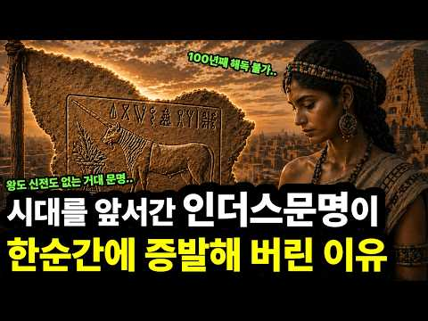
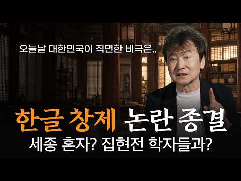
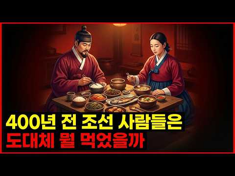
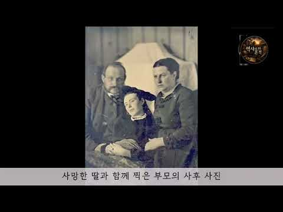
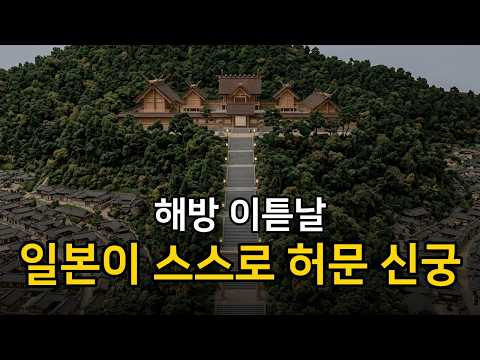

# 역사 — 성공 사례 분석: 사례별 자세히 #401–#440

`analysis.md` 의 9번 (같은 # 번호). 자동 생성 — `tools/success_analysis.py` v1.5.1 (2026-10-24 07:34 UTC). ※ 연구·교육용 — 투자 권유가 아님.

### 401. 사계 (四季) ∣ 조선힙합 (Official Music Video)

- https://www.youtube.com/watch?v=HUl-kxbFBII · 조선힙합 Official · 구독자 30,000 · 조회수 325,138 (×10.8, 하루 2,515.1) · 좋아요 711 (0.2%) · 5.8분 · 2026-06-17 · 주제 묶음 3. 조선 · 형식 정보·해설 (그 밖) · 폴더 `W_HUl-kxbFBII` (웹 승인)
- 썸네일: 
- 설명 앞부분: 꽃은 피고 지고, 계절은 다시 돌아옵니다. 《사계 (四季)》는 봄, 여름, 가을, 겨울을 따라 흐르는 한 사람의 인생을 담은 곡입니다. 꿈을 품었던 봄, 뜨겁게 달렸던 여름, 지나온 시간을 돌아보는 가을, 그리고 모든 것을 품어내는 겨울. 우리는 수많은 계절을 지나며 살아갑니다. 때로는 꽃처럼 피어나고, 때로는 낙엽처럼 흩어지지만, 겨울 끝에 다시 봄이 찾아오듯 우리의 삶 또한 계속 이어집니다. 조선의 정서와 현대 힙합의 감성을 담아 사계절의 순환 속에 인생의 이야기를 그려냈습니다. 🎧 Music by 조선힙합 Official l…
- 같은 채널 평소 대비 ×43.3 (채널 최근 롱폼 중앙값 7,516회) · 평소 영상: 신이있다면 OFFICIAL MV 1시간 연속듣기 (7,516회) / 그대곁에 OFFICIAL MV 1시간 연속듣기 (8,239회)
- 대본 없음 (설명) — 음성인식이 끝나면 도입부·흐름이 들어감
- 댓글 95/97: 좋은 점 — 영상 0 · 감사·응원 7 · 더 알고 싶은 것 3 · 아쉬운 점 — 영상 1 · 반박·불만 — 의견 다름 0 · 정치·사회 1 · 경험 공유 1 · 구독·다음 기대 1
  - 감사·응원 👍11 “유튜브 처음으로 조선힙합에 정기결재 했네요 저에겐 너무 크나큰 힐링 입니다 감사해요~~^^”
  - 감사·응원 👍4 “좋은노래 잘듣고 갑니다~ 감사합니다^_^”
  - 더 알고 싶은 것 👍2 “명곡이네요 Ai로 만들어진게 맞나요? 한편의 시보다 가사 내용이 좋아서 자꾸자꾸 듣게되요 뜰수밖에없는 노래 응원합니다”
  - 아쉬운 점 — 영상 👍2 “노래가 아니라 시다!! 또 무한반복하겠네 ^^”
  - 정치·사회 👍0 “주자성리학탈레반의 조선! 조선왕은 백성등쳐먹은 기득권! 조선미화는 시대착오적 이나라가 다시 조선으로회귀해도아무것도모르는 우매한국민들 안타깝다”
  - 경험 공유 👍3 “정말 나온날부터 계속 들어요 한국적인 음악 국악느낌의 음악 제가 너무 좋아합니다. 죽을때까지 들어볼께요~”
  - 구독·다음 기대 👍1 “멜론엔 이노래 안뜨내요 매일 듣고싶은데 ㅜ”

### 402. [🌙조선시대] 한편으로 보는 임진왜란 ∣ 1592년-1599년, 7년 전쟁 전과정

- https://www.youtube.com/watch?v=9ZEt85_5oyw · 별빛연대기 · 구독자 3,030 · 조회수 31,915 (×10.5, 하루 794.4) · 좋아요 146 (0.5%) · 113.7분 · 2026-09-14 · 주제 묶음 3. 조선 · 형식 정보·해설 (그 밖) · 폴더 `W_9ZEt85_5oyw` (웹 승인)
- 썸네일: 
- 설명 앞부분: 1592년 4월, 부산에 상륙한 일본군은 불과 수십 일 만에 한성을 점령하고 평양까지 북상했습니다. 조선은 전쟁 준비가 부족했고, 초기 전투에서 연이어 패배했습니다. 그러나 전쟁은 일본의 예상대로 끝나지 않았습니다. 바다에서는 이순신과 조선 수군이 일본군의 보급로를 위협했고, 육지에서는 의병과 관군이 곳곳에서 저항했습니다. 명나라의 참전 이후 전쟁은 조선과 일본만의 싸움을 넘어 동아시아 전체가 얽힌 장기전으로 변해갔습니다. 평양성 전투, 행주대첩, 한산도대첩, 진주성 전투, 강화 협상, 정유재란, 명량해전, 울산성 전투, 그리고 …
- 같은 채널 평소 대비 ×4.2 (채널 최근 롱폼 중앙값 7,664회) · 평소 영상: [🌙한국전쟁] 북한군의 남하를 늦춘, 국군 제6사단의 6일 - 춘천,홍천 전투 (7,664회) / [🌙별빛 전투사 ] 1편 전격전의 서막, 폴란드 침공 (7,749회)
- 대본 없음 (설명) — 음성인식이 끝나면 도입부·흐름이 들어감
- 댓글 20/20: 좋은 점 — 영상 2 · 감사·응원 1 · 더 알고 싶은 것 1 · 아쉬운 점 — 영상 0 · 반박·불만 — 의견 다름 0 · 정치·사회 0 · 경험 공유 0 · 구독·다음 기대 0
  - 좋은 점 — 영상 👍2 “한 편으로 임진왜란의 전체 흐름을 보니까 그동안 따로 알고 있던 전투들이 어떻게 연결되는지 이제야 이해가 되네요. 이순신 장군의 해전뿐만 아니라 육지에서의 전투, 의병, 명나라 참전, 강화협상과 정유재란까지 이어지는 과정이 정말 복잡했군요. 긴 영상인데도 차분하게 들…”
  - 감사·응원 👍2 “임진왜란 전편을 볼수 있어 좋으네요. 우리가 잘 알고있다고 생각하는 전쟁이지만 다시 보니 새롭고, 모르고 있던 세세한 부분까지 들여다 볼수있는 영상이네요 잘봤습니다 감사합니다❤”
  - 더 알고 싶은 것 👍2 “한 편으로 임진왜란의 전체 흐름을 보니까 그동안 따로 알고 있던 전투들이 어떻게 연결되는지 이제야 이해가 되네요. 이순신 장군의 해전뿐만 아니라 육지에서의 전투, 의병, 명나라 참전, 강화협상과 정유재란까지 이어지는 과정이 정말 복잡했군요. 긴 영상인데도 차분하게 들…”

### 403. 왕위를 포기한 효령대군, 91세까지 살아남은 기막힌 비밀 ∣ 태종 이방원의 아들 ∣ 조선역사

- https://www.youtube.com/watch?v=jCwsp1nTcXQ · 별이수놓은 역사 · 구독자 15,400 · 조회수 158,752 (×10.3, 하루 1,353.7) · 좋아요 3,277 (2.1%) · 35.7분 · 2026-06-29 · 주제 묶음 1. 역사 일반·이야기 · 형식 정보·해설 (그 밖) · 폴더 `W_jCwsp1nTcXQ` (웹 승인)
- 썸네일: 
- 설명 앞부분: 📜 왕이 되지 못한 둘째 왕자, 효령대군 — 91년을 살아남은 자의 비밀 조선 태종 이방원의 둘째 아들, 효령대군. 🏯 형 양녕대군은 폐세자가 되었고, 동생 충녕대군은 세종대왕이 되었습니다. 그 사이에 끼어 왕좌를 놓친 둘째는, 무려 91세까지 살아남았습니다. ⏳ 형도, 동생도, 조카도 모두 먼저 떠나보내고 홀로 남은 한 사람. 그가 살아 있는 동안 조선의 왕은 무려 아홉 번이나 바뀌었습니다. 👑 권력을 포기하고 불교에 귀의한 그의 선택은 패배였을까요, 아니면 또 다른 승리였을까요? 🤔 그리고 600년이 흐른 뒤, 조선의 마지막을…
- 같은 채널 평소 대비 ×30.7 (채널 최근 롱폼 중앙값 5,179회) · 평소 영상: 한국판 오디세이 최부의 표해록, 우리만 가치를 모르고 있는 세계3대 중국견문록 (5,179회) / 심수경이 갈아치운 역대급 최초최다 기록들, 75세 최고령 정승, 77세 의병 총괄대장, … (4,660회)
- 대본 없음 (설명) — 음성인식이 끝나면 도입부·흐름이 들어감
- 댓글 318/319: 좋은 점 — 영상 1 · 감사·응원 15 · 더 알고 싶은 것 2 · 아쉬운 점 — 영상 2 · 반박·불만 — 의견 다름 1 · 정치·사회 4 · 경험 공유 9 · 구독·다음 기대 0
  - 감사·응원 👍15 “역시 이야기 감사합니다 다시 배우는 느낌으로 듣습니다 그동안 잊고 살았던 역사 이야기 , 또 ㄷ고싶습니다 감사합니다.”
  - 감사·응원 👍9 “도쿄에서살고있어요 재밌게듣고있어요 공부도되고요 감사합니다🎉”
  - 더 알고 싶은 것 👍2 “무림군은 그럼 어느정도 위치였나요?”
  - 더 알고 싶은 것 👍0 “동생의 목숨같았던 손자가 조카에게 무자비하게 해침을 당할때 과연 무엇을 했는지가 참으로 궁금합니다 아무리 불심이 강해서 거기에만 몰입했다고쳐도 나라의 어른 으로써 꼭 해야할 말을 못했다면 참으로 실망스럽습니다 불심이 뭔지를 아는지 모른는지 ㅠ 그렇게 장수하고 싶었나 ㅠ”
  - 아쉬운 점 — 영상 👍1 “단종이 그렇게 되면서 세종의 대가 끊겼다는게 가장 아쉽습니다 어떤 천재가 나와서 나라에 어떤 귀한 힘을 실어줬을지가 진짜 궁금해지네요 속절없지만. 증손자가 세종보다 더 위대 한 왕이 됐을지도~~ㅠ”
  - 아쉬운 점 — 영상 👍0 “동생의 목숨같았던 손자가 조카에게 무자비하게 해침을 당할때 과연 무엇을 했는지가 참으로 궁금합니다 아무리 불심이 강해서 거기에만 몰입했다고쳐도 나라의 어른 으로써 꼭 해야할 말을 못했다면 참으로 실망스럽습니다 불심이 뭔지를 아는지 모른는지 ㅠ 그렇게 장수하고 싶었나 ㅠ”
  - 정치·사회 👍14 “정권을 잡고 국민혈세, 국고를 도적질하여 자신들이 부귀영화만을 위해 정치를 하던 무리배들, 왕일찌라도 서슴없이 독살을 하고 유약한 왕을 세우고 자신들의 호사만을 위해 나라도 팔아먹은 매국노들, 그 후예들이 지금도 똑같은 DNA을 이어받고, 여전히 국회에 공천금 내고 …”
  - 정치·사회 👍2 “결국은 긴인생이,, 고종으로 이어져,,,나라가 일본으로 넘어갔네요,,”
  - 경험 공유 👍10 “저도 효령대군의 후손 입니다ᆢ”
  - 경험 공유 👍1 “네 저도 효령대군님의 18대손 입니다 좋은 역사의 기록과 해설 감사드립니다”

### 404. 무자비한 파괴자...? 고대문명을 몰락시킨 미스터리한 바다 민족의 충격적인 실체 l 바다민족의 역사

- https://www.youtube.com/watch?v=fo3UgV-bl8E · 역사포커스 · 구독자 10,300 · 조회수 105,844 (×10.3, 하루 596.8) · 좋아요 1,378 (1.3%) · 37.9분 · 2026-04-29 · 주제 묶음 1. 역사 일반·이야기 · 형식 정보·해설 (그 밖) · 폴더 `W_fo3UgV-bl8E` (웹 승인)
- 썸네일: 
- 설명 앞부분: 기원전 1200년, 정체불명의 ‘바다 민족’이 동지중해를 휩쓸며 한 시대를 끝냈습니다. 하지만 그들은 단순한 침략자가 아니라, 가뭄과 붕괴 속에서 떠밀린 난민이자 생존자였습니다. 무너진 청동기 문명 위에서 철과 알파벳, 새로운 세계 질서가 탄생합니다. 그리고 그들의 흔적은 지금도 우리가 쓰는 글자와 지명 속에 남아 있습니다. 📢BGM Track - PerituneMaterial - Melancholy3
- 같은 채널 평소 대비 ×21.4 (채널 최근 롱폼 중앙값 4,948회) · 평소 영상: 핵보유국을 건드린 최빈국.. 아프간이 싸움을 멈추지 않는 진짜이유 l 파키스탄 아프가니스… (4,948회) / 로마도 정복 못한 스코틀랜드 북부의 지배자, 픽트족이 사라진 충격적인 이유 l 픽트족 역… (4,783회)
- 대본 없음 (설명) — 음성인식이 끝나면 도입부·흐름이 들어감
- 댓글 85/86: 좋은 점 — 영상 1 · 감사·응원 3 · 더 알고 싶은 것 0 · 아쉬운 점 — 영상 0 · 반박·불만 — 의견 다름 1 · 정치·사회 3 · 경험 공유 1 · 구독·다음 기대 0
  - 좋은 점 — 영상 👍10 “얼핏 보면 요즘 흔한 양산형 AI 렉카인 것 같지만 알고보면 참 귀하고 유익한 채널임.”
  - 감사·응원 👍2 “선생님 오늘도 배우고 이습니다 감사 드려요😅”
  - 감사·응원 👍1 “오늘은2026년5월2일 토요일 현재시각 오후9시47분 여호와의눈이 온땅을 두루감찰하사 전심으로 자기를 향하는자에게 능력을 베푸시나니라고 말씀하신주님 아버지하나님 캐나다 잠수함사업80조수주를 미국해군군함 구축함 이지스함 잠수함 프릿킷트함 무인잠수정 줌왈트건조 항공모함건…”
  - 반박·불만 — 의견 다름 👍3 “바이킹의 이미지가 셰르덴 해적들때문에 생긴듯... 뿔달린 투구, 방패, 칼... 원래 진짜 바이킹은 그런 이미지가 아닌데 영화때문에 그렇게 알고 있다고 하는데 그 영화를 만들때 참고한 이미지가 셰르덴인들 이었나보다.”
  - 정치·사회 👍1 “드라마틱한 해양민족 침략과 청동기시대의 종말! 중국 은 청동으로 제기를. 중동 메소포타미아 이집트 레판트 아나톨리아 는 무기를 만들었네! 화약으로 중국인은 폭죽을 유럽인은 대포를. 만들어 역사를 바꾸었다!”
  - 정치·사회 👍1 “오늘은2026년5월2일 토요일 현재시각 오후9시46분 일을행하는 여호와 그것을 지어성취하시는 여호와 그이름을 여호와라 하는자가 이같이 이르노라 너는 내게 부르짖으라 내가 네게 응답하겠고 네가 알지못하는 크고 비밀한일을 네게 보이리라 말씀하신주님 아버지하나님 존경하는 …”
  - 경험 공유 👍1 “오늘은2026년5월2일 토요일 현재시각 오후9시46분 일을행하는 여호와 그것을 지어성취하시는 여호와 그이름을 여호와라 하는자가 이같이 이르노라 너는 내게 부르짖으라 내가 네게 응답하겠고 네가 알지못하는 크고 비밀한일을 네게 보이리라 말씀하신주님 아버지하나님 존경하는 …”

### 405. 세종대왕님 감사합니다. 베토벤 9번 환희의 송가 지휘하면서 한글로 불러봤습니다ㅣ닌텐도 스위치 마에스트로

- https://www.youtube.com/watch?v=tN1bnh8GQOI · 사이좋음 · 구독자 3,230 · 조회수 33,181 (×10.3, 하루 2,174.4) · 좋아요 599 (1.8%) · 5.3분 · 2026-10-09 · 주제 묶음 3. 조선 · 형식 브이로그·직접 해본 이야기 · 폴더 `W_tN1bnh8GQOI` (웹 승인)
- 썸네일: 
- 설명 앞부분: 🇰🇷 **한글날 특집! 베토벤 9번을 한글로?! 준비했습니다. 🎼 베토벤 교향곡 제9번 4악장 「환희의 송가」 독일어 가사를 한국어로 번역하고, 직접 노래까지 부르면서 지휘해봤습니다. 🎤 그런데 왜 곤룡포에 익선관까지 썼냐고요? 한글날 기념으로 남편 놀리면 재밌잖아요. 👑 성악 전공자가 마에스트로 게임을 만나면 벌어지는 일ㅋㅋㅋ 오늘도 쓸데없이 진지한 남편의 도전, 재밌게 봐주세요! 🇰🇷 **훈민정음 창제의 뜻을 기리며, 한글날을 축하합니다. 나랏말싸미 듕귁에 달아 문자 와로 서르 사맛디 아니할세 이런 전차로 어린 백셩이 니르고져…
- 같은 채널 평소 대비 ×0.5 (채널 최근 롱폼 중앙값 63,569회) · 평소 영상: [전문가 난이도] 음대 출신 남편이 낋여주는 베르디 레퀴엠中 진노의 날:Dies irae… (63,569회) / 지휘게임에 너무 진심이었더니 댓글이 쏟아졌습니다ㅋㅋ ∣ 닌텐도 스위치 마에스트로 (75,328회)
- 대본 없음 (설명) — 음성인식이 끝나면 도입부·흐름이 들어감
- 댓글 242/242: 좋은 점 — 영상 1 · 감사·응원 8 · 더 알고 싶은 것 0 · 아쉬운 점 — 영상 1 · 반박·불만 — 의견 다름 0 · 정치·사회 0 · 경험 공유 9 · 구독·다음 기대 1
  - 좋은 점 — 영상 👍2 “잘 봤어요!! 친근하게 좋은 곡을 알려줘서 고마워요😊”
  - 감사·응원 👍22 “배 보고 성악 전공이라고 예상했는데 바리톤이셨다니👍 고품격 게임방송 감사합니다 ❤”
  - 감사·응원 👍3 “진화하는 컨텐츠에 댓글을 안쓸 수가 없었습니다 존경스럽습니다 ㅠㅠ.. 부드러운 날개가 귓가에 맴도는 ㅋㅋㅋㅋ 가사에서 빵빵터지네요 정성 가득한 영상 멋집니다 화이팅 😂”
  - 아쉬운 점 — 영상 👍1 “제목에 노래부르면서 한 점을 강조해봐요 어그로 좀 더 끌어봅시다!”
  - 경험 공유 👍122 “내가 살다살다 나인심포니 소프라노 멜로디를 다 불러보네... 지금 살아서 이 댓글 달고 있는 게 기적이다 진짜😢”
  - 경험 공유 👍18 “이런 정성스런 영상을 누추한 제가 보다니...너무 멋져요”

### 406. [🌙조선시대] 조선 산성방어 왜 무너졌나? - 병자호란

- https://www.youtube.com/watch?v=TiyiiqTQTWs · 별빛연대기 · 구독자 3,030 · 조회수 31,092 (×10.3, 하루 1,757.2) · 좋아요 83 (0.3%) · 100.7분 · 2026-10-06 · 주제 묶음 3. 조선 · 형식 수면·낭독 (잠잘 때 듣는) · 폴더 `W_TiyiiqTQTWs` (웹 승인)
- 썸네일: 
- 설명 앞부분: 🌙 잠자기 전에 듣는 역사이야기 — 병자호란 풀스토리 1636년 겨울, 청 태종 홍타이지가 이끄는 청군이 압록강을 넘어 조선으로 진격합니다. 불과 열흘 남짓한 시간 만에 청군은 한양 가까이까지 도달했고, 인조와 조선 조정은 남한산성으로 들어갑니다. 그러나 혹독한 겨울. 끊어져 가는 식량과 군량. 도착하지 못한 근왕군. 그리고 강화도의 함락. 남한산성 안에서는 끝까지 싸워야 한다는 척화론과 백성과 나라를 보존하기 위해 화의를 해야 한다는 주화론이 충돌합니다. 결국 1637년 음력 1월 30일, 인조는 남한산성을 나와 삼전도로 향합니…
- 같은 채널 평소 대비 ×4.1 (채널 최근 롱폼 중앙값 7,664회) · 평소 영상: [🌙한국전쟁] 북한군의 남하를 늦춘, 국군 제6사단의 6일 - 춘천,홍천 전투 (7,664회) / [🌙별빛 전투사 ] 1편 전격전의 서막, 폴란드 침공 (7,749회)
- 대본 없음 (설명) — 음성인식이 끝나면 도입부·흐름이 들어감
- 댓글 13/13: 좋은 점 — 영상 1 · 감사·응원 1 · 더 알고 싶은 것 0 · 아쉬운 점 — 영상 0 · 반박·불만 — 의견 다름 0 · 정치·사회 0 · 경험 공유 0 · 구독·다음 기대 0
  - 좋은 점 — 영상 👍2 “삼전도 장면으로 시작해서 끝까지 몰입해서 봤습니다. 정묘호란부터 차근차근 짚어주시니 왜 그 지경까지 갔는지 비로소 이해가 되네요. 잘 봤습니다”

### 407. 《무장가문을 사로잡은 아기 복덩이》∣ [사극 힐링] 거친 무장 가문에 떨어진 복덩이 아기?! 냉혹한 장군 형제들을 전부 사로잡는다🏮🍡

- https://www.youtube.com/watch?v=WkSUWR9v6uY · 드라마 정주행 DramaBinge · 구독자 16,200 · 조회수 166,072 (×10.2, 하루 3,550.6) · 좋아요 1,366 (0.8%) · 109분 · 2026-09-07 · 주제 묶음 3. 조선 · 형식 몰아보기·통합본 (긴 영상) · 폴더 `W_WkSUWR9v6uY` (웹 승인)
- 썸네일: 
- 설명 앞부분: 민간에서 떠돌던 행운의 아기. 냉혹한 장군 가문에 돌아와 모든 위험을 막아낸다. 온 가족이 아기만 바라보는 총애받는 삶. ❗❗❗미성년자는 팔로우 및 시청을 금지합니다❗❗❗ [창작물 성명] 콘텐츠 성격: 본 채널의 콘텐츠는 주로 독창적인 숏폼 드라마와 영화로 구성되어 있으며, 이는 유튜브의 EDSA(교육, 다큐멘터리, 과학 및 예술) 정책의 "예술적" 범주에 속합니다. 미성년자 보호: 본 영상에 등장하는 모든 미성년자 인물은 전문 배우 또는 자원봉사 배우가 연기했습니다. 모든 촬영은 안전하고 전적으로 규정을 준수하는 환경을 보장하기…
- 같은 채널 평소 대비 ×45.9 (채널 최근 롱폼 중앙값 3,620회) · 평소 영상: 《사약 받던 요후가 번왕을 침실로 불렀다》∣ [계략사이다] "당장 요후의 목을 베라!" … (3,620회) / 《천재 파티시에, 천년의 과거에서 악녀로 눈뜨다》∣ [선결혼후사랑] "이혼 도장 찍자더니… (3,250회)
- 대본 없음 (설명) — 음성인식이 끝나면 도입부·흐름이 들어감
- 댓글 63/63: 좋은 점 — 영상 1 · 감사·응원 1 · 더 알고 싶은 것 0 · 아쉬운 점 — 영상 2 · 반박·불만 — 의견 다름 0 · 정치·사회 0 · 경험 공유 0 · 구독·다음 기대 0
  - 좋은 점 — 영상 👍1 “좋은 내용입니다. 아침이 즐겁네요. 한 사람에 영향력은 남녀노소를 가르지 않지만 어린아이에 영향력은 와~ 좋은 영상 감사합니다 ^^”
  - 감사·응원 👍1 “좋은 내용입니다. 아침이 즐겁네요. 한 사람에 영향력은 남녀노소를 가르지 않지만 어린아이에 영향력은 와~ 좋은 영상 감사합니다 ^^”
  - 아쉬운 점 — 영상 👍4 “마오마오 고대버전이네요. 마오마오 귀여움을 제대로 못살린게 너무 아쉽네요. 이건 무조건 애니버전으로 보는 걸 추천!! 보면 무슨 말인지 이해 될거임.”
  - 아쉬운 점 — 영상 👍1 “간만에 재미있게 힐링 하고 가요 ~ 스토리가 쫌 짧은게 아쉬워요 ~ 수고 하세요...😊😊😊😊”

### 408. 지는 사람 목을 벤다｜사백 년 전 두만강 군영에서 실제로 벌어진 일 ∣조선이 감춘 북방 근무 1년의 기록 ∣ 부북일

- https://www.youtube.com/watch?v=0Si50CybDIU · 역사아카이브 - History Archive KR · 구독자 24,400 · 조회수 247,084 (×10.1, 하루 3,019.3) · 좋아요 1,748 (0.7%) · 91.5분 · 2026-08-03 · 주제 묶음 3. 조선 · 형식 정보·해설 (그 밖) · 폴더 `W_0Si50CybDIU` (웹 승인)
- 썸네일: 
- 챕터: 0:00 문천의 밤, 칼로 끊긴 사립문 · 2:10 부북일기란 무엇인가 / 부방 제도 · 7:30 아버지 박계숙, 1605년의 길 · 13:00 마운령의 시체 두 구 · 17:20 첨사와의 정면 충돌, 곤장 세 대 · 21:40 회령 기생 배종, 그리고 딸 월매 · 25:00 아들 박취문, 1644년 겨울의 출발 · 30:30 회령 도착 — 적보다 무서운 텃세 · 36:00 활쏘기 125회, 훈련이자 유흥 · 41:00 지는 자의 목을 베라 — 참수 내기 · 46:30 호반적자 사건과 곤장 여덟 대 · 51:00 동방급제자의 의리, 김사룡 사건 · 55:20 청 사신이 활쏘기를 구경하다 · 59:00 울산에서 온 편지 한 장 · 62:30 사십 년을 건너온 만남 · 67:00 무과 초시 부정에 항의하다 · 71:00 조총 400자루 — 청렴이 족쇄가 되다 · 78:00 방환, 그리고 문천의 밤 · 83:00 아버지의 마지막 해 · 86:00 79장의 종이가 남긴 것
- 설명 앞부분: 조선의 군인이라 하면 우리는 임진왜란과 병자호란을 떠올립니다. 그러나 조선 군인의 삶에서 압도적인 비중을 차지한 것은 전투가 아니라, 아무 일도 일어나지 않는 국경을 지키는 일이었습니다. 울산박물관에 보관된 울산광역시 유형문화재 제14호 『부북일기(赴北日記)』는 그 잊힌 일상을 통째로 담은 유일무이한 기록입니다. 울산 박씨 박계숙(1569~1646)과 아들 박취문(1617~1690)이 39년의 간격을 두고 각각 함경도 회령으로 부방을 다녀오며 남긴 부자 2대의 종군일기. 눈보라와 굶주림만 있는 것이 아닙니다. 텃세와 뒷거래, 활쏘…
- 같은 채널 평소 대비 ×12.9 (채널 최근 롱폼 중앙값 19,202회) · 평소 영상: [5시간 연속재생] 조선시대 생활사 8번째 통합 ∣ 우리 조상들의 모습 (20,263회) / 인질이었던 왕자가 왕이 되어 복수를 꿈꾸다 ∣ 효종 북벌의 진실 (18,141회)
- 대본 없음 (설명) — 음성인식이 끝나면 도입부·흐름이 들어감
- 댓글 38/38: 좋은 점 — 영상 1 · 감사·응원 1 · 더 알고 싶은 것 0 · 아쉬운 점 — 영상 1 · 반박·불만 — 의견 다름 1 · 정치·사회 2 · 경험 공유 1 · 구독·다음 기대 0
  - 좋은 점 — 영상 👍9 “역사를 배웠으면 조선이 성리학의 나라라는 헛소리는 하지마라”
  - 감사·응원 👍12 “나도.나름.역사에관심.책도.읽었습니다.이런.소중한.기록.책을.소개해주어.너무감사합니다.”
  - 아쉬운 점 — 영상 👍1 “내용보다..광고가 더 오래니..몰 보았는지 모르겠네..”
  - 반박·불만 — 의견 다름 👍9 “역사를 배웠으면 조선이 성리학의 나라라는 헛소리는 하지마라”
  - 경험 공유 👍12 “나도.나름.역사에관심.책도.읽었습니다.이런.소중한.기록.책을.소개해주어.너무감사합니다.”

### 409. 임금을 능멸한 명나라 사신의 코를 납작하게 만든 8살 세자 ∣ 야담 ∣ 옛날이야기 ∣ 민담 ∣ 수면동화 ∣ 오디오북

- https://www.youtube.com/watch?v=SAbogjdAt5c · 재미난야담 · 구독자 2,840 · 조회수 28,760 (×10.1, 하루 464.9) · 좋아요 978 (3.4%) · 110.6분 · 2026-08-23 · 주제 묶음 9. 야사·야담·옛날이야기 · 형식 수면·낭독 (잠잘 때 듣는) · 폴더 `W_SAbogjdAt5c` (웹 승인)
- 썸네일: 
- 설명 앞부분: 여덟 살 세자 앞에서 대국 사신은 이 나라를 멸시하고 비웃었습니다. "임금부터가 우습구나!" 국서를 내던지며 던진 그 한마디에 어전은 얼어붙었습니다. 그런데 이 어린 세자에게 조정 대신들조차 알지 못하는 패가 하나 숨겨져 있었다는 것을 아무도 알지 못했습니다. 사흘의 시한을 걸고 시작된 문답 대결, 그 끝에 드러난 것은 사신의 정체만이 아니었습니다. 조선 야담 속에 전해지는 통쾌한 반전, 지금 함께 확인해보세요.
- 같은 채널 평소 대비 ×12.5 (채널 최근 롱폼 중앙값 2,300회) · 평소 영상: 12살 많은 동네 과부에게 청혼한 꼬마도련님, 그 진짜 이유는 ∣ 야담 ∣ 옛날이야기 ∣… (3,069회) / 병든 형을 위해 밤마다 서리하던 소년, 재판정에서 속임수를 짚어내다 ∣ 야담 ∣ 옛날이야… (1,530회)
- 대본 없음 (설명) — 음성인식이 끝나면 도입부·흐름이 들어감
- 댓글 56/56: 좋은 점 — 영상 0 · 감사·응원 0 · 더 알고 싶은 것 0 · 아쉬운 점 — 영상 1 · 반박·불만 — 의견 다름 0 · 정치·사회 1 · 경험 공유 1 · 구독·다음 기대 0
  - 아쉬운 점 — 영상 👍1 “1시간 넘으면 재밌 없는데요 지루하다 조그만 보고”
  - 정치·사회 👍1 “명나라에 꼼작 못하는 조선 조정은 조선을 세운 이성계가 고려를 배신하고 외세인 멍나라를 등에 업고 쿠데타로 정권을 잡았기 때문입니다”
  - 경험 공유 👍2 “주인공 세자 잘듣고 있습니다 허태 다른 야담 에서 벌써 시청 했습니다 너무 나도 똑같이 비슷하네요? 좋아요 ❤❤❤”

### 410. 현대 기술 뺨치던 거대문명... 고대 인더스문명이 한순간에 증발한 소름돋는 이유 l 인더스 문명 역사

- https://www.youtube.com/watch?v=J2GdQ6BT3rk · 역사포커스 · 구독자 10,300 · 조회수 103,965 (×10.1, 하루 579.7) · 좋아요 1,371 (1.3%) · 53.5분 · 2026-04-27 · 주제 묶음 1. 역사 일반·이야기 · 형식 정보·해설 (그 밖) · 폴더 `W_J2GdQ6BT3rk` (웹 승인)
- 썸네일: 
- 설명 앞부분: 사천 년 전, 믿기 힘들 만큼 정교한 도시를 만든 인더스 문명. 하지만 이름조차 남기지 않은 채 조용히 사라진 이 거대한 문명의 진짜 이유는 무엇일까. 전쟁도, 침략도 아닌 환경 변화와 인간의 선택이 만든 몰락의 이야기. 우리가 지금까지도 이어받고 있는 그들의 흔적을 끝까지 따라가 봅니다. 📢BGM Track - PerituneMaterial - Melancholy3
- 같은 채널 평소 대비 ×21.0 (채널 최근 롱폼 중앙값 4,948회) · 평소 영상: 핵보유국을 건드린 최빈국.. 아프간이 싸움을 멈추지 않는 진짜이유 l 파키스탄 아프가니스… (4,948회) / 로마도 정복 못한 스코틀랜드 북부의 지배자, 픽트족이 사라진 충격적인 이유 l 픽트족 역… (4,783회)
- 대본 없음 (설명) — 음성인식이 끝나면 도입부·흐름이 들어감
- 댓글 67/68: 좋은 점 — 영상 0 · 감사·응원 1 · 더 알고 싶은 것 0 · 아쉬운 점 — 영상 0 · 반박·불만 — 의견 다름 0 · 정치·사회 0 · 경험 공유 0 · 구독·다음 기대 0

### 411. 🌙 [잘 때 듣는] 로마는 왜 300년 동안 박해하던 기독교를 받아들였을까? ∣ 콘스탄티누스 대제의 일생 (100분) ∣ 숙면 세계사 ∣ 오디오북 ASMR

- https://www.youtube.com/watch?v=yz5rgz5s2YE · 잘 때 듣는 - 숙면 세계사 · 구독자 11,200 · 조회수 112,826 (×10.1, 하루 1,431.9) · 좋아요 2,080 (1.8%) · 98.6분 · 2026-08-06 · 주제 묶음 10. 수면·낭독 · 형식 수면·낭독 (잠잘 때 듣는) · 폴더 `W_yz5rgz5s2YE` (웹 승인)
- 썸네일: 
- 챕터: 0:00 프롤로그 - 자주색 황제복을 내려놓은 밤 · 2:48 제1장 병들어가는 제국, 로마 · 8:48 제2장 황금 인질로 자란 소년 · 15:26 제3장 밤을 가르는 탈출 · 21:24 제4장 권력의 격돌과 카이사르의 자리 · 28:29 브릿지1 왜 로마는 기독교를 박해했을까 · 33:58 제5장 밀비우스 다리, 방패 위의 카이로 · 40:43 제6장 313년 밀라노 칙령 · 46:08 제7장 다신교의 한계 · 51:47 브릿지2 단 하나의 신을 원한 이유 · 54:30 제8장 두 개의 태양, 제국의 통일 · 60:13 제9장 325년 니케아 공의회 · 65:42 제10장 로마의 심장이 된 기독교 · 71:08 브릿지3 황제가 잃은 가장 가까운 사람들 · 74:07 제11장 콘스탄티노폴리스의 탄생 · 80:08 제12장 궁전의 비극, 네 가지 가설 · 85:31 제13장 금화 솔리두스와 개혁 · 91:05 제14장 평생 미루어 온 세례 · 96:37 에필로그 - 천 년의 지형도를 바꾸다
- 설명 앞부분: 🌙 안녕하세요, 잘 때 듣는 숙면 세계사 '잘숙세'입니다. 오늘 밤, 여러분의 머리맡에 한 황제의 예순다섯 해를 펼쳐 드립니다. 337년 5월, 니코메디아의 어느 궁전. 임종을 앞둔 노황제가 가장 먼저 벗어 던진 것은 황제의 상징, 왕관이었습니다. 평생 로마를 다스려온 이 남자는 왜 죽음을 눈앞에 두고서야 순백의 세례복을 입었을까요. 인질로 끌려간 소년은 어떻게 로마 제국 유일의 황제가 되었는가, 하늘에서 본 낯선 문양 하나는 어떻게 300년의 박해를 끝냈는가, 가장 아끼던 장남과 아내를 향해 황제는 왜 차가운 명령을 내렸는가, …
- 같은 채널 평소 대비 ×4.8 (채널 최근 롱폼 중앙값 23,404회) · 평소 영상: 🌙 [잘 때 듣는] 17세기 최고 스캔들｜절친이었던 교황은 왜 갈릴레오를 고문하려 했을까… (23,438회) / 🌙 [잘 때 듣는] 프랑스 혁명 풀버전 - 가장 청렴했던 남자는 왜 광기의 독재자가 되었… (23,369회)
- 대본 없음 (설명) — 음성인식이 끝나면 도입부·흐름이 들어감
- 댓글 87/87: 좋은 점 — 영상 1 · 감사·응원 11 · 더 알고 싶은 것 0 · 아쉬운 점 — 영상 1 · 반박·불만 — 의견 다름 5 · 정치·사회 3 · 경험 공유 2 · 구독·다음 기대 0
  - 좋은 점 — 영상 👍5 “감사합니다 ^^ 잘 듣고 배웠습니다.”
  - 감사·응원 👍11 “고맙습니다.❤”
  - 감사·응원 👍5 “감사합니다 ^^ 잘 듣고 배웠습니다.”
  - 아쉬운 점 — 영상 👍0 “기독교가 박해를 받은 이유가 황제숭배 거부 때문만이 아닙니다 또 다른 더 중요한 이유가 있습니다 로마 역사책에도 기록된 겁니다 하지만 나라들은 그 이유를 말하기를 불편해 합니다 역사학자들이 로마 역사를 말할 때 부각시키지 않고 은근슬쩍 넘어가는 문제가 있습니다 역사학…”
  - 반박·불만 — 의견 다름 👍0 “기독교가 박해를 받은 이유가 황제숭배 거부 때문만이 아닙니다 또 다른 더 중요한 이유가 있습니다 로마 역사책에도 기록된 겁니다 하지만 나라들은 그 이유를 말하기를 불편해 합니다 역사학자들이 로마 역사를 말할 때 부각시키지 않고 은근슬쩍 넘어가는 문제가 있습니다 역사학…”
  - 정치·사회 👍8 “하나님께서 예루살렘에서 시작된 예수의 죽음에서의 부활 복음을 전 세계인들에게 퍼지게 하기위한 대들보로 로마를 사용했고 대영제국이 그 뒤를 미국이 그 바톤을받아 기독교를 지키고 이스라엘을 지키고 선교사를 가장많이 파송하고있다, 만일 하나님의 계획을 거부하면 그나라는 폭…”
  - 정치·사회 👍7 “비유하는 얘기로 풀자면.. 일본이 흥하다 정점에 이르러 드디어 내리막을 걷게 된 때쯤이라 하자. 지방 곳곳이 여러 우두머리가 나타나 (사두정치 ) 나뉘어 다스려지고 있던 때다. 다양한 잡신을 수없이 모셔 봐야 이렇게 별볼일 없이 쇠락하는구나 하는 깨달음을 갖게 된 시…”
  - 경험 공유 👍1 “훌륭하기가 페르시아 키루스대왕 같은 콘스탄티누스 이네요. 불행히도 가족간의 기독교신앙생활이 안되었고 아들 아내 비극을 겪고말았네요. 그래도 중국 한국 왕놈들처럼 호색 방탕 무절제 탐욕 부리지않은것만해도 하나님의 가호,축복을 누린 왕이다.”
  - 경험 공유 👍0 “그는 😮 기독교를 정치적으로 이용하려고 81권의 성경중 15개를 없애고 66개만 남겨 왜곡했었지”

### 412. "어떻게 하루 종일 안지치고 싸웠을까?｜세계 최강 로마군의 ‘병력 교대’ 시스템"

- https://www.youtube.com/watch?v=0G6JWsVnOdc · 슬기로운 역사보기 · 구독자 16,300 · 조회수 163,292 (×10.0, 하루 1,856.8) · 좋아요 1,510 (0.9%) · 13.7분 · 2026-07-28 · 주제 묶음 5. 세계사·서양사 · 형식 정보·해설 (그 밖) · 폴더 `W_0G6JWsVnOdc` (웹 승인)
- 썸네일: 
- 설명 앞부분: 영화 속 로마군은 한 번 돌격하면 끝까지 밀어붙입니다. 하지만 실제 역사는 전혀 달랐습니다. 수십 킬로그램의 장비를 착용한 병사가 몇 시간 동안 계속 싸우는 것은 현실적으로 불가능했습니다. 그런데도 로마군은 아침부터 해 질 때까지 전투를 이어가며 지중해를 제패했죠. 그 비밀은 병사의 괴력도, 정신력도 아니었습니다. 바로 치밀하게 계산된 '병력 교대 시스템'이었습니다. 이 영상에서는 ⚔️ 로마군은 왜 몇 시간 동안 전투를 지속할 수 있었는가 ⚔️ 영화에서는 거의 볼 수 없는 트리플렉스 아키에스의 진실 ⚔️ 하스타티·프린키페스·트리아…
- 같은 채널 평소 대비 ×10.2 (채널 최근 롱폼 중앙값 16,033회) · 평소 영상: "포병들이 일부러 땅을 겨냥해서 대포를 쏜 이유｜라운드샷의 진짜 위력" (17,124회) / "전투기보다 ‘조종사’가 더 비싸다｜가장 위험한 임무의 탄생” (14,942회)
- 대본 없음 (설명) — 음성인식이 끝나면 도입부·흐름이 들어감
- 댓글 135/135: 좋은 점 — 영상 5 · 감사·응원 7 · 더 알고 싶은 것 0 · 아쉬운 점 — 영상 1 · 반박·불만 — 의견 다름 3 · 정치·사회 4 · 경험 공유 9 · 구독·다음 기대 0
  - 좋은 점 — 영상 👍35 “오~ 저같은 덕후에게 너무 너무 유익한영상이네요~ 역시 로마는 클라스가 다르네요”
  - 좋은 점 — 영상 👍9 “좋은 정보가 있는 영상이다 !!”
  - 감사·응원 👍76 “전투방식을 이렇게 디테일하게 보여주니까 어떻게 싸웠을지 보이는듯합니다 감사합니다”
  - 감사·응원 👍11 “아 이래서 로마 군단이 융통성이 뛰어났고 전술 변화에 민감했다고 하는군요. 백인대장의 역할이 눈앞에 그려집니다. 몇 십 년을 전쟁사를 공부했는데 이런 디테일을 놓쳤네요. 고맙습니다.”
  - 아쉬운 점 — 영상 👍5 “팔랑크스(로마 레기온도 팔랑크스의 일종) 끼리의 싸움은, 서로 밀착해서 방패 끼리의 힘겨루기 싸움이었음! 누가 방패를 더 강하게 잡고 버티느냐의 싸움으로, 방패를 떨어뜨리면 끝장! 서로 방패로 온 힘을 다해서 밀집해서 밀치기 때문에, 뭔, 싸우는 도중에 부대가 뒤로 …”
  - 정치·사회 👍3 “공들여 만드신 영상 잘 봤습니다. 그 동안의 나무와 숲을 동시에 볼 수 있는 영상들 중에서도, 특히 전체와 일부, 유기적인 연관성이 한번에 잘 표현되어서 보기가 편합니다. 본래 부분 요소들은 종이 위에서, 종합 편성은 머리속에서 이뤄지는건데, 짧은 영상으로도 표현해 …”
  - 정치·사회 👍0 “종합하면 고대에 갖추기 힘든 군사 조직력 이라는 것임. 그런데 당시 동아시아에서도 이 정도 조직적 군사력이 있었고 오히려 원거리 무기가 최적화 되었기에 로마 vs. 진나라 싸움은 진나라가 이겼을 가능성이 높음.”
  - 경험 공유 👍12 “오.. 안그래도 리치가 긴 호플리테스가 군단병보다 훨씬 강하지 않을까 생각했었는데, 기동성보단 이런 시스템이 강한거였군요.”
  - 경험 공유 👍7 “제목보고 갑자기 머리 속에 질문이 하나 생겨서 들어왔어요 ㅋㅋ 한번도 생각안해봤었는데 교대하는게 체력적으로 엄청 도움되었겠네요”

### 413. 일제강점기를 처음 제대로 공부한 일본인 아내의 반응

- https://www.youtube.com/watch?v=KIzkBsRwPzI · 유츄 Yuchu TV · 구독자 30,200 · 조회수 298,351 (×9.9, 하루 3,928.8) · 좋아요 7,122 (2.4%) · 13.1분 · 2026-08-09 · 주제 묶음 4. 한국 근현대사 · 형식 브이로그·직접 해본 이야기 · 폴더 `W_KIzkBsRwPzI` (웹 승인)
- 썸네일: 
- 설명 앞부분: 안녕하세요, 유츄TV입니다😊 한국에서 생활하면서 한국사를 조금씩 공부해왔지만, 이번에는 일제강점기의 역사를 좀 더 자세히 공부해봤습니다. 간도 참변을 비롯해 당시 있었던 여러 사건들을 하나씩 알아가면서 처음 알게 된 사실도 많았고, 마음이 무거워지는 순간도 있었습니다. 일본인인 제가 한국의 역사책을 통해 일제강점기를 공부하면서 어떤 부분에서 놀랐고, 어떤 생각이 들었는지 남편과 함께 솔직하게 이야기해봤습니다. 🇯🇵일본인 아내의 한국사 시르즈🇰🇷 1️⃣한일부부∣ 갑자기 한국 역사를 배우겠다는 일본인 아내… 이유를 듣고 놀랐습니다 2…
- 같은 채널 평소 대비 ×8.8 (채널 최근 롱폼 중앙값 33,741회) · 평소 영상: 한국 시누이와 일본 아내 조합이 의외로 잘 맞는 이유 (33,741회) / 한일부부∣일본인 아내가 처음으로 한국 삶에 절망했습니다 (32,888회)
- 대본 없음 (설명) — 음성인식이 끝나면 도입부·흐름이 들어감
- 댓글 2,584/2,671: 좋은 점 — 영상 21 · 감사·응원 173 · 더 알고 싶은 것 29 · 아쉬운 점 — 영상 20 · 반박·불만 — 의견 다름 108 · 정치·사회 228 · 경험 공유 149 · 구독·다음 기대 9
  - 좋은 점 — 영상 👍12 “한국 에서는 예전에 있었던 일들 말그대로 역사를 배우는 것인데 일본에서는 이것을 반일 교육 이라고 말도 안되는 트집을 잡는데 반일교육을 받아 본 적이 없어요. 일본이 한국을 근대화 시켰다는 것은 집에 강도가 들었다가 도망가면서 폰을 떨구고 갔는데 그게 경제에 도움이 …”
  - 좋은 점 — 영상 👍9 “지나간 과거의 일이라지만 자칫 불편할 수 있는 주제를 회피하지 않고 마주친 용기가 대단합니다. 올바른 과거를 알고 기억을 해야 미래에 서로 도움이 되는 관계가 될 수 있겠지요.”
  - 감사·응원 👍228 “당신의 잘못이아닙니다. 사실을 알고 기억해주고 미안해 해주시는것도 감사합니다.”
  - 감사·응원 👍162 “과거의 일본인이 했던 만행과 잘못을 현대의 일본인에게 대신 짊어지게 하거나 죗값을 치르라고 말하고 싶지 않습니다. 다만 과거를 바르게 인식하고 반성하며 인정하는 것, 그리고 후대에 올바른 역사를 전달하는 것을 우리는 원합니다. 이것들이 오롯이 이뤄지지 않았기 때문에 …”
  - 더 알고 싶은 것 👍7 “서대문형무소 함델꼬가주시고 마루타실험도 꼭 써치해서 알려주세요.😊”
  - 더 알고 싶은 것 👍6 “사실 일본은 사람으로써 할수없는 못된짖 너무 많이하였고 학살도 많았다. 우리 나라 공식적인 침략만714번 이란 기록도있다. 일본이 역사왜곡 안하고 미래를 위해 학생들에게 바른 역사관을 잘 가르쳐주길 바랄뿐이다.”
  - 아쉬운 점 — 영상 👍6 “이상해서 영상 목록보니 명성 황후에서 헛웃음만..이 사람들 방향을 이상하게 잡았네..식민지 시절 일본의 잘못을 배우고 조선인의 고통을 공감? 이러면 무턱대고 좋아할 줄 알았나? 학교에서 가르치는 피해 의식으로 점철된, 역사 사기꾼들이 쓴 가짜 역사서 공부한다고 하면 …”
  - 아쉬운 점 — 영상 👍4 “일본인 모두가 잘못한게 아닙니다. 남편분 말처럼 이렇게 제대로된 역사를 알아주는게 중요한것 같아요. 이렇게 앞으로 태어나게될 후손들도 역사를 알아가게 될거에요. 그거면 됐어요. 그리고 반복되지 않으면 됩니다. 그리고 감사합니다.”
  - 반박·불만 — 의견 다름 👍228 “당신의 잘못이아닙니다. 사실을 알고 기억해주고 미안해 해주시는것도 감사합니다.”
  - 반박·불만 — 의견 다름 👍114 “본인이 슬퍼할 일은 아닙니다. 부정만 안 하면 될 뿐”
  - 정치·사회 👍5 “역사 공부 ? 일본 놈들이 무슨 짓을 했는지 똑똑히 가르쳐 주마. 그럼 간토 대학살 부터 알려주지 . 관동 대지진때 조선인이 우물에 독 풀었다고 거짓말 해서 일본 놈들이 자경단을 만들어 죽창으로 찌르고 칼로 베어 조선인 6661명을 죽였다. 조선을 침략해 조선인의 코…”
  - 정치·사회 👍4 “저도 교과서로 한국 역사를 배울 때.. 왜 일본의 역사와 중국의 역사와 다를까 의구심이 들었습니다. 한국은 거짓말을 하지 않는데.. 왜 일본과 중국은 거짓말을 하는 걸까??라고 늘 생각이 들었습니다. 나이가 들고 해외에서 유학을 8년 정도 하게 되면서 세상을 알게 됐…”
  - 경험 공유 👍69 “일본에서도 NHK에서 일제감점기에 대해 방송 했었던걸로 알고 있습니다 십몇년전인데 일본인이 그 방송을 보고 당시 동대문에서 장사하던 저에게 사과를 하더라구요 어머니와 따님이였는데 일본인으로서 부끄럽다 과거에 일본이 한국에게 나쁜 짓을 했었다 미안하다 이렇게 얘기해주셨…”
  - 경험 공유 👍9 “나는 부모로부터 직접일제 강점기를 들었습니다. 모든 금속식기를 빼앗아갔고 깨둥을 빼앗아가서 그 기름을 짠 찌꺼기인 깻묵을 대신 받았다. 한겨울에도 한국어를 사용하면 초등학생이었는데도 근처 저수지에가서 물을 갈어오게 했다.드등등 내가 들었던 내용은 아직도 충격적이었던 …”
  - 구독·다음 기대 👍171 “아내분이 조국의 민낯을 본다는 게 힘들건대 대단하네요. 너무 자책하지 않기를. 구독하고 갑니다”
  - 구독·다음 기대 👍4 “구독했어요 진실을 알아 봐서 감사합니다 ~^^”

### 414. 팰월드 1.0 고대 문명 테크용 멀티작업팰 추천 (세계수 이후)

- https://www.youtube.com/watch?v=2KijxN_U_rs · 퇴근한광대 · 구독자 7,140 · 조회수 70,506 (×9.9, 하루 830.1) · 좋아요 521 (0.7%) · 6.5분 · 2026-07-31 · 주제 묶음 8. 문명·고고학 · 형식 정보·해설 (그 밖) · 폴더 `W_2KijxN_U_rs` (웹 승인)
- 썸네일: 
- 챕터: 0:00 오프닝 · 0:27 고대 건물 설명 · 0:43 작업대 · 1:46 발전기 · 2:32 화로 · 3:33 재배기&부엌 · 4:39 생성기&금화 · 6:03 마무리
- 설명 앞부분: 세계수에 진입하면 고대 문명 테크가 해금되면서 기존과는 다른 방식의 거점 운영이 필요해집니다. 이번 영상에서는 고대 건물별로 어떤 멀티작업 팰을 배치하면 가장 효율적인지 업무 작동 시간을 기준으로 정리했습니다 후반 거점을 준비하고 계신 분들이라면 한 번쯤 참고하시면 도움이 될 것입니다 타임라인 궁금한 점이나 다른 조합이 있다면 댓글로 남겨주세요
- 같은 채널 평소 대비 ×6.2 (채널 최근 롱폼 중앙값 11,356회) · 평소 영상: 팰월드 1.0 속성 추천 기술 총정리 #1 화염 속성 (11,356회) / 거점 4개를 하나의 초대형 거점으로 만들어보겠습니다 팰월드 1.0 메가 거점 건축 #3 … (12,150회)
- 대본 없음 (설명) — 음성인식이 끝나면 도입부·흐름이 들어감
- 댓글 110/110: 좋은 점 — 영상 4 · 감사·응원 6 · 더 알고 싶은 것 8 · 아쉬운 점 — 영상 1 · 반박·불만 — 의견 다름 1 · 정치·사회 0 · 경험 공유 3 · 구독·다음 기대 0
  - 좋은 점 — 영상 👍12 “쇼군복치는 생각도 못한 꿀팁이군요 좋다”
  - 좋은 점 — 영상 👍0 “오 좋은 꿀팁 감사합니다. 갈수록 필요 능력치는 많아져서 어떤걸 써야 하는지 고민이였어요”
  - 감사·응원 👍0 “옛날식으로 아누비스 잔뜩 굴리고 있었는데 효율팟 한번 짜봐야겠네요 감사합니다.”
  - 감사·응원 👍0 “갸아악 2등이다 정보 영상 잘 보고 있습니다! 감사합니다!”
  - 더 알고 싶은 것 👍0 “작업대에 달보미 하나만 추천하시면 다른건 어떤걸써야되나요? 달보미 2마리를 추천하시는건지...”
  - 더 알고 싶은 것 👍0 “고대문명진료소는 제약펠을 고정배치 해놔야 활성화되나요?”
  - 경험 공유 👍0 “광대님 안녕하세요 제가 이제 기존 작업장 철수하고 고대물질 생성기로 싹 도배해ㅓㅅ 한마리씩 넣어두려고 하는데 물질생성기를 일렬로 쫙두면 운반팰들이 한쪽에만 몰려있고 끝쪽는 안오던데.... 이럴땐 그냥 기존 작업장이 나은가요? 기존 종합 작업장으로 한마리씩 넣어두면 물…”
  - 경험 공유 👍0 “나즁에 고수되면 참고할만한 자료들이네요 ㅋㅋㅋ 근데 제가 이번에 노란색 아우라를 뿜는 희귀 모프링을 잡았는데 그냥 희귀랑 차이가 있나요?”

### 415. 외국인들이 동궁을 보고 한국 사극에 충격받은 이유

- https://www.youtube.com/watch?v=k2LmY18bZeM · K-클래스 · 구독자 6,190 · 조회수 59,552 (×9.6, 하루 654.6) · 좋아요 1,218 (2.1%) · 9.6분 · 2026-07-25 · 주제 묶음 3. 조선 · 형식 정보·해설 (그 밖) · 폴더 `W_k2LmY18bZeM` (웹 승인)
- 썸네일: 
- 설명 앞부분: 🎬 영상 소개 새벽 두 시, 딱 한 편만 보려던 외국인이 해 뜨는 걸 봤습니다. 조선 궁궐을 배경으로 한 넷플릭스 드라마 〈동궁〉이 전 세계 80개국을 흔든 이유를 파헤칩니다. 세트를 바꾸지 않고 '색'만으로 두 세계를 나눈 절제된 연출, 무섭기보다 슬픈 한국식 원귀와 무속의 세계관, 화려함을 비워서 완성한 미학까지. 외국인들이 왜 이 드라마를 보고 '충격받았다'고 말하는지, 그 정체를 하나하나 분석했습니다. 💬 당신은 이 영상을 어떻게 생각하시나요? 🏷️ 관련 해시태그
- 같은 채널 평소 대비 ×25.4 (채널 최근 롱폼 중앙값 2,342회) · 평소 영상: [닥터X] 원작보다 좋다고 일본도 인정했다! 한국판 공개되자 전 세계 1위 난리난 반응 (2,250회) / 반도체 다음은 이것? 해외에서 난리 난 한국 전력 케이블 (2,074회)
- 대본 없음 (설명) — 음성인식이 끝나면 도입부·흐름이 들어감
- 댓글 88/88: 좋은 점 — 영상 0 · 감사·응원 1 · 더 알고 싶은 것 1 · 아쉬운 점 — 영상 2 · 반박·불만 — 의견 다름 1 · 정치·사회 6 · 경험 공유 6 · 구독·다음 기대 0
  - 감사·응원 👍3 “좋은 관점, 좋은 해석. 감사합니다”
  - 아쉬운 점 — 영상 👍4 “디테일에서 중국풍을 느껴서 아쉬움이 남았어요.”
  - 아쉬운 점 — 영상 👍0 “아주 디테일한 리뷰였어요~ 아주 좋아~~ 👍 이 정도면 아주 잘 완성된 걸작의 탄생이라고 봐야~~ 뻔한 외계인 만들고 총싸움 시키는 억지 설정 영화 같은 건 만들지 말라고~ 그런 것을 하지 말아야 돼~ 솔깃한 것을 창조하란 말이다~! 한국 드라마의 위상을 계속 이어 …”
  - 반박·불만 — 의견 다름 👍81 “자꾸 중국풍이라고 하는데, 그건 중국풍이 아닙니다. 2000년 이전에 나왔던 모든 중국 사극 드라마 봐 보세요. 그런 복식 존재도 안합니다. 멀리갈 것도 없습니다. 한때 엄청난 인기를 끌었던 포청천 드라마 복식 찾아보십시오. 대부분이 그런 복장이였습니다. 심지어 수백…”
  - 정치·사회 👍96 “중국풍이라니 아주 크게 잘 못 된 표현 . 지금 중국드라마 만드는 세대들이 30년 전 우리 사극드라마 본 세대 그 세대들이 만든 걸 중국인민들이 보고 지네거라고 무식한 소리를 해데는 것 진짜 무식하지 않음”
  - 정치·사회 👍33 “중국풍은 개억지고 그건 오히려 중국인들을 띄워주고 우리문화를 중국에 스스로 넘겨주는 꼴이지 한국인들중에는 현대에 매번 보던 한복이나 의복들만 한국 전통 옷이라 생각해서 그럼 고려말에서 조선으로 넘어갈때 조선인들이 대장금이나 조선말에 의복을 입었을거라 생각하는지? 삼국…”
  - 경험 공유 👍81 “자꾸 중국풍이라고 하는데, 그건 중국풍이 아닙니다. 2000년 이전에 나왔던 모든 중국 사극 드라마 봐 보세요. 그런 복식 존재도 안합니다. 멀리갈 것도 없습니다. 한때 엄청난 인기를 끌었던 포청천 드라마 복식 찾아보십시오. 대부분이 그런 복장이였습니다. 심지어 수백…”
  - 경험 공유 👍37 “나도 밤에 잠안와서 봤다가 새벽을 경험했다 젠장 ㅎㅎ”

### 416. 세종대왕릉의 저주, 왕족들이 줄줄이 죽고 예종이 관 뚜껑을 열자 드러난 충격적 광경

- https://www.youtube.com/watch?v=TEULswg17Es · 왕조의 숨은 이야기 · 구독자 1,560 · 조회수 14,774 (×9.5, 하루 143.6) · 좋아요 243 (1.6%) · 24.2분 · 2026-07-13 · 주제 묶음 3. 조선 · 형식 정보·해설 (그 밖) · 폴더 `W_TEULswg17Es` (웹 승인)
- 썸네일: 
- 설명 앞부분: 세종대왕의 영릉에는 정말 왕실 장남들을 죽음으로 몰아넣은 저주가 있었을까요? 이 영상에서는 풍수관 최양선의 불길한 경고, 문종·단종·의경세자·인성대군으로 이어진 네 세대의 비극, 그리고 예종이 세종과 소헌왕후의 능을 여주로 옮긴 이유를 추적합니다. 이장 후 불과 8개월 만에 급사한 예종과 400년 뒤 다시 드러난 옛 석실의 비밀을 통해, 조선 왕릉을 둘러싼 풍수와 권력, 역사적 미스터리의 진실을 살펴봅니다.
- 같은 채널 평소 대비 ×17.6 (채널 최근 롱폼 중앙값 838회) · 평소 영상: 조선 후궁의 말년, 궁에서 쫓겨난 뒤 짐승만도 못했던 비참한 삶 (871회) / 왕과 사는 남자 실제 역사 ∣ 엄흥도는 왜 사라졌나, 영화가 감춘 570년의 진실 (804회)
- 대본 없음 (설명) — 음성인식이 끝나면 도입부·흐름이 들어감
- 댓글 6/6: 좋은 점 — 영상 0 · 감사·응원 0 · 더 알고 싶은 것 0 · 아쉬운 점 — 영상 0 · 반박·불만 — 의견 다름 0 · 정치·사회 0 · 경험 공유 0 · 구독·다음 기대 0

### 417. 세종은 왜 장영실을 버렸나... 가마부상은 핑계일뿐, 진짜 목적은 따로 있었다? ㅣ 노비출신천재장영실 ㅣ장영실사라진이유

- https://www.youtube.com/watch?v=1RZ8WZKegt8 · 세상사실록 · 구독자 13,800 · 조회수 130,415 (×9.4, 하루 784.6) · 좋아요 1,513 (1.2%) · 37.9분 · 2026-05-11 · 주제 묶음 3. 조선 · 형식 정보·해설 (그 밖) · 폴더 `W_1RZ8WZKegt8` (웹 승인)
- 썸네일: 
- 챕터: 0:00 인트로 — 1,893권에서 사라진 이름 · 1:30 장영실은 누구인가 — 노비에서 시작된 삶 · 4:00 세종의 파격 — 관노비에게 관직을 주다 · 6:30 중국 파견과 조선형 과학기기의 탄생 · 8:00 자격루 — 15세기 아날로그-디지털 변환의 비밀 · 12:00 앙부일구 — 세종이 거리에 세운 공공시계 · 14:00 옥루 — 물로 돌아가는 금빛 태양 · 16:30 측우기와 수표 — 유럽보다 200년 앞선 시스템 · 18:00 1442년, 가마 사건의 전말 · 21:00 가마가 진짜 이유였을까? — 4가지 단서 · 26:00 장영실 이후의 조선 — 고칠 수 있는 사람이 없었다 · 29:00 지워진 건 장영실뿐이었을까 · 31:00 여러분이 세종이었다면?
- 설명 앞부분: 노비 출신으로 정3품까지 오른 조선 유일의 사람, 장영실 🔧 자격루, 혼천의, 앙부일구, 측우기… 20년간 세종의 오른팔이었던 이 천재가 가마 하나 부서졌다는 이유로 곤장 100대를 맞고 사라집니다. 그리고 조선왕조실록 1,893권 어디에도, 이 사람의 이름은 다시 나오지 않습니다. 무덤도, 초상화도, 사망 기록도 없습니다. 가마가 정말 이유였을까요? 세종은 왜 이번만큼은 장영실을 지키지 않았을까요? 장영실이 사라진 뒤, 조선의 과학은 어떻게 됐을까요? 15세기 조선 최고의 천재가 지워진 과정을, 처음부터 끝까지 뒤집어 봅니다. …
- 같은 채널 평소 대비 ×20.0 (채널 최근 롱폼 중앙값 6,518회) · 평소 영상: 클레오파트라, 사실 미인이 아니었다? 로마가 숨긴 진짜 얼굴ㅣ클레오파트라실제얼굴ㅣ고대이집트 (6,704회) / 트로이 전쟁은 시작일 뿐, 그리스 신화 5대 미스터리 (6,333회)
- 대본 없음 (설명) — 음성인식이 끝나면 도입부·흐름이 들어감
- 댓글 219/219: 좋은 점 — 영상 4 · 감사·응원 3 · 더 알고 싶은 것 2 · 아쉬운 점 — 영상 0 · 반박·불만 — 의견 다름 4 · 정치·사회 14 · 경험 공유 1 · 구독·다음 기대 0
  - 좋은 점 — 영상 👍8 “진실과 사람을 사랑하는 작가의 시선에 공감합니다. 저는 당연히 장영실을 지켰을 것입니다.”
  - 좋은 점 — 영상 👍0 “인조는 자기 아들인 소현세자를 질투해 독살시켰다.조선이라는 못난 나라의 무지한 양반놈들은 인재를 인정하지 않고 다 죽였다. 그 결과가 조선의 멸망이었으니 지지리도 못남의 자업자득인 셈이다.서구문물을 접한 소현세자가 왕이 됐더라면 장영실이 더 살아서 도움이 됐다면 조선…”
  - 감사·응원 👍0 “다 들 생각해 보세요? 우리가 학교다닐때 어떻게 배웠습니까? 신분제도하면 제일먼저 생각나는게 인도의 "카스트"제도 아닙니까! 당장 우리나라 양반/중인/상인/천인의 뚜렸한 구별이 낳은 폐해는 가르치지도 않았고, 당연한 것으로 여겨져왔지 않았습니까..왜-냐? 기득권 세력…”
  - 감사·응원 👍0 “감사합니다 ~~ 지킨다~~”
  - 더 알고 싶은 것 👍0 “암진 왜란때,도망만 다 니던 선조를 대신해 전 장을 누비던 광해가 전 후 왕위에 있을때,신임 했던 어의 허준을 멀리 귀양 보내 러준을 보호 한게 동의보감 탄생의 큰 계기가 됐단 얘기의 사실관계와 전말을 알 고 싶습니다.장영실의 삶과 왠지 닮아 있는 것 가 습니다.궁금…”
  - 반박·불만 — 의견 다름 👍84 “방해질, 선동질, 악마같은 자들은 지금도 많다. 그런 악마같은 자들은 반드시 제거해야 한다.”
  - 정치·사회 👍60 “조선이 기술을 천시했기 때문에 나라가 망한것이다. 그런대 이것이 조선때만의 문제가 아니고 현재도 마찬가지다.지금도 달라진것은 없다.”
  - 정치·사회 👍10 “23년간 추적한 것이 그 시계가 복잡해서인가? 조선이란 나라가 중국의 속국으로 한 왕조를 유지하면서 당파싸움을 유도하면서 왕권을 유지한 노비제도와 중인 무인 문인의 양반 계급제도를 만들어낸 비인간적인 나라였다.”
  - 경험 공유 👍2 “일정기간 지난후에는 전혀 기록이 없는 노비 출신 조선초기의 위대한 과학자, 엔지니어를 다시 한번 기억하게 되네요. 조선이 저렇게 과학하는 사람을 업신여겨서 결국 시대변화에 부응못하고 임진왜란 겪고 그 이후 더더욱 쇠토하다가 망국의 길로 접어들었겠죠. 엔지니어, 과학자…”

### 418. 왕이 직접 만든 괴물 ∣ 조선 역사상 가장 위험한 남자 홍윤성의 모든 것

- https://www.youtube.com/watch?v=5dELsNr_kgU · 역사 추적자 · 구독자 8,060 · 조회수 76,009 (×9.4, 하루 447.3) · 좋아요 1,286 (1.7%) · 28.8분 · 2026-05-07 · 주제 묶음 1. 역사 일반·이야기 · 형식 정보·해설 (그 밖) · 폴더 `W_5dELsNr_kgU` (웹 승인)
- 썸네일: 
- 챕터: 0:00 오프닝 — 처벌받지 않은 남자 · 2:00 1장 · 괴물의 탄생 — 홍윤성은 누구인가 · 8:00 2장 · 피로 세운 왕좌 — 계유정난의 진실 · 14:00 3장 · 왕의 남자 — 권력의 정점 · 19:00 4장 · 통제 불능 — 살인, 폭행, 강탈 (핵심) · 27:00 5장 · 세조는 왜 눈을 감았나 — 왕의 침묵 · 32:00 6장 · 권력의 끝 — 남은 것과 사라진 것 · 37:00 에필로그 · 역사가 우리에게 묻는 것
- 설명 앞부분: 세조가 직접 만든 괴물. 그것이 홍윤성을 한 마디로 설명하는 가장 정확한 표현입니다. 그는 처음부터 괴물이 아니었습니다. 하지만 왕이 "이 사람은 내 사람이다"라고 선언한 순간. 법도, 제도도, 사헌부도 그를 건드릴 수 없었습니다. 그리고 그 순간부터 — 그는 달라지기 시작했습니다. 사람을 때려죽였습니다. 처벌 없었습니다. 노파를 살해했습니다. 처벌 없었습니다. 종친을 폭행했습니다. 처벌 없었습니다. 남의 첩을 강탈했습니다. 처벌 없었습니다. 세조가 살아있는 한. 이 패턴은 단 한 번도 깨지지 않았습니다. 오늘 영상은 조선왕조실록…
- 같은 채널 평소 대비 ×62.5 (채널 최근 롱폼 중앙값 1,216회) · 평소 영상: 왜 세종은 황희를 끝까지 버리지 못했나 (1,244회) / 안평대군은 죽고 금성대군은 처형됐다… 그는 왜 살아남았을까 (1,188회)
- 대본 없음 (설명) — 음성인식이 끝나면 도입부·흐름이 들어감
- 댓글 68/68: 좋은 점 — 영상 0 · 감사·응원 0 · 더 알고 싶은 것 0 · 아쉬운 점 — 영상 1 · 반박·불만 — 의견 다름 2 · 정치·사회 6 · 경험 공유 2 · 구독·다음 기대 0
  - 아쉬운 점 — 영상 👍0 “다좋은데 구독좋아요는 한번만 말하소...... 그리고 이야기하는내용 전개가.. 너무 길다.. 쓸데없는이야기를 자꾸키워넣음.. 내용에.절반이상이......먼...반복교육인가..... 조정이필요해보임”
  - 반박·불만 — 의견 다름 👍3 “정보가 정확하지 않네요 좌익2등 공신이구만요 1등공신이 아닙니다”
  - 반박·불만 — 의견 다름 👍0 “역사를 귀를 기우리면서 인물을 보면서 성씨를 볼려고 않함 각 성씨의 시조를 찾아보면 왕이 자기 성을 만들던지 성씨를 받던지 이게 핵심인데 이런게 없는 성씨가 잇다는거..실록을 다 읽을려며 얼마나 걸릴까요..표의 문자인데 그 시대 문자를 현실은 아니죠..자꾸 한글이 소…”
  - 정치·사회 👍13 “홍윤성은 이재명 과 똑 같네”
  - 정치·사회 👍3 “조선이라는나라는27명의왕들중정상적이고왕이라칭할수있는왕은과연 얼마나될까심지어나라을 위태롭게또는나라을팔아 넘긴왕정신불안정한왕 이러한무능한왕들에의해 조선500년을왜구라고 깔보든일본의식민지가 되고말맜다그러나지금 의나라을보라전과자범죄자 좌파이재명이통치하는 나라가과연조선의무능한…”
  - 경험 공유 👍9 “세조는 ... 한명회를 두려워함 .. 자기를 왕으로 만들었기에 .. 언제든지 자기를 내칠수있다 스스로 판단함 .. 그걸 안 한명회는 함부로 몸 안굴림. 이래서 내가 한명회를 무척 좋아하죠 ...”
  - 경험 공유 👍0 “홍윤성에 관한 기록이나 여러가지 자료를 읽어보면 신분은 양반이었지만 과거에 연달아 낙방한게 한명회와 좀 닮은 구석이 있더군요. 그래서 그 당시 계유정난때 기존의 기득권 세력들인 중신들이 문으로 들어오자마자 살생부에 이름이 적힌 사람 베는것을 자기에게 꼭 맡겨달라 했다…”

### 419. 60번 싸워 한 번도 지지 않았다, 조선의 조자룡 정기룡 장군

- https://www.youtube.com/watch?v=9-hT8Cpgz-g · 역사스토리 · 구독자 21,700 · 조회수 203,925 (×9.4, 하루 3,198.2) · 좋아요 1,143 (0.6%) · 17.9분 · 2026-08-21 · 주제 묶음 3. 조선 · 형식 정보·해설 (그 밖) · 폴더 `W_9-hT8Cpgz-g` (웹 승인)
- 썸네일: 
- 챕터: 0:00 임금이 꿈을 꾸고 이름을 지어준 무관 · 1:39 칼이 아니라 도리깨였던 이유 · 3:34 열 기병으로 만 명을 친 거창 기습 · 5:07 진 싸움에서 이름을 얻다, 조경 구출 · 6:36 적이 몇이냐고 묻지 않는 장수 · 8:17 사람이 몰려드는 부대 · 9:46 성을 되찾고 사람을 되돌리다 · 11:36 진주성, 피로 쓴 마지막 편지 · 12:55 정유재란, 용담천의 반격 · 14:21 명나라 군대를 지휘한 유일한 조선인 · 16:12 공신 명단에 없는 이름
- 설명 앞부분: 1586년 무과에 급제한 시골 무관 정무수는 선조가 꿈에서 용을 보았다는 이유로 기룡이라는 이름을 하사받습니다. 그런데 임진왜란이 터지자 이 남자가 손에 쥔 것은 장수의 칼이 아니라 농기구 도리깨를 닮은 무기, 편곤이었습니다. 조총 앞에서 마주 서면 지는 전쟁에서 정기룡은 마주 서지 않는 싸움을 골랐고, 거창 기습부터 금산에서의 조경 구출, 상주성 탈환, 정유재란 고령 용담천 전투, 그리고 명나라 군직 어왜총병관까지, 예순 번이 넘는 싸움을 이겨냈습니다. 그런데 전쟁이 끝난 뒤 선무공신 명단에 그의 이름은 없었습니다. 임진왜란, …
- 같은 채널 평소 대비 ×169.5 (채널 최근 롱폼 중앙값 1,203회) · 평소 영상: 임금이 도망친 자리에서 혼자 칼 든 의병장, 전쟁 후 역적으로 몰린 이유 (1,203회) / 조선시대 가마꾼 체험하기 ∣ 80kg 가마에 숨겨진 진실 ∣ 교군 교여지제 어연 (1,351회)
- 대본 없음 (설명) — 음성인식이 끝나면 도입부·흐름이 들어감
- 댓글 82/82: 좋은 점 — 영상 0 · 감사·응원 4 · 더 알고 싶은 것 1 · 아쉬운 점 — 영상 1 · 반박·불만 — 의견 다름 1 · 정치·사회 3 · 경험 공유 5 · 구독·다음 기대 0
  - 감사·응원 👍8 “정기룡장군을 기억합니다. 우리 선조 중 으뜸 이셨다고 아버지로부터 들었습니다. 오늘 이 역사를 접하네요. 감사합니다.”
  - 감사·응원 👍2 “정기룡장군의 후손인데 감사 합니다”
  - 더 알고 싶은 것 👍1 “518 제주43사건 동학혁명도 국가유공자 만드는 세상에 임진왜란때 혁혁한공적을 세운 정기룡장군님 이순신장군님 등의 유족 후손들에게도 국가유공자 만들어 주세요.”
  - 아쉬운 점 — 영상 👍0 “공에 비해 신분이 낮아 기록이 적게 남아 평가를 제대로 못받은게 아쉽네요. 어릴때 꽃신 주인공이 정기룡장군 이였어요”
  - 정치·사회 👍1 “이래도 바다엔 이순신 육지엔 황진이냐? 좌파황현필이 만들던 허언을 진실이라 무지성으로 믿던 너희의 무지를 내가 어릴적부터 보던 모든 책에선 바다엔 이순신 육지엔 정기룡이었습니다 황진장군님의 충혼에 감사드립니다”
  - 정치·사회 👍1 “에라.엿같은 신분제 무능한 나라 조선이 망한 이유입니다.정기룡,정충신,한명련 같은 명장들이 출신이 비천하다고 내쳐진 분들이고 위태로운 나라를 구해낸 충정은 반역에 가까운 모함과 멸시로 토사구팽 시킨 조선 왕실이고 수년후 병자호란으로 수모를 되돌려 받았고 그후에도 정신…”
  - 경험 공유 👍27 “저희 조상인 정구룡장군도 정기룡장군 휘하에서 싸우다 전사했어요. 상주가 배경이었군요. 저런 전투에서 전사하신거군요.정구룡 장군이 받은 선무원종공신이 그런 거군요.저게 무슨 공신인가 궁금했어요.정기룡장군조차 선무원종공신이라니 저평가된듯.자손들이 이걸 암행어사에게 알려서…”
  - 경험 공유 👍4 “상주시 사벌에 정기룡 장군 유적이 있습니다. 저도가서 참배를 했습니다.”

### 420. "스파이더맨보다 이순신" 미국 덕후들이 46만 부 사재기한 진짜 이유

- https://www.youtube.com/watch?v=6pf_oTBbTws · 이상하TV · 구독자 14,300 · 조회수 133,572 (×9.3, 하루 7,445.3) · 좋아요 1,897 (1.4%) · 18.9분 · 2026-10-06 · 주제 묶음 3. 조선 · 형식 애니메이션·지도 · 폴더 `W_6pf_oTBbTws` (웹 승인)
- 썸네일: 
- 챕터: 0:00 미국 박람회의 이순신 열풍 · 0:35 작가 온리 콤판의 출발점 · 2:25 출판 거절과 직접 판매 · 4:13 실존 영웅의 압도적 기록 · 5:57 열세를 뒤집은 해전 서사 · 7:09 세계 작가들이 만든 협업 · 8:16 스탠 리가 쓴 특별한 서문 · 9:11 사료 연구와 역사 고증 · 10:53 인디 만화의 판매 기록 · 13:59 한국 방문과 다음 이야기
- 같은 채널 평소 대비 ×30.2 (채널 최근 롱폼 중앙값 4,422회) · 평소 영상: 한국은 오른쪽, 일본은 왼쪽… 도로의 방향이 나라의 역사를 말해준다… 한국과 일본의 엇갈… (4,422회) / "사막에서 버려지는 외제차, 한국 트럭만 살아남았다" 한 대 250만 원에 팔고도 12조… (4,442회)
- 대본 없음 (없음) — 음성인식이 끝나면 도입부·흐름이 들어감
- 댓글 120/120: 좋은 점 — 영상 1 · 감사·응원 8 · 더 알고 싶은 것 1 · 아쉬운 점 — 영상 1 · 반박·불만 — 의견 다름 1 · 정치·사회 13 · 경험 공유 2 · 구독·다음 기대 0
  - 좋은 점 — 영상 👍18 “콤판 당신을 이순신만큼 존경합니다😊감사합니다 우리이순신님을 널리, 알려주셔서”
  - 감사·응원 👍40 “미국인이 답답할수도 있는 불멸의 이순신을 보고..이순신장군님한테 빠져서 8년을 공부하고 만화를 그렸어요 정말 대단한분임.. 이런 짜집기 ai영상 말고 콤판유투브를 봐야함 Onrie Kompan 10년전에 알게되었는데 진짜 고맙고 존경스러움”
  - 감사·응원 👍18 “콤판 당신을 이순신만큼 존경합니다😊감사합니다 우리이순신님을 널리, 알려주셔서”
  - 더 알고 싶은 것 👍0 “헉... 한반도라니;;;;; 진심 두근거리네요. 미국의 간접 지배 80년사를 어떻게 바라볼지.. 너무나 궁금합니다.”
  - 아쉬운 점 — 영상 👍40 “미국인이 답답할수도 있는 불멸의 이순신을 보고..이순신장군님한테 빠져서 8년을 공부하고 만화를 그렸어요 정말 대단한분임.. 이런 짜집기 ai영상 말고 콤판유투브를 봐야함 Onrie Kompan 10년전에 알게되었는데 진짜 고맙고 존경스러움”
  - 반박·불만 — 의견 다름 👍11 “어릴때 꼬맹이때부터 드라마로 봤던 이순신이라..이정도는 기본인줄 알았지만, 가만생각해보면, 그 모함과 모진 고문, 일본의 침략앞에 배도 다 타버리거나 파괴되버린 상황에서 "신에게는 아직 12척의 배가 있습니다" 라고 목숨을 다해 싸워 이겨낸 정말 말도안되는 영웅이라는…”
  - 정치·사회 👍13 “이재명대통령은 콤판씨에게 문화훈장 수여하시길.❤❤❤.”
  - 정치·사회 👍6 “우리나라 사람들이 못한걸 외국인이 해주네...”
  - 경험 공유 👍1 “오, 부천에 왔었구나 가려고 했었는데 ㅠ.ㅠ”
  - 경험 공유 👍1 “더디어 올 것이 왔네 성웅이순신은 조선 한국에만 알기엔 너무나 안타까웠다 일찍이 세계각국의해군사관학교에서 이순신을 가르쳐왔지마는 세계적 인물로서는 크게 유명하지는 않았다 이제 미국의 한 만화가의 노력으로 세상에 크게 알려지게되어 너무나 기쁘다 내가 가장 존경하는분 성…”

### 421. 1592년, 왜군이 조선을 침략한 순간… 이순신은 현대전력과 함께 반격했다

- https://www.youtube.com/watch?v=byJ4-8wapS0 · 시간실록 · 구독자 8,530 · 조회수 79,109 (×9.3, 하루 527.7) · 좋아요 1,076 (1.4%) · 29분 · 2026-05-27 · 주제 묶음 3. 조선 · 형식 정보·해설 (그 밖) · 폴더 `W_byJ4-8wapS0` (웹 승인)
- 썸네일: 
- 설명 앞부분: 1592년, 왜군이 조선을 침략한 그날. 역사는 그대로 흘러가지 않았다. 탄금대로 진격하던 왜군 선봉대 앞에 대한민국 현대전력이 모습을 드러낸다. K2 소총, 맥밀란 저격총, 전차, 잠수함, 항공모함까지. 그리고 그 모든 전력을 마주한 이순신 장군. 조선을 무너뜨리려던 왜군의 진격은 이제 완전히 다른 전쟁으로 바뀐다. 이 영상은 임진왜란을 바탕으로 한 가상 역사 퓨전 전쟁 시리즈입니다. 실제 역사와 창작 설정이 결합된 픽션 콘텐츠입니다. 끝까지 보시면 이순신 장군과 현대전력이 어떻게 전세를 뒤집는지 확인할 수 있습니다. 사실 기반…
- 같은 채널 평소 대비 ×1.2 (채널 최근 롱폼 중앙값 65,432회) · 평소 영상: 국정원 전학생 시즌2 6화 ∣ 아사달의 귀환 — 이번엔 네가 필요해 (59,092회) / 용병들과의 진짜 전투가 시작됐다 ∣ 국정원 전학생 시즌2 EP.5 (55,997회)
- 대본 없음 (설명) — 음성인식이 끝나면 도입부·흐름이 들어감
- 댓글 101/101: 좋은 점 — 영상 0 · 감사·응원 0 · 더 알고 싶은 것 2 · 아쉬운 점 — 영상 1 · 반박·불만 — 의견 다름 0 · 정치·사회 1 · 경험 공유 2 · 구독·다음 기대 0
  - 더 알고 싶은 것 👍4 “다음 전투영상도 부탁드립니다 시간실록님!”
  - 더 알고 싶은 것 👍4 “현대군 투입 전투영상도 자주 부탁드립니다 시간실록님!”
  - 아쉬운 점 — 영상 👍3 “정말 잘만드셨습니다. 잘만드셨는데... 해군들 회의중에 별(장성)들이 너무 많고 동근무복(검정) 으로 보이는데 근무복에는 견장계급장이 달리지가 않는데 견장이 있네요 그리고 하근무복을 표현하고 싶으신거였다면 옅은 갈색으로 표현하셔야하는건데 해군관련해서 디테일이 조금 떨…”
  - 정치·사회 👍0 “복장이 중국인데 대한민국 해군 복장이 아님”
  - 경험 공유 👍3 “나 어릴때 역사배우면서 이런 상상했었는데 ㅎㅎ”
  - 경험 공유 👍1 “우리집에 왜왔니”

### 422. 역사에 기록된 가장 멋있었던 죽음들

- https://www.youtube.com/watch?v=tMIab7lVg88 · 쉽게 설명해서! · 구독자 18,800 · 조회수 173,733 (×9.2, 하루 1,550.7) · 좋아요 1,412 (0.8%) · 19.1분 · 2026-07-04 · 주제 묶음 1. 역사 일반·이야기 · 형식 정보·해설 (그 밖) · 폴더 `W_tMIab7lVg88` (웹 승인)
- 썸네일: 
- 챕터: 0:00 벤케이, 서서 죽은 전설 · 4:34 레오니다스의 최후 · 8:35 두 눈을 잃은 지슈카 · 10:40 마지막 북소리와 이순신 · 15:39 벤 살로몬의 최후 · 18:35 아웃트로
- 설명 앞부분: 역사에 남은 마지막 순간들은 이상하게 오래 기억됩니다. 이번 편에서는 끝까지 물러서지 않았던 다섯 사람의 이야기를 가져왔습니다. 벤케이, 레오니다스, 얀 지슈카, 이순신, 그리고 벤 살로몬까지. 서로 다른 시대와 나라의 인물들이지만, 마지막 장면만큼은 묘하게 닮아 있습니다. 다음에 다뤘으면 하는 역사 이야기나, 기억에 남는 인물 있으면 댓글로 남겨주세요.
- 같은 채널 평소 대비 ×3.7 (채널 최근 롱폼 중앙값 47,296회) · 평소 영상: 독재자들의 특이한 집착들 Top6 (47,693회) / 역사상 가장 이상하고 엉뚱한 형별과 재판 Top10 (46,898회)
- 대본 없음 (설명) — 음성인식이 끝나면 도입부·흐름이 들어감
- 댓글 109/109: 좋은 점 — 영상 5 · 감사·응원 3 · 더 알고 싶은 것 3 · 아쉬운 점 — 영상 2 · 반박·불만 — 의견 다름 2 · 정치·사회 0 · 경험 공유 2 · 구독·다음 기대 0
  - 좋은 점 — 영상 👍23 “이순신 장군님은 레전드가 맞다.”
  - 좋은 점 — 영상 👍8 “여러 나라별로 영웅들 알려주셔서 너무 좋아요❤”
  - 감사·응원 👍1 “좋은 영상을 올려주셔서 감사합니다!”
  - 감사·응원 👍1 “감사합니다. 장군님ㅜㅜ”
  - 더 알고 싶은 것 👍6 “양규장군님과 김숙흥별장님도 그리고 황진장군님을 올려주셨으면 합니다. 구국의 영웅으로 백성을 지키기위해 용맹한 행동 숭고한 정신은 영상에 나오는 위인, 인물들과 나란히 소개하는 것이 좋을 것 같습니다. 우리가 우리의 훌륭한 선조를 기억할 수있길 바랍니다.”
  - 더 알고 싶은 것 👍3 “솔직히 '가장 멋있는 죽음'이라기보다는 무능한 윗선들 때문에 발생한 '가장 억울하고 안타까운 희생' 아닌가요? 특히 이순신 장군님은 선조만 아니었어도 끝까지 살아남아 조선을 재건하셨을 텐데 말이죠. 영웅답게 죽는 것보다 차라리 얀 지슈카처럼 무능한 권력에 맞서 끝까지…”
  - 아쉬운 점 — 영상 👍12 “양규장군님이 빠진게 좀 아쉽네요”
  - 아쉬운 점 — 영상 👍0 “설명이 조금 아쉬워요 전부 습니다로 끝나니까 초등학생이 국어책읽는 느낌이네여ㅠ "였죠" "였으나" 같은걸 섞어쓰면 좋을거같은데요 너무 습니다만 쓰니까 집중이안돼여”
  - 반박·불만 — 의견 다름 👍0 “말도 안되지..인간의 몸은 뇌가 죽으면 온몸이 헝겁처럼 흘러내려..절대 서있을수가 없어.원래 일본넘들도 중국넘처럼 뻥이 많다.”
  - 반박·불만 — 의견 다름 👍0 “입은 삐툴어져도 말은 바로 하라 그랬다고 이순신장군이 원균의 모함에 삭탈관직을 당한게 아닙니다. 왜군의 계략에 속아서 사지로 출동을 명했는데 이순신 장군이 이를 알고 출동을 거부했던것 입니다 그런데 그 계략에 속아 넘어간게 조정관료들이 이순신의 인기에 선조가 질투한다…”
  - 경험 공유 👍0 “백의종군은 그저 일개병사로의 강등이 아니라 실질적인 그 부대의 명예 고문같은 역활을 했었다고 아는데...”

### 423. 홍수속에서 황금비단 대신 '썩은 나무'를 건져 대박난 뱃사공 · 야담 · 조선이야기 · 수면동화 · 옛날이야기 · 사극

- https://www.youtube.com/watch?v=aT-MjEjvu4M · 언니야담 · 구독자 6,040 · 조회수 55,772 (×9.2, 하루 410.3) · 좋아요 888 (1.6%) · 29.5분 · 2026-06-10 · 주제 묶음 9. 야사·야담·옛날이야기 · 형식 수면·낭독 (잠잘 때 듣는) · 폴더 `W_aT-MjEjvu4M` (웹 승인)
- 썸네일: 
- 설명 앞부분: 마포 나루터의 뱃사공인 칠성이가 폭우 속에서 비단 궤짝 대신 썩은 나무토막 7개를 건져 올린 기묘한 이야기입니다. 낯선 노승의 예언과 침향에 얽힌 반전의 역사속으로 여러분을 초대합니다. 📢 본 영상은 고전 기록과 민담을 바탕으로 AI 기술을 활용하여 제작된 '창작 콘텐츠'입니다. 영상 속 인물, 사건, 배경은 서사적 몰입을 위해 연출된 가상이며, 역사적 사실과는 무관함을 알려드립니다. This video is a work of 'Artistic Creative Content' produced using AI technology, …
- 같은 채널 평소 대비 ×2.0 (채널 최근 롱폼 중앙값 28,361회) · 평소 영상: 지혜로운 아내의 철없는 한량 남편 길들이기 l 야담 민담 전설 설화 (29,550회) / 계모에게 쫓겨나는 어린 도련님을 따라나선 지혜로운 여종의 정체 ·야담·민담·수면동화·옛날… (27,172회)
- 대본 없음 (설명) — 음성인식이 끝나면 도입부·흐름이 들어감
- 댓글 25/25: 좋은 점 — 영상 0 · 감사·응원 2 · 더 알고 싶은 것 0 · 아쉬운 점 — 영상 0 · 반박·불만 — 의견 다름 0 · 정치·사회 0 · 경험 공유 0 · 구독·다음 기대 1
  - 감사·응원 👍1 “이야기 잘 듣고 갑니다 감사합니다”
  - 감사·응원 👍1 “아멘 항상 감사합니다.”
  - 구독·다음 기대 👍2 “오늘도 언니야담 재미있게. 동영상 잘 보았습니다 다음편 기다리겠습니다”

### 424. 김진명이 들려주는 한글 창제 이야기｜한글날 제정 100주년 기념

- https://www.youtube.com/watch?v=NAdCvYWmsRc · 김진명의 사적인 대화 · 구독자 17,400 · 조회수 160,466 (×9.2, 하루 10,534.8) · 좋아요 2,597 (1.6%) · 15.6분 · 2026-10-09 · 주제 묶음 1. 역사 일반·이야기 · 형식 인터뷰·강연·대담 · 폴더 `W_NAdCvYWmsRc` (웹 승인)
- 썸네일: 
- 설명 앞부분: 대한민국 대표 소설가 김진명의 공식 유튜브 채널 [김진명의 사적인 대화]입니다. 한글은 세종대왕 혼자 만들었을까요? 집현전 학자들은 어떤 역할을 했을까요? 한글날 제정 100주년을 맞아, 김진명 작가가 한글 창제 이야기를 들려드립니다! 한글 창제를 둘러싼 반발 속에서도 새로운 문자를 만들고자 했던 세종의 뜻을 돌아봅니다. 그리고 세종이 남긴 위대한 유산 앞에서, 김진명 작가는 오늘날 대한민국이 마주한 큰 비극으로 ‘문해력 붕괴’를 이야기합니다. 영상에서 가장 인상 깊었던 이야기나 김진명 작가에게 궁금한 점을 댓글로 남겨주세요. […
- 대본 없음 (설명) — 음성인식이 끝나면 도입부·흐름이 들어감
- 댓글 136/142: 좋은 점 — 영상 4 · 감사·응원 30 · 더 알고 싶은 것 7 · 아쉬운 점 — 영상 1 · 반박·불만 — 의견 다름 1 · 정치·사회 4 · 경험 공유 6 · 구독·다음 기대 2
  - 좋은 점 — 영상 👍16 “최근 세종의 나라 그 어느 소설보다 재미와 감동을 느끼며 읽었습니다. 손에서 놓을 수가 없을 정도로 몇 시간이고 연결해서 읽었습니다. 저는 한자가 처음 만들어질 때의 발음이 중국보다 우리 것이 많다는 것이 충격이었고 과연 그러할 만하다는 생각이 들었습니다. 요즘 세종…”
  - 좋은 점 — 영상 👍15 “다른 데와 다른 정말 유익하고 좋은 채널이 생겼군요. 자주 들르겠습니다. 선생님 감사합니다.”
  - 감사·응원 👍26 “모르고있던 역사적 사실을 이제야 제대로 알게해주셨읍니다. 감사합니다.”
  - 감사·응원 👍16 “최근 세종의 나라 그 어느 소설보다 재미와 감동을 느끼며 읽었습니다. 손에서 놓을 수가 없을 정도로 몇 시간이고 연결해서 읽었습니다. 저는 한자가 처음 만들어질 때의 발음이 중국보다 우리 것이 많다는 것이 충격이었고 과연 그러할 만하다는 생각이 들었습니다. 요즘 세종…”
  - 더 알고 싶은 것 👍76 “진명 작가님, 진명이형, 진명교수님,진명 석학님...........제발.... 고구려 완결좀 내주셔요 ..형! 부탁합니다. 고구려 완결도 완전히 결판좀 내주세요 ㅠ 아니면 언제까지 나온다고라도 좀 알려주세요! 광펜으로써 제발 묻고 싶습니다. 세종의나라도 몽땅 읽었습니…”
  - 더 알고 싶은 것 👍5 “안녕하세요^^ 저는 세종대왕께서 분명히 애민정신도 함께 가지고 계셨다고 믿습니다. 당연히 작가님이 말씀하신 세종대왕의 혁명도 맞다고 생각합니다. 서양에서도 중세 이전 기득권들은 지식의 독점을 중요시한것 같은데 그런것들을 보면 역시 세종대왕은 특별하다고 생각합니다. 그…”
  - 아쉬운 점 — 영상 👍7 “漢字가 동이족의 ‘은자(殷字)’라고 말씀하신 것처럼, 옛날부터 우리 민족이 쓰던 한자를 버리고 어떻게 깊이 있는 문해력이 올라갈 수 있을까요? ​한자는 우리말의 음서(陰書)이고, 한글은 우리말의 양서(陽書)로서 서로 보완적인 관계에 있다고 봅니다. 또한 훈민정음 창제…”
  - 반박·불만 — 의견 다름 👍0 “한글이 창제되었고 한글로 우리문화를 지켜올 수 있었다는 사실은 (저도 몰랐는데) 정말 중요한 기틀이자, 한국이란 나라의 근간이 되어준 것 같습니다. 한글로써 우리나라는 지금 섞여버리고 선동, 현혹되기 쉬운 문화전쟁에서 우리만의 뿌리로 뭉칠 수 있는 구심점이 되어주기 …”
  - 정치·사회 👍4 “명 나라 눈치 보느라 숨어서 만든 것으로 생각된다. 이성계는 쿠테타로 근세 조선을 창업하면서 우리의 역사를 축소 시키고 영토를 축소 시킨 반역자로 나는 규정한다. 그러니 고려사를 쓰는데 60 년이 걸릴 이유가 있었나! 진나라 황제만 분서갱유 를 한 것이 아니고 이성계…”
  - 정치·사회 👍0 “젊었을때 연로하시고 이승만 대통령 주치의까지 하셨던 한의사 선생님이 한글을 세종대왕께서 화장실에서 변을 볼때 만들었다고 하신 말씀이 떠오르네요 그 당시에는 헛소리인가했는데 요즘 현대과학이 장뇌축을 인정하고 장에 뇌보다 더 많은 신경세포가 있고 배변시 세로토닌(흔히 ‘…”
  - 경험 공유 👍30 “가정이나.학교 교육이 문제인듯 합니다...저도 작가님 말에 동의 합니다.”
  - 경험 공유 👍6 “김진명 작가님채널 축하드립니다 🎉🎉🎉 저도 독후감대회 참여했네요. 고구려출간도 기다리고 있습니다. 건강 잘 챙기시고요. 항상 응원하겠습니다. ~~~”
  - 구독·다음 기대 👍11 “선생님 사적이며 지적인 대화~ 기대합니다 🎉🎉”
  - 구독·다음 기대 👍1 “와우우 바로 구독하고 감사히 듣겠습니다.”

### 425. 미국서 터진 새로운 한류 충무공 이순신, 그들이 열광하는 진짜 이유

- https://www.youtube.com/watch?v=yhTI4EZgG5g · 스피드경제 · 구독자 8,510 · 조회수 74,808 (×8.8, 하루 2,566.4) · 좋아요 1,940 (2.6%) · 22분 · 2026-09-25 · 주제 묶음 3. 조선 · 형식 정보·해설 (그 밖) · 폴더 `W_yhTI4EZgG5g` (웹 승인)
- 썸네일: 
- 설명 앞부분: ⚔️ 칼의 전사라던 사무라이가 들고 온 건 총이었습니다. 그리고 그 총 앞에서 한 번도 지지 않은 조선 제독이 지금 미국에서 새로운 한류가 되고 있습니다. 🔥 일본 학자는 거북선을 깎아내렸지만 일본 해군 제독은 넬슨보다 위라고 적었고, 미국 해군은 100년 가까이 이 이름을 연구해 왔습니다. 다루는 내용 ・ 미국 시장에서 46만 부 넘게 팔린 이순신 그래픽노블 ・ 미 해군연구소 독자 투표에서 주목받은 거북선 ・ 13척 대 133척, 울돌목의 물살을 읽은 명량해전 ・ 1901년 일본 학자 하야시 다이스케의 거북선 철갑 부정 ・ 19…
- 같은 채널 평소 대비 ×77.3 (채널 최근 롱폼 중앙값 968회) · 평소 영상: 뉴욕도 파리도 도쿄도 못 한 일, 천만 수도 중심의 강에서 멸종위기 1급이 새끼를 낳는다 (1,001회) / 미국에 트럼프가 최우방도 버리자 일본이 새우등 터진 이유 (934회)
- 대본 없음 (설명) — 음성인식이 끝나면 도입부·흐름이 들어감
- 댓글 91/91: 좋은 점 — 영상 0 · 감사·응원 5 · 더 알고 싶은 것 0 · 아쉬운 점 — 영상 2 · 반박·불만 — 의견 다름 0 · 정치·사회 9 · 경험 공유 1 · 구독·다음 기대 0
  - 감사·응원 👍13 “대다나다 대한민국 화이팅 입니다.🎉🎉🎉”
  - 감사·응원 👍1 “대한민국화이팅”
  - 아쉬운 점 — 영상 👍2 “이것이 다는 이니죠 닛뽕국 사무라이는 용병으로 쓰였지요 언제 나는 펙트만 1624년쯤 네달란드 동인도회사 용병으로 채용된거죠 채용이유는 체격이 작고 먹는것도 짜디짠 밥에 작은생선조각 하나 올려주면 그만 끝 이들이 한짖은 인도네시아 어느섬에 있는 향신로 정향을 독점하려…”
  - 아쉬운 점 — 영상 👍1 “구독 완료!!! 좋아요는 sure~^^ 왜냐하면? 최소한 AI음성이 아니기 때문에~ 사람 목소리!!! 이거 쭈욱 유지하시길~^^”
  - 정치·사회 👍10 “생각할수록 찌질한 선조 그래도 나라가 버틴건 도처에서 나라를 위해. 싸웠던 애국열사들 덕분이었다”
  - 정치·사회 👍8 “정부는 그작가 찾아 표창하고 현금포상하세요ᆢ”
  - 경험 공유 👍0 “나도 어릴때부터 지금까지 제일존경하는이순신장군님 요즘은 너무너무좋아”

### 426. 400년 전 조선 사람들은 도대체 뭘 먹었을까?

- https://www.youtube.com/watch?v=p2GdsHXjYk0 · 인문학허브 · 구독자 2,000 · 조회수 17,437 (×8.7, 하루 102.6) · 좋아요 117 (0.7%) · 9.2분 · 2026-05-07 · 주제 묶음 3. 조선 · 형식 정보·해설 (그 밖) · 폴더 `W_p2GdsHXjYk0` (웹 승인)
- 썸네일: 
- 챕터: 0:00 소개 · 1:30 조선시대 식사 패턴 · 3:00 김치의 역사 · 5:00 백성의 밥상 · 6:00 왕의 수라상 · 7:00 주막과 국밥의 탄생 · 8:00 오늘날과의 비교 · 9:00 마무리
- 설명 앞부분: 조선시대의 두 끼 식사 패턴 김치의 진짜 모습과 역사 백성의 식탁과 왕의 수라상 차이 이 영상은 우리가 당연하게 여기는 음식이 얼마나 소중한 것인지를 다시 한번 생각해보게 합니다. 400년 전 그들의 삶을 통해 현재를 돌아보는 기회가 되길 바랍니다. 타임라인
- 같은 채널 평소 대비 ×1,585.2 (채널 최근 롱폼 중앙값 11회) · 평소 영상: 왕이 된 손자는 왜 할아버지의 기록을 물에 씻어버렸나 (13회) / 최악의 민폐, 죄인 먹여 살리느라 조선 백성들만 피 눈물 (9회)
- 대본 없음 (설명) — 음성인식이 끝나면 도입부·흐름이 들어감
- 댓글 8/8: 좋은 점 — 영상 0 · 감사·응원 1 · 더 알고 싶은 것 0 · 아쉬운 점 — 영상 0 · 반박·불만 — 의견 다름 1 · 정치·사회 0 · 경험 공유 0 · 구독·다음 기대 0
  - 감사·응원 👍3 “현대에 들어 먹을 것이 풍족해진 것에 감사할 가장 원초적인 이유는 전기의 발명임.”

### 427. 📸 아무도 몰랐던 과거의 순간들 ∣ 믿기 힘든 희귀 역사 사진들

- https://www.youtube.com/watch?v=aTpzZXoLkCU · 역사의 흔적 · 구독자 1,270 · 조회수 11,058 (×8.7, 하루 396.4) · 좋아요 32 (0.3%) · 18.8분 · 2026-09-26 · 주제 묶음 1. 역사 일반·이야기 · 형식 정보·해설 (그 밖) · 폴더 `W_aTpzZXoLkCU` (웹 승인)
- 썸네일: 
- 설명 앞부분: 안녕하세요, 민준 박입니다. 개인 채널 희귀 역사 사진에 오신 것을 환영합니다! 📸 과거의 한순간을 담은 사진 한 장이 우리가 알고 있던 역사를 새롭게 바라보게 만들 수 있습니다. 이번 영상에서는 쉽게 만나기 어려운 희귀 역사 사진과 오래된 흑백 사진, 빈티지 이미지 속에 숨겨진 특별한 순간들을 함께 살펴봅니다. 이 사진들은 단순히 과거를 기록한 이미지가 아닙니다. 그 안에는 당시 사람들의 일상과 문화, 거리의 풍경, 시대의 변화, 그리고 오늘날에는 상상하기 어려운 삶의 모습이 담겨 있습니다. 익숙하게 알고 있던 역사도 오래된 사…
- 같은 채널 평소 대비 ×5.0 (채널 최근 롱폼 중앙값 2,223회) · 평소 영상: 📸 100년 전 세상은 이랬습니다… 사진으로 보는 놀라운 과거의 일상 (2,223회) / 📸 다시는 볼 수 없는 역사 속 순간들, 사진으로 만나는 과거 (2,238회)
- 대본 없음 (설명) — 음성인식이 끝나면 도입부·흐름이 들어감
- 댓글 1/1: 좋은 점 — 영상 0 · 감사·응원 0 · 더 알고 싶은 것 0 · 아쉬운 점 — 영상 0 · 반박·불만 — 의견 다름 0 · 정치·사회 0 · 경험 공유 0 · 구독·다음 기대 0

### 428. 조선신궁, 일본은 왜 해방 이튿날 스스로 허물었을까

- https://www.youtube.com/watch?v=j6mMmV4VyFU · 센이의 도토리창고 · 구독자 2,180 · 조회수 18,203 (×8.3, 하루 9,781.9) · 좋아요 64 (0.4%) · 4.2분 · 2026-10-22 · 주제 묶음 3. 조선 · 형식 정보·해설 (그 밖) · 폴더 `W_j6mMmV4VyFU` (웹 승인)
- 썸네일: 
- 설명 앞부분: 서울 남산 서쪽 기슭, 백범광장에서 안중근의사기념관으로 오르는 언덕은 일제강점기 조선에서 가장 높은 서열의 신사, 조선신궁 자리였습니다. 1925년 한양도성 성벽을 허물고 완공해 1942년 한 해에만 약 265만 명이 참배했고, 해방 이튿날인 1945년 8월 16일 승신식을 연 뒤 일본인들이 직접 해체하고 태웠습니다. 빈자리에는 이승만 동상, 남산 식물원, 안중근의사기념관이 차례로 들어섰고, 2014년 발굴에서 신궁 배전 기초 바로 아래 한양도성 성벽이 함께 나왔습니다. 서울시는 둘 다 남겨 2020년 한양도성 유적전시관을 열었습…
- 대본 없음 (설명) — 음성인식이 끝나면 도입부·흐름이 들어감
- 댓글 6/6: 좋은 점 — 영상 0 · 감사·응원 0 · 더 알고 싶은 것 0 · 아쉬운 점 — 영상 0 · 반박·불만 — 의견 다름 0 · 정치·사회 1 · 경험 공유 0 · 구독·다음 기대 0

### 429. 황제의 여자가 되는 순간, 죽을 날이 정해지는 나라 ∣ 명나라 70년 순장 제도

- https://www.youtube.com/watch?v=zZfMQjHQFwg · 타임트래블로그 · 구독자 6,410 · 조회수 51,893 (×8.1, 하루 360.8) · 좋아요 377 (0.7%) · 19.8분 · 2026-06-02 · 주제 묶음 6. 동양사 (중국·일본·몽골) · 형식 정보·해설 (그 밖) · 폴더 `W_zZfMQjHQFwg` (웹 승인)
- 썸네일: 
- 설명 앞부분: 1424년 명나라, 영락제가 죽자 자금성 후궁 서른 명이 같은 날 함께 묻혔습니다. 황제의 여자가 된 게 죄였습니다. 살아남은 건, 아들을 낳은 소수뿐이었습니다. 명나라 황실에서는 황제가 숨을 거둘 때마다, 자식 없는 후궁들을 한방에 모아 순장했습니다. 홍무제가 죽자 마흔 명, 영락제가 죽자 서른 명이 같은 방으로 들어갔고, 그중에는 조선이 바친 공녀 여비 한씨의 이름까지 올라 있었습니다. 입궁 스무날 만에 절명시 한 편을 남기고 사라진 곽애, 누이의 죽음을 발판 삼아 출세한 한확, 그리고 70년 만에 이 제도를 끝낸 정통제까지.…
- 같은 채널 평소 대비 ×9.0 (채널 최근 롱폼 중앙값 5,772회) · 평소 영상: 28년간 옥좌가 비어도 잘만 굴러간 나라 ∣ 명나라 멸망의 진짜 시작, 만력제의 침묵 (5,772회) / 일곱 살 아이의 수명에 돈을 건 어른들 ∣ 유럽 정부가 직접 팔았던 생존 연금, 통틴 (5,745회)
- 대본 없음 (설명) — 음성인식이 끝나면 도입부·흐름이 들어감
- 댓글 44/44: 좋은 점 — 영상 0 · 감사·응원 0 · 더 알고 싶은 것 0 · 아쉬운 점 — 영상 0 · 반박·불만 — 의견 다름 1 · 정치·사회 2 · 경험 공유 1 · 구독·다음 기대 0
  - 정치·사회 👍1 “예. 여기 명나라의 순장 풍습이 나왔네요. 순장 풍습은 고 대때 한반도 삼국 시대중에서 가야에서 빈번했었고 3국 모두가 실시했다가 가야가 신라에 흡수가 되고 신라 지증왕때 폐지가 되었습니다. 물론 그 당시에도 좀 아니다라고 느낀 부분도 있었었겠지만 솔까말 인권적인 부…”
  - 경험 공유 👍1 “예. 여기 명나라의 순장 풍습이 나왔네요. 순장 풍습은 고 대때 한반도 삼국 시대중에서 가야에서 빈번했었고 3국 모두가 실시했다가 가야가 신라에 흡수가 되고 신라 지증왕때 폐지가 되었습니다. 물론 그 당시에도 좀 아니다라고 느낀 부분도 있었었겠지만 솔까말 인권적인 부…”

### 430. [4K] 서울을 열광시키는 이순신의 후예들 , 대한민국 해군 의장대 퍼레이드 ∣ Seoul ROK - Navy Honor Guard parade

- https://www.youtube.com/watch?v=wZQ8lD6HGgc · 걸어서 서울속으로 · 구독자 2,610 · 조회수 20,985 (×8.0, 하루 121.4) · 좋아요 283 (1.4%) · 11.8분 · 2026-05-04 · 주제 묶음 3. 조선 · 형식 정보·해설 (그 밖) · 폴더 `W_wZQ8lD6HGgc` (웹 승인)
- 썸네일: 
- 설명 앞부분: 충무공 이순신 탄신일을 맞아 그의 의지를 이어 바다를 수호하는 대한민국 해군 의장대의 화려한 퍼레이드 입니다 그 뜨거운 현장을 지금 감상해 보세요! Filming Date: 2026.04.25. Saturday Weather: sunny Location: 서울특별시 중구 마른내로 47
- 같은 채널 평소 대비 ×9.2 (채널 최근 롱폼 중앙값 2,280회) · 평소 영상: [4K] 서울에 이런 풍경이?, 창경궁 물빛연화에 몰려든 역대급 인파 ∣ Seoul Ro… (2,280회) / [4K] 연등회와 함께하는 서울!, 외국인들의 시선을 강탈하는 청계천과 조계사 ∣ Seo… (1,769회)
- 대본 없음 (설명) — 음성인식이 끝나면 도입부·흐름이 들어감
- 댓글 48/50: 좋은 점 — 영상 0 · 감사·응원 1 · 더 알고 싶은 것 0 · 아쉬운 점 — 영상 0 · 반박·불만 — 의견 다름 0 · 정치·사회 0 · 경험 공유 1 · 구독·다음 기대 0
  - 감사·응원 👍3 “대한민국 멋진 해군 수고 많으셨습니다 든든하고 멋지십니다 힘든 군생활중에 연습 하시느라 노고가 크셨습니다 감사합니다 👏👏👏👏👏🇰🇷🇰🇷🇰🇷🇰🇷🇰🇷”
  - 경험 공유 👍1 “제 직속 후임들이네요 제가 저 행사멤버였던게 엊그제 같은데 벌써 20년이 훌쩍 넘어버렸습니다 처음에는 별 감흥이 없었는데 10년 20년이 지나 나이가 30 40이 넘어가니 옛 추억이 하나둘씩 떠오르네요 50 60 이상되면 더 그러겠죠 제가 했을때보다 동작이 조금 바꼈…”

### 431. [4K] 260522 올데이프로젝트 (ALLDAY PROJECT) 직캠 Full Ver. ∣ 2026 고려대학교 입실렌티 ∣ 고려대 축제 ( Famous, Wi…

- https://www.youtube.com/watch?v=aisP83aXT9k · machrowh · 구독자 5,100 · 조회수 39,753 (×7.8, 하루 257.0) · 좋아요 868 (2.2%) · 18.2분 · 2026-05-22 · 주제 묶음 2. 한국 고대·삼국·고려 · 형식 정보·해설 (그 밖) · 폴더 `W_aisP83aXT9k` (웹 승인)
- 썸네일: 
- 챕터: 0:00 Famous · 4:35 Look At Me · 8:47 Wicked · 14:06 One More Time
- 설명 앞부분: [4K] 260522 올데이프로젝트 (ALLDAY PROJECT) 직캠 Full Ver. ∣ 2026 고려대학교 입실렌티 ∣ 고려대 축제
- 같은 채널 평소 대비 ×1.1 (채널 최근 롱폼 중앙값 36,404회) · 평소 영상: [4K] 260522 미야오 (MEOVV) 직캠 Full Ver. ∣ 2026 고려대학교… (40,838회) / [4K] 260522 에스파 (AESPA) 직캠 Full Ver. ∣ 2026 고려대학교… (30,090회)
- 대본 없음 (설명) — 음성인식이 끝나면 도입부·흐름이 들어감
- 댓글 32/32: 좋은 점 — 영상 0 · 감사·응원 0 · 더 알고 싶은 것 0 · 아쉬운 점 — 영상 0 · 반박·불만 — 의견 다름 0 · 정치·사회 0 · 경험 공유 1 · 구독·다음 기대 0

### 432. 세종대왕함 성능개량 접고 신형 국산 구축함 ‘KDDX 배치2’로 전면 대체

- https://www.youtube.com/watch?v=t1GYmItUasY · 밀스토리 밀담 · 구독자 9,630 · 조회수 74,808 (×7.8, 하루 626.4) · 좋아요 2,152 (2.9%) · 20분 · 2026-06-26 · 주제 묶음 3. 조선 · 형식 정보·해설 (그 밖) · 폴더 `W_t1GYmItUasY` (웹 승인)
- 썸네일: 
- 설명 앞부분: 해군, ‘세종대왕함’ 성능개량 중단 대신 국산 이지스 ‘KDDX 배치2’ 건조 7.8조원 KDDX 우선협상 대상자 선정! 미국산 이지스 가고 '국산 이지스' 온다 대한민국 해군이 기존 세종대왕급 이지스 구축함 성능개량 사업을 추진하는 대신 차세대 한국형 구축함인 KDDX 배치-2 확보에 무게를 두는 방향으로 장기 전력계획을 조정한 것으로 알려졌다. 군과 방산업계에 따르면 해군은 세종대왕함, 율곡이이함, 서애류성룡함 등 KDX-3 배치-1 3척의 대규모 성능개량보다는 향후 개발될 KDDX 배치-2를 확보해 전력을 대체하는 방안을 검…
- 같은 채널 평소 대비 ×3.5 (채널 최근 롱폼 중앙값 21,534회) · 평소 영상: KF-21 국산화 전력 완성을 위한 마지막 퍼즐, 국산 장거리 공대공 미사일 개발 (21,534회) / 한국형 6세대 전투기 개발 시작, KF-21 다음은 꼬리 없는 전투기 (20,834회)
- 대본 없음 (설명) — 음성인식이 끝나면 도입부·흐름이 들어감
- 댓글 200/200: 좋은 점 — 영상 2 · 감사·응원 2 · 더 알고 싶은 것 5 · 아쉬운 점 — 영상 1 · 반박·불만 — 의견 다름 2 · 정치·사회 6 · 경험 공유 5 · 구독·다음 기대 0
  - 좋은 점 — 영상 👍14 “정보도 유익하고 보람님 미모도 유익한 밀담 밀당 야호~🎉”
  - 좋은 점 — 영상 👍7 “1...국산 레이더 2...국산 전투 지휘 체계 3...국산 탄도탄 요격 미사일 4...국산 함대함, 함대공, 함대지, 미사일 5...국산 어뢰 6...국산 소나 7...국산 CISW 8...국산 무인기(정찰 및 공격) 9...대 드론 요격 무기(국산 레이져 무기) …”
  - 감사·응원 👍7 “1...국산 레이더 2...국산 전투 지휘 체계 3...국산 탄도탄 요격 미사일 4...국산 함대함, 함대공, 함대지, 미사일 5...국산 어뢰 6...국산 소나 7...국산 CISW 8...국산 무인기(정찰 및 공격) 9...대 드론 요격 무기(국산 레이져 무기) …”
  - 감사·응원 👍1 “감사합니다”
  - 더 알고 싶은 것 👍2 “KDDX BATCH 1은 어디로 가고 BATCH 2로 바로 가는지 궁금합니다.~”
  - 더 알고 싶은 것 👍1 “포항급/울산급 전부 퇴역하는데, 이를 대체하는 함정이 나오는지도 궁금하네요(1600-2000톤급)”
  - 아쉬운 점 — 영상 👍0 “수상함 설계강자인 현대중 뻘짓이 아쉽네요 뻘짓만 안했어도 상선이든 군함이든 현대중이 잘만드는데”
  - 반박·불만 — 의견 다름 👍0 “기존 DDG-1 어차피 DDG-2 사업 다마치면 바로 오버홀 들어가면서 이지스레이더 시스템 업그레이드 및 BMD 개수 그리고 더 나아가서 CEC개수(?) 힘수소나 및 예인소나 교체 사업 계획하고 있었는데 무슨 말도 안되는 소리 하는 것인가? 옆나라 일본도 아타고급 2…”
  - 정치·사회 👍9 “비윤리 기업이 수주하면 나라가 바로서지 못합니다 정부에서 아주 잘 한겁니다”
  - 정치·사회 👍4 “감점 적용, 편드는 게 아니라 이 건 확실하게 잘 한 일이라고 본다. 방산업체의 보안문제는 아무리 짚어도 부족함이 없다. 원칙이 지켜지는 나라가 돼야 한다.”
  - 경험 공유 👍6 “너무 오랫동안 방송 안해서 궁금했었는데 새 채널로 돌아 왔군요 한보람 아나운서도 보고 싶었슴니다”
  - 경험 공유 👍0 “기존 DDG-1 어차피 DDG-2 사업 다마치면 바로 오버홀 들어가면서 이지스레이더 시스템 업그레이드 및 BMD 개수 그리고 더 나아가서 CEC개수(?) 힘수소나 및 예인소나 교체 사업 계획하고 있었는데 무슨 말도 안되는 소리 하는 것인가? 옆나라 일본도 아타고급 2…”

### 433. 거지가 되어 정혼자를 데리러온 사위에게 본처 딸을 시집보낸 계모 ∣ 야담

- https://www.youtube.com/watch?v=smRrpCIxycs · 88야담- 조선 야사 이야기 · 구독자 20,200 · 조회수 154,823 (×7.7, 하루 860.2) · 좋아요 4,806 (3.1%) · 98.3분 · 2026-04-27 · 주제 묶음 9. 야사·야담·옛날이야기 · 형식 야담·옛날이야기 · 폴더 `W_smRrpCIxycs` (웹 승인)
- 썸네일: 
- 챕터: 0:00 거지 도령, 대문을 두드리다 · 2:11 봄날의 심판, 계모의 죄상이 드러나다 · 14:02 14년 전, 독약을 달여준 친구 · 25:34 대제학 집안의 정혼, 계모의 음모 · 35:54 암행어사 이신, 서윤의 진실을 파헤치다 · 47:44 거지로 변장한 사위, 계모의 본심을 시험하다 · 61:23 대제학 며느리가 된 서윤, 복손의 의미를 되찾다 · 75:17 어사 출두, 13년 원한의 심판 · 87:14 탐욕의 최후, 복손에 깃든 행복
- 설명 앞부분: 📖 오늘의 이야기 "거지와 불구라니, 이보다 더한 천생연분이 어디 있겠느냐!" 계모의 조롱 속에 거지 사위에게 시집 간 서윤. 정화수 한 사발로 치른 초라한 혼례, 소금 세례 속에 쫓겨나듯 떠난 신혼부부. 하지만 누더기 속에 감춰진 사내의 정체는? 한 여인의 탐욕이 불러온 비극과, 끝내 진실을 밝혀낸 정의의 이야기가 펼쳐집니다. 💛 "행복합시다" 댓글로 여러분께 행운을 보내드립니다 🍀 ✦ 88야담의 창작 이야기 ※이 영상은 조선시대의 생활상과 사회적 풍속, 전통 설화 및 역사문화 자료에서 이야깃거리를 얻어 새롭게 구성한 창작 야담…
- 같은 채널 평소 대비 ×24.6 (채널 최근 롱폼 중앙값 6,285회) · 평소 영상: 흉가만 골라 들어간 며느리, 마루 밑 유언장 한 장으로 조선 최고의 갑부가 되다 ∣ 옛날… (6,313회) / 유산상속과 정승댁과의 혼인을 걸고 세 딸을 시험한 눈 먼척 연기한 아버지의 지혜 ∣ 유산… (6,257회)
- 대본 없음 (설명) — 음성인식이 끝나면 도입부·흐름이 들어감
- 댓글 243/243: 좋은 점 — 영상 1 · 감사·응원 17 · 더 알고 싶은 것 1 · 아쉬운 점 — 영상 1 · 반박·불만 — 의견 다름 1 · 정치·사회 0 · 경험 공유 0 · 구독·다음 기대 0
  - 좋은 점 — 영상 👍3 “정말 멋지네요! 참재미있네요 잘 봤어요~ 좋은 영상 올려주셔서 감사합니다 좋은 하루 되세요. (◠‿◠✿)♥”
  - 감사·응원 👍4 “이신 어사님!은 사랑이어라.감동있게잘들었습니다 감사합니다❤❤❤😂😂😂😂”
  - 감사·응원 👍4 “드라마한편본거같아요. 감사합니다.”
  - 더 알고 싶은 것 👍3 “정말 재이잇고. 감동으로 잘들었습니다 해피앤딩으로 끝을 맺으니. 흐믓하니 참 감사합니다 다음에도 좋은. 글 부탁합니다 서울에서”
  - 아쉬운 점 — 영상 👍6 “이런식으로 하니까 참 재미있고 지루하지도 않네요”
  - 반박·불만 — 의견 다름 👍6 “세상에 이런 아버지 가 있네요 남의 자식는 호의호식 하고 친딸을 고생 시키고 천벌을 받을 아버지 계모 보다 더 나쁜 사람이 아버지 입니다 아버지 는 자격이 없어요 이런사람 양반 도 아니죠 글을 읽고 배운 사람이”

### 434. 미국에서 계속 완판되는 이순신책 — 400년 전 조선시대 장군이 미국 영웅이 된 진짜 이유

- https://www.youtube.com/watch?v=kk5ieUmNeJU · 247경제 · 구독자 15,100 · 조회수 114,890 (×7.6, 하루 3,460.5) · 좋아요 0 (0.0%) · 21.9분 · 2026-09-21 · 주제 묶음 3. 조선 · 형식 애니메이션·지도 · 폴더 `W_kk5ieUmNeJU` (웹 승인)
- 썸네일: 
- 챕터: 0:00 미국 행사장에서 매대가 비는 만화책 · 1:28 만든 사람은 한국인이 아닙니다 · 2:03 출판사 없이 혼자 만든 책 · 3:34 2004년 드라마 한 편에서 시작됐습니다 · 5:35 "누가 이걸 사겠냐" — 전부 거절 · 5:53 미국 만화 시장의 벽 · 7:30 코믹콘 부스를 빌렸습니다 · 8:13 차에 책을 싣고 도시를 돌았습니다 · 9:33 그런데 그 자리에서 동났습니다 · 10:13 행사 120회, 16년 · 11:20 그래서 얼마나 팔렸나 — 25만 부 · 12:55 스탠 리가 서문을 썼습니다 · 14:30 미국 독자는 왜 샀을까 · 16:23 이순신 만화가 19금인 이유 · 17:27 지금 벌어지는 일 · 19:34 정직하게 짚어야 할 여섯 가지 · 20:44 "누가 사겠냐"의 답
- 설명 앞부분: 미국 행사장에서 나올 때마다 매대가 비는 책이 있습니다. 주인공이 이순신 장군입니다. 그것도 15년 넘게 이어지고 있습니다. ⚠️ 먼저 말씀드립니다 — 이건 위인전 이야기가 아니라 시장 이야기입니다. 누가 만들었나 미국 일리노이주의 만화가 **온리 콤판(Onrie Kompan)** — 한국인도 교포도 아닙니다 제목도 영어 발음 그대로 **Yi Soon Shin 자비 출판·자체 유통** — 큰 출판사 없이 작가가 직접 만들고 직접 팔았습니다 글은 미국 작가, 그림은 이탈리아 출신 만화가 등 여러 나라 사람이 참여 어떻게 시작됐나 2…
- 같은 채널 평소 대비 ×23.3 (채널 최근 롱폼 중앙값 4,934회) · 평소 영상: 파리는 2조원을 써도 똥물, 한강은 1급수에 산다는 수달이 사는 이유 - 진짜 한강의 기적 (4,934회) / "국내에선 열 봉지 중 한 봉지" 미국 마트 진열대를 비운 한국 라면, 안방 3위 삼양에… (5,148회)
- 대본 없음 (설명) — 음성인식이 끝나면 도입부·흐름이 들어감
- 댓글 121/121: 좋은 점 — 영상 0 · 감사·응원 4 · 더 알고 싶은 것 0 · 아쉬운 점 — 영상 0 · 반박·불만 — 의견 다름 4 · 정치·사회 5 · 경험 공유 1 · 구독·다음 기대 0
  - 감사·응원 👍42 “정말 속상합니다 이렇게 해서라도 이순신장군을 빛내주시니 감동 입니다 이순신은 세계최고 장군입니다 역사의 소중함을 잊어서는 안됩니다 방송해주셔서 감사합니다”
  - 감사·응원 👍6 “대한민국화이팅”
  - 반박·불만 — 의견 다름 👍11 “그리스 로마 신화는 그리스인 로마인만 그리는건 아니죠 미국에서 이순신 장군님을 알린 미국만화가 잘했다고 봅니다”
  - 반박·불만 — 의견 다름 👍2 “나폴레옹과 넬슨을 프랑인과 영국인이 알려준건 아닙니다.지식이란게 대부분 그럿듯”
  - 정치·사회 👍5 “내용과 맞는 - 작가의 사진 등 출연하고 만화 작품 실물 자체를 보여줘야지 - 뭔 신빙성이... 쯧 만약 사실이라면 저 만화작가는 대한민국 정부에서 상을 줘야 함.”
  - 정치·사회 👍2 “우리가 하면 아시아인이라고 무조건 무시 오희려 외국인 미국인이 하는게 더 좋타고 생각 됩니다”
  - 경험 공유 👍1 “내가 세상에서 제일 존경하는 두분이있습니다 충무공이순신님 세종대왕님”

### 435. 조선의 기이한 하늘 기록에서 영감을 받은 역사 미스터리 SF

- https://www.youtube.com/watch?v=k3_pkuXeBcg · 미니드라마 스튜디오 · 구독자 3,400 · 조회수 25,508 (×7.5, 하루 456.7) · 좋아요 101 (0.4%) · 8.5분 · 2026-08-29 · 주제 묶음 1. 역사 일반·이야기 · 형식 정보·해설 (그 밖) · 폴더 `W_k3_pkuXeBcg` (웹 승인)
- 썸네일: 
- 설명 앞부분: 조선의 다섯 고을에서 비슷한 시기에 반복해서 목격된 정체불명의 비행체. 조선시대를 배경으로 SF적 상상력을 결합한 역사 미스터리물입니다. 실제 역사적 시대감 위에 미지의 비행체, 인간이 이해할 수 없는 현상을 겹쳐 하나의 미스터리를 만들어갑니다. 과연 조선의 다섯 고을에 나타난 것은 무엇이었을까요? 그리고 왜? ※ 본 콘텐츠는 역사적 배경을 바탕으로 창작된 픽션입니다.
- 같은 채널 평소 대비 ×0.2 (채널 최근 롱폼 중앙값 167,380회) · 평소 영상: [4부] 이 결혼, 안 합니다. - 하린이 챙긴 봉투는? (168,514회) / [5부] 이 결혼, 안 합니다. - 전 남친 어머니와의 악연 (166,247회)
- 대본 없음 (설명) — 음성인식이 끝나면 도입부·흐름이 들어감
- 댓글 2/2: 좋은 점 — 영상 0 · 감사·응원 0 · 더 알고 싶은 것 0 · 아쉬운 점 — 영상 0 · 반박·불만 — 의견 다름 0 · 정치·사회 0 · 경험 공유 0 · 구독·다음 기대 0

### 436. 조선 왕족의 몰락, 마지막 황손이 호텔 방에서 홀로 죽은 섬뜩한 이유

- https://www.youtube.com/watch?v=gtT2dqrU87A · 역사 한 숟갈 · 구독자 7,920 · 조회수 59,005 (×7.5, 하루 400.3) · 좋아요 1,293 (2.2%) · 51.4분 · 2026-05-29 · 주제 묶음 3. 조선 · 형식 정보·해설 (그 밖) · 폴더 `W_gtT2dqrU87A` (웹 승인)
- 썸네일: 
- 챕터: 0:00 한 달 사이 두 번 꺼진 낙선재의 불 · 0:49 열세 명의 자녀, 백 년 뒤 남은 직계는 · 2:13 나라가 무너진 날, 왕은 무엇이 되었나 · 3:22 새벽에 올린 식혜 한 그릇의 의문 · 5:00 21년 전, 커피 한 잔이 바꾼 운명 · 6:16 해방은 왔는데 왜 문은 닫혔나 · 8:08 열한 살, 아버지 곁에서 떼어진 소년 · 10:07 불임 판정을 받았다던 신부의 진실 · 12:36 고향 땅에서 열흘을 못 넘긴 아기 · 16:03 56년 만의 귀국, 그러나 들것에 실려 · 17:01 가해국의 황녀가 택한 뜻밖의 길 · 21:01 일곱 살에 보호막을 잃은 막내딸 · 24:15 산속으로 걸어 들어간 스물네 살 · 26:14 "고종에게 딸이 있었느냐?" · 29:50 방탕한 왕자인가, 숨은 저항자인가 · 37:56 이름을 지킨 동생의 마지막 출근길 · 44:47 태어난 그 방에서 멈춘 마지막 심장
- 설명 앞부분: 1989년 4월, 창덕궁 낙선재에서 두 여인이 아홉 날 간격으로 세상을 떠났습니다. 한 사람은 대한제국 마지막 공주, 다른 한 사람은 일본에서 건너온 왕세자비. 고종 황제의 열 세명의 자녀 가운데 성인까지 살아남은 사람은 넷뿐이었고, 그 넷의 후손마저 반세기 만에 모두 흩어졌습니다. ⏱️ 타임라인 🔹 고종은 정말 식혜 한 그릇에 독살당했을까? 🔹 영친왕의 첫 아들 이진은 왜 돌도 되기 전에 죽었을까? 🔹 덕혜옹주의 딸 정혜는 어디로 사라졌을까? 🔹 의친왕의 방탕은 연기였을까, 진짜였을까? 🔹 이구는 왜 자기가 태어난 집이 변한 호…
- 같은 채널 평소 대비 ×52.7 (채널 최근 롱폼 중앙값 1,120회) · 평소 영상: 홍국영의 이름이 실록에서 사라진 믿기 힘든 이유 (1,132회) / 김구 암살범의 최후, 47년 뒤 몽둥이 하나에 벌어진 충격적인 일 (1,108회)
- 대본 없음 (설명) — 음성인식이 끝나면 도입부·흐름이 들어감
- 댓글 170/170: 좋은 점 — 영상 1 · 감사·응원 2 · 더 알고 싶은 것 1 · 아쉬운 점 — 영상 1 · 반박·불만 — 의견 다름 4 · 정치·사회 13 · 경험 공유 5 · 구독·다음 기대 0
  - 감사·응원 👍6 “세계가 근대화된 후 전제 왕조 자체가 존립이 불가능해 졌지요. 영국, 일본, 태국 등 현재까지 왕조가 종속하는 국가는 과거 왕조시대에 왕조가 국가를 빛내고 국가에 대한 공헌을 존중하고 그에 대한 감사 및 예우 차원에서 왕조를 존속시키는 거지요. 조선은 어때나요? 왕조…”
  - 감사·응원 👍1 “이씨왕조!!시대의 흐름에 순응 해야할 왕조 후손들의 운명~~다시알게 해주네요 감사합니다🎉”
  - 아쉬운 점 — 영상 👍0 “저게 남의 일 같습니까?? 전부 다 본인들 일이며 지금도 같은 환경의 연장선에 있어요. 저 당시는 조선이라는 봉건 왕조시대가 맞은 비극과 몰락이었지만 지금은 민주 공화제라는 서구 제도에 사는 세상에서도 저 서구 전쟁 장사꾼들의 죽음장사 도박판에 이미 한번 크게 당했으…”
  - 반박·불만 — 의견 다름 👍43 “조선왕조가 뒤틀렸기에 (당파싸움) 나라를 빼앗기는 수모를 격었으니 왕실은 책임이없다는말은 어불성설이 아닌가싶습니다”
  - 반박·불만 — 의견 다름 👍8 “조선왕족의. 나라를 얼마나 기여하여 나라부강 에. 힘썻는지 생각해봐야할문제다. 나라망하는데 쐐기를 박은 사람들. 민족의 정신적인지주가 될 정도의. 어떤 힘도없없고. 나라에 글쎄다”
  - 정치·사회 👍19 “패국의 왕가는 사라져야 한다. 그것도 썩을 대로 썩은 왕가라면 이승만대통령이 왕가방계 였음에도 왜 왕가를 복권시키지 않았을까? 소멸하는 것에는 다 이유가 있다 영상서 강점기 일본왕가가 조선왕가애 품위유지비로 얼마를 주었는지 안나와 있구만 미화하지 말자~ 진짜 불쌍하고…”
  - 정치·사회 👍11 “조선왕조는 임진왜란후 국력이 소진해서 그때 역성혁명이 일어났어야 했는데 그놈의 유교 성리학때문에 망했어야 할 나라가 망하지 않고 썩고 곪아터진 채로 동학운동때 왜군의 기관총을 맞았고 그렇게 우린 앗 하는 비명 한번 못질러보고 여기까지 왔다”
  - 경험 공유 👍2 “고려를 뒤엎고 왕으로 등극한 조선 임진왜란. 정유재란을 겪고도 일본에 나라를 받친 한심한 놈들의 후손들을 기억 할 이유는 없어요..... 이런거 제작마사고 독립투쟁사를 제작해주세요”
  - 경험 공유 👍2 “역사를 알고 지키는것이 나라의뿌리를 지키는것이 내가 산다 왕족개인를 위함이 아님.”

### 437. 왜군 10만vs조선 6천명 임진왜란 숨은 영웅 황진 "이순신이 전부가 아니다?" 왜군 10만을 9일만에 절망에 빠뜨린 '이유'황진 "바다엔 이순신, 육지엔 황진…

- https://www.youtube.com/watch?v=onNW9QzwZPM · 역사스캔 · 구독자 7,340 · 조회수 53,771 (×7.3, 하루 430.7) · 좋아요 2,337 (4.3%) · 79.2분 · 2026-06-21 · 주제 묶음 3. 조선 · 형식 정보·해설 (그 밖) · 폴더 `W_onNW9QzwZPM` (웹 승인)
- 썸네일: 
- 챕터: 0:00 도입 - 왜군이 꼽은 조선 최대 패전지의 비밀 · 3:30 인물 소개 - 황희 정승의 5대손, 키 8척의 호랑이 · 7:00 1592년 임진왜란 발발 - 호남이 없으면 나라도 없다 · 10:30 단서 1 - 웅치·안덕원 전투, 김제 군수 정담의 마… · 15:00 단서 2 - 이치 전투, 1500 vs 15000의 … · 21:00 심화 - 칠본창 후쿠시마 마사노리를 무너뜨린 사내 2… · 28:30 클라이맥스 - 9일간 진주성 농성, 그 처절했던 마지막 · 33:00 결론 - 우리는 왜 이 이름을 몰랐을까
- 설명 앞부분: 왜군 10만vs조선 6천명 임진왜란 숨은 영웅 황진 "이순신이 전부가 아니다?" 왜군 10만을 9일만에 절망에 빠뜨린 '이유'황진 "바다엔 이순신, 육지엔 황진 이치전투 여러분, 임진왜란 7년 전쟁에서 일본군이 가장 두려워했던 조선의 육군 장수가 누구인지 아십니까? 🤔 『선조수정실록』은 단 한 줄로 적었습니다. "왜적이 조선의 3대 전투를 일컬을 때, 이치 전투를 첫째로 꼽았다(倭中稱朝鮮三大戰 而梨峙爲最)." 한산도 대첩이 아닙니다. 행주 대첩도 아닙니다. 일본인들이 직접 입에 올린 조선 3대 패전 1위는, 황진 장군의 이치 전투…
- 같은 채널 평소 대비 ×17.8 (채널 최근 롱폼 중앙값 3,020회) · 평소 영상: 우리는 정말 '단일민족'일까요? 순수 혈통 거짓말! 한국민족 기원 'DNA' 확인 결과 (3,020회) / 약소국 신라의 반란 최강 개마무사를 가질수 있는 진짜 이유! 삼국통일의 숨은 주역, 신라… (3,128회)
- 대본 없음 (설명) — 음성인식이 끝나면 도입부·흐름이 들어감
- 댓글 344/344: 좋은 점 — 영상 3 · 감사·응원 23 · 더 알고 싶은 것 1 · 아쉬운 점 — 영상 3 · 반박·불만 — 의견 다름 2 · 정치·사회 8 · 경험 공유 3 · 구독·다음 기대 0
  - 좋은 점 — 영상 👍9 “육지의 황진 장군님에 대해서 잘 설명해주셔서 감사합니다.”
  - 좋은 점 — 영상 👍4 “우리는 50년전 국민학교,중학시절에 황진에 대해서 배웠는데. 요즘세대들이 황진을 모른다면 학교 교사들에게 문제가 있는거지!”
  - 감사·응원 👍72 “황진 장군의 활약에 대한 정보 감사합니다”
  - 감사·응원 👍49 “황진 장군님...후손인 한사람으로 정말 감사하옵고 또 감사하옵니다”
  - 아쉬운 점 — 영상 👍3 “이순신과 황진 이순신은 1545년생 황진1550년생 두 사람은 문신가 태생이다. 특히 황진은 명재상 황희의 5대손이다. 이순신은 1576년 32세에 무과 급제ㅡ황진은 1577년 27세 무과 급제 이순신은 바로 북방에서 군관생활ㅡ황진은 왕의 호위무관으로 출발. 부모 3…”
  - 아쉬운 점 — 영상 👍0 “확실히 AI음성은 인간하고 안맞음.”
  - 반박·불만 — 의견 다름 👍5 “황진은 훌륭한 분이지요. 그건 부정할 필요 없습니다. 황진 외에도 훌륭한 분 많습니다. 그분들도 다 우리가 잘 못듣던 분이지요. 그러나 알려고 마음먹고 약간의 노력만 하면 알수 있는분 많습니다. 한분 한분 다 훌륭한 분들입니다. 그분들을 다 이순신만큼 내세우지 않는다…”
  - 반박·불만 — 의견 다름 👍2 “요즘 역사를 역사답게 어쩌구 저쩌구 하며 역사를 제멋대로 날조하며 황진장군을 자신의 선조라 칭하는 자가 나타나 만인을 웃기는데 속지 맙시다.”
  - 정치·사회 👍3 “바다에는 이순신 육지엔 선거이가 있다.”
  - 정치·사회 👍2 “영웅적인 명장군의 영상 너무 감명깊게 잘보았습니다. 몸을 조금만 주의하셨어도 일본병사의 소총에 타개하지 않았을텐데 너무 안타까운 부분입니다 황진장군의 살아서 계속 싸윘다면 승리한 싸움이 되었겠네요. 너무 아까운 명장군의 짧은 생이었습니다 . 일본군은 진거나 다름없네요…”
  - 경험 공유 👍4 “황 진. 황 희 정승의 6대 손. 저도 처음 알았어요. 첫 전투 1만 격파. 곡창 호남을 사수. 영웅!”
  - 경험 공유 👍2 “황진 장군의 전공은 이순신 장군에 뒤쳐지지 않는데 이순신 장군만 기억되는 현실이 안타깝습니다. 임진왜란을 다룬 드라마에서도 황진 장군의 분량은 매우 적거나 아예 등장하지 못하기도 했었습니다. 황진 장군의 일생은 영웅 그 자체인데 아직도 영화화나 드라마화 안된 것은 제…”

### 438. 첩 셋에게 눌려 살던 양반집 시어머니, 열한 살 며느리가 판을 뒤집는데.. ∣ 야담 옛날이야기 민담 전설 설화 달빛잠자리이야기

- https://www.youtube.com/watch?v=wg9LyGH6fmw · 달빛잠자리이야기 · 구독자 15,700 · 조회수 112,665 (×7.2, 하루 1,504.2) · 좋아요 3,672 (3.3%) · 61.5분 · 2026-08-10 · 주제 묶음 9. 야사·야담·옛날이야기 · 형식 수면·낭독 (잠잘 때 듣는) · 폴더 `W_wg9LyGH6fmw` (웹 승인)
- 썸네일: 
- 설명 앞부분: "나가시면 이제 이 집은 누구꺼예요?" 어느 날 밤, 보따리를 싸는 시어머니를 본 향이는 그저 궁금한 것을 물었을 뿐입니다. 그 한마디가 십 년 동안 잠들어 있던 한 여인의 자리를 깨웠습니다. 철없는 며느리의 눈에는 그 모든 것이 이상하게만 보였습니다. 📜 달빛잠자리 이야기 역사한스푼 — 조선시대 정실과 첩, 그리고 곳간 열쇠 🗝️ 조선시대 양반가에서 곳간 열쇠는 단순한 도구가 아니었습니다. 집안 살림을 총괄하는 안주인의 권한 그 자체를 상징하는 물건이었지요. 열쇠를 쥔 사람이 곧 그 집의 실질적인 안주인으로 여겨질 만큼, 열쇠의…
- 같은 채널 평소 대비 ×10.6 (채널 최근 롱폼 중앙값 10,631회) · 평소 영상: 🌡️ 한여름, 시댁 대청마루를 뜯어낸 못말리는 꼬마 며느리 ∣야담∣ 옛날이야기∣ 민담∣ … (10,631회) / 병든 서방 살리러 싱글벙글 시집 온 꼬마 며느리의 정체는? ∣ 야담 ∣ 조선시대 ∣ 오디… (11,845회)
- 대본 없음 (설명) — 음성인식이 끝나면 도입부·흐름이 들어감
- 댓글 116/116: 좋은 점 — 영상 1 · 감사·응원 8 · 더 알고 싶은 것 0 · 아쉬운 점 — 영상 0 · 반박·불만 — 의견 다름 0 · 정치·사회 0 · 경험 공유 1 · 구독·다음 기대 0
  - 좋은 점 — 영상 👍1 “아휴 어지럽혀 논 시아부지대신 며느리 향이가 정리를 잘 하네요.😂😂😂😂😂😂”
  - 감사·응원 👍8 “꼬마 며느리가 너무 이쁘네요😅 시어머님이랑 행복하여라 감사합다~^.^”
  - 감사·응원 👍3 “이쁜향이가 들려주는 재미난 이야기 감사히 잘듣고갑니다”
  - 경험 공유 👍3 “향이는 볼수록 정말 사랑스럽고 귀엽네요. 하는 행동 하나하나가 정이 가서 저도 모르게 미소 지으면서 들었습니다. 오늘 이야기도 재미있게 잘 들었어요 😊”

### 439. [역사TV] 4K 효의왕후, 정조에게 사랑받지 못했다는 왕비, 사실은 달랐습니다 #조선왕조실록 #한국사 #조선역사

- https://www.youtube.com/watch?v=j2DKlA7Biv4 · 재밌는한국역사tv · 구독자 19,900 · 조회수 142,053 (×7.1, 하루 2,040.0) · 좋아요 1,262 (0.9%) · 56분 · 2026-08-15 · 주제 묶음 3. 조선 · 형식 정보·해설 (그 밖) · 폴더 `W_j2DKlA7Biv4` (웹 승인)
- 썸네일: 
- 챕터: 0:00 죽은 왕비 때문에 옮긴 왕릉 · 1:54 아홉 살의 세손빈 · 6:16 뒤주, 그리고 어머님 곁에 · 12:17 후궁을 들이라는 교지 · 25:07 산실을 준비하던 날 · 36:34 중전의 아들로 삼으라
- 설명 앞부분: 경기도 화성에 건릉이라는 왕릉이 있습니다. 정조가 잠든 곳인데, 봉분이 하나뿐입니다. 그 안에 두 사람이 함께 누워 있거든요. 정조가 먼저 세상을 떠나고 스물한 해 뒤, 그 아내가 눈을 감았습니다. 그러자 나라가 이미 묻혀 있던 임금의 무덤을 파서, 능 자체를 통째로 옮겼습니다. 죽은 왕비 하나 때문에 왕릉을 옮긴 겁니다. 오늘 이야기의 주인공은 그 여인, 효의왕후 김씨입니다. 아홉 살에 정조의 아내로 정해져 예순아홉에 눈을 감을 때까지, 육십 년을 궁궐에서 산 사람입니다. 그런데 이 여인의 이름 앞에는 늘 한 문장이 따라붙습니다…
- 같은 채널 평소 대비 ×11.4 (채널 최근 롱폼 중앙값 12,501회) · 평소 영상: [역사TV] 세종대왕이 미친듯이 사랑했던 여인 ∣ 소헌왕후 #한국사 #조선왕조실록 #조선… (12,501회) / [역사TV] 정성왕후 4K 영조가 자기 자리를 비워두고 오지 않은 이유는? ∣ 홍릉의 빈… (9,214회)
- 대본 없음 (설명) — 음성인식이 끝나면 도입부·흐름이 들어감
- 댓글 69/70: 좋은 점 — 영상 1 · 감사·응원 5 · 더 알고 싶은 것 3 · 아쉬운 점 — 영상 0 · 반박·불만 — 의견 다름 2 · 정치·사회 1 · 경험 공유 1 · 구독·다음 기대 0
  - 좋은 점 — 영상 👍6 “좋은영상 잘보고 있습니다”
  - 감사·응원 👍14 “효의왕후❤❤🎉 잘 시청해봅니다 😊구독과 좋아요는 응원하며 유친맺고자 합니다^^”
  - 감사·응원 👍2 “53:40 초 대에 종묘에 정조와 효의왕후 두 사람의 위폐가 나란히 모셔져 있다는 말에, 순간 뭉클해졌네요. 정순왕후 때문에 순조가 아무 것도 못했다고만 생각했는데 역시 정조의 아들답다 싶었고 효의왕후와 생모 사이에서도 예를 다하며 잘 살았겠구나 안심도 되고요, 생모…”
  - 더 알고 싶은 것 👍22 “효의왕후가 국모감이네요 속은 얼마나 썩었을까요?? 고운사람”
  - 더 알고 싶은 것 👍5 “영조의 왕비 정순왕비는 언제 까지 살았나요 효의 왕후 보다 일찍 갔나요?”
  - 반박·불만 — 의견 다름 👍1 “수빈은 궁녀출신이 아닙니다.간택 후궁입니다.”
  - 정치·사회 👍0 “정조가 효의 왕후만 아니었더라도 빠른 후사를 보고 나라가 굳건해졌을텐데. 10살에 들어와 평생 애하나도 못낳고 아무쓸모가 없는 왕비. 기가 찬다.”
  - 경험 공유 👍17 “저도청풍김씨인데요.양반가문이란말들었어요왕후가나왔다는말도요그런데지금은그런것이무슨소용인가요빈부귀천소용없고예수님잘믿다가천국가는소망만있습니다그것보다더중요한것은없을것이기때문입니다😂”

### 440. 🌙 [잘 때 듣는] 마리 앙투아네트는 왜 사지도 않은 목걸이 때문에 단두대에 올랐을까? (73분) ∣ 숙면 세계사 ∣ 오디오북 ASMR

- https://www.youtube.com/watch?v=_NDcu-xEccM · 잘 때 듣는 - 숙면 세계사 · 구독자 11,200 · 조회수 79,500 (×7.1, 하루 1,226.2) · 좋아요 1,334 (1.7%) · 73.7분 · 2026-08-20 · 주제 묶음 10. 수면·낭독 · 형식 수면·낭독 (잠잘 때 듣는) · 폴더 `W__NDcu-xEccM` (웹 승인)
- 썸네일: 
- 챕터: 0:00 프롤로그 - 혁명 광장, 한 가지 질문 · 4:40 제1장 국경에서 옷을 빼앗긴 14세 공주 · 9:50 제2장 7년간 지속된 후계자 압박 · 15:30 제3장 소박한 도피처와 과장된 소문 · 21:00 제4장 주인 잃은 괴물 목걸이 · 26:20 제5장 야망과 욕망의 결탁 · 31:30 제6장 밤의 밀회와 위조된 서명 · 37:00 제7장 해체된 보물과 완전범죄 · 42:00 제8장 폭로, 왕비는 목걸이를 산 적이 없었다 · 48:00 제9장 세기의 공개 재판과 거대한 역설 · 54:00 제10장 '마담 데피시트'와 흑색선전 · 59:30 제11장 1789년, 궁전을 끌어내린 분노 · 65:00 제12장 바렌 도주 사건 · 68:30 제13장 왕정 붕괴와 아들과의 분리 · 71:30 제14장 단두대의 마지막 5분
- 설명 앞부분: 사지도 않은 목걸이 하나가, 어떻게 한 왕비를 단두대로 보냈을까요. 열네 살에 낯선 나라로 보내진 소녀는 왜 온 나라의 증오를 받는 악녀가 되었을까요. 그녀가 정말 프랑스를 망친 것일까요, 아니면 누군가 그녀의 이름을 훔친 것일까요. 그리고 한 번의 거짓 소문은 어디까지 한 사람을 무너뜨릴 수 있을까요. 1770년, 오스트리아의 어린 공주가 프랑스로 향했습니다. 화려한 베르사유의 왕비가 되었지만, 그녀를 기다린 것은 숨 막히는 예법과 이방인을 향한 차가운 시선이었습니다. 그리고 1785년, 그녀가 사지도, 보지도 않은 다이아몬드 …
- 같은 채널 평소 대비 ×3.4 (채널 최근 롱폼 중앙값 23,404회) · 평소 영상: 🌙 [잘 때 듣는] 17세기 최고 스캔들｜절친이었던 교황은 왜 갈릴레오를 고문하려 했을까… (23,438회) / 🌙 [잘 때 듣는] 프랑스 혁명 풀버전 - 가장 청렴했던 남자는 왜 광기의 독재자가 되었… (23,369회)
- 대본 없음 (설명) — 음성인식이 끝나면 도입부·흐름이 들어감
- 댓글 85/87: 좋은 점 — 영상 0 · 감사·응원 4 · 더 알고 싶은 것 0 · 아쉬운 점 — 영상 1 · 반박·불만 — 의견 다름 4 · 정치·사회 8 · 경험 공유 3 · 구독·다음 기대 0
  - 감사·응원 👍35 “조선 시대에도. 역모가 일어나 왕이 바귀면. 유배를 갔었고 왕비도 궁중에서 사가로 가거나 노비신분등으로 강등된거 같은데 선진화된 프랑스의 법이 더 엄격하고 잔인한것 같네요 마리 앙투아네트. 그분의 삶은. 비교적 소박하면서도. 그녀의 정신은 다이아몬드보다 더 아름답게.…”
  - 감사·응원 👍21 “마리 앙뚜아네트에 대하여 상세하게 알게 되어서 고맙습니다”
  - 아쉬운 점 — 영상 👍1 “그냥 베르사유 궁전에서 마무리 하고 고등법원으로 안갔으면 어땠을까요? 그것도 아쉽네요”
  - 반박·불만 — 의견 다름 👍42 “무엇을 위한 혁명인가? 루이 16세와 마리 앙뚜아네트의 삶이 비참하네요 예나 지금이나 선전선동과 무지한 국민이 비극을 초래하게 됩니다”
  - 반박·불만 — 의견 다름 👍16 “김경율이 김건희를 마리앙투아네트라고했지,. 수백년이 지나도 아둔한 인간은 여전히 선전선동당하지”
  - 정치·사회 👍18 “박근혜대통령이생각난다ㅡㅡ유언비어ㅡ선동으로쫓겨난대통령😢”
  - 정치·사회 👍18 “이 영상을 보면서 보는 내내 박근혜 대통령의 생각이 머리를 맴돈다. 한 인간을 세월호라는 멍석에 돌돌말아 강물에 던져버린거나 다름없는 처참한 일이 선진국이라는 대한민국에서도 일어났었지. 그때 누군가 국회복도에 마리앙투아네트의 그림을 더럽게 묘사를해서 걸어놓았었지. 지…”
  - 경험 공유 👍11 “와~ 오해를 했었네~😮”
  - 경험 공유 👍1 “내가10살쯤 거제도에 살았는데 저의 아버지께서 사깃꾼들에게 억울한 누명을쓰고 시달림받다가 부산 양정동으로 가서숨어살았는데 이웃에 살인 사건이 나서 거제도로 간것이었습니다😅 그때 아버지께서 만화가게를 하셨는데 마리앙토아네트 왕비의 목걸이를찾으려 떠난 달타냥과 그의 친구…”

