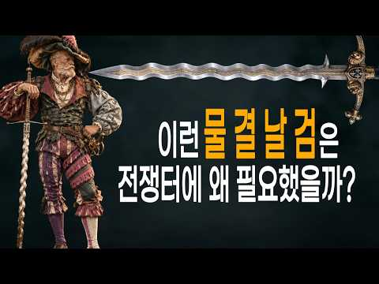

# 역사 — 성공 사례 분석: 사례별 자세히 #401–#414

`analysis.md` 의 9번 (같은 # 번호). 자동 생성 — `tools/success_analysis.py` v1.6 (2026-10-28 10:14 UTC). ※ 연구·교육용 — 투자 권유가 아님.

### 401. 숙종이 송시열보다 무서운 진짜 이유 — 조선에서 가장 냉혹했던 왕의 46년

- https://www.youtube.com/watch?v=PPmGCBpYbO4 · 역사빌런 · 구독자 14,900 · 조회수 267,452 (×17.9, 하루 1,627.6) · 좋아요 4,817 (1.8%) · 38.5분 · 2026-05-17 · 주제 묶음 3. 조선 · 형식 정보·해설 (그 밖) · 폴더 `W_PPmGCBpYbO4` (웹 승인)
- 썸네일: 
- 챕터: 0:00 신하가 왕보다 강했던 시대 · 1:30 열세 살의 친정 선언과 신하들의 당황 · 8:00 붕당이라는 전쟁터를 물려받다 · 15:00 숙종이 발명한 정치 — 환국 · 22:00 주역 공부와 숨겨진 의도 · 27:00 장희빈의 아들과 기사환국 · 33:00 정읍의 사약 — 그리고 죽지 않은 유령 · 38:00 냉혹한 군주의 뜻밖의 인간적 면모
- 설명 앞부분: 신하가 왕보다 강했던 나라에서, 열세 살짜리 왕이 아무도 모르게 기다렸습니다. 그리고 때가 됐다 싶은 순간, 조선 최강 송시열에게 망설임 없이 사약을 내렸습니다. 📖 이 영상에서 다루는 내용 칼도 없고 군사도 없이 오직 학문과 명분만으로 왕을 옥죄던 사람. 조선 역사상 유일하게 이름 뒤에 최고의 존칭이 붙은 단 한 명의 신하, 송시열. 그런데 그 송시열에게 사약을 내린 왕이 있었습니다. 열세 살에 즉위해 수렴청정도 거부하고, 아무도 모르게 기다렸다가 때가 됐다 싶은 순간 망설임 없이 칼을 뽑은 사람. 이 왕이 무서운 건 잔인해서가…
- 같은 채널 평소 대비 ×201.5 (채널 최근 롱폼 중앙값 1,327회) · 평소 영상: 김유신은 왜 김춘추를 선택했나? 혼인으로 시작된 신라 최고의 권력동맹 (1,327회) / 흑치상지는 왜 당나라를 선택했나｜백제 부흥군을 이끌던 장수가 당나라 명장이 된 이유 (1,335회)
- 대본 없음 (설명) — 음성인식이 끝나면 도입부·흐름이 들어감
- 댓글 460/463: 좋은 점 — 영상 7 · 감사·응원 8 · 더 알고 싶은 것 2 · 아쉬운 점 — 영상 2 · 반박·불만 — 의견 다름 5 · 정치·사회 42 · 경험 공유 11 · 구독·다음 기대 1
  - 좋은 점 — 영상 👍41 “성리학이건 유교건 그건 사상일뿐 인간생활에 무슨 도움이될까 과학이같이 공존해야한다”
  - 좋은 점 — 영상 👍8 “역사빌런님. 송시열님 피를 이어받은 제가 송시열을 아는 것은 임무여요. 그 시대로 갈 수 있게 도와주시니 고맙습니다. 좋은 영상으로 잘 배울께요. 감성편지 드림.”
  - 감사·응원 👍8 “역사빌런님. 송시열님 피를 이어받은 제가 송시열을 아는 것은 임무여요. 그 시대로 갈 수 있게 도와주시니 고맙습니다. 좋은 영상으로 잘 배울께요. 감성편지 드림.”
  - 감사·응원 👍3 “좋은 영상 감사합니다”
  - 더 알고 싶은 것 👍6 “동인과 서인의 시작도 설명해주시면 좋을 것 같습니다. 영상 잘 봤습니다^^”
  - 아쉬운 점 — 영상 👍4 “다 좋은데 중간 광고가 너무 많아서 정말 성가시네요”
  - 아쉬운 점 — 영상 👍0 “군권 장악에 대한 내용이 빠져서 무척 아쉽습니다.”
  - 반박·불만 — 의견 다름 👍1 “송시열. 님이 틀렸다..”
  - 반박·불만 — 의견 다름 👍1 “웃기는 해석이다. 왕권과 신권의 다툼? 어느시대도 똑 같았다. 심지어 정조대왕조차도..”
  - 정치·사회 👍25 “이슬람 종교국가와 다를바 없는 나라. 결국 신분제와 기득권 유지에 동원된 이념. 전쟁이나 외부 유입없이 그렇게 많은 인구가 노비인 나라가 없다. 동서고금.”
  - 정치·사회 👍8 “율곡과 송시열은 완전히 결이 다른 사람이었습니다. 율곡은 개혁가였지 권력과 명예따위를 탐하던 사람이 아닙니다. 오히려 꼰대 붕당정치를 지적하여 동인과 서인에게 동시에 탄핵을 받아 낙향했던적이 수차례 반복되는 삶을 살았습니다.”
  - 경험 공유 👍49 “송시열의 마지막 사약 받는 장면이 잘못 되어 있습니다. 송시열은 자신에게 사약이 내려졌다는 것을 승복 못하고 계속 거부하고 이방저방으로 도망가는 것을 잡아다가 강제로 먹인 것이 사실입니다. 평소에는 그렇게 곧은 선비인 것처럼 굴다가 마지막 죽음 앞에서는 각종 본성이 …”
  - 경험 공유 👍31 “저도 최근에야 숙종에 대해서 좀 알게된듯... 대단한 왕이었음...”
  - 구독·다음 기대 👍1 “구독하고 자주 들려 영상 보겠습니다. 감사합니다”

### 402. "어떻게 하루 종일 안지치고 싸웠을까?｜세계 최강 로마군의 ‘병력 교대’ 시스템"

- https://www.youtube.com/watch?v=0G6JWsVnOdc · 슬기로운 역사보기 · 구독자 16,300 · 조회수 163,466 (×10.0, 하루 1,776.2) · 좋아요 1,514 (0.9%) · 13.7분 · 2026-07-28 · 주제 묶음 5. 세계사·서양사 · 형식 정보·해설 (그 밖) · 폴더 `W_0G6JWsVnOdc` (웹 승인)
- 썸네일: 
- 설명 앞부분: 영화 속 로마군은 한 번 돌격하면 끝까지 밀어붙입니다. 하지만 실제 역사는 전혀 달랐습니다. 수십 킬로그램의 장비를 착용한 병사가 몇 시간 동안 계속 싸우는 것은 현실적으로 불가능했습니다. 그런데도 로마군은 아침부터 해 질 때까지 전투를 이어가며 지중해를 제패했죠. 그 비밀은 병사의 괴력도, 정신력도 아니었습니다. 바로 치밀하게 계산된 '병력 교대 시스템'이었습니다. 이 영상에서는 ⚔️ 로마군은 왜 몇 시간 동안 전투를 지속할 수 있었는가 ⚔️ 영화에서는 거의 볼 수 없는 트리플렉스 아키에스의 진실 ⚔️ 하스타티·프린키페스·트리아…
- 같은 채널 평소 대비 ×10.9 (채널 최근 롱폼 중앙값 14,948회) · 평소 영상: "전투기보다 ‘조종사’가 더 비싸다｜가장 위험한 임무의 탄생” (14,948회) / " 연합군의 대규모 기만 작전 ‘포티튜드’ ｜독일군 지휘체계가 무너진 순간" (14,605회)
- 대본 없음 (설명) — 음성인식이 끝나면 도입부·흐름이 들어감
- 댓글 135/135: 좋은 점 — 영상 5 · 감사·응원 7 · 더 알고 싶은 것 0 · 아쉬운 점 — 영상 1 · 반박·불만 — 의견 다름 3 · 정치·사회 4 · 경험 공유 9 · 구독·다음 기대 0
  - 좋은 점 — 영상 👍35 “오~ 저같은 덕후에게 너무 너무 유익한영상이네요~ 역시 로마는 클라스가 다르네요”
  - 좋은 점 — 영상 👍9 “좋은 정보가 있는 영상이다 !!”
  - 감사·응원 👍76 “전투방식을 이렇게 디테일하게 보여주니까 어떻게 싸웠을지 보이는듯합니다 감사합니다”
  - 감사·응원 👍11 “아 이래서 로마 군단이 융통성이 뛰어났고 전술 변화에 민감했다고 하는군요. 백인대장의 역할이 눈앞에 그려집니다. 몇 십 년을 전쟁사를 공부했는데 이런 디테일을 놓쳤네요. 고맙습니다.”
  - 아쉬운 점 — 영상 👍5 “팔랑크스(로마 레기온도 팔랑크스의 일종) 끼리의 싸움은, 서로 밀착해서 방패 끼리의 힘겨루기 싸움이었음! 누가 방패를 더 강하게 잡고 버티느냐의 싸움으로, 방패를 떨어뜨리면 끝장! 서로 방패로 온 힘을 다해서 밀집해서 밀치기 때문에, 뭔, 싸우는 도중에 부대가 뒤로 …”
  - 정치·사회 👍3 “공들여 만드신 영상 잘 봤습니다. 그 동안의 나무와 숲을 동시에 볼 수 있는 영상들 중에서도, 특히 전체와 일부, 유기적인 연관성이 한번에 잘 표현되어서 보기가 편합니다. 본래 부분 요소들은 종이 위에서, 종합 편성은 머리속에서 이뤄지는건데, 짧은 영상으로도 표현해 …”
  - 정치·사회 👍0 “종합하면 고대에 갖추기 힘든 군사 조직력 이라는 것임. 그런데 당시 동아시아에서도 이 정도 조직적 군사력이 있었고 오히려 원거리 무기가 최적화 되었기에 로마 vs. 진나라 싸움은 진나라가 이겼을 가능성이 높음.”
  - 경험 공유 👍12 “오.. 안그래도 리치가 긴 호플리테스가 군단병보다 훨씬 강하지 않을까 생각했었는데, 기동성보단 이런 시스템이 강한거였군요.”
  - 경험 공유 👍7 “제목보고 갑자기 머리 속에 질문이 하나 생겨서 들어왔어요 ㅋㅋ 한번도 생각안해봤었는데 교대하는게 체력적으로 엄청 도움되었겠네요”

### 403. 겁쟁이라 불리던 6사단은 어떻게 중공군 3개 사단을 호수에 묻었나 ∣ 용문산·파로호 대첩

- https://www.youtube.com/watch?v=K-D-pHlxoFo · 역사참판 · 구독자 3,030 · 조회수 35,529 (×11.7, 하루 329.1) · 좋아요 580 (1.6%) · 16.5분 · 2026-07-12 · 주제 묶음 기타 · 형식 정보·해설 (그 밖) · 폴더 `W_K-D-pHlxoFo` (웹 승인)
- 썸네일: 
- 챕터: 0:00 호수에 잠긴 2만 명, 그날의 시작 · 1:21 겁쟁이라 조롱받던 블루스타 · 3:04 결사, 철모에 새긴 두 글자 · 4:23 1개 연대 vs 3개 사단 · 6:18 본진인 줄 알았다는 치명적 착각 · 8:00 화천댐을 확보하라 · 10:09 건널 수 없는 물 앞에서 · 12:21 현대판 살수대첩, 그리고 남은 이름
- 설명 앞부분: 1951년 5월, 강원도 화천의 한 저수지. 총에 맞아서가 아니라, 물에 빠져 수많은 병사가 목숨을 잃었습니다. 그리고 이 어마어마한 규모의 적을 몰아넣은 부대는, 얼마 전까지 같은 편에게도 겁쟁이라 손가락질받던 이들이었습니다. 사창리에서 등을 보이고 도망쳤던 6사단. 그들이 한 달 만에 어떻게 완전히 다른 부대가 되었을까요. 철모에 두 글자, 결사를 써넣은 병사들이 1개 연대로 3개 사단을 오판에 빠뜨리고, 마침내 그들을 호수에 묻기까지. 그 며칠간의 이야기를 처음부터 끝까지 따라가 봅니다. 겁쟁이와 영웅의 거리는, 사실 그렇게…
- 같은 채널 평소 대비 ×64.1 (채널 최근 롱폼 중앙값 554회) · 평소 영상: 정원 60명 배에 14,000명, 근데 부두엔 남겨진 절반이 있었다 (554회) / 히딩크가 반말을 시킨 진짜 이유, 그리고 24년 뒤 홍명보에게 벌어진 일 (573회)
- 대본 없음 (설명) — 음성인식이 끝나면 도입부·흐름이 들어감
- 댓글 103/103: 좋은 점 — 영상 0 · 감사·응원 3 · 더 알고 싶은 것 1 · 아쉬운 점 — 영상 1 · 반박·불만 — 의견 다름 0 · 정치·사회 9 · 경험 공유 1 · 구독·다음 기대 0
  - 감사·응원 👍8 “파라호를 처음 알았어요 감사합니다”
  - 더 알고 싶은 것 👍1 “무얼좀 호도 하고 계신대요. 그 작전에는 한국 해병대 제 1 연대, 미 해병대 포병 이 참전 했습니다. 맨날 후퇴만 하는 육군 제 6 사단 에 기회를 사기를 부여 해주고자 당 시 해병대와 미국 해병대는 아무렇지 않게 받아들였고 육군 위주의 역사편찬이 이렇게 호도 하는…”
  - 아쉬운 점 — 영상 👍0 “이제는 이런 영상도 개 잣같은 ai 목소리....!!”
  - 정치·사회 👍12 “파로호 전투를 전세계에 알려야 됩니다. 기념식도 크게하고... 이승만대통령님이 호수이름을 파로호라고 바꾸었다. 그만큼 대승 이었다.”
  - 정치·사회 👍12 “저 파로호 명칭을 바꿀려 한 자?... 가 있었지요.중국인들이 싫어 한다고...중공한태 무얼 쳐먹은지는 모르겠고...파로호 명칭 절대로 바꾸면 않됍니다.자지손손...영원히 존제해야 합니다.”
  - 경험 공유 👍5 “나라를 구한 6사단. 저도 6사단 출신입니다.”

### 404. 아직도 설명할 수 없는 미스터리한 고대 발견 15가지

- https://www.youtube.com/watch?v=mVSr1ixtdfw · Nariman · 구독자 2,700 · 조회수 49,027 (×18.2, 하루 292.0) · 좋아요 383 (0.8%) · 128분 · 2026-05-13 · 주제 묶음 8. 문명·고고학 · 형식 정보·해설 (그 밖) · 폴더 `W_mVSr1ixtdfw` (웹 승인)
- 썸네일: 
- 설명 앞부분: 고대 세계는 우리가 생각하는 것보다 훨씬 더 복잡하고, 때로는 믿기 어려울 만큼 신비로운 흔적을 남겼습니다. 이 영상에서는 아직도 명확하게 설명되지 않은 미스터리한 고대 발견 열다섯 가지를 따라가 봅니다. 정체를 알 수 없는 유물, 이해하기 어려운 고대 건축물, 사라진 문명이 남긴 흔적, 그리고 현대 과학으로도 완전히 풀리지 않은 수수께끼까지. 이 발견들은 단순한 오래된 유물이 아닙니다. 인간의 역사, 고대 기술, 잊힌 문명, 그리고 우리가 아직 모르는 과거의 비밀을 다시 생각하게 만드는 단서들입니다. 고대 문명은 정말 우리가 아…
- 같은 채널 평소 대비 ×4.7 (채널 최근 롱폼 중앙값 10,494회) · 평소 영상: 아직 풀리지 않은 고대 미스터리들｜고대 문명과 잃어버린 역사의 수수께끼 (11,319회) / 시간의 흐름을 무너뜨린 가장 미스터리한 고고학 발견들 세 시간 몰아보기 (9,670회)
- 대본 없음 (설명) — 음성인식이 끝나면 도입부·흐름이 들어감
- 댓글 5/5: 좋은 점 — 영상 0 · 감사·응원 0 · 더 알고 싶은 것 0 · 아쉬운 점 — 영상 0 · 반박·불만 — 의견 다름 0 · 정치·사회 0 · 경험 공유 0 · 구독·다음 기대 0

### 405. 미국 시장을 뒤흔든 조선 장군 이순신… 그런데 그가 몰던 거북선은 왜 한 척도 남지 않았을까

- https://www.youtube.com/watch?v=5694G9i-0jA · 찐경제 · 구독자 29,000 · 조회수 94,093 (×3.2, 하루 3,122.4) · 좋아요 1,734 (1.8%) · 30.3분 · 2026-09-28 · 주제 묶음 3. 조선 · 형식 애니메이션·지도 · 폴더 `W_5694G9i-0jA` (웹 승인)
- 썸네일: 
- 설명 앞부분: 안녕하세요, 여러분. 오늘은 사백년 전 조선 남해에서 살았던 한 사람이, 지금 미국 시카고 만화 진열대 위에 슈퍼맨과 나란히 서 있는 놀라운 이야기를 준비했습니다. 그런데 정작 그가 몰던 거북선은 우리 땅에 단 한 척도 남지 않았습니다. 이순신은 세계로 나가고, 그의 배는 우리 발밑에서 사라졌다. 이 뒤틀린 두 미스터리를 함께 파헤쳐 봅니다. 복잡한 경제 지표와 뉴스를 객관적으로 비교 분석하여 정보 전달의 가치를 높였으며, 영상에 사용된 모든 시나리오 대본은 [찐경제]가 직접 자료를 수집하고. AI의 도움을 받아 집필하였습니다. …
- 같은 채널 평소 대비 ×4.8 (채널 최근 롱폼 중앙값 19,642회) · 평소 영상: “드럼은 이제 안 삽니다” 요즘 사람들이 다시 통돌이로 갈아타자 삼성·엘지가 움직인 진짜 (20,730회) / 미국·캐나다가 관세로 싸우는데, 도요타 13조 증발하고 일본 초비상 걸린 진짜 이유 (18,555회)
- 대본 없음 (설명) — 음성인식이 끝나면 도입부·흐름이 들어감
- 댓글 67/67: 좋은 점 — 영상 0 · 감사·응원 3 · 더 알고 싶은 것 1 · 아쉬운 점 — 영상 1 · 반박·불만 — 의견 다름 0 · 정치·사회 8 · 경험 공유 1 · 구독·다음 기대 0
  - 감사·응원 👍7 “진짜 현실 🤦 거북선 실물이 있다 현재 대한 민국 한사람 이 진짜 거북선 모형을 만들어 놓고 있습니다 어느날 꿈 속에서 이순신 장군 이 저한테 거북선 머리 모든것을 보여주고 짜내 가사라진거북선모씀많이만들면 모든 사람들이 좋아 👌 할것세🎉🎉🎉🎉🎉 감사합니다 🍇 2027…”
  - 감사·응원 👍2 “진짜 거북선 도면 이순신 가치설계한사람 두분께서 진짜 엄청난 거북선 시초에도면을 포기하고 현실 속에 서 진짜 거북선 일단포기는시간때문에포기했습니다 전쟁이 바로앞 에서 시작된 것을알고 가장 빠른 거북선 을재작했습니다 마야의 이순신 장군 이 전사하지아났습면 이순신 장군 …”
  - 아쉬운 점 — 영상 👍2 “ㅡㅡㅡ철공소 기계음. 요즘도 돌리나?”
  - 정치·사회 👍2 “조선 400년진짜거북선 지금 우리가보는거북선 약 간다르다 진짜 거북선 은 내부 인테리어 다르고 거북선 머리 도위치도 거북선 지붕 도 약 간다른것이만습니다🎉🎉🎉 진짜 현실 모형을 보면외국인들바이어들이보면 깜짝 놀랄 정도로 보고 👀 400조선거북선을만들어놓은사람들을 뛰어…”
  - 정치·사회 👍1 “우리 옛 배, 판옥선, 거북선, 맹선, 조운선에는 조선노를 썼다. 영상 노 틀림.× 이 3D 영상을 잘 표현했지만, 젓는 노는 서양 노로 표현했기에, 고증이 틀렸어요. 어려서부터 나는 여수 조선소 근처에서 자라 나무배 만들기를 많이 보았는데, 60~70년대까지 작은 …”
  - 경험 공유 👍0 “근데 참 이상하다?? 이순신이 든 저 장검!~ 일본도지 우리 한국검이 아니잖아. 칼자루 모양 봐도 틀림없네!! 왜 왜군을 물리친 장군이 그 왜검을 들고 있지?? 노획품인가? 광화문 네거리 서 있는 이순신 동상도 왜검 들고 사무라이 포즈로 서 있더라!~ 그 동상 만든게…”

### 406. 사극이 안 보여준 승은 다음날 아침

- https://www.youtube.com/watch?v=C8zmRWow5a8 · 역사기록관 · 구독자 6,240 · 조회수 86,387 (×13.8, 하루 669.7) · 좋아요 1,830 (2.1%) · 25.3분 · 2026-06-16 · 주제 묶음 3. 조선 · 형식 정보·해설 (그 밖) · 폴더 `W_C8zmRWow5a8` (웹 승인)
- 썸네일: 
- 설명 앞부분: 조선시대, 궁녀가 임금의 '승은'을 입은 바로 그 다음 날 아침에는 과연 무슨 일이 벌어졌을까요? 사극은 늘 그 은밀한 밤에서 끝나버리지만, 한 여인의 진짜 운명은 바로 '다음 날'에 결정됐습니다. 이 영상에서 다루는 내용: ▪ '승은'의 진짜 의미와 조선 궁녀의 신분 구조 ▪ 승은 입은 다음 날 가장 먼저 찾아온 것 (축하가 아니었습니다) ▪ 승은상궁이 되면 달라지는 것 — 노동에서의 해방, 거처, 나인, 복색 ▪ 후궁이 되는 단 하나의 조건과 내명부 품계 (빈·귀인·숙의·숙원) ▪ 후궁의 처소와 생활 공간, 동궐도 속 실제 흔…
- 같은 채널 평소 대비 ×185.2 (채널 최근 롱폼 중앙값 466회) · 평소 영상: 청은 왜 항복한 인조를 왕좌에 돌려보냈을까? (486회) / 임진왜란 당시 처참했던 백성들의 삶 (447회)
- 대본 없음 (설명) — 음성인식이 끝나면 도입부·흐름이 들어감
- 댓글 150/151: 좋은 점 — 영상 1 · 감사·응원 2 · 더 알고 싶은 것 1 · 아쉬운 점 — 영상 16 · 반박·불만 — 의견 다름 1 · 정치·사회 1 · 경험 공유 2 · 구독·다음 기대 0
  - 감사·응원 👍5 “첫글이 흰색이고 바탕이 비슷 해서제목의 글이 잘 안보입니다 잘보이게 해주십시요 화이팅입니다”
  - 감사·응원 👍1 “재미있게 잘봤습니다 감사합니다”
  - 더 알고 싶은 것 👍0 “애들은 가라😂 ㅠ이건어룬둘애기야😂진짜 궁긍해서 ㅜㅜㅜㅜ하 친정도ㅜ부자도고요 친척도😮ㅠ알고싶어요ㅜ”
  - 아쉬운 점 — 영상 👍102 “서론이 지나치게 길고 동어반복이 심해서 보기가 지지부진하네요”
  - 아쉬운 점 — 영상 👍98 “실제 이야기가 시작되기 전까지의 단계가 너무 길고, 동어반복이 계속되는데. 과정과 결론이 더 빨리나오는게 좋을 듯 하네요.”
  - 반박·불만 — 의견 다름 👍4 “나래이션 속도를 조금 더 올려주는게 어떨지.. 스피디한 설명에 길들여진 독자들이 의외로 많아서요. 듣다가 지루해질 수 있을 듯 해요(저와 주변인들 기준이니 절대적인 건 아닙니다 ㅎ)”
  - 정치·사회 👍1 “그러니 이나라가. 망하지 아비가 자식을 죽이고 자식이. 아비를 죽이고 형제가. 서로를. 죽이고 삼촌이 조카들을 죽이고 싹 없어져야 나라 전체가”
  - 경험 공유 👍1 “회임을 하던지 못하던지 임금이 한번보고 차버린경우는 매력도없고 향기가 있는줄 알았는데 별로었고 꽃잎도 맛도없고 꿔다 놓은 보리자루 었다면 내가 임금이라도 다시는 보지않았을 것이다 미련한 곰 보다 영리한 여우가 더 좋은 것이다...요즈은 미모보다 음식솜씨 없는 여자보다…”
  - 경험 공유 👍0 “나도 성은 압고싶어요”

### 407. 효령대군, 세종보다 37년 더 살았다 ∣ 9명의 왕을 지켜본 둘째 왕자

- https://www.youtube.com/watch?v=zZQ_1_dLarU · 그날의역사 · 구독자 7,180 · 조회수 114,178 (×15.9, 하루 764.0) · 좋아요 723 (0.6%) · 21.6분 · 2026-05-31 · 주제 묶음 3. 조선 · 형식 정보·해설 (그 밖) · 폴더 `W_zZQ_1_dLarU` (웹 승인)
- 썸네일: 
- 설명 앞부분: 조선 왕족 중에서 가장 오래 산 사람이 누구였을까요. 왕도 아니고 장수도 아니었습니다. 태종의 둘째 아들 효령대군은 23살에 동생 충녕에게 왕좌를 비키고, 그 자리에서 비로소 91년을 시작합니다. 큰형 양녕은 69세, 동생 세종은 54세, 조카 세조는 52세. 조선 왕의 평균 수명은 47세였습니다. 그런데 그는 91세까지 살아남아 태조에서 성종까지 아홉 명의 임금이 옥좌에 앉았다 내려가는 모습을 모두 지켜봤습니다. 이 영상에서 다루는 내용 1418년 6월 3일, 둘째인데 셋째에게 밀린 그날 절로 향한 발걸음 — 평생 출가하지 않은…
- 같은 채널 평소 대비 ×222.1 (채널 최근 롱폼 중앙값 514회) · 평소 영상: 정조가 즉위 20일 만에 처단한 숙의 문씨, 그 악녀를 키운 건 영조였다 (523회) / 영화가 보여주지 않은 인간 이순신의 진짜 얼굴ㅣ한국사ㅣ임진왜란 (505회)
- 대본 없음 (설명) — 음성인식이 끝나면 도입부·흐름이 들어감
- 댓글 162/162: 좋은 점 — 영상 0 · 감사·응원 3 · 더 알고 싶은 것 0 · 아쉬운 점 — 영상 1 · 반박·불만 — 의견 다름 2 · 정치·사회 2 · 경험 공유 9 · 구독·다음 기대 0
  - 감사·응원 👍12 “효령대군에게 가장 감사한 인물을 굳이 하나 꼽자면 그의 장인인 정역이 아닐까? 양녕의 장인 김한로는 사위가 폐세자가 되면서 연좌되어 삭탈관직 후 유배를 갔고 세종의 장인인 심온은 아예 역적으로 몰려 사약을 받고 온집안이 거덜이 나버린거에 비하면. 장인은 사위가 미치도…”
  - 감사·응원 👍5 “양녕대군이 폐세자가 되고 그의 차례가 되었지만 왕좌를 탐하지 않았고 마음을 비워서 90세 넘는 그 시대에 평균수명 두배를 살아 장수하였네요 ~~ 왕좌를 탐낸 조카는 피를 불렀지만 ...넘 대조되는 인생을 살았네요😊현명한듯 하네요 아주 몰입해서 끝까지 잘 시청하고 구독…”
  - 아쉬운 점 — 영상 👍3 “조선시대 장수한 왕족들 (국왕은 제외) ●왕자 1위 효령대군 : 90세 (태종의 차남) 2위 경평군 : 74세 (선조의 11남) 3위 의평군 : 70세 (정종의 장남) 4위 선성군 : 68세 (정종의 4남) 4위 덕천군 : 68세 (정종의 11남) 4위 양녕대군 : …”
  - 정치·사회 👍2 “효령대군파 유명인 후손들 정치인 : 이기붕(부통령), 이계진(전 국회의원), 이학재(인천 서구청장) 종교인 : 이만희(신천지 교주) 연예인 : 이수근(개그맨), 이휘재(방송인), 이성재(배우), 이정재(배우), 이상은(가수), 이수만(가수), 써니(가수, 소녀시대. …”
  - 경험 공유 👍7 “나의 피에는 효령대군의 피가 흐른다. 어머니가 전주이씨 효령대군의 자손이기 때문이다. 물론 아버지의 피는 고려시대 충절의 신하 우탁의 피가 흐르고..그래서 그런지 뼈가 좋은 편이고 동안의 체형을 가지고 있는 편이다. 내가 어릴때 외할머니가 돌아가시자 큰외삼촌이 3년상…”
  - 경험 공유 👍5 “저도 효령대군의 21대손 빼어날 수 돌림입니다 효령대군 할아버지 3째아들 보성군 가문입니다 파시조 이신 효령대군 할아버지 가 자랑 스럽네요”

### 408. 만들면 곤장 80대? 고려·조선 임금들이 약과를 필사적으로 금지했던 진짜 이유

- https://www.youtube.com/watch?v=tK0dcg5wlHQ · 핵쉬운역사 · 구독자 3,680 · 조회수 66,129 (×18.0, 하루 390.4) · 좋아요 1,161 (1.8%) · 21.7분 · 2026-05-12 · 주제 묶음 2. 한국 고대·삼국·고려 · 형식 정보·해설 (그 밖) · 폴더 `W_tK0dcg5wlHQ` (웹 승인)
- 썸네일: 
- 챕터: 0:00 미국 코스트코를 강타한 500만 개의 약과 · 2:00 불교 사찰의 '가짜 고기', 약과의 기원 · 4:00 왜 '약'이라는 이름이 붙었을까? (한방 보양식) · 6:00 고려 귀족들의 사치, 송나라 사신을 놀라게 한 맛 · 8:00 조선 왕실의 필수 의례 음식으로 격상되다 · 10:00 정조의 곤장 80대 명령과 조선식 위선 · 12:00 양과자의 등장과 1000년 사치 본능의 위기 · 14:00 산업화의 그늘, 약과가 사라질 뻔했던 이유 · 16:00 뉴욕타임스가 주목한 한국의 'Honey Cookie' · 18:00 미슐랭 셰프들이 약과를 선택한 이유
- 설명 앞부분: 2024년 미국 코스트코 매대를 휩쓴 '약과' 열풍, 알고 계셨나요? 편의점에서 쉽게 사 먹는 이 달콤한 간식이 사실 한국 역사상 가장 위험한 음식이었다는 사실을 아는 사람은 많지 않습니다. 고려 명종부터 조선 정조까지, 왜 임금들은 약과 제조 금지령을 내리고 곤장 80대라는 가혹한 형벌까지 내렸을까요? 단순한 디저트를 넘어 귀족 권력의 상징이자 왕실의 최고급 진상품이었던 약과의 1000년 역사를 파헤칩니다. 신라 사찰의 '가짜 고기'에서 시작해 미국 뉴욕 미슐랭 레스토랑의 시그니처 디저트가 되기까지, 우리가 몰랐던 약과에 담긴 …
- 같은 채널 평소 대비 ×20.5 (채널 최근 롱폼 중앙값 3,230회) · 평소 영상: 임금님 보양식은 닭이 아니었다? 2,000년 복날의 충격적 진실 (3,230회) / 가난한 나라였는데 왜? 조선 사람들이 식사량 괴물이었던 진짜 이유 (대식 문화) (3,207회)
- 대본 없음 (설명) — 음성인식이 끝나면 도입부·흐름이 들어감
- 댓글 110/110: 좋은 점 — 영상 1 · 감사·응원 1 · 더 알고 싶은 것 0 · 아쉬운 점 — 영상 0 · 반박·불만 — 의견 다름 2 · 정치·사회 5 · 경험 공유 1 · 구독·다음 기대 0
  - 좋은 점 — 영상 👍1 “너무도 유익한 정보와 영상입다 만드시느라 애 쓰셨습니다”
  - 감사·응원 👍2 “몸과 마음은 내가 아니며, 이 세상은 교육을 위한 가상세계다. 나는 몸에 머무는 영혼이고, 마음이 기뻐하고 감사하며 사랑하는 영성산업으로 세계통일하여 기아,난민,전쟁을 종식하자.”
  - 반박·불만 — 의견 다름 👍0 “약과의 가치가 떨어진적은 한번도 없습니다 . 좋은 재료로 만든 약과는 진짜로 비싸서 못사먹을뿐이죠 . 그리고 곤장 80 대 는 양반들의 위선이 아니라 , 미국의 금주령이나 유럽 왕족들의 천민은 감자를 못먹게 하겠다 같은 소리 입니다 ㅋㅋㅋ 허세와 가오잡기용이지 진짜 …”
  - 정치·사회 👍1 “유엔가입국중 제일 가난한 아사자 나라가 싸면서도 당,열량이 높은 밀가루 음식도 없어서 못먹는데 밀가루음식 장려 정책으로 어쩔 수 없이 밀가루 음식을 먹엇다고????? 특히 참기름,꿀의 약과를 정책때문에 어쩔 수 없이 먹을 수 없어 약과가 없어질뻔 햇다고???”
  - 정치·사회 👍0 “이 내용을 디자인과 스토리텔링을 더해서, 약과 포장지에 사용하면, 외국인들이 우리 약과와 우리의 역사와 전통 문화를 다시보는 계기가 될 것 같네요.”
  - 경험 공유 👍2 “몸과 마음은 내가 아니며, 이 세상은 교육을 위한 가상세계다. 나는 몸에 머무는 영혼이고, 마음이 기뻐하고 감사하며 사랑하는 영성산업으로 세계통일하여 기아,난민,전쟁을 종식하자.”

### 409. 400년 전 명나라에서 건너온 성씨들, 지금 10만 명입니다

- https://www.youtube.com/watch?v=hjoWlvuU9AA · 교과서엔 없는 역사 · 구독자 38,300 · 조회수 711,231 (×18.6, 하루 4,044.4) · 좋아요 5,259 (0.7%) · 9.9분 · 2026-05-05 · 주제 묶음 6. 동양사 (중국·일본·몽골) · 형식 사연·드라마 · 폴더 `W_hjoWlvuU9AA` (웹 승인)
- 썸네일: 
- 챕터: 0:00 10만 한국인의 뿌리, 임진왜란 · 0:29 전쟁 후 조선에 남은 사람들 · 1:00 임진왜란 귀화 5대 성씨 대공개 · 1:17 비극의 해주 석(石)씨, 조선을 구하고... · 2:43 이순신과 싸운 장수의 후손, 진(陳)씨 · 3:45 시성 두보 후손, 고국을 그리워하다 · 5:06 본관에 새긴 고국, 절강 편(片)씨 · 6:45 10만 후손의 시작, 영양 천(千)씨 · 8:48 400년의 시간, 명나라에서 한국인으로
- 설명 앞부분: 대한민국에 살고 있는 수많은 성씨들. 그중에는 조선시대 거대한 전란 속에서 바다를 건너와 이곳에 뿌리를 내린 사람들이 있습니다. **임진왜란** 당시 명나라에서 건너와 지금까지 역사를 이어가고 있는 가문들의 사연은 무엇일까요? 이 영상에서는 전쟁 중 파병을 오거나 멸망하는 나라를 등지고 조선으로 망명해 온 **[명나라 귀화 성씨]** 5곳의 기상천외하고 은밀한 정착기를 다룹니다. 조상들의 생생한 발자취를 지금 바로 확인해 보세요. 임진왜란 당시 조선을 구하기 위해 압록강을 건넜던 수많은 **명나라 군인들**. 그러나 그들 중 일부…
- 대본 없음 (설명) — 음성인식이 끝나면 도입부·흐름이 들어감
- 댓글 790/816: 좋은 점 — 영상 2 · 감사·응원 15 · 더 알고 싶은 것 12 · 아쉬운 점 — 영상 4 · 반박·불만 — 의견 다름 14 · 정치·사회 79 · 경험 공유 32 · 구독·다음 기대 0
  - 좋은 점 — 영상 👍2 “좋은 정보 감사합니다~.”
  - 감사·응원 👍155 “갈송 할아버지 17대손입니다 이렇게 다뤄주시니 감사하네요! 절강편씨는 원래 이씨입니다 당나라 황실 후예입니다 명나라 황제가 후궁에 빠져 나라가 도탄에 빠지자 충절의 상소문을 올려 옥에 갇히게 되었는데 일편단심 4글자를 황제에게 올려서 황제가 감복하여 옥에서 풀려나 일…”
  - 감사·응원 👍81 “훌륭하고고마운후손분들이네요 고맙습니다”
  - 더 알고 싶은 것 👍4 “그냥 명 식민지 조선이 일본 공격 받으니 조선이라는 재산 지키느라 싸운거지 영웅화 오ㅈ네 조선이 명에게 바치던 공물과 공녀 노비도 소개해주세요”
  - 더 알고 싶은 것 👍3 “안동댐강간범은 어떻게 되나요?”
  - 아쉬운 점 — 영상 👍2 “소위 상놈의 성씨라고 알려진 천방지추마골피. 가장 잘못 알려진 헛소리입니다. 이순신 장군의 부인이 지씨였는데 그러면 이순신 장군이 상놈의 집안과 혼인을 했다는말이 됩니다. 천씨는 명나라 장수의 후손으로 조선에서 높은 관직을 지냈습니다. 그런데도 상놈의 성씨라고 한다면…”
  - 반박·불만 — 의견 다름 👍23 “근데 웃기는건 명나라를 중국으로 알고있다는거. 상고시대 이후 중국한족은 없어. 실체가없는 허상이 바로 한족이야. 죄다 북방 유목왕조들이야.”
  - 반박·불만 — 의견 다름 👍2 “소위 상놈의 성씨라고 알려진 천방지추마골피. 가장 잘못 알려진 헛소리입니다. 이순신 장군의 부인이 지씨였는데 그러면 이순신 장군이 상놈의 집안과 혼인을 했다는말이 됩니다. 천씨는 명나라 장수의 후손으로 조선에서 높은 관직을 지냈습니다. 그런데도 상놈의 성씨라고 한다면…”
  - 정치·사회 👍155 “갈송 할아버지 17대손입니다 이렇게 다뤄주시니 감사하네요! 절강편씨는 원래 이씨입니다 당나라 황실 후예입니다 명나라 황제가 후궁에 빠져 나라가 도탄에 빠지자 충절의 상소문을 올려 옥에 갇히게 되었는데 일편단심 4글자를 황제에게 올려서 황제가 감복하여 옥에서 풀려나 일…”
  - 정치·사회 👍10 “제 성씨는 할아버지 말씀으론 송나라때 사신으로 왔는데 나라가 남쪽으로 밀려나는 바람에 돌아갈 길이 없어져서 그대로 귀화했다고 했네요 그리고 조상들 중에 서예가, 의병, 현감, 조정에서 일했던 분들도 계셨는데 못난 후손인 저는 그냥 집에 앉아서 유튜브나 보고 있습니다😂”
  - 경험 공유 👍76 “무지했던 사람들이 천씨를 비하했었죠... 명문가 입니다...”
  - 경험 공유 👍9 “내가 군생활 할때 우리 소대 휘귀성 집합소 편해근,봉일청,동성호,선우정,선씨가 아니고 선우씨임”

### 410. 🌙 [잘 때 듣는] 마리 앙투아네트는 왜 사지도 않은 목걸이 때문에 단두대에 올랐을까? (73분) ∣ 숙면 세계사 ∣ 오디오북 ASMR

- https://www.youtube.com/watch?v=_NDcu-xEccM · 잘 때 듣는 - 숙면 세계사 · 구독자 11,200 · 조회수 81,437 (×7.3, 하루 1,181.5) · 좋아요 1,364 (1.7%) · 73.7분 · 2026-08-20 · 주제 묶음 10. 수면·낭독 · 형식 수면·낭독 (잠잘 때 듣는) · 폴더 `W__NDcu-xEccM` (웹 승인)
- 썸네일: 
- 챕터: 0:00 프롤로그 - 혁명 광장, 한 가지 질문 · 4:40 제1장 국경에서 옷을 빼앗긴 14세 공주 · 9:50 제2장 7년간 지속된 후계자 압박 · 15:30 제3장 소박한 도피처와 과장된 소문 · 21:00 제4장 주인 잃은 괴물 목걸이 · 26:20 제5장 야망과 욕망의 결탁 · 31:30 제6장 밤의 밀회와 위조된 서명 · 37:00 제7장 해체된 보물과 완전범죄 · 42:00 제8장 폭로, 왕비는 목걸이를 산 적이 없었다 · 48:00 제9장 세기의 공개 재판과 거대한 역설 · 54:00 제10장 '마담 데피시트'와 흑색선전 · 59:30 제11장 1789년, 궁전을 끌어내린 분노 · 65:00 제12장 바렌 도주 사건 · 68:30 제13장 왕정 붕괴와 아들과의 분리 · 71:30 제14장 단두대의 마지막 5분
- 설명 앞부분: 사지도 않은 목걸이 하나가, 어떻게 한 왕비를 단두대로 보냈을까요. 열네 살에 낯선 나라로 보내진 소녀는 왜 온 나라의 증오를 받는 악녀가 되었을까요. 그녀가 정말 프랑스를 망친 것일까요, 아니면 누군가 그녀의 이름을 훔친 것일까요. 그리고 한 번의 거짓 소문은 어디까지 한 사람을 무너뜨릴 수 있을까요. 1770년, 오스트리아의 어린 공주가 프랑스로 향했습니다. 화려한 베르사유의 왕비가 되었지만, 그녀를 기다린 것은 숨 막히는 예법과 이방인을 향한 차가운 시선이었습니다. 그리고 1785년, 그녀가 사지도, 보지도 않은 다이아몬드 …
- 같은 채널 평소 대비 ×4.2 (채널 최근 롱폼 중앙값 19,210회) · 평소 영상: 🌙 [잘 때 듣는] 왜 네덜란드인 박연은 29년 동안 고향 귀환을 포기하고 조선의 군관이… (19,434회) / 🌙 [잘 때 듣는] 지옥이 두려워 르네상스를 사버린 은행가들 ∣ 메디치 가문의 비밀 (7… (18,985회)
- 대본 없음 (설명) — 음성인식이 끝나면 도입부·흐름이 들어감
- 댓글 85/92: 좋은 점 — 영상 0 · 감사·응원 4 · 더 알고 싶은 것 0 · 아쉬운 점 — 영상 1 · 반박·불만 — 의견 다름 4 · 정치·사회 8 · 경험 공유 3 · 구독·다음 기대 0
  - 감사·응원 👍35 “조선 시대에도. 역모가 일어나 왕이 바귀면. 유배를 갔었고 왕비도 궁중에서 사가로 가거나 노비신분등으로 강등된거 같은데 선진화된 프랑스의 법이 더 엄격하고 잔인한것 같네요 마리 앙투아네트. 그분의 삶은. 비교적 소박하면서도. 그녀의 정신은 다이아몬드보다 더 아름답게.…”
  - 감사·응원 👍21 “마리 앙뚜아네트에 대하여 상세하게 알게 되어서 고맙습니다”
  - 아쉬운 점 — 영상 👍1 “그냥 베르사유 궁전에서 마무리 하고 고등법원으로 안갔으면 어땠을까요? 그것도 아쉽네요”
  - 반박·불만 — 의견 다름 👍42 “무엇을 위한 혁명인가? 루이 16세와 마리 앙뚜아네트의 삶이 비참하네요 예나 지금이나 선전선동과 무지한 국민이 비극을 초래하게 됩니다”
  - 반박·불만 — 의견 다름 👍16 “김경율이 김건희를 마리앙투아네트라고했지,. 수백년이 지나도 아둔한 인간은 여전히 선전선동당하지”
  - 정치·사회 👍18 “박근혜대통령이생각난다ㅡㅡ유언비어ㅡ선동으로쫓겨난대통령😢”
  - 정치·사회 👍18 “이 영상을 보면서 보는 내내 박근혜 대통령의 생각이 머리를 맴돈다. 한 인간을 세월호라는 멍석에 돌돌말아 강물에 던져버린거나 다름없는 처참한 일이 선진국이라는 대한민국에서도 일어났었지. 그때 누군가 국회복도에 마리앙투아네트의 그림을 더럽게 묘사를해서 걸어놓았었지. 지…”
  - 경험 공유 👍11 “와~ 오해를 했었네~😮”
  - 경험 공유 👍1 “내가10살쯤 거제도에 살았는데 저의 아버지께서 사깃꾼들에게 억울한 누명을쓰고 시달림받다가 부산 양정동으로 가서숨어살았는데 이웃에 살인 사건이 나서 거제도로 간것이었습니다😅 그때 아버지께서 만화가게를 하셨는데 마리앙토아네트 왕비의 목걸이를찾으려 떠난 달타냥과 그의 친구…”

### 411. 잠들기 전 한국사🌙『조선왕조실록 : 성군 세종의 충격 가족사』벌거벗은 한국사 오디오북 _ 책읽어주는여자 _ 수면낭독

- https://www.youtube.com/watch?v=DButhfdWiN4 · 모모의 북살롱 · 구독자 39,500 · 조회수 189,285 (×4.8, 하루 4,031.9) · 좋아요 417 (0.2%) · 69.3분 · 2026-09-11 · 주제 묶음 3. 조선 · 형식 수면·낭독 (잠잘 때 듣는) · 폴더 `W_DButhfdWiN4` (웹 승인)
- 썸네일: 
- 설명 앞부분: 📖 벌거벗은 한국사 인물편 잠들기 전 편안하게 듣는 한국사, 세계사, 고전문학 이야기 세종대왕은 왜 며느리 네 명을 궁궐에서 내보냈을까요? 조선 역사상 가장 위대한 성군으로 손꼽히는 세종대왕. 훈민정음을 창제하고 과학과 문화, 국정 전반에서 수많은 업적을 남긴 왕이지만, 그의 가족사를 들여다보면 우리가 알던 세종대왕과는 조금 다른 모습도 만날 수 있습니다. 이번 오디오북에서는 『벌거벗은 한국사』의 세종대왕 이야기를 바탕으로, 세종의 며느리들이 궁궐을 떠나게 된 사연과 당시 조선 왕실의 혼인과 생활을 살펴봅니다. 왕실의 며느리에게 …
- 같은 채널 평소 대비 ×5.3 (채널 최근 롱폼 중앙값 35,854회) · 평소 영상: 잠들기 전 이야기🌙『조선왕조실록 : 사도세자 죽음의 비밀』벌거벗은한국사_ 책읽어주는여자_… (35,854회) / 잠들기 전 한국사🌙『벌거벗은 고려편 : 태조 왕건의 비밀』왕건은 왜 29명과 결혼했을까?… (35,904회)
- 대본 없음 (설명) — 음성인식이 끝나면 도입부·흐름이 들어감
- 댓글 9/11: 좋은 점 — 영상 0 · 감사·응원 0 · 더 알고 싶은 것 0 · 아쉬운 점 — 영상 0 · 반박·불만 — 의견 다름 0 · 정치·사회 2 · 경험 공유 0 · 구독·다음 기대 0
  - 정치·사회 👍4 “세종 이순신 정말 훌륭하시죠 헌데 세종대왕님과 이순신장군 두분을 합해 놓은것보다 더더욱 훌륭하신분이 계시죠 ~그이름 박 정희 대통령 !!!”

### 412. “사람을 톱질하려고 만들었다고?｜물결치는 거대 양손검 플람베르주의 진짜 이유”

- https://www.youtube.com/watch?v=pjWYMEW1RNw · 슬기로운 역사보기 · 구독자 16,300 · 조회수 66,495 (×4.1, 하루 1,662.9) · 좋아요 363 (0.5%) · 11.9분 · 2026-09-18 · 주제 묶음 1. 역사 일반·이야기 · 형식 정보·해설 (그 밖) · 폴더 `W_pjWYMEW1RNw` (웹 승인)
- 썸네일: 
- 설명 앞부분: 물결처럼 일렁이는 기묘한 칼날. 보기만 해도 평범한 검은 아니죠. 그런데 플람베르주는 대체 왜 이렇게 만들었을까요? 상대의 검을 떨리게 만들어 손목을 마비시켰다? 사람을 톱처럼 갈아버렸다? 심지어 파이크의 창대까지 잘라버리기 위해 만들었다? 플람베르주의 독특한 모습 때문에 수백 년 동안 수많은 이야기가 따라붙었습니다. 하지만 실제 역사를 들여다보면 이 물결치는 칼날에는 조금 다른 이야기가 숨어 있습니다. 이 영상에서는: ⚔️ ‘플람베르주’라는 이름에 숨겨진 뜻 ⚔️ 물결날이 실제 전투에서 만들어낸 차이 ⚔️ 진동·끔찍한 상처·창대…
- 같은 채널 평소 대비 ×4.4 (채널 최근 롱폼 중앙값 14,948회) · 평소 영상: "전투기보다 ‘조종사’가 더 비싸다｜가장 위험한 임무의 탄생” (14,948회) / " 연합군의 대규모 기만 작전 ‘포티튜드’ ｜독일군 지휘체계가 무너진 순간" (14,605회)
- 대본 없음 (설명) — 음성인식이 끝나면 도입부·흐름이 들어감
- 댓글 67/67: 좋은 점 — 영상 2 · 감사·응원 4 · 더 알고 싶은 것 2 · 아쉬운 점 — 영상 2 · 반박·불만 — 의견 다름 9 · 정치·사회 0 · 경험 공유 9 · 구독·다음 기대 1
  - 좋은 점 — 영상 👍10 “모처럼 여유있는 금요일 저녁인데, 딱 맞춰서 재미있게 보는 분야가 딱 올라왔네요. 감사합니다. 말씀하신 낭설들에 대해서는 정확하게 핵심을 짚어내셨네요. 참고로 저는 몇만번을 휘두르고 대량파괴를 하고 나서야 겨우 깨달은 내용인데, 슬기역사님께서 정확하게 핵심을 찾아내,…”
  - 감사·응원 👍10 “모처럼 여유있는 금요일 저녁인데, 딱 맞춰서 재미있게 보는 분야가 딱 올라왔네요. 감사합니다. 말씀하신 낭설들에 대해서는 정확하게 핵심을 짚어내셨네요. 참고로 저는 몇만번을 휘두르고 대량파괴를 하고 나서야 겨우 깨달은 내용인데, 슬기역사님께서 정확하게 핵심을 찾아내,…”
  - 반박·불만 — 의견 다름 👍10 “모처럼 여유있는 금요일 저녁인데, 딱 맞춰서 재미있게 보는 분야가 딱 올라왔네요. 감사합니다. 말씀하신 낭설들에 대해서는 정확하게 핵심을 짚어내셨네요. 참고로 저는 몇만번을 휘두르고 대량파괴를 하고 나서야 겨우 깨달은 내용인데, 슬기역사님께서 정확하게 핵심을 찾아내,…”
  - 반박·불만 — 의견 다름 👍7 “7:17 이 생각을 못하면 댓글로 헛소리를 당당하게 지껄이게 된다.”
  - 경험 공유 👍3 “5:07 과시라고 생각함 과거 중세에서 쓰였던 샤프롱의 리리파이프가그 예시임 당시 리리파이프를 다는 것은 큰 수고가 드는 일이었음 즉 돈이 많이 듬 그래서 나중엔 신분이나 재력을 과시하기 위해 점점 길다란 리리파이프를 다는 것이 유행이 되기도 했었음 도검 제작 과정을…”
  - 구독·다음 기대 👍1 “완전 제 관심사라 구독하고 갑니다. 영상 즐감했습니다.^^”

### 413. [역사TV] 4K 효의왕후, 정조에게 사랑받지 못했다는 왕비, 사실은 달랐습니다 #조선왕조실록 #한국사 #조선역사

- https://www.youtube.com/watch?v=j2DKlA7Biv4 · 재밌는한국역사tv · 구독자 19,900 · 조회수 149,120 (×7.5, 하루 2,022.7) · 좋아요 1,312 (0.9%) · 56분 · 2026-08-15 · 주제 묶음 3. 조선 · 형식 정보·해설 (그 밖) · 폴더 `W_j2DKlA7Biv4` (웹 승인)
- 썸네일: 
- 챕터: 0:00 죽은 왕비 때문에 옮긴 왕릉 · 1:54 아홉 살의 세손빈 · 6:16 뒤주, 그리고 어머님 곁에 · 12:17 후궁을 들이라는 교지 · 25:07 산실을 준비하던 날 · 36:34 중전의 아들로 삼으라
- 설명 앞부분: 경기도 화성에 건릉이라는 왕릉이 있습니다. 정조가 잠든 곳인데, 봉분이 하나뿐입니다. 그 안에 두 사람이 함께 누워 있거든요. 정조가 먼저 세상을 떠나고 스물한 해 뒤, 그 아내가 눈을 감았습니다. 그러자 나라가 이미 묻혀 있던 임금의 무덤을 파서, 능 자체를 통째로 옮겼습니다. 죽은 왕비 하나 때문에 왕릉을 옮긴 겁니다. 오늘 이야기의 주인공은 그 여인, 효의왕후 김씨입니다. 아홉 살에 정조의 아내로 정해져 예순아홉에 눈을 감을 때까지, 육십 년을 궁궐에서 산 사람입니다. 그런데 이 여인의 이름 앞에는 늘 한 문장이 따라붙습니다…
- 같은 채널 평소 대비 ×4.2 (채널 최근 롱폼 중앙값 35,892회) · 평소 영상: [역사TV] 4K 영조의 눈물 "이제 누가 내 잠을 걱정해 주겠느냐" ∣ 영빈 이씨가 떠… (35,892회) / [역사TV]4K 정순왕후, 15세 신부와 66세 임금, 51세 나이차 왕에게 사랑받았을까… (39,536회)
- 대본 없음 (설명) — 음성인식이 끝나면 도입부·흐름이 들어감
- 댓글 69/71: 좋은 점 — 영상 1 · 감사·응원 5 · 더 알고 싶은 것 3 · 아쉬운 점 — 영상 0 · 반박·불만 — 의견 다름 2 · 정치·사회 1 · 경험 공유 1 · 구독·다음 기대 0
  - 좋은 점 — 영상 👍6 “좋은영상 잘보고 있습니다”
  - 감사·응원 👍14 “효의왕후❤❤🎉 잘 시청해봅니다 😊구독과 좋아요는 응원하며 유친맺고자 합니다^^”
  - 감사·응원 👍2 “53:40 초 대에 종묘에 정조와 효의왕후 두 사람의 위폐가 나란히 모셔져 있다는 말에, 순간 뭉클해졌네요. 정순왕후 때문에 순조가 아무 것도 못했다고만 생각했는데 역시 정조의 아들답다 싶었고 효의왕후와 생모 사이에서도 예를 다하며 잘 살았겠구나 안심도 되고요, 생모…”
  - 더 알고 싶은 것 👍22 “효의왕후가 국모감이네요 속은 얼마나 썩었을까요?? 고운사람”
  - 더 알고 싶은 것 👍5 “영조의 왕비 정순왕비는 언제 까지 살았나요 효의 왕후 보다 일찍 갔나요?”
  - 반박·불만 — 의견 다름 👍1 “수빈은 궁녀출신이 아닙니다.간택 후궁입니다.”
  - 정치·사회 👍0 “정조가 효의 왕후만 아니었더라도 빠른 후사를 보고 나라가 굳건해졌을텐데. 10살에 들어와 평생 애하나도 못낳고 아무쓸모가 없는 왕비. 기가 찬다.”
  - 경험 공유 👍17 “저도청풍김씨인데요.양반가문이란말들었어요왕후가나왔다는말도요그런데지금은그런것이무슨소용인가요빈부귀천소용없고예수님잘믿다가천국가는소망만있습니다그것보다더중요한것은없을것이기때문입니다😂”

### 414. 외국인들이 동궁을 보고 한국 사극에 충격받은 이유

- https://www.youtube.com/watch?v=k2LmY18bZeM · K-클래스 · 구독자 6,190 · 조회수 59,771 (×9.7, 하루 628.7) · 좋아요 1,218 (2.0%) · 9.6분 · 2026-07-25 · 주제 묶음 3. 조선 · 형식 정보·해설 (그 밖) · 폴더 `W_k2LmY18bZeM` (웹 승인)
- 썸네일: 
- 설명 앞부분: 🎬 영상 소개 새벽 두 시, 딱 한 편만 보려던 외국인이 해 뜨는 걸 봤습니다. 조선 궁궐을 배경으로 한 넷플릭스 드라마 〈동궁〉이 전 세계 80개국을 흔든 이유를 파헤칩니다. 세트를 바꾸지 않고 '색'만으로 두 세계를 나눈 절제된 연출, 무섭기보다 슬픈 한국식 원귀와 무속의 세계관, 화려함을 비워서 완성한 미학까지. 외국인들이 왜 이 드라마를 보고 '충격받았다'고 말하는지, 그 정체를 하나하나 분석했습니다. 💬 당신은 이 영상을 어떻게 생각하시나요? 🏷️ 관련 해시태그
- 같은 채널 평소 대비 ×12.2 (채널 최근 롱폼 중앙값 4,906회) · 평소 영상: 동남아가《닥터X》에 빠졌다! 베트남·필리핀·인도네시아를 동시에 사로잡은 이유 (4,906회) / 그래미의 굴욕! BTS 이어 스트레이 키즈까지 그래미 외면한 진짜 이유 (4,886회)
- 대본 없음 (설명) — 음성인식이 끝나면 도입부·흐름이 들어감
- 댓글 88/88: 좋은 점 — 영상 0 · 감사·응원 1 · 더 알고 싶은 것 1 · 아쉬운 점 — 영상 2 · 반박·불만 — 의견 다름 1 · 정치·사회 6 · 경험 공유 6 · 구독·다음 기대 0
  - 감사·응원 👍3 “좋은 관점, 좋은 해석. 감사합니다”
  - 아쉬운 점 — 영상 👍4 “디테일에서 중국풍을 느껴서 아쉬움이 남았어요.”
  - 아쉬운 점 — 영상 👍0 “아주 디테일한 리뷰였어요~ 아주 좋아~~ 👍 이 정도면 아주 잘 완성된 걸작의 탄생이라고 봐야~~ 뻔한 외계인 만들고 총싸움 시키는 억지 설정 영화 같은 건 만들지 말라고~ 그런 것을 하지 말아야 돼~ 솔깃한 것을 창조하란 말이다~! 한국 드라마의 위상을 계속 이어 …”
  - 반박·불만 — 의견 다름 👍81 “자꾸 중국풍이라고 하는데, 그건 중국풍이 아닙니다. 2000년 이전에 나왔던 모든 중국 사극 드라마 봐 보세요. 그런 복식 존재도 안합니다. 멀리갈 것도 없습니다. 한때 엄청난 인기를 끌었던 포청천 드라마 복식 찾아보십시오. 대부분이 그런 복장이였습니다. 심지어 수백…”
  - 정치·사회 👍96 “중국풍이라니 아주 크게 잘 못 된 표현 . 지금 중국드라마 만드는 세대들이 30년 전 우리 사극드라마 본 세대 그 세대들이 만든 걸 중국인민들이 보고 지네거라고 무식한 소리를 해데는 것 진짜 무식하지 않음”
  - 정치·사회 👍33 “중국풍은 개억지고 그건 오히려 중국인들을 띄워주고 우리문화를 중국에 스스로 넘겨주는 꼴이지 한국인들중에는 현대에 매번 보던 한복이나 의복들만 한국 전통 옷이라 생각해서 그럼 고려말에서 조선으로 넘어갈때 조선인들이 대장금이나 조선말에 의복을 입었을거라 생각하는지? 삼국…”
  - 경험 공유 👍81 “자꾸 중국풍이라고 하는데, 그건 중국풍이 아닙니다. 2000년 이전에 나왔던 모든 중국 사극 드라마 봐 보세요. 그런 복식 존재도 안합니다. 멀리갈 것도 없습니다. 한때 엄청난 인기를 끌었던 포청천 드라마 복식 찾아보십시오. 대부분이 그런 복장이였습니다. 심지어 수백…”
  - 경험 공유 👍37 “나도 밤에 잠안와서 봤다가 새벽을 경험했다 젠장 ㅎㅎ”

