# 역사 — 성공 사례 분석: 사례별 자세히 #441–#480

`analysis.md` 의 9번 (같은 # 번호). 자동 생성 — `tools/success_analysis.py` v1.6 (2026-10-28 10:03 UTC). ※ 연구·교육용 — 투자 권유가 아님.

### 441. 정조가 14년을 벼른 복수 ∣ 영조가 품은 여인, 숙의문씨 #조선왕조실록 #한국사 #정조의복수

- https://www.youtube.com/watch?v=BJ8PuEdrBM0 · 국사의품격 · 구독자 3,970 · 조회수 24,822 (×6.2, 하루 203.7) · 좋아요 186 (0.8%) · 26.1분 · 2026-06-28 · 주제 묶음 3. 조선 · 형식 정보·해설 (그 밖) · 폴더 `W_BJ8PuEdrBM0` (웹 승인)
- 썸네일: 
- 설명 앞부분: 조선의 한 임금은 왕이 된 지 한 달도 안 되어 사람을 죽일 명단을 꺼냈습니다. 그 명단 맨 위에 적힌 이름은 역적도 반란군도 아니었습니다. 죽은 자신의 할아버지가 가장 사랑했던 여인이었습니다. 우리는 흔히 조선의 후궁이라 하면 명문가에서 간택 절차를 거쳐 궁에 들어온 양반가 규수를 떠올립니다. 숙의 문씨는 그런 사람이 아니었습니다. 죽은 세자빈의 빈소를 지키던 궁녀였고, 가장 낮은 자리에서 출발해 임금의 사랑을 한 몸에 받는 자리까지 올라섰습니다. 영조의 생모 숙빈 최씨처럼 같은 바닥에서 시작한 여인이었습니다. 그런데 영조실록은…
- 같은 채널 평소 대비 ×0.6 (채널 최근 롱폼 중앙값 38,344회) · 평소 영상: 영화《오디세이》논란의 여인인 헬레네, 아테나, 페넬로페의 실제는 모습은 어땠을까? 호메로… (38,344회) / [세계사] 영화《오디세이》보다 더 재미있는 트로이전쟁이 일어난 진짜 이유 ∣ 사과 하나에… (29,286회)
- 대본 없음 (설명) — 음성인식이 끝나면 도입부·흐름이 들어감
- 댓글 13/13: 좋은 점 — 영상 0 · 감사·응원 0 · 더 알고 싶은 것 0 · 아쉬운 점 — 영상 1 · 반박·불만 — 의견 다름 0 · 정치·사회 1 · 경험 공유 0 · 구독·다음 기대 0
  - 아쉬운 점 — 영상 👍2 “이야기는 재미있으나 했던말 또하고 했던말 또 하고 그래서 지루하다”
  - 정치·사회 👍0 ““생각이 운명을 결정한다” “개인이던 왕이던 대통령이던 국가던…””

### 442. 류큐 왕국이 무너진 뒤, 오키나와 왕실은 어떻게 되었을까?

- https://www.youtube.com/watch?v=ZjlRMwPi0Ik · 제국 그 후  · 구독자 5,630 · 조회수 34,185 (×6.1, 하루 437.6) · 좋아요 656 (1.9%) · 24.2분 · 2026-08-11 · 주제 묶음 3. 조선 · 형식 애니메이션·지도 · 폴더 `W_ZjlRMwPi0Ik` (웹 승인)
- 썸네일: 
- 설명 앞부분: 태평양 한가운데, 450년을 이어온 왕국이 있었습니다. 그 왕국이 무너지는 데 걸린 시간은 단 사흘이었습니다. 류큐 왕국— 한때 '만국을 잇는 다리'라 불리며 동아시아 무역의 중심에 섰던 나라. 1879년, 일본의 병력 앞에 국호는 지도에서 사라지고 마지막 국왕은 도쿄로 끌려갔습니다. 이 영상은 왕조가 무너진 뒤를 따라갑니다. 남겨진 왕족과 사족들은 어디로 갔는지, 조국의 복원을 위해 목숨을 바친 이는 누구였는지, 그리고 지금 그 핏줄을 잇는 사람은 무엇을 하고 있는지. 로마노프, 합스부르크, 대한제국과는 다른 길을 걸은 한 왕조…
- 같은 채널 평소 대비 ×1.3 (채널 최근 롱폼 중앙값 25,448회) · 평소 영상: 웅진그룹이 무너진 뒤, 윤석금 가문은 어떻게 되었을까? (25,967회) / 삼미그룹이 무너진 뒤, 김현철 가문은 어떻게 되었을까? (24,928회)
- 대본 없음 (설명) — 음성인식이 끝나면 도입부·흐름이 들어감
- 댓글 86/86: 좋은 점 — 영상 3 · 감사·응원 2 · 더 알고 싶은 것 0 · 아쉬운 점 — 영상 1 · 반박·불만 — 의견 다름 3 · 정치·사회 3 · 경험 공유 2 · 구독·다음 기대 0
  - 좋은 점 — 영상 👍4 “좋은 내용이네요. 엄지와 구독 누르고 갑니다.”
  - 좋은 점 — 영상 👍3 “정말 새로운 지식을 알게 되었습니다. 좋은 영상 감사합니다 🎉”
  - 감사·응원 👍6 “오키나와 독립 응원합니다”
  - 감사·응원 👍3 “정말 새로운 지식을 알게 되었습니다. 좋은 영상 감사합니다 🎉”
  - 아쉬운 점 — 영상 👍3 “ai 음성 발음이 너무 이상해서 듣다가 나갑니다”

### 443. 임진왜란 총대장 57만석 다이묘 '우키다 히데이에는' 어떤 고난을 겪게 될까

- https://www.youtube.com/watch?v=kTj9EiK_Mk4 · 아르케 히스토리 · 구독자 37,600 · 조회수 225,303 (×6.0, 하루 2,206.8) · 좋아요 3,095 (1.4%) · 27.2분 · 2026-07-18 · 주제 묶음 3. 조선 · 형식 정보·해설 (그 밖) · 폴더 `W_kTj9EiK_Mk4` (웹 승인)
- 썸네일: 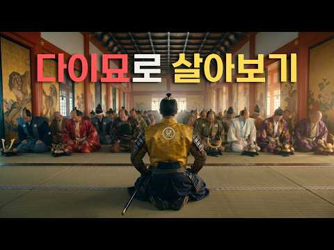
- 설명 앞부분: 만약 당신이 눈을 떴을 때, 일본 최고 권력자 도요토미 히데요시의 아들이자 비젠국 57만 석을 거머쥔 황금 금수저로 환생해 있다면 어떨까요? 심지어 갓 스무 살의 나이에 16만 대군을 이끄는 총사령관이 되어, 전국의 내로라하는 맹장들을 발아래 두고 천하를 호령하는 삶. 그야말로 세상의 중심에 선 듯한 도파민을 느꼈을 것입니다. 그러나 완벽한 비단길 같았던 당신의 운명은, 단 한 번의 선택으로 상상조차 할 수 없는 심연으로 추락하기 시작합니다. 지금, 운명의 무게를 직접 느낄 수 있는 환생의 문이 열립니다. 자, 눈을 감으십시오. …
- 같은 채널 평소 대비 ×9.4 (채널 최근 롱폼 중앙값 23,980회) · 평소 영상: 로마 금남의 구역 베스타신전, 여사제로 산다면 체감할 상상 초월의 공포와 권력 (24,841회) / 1872년 정유업자로 태어나면 록펠러와 맞서 싸워 이길 수 있을까? ㅣ 도금시대에 살아남기 (23,119회)
- 대본 없음 (설명) — 음성인식이 끝나면 도입부·흐름이 들어감
- 댓글 625/635: 좋은 점 — 영상 6 · 감사·응원 15 · 더 알고 싶은 것 23 · 아쉬운 점 — 영상 4 · 반박·불만 — 의견 다름 5 · 정치·사회 7 · 경험 공유 10 · 구독·다음 기대 8
  - 좋은 점 — 영상 👍43 “ai는 이렇게 쓰는거구나 한 수 배우고 갑니다”
  - 좋은 점 — 영상 👍4 “진짜 유익한 채널이다 ㅠ 마지막에 항상 꼭 분위기 있는 브금 넣으면서 감동 서사로 끝내더라 ㅎ 옛다 하이프 😊”
  - 감사·응원 👍9 “다이묘의 생활은 참 고달프고 힘든 삶이었네요. 오늘도 좋은 환생체험 감사드립니다. 👍👍👍”
  - 감사·응원 👍4 “정말 감사합니다.”
  - 더 알고 싶은 것 👍10 “퀄리티가 상당히 훌륭합니다. 영상 잘 보고 갑니다. 앞으로도 꾸준한 활동 부탁드려요.”
  - 더 알고 싶은 것 👍2 “사도세자로 태어나서 뒤죽에 갇혀 죽는 삶은 어떤가요?”
  - 아쉬운 점 — 영상 👍3 “근데 히데요시는 아무래도 좀 거부감이 ㅠㅠ 더군다나 히데요시는 일본 본토에서도 호불호 갈리는데 ㅠㅠ 차라리 오다 노부나가 쪽으로 다루어 주셨으면 어땠을까 하는 아쉬움이 남네요”
  - 아쉬운 점 — 영상 👍2 “자칫하면 지루해질수있는 내용인데 재밌게 잘봤습니다”
  - 반박·불만 — 의견 다름 👍2 “일본 유튭 채널중에 전국시대, 에도시대 밥상 재현하는 채널이 있던데 전국 3영걸 식단을 보니 히데요시는 문어를 즐겨먹었다고 하더군요. 히데요시의 ai 모습이 고증에 맞지않게 넘 잘 생겼네요. 진짜로 원숭이를 닮아서 노부나가가 사루(원숭이)라고 불렀는데 말입니다. 우키…”
  - 정치·사회 👍6 “0:33 朝鮮を経て 여기서 “조선을 거쳐” 라는 부분에 한자는 틀려도 발음은 맞는데 그 뒷부분의 명 왕조에 대한 부분은 틀렸습니다.그 당시 왜나라가 명나라를 부르는 이름은 あきり(아키리)라는 이름이 아닌 ミン(밍) 이라고 하였습니다. 정확히는 명 왕조 明王朝(밍 오우…”
  - 정치·사회 👍2 “청년장군 경대승의 이야기도 만들어주시면 감사하겠습니다. 고려 무신정권에서 중심인물들의 파란만장한 이야기들도 구독자분들에게 충분히 매력적일것이라 생각합니다”
  - 경험 공유 👍3 “저도 빠박이 촌마게 해야해요?”
  - 경험 공유 👍2 “아비가 히데요시고 내가 우키타로 환생한다는 설정이면 무조건 이에야스랑 친분을 만들고, 무단파와 문치파 사이를 중재해서 도요토미 세력도 하나로 결집시켜놓을거임. 어느쪽이든 이길때를 대비해서. 비젠 57만석 일단 시작이 좋아. 역시 태합”
  - 구독·다음 기대 👍3 “꿀잼이네요 다양한 나라,시대도 좋지만 광해군 같은 조선왕 환생은 어떨까요? 왜란세자시절 분조부터 집권 후 그리고 반정 및 이후 귀양까지 언젠가 꼭 한번보고싶네요 구독하고갑니다!!”
  - 구독·다음 기대 👍2 “마 구독했따 ! ㅋㅋ”

### 444. 콩트 왕 김선영 유배(1탄) 🔪 정통 사극 노리고 왔는데 개그맨으로 오해 받게 생긴 대배우, 오늘 안에 수라를 드실 수 있을까? ∣ 조선의 청요리사 EP.06

- https://www.youtube.com/watch?v=URXxc2M5IBk · 언발란스 식당 · 구독자 17,900 · 조회수 104,429 (×5.8, 하루 828.6) · 좋아요 1,965 (1.9%) · 21.7분 · 2026-06-24 · 주제 묶음 3. 조선 · 형식 정보·해설 (그 밖) · 폴더 `W_URXxc2M5IBk` (웹 승인)
- 썸네일: 
- 설명 앞부분: 여섯 번째 수라상 주인공은 김선영, 웃기고 싶어서 안달 난 우리 왕... 이번 주는 마음껏 웃기게 해드리고 수라상은 다음주에 바치겠습니다... [조선의 청요리사] 매주 수요일 저녁 6시 공개 ※그릇 제공: 다겸테이블 ※ 출연자를 향한 과도한 욕설과 비방성 댓글 등은 무통보 삭제될 수 있습니다.
- 대본 없음 (설명) — 음성인식이 끝나면 도입부·흐름이 들어감
- 댓글 154/154: 좋은 점 — 영상 0 · 감사·응원 1 · 더 알고 싶은 것 1 · 아쉬운 점 — 영상 0 · 반박·불만 — 의견 다름 1 · 정치·사회 0 · 경험 공유 2 · 구독·다음 기대 1
  - 감사·응원 👍10 “선영배우님 생각보다 너무 귀여우셔요❤ㅋㅋㅋㅋㅋㅋ 배꼽 빠지게 웃었네요😂😂 옷 입은것만 봐도 사극 완전 잘하실듯!! 응원합니다😊”
  - 반박·불만 — 의견 다름 👍6 “사극이 제가 아는 그 전하~ 그 사극 맞는거죠?? snl 사극아니죠?”
  - 경험 공유 👍6 “사극이 제가 아는 그 전하~ 그 사극 맞는거죠?? snl 사극아니죠?”
  - 경험 공유 👍0 “참 재밋는데..진지충인가요...제가 절까지는 너무...몰겠어요 요즘은 어떤지..근데 그래도...절을 한다는건 너무 굴욕적이잖아요..”
  - 구독·다음 기대 👍4 “요리 레시피도 얻어가고 웃음도 얻어가네요😂 구독하고 갑니다🎉”

### 445. 🌙 조선왕조실록 500년｜건국부터 대한제국까지, 조선의 모든 것 (태조~순종)

- https://www.youtube.com/watch?v=I1I433SSBdE · 소리로 듣는 역사 · 구독자 2,650 · 조회수 15,409 (×5.8, 하루 160.4) · 좋아요 121 (0.8%) · 157.3분 · 2026-07-24 · 주제 묶음 3. 조선 · 형식 정보·해설 (그 밖) · 폴더 `W_I1I433SSBdE` (웹 승인)
- 썸네일: 
- 설명 앞부분: 태조부터 순종까지, 조선 500년의 역사를 한 편에 담았습니다. 왕들의 즉위와 개혁, 권력 투쟁, 임진왜란과 병자호란, 세종의 업적, 영조와 정조의 개혁, 그리고 조선의 마지막까지. 이 영상은 『조선왕조실록』을 중심으로 조선왕조 500년의 흐름을 시간순으로 정리한 역사 다큐멘터리입니다. 기록은 왕을 미화하지도, 감추지도 않았습니다. 그렇게 남겨진 기록이 오늘날 우리가 만나는 조선의 역사입니다. 🎧 편안하게 감상하시며 조선왕조 500년의 긴 여정을 함께해 보시기 바랍니다. 🙏 시청해 주셔서 감사합니다.
- 같은 채널 평소 대비 ×1.6 (채널 최근 롱폼 중앙값 9,645회) · 평소 영상: [명종 풀스토리] 왕좌에 앉아 22년을 버틴 왕 ∣ 사라진 왕권의 시대 — 오디오북 (10,449회) / 문종~중종 몰아보기 ∣ 문종의 조선은 왜 세조의 조선이 되었나 #왕사남 (8,841회)
- 대본 없음 (설명) — 음성인식이 끝나면 도입부·흐름이 들어감
- 댓글 10/10: 좋은 점 — 영상 0 · 감사·응원 0 · 더 알고 싶은 것 1 · 아쉬운 점 — 영상 0 · 반박·불만 — 의견 다름 0 · 정치·사회 0 · 경험 공유 0 · 구독·다음 기대 0
  - 더 알고 싶은 것 👍1 “설명ㆍ요약 낭독 좋아요 👌 😊 볼륨 일정하게 조절 부탁합니다 🙏”

### 446. 24년 인내 끝에 왕이 된 정조, 즉위 20일 만에 숙의 문씨를 처형한 역사적 비극

- https://www.youtube.com/watch?v=Yg9WfFY9xlc · 잊혀진한국사 · 구독자 14,200 · 조회수 82,006 (×5.8, 하루 462.0) · 좋아요 2,416 (2.9%) · 17.3분 · 2026-05-03 · 주제 묶음 1. 역사 일반·이야기 · 형식 인터뷰·강연·대담 · 폴더 `W_Yg9WfFY9xlc` (웹 승인)
- 썸네일: 
- 설명 앞부분: 🔻 오늘 들려드릴 역사 이야기 24년 인내 끝에 왕이 된 정조, 즉위 20일 만에 숙의 문씨를 처형한 역사적 비극 본 영상은 한국사의 다양한 시대와 인물, 사건을 바탕으로 제작된 역사 콘텐츠입니다. 조선왕조실록, 고려사, 삼국사기 등 신뢰할 수 있는 사료와 역사 자료를 참고하였으나, 일부 내용은 시청자의 이해를 돕기 위한 각색과 재구성이 포함되어 있습니다. 영상에 등장하는 인물, 대화, 상황은 실제 역사적 기록을 기반으로 하되, 서사적 표현과 해석이 가미된 경우가 있습니다. 따라서 모든 해석과 견해는 당시 사료와 연구 결과를 종합…
- 같은 채널 평소 대비 ×246.3 (채널 최근 롱폼 중앙값 333회) · 평소 영상: 조선 사람들의 혹독한 겨울 생존법, 난방도 의복도 돈도 없이 버틴 현실 기술 (359회) / 조선 후궁 숙의 홍씨, 역사상 가장 많은 자식을 낳은 그녀의 숨겨진 삶과 놀라운 비밀 (307회)
- 대본 없음 (설명) — 음성인식이 끝나면 도입부·흐름이 들어감
- 댓글 99/99: 좋은 점 — 영상 0 · 감사·응원 0 · 더 알고 싶은 것 1 · 아쉬운 점 — 영상 0 · 반박·불만 — 의견 다름 0 · 정치·사회 2 · 경험 공유 2 · 구독·다음 기대 0
  - 정치·사회 👍1 “숙의 문씨의 발음을 [수게 문씨]?!?!?!?!?!?!?!?!?!?! × ◇ 바른 발음: 발음 숙의[수긔/수기] 우리글도 못 읽는 이런 미개인.야만인보다도 더 무식한 이런 인간이 유튜버를 한다고?!?!?!?!?!?! 세종대왕께서 진노하신다! 우리말을 오염시켜 나라 개…”
  - 정치·사회 👍0 “조선 태조 이성계가 쿠테타로 수많은 사람을 죽이고 왕조를 세우고 고려의 풍습이나 제도를 완전히 박살을 내버리고 여자들 권리도 개박살 내버리고 왕실의 여이들응 정권을 이용해먹는 도구로 썼다 주자학을 받아들여 종교를 탄압하고 공자왈 맹자왈 하고 관혼상제를 새로만들어 남성…”
  - 경험 공유 👍4 “내가 아는 영조는 참 나쁨. 우리가 탕평책으로 아는 그런 임금 아님. 오로지 권력에 매달린 사람. 사람마다 생각은 다르나 자신의 자식을 죽이고 혼자 권력을 가지려한 사람이다. 지금으로 보니 윤건희. 알면 답해라. 억울하나?”

### 447. [중국반응]“이건 우리 굴욕인데 왜 니들이 울어? 한국 역사 영화 본 중국인들이 단체로 멘붕 터진 이유!”“오히려 중국인들이 "우리가 굴욕적이다"라며 밤새 통곡…

- https://www.youtube.com/watch?v=8VXHbvT07N4 · 한류클라쓰TV · 구독자 45,200 · 조회수 253,702 (×5.6, 하루 4,086.3) · 좋아요 3,049 (1.2%) · 14.5분 · 2026-08-27 · 주제 묶음 1. 역사 일반·이야기 · 형식 사연·드라마 · 폴더 `W_8VXHbvT07N4` (웹 승인)
- 썸네일: 
- 설명 앞부분: [중국반응]“이건 우리 굴욕인데 왜 니들이 울어? 한국 역사 영화 본 중국인들이 단체로 멘붕 터진 이유!”“오히려 중국인들이 "우리가 굴욕적이다"라며 밤새 통곡하는 기묘한 현상!”
- 같은 채널 평소 대비 ×7.2 (채널 최근 롱폼 중앙값 35,357회) · 평소 영상: [중국,미국,남미통합반응]“한국이 이제는 너무 무섭다! 중국·미국·남미 동시 폭발하며 K… (35,357회) / [일본반응]"그동안 속았습니다!""외면하고 싶은데 눈을 못 떼겠다" 역대급 항일 스릴러 … (35,679회)
- 대본 없음 (설명) — 음성인식이 끝나면 도입부·흐름이 들어감
- 댓글 540/562: 좋은 점 — 영상 2 · 감사·응원 14 · 더 알고 싶은 것 2 · 아쉬운 점 — 영상 1 · 반박·불만 — 의견 다름 4 · 정치·사회 89 · 경험 공유 21 · 구독·다음 기대 1
  - 좋은 점 — 영상 👍3 “이런 분석글이 한류의 품격을 높인다. 감독은 역사를 성찰하며 투자와 노력을 집중하여, 하나의 작품을 만들지만, 그것을 보는 대중은 그저 자기 그릇만큼 보고 즐기는 것이다. 그래서 비평가나 수준 높은 감상글은 읽으면서 그런 면이 있구나 하고 배우면서 읽게 된다. 이렇게…”
  - 감사·응원 👍15 “명작과 명분석!!늘 응원합니다!!”
  - 감사·응원 👍6 “언젠가는 중국 공산당 마오쩌뚱의 통치기간 중 마오쩌뚱이 자국민을 죽인 숫자가 3천만명에서 많게는 8천만명까지라는데...그 처참한 시기에 대한 이야기가 중국인들의 손에서 중국인들의 배우로 연기되어 제작되는 날이 오기를 응원합니다. 중국 한국 일본은 머리가 좋습니다. 중…”
  - 더 알고 싶은 것 👍3 “주인장 노고가 많습니다 항상 당신을 응원합니다 주인장 아니면 어디서 이런 귀한 자료들을 매일 볼수 있겠나요? 다시한번 고맙습니다 꾸벅!”
  - 더 알고 싶은 것 👍0 “님의,영상 예전에는 정치적성향을 띄고 올려서 별로 좋아하지 않았지만 이런영상은 참좋네요..구독자들은 모두가 님과같은 정치적 이념이 같지않습니다..그러니 이런부분 유념하시고 이런 깊이있는 영상,계속 올려주세요”
  - 아쉬운 점 — 영상 👍0 “내용은 괜찮은데 제목이 너무 낚시성임”
  - 반박·불만 — 의견 다름 👍0 “청나라 황실, 즉 후금의 황실의 성씨는 애신각라입니다. 경주 김씨의 후손으로 신라를 사랑하고 생각한다는 뜻이지요. 여진, 거란, 말갈, 숙신 등등은 모두 우리 동이족의 일파이고, 그들의 역사는 소멸된 것이 아니라 우리의 역사이고, 우리 역사책 속에 편입되어야 합니다.…”
  - 반박·불만 — 의견 다름 👍0 “역사는 정확하게 기록하고 판단해야 한다. 지금 한국의 좌경화된 역사 선생놈들을 보면 일본은 무조건 나쁜놈. 고종은 좋은놈. 이승만 과 박정희는 독재자 라고 선전 선동을 한다...정말 이런 놈들 보면 아가리를 찢어 버리고 싶은 충동이 생긴다.”
  - 정치·사회 👍470 “중국에게 한마디 충고하자면, 한류를 시샘하거나 부러워 할게 아니라, 천안문 사건을 중국인이 영화로 찍고, 그걸 중국에서 상영할 수 있을 때 비로소 중국영화가 세계에서 성공할 준비가 된 거라고 봄.”
  - 정치·사회 👍53 “청나라는 이민족 왕조이고 그 뿌리는 고구려 후예이니 결국 이 영화는 삼국시대처럼 한민족끼리의 싸움... 그러니 중국인들이 머리가 아프지.”
  - 경험 공유 👍12 “나도 이 영화 봤을때 진짜 충격적이었다 하지만 반대로 또 자랑스럽더라. 세상에 어떤 나라가 자신들의 이렇게 부끄러운 역사를 도마위에 올려놓고 해부해 볼 수 있는 용기가 있을까 하고”
  - 경험 공유 👍3 “중국 한족은 자신들이 실제로 나라를 통치한게 육백년 정도고 나머지는 타민족에게 수천년을 지배당한 민족임 우리는 비록 일제식민지 35년 겪었지만, 오천년 동안 나라를 지배한건 우리 민족이었음 중국의 한족들이 지금도 수단과 방법을 가리지 않고 자기 이익만 얻으려 하고 인…”

### 448. 📷 일반에 공개되기엔 너무 대담했던 숨겨진 빈티지 사진 100장

- https://www.youtube.com/watch?v=dV8dR2TXhac · World of Lost Photos · 구독자 5,300 · 조회수 29,546 (×5.6, 하루 195.6) · 좋아요 226 (0.8%) · 20분 · 2026-05-30 · 주제 묶음 1. 역사 일반·이야기 · 형식 인터뷰·강연·대담 · 폴더 `W_dV8dR2TXhac` (웹 승인)
- 썸네일: 
- 설명 앞부분: 📷 일반에 공개되기엔 너무 대담했던 숨겨진 빈티지 사진 100장 역사 속에는 카메라에 담겼지만 오랫동안 사람들의 눈에 띄지 않았던 순간들이 존재합니다. 이번 영상에서 잊혀진 역사 사진들은 거의 알려지지 않았던 희귀한 빈티지 사진들을 통해, 과거의 숨겨진 장면들과 잊혀진 이야기들을 다시 조명합니다. 📸 시간이 감춰두었던 순간들 이 사진들은 단순한 오래된 기록물이 아닙니다. 자연스럽게 포착된 사람들의 표정, 활기 넘치던 거리의 풍경, 사라져버린 장소들, 그리고 당시 시대의 분위기를 그대로 담고 있습니다. 연출되지 않은 순간들이기에 더…
- 같은 채널 평소 대비 ×11.7 (채널 최근 롱폼 중앙값 2,518회) · 평소 영상: 📷 그들은 당신이 이 50장의 사진을 보지 않기를 바랐다. (2,379회) / 📸 우리가 알고 있던 역사와 완전히 다른 이야기 (2,356회)
- 대본 없음 (설명) — 음성인식이 끝나면 도입부·흐름이 들어감
- 댓글 4/4: 좋은 점 — 영상 0 · 감사·응원 0 · 더 알고 싶은 것 0 · 아쉬운 점 — 영상 0 · 반박·불만 — 의견 다름 0 · 정치·사회 0 · 경험 공유 0 · 구독·다음 기대 0

### 449. "대체 누굴 만나는 거요" 잠든 척 아내 뒤를 밟는 의심에 눈먼 남편 ∣ 야담 ∣ 민담 ∣ 전설 ∣ 설화 ∣ 옛날이야기 수면동화 오디오북 사연

- https://www.youtube.com/watch?v=q7OBU6FIvp0 · 소원야담 · 구독자 6,360 · 조회수 35,050 (×5.5, 하루 273.1) · 좋아요 0 (0.0%) · 62분 · 2026-06-22 · 주제 묶음 9. 야사·야담·옛날이야기 · 형식 수면·낭독 (잠잘 때 듣는) · 폴더 `W_q7OBU6FIvp0` (웹 승인)
- 썸네일: 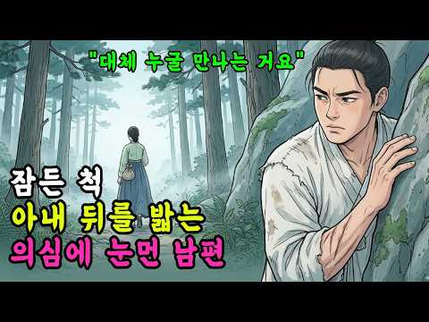
- 설명 앞부분: 본 영상은 다양한 전승 이야기를 바탕으로 소원야담에서 새롭게 각색 및 재구성한 창작 콘텐츠입니다. 몰입감 있는 이야기 전달을 위해 등장인물, 지명, 사건의 일부 설정은 연출에 맞게 가공되었음을 알려드립니다. 소원야담은 밤하늘에 소원을 띄우듯 옛이야기를 조용히 풀어놓는 이야기 채널입니다. 사람들 사이에서 입에서 입으로 전해 내려오던 기묘한 야담, 기록 뒤편에 숨겨진 흥미로운 이야기들, 그리고 옛사람들의 웃음과 지혜가 담긴 다양한 이야기들을 전해드립니다. 잠들기 전 조용한 밤, 혹은 잠시 쉬어가고 싶은 순간에 이야기 하나 들어보시길 …
- 같은 채널 평소 대비 ×85.3 (채널 최근 롱폼 중앙값 411회) · 평소 영상: 시집 온 첫날 혼례상을 뒤엎은 꼬마 며느리 ∣ 야담 ∣ 민담 ∣ 전설 ∣ 설화 ∣ 옛날이… (411회) / 모두가 버리라던 눈먼 남편, 3년 뒤 기적이 일어났다 ∣ 야담 ∣ 민담 ∣ 전설 ∣ 설화… (397회)
- 대본 없음 (설명) — 음성인식이 끝나면 도입부·흐름이 들어감
- 댓글 71/71: 좋은 점 — 영상 1 · 감사·응원 5 · 더 알고 싶은 것 1 · 아쉬운 점 — 영상 0 · 반박·불만 — 의견 다름 0 · 정치·사회 0 · 경험 공유 0 · 구독·다음 기대 0
  - 좋은 점 — 영상 👍3 “"묵묵히 물지게를 대신 지는 게 덕배의 사랑 방식이었다"는 말이 참 먹먹하네요. 진정한 사랑과 신뢰가 무엇인지 배우고 갑니다~”
  - 감사·응원 👍2 “서울에서 잘듣고갑니다 감사합니다 😅눈물겨운부부의사랑❤남편을살리기위해~이끼낀절벽을오르는~아내의목숨건일이네요!!남편 을사랑한절절한❤이야기 행복하게오래오래사세요!감동입니다.옆에있는내남편❤하며살아내야겠네요😅퇴근하면 고생했어요!하고안아줘야겠네요!!감동입니다 😅”
  - 감사·응원 👍2 “아산보명사 감사합니다 🎉”
  - 더 알고 싶은 것 👍1 “그런 아내가 어디 있을까요? 정말 대단하네요. 남자는 복받았네”

### 450. 노비 출신으로 정1품 빈에 오른 신빈 김씨: 실록으로 본 세종과 신빈김씨

- https://www.youtube.com/watch?v=k_GaCpqR56M · 거침없는한국사 · 구독자 32,900 · 조회수 176,777 (×5.4, 하루 1,178.9) · 좋아요 2,922 (1.7%) · 65.3분 · 2026-05-31 · 주제 묶음 3. 조선 · 형식 야담·옛날이야기 · 폴더 `W_k_GaCpqR56M` (웹 승인)
- 썸네일: 
- 챕터: 0:00 관비의 딸, 궁녀로 들어가다 · 5:30 세종대왕과의 첫 만남 · 15:20 소헌왕후의 인정을 받다 · 22:10 연이은 출산, 8남매의 어머니 · 35:40 세종 승하, 그리고 찾아온 위기 · 48:20 세조 앞에 선 신빈 김씨 — 최후의 선택 · 58:30 팩트체크: 실록이 말하는 진짜 신빈 김씨
- 설명 앞부분: 🌙 조선 500년 단 한 번, 노비의 몸으로 정1품 빈에 오른 여인 — 신빈 김씨. 신빈김씨는 조선왕조실록이 증언하는 가장 드라마틱한 인생을 산 여인입니다. 13세 관비 출신 소녀가 어떻게 세종대왕의 마음을 사로잡고, 소헌왕후의 신뢰까지 얻어 8남매를 낳은 조선 최고의 후궁이 되었을까요? 그리고 세종이 세상을 떠난 후, 그녀를 기다린 것은 무엇이었을까요? 세조마저 함부로 하지 못했던 신빈 김씨의 파란만장한 평생을, 지금 만나보세요. 영상 속 주요 장면 ※ 본 영상은 조선왕조실록과 각종 사료를 바탕으로 제작되었으며, 극적 재미를 위…
- 같은 채널 평소 대비 ×13.7 (채널 최근 롱폼 중앙값 12,881회) · 평소 영상: 🌙9살 연하 새어머니, 광해를 왕으로 만들더니,15년 후 폐위시킨 이유∣인목왕후 (12,881회) / 🌙12살에 버려진 천민 기생을 위해 정조가 국법을 깨뜨린 이유 ∣ 김만덕 ∣ 정조 (14,444회)
- 대본 없음 (설명) — 음성인식이 끝나면 도입부·흐름이 들어감
- 댓글 113/113: 좋은 점 — 영상 0 · 감사·응원 10 · 더 알고 싶은 것 0 · 아쉬운 점 — 영상 2 · 반박·불만 — 의견 다름 0 · 정치·사회 4 · 경험 공유 0 · 구독·다음 기대 0
  - 감사·응원 👍6 “참 살아가면서 본받을바 있는 인생이네요 참재미있게 제작해주셨어요 감사합니다~^-^~❤❤❤”
  - 감사·응원 👍6 “참으로 감동적인 내용의 실록입니다. 감사 감사드립니다!!!!!!! 샬롬 샬롬 ♡♡♡~~~~”
  - 아쉬운 점 — 영상 👍2 “수양대군은. 그때죽어써야. 되는것되. 그래쓰면. 여러사람들도. 피를흘리지. 안아쓸텐되. 아쉽네요”
  - 아쉬운 점 — 영상 👍0 “저 여자얘기 스탚.반복되니 식상❤”
  - 정치·사회 👍2 “도~청은 결코 영원하지만 정권은 바뀝니다! 명심하세요. 언제까지나! …….”
  - 정치·사회 👍1 “태종의 소헌황후 아버지를 무고처형한 업보가 세종의 자식과 문종 단종을 일찍 죽게하고 세조의 잔인한 정권찬탈과 단종 처형 업보가 세조의 아들 손자를 죽게하고 온몸을 피부양으로 죽게했다 그러나 신빈은 세종과 소헌왕후가 지켜주었고 세조는 그녀의 자식들의 미래를 지켜 후히 …”

### 451. 임진왜란보다 끔찍했던 2년, 조선을 삼킨 최악의 대기근 ∣ 경신대기근

- https://www.youtube.com/watch?v=e0W45a_vPy0 · 조선의이면 · 구독자 2,870 · 조회수 15,347 (×5.3, 하루 119.1) · 좋아요 314 (2.1%) · 23.8분 · 2026-06-21 · 주제 묶음 3. 조선 · 형식 정보·해설 (그 밖) · 폴더 `W_e0W45a_vPy0` (웹 승인)
- 썸네일: 
- 설명 앞부분: 한여름에 서리가 내리고, 7월에 눈이 쌓였습니다. 임진왜란도, 병자호란도 견뎌낸 조선이 단 2년 만에 무너질 뻔했습니다. 여러분은 '경신대기근'을 알고 계셨습니까? 임진왜란보다 더 참혹했다고 조선왕조실록이 기록한 조선 최악의 재앙, 경신대기근(1670~1671)의 이야기입니다. ▪ 전 지구적 소빙기 — 한여름에도 서리와 눈이 내려 곡식이 얼어 죽다 ▪ 단 2년, 1,200만 인구 중 수십만에서 100만에 이르는 희생 (양반·관리도 예외가 아니었다) ▪ 우역으로 전국의 소가 떼죽음 — 농사의 뿌리가 무너지다 ▪ 역병과 유민, 그리고…
- 같은 채널 평소 대비 ×13.4 (채널 최근 롱폼 중앙값 1,144회) · 평소 영상: 조선에서 가장 돈이 많았지만 자유가 없던 사람 ∣ 조선의 부자 노비 (1,144회) / 조선시대 노비가 도망치면 어떻게 됐을까? 도망노비의 충격적인 현실 (1,120회)
- 대본 없음 (설명) — 음성인식이 끝나면 도입부·흐름이 들어감
- 댓글 22/22: 좋은 점 — 영상 1 · 감사·응원 0 · 더 알고 싶은 것 0 · 아쉬운 점 — 영상 0 · 반박·불만 — 의견 다름 0 · 정치·사회 1 · 경험 공유 1 · 구독·다음 기대 0
  - 좋은 점 — 영상 👍0 “잘 배우고 갑니다 👍 👍 👍 👍”
  - 정치·사회 👍0 “1980년 냉해 때문에 쌀 생산량이 줄어들어 부족한 쌀을 수입했는데, 국제 식량 바이어들은 한국이 냉해로 쌀이 부족하다는 정보를 미리 접수하고 시세보다 높게 쌀 가격을 올렸고 정부는 울며 겨자 먹기로 더 많은 달러를 주고 쌀을 수입해서 국민이 굶주리는 일은 없었는데,…”

### 452. 세조가 발탁한 천민 궁녀… 조선을 뒤에서 움직인 여자 '조두대'

- https://www.youtube.com/watch?v=IOKiWVxwsyM · 역사 추적자 · 구독자 8,060 · 조회수 42,863 (×5.3, 하루 285.7) · 좋아요 1,159 (2.7%) · 29.2분 · 2026-05-31 · 주제 묶음 3. 조선 · 형식 정보·해설 (그 밖) · 폴더 `W_IOKiWVxwsyM` (웹 승인)
- 썸네일: 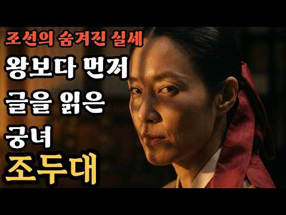
- 챕터: 0:00 프롤로그 — 죽어서도 처형당한 여자 · 2:00 1장 — 천민 소녀, 가장 희귀한 능력을 품다 · 6:00 2장 — 세조의 눈에 띄다 · 10:00 3장 — 훈민정음 보급 프로젝트의 실무 조력자 · 14:00 4장 — 글을 모르는 대비가 조선을 다스리다 · 18:00 5장 — 여알(女謁), 비선 실세의 탄생 · 21:00 6장 — 사림의 칼날이 겨눠졌다 · 23:00 7장 — 연산군의 복수, 부관참시 · 26:00 8장 — 그녀는 악녀였을까, 시대의 희생양이었을까
- 설명 앞부분: 이 영상은 《조선왕조실록》을 비롯한 역사 사료와 학술 논문을 바탕으로 제작된 역사 다큐멘터리 콘텐츠입니다. 등장하는 인물, 사건, 연도는 모두 실제 기록에 근거하며, 대사나 감정 묘사 일부는 역사적 맥락에 따라 재구성되었습니다. 🔴 조선 역사가 가장 지우고 싶었던 이름 — 조두대(曺豆大) 1504년 조선, 연산군의 명령 하나가 떨어졌습니다. "그 여자를 묘에서 꺼내라." 그런데 그 여자는 이미 죽은 사람이었습니다. 살아 있는 사람도 아닌, 무덤 속에 묻혀 있는 여자를. 왜 연산군은 죽은 사람을 굳이 꺼내 다시 처형했을까요. 그녀의…
- 같은 채널 평소 대비 ×40.7 (채널 최근 롱폼 중앙값 1,054회) · 평소 영상: 조선 전체가 반대했지만 정조가 끝까지 지켜낸 남인, 채제공 (1,054회) / 55년간 중국 본토를 지배한 고구려 유민 일가, 이정기 (1,025회)
- 대본 없음 (설명) — 음성인식이 끝나면 도입부·흐름이 들어감
- 댓글 56/58: 좋은 점 — 영상 2 · 감사·응원 2 · 더 알고 싶은 것 0 · 아쉬운 점 — 영상 0 · 반박·불만 — 의견 다름 1 · 정치·사회 1 · 경험 공유 1 · 구독·다음 기대 0
  - 좋은 점 — 영상 👍10 “좋은 내용 감사합니다. 악한 사람에겐 악녀 선한 사람에겐 선녀 많이 아는게 죄. 죄인입니다”
  - 좋은 점 — 영상 👍4 “세조가 한글을 창조했냐 ㅎㅎㅎ 세종아니냐 조두대는 유모로 입궁했고 조두대는 티벳불경을 번역할만큼 금방배웠다고 아는데 엉터리 누가 이런 역사를 개판”
  - 감사·응원 👍17 “한가지 분명한건 시대를 앞선 정말 머리좋은 여성 이란게 팩트 네요 잘들었읍니다~감사 해요^^”
  - 감사·응원 👍10 “좋은 내용 감사합니다. 악한 사람에겐 악녀 선한 사람에겐 선녀 많이 아는게 죄. 죄인입니다”
  - 반박·불만 — 의견 다름 👍3 “거늬에 비하면 아무것도 아니죠.”
  - 정치·사회 👍1 “글자도 모르는녀이 국가를 수렴청정하다니.. 사림은 글모르는 녀은 국가를 다스려도 되고 똑똑한 여자는 정치에 개입조차하면 안된다?자가모순덩어리 좌파같네... 조두대는 분명 지금이라도 복권.”
  - 경험 공유 👍16 “조두대는 능력자였다. (신분질서의 한계를 넘어 실무자를 등용하는) 세조에게 발탁되어 자신의 능력을 발휘하였으나 신분제에 얽매인 형식주의자 세력들에게 끊임없이 훼방받으며 시련을 겪었던 사람.”

### 453. 💥저작권등록💥 '중국 역사상 최악의 막장 시대, 5호 16국 풀스토리

- https://www.youtube.com/watch?v=JGs2ZVj0fNI · 잠결에듣는세계사 · 구독자 39,000 · 조회수 205,221 (×5.3, 하루 2,817.8) · 좋아요 2,745 (1.3%) · 108.6분 · 2026-08-11 · 주제 묶음 1. 역사 일반·이야기 · 형식 수면·낭독 (잠잘 때 듣는) · 폴더 `W_JGs2ZVj0fNI` (웹 승인)
- 썸네일: 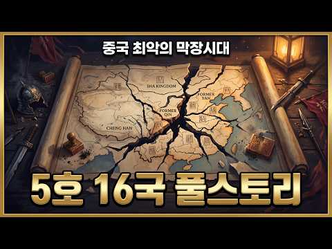
- 설명 앞부분: 살아남기 위해 스승을 죽이고, 형제를 도륙해야 했던 피의 대혼란, 5호 16국 시대. 배신이 일상이 되고 절망이 뼈에 사무치던 이 비극의 역사 속에서, 인간은 과연 무엇을 위해 생존해야 했을까요? 끝없는 절망 속에서도 삶의 의미를 갈구했던 자들의 숨 막히는 서사와 인생 철학을 담아냈습니다. 오늘 밤, 어둠보다 깊었던 그 시대의 이야기 속으로 여러분을 초대합니다.
- 같은 채널 평소 대비 ×15.4 (채널 최근 롱폼 중앙값 13,355회) · 평소 영상: 💥저작권등록💥 '그들은 왜 싸우는 걸까? 결국 실크로드 돈줄 때문에 맞붙은 흉노·한나라·… (13,355회) / 💥저작권등록💥 '오자병법 무패신화 풀스토리입니다' (12,381회)
- 대본 없음 (설명) — 음성인식이 끝나면 도입부·흐름이 들어감
- 댓글 156/157: 좋은 점 — 영상 4 · 감사·응원 13 · 더 알고 싶은 것 0 · 아쉬운 점 — 영상 2 · 반박·불만 — 의견 다름 0 · 정치·사회 0 · 경험 공유 1 · 구독·다음 기대 0
  - 좋은 점 — 영상 👍9 “넘 재밌고 귀에 쏙쏙 들어와요🎉밤새는 세계사 ㅎㅎ최고예요 음악없어서 더좋고 목소리도 짱이십니다 감사합니다”
  - 좋은 점 — 영상 👍8 “5호16국 시대를 28:46 너무나 자세히 설명해 주셔서 감사합니다.”
  - 감사·응원 👍28 “5호16국은 이민족 역사라서 잘 다루지않는데 잠결에서 이렇게 자세히 다루어 주니 감사하고 많은 지식을 얻게 됩니다. 늘 건강하시고 감사합니다.”
  - 감사·응원 👍21 “오늘도 좋아요 고맙습니다 재미있어서 또, 듣고 가겠습니다”
  - 아쉬운 점 — 영상 👍3 “설명과 목소리, 자막은 아주 좋은데.... 그래픽이 아쉽네요.”
  - 아쉬운 점 — 영상 👍1 “원고가 세밀하지 못합니다. 같은 단어가 너무 많이 반복되니 옥의 티 입니다.”
  - 경험 공유 👍14 “나도 원래 중드좋아해서 골반 허리 안좋아 매일 수면제로 틀어놓고 밤세 잠결에 듣고있어요”

### 454. 🔥데릴사위에서 국사로 등극! 시작부터 장손황후를 납치하고 유리와 우두법으로 당나라를 압도하다! 황제도 충격!#먼치킨 #판타지 #인생역전 #사이다

- https://www.youtube.com/watch?v=dY21RwhecaM · 흑룡극장 · 구독자 3,900 · 조회수 20,480 (×5.2, 하루 217.8) · 좋아요 170 (0.8%) · 194.4분 · 2026-07-26 · 주제 묶음 6. 동양사 (중국·일본·몽골) · 형식 몰아보기·통합본 (긴 영상) · 폴더 `W_dY21RwhecaM` (웹 승인)
- 썸네일: 
- 설명 앞부분: 🐉 흑룡극장 ∣ Black Dragon Theater 👑 배신당한 황자 ⚔️ 치열한 권력투쟁 🔥 통쾌한 복수 💎 시스템 각성 📜 천재 책사의 반격 한순간도 눈을 뗄 수 없는 남성향 숏드라마! 황제가 되기 위한 처절한 싸움, 배신자들을 향한 복수, 그리고 약자의 통쾌한 역전극을 만나보세요. 🎬 매일 새로운 에피소드 업로드 📺 인기 작품 몰아보기 업데이트 💬 여러분의 예상 결말을 댓글로 남겨주세요!
- 같은 채널 평소 대비 ×1.8 (채널 최근 롱폼 중앙값 11,127회) · 평소 영상: 🔥가난한 청년이 CEO와 그녀의 절친을 구하자, 두 미녀가 밤새 사랑으로 보답해 그를 녹… (11,127회) / 🔥미녀 CEO, 총 든 폭도들에게 쫓겨 죽을 위기! 가난한 청년이 맨손으로 전부 제압하자… (11,052회)
- 대본 없음 (설명) — 음성인식이 끝나면 도입부·흐름이 들어감
- 댓글 7/7: 좋은 점 — 영상 0 · 감사·응원 0 · 더 알고 싶은 것 0 · 아쉬운 점 — 영상 2 · 반박·불만 — 의견 다름 0 · 정치·사회 0 · 경험 공유 0 · 구독·다음 기대 0
  - 아쉬운 점 — 영상 👍1 “가슴이 웅장해지는 중국 여성전통의상 안나와서 아쉽네요 그나마 하녀가 조금 캐리 할랑말랑...”
  - 아쉬운 점 — 영상 👍1 “그냥 중국어와 한글자막이면 좋았을것을 어색한 더빙으로 폭망.”

### 455. 💥저작권등록💥 '숙종부터 정조까지, 피로 쓴 조선의 가장 찬란한 기록'

- https://www.youtube.com/watch?v=6ddISd5RbWU · 잠결에듣는세계사 · 구독자 39,000 · 조회수 201,716 (×5.2, 하루 1,209.3) · 좋아요 2,709 (1.3%) · 130.5분 · 2026-05-14 · 주제 묶음 3. 조선 · 형식 수면·낭독 (잠잘 때 듣는) · 폴더 `W_6ddISd5RbWU` (웹 승인)
- 썸네일: 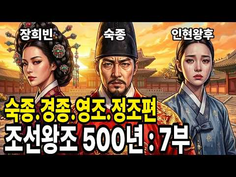
- 설명 앞부분: 환국을 통해 절대 권력을 휘둘렀던 숙종, 아들을 뒤주에 가둔 비극의 아버지 영조, 그리고 그 모든 아픔을 딛고 개혁을 꿈꾼 정조까지. 조선 후기를 관통하는 세 왕의 엇갈린 운명과 그 속에 숨겨진 처절한 생존 본능을 깊이 있게 파헤칩니다. 잠들기 전, 역사의 거대한 흐름 속에 몸을 맡기고 인간 존재의 본질과 마주하는 고요한 사색의 시간을 가져보세요. 단순히 기록된 역사를 넘어, 현대인들에게도 유효한 가족의 갈등과 권력의 허무에 대한 깊은 통찰을 선사합니다.
- 같은 채널 평소 대비 ×12.9 (채널 최근 롱폼 중앙값 15,596회) · 평소 영상: 💥저작권등록💥 '조선 역사상 가장 고독했던 천재, 정조대왕 풀스토리'입니다 (17,836회) / 💥저작권등록💥 '그들은 왜 싸우는 걸까? 결국 실크로드 돈줄 때문에 맞붙은 흉노·한나라·… (13,355회)
- 대본 없음 (설명) — 음성인식이 끝나면 도입부·흐름이 들어감
- 댓글 112/112: 좋은 점 — 영상 0 · 감사·응원 0 · 더 알고 싶은 것 1 · 아쉬운 점 — 영상 1 · 반박·불만 — 의견 다름 1 · 정치·사회 0 · 경험 공유 1 · 구독·다음 기대 0
  - 더 알고 싶은 것 👍2 “조선은 김해김씨의 나라다 진짜 김씨왕조의 조선왕조실록을 공부해 후손들에게 우리 진짜 조선의 역사를 알려주세요 김해김씨의 왕조가 진짜 조선왕조라는 것을 아는 사람이 많습니다”
  - 아쉬운 점 — 영상 👍1 “말이 넘 느리다 지루하게 조금더 빠르게 하면 좋을 듯”
  - 반박·불만 — 의견 다름 👍2 “지금이나 예전이나 권력에눈이멀어 거짓 선동하고 약자를 잡아넣고”
  - 경험 공유 👍5 “내가 잠결을 좋아하는 이유. 보통 역사하면 폭이 넓으면 깊이는 깊지않고 깊이가 깊으면 폭이 좁은데, 잠결은 폭도 넓고, 깊이도 깊고, 목소리도 내가 제일 좋아하는 스타일임. 다 좋음.”

### 456. 조선의 운명이 걸린 장기 대결, 명나라 사신 VS 열 살 소년 I 조선야담 I 민담 I 전설 I 오디오북 I 옛날이야기

- https://www.youtube.com/watch?v=XE1MNQka_bA · 민간야담 · 구독자 5,120 · 조회수 25,939 (×5.1, 하루 183.8) · 좋아요 1,099 (4.2%) · 58.7분 · 2026-06-09 · 주제 묶음 9. 야사·야담·옛날이야기 · 형식 수면·낭독 (잠잘 때 듣는) · 폴더 `W_XE1MNQka_bA` (웹 승인)
- 썸네일: 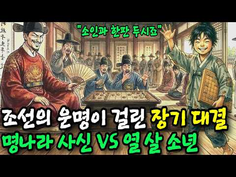
- 챕터: 0:00 인트로 — 명나라 사신의 도전 · 1:00 돌이와 어미의 저잣거리 삶 · 5:00 낡은 장기판과 숨겨진 비밀 · 10:00 궁궐로 불려간 열 살 아이 · 15:00 역사를 바꾼 한 수 · 20:00 결말 — 이기려 하지 말고 버텨라
- 설명 앞부분: 📢 [안내: 픽션 및 창작물 고지] 본 영상은 고전 설화와 민담을 바탕으로 작가의 상상력을 더해 재구성한 '창작 스토리(Fiction)'입니다. 영상에 등장하는 인물, 지명, 사건은 재미를 위한 연출이며, 실제 역사적 사실(정사)과 다를 수 있음을 밝힙니다. 본 채널은 유튜브 커뮤니티 가이드라인을 준수하며, AI 기술을 활용하여 시청자 여러분께 더욱 생생한 이야기의 즐거움을 드리는 것을 목적으로 합니다. 이번 영상은 **[지혜와 역전]**에 관한 조선시대 실화 야담입니다. 신분도, 배경도, 가진 것도 없었던 열 살 아이가 나라의 …
- 같은 채널 평소 대비 ×44.7 (채널 최근 롱폼 중앙값 580회) · 평소 영상: 혼례날 시댁 장독대를 모조리 깨버린 새색시, 깨진 항아리 밑에 드러난 것에 시아버지가 담… (657회) / 역모의 밤 폭설 속에 도망치는 세자빈을 숨긴 백정의 마패는 I 민담 I 야담 I 조선야담… (503회)
- 대본 없음 (설명) — 음성인식이 끝나면 도입부·흐름이 들어감
- 댓글 26/26: 좋은 점 — 영상 0 · 감사·응원 2 · 더 알고 싶은 것 0 · 아쉬운 점 — 영상 5 · 반박·불만 — 의견 다름 0 · 정치·사회 1 · 경험 공유 2 · 구독·다음 기대 0
  - 감사·응원 👍6 “항상 감동적인 이야기 너무 감사합니다”
  - 감사·응원 👍0 “과연.박포장기33수가명나라사신기교만장무릎꿀께할것인가.어린꼬마는진정명나라사신무뢰함저지할것인지.국운이기대됨이다.허니장씨히어링써.감사함.❤😂🎉😢😮😅❤😂🎉😢😮😅”
  - 아쉬운 점 — 영상 👍1 “착착착하는것은 무슨뜻인가요?? 설명이너무길어요 지루해요”
  - 아쉬운 점 — 영상 👍0 “언제 대결하고 이기나요 지루한 대사 .”
  - 정치·사회 👍1 “오늘날에도 조참판 같은 인간이 남의 나라를 등에 업고 권력과 부 탐욕에 찌들이 나라를 팔고 있지 국힘 일베 사이비등 없어져야 할 존재들이지”

### 457. 왜 왕은 완벽한 보안시스템이 있는 궁궐을 무섭다고 했을까?ㅣ조선시대 궁궐 보안의 비밀ㅣ왕실 호위 군대

- https://www.youtube.com/watch?v=212AYS3uovQ · 조선별채 · 구독자 14,500 · 조회수 71,466 (×4.9, 하루 476.2) · 좋아요 579 (0.8%) · 8.1분 · 2026-05-31 · 주제 묶음 3. 조선 · 형식 정보·해설 (그 밖) · 폴더 `W_212AYS3uovQ` (웹 승인)
- 썸네일: 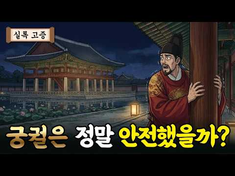
- 설명 앞부분: 안녕하세요? 오늘은 궁궐은 정말 더웠을까의 후속편으로 궁궐은 정말 안전했을까? 라는 주제로 영상을 만들었습니다. 조선시대 궁궐 보안, 왕실 호위가 생각보다 촘촘하게 잘 되어 있더라고요. 그런데도 궁궐 관련해서 논문을 읽는데 조선시대 왕들이 궁궐 안에 있는 것을 불안해 했다는 기록들이 꽤 있었습니다. 왜 왕들은 궁궐 안에 있는 것을 무서워했을까요? 『태조실록』 권8, 태조 4년 10월 7일 『선조실록』 권43, 선조 25년 4월 30일 『선조실록』 권43, 선조 25년 6월 21일 『선조실록』 권85, 선조 30년 2월 6일 『선조…
- 같은 채널 평소 대비 ×6.2 (채널 최근 롱폼 중앙값 11,511회) · 평소 영상: 왜 왕은 정결하게 씻었는데도 전염병에 걸렸을까? 궁궐 위생과 제사 (11,784회) / 무심하면 이긴다 단종의 누나 경혜공주가 선택한 삶ㅣ공주에서 비구니가 된 이유 (11,238회)
- 대본 없음 (설명) — 음성인식이 끝나면 도입부·흐름이 들어감
- 댓글 97/97: 좋은 점 — 영상 1 · 감사·응원 2 · 더 알고 싶은 것 1 · 아쉬운 점 — 영상 0 · 반박·불만 — 의견 다름 2 · 정치·사회 5 · 경험 공유 2 · 구독·다음 기대 0
  - 좋은 점 — 영상 👍1 “영상보면 젤 이해안가는게 조회수랑 구독자수임 ㄹㅇ조선 삶 궁금한거 딱 알려줘서 좋은데 아쉽네”
  - 감사·응원 👍2 “오늘도 재밋는 이야기 정말 감사합니다!! 퇴근 후에 즐거움을 주셔서 또 감사하고요”
  - 감사·응원 👍0 “영상 잘봤어요..개인적으로 조선시대에 죄인들을 취조하는 서리들..드라마에서 불로 지지고 사지를 뒤틀고..말로하기힘든 고문을가하는 무인들..트라우마가 굉장히 심했을거같은데..이부분 나중에 기회가 되면 다루어주시면 고맙겠습니다”
  - 더 알고 싶은 것 👍5 “퀄리티 진짜 좋네요 잘보고 갑니다 자주 올려주세요 ㅎㅎㅎㅎ”
  - 반박·불만 — 의견 다름 👍8 “임진왜란때 파천은 당연한겁니다 백성을버리고 도망갔다는식으로 비난받을일이 전혀아닌데 왜자꾸 이런선동을하는건지 이해가안됨..”
  - 반박·불만 — 의견 다름 👍2 “광해군에 대해서 냉철하게 분석을 하면...사실 광해군은 연산군같은 포악한 군주는 아닙니다...그런 면에서 나름 억울한 면은 있어요...임진왜란때 도망간 부왕 선조를 대신하여 분조를 이끌며 고군분투했고 실리적인 중립외교를 펼쳐 국익을 취하려고도 했어요...하지만 그의 …”
  - 정치·사회 👍5 “호위 군대 자체가, 친위대 자체가 왕을 배신하고 쿠데타를 일으킨 왕자 편에 서서 그 왕자의 조카인 왕을 시해는데 가담했으니, 계유정난과 희생양인 단종, 그리고 진작에 왕의 친위대를 매수해버린 수양대군. 요즘말로 대통령 경호실이 능력 좋고 특수부대 출신이고 어쩌고 하면…”
  - 정치·사회 👍3 “중세시대야 왕끼리 나서서 일기토 뜨고 그랬죠. 그게 용감하냐? 아니죠. 왕 잡히는 순간 엄청난 인질비용을 지불해야하고 그덕에 그나라 경제가 아작나버리죠. 최고 군 통수권자가 전시에 안전한곳에 대피하는것은 당연합니다 만약 북한이 쳐들어오면 대한민국 대통령이 벙커로 대피…”
  - 경험 공유 👍5 “제가 역사는 잘모르지만, 여기 영상에 나온거처럼, 정조 초기 자객사건이 충격이어서 그당시 사건을 알고싶어서 구글에서 많이 쳐본 기억이 나네요ㅋㅋ 지금은 특히 정조- (구선복) 이사람이 기억에 남아요 지금은 까먹었지만요ㅎㅎ 사도세자때부터 정조가 임금될때까지 방해하던 인…”

### 458. 2026년 2차 고등 검정고시 한국사 핵심 총정리

- https://www.youtube.com/watch?v=XDc4VNrUNqY · 강북구청소년상담복지센터강북구꿈드림 · 구독자 2,760 · 조회수 13,433 (×4.9, 하루 141.2) · 좋아요 245 (1.8%) · 64.7분 · 2026-07-25 · 주제 묶음 4. 한국 근현대사 · 형식 인터뷰·강연·대담 · 폴더 `W_XDc4VNrUNqY` (웹 승인)
- 썸네일: 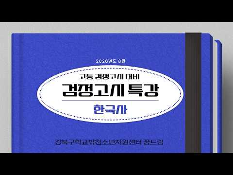
- 설명 앞부분: 안녕하세요. 강북구꿈드림입니다. 2026년 2차 고등 검정고시 한국사 핵심 총정리 강의 영상 올려드립니다. 학습자님들의 양해부탁드립니다. 감사합니다. 다음 강의 제작을 위해 온라인 검정고시 특강 설문조사를 진행합니다. 많은 참여 부탁드리겠습니다
- 같은 채널 평소 대비 ×2.5 (채널 최근 롱폼 중앙값 5,448회) · 평소 영상: 2026년 2차 고등 검정고시 사회 핵심 총정리 (5,839회) / 2026년 2차 고등 검정고시 국어 핵심 총정리 (5,846회)
- 대본 없음 (설명) — 음성인식이 끝나면 도입부·흐름이 들어감
- 댓글 68/69: 좋은 점 — 영상 2 · 감사·응원 7 · 더 알고 싶은 것 2 · 아쉬운 점 — 영상 0 · 반박·불만 — 의견 다름 0 · 정치·사회 0 · 경험 공유 4 · 구독·다음 기대 0
  - 좋은 점 — 영상 👍4 “영상 잘보고있습니다! 혹시 이 영상에 나와있는것으로 암기하면 만점받을수 있을까요? 항상 좋은 영상 감사합니다”
  - 좋은 점 — 영상 👍3 “안녕하세요 이번에 검정고시 응시하는 학생입니다! 제가 공부 자료가 따로 없어서 그런데 혹시 실례가 안된다면 영상에 나오는 pdf 파일을 받을 수 있을까요? 너무 정리가 잘 되어있어서 한 번 여쭤봅니다”
  - 감사·응원 👍12 “한국사 노베이스 몇시간뒤에 시험인데 이걸로 도전해보겠습니다 응원해주세요”
  - 감사·응원 👍4 “영상 잘보고있습니다! 혹시 이 영상에 나와있는것으로 암기하면 만점받을수 있을까요? 항상 좋은 영상 감사합니다”
  - 더 알고 싶은 것 👍4 “영상 잘보고있습니다! 혹시 이 영상에 나와있는것으로 암기하면 만점받을수 있을까요? 항상 좋은 영상 감사합니다”
  - 더 알고 싶은 것 👍3 “안녕하세요 이번에 검정고시 응시하는 학생입니다! 제가 공부 자료가 따로 없어서 그런데 혹시 실례가 안된다면 영상에 나오는 pdf 파일을 받을 수 있을까요? 너무 정리가 잘 되어있어서 한 번 여쭤봅니다”
  - 경험 공유 👍3 “안녕하세요 이번에 검정고시 응시하는 학생입니다! 제가 공부 자료가 따로 없어서 그런데 혹시 실례가 안된다면 영상에 나오는 pdf 파일을 받을 수 있을까요? 너무 정리가 잘 되어있어서 한 번 여쭤봅니다”

### 459. 고대 7대 불가사의의 진실, 이것들은 모두 진짜일까?

- https://www.youtube.com/watch?v=s46E4QAU_uM · 지식세계 · 구독자 3,550 · 조회수 17,236 (×4.9, 하루 229.3) · 좋아요 138 (0.8%) · 14.9분 · 2026-08-14 · 주제 묶음 8. 문명·고고학 · 형식 사극·드라마·영화 리뷰 · 폴더 `W_s46E4QAU_uM` (웹 승인)
- 썸네일: 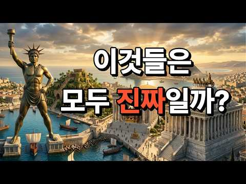
- 챕터: 0:00 고대 7대 불가사의의 진짜 정체 · 1:01 로도스의 거상: 바다를 지키던 청동 거인 · 3:01 알렉산드리아 대등대: 바닷속에 잠든 생명의 빛 · 4:53 마우솔로스 영묘: 신을 향한 인간의 위대한 무덤 · 6:49 아르테미스 신전: 달의 여신을 위한 신전 · 8:30 기자의 대피라미드: 인류가 만든 영원한 기적 · 10:31 올림피아의 제우스상: 신의 모습을 만든 인간의 걸작 · 12:27 바빌론의 공중정원: 전설인가 실존인가
- 설명 앞부분: 고대 세계에는 인간의 상상을 뛰어넘는 건축물들이 존재했습니다. 고대 7대 불가사의는 고대인들이 어떻게 이런 거대한 건축물을 만들었는지 지금까지도 놀라움을 주는 역사적 유산들입니다. 이번 영상에서는 고대 7대 불가사의의 탄생부터 현재까지의 역사와 함께, 각각의 건축물이 왜 불가사의로 불렸는지 살펴봅니다. 이집트 기자의 대피라미드부터 바빌론의 공중정원, 올림피아의 제우스상, 에페소스의 아르테미스 신전, 할리카르나소스의 마우솔로스 영묘, 로도스의 거상, 알렉산드리아의 등대까지 고대 세계를 대표했던 7개의 경이로운 건축물을 한 편에 담았…
- 같은 채널 평소 대비 ×3.9 (채널 최근 롱폼 중앙값 4,456회) · 평소 영상: 왜 오디세이를 두고 싸우나? 일론 머스크 vs 크리스토퍼 놀란 (5,511회) / 세계 최강 이집트는 어떻게 사라졌나 — 3,000년 문명이 무너진 진짜 이유 (3,400회)
- 대본 없음 (설명) — 음성인식이 끝나면 도입부·흐름이 들어감
- 댓글 2/2: 좋은 점 — 영상 0 · 감사·응원 0 · 더 알고 싶은 것 1 · 아쉬운 점 — 영상 0 · 반박·불만 — 의견 다름 0 · 정치·사회 0 · 경험 공유 0 · 구독·다음 기대 0
  - 더 알고 싶은 것 👍0 “신 7대 불가사의도 소개해주세요”

### 460. 1900년대초 서울 생활모습 - 전차가 다니던 그시절

- https://www.youtube.com/watch?v=ht6n6gTswvM · 아카이브 코리아 · 구독자 3,660 · 조회수 17,662 (×4.8, 하루 529.8) · 좋아요 105 (0.6%) · 8.7분 · 2026-09-25 · 주제 묶음 4. 한국 근현대사 · 형식 정보·해설 (그 밖) · 폴더 `W_ht6n6gTswvM` (웹 승인)
- 썸네일: 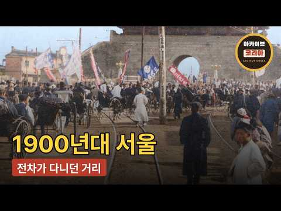
- 챕터: 0:00 인사 · 0:41 전차가 놓이다 · 2:23 황제의 도시 · 3:42 두 개의 독립문 · 4:04 빈 궁궐 · 5:10 길 위의 사람들 · 6:40 장이 서던 자리 · 7:21 성 밖에서 · 8:03 그 뒤
- 설명 앞부분: 대한제국 시절의 서울입니다. 황제의 돈으로 전차가 놓이고, 그 선로 옆으로 가마와 지게와 소달구지가 함께 다니던 십여 년의 기록입니다. 본편 사진 중 일부는 AI 채색 기술로 색을 입혔고, 나머지는 아카이브가 컬러로 소장한 원본입니다. 일부 장면은 흑백으로 시작해 색이 번지도록 연출했습니다. 사진 자체는 아카이브 원본 그대로입니다. 본편의 모든 사진은 아카이브가 소장한 실제 기록이며, 생성형 AI 로 만든 이미지가 아닙니다. 국제일본문화연구센터(日文研) · 퍼블릭도메인 kutsukake.nichibun.ac.jp/CHO 1900년…
- 같은 채널 평소 대비 ×1.1 (채널 최근 롱폼 중앙값 16,416회) · 평소 영상: 1970년대 서울 생활모습 — 골목과 거리 (16,442회) / 1996년 서울, 30년전 우리가 잊고 있던 풍경 (16,391회)
- 대본 없음 (설명) — 음성인식이 끝나면 도입부·흐름이 들어감
- 댓글 3/3: 좋은 점 — 영상 0 · 감사·응원 0 · 더 알고 싶은 것 0 · 아쉬운 점 — 영상 0 · 반박·불만 — 의견 다름 0 · 정치·사회 0 · 경험 공유 0 · 구독·다음 기대 0

### 461. 잠들기 전 한국사🌙『조선왕조실록 : 성군 세종의 충격 가족사』벌거벗은 한국사 오디오북 _ 책읽어주는여자 _ 수면낭독

- https://www.youtube.com/watch?v=DButhfdWiN4 · 모모의 북살롱 · 구독자 39,500 · 조회수 189,285 (×4.8, 하루 4,031.9) · 좋아요 417 (0.2%) · 69.3분 · 2026-09-11 · 주제 묶음 3. 조선 · 형식 수면·낭독 (잠잘 때 듣는) · 폴더 `W_DButhfdWiN4` (웹 승인)
- 썸네일: 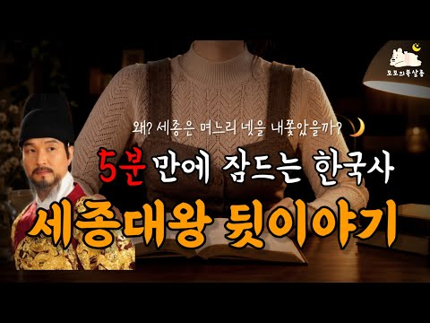
- 설명 앞부분: 📖 벌거벗은 한국사 인물편 잠들기 전 편안하게 듣는 한국사, 세계사, 고전문학 이야기 세종대왕은 왜 며느리 네 명을 궁궐에서 내보냈을까요? 조선 역사상 가장 위대한 성군으로 손꼽히는 세종대왕. 훈민정음을 창제하고 과학과 문화, 국정 전반에서 수많은 업적을 남긴 왕이지만, 그의 가족사를 들여다보면 우리가 알던 세종대왕과는 조금 다른 모습도 만날 수 있습니다. 이번 오디오북에서는 『벌거벗은 한국사』의 세종대왕 이야기를 바탕으로, 세종의 며느리들이 궁궐을 떠나게 된 사연과 당시 조선 왕실의 혼인과 생활을 살펴봅니다. 왕실의 며느리에게 …
- 같은 채널 평소 대비 ×5.3 (채널 최근 롱폼 중앙값 35,854회) · 평소 영상: 잠들기 전 이야기🌙『조선왕조실록 : 사도세자 죽음의 비밀』벌거벗은한국사_ 책읽어주는여자_… (35,854회) / 잠들기 전 한국사🌙『벌거벗은 고려편 : 태조 왕건의 비밀』왕건은 왜 29명과 결혼했을까?… (35,904회)
- 대본 없음 (설명) — 음성인식이 끝나면 도입부·흐름이 들어감
- 댓글 9/11: 좋은 점 — 영상 0 · 감사·응원 0 · 더 알고 싶은 것 0 · 아쉬운 점 — 영상 0 · 반박·불만 — 의견 다름 0 · 정치·사회 2 · 경험 공유 0 · 구독·다음 기대 0
  - 정치·사회 👍4 “세종 이순신 정말 훌륭하시죠 헌데 세종대왕님과 이순신장군 두분을 합해 놓은것보다 더더욱 훌륭하신분이 계시죠 ~그이름 박 정희 대통령 !!!”

### 462. 완벽한 중세 성은 어떻게 만들어졌을까? ∣ 3D로 보는 성 건축의 모든 것

- https://www.youtube.com/watch?v=YgKCW5fOHGs · 에픽히스토리 코리아 · 구독자 25,200 · 조회수 120,056 (×4.8, 하루 876.5) · 좋아요 1,906 (1.6%) · 15.3분 · 2026-06-13 · 주제 묶음 5. 세계사·서양사 · 형식 정보·해설 (그 밖) · 폴더 `W_YgKCW5fOHGs` (웹 승인)
- 썸네일: 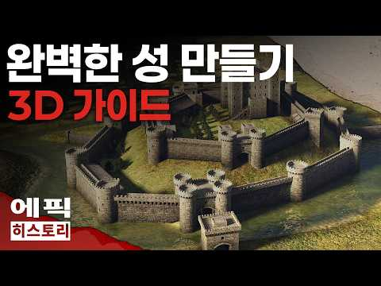
- 챕터: 0:00 Filmstro - Nanga · 1:05 Filmstro - Proteus · 2:08 In Taberna (Crusader Kings II… · 3:14 Dusking Skies (Crusader Kings… · 5:28 Filmstro - Steel · 6:01 Filmstro - Pavot · 8:42 Filmstro - Centurion · 9:41 Kevin MacLeod - Rites · 10:51 Filmstro - Venus · 12:45 Filmstro - General · 14:38 Filmstro - Nanga · 16:08 Kevin MacLeod - Brandenburg N… · 16:18 In Taberna (Crusader Kings II…
- 설명 앞부분: 900년경 프랑스에서 등장한 봉건제 사회부터 시작해, 400년이 넘는 세월 동안 발전해 온 유럽 중세 성의 역사를 바탕으로 ‘완벽한 성’을 짓는 방법을 살펴봅니다. 11세기 노르만인들이 잉글랜드와 웨일스를 정복하기 위해 사용했던 초기 모트 앤 베일리 성(Motte-and-Bailey Castle) 부터 시작해, 석조 성벽과 거대한 주탑, 다양한 형태의 탑(사각형·원형·D자형), 그리고 강력한 문루, 옹성, 살상용 돌출창 등으로 발전해 가는 성곽 건축의 역사를 3D로 재현합니다. 3D 성 모델 및 애니메이션 제공 HistoryReb…
- 같은 채널 평소 대비 ×2.6 (채널 최근 롱폼 중앙값 45,333회) · 평소 영상: [나폴레옹 전쟁 시리즈] 1807년 아일라우 전투 (45,333회) / 넬슨의 해전 3D: 코펜하겐 해전 1801 (40,023회)
- 대본 없음 (설명) — 음성인식이 끝나면 도입부·흐름이 들어감
- 댓글 99/99: 좋은 점 — 영상 2 · 감사·응원 6 · 더 알고 싶은 것 2 · 아쉬운 점 — 영상 0 · 반박·불만 — 의견 다름 4 · 정치·사회 0 · 경험 공유 3 · 구독·다음 기대 1
  - 좋은 점 — 영상 👍1 “다른 세계선 : "드라카리스!" 좋은 영상과 내용 잘 보고 갑니다. 저걸 문루라고 부르는 거였군요. 궁금은 하고 뭔지는 몰라서 찾느라 헤멨었는데 감사합니다.”
  - 감사·응원 👍9 “감사합니다 오늘부터 성만들기 도전합니다”
  - 감사·응원 👍1 “다른 세계선 : "드라카리스!" 좋은 영상과 내용 잘 보고 갑니다. 저걸 문루라고 부르는 거였군요. 궁금은 하고 뭔지는 몰라서 찾느라 헤멨었는데 감사합니다.”
  - 더 알고 싶은 것 👍53 “서양 성에는 성벽이 성탑에 연결 되어있는 구조가 일반적인데 동양에는 왜 성탑 없이 성벽으로만 둘러 쌓는지도 궁금해요!”
  - 더 알고 싶은 것 👍1 “12:30 언급에 해자에서 신선한 물고기를 얻을 수 있다라고 언급하셨는데, 사례가 있을까요? 중세 해자는 내성에서 나오는 오물을 그대로 쏟은, 방어적 역할만하는 구정물로 알고 있었어서요.”
  - 경험 공유 👍1 “내가 원했던 영상”
  - 경험 공유 👍1 “너의 순수성. 내가 점령한다.”
  - 구독·다음 기대 👍5 “와 재밌다.. 구독하고 다른 영상도 다 봐야겠네요”

### 463. [FULL] 40억 사기.. 인생 최대로 힘든 시기를 보낸 탈북 개그맨 전철우 ∣ 이사야사 ep.9 ∣ TV CHOSUN 190918 방송

- https://www.youtube.com/watch?v=Hj74bq62j-Q · TVCHOSUN STORY · 구독자 49,400 · 조회수 229,918 (×4.7, 하루 4,883.9) · 좋아요 2,969 (1.3%) · 72.3분 · 2026-09-11 · 주제 묶음 9. 야사·야담·옛날이야기 · 형식 정보·해설 (그 밖) · 폴더 `W_Hj74bq62j-Q` (웹 승인)
- 썸네일: 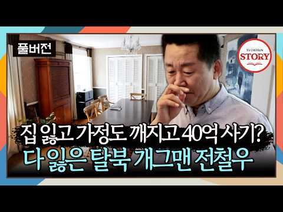
- 설명 앞부분: 비온 뒤 땅이 굳어지듯 인생의 쓴맛을 경험하고 단단해진 그 제일 먼저 TV CHSOUN STORY 콘텐츠를 만나보세요💝
- 대본 없음 (설명) — 음성인식이 끝나면 도입부·흐름이 들어감
- 댓글 139/140: 좋은 점 — 영상 0 · 감사·응원 13 · 더 알고 싶은 것 0 · 아쉬운 점 — 영상 0 · 반박·불만 — 의견 다름 1 · 정치·사회 10 · 경험 공유 4 · 구독·다음 기대 0
  - 감사·응원 👍65 “전철우님 힘내세요”
  - 감사·응원 👍49 “탈북한사람들중에 화나게하는사람들도있지만 지혜롭게대처하며능력을발휘 잘적응하며사는남녀분들이 계시는데그중에한분이전철우 사장님이셨는데 그간에그렇게 힘든시련의삶이 있으셨네요 이제부턴진짜사랑스런따님과 행복한꽃길만걸으시기를 바랍니다 화이팅!”
  - 반박·불만 — 의견 다름 👍4 “베트남 투자 하지 맘 사기꾼들 득실 말도 안통하고 감성도 모르고 사방 더럽고 ㅊㅊ 있는 것 갇고 아껴 쓰시오”
  - 정치·사회 👍1 “우리나라는 사기꾼을 엄벌해야 나라가 산다.”
  - 정치·사회 👍1 “너무 오바하는 인생이였음 북한에다 풍선에 쌀보내기 정부에서 하지말라고 그리 말해도 협조를 안하구 밤에도하고”
  - 경험 공유 👍18 “나도 전철우 항아리 갈비 많이 사 먹었는데 ㅎ 대한민국 사람은 안 먹은 사람은 별로 없을 것 같아요. 전철은님 화이팅”
  - 경험 공유 👍4 “에휴 내가 아는사람들 베트남 사기당한사람 웨케 많어”

### 464. "미국에서 난리난 이순신 장군?!" 충무공 이순신이 사무라이를 밀어내고 새로운 영웅이 된 진짜 이유

- https://www.youtube.com/watch?v=i8RNMbV3q_g · 코믹스 경제 · 구독자 34,000 · 조회수 152,298 (×4.5, 하루 6,939.4) · 좋아요 641 (0.4%) · 27분 · 2026-10-06 · 주제 묶음 3. 조선 · 형식 정보·해설 (그 밖) · 폴더 `W_i8RNMbV3q_g` (웹 승인)
- 썸네일: 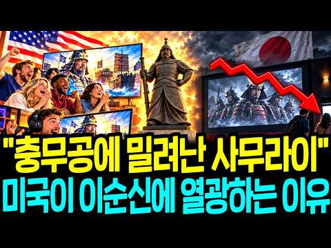
- 설명 앞부분: 📚 【교육 콘텐츠】 "가짜 10 대 300에 열광하던 미국이, 진짜 13 대 133을 찾기 시작했다" 🇰🇷 미국은 50년 동안 칼 찬 사무라이 이야기에 지갑을 열었습니다. 2024년엔 사무라이 드라마 〈쇼군〉이 에미상 18관왕에 올랐습니다. 그런데 배 13척으로 133척을 막은 조선의 이순신은 1929년부터 미 해군 잡지 구석에만 있었습니다. 진짜가 왜 가짜에게 400년이나 밀려 있었는지, 그리고 지금 그 판이 어떻게 뒤집히고 있는지 짚어 봅니다. 🎬 이번 영상의 핵심 정보 ✓ 칼의 나라가 조선에 쳐들어올 땐 칼이 아니라 조총을 …
- 같은 채널 평소 대비 ×2.7 (채널 최근 롱폼 중앙값 55,457회) · 평소 영상: "미국마저 등 돌렸다!" 100년 동안 독점하던 질레트, 한국 도루코 6중날에 무너진 진… (57,351회) / "아마존도 포기한 걸 해냈다고?" 한국인들이 유달리 똑똑한 진짜 이유, 속도와 효율성이 … (53,563회)
- 대본 없음 (설명) — 음성인식이 끝나면 도입부·흐름이 들어감
- 댓글 50/52: 좋은 점 — 영상 0 · 감사·응원 0 · 더 알고 싶은 것 1 · 아쉬운 점 — 영상 0 · 반박·불만 — 의견 다름 0 · 정치·사회 6 · 경험 공유 0 · 구독·다음 기대 0
  - 더 알고 싶은 것 👍2 “고구려 만들어 주세요~”
  - 정치·사회 👍3 “이재명대통령은 콤판씨에게 문화훈장 수여하시길..”
  - 정치·사회 👍1 “이거 이조시대 때 선조 수정실록에 나오는 엉터리 이야기입니다. 정작 선조 오리지널 실록에는 나오지도 않는 이야기이며, 일본, 명나라 등의 기록에도 없습니다. 당시 수군은 명나라가 지위했습니다. 그 기록에 없는 이야기입니다. 정신 차리세요”

### 465. 역사는 사실대로 기억해야 합니다｜「암살자들」논란에 대한 생각 #임동진 #암살자들 #영화

- https://www.youtube.com/watch?v=mcOVtFOj-jk · 임동진TV · 구독자 24,200 · 조회수 100,130 (×4.1, 하루 6,275.5) · 좋아요 5,018 (5.0%) · 19분 · 2026-10-07 · 주제 묶음 1. 역사 일반·이야기 · 형식 정보·해설 (그 밖) · 폴더 `W_mcOVtFOj-jk` (웹 승인)
- 썸네일: 
- 설명 앞부분: 이번 영상에서는 최근 **영화 「암살자들」을 둘러싼 논란**을 계기로, 임동진이 생각하는 **역사와 기억**에 대한 이야기를 나눕니다. 한 시대를 직접 살아오며 보고 느낀 경험을 바탕으로 대한민국 현대사의 여러 순간을 되돌아보고, 역사를 바라보는 자신의 생각을 솔직하게 이야기합니다. 영화를 직접 관람한 감상이 아닌, 최근 제기되고 있는 논란을 접하며 떠올린 생각과 개인적인 견해를 담은 영상입니다. “역사는 사실대로 기억해야 합니다.” 임동진TV에서 임동진이 직접 들려주는 이야기를 만나보세요.
- 같은 채널 평소 대비 ×4.6 (채널 최근 롱폼 중앙값 21,892회) · 평소 영상: “엄마는 네 강아지가 되고 싶구나” 98세 어머니가 남긴 말｜추석에 생각하는 부모님의 사… (21,892회) / 임동진이 들려주는 아내와의 인연, 그리고 가족 이야기 #임동진 #배우인생 #가족이야기 (17,482회)
- 대본 없음 (설명) — 음성인식이 끝나면 도입부·흐름이 들어감
- 댓글 431/454: 좋은 점 — 영상 33 · 감사·응원 104 · 더 알고 싶은 것 5 · 아쉬운 점 — 영상 3 · 반박·불만 — 의견 다름 21 · 정치·사회 92 · 경험 공유 30 · 구독·다음 기대 1
  - 좋은 점 — 영상 👍135 “옳은 말씀 해주셔서 고맙습니다”
  - 좋은 점 — 영상 👍127 “목사님 말씀 잘듣고 기쁜 마음으로 돌아갑니다. 목사님의 말씀에 절대공감합니다. 감사드립니다!!”
  - 감사·응원 👍254 “어릴적부터 제일 좋아하는 남자탈렌트였던 분에서 지금은 정의로운 자유우파 목사님으로 그자리에 계시고 실망시키지 않으셨습니다.존경합니다.고맙고 감사드립니다.오래도록 건강하시기 바랍니다.”
  - 감사·응원 👍234 “진실을 말씀하셔서 감사합니다 ^^”
  - 더 알고 싶은 것 👍3 “좌편향 된 문화계와 홀로 싸우고 있으신 김규나작가님 이라는 분이 계십니다 많은 응원 부탁드립니다”
  - 더 알고 싶은 것 👍1 “개독박멸! 이만이사형! 목사님! 정신 차리세요! 아직도 연기 잘하시네요 그 가면 언제 벚으 실건가요?”
  - 아쉬운 점 — 영상 👍0 “아.....양만춘 장군님.....정정하신모습뵈니.....정말좋습니다......”
  - 아쉬운 점 — 영상 👍0 “목사님~~ 쓸데없는 헛소리 마시구 목회자의길이나 열심히 가세요 실망스럽습니다”
  - 반박·불만 — 의견 다름 👍5 “고맙습니다 저역시 그과정 을겪은 사람 입니다. 독재아닙니다 그때그렇게 안하셨음 간첩들이 난무하고 우린 초토화 됬을겁니다”
  - 반박·불만 — 의견 다름 👍4 “예술을 빙자한 선전선동에 이제껏 놀아난 게 정말 분하네요 옳은 말씀 감사합니다 임동진 목사님!”
  - 정치·사회 👍254 “어릴적부터 제일 좋아하는 남자탈렌트였던 분에서 지금은 정의로운 자유우파 목사님으로 그자리에 계시고 실망시키지 않으셨습니다.존경합니다.고맙고 감사드립니다.오래도록 건강하시기 바랍니다.”
  - 정치·사회 👍77 “누구는 조금만 껄끄러우면 드럼통 당하는데ᆢ 어쩌다 나라가 공산당들이 날뛰는 정부가되었는지ᆢ”
  - 경험 공유 👍83 “정말 공감이 됩니다 목사님. 제가 하고 싶은 얘기 시원하게 해주셔서 감사합니다.”
  - 경험 공유 👍12 “저도 공감 합니다 확실한 진실만 이야기 하시네요 감사합니다”
  - 구독·다음 기대 👍1 “감사합니다 ❤❤❤❤❤ 목소리 내주셔서 ㅠㅠㅠㅠㅠㅠ 구독하고 응원합니다 ❤❤❤❤❤❤ 존경하고 사랑합니다 🎉🎉🎉”

### 466. 사미자가 직접 겪은 친일파의 악행, 그리고 광복

- https://www.youtube.com/watch?v=MfUbyKigbfc · 오미자 말고 사미자 · 구독자 9,900 · 조회수 40,794 (×4.1, 하루 1,233.3) · 좋아요 554 (1.4%) · 14.4분 · 2026-09-25 · 주제 묶음 1. 역사 일반·이야기 · 형식 인터뷰·강연·대담 · 폴더 `W_MfUbyKigbfc` (웹 승인)
- 썸네일: 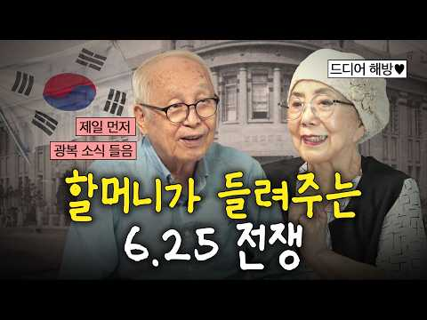
- 챕터: 0:00 오프닝 · 1:03 8월 15일 광복 · 2:36 일제강점기 기억 · 3:46 친일파는 어떻게...? · 4:13 김구 선생님 서거 · 6:20 생생한 6.25 전쟁 이야기 · 9:37 미자쌤이 기억하는 6.25 전쟁 · 10:27 1.4후퇴 피난길 · 12:53 미자쌤의 눈물 · 13:33 아웃트로
- 설명 앞부분: 오늘은 직접 겪은 전쟁 이야기를 해봤어요 할머니 할아버지랑~ 온 가족이 같이 보기 좋은 꼬꼬미 많은 사랑 부탁드려요 ※ 출연자에 대한 무분별한 욕설 및 비방 댓글은 삭제될 수 있습니다.
- 대본 없음 (설명) — 음성인식이 끝나면 도입부·흐름이 들어감
- 댓글 65/66: 좋은 점 — 영상 1 · 감사·응원 11 · 더 알고 싶은 것 3 · 아쉬운 점 — 영상 0 · 반박·불만 — 의견 다름 0 · 정치·사회 3 · 경험 공유 5 · 구독·다음 기대 0
  - 좋은 점 — 영상 👍4 “추석날 역사이야기 듣기 좋습니다”
  - 감사·응원 👍22 “귀한 얘기 감사합니다. 더 듣고 싶습니다❤❤❤”
  - 감사·응원 👍20 “이렇게 귀한 영상 올려주셔서 감사합니다 추석에 할머니 할아버지가 얘기해주시는 것 같아서 너무 좋습니다”
  - 정치·사회 👍0 “젊은 Pd들 세명이나 있으면서 1950년의 사건 질문에 한국전쟁이란 명쾌히 안 나오는 게 충격이예요. 이명박 정부에서 중고등학교에서 근현대사 교육이 필수 아니라 선택으로 바꿨다는데 그 폐해일까요? 문제가 심각함을 느낍니다. 역사를 제대로 모르면 반복된다는데 좀 걱정되…”
  - 정치·사회 👍0 “목숨받쳐서 일궈낸 자유민주주인데 요즘 나라가 너무 안타까운 방향으로 가는듯 합니다. 진짜 저시절 ㅠ 정말 힘들게 목숨걸고 찾은 대한민국인것을”
  - 경험 공유 👍19 “내가 우리 할미한테 이런걸 못 묻고 보내드린걸 평생 후회했는데 울 할미 친척이라 하셨던 미자선생님이 대신 말씀해주셔서 너무 감사합니다”
  - 경험 공유 👍1 “아니 김구선생님 시신을 다 공개했었다고? 대박이다 몰랐던 이야기들 들려주셔서 감사합니다”

### 467. 국명 미스터리｜상(商)은 왜 은(殷)이 되었을까?

- https://www.youtube.com/watch?v=Nxwp-fQdyb0 · 품격있는 지식인들을 위한 @한밤愛책방  · 구독자 7,660 · 조회수 31,403 (×4.1, 하루 864.3) · 좋아요 144 (0.5%) · 18.1분 · 2026-09-22 · 주제 묶음 기타 · 형식 정보·해설 (그 밖) · 폴더 `W_Nxwp-fQdyb0` (웹 승인)
- 썸네일: 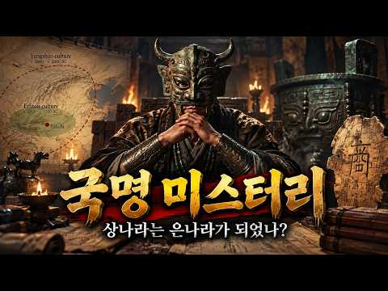
- 설명 앞부분: 우리는 고대 중국의 역사를 이야기할 때 흔히 하·은·주라고 부릅니다. 그런데 잠깐, 한 가지 이상한 점이 있습니다. ‘은나라’의 진짜 이름은 정말 은(殷)이었을까요? 이번 **〈국명 미스터리〉**에서는 고대 중국의 국명이 어떻게 만들어지고, 어떻게 후대의 역사 속에서 바뀌어 갔는지를 추적합니다. 문헌과 고고학 자료 속에서 확인되는 상나라(商)의 흔적부터, 이리두 문화와 하나라를 둘러싼 논쟁, 상나라를 무너뜨린 주나라의 등장, 그리고 ‘상’이라는 이름이 ‘은’이라는 이름으로 굳어진 과정까지 살펴봅니다. 특히 당대 갑골문에서 상나라가…
- 같은 채널 평소 대비 ×8.8 (채널 최근 롱폼 중앙값 3,581회) · 평소 영상: 중국 칼의 역사 ∣ 중국은 일체식, 한국은 조립식 (4,895회) / 중국은 무너지고 있는가? ∣ 이븐 칼둔의 아사비야로 읽는 중국의 결속 위기 (5,589회)
- 대본 없음 (설명) — 음성인식이 끝나면 도입부·흐름이 들어감
- 댓글 29/29: 좋은 점 — 영상 0 · 감사·응원 0 · 더 알고 싶은 것 0 · 아쉬운 점 — 영상 0 · 반박·불만 — 의견 다름 1 · 정치·사회 4 · 경험 공유 0 · 구독·다음 기대 0
  - 반박·불만 — 의견 다름 👍0 “참 웃기는 방송이네.. 尚書즉 서경에 나오는 것을 훨씬 후대의 史記에 탓을 하군.”
  - 정치·사회 👍6 “우리나라도 마한 진한 변한 이렇게 알고 있지만 진한만 해도 70여개 국가로 국명이 사서에 기록된 국가가 몇 밖에 안됨. 그나마 그것도 초기 백제가 영역을 확장하는 과정에서 멸망시키고 흡수하는 사례에서 나타나는데... 영화 황산벌에서 보면 백제 귀족들이 이 나라가 부여…”
  - 정치·사회 👍1 “편파된 콘텐츠입니다. 상나라 말기에 임금의 폭정으로 국민의 인심이 떠나고 강태공이 문왕을 도와 주나라가 창업된겁니다.”

### 468. 세상에 단 하나뿐인 비구니 종단, 대한불교보문종의 숨겨진 역사,

- https://www.youtube.com/watch?v=d_WxsDC7L1U · 부처님 말씀 ASMR · 구독자 24,800 · 조회수 98,128 (×4.0, 하루 13,113.4) · 좋아요 459 (0.5%) · 23.5분 · 2026-10-20 · 주제 묶음 1. 역사 일반·이야기 · 형식 수면·낭독 (잠잘 때 듣는) · 폴더 `W_d_WxsDC7L1U` (웹 승인)
- 썸네일: 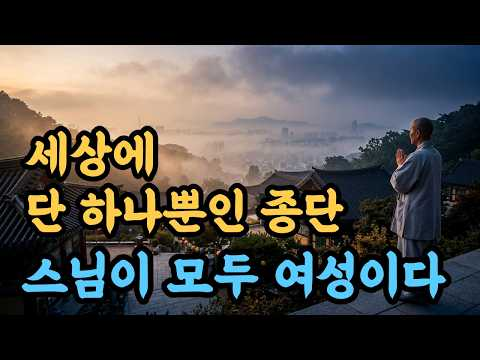
- 설명 앞부분: 한국 불교에는 스님이 모두 여성인 종단이 있습니다. 서울 성북구 보문동의 보문사를 총본산으로 하는 대한불교보문종, 자료에 따라 세계에서도 하나뿐인 비구니 종단으로 소개되는 곳이에요. 그런데 이 종단은 거창한 이상보다 절을 지키려는 간절한 마음에서 시작되었습니다. 이천오백 년 전 인도의 마하파자파티, 조선의 탑골승방, 갑신정변의 비밀 모임, 그리고 긍탄 스님과 은영 스님의 결단까지. 기승전결 네 장면으로 보문종의 이야기를 차근차근 풀어 보았어요. 영상에서 다루는 내용은, 여성 출가의 시작, 보문사의 오랜 역사, 비구와 대처의 갈등 …
- 같은 채널 평소 대비 ×30.5 (채널 최근 롱폼 중앙값 3,212회) · 평소 영상: 절마다 부처님이 다른 이유, 그리고 아무도 안 알려준 부처님의 서열, 아미타불, 석가모니… (3,220회) / 석가모니, 아미타, 비로자나, 대체 누가 진짜 부처님일까, (3,205회)
- 대본 없음 (설명) — 음성인식이 끝나면 도입부·흐름이 들어감
- 댓글 10/10: 좋은 점 — 영상 0 · 감사·응원 2 · 더 알고 싶은 것 1 · 아쉬운 점 — 영상 0 · 반박·불만 — 의견 다름 0 · 정치·사회 0 · 경험 공유 1 · 구독·다음 기대 0
  - 감사·응원 👍2 “감사합니다”
  - 감사·응원 👍0 “각막 이식을 받아야 하는데 너무 막막합니다 시력을 조금씩 잃어 가고 있는 절망과 좌절 희망이 없는 저의 삶에 도움을 구하고자 개인적인 사정을 전하게 되어 마음이 무겁습니다 읽어 주신다면 정말 감사 하겠습니다 하고있던 사업이 잘안되어 아이 입양이나 고아원에 보내는것도 …”
  - 더 알고 싶은 것 👍0 “각막 이식을 받아야 하는데 너무 막막합니다 시력을 조금씩 잃어 가고 있는 절망과 좌절 희망이 없는 저의 삶에 도움을 구하고자 개인적인 사정을 전하게 되어 마음이 무겁습니다 읽어 주신다면 정말 감사 하겠습니다 하고있던 사업이 잘안되어 아이 입양이나 고아원에 보내는것도 …”
  - 경험 공유 👍0 “각막 이식을 받아야 하는데 너무 막막합니다 시력을 조금씩 잃어 가고 있는 절망과 좌절 희망이 없는 저의 삶에 도움을 구하고자 개인적인 사정을 전하게 되어 마음이 무겁습니다 읽어 주신다면 정말 감사 하겠습니다 하고있던 사업이 잘안되어 아이 입양이나 고아원에 보내는것도 …”

### 469. 주고후 – 영락제의 피를 이은 그는 왜 아버지의 ‘반역의 업보’를 그대로 되풀이했나?

- https://www.youtube.com/watch?v=0lfKtPz-4PY · 중국황제비극 · 구독자 17,900 · 조회수 68,201 (×3.8, 하루 438.7) · 좋아요 830 (1.2%) · 62.4분 · 2026-05-25 · 주제 묶음 6. 동양사 (중국·일본·몽골) · 형식 정보·해설 (그 밖) · 폴더 `W_0lfKtPz-4PY` (웹 승인)
- 썸네일: 
- 설명 앞부분: 조카의 옥좌를 빼앗은 아버지 영락제의 피를 이어받아, 똑같이 반역의 칼을 빼들었던 대명제국의 맹장 주고후. 감옥에 갇힌 삼촌은 왜 조카 선덕제의 발목을 걸어 넘어뜨렸으며, 유교의 성군이라 불리던 젊은 황제는 왜 이토록 잔혹한 살인귀로 돌변해 친삼촌과 일족을 멸문시켰을까요? 명나라 황실 장막 뒤에 숨겨진 잔혹한 권력 암투와 핏빛 인과응보의 역사를 파헤칩니다.
- 같은 채널 평소 대비 ×3.8 (채널 최근 롱폼 중앙값 17,758회) · 평소 영상: 해진 – 명나라 최고의 머리를 ‘칼도 없이’ 죽인 방법: 눈더미 생매장의 실체 (17,758회) / 장헌충 – 정치가 아니라 쾌락을 위해 죽였다… 명말 최악의 사이코패스는 어떻게 만들어졌나? (17,698회)
- 대본 없음 (설명) — 음성인식이 끝나면 도입부·흐름이 들어감
- 댓글 43/43: 좋은 점 — 영상 0 · 감사·응원 0 · 더 알고 싶은 것 0 · 아쉬운 점 — 영상 0 · 반박·불만 — 의견 다름 0 · 정치·사회 1 · 경험 공유 0 · 구독·다음 기대 0
  - 정치·사회 👍17 “명나라가 오래 못간 이유가 있네 적당히를 모르는 집안”

### 470. 스파르타쿠스 전쟁 대해부

- https://www.youtube.com/watch?v=haK0JOJJbNM · Historie Chronicle · 구독자 12,200 · 조회수 46,399 (×3.8, 하루 348.8) · 좋아요 680 (1.5%) · 42.9분 · 2026-06-17 · 주제 묶음 7. 전쟁·군사사 · 형식 정보·해설 (그 밖) · 폴더 `W_haK0JOJJbNM` (웹 승인)
- 썸네일: 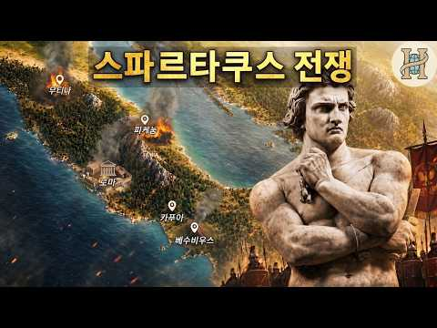
- 챕터: 0:00 인트로 · 9:20 스파르타쿠스 그리고 노예군 · 17:56 집정관 군대의 등장 · 28:23 크라수스와의 대결 · 41:30 스파르타쿠스의 유산
- 설명 앞부분: 이 영상은 기원전 73년부터 71년에 걸쳐 일어난 스파르타쿠스의 반란을 다루고 있습니다.
- 같은 채널 평소 대비 ×1.8 (채널 최근 롱폼 중앙값 25,862회) · 평소 영상: 수도로 진격해 시민들 태워 죽인 로마 장군 - '쿠데타인가 합법인가' 술라가 공화국을 찢… (25,862회) / 오스만 줘팬 이란의 군주 – 사파비 제국 아바스 대제 (23,337회)
- 대본 없음 (설명) — 음성인식이 끝나면 도입부·흐름이 들어감
- 댓글 60/60: 좋은 점 — 영상 2 · 감사·응원 5 · 더 알고 싶은 것 5 · 아쉬운 점 — 영상 0 · 반박·불만 — 의견 다름 1 · 정치·사회 0 · 경험 공유 2 · 구독·다음 기대 0
  - 좋은 점 — 영상 👍2 “정말 좋은 영상 입니다 감사합니다 🎉”
  - 좋은 점 — 영상 👍0 “간만이네요. 좋은 영상 감사합니다.”
  - 감사·응원 👍12 “영상 올라와서 기쁘네요. 나름 역사덕후인데, 이 채널만큼 고증 충실하고 재밌는 영상 올리는 곳은 별로 없는 것 같습니다. 구독자분들께서는 구독료라 생각하시고, 태그된 제품 클릭해 주시면 감사드리겠습니다.”
  - 감사·응원 👍2 “정말 좋은 영상 입니다 감사합니다 🎉”
  - 더 알고 싶은 것 👍3 “다음영상 제발 빨리 올려주세요. 계속 기다리고 있어요 ㅠㅠㅠ”
  - 더 알고 싶은 것 👍2 “너무 텀이 길어요 자주 좀 올려주세요 자주 안올려주면 나 삐뚤어질거에요”
  - 반박·불만 — 의견 다름 👍1 “스파르타쿠스는 알프스를 통해서 트라키아로 고향으로 돌아가는게 목적이였는데, 원래대로 그렇게 했다면 역사는 해피엔딩이였을것인데, 나중에 합류한 갈리아 출신 노예크릭수스가 로마를 털어먹고 지배자가 되자고 선동하는 바람에 다 망침.”
  - 경험 공유 👍1 “아저씨...영상좀 올려줘요! 내가 죽는다구여”
  - 경험 공유 👍1 “크라수스라면 막연하게 삼두정치 최약체라고만 생각했었는데... 엄청 대단한 사람이었네요”

### 471. 5명의 임금을 섬긴 유자광 : 격동기 관료의 처세와 정치적 평가

- https://www.youtube.com/watch?v=BdvwjhnDBYw · 거침없는한국사 · 구독자 32,900 · 조회수 123,129 (×3.7, 하루 746.7) · 좋아요 2,752 (2.2%) · 73.1분 · 2026-05-16 · 주제 묶음 3. 조선 · 형식 정보·해설 (그 밖) · 폴더 `W_BdvwjhnDBYw` (웹 승인)
- 썸네일: 
- 챕터: 0:00 인트로 ─ 다섯 임금을 갈아탄 흙수저 · 2:00 1장 ─ 한 사람의 머리 위로 쏟아진 상소 · 8:35 2장 ─ 노비 어미의 아들, 한양 광화문 앞에 서다 · 13:30 3장 ─ 문지기의 청, 정병 삼백을 달라 · 19:45 4장 ─ 임금이 시험지를 바꿔주던 밤 · 24:00 5장 ─ 남이의 목 · 30:35 6장 ─ 영의정 한명회를 향한 칼 · 40:30 7장 ─ 흙비와 동래 유배 · 46:25 8장 ─ 사초 한 장이 일으킨 피바람, 무오사화 · 55:35 9장 ─ 광기 앞의 침묵, 자정의 칼 · 64:30 10장 ─ 그를 향해 날아온 종이, 평해 울진 · 70:25 에필로그 ─ 사실과 각색
- 설명 앞부분: 한명회를 두번이나 탄핵하고, 그의 부관참시까지 목도한 조선시대 최고의 처세술의 달인. 유자광의 일대기 노비 어미에게서 태어난 얼자가 다섯 임금을 차례로 갈아타며 일등공신 칭호를 다섯 번이나 받기까지 세조, 예종, 성종, 연산군, 그리고 중종. 임금이 바뀔 때마다 자기 자리를 만들어 낸 그 무서운 처세술의 비밀, 당대 최고의 권력자 한명회를 정면으로 들이받은 그 봄날의 상소, 조선 최초의 사화를 자기 손으로 설계한 그 무오년의 피바람, 그리고 끝내 평해 울진 한 작은 처소에서 일흔넷에 마지막 숨을 거두기까지. 따뜻한 차 한 잔 곁에…
- 같은 채널 평소 대비 ×9.6 (채널 최근 롱폼 중앙값 12,881회) · 평소 영상: 🌙9살 연하 새어머니, 광해를 왕으로 만들더니,15년 후 폐위시킨 이유∣인목왕후 (12,881회) / 🌙12살에 버려진 천민 기생을 위해 정조가 국법을 깨뜨린 이유 ∣ 김만덕 ∣ 정조 (14,444회)
- 대본 없음 (설명) — 음성인식이 끝나면 도입부·흐름이 들어감
- 댓글 261/261: 좋은 점 — 영상 3 · 감사·응원 4 · 더 알고 싶은 것 3 · 아쉬운 점 — 영상 1 · 반박·불만 — 의견 다름 5 · 정치·사회 7 · 경험 공유 5 · 구독·다음 기대 1
  - 좋은 점 — 영상 👍1 “죄는지은되로 功은 닦은되로 옛어른들의 말씀과같습니다. 오늘도 역사의 한부분을배웠습니다 감사합니다 😊”
  - 감사·응원 👍6 “중공땅에는 오래오래전 기원전부터 설화를 전설로 만들어 먹고사는 시장통 썰맨들이 있었지. 그것들이 여불위가 되고 제갈량이 되고... 핫소리들이 기록하는 습관과 세월 덕에 역사가 되고...수부타이보다 못한데도. 우리는 요즘에서야 충무공을 벗어나 척준경 유자광등을 듣는다.…”
  - 감사·응원 👍4 “그거 아시나요? 연산군이 폐비윤씨 아들인게, 폐비가 궁밖으로 쫒겨나 몸이 아플때 저희 직대조 순흥안씨 3파 감사공 숭효조의 큰딸인 정경부인의 남편인 진주강씨 서울 시흥집에서 가료를 받은적이 있는데, 계유정란때 한명회와 그의 사촌 안동부사 한명진의 작전으로 순흥부의 순…”
  - 더 알고 싶은 것 👍16 “몇가지 바로 잡고자 합니다. 한명회는 금수저 집안이 아니라 몰락한 양반 출신입니다. 그리고 가계도에 안순왕후(X) 장순왕후, 둘째딸(X) 세째딸임, 그리고 예종이 장순왕후 남편인데 어찌 외손자가 되나요?”
  - 더 알고 싶은 것 👍1 “성종이 언제부터 한명회 외손자 였나요? 정확한 얘기를 44:05”
  - 아쉬운 점 — 영상 👍2 “이런것은집안일할때나듣는거지광고가이리많으면짜증나”
  - 반박·불만 — 의견 다름 👍6 “한명회가 성종의 장인이지 외할아버지는 아닙니다.”
  - 반박·불만 — 의견 다름 👍3 “지금의국방부차관이면병조참판입니다 .참의는.영감이지.대감은아닙니다😢”
  - 정치·사회 👍14 “충암파 여인형 기획을 좀더 콤꼼하게 계획 했어야 했어요 그리고 자신의 눈빛을 감추어야 했습니다. 충암파 김용현 여인형 이상민 이자들은 너무 빨리 본인들의 발톱을 내밀었습니다. 국회에서 야당 의원들을 겁박 하던 그 모습에서 거사는 들통 난 것이었습니다. 충암파는 바보 …”
  - 정치·사회 👍3 “이재명이 떠오르네요.”
  - 경험 공유 👍4 “그거 아시나요? 연산군이 폐비윤씨 아들인게, 폐비가 궁밖으로 쫒겨나 몸이 아플때 저희 직대조 순흥안씨 3파 감사공 숭효조의 큰딸인 정경부인의 남편인 진주강씨 서울 시흥집에서 가료를 받은적이 있는데, 계유정란때 한명회와 그의 사촌 안동부사 한명진의 작전으로 순흥부의 순…”
  - 구독·다음 기대 👍15 “비로소 찾았습니다.ㅎ"거침없는 한국사"구독.좋아요.알림설정.꾸~~욱~~누르고 갑니다.😊”

### 472. [민요 MV] 한오백년 ∣ 황진이와 소세양, 30일 사랑과 이별의 야사

- https://www.youtube.com/watch?v=7RPHMSdojmo · STARPLAYTV · 구독자 10,100 · 조회수 37,713 (×3.7, 하루 617.5) · 좋아요 0 (0.0%) · 6.1분 · 2026-08-28 · 주제 묶음 9. 야사·야담·옛날이야기 · 형식 정보·해설 (그 밖) · 폴더 `W_7RPHMSdojmo` (웹 승인)
- 썸네일: 
- 설명 앞부분: 강원도 민요 〈한오백년〉의 깊은 한과 그리움을 황진이와 소세양의 사랑 이야기로 풀어낸 감성 민요 MV입니다. “한 오백년 살자는데 웬 성화요”라는 후렴처럼, 오래 함께하고 싶지만 결국 이별해야 하는 사랑의 애틋함을 담았습니다. 한 달만 함께하고 떠나겠다던 소세양이 황진이의 이별시 앞에서 자신의 장담을 지키지 못했다는 야사를 모티프로 재구성했습니다. 〈한오백년〉은 강원도 아라리 계통의 음악적 정서를 바탕으로 형성된 민요로, 삶의 한과 임을 향한 그리움, 덧없이 흐르는 청춘과 인생의 애환을 노래합니다. 애잔한 가사와 구성진 가락이 함…
- 같은 채널 평소 대비 ×8.6 (채널 최근 롱폼 중앙값 4,401회) · 평소 영상: [민요 MV] 영천아리랑 ∣ 신바람 난 큰애기와 고개 너머의 님 ∣ 영천아가씨 (4,401회) / 아름답고 슬픈 사랑 ∣ 세계 명곡으로 듣는 사랑의 이야기 (4,655회)
- 대본 없음 (설명) — 음성인식이 끝나면 도입부·흐름이 들어감
- 댓글 6/9: 좋은 점 — 영상 0 · 감사·응원 1 · 더 알고 싶은 것 0 · 아쉬운 점 — 영상 0 · 반박·불만 — 의견 다름 0 · 정치·사회 0 · 경험 공유 0 · 구독·다음 기대 0
  - 감사·응원 👍1 “정말 잘 만드셨네요~ 고맙습니다~”

### 473. 종로의 숨겨진 유적과 피맛길 답사 ∣ 왕의 가마를 피해 걷던 서민들의 진짜 역사 [답골TV]

- https://www.youtube.com/watch?v=lRFzNz6LA6c · 길눈이랑 답사해 · 구독자 4,870 · 조회수 18,134 (×3.7, 하루 125.0) · 좋아요 467 (2.6%) · 22.4분 · 2026-06-05 · 주제 묶음 1. 역사 일반·이야기 · 형식 정보·해설 (그 밖) · 폴더 `W_lRFzNz6LA6c` (웹 승인)
- 썸네일: 
- 챕터: 0:00 인트로 · 1:15 종로와 피맛길 유래와 역사에 대한 설명 · 4:09 서울역사박물관 · 6:46 종루 주춧돌(보신각) · 9:10 흥화문 터 · 10:20 서울 고종 어극 40년 칭경 기몀비 · 11:20 광화문과 북악산 · 12:56 피맛길의 시작 시전행랑 · 16:26 의금부 터 · 17:20 녹두장군 전봉준 동상 · 19:20 재미있는 장안빌딩에 얽힌 이야기
- 설명 앞부분: 안녕하세요, 길눈이와 함께하는 역사 답사 채널 [답골TV]입니다. 이번에는 서울 종로의 중심부에 숨겨진 역사 유적과 서민들의 옛길인 '피맛길'을 다녀왔습니다. 거대한 고층 빌딩이 솟아오른 현대의 종로 거리 아래와 그 주변에 잠들어 있는 조선 시대의 역사적 유적들, 그리고 고관대작들의 말과 가마를 피해 서민들이 다녔던 뒷골목 '피맛길'의 실제 흔적들을 직접 확인해 보았습니다. 현재와 과거가 공존하는 종로 일대의 구체적인 유적 고증과 그 길에 얽힌 서민들의 사실적인 역사 이야기를 전해드립니다. 타임라인
- 같은 채널 평소 대비 ×0.8 (채널 최근 롱폼 중앙값 24,090회) · 평소 영상: 청계천 답사기 ∣ 광통교·수표교·전태일다리·동대문 오간수문 (24,090회) / 청계천에서 서울역까지 답사 ∣ 박태원 '소설가 구보씨의 일일' 속 경성을 걷다 (28,371회)
- 대본 없음 (설명) — 음성인식이 끝나면 도입부·흐름이 들어감
- 댓글 35/35: 좋은 점 — 영상 1 · 감사·응원 4 · 더 알고 싶은 것 0 · 아쉬운 점 — 영상 0 · 반박·불만 — 의견 다름 0 · 정치·사회 0 · 경험 공유 2 · 구독·다음 기대 1
  - 좋은 점 — 영상 👍0 “너무 생소한게 많아서 적으면서 보고 있어요 교보문고 뒤편을 왔다갔다 하면서도 이런 사연이 있는지 오늘에서야 알았네요 온라인 역사탐방 아주 유익합니다”
  - 감사·응원 👍7 “새롭게 알게되는 내용많네요. 감사합니다♡”
  - 감사·응원 👍4 “우연히 정릉편을 보게 되었어요. 새로운 사실들을 알게되고 새로운 곳들을 보게 되는 즐거움을 누렸어요.여긴 미국 뉴저지구요 7월 4일 독립기념일이라서 밤 불꽃놀이가 한창입니다. 감사히 잘 시청했어요. 구독 좋아요도 눌렀어요”
  - 경험 공유 👍1 “매번 전봉준 동상을 보면서 궁금했었던 좌상인 이유를 오늘에서야 알았습니다 감사합니다”
  - 경험 공유 👍1 “한국가면 저도 골목길 따라서 걷을려면 어디로 연락을 하면 되는지요?”
  - 구독·다음 기대 👍2 “우연히 떠서 보게 되었는데 ᆢ답사 설명이 너무 훌륭합니다 ᆢ계속 기대할게요 ᆢ감사합니다”

### 474. 부자 90%가 3대에 망할 때 로스차일드만 250년 간 진짜 이유

- https://www.youtube.com/watch?v=R57hAxs7SQ4 · 역사명탐정 · 구독자 23,300 · 조회수 86,282 (×3.7, 하루 559.5) · 좋아요 1,162 (1.4%) · 17.4분 · 2026-05-22 · 주제 묶음 기타 · 형식 정보·해설 (그 밖) · 폴더 `W_R57hAxs7SQ4` (웹 승인)
- 썸네일: 
- 챕터: 0:00 부자 삼대 못 간다 — 250년을 간 가문 · 0:30 70%가 2대에 망하고 90%가 3대에 사라진다 · 1:29 메디치·로마노프·밴더빌트가 무너진 자리에서 · 2:06 250년 전 게토의 한 남자, 마이어 암셸 · 4:01 다섯 아들 다섯 나라 — 5화살 분산 · 6:04 1812년 유언장, 250년 가는 헌법이 되다 · 7:17 딸 0원 조항의 진짜 정체 — 결혼 시장 설계 · 9:40 합스부르크는 망했는데 로스차일드는 왜 살았나 · 11:41 가족 은행 — 빌리고 갚는 시스템 · 12:42 경주 최부잣집 — 정반대의 같은 결과 · 13:50 보이지 않는다는 원칙 — 워털루 신화의 진실 · 16:13 2023년, 200년 전 유언이 그대로 작동 중
- 설명 앞부분: 그런데 250년, 7대째 그대로 살아남은 단 하나의 가문이 있습니다. 18세기 프랑크푸르트 유대인 게토 한 평짜리 점포에서 시작된 로스차일드. 그들의 진짜 비결은 돈이 아니라, 마이어 암셸이 임종 직전 종이 한 장에 적은 다섯 줄짜리 유언장이었습니다. 왜 딸들에겐 단 한 푼도 남기지 않았을까. 왜 외부인 운영을 영원히 금지했을까. 250년 전 한 남자가 설계한 시스템이 지금도 그대로 작동하고 있는 진짜 이유를 추적합니다. 타임라인 ※ 본 영상은 AI 기술을 활용하여 제작되었습니다.
- 같은 채널 평소 대비 ×11.0 (채널 최근 롱폼 중앙값 7,811회) · 평소 영상: 이란이 아랍이라고 하면 화내는 진짜 이유, 이것 모르면 절대 이해 못합니다 ∣ 종교가 아… (7,811회) / '북한은 잊어라' 트럼프가 진짜 무너뜨리려는 미국 코앞 145km 나라의 정체는? (7,593회)
- 대본 없음 (설명) — 음성인식이 끝나면 도입부·흐름이 들어감
- 댓글 86/86: 좋은 점 — 영상 2 · 감사·응원 2 · 더 알고 싶은 것 0 · 아쉬운 점 — 영상 2 · 반박·불만 — 의견 다름 0 · 정치·사회 2 · 경험 공유 0 · 구독·다음 기대 0
  - 좋은 점 — 영상 👍17 “부자는 3대를 못간다 ! 진리 입니다. 로스차일드가 300년간 세계 최고에 갑부에 자리를 지킬수 있었던 이유. 이가문은 음모론 단골 입니다. 사탄에 도움이 없이는 불가능해요! 음모론에서는 로스차일드가 재산을 대략 500경 넘게 추산하고 있음 . 한국 삼성가는 구멍가게…”
  - 좋은 점 — 영상 👍14 “사탄의 도움이 과연 언제까지일지 궁금하긴하네요..”
  - 감사·응원 👍2 “궁금증을 풀어주셔서 감사합니다😊”
  - 감사·응원 👍2 “감사합니다”
  - 아쉬운 점 — 영상 👍35 “아직 로스차일드를 잘 모르는듯. 그들은 자신들의 존재나 힘을 철저하게 숨긴다. 잘못 알려진게 아니고 부풀려진게 아니고 철저히 축소시킨다. 다른 재벌. 명문가문과는 차원이 달라. 네이썬의 얘기도 과장된게 아니라 일부러 철저히 숨기는것일뿐. CIA를 통해서 음모론이라는 …”
  - 아쉬운 점 — 영상 👍0 “이 눔의 ai 소리 젤 듣기 싫어. 말이 너무 많아. 개념 설명이 너무 지나쳐서 지루해. 이젠 목소리도 듣기 싫네. 시발”
  - 정치·사회 👍0 “전세계를 다 쥐어 잡은 건 사실이고.유럽과 미국은행과 정치까지 장악 후 미국을 통하여 전세계를 쥐락펴락. ㅎㅎㅎ 좋게 시작햇어도 결국. 돈이 많으면 악을 만드는 원천이니 ㅡㅡ이 방송은 ㅡ민주당처럼 그 쪽을 해방시켜주는 듯해서 찝찝하군요. 왜냐면??? 찰수황태자를. 손…”
  - 정치·사회 👍0 “이곳은 정치가 국민을 위해줬기에 가문이 살아남은겁니다. 우리나라 에서는 가문이 살아남을 수가없게 설계 했지요. 이것이 그들과의 차이점 입니다. 상속세 60%내면 2대만 흘러도 정부가 모두 가져가는 구조입니다. 그래도 좌빠리들은 이런구조를 좋다하지요? 그들은 대부분 돈…”

### 475. 우리가 배운 역사와 다른 수메르의 지구 기록 여덟 가지… 마지막은 가장 소름 돋는다

- https://www.youtube.com/watch?v=4GVFyzDkyTs · Sakura · 구독자 3,750 · 조회수 13,786 (×3.7, 하루 129.0) · 좋아요 119 (0.9%) · 176.6분 · 2026-07-13 · 주제 묶음 1. 역사 일반·이야기 · 형식 정보·해설 (그 밖) · 폴더 `W_4GVFyzDkyTs` (웹 승인)
- 썸네일: 
- 설명 앞부분: 수메르 점토판에는 우리가 학교에서 배운 역사와는 전혀 다른 지구의 모습이 기록되어 있다고 주장하는 연구자들이 있습니다. 이 영상에서는 가장 논란이 많은 수메르 기록 여덟 가지를 살펴보고, 왜 지금도 많은 사람들이 이 문헌에 주목하는지 알아봅니다. 과연 이것은 잃어버린 고대의 지식일까요, 아니면 신화를 문자 그대로 해석한 결과일까요? 마지막 이야기는 특히 가장 충격적인 내용으로 알려져 있습니다.
- 같은 채널 평소 대비 ×4.4 (채널 최근 롱폼 중앙값 3,151회) · 평소 영상: 엔키는 인간의 진짜 능력을 알고 있었다… 마지막 12번째 비밀이 모든 것을 바꾼다! (3,151회) / 네피림이 땅속에서 발견한 9가지 충격적인 비밀… 마지막 아홉 번째는 상상조차 할 수 없었… (2,996회)
- 대본 없음 (설명) — 음성인식이 끝나면 도입부·흐름이 들어감
- 댓글 1/1: 좋은 점 — 영상 0 · 감사·응원 0 · 더 알고 싶은 것 0 · 아쉬운 점 — 영상 0 · 반박·불만 — 의견 다름 0 · 정치·사회 0 · 경험 공유 0 · 구독·다음 기대 0

### 476. 역사를 바꾼 가장 똑똑했던 전쟁 전술들 Top10

- https://www.youtube.com/watch?v=J5wm-3Ctcfs · 쉽게 설명해서! · 구독자 18,800 · 조회수 67,768 (×3.6, 하루 671.2) · 좋아요 869 (1.3%) · 30.2분 · 2026-07-19 · 주제 묶음 1. 역사 일반·이야기 · 형식 정보·해설 (그 밖) · 폴더 `W_J5wm-3Ctcfs` (웹 승인)
- 썸네일: 
- 챕터: 0:00 칸나에 전투 · 2:45 명량대첩 · 5:30 미드웨이 해전 · 8:37 살수대첩 · 11:46 토이토부르크 숲 전투 · 14:45 한산도대첩 · 17:19 알레시아 공방전 · 20:24 봉오동 전투 · 23:03 적벽대전 · 26:21 아우스터리츠 전투
- 설명 앞부분: 숫자가 많은 쪽이 항상 이기는 건 아니었죠. 이순신은 13척으로 300척이 넘는 함대를 막았고, 한니발은 로마의 대군을 스스로 함정 안으로 밀어 넣었습니다. 암호 한 줄이 태평양 전쟁의 흐름을 뒤집기도 했고, 좁은 계곡과 숲, 강과 안개는 어떤 군대보다 무서운 무기가 됐어요. 이번 영상에서는 역사상 가장 영리했던 전쟁 전술 10가지를 따라가 봅니다. 단순히 “누가 더 강했나”가 아니라, 적이 가장 자신 있어 하던 무기를 어떻게 함정으로 바꿨는지에 집중했습니다. ※ 전투의 병력·피해 규모는 사료와 연구에 따라 차이가 있을 수 있습니…
- 같은 채널 평소 대비 ×1.4 (채널 최근 롱폼 중앙값 47,296회) · 평소 영상: 독재자들의 특이한 집착들 Top6 (47,693회) / 역사상 가장 이상하고 엉뚱한 형별과 재판 Top10 (46,898회)
- 대본 없음 (설명) — 음성인식이 끝나면 도입부·흐름이 들어감
- 댓글 115/115: 좋은 점 — 영상 2 · 감사·응원 3 · 더 알고 싶은 것 1 · 아쉬운 점 — 영상 2 · 반박·불만 — 의견 다름 8 · 정치·사회 4 · 경험 공유 8 · 구독·다음 기대 0
  - 좋은 점 — 영상 👍13 “솔직히 살수대첩이 진짜 레전드다 30만명 격퇴ㄷㄷ”
  - 좋은 점 — 영상 👍2 “다들 레전드 전술이네요ㄷㄷ”
  - 아쉬운 점 — 영상 👍12 “아아, 주인장 분. 지적해 줄 사안이 있습니다. 20:24 - 봉오동 전투 부분. 이거 말이죠. 내용이 아예 통째로 다 틀렸어요. 하긴 모를 수도 있어요. 이거 국내에선 절대 안 가르쳐 주는 대목들이라서 역사 아무리 잘 아는 사람도 틀리기 때문에 제가 딱히 주인장 분…”
  - 반박·불만 — 의견 다름 👍12 “아아, 주인장 분. 지적해 줄 사안이 있습니다. 20:24 - 봉오동 전투 부분. 이거 말이죠. 내용이 아예 통째로 다 틀렸어요. 하긴 모를 수도 있어요. 이거 국내에선 절대 안 가르쳐 주는 대목들이라서 역사 아무리 잘 아는 사람도 틀리기 때문에 제가 딱히 주인장 분…”
  - 반박·불만 — 의견 다름 👍0 “명량에 대해 말하자면, 나머지 수군 12척이 머뭇거렸다고들 알고 있지만 그렇지 않아요, 처음엔 아주 좁은 곳이라 단 한대로 충분히 막을 수 있었던 곳이고, 이후 순서대로 나머지 11척이 물때에 맞춰 들어옵니다. 머뭇거린게 아니라 순서대로 기다렸다가 물이 넓어지면서 차…”
  - 정치·사회 👍2 “9:39 수나라가 바다건너 온지는 모르겠으나.. 서쪽에서 동쪽으로 들어왔을텐데.. 그림을 확인하시고 사용하시는게 좋을 것 같네요”
  - 정치·사회 👍0 “윤석열과 그 일당들 하는 짓거리 보면 한국은 한참 멀었다고 생각하다가도 이런 사실을 보면 또 그것도 아니란말이야...”
  - 경험 공유 👍12 “아아, 주인장 분. 지적해 줄 사안이 있습니다. 20:24 - 봉오동 전투 부분. 이거 말이죠. 내용이 아예 통째로 다 틀렸어요. 하긴 모를 수도 있어요. 이거 국내에선 절대 안 가르쳐 주는 대목들이라서 역사 아무리 잘 아는 사람도 틀리기 때문에 제가 딱히 주인장 분…”
  - 경험 공유 👍0 “제가 알고 있는 똑똑한 전쟁 전술은 트로이 목마로 그리스 군단으로 승리를 이끈 이야기 인 트로이 전쟁 입니다 예비군 다녀왔지만 그래도 아직 6번 갔다와야 하는 예비군 병장 시청자로부터”

### 477. 진주성에 현대군이 간다면? ∣ 임진왜란 퓨전

- https://www.youtube.com/watch?v=0RMUNVJ5n80 · 시간실록 · 구독자 8,530 · 조회수 30,170 (×3.5, 하루 226.9) · 좋아요 434 (1.4%) · 13.3분 · 2026-06-17 · 주제 묶음 3. 조선 · 형식 정보·해설 (그 밖) · 폴더 `W_0RMUNVJ5n80` (웹 승인)
- 썸네일: 
- 설명 앞부분: 만약 임진왜란 당시, 진주성 전투에 현대 대한민국 군대가 투입된다면 어떻게 되었을까? 탱크, 드론, 현무 미사일, 현대 보병 전력이 조선의 진주성을 지키기 위해 과거로 향한다는 상상에서 시작한 AI 기반 퓨전 역사 영상입니다. 실제 역사 속 진주성 전투는 적은 병력으로 대군에 맞서 싸운 조선의 상징적인 전투였습니다. 이번 영상은 그 치열한 전장을 현대전의 시선으로 재해석한 콘텐츠입니다. 역사와 상상이 만나 탄생한 임진왜란 퓨전 시리즈 2탄, 재미있게 봐주세요. AI로 제작한 실사 시네마틱 영상으로 한국사·세계사 전쟁과 숨은 이야기…
- 같은 채널 평소 대비 ×0.4 (채널 최근 롱폼 중앙값 74,278회) · 평소 영상: 1592년, 왜군이 조선을 침략한 순간… 이순신은 현대전력과 함께 반격했다 (79,513회) / 아사달의 귀환 — 이번엔 네가 필요해 시즌2 6화 (65,144회)
- 대본 없음 (설명) — 음성인식이 끝나면 도입부·흐름이 들어감
- 댓글 40/40: 좋은 점 — 영상 0 · 감사·응원 0 · 더 알고 싶은 것 5 · 아쉬운 점 — 영상 0 · 반박·불만 — 의견 다름 0 · 정치·사회 0 · 경험 공유 0 · 구독·다음 기대 0
  - 더 알고 싶은 것 👍3 “다음 전투영상도 부탁드립니다 시간실록님!”
  - 더 알고 싶은 것 👍3 “현대군 투입 전투영상도 자주 부탁드립니다 시간실록님!”

### 478. 21세기 대군부인 역사체크, 어디까지 말이 되는거야?

- https://www.youtube.com/watch?v=BK2lypbQLmI · 지식이 왜? · 구독자 21,300 · 조회수 75,461 (×3.5, 하루 454.6) · 좋아요 1,043 (1.4%) · 23.2분 · 2026-05-15 · 주제 묶음 1. 역사 일반·이야기 · 형식 사극·드라마·영화 리뷰 · 폴더 `W_BK2lypbQLmI` (웹 승인)
- 썸네일: 
- 설명 앞부분: 문효세자, 정조, 왕권 강화까지… 드라마 속 설정들을 실제 역사와 비교해 봤습니다. 21세기 대군부인》, 어디까지 가능했고 어디부터 판타지인가!!!
- 같은 채널 평소 대비 ×1.2 (채널 최근 롱폼 중앙값 65,053회) · 평소 영상: 최고의 발견 최악의 발굴! 무령왕릉 1971 (70,665회) / 백제 무령왕, 위대한 군주의 두 얼굴, 충격의 출생 비밀? (71,120회)
- 대본 없음 (설명) — 음성인식이 끝나면 도입부·흐름이 들어감
- 댓글 345/345: 좋은 점 — 영상 4 · 감사·응원 0 · 더 알고 싶은 것 3 · 아쉬운 점 — 영상 1 · 반박·불만 — 의견 다름 8 · 정치·사회 29 · 경험 공유 12 · 구독·다음 기대 0
  - 좋은 점 — 영상 👍0 “영상 내용은 유익하게 잘 봤어요. 하지만 아무리 생각해도 이번 분석은 픽션에 논픽션을 들이댄 꼴이라는 느낌을 지울 수가 없네요. 픽션: 허구이며, 사실이 아닌 일을 사실처럼 꾸며낸 것. (21세기 대군 부인) 논픽션: 실제 사실과 정보를 바탕으로 기록하거나 전달한 내…”
  - 더 알고 싶은 것 👍0 “중국 제후국설정이 가능하면 일제 천황폐하 만세하고 공공기관에 욱일기달려있는 식민지 한국설정도 가능한가요? 드라마니까?”
  - 더 알고 싶은 것 👍0 “문득 궁금한데 조선시대를 어떤데는 중근세 또는 근세 / 어떤데는 전근대 라고 하는데 차이점(?)이 뭘까요??”
  - 반박·불만 — 의견 다름 👍255 “전체주의국가도 아니고 입헌군주제에서 왕이 어려서 섭정을 한다는게 말이 안돼고 이것부터 시작해서 설정이 너무 말도 안되는 것들이 많음”
  - 반박·불만 — 의견 다름 👍3 “작가 역사 공부를 전혀 안 한 사람입니다. 대한민국 즉 민주공화국 왜 왕이 있음.. 대한왕국 킹덤도 아닌데.. 그것 부터 문제임..”
  - 정치·사회 👍25 “일제강점기 , 서양열강의 간섭, 냉전시대도 이겨냈지만 청나라가 없어졌음에도 계속 사대하고 독립된 자주성도 가지지못하다니... 놀랍다.”
  - 정치·사회 👍6 “테무부인이 대군부인으로 오는 설정도 바꾸어야 되는거지. 그리고 드라마에서 그게 나와야 됐는데... 원래 중국 집안 중화인민공화국 시대 중국인 부모가 한국 넘어 오자마자 아이유 낳아서 대군부인 되겠다고 난리 치는 설정인 거지. 그래야 저따위 테무부인 같은 설정이 어느정…”
  - 경험 공유 👍5 “진짜 조선이 쭈욱 왔다면 제국 주의 안 하는 게 말이 안 된다고 저도 동의합니다. 근데 지금 우리나라기 선진국 반열에 오른 지금 제3세계가 우리나라를 좋아하는 이유가 식민지에서 여기까지 왔다는 것이 거든요. 우리가 제국주의했다면 지금의 대한민국을 좋아하는 나라가 이렇…”
  - 경험 공유 👍3 “저도 드라마 볼때마다 의문이 들더라구요 조선은 명을 받들어서 황제가 아니라 왕인건데 드라마에서 21세기까지 전하인걸로 나오길래 뭐지 싶었음 😅”

### 479. 한때 노인정 휩쓸던 '수지침'이 한순간에 사라진 충격적인 이유 ∣ 고려수지요법

- https://www.youtube.com/watch?v=Xl4HbydufoE · 눈앞의 경제학 · 구독자 21,900 · 조회수 77,317 (×3.5, 하루 460.2) · 좋아요 1,996 (2.6%) · 14.6분 · 2026-05-13 · 주제 묶음 2. 한국 고대·삼국·고려 · 형식 정보·해설 (그 밖) · 폴더 `W_Xl4HbydufoE` (웹 승인)
- 썸네일: 
- 챕터: 0:00 손바닥의 우주 — 수지침이란 무엇인가 · 1:03 전성기의 풍경 — 어떻게 대한민국 대표 민간요법이 됐나 · 2:56 1인 왕국의 탄생 — 창시자가 곧 시스템이 되면 · 5:14 배우는 사람들이 등을 돌린 이유 — 비용의 역설 · 7:19 과학과의 거리 — 효능은 입증됐나 · 9:24 디지털 전환 실패와 고령화된 공동체 · 11:05 역사의 거울 — 일본 침구 유파의 교훈 · 12:33 우리가 얻어야 할 인사이트 3가지 · 13:00 마무리
- 설명 앞부분: 🚨 한때 전국 160개 지부, 만 명이 넘는 자격증 취득자를 보유했던 고려수지요법이 지금은 왜 아무도 모르는 존재가 됐을까. 창시자 1인이 이론·자격·교재·기자재를 독점한 구조가 어떻게 스스로의 성장을 막았는지 해부합니다. 📍 오늘 영상에서 반드시 확인해야 할 3가지 1️⃣ 수지침이 전성기를 구가하다 추락한 진짜 구조적 이유 2️⃣ 1인 독점 지식 체계가 반드시 맞닥뜨리는 성장의 한계 3️⃣ 민간자격증에 돈과 시간을 쓰기 전, 반드시 따져봐야 할 3가지 ⏱ 타임라인 [콘텐츠 제작 안내] 본 영상은 시청자분들의 이해를 돕기 위해 A…
- 같은 채널 평소 대비 ×43.5 (채널 최근 롱폼 중앙값 1,779회) · 평소 영상: 1억 3천만 원 개인택시 면허, 왜 사는 사람만 있고 버는 사람은 없나 (1,779회) / 부산 문현동 재개발, 화려한 조감도에 속아 전재산 날리지 않으려면 확인해야 할 3가지 (1,693회)
- 대본 없음 (설명) — 음성인식이 끝나면 도입부·흐름이 들어감
- 댓글 275/275: 좋은 점 — 영상 18 · 감사·응원 5 · 더 알고 싶은 것 6 · 아쉬운 점 — 영상 3 · 반박·불만 — 의견 다름 11 · 정치·사회 3 · 경험 공유 36 · 구독·다음 기대 0
  - 좋은 점 — 영상 👍136 “1996년쯤인가? 울릉도 여행으로 포항에서 배를 타고, 출발한지 30분쯤, 속이 니글 거리기 시작해서 불편 해 하자, 어떤 남자분이 부산에서 오셨다면서, 자기가 수지침을 배웠다고 이쑤시개로 손바닥 몇곳을 눌러 주었는데, 순간, 신기하게도 아무렇지 않았다. 20분쯤 지…”
  - 좋은 점 — 영상 👍38 “주변 에 급체로 위험할때 사혈로 여러 사람 에게 도움이 됩니다 아주 위험한 사람도 구한 경험있어요 저는 체했을 때만 주변 에 도움을 주는데 정말 효과 있습니다”
  - 감사·응원 👍136 “1996년쯤인가? 울릉도 여행으로 포항에서 배를 타고, 출발한지 30분쯤, 속이 니글 거리기 시작해서 불편 해 하자, 어떤 남자분이 부산에서 오셨다면서, 자기가 수지침을 배웠다고 이쑤시개로 손바닥 몇곳을 눌러 주었는데, 순간, 신기하게도 아무렇지 않았다. 20분쯤 지…”
  - 감사·응원 👍21 “나는 80년대 중반에 수지침 초급만 수강했는데, 그 중에 몇 가지만 사용하고 있어요. 그런데 감기 모르고 살게 되었어요. 건강은 치료가 급하게 생각되지만 사실은 몸의 컨디션과 면역력을 유지하는 것입니다. 좋은 영상 감사합니다”
  - 더 알고 싶은 것 👍1 “궁금한데요, 수지침이 실제로 치료효과가 있나요?”
  - 더 알고 싶은 것 👍1 “한의학이냐? 병의학이냐? 하는것은 서로간에 존재의 필요가 있습니다. 그러나 수지침이 그 중간 어디쯤 어정쩡한 건 사실 공감합니다. 한의학이 더 이상 발전하지 못하는 이유는 한약재의 수급문제와 체침에 대한 전문성이 떨어지기 때문입니다. 과거 허준 드라마에서는 사실 지금…”
  - 아쉬운 점 — 영상 👍44 “아쉽네요. 허준이 한의대를 나와서 명의가 된 것이 아닐진데 결국 우리주변의 숨어있던 명의들이나 기인들이 이런식으로 다 사라졌었죠. 어쩌면 국가차원에서 전통을 살리는 측면에서 바라볼 필요가 있는데 기 철밥통 때문에 그것도 쉽진않죠 중국의 귀와 신체의 연관성 및 일본의 …”
  - 아쉬운 점 — 영상 👍1 “신수지침광고가 계속 글자를 가리네요 ㅠ 닫기해도 안없어지고 ㅠ”
  - 반박·불만 — 의견 다름 👍10 “등손이 뭔 심장~ 말도 안된다~기차게 상응부위 일치~효과 좋음~35년 한의학등 자가 활용~”
  - 반박·불만 — 의견 다름 👍8 “학문적 근거가 없고 엉터리이기 때문에 영원하지 않는 것이다. 가운데 손가락 끝이 머리라고? 이게 엉터리지. 엄지손가락 끝마디가 머리고 그다음 목이고 손바닥이 폐자리거덩. 가운데 손가락 끝마디는 심포경락이 지나는 자리이므로 머리가 아프면 심장을 다스려서 머리 아픈것을 …”
  - 정치·사회 👍2 “우리나라는 우수한 학문이 발전할 토대가 마련 되지 않는것 같습니다. 좋은 치료법이 있으면 배우고 수용해야 맞지 않나요? 몇년전 산삼약침요법으로 암 치료 한다고 하니 고소, 고발하여 무혐의 처분 받았지만 몇년간 고생했다는 이야기를 들었습니다. 10여년전 방송에 2번이나…”
  - 정치·사회 👍2 “/..인간의 진리란 최고로 맑아지고, 밝아지고, 빛나고 거룩해지는 것입니다. 혈액과 육신을 최고로 맑히는 것이고... 최고로 맑아진 혈액과 육신에서 최고로 밝은 정신이 나오고, 최고로 밝아진 정신에 진리가 깃드는 것입니다. 빛나는 존재가 되면, 죽음이 아닌 육신 해탈…”
  - 경험 공유 👍56 “예전에 어머니가 수지침을 배우셨고 내가 운동중 무릎인대를 다쳐서 걷기 힘들어할때 어머니가 배운 수지침놔주고 며칠만에 멀쩡해졌던 경험이 있음. 그게 수지침때문이었는지는 몰라도 당시 효과가 좋다고 느꼈었음”
  - 경험 공유 👍38 “단순히 플라시보로 치부하기에는 너무 많은 효과의 사례들이 있음. 나도 어린 시절 내내 고생하던 콜린성 담마진이 수지침 배운 아버지께 6개월간 침을 맞고 나서 나았음. 꽤 나이를 먹은 지금까지 재발하지 않는 것을 보면 완치라고 봐도 될 듯.”

### 480. "한국인들 건드리면 큰일 난다!" 지금 미국 난리 난 이순신 열풍.. 찾아볼수록 더 놀란 미국인들

- https://www.youtube.com/watch?v=o7LyCfzJXlM · 해외감동오픈 · 구독자 37,700 · 조회수 132,215 (×3.5, 하루 4,268.4) · 좋아요 3,232 (2.4%) · 41분 · 2026-09-27 · 주제 묶음 3. 조선 · 형식 애니메이션·지도 · 폴더 `W_o7LyCfzJXlM` (웹 승인)
- 썸네일: 
- 챕터: 0:00 지금 미국에서 난리 난 이순신, "한국인들 건드리면 … · 3:15 "한국은 졌다, 중국이 구해 줬다?" 미국 반응에 쳐… · 5:29 을지문덕 살수대첩, 수나라 30만 5천 명 중 2,7… · 11:23 안시성 전투, 당 태종이 깊이 후회한 단 하나의 성 · 16:58 강감찬 귀주대첩, 갑옷 버리고 달아난 거란 총대장 · 18:29 고려 몽골 전쟁, 세상을 삼킨 몽골이 30년을 매달린… · 23:33 이순신 한산도·명량·노량, 13척으로 130척을 막은… · 30:08 아덴만 여명 작전, 미 해병대 출신이 본 영상과 "머… · 35:02 2019 일본 수출 규제, 불화수소로 반격한 한국 · 39:10 한국인들 건드리면 큰일 난다, 이 나라는 끝을 본다
- 설명 앞부분: "한국 건드리면 큰일 난다" 미국인들이 한국사 기록을 보고 놀란 이유 한국 기록 말고, 쳐들어온 쪽 나라들의 역사책을 먼저 펼쳐 봤습니다 요즘 미국에서 이름이 부쩍 알려지고 있는 한국 사람이 있습니다. 이순신 장군입니다. 그런데 한국 역사를 더 찾아본 사람들은, 이순신만 그런 게 아니었다는 걸 알게 됩니다. 그런데 그 이야기 밑에는 이런 글도 달립니다. "한국은 졌다. 중국이 와서 구해 준 거다." "한국 사람들은 기분 좋으려고 역사를 고쳐 쓴다." 그래서 이번 영상에서는 한국 기록만 앞세우지 않았습니다. 이 나라를 건드렸던 쪽 …
- 같은 채널 평소 대비 ×1.7 (채널 최근 롱폼 중앙값 77,764회) · 평소 영상: 한국 문화에 미친 미국인들! 미국에서 인기 있는 한국식 생활 8가지 ㅣ"세상에, 미국이 … (79,407회) / 미국 언론 발칵! 한국이 거대한 상어를 품에 안았다 l 외국인들이 부산을 못 떠나는 소름… (76,120회)
- 대본 없음 (설명) — 음성인식이 끝나면 도입부·흐름이 들어감
- 댓글 84/83: 좋은 점 — 영상 0 · 감사·응원 8 · 더 알고 싶은 것 0 · 아쉬운 점 — 영상 0 · 반박·불만 — 의견 다름 2 · 정치·사회 8 · 경험 공유 1 · 구독·다음 기대 0
  - 감사·응원 👍17 “응원합니다 ❤ 몽골은 형제의 나라여 ❤❤❤”
  - 감사·응원 👍7 “감사합니다”
  - 반박·불만 — 의견 다름 👍10 “알고보면 우리에겐 역사적 기록이 남아있지 않습니다 유일한 역사서인 삼국사기는 조선이 건국하며 정도전 일당이 5차례나 고쳐쓴 역사서 이니까요 수나라 군사가 평양까지 왔다는 것도 사실이 아닙니다 삼국사기에서 말하는 살수는 청천강이 아닌 당시 살수로 불리던 요동의 주남하 …”
  - 반박·불만 — 의견 다름 👍3 “웃기는 우리 조상의 영역 우리의 고려 고구려 백제 신라는 한반도 만주 연해주는 물론 대륙 대부분 이었다 단군조선 이전의 영역은 헤아리기 힘들 정도의 영역이었고 고구려 고려의 주무대 수도 지역은 지금의 북경 지역이고 수당 거란 과의 전쟁은 대부분 태행산맥 서북쪽에서 일…”
  - 정치·사회 👍17 “정조대왕의 개혁정신 세종대왕의 애민정신 이순신장군의 전투력 이재명 글로벌대통령 = 세계지도자 이재명 입니다”
  - 정치·사회 👍2 “대한민국 은 하늘이 도움받고 있는.신의 나라 잘못 견더리며. 큰일이 납니다. 기적의 나라 우리나라 탐 내는 나라가 넘많아요. 근데 분명 명심 해야 합니다🎉🎉🎉”
  - 경험 공유 👍2 “나의 생각이지만 옛날 사람들이 침략 전쟁에는 지략적이라 잘 대처했다고 생각은 하지만. 한편으론 침략만 당했지 침략을 해본적 없다고 한 건 싸움이 싫어한 것보다는 국내의 내정이 워낙에 험난했다 생각합니다. 하지만 일본이 전쟁의 참패에 내정이 심각했다고 봅니다. 그 기세…”

