# 역사 — 성공 사례 분석: 사례별 자세히 #441–#471

`analysis.md` 의 9번 (같은 # 번호). 자동 생성 — `tools/success_analysis.py` v1.5.1 (2026-10-23 07:28 UTC). ※ 연구·교육용 — 투자 권유가 아님.

### 441. [임진왜란조선의반격] 남들보다 3배 빨리 큽니다. 당장 이곳으로 달려가세요! (무소과금 필수)

- https://www.youtube.com/watch?v=qsdjcCOadcU · 겜딘 · 구독자 6,980 · 조회수 27,477 (×3.9, 하루 157.1) · 좋아요 133 (0.5%) · 5.2분 · 2026-05-01 · 주제 묶음 3. 조선 · 형식 정보·해설 (그 밖) · 폴더 `W_qsdjcCOadcU` (웹 승인)
- 썸네일: 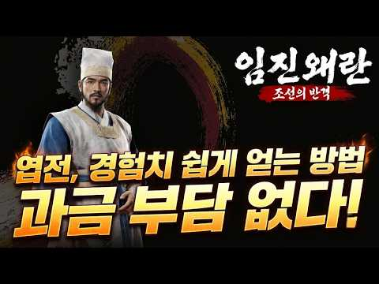
- 설명 앞부분: [임진왜란조선의반격] 남들보다 3배 빨리 큽니다. 당장 이곳으로 달려가세요! (무소과금 필수) 종합게임 스트리머 쌀딘이 방송입니다.
- 같은 채널 평소 대비 ×3.4 (채널 최근 롱폼 중앙값 8,168회) · 평소 영상: [제우스: 오만의 신] 나이트 랭커가 알려드립니다. #제우스오만의신 #겜딘 (8,168회) / [제우스: 오만의 신] 사냥터 추천 합니다! 아무것도 없는 쌩초보도 가능! (8,090회)
- 대본 없음 (설명) — 음성인식이 끝나면 도입부·흐름이 들어감
- 댓글 25/25: 좋은 점 — 영상 1 · 감사·응원 1 · 더 알고 싶은 것 1 · 아쉬운 점 — 영상 2 · 반박·불만 — 의견 다름 0 · 정치·사회 0 · 경험 공유 0 · 구독·다음 기대 0
  - 좋은 점 — 영상 👍1 “좋은정보네요”
  - 감사·응원 👍1 “감사합니다!!”
  - 더 알고 싶은 것 👍1 “경제쪽 컨텐츠도 알려주세요”
  - 아쉬운 점 — 영상 👍2 “거의 리니지 라이크 급으로 만들었네요 ... hq 가 만들엇다 해서 엄청 기대 했는데 .. .실망이 너무 큰 게임입니다.”
  - 아쉬운 점 — 영상 👍0 “개재밌는데. 아쉬운점은 장수의 개성이 좀더 강했으면 키우기 더 재미있었을듯..”

### 442. 요한계시록의 진짜 역사 ∣ 완전판 다큐멘터리

- https://www.youtube.com/watch?v=FaJ1hyZFG3w · 성경의 흔적 · 구독자 10,700 · 조회수 41,589 (×3.9, 하루 231.8) · 좋아요 1,065 (2.6%) · 71분 · 2026-04-26 · 주제 묶음 1. 역사 일반·이야기 · 형식 정보·해설 (그 밖) · 폴더 `W_FaJ1hyZFG3w` (웹 승인)
- 썸네일: 
- 설명 앞부분: 성경에서 가장 신비로운 책이 밝혀집니다. 이 완전판 다큐멘터리에서는 요한계시록의 진짜 역사를 공개합니다 — 밧모 섬으로의 요한 유배, 영광스러운 그리스도의 환상, 일곱 교회, 일곱 봉인, 일곱 나팔, 일곱 대접의 진노, 대환난, 적그리스도, 짐승의 표, 아마겟돈 전쟁, 천년왕국, 최후의 심판, 그리고 새 예루살렘. 모든 것의 끝이 설명됩니다.
- 같은 채널 평소 대비 ×6.2 (채널 최근 롱폼 중앙값 6,717회) · 평소 영상: 바울의 완전한 역사 — 박해자에서 사도로 ∣ 다큐멘터리 (6,717회) / 성령의 진짜 역사 — 창세기부터 요한계시록까지 ∣ 완전판 다큐멘터리 (6,121회)
- 대본 없음 (설명) — 음성인식이 끝나면 도입부·흐름이 들어감
- 댓글 41/41: 좋은 점 — 영상 0 · 감사·응원 10 · 더 알고 싶은 것 0 · 아쉬운 점 — 영상 1 · 반박·불만 — 의견 다름 1 · 정치·사회 0 · 경험 공유 7 · 구독·다음 기대 1
  - 감사·응원 👍4 “모세와 같은 선지자 (또 예수) (내 말을 그(네)입에) (모든 것을 주심에 감사와 영광 찬송을 돌려드립니다) 신명기( 신 ) 18장 13. 너는 네 하나님 여호와 앞에 완전하라 13. You must be blameless before the LORD your Go…”
  - 감사·응원 👍4 “76.다시 썩음을 당하지 않게 거룩한 산 시온 내가 영을 전하노라 (2.바울과 바나바가 비시디아 안디옥에서 전도하다.) (모든 것을 주심에 감사와 영광 찬송을 돌려드립니다) Acts (행)13:28-34 (초림예수님) [28]And though they found n…”
  - 아쉬운 점 — 영상 👍1 “기원전 6.000년 경에 존재를 하던 스메르제국의 신화를 짜깁기 하여 만든 사막 잡신 소설로 영혼장사를 하는거지요.가스라이팅과 쇠뇌로 영혼팔이 하는겁니다.스메르제국의 서적과 유튜브를 검색 하시기 바람니다.정말 아까운 시간 소중한 내가 번돈을 어뚱하게 뒤 주머니에 채워…”
  - 반박·불만 — 의견 다름 👍0 “허탄한 것과 거짓(훼방) (짐승의 말:훼방)(짐승.사람.겔34:23~31.) (한목자 또예수.행3:19~26.) (모든 것을 주심에 감사와 영광 찬송을 돌려드립니다) 에스겔( 겔 )13장. 6. 여호와께서 말씀하셨다고 하는 자들이 허탄한 것과 거짓된 점괘를 보며 사람…”
  - 경험 공유 👍4 “모세와 같은 선지자 (또 예수) (내 말을 그(네)입에) (모든 것을 주심에 감사와 영광 찬송을 돌려드립니다) 신명기( 신 ) 18장 13. 너는 네 하나님 여호와 앞에 완전하라 13. You must be blameless before the LORD your Go…”
  - 경험 공유 👍4 “76.다시 썩음을 당하지 않게 거룩한 산 시온 내가 영을 전하노라 (2.바울과 바나바가 비시디아 안디옥에서 전도하다.) (모든 것을 주심에 감사와 영광 찬송을 돌려드립니다) Acts (행)13:28-34 (초림예수님) [28]And though they found n…”
  - 구독·다음 기대 👍0 “허탄한 것과 거짓(훼방) (짐승의 말:훼방)(짐승.사람.겔34:23~31.) (한목자 또예수.행3:19~26.) (모든 것을 주심에 감사와 영광 찬송을 돌려드립니다) 에스겔( 겔 )13장. 6. 여호와께서 말씀하셨다고 하는 자들이 허탄한 것과 거짓된 점괘를 보며 사람…”

### 443. 미군이 땅 밑에서 공포에 질린 베트남 비밀 통로 구찌 터널

- https://www.youtube.com/watch?v=yKtyK4Tw8C4 · 역사를읽다 · 구독자 15,800 · 조회수 61,206 (×3.9, 하루 340.4) · 좋아요 888 (1.5%) · 33.2분 · 2026-04-26 · 주제 묶음 1. 역사 일반·이야기 · 형식 정보·해설 (그 밖) · 폴더 `W_yKtyK4Tw8C4` (웹 승인)
- 썸네일: 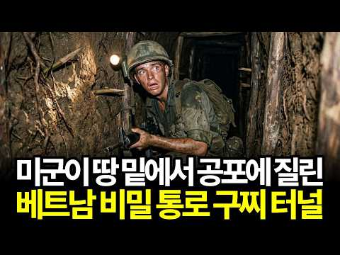
- 설명 앞부분: 세계 최강 미군이 한 달에 포탄 18만 발을 퍼부어도 끝내 뚫지 못한 땅이 있습니다. 베트남의 작은 시골 마을 구찌. 그 발 밑에는 지하 12미터, 수백 킬로미터에 달하는 거대한 지하 도시가 숨어 있었어요. 병원, 학교, 무기공장, 심지어 극장까지. 흙과 삽만으로 만들어진 이 개미굴 제국이 어떻게 세계 최강국을 무너뜨렸을까요? 미군을 공포로 몰아넣은 땅 밑 전쟁의 모든 것, 지금 시작합니다. 자료 조사: 본 영상의 모든 자료는 다양한 역사 문헌, 학술 자료 및 심층 자료 조사를 통해 얻은 결과를 바탕으로 제작되었습니다. [제작 방…
- 같은 채널 평소 대비 ×5.9 (채널 최근 롱폼 중앙값 10,325회) · 평소 영상: 알렉산드리아 도서관은 카이사르가 불태운게 아니다 인류 지식을 지운 진짜 주범들 인류 지식… (10,325회) / 외계인 납치설은 거짓말이었다 스스로 멸망을 선택한 마야 문명 (11,478회)
- 대본 없음 (설명) — 음성인식이 끝나면 도입부·흐름이 들어감
- 댓글 92/96: 좋은 점 — 영상 0 · 감사·응원 2 · 더 알고 싶은 것 0 · 아쉬운 점 — 영상 0 · 반박·불만 — 의견 다름 1 · 정치·사회 3 · 경험 공유 2 · 구독·다음 기대 1
  - 감사·응원 👍1 “보기드문 훌륭한 내용이네요~ 감사~~~”
  - 감사·응원 👍1 “부정선거 뿌리뽑아 깨끗한 대한민국 선거풍토 개혁합시다. ♡.모든 선거는 국내거주자에 한하여 선거권을 부여하고 선거일은 1일로 정하고 선거당일 투표소별 선거투,개표실시 개표 종합집계 당선자 발표하도록 선거법을 개정하여. 의혹없는 공명선거.깨끗한 선거풍토 이룩합시다.(부…”
  - 정치·사회 👍7 “북한인? 중국인? 호남인? 베트남인? 국적 어디?”
  - 정치·사회 👍1 “부정선거 뿌리뽑아 깨끗한 대한민국 선거풍토 개혁합시다. ♡.모든 선거는 국내거주자에 한하여 선거권을 부여하고 선거일은 1일로 정하고 선거당일 투표소별 선거투,개표실시 개표 종합집계 당선자 발표하도록 선거법을 개정하여. 의혹없는 공명선거.깨끗한 선거풍토 이룩합시다.(부…”
  - 경험 공유 👍0 “베트콩 글마는 베트남이 글마들는 토행사구토팽을 당했다 지금도 땡팡당이 지역의 장이며 좌익이라고 나도 어느 식당에 먹고 화장실에서 구토를 우리나라 대한민국에서”
  - 구독·다음 기대 👍0 “넘 잘 설명해줘서 요즘 정주행❤”

### 444. [민요 MV] 한오백년 ∣ 황진이와 소세양, 30일 사랑과 이별의 야사

- https://www.youtube.com/watch?v=7RPHMSdojmo · STARPLAYTV · 구독자 9,840 · 조회수 37,235 (×3.8, 하루 665.2) · 좋아요 0 (0.0%) · 6.1분 · 2026-08-28 · 주제 묶음 9. 야사·야담·옛날이야기 · 형식 정보·해설 (그 밖) · 폴더 `W_7RPHMSdojmo` (웹 승인)
- 썸네일: 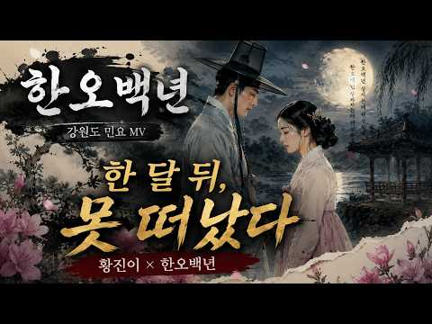
- 설명 앞부분: 강원도 민요 〈한오백년〉의 깊은 한과 그리움을 황진이와 소세양의 사랑 이야기로 풀어낸 감성 민요 MV입니다. “한 오백년 살자는데 웬 성화요”라는 후렴처럼, 오래 함께하고 싶지만 결국 이별해야 하는 사랑의 애틋함을 담았습니다. 한 달만 함께하고 떠나겠다던 소세양이 황진이의 이별시 앞에서 자신의 장담을 지키지 못했다는 야사를 모티프로 재구성했습니다. 〈한오백년〉은 강원도 아라리 계통의 음악적 정서를 바탕으로 형성된 민요로, 삶의 한과 임을 향한 그리움, 덧없이 흐르는 청춘과 인생의 애환을 노래합니다. 애잔한 가사와 구성진 가락이 함…
- 같은 채널 평소 대비 ×9.7 (채널 최근 롱폼 중앙값 3,848회) · 평소 영상: [민요 MV] 영천아리랑 ∣ 신바람 난 큰애기와 고개 너머의 님 ∣ 영천아가씨 (3,503회) / [민요 MV] 몽금포타령 ∣ 풍랑을 넘어 봉죽 달고 돌아온 님 ∣ 장산곶타령 (3,417회)
- 대본 없음 (설명) — 음성인식이 끝나면 도입부·흐름이 들어감
- 댓글 6/6: 좋은 점 — 영상 0 · 감사·응원 1 · 더 알고 싶은 것 0 · 아쉬운 점 — 영상 0 · 반박·불만 — 의견 다름 0 · 정치·사회 0 · 경험 공유 0 · 구독·다음 기대 0
  - 감사·응원 👍1 “정말 잘 만드셨네요~ 고맙습니다~”

### 445. 주고후 – 영락제의 피를 이은 그는 왜 아버지의 ‘반역의 업보’를 그대로 되풀이했나?

- https://www.youtube.com/watch?v=0lfKtPz-4PY · 중국황제비극 · 구독자 17,900 · 조회수 67,544 (×3.8, 하루 449.2) · 좋아요 829 (1.2%) · 62.4분 · 2026-05-25 · 주제 묶음 6. 동양사 (중국·일본·몽골) · 형식 정보·해설 (그 밖) · 폴더 `W_0lfKtPz-4PY` (웹 승인)
- 썸네일: 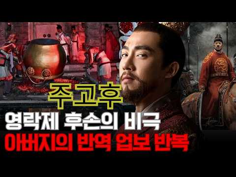
- 설명 앞부분: 조카의 옥좌를 빼앗은 아버지 영락제의 피를 이어받아, 똑같이 반역의 칼을 빼들었던 대명제국의 맹장 주고후. 감옥에 갇힌 삼촌은 왜 조카 선덕제의 발목을 걸어 넘어뜨렸으며, 유교의 성군이라 불리던 젊은 황제는 왜 이토록 잔혹한 살인귀로 돌변해 친삼촌과 일족을 멸문시켰을까요? 명나라 황실 장막 뒤에 숨겨진 잔혹한 권력 암투와 핏빛 인과응보의 역사를 파헤칩니다.
- 같은 채널 평소 대비 ×3.8 (채널 최근 롱폼 중앙값 17,599회) · 평소 영상: 해진 – 명나라 최고의 머리를 ‘칼도 없이’ 죽인 방법: 눈더미 생매장의 실체 (17,599회) / 쉬셴춘 – 위충현의 ‘피의 오른팔’, 권력이 무너지자 왜 가장 잔혹하게 처형됐나? (17,683회)
- 대본 없음 (설명) — 음성인식이 끝나면 도입부·흐름이 들어감
- 댓글 43/43: 좋은 점 — 영상 0 · 감사·응원 0 · 더 알고 싶은 것 0 · 아쉬운 점 — 영상 0 · 반박·불만 — 의견 다름 0 · 정치·사회 1 · 경험 공유 0 · 구독·다음 기대 0
  - 정치·사회 👍17 “명나라가 오래 못간 이유가 있네 적당히를 모르는 집안”

### 446. 5명의 임금을 섬긴 유자광 : 격동기 관료의 처세와 정치적 평가

- https://www.youtube.com/watch?v=BdvwjhnDBYw · 거침없는한국사 · 구독자 32,800 · 조회수 122,875 (×3.8, 하루 768.9) · 좋아요 2,747 (2.2%) · 73.1분 · 2026-05-16 · 주제 묶음 3. 조선 · 형식 정보·해설 (그 밖) · 폴더 `W_BdvwjhnDBYw` (웹 승인)
- 썸네일: 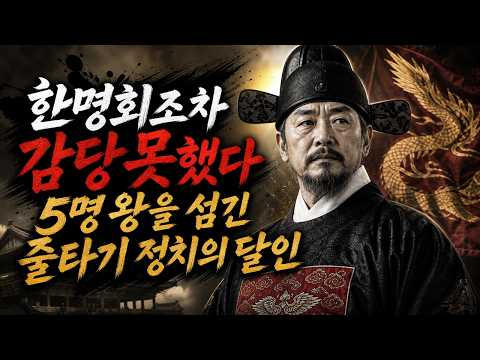
- 챕터: 0:00 인트로 ─ 다섯 임금을 갈아탄 흙수저 · 2:00 1장 ─ 한 사람의 머리 위로 쏟아진 상소 · 8:35 2장 ─ 노비 어미의 아들, 한양 광화문 앞에 서다 · 13:30 3장 ─ 문지기의 청, 정병 삼백을 달라 · 19:45 4장 ─ 임금이 시험지를 바꿔주던 밤 · 24:00 5장 ─ 남이의 목 · 30:35 6장 ─ 영의정 한명회를 향한 칼 · 40:30 7장 ─ 흙비와 동래 유배 · 46:25 8장 ─ 사초 한 장이 일으킨 피바람, 무오사화 · 55:35 9장 ─ 광기 앞의 침묵, 자정의 칼 · 64:30 10장 ─ 그를 향해 날아온 종이, 평해 울진 · 70:25 에필로그 ─ 사실과 각색
- 설명 앞부분: 한명회를 두번이나 탄핵하고, 그의 부관참시까지 목도한 조선시대 최고의 처세술의 달인. 유자광의 일대기 노비 어미에게서 태어난 얼자가 다섯 임금을 차례로 갈아타며 일등공신 칭호를 다섯 번이나 받기까지 세조, 예종, 성종, 연산군, 그리고 중종. 임금이 바뀔 때마다 자기 자리를 만들어 낸 그 무서운 처세술의 비밀, 당대 최고의 권력자 한명회를 정면으로 들이받은 그 봄날의 상소, 조선 최초의 사화를 자기 손으로 설계한 그 무오년의 피바람, 그리고 끝내 평해 울진 한 작은 처소에서 일흔넷에 마지막 숨을 거두기까지. 따뜻한 차 한 잔 곁에…
- 같은 채널 평소 대비 ×10.3 (채널 최근 롱폼 중앙값 11,961회) · 평소 영상: 🌙9살 연하 새어머니, 광해를 왕으로 만들더니,15년 후 폐위시킨 이유∣인목왕후 (12,687회) / 일본인 90만 명이 두고 간 6,000조 원｜친일재산 환수로 다시 열린 해방의 장부 (11,235회)
- 대본 없음 (설명) — 음성인식이 끝나면 도입부·흐름이 들어감
- 댓글 261/261: 좋은 점 — 영상 3 · 감사·응원 4 · 더 알고 싶은 것 3 · 아쉬운 점 — 영상 1 · 반박·불만 — 의견 다름 5 · 정치·사회 7 · 경험 공유 5 · 구독·다음 기대 1
  - 좋은 점 — 영상 👍1 “죄는지은되로 功은 닦은되로 옛어른들의 말씀과같습니다. 오늘도 역사의 한부분을배웠습니다 감사합니다 😊”
  - 감사·응원 👍6 “중공땅에는 오래오래전 기원전부터 설화를 전설로 만들어 먹고사는 시장통 썰맨들이 있었지. 그것들이 여불위가 되고 제갈량이 되고... 핫소리들이 기록하는 습관과 세월 덕에 역사가 되고...수부타이보다 못한데도. 우리는 요즘에서야 충무공을 벗어나 척준경 유자광등을 듣는다.…”
  - 감사·응원 👍4 “그거 아시나요? 연산군이 폐비윤씨 아들인게, 폐비가 궁밖으로 쫒겨나 몸이 아플때 저희 직대조 순흥안씨 3파 감사공 숭효조의 큰딸인 정경부인의 남편인 진주강씨 서울 시흥집에서 가료를 받은적이 있는데, 계유정란때 한명회와 그의 사촌 안동부사 한명진의 작전으로 순흥부의 순…”
  - 더 알고 싶은 것 👍16 “몇가지 바로 잡고자 합니다. 한명회는 금수저 집안이 아니라 몰락한 양반 출신입니다. 그리고 가계도에 안순왕후(X) 장순왕후, 둘째딸(X) 세째딸임, 그리고 예종이 장순왕후 남편인데 어찌 외손자가 되나요?”
  - 더 알고 싶은 것 👍1 “성종이 언제부터 한명회 외손자 였나요? 정확한 얘기를 44:05”
  - 아쉬운 점 — 영상 👍2 “이런것은집안일할때나듣는거지광고가이리많으면짜증나”
  - 반박·불만 — 의견 다름 👍6 “한명회가 성종의 장인이지 외할아버지는 아닙니다.”
  - 반박·불만 — 의견 다름 👍3 “지금의국방부차관이면병조참판입니다 .참의는.영감이지.대감은아닙니다😢”
  - 정치·사회 👍14 “충암파 여인형 기획을 좀더 콤꼼하게 계획 했어야 했어요 그리고 자신의 눈빛을 감추어야 했습니다. 충암파 김용현 여인형 이상민 이자들은 너무 빨리 본인들의 발톱을 내밀었습니다. 국회에서 야당 의원들을 겁박 하던 그 모습에서 거사는 들통 난 것이었습니다. 충암파는 바보 …”
  - 정치·사회 👍3 “이재명이 떠오르네요.”
  - 경험 공유 👍4 “그거 아시나요? 연산군이 폐비윤씨 아들인게, 폐비가 궁밖으로 쫒겨나 몸이 아플때 저희 직대조 순흥안씨 3파 감사공 숭효조의 큰딸인 정경부인의 남편인 진주강씨 서울 시흥집에서 가료를 받은적이 있는데, 계유정란때 한명회와 그의 사촌 안동부사 한명진의 작전으로 순흥부의 순…”
  - 구독·다음 기대 👍15 “비로소 찾았습니다.ㅎ"거침없는 한국사"구독.좋아요.알림설정.꾸~~욱~~누르고 갑니다.😊”

### 447. [역사 한마당 특집] 한국을 빛낸 100명의 위인들 - 최영준과 노사사 (Symphonic Rock Cover)

- https://www.youtube.com/watch?v=VJjV_PxYhtI · 강철가요단 · 구독자 15,900 · 조회수 59,513 (×3.7, 하루 339.3) · 좋아요 367 (0.6%) · 5.1분 · 2026-04-30 · 주제 묶음 1. 역사 일반·이야기 · 형식 정보·해설 (그 밖) · 폴더 `W_VJjV_PxYhtI` (웹 승인)
- 썸네일: 
- 설명 앞부분: 한국을 빛낸 100명의 위인들 - 최영준과 노사사 (Symphonic Rock Cover) 🎸강철가요단 보컬-김강철 리드기타-이강철 세컨기타-박강철 베이스기타-최강철 드럼-정강철 🗄️Staff 매니저-강강철 프로듀서-조강철 This is a fan-made remake created using AI. The copyright of the original song belongs to the original rights holder.
- 대본 없음 (설명) — 음성인식이 끝나면 도입부·흐름이 들어감
- 댓글 86/86: 좋은 점 — 영상 0 · 감사·응원 2 · 더 알고 싶은 것 3 · 아쉬운 점 — 영상 1 · 반박·불만 — 의견 다름 0 · 정치·사회 0 · 경험 공유 0 · 구독·다음 기대 0
  - 감사·응원 👍3 “우리 아들이 사랑하는 곡입니다. 감사합니다.”
  - 감사·응원 👍0 “요청했는데 올려주셔서 감사합니다!”
  - 더 알고 싶은 것 👍1 “썸네일에 있는 분들 소개좀 부탁드려요”
  - 더 알고 싶은 것 👍1 “소찬휘-타투부탁드립니다.. 제발..”
  - 아쉬운 점 — 영상 👍2 “이노래듣고 울뻔한건 이상한건가ㅜㅜ”

### 448. 한산도함의 내부 — 이순신 한산도대첩의 이름을 단 한국 해군 첫 훈련함

- https://www.youtube.com/watch?v=iUhBRxh0Rxk · Nature's Tether · 구독자 12,000 · 조회수 44,847 (×3.7, 하루 323.0) · 좋아요 664 (1.5%) · 30.8분 · 2026-06-06 · 주제 묶음 3. 조선 · 형식 정보·해설 (그 밖) · 폴더 `W_iUhBRxh0Rxk` (웹 승인)
- 썸네일: 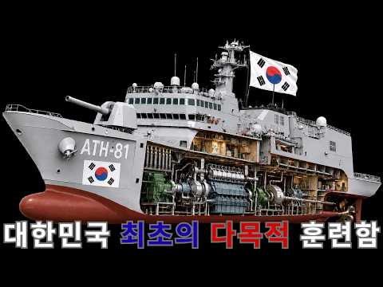
- 설명 앞부분: ATH-81 한산도함의 내부 구조를 3D 모델로 완전히 해부합니다. 충무공 이순신의 한산도대첩을 기념하는 이름을 단, 대한민국 해군 역사상 첫 번째 전용 훈련함의 실제 내부를 처음으로 공개합니다. 1592년 7월 8일, 경상남도 통영 앞바다. 임진왜란 발발 3개월째. 한반도 전역이 일본군에 짓밟히던 그 시기, 단 하나 막혀 있던 길이 바다였습니다. 조선 수군통제사 이순신. 그가 통영 한산도 앞바다에서 일본의 와키자카 야스하루 함대를 기다리고 있었습니다. 학익진(鶴翼陣). 학이 날개를 펼친 듯한 진형으로 적을 감싸 안는 전법. 이순…
- 같은 채널 평소 대비 ×53.6 (채널 최근 롱폼 중앙값 837회) · 평소 영상: 참수리 KUH-1P의 내부 — 대한민국 국조 '참수리'의 이름을 이어받은 경찰청 첫 국산… (837회) / K239 천무의 내부 — 폴란드가 미국 HIMARS 대신 290대를 도입한 한국 다연장로켓 (870회)
- 대본 없음 (설명) — 음성인식이 끝나면 도입부·흐름이 들어감
- 댓글 24/24: 좋은 점 — 영상 0 · 감사·응원 0 · 더 알고 싶은 것 0 · 아쉬운 점 — 영상 0 · 반박·불만 — 의견 다름 0 · 정치·사회 0 · 경험 공유 0 · 구독·다음 기대 0

### 449. 부자 90%가 3대에 망할 때 로스차일드만 250년 간 진짜 이유

- https://www.youtube.com/watch?v=R57hAxs7SQ4 · 역사명탐정 · 구독자 23,300 · 조회수 86,282 (×3.7, 하루 559.5) · 좋아요 1,162 (1.4%) · 17.4분 · 2026-05-22 · 주제 묶음 기타 · 형식 정보·해설 (그 밖) · 폴더 `W_R57hAxs7SQ4` (웹 승인)
- 썸네일: 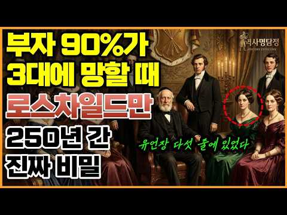
- 챕터: 0:00 부자 삼대 못 간다 — 250년을 간 가문 · 0:30 70%가 2대에 망하고 90%가 3대에 사라진다 · 1:29 메디치·로마노프·밴더빌트가 무너진 자리에서 · 2:06 250년 전 게토의 한 남자, 마이어 암셸 · 4:01 다섯 아들 다섯 나라 — 5화살 분산 · 6:04 1812년 유언장, 250년 가는 헌법이 되다 · 7:17 딸 0원 조항의 진짜 정체 — 결혼 시장 설계 · 9:40 합스부르크는 망했는데 로스차일드는 왜 살았나 · 11:41 가족 은행 — 빌리고 갚는 시스템 · 12:42 경주 최부잣집 — 정반대의 같은 결과 · 13:50 보이지 않는다는 원칙 — 워털루 신화의 진실 · 16:13 2023년, 200년 전 유언이 그대로 작동 중
- 설명 앞부분: 그런데 250년, 7대째 그대로 살아남은 단 하나의 가문이 있습니다. 18세기 프랑크푸르트 유대인 게토 한 평짜리 점포에서 시작된 로스차일드. 그들의 진짜 비결은 돈이 아니라, 마이어 암셸이 임종 직전 종이 한 장에 적은 다섯 줄짜리 유언장이었습니다. 왜 딸들에겐 단 한 푼도 남기지 않았을까. 왜 외부인 운영을 영원히 금지했을까. 250년 전 한 남자가 설계한 시스템이 지금도 그대로 작동하고 있는 진짜 이유를 추적합니다. 타임라인 ※ 본 영상은 AI 기술을 활용하여 제작되었습니다.
- 같은 채널 평소 대비 ×11.1 (채널 최근 롱폼 중앙값 7,781회) · 평소 영상: 이란이 아랍이라고 하면 화내는 진짜 이유, 이것 모르면 절대 이해 못합니다 ∣ 종교가 아… (7,781회) / '북한은 잊어라' 트럼프가 진짜 무너뜨리려는 미국 코앞 145km 나라의 정체는? (7,585회)
- 대본 없음 (설명) — 음성인식이 끝나면 도입부·흐름이 들어감
- 댓글 86/86: 좋은 점 — 영상 2 · 감사·응원 2 · 더 알고 싶은 것 0 · 아쉬운 점 — 영상 2 · 반박·불만 — 의견 다름 0 · 정치·사회 2 · 경험 공유 0 · 구독·다음 기대 0
  - 좋은 점 — 영상 👍17 “부자는 3대를 못간다 ! 진리 입니다. 로스차일드가 300년간 세계 최고에 갑부에 자리를 지킬수 있었던 이유. 이가문은 음모론 단골 입니다. 사탄에 도움이 없이는 불가능해요! 음모론에서는 로스차일드가 재산을 대략 500경 넘게 추산하고 있음 . 한국 삼성가는 구멍가게…”
  - 좋은 점 — 영상 👍14 “사탄의 도움이 과연 언제까지일지 궁금하긴하네요..”
  - 감사·응원 👍2 “궁금증을 풀어주셔서 감사합니다😊”
  - 감사·응원 👍2 “감사합니다”
  - 아쉬운 점 — 영상 👍35 “아직 로스차일드를 잘 모르는듯. 그들은 자신들의 존재나 힘을 철저하게 숨긴다. 잘못 알려진게 아니고 부풀려진게 아니고 철저히 축소시킨다. 다른 재벌. 명문가문과는 차원이 달라. 네이썬의 얘기도 과장된게 아니라 일부러 철저히 숨기는것일뿐. CIA를 통해서 음모론이라는 …”
  - 아쉬운 점 — 영상 👍0 “이 눔의 ai 소리 젤 듣기 싫어. 말이 너무 많아. 개념 설명이 너무 지나쳐서 지루해. 이젠 목소리도 듣기 싫네. 시발”
  - 정치·사회 👍0 “전세계를 다 쥐어 잡은 건 사실이고.유럽과 미국은행과 정치까지 장악 후 미국을 통하여 전세계를 쥐락펴락. ㅎㅎㅎ 좋게 시작햇어도 결국. 돈이 많으면 악을 만드는 원천이니 ㅡㅡ이 방송은 ㅡ민주당처럼 그 쪽을 해방시켜주는 듯해서 찝찝하군요. 왜냐면??? 찰수황태자를. 손…”
  - 정치·사회 👍0 “이곳은 정치가 국민을 위해줬기에 가문이 살아남은겁니다. 우리나라 에서는 가문이 살아남을 수가없게 설계 했지요. 이것이 그들과의 차이점 입니다. 상속세 60%내면 2대만 흘러도 정부가 모두 가져가는 구조입니다. 그래도 좌빠리들은 이런구조를 좋다하지요? 그들은 대부분 돈…”

### 450. 종로의 숨겨진 유적과 피맛길 답사 ∣ 왕의 가마를 피해 걷던 서민들의 진짜 역사 [답골TV]

- https://www.youtube.com/watch?v=lRFzNz6LA6c · 길눈이랑 답사해 · 구독자 4,810 · 조회수 17,772 (×3.7, 하루 127.0) · 좋아요 462 (2.6%) · 22.4분 · 2026-06-05 · 주제 묶음 1. 역사 일반·이야기 · 형식 정보·해설 (그 밖) · 폴더 `W_lRFzNz6LA6c` (웹 승인)
- 썸네일: 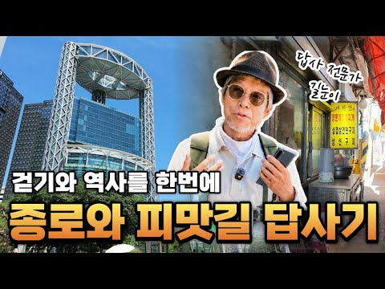
- 챕터: 0:00 인트로 · 1:15 종로와 피맛길 유래와 역사에 대한 설명 · 4:09 서울역사박물관 · 6:46 종루 주춧돌(보신각) · 9:10 흥화문 터 · 10:20 서울 고종 어극 40년 칭경 기몀비 · 11:20 광화문과 북악산 · 12:56 피맛길의 시작 시전행랑 · 16:26 의금부 터 · 17:20 녹두장군 전봉준 동상 · 19:20 재미있는 장안빌딩에 얽힌 이야기
- 설명 앞부분: 안녕하세요, 길눈이와 함께하는 역사 답사 채널 [답골TV]입니다. 이번에는 서울 종로의 중심부에 숨겨진 역사 유적과 서민들의 옛길인 '피맛길'을 다녀왔습니다. 거대한 고층 빌딩이 솟아오른 현대의 종로 거리 아래와 그 주변에 잠들어 있는 조선 시대의 역사적 유적들, 그리고 고관대작들의 말과 가마를 피해 서민들이 다녔던 뒷골목 '피맛길'의 실제 흔적들을 직접 확인해 보았습니다. 현재와 과거가 공존하는 종로 일대의 구체적인 유적 고증과 그 길에 얽힌 서민들의 사실적인 역사 이야기를 전해드립니다. 타임라인
- 같은 채널 평소 대비 ×0.8 (채널 최근 롱폼 중앙값 22,872회) · 평소 영상: 청계천 답사기 ∣ 광통교·수표교·전태일다리·동대문 오간수문 (22,872회) / 청계천에서 서울역까지 답사 ∣ 박태원 '소설가 구보씨의 일일' 속 경성을 걷다 (26,852회)
- 대본 없음 (설명) — 음성인식이 끝나면 도입부·흐름이 들어감
- 댓글 35/35: 좋은 점 — 영상 1 · 감사·응원 4 · 더 알고 싶은 것 0 · 아쉬운 점 — 영상 0 · 반박·불만 — 의견 다름 0 · 정치·사회 0 · 경험 공유 2 · 구독·다음 기대 1
  - 좋은 점 — 영상 👍0 “너무 생소한게 많아서 적으면서 보고 있어요 교보문고 뒤편을 왔다갔다 하면서도 이런 사연이 있는지 오늘에서야 알았네요 온라인 역사탐방 아주 유익합니다”
  - 감사·응원 👍7 “새롭게 알게되는 내용많네요. 감사합니다♡”
  - 감사·응원 👍4 “우연히 정릉편을 보게 되었어요. 새로운 사실들을 알게되고 새로운 곳들을 보게 되는 즐거움을 누렸어요.여긴 미국 뉴저지구요 7월 4일 독립기념일이라서 밤 불꽃놀이가 한창입니다. 감사히 잘 시청했어요. 구독 좋아요도 눌렀어요”
  - 경험 공유 👍1 “매번 전봉준 동상을 보면서 궁금했었던 좌상인 이유를 오늘에서야 알았습니다 감사합니다”
  - 경험 공유 👍1 “한국가면 저도 골목길 따라서 걷을려면 어디로 연락을 하면 되는지요?”
  - 구독·다음 기대 👍2 “우연히 떠서 보게 되었는데 ᆢ답사 설명이 너무 훌륭합니다 ᆢ계속 기대할게요 ᆢ감사합니다”

### 451. 역사를 바꾼 가장 똑똑했던 전쟁 전술들 Top10

- https://www.youtube.com/watch?v=J5wm-3Ctcfs · 쉽게 설명해서! · 구독자 18,100 · 조회수 66,534 (×3.7, 하루 694.0) · 좋아요 861 (1.3%) · 30.2분 · 2026-07-19 · 주제 묶음 1. 역사 일반·이야기 · 형식 정보·해설 (그 밖) · 폴더 `W_J5wm-3Ctcfs` (웹 승인)
- 썸네일: 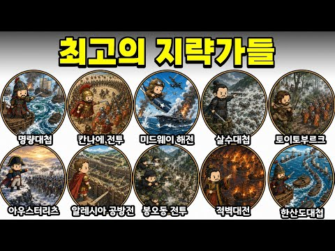
- 챕터: 0:00 칸나에 전투 · 2:45 명량대첩 · 5:30 미드웨이 해전 · 8:37 살수대첩 · 11:46 토이토부르크 숲 전투 · 14:45 한산도대첩 · 17:19 알레시아 공방전 · 20:24 봉오동 전투 · 23:03 적벽대전 · 26:21 아우스터리츠 전투
- 설명 앞부분: 숫자가 많은 쪽이 항상 이기는 건 아니었죠. 이순신은 13척으로 300척이 넘는 함대를 막았고, 한니발은 로마의 대군을 스스로 함정 안으로 밀어 넣었습니다. 암호 한 줄이 태평양 전쟁의 흐름을 뒤집기도 했고, 좁은 계곡과 숲, 강과 안개는 어떤 군대보다 무서운 무기가 됐어요. 이번 영상에서는 역사상 가장 영리했던 전쟁 전술 10가지를 따라가 봅니다. 단순히 “누가 더 강했나”가 아니라, 적이 가장 자신 있어 하던 무기를 어떻게 함정으로 바꿨는지에 집중했습니다. ※ 전투의 병력·피해 규모는 사료와 연구에 따라 차이가 있을 수 있습니…
- 같은 채널 평소 대비 ×1.5 (채널 최근 롱폼 중앙값 45,620회) · 평소 영상: 독재자들의 특이한 집착들 Top6 (46,498회) / 역사상 가장 이상하고 엉뚱한 형별과 재판 Top10 (44,741회)
- 대본 없음 (설명) — 음성인식이 끝나면 도입부·흐름이 들어감
- 댓글 115/115: 좋은 점 — 영상 2 · 감사·응원 3 · 더 알고 싶은 것 1 · 아쉬운 점 — 영상 2 · 반박·불만 — 의견 다름 8 · 정치·사회 4 · 경험 공유 8 · 구독·다음 기대 0
  - 좋은 점 — 영상 👍13 “솔직히 살수대첩이 진짜 레전드다 30만명 격퇴ㄷㄷ”
  - 좋은 점 — 영상 👍2 “다들 레전드 전술이네요ㄷㄷ”
  - 아쉬운 점 — 영상 👍12 “아아, 주인장 분. 지적해 줄 사안이 있습니다. 20:24 - 봉오동 전투 부분. 이거 말이죠. 내용이 아예 통째로 다 틀렸어요. 하긴 모를 수도 있어요. 이거 국내에선 절대 안 가르쳐 주는 대목들이라서 역사 아무리 잘 아는 사람도 틀리기 때문에 제가 딱히 주인장 분…”
  - 반박·불만 — 의견 다름 👍12 “아아, 주인장 분. 지적해 줄 사안이 있습니다. 20:24 - 봉오동 전투 부분. 이거 말이죠. 내용이 아예 통째로 다 틀렸어요. 하긴 모를 수도 있어요. 이거 국내에선 절대 안 가르쳐 주는 대목들이라서 역사 아무리 잘 아는 사람도 틀리기 때문에 제가 딱히 주인장 분…”
  - 반박·불만 — 의견 다름 👍0 “명량에 대해 말하자면, 나머지 수군 12척이 머뭇거렸다고들 알고 있지만 그렇지 않아요, 처음엔 아주 좁은 곳이라 단 한대로 충분히 막을 수 있었던 곳이고, 이후 순서대로 나머지 11척이 물때에 맞춰 들어옵니다. 머뭇거린게 아니라 순서대로 기다렸다가 물이 넓어지면서 차…”
  - 정치·사회 👍2 “9:39 수나라가 바다건너 온지는 모르겠으나.. 서쪽에서 동쪽으로 들어왔을텐데.. 그림을 확인하시고 사용하시는게 좋을 것 같네요”
  - 정치·사회 👍0 “윤석열과 그 일당들 하는 짓거리 보면 한국은 한참 멀었다고 생각하다가도 이런 사실을 보면 또 그것도 아니란말이야...”
  - 경험 공유 👍12 “아아, 주인장 분. 지적해 줄 사안이 있습니다. 20:24 - 봉오동 전투 부분. 이거 말이죠. 내용이 아예 통째로 다 틀렸어요. 하긴 모를 수도 있어요. 이거 국내에선 절대 안 가르쳐 주는 대목들이라서 역사 아무리 잘 아는 사람도 틀리기 때문에 제가 딱히 주인장 분…”
  - 경험 공유 👍0 “제가 알고 있는 똑똑한 전쟁 전술은 트로이 목마로 그리스 군단으로 승리를 이끈 이야기 인 트로이 전쟁 입니다 예비군 다녀왔지만 그래도 아직 6번 갔다와야 하는 예비군 병장 시청자로부터”

### 452. 우리가 배운 역사와 다른 수메르의 지구 기록 여덟 가지… 마지막은 가장 소름 돋는다

- https://www.youtube.com/watch?v=4GVFyzDkyTs · Sakura · 구독자 3,730 · 조회수 13,696 (×3.7, 하루 134.6) · 좋아요 118 (0.9%) · 176.6분 · 2026-07-13 · 주제 묶음 1. 역사 일반·이야기 · 형식 정보·해설 (그 밖) · 폴더 `W_4GVFyzDkyTs` (웹 승인)
- 썸네일: 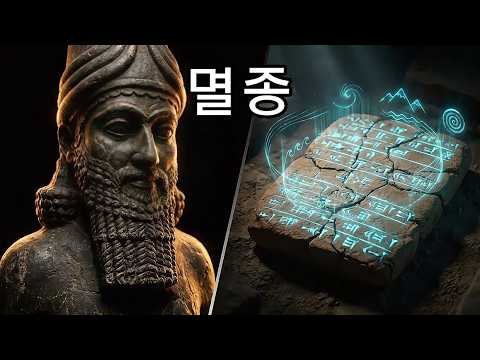
- 설명 앞부분: 수메르 점토판에는 우리가 학교에서 배운 역사와는 전혀 다른 지구의 모습이 기록되어 있다고 주장하는 연구자들이 있습니다. 이 영상에서는 가장 논란이 많은 수메르 기록 여덟 가지를 살펴보고, 왜 지금도 많은 사람들이 이 문헌에 주목하는지 알아봅니다. 과연 이것은 잃어버린 고대의 지식일까요, 아니면 신화를 문자 그대로 해석한 결과일까요? 마지막 이야기는 특히 가장 충격적인 내용으로 알려져 있습니다.
- 같은 채널 평소 대비 ×3.4 (채널 최근 롱폼 중앙값 4,051회) · 평소 영상: 수천 년 전 엔키가 인간에게 준 11가지 선물… 마지막 선물의 정체는 충격적이었다 (4,051회) / 수메르인들은 알고 있었다… 그랜드 캐니언에 묻힌 9가지 충격적인 비밀! 마지막은 소름 돋… (4,106회)
- 대본 없음 (설명) — 음성인식이 끝나면 도입부·흐름이 들어감
- 댓글 1/1: 좋은 점 — 영상 0 · 감사·응원 0 · 더 알고 싶은 것 0 · 아쉬운 점 — 영상 0 · 반박·불만 — 의견 다름 0 · 정치·사회 0 · 경험 공유 0 · 구독·다음 기대 0

### 453. [ 임진왜란 : 조선의반격 ] 시작할때 알아두면 좋을 각종 정보 모음 #임진왜란 #임진왜란조선의반격 #조선의반격 #신작게임 #꿀팁

- https://www.youtube.com/watch?v=6P9AdomzXDg · 김바보 Tv · 구독자 6,020 · 조회수 21,776 (×3.6, 하루 123.0) · 좋아요 87 (0.4%) · 22분 · 2026-04-29 · 주제 묶음 3. 조선 · 형식 정보·해설 (그 밖) · 폴더 `W_6P9AdomzXDg` (웹 승인)
- 썸네일: 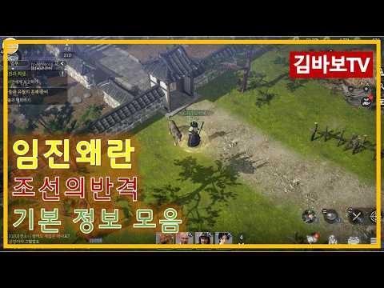
- 설명 앞부분: 안녕하세요. 크리에이터 김바보tv 입니다. 더 좋은 컨텐츠로 보답하겠습니다. [확률형아이템포함]
- 같은 채널 평소 대비 ×14.6 (채널 최근 롱폼 중앙값 1,488회) · 평소 영상: [ 임진왜란 조선의반격 ] 권율의 패시브를 활용한 효율적인 1~2장수 사냥법 #임진왜란 … (1,620회) / [ 임진왜란 조선의반격 ] 새로나온 원숭이 수호수의 치명저항과 방어력을 비교해봤습니다. … (1,357회)
- 대본 없음 (설명) — 음성인식이 끝나면 도입부·흐름이 들어감
- 댓글 35/35: 좋은 점 — 영상 1 · 감사·응원 1 · 더 알고 싶은 것 2 · 아쉬운 점 — 영상 0 · 반박·불만 — 의견 다름 0 · 정치·사회 0 · 경험 공유 0 · 구독·다음 기대 0
  - 좋은 점 — 영상 👍0 “오빠 목소리좋다”
  - 감사·응원 👍0 “영상 감사합니다”
  - 더 알고 싶은 것 👍0 “거상 처럼 순수 노가다로 거래소에 템 올리고 돈 벌어서 투력업이 가능한가요?”
  - 더 알고 싶은 것 👍0 “케릭 바닥에 장판은 어떻게 하면 나타 나나요?”

### 454. 진주성에 현대군이 간다면? ∣ 임진왜란 퓨전

- https://www.youtube.com/watch?v=0RMUNVJ5n80 · 시간실록 · 구독자 8,390 · 조회수 30,038 (×3.6, 하루 234.9) · 좋아요 434 (1.4%) · 13.3분 · 2026-06-17 · 주제 묶음 3. 조선 · 형식 정보·해설 (그 밖) · 폴더 `W_0RMUNVJ5n80` (웹 승인)
- 썸네일: 
- 설명 앞부분: 만약 임진왜란 당시, 진주성 전투에 현대 대한민국 군대가 투입된다면 어떻게 되었을까? 탱크, 드론, 현무 미사일, 현대 보병 전력이 조선의 진주성을 지키기 위해 과거로 향한다는 상상에서 시작한 AI 기반 퓨전 역사 영상입니다. 실제 역사 속 진주성 전투는 적은 병력으로 대군에 맞서 싸운 조선의 상징적인 전투였습니다. 이번 영상은 그 치열한 전장을 현대전의 시선으로 재해석한 콘텐츠입니다. 역사와 상상이 만나 탄생한 임진왜란 퓨전 시리즈 2탄, 재미있게 봐주세요. AI로 제작한 실사 시네마틱 영상으로 한국사·세계사 전쟁과 숨은 이야기…
- 같은 채널 평소 대비 ×0.4 (채널 최근 롱폼 중앙값 79,109회) · 평소 영상: 1592년, 왜군이 조선을 침략한 순간… 이순신은 현대전력과 함께 반격했다 (79,109회) / 사라진 전학생, 영국에서 다시 나타났다｜시즌2 EP.1 새로운 임무 (86,203회)
- 대본 없음 (설명) — 음성인식이 끝나면 도입부·흐름이 들어감
- 댓글 40/40: 좋은 점 — 영상 0 · 감사·응원 0 · 더 알고 싶은 것 5 · 아쉬운 점 — 영상 0 · 반박·불만 — 의견 다름 0 · 정치·사회 0 · 경험 공유 0 · 구독·다음 기대 0
  - 더 알고 싶은 것 👍3 “다음 전투영상도 부탁드립니다 시간실록님!”
  - 더 알고 싶은 것 👍3 “현대군 투입 전투영상도 자주 부탁드립니다 시간실록님!”

### 455. 한때 노인정 휩쓸던 '수지침'이 한순간에 사라진 충격적인 이유 ∣ 고려수지요법

- https://www.youtube.com/watch?v=Xl4HbydufoE · 눈앞의 경제학 · 구독자 21,800 · 조회수 77,059 (×3.5, 하루 473.1) · 좋아요 1,995 (2.6%) · 14.6분 · 2026-05-13 · 주제 묶음 2. 한국 고대·삼국·고려 · 형식 정보·해설 (그 밖) · 폴더 `W_Xl4HbydufoE` (웹 승인)
- 썸네일: 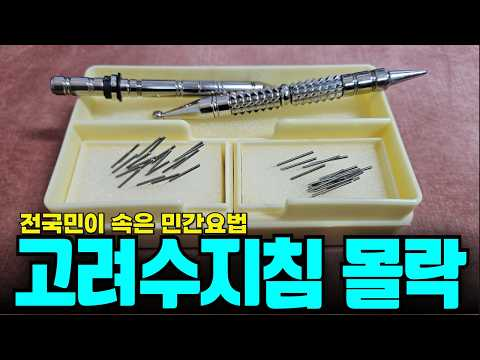
- 챕터: 0:00 손바닥의 우주 — 수지침이란 무엇인가 · 1:03 전성기의 풍경 — 어떻게 대한민국 대표 민간요법이 됐나 · 2:56 1인 왕국의 탄생 — 창시자가 곧 시스템이 되면 · 5:14 배우는 사람들이 등을 돌린 이유 — 비용의 역설 · 7:19 과학과의 거리 — 효능은 입증됐나 · 9:24 디지털 전환 실패와 고령화된 공동체 · 11:05 역사의 거울 — 일본 침구 유파의 교훈 · 12:33 우리가 얻어야 할 인사이트 3가지 · 13:00 마무리
- 설명 앞부분: 🚨 한때 전국 160개 지부, 만 명이 넘는 자격증 취득자를 보유했던 고려수지요법이 지금은 왜 아무도 모르는 존재가 됐을까. 창시자 1인이 이론·자격·교재·기자재를 독점한 구조가 어떻게 스스로의 성장을 막았는지 해부합니다. 📍 오늘 영상에서 반드시 확인해야 할 3가지 1️⃣ 수지침이 전성기를 구가하다 추락한 진짜 구조적 이유 2️⃣ 1인 독점 지식 체계가 반드시 맞닥뜨리는 성장의 한계 3️⃣ 민간자격증에 돈과 시간을 쓰기 전, 반드시 따져봐야 할 3가지 ⏱ 타임라인 [콘텐츠 제작 안내] 본 영상은 시청자분들의 이해를 돕기 위해 A…
- 같은 채널 평소 대비 ×44.3 (채널 최근 롱폼 중앙값 1,740회) · 평소 영상: 1억 3천만 원 개인택시 면허, 왜 사는 사람만 있고 버는 사람은 없나 (1,771회) / 심천사혈요법! 과연 제3의 기적의 대체의학으로 자리잡을 수 있을까? (1,709회)
- 대본 없음 (설명) — 음성인식이 끝나면 도입부·흐름이 들어감
- 댓글 275/275: 좋은 점 — 영상 18 · 감사·응원 5 · 더 알고 싶은 것 6 · 아쉬운 점 — 영상 3 · 반박·불만 — 의견 다름 11 · 정치·사회 3 · 경험 공유 36 · 구독·다음 기대 0
  - 좋은 점 — 영상 👍136 “1996년쯤인가? 울릉도 여행으로 포항에서 배를 타고, 출발한지 30분쯤, 속이 니글 거리기 시작해서 불편 해 하자, 어떤 남자분이 부산에서 오셨다면서, 자기가 수지침을 배웠다고 이쑤시개로 손바닥 몇곳을 눌러 주었는데, 순간, 신기하게도 아무렇지 않았다. 20분쯤 지…”
  - 좋은 점 — 영상 👍38 “주변 에 급체로 위험할때 사혈로 여러 사람 에게 도움이 됩니다 아주 위험한 사람도 구한 경험있어요 저는 체했을 때만 주변 에 도움을 주는데 정말 효과 있습니다”
  - 감사·응원 👍136 “1996년쯤인가? 울릉도 여행으로 포항에서 배를 타고, 출발한지 30분쯤, 속이 니글 거리기 시작해서 불편 해 하자, 어떤 남자분이 부산에서 오셨다면서, 자기가 수지침을 배웠다고 이쑤시개로 손바닥 몇곳을 눌러 주었는데, 순간, 신기하게도 아무렇지 않았다. 20분쯤 지…”
  - 감사·응원 👍21 “나는 80년대 중반에 수지침 초급만 수강했는데, 그 중에 몇 가지만 사용하고 있어요. 그런데 감기 모르고 살게 되었어요. 건강은 치료가 급하게 생각되지만 사실은 몸의 컨디션과 면역력을 유지하는 것입니다. 좋은 영상 감사합니다”
  - 더 알고 싶은 것 👍1 “궁금한데요, 수지침이 실제로 치료효과가 있나요?”
  - 더 알고 싶은 것 👍1 “한의학이냐? 병의학이냐? 하는것은 서로간에 존재의 필요가 있습니다. 그러나 수지침이 그 중간 어디쯤 어정쩡한 건 사실 공감합니다. 한의학이 더 이상 발전하지 못하는 이유는 한약재의 수급문제와 체침에 대한 전문성이 떨어지기 때문입니다. 과거 허준 드라마에서는 사실 지금…”
  - 아쉬운 점 — 영상 👍44 “아쉽네요. 허준이 한의대를 나와서 명의가 된 것이 아닐진데 결국 우리주변의 숨어있던 명의들이나 기인들이 이런식으로 다 사라졌었죠. 어쩌면 국가차원에서 전통을 살리는 측면에서 바라볼 필요가 있는데 기 철밥통 때문에 그것도 쉽진않죠 중국의 귀와 신체의 연관성 및 일본의 …”
  - 아쉬운 점 — 영상 👍1 “신수지침광고가 계속 글자를 가리네요 ㅠ 닫기해도 안없어지고 ㅠ”
  - 반박·불만 — 의견 다름 👍10 “등손이 뭔 심장~ 말도 안된다~기차게 상응부위 일치~효과 좋음~35년 한의학등 자가 활용~”
  - 반박·불만 — 의견 다름 👍8 “학문적 근거가 없고 엉터리이기 때문에 영원하지 않는 것이다. 가운데 손가락 끝이 머리라고? 이게 엉터리지. 엄지손가락 끝마디가 머리고 그다음 목이고 손바닥이 폐자리거덩. 가운데 손가락 끝마디는 심포경락이 지나는 자리이므로 머리가 아프면 심장을 다스려서 머리 아픈것을 …”
  - 정치·사회 👍2 “우리나라는 우수한 학문이 발전할 토대가 마련 되지 않는것 같습니다. 좋은 치료법이 있으면 배우고 수용해야 맞지 않나요? 몇년전 산삼약침요법으로 암 치료 한다고 하니 고소, 고발하여 무혐의 처분 받았지만 몇년간 고생했다는 이야기를 들었습니다. 10여년전 방송에 2번이나…”
  - 정치·사회 👍2 “/..인간의 진리란 최고로 맑아지고, 밝아지고, 빛나고 거룩해지는 것입니다. 혈액과 육신을 최고로 맑히는 것이고... 최고로 맑아진 혈액과 육신에서 최고로 밝은 정신이 나오고, 최고로 밝아진 정신에 진리가 깃드는 것입니다. 빛나는 존재가 되면, 죽음이 아닌 육신 해탈…”
  - 경험 공유 👍56 “예전에 어머니가 수지침을 배우셨고 내가 운동중 무릎인대를 다쳐서 걷기 힘들어할때 어머니가 배운 수지침놔주고 며칠만에 멀쩡해졌던 경험이 있음. 그게 수지침때문이었는지는 몰라도 당시 효과가 좋다고 느꼈었음”
  - 경험 공유 👍38 “단순히 플라시보로 치부하기에는 너무 많은 효과의 사례들이 있음. 나도 어린 시절 내내 고생하던 콜린성 담마진이 수지침 배운 아버지께 6개월간 침을 맞고 나서 나았음. 꽤 나이를 먹은 지금까지 재발하지 않는 것을 보면 완치라고 봐도 될 듯.”

### 456. 21세기 대군부인 역사체크, 어디까지 말이 되는거야?

- https://www.youtube.com/watch?v=BK2lypbQLmI · 지식이 왜? · 구독자 21,100 · 조회수 74,157 (×3.5, 하루 460.9) · 좋아요 1,038 (1.4%) · 23.2분 · 2026-05-15 · 주제 묶음 1. 역사 일반·이야기 · 형식 사극·드라마·영화 리뷰 · 폴더 `W_BK2lypbQLmI` (웹 승인)
- 썸네일: 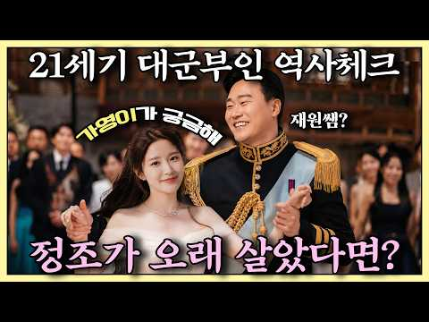
- 설명 앞부분: 문효세자, 정조, 왕권 강화까지… 드라마 속 설정들을 실제 역사와 비교해 봤습니다. 21세기 대군부인》, 어디까지 가능했고 어디부터 판타지인가!!!
- 같은 채널 평소 대비 ×1.3 (채널 최근 롱폼 중앙값 55,332회) · 평소 영상: 고려 왕들을 가짜로 몰아 죽였다? 이성계가 조작한 우창비왕설? (62,074회) / 놀란 감독이 바꾼 오디세이! 영화와 원작 가장 큰 차이? (48,589회)
- 대본 없음 (설명) — 음성인식이 끝나면 도입부·흐름이 들어감
- 댓글 345/345: 좋은 점 — 영상 4 · 감사·응원 0 · 더 알고 싶은 것 3 · 아쉬운 점 — 영상 1 · 반박·불만 — 의견 다름 8 · 정치·사회 29 · 경험 공유 12 · 구독·다음 기대 0
  - 좋은 점 — 영상 👍0 “영상 내용은 유익하게 잘 봤어요. 하지만 아무리 생각해도 이번 분석은 픽션에 논픽션을 들이댄 꼴이라는 느낌을 지울 수가 없네요. 픽션: 허구이며, 사실이 아닌 일을 사실처럼 꾸며낸 것. (21세기 대군 부인) 논픽션: 실제 사실과 정보를 바탕으로 기록하거나 전달한 내…”
  - 더 알고 싶은 것 👍0 “중국 제후국설정이 가능하면 일제 천황폐하 만세하고 공공기관에 욱일기달려있는 식민지 한국설정도 가능한가요? 드라마니까?”
  - 더 알고 싶은 것 👍0 “문득 궁금한데 조선시대를 어떤데는 중근세 또는 근세 / 어떤데는 전근대 라고 하는데 차이점(?)이 뭘까요??”
  - 반박·불만 — 의견 다름 👍255 “전체주의국가도 아니고 입헌군주제에서 왕이 어려서 섭정을 한다는게 말이 안돼고 이것부터 시작해서 설정이 너무 말도 안되는 것들이 많음”
  - 반박·불만 — 의견 다름 👍3 “작가 역사 공부를 전혀 안 한 사람입니다. 대한민국 즉 민주공화국 왜 왕이 있음.. 대한왕국 킹덤도 아닌데.. 그것 부터 문제임..”
  - 정치·사회 👍25 “일제강점기 , 서양열강의 간섭, 냉전시대도 이겨냈지만 청나라가 없어졌음에도 계속 사대하고 독립된 자주성도 가지지못하다니... 놀랍다.”
  - 정치·사회 👍6 “테무부인이 대군부인으로 오는 설정도 바꾸어야 되는거지. 그리고 드라마에서 그게 나와야 됐는데... 원래 중국 집안 중화인민공화국 시대 중국인 부모가 한국 넘어 오자마자 아이유 낳아서 대군부인 되겠다고 난리 치는 설정인 거지. 그래야 저따위 테무부인 같은 설정이 어느정…”
  - 경험 공유 👍5 “진짜 조선이 쭈욱 왔다면 제국 주의 안 하는 게 말이 안 된다고 저도 동의합니다. 근데 지금 우리나라기 선진국 반열에 오른 지금 제3세계가 우리나라를 좋아하는 이유가 식민지에서 여기까지 왔다는 것이 거든요. 우리가 제국주의했다면 지금의 대한민국을 좋아하는 나라가 이렇…”
  - 경험 공유 👍3 “저도 드라마 볼때마다 의문이 들더라구요 조선은 명을 받들어서 황제가 아니라 왕인건데 드라마에서 21세기까지 전하인걸로 나오길래 뭐지 싶었음 😅”

### 457. 임진왜란 7년 동안 이에야스가 조선에 병사를 안 보낸 믿기 힘든 이유

- https://www.youtube.com/watch?v=jQzSVXNM0_c · 역사 한 숟갈 · 구독자 7,870 · 조회수 27,363 (×3.5, 하루 306.1) · 좋아요 762 (2.8%) · 44.6분 · 2026-07-25 · 주제 묶음 3. 조선 · 형식 정보·해설 (그 밖) · 폴더 `W_jQzSVXNM0_c` (웹 승인)
- 썸네일: 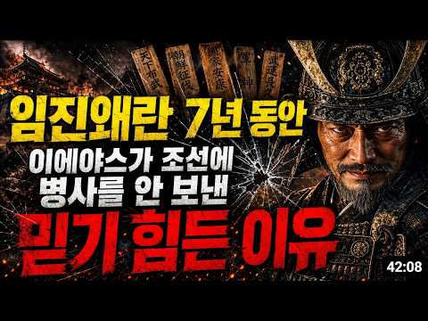
- 챕터: 0:00 우리가 아는 그 얼굴, 사실이 아닙니다 · 2:53 침략자인가, 태합인가 · 4:01 34년을 일본에서 산 선교사의 증언 · 5:01 감추고 싶어도 감출 수 없던 흔적 · 7:50 주군이 부하의 아내에게 보낸 편지 · 9:35 열 살 아이가 걸었던 130km · 11:36 다다미 세 장, 그리고 순금 · 13:10 1591년 봄, 갑작스러운 명령 · 17:19 쉰세 살, 마침내 찾아온 기쁨 · 20:20 1595년 여름, 산조가와라의 아침 · 23:57 태양의 아들이 그린 지도 · 30:59 침상에서 열 번 반복해 적은 한 문장
- 설명 앞부분: "이슬처럼 왔다가 이슬처럼 사라진다." 죽는 순간 도요토미 히데요시가 남긴 이 한 줄이, 조선 12만 명의 얼굴을 도려내고 세계를 삼키려던 남자의 진짜 얼굴을 드러냅니다. ⚔ 1598년 9월 18일, 후시미성 침소에서 예순두 살의 태합이 눈을 감습니다. 그의 시신은 곧바로 묻히지 않았습니다. 항아리에 소금을 부어 절인 채, 창고 안에서 반년간 방치됩니다. 세계를 삼키려던 남자의 마지막 자리는 창고였습니다. 🕯 여덟 살에 집을 뛰쳐나온 소년, 오른손 손가락이 여섯 개였던 사내, 흰쌀만 고집하다 심장이 멎은 태합, 그리고 15년을 기…
- 같은 채널 평소 대비 ×24.7 (채널 최근 롱폼 중앙값 1,108회) · 평소 영상: 김구 암살범의 최후, 47년 뒤 몽둥이 하나에 벌어진 충격적인 일 (1,108회) / 홍국영의 이름이 실록에서 사라진 믿기 힘든 이유 (1,132회)
- 대본 없음 (설명) — 음성인식이 끝나면 도입부·흐름이 들어감
- 댓글 87/87: 좋은 점 — 영상 0 · 감사·응원 0 · 더 알고 싶은 것 2 · 아쉬운 점 — 영상 2 · 반박·불만 — 의견 다름 1 · 정치·사회 3 · 경험 공유 0 · 구독·다음 기대 0
  - 더 알고 싶은 것 👍3 “혹시 태조 이성계, 송강 정철(50대때 머리와 수염이 백발, 기암 정홍명, 관해 임회, 곽재우, 김삿갓은 언젠가는 다뤄주실수 있나요?”
  - 아쉬운 점 — 영상 👍3 “이에야스 얘기는?? 낚시 제목 좀 그만 올리세요”
  - 아쉬운 점 — 영상 👍0 “광고가 너무 길어”
  - 반박·불만 — 의견 다름 👍8 “제대로 알고 만든 영상인가요? 히데요시는 천황이 아닙니다. 그리고 별명은 시로 아닌가요? 다른 사람꺼 대충 베껴오면 이런 엉터리가 나옵니다. 공부를 하고 영상을 만드세요”
  - 정치·사회 👍0 “정부는 뭐하냐? 코ㆍ귀무덤 ᆢ조국으로 귀환시켜라 북관대첩비가. 보다 윈혼을 달래라 이게 진짜인듯 ᆢ백성을 위한 정치 세계에 알려라”
  - 정치·사회 👍0 “펌글 1925년 한참 대륙을 석권하던 시절 왜는 동시에 일본열도에 나라를 세우고 있었다. 이때 대규모로 대륙 동부지역 사람들이 유구제국을 그 훨씬 이전 시대에 제압한 것은 일본열도로 들어가기 위함이었고 일본열도 자체가 유구국의 영역에 속하는 땅이었기에 왜제국은 유구국…”

### 458. "한국인들 건드리면 큰일 난다!" 지금 미국 난리 난 이순신 열풍.. 찾아볼수록 더 놀란 미국인들

- https://www.youtube.com/watch?v=o7LyCfzJXlM · 해외감동오픈 · 구독자 36,900 · 조회수 127,788 (×3.5, 하루 4,937.6) · 좋아요 3,151 (2.5%) · 41분 · 2026-09-27 · 주제 묶음 3. 조선 · 형식 애니메이션·지도 · 폴더 `W_o7LyCfzJXlM` (웹 승인)
- 썸네일: 
- 챕터: 0:00 지금 미국에서 난리 난 이순신, "한국인들 건드리면 … · 3:15 "한국은 졌다, 중국이 구해 줬다?" 미국 반응에 쳐… · 5:29 을지문덕 살수대첩, 수나라 30만 5천 명 중 2,7… · 11:23 안시성 전투, 당 태종이 깊이 후회한 단 하나의 성 · 16:58 강감찬 귀주대첩, 갑옷 버리고 달아난 거란 총대장 · 18:29 고려 몽골 전쟁, 세상을 삼킨 몽골이 30년을 매달린… · 23:33 이순신 한산도·명량·노량, 13척으로 130척을 막은… · 30:08 아덴만 여명 작전, 미 해병대 출신이 본 영상과 "머… · 35:02 2019 일본 수출 규제, 불화수소로 반격한 한국 · 39:10 한국인들 건드리면 큰일 난다, 이 나라는 끝을 본다
- 설명 앞부분: "한국 건드리면 큰일 난다" 미국인들이 한국사 기록을 보고 놀란 이유 한국 기록 말고, 쳐들어온 쪽 나라들의 역사책을 먼저 펼쳐 봤습니다 요즘 미국에서 이름이 부쩍 알려지고 있는 한국 사람이 있습니다. 이순신 장군입니다. 그런데 한국 역사를 더 찾아본 사람들은, 이순신만 그런 게 아니었다는 걸 알게 됩니다. 그런데 그 이야기 밑에는 이런 글도 달립니다. "한국은 졌다. 중국이 와서 구해 준 거다." "한국 사람들은 기분 좋으려고 역사를 고쳐 쓴다." 그래서 이번 영상에서는 한국 기록만 앞세우지 않았습니다. 이 나라를 건드렸던 쪽 …
- 같은 채널 평소 대비 ×1.7 (채널 최근 롱폼 중앙값 74,730회) · 평소 영상: 한국 문화에 미친 미국인들! 미국에서 인기 있는 한국식 생활 8가지 ㅣ"세상에, 미국이 … (74,730회) / 와..한국 와서 이것까지 산다고?" 외국인들 캐리어를 가득 채운 뜻밖의 한국 물건들! (77,763회)
- 대본 없음 (설명) — 음성인식이 끝나면 도입부·흐름이 들어감
- 댓글 84/83: 좋은 점 — 영상 0 · 감사·응원 8 · 더 알고 싶은 것 0 · 아쉬운 점 — 영상 0 · 반박·불만 — 의견 다름 2 · 정치·사회 8 · 경험 공유 1 · 구독·다음 기대 0
  - 감사·응원 👍17 “응원합니다 ❤ 몽골은 형제의 나라여 ❤❤❤”
  - 감사·응원 👍7 “감사합니다”
  - 반박·불만 — 의견 다름 👍10 “알고보면 우리에겐 역사적 기록이 남아있지 않습니다 유일한 역사서인 삼국사기는 조선이 건국하며 정도전 일당이 5차례나 고쳐쓴 역사서 이니까요 수나라 군사가 평양까지 왔다는 것도 사실이 아닙니다 삼국사기에서 말하는 살수는 청천강이 아닌 당시 살수로 불리던 요동의 주남하 …”
  - 반박·불만 — 의견 다름 👍3 “웃기는 우리 조상의 영역 우리의 고려 고구려 백제 신라는 한반도 만주 연해주는 물론 대륙 대부분 이었다 단군조선 이전의 영역은 헤아리기 힘들 정도의 영역이었고 고구려 고려의 주무대 수도 지역은 지금의 북경 지역이고 수당 거란 과의 전쟁은 대부분 태행산맥 서북쪽에서 일…”
  - 정치·사회 👍17 “정조대왕의 개혁정신 세종대왕의 애민정신 이순신장군의 전투력 이재명 글로벌대통령 = 세계지도자 이재명 입니다”
  - 정치·사회 👍2 “대한민국 은 하늘이 도움받고 있는.신의 나라 잘못 견더리며. 큰일이 납니다. 기적의 나라 우리나라 탐 내는 나라가 넘많아요. 근데 분명 명심 해야 합니다🎉🎉🎉”
  - 경험 공유 👍2 “나의 생각이지만 옛날 사람들이 침략 전쟁에는 지략적이라 잘 대처했다고 생각은 하지만. 한편으론 침략만 당했지 침략을 해본적 없다고 한 건 싸움이 싫어한 것보다는 국내의 내정이 워낙에 험난했다 생각합니다. 하지만 일본이 전쟁의 참패에 내정이 심각했다고 봅니다. 그 기세…”

### 459. 🎬인조는 정말 무능한 왕?ㅣ영화 [남한산성] 실화 체크!

- https://www.youtube.com/watch?v=3kblP24f4YI · 청년재단 · 구독자 47,200 · 조회수 160,384 (×3.4, 하루 922.1) · 좋아요 4,507 (2.8%) · 44.4분 · 2026-05-02 · 주제 묶음 1. 역사 일반·이야기 · 형식 정보·해설 (그 밖) · 폴더 `W_3kblP24f4YI` (웹 승인)
- 썸네일: 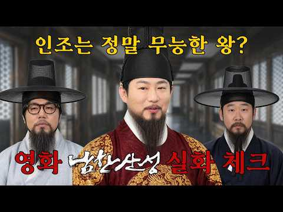
- 설명 앞부분: 인조는 정말 무능한 왕이었을까? 삼전도의 굴욕 뒤에 숨겨진 진짜 선택의 이유 청나라에 끌려간 소현세자, 그가 보고 배운 것은 조선을 바꿀 기회였을까 사극 속 이야기와 실제 역사 사이, 과연 어디까지가 진실? 사극진단 10회 [남한산성] ※ 본 영상과 무관한 내용 혹은 혐오·차별을 조장하는 댓글, 출연자 및 제3자에 대한 욕설·조롱·비난 등은 예고 없이 삭제될 수 있습니다.
- 같은 채널 평소 대비 ×6.5 (채널 최근 롱폼 중앙값 24,842회) · 평소 영상: 🦑냉동 해물 믹스 200% 활용법! 불맛 나는 해물 볶음 우동🍜∣ 요리도리 자취요리 EP… (26,377회) / 🤤사각 말캉한 무에 양념 쏙! 밥 2공기 순삭하는 참치 무조림🍚🍲∣ 요리도리 자취요리 E… (23,307회)
- 대본 없음 (설명) — 음성인식이 끝나면 도입부·흐름이 들어감
- 댓글 233/234: 좋은 점 — 영상 4 · 감사·응원 2 · 더 알고 싶은 것 7 · 아쉬운 점 — 영상 3 · 반박·불만 — 의견 다름 3 · 정치·사회 10 · 경험 공유 9 · 구독·다음 기대 1
  - 좋은 점 — 영상 👍3 “어떤 개그프로보다 더 잼나요 유익함은 물론이구요 재원쌤 짱 좋아 주말엔 남천동 케비넷 보고 또 보고”
  - 좋은 점 — 영상 👍0 “남한산성이 레전드 탑티어죠”
  - 감사·응원 👍2 “이 시간만 기다리게 되네요. 세분 화이팅”
  - 감사·응원 👍2 “재원 쌤 응원 합니다”
  - 더 알고 싶은 것 👍14 “계속 잘보고 있는데 건의 드릴게 있어요. 이제껏 분석하신 영화는 제가 잘 아는 영화라 아무 불편없이 봤는데 오늘 영화는 안본거라 그런지 내용을 몰라 집중이 떨어지네요. 혹시 다음에는 어떤 영화일지 예고 해주시면 어떨까요? 미리 보고 오면 더 재미있게 볼거 같아요.^^”
  - 더 알고 싶은 것 👍8 “제가 정말정말 좋아하는 사극 영화 자산어보, 언젠가 부탁드립니다. 🙇🏻‍♂️”
  - 아쉬운 점 — 영상 👍1 “근왕병들이 패전하기도 했지만 그래도 전라도군의 광교산 전투, 평안도군의 김화 전투에서 대승을 거두기도 했고, 특히 광교산 전투에선 누르하치의 사위이자 당시 청 조정의 중추였던 양굴리까지 전사시켰는데, 이러한 승전들은 언급이 안 되고 지나가서 아쉽습니다. 게다가 남한산…”
  - 아쉬운 점 — 영상 👍1 “다 좋은데 오디오가 아쉬워요 ㅠㅠ”
  - 반박·불만 — 의견 다름 👍0 “창궐의 주인공은 소현세자가 아니라 소현세자와 함께 볼모로 끌려간 봉림대군 효종입니다. 말도안된다 하시기전에 제대로 내용파악하시는게 좋을듯 합니다. 아무리 망작이어도 영화를 제대로 봤으면 소현세자가 형수님이라부르고 형님의 죽음에 의문을 품는 내용이 있는데 그걸 착각하는…”
  - 반박·불만 — 의견 다름 👍0 “아니 창궐이라는 영화가 말도안되고 얼탱이가없는영화면 거없니가 유튜브같은데나와서 영화감독들 까고 힘들게만든영화 까고 그러고 지껄이는건 말이되는건가 ???”
  - 정치·사회 👍17 “인조는 지가 반정을 하고 반정 이유로 든걸 다하고 자존심은 개쌔서 인정도 안하니까 내로남불에 무능 + 외란을 불러오고 사람 관리도 못하는거보면 윤석열을 바라보는 느낌아닐까”
  - 정치·사회 👍2 “오늘도 너무 즐거웠습니다. 너무 정치적이고 사정도 다르지만 결국 정치는 좌우 날개가 있어야한다 생각해요. 그러니 하루 빨리 국힘 없애고 새로운 제대로 된 보수가 재건 되었으면 좋겠습니다.”
  - 경험 공유 👍14 “계속 잘보고 있는데 건의 드릴게 있어요. 이제껏 분석하신 영화는 제가 잘 아는 영화라 아무 불편없이 봤는데 오늘 영화는 안본거라 그런지 내용을 몰라 집중이 떨어지네요. 혹시 다음에는 어떤 영화일지 예고 해주시면 어떨까요? 미리 보고 오면 더 재미있게 볼거 같아요.^^”
  - 경험 공유 👍8 “내가 가장 높게 평가하는 사극 영화임”

### 460. [미국반응]“굴욕적인 패배를 보여줬을 뿐인데.. 이것이 진짜 역사를 대하는 품격! 미국 영화계가 한국의 K사극 영화를 보고 큰 충격에 빠진 이유!”

- https://www.youtube.com/watch?v=7AsY1jh4zsE · 한류클라쓰TV · 구독자 44,600 · 조회수 151,758 (×3.4, 하루 7,506.3) · 좋아요 1,723 (1.1%) · 12.5분 · 2026-10-03 · 주제 묶음 1. 역사 일반·이야기 · 형식 사연·드라마 · 폴더 `W_7AsY1jh4zsE` (웹 승인)
- 썸네일: 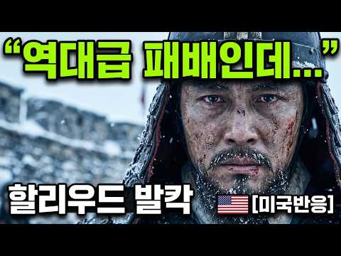
- 설명 앞부분: [미국반응]“굴욕적인 패배를 보여줬을 뿐인데.. 이것이 진짜 역사를 대하는 품격! 미국 영화계가 한국의 K사극 영화를 보고 큰 충격에 빠진 이유!”
- 같은 채널 평소 대비 ×10.4 (채널 최근 롱폼 중앙값 14,652회) · 평소 영상: [영국반응]“이게 진짜 서사다 지루한 할리우드는 끝났다! 할리우드는 절대 흉내 못 내는 … (14,892회) / [프랑스반응]“이순신은 인간이 아니다!”“그 북소리에 심장이 멈추는 줄 알았다! 프랑스인… (14,413회)
- 대본 없음 (설명) — 음성인식이 끝나면 도입부·흐름이 들어감
- 댓글 209/214: 좋은 점 — 영상 3 · 감사·응원 5 · 더 알고 싶은 것 1 · 아쉬운 점 — 영상 1 · 반박·불만 — 의견 다름 3 · 정치·사회 14 · 경험 공유 5 · 구독·다음 기대 0
  - 좋은 점 — 영상 👍3 “좋은 정보 감사합니다 😊😊”
  - 좋은 점 — 영상 👍1 “개인적으로 남한산성은 더 흥했어야 한다고 생각합니다. 사실 개봉당시에 저 역시도 굳이 뻔한 패배의 역사를 다룬 장르가 와닿지 않았지만 다시 돌아간다면 꼭 극장에서 봐야겠다는 생각을 할만큼 완성도가 높은 영화라고 다시 생각하고 있습니다”
  - 감사·응원 👍4 “이 영화 전 김훈이란 명문을 보유한 것에 감사드립니다. 좋은 작품으로 늘 가슴에 불을 새겨주셔서 감사합니다 작가님.”
  - 감사·응원 👍4 “다양한 콘텐츠 응원합니다 😊😊”
  - 더 알고 싶은 것 👍1 “역사성찰 할려면 고려시대 여진족 정벌도 한번 다뤄주시면 갈라수전투와 오연총의 무능도”
  - 아쉬운 점 — 영상 👍1 “개인적으로 남한산성은 더 흥했어야 한다고 생각합니다. 사실 개봉당시에 저 역시도 굳이 뻔한 패배의 역사를 다룬 장르가 와닿지 않았지만 다시 돌아간다면 꼭 극장에서 봐야겠다는 생각을 할만큼 완성도가 높은 영화라고 다시 생각하고 있습니다”
  - 반박·불만 — 의견 다름 👍17 “뭉칠땐 스님들도 승병이되어 같이 싸우셨습니다~~~같이 온국민이 싸우는...그날이~ 아...아..아닙니다~”
  - 반박·불만 — 의견 다름 👍5 “요즘 보면 희안하게 역시 말도안되는 if만든 영화가 용기있는 영화다 하는데 남한산성이 진짜 용기있는 감독이 만든 정말 앞으로 나아갈수 있는 영화다 역사가 영화보다 더 영화같고 역사가 만들어진 교훈보다 더 진실된 교훈이다 라는걸 모르나”
  - 정치·사회 👍10 “영화관에서 보는데 침묵과 숨소리 그런것들이 많은 미장셴스러운 영화이고 감독의 의도도 너무 뻔해 보이긴 했지만 현 국제정세 생각하면 한번쯤 곱씹어 봐야할 영화이긴 했음 강대국 사이에 낀 우리나라가 끝까지 살아남으려면 어찌해야하나 보여주는 교훈같은 영화”
  - 정치·사회 👍9 “아! 제발 지금 대통령을 포함해서, 이 굴곡지고 한편 품의를 지킨 역사의 나라를 더 이상 수렁으로 빠뜨리지 말아달라.”
  - 경험 공유 👍12 “인트로 딱! 내가 바라던 바인데~ 짧게 바뀌었네~ ㅋㅋㅋㅋㅋㅋㅋㅋ”
  - 경험 공유 👍3 “내가 손꼽는 명작중의 하나.”

### 461. 미국 시장을 뒤흔든 조선 장군 이순신… 그런데 그가 몰던 거북선은 왜 한 척도 남지 않았을까

- https://www.youtube.com/watch?v=5694G9i-0jA · 찐경제 · 구독자 27,700 · 조회수 94,003 (×3.4, 하루 3,754.0) · 좋아요 1,730 (1.8%) · 30.3분 · 2026-09-28 · 주제 묶음 3. 조선 · 형식 애니메이션·지도 · 폴더 `W_5694G9i-0jA` (웹 승인)
- 썸네일: 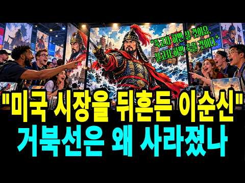
- 설명 앞부분: 안녕하세요, 여러분. 오늘은 사백년 전 조선 남해에서 살았던 한 사람이, 지금 미국 시카고 만화 진열대 위에 슈퍼맨과 나란히 서 있는 놀라운 이야기를 준비했습니다. 그런데 정작 그가 몰던 거북선은 우리 땅에 단 한 척도 남지 않았습니다. 이순신은 세계로 나가고, 그의 배는 우리 발밑에서 사라졌다. 이 뒤틀린 두 미스터리를 함께 파헤쳐 봅니다. 복잡한 경제 지표와 뉴스를 객관적으로 비교 분석하여 정보 전달의 가치를 높였으며, 영상에 사용된 모든 시나리오 대본은 [찐경제]가 직접 자료를 수집하고. AI의 도움을 받아 집필하였습니다. …
- 같은 채널 평소 대비 ×5.3 (채널 최근 롱폼 중앙값 17,664회) · 평소 영상: '아프리카가 열광하는 한국 복지' 세네갈 청년들 줄 서는 한국 공장 – "합격하면 양 잡… (17,982회) / 세계 4위 1조 달러 수출국 '초읽기' 외신도 입을 다물지 못한 대한민국 60여년 수출 … (17,346회)
- 대본 없음 (설명) — 음성인식이 끝나면 도입부·흐름이 들어감
- 댓글 67/67: 좋은 점 — 영상 0 · 감사·응원 3 · 더 알고 싶은 것 1 · 아쉬운 점 — 영상 1 · 반박·불만 — 의견 다름 0 · 정치·사회 8 · 경험 공유 1 · 구독·다음 기대 0
  - 감사·응원 👍7 “진짜 현실 🤦 거북선 실물이 있다 현재 대한 민국 한사람 이 진짜 거북선 모형을 만들어 놓고 있습니다 어느날 꿈 속에서 이순신 장군 이 저한테 거북선 머리 모든것을 보여주고 짜내 가사라진거북선모씀많이만들면 모든 사람들이 좋아 👌 할것세🎉🎉🎉🎉🎉 감사합니다 🍇 2027…”
  - 감사·응원 👍2 “진짜 거북선 도면 이순신 가치설계한사람 두분께서 진짜 엄청난 거북선 시초에도면을 포기하고 현실 속에 서 진짜 거북선 일단포기는시간때문에포기했습니다 전쟁이 바로앞 에서 시작된 것을알고 가장 빠른 거북선 을재작했습니다 마야의 이순신 장군 이 전사하지아났습면 이순신 장군 …”
  - 아쉬운 점 — 영상 👍2 “ㅡㅡㅡ철공소 기계음. 요즘도 돌리나?”
  - 정치·사회 👍2 “조선 400년진짜거북선 지금 우리가보는거북선 약 간다르다 진짜 거북선 은 내부 인테리어 다르고 거북선 머리 도위치도 거북선 지붕 도 약 간다른것이만습니다🎉🎉🎉 진짜 현실 모형을 보면외국인들바이어들이보면 깜짝 놀랄 정도로 보고 👀 400조선거북선을만들어놓은사람들을 뛰어…”
  - 정치·사회 👍1 “우리 옛 배, 판옥선, 거북선, 맹선, 조운선에는 조선노를 썼다. 영상 노 틀림.× 이 3D 영상을 잘 표현했지만, 젓는 노는 서양 노로 표현했기에, 고증이 틀렸어요. 어려서부터 나는 여수 조선소 근처에서 자라 나무배 만들기를 많이 보았는데, 60~70년대까지 작은 …”
  - 경험 공유 👍0 “근데 참 이상하다?? 이순신이 든 저 장검!~ 일본도지 우리 한국검이 아니잖아. 칼자루 모양 봐도 틀림없네!! 왜 왜군을 물리친 장군이 그 왜검을 들고 있지?? 노획품인가? 광화문 네거리 서 있는 이순신 동상도 왜검 들고 사무라이 포즈로 서 있더라!~ 그 동상 만든게…”

### 462. [7화] 공시생, 광해가 되다 : 전라도 Ⅱ

- https://www.youtube.com/watch?v=QIVNP9Th_xk · 왓이프(만약에) 채널 · 구독자 9,980 · 조회수 32,628 (×3.3, 하루 934.5) · 좋아요 321 (1.0%) · 6.9분 · 2026-09-18 · 주제 묶음 기타 · 형식 정보·해설 (그 밖) · 폴더 `W_QIVNP9Th_xk` (웹 승인)
- 썸네일: 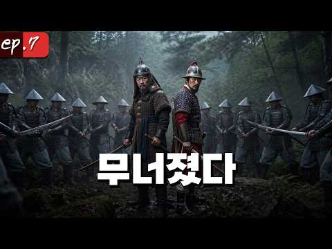
- 설명 앞부분: 전라도로 가는 길목, 이치와 웅치. 우키타 히데이에가 이끄는 대군이 이치와 웅치 앞에 집결했고 조선이 방비하기에는 이미 늦었다. 이치가 함락되었고 웅치가 이어서 넘어갔다. 호남의 중심지 전주성이 버려지게 되고 쉽게만 보이던 이 전쟁의 향방이 안갯 속으로 가려지게 된다.
- 같은 채널 평소 대비 ×1.0 (채널 최근 롱폼 중앙값 32,952회) · 평소 영상: [10화] 공시생, 광해가 되다 : 공주 그리고 조령 Ⅱ (35,526회) / [8화] 공시생, 광해가 되다 : 전라도 Ⅲ (30,378회)
- 대본 없음 (설명) — 음성인식이 끝나면 도입부·흐름이 들어감
- 댓글 28/28: 좋은 점 — 영상 1 · 감사·응원 1 · 더 알고 싶은 것 1 · 아쉬운 점 — 영상 0 · 반박·불만 — 의견 다름 0 · 정치·사회 0 · 경험 공유 1 · 구독·다음 기대 0
  - 좋은 점 — 영상 👍2 “오..이해하기 쉽게 지도에 피로 표현한거 너무 좋네요..ㅎㅎ..거기에 무기도 디테일하게 잘표현한거 같아요..(이름이 생각나지 않지만) 조선판 수류탄...비슷한 무기가 있었다고 역사다큐에서 본적 있었다는..ㅎㅎ”
  - 감사·응원 👍3 “지져스... 나비효과 지나치게 심하네요. 다음편 어떻게 이겨내시고 화이팅입니다.”
  - 더 알고 싶은 것 👍1 “담편 언제 올라오나요?”
  - 경험 공유 👍2 “내가 이 영상을 얼마나 기다렸는데 기다린 보람이 있네요”

### 463. 잠들기 전 한국사🌙『 조선왕조실록 : 연산군의 비밀 』벌거벗은 한국사 _ 책읽어주는여자 _ 베스트셀러 오디오북 📖

- https://www.youtube.com/watch?v=bDb2YIZhBPw · 모모의 북살롱 · 구독자 39,200 · 조회수 127,462 (×3.2, 하루 3,657.1) · 좋아요 431 (0.3%) · 61.5분 · 2026-09-18 · 주제 묶음 3. 조선 · 형식 수면·낭독 (잠잘 때 듣는) · 폴더 `W_bDb2YIZhBPw` (웹 승인)
- 썸네일: 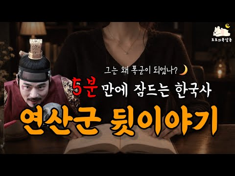
- 설명 앞부분: 연산군은 왜 폭군이 되었을까? 조선의 왕 가운데 가장 강렬한 이름으로 남은 연산군. 그는 처음부터 폭군이었을까요? 오늘 소개해드릴 역사 이야기는 『벌거벗은 한국사 인물편 : 연산군 📖』 입니다. 인물편 속 연산군이 왕위에 오른 뒤 겪게 되는 사건들을 따라가 봅니다. 어머니 폐비 윤씨의 죽음을 알게 된 연산군, 그리고 무오사화와 갑자사화, 장녹수와의 관계, 점점 심해지는 폭정과 결국 중종반정으로 왕위에서 쫓겨나기까지의 이야기를 살펴봅니다. 한 사람의 성격만으로 설명하기에는 복잡했던 연산군의 삶. 왕이 된 연산군에게 어떤 사건들이 있…
- 같은 채널 평소 대비 ×6.4 (채널 최근 롱폼 중앙값 19,988회) · 평소 영상: 잠들기 전 한국사🌙『벌거벗은 고려편 : 태조 왕건의 비밀』왕건은 왜 29명과 결혼했을까?… (33,847회) / 🌙 잠들기 전『조선왕조실록 : 재미있는 로맨스 이야기 _ 사도세자와 숙종편 📖 』빗소리보… (37,594회)
- 대본 없음 (설명) — 음성인식이 끝나면 도입부·흐름이 들어감
- 댓글 6/6: 좋은 점 — 영상 0 · 감사·응원 0 · 더 알고 싶은 것 0 · 아쉬운 점 — 영상 0 · 반박·불만 — 의견 다름 0 · 정치·사회 0 · 경험 공유 0 · 구독·다음 기대 0

### 464. 임진왜란 때, 포로로 끌려간 조선인 10만 명은 어떻게 되었을까?

- https://www.youtube.com/watch?v=Mmv7xy1M_uM · 세놀토 SENOLTO · 구독자 48,900 · 조회수 158,374 (×3.2, 하루 8,850.4) · 좋아요 648 (0.4%) · 33.9분 · 2026-10-05 · 주제 묶음 3. 조선 · 형식 정보·해설 (그 밖) · 폴더 `W_Mmv7xy1M_uM` (웹 승인)
- 썸네일: 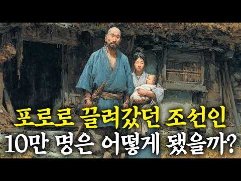
- 설명 앞부분: 임진왜란 당시 일본으로 끌려간 10만 명의 조선인들은 과연 어떤 삶을 살았을까요? 그들이 남긴 역사의 흔적을 따라가 보겠습니다. 🎬──── [ AI ] This content was created with the assistance of AI tools.
- 같은 채널 평소 대비 ×15.8 (채널 최근 롱폼 중앙값 9,995회) · 평소 영상: 급증하는 일본 빈 집, 도쿄 중심까지 번 진 일본 빈 집 900만 채 시대, 왜 일까? (9,995회) / 일본이 조선을 장악하게 만든 조선의 결정적 실수 (8,300회)
- 대본 없음 (설명) — 음성인식이 끝나면 도입부·흐름이 들어감
- 댓글 340/339: 좋은 점 — 영상 1 · 감사·응원 4 · 더 알고 싶은 것 5 · 아쉬운 점 — 영상 0 · 반박·불만 — 의견 다름 11 · 정치·사회 29 · 경험 공유 15 · 구독·다음 기대 0
  - 좋은 점 — 영상 👍1 “유익하네요 감사 ^^”
  - 감사·응원 👍1 “유익하네요 감사 ^^”
  - 감사·응원 👍1 “세놀토님덕분에 알려지지 않고 잊혀져가는 그당시 사람들의 이야기를 알수있게 되고 그로인해 관심을 가지고 들여다볼수 있는 계기를 만들어주시는것 같읍니다 저는 개인적으로 화풍을 곁들인 일러스트의 영상과 나레이션 음악 모두 마음에 듭니다 이것을 만드신 세놀토님의 노고에 감사…”
  - 더 알고 싶은 것 👍0 “세놀토님 대마도편과 임진왜란포편의 각ost도 직접 만드신것 같은데요 쇼트로 각ost를 올려주시면 ost편집본으로 남겨질수 있어 좋을것 같아요”
  - 반박·불만 — 의견 다름 👍0 “일제 시대를 배경으로 하는 드라마를 보면 일본순사가 백주대낮에 사람을 총으로 쏴 죽이는 장면이 많이 나오던데 대표적인 왜곡입니다. 일본경찰은 그정도로 무자비 하게 식민지 정책을 펼치지 않았습니다. 그리고 많은 조선사람들이 더 많은 돈을 벌려고 일본본토로 넘어 갔습니다…”
  - 반박·불만 — 의견 다름 👍0 “천박한 쌍놈 한국 베트남족들은 말도 안돼는 개소리 지어내지 말고 한국섬으로 돌아가”
  - 정치·사회 👍3 “개인적인 소견이긴 하지만 영화 최종병기 활을 보고 느꼈던 건데 청나라 군대에 포로로 끌려갔다가 필사적으로 탈출해서 조선 땅에 들어가려 하니 국경을 경비하는 관료들이 청나라 정부의 압력으로 입국을 막으며 오히려 청나라 군인들보다 자국의 백성들을 홀대하는 장면을 보고 자…”
  - 정치·사회 👍1 “일본에 끌려간 조선인 포로들 중에 일본 최고권력에 가장 높이 올라갔던 사람은 오타아 줄리아로 알려졌던 김다아 줄리아지요. 2023년에 발견된 줄리아가 친남동생에게 보낸 친필편지에 의하면 1580년생 한양출신이고 아버지는 조선의 최고위 무관이었는데 편지내용상 당시 오위…”
  - 경험 공유 👍0 “영상 보기 앞서 내가 알기론 전쟁후 사명대사는 1605년 교토에서 도쿠가와 이에야스와 담판을 지어 강화를 맺고 조선인 포로 3천여 명을 데리고 함께 귀국하는 성과를 이끌어 냄”

### 465. 한일부부∣ 갑자기 한국 역사를 배우겠다는 일본인 아내… 이유를 듣고 놀랐습니다

- https://www.youtube.com/watch?v=0kHYAVTIdno · 유츄 Yuchu TV · 구독자 30,100 · 조회수 96,807 (×3.2, 하루 559.5) · 좋아요 2,662 (2.8%) · 9.5분 · 2026-05-03 · 주제 묶음 1. 역사 일반·이야기 · 형식 정보·해설 (그 밖) · 폴더 `W_0kHYAVTIdno` (웹 승인)
- 썸네일: 
- 설명 앞부분: 안녕하세요, 유츄TV입니다~!! 한국에 거주한지 어느덧 3년이 지났네요~! 앞으로의 미래를 생각하면 한국의 역사를 알아야 할 것 같아서.. 공부를 시작하게 되었습니다 여러가지 방법이 많지만 교과서가 제일 좋을 방법일 것 같아 선택한 방법입니다ㅋㅋ 지금도 공부하고 있는데 의미를 모르는 단어가 정말 많아서 공부한 속도는 다소 느린편입니다 ㅠㅠㅠ 그래도 따뜻한 마음으로 응원해주시면 좋겠습니당~! 여러분 좋은 주말을 보내십시오~! ▬▬▬▬▬BGM▬▬▬▬▬▬▬▬▬▬▬▬▬▬▬▬▬▬▬▬▬▬▬▬ 🎵Music provided by 브금대통령 🎵T…
- 같은 채널 평소 대비 ×2.9 (채널 최근 롱폼 중앙값 33,741회) · 평소 영상: 한국 시누이와 일본 아내 조합이 의외로 잘 맞는 이유 (33,741회) / 한일부부∣일본인 아내가 처음으로 한국 삶에 절망했습니다 (32,888회)
- 대본 없음 (설명) — 음성인식이 끝나면 도입부·흐름이 들어감
- 댓글 451/451: 좋은 점 — 영상 4 · 감사·응원 20 · 더 알고 싶은 것 5 · 아쉬운 점 — 영상 6 · 반박·불만 — 의견 다름 9 · 정치·사회 38 · 경험 공유 15 · 구독·다음 기대 3
  - 좋은 점 — 영상 👍2 “교과서만 보면 안돼요. 이씨조선이전은 도움이 안될겁니다.”
  - 좋은 점 — 영상 👍0 “역사공부보다 일제강점기 박물관같은곳 가서 가이드신청하시면 더 와닿을수도 있어요”
  - 감사·응원 👍21 “유츄! 한 마디로 멋있다. 요새 엄청 한일부부 유튜브가 많은데 정말 이런 생각을 갖고 있는 사람은 오로지 유츄 뿐이다. 온갖 미사여구를 다 동원해서 칭찬을 해 줘도 전혀 아깝지가 않은 사람이 유츄다.항상 응원한데이.”
  - 감사·응원 👍20 “일본며느리 한국으로 시집와주셔서 감사합니다 고맙습니다 수고많으십니다 항상 응원합니다 좋은방송 감사합니다 수고많으십니다 항상 응원합니다”
  - 더 알고 싶은 것 👍1 “다른건 몰라도 그당시 조선한반도 인구가 제일 많이 늘어났는것과 625때 늘어 났는 인구를 소멸 했는것 까지 알려주시고. 조선왕족 품위유지비를 일본왕다음으로 많이 받았는걸 알려주시고.. 그리고 나는 조선의 국모다라는 있지도 않은 역사 왜곡적인 드라마 대사라는걸 알려주세…”
  - 더 알고 싶은 것 👍1 “나는 임진왜란 당시 의병장 출신의 후손이며 일제감정기 독립운동 혹은 독립투사의 후손이다 대대로 웃어른 분들께서는 큰일에 망설임없이 한목숨 바쳤으며 후손인 나도! 의당 맞는행동을 한다! 유튜버 주인분님 꼭 사실대로 알려주시고 일깨워주세요 한국여행와서 독립기념관 가서 고…”
  - 아쉬운 점 — 영상 👍5 “남편 분이 너무 편견에 갇혀있는 것 같은데 조선은 진짜 한심하고 형편 없는 나라였어요. 유교 탈레반들의 국가, 지금으로 치면 진짜 이슬람 극단주의 세력 같은 진짜 골 때리는 또라이들의 나라였습니다. 지독하게 폐쇄적이고 국민들의 삶이야 피폐해지든 말든 사회변화의 가능성…”
  - 아쉬운 점 — 영상 👍3 “한일의 역사는 역사를 통해서 조상님들을 욕하는 것이 아니라, 잘못된 역사는 반복되서는 안된다는 공부를 하자는 의미 입니다”
  - 반박·불만 — 의견 다름 👍3 “절대로 한국에서 주장하는 내용만 보지 마세요 같은사건이라도 일본에서 주장하는 내용을 동시에 보세요...한국내용이 다 맞느거 아닙니다...피해국이라도 다 맞는게 아니랍니다...저는 오리지날 한국인입니다”
  - 반박·불만 — 의견 다름 👍2 “일본 : 30년 + 한국 : 4년 = 34살??? 말도 안되네요. 20대 초중반으로 보이는데 34살 이라니 놀랍습니다!! 信じられない !!”
  - 정치·사회 👍10 “81세의 노인입니다. 저희 세대는 일본을 무조건 싫어했지요, 박정희 대통령이 경제를 살리려고 했는데 전혀 국가에 돈이 없어 일본에서 보상을 받고 얹혀서 차관을 했었습니다. 이 때에 한일 협정을 맺었다고 학생들이 극렬하게 데모를 했었죠, 극렬하게 데모했던 대학생들이 나…”
  - 정치·사회 👍5 “한국 근대사는 워낙에 좌파 역사 학자들이 많이 편찬한 게 많으니... 잘 알아보시고 구매하세요. 잘못된 역사가 반영된 게 의외로 많아요. 바로잡아야 할 정도임. 한국에서 오래 오래 행복하시길~”
  - 경험 공유 👍30 “대단하신분이네요 내가 살곳의 역사를 알면좋죠 항상 사람을 발전을 해야됨 잘밨습니다!”
  - 경험 공유 👍10 “대단합니다.. 정말 생각 못 했었읍니다. 그대들 내자식또래인데, ...쿵~ 가슴을 쳤읍니다. 성숙해 진다는것은 나이먹는것과 전혀 상관 없다는 것을 다시 배웁니다. 감동 했읍니다”
  - 구독·다음 기대 👍8 “1905년까지면... 일본이 침략할려고 할때 아닌가요?? 아무튼... 대단하십니다..구독하고 갑니다”
  - 구독·다음 기대 👍0 “미스터션샤인 정주행 리뷰 달립시다~”

### 466. 만주에서 잊혀진 216만명 한국인들의 마지막 이야기

- https://www.youtube.com/watch?v=A5p5XCMhzP4 · 역사여행 · 구독자 27,700 · 조회수 88,889 (×3.2, 하루 1,416.6) · 좋아요 1,545 (1.7%) · 37.7분 · 2026-08-21 · 주제 묶음 기타 · 형식 정보·해설 (그 밖) · 폴더 `W_A5p5XCMhzP4` (웹 승인)
- 썸네일: 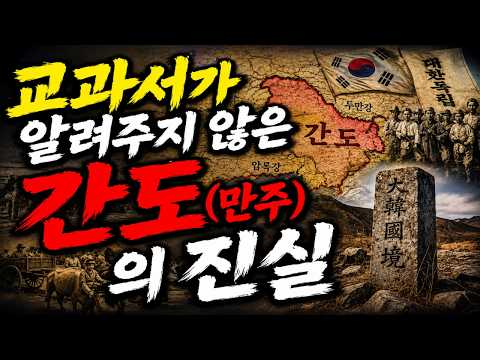
- 설명 앞부분: 216만 명. 한때 만주 땅을 채웠던 우리 사람들의 숫자입니다. 그런데 지금, 그들이 살던 마을터에는 왜 아무 흔적도 남지 않았을까요? 두만강을 건넌 첫 번째 이주민부터, 학교를 세우고 총을 들었던 사람들. 봉오동과 청산리의 승리, 그리고 그 대가로 찾아온 간도참변의 27일. 같은 편끼리 총구를 겨눈 자유시의 강가, 극장 청소부로 생을 마감한 한 장군의 마지막까지. 교과서 한 줄로 지나쳤던 그 시대 속으로, 지금 함께 걸어 들어가 봅니다. 이 이야기가 오래 기억에 남으셨다면, 지금 이 순간을 다른 사람에게도 건네주세요. 당신의 한…
- 같은 채널 평소 대비 ×22.8 (채널 최근 롱폼 중앙값 3,903회) · 평소 영상: 조선 왕비들은 왜 새벽부터 밤까지 쉬지못했을까? (3,903회) / 삼천궁녀는 없었다교과서가 차마 쓰지 못한백제 멸망의 진짜 풀스토리 (3,895회)
- 대본 없음 (설명) — 음성인식이 끝나면 도입부·흐름이 들어감
- 댓글 174/174: 좋은 점 — 영상 4 · 감사·응원 6 · 더 알고 싶은 것 2 · 아쉬운 점 — 영상 2 · 반박·불만 — 의견 다름 5 · 정치·사회 22 · 경험 공유 8 · 구독·다음 기대 0
  - 좋은 점 — 영상 👍1 “우리땅을 청나라와 일본이 협약을 했다면 지금이라도 우리정부도 그협약은 무효이고 우리땅임을 주장해야한다 내가 중학교때 역사선생님이 만주 간도 지역은 우리땅이니 여러분과 후손들이 반듯이 되찾아야한다는 말씀이 지금도 눈에 선하고 뭉클합니다 역사적 사실에 입각해 팩트로 전해…”
  - 좋은 점 — 영상 👍0 “37:42 저는 여기 저기 여행을 가더라도 일본은 딱 한번 갔는데 그것도 잠시 몇시간요 선생님 감사합니다 고맙습니다 잘 배우고 갑니다 그냥 우리 선조들에게 잔인했던 일본이 싫어요”
  - 감사·응원 👍6 “좋은 방송 고맙습니다❤”
  - 감사·응원 👍6 “감사 합니다”
  - 더 알고 싶은 것 👍1 “우리땅을 청나라와 일본이 협약을 했다면 지금이라도 우리정부도 그협약은 무효이고 우리땅임을 주장해야한다 내가 중학교때 역사선생님이 만주 간도 지역은 우리땅이니 여러분과 후손들이 반듯이 되찾아야한다는 말씀이 지금도 눈에 선하고 뭉클합니다 역사적 사실에 입각해 팩트로 전해…”
  - 아쉬운 점 — 영상 👍1 “주제는 좋은데...영상이 너무 길어요....ㅠ”
  - 아쉬운 점 — 영상 👍0 “아 지루해.”
  - 반박·불만 — 의견 다름 👍15 “만주무관학교를 설립한 사람은 이석영 이시영입니다. 이회영아닙니다, 이히영손자 이종찬놈이 이덕일과 각색해서 이석영대신 이회영으로 바꿔놓았습니다.”
  - 반박·불만 — 의견 다름 👍11 “저는 바로 북간도 땅에서 3세로 살아가고 있습니다. 우리의 선조들이 이 땅에 뿌리를 내린 이후, 우리는 지금까지 이곳을 지키며 살아왔습니다. 그리고 지난 75년 동안 우리의 언어와 문화, 전통과 정체성을 이어가기 위해 노력해 왔습니다. 우리의 정체성을 가장 잘 보여주…”
  - 정치·사회 👍7 “등소평은 조선족의 우상이래요. 소련처럼 우리민족을 강제로 우즈베키스탄, 카자흐스탄 등지로 강제로 이송하지않고 살게해줬다고요”
  - 정치·사회 👍6 “만주는 원래 고조선, 발해의 땅이었다. 고려때 윤관 장군이 두만강 이북 600리 지역의 여진지역으로 영역을 확장한 뒤, 최전선기지로서 공험진을 설치했다. 윤관 장군은 선춘령 고개에 "고려지경" 비석을 세워두었는데, 조선의 세종대왕이 4군 6진을 개척하면서 공험진은 역…”
  - 경험 공유 👍7 “언젠가는 찾아야 할 땽과 우리 사람들이라고 생각합니다. 탄허스님이 만주고토도 찾게 될 것이라고 했으니 무조건 믿어볼랍니다. 그 때 제가 살아 있을지......”
  - 경험 공유 👍6 “조선시대때도 우리땅 이었음. 일제때 중국에 철도권 따내느라 일본이 만주를 중국에 넘김. 100년 안에 세계 재판소에서 재판하면 이겼겠지만 우리가 그 100년 사이에 편안치 못한 식민지, 6.25 전쟁 겪고 최 빈국 상태에서 그런걸 챙길 여력,여유가 없었음. 그렇게도 …”

### 467. 엄세번 – 금으로 깔린 침상, 27명의 절세미인… 이 사치의 끝은 왜 단두대였나?

- https://www.youtube.com/watch?v=OeDMukPCb-s · 중국황제비극 · 구독자 17,900 · 조회수 56,969 (×3.2, 하루 338.4) · 좋아요 787 (1.4%) · 91.7분 · 2026-05-07 · 주제 묶음 6. 동양사 (중국·일본·몽골) · 형식 정보·해설 (그 밖) · 폴더 `W_OeDMukPCb-s` (웹 승인)
- 썸네일: 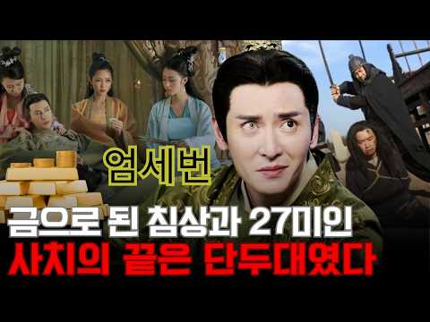
- 설명 앞부분: ""내가 곧 법이고, 내가 곧 황제다!"" 명나라 역사상 가장 탐욕스럽고 오만했던 괴물, 엄세번. 황금 그물이 깔린 바닥 위에서 미녀를 '가래침 뱉는 통(미인우)'으로 쓰고, 황제보다 더 많은 재산을 쌓으며 천하를 조롱했던 희대의 간신. 천재적인 두뇌로 아버지를 조종하고 제국을 삼켰던 그가, 어떻게 자신의 오만함 때문에 비참한 최후를 맞이하게 되었을까요? 화려했던 동루의 쾌락과 차가운 단두대의 이슬로 끝난 핏빛 몰락의 대서사시를 공개합니다.
- 같은 채널 평소 대비 ×3.2 (채널 최근 롱폼 중앙값 17,599회) · 평소 영상: 해진 – 명나라 최고의 머리를 ‘칼도 없이’ 죽인 방법: 눈더미 생매장의 실체 (17,599회) / 쉬셴춘 – 위충현의 ‘피의 오른팔’, 권력이 무너지자 왜 가장 잔혹하게 처형됐나? (17,683회)
- 대본 없음 (설명) — 음성인식이 끝나면 도입부·흐름이 들어감
- 댓글 54/54: 좋은 점 — 영상 1 · 감사·응원 1 · 더 알고 싶은 것 0 · 아쉬운 점 — 영상 1 · 반박·불만 — 의견 다름 0 · 정치·사회 3 · 경험 공유 1 · 구독·다음 기대 0
  - 감사·응원 👍4 “수고많으세요. 영상과 더불어 감사히 잘 들을게요~🍀🌸👍”
  - 정치·사회 👍11 “이재명확하죠 누가 문제인지”
  - 정치·사회 👍2 “헛똑똑 변택! 나라가 있어야 나도 있고 회사가 있어야 나도 있는거다!”
  - 경험 공유 👍2 “헛똑똑 변택! 나라가 있어야 나도 있고 회사가 있어야 나도 있는거다!”

### 468. "중국 독점이 깨졌습니다" 미국이 11조 들고 울산 고려아연 앞에 무릎 꿇은 진짜 이유

- https://www.youtube.com/watch?v=hAbwSDdS4ug · 머리가 좋아지는 지박사 · 구독자 34,100 · 조회수 105,989 (×3.1, 하루 590.8) · 좋아요 1,579 (1.5%) · 20.8분 · 2026-04-26 · 주제 묶음 2. 한국 고대·삼국·고려 · 형식 인터뷰·강연·대담 · 폴더 `W_hAbwSDdS4ug` (웹 승인)
- 썸네일: 
- 챕터: 0:00 11조가 울산에 떨어진 날 · 0:34 희토류는 사실 흔합니다, 그런데 왜 90%가 중국일까요 · 3:36 F-35 한 대 420kg, 시진핑 전화 한 통으로 … · 6:33 미국이 찾은 유일한 답, 울산의 50년 · 10:41 불과 몇 달 차이, 우리가 모르는 사이 벌어졌던 일 · 13:33 미국이 외국 기업 본사 지분을 산 사상 첫 사례 · 17:14 록히드마틴·알타리소스·도시광산 — 다음 라운드는 이미… · 19:39 자원 없는 나라의 기술이 자원 많은 나라의 무기를 이…
- 설명 앞부분: 미국이 11조 원을 들고 울산의 한 회사를 직접 찾아왔습니다. 핵심광물 정책 역사상 처음으로 미국이 외국 기업 본사 지분을 직접 보유한 사건, 그 50년의 답을 함께 추적해 보았습니다. 이 영상에서 다루는 내용 희토류·핵심광물 정제 90%를 중국이 쥐게 된 진짜 이유 ("쌀은 있는데 밥솥이 없다") F-35 1대당 희토류 420kg, 미 해군 무기 91%가 중국 통제 광물에 묶인 충격적 실태 1973년 중화학공업화 선언부터 2000년 TSL 세계 최초 상용화까지, 울산 고려아연 50년의 누적 헤마타이트 99% 회수율, 안티모니 9…
- 같은 채널 평소 대비 ×60.6 (채널 최근 롱폼 중앙값 1,750회) · 평소 영상: "롯데는 한국 기업인 거지?"신격호의 롯데는 한국 기업일까 일본 기업일까 (1,863회) / "독일 선택한 캐나다의 자살골"캐나다가 독일 택한 게 치명적인 실수였던 충격적인 이유 (1,636회)
- 대본 없음 (설명) — 음성인식이 끝나면 도입부·흐름이 들어감
- 댓글 42/42: 좋은 점 — 영상 0 · 감사·응원 3 · 더 알고 싶은 것 0 · 아쉬운 점 — 영상 1 · 반박·불만 — 의견 다름 0 · 정치·사회 5 · 경험 공유 1 · 구독·다음 기대 0
  - 감사·응원 👍20 “자랑스러운 우리나라 기술 그리고 위대한 지도자 고박정희 대통령이 그립습니다 ㆍ 고맙습니다 ㆍ”
  - 감사·응원 👍2 “위대한 박정희 화이팅❤”
  - 아쉬운 점 — 영상 👍11 “서설이 너무 길다. 곧장 본론으로 들어가라. 한국생산 휘토류는 몆종류 에 지나지 안는다.”
  - 정치·사회 👍20 “자랑스러운 우리나라 기술 그리고 위대한 지도자 고박정희 대통령이 그립습니다 ㆍ 고맙습니다 ㆍ”
  - 정치·사회 👍14 “박정희 대통령은 우리민족 반만년 역사 최고의 인물이네”

### 469. 명나라 사신이 조선을 비웃으며 낸 세 가지 난제, 말똥 치우던 열 살 종놈이 단번에 끝냈습니다 ∣야담∣ 민담∣설화∣ 옛날이야기∣ 오디오북∣ 수면동화

- https://www.youtube.com/watch?v=3lJHf1jBGoU · 야담마을 · 구독자 25,100 · 조회수 77,248 (×3.1, 하루 462.9) · 좋아요 2,803 (3.6%) · 87.5분 · 2026-05-09 · 주제 묶음 9. 야사·야담·옛날이야기 · 형식 수면·낭독 (잠잘 때 듣는) · 폴더 `W_3lJHf1jBGoU` (웹 승인)
- 썸네일: 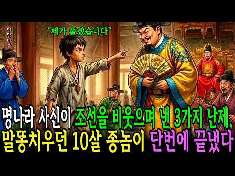
- 설명 앞부분: 열 살 노비 천복이 명나라 사신의 세 가지 난제를 개미 한 마리로 풀어내어 조선의 땅을 지켜낸 이야기입니다. 진주 고을 김 판서 댁에서 말똥을 치우던 종놈 아이가 천리마의 죽음을 예언하고, 삼 년 가뭄의 원인을 밝혀 물길을 열고, 왕의 목숨을 노리는 독살 음모를 간파하여 한양 궁궐까지 오르게 됩니다. 명나라 사신이 조선을 업신여기며 불가능한 난제를 내걸자, 조선의 석학들이 전원 실패한 자리에서 천복이 나서 매듭을 풀고, 함정에 빠져 감옥에 갇혔다가 마지막 구슬 꿰기를 개미와 꿀로 해결하여 사신을 무릎 꿇립니다. 숨겨진 어머니의 가…
- 같은 채널 평소 대비 ×5.5 (채널 최근 롱폼 중앙값 14,013회) · 평소 영상: 계모 빚 때문에 언니 대신 말더듬이 절름발이 신랑에게 강제 시집간 둘째 딸, 첫날밤 밝혀… (14,013회) / 만삭 며느리를 벼랑에서 밀어버린 시어머니 " 그 자리는 하나여야 하느니라” ∣ 야담∣ 민… (15,298회)
- 대본 없음 (설명) — 음성인식이 끝나면 도입부·흐름이 들어감
- 댓글 200/200: 좋은 점 — 영상 2 · 감사·응원 13 · 더 알고 싶은 것 1 · 아쉬운 점 — 영상 1 · 반박·불만 — 의견 다름 1 · 정치·사회 3 · 경험 공유 0 · 구독·다음 기대 0
  - 좋은 점 — 영상 👍2 “야담마을!글!그림!매우 유익!흥미롭게. 소중한 마음!으로 잘 일고 있습니다,건승!대박!기원드립니다.감사합니다.야담마을!홧팅홧팅!”
  - 좋은 점 — 영상 👍1 “천복이 정말 휼룡 합니다 대감들은 천복 종이 머리가 천재 라서 대감들은 그어린 종을 상대로 나쁘 짓을 합니다 옛날이나 현재 나 별슬아치들은 갑질을 많이 합니다! 야담 듣고 많이 배워 갑니다 구독 ❤좋아요”
  - 감사·응원 👍9 “너무. 깁피가 있는 전설. 감명. 깁게. 잘 보았읍니다. 감사. 합니다”
  - 감사·응원 👍5 “조은글 감사합니다 ❤❤❤❤❤”
  - 더 알고 싶은 것 👍1 “자신의 그림자를 어떻게 재나요?? 신기할세”
  - 아쉬운 점 — 영상 👍0 “광고시간이길다지루하다”
  - 반박·불만 — 의견 다름 👍0 “찻잎이지 차십이아닙니다 왜이리 나의글을 망치려 드는겁니까 ? 나레이션하는. 분 제데로 좀하시오”
  - 정치·사회 👍1 “윤가놈같은 자는 이나라에 살게두면 나라가 망하게 되어있다 망하는건 한순간이지”
  - 정치·사회 👍1 “어린아이기 못맞혔다고 사형이면 그많은 대신들은 모허는인간들인데 요 다사형아녀요 자리보전함다여 국힘보는것같네”

### 470. 이순신 장군님의 마지막은 일본군이 쏜 총알이 아니었다

- https://www.youtube.com/watch?v=HvUByjkM5r4 · 역사를읽다 · 구독자 15,800 · 조회수 48,522 (×3.1, 하루 271.3) · 좋아요 1,492 (3.1%) · 36.3분 · 2026-04-27 · 주제 묶음 3. 조선 · 형식 정보·해설 (그 밖) · 폴더 `W_HvUByjkM5r4` (웹 승인)
- 썸네일: 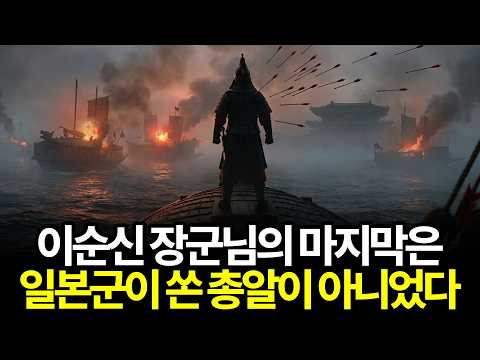
- 설명 앞부분: 이순신 장군의 진짜 사인은 일본군의 총알이 아니었습니다. 1598년 11월 노량 앞바다, 백전노장이 전장 한복판에서 갑옷을 벗은 이유. 전사 소식을 들은 선조의 첫 반응이 "밤이 깊었으니 내일 하라"였던 이유. 장례가 80일 미뤄지고, 충무 시호가 45년이나 걸린 이유. 그리고 이 구조적 침묵이 어떻게 30년 뒤 병자호란의 치욕으로 이어졌는지, 조선 왕조가 가장 유능한 수호자를 어떻게 대했는지 그 차가운 진실을 풀어드립니다. 여러분은 이순신의 마지막을 어떻게 해석하시겠습니까. 자료 조사: 본 영상의 모든 자료는 다양한 역사 문헌,…
- 같은 채널 평소 대비 ×4.7 (채널 최근 롱폼 중앙값 10,325회) · 평소 영상: 알렉산드리아 도서관은 카이사르가 불태운게 아니다 인류 지식을 지운 진짜 주범들 인류 지식… (10,325회) / 외계인 납치설은 거짓말이었다 스스로 멸망을 선택한 마야 문명 (11,478회)
- 대본 없음 (설명) — 음성인식이 끝나면 도입부·흐름이 들어감
- 댓글 303/304: 좋은 점 — 영상 3 · 감사·응원 8 · 더 알고 싶은 것 1 · 아쉬운 점 — 영상 3 · 반박·불만 — 의견 다름 5 · 정치·사회 31 · 경험 공유 11 · 구독·다음 기대 0
  - 좋은 점 — 영상 👍10 “좋은 영상제작에 무한한 감사를 드립니다 지금까지 이런 진실한 영상은 없었기때문입니다 역사는 진실만을 증명한다 듣고 보는내내 가슴이 너무 멍하고 너무 찡하는 아픔이 견딜수가 없을정도였습니다 과거나 현재나 다를바없는 현실적인 운명시스탬이 가슴을 후벼파고 듭니다 그러나 역…”
  - 좋은 점 — 영상 👍1 “조선이 망한 이유를 알려 주셔서 감사합니다”
  - 감사·응원 👍10 “좋은 영상제작에 무한한 감사를 드립니다 지금까지 이런 진실한 영상은 없었기때문입니다 역사는 진실만을 증명한다 듣고 보는내내 가슴이 너무 멍하고 너무 찡하는 아픔이 견딜수가 없을정도였습니다 과거나 현재나 다를바없는 현실적인 운명시스탬이 가슴을 후벼파고 듭니다 그러나 역…”
  - 감사·응원 👍7 “심도 있는 내용 잘 봤습니다. 감사합니다.”
  - 더 알고 싶은 것 👍0 “대충 짜집기.. 갑옷을 벗었다는 기록은 어디에 있는지? 난타 공연하나? 무슨 법고 치듯..”
  - 아쉬운 점 — 영상 👍1 “백의종군이 일반 병사? 쯧쯧쯧! 공부 좀 하고 영상 만들어라. 대충 AI가 말하는 내용과 영상으로 짜집기나.. 쯧쯧쯧”
  - 아쉬운 점 — 영상 👍0 “전쟁이 한창일 때도 이순신 장군을 삭탈관직하고 고문한 선조 임금인데 하물며, 전쟁이 끝나면 곧바로 죄를 뒤집어씌워 처형할 것인데, 그런 비참한 꼴을 당하기 전에 스스로 전투중에 목숨을 잃은 모습이 (1) 선조 임금에게 더 큰 민족적인 죄악을 지을 기회를 안주고 (2)…”
  - 반박·불만 — 의견 다름 👍3 “이순신 그는 더이상의 갈곳이 없었읍니다. 물러설수도 나아갈 곳도 없었읍니다. 그런 그에게 선택은 무엇이었을지요. 살아있어서도 안되고 맥없이 사라지는 것은 무장으로성 자존심이 허락하지 않았을 것이고 오직 한가지 부끄럽지 않게 깨끗하게 퇴장하는 명예로운 길은 적과 싸우다…”
  - 반박·불만 — 의견 다름 👍1 “웃기는 소리... 조선은 입헌민주민족국가가 아니고 왕의 나라다. 왕의 입장에서 이순신은 왕명을 거부하고 육지전투에 안나간 역적에 불과핟. 지금의 시각은 이순신 중심의 민족국가 관점임. 노량해전에서 이순신은 탈출했을 가능성이 높으며, 그의 시신을 제대로 확인했는지 의문…”
  - 정치·사회 👍15 “나랏님이 어찌 사사로운것에 치우치나 나라가 안망한게 다행.”
  - 정치·사회 👍15 “이성계 위화도 회군으로 고려가 망했는데, 그 조선이 군의 반란을 얼마나 두려워 하겠어요? 정권이 위기이면 유능한 장수는 가장 경계를 받을 수 밖에 없습니다. 권력의 속성이 그래요”
  - 경험 공유 👍74 “내가 이순신이였다면 왕조를 갈아 엎었다. 무능했던 조선.”
  - 경험 공유 👍15 “혹자는 선조가 나름 유능했다고 하지만 내가 볼 때는 쓰레기중 하나다.”

### 471. 《한국사》 마패 한 장 들고 떠난 암행어사의 고독한 여정 l 역사 인물 l 조선시대 l 야사

- https://www.youtube.com/watch?v=7S3HBJxmMqY · 한국사 이야기 · 구독자 24,200 · 조회수 73,331 (×3.0, 하루 411.5) · 좋아요 745 (1.0%) · 73.7분 · 2026-04-28 · 주제 묶음 3. 조선 · 형식 정보·해설 (그 밖) · 폴더 `W_7S3HBJxmMqY` (웹 승인)
- 썸네일: 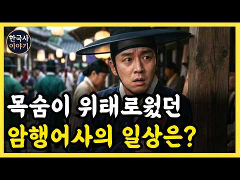
- 설명 앞부분: 조선시대, 마패 한 장으로 탐관오리에 맞섰던 암행어사의 진짜 하루는 어땠을까요? 화려한 어사출두 뒤에 숨겨진 고독하고 치열한 여정, 백성들의 억울함을 듣고 기록하며 조선의 민생을 살피던 그들의 발걸음을 따라가 봅니다.
- 같은 채널 평소 대비 ×5.4 (채널 최근 롱폼 중앙값 13,619회) · 평소 영상: 《한국사》 조선 왕들을 괴롭힌 정체는? 종기의 잔혹사 l 역사 l 조선시대 l 야사 (13,619회) / 《한국사》 조선 왕실 500년 간 왜 쌍둥이가 없었을까? l 조선시대 l 조선왕조실록 (13,661회)
- 대본 없음 (설명) — 음성인식이 끝나면 도입부·흐름이 들어감
- 댓글 18/18: 좋은 점 — 영상 1 · 감사·응원 0 · 더 알고 싶은 것 0 · 아쉬운 점 — 영상 0 · 반박·불만 — 의견 다름 1 · 정치·사회 1 · 경험 공유 0 · 구독·다음 기대 0
  - 좋은 점 — 영상 👍4 “유익한 역사이야기 강추합니다.”
  - 정치·사회 👍1 “하나님이 하늘에서. 암행어사로 변장하고. (((🌎🌏🌍))) 지구에오셔서…. 한국 정치인들. 민주당 행위들을. 감찰해서 … 민주당. 제대로 걸렸다…. 끝냈다 … 🐉🐲⚖️😎👁️😎⚖️🐲🐉”

