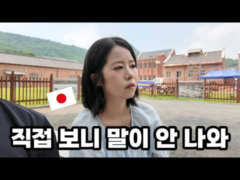
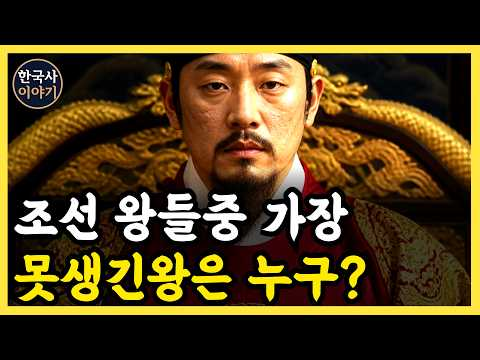

# 역사 — 성공 사례 분석: 사례별 자세히 #481–#491

`analysis.md` 의 9번 (같은 # 번호). 자동 생성 — `tools/success_analysis.py` v1.6 (2026-10-28 10:03 UTC). ※ 연구·교육용 — 투자 권유가 아님.

### 481. 잠들기 전 한국사🌙『 조선왕조실록 : 연산군의 비밀 』벌거벗은 한국사 _ 책읽어주는여자 _ 베스트셀러 오디오북 📖

- https://www.youtube.com/watch?v=bDb2YIZhBPw · 모모의 북살롱 · 구독자 39,500 · 조회수 137,149 (×3.5, 하루 3,433.2) · 좋아요 454 (0.3%) · 61.5분 · 2026-09-18 · 주제 묶음 3. 조선 · 형식 수면·낭독 (잠잘 때 듣는) · 폴더 `W_bDb2YIZhBPw` (웹 승인)
- 썸네일: 
- 설명 앞부분: 연산군은 왜 폭군이 되었을까? 조선의 왕 가운데 가장 강렬한 이름으로 남은 연산군. 그는 처음부터 폭군이었을까요? 오늘 소개해드릴 역사 이야기는 『벌거벗은 한국사 인물편 : 연산군 📖』 입니다. 인물편 속 연산군이 왕위에 오른 뒤 겪게 되는 사건들을 따라가 봅니다. 어머니 폐비 윤씨의 죽음을 알게 된 연산군, 그리고 무오사화와 갑자사화, 장녹수와의 관계, 점점 심해지는 폭정과 결국 중종반정으로 왕위에서 쫓겨나기까지의 이야기를 살펴봅니다. 한 사람의 성격만으로 설명하기에는 복잡했던 연산군의 삶. 왕이 된 연산군에게 어떤 사건들이 있…
- 같은 채널 평소 대비 ×3.8 (채널 최근 롱폼 중앙값 35,854회) · 평소 영상: 잠들기 전 이야기🌙『조선왕조실록 : 사도세자 죽음의 비밀』벌거벗은한국사_ 책읽어주는여자_… (35,854회) / 잠들기 전 한국사🌙『벌거벗은 고려편 : 태조 왕건의 비밀』왕건은 왜 29명과 결혼했을까?… (35,904회)
- 대본 없음 (설명) — 음성인식이 끝나면 도입부·흐름이 들어감
- 댓글 6/7: 좋은 점 — 영상 0 · 감사·응원 0 · 더 알고 싶은 것 0 · 아쉬운 점 — 영상 0 · 반박·불만 — 의견 다름 0 · 정치·사회 0 · 경험 공유 0 · 구독·다음 기대 0

### 482. [미국반응]“굴욕적인 패배를 보여줬을 뿐인데.. 이것이 진짜 역사를 대하는 품격! 미국 영화계가 한국의 K사극 영화를 보고 큰 충격에 빠진 이유!”

- https://www.youtube.com/watch?v=7AsY1jh4zsE · 한류클라쓰TV · 구독자 45,200 · 조회수 156,021 (×3.5, 하루 6,163.0) · 좋아요 1,756 (1.1%) · 12.5분 · 2026-10-03 · 주제 묶음 1. 역사 일반·이야기 · 형식 사연·드라마 · 폴더 `W_7AsY1jh4zsE` (웹 승인)
- 썸네일: 
- 설명 앞부분: [미국반응]“굴욕적인 패배를 보여줬을 뿐인데.. 이것이 진짜 역사를 대하는 품격! 미국 영화계가 한국의 K사극 영화를 보고 큰 충격에 빠진 이유!”
- 같은 채널 평소 대비 ×4.4 (채널 최근 롱폼 중앙값 35,357회) · 평소 영상: [중국,미국,남미통합반응]“한국이 이제는 너무 무섭다! 중국·미국·남미 동시 폭발하며 K… (35,357회) / [일본반응]"그동안 속았습니다!""외면하고 싶은데 눈을 못 떼겠다" 역대급 항일 스릴러 … (35,679회)
- 대본 없음 (설명) — 음성인식이 끝나면 도입부·흐름이 들어감
- 댓글 209/216: 좋은 점 — 영상 3 · 감사·응원 5 · 더 알고 싶은 것 1 · 아쉬운 점 — 영상 1 · 반박·불만 — 의견 다름 3 · 정치·사회 14 · 경험 공유 5 · 구독·다음 기대 0
  - 좋은 점 — 영상 👍3 “좋은 정보 감사합니다 😊😊”
  - 좋은 점 — 영상 👍1 “개인적으로 남한산성은 더 흥했어야 한다고 생각합니다. 사실 개봉당시에 저 역시도 굳이 뻔한 패배의 역사를 다룬 장르가 와닿지 않았지만 다시 돌아간다면 꼭 극장에서 봐야겠다는 생각을 할만큼 완성도가 높은 영화라고 다시 생각하고 있습니다”
  - 감사·응원 👍4 “이 영화 전 김훈이란 명문을 보유한 것에 감사드립니다. 좋은 작품으로 늘 가슴에 불을 새겨주셔서 감사합니다 작가님.”
  - 감사·응원 👍4 “다양한 콘텐츠 응원합니다 😊😊”
  - 더 알고 싶은 것 👍1 “역사성찰 할려면 고려시대 여진족 정벌도 한번 다뤄주시면 갈라수전투와 오연총의 무능도”
  - 아쉬운 점 — 영상 👍1 “개인적으로 남한산성은 더 흥했어야 한다고 생각합니다. 사실 개봉당시에 저 역시도 굳이 뻔한 패배의 역사를 다룬 장르가 와닿지 않았지만 다시 돌아간다면 꼭 극장에서 봐야겠다는 생각을 할만큼 완성도가 높은 영화라고 다시 생각하고 있습니다”
  - 반박·불만 — 의견 다름 👍17 “뭉칠땐 스님들도 승병이되어 같이 싸우셨습니다~~~같이 온국민이 싸우는...그날이~ 아...아..아닙니다~”
  - 반박·불만 — 의견 다름 👍5 “요즘 보면 희안하게 역시 말도안되는 if만든 영화가 용기있는 영화다 하는데 남한산성이 진짜 용기있는 감독이 만든 정말 앞으로 나아갈수 있는 영화다 역사가 영화보다 더 영화같고 역사가 만들어진 교훈보다 더 진실된 교훈이다 라는걸 모르나”
  - 정치·사회 👍10 “영화관에서 보는데 침묵과 숨소리 그런것들이 많은 미장셴스러운 영화이고 감독의 의도도 너무 뻔해 보이긴 했지만 현 국제정세 생각하면 한번쯤 곱씹어 봐야할 영화이긴 했음 강대국 사이에 낀 우리나라가 끝까지 살아남으려면 어찌해야하나 보여주는 교훈같은 영화”
  - 정치·사회 👍9 “아! 제발 지금 대통령을 포함해서, 이 굴곡지고 한편 품의를 지킨 역사의 나라를 더 이상 수렁으로 빠뜨리지 말아달라.”
  - 경험 공유 👍12 “인트로 딱! 내가 바라던 바인데~ 짧게 바뀌었네~ ㅋㅋㅋㅋㅋㅋㅋㅋ”
  - 경험 공유 👍3 “내가 손꼽는 명작중의 하나.”

### 483. 🎬인조는 정말 무능한 왕?ㅣ영화 [남한산성] 실화 체크!

- https://www.youtube.com/watch?v=3kblP24f4YI · 청년재단 · 구독자 47,300 · 조회수 162,672 (×3.4, 하루 908.6) · 좋아요 4,515 (2.8%) · 44.4분 · 2026-05-02 · 주제 묶음 1. 역사 일반·이야기 · 형식 정보·해설 (그 밖) · 폴더 `W_3kblP24f4YI` (웹 승인)
- 썸네일: 
- 설명 앞부분: 인조는 정말 무능한 왕이었을까? 삼전도의 굴욕 뒤에 숨겨진 진짜 선택의 이유 청나라에 끌려간 소현세자, 그가 보고 배운 것은 조선을 바꿀 기회였을까 사극 속 이야기와 실제 역사 사이, 과연 어디까지가 진실? 사극진단 10회 [남한산성] ※ 본 영상과 무관한 내용 혹은 혐오·차별을 조장하는 댓글, 출연자 및 제3자에 대한 욕설·조롱·비난 등은 예고 없이 삭제될 수 있습니다.
- 같은 채널 평소 대비 ×6.6 (채널 최근 롱폼 중앙값 24,607회) · 평소 영상: 🤤사각 말캉한 무에 양념 쏙! 밥 2공기 순삭하는 참치 무조림🍚🍲∣ 요리도리 자취요리 E… (24,607회) / 💡딱 하나만 산다면 무조건 '이것'?!🥣자취방 필수 조리도구 A to Z ∣ 요리도리 자… (26,305회)
- 대본 없음 (설명) — 음성인식이 끝나면 도입부·흐름이 들어감
- 댓글 233/234: 좋은 점 — 영상 4 · 감사·응원 2 · 더 알고 싶은 것 7 · 아쉬운 점 — 영상 3 · 반박·불만 — 의견 다름 3 · 정치·사회 10 · 경험 공유 9 · 구독·다음 기대 1
  - 좋은 점 — 영상 👍3 “어떤 개그프로보다 더 잼나요 유익함은 물론이구요 재원쌤 짱 좋아 주말엔 남천동 케비넷 보고 또 보고”
  - 좋은 점 — 영상 👍0 “남한산성이 레전드 탑티어죠”
  - 감사·응원 👍2 “이 시간만 기다리게 되네요. 세분 화이팅”
  - 감사·응원 👍2 “재원 쌤 응원 합니다”
  - 더 알고 싶은 것 👍14 “계속 잘보고 있는데 건의 드릴게 있어요. 이제껏 분석하신 영화는 제가 잘 아는 영화라 아무 불편없이 봤는데 오늘 영화는 안본거라 그런지 내용을 몰라 집중이 떨어지네요. 혹시 다음에는 어떤 영화일지 예고 해주시면 어떨까요? 미리 보고 오면 더 재미있게 볼거 같아요.^^”
  - 더 알고 싶은 것 👍8 “제가 정말정말 좋아하는 사극 영화 자산어보, 언젠가 부탁드립니다. 🙇🏻‍♂️”
  - 아쉬운 점 — 영상 👍1 “근왕병들이 패전하기도 했지만 그래도 전라도군의 광교산 전투, 평안도군의 김화 전투에서 대승을 거두기도 했고, 특히 광교산 전투에선 누르하치의 사위이자 당시 청 조정의 중추였던 양굴리까지 전사시켰는데, 이러한 승전들은 언급이 안 되고 지나가서 아쉽습니다. 게다가 남한산…”
  - 아쉬운 점 — 영상 👍1 “다 좋은데 오디오가 아쉬워요 ㅠㅠ”
  - 반박·불만 — 의견 다름 👍0 “창궐의 주인공은 소현세자가 아니라 소현세자와 함께 볼모로 끌려간 봉림대군 효종입니다. 말도안된다 하시기전에 제대로 내용파악하시는게 좋을듯 합니다. 아무리 망작이어도 영화를 제대로 봤으면 소현세자가 형수님이라부르고 형님의 죽음에 의문을 품는 내용이 있는데 그걸 착각하는…”
  - 반박·불만 — 의견 다름 👍0 “아니 창궐이라는 영화가 말도안되고 얼탱이가없는영화면 거없니가 유튜브같은데나와서 영화감독들 까고 힘들게만든영화 까고 그러고 지껄이는건 말이되는건가 ???”
  - 정치·사회 👍17 “인조는 지가 반정을 하고 반정 이유로 든걸 다하고 자존심은 개쌔서 인정도 안하니까 내로남불에 무능 + 외란을 불러오고 사람 관리도 못하는거보면 윤석열을 바라보는 느낌아닐까”
  - 정치·사회 👍2 “오늘도 너무 즐거웠습니다. 너무 정치적이고 사정도 다르지만 결국 정치는 좌우 날개가 있어야한다 생각해요. 그러니 하루 빨리 국힘 없애고 새로운 제대로 된 보수가 재건 되었으면 좋겠습니다.”
  - 경험 공유 👍14 “계속 잘보고 있는데 건의 드릴게 있어요. 이제껏 분석하신 영화는 제가 잘 아는 영화라 아무 불편없이 봤는데 오늘 영화는 안본거라 그런지 내용을 몰라 집중이 떨어지네요. 혹시 다음에는 어떤 영화일지 예고 해주시면 어떨까요? 미리 보고 오면 더 재미있게 볼거 같아요.^^”
  - 경험 공유 👍8 “내가 가장 높게 평가하는 사극 영화임”

### 484. 한산도함의 내부 — 이순신 한산도대첩의 이름을 단 한국 해군 첫 훈련함

- https://www.youtube.com/watch?v=iUhBRxh0Rxk · Nature's Tether · 구독자 13,400 · 조회수 44,869 (×3.4, 하루 311.7) · 좋아요 664 (1.5%) · 30.8분 · 2026-06-06 · 주제 묶음 3. 조선 · 형식 정보·해설 (그 밖) · 폴더 `W_iUhBRxh0Rxk` (웹 승인)
- 썸네일: 
- 설명 앞부분: ATH-81 한산도함의 내부 구조를 3D 모델로 완전히 해부합니다. 충무공 이순신의 한산도대첩을 기념하는 이름을 단, 대한민국 해군 역사상 첫 번째 전용 훈련함의 실제 내부를 처음으로 공개합니다. 1592년 7월 8일, 경상남도 통영 앞바다. 임진왜란 발발 3개월째. 한반도 전역이 일본군에 짓밟히던 그 시기, 단 하나 막혀 있던 길이 바다였습니다. 조선 수군통제사 이순신. 그가 통영 한산도 앞바다에서 일본의 와키자카 야스하루 함대를 기다리고 있었습니다. 학익진(鶴翼陣). 학이 날개를 펼친 듯한 진형으로 적을 감싸 안는 전법. 이순…
- 같은 채널 평소 대비 ×51.5 (채널 최근 롱폼 중앙값 872회) · 평소 영상: K239 천무의 내부 — 폴란드가 미국 HIMARS 대신 290대를 도입한 한국 다연장로켓 (876회) / 참수리 KUH-1P의 내부 — 대한민국 국조 '참수리'의 이름을 이어받은 경찰청 첫 국산… (867회)
- 대본 없음 (설명) — 음성인식이 끝나면 도입부·흐름이 들어감
- 댓글 24/24: 좋은 점 — 영상 0 · 감사·응원 0 · 더 알고 싶은 것 0 · 아쉬운 점 — 영상 0 · 반박·불만 — 의견 다름 0 · 정치·사회 0 · 경험 공유 0 · 구독·다음 기대 0

### 485. 일제강점기를 공부한 일본인 아내가 서대문형무소에 가면 생기는 일

- https://www.youtube.com/watch?v=wZGHP3F8nu8 · 유츄 Yuchu TV · 구독자 30,200 · 조회수 98,295 (×3.2, 하루 1,345.9) · 좋아요 4,360 (4.4%) · 12.9분 · 2026-08-16 · 주제 묶음 4. 한국 근현대사 · 형식 정보·해설 (그 밖) · 폴더 `W_wZGHP3F8nu8` (웹 승인)
- 썸네일: 
- 설명 앞부분: 안녕하세요 유츄TV입니다~! “서대문형무소역사관에 꼭 한번 가봤으면 좋겠다”고 추천해 주셔서 직접 다녀왔습니다. 책으로 공부했을 때와 실제 그 장소에서 보고 느끼는 것은 많이 달랐습니다. 당시 어떤 일이 있었는지, 그리고 한국사를 공부하고 있는 일본인의 입장에서는 어떻게 느껴졌는지 영상에 솔직하게 담아봤습니다. 이번 영상도 한일 양국의 역사를 이해하는 하나의 계기가 되었으면 좋겠습니다. 시청해 주셔서 감사합니다. ▬▬▬▬▬BGM▬▬▬▬▬▬▬▬▬▬▬▬▬▬▬▬▬▬▬▬▬▬▬ 🎵Music provided by 브금대통령 🎵Track : …
- 같은 채널 평소 대비 ×2.9 (채널 최근 롱폼 중앙값 33,630회) · 평소 영상: 한국 시누이와 일본 아내 조합이 의외로 잘 맞는 이유 (34,176회) / 한일부부∣일본인 아내가 처음으로 한국 삶에 절망했습니다 (33,083회)
- 대본 없음 (설명) — 음성인식이 끝나면 도입부·흐름이 들어감
- 댓글 742/747: 좋은 점 — 영상 5 · 감사·응원 72 · 더 알고 싶은 것 6 · 아쉬운 점 — 영상 5 · 반박·불만 — 의견 다름 19 · 정치·사회 54 · 경험 공유 57 · 구독·다음 기대 5
  - 좋은 점 — 영상 👍3 “서대문 형무소 내부 영상촬영이 불가하단 걸 첨 알았습니다. 궁금해서 제미나이에게 물어보니 충분히 그럴만한 이유가 있구나 하는 것도 덕분에 알게 되었네요. 하나 배우고 갑니다. 컨텐츠 내용도 좋았습니다. ^^ 참으로 따뜻한 커플이에요~!!”
  - 좋은 점 — 영상 👍1 “광복절을 맞이한 즈음에 좋은 영상이네요.”
  - 감사·응원 👍233 “그독자의 요구도 대단하지만, 그 요구에 응한 신부에게 대단하다고 응원의 박수를 보냅니다.”
  - 감사·응원 👍179 “아무리 한국으로 시집을 왔다고 해도 역사공부를 하고 해도 서대문형무소까진 가기 힘들었을텐데 대단합니다. 감사합니다❤❤”
  - 더 알고 싶은 것 👍3 “서대문 형무소 내부 영상촬영이 불가하단 걸 첨 알았습니다. 궁금해서 제미나이에게 물어보니 충분히 그럴만한 이유가 있구나 하는 것도 덕분에 알게 되었네요. 하나 배우고 갑니다. 컨텐츠 내용도 좋았습니다. ^^ 참으로 따뜻한 커플이에요~!!”
  - 더 알고 싶은 것 👍2 “731 부대 마루타 실험도 어릴적 다큐보고 충격이엇죠....이런건 일본에서 배우는지 궁금하네요”
  - 아쉬운 점 — 영상 👍1 “몇년전 가족들이랑 방문했는데.. 근처에 일본가족분들이 어두운 표정으로 관람하시더군요.. 그때 그분들 참 대단하다고 느꼈네요.! 와주셔서 감사하다고 인사를 못해서 아쉬웠어요!”
  - 아쉬운 점 — 영상 👍1 “좋은 의도로 영상을 찍으셨겠지만 한국어가 이래서 어려워요. 아 다르고 어가 다르다 보니 " 그렇게 원하셨던 " 이라는 문장 보다는 알려 주면 좋겠다 의견 주셨던 이라고 표현 했으면 어떠 했을까 하는 아쉬움이 느껴져 글 적습니다. 일본인으로서 마주 하기 힘든 부분인데 …”
  - 반박·불만 — 의견 다름 👍0 “아내분 용기에 박수를 보냅니다 아내분 같은 일본 분들이 많이 계시면 좋겠어요 진심어린 사과는 다른게 아닙니다 아내분의 이런 행보가 진심어린 사과라 생각합니다 감사합니다 사과해 주셔서”
  - 반박·불만 — 의견 다름 👍0 “정말 진정으로 역사 공부를 정확히 좀 하자. 선전선동으로 뇌를 썩히지 말고. 일제 강점기 ?,... 일본이 강제로...정말 강제로 ? 조선이라는 나라의 국권을 빼앗았다는 것인가 ? 역사를 공부하기는 한 것인가 ? 누군가 그렇다더라 하니까 그런 것인 줄 안 것 아닌가 …”
  - 정치·사회 👍5 “일본은 다른나라에 침략을 당한적이 단 한번도 없지만 침략은 수도 없이 했지요 자손들 한테 가르쳐야 합니다 침략하면 나라가 지진으로 벌 받는다고 더운데 고생하셨습니다”
  - 정치·사회 👍2 “소위 동족이라고 하면서 350만명이 죽어나갈때 해방구 외치고 군대 간 넘이 없이 자발적 인민군이 되어 낙동강으로 몰려가서 코너에 몰린 국군과 유엔군 그리고 학도병들에게 총질하고 폴포트정권처럼 인종청소를 하고 다닌 소위 좌파라는 6.25때 인간군상들에 대해서 알리시오.…”
  - 경험 공유 👍51 “이쁘고.착하시네요.내가한개아니고조상이한걸미안해하고.존경합니다”
  - 경험 공유 👍9 “50가까이 살아오면서, 30대까지는 끝까지 식민역사를 부정하고 그후손들에게까지 진실을 숨기는 행태와 말로 다할수없는..어찌 저들이 인간인가..하는 감정으로만 너희들은 죄값을 치뤄야 마땅하다는 분노로 차있었다면, 40대에 이르러 일본 극우정치의 역사를 알게되고 나서 지…”
  - 구독·다음 기대 👍17 “일본인들이 나오는 유튜브중에 오직 광복절에 맞는 내용. 쉽지 않았을텐데.. 고맙고 구독합니다”
  - 구독·다음 기대 👍6 “존경합니다 구독합니다❤”

### 486. 미국 시장을 뒤흔든 조선 장군 이순신… 그런데 그가 몰던 거북선은 왜 한 척도 남지 않았을까

- https://www.youtube.com/watch?v=5694G9i-0jA · 찐경제 · 구독자 29,000 · 조회수 94,093 (×3.2, 하루 3,122.4) · 좋아요 1,734 (1.8%) · 30.3분 · 2026-09-28 · 주제 묶음 3. 조선 · 형식 애니메이션·지도 · 폴더 `W_5694G9i-0jA` (웹 승인)
- 썸네일: 
- 설명 앞부분: 안녕하세요, 여러분. 오늘은 사백년 전 조선 남해에서 살았던 한 사람이, 지금 미국 시카고 만화 진열대 위에 슈퍼맨과 나란히 서 있는 놀라운 이야기를 준비했습니다. 그런데 정작 그가 몰던 거북선은 우리 땅에 단 한 척도 남지 않았습니다. 이순신은 세계로 나가고, 그의 배는 우리 발밑에서 사라졌다. 이 뒤틀린 두 미스터리를 함께 파헤쳐 봅니다. 복잡한 경제 지표와 뉴스를 객관적으로 비교 분석하여 정보 전달의 가치를 높였으며, 영상에 사용된 모든 시나리오 대본은 [찐경제]가 직접 자료를 수집하고. AI의 도움을 받아 집필하였습니다. …
- 같은 채널 평소 대비 ×4.8 (채널 최근 롱폼 중앙값 19,642회) · 평소 영상: “드럼은 이제 안 삽니다” 요즘 사람들이 다시 통돌이로 갈아타자 삼성·엘지가 움직인 진짜 (20,730회) / 미국·캐나다가 관세로 싸우는데, 도요타 13조 증발하고 일본 초비상 걸린 진짜 이유 (18,555회)
- 대본 없음 (설명) — 음성인식이 끝나면 도입부·흐름이 들어감
- 댓글 67/67: 좋은 점 — 영상 0 · 감사·응원 3 · 더 알고 싶은 것 1 · 아쉬운 점 — 영상 1 · 반박·불만 — 의견 다름 0 · 정치·사회 8 · 경험 공유 1 · 구독·다음 기대 0
  - 감사·응원 👍7 “진짜 현실 🤦 거북선 실물이 있다 현재 대한 민국 한사람 이 진짜 거북선 모형을 만들어 놓고 있습니다 어느날 꿈 속에서 이순신 장군 이 저한테 거북선 머리 모든것을 보여주고 짜내 가사라진거북선모씀많이만들면 모든 사람들이 좋아 👌 할것세🎉🎉🎉🎉🎉 감사합니다 🍇 2027…”
  - 감사·응원 👍2 “진짜 거북선 도면 이순신 가치설계한사람 두분께서 진짜 엄청난 거북선 시초에도면을 포기하고 현실 속에 서 진짜 거북선 일단포기는시간때문에포기했습니다 전쟁이 바로앞 에서 시작된 것을알고 가장 빠른 거북선 을재작했습니다 마야의 이순신 장군 이 전사하지아났습면 이순신 장군 …”
  - 아쉬운 점 — 영상 👍2 “ㅡㅡㅡ철공소 기계음. 요즘도 돌리나?”
  - 정치·사회 👍2 “조선 400년진짜거북선 지금 우리가보는거북선 약 간다르다 진짜 거북선 은 내부 인테리어 다르고 거북선 머리 도위치도 거북선 지붕 도 약 간다른것이만습니다🎉🎉🎉 진짜 현실 모형을 보면외국인들바이어들이보면 깜짝 놀랄 정도로 보고 👀 400조선거북선을만들어놓은사람들을 뛰어…”
  - 정치·사회 👍1 “우리 옛 배, 판옥선, 거북선, 맹선, 조운선에는 조선노를 썼다. 영상 노 틀림.× 이 3D 영상을 잘 표현했지만, 젓는 노는 서양 노로 표현했기에, 고증이 틀렸어요. 어려서부터 나는 여수 조선소 근처에서 자라 나무배 만들기를 많이 보았는데, 60~70년대까지 작은 …”
  - 경험 공유 👍0 “근데 참 이상하다?? 이순신이 든 저 장검!~ 일본도지 우리 한국검이 아니잖아. 칼자루 모양 봐도 틀림없네!! 왜 왜군을 물리친 장군이 그 왜검을 들고 있지?? 노획품인가? 광화문 네거리 서 있는 이순신 동상도 왜검 들고 사무라이 포즈로 서 있더라!~ 그 동상 만든게…”

### 487. 만주에서 잊혀진 216만명 한국인들의 마지막 이야기

- https://www.youtube.com/watch?v=A5p5XCMhzP4 · 역사여행 · 구독자 27,800 · 조회수 89,441 (×3.2, 하루 1,318.3) · 좋아요 1,552 (1.7%) · 37.7분 · 2026-08-21 · 주제 묶음 기타 · 형식 정보·해설 (그 밖) · 폴더 `W_A5p5XCMhzP4` (웹 승인)
- 썸네일: 
- 설명 앞부분: 216만 명. 한때 만주 땅을 채웠던 우리 사람들의 숫자입니다. 그런데 지금, 그들이 살던 마을터에는 왜 아무 흔적도 남지 않았을까요? 두만강을 건넌 첫 번째 이주민부터, 학교를 세우고 총을 들었던 사람들. 봉오동과 청산리의 승리, 그리고 그 대가로 찾아온 간도참변의 27일. 같은 편끼리 총구를 겨눈 자유시의 강가, 극장 청소부로 생을 마감한 한 장군의 마지막까지. 교과서 한 줄로 지나쳤던 그 시대 속으로, 지금 함께 걸어 들어가 봅니다. 이 이야기가 오래 기억에 남으셨다면, 지금 이 순간을 다른 사람에게도 건네주세요. 당신의 한…
- 같은 채널 평소 대비 ×17.3 (채널 최근 롱폼 중앙값 5,162회) · 평소 영상: 을지문덕은 왜 적진 30만 속으로 혼자 걸어 들어갔나 (5,648회) / 왜 황제들은 이 책을 금서로 지정하고 없애려고 했을까? (4,676회)
- 대본 없음 (설명) — 음성인식이 끝나면 도입부·흐름이 들어감
- 댓글 174/174: 좋은 점 — 영상 4 · 감사·응원 6 · 더 알고 싶은 것 2 · 아쉬운 점 — 영상 2 · 반박·불만 — 의견 다름 5 · 정치·사회 22 · 경험 공유 8 · 구독·다음 기대 0
  - 좋은 점 — 영상 👍1 “우리땅을 청나라와 일본이 협약을 했다면 지금이라도 우리정부도 그협약은 무효이고 우리땅임을 주장해야한다 내가 중학교때 역사선생님이 만주 간도 지역은 우리땅이니 여러분과 후손들이 반듯이 되찾아야한다는 말씀이 지금도 눈에 선하고 뭉클합니다 역사적 사실에 입각해 팩트로 전해…”
  - 좋은 점 — 영상 👍0 “37:42 저는 여기 저기 여행을 가더라도 일본은 딱 한번 갔는데 그것도 잠시 몇시간요 선생님 감사합니다 고맙습니다 잘 배우고 갑니다 그냥 우리 선조들에게 잔인했던 일본이 싫어요”
  - 감사·응원 👍6 “좋은 방송 고맙습니다❤”
  - 감사·응원 👍6 “감사 합니다”
  - 더 알고 싶은 것 👍1 “우리땅을 청나라와 일본이 협약을 했다면 지금이라도 우리정부도 그협약은 무효이고 우리땅임을 주장해야한다 내가 중학교때 역사선생님이 만주 간도 지역은 우리땅이니 여러분과 후손들이 반듯이 되찾아야한다는 말씀이 지금도 눈에 선하고 뭉클합니다 역사적 사실에 입각해 팩트로 전해…”
  - 아쉬운 점 — 영상 👍1 “주제는 좋은데...영상이 너무 길어요....ㅠ”
  - 아쉬운 점 — 영상 👍0 “아 지루해.”
  - 반박·불만 — 의견 다름 👍15 “만주무관학교를 설립한 사람은 이석영 이시영입니다. 이회영아닙니다, 이히영손자 이종찬놈이 이덕일과 각색해서 이석영대신 이회영으로 바꿔놓았습니다.”
  - 반박·불만 — 의견 다름 👍11 “저는 바로 북간도 땅에서 3세로 살아가고 있습니다. 우리의 선조들이 이 땅에 뿌리를 내린 이후, 우리는 지금까지 이곳을 지키며 살아왔습니다. 그리고 지난 75년 동안 우리의 언어와 문화, 전통과 정체성을 이어가기 위해 노력해 왔습니다. 우리의 정체성을 가장 잘 보여주…”
  - 정치·사회 👍7 “등소평은 조선족의 우상이래요. 소련처럼 우리민족을 강제로 우즈베키스탄, 카자흐스탄 등지로 강제로 이송하지않고 살게해줬다고요”
  - 정치·사회 👍6 “만주는 원래 고조선, 발해의 땅이었다. 고려때 윤관 장군이 두만강 이북 600리 지역의 여진지역으로 영역을 확장한 뒤, 최전선기지로서 공험진을 설치했다. 윤관 장군은 선춘령 고개에 "고려지경" 비석을 세워두었는데, 조선의 세종대왕이 4군 6진을 개척하면서 공험진은 역…”
  - 경험 공유 👍7 “언젠가는 찾아야 할 땽과 우리 사람들이라고 생각합니다. 탄허스님이 만주고토도 찾게 될 것이라고 했으니 무조건 믿어볼랍니다. 그 때 제가 살아 있을지......”
  - 경험 공유 👍6 “조선시대때도 우리땅 이었음. 일제때 중국에 철도권 따내느라 일본이 만주를 중국에 넘김. 100년 안에 세계 재판소에서 재판하면 이겼겠지만 우리가 그 100년 사이에 편안치 못한 식민지, 6.25 전쟁 겪고 최 빈국 상태에서 그런걸 챙길 여력,여유가 없었음. 그렇게도 …”

### 488. 임진왜란 때, 포로로 끌려간 조선인 10만 명은 어떻게 되었을까?

- https://www.youtube.com/watch?v=Mmv7xy1M_uM · 세놀토 SENOLTO · 구독자 49,500 · 조회수 158,784 (×3.2, 하루 6,907.0) · 좋아요 650 (0.4%) · 33.9분 · 2026-10-05 · 주제 묶음 3. 조선 · 형식 정보·해설 (그 밖) · 폴더 `W_Mmv7xy1M_uM` (웹 승인)
- 썸네일: 
- 설명 앞부분: 임진왜란 당시 일본으로 끌려간 10만 명의 조선인들은 과연 어떤 삶을 살았을까요? 그들이 남긴 역사의 흔적을 따라가 보겠습니다. 🎬──── [ AI ] This content was created with the assistance of AI tools.
- 같은 채널 평소 대비 ×12.7 (채널 최근 롱폼 중앙값 12,547회) · 평소 영상: 일본이 조선을 장악하게 만든 조선의 결정적 실수 (12,547회) / 급증하는 일본 빈 집, 도쿄 중심까지 번 진 일본 빈 집 900만 채 시대, 왜 일까? (10,351회)
- 대본 없음 (설명) — 음성인식이 끝나면 도입부·흐름이 들어감
- 댓글 340/339: 좋은 점 — 영상 1 · 감사·응원 4 · 더 알고 싶은 것 5 · 아쉬운 점 — 영상 0 · 반박·불만 — 의견 다름 11 · 정치·사회 29 · 경험 공유 15 · 구독·다음 기대 0
  - 좋은 점 — 영상 👍1 “유익하네요 감사 ^^”
  - 감사·응원 👍1 “유익하네요 감사 ^^”
  - 감사·응원 👍1 “세놀토님덕분에 알려지지 않고 잊혀져가는 그당시 사람들의 이야기를 알수있게 되고 그로인해 관심을 가지고 들여다볼수 있는 계기를 만들어주시는것 같읍니다 저는 개인적으로 화풍을 곁들인 일러스트의 영상과 나레이션 음악 모두 마음에 듭니다 이것을 만드신 세놀토님의 노고에 감사…”
  - 더 알고 싶은 것 👍0 “세놀토님 대마도편과 임진왜란포편의 각ost도 직접 만드신것 같은데요 쇼트로 각ost를 올려주시면 ost편집본으로 남겨질수 있어 좋을것 같아요”
  - 반박·불만 — 의견 다름 👍0 “일제 시대를 배경으로 하는 드라마를 보면 일본순사가 백주대낮에 사람을 총으로 쏴 죽이는 장면이 많이 나오던데 대표적인 왜곡입니다. 일본경찰은 그정도로 무자비 하게 식민지 정책을 펼치지 않았습니다. 그리고 많은 조선사람들이 더 많은 돈을 벌려고 일본본토로 넘어 갔습니다…”
  - 반박·불만 — 의견 다름 👍0 “천박한 쌍놈 한국 베트남족들은 말도 안돼는 개소리 지어내지 말고 한국섬으로 돌아가”
  - 정치·사회 👍3 “개인적인 소견이긴 하지만 영화 최종병기 활을 보고 느꼈던 건데 청나라 군대에 포로로 끌려갔다가 필사적으로 탈출해서 조선 땅에 들어가려 하니 국경을 경비하는 관료들이 청나라 정부의 압력으로 입국을 막으며 오히려 청나라 군인들보다 자국의 백성들을 홀대하는 장면을 보고 자…”
  - 정치·사회 👍1 “일본에 끌려간 조선인 포로들 중에 일본 최고권력에 가장 높이 올라갔던 사람은 오타아 줄리아로 알려졌던 김다아 줄리아지요. 2023년에 발견된 줄리아가 친남동생에게 보낸 친필편지에 의하면 1580년생 한양출신이고 아버지는 조선의 최고위 무관이었는데 편지내용상 당시 오위…”
  - 경험 공유 👍0 “영상 보기 앞서 내가 알기론 전쟁후 사명대사는 1605년 교토에서 도쿠가와 이에야스와 담판을 지어 강화를 맺고 조선인 포로 3천여 명을 데리고 함께 귀국하는 성과를 이끌어 냄”

### 489. 엄세번 – 금으로 깔린 침상, 27명의 절세미인… 이 사치의 끝은 왜 단두대였나?

- https://www.youtube.com/watch?v=OeDMukPCb-s · 중국황제비극 · 구독자 17,900 · 조회수 57,181 (×3.2, 하루 329.7) · 좋아요 788 (1.4%) · 91.7분 · 2026-05-07 · 주제 묶음 6. 동양사 (중국·일본·몽골) · 형식 정보·해설 (그 밖) · 폴더 `W_OeDMukPCb-s` (웹 승인)
- 썸네일: 
- 설명 앞부분: ""내가 곧 법이고, 내가 곧 황제다!"" 명나라 역사상 가장 탐욕스럽고 오만했던 괴물, 엄세번. 황금 그물이 깔린 바닥 위에서 미녀를 '가래침 뱉는 통(미인우)'으로 쓰고, 황제보다 더 많은 재산을 쌓으며 천하를 조롱했던 희대의 간신. 천재적인 두뇌로 아버지를 조종하고 제국을 삼켰던 그가, 어떻게 자신의 오만함 때문에 비참한 최후를 맞이하게 되었을까요? 화려했던 동루의 쾌락과 차가운 단두대의 이슬로 끝난 핏빛 몰락의 대서사시를 공개합니다.
- 같은 채널 평소 대비 ×3.2 (채널 최근 롱폼 중앙값 17,758회) · 평소 영상: 해진 – 명나라 최고의 머리를 ‘칼도 없이’ 죽인 방법: 눈더미 생매장의 실체 (17,758회) / 장헌충 – 정치가 아니라 쾌락을 위해 죽였다… 명말 최악의 사이코패스는 어떻게 만들어졌나? (17,698회)
- 대본 없음 (설명) — 음성인식이 끝나면 도입부·흐름이 들어감
- 댓글 54/54: 좋은 점 — 영상 1 · 감사·응원 1 · 더 알고 싶은 것 0 · 아쉬운 점 — 영상 1 · 반박·불만 — 의견 다름 0 · 정치·사회 3 · 경험 공유 1 · 구독·다음 기대 0
  - 감사·응원 👍4 “수고많으세요. 영상과 더불어 감사히 잘 들을게요~🍀🌸👍”
  - 정치·사회 👍11 “이재명확하죠 누가 문제인지”
  - 정치·사회 👍2 “헛똑똑 변택! 나라가 있어야 나도 있고 회사가 있어야 나도 있는거다!”
  - 경험 공유 👍2 “헛똑똑 변택! 나라가 있어야 나도 있고 회사가 있어야 나도 있는거다!”

### 490. [7화] 공시생, 광해가 되다 : 전라도 Ⅱ

- https://www.youtube.com/watch?v=QIVNP9Th_xk · 왓이프(만약에) 채널 · 구독자 10,500 · 조회수 33,258 (×3.2, 하루 831.2) · 좋아요 322 (1.0%) · 6.9분 · 2026-09-18 · 주제 묶음 기타 · 형식 정보·해설 (그 밖) · 폴더 `W_QIVNP9Th_xk` (웹 승인)
- 썸네일: 
- 설명 앞부분: 전라도로 가는 길목, 이치와 웅치. 우키타 히데이에가 이끄는 대군이 이치와 웅치 앞에 집결했고 조선이 방비하기에는 이미 늦었다. 이치가 함락되었고 웅치가 이어서 넘어갔다. 호남의 중심지 전주성이 버려지게 되고 쉽게만 보이던 이 전쟁의 향방이 안갯 속으로 가려지게 된다.
- 같은 채널 평소 대비 ×1.0 (채널 최근 롱폼 중앙값 33,840회) · 평소 영상: [11화] 공시생, 광해가 되다 : 진주와 남원 Ⅰ (35,535회) / [8화] 공시생, 광해가 되다 : 전라도 Ⅲ (32,146회)
- 대본 없음 (설명) — 음성인식이 끝나면 도입부·흐름이 들어감
- 댓글 28/28: 좋은 점 — 영상 1 · 감사·응원 1 · 더 알고 싶은 것 1 · 아쉬운 점 — 영상 0 · 반박·불만 — 의견 다름 0 · 정치·사회 0 · 경험 공유 1 · 구독·다음 기대 0
  - 좋은 점 — 영상 👍2 “오..이해하기 쉽게 지도에 피로 표현한거 너무 좋네요..ㅎㅎ..거기에 무기도 디테일하게 잘표현한거 같아요..(이름이 생각나지 않지만) 조선판 수류탄...비슷한 무기가 있었다고 역사다큐에서 본적 있었다는..ㅎㅎ”
  - 감사·응원 👍3 “지져스... 나비효과 지나치게 심하네요. 다음편 어떻게 이겨내시고 화이팅입니다.”
  - 더 알고 싶은 것 👍1 “담편 언제 올라오나요?”
  - 경험 공유 👍2 “내가 이 영상을 얼마나 기다렸는데 기다린 보람이 있네요”

### 491. 《한국사》 조선시대 가장 못생긴 왕은 누구였을까? 왕들의 실제 외모 l 역사 인물 l 조선왕조실록

- https://www.youtube.com/watch?v=UBBAEzyQQMA · 한국사 이야기 · 구독자 24,200 · 조회수 72,814 (×3.0, 하루 3,588.5) · 좋아요 383 (0.5%) · 37.8분 · 2026-10-08 · 주제 묶음 3. 조선 · 형식 정보·해설 (그 밖) · 폴더 `W_UBBAEzyQQMA` (웹 승인)
- 썸네일: 
- 설명 앞부분: 조선시대 왕들의 실제 외모는 어땠을까요? 세종·세조·중종의 얼굴 기록부터 어진 소실, 천연두 흔적, 고종과 순종의 사진까지 역사 속 왕들의 진짜 모습을 살펴봅니다.
- 같은 채널 평소 대비 ×5.3 (채널 최근 롱폼 중앙값 13,638회) · 평소 영상: 《한국사》 조선 왕들을 괴롭힌 정체는? 종기의 잔혹사 l 역사 l 조선시대 l 야사 (13,638회) / 《한국사》 조선시대 평민들의 연애와 결혼은 어떤 모습이었을까요? l 조선시대 l 생활사 (13,551회)
- 대본 없음 (설명) — 음성인식이 끝나면 도입부·흐름이 들어감
- 댓글 56/56: 좋은 점 — 영상 1 · 감사·응원 2 · 더 알고 싶은 것 1 · 아쉬운 점 — 영상 0 · 반박·불만 — 의견 다름 1 · 정치·사회 1 · 경험 공유 2 · 구독·다음 기대 0
  - 좋은 점 — 영상 👍1 “고기가 비만 당뇨 일으킨다는 비의학적 궤변은 왜 맨날 역사 유튜브에서 퍼트리는거임? 그냥 과식하고 운동안해서지 단백질은 오히려 비만 당뇨에 도움이 됨. 당뇨엔 탄수화물 줄이고 고기 더 많이 먹어야 함”
  - 더 알고 싶은 것 👍3 “선조들의얼굴은 사진도 없던시절의 왕의 얼굴가지고 가타부타 말을 안했으면 좋겠습니다 얼굴이 잘생겻으면뭐? 어쩔것이고 못생겻다면 뭘어떻게 할것인가요? 서양에서도 그랫네요”
  - 정치·사회 👍5 “사진도 안찍어놓았다는게 놀랍다. 우리나라가 그런 나라다. 참으로 한심하지않나?”

