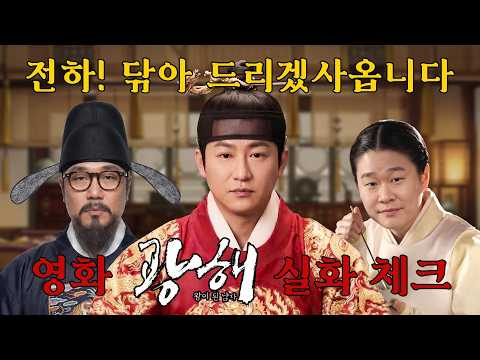
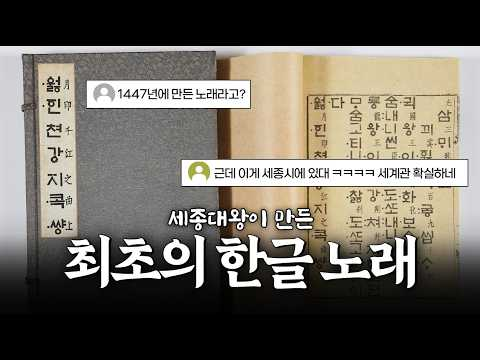

# 역사 — 성공 사례 분석: 사례별 자세히 #481–#498

`analysis.md` 의 9번 (같은 # 번호). 자동 생성 — `tools/success_analysis.py` v1.4.1 (2026-10-17 07:39 UTC). ※ 연구·교육용 — 투자 권유가 아님.

### 481. 한때 노인정 휩쓸던 '수지침'이 한순간에 사라진 충격적인 이유 ∣ 고려수지요법

- https://www.youtube.com/watch?v=Xl4HbydufoE · 눈앞의 경제학 · 구독자 21,800 · 조회수 76,794 (×3.5, 하루 489.4) · 좋아요 1,992 (2.6%) · 14.6분 · 2026-05-13 · 주제 묶음 2. 한국 고대·삼국·고려 · 형식 정보·해설 (그 밖) · 폴더 `W_Xl4HbydufoE` (웹 승인)
- 썸네일: 
- 챕터: 0:00 손바닥의 우주 — 수지침이란 무엇인가 · 1:03 전성기의 풍경 — 어떻게 대한민국 대표 민간요법이 됐나 · 2:56 1인 왕국의 탄생 — 창시자가 곧 시스템이 되면 · 5:14 배우는 사람들이 등을 돌린 이유 — 비용의 역설 · 7:19 과학과의 거리 — 효능은 입증됐나 · 9:24 디지털 전환 실패와 고령화된 공동체 · 11:05 역사의 거울 — 일본 침구 유파의 교훈 · 12:33 우리가 얻어야 할 인사이트 3가지 · 13:00 마무리
- 설명 앞부분: 🚨 한때 전국 160개 지부, 만 명이 넘는 자격증 취득자를 보유했던 고려수지요법이 지금은 왜 아무도 모르는 존재가 됐을까. 창시자 1인이 이론·자격·교재·기자재를 독점한 구조가 어떻게 스스로의 성장을 막았는지 해부합니다. 📍 오늘 영상에서 반드시 확인해야 할 3가지 1️⃣ 수지침이 전성기를 구가하다 추락한 진짜 구조적 이유 2️⃣ 1인 독점 지식 체계가 반드시 맞닥뜨리는 성장의 한계 3️⃣ 민간자격증에 돈과 시간을 쓰기 전, 반드시 따져봐야 할 3가지 ⏱ 타임라인 [콘텐츠 제작 안내] 본 영상은 시청자분들의 이해를 돕기 위해 A…
- 대본 없음 (설명) — 음성인식이 끝나면 도입부·흐름이 들어감
- 댓글 0/275 (다 받지 못함): 좋은 점 — 영상 0 · 감사·응원 0 · 더 알고 싶은 것 0 · 아쉬운 점 — 영상 0 · 반박·불만 — 의견 다름 0 · 정치·사회 0 · 경험 공유 0 · 구독·다음 기대 0

### 482. 🎬전하! 닦아 드리겠사옵니다ㅣ영화 [광해] 실화 체크!

- https://www.youtube.com/watch?v=E7EKKWRLPG0 · 청년재단 · 구독자 47,200 · 조회수 164,223 (×3.5, 하루 938.7) · 좋아요 5,265 (3.2%) · 45.6분 · 2026-04-25 · 주제 묶음 3. 조선 · 형식 정보·해설 (그 밖) · 폴더 `W_E7EKKWRLPG0` (웹 승인)
- 썸네일: 
- 설명 앞부분: 그는 폭군이었을까, 아니면 시대를 앞서간 군주였을까? 대동법과 중립외교 속에 숨겨진 진짜 의도는? 역사와 영화의 경계를 파헤쳐본다! 과연 광해군의 진실은 어디까지가 사실이고, 어디까지가 각색일까? 사극진단 9회 [광해] ※ 본 영상과 무관한 내용 혹은 혐오·차별을 조장하는 댓글, 출연자 및 제3자에 대한 욕설·조롱·비난 등은 예고 없이 삭제될 수 있습니다.
- 대본 없음 (설명) — 음성인식이 끝나면 도입부·흐름이 들어감
- 댓글 0/272 (다 받지 못함): 좋은 점 — 영상 0 · 감사·응원 0 · 더 알고 싶은 것 0 · 아쉬운 점 — 영상 0 · 반박·불만 — 의견 다름 0 · 정치·사회 0 · 경험 공유 0 · 구독·다음 기대 0

### 483. 임진왜란 7년 동안 이에야스가 조선에 병사를 안 보낸 믿기 힘든 이유

- https://www.youtube.com/watch?v=jQzSVXNM0_c · 역사 한 숟갈 · 구독자 7,870 · 조회수 27,222 (×3.5, 하루 326.4) · 좋아요 762 (2.8%) · 44.6분 · 2026-07-25 · 주제 묶음 3. 조선 · 형식 정보·해설 (그 밖) · 폴더 `W_jQzSVXNM0_c` (웹 승인)
- 썸네일: 
- 챕터: 0:00 우리가 아는 그 얼굴, 사실이 아닙니다 · 2:53 침략자인가, 태합인가 · 4:01 34년을 일본에서 산 선교사의 증언 · 5:01 감추고 싶어도 감출 수 없던 흔적 · 7:50 주군이 부하의 아내에게 보낸 편지 · 9:35 열 살 아이가 걸었던 130km · 11:36 다다미 세 장, 그리고 순금 · 13:10 1591년 봄, 갑작스러운 명령 · 17:19 쉰세 살, 마침내 찾아온 기쁨 · 20:20 1595년 여름, 산조가와라의 아침 · 23:57 태양의 아들이 그린 지도 · 30:59 침상에서 열 번 반복해 적은 한 문장
- 설명 앞부분: "이슬처럼 왔다가 이슬처럼 사라진다." 죽는 순간 도요토미 히데요시가 남긴 이 한 줄이, 조선 12만 명의 얼굴을 도려내고 세계를 삼키려던 남자의 진짜 얼굴을 드러냅니다. ⚔ 1598년 9월 18일, 후시미성 침소에서 예순두 살의 태합이 눈을 감습니다. 그의 시신은 곧바로 묻히지 않았습니다. 항아리에 소금을 부어 절인 채, 창고 안에서 반년간 방치됩니다. 세계를 삼키려던 남자의 마지막 자리는 창고였습니다. 🕯 여덟 살에 집을 뛰쳐나온 소년, 오른손 손가락이 여섯 개였던 사내, 흰쌀만 고집하다 심장이 멎은 태합, 그리고 15년을 기…
- 대본 없음 (설명) — 음성인식이 끝나면 도입부·흐름이 들어감
- 댓글 0/87 (다 받지 못함): 좋은 점 — 영상 0 · 감사·응원 0 · 더 알고 싶은 것 0 · 아쉬운 점 — 영상 0 · 반박·불만 — 의견 다름 0 · 정치·사회 0 · 경험 공유 0 · 구독·다음 기대 0

### 484. 21세기 대군부인 역사체크, 어디까지 말이 되는거야?

- https://www.youtube.com/watch?v=BK2lypbQLmI · 지식이 왜? · 구독자 21,100 · 조회수 72,787 (×3.5, 하루 469.9) · 좋아요 1,029 (1.4%) · 23.2분 · 2026-05-15 · 주제 묶음 1. 역사 일반·이야기 · 형식 사극·드라마·영화 리뷰 · 폴더 `W_BK2lypbQLmI` (웹 승인)
- 썸네일: 
- 설명 앞부분: 문효세자, 정조, 왕권 강화까지… 드라마 속 설정들을 실제 역사와 비교해 봤습니다. 21세기 대군부인》, 어디까지 가능했고 어디부터 판타지인가!!!
- 대본 없음 (설명) — 음성인식이 끝나면 도입부·흐름이 들어감
- 댓글 0/345 (다 받지 못함): 좋은 점 — 영상 0 · 감사·응원 0 · 더 알고 싶은 것 0 · 아쉬운 점 — 영상 0 · 반박·불만 — 의견 다름 0 · 정치·사회 0 · 경험 공유 0 · 구독·다음 기대 0

### 485. 미국 시장을 뒤흔든 조선 장군 이순신… 그런데 그가 몰던 거북선은 왜 한 척도 남지 않았을까

- https://www.youtube.com/watch?v=5694G9i-0jA · 찐경제 · 구독자 27,700 · 조회수 93,767 (×3.4, 하루 4,922.6) · 좋아요 1,724 (1.8%) · 30.3분 · 2026-09-28 · 주제 묶음 3. 조선 · 형식 애니메이션·지도 · 폴더 `W_5694G9i-0jA` (웹 승인)
- 썸네일: 
- 설명 앞부분: 안녕하세요, 여러분. 오늘은 사백년 전 조선 남해에서 살았던 한 사람이, 지금 미국 시카고 만화 진열대 위에 슈퍼맨과 나란히 서 있는 놀라운 이야기를 준비했습니다. 그런데 정작 그가 몰던 거북선은 우리 땅에 단 한 척도 남지 않았습니다. 이순신은 세계로 나가고, 그의 배는 우리 발밑에서 사라졌다. 이 뒤틀린 두 미스터리를 함께 파헤쳐 봅니다. 복잡한 경제 지표와 뉴스를 객관적으로 비교 분석하여 정보 전달의 가치를 높였으며, 영상에 사용된 모든 시나리오 대본은 [찐경제]가 직접 자료를 수집하고. AI의 도움을 받아 집필하였습니다. …
- 대본 없음 (설명) — 음성인식이 끝나면 도입부·흐름이 들어감
- 댓글 0/67 (다 받지 못함): 좋은 점 — 영상 0 · 감사·응원 0 · 더 알고 싶은 것 0 · 아쉬운 점 — 영상 0 · 반박·불만 — 의견 다름 0 · 정치·사회 0 · 경험 공유 0 · 구독·다음 기대 0

### 486. 훈민정음 창제, 그리고 최초의 한글 노래 🎵 [깨알세종]

- https://www.youtube.com/watch?v=1afN4NvwfNw · 세종특별자치시 · 구독자 27,400 · 조회수 91,723 (×3.4, 하루 6,125.0) · 좋아요 29 (0.0%) · 4.2분 · 2026-10-02 · 주제 묶음 3. 조선 · 형식 정보·해설 (그 밖) · 폴더 `W_1afN4NvwfNw` (웹 승인)
- 썸네일: 
- 설명 앞부분: 세종시에 대한 깨알 정보를 알려드립니다 월인천강지곡 ( 月印千江之曲 卷上 ) : 1447년 무렵 편찬된 최초의 한글 금속활자본이자, 세종이 지은 찬불가(讚佛歌)
- 대본 없음 (설명) — 음성인식이 끝나면 도입부·흐름이 들어감
- 댓글 0/5 (다 받지 못함): 좋은 점 — 영상 0 · 감사·응원 0 · 더 알고 싶은 것 0 · 아쉬운 점 — 영상 0 · 반박·불만 — 의견 다름 0 · 정치·사회 0 · 경험 공유 0 · 구독·다음 기대 0

### 487. 🎬인조는 정말 무능한 왕?ㅣ영화 [남한산성] 실화 체크!

- https://www.youtube.com/watch?v=3kblP24f4YI · 청년재단 · 구독자 47,200 · 조회수 157,622 (×3.3, 하루 938.5) · 좋아요 4,499 (2.9%) · 44.4분 · 2026-05-02 · 주제 묶음 1. 역사 일반·이야기 · 형식 정보·해설 (그 밖) · 폴더 `W_3kblP24f4YI` (웹 승인)
- 썸네일: 
- 설명 앞부분: 인조는 정말 무능한 왕이었을까? 삼전도의 굴욕 뒤에 숨겨진 진짜 선택의 이유 청나라에 끌려간 소현세자, 그가 보고 배운 것은 조선을 바꿀 기회였을까 사극 속 이야기와 실제 역사 사이, 과연 어디까지가 진실? 사극진단 10회 [남한산성] ※ 본 영상과 무관한 내용 혹은 혐오·차별을 조장하는 댓글, 출연자 및 제3자에 대한 욕설·조롱·비난 등은 예고 없이 삭제될 수 있습니다.
- 대본 없음 (설명) — 음성인식이 끝나면 도입부·흐름이 들어감
- 댓글 0/233 (다 받지 못함): 좋은 점 — 영상 0 · 감사·응원 0 · 더 알고 싶은 것 0 · 아쉬운 점 — 영상 0 · 반박·불만 — 의견 다름 0 · 정치·사회 0 · 경험 공유 0 · 구독·다음 기대 0

### 488. "한국인들 건드리면 큰일 난다!" 지금 미국 난리 난 이순신 열풍.. 찾아볼수록 더 놀란 미국인들

- https://www.youtube.com/watch?v=o7LyCfzJXlM · 해외감동오픈 · 구독자 36,900 · 조회수 122,784 (×3.3, 하루 6,173.6) · 좋아요 3,084 (2.5%) · 41분 · 2026-09-27 · 주제 묶음 3. 조선 · 형식 애니메이션·지도 · 폴더 `W_o7LyCfzJXlM` (웹 승인)
- 썸네일: 
- 챕터: 0:00 지금 미국에서 난리 난 이순신, "한국인들 건드리면 … · 3:15 "한국은 졌다, 중국이 구해 줬다?" 미국 반응에 쳐… · 5:29 을지문덕 살수대첩, 수나라 30만 5천 명 중 2,7… · 11:23 안시성 전투, 당 태종이 깊이 후회한 단 하나의 성 · 16:58 강감찬 귀주대첩, 갑옷 버리고 달아난 거란 총대장 · 18:29 고려 몽골 전쟁, 세상을 삼킨 몽골이 30년을 매달린… · 23:33 이순신 한산도·명량·노량, 13척으로 130척을 막은… · 30:08 아덴만 여명 작전, 미 해병대 출신이 본 영상과 "머… · 35:02 2019 일본 수출 규제, 불화수소로 반격한 한국 · 39:10 한국인들 건드리면 큰일 난다, 이 나라는 끝을 본다
- 설명 앞부분: "한국 건드리면 큰일 난다" 미국인들이 한국사 기록을 보고 놀란 이유 한국 기록 말고, 쳐들어온 쪽 나라들의 역사책을 먼저 펼쳐 봤습니다 요즘 미국에서 이름이 부쩍 알려지고 있는 한국 사람이 있습니다. 이순신 장군입니다. 그런데 한국 역사를 더 찾아본 사람들은, 이순신만 그런 게 아니었다는 걸 알게 됩니다. 그런데 그 이야기 밑에는 이런 글도 달립니다. "한국은 졌다. 중국이 와서 구해 준 거다." "한국 사람들은 기분 좋으려고 역사를 고쳐 쓴다." 그래서 이번 영상에서는 한국 기록만 앞세우지 않았습니다. 이 나라를 건드렸던 쪽 …
- 대본 없음 (설명) — 음성인식이 끝나면 도입부·흐름이 들어감
- 댓글 0/83 (다 받지 못함): 좋은 점 — 영상 0 · 감사·응원 0 · 더 알고 싶은 것 0 · 아쉬운 점 — 영상 0 · 반박·불만 — 의견 다름 0 · 정치·사회 0 · 경험 공유 0 · 구독·다음 기대 0

### 489. 한일부부∣ 갑자기 한국 역사를 배우겠다는 일본인 아내… 이유를 듣고 놀랐습니다

- https://www.youtube.com/watch?v=0kHYAVTIdno · 유츄 Yuchu TV · 구독자 30,100 · 조회수 96,656 (×3.2, 하루 578.7) · 좋아요 2,660 (2.8%) · 9.5분 · 2026-05-03 · 주제 묶음 1. 역사 일반·이야기 · 형식 정보·해설 (그 밖) · 폴더 `W_0kHYAVTIdno` (웹 승인)
- 썸네일: 
- 설명 앞부분: 안녕하세요, 유츄TV입니다~!! 한국에 거주한지 어느덧 3년이 지났네요~! 앞으로의 미래를 생각하면 한국의 역사를 알아야 할 것 같아서.. 공부를 시작하게 되었습니다 여러가지 방법이 많지만 교과서가 제일 좋을 방법일 것 같아 선택한 방법입니다ㅋㅋ 지금도 공부하고 있는데 의미를 모르는 단어가 정말 많아서 공부한 속도는 다소 느린편입니다 ㅠㅠㅠ 그래도 따뜻한 마음으로 응원해주시면 좋겠습니당~! 여러분 좋은 주말을 보내십시오~! ▬▬▬▬▬BGM▬▬▬▬▬▬▬▬▬▬▬▬▬▬▬▬▬▬▬▬▬▬▬▬ 🎵Music provided by 브금대통령 🎵T…
- 대본 없음 (설명) — 음성인식이 끝나면 도입부·흐름이 들어감
- 댓글 0/451 (다 받지 못함): 좋은 점 — 영상 0 · 감사·응원 0 · 더 알고 싶은 것 0 · 아쉬운 점 — 영상 0 · 반박·불만 — 의견 다름 0 · 정치·사회 0 · 경험 공유 0 · 구독·다음 기대 0

### 490. 임진왜란 때, 포로로 끌려간 조선인 10만 명은 어떻게 되었을까?

- https://www.youtube.com/watch?v=Mmv7xy1M_uM · 세놀토 SENOLTO · 구독자 48,900 · 조회수 156,611 (×3.2, 하루 13,158.0) · 좋아요 639 (0.4%) · 33.9분 · 2026-10-05 · 주제 묶음 3. 조선 · 형식 정보·해설 (그 밖) · 폴더 `W_Mmv7xy1M_uM` (웹 승인)
- 썸네일: 
- 설명 앞부분: 임진왜란 당시 일본으로 끌려간 10만 명의 조선인들은 과연 어떤 삶을 살았을까요? 그들이 남긴 역사의 흔적을 따라가 보겠습니다. 🎬──── [ AI ] This content was created with the assistance of AI tools.
- 대본 없음 (설명) — 음성인식이 끝나면 도입부·흐름이 들어감
- 댓글 0/332 (다 받지 못함): 좋은 점 — 영상 0 · 감사·응원 0 · 더 알고 싶은 것 0 · 아쉬운 점 — 영상 0 · 반박·불만 — 의견 다름 0 · 정치·사회 0 · 경험 공유 0 · 구독·다음 기대 0

### 491. [7화] 공시생, 광해가 되다 : 전라도 Ⅱ

- https://www.youtube.com/watch?v=QIVNP9Th_xk · 왓이프(만약에) 채널 · 구독자 9,980 · 조회수 31,969 (×3.2, 하루 1,105.3) · 좋아요 318 (1.0%) · 6.9분 · 2026-09-18 · 주제 묶음 기타 · 형식 정보·해설 (그 밖) · 폴더 `W_QIVNP9Th_xk` (웹 승인)
- 썸네일: 
- 설명 앞부분: 전라도로 가는 길목, 이치와 웅치. 우키타 히데이에가 이끄는 대군이 이치와 웅치 앞에 집결했고 조선이 방비하기에는 이미 늦었다. 이치가 함락되었고 웅치가 이어서 넘어갔다. 호남의 중심지 전주성이 버려지게 되고 쉽게만 보이던 이 전쟁의 향방이 안갯 속으로 가려지게 된다.
- 대본 없음 (설명) — 음성인식이 끝나면 도입부·흐름이 들어감
- 댓글 0/28 (다 받지 못함): 좋은 점 — 영상 0 · 감사·응원 0 · 더 알고 싶은 것 0 · 아쉬운 점 — 영상 0 · 반박·불만 — 의견 다름 0 · 정치·사회 0 · 경험 공유 0 · 구독·다음 기대 0

### 492. 만주에서 잊혀진 216만명 한국인들의 마지막 이야기

- https://www.youtube.com/watch?v=A5p5XCMhzP4 · 역사여행 · 구독자 27,700 · 조회수 87,863 (×3.2, 하루 1,548.1) · 좋아요 1,536 (1.8%) · 37.7분 · 2026-08-21 · 주제 묶음 기타 · 형식 정보·해설 (그 밖) · 폴더 `W_A5p5XCMhzP4` (웹 승인)
- 썸네일: 
- 설명 앞부분: 216만 명. 한때 만주 땅을 채웠던 우리 사람들의 숫자입니다. 그런데 지금, 그들이 살던 마을터에는 왜 아무 흔적도 남지 않았을까요? 두만강을 건넌 첫 번째 이주민부터, 학교를 세우고 총을 들었던 사람들. 봉오동과 청산리의 승리, 그리고 그 대가로 찾아온 간도참변의 27일. 같은 편끼리 총구를 겨눈 자유시의 강가, 극장 청소부로 생을 마감한 한 장군의 마지막까지. 교과서 한 줄로 지나쳤던 그 시대 속으로, 지금 함께 걸어 들어가 봅니다. 이 이야기가 오래 기억에 남으셨다면, 지금 이 순간을 다른 사람에게도 건네주세요. 당신의 한…
- 대본 없음 (설명) — 음성인식이 끝나면 도입부·흐름이 들어감
- 댓글 0/174 (다 받지 못함): 좋은 점 — 영상 0 · 감사·응원 0 · 더 알고 싶은 것 0 · 아쉬운 점 — 영상 0 · 반박·불만 — 의견 다름 0 · 정치·사회 0 · 경험 공유 0 · 구독·다음 기대 0

### 493. 엄세번 – 금으로 깔린 침상, 27명의 절세미인… 이 사치의 끝은 왜 단두대였나?

- https://www.youtube.com/watch?v=OeDMukPCb-s · 중국황제비극 · 구독자 17,900 · 조회수 56,537 (×3.2, 하루 348.2) · 좋아요 786 (1.4%) · 91.7분 · 2026-05-07 · 주제 묶음 6. 동양사 (중국·일본·몽골) · 형식 정보·해설 (그 밖) · 폴더 `W_OeDMukPCb-s` (웹 승인)
- 썸네일: 
- 설명 앞부분: ""내가 곧 법이고, 내가 곧 황제다!"" 명나라 역사상 가장 탐욕스럽고 오만했던 괴물, 엄세번. 황금 그물이 깔린 바닥 위에서 미녀를 '가래침 뱉는 통(미인우)'으로 쓰고, 황제보다 더 많은 재산을 쌓으며 천하를 조롱했던 희대의 간신. 천재적인 두뇌로 아버지를 조종하고 제국을 삼켰던 그가, 어떻게 자신의 오만함 때문에 비참한 최후를 맞이하게 되었을까요? 화려했던 동루의 쾌락과 차가운 단두대의 이슬로 끝난 핏빛 몰락의 대서사시를 공개합니다.
- 대본 없음 (설명) — 음성인식이 끝나면 도입부·흐름이 들어감
- 댓글 0/54 (다 받지 못함): 좋은 점 — 영상 0 · 감사·응원 0 · 더 알고 싶은 것 0 · 아쉬운 점 — 영상 0 · 반박·불만 — 의견 다름 0 · 정치·사회 0 · 경험 공유 0 · 구독·다음 기대 0

### 494. [미국반응]“굴욕적인 패배를 보여줬을 뿐인데.. 이것이 진짜 역사를 대하는 품격! 미국 영화계가 한국의 K사극 영화를 보고 큰 충격에 빠진 이유!”

- https://www.youtube.com/watch?v=7AsY1jh4zsE · 한류클라쓰TV · 구독자 44,600 · 조회수 140,655 (×3.1, 하루 9,887.7) · 좋아요 1,644 (1.2%) · 12.5분 · 2026-10-03 · 주제 묶음 1. 역사 일반·이야기 · 형식 사연·드라마 · 폴더 `W_7AsY1jh4zsE` (웹 승인)
- 썸네일: 
- 설명 앞부분: [미국반응]“굴욕적인 패배를 보여줬을 뿐인데.. 이것이 진짜 역사를 대하는 품격! 미국 영화계가 한국의 K사극 영화를 보고 큰 충격에 빠진 이유!”
- 대본 없음 (설명) — 음성인식이 끝나면 도입부·흐름이 들어감
- 댓글 0/201 (다 받지 못함): 좋은 점 — 영상 0 · 감사·응원 0 · 더 알고 싶은 것 0 · 아쉬운 점 — 영상 0 · 반박·불만 — 의견 다름 0 · 정치·사회 0 · 경험 공유 0 · 구독·다음 기대 0

### 495. "중국 독점이 깨졌습니다" 미국이 11조 들고 울산 고려아연 앞에 무릎 꿇은 진짜 이유

- https://www.youtube.com/watch?v=hAbwSDdS4ug · 머리가 좋아지는 지박사 · 구독자 34,100 · 조회수 104,756 (×3.1, 하루 604.1) · 좋아요 1,573 (1.5%) · 20.8분 · 2026-04-26 · 주제 묶음 2. 한국 고대·삼국·고려 · 형식 인터뷰·강연·대담 · 폴더 `W_hAbwSDdS4ug` (웹 승인)
- 썸네일: 
- 챕터: 0:00 11조가 울산에 떨어진 날 · 0:34 희토류는 사실 흔합니다, 그런데 왜 90%가 중국일까요 · 3:36 F-35 한 대 420kg, 시진핑 전화 한 통으로 … · 6:33 미국이 찾은 유일한 답, 울산의 50년 · 10:41 불과 몇 달 차이, 우리가 모르는 사이 벌어졌던 일 · 13:33 미국이 외국 기업 본사 지분을 산 사상 첫 사례 · 17:14 록히드마틴·알타리소스·도시광산 — 다음 라운드는 이미… · 19:39 자원 없는 나라의 기술이 자원 많은 나라의 무기를 이…
- 설명 앞부분: 미국이 11조 원을 들고 울산의 한 회사를 직접 찾아왔습니다. 핵심광물 정책 역사상 처음으로 미국이 외국 기업 본사 지분을 직접 보유한 사건, 그 50년의 답을 함께 추적해 보았습니다. 이 영상에서 다루는 내용 희토류·핵심광물 정제 90%를 중국이 쥐게 된 진짜 이유 ("쌀은 있는데 밥솥이 없다") F-35 1대당 희토류 420kg, 미 해군 무기 91%가 중국 통제 광물에 묶인 충격적 실태 1973년 중화학공업화 선언부터 2000년 TSL 세계 최초 상용화까지, 울산 고려아연 50년의 누적 헤마타이트 99% 회수율, 안티모니 9…
- 대본 없음 (설명) — 음성인식이 끝나면 도입부·흐름이 들어감
- 댓글 0/42 (다 받지 못함): 좋은 점 — 영상 0 · 감사·응원 0 · 더 알고 싶은 것 0 · 아쉬운 점 — 영상 0 · 반박·불만 — 의견 다름 0 · 정치·사회 0 · 경험 공유 0 · 구독·다음 기대 0

### 496. 명나라 사신이 조선을 비웃으며 낸 세 가지 난제, 말똥 치우던 열 살 종놈이 단번에 끝냈습니다 ∣야담∣ 민담∣설화∣ 옛날이야기∣ 오디오북∣ 수면동화

- https://www.youtube.com/watch?v=3lJHf1jBGoU · 야담마을 · 구독자 25,100 · 조회수 76,830 (×3.1, 하루 477.5) · 좋아요 2,793 (3.6%) · 87.5분 · 2026-05-09 · 주제 묶음 9. 야사·야담·옛날이야기 · 형식 수면·낭독 (잠잘 때 듣는) · 폴더 `W_3lJHf1jBGoU` (웹 승인)
- 썸네일: 
- 설명 앞부분: 열 살 노비 천복이 명나라 사신의 세 가지 난제를 개미 한 마리로 풀어내어 조선의 땅을 지켜낸 이야기입니다. 진주 고을 김 판서 댁에서 말똥을 치우던 종놈 아이가 천리마의 죽음을 예언하고, 삼 년 가뭄의 원인을 밝혀 물길을 열고, 왕의 목숨을 노리는 독살 음모를 간파하여 한양 궁궐까지 오르게 됩니다. 명나라 사신이 조선을 업신여기며 불가능한 난제를 내걸자, 조선의 석학들이 전원 실패한 자리에서 천복이 나서 매듭을 풀고, 함정에 빠져 감옥에 갇혔다가 마지막 구슬 꿰기를 개미와 꿀로 해결하여 사신을 무릎 꿇립니다. 숨겨진 어머니의 가…
- 대본 없음 (설명) — 음성인식이 끝나면 도입부·흐름이 들어감
- 댓글 0/200 (다 받지 못함): 좋은 점 — 영상 0 · 감사·응원 0 · 더 알고 싶은 것 0 · 아쉬운 점 — 영상 0 · 반박·불만 — 의견 다름 0 · 정치·사회 0 · 경험 공유 0 · 구독·다음 기대 0

### 497. 잠들기 전 한국사🌙『 조선왕조실록 : 연산군의 비밀 』벌거벗은 한국사 _ 책읽어주는여자 _ 베스트셀러 오디오북 📖

- https://www.youtube.com/watch?v=bDb2YIZhBPw · 모모의 북살롱 · 구독자 39,200 · 조회수 119,255 (×3.0, 하루 4,132.1) · 좋아요 401 (0.3%) · 61.5분 · 2026-09-18 · 주제 묶음 3. 조선 · 형식 수면·낭독 (잠잘 때 듣는) · 폴더 `W_bDb2YIZhBPw` (웹 승인)
- 썸네일: 
- 설명 앞부분: 연산군은 왜 폭군이 되었을까? 조선의 왕 가운데 가장 강렬한 이름으로 남은 연산군. 그는 처음부터 폭군이었을까요? 오늘 소개해드릴 역사 이야기는 『벌거벗은 한국사 인물편 : 연산군 📖』 입니다. 인물편 속 연산군이 왕위에 오른 뒤 겪게 되는 사건들을 따라가 봅니다. 어머니 폐비 윤씨의 죽음을 알게 된 연산군, 그리고 무오사화와 갑자사화, 장녹수와의 관계, 점점 심해지는 폭정과 결국 중종반정으로 왕위에서 쫓겨나기까지의 이야기를 살펴봅니다. 한 사람의 성격만으로 설명하기에는 복잡했던 연산군의 삶. 왕이 된 연산군에게 어떤 사건들이 있…
- 대본 없음 (설명) — 음성인식이 끝나면 도입부·흐름이 들어감
- 댓글 0/6 (다 받지 못함): 좋은 점 — 영상 0 · 감사·응원 0 · 더 알고 싶은 것 0 · 아쉬운 점 — 영상 0 · 반박·불만 — 의견 다름 0 · 정치·사회 0 · 경험 공유 0 · 구독·다음 기대 0

### 498. 《한국사》 마패 한 장 들고 떠난 암행어사의 고독한 여정 l 역사 인물 l 조선시대 l 야사

- https://www.youtube.com/watch?v=7S3HBJxmMqY · 한국사 이야기 · 구독자 24,200 · 조회수 73,198 (×3.0, 하루 425.1) · 좋아요 744 (1.0%) · 73.7분 · 2026-04-28 · 주제 묶음 3. 조선 · 형식 정보·해설 (그 밖) · 폴더 `W_7S3HBJxmMqY` (웹 승인)
- 썸네일: 
- 설명 앞부분: 조선시대, 마패 한 장으로 탐관오리에 맞섰던 암행어사의 진짜 하루는 어땠을까요? 화려한 어사출두 뒤에 숨겨진 고독하고 치열한 여정, 백성들의 억울함을 듣고 기록하며 조선의 민생을 살피던 그들의 발걸음을 따라가 봅니다.
- 대본 없음 (설명) — 음성인식이 끝나면 도입부·흐름이 들어감
- 댓글 0/18 (다 받지 못함): 좋은 점 — 영상 0 · 감사·응원 0 · 더 알고 싶은 것 0 · 아쉬운 점 — 영상 0 · 반박·불만 — 의견 다름 0 · 정치·사회 0 · 경험 공유 0 · 구독·다음 기대 0

