# 📊 YouTube '생활꿀팁' 주제 분석 리포트

> 생성 2026-10-11 12:13 KST · 노트북 v2.3.0 · 실행ID `20261011_120712` · 지역 KR / 언어 ko  
> ⚠️ 연구·교육용 분석 결과입니다. **투자 조언이 아니며**, 통계는 상관관계일 뿐 인과관계를 보장하지 않습니다.

## 0. 한눈에 보기 (TL;DR)

- ⚙️ **설정 파일**: `lifetips/analyzer_config.toml`
- **분석 데이터**: 영상 526개 수집 → 성과 분석 111개 (업로드 2025-10-12 ~ 2026-09-19, 업로드 후 14일 이상 경과), 채널 358개, 검색 키워드 13개(6개 카테고리), 주제 무관 영상 16개 제외
- 📢 **광고 집행 의심 영상 8개 제외**: 조회수는 많은데 좋아요·댓글이 거의 없는 영상(유료 홍보로 조회수를 산 것으로 추정) → 자연 유입으로 재현할 수 없으므로 성과 분석·성공사례에서 뺐습니다 (목록: 2장 하단)
- **성공(아웃라이어) 기준**: 조회수 10,000회 이상 **그리고** 같은 채널 최근 영상 중앙값의 3배 이상 → 50개 (45.0%)
- 🗂️ **기회가 큰 소재(카테고리)**: 3. 청소 (주방·가전·화장실) (71점), 4. 정리·수납·살림 노하우 (66점), 1. 난방비·전기세·관리비 절약 (60점)
- 🎯 **기회가 가장 큰 키워드**: `세탁기 청소 방법`(80점), `옷 정리 꿀팁`(68점), `냉장고 정리 꿀팁`(64점), `화장실 청소 꿀팁`(61점), `난방비 절약 꿀팁`(61점)
- 🎬 **포맷별 성공 비율**: 라이브 0.0% (배수 중앙값 0.80배, n=1) · 롱폼 30.2% (배수 중앙값 3.14배, n=53) · 쇼츠 59.6% (배수 중앙값 7.44배, n=57) → 추천: **쇼츠** 중심
- ⏱️ **롱폼 추천 길이**: 1~3분 (성공 비율 상위 구간)
- 🏷️ **효과 있는 제목 요소**: 초보/방법(초보·기초·정리) 1.78배, 금액·% 표기 1.20배  /  역효과: 공포/경고(폭락·위기·절대) 0.21배, 괄호/대괄호 0.30배, 숫자 포함 0.52배  (*=다중비교 보정 후 유의, q<0.05)
- 🌱 **작은 채널도 터지나?**: 소규모(<1만) 채널 영상의 성공 비율 32.6% vs 대형(≥10만) 42.1%. 성공한 소규모 채널의 업로드 빈도 중앙값: 주 1.4회
- 🕒 **업로드 타이밍(참고)**: 성공 비율 높은 요일 월, 화 / 시간대 06~08시, 12~14시 (KST)
- 💸 **API 쿼터 사용**: 2,006 / 예산 9,000 (일일 한도 10,000)

## 1. 🎬 추천 영상 아이디어 (데이터 기반)

제목 예시는 이번 데이터에서 효과가 확인된 제목 요소(초보/방법(초보·기초·정리), 금액·% 표기; 데이터 기반 (lift≥1.1))를 키워드 성격(실패·손실 사연 / 사기·피해 / 일반 정보)에 맞춰 조합한 **템플릿 예시**입니다. 그대로 쓰기보다 참고 영상의 실제 제목·썸네일·도입부(대본)를 함께 보고 다듬으세요.

### 1. `세탁기 청소 방법` — 기회점수 **80**/100 · 일반 정보

- 근거: 검색 상위 20개 영상 일평균 조회수 중앙값 **1.2천회**, 소규모 채널 진입 성공 비율 **45.0%**, 최근 90일 영상 비율 10.0%, 경쟁 채널 구독자 중앙값 1.7만명, 아웃라이어 배수 중앙값 86.85배, 성공 영상 10개
- 추천 포맷: **쇼츠** · 검색 상위 중 쇼츠 비율 55.0%
- 제목 예시: 「세탁기 청소 방법 완전 초보 가이드 — 이것만 보세요」 / 「세탁기 청소 방법 수수료 0.1% 차이가 만드는 결과」 / 「세탁기 청소 방법 초보가 꼭 알아야 할 3가지」
- 참고할 성공 영상:
  - [여자 혼자서도 가능한 통돌이 부분 분해 청소｜과탄산소다로 안 빠지는 찌든 때 해결…](https://www.youtube.com/watch?v=CaXWx1boXBk) — 조회수 101만, 구독자 4.1천, 채널 평균의 2,004.2배, 롱폼
  - [세탁기 통세척 다이소 '이것' 과 소주면 끝!](https://www.youtube.com/watch?v=iPKmb_VZxhc) — 조회수 638만, 구독자 9.4만, 채널 평균의 464.4배, 쇼츠
  - [세탁기에 과탄산 절대 그냥 넣지 마세요](https://www.youtube.com/watch?v=sWPCxoJYUo8) — 조회수 100만, 구독자 8.7천, 채널 평균의 107.4배, 쇼츠

### 2. `옷 정리 꿀팁` — 기회점수 **68**/100 · 일반 정보

- 근거: 검색 상위 20개 영상 일평균 조회수 중앙값 **1.2천회**, 소규모 채널 진입 성공 비율 **15.0%**, 최근 90일 영상 비율 21.1%, 경쟁 채널 구독자 중앙값 12.7만명, 아웃라이어 배수 중앙값 10.45배, 성공 영상 8개
- 추천 포맷: **쇼츠** · 검색 상위 중 쇼츠 비율 47.4%
- 제목 예시: 「옷 정리 꿀팁 수수료 0.1% 차이가 만드는 결과」 / 「옷 정리 꿀팁 완전 초보 가이드 — 이것만 보세요」 / 「옷 정리 꿀팁 핵심 5가지만 기억하세요」
- 참고할 성공 영상:
  - [평생써먹는 옷접는법 6가지🩷 #옷정리](https://www.youtube.com/watch?v=6JLUiwOTVYM) — 조회수 222만, 구독자 7.5천, 채널 평균의 179.2배, 쇼츠
  - [엄마한테 배워온 평생 써먹는 옷장 정리법](https://www.youtube.com/watch?v=3KepeJ59mF4) — 조회수 117만, 구독자 6.7만, 채널 평균의 68.4배, 쇼츠
  - [겨울 옷장 정리 롱패딩 거는법 #수납꿀팁 #패딩수납 #살림꿀팁](https://www.youtube.com/watch?v=gB6TA_Me8hE) — 조회수 1.6만, 구독자 507, 채널 평균의 7.9배, 쇼츠

### 3. `냉장고 정리 꿀팁` — 기회점수 **64**/100 · 일반 정보

- 근거: 검색 상위 20개 영상 일평균 조회수 중앙값 **449회**, 소규모 채널 진입 성공 비율 **25.0%**, 최근 90일 영상 비율 5.0%, 경쟁 채널 구독자 중앙값 5.1만명, 아웃라이어 배수 중앙값 5.01배, 성공 영상 4개
- 추천 포맷: **nan** · 롱폼이면 1~3분 · 검색 상위 중 쇼츠 비율 50.0%
- 제목 예시: 「냉장고 정리 꿀팁 완전 초보 가이드 — 이것만 보세요」 / 「냉장고 정리 꿀팁 수수료 0.1% 차이가 만드는 결과」 / 「냉장고 정리 꿀팁 초보가 꼭 알아야 할 7가지」
- 참고할 성공 영상:
  - [식재료낭비, 이렇게 해결했어요💸 유지는 쉽고 낭비는 줄이는 정리법](https://www.youtube.com/watch?v=5DNIBut0mP0) — 조회수 13.1만, 구독자 2.8천, 채널 평균의 56.0배, 롱폼
  - ["냉장고는 저장고가 아닌 휴게소입니다!" 20년차 청소 명장의 혁신적인 냉장고 정…](https://www.youtube.com/watch?v=l94PTZtJvC0) — 조회수 4.9만, 구독자 9.2만, 채널 평균의 9.0배, 롱폼
  - [키친핏 4도어 좁은 냉동실 정리방법 \| 살림이 쉬워지는 냉동실 정리법 \| 지속…](https://www.youtube.com/watch?v=maofc7Ji0oI) — 조회수 1.6만, 구독자 2.4천, 채널 평균의 6.3배, 롱폼

### 4. `화장실 청소 꿀팁` — 기회점수 **61**/100 · 일반 정보

- 근거: 검색 상위 20개 영상 일평균 조회수 중앙값 **1.8천회**, 소규모 채널 진입 성공 비율 **0.0%**, 최근 90일 영상 비율 0.0%, 경쟁 채널 구독자 중앙값 8.4만명, 아웃라이어 배수 중앙값 27.97배, 성공 영상 7개
- 추천 포맷: **쇼츠** · 검색 상위 중 쇼츠 비율 68.4%
- 제목 예시: 「화장실 청소 꿀팁 수수료 0.1% 차이가 만드는 결과」 / 「화장실 청소 꿀팁 완전 초보 가이드 — 이것만 보세요」 / 「화장실 청소 꿀팁 핵심 3가지만 기억하세요」
- 참고할 성공 영상:
  - [비닐 1장으로 화장실 손안대고 청소하는 꼼수](https://www.youtube.com/watch?v=qrQFoxo8-UI) — 조회수 634만, 구독자 3.8만, 채널 평균의 190.6배, 쇼츠
  - [청소알바만 60곳 넘게 한 경력자가 딱 정해드리는 욕실세제 3](https://www.youtube.com/watch?v=Ti_cQ22Llk0) — 조회수 657만, 구독자 12.1만, 채널 평균의 47.3배, 쇼츠
  - [화장실 곰팡이 1분만에 녹는 락스 원액의 위력](https://www.youtube.com/watch?v=Gi_6cIqH_SI) — 조회수 70.5만, 구독자 10.7만, 채널 평균의 31.1배, 쇼츠

### 5. `난방비 절약 꿀팁` — 기회점수 **61**/100 · 일반 정보

- 근거: 검색 상위 20개 영상 일평균 조회수 중앙값 **561회**, 소규모 채널 진입 성공 비율 **20.0%**, 최근 90일 영상 비율 0.0%, 경쟁 채널 구독자 중앙값 6.9만명, 아웃라이어 배수 중앙값 6.88배, 성공 영상 10개
- 추천 포맷: **쇼츠** · 검색 상위 중 쇼츠 비율 45.0%
- 제목 예시: 「난방비 절약 꿀팁 완전 초보 가이드 — 이것만 보세요」 / 「난방비 절약 꿀팁 수수료 0.1% 차이가 만드는 결과」 / 「난방비 절약 꿀팁 초보가 꼭 알아야 할 5가지」
- 참고할 성공 영상:
  - [보일러 '이 버튼'만 누르세요! 올겨울 난방비 폭탄 걱정 싹 사라집니다ㅣ보일러 사…](https://www.youtube.com/watch?v=7B4sl1P_YHs) — 조회수 114만, 구독자 3.7만, 채널 평균의 1,512.9배, 롱폼
  - [2개만 설정하면 난방비 절약돼요! 난방비 절약팁  #겨울난방비 #가스비절약 #난방…](https://www.youtube.com/watch?v=s4ok4LOEjCY) — 조회수 49.3만, 구독자 3.0만, 채널 평균의 111.7배, 쇼츠
  - [난방비 절약 방법 온돌만 쓰면 난방비 폭탄 맞습니다](https://www.youtube.com/watch?v=CDIPxV5-7Q8) — 조회수 2.1만, 구독자 363, 채널 평균의 40.9배, 쇼츠

### 6. `가스비 절약방법` — 기회점수 **60**/100 · 일반 정보

- 근거: 검색 상위 20개 영상 일평균 조회수 중앙값 **697회**, 소규모 채널 진입 성공 비율 **20.0%**, 최근 90일 영상 비율 0.0%, 경쟁 채널 구독자 중앙값 8.8만명, 아웃라이어 배수 중앙값 4.93배, 성공 영상 8개
- 추천 포맷: **롱폼** · 롱폼이면 1~3분 · 검색 상위 중 쇼츠 비율 40.0%
- 제목 예시: 「가스비 절약방법 수수료 0.1% 차이가 만드는 결과」 / 「가스비 절약방법 완전 초보 가이드 — 이것만 보세요」 / 「가스비 절약방법 핵심 7가지만 기억하세요」
- 참고할 성공 영상:
  - [보일러 예약 기능 이렇게 사용하면 아무 소용 없고 가스비 절약에도 도움 안됨](https://www.youtube.com/watch?v=8l4FUQZNh-U) — 조회수 3.4만, 구독자 3.0천, 채널 평균의 28.9배, 롱폼
  - [보일러 가스비를 절약하는 방법은 실온 온돌 난방 방식 차이](https://www.youtube.com/watch?v=-cV1JLKi01c) — 조회수 11.3만, 구독자 3.0천, 채널 평균의 28.3배, 롱폼
  - [🔥"보일러 '이 버튼' 하나로 난방비 반값! 난방비 절약 꿀팁 4가지‼️ #난방비…](https://www.youtube.com/watch?v=wdDzhqH9jZk) — 조회수 16.0만, 구독자 2.2만, 채널 평균의 21.8배, 롱폼

### 7. `원룸 자취 꿀팁` — 기회점수 **54**/100 · 일반 정보

- 근거: 검색 상위 20개 영상 일평균 조회수 중앙값 **581회**, 소규모 채널 진입 성공 비율 **15.0%**, 최근 90일 영상 비율 5.9%, 경쟁 채널 구독자 중앙값 32.7만명, 아웃라이어 배수 중앙값 2.16배, 성공 영상 2개
- 추천 포맷: **nan** · 롱폼이면 1~3분 · 검색 상위 중 쇼츠 비율 29.4%
- 제목 예시: 「원룸 자취 꿀팁 완전 초보 가이드 — 이것만 보세요」 / 「원룸 자취 꿀팁 수수료 0.1% 차이가 만드는 결과」 / 「원룸 자취 꿀팁 초보가 꼭 알아야 할 3가지」
- 참고할 성공 영상:
  - [자취 11년차가 알려준 자취꿀팁 5가지](https://www.youtube.com/watch?v=wLB3E6kSFO4) — 조회수 497만, 구독자 10.1만, 채널 평균의 20.8배, 롱폼
  - [첫 자취는 이렇게! 4평 원룸 꾸미기 \| 누워서침대속으로 ep.03](https://www.youtube.com/watch?v=9eEu-356xp8) — 조회수 69.5만, 구독자 80.5만, 채널 평균의 7.0배, 롱폼
  - [첫 자취방 구하는 사회초년생 필수 시청｜공인중개사의 실전 원룸 체크리스트 5가지](https://www.youtube.com/watch?v=6t0hBthIpzg) — 조회수 372, 구독자 148, 채널 평균의 6.3배, 롱폼

### 8. `벽지 곰팡이 제거방법` — 기회점수 **50**/100 · 일반 정보

- 근거: 검색 상위 20개 영상 일평균 조회수 중앙값 **152회**, 소규모 채널 진입 성공 비율 **20.0%**, 최근 90일 영상 비율 0.0%, 경쟁 채널 구독자 중앙값 7.3만명, 아웃라이어 배수 중앙값 2.76배, 성공 영상 2개
- 추천 포맷: **nan** · 롱폼이면 1~3분 · 검색 상위 중 쇼츠 비율 25.0%
- 제목 예시: 「벽지 곰팡이 제거방법 수수료 0.1% 차이가 만드는 결과」 / 「벽지 곰팡이 제거방법 완전 초보 가이드 — 이것만 보세요」 / 「벽지 곰팡이 제거방법 핵심 5가지만 기억하세요」
- 참고할 성공 영상:
  - [청소전문업체 사장님이 알려준 벽지 곰팡이 제거 방법](https://www.youtube.com/watch?v=J9_pdZZobeI) — 조회수 2.4만, 구독자 3.2만, 채널 평균의 6.7배, 쇼츠
  - [벽지 곰팡이 제거 비싼 약 절대 사지 마세요! 집에 있는 '이것' 하나로 뿌리까지…](https://www.youtube.com/watch?v=WSDnWkkDotU) — 조회수 3.9천, 구독자 1.5천, 채널 평균의 6.3배, 롱폼
  - [벽지 곰팡이 제거하는 가장 쉬운 청소 방법 "이거 하나면 곰팡이 10분만에 사라집…](https://www.youtube.com/watch?v=VonzsfcOYdw) — 조회수 10.5만, 구독자 10.7만, 채널 평균의 3.7배, 롱폼

### 🗓️ 첫 10개 영상 업로드 플랜 (제안)

| # | 형식 | 키워드 | 제목 예시 | 근거 |
|---|---|---|---|---|
| 1 | 쇼츠 | 세탁기 청소 방법 | 세탁기 청소 방법 완전 초보 가이드 — 이것만 보세요 | 기회점수 80 |
| 2 | 롱폼 | 세탁기 청소 방법 | 세탁기 청소 방법 수수료 0.1% 차이가 만드는 결과 | 같은 키워드를 다른 포맷으로 재활용 (제작비↓, 검색·쇼츠 피드 동시 공략) |
| 3 | 쇼츠 | 옷 정리 꿀팁 | 옷 정리 꿀팁 수수료 0.1% 차이가 만드는 결과 | 기회점수 68 |
| 4 | 롱폼 | 옷 정리 꿀팁 | 옷 정리 꿀팁 완전 초보 가이드 — 이것만 보세요 | 같은 키워드를 다른 포맷으로 재활용 (제작비↓, 검색·쇼츠 피드 동시 공략) |
| 5 | 롱폼 | 냉장고 정리 꿀팁 | 냉장고 정리 꿀팁 완전 초보 가이드 — 이것만 보세요 | 기회점수 64 |
| 6 | 쇼츠 | 냉장고 정리 꿀팁 | 냉장고 정리 꿀팁 수수료 0.1% 차이가 만드는 결과 | 같은 키워드를 다른 포맷으로 재활용 (제작비↓, 검색·쇼츠 피드 동시 공략) |
| 7 | 쇼츠 | 화장실 청소 꿀팁 | 화장실 청소 꿀팁 수수료 0.1% 차이가 만드는 결과 | 기회점수 61 |
| 8 | 롱폼 | 화장실 청소 꿀팁 | 화장실 청소 꿀팁 완전 초보 가이드 — 이것만 보세요 | 같은 키워드를 다른 포맷으로 재활용 (제작비↓, 검색·쇼츠 피드 동시 공략) |
| 9 | 쇼츠 | 난방비 절약 꿀팁 | 난방비 절약 꿀팁 완전 초보 가이드 — 이것만 보세요 | 기회점수 61 |
| 10 | 롱폼 | 난방비 절약 꿀팁 | 난방비 절약 꿀팁 수수료 0.1% 차이가 만드는 결과 | 같은 키워드를 다른 포맷으로 재활용 (제작비↓, 검색·쇼츠 피드 동시 공략) |

### 🧩 하위 주제(제목 클러스터)별 기회

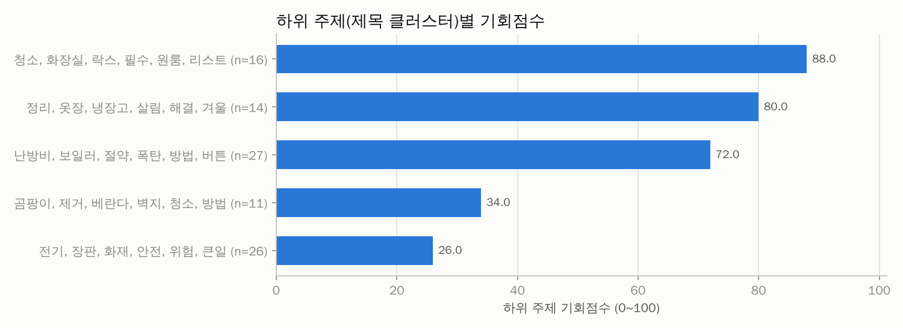

| 기회점수 | 핵심 단어 | 영상 수 | 배수 중앙값 | 성공 비율 | 소규모채널 성공 | 쇼츠 비율 | 예시 제목 |
|---|---|---|---|---|---|---|---|
| 88 | 청소, 화장실, 락스, 필수, 원룸, 리스트 | 16 | 25.78 | 68.8% | 12.5% | 81.2% | 여자 혼자서도 가능한 통돌이 부분 분해 청소｜과탄산소다로 안 빠지는 찌든 / 비닐 1장으로 화장실 손안대고 청소하는 꼼수 / 평생써먹는 옷접는법 6가지🩷 #옷정리 |
| 80 | 정리, 옷장, 냉장고, 살림, 해결, 겨울 | 14 | 7.09 | 71.4% | 21.4% | 50.0% | 엄마한테 배워온 평생 써먹는 옷장 정리법 / 식재료낭비, 이렇게 해결했어요💸 유지는 쉽고 낭비는 줄이는 정리법 / ［광고］정리 고수들은 진작에 쓰고 있던 #옷장정 |
| 72 | 난방비, 보일러, 절약, 폭탄, 방법, 버튼 | 27 | 5.33 | 48.1% | 22.2% | 33.3% | 보일러 '이 버튼'만 누르세요! 올겨울 난방비 폭탄 걱정 싹 사라집니다ㅣ / 2개만 설정하면 난방비 절약돼요! 난방비 절약팁  #겨울난방비 #가스비절 / 난방비  |
| 34 | 곰팡이, 제거, 베란다, 벽지, 청소, 방법 | 11 | 1.83 | 36.4% | 0.0% | 36.4% | 창틀 실리콘 곰팡이 쉽게 제거하는 특급 비법 / 청소전문업체 사장님이 알려준 벽지 곰팡이 제거 방법 / 벽지 곰팡이 제거 비싼 약 절대 사지 마세요! 집에 있는  |
| 26 | 전기, 장판, 화재, 안전, 위험, 큰일 | 26 | 1.02 | 3.8% | 3.8% | 38.5% | 전기장판·전기요 안전하게 사용하는 방법 5가지｜겨울철 화재 예방🔥 / 전기장판 전자파 없이 안전하게 쓰는 꿀팁 공개! / 모르면 당하는 전기장판 화재 원인 3가지 |
| - | 세탁기, 청소, 기사, 가능, 화재, 하루 | 8 | 86.85 | 100.0% | 37.5% | 100.0% | 세탁기 통세척 다이소 '이것' 과 소주면 끝! / 세탁기 청소할땐 이것이랑 같이 소주를 부어야 하는데 / 세탁기 수리 기사님이 현장에서 몰래알려준 AS 기술 |
| - | 자취, 원룸, 공개, 방법, 화장실, 하루 | 8 | 2.11 | 37.5% | 0.0% | 62.5% | 집안일(자취) 안해 본 티가 난다고 한다... / 자취 11년차가 알려준 자취꿀팁 5가지 / 첫 자취는 이렇게! 4평 원룸 꾸미기 \| 누워서침대속으로 ep.03 |

## 2. 🔑 키워드 기회 분석

기회점수 = 수요 25% + 자동완성 15% + 소규모채널 진입 20% + 아웃라이어 10% + 신선도 5% + 경쟁(역) 15% + 콘텐츠 공백 10% (키워드 간 백분위 기준). 수요·경쟁은 **주제 관련 영상만**으로 계산했고, 검색 상위 10개 중 절반 이상이 한 채널인 키워드(채널명 검색)는 제외했습니다. '관련 비율'이 낮다 = 사람들이 찾는데 맞는 영상이 적다(콘텐츠 공백).

### 🗂️ 카테고리(소재)별 기회

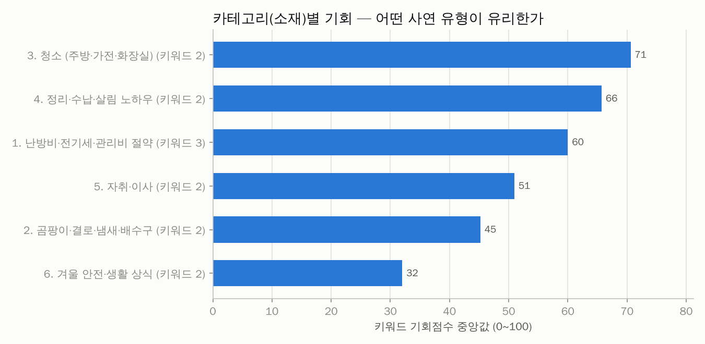

| 카테고리 | 키워드 수 | 기회(중앙) | 기회(최고) | 최고 키워드 | 검색수요 합 | 일평균 조회(중앙) | 소규모 진입 | 관련 비율 | 성공 영상 | 배수(중앙) |
|---|---|---|---|---|---|---|---|---|---|---|
| 3. 청소 (주방·가전·화장실) | 2 | 71 | 80 | 세탁기 청소 방법 | 0.0 | 1.5천 | 22.5% | 97.5% | 17 | 31.10 |
| 4. 정리·수납·살림 노하우 | 2 | 66 | 68 | 옷 정리 꿀팁 | 0.0 | 847 | 20.0% | 97.5% | 12 | 8.45 |
| 1. 난방비·전기세·관리비 절약 | 3 | 60 | 61 | 난방비 절약 꿀팁 | 0.0 | 561 | 16.7% | 100.0% | 13 | 4.93 |
| 5. 자취·이사 | 2 | 51 | 54 | 원룸 자취 꿀팁 | 0.0 | 526 | 15.0% | 87.5% | 3 | 2.11 |
| 2. 곰팡이·결로·냄새·배수구 | 2 | 45 | 50 | 벽지 곰팡이 제거방법 | 0.0 | 139 | 15.0% | 100.0% | 4 | 1.83 |
| 6. 겨울 안전·생활 상식 | 2 | 32 | 38 | 전기장판 화재예방 | 0.0 | 7 | 2.5% | 100.0% | 1 | 1.02 |

### 🔑 키워드별 기회

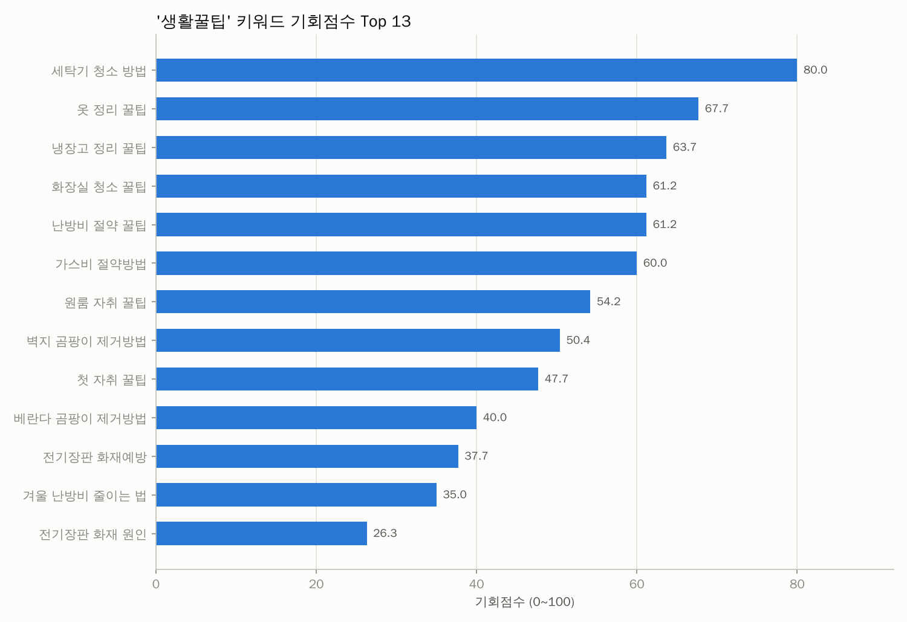
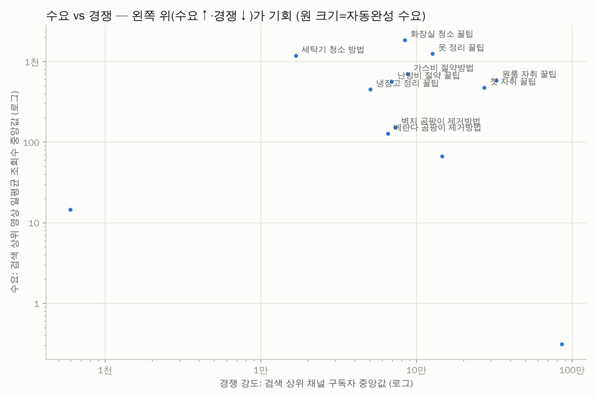

| 키워드 | 카테고리 | 기회점수 | 일평균 조회수(중앙) | 자동완성 | 소규모 진입 | 관련 비율 | 최신 비율 | 경쟁 구독자(중앙) | 배수(중앙) | 성공 수 | 추천 포맷 | 채널명검색 |
|---|---|---|---|---|---|---|---|---|---|---|---|---|
| 세탁기 청소 방법 | 3. 청소 (주방·가전·화 | 80 | 1.2천 | 0.00 | 45.0% | 100.0% | 10.0% | 1.7만 | 86.85 | 10 | 쇼츠 |  |
| 옷 정리 꿀팁 | 4. 정리·수납·살림 노하 | 68 | 1.2천 | 0.00 | 15.0% | 95.0% | 21.1% | 12.7만 | 10.45 | 8 | 쇼츠 |  |
| 냉장고 정리 꿀팁 | 4. 정리·수납·살림 노하 | 64 | 449 | 0.00 | 25.0% | 100.0% | 5.0% | 5.1만 | 5.01 | 4 | - |  |
| 화장실 청소 꿀팁 | 3. 청소 (주방·가전·화 | 61 | 1.8천 | 0.00 | 0.0% | 95.0% | 0.0% | 8.4만 | 27.97 | 7 | 쇼츠 |  |
| 난방비 절약 꿀팁 | 1. 난방비·전기세·관리비 | 61 | 561 | 0.00 | 20.0% | 100.0% | 0.0% | 6.9만 | 6.88 | 10 | 쇼츠 |  |
| 가스비 절약방법 | 1. 난방비·전기세·관리비 | 60 | 697 | 0.00 | 20.0% | 100.0% | 0.0% | 8.8만 | 4.93 | 8 | 롱폼 |  |
| 원룸 자취 꿀팁 | 5. 자취·이사 | 54 | 581 | 0.00 | 15.0% | 85.0% | 5.9% | 32.7만 | 2.16 | 2 | - |  |
| 벽지 곰팡이 제거방법 | 2. 곰팡이·결로·냄새·배 | 50 | 152 | 0.00 | 20.0% | 100.0% | 0.0% | 7.3만 | 2.76 | 2 | - |  |
| 첫 자취 꿀팁 | 5. 자취·이사 | 48 | 471 | 0.00 | 15.0% | 90.0% | 0.0% | 27.3만 | 2.11 | 2 | 쇼츠 |  |
| 베란다 곰팡이 제거방법 | 2. 곰팡이·결로·냄새·배 | 40 | 127 | 0.00 | 10.0% | 100.0% | 0.0% | 6.6만 | 1.83 | 3 | - |  |
| 전기장판 화재예방 | 6. 겨울 안전·생활 상식 | 38 | 14 | 0.00 | 0.0% | 100.0% | 30.0% | 598 | 0.90 | 0 | 롱폼 |  |
| 겨울 난방비 줄이는 법 | 1. 난방비·전기세·관리비 | 35 | 66 | 0.00 | 10.0% | 100.0% | 0.0% | 14.7만 | 4.21 | 5 | 롱폼 |  |
| 전기장판 화재 원인 | 6. 겨울 안전·생활 상식 | 26 | 0 | 0.00 | 5.0% | 100.0% | 5.0% | 86.1만 | 3.95 | 1 | - |  |

키워드별 검색 수요 (자동완성이 표현을 어디까지 알아보는지 — 1.0=전체 문구가 자동완성에 뜸, 0=앞 두 단어도 안 뜸)

| 순위 | 검색어 | 카테고리 | 수요 점수 | 자동완성이 알아본 부분 | 일치 제안 수 |
|---|---|---|---|---|---|
| 1 | 겨울 난방비 줄이는 법 | 1. 난방비·전기세·관리비 절약 | 0.00 | - | 0 |
| 1 | 벽지 곰팡이 제거방법 | 2. 곰팡이·결로·냄새·배수구 | 0.00 | - | 0 |
| 1 | 화장실 청소 꿀팁 | 3. 청소 (주방·가전·화장실) | 0.00 | - | 0 |
| 1 | 냉장고 정리 꿀팁 | 4. 정리·수납·살림 노하우 | 0.00 | - | 0 |
| 1 | 첫 자취 꿀팁 | 5. 자취·이사 | 0.00 | - | 0 |
| 1 | 전기장판 화재 원인 | 6. 겨울 안전·생활 상식 | 0.00 | - | 0 |
| 1 | 난방비 절약 꿀팁 | 1. 난방비·전기세·관리비 절약 | 0.00 | - | 0 |
| 1 | 베란다 곰팡이 제거방법 | 2. 곰팡이·결로·냄새·배수구 | 0.00 | - | 0 |
| 1 | 세탁기 청소 방법 | 3. 청소 (주방·가전·화장실) | 0.00 | - | 0 |
| 1 | 옷 정리 꿀팁 | 4. 정리·수납·살림 노하우 | 0.00 | - | 0 |
| 1 | 원룸 자취 꿀팁 | 5. 자취·이사 | 0.00 | - | 0 |
| 1 | 전기장판 화재예방 | 6. 겨울 안전·생활 상식 | 0.00 | - | 0 |
| 1 | 가스비 절약방법 | 1. 난방비·전기세·관리비 절약 | 0.00 | - | 0 |

📢 광고 집행 의심으로 제외한 영상 8개 (조회수 대비 좋아요·댓글이 극히 적음)

| 영상 | 채널 | 구독자 | 조회수 | 좋아요율 | 댓글 수 |
|---|---|---|---|---|---|
| [🚨셀프로 해결하세요! 셀프페인팅 롤러 외벽 베란다 보수용 롤러페인트 추천](https://www.youtube.com/watch?v=ITZFQTASRtc) | 살림채움 | 3.3만 | 167만 | 0.17% | 1 |
| [평생 써먹는 냉동실 정리 꿀팁✅️#살림꿀팁 #냉동실정리 #냉장고정리 #냉동실정리방…](https://www.youtube.com/watch?v=b9EVM1ysK0s) | 율푸 | 4.8천 | 45.9만 | 0.24% | 4 |
| [90%가 몰랐던 진짜세탁조 청소꿀팁!](https://www.youtube.com/watch?v=F-6piqLHOzY) | 팁차장 | 4.8천 | 33.5만 | 0.12% | 10 |
| [겨울철 난방비 폭탄 반으로 줄이는 방법 10가지](https://www.youtube.com/watch?v=5N-bN7Zfq98) | 꿀팁식탁 | 3.8천 | 26.3만 | 0.24% | 9 |
| [다 쓴 치약 세탁기에 넣어보세요 물때와 냄새 제거 #살림꿀팁 #살림초보 #빨래꿀팁…](https://www.youtube.com/watch?v=DTurTISo2JY) | 현실살림 | 1.1만 | 25.4만 | 0.22% | 1 |
| [세탁기 고무패킹 곰팡이 10분안에 제거하는 방법!](https://www.youtube.com/watch?v=XAPDclXdl9M) | 청소의정석 | 6.6만 | 12.8만 | 0.19% | 1 |
| [겨울 난방비 반으로 줄이는 방법 10가지](https://www.youtube.com/watch?v=PQ9p_OYq0Ys) | 건강바다TV | 3.0만 | 12.1만 | 0.14% | 2 |
| [드럼세탁기 세탁조 클리너 사용법!](https://www.youtube.com/watch?v=QiHh0SlBRZ8) | 참한우리집 | 1.9천 | 10.7만 | 0.12% | 1 |

🎯 주제와 무관해서 제외한 영상 16개 (조회수 상위 15개 — 전체는 data/excluded_offtopic.csv)

| 영상 | 채널 | 조회수 | 검색 키워드 |
|---|---|---|---|
| [자취방 이사가면 제일 먼저 해야하는 일드…](https://www.youtube.com/watch?v=fISg9850WHI) | 자취남 | 1,095만 | 원룸 자취 꿀팁 |
| [욕실 바닥 묵은 때 락스 대신 '이것' 써서 닦아보세요. 묵은 때가 귀신같이 싹~…](https://www.youtube.com/watch?v=EaiiQZ8-I5I) | 건강생활 쇼쇼쇼 | 767만 | 화장실 청소 꿀팁 |
| [ADHD인의 놀라운 옷장 정리법](https://www.youtube.com/watch?v=oVdYIHyRgJM) | Show_Good | 708만 | 옷 정리 꿀팁 |
| [몇 살에 독립하는 게 적당할까? ［세대별 반응］ \| 일생노답 #shorts](https://www.youtube.com/watch?v=ixh2wV2A4ZQ) | 앤드 스튜디오 - AND STUDIO | 355만 | 첫 자취 꿀팁 |
| [욕실 타일 줄눈 찌든 때, 락스 세제 말고 치약에 '이것' 섞어서 바르세요! 싹~…](https://www.youtube.com/watch?v=gI5AEqFcwR4) | 건강생활 쇼쇼쇼 | 291만 | 화장실 청소 꿀팁 |
| [혼자 사는 분들 필수. 특히 쫄보라면 꼭 보기.](https://www.youtube.com/watch?v=tzrLqJRjbno) | 원룸만들기 | 285만 | 원룸 자취 꿀팁 |
| [원룸 구할때 꼭 확인해야 될 것들](https://www.youtube.com/watch?v=FJ7BIddCmGw) | 호갱구조대 | 246만 | 원룸 자취 꿀팁 |
| [집 볼줄 모르는 사람이 집 확인 하는 방법 ㅋㅋㅋㅋㅋ #shorts](https://www.youtube.com/watch?v=mhQmVj9hWyI) | 집공략 | 183만 | 첫 자취 꿀팁 |
| [우리집 냉동실 정리 보관 습관 3가지](https://www.youtube.com/watch?v=kC0hpDTWVBU) | 꽁주부 | 39.1만 | 냉장고 정리 꿀팁 |
| [베란다탄성코트 이정도면 병걸리겠는데](https://www.youtube.com/watch?v=MUCpE9iY5vI) | 칠과줄눈 | 35.7만 | 베란다 곰팡이 제거방법 |
| [탄성코트를 사용하지 않는 이유🔨](https://www.youtube.com/watch?v=Q_wpWTGJ4n8) | 베리트디자인 | 20.6만 | 베란다 곰팡이 제거방법 |
| [첫 원룸 구할 땐 이것부터 하라고?(시세 파악)](https://www.youtube.com/watch?v=m41rWUkB1Ic) | 일단체크 | 14.9만 | 원룸 자취 꿀팁 |
| [부동산 처음 갈때 집 구할 때 부동산한테 말하는법,전화하는법](https://www.youtube.com/watch?v=7z7jjv--ZGg) | 홍부티비 | 8.6만 | 원룸 자취 꿀팁 |
| [린나이보일러 RBMC-56 실내온도조절기 사용법](https://www.youtube.com/watch?v=_TyebaBkhMw) | 안동보일러수리센터  | 6.7만 | 가스비 절약방법 |
| [이렇게 옷 비우면 절대 후회 안해요! #옷장정리](https://www.youtube.com/watch?v=4mpEg_jIQC8) | 지미니크 JIMINIQUE | 6.3만 | 옷 정리 꿀팁 |

## 3. 🏷️ 제목 패턴 분석

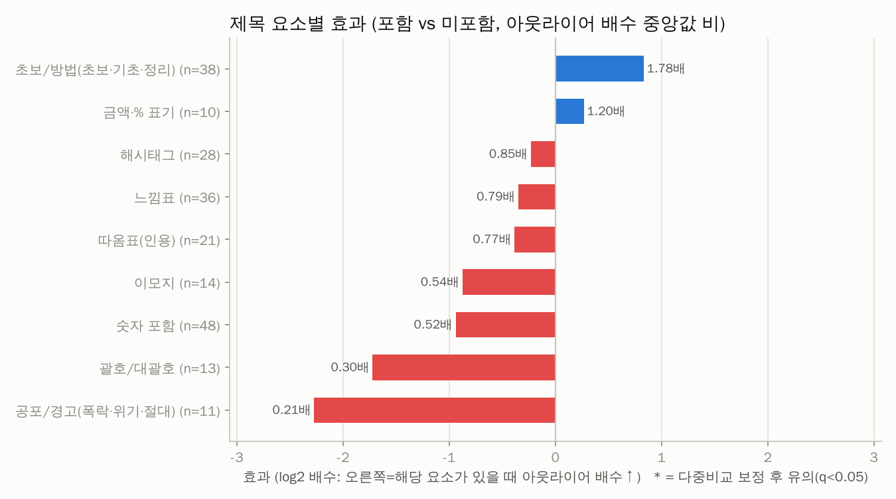
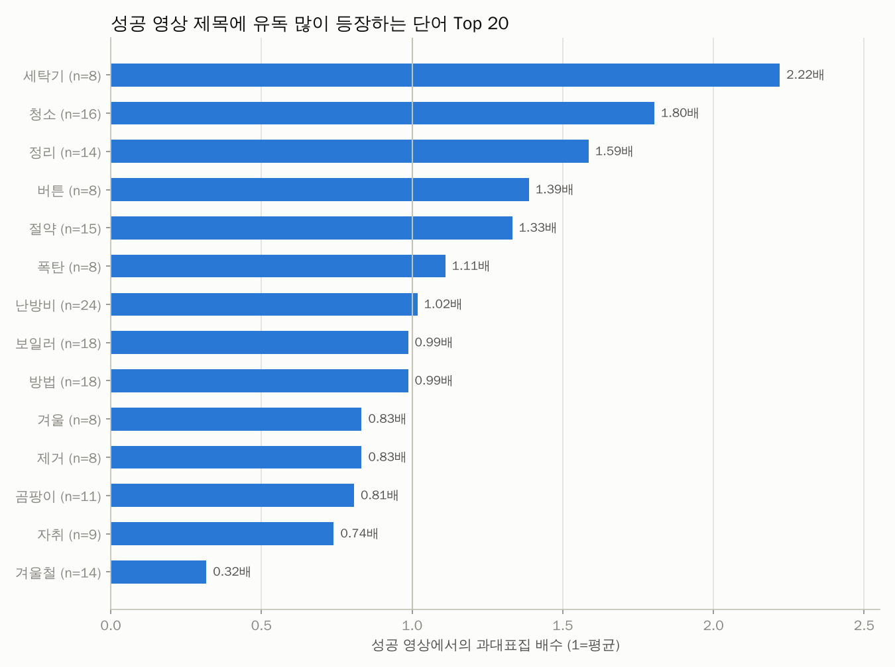
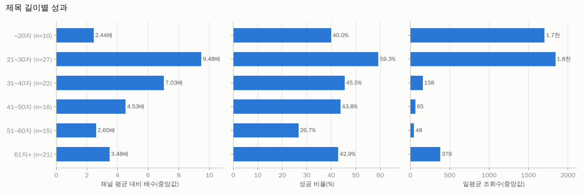

| 제목 요소 | 해당 영상 수 | 배수(있음) | 배수(없음) | 효과(배) | 성공률(있음) | 성공률(없음) | p값 | q값(보정) |
|---|---|---|---|---|---|---|---|---|
| 초보/방법(초보·기초·정리) | 38 | 5.80 | 3.26 | 1.78 | 60.5% | 42.2% | 0.136 | 0.407 |
| 금액·% 표기 | 10 | 4.93 | 4.09 | 1.20 | 60.0% | 47.8% | 0.632 | 0.813 |
| 해시태그 | 28 | 4.10 | 4.82 | 0.85 | 53.6% | 47.3% | 0.761 | 0.857 |
| 느낌표 | 36 | 3.88 | 4.94 | 0.79 | 44.4% | 51.5% | 0.460 | 0.813 |
| 따옴표(인용) | 21 | 3.65 | 4.77 | 0.77 | 42.9% | 50.6% | 0.875 | 0.875 |
| 이모지 | 14 | 2.69 | 4.94 | 0.54 | 28.6% | 52.3% | 0.543 | 0.813 |
| 숫자 포함 | 48 | 3.67 | 7.05 | 0.52 | 43.8% | 53.7% | 0.253 | 0.569 |
| 괄호/대괄호 | 13 | 1.55 | 5.12 | 0.30 | 30.8% | 51.7% | 0.094 | 0.407 |
| 공포/경고(폭락·위기·절대) | 11 | 1.10 | 5.33 | 0.21 | 9.1% | 53.8% | 0.005 | 0.048 |

롱폼/쇼츠 따로 본 제목 요소 효과

| 구분 | 제목 요소 | 영상 수 | 효과(배) | 성공률(있음) | p값 |
|---|---|---|---|---|---|
| 롱폼 | 초보/방법(초보·기초·정리) | 19 | 1.54 | 47.4% | 0.305 |
| 롱폼 | 느낌표 | 21 | 1.27 | 33.3% | 0.912 |
| 롱폼 | 따옴표(인용) | 16 | 1.21 | 37.5% | 0.773 |
| 롱폼 | 숫자 포함 | 29 | 1.12 | 34.5% | 0.891 |
| 롱폼 | 괄호/대괄호 | 8 | 0.31 | 12.5% | 0.070 |
| 쇼츠 | 초보/방법(초보·기초·정리) | 18 | 2.69 | 77.8% | 0.181 |
| 쇼츠 | 해시태그 | 20 | 0.82 | 60.0% | 0.582 |
| 쇼츠 | 느낌표 | 14 | 0.72 | 64.3% | 0.915 |
| 쇼츠 | 숫자 포함 | 19 | 0.41 | 57.9% | 0.473 |

**성공 영상 제목에 유독 많이 나오는 단어** (과대표집 배수 = 성공 영상 내 비중 ÷ 전체 비중)

| 단어 | 영상 수 | 성공 수 | 과대표집 | 배수(중앙) | 일평균 조회수 |
|---|---|---|---|---|---|
| 세탁기 | 8 | 8 | 2.22 | 86.85 | 2.3만 |
| 청소 | 16 | 13 | 1.80 | 13.04 | 1.9천 |
| 정리 | 14 | 10 | 1.59 | 7.09 | 426 |
| 버튼 | 8 | 5 | 1.39 | 9.54 | 598 |
| 절약 | 15 | 9 | 1.33 | 8.43 | 123 |
| 폭탄 | 8 | 4 | 1.11 | 7.00 | 1.2천 |
| 난방비 | 24 | 11 | 1.02 | 4.93 | 175 |
| 보일러 | 18 | 8 | 0.99 | 6.48 | 348 |
| 방법 | 18 | 8 | 0.99 | 4.42 | 77 |
| 겨울 | 8 | 3 | 0.83 | 2.79 | 143 |
| 제거 | 8 | 3 | 0.83 | 2.76 | 114 |
| 곰팡이 | 11 | 4 | 0.81 | 1.83 | 38 |
| 자취 | 9 | 3 | 0.74 | 2.16 | 2.3천 |
| 겨울철 | 14 | 2 | 0.32 | 1.98 | 6 |
| 화재 | 13 | 1 | 0.17 | 1.26 | 4 |
| 장판 | 25 | 1 | 0.09 | 1.06 | 6 |
| 전기 | 26 | 1 | 0.09 | 1.02 | 5 |
| 안전 | 11 | 0 | 0.00 | 0.90 | 1 |

## 4. 🎞️ 포맷 · 길이

> 쇼츠 조회수는 2025년 3월부터 '재생 시작/반복'마다 집계되어 롱폼 조회수와 직접 비교할 수 없습니다. 그래서 **같은 채널·같은 포맷 대비 배수(아웃라이어)** 와 성공 비율로 비교합니다.

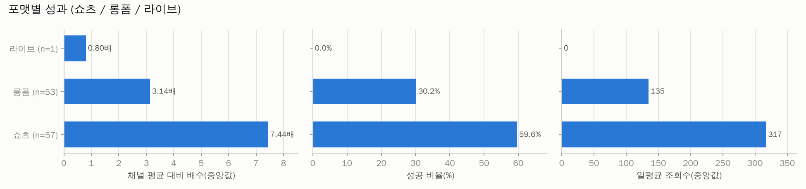
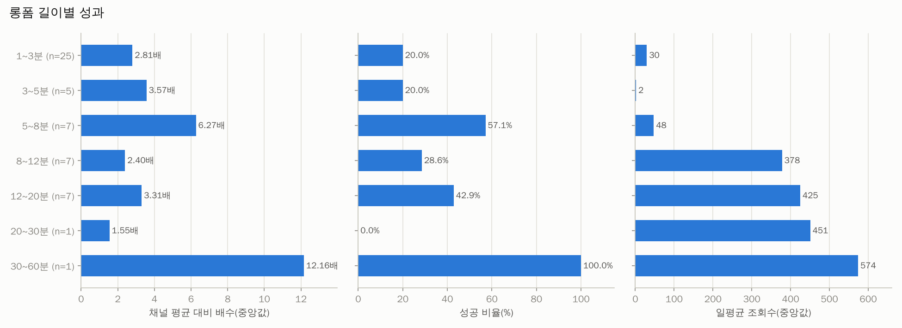

| 포맷 | 영상 수 | 조회수(중앙) | 일평균(중앙) | 배수(중앙) | 성공 비율 | 소규모채널 성공 |
|---|---|---|---|---|---|---|
| 라이브 | 1 | 8 | 0 | 0.80 | 0.0% | 0.0% |
| 롱폼 | 53 | 3.4만 | 135 | 3.14 | 30.2% | 9.4% |
| 쇼츠 | 57 | 7.0만 | 317 | 7.44 | 59.6% | 17.5% |

| 롱폼 길이 | 영상 수 | 조회수(중앙) | 일평균(중앙) | 배수(중앙) | 성공 비율 | 소규모채널 성공 |
|---|---|---|---|---|---|---|
| 1~3분 | 25 | 4.5천 | 30 | 2.81 | 20.0% | 4.0% |
| 3~5분 | 5 | 372 | 2 | 3.57 | 20.0% | 20.0% |
| 5~8분 | 7 | 1.6만 | 48 | 6.27 | 57.1% | 42.9% |
| 8~12분 | 7 | 10.5만 | 378 | 2.40 | 28.6% | 0.0% |
| 12~20분 | 7 | 4.9만 | 425 | 3.31 | 42.9% | 0.0% |
| 20~30분 | 1 | 15.6만 | 451 | 1.55 | 0.0% | 0.0% |
| 30~60분 | 1 | 18.6만 | 574 | 12.16 | 100.0% | 0.0% |

## 5. 🕒 업로드 타이밍 (참고용 — 효과가 작고 혼란변수가 많음)

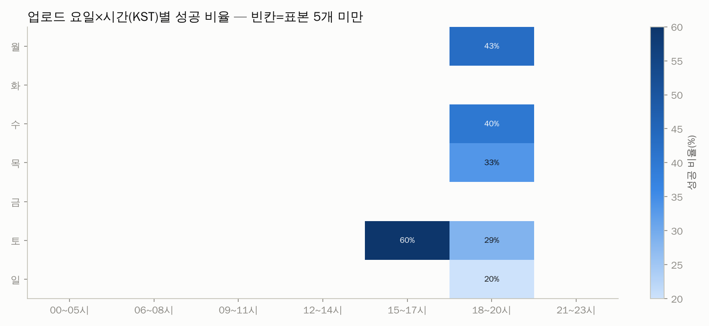

| 요일 | 영상 수 | 조회수(중앙) | 일평균(중앙) | 배수(중앙) | 성공 비율 | 소규모채널 성공 |
|---|---|---|---|---|---|---|
| 월 | 17 | 3.3만 | 318 | 5.80 | 58.8% | 17.6% |
| 화 | 16 | 4.3만 | 127 | 8.71 | 56.2% | 25.0% |
| 수 | 17 | 13.2만 | 385 | 2.40 | 41.2% | 11.8% |
| 목 | 14 | 12.5만 | 356 | 12.33 | 50.0% | 21.4% |
| 금 | 14 | 12.7만 | 384 | 4.62 | 35.7% | 7.1% |
| 토 | 20 | 3.1만 | 147 | 4.43 | 35.0% | 5.0% |
| 일 | 13 | 3.2천 | 13 | 3.31 | 38.5% | 7.7% |

| 시간대(KST) | 영상 수 | 조회수(중앙) | 일평균(중앙) | 배수(중앙) | 성공 비율 | 소규모채널 성공 |
|---|---|---|---|---|---|---|
| 00~05시 | 5 | 2.2천 | 6 | 13.27 | 40.0% | 0.0% |
| 06~08시 | 13 | 15.6만 | 615 | 7.05 | 61.5% | 23.1% |
| 09~11시 | 13 | 2.9만 | 116 | 3.65 | 46.2% | 23.1% |
| 12~14시 | 17 | 3.6만 | 193 | 8.17 | 58.8% | 23.5% |
| 15~17시 | 19 | 18.6만 | 574 | 4.32 | 52.6% | 10.5% |
| 18~20시 | 36 | 3.5만 | 120 | 2.81 | 30.6% | 2.8% |
| 21~23시 | 8 | 8.2만 | 405 | 2.05 | 37.5% | 25.0% |

## 6. 🌱 채널 규모별 분석 — 0명 채널에게 가장 중요한 부분

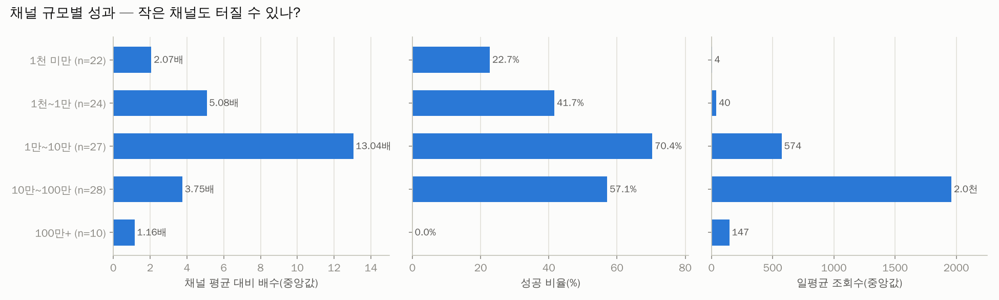
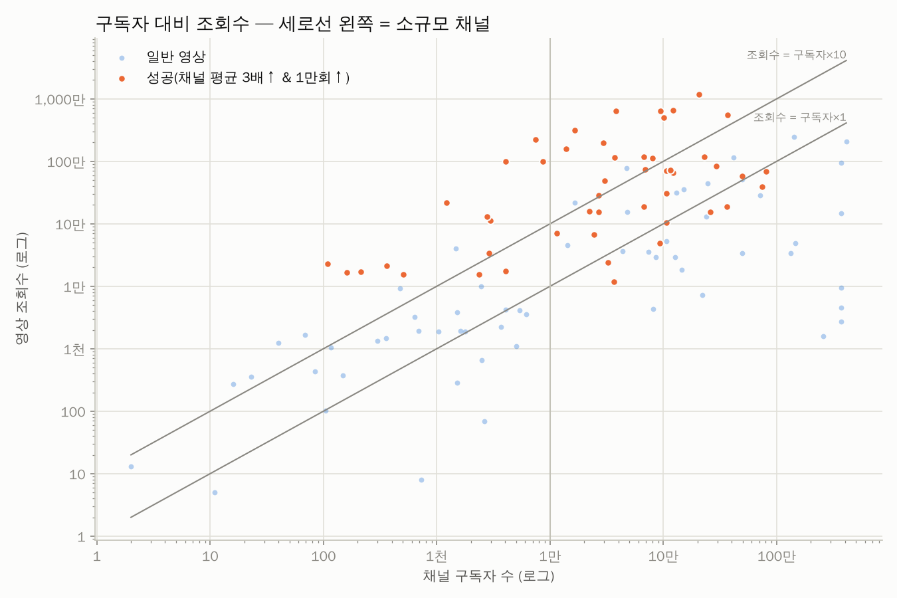

| 구독자 규모 | 영상 수 | 조회수(중앙) | 일평균(중앙) | 배수(중앙) | 성공 비율 | 소규모채널 성공 |
|---|---|---|---|---|---|---|
| 1천 미만 | 22 | 1.3천 | 4 | 2.07 | 22.7% | 22.7% |
| 1천~1만 | 24 | 7.0천 | 40 | 5.08 | 41.7% | 41.7% |
| 1만~10만 | 27 | 18.6만 | 574 | 13.04 | 70.4% | 0.0% |
| 10만~100만 | 28 | 42.0만 | 2.0천 | 3.75 | 57.1% | 0.0% |
| 100만+ | 10 | 4.1만 | 147 | 1.16 | 0.0% | 0.0% |

**개설 1년 이내 채널의 성공 영상** (0개) — 신생 채널이 실제로 터진 사례

_데이터 없음_

## 7. 🔥 최근 14일 이내 급상승 영상 (아직 성과 집계 전 — 트렌드 참고)

| 영상 | 채널 | 구독자 | 조회수 | 일평균 | 경과일 | 포맷 |
|---|---|---|---|---|---|---|
| ["평생 써먹으세요" 옷정리 딱 1번 해두고 20년째 옷장 정리 안할 수 있었던 1…](https://www.youtube.com/watch?v=Bng4uRZuGCM) | 지식의 맛 | 49.7만 | 88.3만 | 11.4만 | 7.7 | 롱폼 |
| [🏠NEW드레스룸 최초공개🏠 환절기 옷 정리를 이렇게 한다고?ㅋㅋㅋ(ft. 손쉬운 …](https://www.youtube.com/watch?v=siTVcW9XFUE) | 뽐뽐뽐 | 83.4만 | 3.7만 | 3.7만 | 0.8 | 롱폼 |
| [여름 옷 넣기 전에 꼭 보세요\| 정리왕 옷정리 방법과 돈 아깝지 않았던 정리템](https://www.youtube.com/watch?v=yu7ptSGRotI) | 정리왕 | 42.1만 | 13.1만 | 1.2만 | 10.8 | 롱폼 |
| [LG 통돌이 세탁기 분해 청소 방법](https://www.youtube.com/watch?v=e2osG1F_hC0) | 좋은하루 \| 에어컨, 세탁기 청소 교육 아카데미 | 2.3만 | 1.3만 | 4.1천 | 3.1 | 롱폼 |
| [막막한 냉장고 정리 \| 딱 3가지만 기억하세요](https://www.youtube.com/watch?v=nhZgadhFemk) | 정희숙의 똑똑한 정리 | 30.2만 | 2.3만 | 2.6천 | 8.7 | 롱폼 |
| [전기장판 켜고 주무시는 60대 겨울 앞두고 점검할 습관 #시니어건강 #60대건강 …](https://www.youtube.com/watch?v=R8wHmfYOVjk) | 쉬운 세상 알림이 | 4.5천 | 2.3천 | 1.4천 | 1.6 | 쇼츠 |
| [전기장판 이렇게 넣어 두면 안 돼요](https://www.youtube.com/watch?v=wYolHP2cfMs) | 뭐든지!! | 49 | 1.1천 | 1.1천 | 0.8 | 쇼츠 |
| [라텍스와 전기장판을 함께 쓰면 위험한 이유 #생활버그연구소 #쇼츠 #과학상식](https://www.youtube.com/watch?v=W-7bWMaLa2A) | 생활버그연구소 | 68 | 1.2천 | 980 | 1.2 | 쇼츠 |
| [🔥 전기장판 안전하게 쓰려면? 꼭 확인할 5가지 #전기장판 #전기장판안전 #전기매…](https://www.youtube.com/watch?v=_WsXT8t6wnI) | Sunlight | 1.1천 | 1.4천 | 858 | 1.7 | 쇼츠 |
| [전기장판 켜기 전 꼭 확인할 3가지｜화재 예방 안전수칙](https://www.youtube.com/watch?v=EqTeAdRYBQg) | 청춘백세 | 96 | 593 | 538 | 1.1 | 쇼츠 |
| [전기장판 화재 원인, 위에 두꺼운 이불을 올리면 열이 갇혀요](https://www.youtube.com/watch?v=BOLFJ9E8hzU) | 쓸모연구소 | 75 | 1.2천 | 124 | 10.0 | 쇼츠 |
| [전기장판｜화재 주의](https://www.youtube.com/watch?v=lGV5LMpt10s) | 황혼놀이터TV | 20 | 796 | 119 | 6.7 | 쇼츠 |
| [전기장판 켜기 전, 이 흔적 보이면 사용하지 마세요. 작년 전기장판 다시 꺼냈다면…](https://www.youtube.com/watch?v=WW6cOktec1E) | 하세용 TV | 27 | 107 | 10 | 10.3 | 롱폼 |
| [전기장판 화재, 제품 불량 탓? O/X 3문제로 확인하는 안전 수칙 \| 현무의 …](https://www.youtube.com/watch?v=TRO7aebXSP0) | 현무의 살림법정 | 1 | 62 | 6 | 11.0 | 쇼츠 |

## 8. 🏆 성공사례 — 대본 · 영상 · 썸네일

선정 기준: 종합점수(아웃라이어 40% + 조회수 35% + 구독자 대비 조회수 25%) 상위, 소규모 채널 ≥50%, 롱폼 ≥50%, 채널당 최대 1개. 각 폴더에 `transcript.txt`(대본), `transcript_timestamped.txt`, `video.mp4`, `thumbnail.jpg`, `metadata.json`, `comments.csv` 가 있습니다.

### 1. [평생써먹는 옷접는법 6가지🩷 #옷정리](https://www.youtube.com/watch?v=6JLUiwOTVYM)

- 채널 **꿀픽** (구독자 7.5천) · 조회수 **222만** · 채널 평균의 **179.2배** · 쇼츠 00:30 · 업로드 2026-03-26 · 카테고리: 4. 정리·수납·살림 노하우 · 검색어: `옷 정리 꿀팁` · 선정: 소규모 채널 쿼터 (점수 93)
- 📁 [`success_cases/01_평생써먹는_옷접는법_6가지_옷정리_6JLUiwOTVYM/`](success_cases/01_평생써먹는_옷접는법_6가지_옷정리_6JLUiwOTVYM/) · 대본: failed · 영상: skipped(DOWNLOAD_VIDEOS=False)

### 2. [여자 혼자서도 가능한 통돌이 부분 분해 청소｜과탄산소다로 안 빠지는 찌든 때 해결법](https://www.youtube.com/watch?v=CaXWx1boXBk)

- 채널 **슬기로운 생활** (구독자 4.1천) · 조회수 **101만** · 채널 평균의 **2,004.2배** · 롱폼 04:32 · 업로드 2025-11-30 · 카테고리: 3. 청소 (주방·가전·화장실) · 검색어: `세탁기 청소 방법` · 선정: 소규모 채널 쿼터 (점수 92)
- 📁 [`success_cases/02_여자_혼자서도_가능한_통돌이_부분_분해_청소_과탄산소다_CaXWx1boXBk/`](success_cases/02_여자_혼자서도_가능한_통돌이_부분_분해_청소_과탄산소다_CaXWx1boXBk/) · 대본: failed · 영상: skipped(DOWNLOAD_VIDEOS=False)

### 3. [보일러 '이 버튼'만 누르세요! 올겨울 난방비 폭탄 걱정 싹 사라집니다ㅣ보일러 사용 꿀팁](https://www.youtube.com/watch?v=7B4sl1P_YHs)

- 채널 **황혼의 편지** (구독자 3.7만) · 조회수 **114만** · 채널 평균의 **1,512.9배** · 롱폼 19:29 · 업로드 2025-11-06 · 카테고리: 1. 난방비·전기세·관리비 절약 · 검색어: `난방비 절약 꿀팁` · 선정: 롱폼 쿼터 (점수 86)
- 📁 [`success_cases/03_보일러_이_버튼_만_누르세요_올겨울_난방비_폭탄_걱정_7B4sl1P_YHs/`](success_cases/03_보일러_이_버튼_만_누르세요_올겨울_난방비_폭탄_걱정_7B4sl1P_YHs/) · 대본: failed · 영상: skipped(DOWNLOAD_VIDEOS=False)

### 4. [세탁기에 과탄산 절대 그냥 넣지 마세요](https://www.youtube.com/watch?v=sWPCxoJYUo8)

- 채널 **살림법사** (구독자 8.7천) · 조회수 **100만** · 채널 평균의 **107.4배** · 쇼츠 00:25 · 업로드 2026-08-03 · 카테고리: 3. 청소 (주방·가전·화장실) · 검색어: `세탁기 청소 방법` · 선정: 소규모 채널 쿼터 (점수 85)
- 📁 [`success_cases/04_세탁기에_과탄산_절대_그냥_넣지_마세요_sWPCxoJYUo8/`](success_cases/04_세탁기에_과탄산_절대_그냥_넣지_마세요_sWPCxoJYUo8/) · 대본: failed · 영상: skipped(DOWNLOAD_VIDEOS=False)

### 5. [자취 11년차가 알려준 자취꿀팁 5가지](https://www.youtube.com/watch?v=wLB3E6kSFO4)

- 채널 **득템** (구독자 10.1만) · 조회수 **497만** · 채널 평균의 **20.8배** · 롱폼 01:03 · 업로드 2026-05-07 · 카테고리: 5. 자취·이사 · 검색어: `첫 자취 꿀팁` · 선정: 롱폼 쿼터 (점수 78)
- 📁 [`success_cases/05_자취_11년차가_알려준_자취꿀팁_5가지_wLB3E6kSFO4/`](success_cases/05_자취_11년차가_알려준_자취꿀팁_5가지_wLB3E6kSFO4/) · 대본: failed · 영상: skipped(DOWNLOAD_VIDEOS=False)

### 6. [집안일(자취) 안해 본 티가 난다고 한다...](https://www.youtube.com/watch?v=s0j52LNPzeM)

- 채널 **꽁주부** (구독자 36.9만) · 조회수 **555만** · 채널 평균의 **27.0배** · 쇼츠 00:47 · 업로드 2025-10-23 · 카테고리: 5. 자취·이사 · 검색어: `첫 자취 꿀팁` · 선정: 종합점수 상위 (점수 78)
- 📁 [`success_cases/06_집안일_자취_안해_본_티가_난다고_한다_s0j52LNPzeM/`](success_cases/06_집안일_자취_안해_본_티가_난다고_한다_s0j52LNPzeM/) · 대본: failed · 영상: skipped(DOWNLOAD_VIDEOS=False)

### 7. [2개만 설정하면 난방비 절약돼요! 난방비 절약팁  #겨울난방비 #가스비절약 #난방비절약 #주부꿀팁 #살림노하우 #난방비폭탄 #…](https://www.youtube.com/watch?v=s4ok4LOEjCY)

- 채널 **지디노 살림** (구독자 3.0만) · 조회수 **49.3만** · 채널 평균의 **111.7배** · 쇼츠 00:41 · 업로드 2026-01-03 · 카테고리: 1. 난방비·전기세·관리비 절약 · 검색어: `가스비 절약방법` · 선정: 종합점수 상위 (점수 74)
- 📁 [`success_cases/07_2개만_설정하면_난방비_절약돼요_난방비_절약팁_겨울난방_s4ok4LOEjCY/`](success_cases/07_2개만_설정하면_난방비_절약돼요_난방비_절약팁_겨울난방_s4ok4LOEjCY/) · 대본: failed · 영상: skipped(DOWNLOAD_VIDEOS=False)

### 8. [식재료낭비, 이렇게 해결했어요💸 유지는 쉽고 낭비는 줄이는 정리법](https://www.youtube.com/watch?v=5DNIBut0mP0)

- 채널 **똑살림_똑소리 나는 살림 ** (구독자 2.8천) · 조회수 **13.1만** · 채널 평균의 **56.0배** · 롱폼 07:01 · 업로드 2025-11-05 · 카테고리: 4. 정리·수납·살림 노하우 · 검색어: `냉장고 정리 꿀팁` · 선정: 소규모 채널 쿼터 (점수 65)
- 📁 [`success_cases/08_식재료낭비_이렇게_해결했어요_유지는_쉽고_낭비는_줄이는_5DNIBut0mP0/`](success_cases/08_식재료낭비_이렇게_해결했어요_유지는_쉽고_낭비는_줄이는_5DNIBut0mP0/) · 대본: failed · 영상: skipped(DOWNLOAD_VIDEOS=False)

## 9. 💬 시청자 질문 (성공 영상 댓글에서 추출) — 다음 영상 주제 후보

질문 댓글에 많이 나오는 단어: `청소`(26), `세탁기`(16), `온돌`(13), `곰팡이`(13), `락스`(13), `세제`(12), `방법`(12), `온도`(11), `다이소`(10), `사람`(10), `제품`(10), `냄새`(9), `사용`(9), `감사`(9), `소다`(9), `기사`(9), `시간`(8), `욕실`(8), `모드`(8), `온수`(7)

| 질문 댓글 | 좋아요 | 영상 |
|---|---|---|
| 댓글링크 요청해주세요 >< 이지랄없이 다 알려주니까 좋네 | 2,474 | [청소알바만 60곳 넘게 한 경력자가 딱 정해드…](https://www.youtube.com/watch?v=Ti_cQ22Llk0) |
| 와 미쳤다. 진짜 50평생 인생 살면서 젤 가는 꿀팁이다. 선생님 천재세요? | 2,472 | [비닐 1장으로 화장실 손안대고 청소하는 꼼수](https://www.youtube.com/watch?v=qrQFoxo8-UI) |
| 푹푹 찌는 삼복 더위에 시댁에 가서 신랑이 "시원하게 비빔국수나 먹을까요?" 하길래 "쳐먹는 너나 시원하지 라고 금방 어무니가 맘속으로 그랬어 내가 들었어" 했더니 시엄니랑 신랑 겁나 웃음. 그 뒤로는 웬만하면 모시고 나가서 외식함. | 1,356 | [집안일(자취) 안해 본 티가 난다고 한다...](https://www.youtube.com/watch?v=s0j52LNPzeM) |
| 나는 부모님이 손하나 까딱 안하게 키우셨는데 (여자임) 자취하면서 사니까 자연스럽게 하나씩 알게되던데.. 지인 집 놀러가서도 거기서 배우는 것들도 생기기도 하고. 자연스럽게 살림에 관심 생기면서 본집 오면 엄마가 어떻게 살림 하시는지도 눈에 들어옴.  | 1,216 | [집안일(자취) 안해 본 티가 난다고 한다...](https://www.youtube.com/watch?v=s0j52LNPzeM) |
| 와 근데 이걸 영상으로 알려줘야한다는 거 자체가ㅋㅋㅋ 집안 교육 문제 아닌가요? 이 지경인 사람하고는 진심 결혼 못할듯 | 564 | [집안일(자취) 안해 본 티가 난다고 한다...](https://www.youtube.com/watch?v=s0j52LNPzeM) |
| ㅋㅋㅋㅋ 큰거 볼 일 보면서 앉아 있다가 갑자기 들었던 생각이 배수구 막고 물 계속 틀어 놓으면 어느 정도 물이 욕실 바닥에 차지 않을까? 싶어서 큰 요거트 통 가져 와서 배수구 막고 통 움직이지 말라고 행주 같은거 물 먹여서 덮어 놓고 그 위로 대야 | 559 | [비닐 1장으로 화장실 손안대고 청소하는 꼼수](https://www.youtube.com/watch?v=qrQFoxo8-UI) |
| 저게 분리 되는거였어? | 315 | [세탁기 수리 기사님이 현장에서 몰래알려준 AS…](https://www.youtube.com/watch?v=uqh5MqmwJ3o) |
| 청소한 지 한 달이요? 그렇게나 자주 해줘야 하는 거였어? | 244 | [세탁기 청소 이렇게 안하면 헛수고입니다](https://www.youtube.com/watch?v=6D5YEei6iZ4) |
| 저게 집안일 해봐야 하는 행동임...? 그정도로 머리나쁜 사람이 많다고...? | 222 | [집안일(자취) 안해 본 티가 난다고 한다...](https://www.youtube.com/watch?v=s0j52LNPzeM) |
| 전에 프레이포잇 추천하지 않으셨나요 용도가 다른가요?? 따라샀는데 ㅠ | 205 | [청소알바만 60곳 넘게 한 경력자가 딱 정해드…](https://www.youtube.com/watch?v=Ti_cQ22Llk0) |
| 🔔자취하면서 돈 못 모으는 이유? 🛒 제품이 궁금하시면? 영상 좌측 상단 ‘스티커‘ 클릭 (or 영상 좌측 하단 ’제품보기’ 클릭) 1. 마트 가면 호구입니다 - 인터넷이 훨씬 쌈 (마트는 야채, 계란만 구매) - 특히 수입 전지, 브라질 닭정육 가성 | 174 | [자취 11년차가 알려준 자취꿀팁 5가지](https://www.youtube.com/watch?v=wLB3E6kSFO4) |
| 맞아요 왜 물컵을 건조도안했는데 선반에 두는지모르겠음ㅡㅡ | 171 | [집안일(자취) 안해 본 티가 난다고 한다...](https://www.youtube.com/watch?v=s0j52LNPzeM) |
| 참치 반찬통 냉장 보관 맛이 이상하게 변하지않나요? | 136 | [자취 11년차가 알려준 자취꿀팁 5가지](https://www.youtube.com/watch?v=wLB3E6kSFO4) |
| 와 진짜 우리 아부지만 맨날 ‘출출한데 간단하게 국수나 해먹을까?’ 이러는 줄- 와 소오름- 와우- 진짜 살림 안해본 사람들이 어디 시장 국수가게에서 호로록 한그릇 뚝딱 말아내오는거보고 집와서 저딴말 하는거구나... 와- 우리 엄마는 아빠 입에서 국수 | 109 | [집안일(자취) 안해 본 티가 난다고 한다...](https://www.youtube.com/watch?v=s0j52LNPzeM) |
| 주방에 자주 들어가 재료 손질 그리고 요리를 안해봤기때문에 간단하게 국수 먹자 간단하게 김밥 해먹자 간단하게 찌개 해먹자 간단하게 비빔밥 해먹자 하는거임 비빔밥 재료는 누가 만들어주냐?ㅋㅋㅋㅋㅋㅋㅋㅋㅋㅋㅋㅋ | 81 | [집안일(자취) 안해 본 티가 난다고 한다...](https://www.youtube.com/watch?v=s0j52LNPzeM) |
| 저건 기저에 평소 살림하는 부모님을 어떻게 생각했냐가 중요함 그리고 본인 성향도 중요함 신기하게도 부부가 서로를 귀찮게 안하고 묵묵히 본인이 그냥 하는 스타일이면 자식들도 부모한테 다 떠맡기는 행동을 안함 이건 진짜임 우리 아빠도 30년째 엄마한테 배 | 65 | [집안일(자취) 안해 본 티가 난다고 한다...](https://www.youtube.com/watch?v=s0j52LNPzeM) |
| 화장실 줄눈 찌든 때 없앤다고 락스 세제 뿌려서 청소하세요? 락스 냄새에 머리도 아플때 이렇게 해보세요 1. 치약 2스푼과 베이킹소다 1스푼을 섞어주세요 2. 줄눈에 바른후 10분 정도 방치해주세요 3. 살짝만 솔로 문질러도 금방 깨끗해져 있을거예요 | 55 | [화장실 줄눈 찌든 때 락스말고 이걸 쓰세요 #…](https://www.youtube.com/watch?v=rtkcHQKqvOc) |
| 여기 기사님계시면 설명부탁해요 저게 빠지는거구 저렇게 청소해도 되는건가요? | 52 | [세탁기 수리 기사님이 현장에서 몰래알려준 AS…](https://www.youtube.com/watch?v=uqh5MqmwJ3o) |
| 이게 다 요리영상들 제목때문이쟈나 초간단10분요리, 똥손도 만들줄아는요리,의외로 쉬운 레시피 등등..근데 이거다 따라하고난후 설거지는 산처럼 쌓여있다.간단히 파만 썰어도 일단 칼부터 시작해서 부피큰 도마 씽크대에 넣어야되서 꽉참.간단한 계란지단? 후라 | 52 | [집안일(자취) 안해 본 티가 난다고 한다...](https://www.youtube.com/watch?v=s0j52LNPzeM) |
| 원가 절감? 결국 버린 돈이 많습니다 | 51 | [자취 11년차가 알려준 자취꿀팁 5가지](https://www.youtube.com/watch?v=wLB3E6kSFO4) |

## 10. 🔖 태그 분석 (성공 영상에서 과대표집된 태그)

| 태그 | 영상 수 | 성공 수 | 과대표집 | 배수(중앙) |
|---|---|---|---|---|
| 생활꿀팁 | 10 | 5 | 1.11 | 6.88 |
| 난방비절약 | 8 | 4 | 1.11 | 3.67 |

**아웃라이어 배수와의 순위상관(스피어만)** — 절댓값 0.1 미만은 사실상 무관

| 지표 | 상관계수 |
|---|---|
| like_rate | 0.027 |
| comment_rate | -0.012 |
| title_len | -0.122 |
| duration_sec | -0.149 |
| subscribers | 0.098 |
| channel_age_days | -0.782 |
| uploads_per_week | -0.290 |

## 11. ✅ 0명 채널 실행 체크리스트

1. **검색형 키워드로 시작**: 위 기회점수 상위 키워드는 '검색 → 유입'이 가능한 주제입니다. 구독자가 없을 때는 추천 피드보다 검색 유입이 먼저 열립니다.
2. **제목 = 검색어 + 검증된 제목 요소**: 키워드를 제목 앞쪽에 넣고, 3장의 효과 요소를 1~2개만 조합하세요 (과장은 시청 지속률을 떨어뜨립니다).
3. **첫 30초(쇼츠는 첫 3~5초)**: 8장 성공사례의 '도입부'를 비교해 공통 구조(질문 제기 → 결론 예고 → 근거)를 따라 해보세요.
4. **롱폼 1개 → 쇼츠 2~3개 재가공**: 같은 주제를 두 포맷으로 내보내 제작 효율과 노출 채널을 동시에 늘립니다.
5. **업로드 빈도**: 성공한 소규모 채널의 업로드 빈도 중앙값은 주 1.4회입니다. 꾸준함이 우선입니다 (최소 주 1~2회 롱폼 + 쇼츠).
6. **댓글 질문을 다음 영상으로**: 9장의 질문이 바로 수요가 검증된 다음 주제입니다.
7. **주식/금융 주제 주의**: 특정 종목 매수·매도 권유, 수익 보장 표현은 피하고 '투자 권유 아님' 고지를 넣으세요. 유료 리딩방·1:1 종목 추천처럼 대가를 받고 투자 판단을 조언하면 자본시장법상 유사투자자문업 신고 대상이 될 수 있습니다 (사업화 전 확인 필요).
8. **2~4주마다 재분석**: 트렌드는 빠르게 바뀝니다. 이 노트북을 다시 실행해 키워드 순위 변화를 확인하세요.

## 12. 📐 방법론 · 한계 · 재현 정보

- **아웃라이어 배수** = 영상 조회수 ÷ 같은 채널 최근 업로드 50개(업로드 14일 이상 경과, 같은 포맷 우선, 해당 영상 제외)의 조회수 중앙값. 구독자 수와 무관하게 '주제·제목·썸네일의 힘'을 보는 지표입니다.
- **분석 분할**: 성과 분석은 업로드 후 14일 이상 ~ 365일 이내 영상만 사용 (2025-10-12 ~ 2026-09-19). 그보다 최근 영상은 7장(급상승)에서만 참고.
- **미래 정보 누수 방지**: 모든 지표는 수집 시점에 관측 가능한 값만 사용하며, 기준선에서 대상 영상 자신을 제외했습니다.
- **주제 관련성 필터**: 제목·태그에 관련어(생활꿀팁, 생활 꿀팁, 살림, 청소, 세탁, 빨래, 수납, 곰팡이 등)가 있거나 설명란에 2번 이상 나와야 분석·성공사례에 포함 ('청소년, 대표이사, 이사회, 이사장, 사외이사, 게임 꿀팁' 같은 표현은 먼저 제거). 이번 실행 제외 16개.
- **한계**: ① search.list 결과는 YouTube가 고른 표본이며 개인화되지 않은 결과입니다. ② 오래된 영상일수록 조회수가 누적되어 배수가 커질 수 있습니다 (채널 최근 업로드가 짧은 기간에 몰린 경우). ③ 썸네일·시청 지속률·CTR 등 핵심 내부 지표는 API로 볼 수 없습니다. ④ 제목 요소 효과는 상관관계이며 주제·채널 특성과 섞여 있습니다. ⑤ 쇼츠 판별은 길이 + youtube.com/shorts 응답으로 추정합니다.
- **재현성**: 랜덤 시드 42, 캐시 TTL 24시간, API 호출 {'search': 13, 'videos': 341, 'channels': 8, 'playlistItems': 327, 'commentThreads': 30}, 캐시 적중 {'playlistItems': 31}
- **저작권**: 성공사례 대본·영상은 개인 학습·분석용입니다. 재업로드·재배포하지 마세요. 공개 저장소에는 영상 파일을 올리지 않는 것이 기본값입니다.

**이번 실행의 경고/주의 사항**

- ［INIT］ ⚠️ 위험/비용 관련 설정이 기본값과 다릅니다 key=DOWNLOAD_VIDEOS default=True current=False
- ［KEYWORD］ 일부 자동완성(수요 점수) 요청 실패 → 해당 접두어는 수요 0으로 계산 n_failed=90
- ［SUCCESS］ 모든 대본 수집 실패 — YouTube 차단(봇 확인) 또는 네트워크 문제일 수 있음 hint="VPN 끄기 / cookies.txt를 스크립트 폴더에 두고 다시 실행"

## 13. 📁 파일 목록

- `README.md` (이 리포트) · `analysis.xlsx` (모든 표) · `data/*.csv` · `charts/*.png` · `success_cases/` · `run_info.json` · `run_log.txt`
