# 음악 — 성공 사례 분석 (지시사항 재료)

자동 생성 — `tools/success_analysis.py` v1.4.1 (2026-10-16 13:16 UTC), 규칙 `music/analysis_rules.toml` v1.2. **이 문서는 숫자와 원문만 담는다 — 해석·지시사항은 이것을 읽는 AI 가 만든다.** 주별 추세는 `weekly.md`, 승인한 영상 전부는 `approved.md`. ※ 연구·교육용 — 투자 권유가 아님.

## 0. 자료와 한계

| 자료 | 수 |
|---|---|
| 사례 폴더 (설명·자막·댓글·썸네일을 받은 영상) | 482 (웹 승인 482) |
| **성공 사례** — 180일 안·구독자 50,000 이하·조회수 ≥ 구독자 × 3·10,000회 이상·4분 이상, 채널당 2개 | **360** (기준 통과 449 − 뺀 것 2 − 채널당 제한 87) |
| 성공 사례의 글 출처 (자막·음성인식·설명·없음) | 설명 313 · 없음 47 |
| 성공 사례 대본 — 전체 · 앞부분만(음성인식 1차) · 없음 | 0 · 0 · 360 |
| 같은 채널 기준선 (채널 평소 영상) | 성공 사례 21/360 · 채널 13곳 (잘된 영상 57 · 평소 영상 62) |
| 성공 사례 댓글 (받은 / 달린) | 61,799 / 64,995 |
| 성공 사례 썸네일 | 360 |
| 비교 집단 — 탐색에서 본 영상 중 구독자 50,000 이하·4분 이상·365일 안·주제 관련, 채널당 최근 5개 | 1010 (성공 508 = 50%, 채널당 제한으로 뺀 507) |
| 자료를 받지 않은 성공 후보 (웹 화면에서 승인하면 들어감 — 채널당 자리가 남은 것만) | 13 (자리가 찬 채널의 58개 뺌) |
| 수요·공급 시장 — 최근 90일 영상 (채널 크기 상관없음) | 504 · 검색어 48 · 자동완성 말 410 (공급 확인 0) |
| 채널 성장 자료 (개설일이 있는 채널) | 763 (빨리 크는 작은 채널 25) |

성공 기준은 넘었지만 뺀 영상: Happy Morning Jazz 🎶 January … (광고 의심(좋아요·댓글 거의 없음)) · SMZ DEEP - Ghost (Gangster Mu… (광고 의심(좋아요·댓글 거의 없음))

**한계**

- 대본(자막·음성인식)이 없는 성공 사례 360개 (#1, #2, #3, #4, #5, #6, #7, #8, #9, #10, #11, #12, #13, #14, #15, #16, #17, #18, #19, #20, #21, #22, #23, #24, #25, #26, #27, #28, #29, #30 …) — 설명란·챕터만 있음. 도입부·구성·말 속도는 대본이 있는 0개로만 셌다 (음성인식이 끝나면 다시 셈)
- 댓글을 다 받지 못한 성공 사례 28개 (받은 61,799 / 달린 64,995개 — 할당량이 끝나면 다음에 이어 받음)
- 비교 집단 1010개 = 검색(조회수 순 — 잘된 영상 쪽으로 치우침)·추가한 채널·성공 사례 채널의 평소 영상 63개 (치우침 없음) 에서 올린 지 7~365일 영상, 성공 비율 50% — 실제 시장 비율이 아니다. 같은 집단 안의 '있음/없음' 차이로만 보고, '무엇이 먹혔나'는 1-2번(같은 채널 안)을 먼저 보라
- 같은 채널 기준선이 있는 성공 사례 21/360개 (채널 영상이 5개 미만이거나 아직 못 받음)
- 수요·공급의 '시장'은 탐색·검색에서 본 최근 90일 영상 504개 — 검색이 조회수 순이라 조회수 적은 영상이 덜 잡힌다. 주제 묶음 사이의 상대 비교(지수)로만 보라
- 자동완성 말의 '최근 영상 수'는 우리가 본 영상만 셌다 — 실제 공급은 웹 화면 [공급 확인](말 하나에 검색 1번 = 100단위)으로 확인
- 자동완성 말에는 책·방송·사람·채널 이름도 섞인다 (예: '…를 찾아서'·'…지침서') — 영상 주제가 아닌 말은 건너뛰고 읽어라
- 채널의 최근 구독자 증가는 구독자 수를 3일 넘게 사이를 두고 두 번 이상 받아야 나온다 (7일마다 다시 받음)
- '구독자가 많이 모이는가'는 YouTube API 로 영상별 구독 증가를 볼 수 없다 — 대신 채널 성장(7번: 개설 뒤 월 구독자·받을 때마다 남긴 기록), '구독·다음 기대' 댓글, 배수(조회수÷구독자)로 본다
- 댓글 갈래·제목 특징은 낱말 규칙이라 거칠다 (물음표 반문도 '질문', 한 댓글이 여러 갈래). 원문 인용을 함께 보라
- '눈에 띔'은 차이가 크고 표본이 충분하다는 표시일 뿐 원인이 아니다

## 1. 성공 사례 (360개 — 배수 큰 순)

배수 = 조회수 ÷ 구독자. **채널 평소 대비** = 조회수 ÷ 그 채널 최근 롱폼 조회수 중앙값 (같은 채널 기준선 — 클수록 그 영상만의 힘). 썸네일은 5번(장마다 20개, 번호 = #), 사례별 자세히는 **`analysis_cases_01.md` …** (9번).

| # | 제목 | 채널 | 구독자 | 조회수 | 배수 | 채널 평소 대비 | 하루 조회수 | 길이 | 업로드 | 주제 묶음 | 형식 | 글 출처 | 댓글 받은/달린 |
|---|---|---|---|---|---|---|---|---|---|---|---|---|---|
| 1 | [너의 차선](https://www.youtube.com/watch?v=B9zWtLub7tk) | 조선힙합 - Topic | 25 | 1,504,015 | 15,040.1 | – | 14,151.6 | 4.2분 | 2026-07-02 | 11. 힙합·R&B·EDM | 정보·해설 | 설명 | 0/50 |
| 2 | [노엘 IT'S YOU (한요한 없는 버전 10m)](https://www.youtube.com/watch?v=82Li_A-cPWA) | 갱갱 | 77 | 444,615 | 4,446.1 | – | 2,779.5 | 10.3분 | 2026-05-09 | 기타 | 플레이리스트·모음 | 설명 | 123/123 |
| 3 | [그대 사랑하는사람 나였으면](https://www.youtube.com/watch?v=E0EJikB3jg4) | ㅠㅁㅠ | 191 | 303,352 | 1,588.2 | – | 5,600.0 | 27.9분 | 2026-08-23 | 기타 | 정보·해설 | 없음 | 79/79 |
| 4 | [[playlist] 일하다 어깨 들썩이는 케이팝 노동요 ∣∣ 4K MV](https://www.youtube.com/watch?v=whggKiGBSx4) | 노래듣는 고영희 | 2,390 | 3,680,418 | 1,539.9 | – | 50,837.5 | 148.4분 | 2026-08-05 | 3. 공부·집중·작업 | 플레이리스트·모음 | 설명 | 193/193 |
| 5 | [ℙ𝕝𝕒𝕪𝕃𝕚𝕤𝕥 : 늙크크들 원기 회복시킬 애니 플리](https://www.youtube.com/watch?v=RbGKWnzZ0zI) | 연하네의 쓸만한 플레이리… | 826 | 1,089,133 | 1,318.6 | – | 19,397.2 | 124.7분 | 2026-08-21 | 기타 | 플레이리스트·모음 | 설명 | 348/348 |
| 6 | [[Playlist] 코로나 전 오묘한 케이팝](https://www.youtube.com/watch?v=u7X8DqyBr64) | 원영 | 275 | 351,310 | 1,277.5 | – | 4,217.4 | 16.4분 | 2026-07-25 | 10. 팝송·K팝·J팝 | 플레이리스트·모음 | 없음 | 331/331 |
| 7 | [𝐑 𝐄 𝐙 𝐄](https://www.youtube.com/watch?v=mkRnOwNkpaQ) | iamkorean | 767 | 917,157 | 1,195.8 | – | 5,699.2 | 17분 | 2026-05-08 | 기타 | 음악 | 설명 | 211/211 |
| 8 | [어른여자.mp3](https://www.youtube.com/watch?v=Ir8CBRecz7g) | 리 세이 | 510 | 588,809 | 1,154.5 | – | 3,746.1 | 16분 | 2026-05-12 | 기타 | 플레이리스트·모음 | 설명 | 83/83 |
| 9 | [별로 좋지 않은 하루를 보냈다고 생각할게](https://www.youtube.com/watch?v=wEwVgzsbqH4) | 니똥칼라똥 | 454 | 521,623 | 1,149.0 | – | 4,208.9 | 18.9분 | 2026-06-14 | 기타 | 플레이리스트·모음 | 없음 | 111/111 |
| 10 | [𝗣𝗹𝗮𝘆𝗹𝗶𝘀𝘁 가을 설레발 플리](https://www.youtube.com/watch?v=ams0ZufCafU) | 또잉 | 224 | 247,986 | 1,107.1 | – | 5,062.1 | 19.6분 | 2026-08-28 | 기타 | 플레이리스트·모음 | 없음 | 17/17 |
| 11 | [[ 2024~2026 K-POP ] 최신곡 포함❗️ 랜덤 플레이 댄스 #랜덤플레이댄스 #kpop #2024…](https://www.youtube.com/watch?v=JnuZqf_O2N0) | 메이플 | 1,120 | 1,202,624 | 1,073.8 | – | 14,953.4 | 12.6분 | 2026-07-28 | 10. 팝송·K팝·J팝 | 한 곡 | 없음 | 86/86 |
| 12 | [어 난데 여기 핫플이야](https://www.youtube.com/watch?v=JcIBpx-tGdA) | 햄 | 673 | 713,636 | 1,060.4 | – | 4,459.3 | 24.1분 | 2026-05-09 | 기타 | 정보·해설 | 없음 | 84/84 |
| 13 | [[𝐏𝐥𝐚𝐲𝐥𝐢𝐬𝐭] 사랑한다고 속삭여줘](https://www.youtube.com/watch?v=Tt_TimRh73Q) | 뜨신아아 | 1,060 | 1,016,651 | 959.1 | – | 8,073.2 | 23.4분 | 2026-06-12 | 기타 | 플레이리스트·모음 | 설명 | 60/60 |
| 14 | [이게 삶이더라고｜세월 끝에 깨닫는 인생 이야기｜감성 발라드](https://www.youtube.com/watch?v=QalAq2cvw8U) | 웃음콘서트TV | 2,660 | 1,615,673 | 607.4 | – | 11,024.5 | 5.4분 | 2026-05-23 | 9. 가요·발라드·트로트 | 한 곡 | 설명 | 334/334 |
| 15 | [[𝐩𝐥𝐚𝐲𝐥𝐢𝐬𝐭] 띵곡들만 모아놓은 애니 노동요 OST 플리💿](https://www.youtube.com/watch?v=16zIXIea0_U) | ASMRuru_루루 | 890 | 539,738 | 606.5 | – | 4,173.6 | 54.4분 | 2026-06-09 | 3. 공부·집중·작업 | 플레이리스트·모음 | 설명 | 91/91 |
| 16 | [𝐩𝐥𝐚𝐲𝐥𝐢𝐬𝐭 느좋 인스타 감성](https://www.youtube.com/watch?v=RG-8iv6ORFY) | 알수없는 사용자 | 1,730 | 996,946 | 576.3 | – | 15,257.0 | 27분 | 2026-08-12 | 기타 | 플레이리스트·모음 | 설명 | 94/94 |
| 17 | [[𝐏𝐥𝐚𝐲𝐥𝐢𝐬𝐭] 그리고 난 다시 사랑에 빠질수 밖에 없었어](https://www.youtube.com/watch?v=cIlJK2Pfhm8) | 느좋을 추구합니다 | 1,030 | 527,120 | 511.8 | – | 9,556.4 | 18.1분 | 2026-08-22 | 기타 | 플레이리스트·모음 | 없음 | 177/177 |
| 18 | [🍂 가을이 오면 생각나는 노래 ∣ 커피 한 잔과 함께 듣는 가을 감성 플레이리스트 ☕](https://www.youtube.com/watch?v=Fc7JJxJBgJA) | enuscento-에뉴센토 | 710 | 360,087 | 507.2 | – | 8,344.8 | 114.3분 | 2026-09-03 | 4. 카페·매장·라운지 | 플레이리스트·모음 | 설명 | 62/62 |
| 19 | [[ 𝐏𝐥𝐚𝐲𝐥𝐢𝐬𝐭 ] 적당히 신나는 그루브 힙합 플레이리스트 ∣ Chill R&B • Cafe Music](https://www.youtube.com/watch?v=p3tvSF3BgYM) | SSoundW | 4,020 | 1,914,311 | 476.2 | – | 34,171.4 | 89.9분 | 2026-08-21 | 8. 로파이·시티팝·칠 | 플레이리스트·모음 | 설명 | 253/253 |
| 20 | [Relaxing Jazz Café in Paris ∣ Rainy Evening Jazz Ambience w…](https://www.youtube.com/watch?v=eR37WB9IE9E) | European Jazz… | 1,240 | 590,076 | 475.9 | – | 4,524.5 | 14.4분 | 2026-06-08 | 2. 자연 소리·백색소음 | 음악 | 설명 | 24/24 |
| 21 | [모르는 노래 없는!! 2026 랜덤플레이댄스🍋 ∣ 랜플댄 ∣ 랜플💫 ∣ 모르는 노래 없는 랜플댄🩷 ∣ 케이…](https://www.youtube.com/watch?v=tAJM1fttdG0) | 바나나한 바냐 | 577 | 252,093 | 436.9 | – | 3,905.6 | 5.1분 | 2026-08-13 | 10. 팝송·K팝·J팝 | 음악 | 없음 | 36/36 |
| 22 | [🌊 여름에 듣기 좋은 노래☀️ 하루 종일 듣기 좋은 여름 플레이리스트 🌴 바다로 떠나고 싶어지는 여름 노래…](https://www.youtube.com/watch?v=L-pbTsp8AH8) | 마음선곡 | 844 | 368,453 | 436.6 | – | 2,665.7 | 119분 | 2026-05-31 | 5. 운동·드라이브·신나는 | 플레이리스트·모음 | 설명 | 67/67 |
| 23 | [[𝐩𝐥𝐚𝐲𝐥𝐢𝐬𝐭] 저 정말 바라는 거 없어요](https://www.youtube.com/watch?v=ZUW47tZkwkg) | 음악저장소 | 1,820 | 756,725 | 415.8 | – | 29,092.4 | 27.3분 | 2026-09-20 | 기타 | 플레이리스트·모음 | 없음 | 88/87 |
| 24 | [𝙅 𝙋𝙤𝙥 𝙋𝙡𝙖𝙮𝙡𝙞𝙨𝙩 저기, 나 지금 사랑에 빠지고 있어](https://www.youtube.com/watch?v=-_t34PClPSE) | 이로하 | 1,850 | 727,156 | 393.1 | – | 4,850.1 | 20.9분 | 2026-05-19 | 기타 | 플레이리스트·모음 | 설명 | 165/165 |
| 25 | [[𝐏𝐥𝐚𝐲𝐥𝐢𝐬𝐭] 운동,헬스 David laid 감성 플리](https://www.youtube.com/watch?v=lgNJuVy2QYg) | 애뤼 | 1,060 | 403,125 | 380.3 | – | 2,279.7 | 27.1분 | 2026-04-22 | 5. 운동·드라이브·신나는 | 플레이리스트·모음 | 없음 | 36/36 |
| 26 | [[playlist] 잔잔한 안건호 보컬 모음 플레이리스트 ∣ 커버곡 ∣ 코르티스](https://www.youtube.com/watch?v=WHHQaKlBtZk) | W | 22 | 37,939 | 379.4 | – | 244.7 | 13.3분 | 2026-05-14 | 12. 커버·노래 부르기 | 커버·직접 부른 노래 | 설명 | 12/12 |
| 27 | [𝐏𝐥𝐚𝐲𝐥𝐢𝐬𝐭 : 딱딱 나 틀딱 ∣ 보카로 근본 플리 1탄](https://www.youtube.com/watch?v=W_G2W0nTGYY) | 윤슬자 | 1,060 | 390,869 | 368.7 | – | 2,526.3 | 245.8분 | 2026-05-14 | 기타 | 플레이리스트·모음 | 설명 | 333/333 |
| 28 | [너 때문에 하루를 살아 #이별 #이별노래 #이별감성 #새벽감성 #OST #감성발라드 #kpop #kpopb…](https://www.youtube.com/watch?v=hhbJfI8dJ9o) | 글쓰는여자🎀 | 620 | 226,595 | 365.5 | – | 1,967.4 | 5.3분 | 2026-06-23 | 10. 팝송·K팝·J팝 | 한 곡 | 없음 | 105/105 |
| 29 | [왜 이제 와｜음색 미쳤다는 반응 나온 새벽 감성 발라드 ｜ なぜ今になって｜音色がすごいという反応が出た、深夜の…](https://www.youtube.com/watch?v=TWunCWy98FU) | Faded Love No… | 1,130 | 412,375 | 364.9 | – | 2,692.9 | 4.3분 | 2026-05-16 | 9. 가요·발라드·트로트 | AI 음악 | 설명 | 84/84 |
| 30 | [𝐏𝐥𝐚𝐲𝐥𝐢𝐬𝐭 (가사X) 후회 없는 미래를 위해 ✍️ 새벽공부 집중 로파이 BGM🎧 유리숲 플리 🌙](https://www.youtube.com/watch?v=hZLVePYp9Z0) | Yurisoop | 1,240 | 447,057 | 360.5 | – | 6,646.6 | 132분 | 2026-08-10 | 8. 로파이·시티팝·칠 | 플레이리스트·모음 | 설명 | 42/42 |
| 31 | [• playlist 순애](https://www.youtube.com/watch?v=Av29750WaJs) | ros!e | 446 | 156,801 | 351.6 | – | 3,315.1 | 18.4분 | 2026-08-30 | 기타 | 플레이리스트·모음 | 없음 | 56/56 |
| 32 | [CORTIS PLAYLIST (코르티스 플레이리스트) 머니머니머니부터 나니까지](https://www.youtube.com/watch?v=2byCD3x_vPY) | 우울 대신 우웅! | 2,260 | 783,467 | 346.7 | – | 14,932.2 | 41.5분 | 2026-08-25 | 기타 | 플레이리스트·모음 | 없음 | 187/187 |
| 33 | [𝐏𝐥𝐚𝐲𝐥𝐢𝐬𝐭 🍁 설레는 바람이 부는 가을이 왔나봐 ∣ 틀어두기 좋은 감성 팝송 모음](https://www.youtube.com/watch?v=jmU_fq-iTSE) | Melly Moood | 6,230 | 2,144,992 | 344.3 | – | 65,724.2 | 188.2분 | 2026-09-13 | 10. 팝송·K팝·J팝 | 플레이리스트·모음 | 설명 | 283/283 |
| 34 | [PLAYLIST I it's like supernatural I 느좋 팝송 기모띠 야르 찹찹 플리](https://www.youtube.com/watch?v=1huhmKD8P7U) | 자세히알아보기 | 551 | 187,625 | 340.5 | – | 2,534.3 | 19.6분 | 2026-08-03 | 10. 팝송·K팝·J팝 | 플레이리스트·모음 | 없음 | 101/101 |
| 35 | [𝐏𝐥𝐚𝐲𝐥𝐢𝐬𝐭 느좋](https://www.youtube.com/watch?v=3lY_H67eQl4) | 고김 | 539 | 181,387 | 336.5 | – | 1,632.5 | 15.3분 | 2026-06-27 | 기타 | 플레이리스트·모음 | 없음 | 52/52 |
| 36 | [💿 마음이 따뜻해지는 감성 발라드 🌸 광고없이 듣는 명곡 🌸 SG워너비, 김범수, 허각](https://www.youtube.com/watch?v=d68bRNKlMQA) | 서울 소울 발라드-Seo… | 899 | 298,332 | 331.9 | – | 5,414.9 | 156.2분 | 2026-08-22 | 9. 가요·발라드·트로트 | 음악 | 설명 | 48/48 |
| 37 | [듣기만 해도 설레는 그시절 1990~2026년 사랑하고 슬퍼했던 노래- 휘성,프리스타일,조장혁,임재범,이승…](https://www.youtube.com/watch?v=dCB0KQI7qfU) | 감정 작사가 | 600 | 196,495 | 327.5 | – | 1,292.4 | 118.5분 | 2026-05-17 | 기타 | 음악 | 설명 | 46/46 |
| 38 | [나그네](https://www.youtube.com/watch?v=FFwUpZZGqnc) | 여산일거 | 4,270 | 1,379,937 | 323.2 | – | 8,485.7 | 8.9분 | 2026-05-06 | 기타 | 한 곡 | 설명 | 372/372 |
| 39 | [𝒑𝒍𝒂𝒚𝒍𝒊𝒔𝒕 틱톡 그 느좋 노래 모음](https://www.youtube.com/watch?v=NG6SQIGv3-Y) | 뭐야 | 1,720 | 548,880 | 319.1 | – | 5,776.7 | 8.9분 | 2026-07-13 | 기타 | 플레이리스트·모음 | 설명 | 112/112 |
| 40 | [새벽 2시, 잠이 깼다면 다시 자세요 ∣ 6분 후 다시 잠드는 피아노 명상음악 for Deep Sleep …](https://www.youtube.com/watch?v=ViCEPJCOgy4) | 단잠TV | 2,510 | 782,463 | 311.7 | ×1,092.1 | 5,628.4 | 181.7분 | 2026-05-30 | 1. 수면·명상·힐링 | 음악 | 설명 | 216/216 |
| 41 | [하우스룰즈가 최고야](https://www.youtube.com/watch?v=V0mzAQ7z3D0) | Yeon | 948 | 293,799 | 309.9 | – | 6,660.9 | 18.1분 | 2026-09-02 | 기타 | 플레이리스트·모음 | 설명 | 232/232 |
| 42 | [𝐏𝐥𝐚𝐲𝐥𝐢𝐬𝐭 ∣ Q. 여전히 잊지 못했나요?](https://www.youtube.com/watch?v=ObbsVpc8iRM) | 청춘 | 1,360 | 411,763 | 302.8 | – | 3,213.0 | 24분 | 2026-06-10 | 기타 | 플레이리스트·모음 | 설명 | 491/491 |
| 43 | [Positive September 🍂 Relaxing Coffee Melody & Acoustic Chil…](https://www.youtube.com/watch?v=Bq4sPMz6fUk) | Chill Moments | 4,420 | 1,333,813 | 301.8 | – | 27,167.9 | 142.9분 | 2026-08-28 | 4. 카페·매장·라운지 | 플레이리스트·모음 | 설명 | 98/98 |
| 44 | [Playlist 화장할 때 들으면 기분 째지는 2세대 플리](https://www.youtube.com/watch?v=LtoVUe_-J18) | menow | 1,690 | 508,459 | 300.9 | – | 2,861.8 | 20분 | 2026-04-21 | 기타 | 플레이리스트·모음 | 설명 | 42/42 |
| 45 | [난 아직 어린데](https://www.youtube.com/watch?v=Zo3DsQ9j2J0) | 맹묘 | 1,580 | 459,506 | 290.8 | – | 3,609.7 | 20.1분 | 2026-06-11 | 기타 | 플레이리스트·모음 | 없음 | 990/990 |
| 46 | [[커버곡] 가는세월 🎧 락발라드로 다시 태어난 불후의 명곡 🎶두둥치 DUDUNGCHI](https://www.youtube.com/watch?v=0J4iOmTGAgo) | 두둥치 | 255 | 70,711 | 277.3 | – | 451.7 | 4.2분 | 2026-05-12 | 9. 가요·발라드·트로트 | 커버·직접 부른 노래 | 설명 | 26/26 |
| 47 | ["수고했어..오늘은 푹 자! 😴 마음을 편하게 해주는 피아노 수면음악 (10 Hours)](https://www.youtube.com/watch?v=3br0mkww4do) | jazzyang 재즈냥 | 1,370 | 378,436 | 276.2 | – | 4,162.5 | 616.6분 | 2026-07-17 | 1. 수면·명상·힐링 | 플레이리스트·모음 | 설명 | 91/91 |
| 48 | [[ Playlist ] 어떻게 너가 다른 남자를 만나](https://www.youtube.com/watch?v=0USEQaYCf78) | 하온 | 1,700 | 462,610 | 272.1 | – | 5,714.2 | 20.9분 | 2026-07-27 | 기타 | 플레이리스트·모음 | 설명 | 48/48 |
| 49 | [𝐏𝐥𝐚𝐲𝐥𝐢𝐬𝐭 l 연모(戀慕)](https://www.youtube.com/watch?v=uVbmoXg5YvI) | 미니악단 | 643 | 174,180 | 270.9 | – | 1,509.1 | 69분 | 2026-06-23 | 3. 공부·집중·작업 | 플레이리스트·모음 | 설명 | 88/88 |
| 50 | [탈북할 때 듣는 플리](https://www.youtube.com/watch?v=rrgoyhVFJ68) | 비둘기 | 2,920 | 757,408 | 259.4 | – | 9,980.4 | 57.6분 | 2026-08-01 | 기타 | 플레이리스트·모음 | 없음 | 1,536/1,536 |
| 51 | [[Playlist] 드라마 OST 모음](https://www.youtube.com/watch?v=h_2uk2pTQQA) | playlistsilya… | 771 | 198,515 | 257.5 | – | 4,057.2 | 17.5분 | 2026-08-28 | 13. OST·사운드트랙 | 플레이리스트·모음 | 없음 | 17/17 |
| 52 | [별일 없던 하루였는데, 괜히 마음이 시끄러운 밤](https://www.youtube.com/watch?v=mc73qn75vMs) | 리듬다방(김리다) | 1,360 | 341,118 | 250.8 | – | 2,646.3 | 7.5분 | 2026-06-09 | 기타 | 음악 | 설명 | 207/207 |
| 53 | [우리들의 발라드2 1회 플레이리스트｜가을밤 마음을 울린 발라드 7곡 #우리들의발라드 #우발2](https://www.youtube.com/watch?v=wPEmG4xfTLE) | 우낄라꼬 | 1,190 | 298,206 | 250.6 | – | 33,592.6 | 30.4분 | 2026-10-07 | 9. 가요·발라드·트로트 | 플레이리스트·모음 | 설명 | 63/63 |
| 54 | [[𝙥𝙡𝙖𝙮𝙡𝙞𝙨𝙩] 삶에 무뎌지는 법](https://www.youtube.com/watch?v=8KGuQMhnb14) | 꾹팅 | 1,220 | 297,201 | 243.6 | ×58.9 | 2,289.2 | 19.4분 | 2026-06-08 | 기타 | 플레이리스트·모음 | 설명 | 363/363 |
| 55 | [[PLAYLIST] 할머니가 돼서도 들을 노래](https://www.youtube.com/watch?v=Oomy8ijLJxQ) | 당무 | 2,590 | 574,363 | 221.8 | – | 3,613.1 | 23.7분 | 2026-05-10 | 기타 | 플레이리스트·모음 | 없음 | 131/131 |
| 56 | [𝐏𝐥𝐚𝐲𝐥𝐢𝐬𝐭 틀기만 해도 기분이 좋아지는 플리☀️🌿 (광고없음) 국내 노래 모음](https://www.youtube.com/watch?v=mg5OWdP3DL8) | 오늘의 플리 | 6,700 | 1,473,817 | 220.0 | – | 22,899.7 | 603.4분 | 2026-08-13 | 기타 | 플레이리스트·모음 | 없음 | 150/150 |
| 57 | [[𝗣𝗹𝗮𝘆𝗹𝗶𝘀𝘁] 행운이 따라올 것 같은 여름 플리 🌊🚃 ∣ 괜히 여행 가고 싶어지는 음악 ∣ 카페 BG…](https://www.youtube.com/watch?v=sdyu1kMXQPw) | HIWAVA | 2,080 | 448,891 | 215.8 | – | 3,285.3 | 165.3분 | 2026-06-01 | 3. 공부·집중·작업 | 플레이리스트·모음 | 설명 | 157/157 |
| 58 | [이선희 노래 〈잘가요, 내사랑〉 ∣ Goodbye, The One I Loved ∣ 再见了，我曾爱过的人 ∣…](https://www.youtube.com/watch?v=Ibdr_7ukGyI) | AI음악으로멜론1위찍습니다 | 3,080 | 647,012 | 210.1 | – | 4,240.1 | 4.8분 | 2026-05-16 | 9. 가요·발라드·트로트 | AI 음악 | 설명 | 707/707 |
| 59 | [𝐏𝐥𝐚𝐲𝐥𝐢𝐬𝐭 안 붙잡을게, 진짜로](https://www.youtube.com/watch?v=mgSfxFVkmv4) | 탱이 | 1,680 | 348,845 | 207.7 | – | 2,930.4 | 18.3분 | 2026-06-19 | 기타 | 플레이리스트·모음 | 설명 | 150/150 |
| 60 | [[Playlist] 스트레이 키즈 노래 모음 연속 듣기 🔥 Stray Kids Best Songs 2026…](https://www.youtube.com/watch?v=Lj8FLAC9h58) | 내귀에 PLY | 2,300 | 461,523 | 200.7 | – | 7,140.3 | 120.4분 | 2026-08-12 | 10. 팝송·K팝·J팝 | 플레이리스트·모음 | 설명 | 164/164 |
| 61 | [Italian Deep House 2026 ∣ Mediterranean Vibes](https://www.youtube.com/watch?v=Cr5KN_TuQNk) | House Italiano | 24,400 | 4,894,147 | 200.6 | – | 27,519.4 | 14.6분 | 2026-04-21 | 8. 로파이·시티팝·칠 | 음악 | 설명 | 387/387 |
| 62 | [#등불 - #영사운드(1972년) Covered by sMUSIC#영사운드 #Reinterpreting K…](https://www.youtube.com/watch?v=tW_gZzlbg-4) | sMusic 7080_명… | 6,860 | 1,344,585 | 196.0 | – | 8,427.6 | 4.2분 | 2026-05-10 | 10. 팝송·K팝·J팝 | 커버·직접 부른 노래 | 없음 | 296/296 |
| 63 | [하루 한 번 듣는 신묘장구대다라니 ∣ 15가지 재앙을 막고 77가지 복을 부르는 진언 #신묘장구대다라니 #…](https://www.youtube.com/watch?v=nDhxAWNwhYc) | KARMA FLOW | 724 | 141,444 | 195.4 | – | 795.2 | 5.8분 | 2026-04-21 | 15. CCM·찬양·국악… | 플레이리스트·모음 | 설명 | 117/117 |
| 64 | [애매모호한 첫사랑](https://www.youtube.com/watch?v=A6rImTTl348) | na tsu | 933 | 181,463 | 194.5 | – | 2,036.7 | 19.3분 | 2026-07-19 | 기타 | 플레이리스트·모음 | 설명 | 419/419 |
| 65 | [일할 때 듣기 좋은 발라드 베스트 100곡 🌸 광고 없는 감성 플레이리스트 왁스, 소울스타, 원티드, 임창…](https://www.youtube.com/watch?v=aJ61beIT3qc) | Dragon Melody | 1,260 | 245,035 | 194.5 | – | 2,020.7 | 138.7분 | 2026-06-17 | 9. 가요·발라드·트로트 | 플레이리스트·모음 | 설명 | 30/30 |
| 66 | [𝐏𝐥𝐚𝐲𝐥𝐢𝐬𝐭 듣자마자 흥 폭발하는🔥 최신 K-POP 노래 모음 노동요](https://www.youtube.com/watch?v=yngpCQNKY_M) | 클로버 플레이리스트 | 3,580 | 691,720 | 193.2 | – | 6,108.6 | 40.9분 | 2026-06-25 | 10. 팝송·K팝·J팝 | 플레이리스트·모음 | 없음 | 69/69 |
| 67 | [아득히 먼 곳 ∣ 이별 감성 발라드 ∣ 커버 노래 편곡 수노 AI](https://www.youtube.com/watch?v=8l6a5DRZqHU) | 엄마의 세월 - 한국 발… | 1,110 | 207,221 | 186.7 | – | 1,435.1 | 4분 | 2026-05-25 | 9. 가요·발라드·트로트 | AI 음악 | 설명 | 20/20 |
| 68 | [들꽃처럼 살다가](https://www.youtube.com/watch?v=1vBXiLsHZrs) | 소은뮤직 | 583 | 104,895 | 179.9 | – | 946.4 | 4.7분 | 2026-06-27 | 기타 | 음악 | 설명 | 108/108 |
| 69 | [[ 𝑷𝒍𝒂𝒚𝒍𝒊𝒔𝒕 ] 전남친 잊는 플리](https://www.youtube.com/watch?v=bLYI4NHve9Y) | 아야 | 1,300 | 233,476 | 179.6 | – | 3,069.1 | 17.4분 | 2026-08-01 | 기타 | 플레이리스트·모음 | 없음 | 55/55 |
| 70 | [안들으면후회함 playlist](https://www.youtube.com/watch?v=_eAnA8TgKWM) | 서른마흔오백다섯살 | 3,410 | 588,564 | 172.6 | – | 4,395.8 | 24분 | 2026-06-04 | 기타 | 플레이리스트·모음 | 없음 | 169/169 |
| 71 | [이수연, K-trot, [감성노래 탑7 메들리]](https://www.youtube.com/watch?v=wz-ZkvuAdTg) | 통기타 한석 TV | 2,620 | 451,900 | 172.5 | – | 2,813.8 | 26.3분 | 2026-05-08 | 9. 가요·발라드·트로트 | 플레이리스트·모음 | 없음 | 311/311 |
| 72 | [가을이 머무는 호숫가 ∣ 피아노·첼로·바이올린으로 듣는 고요한 클래식](https://www.youtube.com/watch?v=zNMH3ua74tE) | 순례자 우물 | 939 | 157,992 | 168.3 | – | 4,031.6 | 122분 | 2026-09-07 | 6. 피아노·클래식·연주곡 | 음악 | 설명 | 36/36 |
| 73 | [살면서 한 번쯤 들어봐야 할 클래식 15곡 ∣ 공부·휴식·카페에서 듣기 좋은 클래식 음악](https://www.youtube.com/watch?v=hDepOWqLbXI) | canvasclassics | 183 | 30,125 | 164.6 | – | 261.8 | 152.1분 | 2026-06-23 | 6. 피아노·클래식·연주곡 | 플레이리스트·모음 | 설명 | 3/3 |
| 74 | [𝐏𝐥𝐚𝐲𝐥𝐢𝐬𝐭 ∣ 첫 비트부터 심박수 폭발 ❤️ 미친 텐션 운동 플리 ∣ 헬스 · 러닝 · EDM · 힙…](https://www.youtube.com/watch?v=XrUNOYMFd58) | Grind Vibe | 5,550 | 908,056 | 163.6 | – | 7,139.5 | 80.7분 | 2026-06-11 | 11. 힙합·R&B·EDM | 플레이리스트·모음 | 설명 | 337/337 |
| 75 | [Playlist ∣ 어때 그 남잔 나보다 더 나?](https://www.youtube.com/watch?v=Eh4ZRMyh8vo) | 안개 | 3,200 | 511,466 | 159.8 | – | 4,052.2 | 25.6분 | 2026-06-12 | 기타 | 플레이리스트·모음 | 설명 | 69/69 |
| 76 | [얼마나 들었는지 감도 안 옴](https://www.youtube.com/watch?v=1vELYr_nSxI) | shhh... | 6,860 | 1,080,993 | 157.6 | – | 20,540.4 | 24.8분 | 2026-08-24 | 기타 | 음악 | 설명 | 169/169 |
| 77 | [눈 뜨면 아침인 숲속 평온한 빗소리 ∣ 🌲 깊은 수면을 위한 평온한 백색소음 (Rain Sounds for…](https://www.youtube.com/watch?v=ri10d9TXXGE) | Cozy Rain on … | 3,290 | 514,147 | 156.3 | ×111.8 | 5,525.3 | 210분 | 2026-07-15 | 2. 자연 소리·백색소음 | 자연 소리·백색소음 | 설명 | 127/127 |
| 78 | [𝐏𝐥𝐚𝐲𝐥𝐢𝐬𝐭 도경수 느좋 노래 모음](https://www.youtube.com/watch?v=9GtuEDTdFus) | 오느레 | 112 | 17,480 | 156.1 | – | 100.3 | 11.3분 | 2026-04-25 | 기타 | 플레이리스트·모음 | 없음 | 2/2 |
| 79 | [노래방차트 발라드 2026년 7월 1차 🎤 최신 인기차트 노래모음 ∣ 발라드 플레이리스트](https://www.youtube.com/watch?v=uedFUZ1kMjk) | 오늘의 음악 | 1,130 | 174,833 | 154.7 | – | 2,760.0 | 83.2분 | 2026-08-14 | 9. 가요·발라드·트로트 | 플레이리스트·모음 | 설명 | 8/8 |
| 80 | [#장터에핀작은꽃#인생트로트#감성트로트#눈물나는노래#가족사랑#엄마생각#할머니사랑#추억의노래#7080감성#중년…](https://www.youtube.com/watch?v=U-J6pNop1bU) | 인생 감성 트롯트노래 | 1,780 | 274,541 | 154.2 | – | 2,768.2 | 4.8분 | 2026-07-09 | 9. 가요·발라드·트로트 | 한 곡 | 설명 | 18/18 |
| 81 | [새벽 2시~4시 재입면 음악 ∣ 생각 멈추고 다시 잠드는 BGM [중간광고없음]](https://www.youtube.com/watch?v=KBdCHv2UpRU) | 단잠TV | 2,510 | 384,611 | 153.2 | ×536.8 | 2,481.2 | 191.6분 | 2026-05-14 | 2. 자연 소리·백색소음 | 음악 | 설명 | 62/62 |
| 82 | [𝐏𝐥𝐚𝐲𝐥𝐢𝐬𝐭 야르한 제이팝](https://www.youtube.com/watch?v=3QaZldwEZ3g) | 탱이 | 1,680 | 253,614 | 151.0 | – | 2,028.9 | 18.3분 | 2026-06-13 | 10. 팝송·K팝·J팝 | 플레이리스트·모음 | 설명 | 59/59 |
| 83 | [playlist ∣ 우리 사랑은 필름 같았으면 해요](https://www.youtube.com/watch?v=k8giKQV4a40) | 웨일 | 3,400 | 502,296 | 147.7 | – | 3,890.7 | 21.5분 | 2026-06-09 | 기타 | 플레이리스트·모음 | 없음 | 58/58 |
| 84 | [[기절수면/중간광고없음] 10분후 검은화면/ 듣자마자 잠드는 대나무숲 빗소리 🌧️잎 끝에 떨어지는 편안한 …](https://www.youtube.com/watch?v=l89z7BzLSmI) | 신가네숲 빗소리 | 1,350 | 198,497 | 147.0 | – | 1,822.3 | 420분 | 2026-06-29 | 2. 자연 소리·백색소음 | 자연 소리·백색소음 | 설명 | 41/41 |
| 85 | [김동률 명곡 모음 🎵 베스트 발라드 20곡 연속듣기 ∣ 다시 사랑한다 말할까 · 감사 · 기억의 습작 ∣ …](https://www.youtube.com/watch?v=9kIULv7grWs) | 노래모음 | 2,130 | 312,748 | 146.8 | – | 2,346.4 | 75.3분 | 2026-06-05 | 9. 가요·발라드·트로트 | 플레이리스트·모음 | 설명 | 49/49 |
| 86 | [@노노뮤직#피아노연주곡 #플루트연주곡#명상음악 #휴식음악 #뉴에이지 #감성음악 #숲길 #자연음악 #마음치유…](https://www.youtube.com/watch?v=8Fiore1srWM) | 노노스튜디오 | 462 | 66,905 | 144.8 | ×420.8 | 494.9 | 32.1분 | 2026-06-03 | 6. 피아노·클래식·연주곡 | 연주 | 설명 | 11/11 |
| 87 | [바흐의 파사칼리아](https://www.youtube.com/watch?v=MQf3ajxEFfQ) | 홍준 뮤직 TV | 4,490 | 641,115 | 142.8 | – | 4,950.4 | 40분 | 2026-06-09 | 기타 | 정보·해설 | 설명 | 662/662 |
| 88 | [𝗣𝗹𝗮𝘆𝗹𝗶𝘀𝘁 ∣ 일할때 틀어놓기 좋은 지브리 x 픽사 x 디즈니 재즈🔥🎺 ∣ #NoAImusic ∣ G…](https://www.youtube.com/watch?v=ayKr-gtJQIQ) | 오늘은 재즈데이 ∣ Ja… | 3,360 | 473,494 | 140.9 | – | 3,624.5 | 379.1분 | 2026-06-07 | 7. 재즈·보사노바 | 플레이리스트·모음 | 설명 | 40/40 |
| 89 | [𝐩𝐥𝐚𝐲𝐥𝐢𝐬𝐭 요즘 인스타 부계 감성](https://www.youtube.com/watch?v=WBabiGZluh8) | 알수없는 사용자 | 1,730 | 241,635 | 139.7 | – | 3,405.3 | 17.5분 | 2026-08-06 | 기타 | 플레이리스트·모음 | 설명 | 52/52 |
| 90 | [[playlist] skrrrr….](https://www.youtube.com/watch?v=20mvF_OP0FY) | le | 12,300 | 1,669,704 | 135.8 | – | 9,922.2 | 26.1분 | 2026-05-01 | 기타 | 플레이리스트·모음 | 없음 | 276/276 |
| 91 | [자비의 빛, 신묘장구대다라니](https://www.youtube.com/watch?v=oZyrd47zI6o) | 부다야나마하 | 2,860 | 387,886 | 135.6 | – | 5,470.5 | 6.6분 | 2026-08-06 | 1. 수면·명상·힐링 | 음악 | 설명 | 228/228 |
| 92 | [[playlist] 내 주위는 온통 lovely day](https://www.youtube.com/watch?v=m-xuokRyfvQ) | 지륭 | 1,210 | 162,128 | 134.0 | – | 1,011.4 | 19.9분 | 2026-05-09 | 기타 | 플레이리스트·모음 | 없음 | 20/20 |
| 93 | [재생하자마자 텐션 터지는 2026 남녀돌 믹스업 (과제, 청소, 운동할 때 듣는 플리)](https://www.youtube.com/watch?v=x09m3Lgzc-A) | MxJin06 | 5,040 | 654,766 | 129.9 | – | 8,480.4 | 99.2분 | 2026-07-31 | 5. 운동·드라이브·신나는 | 플레이리스트·모음 | 없음 | 30/30 |
| 94 | [Playlist ∣ 틀어놓으면 그냥 계속 리듬 타게 되는 그루브 😎 집중 끊기지 않는 리듬 🎧 ∣ JAZZ…](https://www.youtube.com/watch?v=wsB8ej3Jon4) | Hush Chords | 19,500 | 2,510,132 | 128.7 | – | 15,823.2 | 318.1분 | 2026-05-10 | 8. 로파이·시티팝·칠 | 플레이리스트·모음 | 설명 | 722/722 |
| 95 | [𝐏𝐥𝐚𝐲𝐥𝐢𝐬𝐭 듣자마자 텐션 업🔥K-POP 여돌 노래 모음 노동요](https://www.youtube.com/watch?v=xtfreKB54KQ) | 클로버 플레이리스트 | 3,580 | 459,701 | 128.4 | – | 4,229.9 | 53분 | 2026-06-29 | 10. 팝송·K팝·J팝 | 플레이리스트·모음 | 없음 | 39/39 |
| 96 | [𝐏𝐥𝐚𝐲𝐥𝐢𝐬𝐭 비에 젖은 와인향](https://www.youtube.com/watch?v=Pt3nGKCTF2U) | 유월 | 3,770 | 474,277 | 125.8 | – | 3,459.5 | 21.1분 | 2026-06-01 | 기타 | 플레이리스트·모음 | 설명 | 124/124 |
| 97 | [김상민 – YOU (2001) ∣ 폭발적인 고음의 여자 보컬 리메이크/커버 2 Keys+](https://www.youtube.com/watch?v=-GVdD_Onszw) | AuraAPT | 13,100 | 1,646,979 | 125.7 | – | 20,311.4 | 4.1분 | 2026-07-27 | 12. 커버·노래 부르기 | 커버·직접 부른 노래 | 설명 | 269/269 |
| 98 | [당신의 피아노 레벨은? (Lv.1~Lv.8 + 라캄파넬라) ∣ What is your Piano Level…](https://www.youtube.com/watch?v=1E5Zi3Gs1ys) | Bony_Musician | 674 | 84,463 | 125.3 | – | 638.5 | 6.5분 | 2026-06-06 | 6. 피아노·클래식·연주곡 | 연주 | 설명 | 340/340 |
| 99 | [🎵 전체듣기 ∣ 에헤야~ 막걸리 한 잔 하세 🍶 ∣힐링 국악](https://www.youtube.com/watch?v=KYXF2WEd2Ew) | 에헤라디여 5060 | 357 | 44,428 | 124.5 | – | 333.8 | 4.2분 | 2026-06-05 | 1. 수면·명상·힐링 | 플레이리스트·모음 | 설명 | 30/30 |
| 100 | [𝐏𝐥𝐚𝐲𝐥𝐢𝐬𝐭 그냥 네 눈동자가 예뻤어](https://www.youtube.com/watch?v=FOjiqNxjDDw) | 유월 | 3,770 | 461,074 | 122.3 | – | 3,052.4 | 21.9분 | 2026-05-18 | 기타 | 플레이리스트·모음 | 설명 | 67/67 |
| 101 | [𝐏𝐥𝐚𝐲𝐥𝐢𝐬𝐭 ∣ 오늘 텐션 폭발🔥쌈뽕 노동요🕺🏻 출퇴근·운동용 Feel Good Groove Pop F…](https://www.youtube.com/watch?v=oyx0lS5I-TY) | melohour | 1,380 | 168,625 | 122.2 | – | 960.1 | 622.8분 | 2026-04-23 | 8. 로파이·시티팝·칠 | 플레이리스트·모음 | 설명 | 30/30 |
| 102 | [듣자 마자 바로 잠드는 숲속 시원한 빗소리 ASMR (Rain Sounds), 불면증 완화, 힐링 빗소리](https://www.youtube.com/watch?v=berSZ8YAKP8) | Cozy Rain on … | 3,290 | 395,254 | 120.1 | ×85.0 | 2,905.4 | 180분 | 2026-06-02 | 2. 자연 소리·백색소음 | 자연 소리·백색소음 | 설명 | 144/144 |
| 103 | [모시모시 키코에테루 ? {Playlist}](https://www.youtube.com/watch?v=2UnsCozc5tg) | 손집 | 1,690 | 201,075 | 119.0 | – | 1,135.4 | 19.1분 | 2026-04-22 | 기타 | 플레이리스트·모음 | 설명 | 57/57 |
| 104 | [⟨𝐜𝐚𝐟𝐞 𝐏𝐋𝐀𝐘𝐋𝐈𝐒𝐓⟩🩵맑은 초여름의 어느 날, 카페 피아노 10시간 [중간광고없음] ∣ 작업·공부·…](https://www.youtube.com/watch?v=nm_Mh-VIWvY) | Daily BGM plus | 1,350 | 157,267 | 116.5 | – | 1,118.7 | 602.7분 | 2026-05-28 | 6. 피아노·클래식·연주곡 | 플레이리스트·모음 | 설명 | 27/27 |
| 105 | [𝙿𝚕𝚊𝚢𝚕𝚒𝚜𝚝 중국 가오 노래들](https://www.youtube.com/watch?v=-h0dUUluarY) | 진구달려 | 5,710 | 662,539 | 116.0 | – | 15,947.0 | 14.1분 | 2026-09-05 | 기타 | 플레이리스트·모음 | 없음 | 225/225 |
| 106 | [{playlist} 할렐야루한 노래만 갖고옴...](https://www.youtube.com/watch?v=cnBMqI-z8q8) | 밤티플리 | 1,280 | 147,108 | 114.9 | – | 1,058.2 | 18.8분 | 2026-05-30 | 기타 | 플레이리스트·모음 | 없음 | 30/30 |
| 107 | [쇼팽, 첼로로 물들다 ∣ 피아노와 첼로로 듣는 녹턴의 밤 (Chopin for Cello & Piano)](https://www.youtube.com/watch?v=HV7WBsQq-Ms) | EmberClassic | 4,830 | 549,271 | 113.7 | – | 6,255.7 | 71.3분 | 2026-07-20 | 6. 피아노·클래식·연주곡 | 음악 | 설명 | 170/170 |
| 108 | [🎻 바흐에게서 영감을 받은 바로크 듀엣 – 첼로와 오보에](https://www.youtube.com/watch?v=NxDxvXUWyFQ) | yoon acacia | 1,690 | 182,681 | 108.1 | – | 2,438.1 | 69.7분 | 2026-08-02 | 6. 피아노·클래식·연주곡 | 음악 | 설명 | 35/35 |
| 109 | [임영웅 콘서트 명곡 22곡 모음 💙 가장 사랑받는 감성 트로트·추억 발라드 연속듣기 #임영웅 #임영웅노래모…](https://www.youtube.com/watch?v=532qBV3Bs9o) | 별빛 영웅 뮤직 | 2,920 | 305,078 | 104.5 | – | 2,833.2 | 75.3분 | 2026-06-30 | 9. 가요·발라드·트로트 | 플레이리스트·모음 | 설명 | 113/113 |
| 110 | [나무에 내리는 부드러운 빗소리/ 듣자마자 기절수면 나무 빗소리/ 이명 치료 효과/ 빗소리 1시간/ 5분후 …](https://www.youtube.com/watch?v=otpGN7l-8mo) | 아늑한 빗소리 - Coz… | 4,200 | 419,817 | 100.0 | – | 5,512.5 | 64분 | 2026-08-01 | 2. 자연 소리·백색소음 | 자연 소리·백색소음 | 설명 | 34/34 |
| 111 | [[Playlist] 조용히 혼자 듣고 싶다… 천상의 감성 보이스 7080 올드팝 🎧 ∣ 카페·휴식·감성 B…](https://www.youtube.com/watch?v=HBx4T1dadhI) | TrueOldies 70… | 5,550 | 551,665 | 99.4 | – | 3,715.2 | 140.2분 | 2026-05-21 | 9. 가요·발라드·트로트 | 플레이리스트·모음 | 설명 | 346/346 |
| 112 | [옛날 시골집 슬레이트 빗소리ㅣ고향의 향수ㅣ추억ㅣ수면유도](https://www.youtube.com/watch?v=IHYnumQGS2o) | 빗소리 Healing S… | 1,350 | 134,109 | 99.3 | – | 1,005.3 | 300분 | 2026-06-05 | 1. 수면·명상·힐링 | 자연 소리·백색소음 | 설명 | 47/47 |
| 113 | [[Playlist] 만약에 그날, 널 붙잡았다면│감성 발라드 플리](https://www.youtube.com/watch?v=KtjdGajPw_8) | 심야플리 | 2,310 | 224,176 | 97.0 | – | 1,310.6 | 67.3분 | 2026-04-28 | 9. 가요·발라드·트로트 | 플레이리스트·모음 | 설명 | 179/179 |
| 114 | [힐링음악 ∣ 쉬어 가도 괜찮아 (It’s Okay to Rest) ∣ 지친 마음을 쉬게 하는 국악 힙합 ∣…](https://www.youtube.com/watch?v=OTmG9c33c1M) | 풍그루 | 598 | 57,547 | 96.2 | – | 716.6 | 5.1분 | 2026-07-28 | 1. 수면·명상·힐링 | 한 곡 | 설명 | 10/10 |
| 115 | [​🎧 𝐩𝐥𝐚𝐲𝐥𝐢𝐬𝐭 ∣ 아무 걱정 없이 쉬고 싶은 날, 편안하고 아늑한 어쿠스틱 빈티지 재즈](https://www.youtube.com/watch?v=Py3IKxJcbAA) | MONA mood | 9,840 | 932,349 | 94.8 | – | 9,272.2 | 84.4분 | 2026-07-08 | 7. 재즈·보사노바 | 플레이리스트·모음 | 설명 | 94/94 |
| 116 | [𝐏𝐥𝐚𝐲𝐥𝐢𝐬𝐭 틀자마자 시원해지는 당도보장 여름플리🩵(중간광고❌) Feel Good Chill Pop🎧카…](https://www.youtube.com/watch?v=t1i4n4SvtkE) | OurmuseMusic | 848 | 78,071 | 92.1 | – | 641.8 | 607.7분 | 2026-06-16 | 8. 로파이·시티팝·칠 | 플레이리스트·모음 | 설명 | 68/68 |
| 117 | [#나는너를 - #장현 (1974년) Covered by sMUSIC #7080가요명곡 #리메이크명곡](https://www.youtube.com/watch?v=3F3vaZpv1ik) | sMusic 7080_명… | 6,860 | 622,823 | 90.8 | – | 4,377.6 | 4.5분 | 2026-05-27 | 12. 커버·노래 부르기 | 커버·직접 부른 노래 | 없음 | 80/80 |
| 118 | [지금 다시 들어도 좋은 2000년대 명곡 모음 (SG워너비·티아라·씨야) 🎧 그 시절 우리가 사랑했던 노래…](https://www.youtube.com/watch?v=vBIWuORF8vI) | 그때 그 가락 | 2,450 | 222,391 | 90.8 | – | 22,979.3 | 101.5분 | 2026-10-06 | 9. 가요·발라드·트로트 | 플레이리스트·모음 | 설명 | 40/40 |
| 119 | [신나는 뽕짝·트로트 14곡 연속듣기 🎵 관광버스 필수곡 ∣ 신나는 뽕짝 메들리 ∣ 고속도로 트롯 BEST](https://www.youtube.com/watch?v=LxWOrfUcQlY) | 뽕친놈 | 4,710 | 426,963 | 90.7 | – | 4,403.1 | 50.7분 | 2026-07-11 | 5. 운동·드라이브·신나는 | 플레이리스트·모음 | 설명 | 77/77 |
| 120 | [𝑷𝒍𝒂𝒚𝒍𝒊𝒔𝒕 내가 아는 사람 얘기해줄게](https://www.youtube.com/watch?v=tNhYMR1z938) | sorii | 4,680 | 411,639 | 88.0 | – | 2,313.0 | 29.8분 | 2026-04-21 | 기타 | 플레이리스트·모음 | 없음 | 15/15 |
| 121 | [Playlist ✍️집중력 1등 공부 플레이리스트 BGM ∣ 공부할때 듣기 좋은 음악🎧 focus&stud…](https://www.youtube.com/watch?v=wouMGz1k7K8) | obne music 오브… | 7,110 | 615,022 | 86.5 | – | 11,378.1 | 122.1분 | 2026-08-23 | 3. 공부·집중·작업 | 플레이리스트·모음 | 설명 | 49/49 |
| 122 | [회심곡(回心曲) - 쉬운 우리말로 풀어낸 한마음 회심곡, 불교음악, 부모은중경,부모은혜 ,인생무상 , 나무…](https://www.youtube.com/watch?v=0_QIhEcEiq0) | Dragonsong | 593 | 50,444 | 85.1 | – | 894.4 | 7.5분 | 2026-08-21 | 기타 | 음악 | 설명 | 39/39 |
| 123 | [Playlist l 우리는 너무 어렸고 서툴렀다, 가사없는음악](https://www.youtube.com/watch?v=DN0T_nrFf6o) | Freemu 프리뮤 | 3,610 | 304,280 | 84.3 | – | 4,989.0 | 60.2분 | 2026-08-16 | 6. 피아노·클래식·연주곡 | 플레이리스트·모음 | 설명 | 56/56 |
| 124 | [𝐏𝐥𝐚𝐲𝐥𝐢𝐬𝐭 너도 지금 이 노래 듣고 있을까? 🤍 ∣ Chill R&B · 매장음악 · 카페 플레이리스트](https://www.youtube.com/watch?v=AM8WMi8_1cE) | mellomoodyy | 6,240 | 517,981 | 83.0 | – | 5,934.3 | 90.1분 | 2026-07-21 | 8. 로파이·시티팝·칠 | 플레이리스트·모음 | 설명 | 185/185 |
| 125 | [🎧요즘 들은 플리 중에 제일 느낌 좋다… 느좋 감성힙합 Chill 𝐏𝐥𝐚𝐲𝐥𝐢𝐬𝐭 🌙](https://www.youtube.com/watch?v=9iqkcoMV39k) | 𝐅𝐞𝐞𝐥𝐿𝐲𝐧 | 5,020 | 415,614 | 82.8 | – | 2,997.9 | 70.3분 | 2026-05-30 | 8. 로파이·시티팝·칠 | 플레이리스트·모음 | 설명 | 281/281 |
| 126 | [[playlist] 다신 사랑하지 않을 다짐](https://www.youtube.com/watch?v=xNrmomdWeqk) | le | 12,300 | 1,005,478 | 81.8 | – | 5,989.6 | 25.4분 | 2026-05-01 | 기타 | 플레이리스트·모음 | 없음 | 655/654 |
| 127 | [듣는 순간 마음이 편안해지는 첼로와 오보에 🎻 ∣ 공부, 휴식, 감성 힐링 음악](https://www.youtube.com/watch?v=aha1_5ENidU) | 따뜻한 휴식 Studio | 1,990 | 162,032 | 81.4 | – | 1,173.0 | 33.4분 | 2026-05-31 | 1. 수면·명상·힐링 | 음악 | 설명 | 100/100 |
| 128 | [마음이 편안해져요, 가을 아침 클래식 ㅣ듣기만 해도 행복해지는 클래식 명곡](https://www.youtube.com/watch?v=XOiUmptBDVk) | Aria classic … | 2,510 | 202,196 | 80.6 | – | 4,521.4 | 68분 | 2026-09-01 | 6. 피아노·클래식·연주곡 | 연주 | 설명 | 18/18 |
| 129 | [영혼을 울리는 집시 바이올린 🎻 ∣ 감성 바이올린 · 집시 음악 · 휴식 플레이리스트 ∣ 보라빛 음악정원](https://www.youtube.com/watch?v=7xQeXJwhFh8) | 보랏빛 음악정원 | 174 | 13,589 | 78.1 | – | 266.0 | 87.7분 | 2026-08-26 | 6. 피아노·클래식·연주곡 | 플레이리스트·모음 | 설명 | 16/16 |
| 130 | [하루를 밝게 만드는 찬송가 모음 10곡 ∣ 기분 좋아지는 찬송가 모음 10곡 ∣ 어쿠스틱 기타 찬양 ∣ 듣…](https://www.youtube.com/watch?v=AOyN15yGFrs) | 주님곁에 | 18,700 | 1,459,911 | 78.1 | – | 10,253.2 | 70.5분 | 2026-05-27 | 15. CCM·찬양·국악… | 플레이리스트·모음 | 설명 | 1,229/1,229 |
| 131 | [Mozart Style ∣ 아침 공기처럼 가볍게 흐르는 모차르트풍 스트링 앙상블 ✿중간광고 없음 ∣ 잔잔한…](https://www.youtube.com/watch?v=8SUfn18vz_U) | Lucerna Harmo… | 18,200 | 1,416,391 | 77.8 | – | 12,209.1 | 132분 | 2026-06-22 | 4. 카페·매장·라운지 | 음악 | 설명 | 1,123/1,123 |
| 132 | [싸이월드 감성 발라드 💿 그 시절 MP3에 꼭 있던 노래 ∣ 2000년대 발라드 명곡 모음 🎧 SG워너비,…](https://www.youtube.com/watch?v=5T42ApT_D-o) | 그때 그 가락 | 2,450 | 187,838 | 76.7 | – | 7,611.6 | 105.1분 | 2026-09-21 | 9. 가요·발라드·트로트 | 플레이리스트·모음 | 설명 | 16/16 |
| 133 | [𝘱𝘭𝘢𝘺𝘭𝘪𝘴𝘵 들으면 행복해지는 노래 모음 🫧 하루종일 듣기 좋은 팝송 플레이리스트](https://www.youtube.com/watch?v=lQrhgr4_dKg) | seroma room | 16,600 | 1,246,747 | 75.1 | – | 7,533.7 | 542.2분 | 2026-05-04 | 10. 팝송·K팝·J팝 | 플레이리스트·모음 | 설명 | 167/167 |
| 134 | [하츠투하츠 Hearts2Hearts 'RUDE!+Lemon Tang' 2026 한국대중음악상(KM Char…](https://www.youtube.com/watch?v=ddGnUiIjrgo) | poptforming | 5,870 | 437,513 | 74.5 | – | 5,270.1 | 6.6분 | 2026-07-25 | 기타 | 음악 | 없음 | 314/314 |
| 135 | [요즘 이 노래에 빠졌다 🎧 중독성 리듬 락트로트 17곡 2시간 10분 연속듣기 ∣ I’m Addicted …](https://www.youtube.com/watch?v=rDvH1El0H3k) | 인생은 트로트 | 9,120 | 673,679 | 73.9 | – | 16,790.0 | 130.3분 | 2026-09-06 | 9. 가요·발라드·트로트 | 플레이리스트·모음 | 설명 | 338/338 |
| 136 | [🎬 듣는 순간 지나온 세월이 생각나 울컥했습니다. 🎼 너무 많은 것들을 책임지며 살아온 당신을 위한 노래 …](https://www.youtube.com/watch?v=f9qBfvwQ9Ak) | 가슴을 울리는 락카페 | 10,900 | 762,998 | 70.0 | – | 5,377.6 | 4분 | 2026-05-27 | 4. 카페·매장·라운지 | 커버·직접 부른 노래 | 설명 | 198/198 |
| 137 | [옛추억에 눈물나는 노래 '세월' #감성발라드 #감성가요](https://www.youtube.com/watch?v=zNbEjZxdswM) | 고구려TV🍒음악방송 | 4,140 | 289,328 | 69.9 | – | 2,843.8 | 67.3분 | 2026-07-06 | 9. 가요·발라드·트로트 | 음악 | 설명 | 196/196 |
| 138 | [playlist l 틀자마자 집중 잘 되는 느좋 노동요 🎧 chill • r&b • vibes ☾](https://www.youtube.com/watch?v=ese2bIvjZGU) | luroom | 8,190 | 571,355 | 69.8 | – | 10,762.1 | 248.2분 | 2026-08-24 | 8. 로파이·시티팝·칠 | 플레이리스트·모음 | 설명 | 175/175 |
| 139 | [Playlist 🎤 노래방 발라드 인기차트 & 애창곡](https://www.youtube.com/watch?v=4ZLxFva_K5I) | 필청 | 2,150 | 144,582 | 67.2 | – | 999.3 | 165분 | 2026-05-24 | 9. 가요·발라드·트로트 | 플레이리스트·모음 | 설명 | 20/20 |
| 140 | [[KPOP playlist] 마법처럼 빠져드는 케이팝 노동요](https://www.youtube.com/watch?v=uuZiS5xRAVw) | 오이는빼주세요 | 13,100 | 868,365 | 66.3 | – | 5,602.0 | 59.7분 | 2026-05-14 | 10. 팝송·K팝·J팝 | 플레이리스트·모음 | 없음 | 70/70 |
| 141 | [하늘을 닮은 여름 🌸 여름 감성 피아노 플레이리스트 ∣ BGM ∣ 힐링·작업·집중](https://www.youtube.com/watch?v=Os2XdhfzZdo) | Mellow Season | 2,870 | 189,156 | 65.9 | – | 2,064.2 | 120.9분 | 2026-07-16 | 6. 피아노·클래식·연주곡 | 플레이리스트·모음 | 설명 | 31/31 |
| 142 | [[Playlist] "아침에 듣기 좋은 산뜻한 클래식 왈츠" ∣ Summer Palace Waltz 🌿](https://www.youtube.com/watch?v=D2WezFoeswI) | okply | 15,500 | 989,014 | 63.8 | – | 6,499.1 | 148.9분 | 2026-05-17 | 6. 피아노·클래식·연주곡 | 플레이리스트·모음 | 설명 | 578/578 |
| 143 | [[𝐏𝐥𝐚𝐲𝐥𝐢𝐬𝐭] 불교는 날 판단하지 않아 ∣ 불교 재즈 Playlist](https://www.youtube.com/watch?v=M4sdkiasFdA) | nuehaus | 6,090 | 386,300 | 63.4 | – | 2,212.6 | 395.4분 | 2026-04-24 | 7. 재즈·보사노바 | 플레이리스트·모음 | 설명 | 322/322 |
| 144 | [샹송이 이렇게 까지 좋은줄 몰랐습니다. 아랑드롱이 사랑하던 멜로디가 아름다운 그 음악 ∣ Songs Tha…](https://www.youtube.com/watch?v=MHgCWNV-eKY) | Yesterday SOU… | 6,060 | 381,853 | 63.0 | – | 2,493.2 | 43.9분 | 2026-05-16 | 기타 | 음악 | 설명 | 203/203 |
| 145 | [생각보다 좋게 풀리는 날 🎵마음에 초록빛을 채우는 힐링 피아노 ∣ 스트레스 해소 · 편안한 휴식 · 카페음…](https://www.youtube.com/watch?v=QC3xgG-dZJg) | Romua 로무아 | 3,370 | 211,591 | 62.8 | – | 1,830.8 | 180.7분 | 2026-06-22 | 6. 피아노·클래식·연주곡 | 플레이리스트·모음 | 설명 | 33/33 |
| 146 | [𝐏𝐥𝐚𝐲𝐥𝐢𝐬𝐭 너도 나 좋아했으면 좋겠다](https://www.youtube.com/watch?v=4mAxMsNJAMI) | .happy | 228 | 14,126 | 62.0 | – | 115.7 | 18.4분 | 2026-06-16 | 3. 공부·집중·작업 | 플레이리스트·모음 | 설명 | 2/2 |
| 147 | [😊 아침부터 기분 좋게 행복해지는 노래 모음 🎧 가볍게 흥얼거리는 기분 좋게 행복한 노래 모음](https://www.youtube.com/watch?v=r0jtXc1Y-jE) | 행복 | 7,010 | 425,721 | 60.7 | – | 7,651.9 | 116.4분 | 2026-08-21 | 14. AI 음악 | AI 음악 | 설명 | 152/152 |
| 148 | [우연히 들었는데..너무 좋은 찬양 🌱 희망의 봄 찬양모음 BEST 🌸 클래식 기타 찬양 연속듣기](https://www.youtube.com/watch?v=s1AkO_dWLp8) | 🎵 찬양의 시간속에 | 9,860 | 593,992 | 60.2 | – | 3,400.5 | 65.7분 | 2026-04-24 | 6. 피아노·클래식·연주곡 | 연주 | 설명 | 796/796 |
| 149 | [행운이 찾아오는 아침 🎵마음에 건강한 에너지를 채우는 힐링 피아노 ∣ 스트레스 해소 · 편안한 휴식 · 카…](https://www.youtube.com/watch?v=Xp2bSO5r5Os) | Romua 로무아 | 3,370 | 199,902 | 59.3 | – | 1,542.8 | 180분 | 2026-06-08 | 6. 피아노·클래식·연주곡 | 플레이리스트·모음 | 설명 | 37/37 |
| 150 | [모든 일이 잘 풀리는 아침을 여는 음악 ∣ 막혔던 일이 시원하게 풀리는 기분](https://www.youtube.com/watch?v=6MQT5DkZTEU) | LazyFlow | 10,700 | 632,787 | 59.1 | – | 3,843.5 | 90.4분 | 2026-05-04 | 5. 운동·드라이브·신나는 | 플레이리스트·모음 | 설명 | 167/167 |
| 151 | [[COVER] 한오백년 _ 어버이날을 맞이하여...](https://www.youtube.com/watch?v=W40yM35SfWc) | 감성메아리 | 5,320 | 313,812 | 59.0 | – | 1,910.3 | 4.8분 | 2026-05-05 | 12. 커버·노래 부르기 | AI 음악 | 설명 | 58/58 |
| 152 | [[스페인 감성] "Frente a Tu Casa ∣ 그집앞 - 이재성" Korean OldPop 한국명곡](https://www.youtube.com/watch?v=IXEpsuBWbg8) | 스페인 감성 한국 올드송 | 1,420 | 81,363 | 57.3 | – | 1,257.7 | 4.5분 | 2026-08-12 | 12. 커버·노래 부르기 | 음악 | 설명 | 14/14 |
| 153 | [나는 어디로 가나 - (국악 발라드)](https://www.youtube.com/watch?v=hd_rjKroAqM) | Rok Bi | 8,520 | 487,675 | 57.2 | – | 3,122.6 | 5분 | 2026-05-13 | 9. 가요·발라드·트로트 | AI 음악 | 설명 | 203/203 |
| 154 | [[𝙋𝙡𝙖𝙮𝙡𝙞𝙨𝙩] 세종대왕이 경복궁에서 야근하며 듣던 가야금 재즈](https://www.youtube.com/watch?v=q3oC3zdfyw4) | 조선재즈 | 9,970 | 566,223 | 56.8 | – | 4,486.2 | 180.7분 | 2026-06-12 | 7. 재즈·보사노바 | 플레이리스트·모음 | 설명 | 468/468 |
| 155 | [2000년대 발라드 명곡 30곡 💿 그 시절 우리가 사랑했던 노래｜SG워너비·김동률·씨야·티아라·양파 ✔ …](https://www.youtube.com/watch?v=IZ6NgLQjStY) | 추억음악다방 | 3,430 | 193,245 | 56.3 | – | 2,179.2 | 117.8분 | 2026-07-19 | 9. 가요·발라드·트로트 | 플레이리스트·모음 | 설명 | 17/17 |
| 156 | [처음부터 신나서 환장하는! ❤️ 신나는 트로트리믹스 고속도로메들리 ∣ 최신트로트 ∣ 트로트메들리 ∣ 감성트…](https://www.youtube.com/watch?v=zt45-jow7lo) | 다솜이의 트로트책방 | 7,710 | 433,625 | 56.2 | – | 2,682.7 | 71.2분 | 2026-05-07 | 5. 운동·드라이브·신나는 | 플레이리스트·모음 | 설명 | 139/139 |
| 157 | [[중간광고없음] 🌿 잠시, 아무 생각도 하지 말아요. ∣ 숲속에서 듣는 잔잔한 피아노 ∣ BGM ∣ 휴식,…](https://www.youtube.com/watch?v=ebDKy0szHC8) | Riae & Piano | 12,400 | 695,335 | 56.1 | – | 7,509.5 | 181.3분 | 2026-07-15 | 6. 피아노·클래식·연주곡 | 음악 | 설명 | 191/191 |
| 158 | [숲속에 내리는 잔잔한 빗소리 🌧️ 명상, 깊은 수면, 편안한 소리](https://www.youtube.com/watch?v=4Xl4kMOmGY8) | 숲 속 빗소리 | 1,800 | 100,192 | 55.7 | ×49.0 | 1,335.7 | 187.7분 | 2026-08-02 | 2. 자연 소리·백색소음 | 자연 소리·백색소음 | 설명 | 41/41 |
| 159 | [[MIXSET] 늙크크의 여름 HipHop & R&B](https://www.youtube.com/watch?v=_o3psN6OCTk) | 떵신 tteongshin | 8,140 | 452,483 | 55.6 | – | 4,915.5 | 22.1분 | 2026-07-16 | 11. 힙합·R&B·EDM | 정보·해설 | 설명 | 204/204 |
| 160 | [중년들이 사랑하는 노래 🎶🎶 광고 없는 7080 좋은노래 40곡 모음 🎶🎶 추억으로 떠나는 7080 노래여행](https://www.youtube.com/watch?v=nJNSBCaDyuc) | Retro Radio | 6,610 | 366,058 | 55.4 | – | 2,037.3 | 8.8분 | 2026-04-19 | 9. 가요·발라드·트로트 | 플레이리스트·모음 | 설명 | 94/94 |
| 161 | [첫 곡부터 너무 좋다 🍂 하루종일 듣게 되는 가을 올드팝 ∣ Vol.228 ∣ 7080 추억의 팝송 ∣ A…](https://www.youtube.com/watch?v=naLL7CGOC-8) | moka melody | 14,600 | 804,147 | 55.1 | – | 13,958.9 | 367.3분 | 2026-08-19 | 4. 카페·매장·라운지 | 음악 | 설명 | 301/301 |
| 162 | [𝐏𝐥𝐚𝐲𝐥𝐢𝐬𝐭 ∣ 교토의 작은 카페, 말차향 재즈 🍵🎧 抹茶オーツラテ](https://www.youtube.com/watch?v=vLX3-MrBXFk) | 아오링고 잡화점 AORI… | 10,500 | 574,452 | 54.7 | – | 9,799.9 | 292.4분 | 2026-08-18 | 4. 카페·매장·라운지 | 플레이리스트·모음 | 설명 | 114/114 |
| 163 | [너를 놓지 않을 이유가 생겼어｜[Playlist] 끝내 끊어내지 못한 두 사람의 이야기｜감성 발라드 플레이…](https://www.youtube.com/watch?v=dQUrclzxhX4) | Chita | 2,980 | 161,242 | 54.1 | – | 899.9 | 126.2분 | 2026-04-20 | 9. 가요·발라드·트로트 | 플레이리스트·모음 | 설명 | 76/76 |
| 164 | [7080 추억의 노래 광고없음🎶 7080노래모음 주옥같은노래 ✨7080 추억의 노래 한국인이 가장 좋아하는…](https://www.youtube.com/watch?v=3tshpfOljYs) | 7080 감성 선율 | 7,460 | 402,352 | 53.9 | – | 11,277.4 | 118.6분 | 2026-09-10 | 9. 가요·발라드·트로트 | 플레이리스트·모음 | 설명 | 63/63 |
| 165 | [50대이상이 들으면 정말 좋아할 노래 추천곡✨중년들이 사랑하는 겨울 노래 모음💕박인희/배따라기/여진/휘버스…](https://www.youtube.com/watch?v=TTkoF883bC8) | KTrot Melody | 10,100 | 540,043 | 53.5 | – | 6,952.3 | 126분 | 2026-07-30 | 9. 가요·발라드·트로트 | 플레이리스트·모음 | 설명 | 103/103 |
| 166 | [비와 당신 (라디오스타 OST) - 가연이와 함께 듣는 비 오는 감성](https://www.youtube.com/watch?v=WmHI_XkpO2E) | GAYEON YOON | 28,600 | 1,528,538 | 53.5 | – | 14,804.1 | 4.3분 | 2026-07-05 | 12. 커버·노래 부르기 | 커버·직접 부른 노래 | 설명 | 237/237 |
| 167 | [The Little Forest Concert Vol.2 ∣ Cozy String Quartet for R…](https://www.youtube.com/watch?v=0DvSj6DAKDM) | 그루잠 Gurujam | 27,400 | 1,453,914 | 53.1 | – | 11,313.5 | 45.1분 | 2026-06-10 | 3. 공부·집중·작업 | 음악 | 설명 | 364/364 |
| 168 | [그 집 앞 (스페인어 버전 뮤직비디오) ∣ 이재성 원곡 라틴팝 리메이크 ∣ 한국어/스페인어 가사 자막 ∣ …](https://www.youtube.com/watch?v=T1fdlthH7Fw) | J.K.M | 37,500 | 1,984,740 | 52.9 | – | 13,298.0 | 4.2분 | 2026-05-20 | 10. 팝송·K팝·J팝 | 커버·직접 부른 노래 | 설명 | 1,077/1,077 |
| 169 | [카페음악 ∣ 최고 다방 음악❤️ 카페에서 듣기 좋은 노래 ❤️ 50대-60대가 좋아하는 중년가요 ∣ 아침 …](https://www.youtube.com/watch?v=_h8CNlmPkjo) | Korean Cafe M… | 3,280 | 173,594 | 52.9 | – | 1,242.8 | 10.8분 | 2026-05-29 | 4. 카페·매장·라운지 | 플레이리스트·모음 | 설명 | 22/22 |
| 170 | [(중간 광고 없음) 𝐏𝐥𝐚𝐲𝐥𝐢𝐬𝐭 ∣ 그때의 우린 왜 그리 서툴렀을까 ｜ 밤에 듣는 시린 첫사랑 발라드 …](https://www.youtube.com/watch?v=O-wm0ZSF2KU) | SonaWave | 12,300 | 649,643 | 52.8 | – | 4,412.8 | 125.1분 | 2026-05-22 | 9. 가요·발라드·트로트 | 플레이리스트·모음 | 설명 | 674/674 |
| 171 | [[Playlist] 초록빛 향기 머무는 여름날과 어울리는 음악 ∣ 잔잔한 감성팝 카페음악 ∣ Healing…](https://www.youtube.com/watch?v=l3rA0WjsaNM) | 낡은 레코드 | 8,870 | 465,685 | 52.5 | – | 3,178.5 | 77.9분 | 2026-05-23 | 1. 수면·명상·힐링 | 플레이리스트·모음 | 설명 | 71/71 |
| 172 | [첫 곡부터 감성 미쳐버린🎧8090 레전드 플레이리스트](https://www.youtube.com/watch?v=i4uJ7c6b9gw) | Ceci Pop | 29,500 | 1,538,468 | 52.1 | – | 11,606.7 | 112.8분 | 2026-06-06 | 9. 가요·발라드·트로트 | 플레이리스트·모음 | 설명 | 1,362/1,362 |
| 173 | [2026년 6월 여돌 노래모음 ∣ 🔥 KPOP PLAYLIST](https://www.youtube.com/watch?v=a_19lS2wwOw) | 달플리 𝑷𝒍𝒂𝒚𝒍𝒊𝒔𝒕 | 12,000 | 616,786 | 51.4 | – | 4,519.6 | 64.9분 | 2026-06-02 | 10. 팝송·K팝·J팝 | 플레이리스트·모음 | 없음 | 53/53 |
| 174 | [💚 초여름맛 메론소다 ☆・. ‘ . ꒰ 가사없는 집중 음악 ꒱](https://www.youtube.com/watch?v=FkmrHoP4xSk) | 둥실 ︵☆ | 1,190 | 60,965 | 51.2 | – | 382.9 | 171.3분 | 2026-05-10 | 3. 공부·집중·작업 | 한 곡 | 설명 | 60/60 |
| 175 | [🎵 내려놓아라 ∣ 신나는 불교 EDM 트로트 ∣ 근심 걱정 다 내려놔라](https://www.youtube.com/watch?v=-y3mLSiAcU0) | 극락가요 | 393 | 19,877 | 50.6 | – | 162.7 | 4.5분 | 2026-06-16 | 5. 운동·드라이브·신나는 | 음악 | 설명 | 7/7 |
| 176 | [7080 감성 포크송 ∣ 듣기 좋은 통기타 포크 15곡](https://www.youtube.com/watch?v=Hpsm6Kn5TM4) | ***7080가요산책*** | 4,730 | 238,909 | 50.5 | – | 2,856.5 | 64.5분 | 2026-07-24 | 9. 가요·발라드·트로트 | AI 음악 | 설명 | 105/105 |
| 177 | [1990~2026 한국 감성 발라드 명곡 100 🎵 마음을 울리는 인기 노래 모음 하루 종일 들어도 좋은 …](https://www.youtube.com/watch?v=l3FyvUQUgSA) | 바람의 발라드 | 21,000 | 1,060,770 | 50.5 | – | 8,508.1 | 130.5분 | 2026-06-13 | 9. 가요·발라드·트로트 | 플레이리스트·모음 | 설명 | 121/121 |
| 178 | [50대이상이 들으면 기분좋아지는 7080노래모음, 베스트 7080노래모음, 광고 없는 7080 좋은노래 모음](https://www.youtube.com/watch?v=L0rtQ0ZFr7o) | VibeTune | 11,400 | 565,084 | 49.6 | – | 3,607.6 | 72.7분 | 2026-05-12 | 9. 가요·발라드·트로트 | 플레이리스트·모음 | 설명 | 85/85 |
| 179 | [[감동음악]🎵듣는 순간 가슴이 먹먹해진다… 김호중 × 이애숙 《나의 조국은》 감동 실황 ∣ 천상의 목소리 …](https://www.youtube.com/watch?v=FAMrq6SXxys) | 🎧 Sound Rest | 2,710 | 133,995 | 49.4 | – | 846.9 | 4.5분 | 2026-05-11 | 1. 수면·명상·힐링 | 음악 | 설명 | 612/612 |
| 180 | [𝙋𝙇𝘼𝙔𝙇𝙄𝙎𝙏 찻집 리틀 포레스트](https://www.youtube.com/watch?v=9NAEMS-BJT0) | off frame | 3,300 | 163,132 | 49.4 | – | 1,336.4 | 78.8분 | 2026-06-16 | 6. 피아노·클래식·연주곡 | 플레이리스트·모음 | 설명 | 129/129 |
| 181 | [빈예서 신곡 공개! 듣자마자 눈물 터졌다… “나훈아의 감성이 그대로” 😭🎵](https://www.youtube.com/watch?v=noMxR6lohxM) | 서울 뮤직 | 1,160 | 56,295 | 48.5 | – | 6,692.8 | 6.9분 | 2026-10-08 | 기타 | 한 곡 | 설명 | 19/19 |
| 182 | [여자력 상승하는 플리](https://www.youtube.com/watch?v=KSeIkQ_dpsg) | 무한우주에순간의빛일지라도 | 3,250 | 156,311 | 48.1 | – | 3,641.3 | 15.4분 | 2026-09-03 | 기타 | 플레이리스트·모음 | 설명 | 12/12 |
| 183 | [회복과 감사의 찬송가10곡ㅣ지친 몸과 마음을 위한 회복과 치유의 찬송모음 ∣ 찬송가 연속듣기 ∣ HYMN …](https://www.youtube.com/watch?v=OOg0_7qXHIQ) | HOLY NOTE | 20,300 | 968,142 | 47.7 | – | 5,448.9 | 136분 | 2026-04-21 | 15. CCM·찬양·국악… | 플레이리스트·모음 | 설명 | 479/479 |
| 184 | [[KPOP playlist] 난리도 아닌 감다살 케이팝 노동요](https://www.youtube.com/watch?v=AnsLD0Klc6s) | 오이는빼주세요 | 13,100 | 621,620 | 47.5 | – | 4,894.2 | 59.1분 | 2026-06-11 | 10. 팝송·K팝·J팝 | 플레이리스트·모음 | 없음 | 47/47 |
| 185 | [“사는 게 힘들수록, 그 시절 노래가 더 그립습니다…”｜가슴 저리는 7080 추억의 명곡모음｜슬로우 블루스…](https://www.youtube.com/watch?v=uS61Sf1rAsQ) | 추억의 멜로디 | 4,300 | 201,550 | 46.9 | – | 3,068.8 | 85.9분 | 2026-08-11 | 9. 가요·발라드·트로트 | 커버·직접 부른 노래 | 설명 | 84/84 |
| 186 | [ᴘʟᴀʏʟɪsᴛ ∣ 🌊푸른 바다처럼 시원한 7월 여돌 뮤직비디오 플리 ∣ 여름 청량 최신 걸그룹 인기곡 뮤…](https://www.youtube.com/watch?v=2EbdnZvOSwc) | 마쁠(MA-PLE·KPO… | 24,800 | 1,162,112 | 46.9 | – | 13,330.4 | 127.2분 | 2026-07-21 | 10. 팝송·K팝·J팝 | 플레이리스트·모음 | 설명 | 84/84 |
| 187 | [카페음악 ☕ 5월의 카페에서 잔잔하게 듣기 좋은 음악 🌿 7080 카페음악모음 🎶 중년을 위한 감성 카페 …](https://www.youtube.com/watch?v=5-b-PY1I2ss) | Cozy Cafe Mus… | 3,870 | 180,351 | 46.6 | – | 1,095.5 | 12.8분 | 2026-05-04 | 9. 가요·발라드·트로트 | 플레이리스트·모음 | 설명 | 19/19 |
| 188 | [업장을 소멸하고 복을 부르는 천수경 노래 ∣ 힐링 불교 음악](https://www.youtube.com/watch?v=AT2MDa7WctU) | 진서연의 세월한곡 | 9,450 | 440,067 | 46.6 | – | 2,535.0 | 14.1분 | 2026-04-25 | 1. 수면·명상·힐링 | 음악 | 설명 | 391/391 |
| 189 | [듣다 보면 끝까지 듣게 되는 명품 보컬 ∣ 7080 슬로우 레게・레트로 락발라드・Love Song・Vint…](https://www.youtube.com/watch?v=V9FOduIEv6w) | afterparis | 7,200 | 330,404 | 45.9 | – | 3,127.8 | 82.8분 | 2026-07-02 | 9. 가요·발라드·트로트 | 음악 | 설명 | 183/183 |
| 190 | [𝑃𝑙𝑎𝑦𝑙𝑖𝑠𝑡 느좋 도우인 플리](https://www.youtube.com/watch?v=muaiYrT3glM) | 진구달려 | 5,710 | 261,030 | 45.7 | – | 3,515.8 | 14.7분 | 2026-08-03 | 기타 | 플레이리스트·모음 | 없음 | 52/52 |
| 191 | [𝙋𝙡𝙖𝙮𝙡𝙞𝙨𝙩 ∣ 상큼하게 톡 터지는 딸기 에이드와 느린 독서 *'~*-⋆._.-*~⋆ ∣ 카페 플리 ∣…](https://www.youtube.com/watch?v=L1E4rkvGo-Y) | BlueDot Diary | 6,520 | 297,344 | 45.6 | – | 2,725.3 | 123.4분 | 2026-06-29 | 3. 공부·집중·작업 | 플레이리스트·모음 | 설명 | 75/75 |
| 192 | [비 오는 밤의 라흐마니노프 ∣ 깊고 잔잔한 아다지오 1시간](https://www.youtube.com/watch?v=HNgBqMnvUcU) | Minimal Class… | 7,640 | 346,202 | 45.3 | – | 2,471.0 | 60.2분 | 2026-05-29 | 1. 수면·명상·힐링 | 긴 한 곡·반복 | 설명 | 341/341 |
| 193 | [마음도 휴식이 필요해요 BGM (플루트 연주) 🎵 조용한 숲과 호수의 휴식](https://www.youtube.com/watch?v=pzBSdxT3Bp4) | 느린풍경이야기 | 1,060 | 47,612 | 44.9 | – | 328.5 | 39.6분 | 2026-05-24 | 6. 피아노·클래식·연주곡 | 연주 | 설명 | 21/21 |
| 194 | [🎵듣는 순간 소름… 김호중·허종훈·임경택·임창한 남성4중창 레전드 공연 ∣ 김호중의 폭발적 테너… ‘오 나…](https://www.youtube.com/watch?v=ypW1MoCFDA8) | 🎧 Sound Rest | 2,710 | 120,602 | 44.5 | – | 831.6 | 13.9분 | 2026-05-24 | 6. 피아노·클래식·연주곡 | 정보·해설 | 설명 | 182/182 |
| 195 | [𝘱𝘭𝘢𝘺𝘭𝘪𝘴𝘵 듣자마자 행복해질거야🍦☀️ 요즘 감성 노래 모음 ∣ 하루 종일 듣기 좋은 팝송 플레이리스트](https://www.youtube.com/watch?v=4zc4GyIQPco) | seroma room | 16,600 | 735,487 | 44.3 | – | 5,768.0 | 599.4분 | 2026-06-11 | 10. 팝송·K팝·J팝 | 플레이리스트·모음 | 설명 | 62/62 |
| 196 | [마음이 편안해지는 명품 아침 클래식 ㅣ듣기만 해도 행복해지는 클래식 명곡](https://www.youtube.com/watch?v=jhz1rDyH7gc) | Aria classic … | 2,510 | 110,393 | 44.0 | – | 1,273.6 | 59.4분 | 2026-07-21 | 6. 피아노·클래식·연주곡 | 연주 | 설명 | 18/18 |
| 197 | [[𝑬𝑽𝑬𝑹𝒀𝑫𝑨𝒀, 𝑷𝑰𝑨𝑵𝑶] 몽글몽글🩵 여름에 듣기 좋은 피아노 연주곡 10시간 모음 (중간광고없음, …](https://www.youtube.com/watch?v=5lWOn3zHsI0) | Everyday, Pia… | 5,430 | 235,970 | 43.5 | – | 1,835.0 | 614.5분 | 2026-06-09 | 6. 피아노·클래식·연주곡 | 연주 | 설명 | 20/20 |
| 198 | [유어아너 허남준이 말아주는 나쁜남자 PLAYLIST 🖤 ㅣ A Dark Bad Boy Playlist In…](https://www.youtube.com/watch?v=0YV2RKwLls0) | 허남준 팬페이지 허남준독… | 5,000 | 215,540 | 43.1 | – | 1,597.4 | 18.4분 | 2026-06-03 | 10. 팝송·K팝·J팝 | 플레이리스트·모음 | 설명 | 493/493 |
| 199 | [👉듣는 순간 마음이 차분해지는 성경 찬양 ∣ Calm Scripture Worship (공부·집중·묵상)](https://www.youtube.com/watch?v=kdn9w1w3v_I) | 생명타임 | 4,690 | 198,516 | 42.3 | – | 1,148.0 | 227.7분 | 2026-04-26 | 15. CCM·찬양·국악… | 음악 | 설명 | 178/178 |
| 200 | [𝐏𝐥𝐚𝐲𝐥𝐢𝐬𝐭 틀기만 해도 기분이 좋아지는 플리☀️🌿 (광고없음) 국내 노래 모음](https://www.youtube.com/watch?v=9aeCgBBnmYI) | 오늘의 플리 | 6,700 | 283,238 | 42.3 | – | 1,766.7 | 617.4분 | 2026-05-09 | 기타 | 플레이리스트·모음 | 없음 | 27/27 |
| 201 | [[Playlist] 기분 좋아지는 산뜻한 유럽 아침 앙상블 ∣ Morning Classical Ensemb…](https://www.youtube.com/watch?v=fdPFoR4XjNQ) | okply | 15,500 | 653,177 | 42.1 | – | 4,157.9 | 80.8분 | 2026-05-12 | 6. 피아노·클래식·연주곡 | 플레이리스트·모음 | 설명 | 325/325 |
| 202 | [💖 최고의 트로트 명곡 30곡 ∣ 중장년 애창곡 ∣ 운전·카페·휴식 음악 ∣ 안동역에서 미운사랑 홍시 진또…](https://www.youtube.com/watch?v=Tbtq8pWkeEk) | 달빛머문 새벽세시 | 1,040 | 43,570 | 41.9 | – | 2,066.5 | 98.2분 | 2026-09-25 | 9. 가요·발라드·트로트 | 플레이리스트·모음 | 설명 | 6/6 |
| 203 | [사랑했어요 - 김현식 ∣ 가슴 깊이 남은 진한 그리움과 아련한 추억 #윤가연 COVER](https://www.youtube.com/watch?v=2VFOp-WbafE) | GAYEON YOON | 28,600 | 1,195,533 | 41.8 | – | 8,775.9 | 5.2분 | 2026-06-02 | 12. 커버·노래 부르기 | 커버·직접 부른 노래 | 설명 | 115/115 |
| 204 | [그냥 틀어만 놓아도 아침까지 푹 자요/ 이명치료효과/ 듣자마자 바로 잠오는 폭우 빗소리/ 깊은 잠을 위한 …](https://www.youtube.com/watch?v=ASEKIYKzzEc) | 비오는날 ASMR | 21,800 | 903,579 | 41.5 | – | 5,217.6 | 180.8분 | 2026-04-26 | 2. 자연 소리·백색소음 | 자연 소리·백색소음 | 설명 | 162/162 |
| 205 | [[Playlist] 로제 재즈 플레이리스트 🌹🎷 ∣ ROSÉ Jazz Playlist ∣ 재즈 커버](https://www.youtube.com/watch?v=ZqL7hDxAlis) | PLYINK 플링크 | 8,050 | 331,911 | 41.2 | – | 4,522.8 | 110.8분 | 2026-08-04 | 7. 재즈·보사노바 | 커버·직접 부른 노래 | 설명 | 116/116 |
| 206 | [그레고리오성가*한국어* 주여 자비를 베푸소서 #가톨릭성가#그레고리오성가#성가미사#기도음악#묵상음악#천주교성…](https://www.youtube.com/watch?v=9qbqShZRPYw) | DIMOTEO RECOR… | 4,450 | 183,363 | 41.2 | ×98.1 | 1,103.4 | 82.1분 | 2026-05-03 | 15. CCM·찬양·국악… | 음악 | 설명 | 516/516 |
| 207 | [@노노뮤직#피아노협주곡 #힐링음악 #감성피아노 #클래식음악 #휴식음악#명상음악 #잔잔한음악 #오케스트라 #…](https://www.youtube.com/watch?v=aLyOUOXr5F4) | 노노스튜디오 | 462 | 18,937 | 41.0 | ×119.1 | 136.1 | 30분 | 2026-05-30 | 6. 피아노·클래식·연주곡 | 연주 | 설명 | 9/9 |
| 208 | [디지몬 OST - 날 지켜줘 (벅차오르는 파워 락 발라드 어레인지 커버) ∣ GrangChe.Ver](https://www.youtube.com/watch?v=iWfeWC28USw) | GrangChe | 21,500 | 867,165 | 40.3 | – | 5,651.2 | 4.8분 | 2026-05-16 | 9. 가요·발라드·트로트 | AI 음악 | 설명 | 233/233 |
| 209 | [듣자마자 학창시절 떠오르는 노래 🎧 싸이월드 감성 PART 4](https://www.youtube.com/watch?v=F-0JE3Byo9U) | 소꿀 TV | 18,200 | 727,774 | 40.0 | – | 4,648.4 | 82.6분 | 2026-05-12 | 기타 | 플레이리스트·모음 | 설명 | 50/50 |
| 210 | [전율 돋는 폭발적 감성 ⚡ 대한민국 락발라드 끝판왕! M.C The Max '잠시만 안녕' 커버 ∣ 김별이](https://www.youtube.com/watch?v=QK3Mxw--VFg) | 김별이 | 5,800 | 229,605 | 39.6 | – | 4,625.7 | 5.4분 | 2026-08-27 | 9. 가요·발라드·트로트 | 커버·직접 부른 노래 | 설명 | 32/32 |
| 211 | [추억의7080명곡 ☕ 7080 추억 카페음악집 ✨ 중년을 위한 여유로운 멜로디](https://www.youtube.com/watch?v=WyBN1ANCTpk) | Retro Radio | 6,610 | 261,482 | 39.6 | – | 1,471.7 | 5.7분 | 2026-04-21 | 9. 가요·발라드·트로트 | 플레이리스트·모음 | 설명 | 39/39 |
| 212 | [🎧"세상에서 가장 애절한 목소리" 한 편의 영화 같은 무대, 그리고 가슴을 울리는 목소리…🎙️ 김정호 - …](https://www.youtube.com/watch?v=tjA0yWEZnu8) | 가슴을 울리는 락카페 | 10,900 | 428,448 | 39.3 | – | 2,748.0 | 4.4분 | 2026-05-13 | 4. 카페·매장·라운지 | 커버·직접 부른 노래 | 설명 | 90/90 |
| 213 | [𝐏𝐥𝐚𝐲𝐥𝐢𝐬𝐭 우린 아직 흑백영화처럼 사랑하고](https://www.youtube.com/watch?v=71_AXp38B7M) | 세봄 | 14,300 | 550,751 | 38.5 | – | 3,811.0 | 17.1분 | 2026-05-25 | 기타 | 플레이리스트·모음 | 설명 | 28/28 |
| 214 | [🪷 이 노래 들으면 막힌 재물운이 술술 풀립니다 ∣ 부처님 대운 명호·진언 13곡 ∣ 관세음·지장·아미타 …](https://www.youtube.com/watch?v=ztFLgJ5idWI) | 연꽃법음 | 3,540 | 131,665 | 37.2 | – | 846.0 | 55.7분 | 2026-05-13 | 15. CCM·찬양·국악… | 플레이리스트·모음 | 설명 | 827/827 |
| 215 | ["매력있다 이 음색"#휴식음악#7080노래#어쿠스틱음악#힐링음악#수면음악#카페음악#7080발라드#명상음악#…](https://www.youtube.com/watch?v=CG3XI3D6gHg) | 7080 마로니에 통기타… | 390 | 14,099 | 36.1 | – | 87.1 | 40.9분 | 2026-05-07 | 6. 피아노·클래식·연주곡 | 연주 | 설명 | 20/20 |
| 216 | [이 세상 미련 없이 가련다 [국악 트로트] 가슴 시린 중년 트토르](https://www.youtube.com/watch?v=XcyHeiPdmDc) | 인생트로트 라운지 | 4,140 | 146,744 | 35.5 | – | 955.8 | 5.8분 | 2026-05-16 | 9. 가요·발라드·트로트 | 음악 | 설명 | 19/19 |
| 217 | ["술 한잔 생각나는 깊은 목소리..." 첫 소절 부터 아련해지는 님은 먼 곳에(블루스 Ver.)](https://www.youtube.com/watch?v=M-8Z69t7Smo) | 세월블루스 | 20,900 | 736,680 | 35.2 | – | 4,434.1 | 4.4분 | 2026-05-03 | 기타 | 한 곡 | 설명 | 193/193 |
| 218 | [🎵 신나는 복고댄스 Playlist ∣ 추억 감성 뉴트로 댄스곡 모음🎧](https://www.youtube.com/watch?v=WjxmNnlQ8LU) | 7080 정미의 가요방 | 9,040 | 317,898 | 35.2 | – | 2,009.6 | 15분 | 2026-05-11 | 5. 운동·드라이브·신나는 | 플레이리스트·모음 | 설명 | 217/217 |
| 219 | [𝐏𝐥𝐚𝐲𝐥𝐢𝐬𝐭 ∣ 텐션 MAX🔥핫한 걸그룹 인기곡 노동요 뮤비 플리☀️여자아이돌 노래모음 ∣ 4K UHD](https://www.youtube.com/watch?v=u7Mu1aDSaR4) | 마쁠(MA-PLE·KPO… | 24,800 | 861,506 | 34.7 | – | 6,173.3 | 135.4분 | 2026-05-30 | 3. 공부·집중·작업 | 플레이리스트·모음 | 설명 | 74/74 |
| 220 | [𝐏𝐥𝐚𝐲𝐥𝐢𝐬𝐭 여름 새벽향 낭만 플리](https://www.youtube.com/watch?v=9qwdolh_Jow) | 세봄 | 14,300 | 495,960 | 34.7 | – | 3,634.4 | 18.9분 | 2026-06-02 | 기타 | 플레이리스트·모음 | 설명 | 17/17 |
| 221 | [Bach Style ∣ 마음이 편안해지는 바흐풍 잔잔한 클래식 🌿 [중간광고없음] ∣ 힐링음악, 일상 BG…](https://www.youtube.com/watch?v=hbmQRFw1InE) | Elise Piano ∣… | 24,900 | 861,699 | 34.6 | – | 5,433.4 | 130.9분 | 2026-05-10 | 6. 피아노·클래식·연주곡 | 음악 | 설명 | 341/341 |
| 222 | [𝙋𝙡𝙖𝙮𝙡𝙞𝙨𝙩 ∣ 아말피 테라스에서 봉골레와 와인 한 잔 ∣ 𝘚𝘰𝘧𝘵 𝘉𝘰𝘴𝘴𝘢 𝘑𝘢𝘻𝘻🍋🥂 ∣ 카페 플…](https://www.youtube.com/watch?v=ZgR4pGSybaw) | BlueDot Diary | 6,520 | 221,967 | 34.0 | – | 2,239.0 | 142.8분 | 2026-07-09 | 4. 카페·매장·라운지 | 플레이리스트·모음 | 설명 | 45/45 |
| 223 | [붓꽃잎 편지∣[감성 음악]∣댄스 트로트∣서정적인 트로트](https://www.youtube.com/watch?v=K82Wh68Jvjc) | MusubiRain | 1,310 | 44,559 | 34.0 | – | 478.2 | 5분 | 2026-07-15 | 9. 가요·발라드·트로트 | 음악 | 설명 | 26/26 |
| 224 | ["첫 소절 듣자마자 가슴 한쪽이 먹먹해지네요.." 세월 묻은 목소리로 다시부른 연인(블루스 Ver.)](https://www.youtube.com/watch?v=y7CUK-q-f1s) | 세월블루스 | 20,900 | 708,820 | 33.9 | – | 4,191.1 | 4.6분 | 2026-04-30 | 기타 | 정보·해설 | 설명 | 274/274 |
| 225 | [아직도 못다한 사랑 ∣ 화란(HWARAN) Cover (신청곡 / 감성 락 발라드)](https://www.youtube.com/watch?v=emn7gbB-c8A) | ​화란사운드® ∣ 보컬화란 | 16,800 | 568,293 | 33.8 | – | 3,161.9 | 4분 | 2026-04-19 | 12. 커버·노래 부르기 | 커버·직접 부른 노래 | 설명 | 107/107 |
| 226 | [[중간광고없음] 감정을 다독여주는 따뜻한 피아노 ∣ Warm Piano Music for Emotional…](https://www.youtube.com/watch?v=qDyoLL6XXpU) | Piano Haven | 5,100 | 171,907 | 33.7 | – | 979.0 | 195.3분 | 2026-04-23 | 6. 피아노·클래식·연주곡 | 음악 | 설명 | 26/26 |
| 227 | [쏟아지는 빗소리에 복잡한 생각은 내려 놓으세요 ∣ 수면유도 백색소음 힐링 ASMR](https://www.youtube.com/watch?v=9TqDVzWADgQ) | Cozy Rainy Da… | 9,320 | 313,193 | 33.6 | ×40.7 | 2,371.7 | 360.1분 | 2026-06-06 | 1. 수면·명상·힐링 | 자연 소리·백색소음 | 설명 | 97/97 |
| 228 | [임영웅, 신곡 〈그대 행복이면 됐소〉 발표! 그대만 행복하면 됐소…](https://www.youtube.com/watch?v=p8MCdXUSFmI) | 감성트롯다방 | 4,910 | 164,819 | 33.6 | – | 1,579.6 | 6.4분 | 2026-07-04 | 9. 가요·발라드·트로트 | 한 곡 | 설명 | 262/262 |
| 229 | [[Playlist] 라흐마니노프의 깊은 그리움 ∣ 멀리서 들려오는 서정적인 선율 (Rachmaninoff …](https://www.youtube.com/watch?v=vcpBmyFBJos) | The Clavis | 19,800 | 648,351 | 32.7 | – | 5,417.0 | 97.2분 | 2026-06-18 | 6. 피아노·클래식·연주곡 | AI 음악 | 설명 | 551/551 |
| 230 | [비 오는 날 듣기 좋은 화란 락발라드 모음 Vol.1 ☔7080 감성 Cover Collection](https://www.youtube.com/watch?v=c4hjZfzxkMM) | ​화란사운드® ∣ 보컬화란 | 16,800 | 545,678 | 32.5 | – | 3,895.9 | 34분 | 2026-05-29 | 12. 커버·노래 부르기 | 커버·직접 부른 노래 | 설명 | 285/284 |
| 231 | [그냥 틀었는데 너무 좋다🎧감성 미쳐버린 8090 레전드 모음](https://www.youtube.com/watch?v=gSt5jpGfdPg) | Ceci Pop | 29,500 | 947,161 | 32.1 | – | 5,362.2 | 72.4분 | 2026-04-22 | 9. 가요·발라드·트로트 | 플레이리스트·모음 | 설명 | 761/761 |
| 232 | [하루 끝에 듣는 힐링 발라드 🎶 광고 없는 감성 명곡 모음｜백지영, 성시경, 더원, 이승기, 김필, 양파,…](https://www.youtube.com/watch?v=85w3xNdP09U) | N Melody Ball… | 23,800 | 755,411 | 31.7 | – | 5,780.7 | 49.8분 | 2026-06-07 | 9. 가요·발라드·트로트 | 플레이리스트·모음 | 없음 | 138/138 |
| 233 | [🍀 7월, 바다를 보며 들으니 이 노래 너무 좋다 ☕ 커피 한 잔과 함께하는 7080 추억의 올드팝 🎧](https://www.youtube.com/watch?v=q3iHXzi_Qn0) | 행운을담은 올드팝 | 6,160 | 191,460 | 31.1 | – | 1,812.4 | 85.7분 | 2026-07-02 | 9. 가요·발라드·트로트 | 플레이리스트·모음 | 설명 | 160/160 |
| 234 | [주부들이 엄선한 감성 팝송 Best 26 ∣ EverPop 레트로 팝 컬렉션 ∣ 7080 올드팝송 ∣ 추억…](https://www.youtube.com/watch?v=JZH9pZhtl9I) | 추억의 올드팝 EverP… | 15,800 | 488,763 | 30.9 | – | 5,543.2 | 97.8분 | 2026-07-20 | 9. 가요·발라드·트로트 | 플레이리스트·모음 | 설명 | 125/125 |
| 235 | [조선힙합 OFFICIAL 발표곡 중 인기곡만 모았습니다.](https://www.youtube.com/watch?v=fjjiznDoNEQ) | 조선힙합 Official | 28,600 | 884,654 | 30.9 | – | 6,626.1 | 28.4분 | 2026-06-05 | 11. 힙합·R&B·EDM | 한 곡 | 설명 | 1,039/1,039 |
| 236 | [😭 나훈아, 아들의 노래를 듣고 끝내 눈물을 흘리다… 가족 모두가 오열한 순간25](https://www.youtube.com/watch?v=keP33Q5JU_A) | 나훈아AI Korean … | 1,450 | 44,645 | 30.8 | – | 476.7 | 6.5분 | 2026-07-14 | 기타 | 음악 | 설명 | 25/25 |
| 237 | [[Playlist] 초록빛 싱그러운 아침에 듣는 모차르트 ∣ 독서와 사색을 위한 평온한 클래식 (Mozar…](https://www.youtube.com/watch?v=wMHsFC7-kUE) | The Clavis | 19,800 | 593,401 | 30.0 | – | 4,540.2 | 94.3분 | 2026-06-07 | 6. 피아노·클래식·연주곡 | AI 음악 | 설명 | 315/315 |
| 238 | [잘 지내💬 아직 네가 있어 / I Hope You’re Doing Well ∣ Sad Korean Ball…](https://www.youtube.com/watch?v=PSnEIoFQB-0) | MusicSong | 7,390 | 220,334 | 29.8 | – | 1,335.0 | 4.1분 | 2026-05-04 | 기타 | 음악 | 설명 | 94/94 |
| 239 | [막힌 운을 여는 산신기도｜백호 산신 가피로 액운소멸·복덕성취·재물운 발원](https://www.youtube.com/watch?v=ez0HnQ7tuPM) | 풍요와복덕의노래 | 2,480 | 73,301 | 29.6 | – | 579.4 | 4.9분 | 2026-06-12 | 1. 수면·명상·힐링 | 음악 | 설명 | 584/584 |
| 240 | [샹송이 이렇게 까지 좋은줄 몰랐습니다. 아침부터 저녁까지 듣게되는 7080올드팝 샹송 ∣ 감성이 폭발한다](https://www.youtube.com/watch?v=ubP0xqEZxYo) | Midnight Melo… | 28,000 | 824,527 | 29.4 | – | 5,153.4 | 81.5분 | 2026-05-09 | 9. 가요·발라드·트로트 | 정보·해설 | 설명 | 283/283 |
| 241 | [[Playlist] 여름향기 가득한 카페에서 듣기 좋은 음악 ∣ 잔잔한 감성팝 카페음악 🎧 ∣ Healin…](https://www.youtube.com/watch?v=hlxPD1XBS-A) | 낡은 레코드 | 8,870 | 257,637 | 29.1 | – | 1,808.0 | 77.9분 | 2026-05-27 | 1. 수면·명상·힐링 | 플레이리스트·모음 | 설명 | 33/33 |
| 242 | [Playlist ∣ 머리가 복잡할 땐 재즈부터 틀어](https://www.youtube.com/watch?v=TYQQFFMrBr0) | 야채상회 Vege Mar… | 44,400 | 1,238,646 | 27.9 | – | 7,019.0 | 105.9분 | 2026-04-23 | 7. 재즈·보사노바 | AI 음악 | 설명 | 347/347 |
| 243 | [그대 그리고 나(1988) - 소리새 ∣ Acoustic Cover ∣ 레트로카페](https://www.youtube.com/watch?v=CMDXDnLx3QA) | 레트로 카페 (Retro… | 11,600 | 322,697 | 27.8 | – | 2,107.2 | 4분 | 2026-05-16 | 12. 커버·노래 부르기 | 커버·직접 부른 노래 | 설명 | 55/55 |
| 244 | [[Playlist] 햇살 드는 창가 카페에서 듣는 감성 팝 ∣ Work & Study BGM ∣ Cafe …](https://www.youtube.com/watch?v=oq-IzizoAUk) | 카페스튜디오 Cafe S… | 6,000 | 164,635 | 27.4 | – | 917.9 | 600.4분 | 2026-04-20 | 3. 공부·집중·작업 | 플레이리스트·모음 | 설명 | 49/49 |
| 245 | [🎤 고단한 하루 끝, 막걸리 한잔하며 듣는 눈물 나는 중년 위로가 — 인생막걸리 (가수 창)🎶 인생 트롯 …](https://www.youtube.com/watch?v=4EkREEo9LXQ) | 우리인생뮤직 | 19,700 | 525,396 | 26.7 | – | 3,057.0 | 6분 | 2026-04-27 | 9. 가요·발라드·트로트 | 음악 | 설명 | 309/309 |
| 246 | [마지막 약속(1995) - 김정민 ∣ 여자보컬 리메이크 [원곡감성] Cover](https://www.youtube.com/watch?v=L7EUtPDVddY) | AuraAPT | 13,100 | 348,909 | 26.6 | – | 4,006.7 | 5분 | 2026-07-21 | 12. 커버·노래 부르기 | 커버·직접 부른 노래 | 설명 | 41/40 |
| 247 | [𝐏𝐥𝐚𝐲𝐥𝐢𝐬𝐭 이게 극락 사운드인가?🪷 ∣ 속세 탈출용 불교 재즈🎧](https://www.youtube.com/watch?v=EQzDJeyYNX0) | chill potato … | 15,500 | 411,007 | 26.5 | – | 2,607.3 | 123.1분 | 2026-05-11 | 7. 재즈·보사노바 | 플레이리스트·모음 | 설명 | 282/282 |
| 248 | [드루와자기 트로트 커버리믹스 총집합! 신나는 트로트 35곡 연속 듣기 🎶추억의 히트송 리믹스,레전드 트로트…](https://www.youtube.com/watch?v=al3dfBmH620) | 드루와자기 | 19,700 | 520,841 | 26.4 | – | 3,570.2 | 136분 | 2026-05-23 | 5. 운동·드라이브·신나는 | 커버·직접 부른 노래 | 설명 | 236/236 |
| 249 | [잠 안 오 새벽, 깊은 허스키 보컬이 주는 위로 🌧️ 70s 빈티지 어쿠스틱 기타 BGM](https://www.youtube.com/watch?v=BQoJJ8V8TMg) | 조용한 그리움 | 21,400 | 538,926 | 25.2 | – | 6,531.6 | 129.5분 | 2026-07-26 | 12. 커버·노래 부르기 | 음악 | 없음 | 106/106 |
| 250 | [지렸다... 심장마비 🔥 선넘은 여성보컬 락발라드 COVER 33곡 모음 ∣ 전율돋는 초고음 소름주의보 3…](https://www.youtube.com/watch?v=tol8QOlOsPo) | 아무노래개조소 | 9,460 | 237,553 | 25.1 | – | 1,927.9 | 133.5분 | 2026-06-15 | 12. 커버·노래 부르기 | AI 음악 | 설명 | 143/143 |
| 251 | [𝐘𝐨𝐠𝐚 𝐏𝐥𝐚𝐲𝐥𝐢𝐬𝐭 바람이 살랑 우붓의 요가 샬라ㅣ허밍 요가 음악](https://www.youtube.com/watch?v=34ESzO9DdwQ) | 김샨티(Shanti Ki… | 5,070 | 126,982 | 25.1 | – | 1,073.0 | 61.5분 | 2026-06-20 | 1. 수면·명상·힐링 | 플레이리스트·모음 | 설명 | 45/45 |
| 252 | [playlist ∣ 여름, 레몬과 재즈에 대하여](https://www.youtube.com/watch?v=Gr7ZxTdL8XA) | centralgrocer… | 27,200 | 677,137 | 24.9 | – | 6,542.0 | 236.8분 | 2026-07-05 | 7. 재즈·보사노바 | 플레이리스트·모음 | 설명 | 207/207 |
| 253 | [[playlist] 신기하네, 이런 빈티지재즈 좋아하는 걸 어떻게 알고 틀어줬지? ∣ 중간 광고 없음 Ja…](https://www.youtube.com/watch?v=aZRegDWuCEo) | 포 시즌 플리 Four … | 39,200 | 963,443 | 24.6 | – | 15,476.8 | 75.1분 | 2026-08-15 | 7. 재즈·보사노바 | 플레이리스트·모음 | 설명 | 416/416 |
| 254 | [💿 노릇노릇 빵아저씨가 만든 브금🍞](https://www.youtube.com/watch?v=2bUpv56PbMw) | 프륀 Pruiin | 11,400 | 279,047 | 24.5 | – | 2,194.3 | 123.7분 | 2026-06-11 | 11. 힙합·R&B·EDM | 플레이리스트·모음 | 설명 | 90/90 |
| 255 | [눈물 없이는 못 듣는 감성 락발라드 트로트 12곡｜중년 가슴을 울리는 인생 노래 모음｜55분 연속듣기](https://www.youtube.com/watch?v=0rFs08Wz1Xw) | 인생은 트로트 | 9,120 | 222,972 | 24.4 | – | 2,963.8 | 55.5분 | 2026-08-02 | 9. 가요·발라드·트로트 | 플레이리스트·모음 | 설명 | 96/96 |
| 256 | [듣는 순간 마음이 편안해지는 첼로 음악 🎻 ∣ 공부, 휴식, 감성 힐링 음악](https://www.youtube.com/watch?v=QmJoFjq-aWE) | 따뜻한 휴식 Studio | 1,990 | 48,662 | 24.4 | – | 335.3 | 51.4분 | 2026-05-24 | 1. 수면·명상·힐링 | 음악 | 설명 | 37/37 |
| 257 | [#이루네 '당신께만' 1시간 연속듣기🎵 ∣ #무명전설 #MBN](https://www.youtube.com/watch?v=relXmZp8cPE) | 무명에서 전설로 | 22,900 | 559,589 | 24.4 | – | 3,138.6 | 68.9분 | 2026-04-21 | 기타 | 플레이리스트·모음 | 설명 | 485/485 |
| 258 | [[스페인 감성] "El Yugo ∣ 멍에 - 김수희" Korean OldPop 한국명곡](https://www.youtube.com/watch?v=agDKi1zIp-4) | 스페인 감성 한국 올드송 | 1,420 | 34,593 | 24.4 | – | 475.7 | 4분 | 2026-08-04 | 12. 커버·노래 부르기 | 음악 | 설명 | 7/7 |
| 259 | [내 삶에 임하소서 ∣ 주기도문 기반 잔잔한 찬양, 조용한 기도 ∣ Let Your Presence Fill…](https://www.youtube.com/watch?v=HzyxKZ_w2_8) | 쉼이 되는 찬양 | 3,030 | 68,856 | 22.7 | – | 403.5 | 5.3분 | 2026-04-28 | 15. CCM·찬양·국악… | 음악 | 설명 | 27/27 |
| 260 | [[Playlist] 오늘은 일본 카페에 앉아 있는 기분으로](https://www.youtube.com/watch?v=fDk1BeVbz_4) | JazzBrown | 15,900 | 346,102 | 21.8 | – | 2,517.1 | 70.5분 | 2026-06-01 | 4. 카페·매장·라운지 | 플레이리스트·모음 | 설명 | 30/30 |
| 261 | [[60만뷰 감사합니다]가왕의 명곡을 락발라드로! 조용필 - 그 겨울의 찻집 (AI Cover / 알고보니 …](https://www.youtube.com/watch?v=_GrNoR-QyMQ) | 알고보니 혼비백산 | 42,900 | 907,147 | 21.1 | – | 6,164.0 | 5.4분 | 2026-05-22 | 14. AI 음악 | AI 음악 | 설명 | 249/249 |
| 262 | [[중간광고없음] 🌲✨ 복잡한 마음은 잠시 내려놓자 ∣ 위로와 휴식의 피아노 ∣ BGM ∣ 휴식, 힐링, 위로](https://www.youtube.com/watch?v=ADirqRo8IyI) | Riae & Piano | 12,400 | 262,036 | 21.1 | – | 3,876.6 | 180.9분 | 2026-08-09 | 6. 피아노·클래식·연주곡 | 음악 | 설명 | 33/33 |
| 263 | [Playlist✍️ 수험생 초집중모드 공부 플레이리스트 ∣ 틀어놓는 순간 공부에 빠져드는 공부플리 BGM🎧…](https://www.youtube.com/watch?v=vuYrODP_RTE) | obne music 오브… | 7,110 | 150,249 | 21.1 | – | 3,060.4 | 120.2분 | 2026-08-28 | 3. 공부·집중·작업 | 플레이리스트·모음 | 설명 | 4/4 |
| 264 | [불(佛)빛사운드 - 물처럼, 바람처럼 M/V 4K #불교음악](https://www.youtube.com/watch?v=G7P3BWOH67s) | 불佛빛사운드 | 3,990 | 84,220 | 21.1 | – | 596.4 | 5.8분 | 2026-05-28 | 1. 수면·명상·힐링 | AI 음악 | 설명 | 118/118 |
| 265 | [고양이 카페에 놀러 올래?](https://www.youtube.com/watch?v=ifT02Y1gbuI) | 꾸양이 | 14,800 | 309,907 | 20.9 | – | 2,177.2 | 63.6분 | 2026-05-27 | 4. 카페·매장·라운지 | 플레이리스트·모음 | 설명 | 152/152 |
| 266 | [머리가 맑아지고🌳마음이 평온해져요. 피아노와 플루트 선율 ∣ 3시간, 힐링음악, 명상음악 ∣ Relaxin…](https://www.youtube.com/watch?v=QPa9L5TDD-4) | 살구사운드 SalguSo… | 10,700 | 222,049 | 20.8 | ×16.7 | 1,921.1 | 188분 | 2026-06-22 | 1. 수면·명상·힐링 | 긴 한 곡·반복 | 설명 | 129/129 |
| 267 | [[찬송가 모음]주님 앞에 펑펑 울고 싶을 때 듣는 찬양ㅣ눈물의 찬송가 10곡ㅣ깊은 울림 바리톤 찬양ㅣHYM…](https://www.youtube.com/watch?v=giFgcjlR4Co) | 골방 찬양 | 26,000 | 534,541 | 20.6 | ×5.1 | 3,478.3 | 81.4분 | 2026-05-15 | 15. CCM·찬양·국악… | 플레이리스트·모음 | 설명 | 1,318/1,318 |
| 268 | [🍉 냉장고를 열었더니 수박만 있는 브금](https://www.youtube.com/watch?v=h6oskIb0ASU) | 프륀 Pruiin | 11,400 | 234,024 | 20.5 | – | 2,485.2 | 146.4분 | 2026-07-14 | 11. 힙합·R&B·EDM | 플레이리스트·모음 | 설명 | 100/100 |
| 269 | [가슴을 울리는 감성 트로트 5곡 모음 ∣ 깊은 밤 듣기 좋은 노래](https://www.youtube.com/watch?v=o_RE1dPuUoo) | 트로트 작은 음악실 | 23,500 | 477,295 | 20.3 | – | 3,155.9 | 24.4분 | 2026-05-18 | 9. 가요·발라드·트로트 | 플레이리스트·모음 | 설명 | 209/209 |
| 270 | [피아노 다니엘 린데만 Pf. Daniel Lindeman - 차이콥스키 [사계] 작품번호37a 4월 Tch…](https://www.youtube.com/watch?v=yhDdH93H4Tc) | HalmaCineTokk… | 15,000 | 302,624 | 20.2 | – | 1,721.8 | 5.8분 | 2026-04-23 | 6. 피아노·클래식·연주곡 | 음악 | 설명 | 377/377 |
| 271 | [∣ AKMU PLAYLIST ∣ 악뮤 플레이리스트](https://www.youtube.com/watch?v=-EPMRNEcjq8) | 뽀플리 | 30,400 | 609,546 | 20.1 | – | 3,390.1 | 62.6분 | 2026-04-19 | 기타 | 플레이리스트·모음 | 설명 | 109/109 |
| 272 | [대학가요제 7080 콘서트 음악 세시봉, 들으면 기분 좋아지는 7080 노래모음](https://www.youtube.com/watch?v=SIysrUddSB0) | 음악예술단 사노라면 | 15,100 | 299,726 | 19.9 | – | 1,688.3 | 38.9분 | 2026-04-22 | 9. 가요·발라드·트로트 | 연주 | 설명 | 55/55 |
| 273 | [🍂하루종일 듣기 좋은 기분 좋은 클래식 명곡 ∣ 중간광고❌∣ 쇼팽, 리스트, 슈만, 바흐 ∣ 명상, 휴식,…](https://www.youtube.com/watch?v=zG6O9a_rRpY) | 퓨얼리 피아노 클래식 𝚋… | 22,200 | 435,683 | 19.6 | – | 11,582.6 | 180.7분 | 2026-09-08 | 6. 피아노·클래식·연주곡 | 커버·직접 부른 노래 | 설명 | 112/112 |
| 274 | [고고프렌즈 “국어별동대” 피아노커버](https://www.youtube.com/watch?v=IkZ1vxE2GeQ) | MUJINS 뮤진스 | 19,200 | 372,924 | 19.4 | – | 4,044.3 | 7.5분 | 2026-07-16 | 6. 피아노·클래식·연주곡 | 커버·직접 부른 노래 | 설명 | 521/521 |
| 275 | [네가 내게 알려줬어💕｜『 四季の笑顔 (사계절 미소)』｜가사해석/Lyrics](https://www.youtube.com/watch?v=T7gBckYYJug) | Nonohara | 1,240 | 23,166 | 18.7 | – | 514.2 | 4.9분 | 2026-09-01 | 10. 팝송·K팝·J팝 | 플레이리스트·모음 | 설명 | 22/22 |
| 276 | [𝓅𝓁𝒶𝓎𝓁𝒾𝓈𝓉 𖤐₊˚ 앙큼 미소녀 브금 │ 공부·작업·집중 BGM ✦](https://www.youtube.com/watch?v=8rE90EGyCbY) | 오늘은 무슨 컨셉? | 3,010 | 56,044 | 18.6 | – | 414.6 | 29.2분 | 2026-06-03 | 3. 공부·집중·작업 | 플레이리스트·모음 | 설명 | 39/39 |
| 277 | [7080 카페음악 베스트🌺50대이상이 들으면 기분좋아지는 7080노래모음 ∣ 베스트 7080노래모음 ∣ 광…](https://www.youtube.com/watch?v=IZmsMTzrWDY) | Korean Cafe M… | 3,280 | 59,571 | 18.2 | – | 687.3 | 10.3분 | 2026-07-21 | 9. 가요·발라드·트로트 | 플레이리스트·모음 | 설명 | 3/3 |
| 278 | [트로트 모음 50곡 #트로트 메들리 #인기트로트 🎶 하루 종일 듣기 좋은 노래 모음 🎶 추억의 트로트 명곡…](https://www.youtube.com/watch?v=5GO9R1-U5OM) | SonicVista | 26,900 | 470,102 | 17.5 | – | 3,771.8 | 78.9분 | 2026-06-13 | 9. 가요·발라드·트로트 | 플레이리스트·모음 | 설명 | 77/77 |
| 279 | [𝐏𝐥𝐚𝐲𝐥𝐢𝐬𝐭 ∣ 올해 내내 듣게 될 시원한 청량팝 모음🐶🩵 첫 곡부터 기분 좋아지는 여름 플리👙 카페음…](https://www.youtube.com/watch?v=DwlYkGuixsw) | OOOffi | 25,600 | 442,511 | 17.3 | – | 3,146.5 | 657.9분 | 2026-05-28 | 3. 공부·집중·작업 | 플레이리스트·모음 | 설명 | 59/59 |
| 280 | [가슴 뭉클한 옛날 노래 🍂 백마강·해운대 엘레지·동숙의 노래｜중년·어르신을 위한 추억의 트로트 50곡 🍁 …](https://www.youtube.com/watch?v=F9mzexxZOVo) | 추억의 K트롯 | 14,700 | 253,316 | 17.2 | – | 3,179.3 | 137.7분 | 2026-07-28 | 9. 가요·발라드·트로트 | 플레이리스트·모음 | 설명 | 104/104 |
| 281 | [[외모지상주의 BGM] Jekyll (Edit Ver.) ∣ Lookism BGM](https://www.youtube.com/watch?v=qWtQ9DAscjA) | 루트레이블 (ROUTEL… | 13,200 | 227,037 | 17.2 | – | 1,290.2 | 4.5분 | 2026-04-23 | 기타 | 음악 | 설명 | 125/125 |
| 282 | [[커버(cover)송] 카페 - "등불" 원곡 : 영사운드 / 밤에 들으면 더 좋은 노래 ∣ 가요 ∣ kp…](https://www.youtube.com/watch?v=v9Vq9kW0NUI) | 음악과 여행 | 26,100 | 448,678 | 17.2 | – | 2,557.8 | 4.5분 | 2026-04-24 | 12. 커버·노래 부르기 | AI 음악 | 설명 | 53/53 |
| 283 | [샹송이 이렇게 까지 좋은줄 몰랐습니다 ∣ 너무 좋아서 아침부터 듣게 되는 7080 올드팝 ∣ 감성이 터진](https://www.youtube.com/watch?v=KFu4Y2j652w) | Midnight Melo… | 28,000 | 472,486 | 16.9 | – | 2,844.3 | 119.9분 | 2026-05-03 | 9. 가요·발라드·트로트 | 플레이리스트·모음 | 설명 | 157/157 |
| 284 | [누가 업어가도 모르게 잠자는 자연의 빗소리/ 불면증 치유, 이명치료효과/ 세상 모르게 잠오는 부드러운 빗소…](https://www.youtube.com/watch?v=xUfqiEJLcf4) | 비오는날 ASMR | 21,800 | 365,608 | 16.8 | – | 2,063.5 | 180.9분 | 2026-04-22 | 2. 자연 소리·백색소음 | 자연 소리·백색소음 | 설명 | 93/93 |
| 285 | [[연속듣기] 눈물 나게 가슴 뭉클한 옛날 노래 45곡 🎵 세월이 흘러도 잊을 수 없는 추억의 트로트 🎵 흘…](https://www.youtube.com/watch?v=xj8SEIUhbjY) | 추억의 K트롯 | 14,700 | 240,997 | 16.4 | – | 1,725.4 | 132.4분 | 2026-05-29 | 9. 가요·발라드·트로트 | 플레이리스트·모음 | 설명 | 78/78 |
| 286 | [딸에게 한 번도 하지 못했던 말... 오늘 이 노래로 전합니다 / 내딸아 / 도연스님 / 만복감성트롯 / …](https://www.youtube.com/watch?v=k5oAx-igPIU) | 만복 낭만트롯 | 2,500 | 40,811 | 16.3 | – | 535.1 | 5분 | 2026-08-01 | 9. 가요·발라드·트로트 | 한 곡 | 설명 | 30/30 |
| 287 | [🍉여름에 듣기 좋은 카페 음악 ☕ 상쾌한 여름 바닷가 처럼 기분좋은 Playlist ∣ 중간 광고 없음 ∣…](https://www.youtube.com/watch?v=ZSVnVZ0-ROg) | 오늘의 멜로디 Today… | 19,700 | 317,781 | 16.1 | – | 2,042.4 | 120.4분 | 2026-05-13 | 4. 카페·매장·라운지 | 플레이리스트·모음 | 설명 | 57/57 |
| 288 | [[눈물주의]세상에서 가장 슬픈 노래 😢 어미의 한 [판소리]💔The Saddest Song Ever Wri…](https://www.youtube.com/watch?v=DhredFI94dc) | Nana Music | 10,000 | 160,327 | 16.0 | – | 1,904.2 | 6분 | 2026-07-24 | 15. CCM·찬양·국악… | 플레이리스트·모음 | 설명 | 99/99 |
| 289 | [Playlist 19 MHz ∣ 같이 있는 시간이 제일 편한 날 ☀️ ∣ 90s LOVE · BALLAD …](https://www.youtube.com/watch?v=yirGzkQvqfE) | 옥탑방 radio | 21,400 | 338,853 | 15.8 | – | 1,907.6 | 21.9분 | 2026-04-21 | 4. 카페·매장·라운지 | 플레이리스트·모음 | 설명 | 171/171 |
| 290 | [[𝐩𝐥𝐚𝐲𝐥𝐢𝐬𝐭] 정병 제대로 터져버린 멘헤라남 플리](https://www.youtube.com/watch?v=N2zEbM5dIH4) | 안평화 | 17,100 | 266,511 | 15.6 | – | 6,506.7 | 15.6분 | 2026-09-05 | 기타 | 플레이리스트·모음 | 없음 | 168/168 |
| 291 | [[평안 찬송] 마음에 평안과 기쁨을 채워주는 은혜의 찬송가 모음 ∣ 들을수록 마음이 편안해지는 찬송가 연속…](https://www.youtube.com/watch?v=GaBxDi7Eg3M) | 주님곁에 | 18,700 | 288,816 | 15.4 | – | 4,084.0 | 71.2분 | 2026-08-06 | 15. CCM·찬양·국악… | 커버·직접 부른 노래 | 설명 | 277/277 |
| 292 | [[PLAYLIST] 비 오는 날 계속 듣게 되는 발라드 7곡 ☔ ∣ 감성발라드 · 사랑노래 · 여름 플레이…](https://www.youtube.com/watch?v=fG0GudU56S0) | 뮤직앤라이트 Music&… | 8,640 | 133,122 | 15.4 | – | 1,296.8 | 27.9분 | 2026-07-05 | 9. 가요·발라드·트로트 | 플레이리스트·모음 | 설명 | 112/112 |
| 293 | [[찬송가 연속듣기] 마음이 복잡할 때 듣는 잔잔한 찬송가 20곡 ∣ 잠들기 전 평안을 주는 찬양 메들리 (…](https://www.youtube.com/watch?v=Tt9qwuoMPtI) | 골방 찬양 | 26,000 | 400,353 | 15.4 | ×3.8 | 2,675.0 | 246.6분 | 2026-05-19 | 15. CCM·찬양·국악… | 플레이리스트·모음 | 설명 | 622/622 |
| 294 | [[Playlist] 마음이 편안해지는 힐링 피아노 ∣ Healing Piano Music for Stres…](https://www.youtube.com/watch?v=o0F2bvcNLMc) | Piano Haven | 5,100 | 78,545 | 15.4 | – | 457.7 | 194.8분 | 2026-04-27 | 1. 수면·명상·힐링 | 플레이리스트·모음 | 설명 | 16/16 |
| 295 | [🎵그냥 틀어놨는데 눈물이 났네요...주님은 다 아시죠ㅣ은혜로운 찬양모음 ㅣCCM플레이리스트 ㅣ위로CCM ㅣ…](https://www.youtube.com/watch?v=aY-zdL2QUBk) | 평화로운음악 찬양카페 | 12,900 | 196,138 | 15.2 | ×23.5 | 1,176.9 | 36.8분 | 2026-05-02 | 15. CCM·찬양·국악… | 플레이리스트·모음 | 설명 | 257/257 |
| 296 | [매일 듣기 좋은 편안한 클래식🌿∣행복한 힐링 클래식 음악☕∣클래식 명곡 18곡 모음🎵](https://www.youtube.com/watch?v=DTVWGGI7nKE) | 클래식라이프Classic | 23,600 | 355,623 | 15.1 | – | 2,769.0 | 68분 | 2026-06-10 | 6. 피아노·클래식·연주곡 | 플레이리스트·모음 | 설명 | 99/99 |
| 297 | [지금 꼭 들으세요 🙏 아들 일이 잘 풀립니다 ∣ 경주 불국사의 기도 음악 #불교음악 #자녀기도노래](https://www.youtube.com/watch?v=QmfOTgF-Akw) | 연등 아래서 | 11,300 | 166,724 | 14.8 | – | 1,024.9 | 35.6분 | 2026-05-06 | 기타 | 음악 | 설명 | 4,056/4,056 |
| 298 | [💎 "신이내린 목소리네요..." 100년에 한번 있을까 말까 한 희귀한 음색 ㄷㄷ;; 귀한 노래만 엄선 ∣…](https://www.youtube.com/watch?v=5vdkZXq8IVY) | 7080사랑해요 | 33,500 | 489,379 | 14.6 | – | 3,429.7 | 68.1분 | 2026-05-26 | 9. 가요·발라드·트로트 | AI 음악 | 설명 | 358/358 |
| 299 | [여름 바닷가 테라스카페 커피한잔 너무좋다 ∣Vol.177∣ 7080 라디오 l 올드팝송 명곡 ∣ Coffe…](https://www.youtube.com/watch?v=NczlNLq6beY) | moka melody | 14,600 | 212,324 | 14.5 | – | 1,638.1 | 661.1분 | 2026-06-08 | 4. 카페·매장·라운지 | 플레이리스트·모음 | 설명 | 77/77 |
| 300 | [국악딴따라 노래모음｜30곡 연속듣기](https://www.youtube.com/watch?v=VctWdCriD_k) | 국악딴따라 | 35,000 | 508,191 | 14.5 | – | 11,035.0 | 91.7분 | 2026-08-31 | 15. CCM·찬양·국악… | 플레이리스트·모음 | 설명 | 344/344 |
| 301 | [[커버송 모음 50곡] (중간 광고 없어요^^:) /그 시절 추억의 노래 50곡/ 구독자 선정곡 1위~50…](https://www.youtube.com/watch?v=av1_naa9D2o) | 음악과 여행 | 26,100 | 371,422 | 14.2 | – | 4,860.4 | 214.9분 | 2026-08-01 | 9. 가요·발라드·트로트 | AI 음악 | 설명 | 238/238 |
| 302 | [𝐏𝐥𝐚𝐲𝐥𝐢𝐬𝐭 ∣ 가을은 이런 노래 들으려고 있는 거잖아🍃 🚲아침부터 설레는 느좋 팝송.zip🎧 카페음악…](https://www.youtube.com/watch?v=h03aGRBo6m8) | OOOffi | 25,600 | 356,481 | 13.9 | – | 5,601.9 | 631.4분 | 2026-08-13 | 3. 공부·집중·작업 | 플레이리스트·모음 | 설명 | 42/42 |
| 303 | [눕자마자 바로 기절 숙면 빗소리, [중간광고없음]10분후 검은화면, "머리 대자마자 5분 만에 기절했어요"…](https://www.youtube.com/watch?v=MGtgljKRiaI) | 빗소리 자장가 Rain … | 22,300 | 305,867 | 13.7 | – | 2,336.1 | 420분 | 2026-06-07 | 2. 자연 소리·백색소음 | 자연 소리·백색소음 | 설명 | 54/54 |
| 304 | [가장 편안하고 깊은 잠에 빠지게 만드는 부드러운 빗소리 ASMR ∣ 수면유도 백색소음](https://www.youtube.com/watch?v=qOwxf0IAk_E) | Cozy Rainy Da… | 9,320 | 127,055 | 13.6 | ×16.5 | 1,426.7 | 360분 | 2026-07-19 | 1. 수면·명상·힐링 | 자연 소리·백색소음 | 설명 | 27/27 |
| 305 | [매일듣는 편안한 클래식 음악🎵∣🌿힐링 클래식 명곡 모음 #클래식 #클래식 음악 #편안한 클래식](https://www.youtube.com/watch?v=ek_Tc24cziw) | 클래식라이프Classic | 23,600 | 316,666 | 13.4 | – | 1,903.0 | 55.6분 | 2026-05-03 | 6. 피아노·클래식·연주곡 | 플레이리스트·모음 | 설명 | 64/64 |
| 306 | [💃🏼노동요 들으면서 파라파라나 춰야겠다ㅣK-POP PLAYLISTㅣRESCENE, AESPA, CORTIS…](https://www.youtube.com/watch?v=uAE7TcPSJn0) | Tezz Boyz 서테즈… | 38,900 | 521,731 | 13.4 | – | 4,680.5 | 76.1분 | 2026-06-27 | 10. 팝송·K팝·J팝 | 플레이리스트·모음 | 설명 | 23/23 |
| 307 | [주부들의 휴식 시간을 채워줄 팝송 Best 100 ∣ EverPop 명곡팝 컬렉션 ∣ 올드팝송 ∣ 7080…](https://www.youtube.com/watch?v=D4H7ItMDIGU) | 추억의 올드팝 EverP… | 15,800 | 211,171 | 13.4 | – | 1,669.2 | 117.5분 | 2026-06-12 | 9. 가요·발라드·트로트 | 플레이리스트·모음 | 설명 | 57/57 |
| 308 | [⠀](https://www.youtube.com/watch?v=mDkyPzypfuo) | islistening | 32,400 | 430,331 | 13.3 | – | 3,638.0 | 21.9분 | 2026-06-20 | 기타 | 플레이리스트·모음 | 설명 | 125/125 |
| 309 | [새벽에 듣기좋은 메이플 로파이 재즈 ∣ 1시간 작업·공부 음악](https://www.youtube.com/watch?v=N5AE0jDAY2o) | DOKANG | 20,400 | 266,022 | 13.0 | ×22.5 | 1,714.8 | 63.9분 | 2026-05-14 | 8. 로파이·시티팝·칠 | 플레이리스트·모음 | 설명 | 155/155 |
| 310 | [“프린세스 티니핑송“ 피아노 커버(Princess Teenieping Song Piano Cover)](https://www.youtube.com/watch?v=BS-GSU9dLqk) | MUJINS 뮤진스 | 19,200 | 249,569 | 13.0 | – | 1,873.5 | 6.9분 | 2026-06-05 | 6. 피아노·클래식·연주곡 | 커버·직접 부른 노래 | 설명 | 49/49 |
| 311 | [아침까지 기절 숙면 잠 잘 오는 빗소리, [중간광고없음]10분후 검은화면, "눈 뜨니 개운한 아침이에요" …](https://www.youtube.com/watch?v=pkUgoZ7h_2M) | 빗소리 자장가 Rain … | 22,300 | 286,321 | 12.8 | – | 1,848.1 | 420분 | 2026-05-14 | 2. 자연 소리·백색소음 | 자연 소리·백색소음 | 설명 | 40/40 |
| 312 | [𝙋𝙡𝙖𝙮𝙡𝙞𝙨𝙩 불안해하지 마❌지금이 딱 기회야!!📚공부할때 듣는 음악](https://www.youtube.com/watch?v=fw7_hWdpNB8) | Listenume | 14,800 | 179,549 | 12.1 | – | 1,002.1 | 153.4분 | 2026-04-20 | 3. 공부·집중·작업 | 플레이리스트·모음 | 설명 | 57/57 |
| 313 | [정서안정과 고운 마음을 위한 잔잔하고 아름다운 음악 l 어린이집 유치원 교실 편안한 배경 음악](https://www.youtube.com/watch?v=ONTpCdvC9mo) | 조이멜로디 JOY MEL… | 21,600 | 242,629 | 11.2 | – | 1,482.7 | 82.3분 | 2026-05-05 | 기타 | 음악 | 설명 | 0/0 |
| 314 | [한 줌 흙으로 돌아가는 길 ∣ 황혼길의 깨달음 국악 판소리트로트](https://www.youtube.com/watch?v=Vb3VooJUgyk) | Nana Music | 10,000 | 112,267 | 11.2 | – | 967.8 | 7.6분 | 2026-06-22 | 9. 가요·발라드·트로트 | 음악 | 설명 | 106/106 |
| 315 | [The Little Forest Concert 🌿 Cozy String Quartet Playlist fo…](https://www.youtube.com/watch?v=z191jg299-A) | 그루잠 Gurujam | 27,400 | 307,452 | 11.2 | – | 2,355.4 | 76분 | 2026-06-08 | 3. 공부·집중·작업 | 플레이리스트·모음 | 설명 | 54/54 |
| 316 | [가을이 오면... 커피향이 가득한 카페에서 듣고 싶은 음악](https://www.youtube.com/watch?v=4lPZuU2kCbA) | EverOldies | 44,800 | 474,574 | 10.6 | – | 11,127.3 | 96.9분 | 2026-09-03 | 4. 카페·매장·라운지 | 음악 | 설명 | 292/292 |
| 317 | [숲에서 쉬는 효과🌳머리가 맑아지는 치유명상음악 ∣ 3시간, 힐링음악, 명상음악 ∣ Relaxing Musi…](https://www.youtube.com/watch?v=yq-lSVEu7U0) | 살구사운드 SalguSo… | 10,700 | 111,579 | 10.4 | ×8.4 | 4,538.7 | 191.9분 | 2026-09-21 | 1. 수면·명상·힐링 | 긴 한 곡·반복 | 설명 | 43/43 |
| 318 | [듣자마자 어깨춤 터지는 신명나는 트로트 찬불가 14곡 #불교음악 #트로트찬불가](https://www.youtube.com/watch?v=EYh7Yz748vs) | 연꽃선율 | 21,500 | 219,345 | 10.2 | – | 1,395.6 | 61.5분 | 2026-05-12 | 9. 가요·발라드·트로트 | 플레이리스트·모음 | 설명 | 289/289 |
| 319 | [슈베르트가 생의 끝에서 남긴 가장 아름다운 노래 ∣ 슈베르트 '세레나데' D.957 (Franz Schub…](https://www.youtube.com/watch?v=15GfRzMd3qw) | 클래식 여행자 (Clas… | 13,400 | 134,809 | 10.1 | – | 836.8 | 4.2분 | 2026-05-08 | 기타 | 음악 | 설명 | 38/38 |
| 320 | [2000년대 히트곡 모음 추억의 노동요 playlist](https://www.youtube.com/watch?v=C4rRsOUQMRg) | 플리 말아주는 주모 | 25,800 | 257,946 | 10.0 | – | 1,823.7 | 189.9분 | 2026-05-28 | 3. 공부·집중·작업 | 플레이리스트·모음 | 설명 | 322/322 |
| 321 | [가질수 없는 너(1995) - 뱅크 ∣ Acoustic Cover ∣ 레트로카페](https://www.youtube.com/watch?v=FLzOl-Y5jiw) | 레트로 카페 (Retro… | 11,600 | 111,705 | 9.6 | – | 665.3 | 4.6분 | 2026-05-01 | 12. 커버·노래 부르기 | 커버·직접 부른 노래 | 설명 | 9/9 |
| 322 | [선선한 가을 밤 잠잘때 듣는 메이플 브금 (풀벌래 ASMR ) ∣ 수면유도음악 8시간](https://www.youtube.com/watch?v=mkpa_vCH-Aw) | DOKANG | 20,400 | 185,367 | 9.1 | ×15.7 | 1,332.3 | 480분 | 2026-05-30 | 1. 수면·명상·힐링 | 플레이리스트·모음 | 설명 | 61/61 |
| 323 | [아름다운 것도 아파 (Beautiful Things Hurt Too) ∣ 여자 듀엣 감성 발라드 Sad E…](https://www.youtube.com/watch?v=jwUGSmtsSIs) | MusicSong | 7,390 | 66,613 | 9.0 | – | 408.5 | 4.4분 | 2026-05-06 | 9. 가요·발라드·트로트 | 플레이리스트·모음 | 설명 | 43/43 |
| 324 | [중년카페음악 ∣ 카페에서 듣기 좋은 노래 ∣ 아침음악 ∣ 50대-60대가 좋아하는 중년가요](https://www.youtube.com/watch?v=J9q2sbG27Qc) | Cozy Cafe Mus… | 3,870 | 34,290 | 8.9 | – | 382.5 | 8.6분 | 2026-07-18 | 4. 카페·매장·라운지 | 플레이리스트·모음 | 설명 | 3/3 |
| 325 | [🏡 평생 잊지 못할 내 마음의 고향 ∣ 힐링 트로트 ∣ 혜영스님](https://www.youtube.com/watch?v=Dx4ewFSkxSg) | 혜영스님 ∣ 힐링트로트 | 7,600 | 67,235 | 8.8 | – | 665.0 | 5.7분 | 2026-07-07 | 9. 가요·발라드·트로트 | AI 음악 | 설명 | 26/26 |
| 326 | [[𝐏𝐥𝐚𝐲𝐥𝐢𝐬𝐭] 나른 야르한 제이팝 플리](https://www.youtube.com/watch?v=6Kd2P_Pu5Ug) | Nonohara | 1,240 | 10,648 | 8.6 | – | 166.2 | 14.7분 | 2026-08-13 | 10. 팝송·K팝·J팝 | 플레이리스트·모음 | 설명 | 28/28 |
| 327 | [중년 남자의 눈물 쏙 빼는 미친 호소력. '님은 먼곳에' (AI커버블루스 락 Ver.)#김추자 #님은먼곳에…](https://www.youtube.com/watch?v=A0SSBzDh-Ew) | 알고보니 혼비백산 | 42,900 | 368,315 | 8.6 | – | 2,190.2 | 5.7분 | 2026-05-01 | 14. AI 음악 | AI 음악 | 설명 | 244/244 |
| 328 | [[𝙋𝙡𝙖𝙮𝙡𝙞𝙨𝙩] 그대여, -BM](https://www.youtube.com/watch?v=YDESKcB9ppA) | Artist BM | 8,660 | 72,828 | 8.4 | – | 1,625.1 | 4분 | 2026-09-01 | 9. 가요·발라드·트로트 | 플레이리스트·모음 | 설명 | 22/22 |
| 329 | [너와 걸으며/달달한노래/아련한노래/달콤한노래/잔잔한노래/편안한노래/가을노래/자기전에 듣기좋은 노래/여행갈때…](https://www.youtube.com/watch?v=bzVlQQuegBc) | 황금밴드 / Golden… | 1,880 | 15,584 | 8.3 | – | 288.8 | 4.2분 | 2026-08-23 | 9. 가요·발라드·트로트 | 음악 | 설명 | 16/16 |
| 330 | [㉖대한민국 정통 트로트 60선 (Korean Trot 60) ∣ 전설의 거장들이 빚어낸 정통 명곡 메들리 …](https://www.youtube.com/watch?v=75u_o8j9V0s) | 트로트의 맛! | 39,600 | 325,082 | 8.2 | – | 2,012.8 | 188.5분 | 2026-05-08 | 10. 팝송·K팝·J팝 | 플레이리스트·모음 | 설명 | 174/174 |
| 331 | [위로와 평안의 찬송 ∣ 지친 당신을 위한 깊은 위로의 찬송가 10곡 (1만 구독자 기념 플레이리스트)ㅣ위로…](https://www.youtube.com/watch?v=bUyzotGJlfs) | Worship Chann… | 21,300 | 171,311 | 8.0 | – | 973.3 | 45.6분 | 2026-04-23 | 15. CCM·찬양·국악… | 플레이리스트·모음 | 설명 | 149/149 |
| 332 | [우리 행복하자 (Let's Just Be Happy) ∣ 미안하단 말보다 우리 행복하자 ∣ KR/ROM/E…](https://www.youtube.com/watch?v=d0jaFafrkkM) | 한그루브 | 50,000 | 384,295 | 7.7 | – | 3,552.4 | 5.5분 | 2026-06-30 | 5. 운동·드라이브·신나는 | 플레이리스트·모음 | 설명 | 0/319 |
| 333 | [한여름 밤의 꿈](https://www.youtube.com/watch?v=t87CPyEGmHQ) | 오레 ooree | 18,700 | 143,806 | 7.7 | – | 1,157.0 | 119.7분 | 2026-06-14 | 기타 | 플레이리스트·모음 | 설명 | 0/88 |
| 334 | [[Fanmade OST] 하루의 끝에서/이안대군 테마 **21세기 대군부인** 감성 발라드](https://www.youtube.com/watch?v=sf5dMF71cg4) | ycmusic25 | 13,700 | 102,078 | 7.5 | – | 629.4 | 4.1분 | 2026-05-07 | 9. 가요·발라드·트로트 | AI 음악 | 설명 | 0/79 |
| 335 | [🎵 견디고 또 견딘 당신에게 전하는 메시지 ∣ 너의 봄이 온다 - AIIN](https://www.youtube.com/watch?v=9r7SCZtxgLQ) | 박PD 음악다방 | 9,820 | 73,007 | 7.4 | – | 544.1 | 5.8분 | 2026-06-04 | 1. 수면·명상·힐링 | 음악 | 설명 | 0/48 |
| 336 | [가시리 ∣ 조선힙합(Official Music Video)](https://www.youtube.com/watch?v=_uYBH28d_ys) | 조선힙합 Official | 28,600 | 212,227 | 7.4 | – | 1,330.7 | 4.6분 | 2026-05-10 | 11. 힙합·R&B·EDM | 한 곡 | 설명 | 0/46 |
| 337 | [playlist ∣ 여름과 가을사이, 내 독서용 브금](https://www.youtube.com/watch?v=zSUHxG9TGeQ) | centralgrocer… | 27,200 | 197,566 | 7.3 | – | 2,065.8 | 225.8분 | 2026-07-12 | 3. 공부·집중·작업 | 플레이리스트·모음 | 설명 | 0/48 |
| 338 | [Playlist 2016 그곳으로](https://www.youtube.com/watch?v=JXJWz7Ky8KA) | 느좋모음집 | 29,100 | 207,966 | 7.2 | – | 1,869.5 | 18.2분 | 2026-06-27 | 기타 | 플레이리스트·모음 | 없음 | 0/75 |
| 339 | [창문으로 여름이 실려오는 브금 𓇼 ⋆.˚](https://www.youtube.com/watch?v=wStibHhXn1A) | 톤톤 tonton | 20,200 | 143,127 | 7.1 | – | 861.5 | 250.8분 | 2026-05-03 | 8. 로파이·시티팝·칠 | 플레이리스트·모음 | 설명 | 0/58 |
| 340 | [[𝙋𝙡𝙖𝙮𝙡𝙞𝙨𝙩] 주황색, -BM](https://www.youtube.com/watch?v=63-irShSXR0) | Artist BM | 8,660 | 60,839 | 7.0 | – | 837.0 | 4.2분 | 2026-08-04 | 9. 가요·발라드·트로트 | 플레이리스트·모음 | 설명 | 0/23 |
| 341 | [시작하면 시작된다 ٩(๑❛ᴗ❛๑)۶](https://www.youtube.com/watch?v=gjtaovTAbMU) | 톤톤 tonton | 20,200 | 139,428 | 6.9 | – | 1,123.1 | 266.2분 | 2026-06-14 | 8. 로파이·시티팝·칠 | 플레이리스트·모음 | 설명 | 0/72 |
| 342 | [깊은밤 색소폰 Vol.35 ∣ 시원한 파도 휴식 🌊 ∣ 2시간 힐링 색소폰 연주 ∣ Ocean Waves …](https://www.youtube.com/watch?v=1jrUOOVjFpE) | 고향 가는 나그네 | 2,670 | 18,249 | 6.8 | – | 216.8 | 128.2분 | 2026-07-24 | 1. 수면·명상·힐링 | 연주 | 설명 | 0/22 |
| 343 | [임재현 - 웃어주지마요 Official MV](https://www.youtube.com/watch?v=L4aOBuPkpLg) | 임재현 Official | 39,100 | 265,471 | 6.8 | – | 2,676.7 | 4.4분 | 2026-07-09 | 기타 | 한 곡 | 없음 | 0/151 |
| 344 | [운동러들이 환장하는 '비트 깡패' 플리 ∣ 파상풍맛 외힙 노동요 playlist](https://www.youtube.com/watch?v=pNmK5x-0bkA) | 플리메이커 | 48,700 | 328,395 | 6.7 | – | 2,166.0 | 57.1분 | 2026-05-17 | 3. 공부·집중·작업 | 플레이리스트·모음 | 설명 | 0/142 |
| 345 | [술탄 오브 더 디스코 - 신나는 음악, 잘못된 인생 Good Beats,…](https://www.youtube.com/watch?v=UMinXZIMfQc) | Sultan Of The… | 39,500 | 264,861 | 6.7 | – | 4,002.3 | 4분 | 2026-08-11 | 기타 | 한 곡 | 설명 | 0/632 |
| 346 | [☕️ 다시 듣고 싶은 추억의 애창곡 ∣ 유튜브 발라드 애창곡 20곡 연속듣기 ∣ 김광석 임재범 신승훈 이문…](https://www.youtube.com/watch?v=ZJHh-chAUSQ) | Korean Ballad… | 43,700 | 280,547 | 6.4 | – | 2,629.8 | 117.5분 | 2026-07-01 | 9. 가요·발라드·트로트 | 플레이리스트·모음 | 설명 | 0/40 |
| 347 | [🍉여름에 듣기 좋은 카페 음악 🌊 여름 바닷가 카페처럼 기분 좋은 Playlist ∣ 중간 광고 없음 ∣ …](https://www.youtube.com/watch?v=SDGqz6SUFKY) | 오늘의 멜로디 Today… | 19,700 | 125,787 | 6.4 | – | 793.1 | 121.5분 | 2026-05-10 | 4. 카페·매장·라운지 | 플레이리스트·모음 | 설명 | 0/31 |
| 348 | [㉝대한민국 정통 트로트 100선(Vol.1)(Korean Authentic Trot 100) 한 번 틀면 …](https://www.youtube.com/watch?v=PrpsrGzD3Ag) | 트로트의 맛! | 39,600 | 248,864 | 6.3 | – | 1,951.7 | 311.1분 | 2026-06-11 | 10. 팝송·K팝·J팝 | 플레이리스트·모음 | 설명 | 0/200 |
| 349 | [조선힙합🔥연실🔥듣자마자 오늘은 이 리듬🔥오늘의힐링🔥국악힙합🔥노동요🔥퓨전국악🔥Korea Joseon Hip-…](https://www.youtube.com/watch?v=iQkMFMSQVOc) | sisovibe | 2,810 | 16,606 | 5.9 | – | 914.4 | 5.2분 | 2026-09-28 | 3. 공부·집중·작업 | 플레이리스트·모음 | 설명 | 0/24 |
| 350 | [Playlist ∣ 여름, 토마토, 재즈](https://www.youtube.com/watch?v=fl5G97CMAvU) | 야채상회 Vege Mar… | 44,400 | 255,523 | 5.8 | – | 2,399.5 | 133.1분 | 2026-07-02 | 7. 재즈·보사노바 | AI 음악 | 설명 | 0/55 |
| 351 | [[뮤직비디오] 🎵 사의 찬미 ∣ 원곡 윤심덕 ∣ 감성 리메이크](https://www.youtube.com/watch?v=Au2qy-W1WNA) | 초이스 라이브카페 | 2,160 | 12,116 | 5.6 | – | 142.6 | 4.5분 | 2026-07-23 | 4. 카페·매장·라운지 | 한 곡 | 설명 | 0/6 |
| 352 | [인생 뭐 있어 (In-saeng Mwo It-eo) ∣ 왔다 가는 바람 같은 것이지 ∣ KR/ROM/EN …](https://www.youtube.com/watch?v=h0r9xLYF474) | 한그루브 | 50,000 | 271,310 | 5.4 | – | 1,843.4 | 4.1분 | 2026-05-22 | 5. 운동·드라이브·신나는 | 플레이리스트·모음 | 설명 | 0/125 |
| 353 | [🌿 𝑯𝒆𝒂𝒍𝒊𝒎𝒂𝒍𝒔 ∣ 🧘 숲속 호텔의 저녁 명상 클래스 ∣ 싱잉볼 & 잔잔한 피아노 ∣ Meditati…](https://www.youtube.com/watch?v=GjtPZpv7iKo) | 힐리멀스 | 23,000 | 117,666 | 5.1 | ×1.9 | 1,830.2 | 148분 | 2026-08-13 | 1. 수면·명상·힐링 | 음악 | 설명 | 122/122 |
| 354 | [🙏 기도가 잘되는 팬플룻 찬송가 3시간 ∣ 마음이 평안해지는 독서 · 묵상 · 휴식 음악 ∣ Pan Flu…](https://www.youtube.com/watch?v=QOTgCp4r7fo) | 히솝워십 ∣ Hyssop… | 36,300 | 185,459 | 5.1 | ×11.3 | 1,090.6 | 191.8분 | 2026-04-29 | 15. CCM·찬양·국악… | 긴 한 곡·반복 | 설명 | 0/290 |
| 355 | [[Playlist] 예의 없는 조선 디바들의 노동요 🌶️💃 #어우동 #신사임당 #장화홍련 #성춘향 #바리공…](https://www.youtube.com/watch?v=2bp_rmtK96o) | 조선노래꾼 | 6,470 | 32,276 | 5.0 | – | 188.5 | 13.7분 | 2026-04-28 | 3. 공부·집중·작업 | 플레이리스트·모음 | 설명 | 0/60 |
| 356 | [🌙 잠들기 전 듣는 하프 찬송가 3시간 VOL.2 ∣ 마음이 평안해지는 수면 찬송가 · 기도 · 묵상 ∣ …](https://www.youtube.com/watch?v=XqAFJ0UXfNM) | 히솝워십 ∣ Hyssop… | 36,300 | 172,418 | 4.8 | ×10.5 | 1,378.3 | 186.7분 | 2026-06-13 | 1. 수면·명상·힐링 | 긴 한 곡·반복 | 설명 | 0/376 |
| 357 | [[playlist] 와. 재즈가 이렇게 좋은데 중간 광고도 없다고요? 당장 클릭했다 ∣ Vintage Ja…](https://www.youtube.com/watch?v=8NaINT-gCrE) | 포 시즌 플리 Four … | 39,200 | 180,614 | 4.6 | – | 2,003.3 | 68.4분 | 2026-07-18 | 7. 재즈·보사노바 | 플레이리스트·모음 | 설명 | 0/42 |
| 358 | [𝙋𝙇𝘼𝙔𝙇𝙄𝙎𝙏 이상한 가을밤 (Halloween)](https://www.youtube.com/watch?v=rSj2Sx4vx5w) | off frame | 3,300 | 12,237 | 3.7 | – | 2,988.7 | 15.3분 | 2026-10-12 | 6. 피아노·클래식·연주곡 | 플레이리스트·모음 | 설명 | 0/37 |
| 359 | [주옥같은 7080 명곡모음 🎶 7080 내 생애 가장 아름다운 추억 🎶 광고 없는 7080 좋은노래 37곡…](https://www.youtube.com/watch?v=VAQ3RjZh_9w) | Enjoy life | 10,400 | 38,504 | 3.7 | – | 515.6 | 16.8분 | 2026-08-02 | 9. 가요·발라드·트로트 | 플레이리스트·모음 | 설명 | 0/9 |
| 360 | [출근길 텐션 끌어올릴 때 듣는 노래 ∣ 국악퓨전 노동요 ∣ 달려](https://www.youtube.com/watch?v=L_l_mIXqCOc) | 저승팝 - 묘령강림 | 9,460 | 30,638 | 3.2 | – | 208.2 | 4.9분 | 2026-05-22 | 3. 공부·집중·작업 | 플레이리스트·모음 | 설명 | 0/52 |

### 자료를 받지 않은 성공 후보 (13개 중 배수 큰 13개 — 웹 화면 탐색 목록에서 승인하면 분석에 들어감, 성공 사례가 이미 채널당 2개인 채널은 뺌)

| 제목 | 채널 | 구독자 | 조회수 | 배수 | 길이 | 업로드 | 주제 묶음 |
|---|---|---|---|---|---|---|---|
| [Сен Менга улимни эслатиб тургин!!! #relaxingmusic #music](https://www.youtube.com/watch?v=g6xCO4frBJw) | Motivation_87… | 5,030 | 421,175 | 83.7 | 4.3분 | 2026-08-14 | 기타 |
| [🎼 Mozart Piano Concerto No.21 Andante │ 너무 아름다워서, 마음이 아려오는 …](https://www.youtube.com/watch?v=oR8sX5k_e9A) | 낱장 | 4,090 | 327,836 | 80.2 | 6.2분 | 2026-05-20 | 6. 피아노·클래식·연주곡 |
| [[𝙥𝙡𝙖𝙮𝙡𝙞𝙨𝙩] 너의 첫사랑의 기준이 나이기를](https://www.youtube.com/watch?v=pRJMl4L2kJk) | 꾹팅 | 1,220 | 85,271 | 69.9 | 25.5분 | 2026-06-07 | 기타 |
| [평생 곁에 두고, 듣고 싶은 아름다운 찬송가 ∣ 십자가의 사랑부터 깊은 평안까지 ㅣ1시간30분 ㅣ예수님생각…](https://www.youtube.com/watch?v=IopZOt_zya8) | Worship Chann… | 21,300 | 1,212,571 | 56.9 | 87.3분 | 2026-07-07 | 15. CCM·찬양·국악… |
| [🌊 세이렌의 노래를 들어본 적 있나요 ∣ Down Below ∣ 인간 작사 / ai 작곡](https://www.youtube.com/watch?v=28kGcceYcOI) | 산지직쏭 | 13,700 | 748,839 | 54.7 | 4.3분 | 2026-08-10 | 기타 |
| [[ PLAYLIST ] 클럽 나이트 리믹스 - 차에서 틀면 미친다 🔥 Club Night Remix ∣ 혼…](https://www.youtube.com/watch?v=vd50gx1YEdI) | 빵빵사운드 | 6,630 | 260,807 | 39.3 | 62.7분 | 2026-05-08 | 5. 운동·드라이브·신나는 |
| [🌿 𝑯𝒆𝒂𝒍𝒊𝒎𝒂𝒍𝒔 ∣ 호텔 재즈바, 곧 연주가 시작돼요 🎷 ∣ Cozy Jazz Playlist](https://www.youtube.com/watch?v=ui-1w1UbrvY) | 힐리멀스 | 23,000 | 877,454 | 38.1 | 99.6분 | 2026-07-30 | 7. 재즈·보사노바 |
| [영국 음악 매체에서도 찬사를 보낸 바로 그 무대! 팬텀 오브 오페라의 강형호, 그 팔색조 매력에 몸서리치는…](https://www.youtube.com/watch?v=kLT5FsSnd44) | 리액션튜브 | 14,000 | 389,973 | 27.9 | 19.2분 | 2026-07-29 | 10. 팝송·K팝·J팝 |
| [숲속에 내리는 잔잔한 빗소리 🌧️ 99% 더 빠르게 잠드는 힐링 빗소리 ∣ 불면증 완화 · 깊은 숙면 AS…](https://www.youtube.com/watch?v=EH8GQP4czg0) | 숲 속 빗소리 | 1,800 | 34,423 | 19.1 | 600.1분 | 2026-09-01 | 2. 자연 소리·백색소음 |
| [너에플리 노래&리메이크 모음🌙](https://www.youtube.com/watch?v=SiAworunS9A) | 너에플리 | 28,600 | 359,506 | 12.6 | 67.3분 | 2026-06-08 | 기타 |
| [🎵이 찬양..너무 마음을 울리네요🌿주님을 바라네ㅣ여름에 듣기 좋은 찬양 ㅣ은혜로운 찬양모음 ㅣCCM 연속듣…](https://www.youtube.com/watch?v=R870sjpF7cE) | 평화로운음악 찬양카페 | 12,900 | 116,702 | 9.1 | 41.6분 | 2026-07-10 | 15. CCM·찬양·국악… |
| [하늘에 닿는 기도 *조용히 위로받는 시간(한국어) #가톨릭성가#평안한음악#힐링음악#잔잔한음악#묵상음악#스트…](https://www.youtube.com/watch?v=GscacLU3c1c) | DIMOTEO RECOR… | 4,450 | 29,366 | 6.6 | 81.4분 | 2026-04-19 | 1. 수면·명상·힐링 |
| [7일 뒤 현실이 바뀌는 60분 무의식 명상 (432Hz 주파수) ∣ 사츠SATS ∣ 네빌고다드](https://www.youtube.com/watch?v=QTzrbjoFsVU) | 메리치트키 | 48,000 | 149,030 | 3.1 | 60분 | 2026-04-27 | 1. 수면·명상·힐링 |

## 1-2. 같은 채널 안에서 — 잘된 영상 vs 평소 영상 (채널 크기·구독층을 뺀 비교)

채널 13곳의 최근 롱폼(7~365일)에서, 그 채널 조회수 중앙값의 ×3 넘은 **잘된 영상 57개**와 ×0.5~1.5 인 **평소 영상 62개** (채널당 5개씩). 같은 채널이니 차이는 채널 크기가 아니라 영상(주제·제목·썸네일·길이) 쪽이다.

### 1-2-1. 제목 특징 (잘된 영상 중 비율 vs 평소 영상 중 비율)

| 제목 특징 | 잘된 영상 | 평소 영상 | 차이 | 표시 |
|---|---|---|---|---|
| 구분 기호(ㅣ·｜·/)로 나눔 | 61% | 74% | -13%p | **눈에 띔** |
| 따옴표·괄호로 강조 | 21% | 13% | +8%p |  |
| 말줄임 …·... | 7.0% | 3.2% | +4%p |  |
| AI | 5.3% | 3.2% | +2%p |  |
| 40자 이상 | 86% | 84% | +2%p |  |
| 손실 낱말(망하·날린·잃은·반토막) | 1.8% | 0% | +2%p |  |
| 느낌표 ! | 0% | 1.6% | -2%p |  |
| 패턴형(공통점·특징·이유·N가지·착각·과정) | 0% | 1.6% | -2%p |  |
| 이유 | 0% | 1.6% | -2%p |  |
| 25자 미만 | 7.0% | 8.1% | -1%p |  |
| 숫자가 들어감 | 33% | 32% | +1%p |  |

### 1-2-2. 주제 묶음 (잘된 영상 중 비율 vs 평소 영상 중 비율)

| 주제 묶음 | 잘된 영상 | 평소 영상 | 차이 |
|---|---|---|---|
| 2. 자연 소리·백색소음 | 28% | 23% | +6%p |
| 15. CCM·찬양·국악·동요 | 25% | 19% | +5%p |
| 8. 로파이·시티팝·칠 | 1.8% | 0% | +2%p |
| 7. 재즈·보사노바 | 3.5% | 3.2% | +0%p |
| 4. 카페·매장·라운지 | 1.8% | 1.6% | +0%p |
| 기타 | 7.0% | 8.1% | -1%p |
| 12. 커버·노래 부르기 | 0% | 1.6% | -2%p |
| 6. 피아노·클래식·연주곡 | 8.8% | 13% | -4%p |
| 1. 수면·명상·힐링 | 25% | 31% | -6%p |

### 1-2-3. 제목 낱말 (같은 채널 안 — 잘된 영상에 더 자주 / 덜 나온 말, 합쳐 5번 이상)

| 낱말 | 잘된 영상 | 평소 영상 | 차이 |
|---|---|---|---|
| 수면 | 23% | 11% | +12%p |
| 자연 | 10% | 1.6% | +9%p |
| 위로CCM | 8.8% | 0% | +9%p |
| 위한 | 18% | 11% | +6%p |
| 힐링음악 | 16% | 9.7% | +6%p |
| 내리 | 8.8% | 3.2% | +6%p |
| Through | 8.8% | 3.2% | +6%p |
| Song | 8.8% | 3.2% | +6%p |
| Melody | 8.8% | 3.2% | +6%p |
| of | 8.8% | 3.2% | +6%p |
| 머리 | 7.0% | 1.6% | +5%p |
| 깊은 | 18% | 13% | +5%p |
| 편안해지 | 0% | 9.7% | -10%p |
| 수면음악 | 5.3% | 14% | -9%p |
| 마음 | 12% | 21% | -9%p |
| 위로 | 0% | 8.1% | -8%p |
| 좋은 | 3.5% | 11% | -8%p |
| 불면증 | 5.3% | 13% | -8%p |
| 골방찬양 | 1.8% | 8.1% | -6%p |
| 백색소음 | 14% | 19% | -5%p |

- 길이 중앙값: 잘된 영상 111.2분 · 평소 영상 161.3분
- 제목 글자 수 중앙값: 잘된 영상 66 · 평소 영상 63.0
- 타임라인(챕터) 있는 영상: 잘된 영상 40% · 평소 영상 40%

### 1-2-4. 성공 사례와 같은 채널의 평소 영상 (제목 짝 — 썸네일 짝은 5번)

| # | 성공 사례 (채널 평소 대비) | 같은 채널 평소 영상 1 | 같은 채널 평소 영상 2 |
|---|---|---|---|
| 40 | 새벽 2시, 잠이 깼다면 다시 자세요 ∣ 6분 후 다시 잠드는 피아노 명상음악 for D… (×1,092.1) | 아, 졸려... 클래식 수면음악 ∣ 피아노와 현악기 for Deep Sleep … (748회) | 한밤중 한 시 반, 이제는 주무세요 🌙 ∣ 다시 잠들고 싶은 새벽을 위한 수면음악 (685회) |
| 54 | [𝙥𝙡𝙖𝙮𝙡𝙞𝙨𝙩] 삶에 무뎌지는 법 (×58.9) | [𝙥𝙡𝙖𝙮𝙡𝙞𝙨𝙩] 나 아직 너 보고싶어 (6,770회) | [𝙥𝙡𝙖𝙮𝙡𝙞𝙨𝙩] 이별에도 인연이 있었음을 (3,330회) |
| 77 | 눈 뜨면 아침인 숲속 평온한 빗소리 ∣ 🌲 깊은 수면을 위한 평온한 백색소음 (Rain … (×111.8) | 오늘도 편안한 빗소리로 불면증을 극복하세요. 🌲숲속의 수면 빗소리 ASMR (R… (4,599회) | 잠안올 때 듣는 시원한 빗소리 ASMR 🌿 불면증에 효과있는 백색소음 (Rain… (4,698회) |
| 81 | 새벽 2시~4시 재입면 음악 ∣ 생각 멈추고 다시 잠드는 BGM [중간광고없음] (×536.8) | 아, 졸려... 클래식 수면음악 ∣ 피아노와 현악기 for Deep Sleep … (748회) | 한밤중 한 시 반, 이제는 주무세요 🌙 ∣ 다시 잠들고 싶은 새벽을 위한 수면음악 (685회) |
| 86 | @노노뮤직#피아노연주곡 #플루트연주곡#명상음악 #휴식음악 #뉴에이지 #감성음악 #숲길 #… (×420.8) | @노노뮤직#프라하 #Prague #유럽클래식 #창작클래식 #BackgroundM… (159회) | @노노뮤직#SymphonyOfADay#하루의교향곡#오케스트라#클래식음악#Clas… (169회) |
| 102 | 듣자 마자 바로 잠드는 숲속 시원한 빗소리 ASMR (Rain Sounds), 불면증 완… (×85.0) | 잠안올 때 듣는 시원한 빗소리 ASMR 🌿 불면증에 효과있는 백색소음 (Rain… (4,698회) | 오늘도 편안한 빗소리로 불면증을 극복하세요. 🌲숲속의 수면 빗소리 ASMR (R… (4,599회) |
| 158 | 숲속에 내리는 잔잔한 빗소리 🌧️ 명상, 깊은 수면, 편안한 소리 (×49.0) | 숲속에 내리는 잔잔한 빗소리 🌧️ 수면 부족 · 불면증 · 스트레스 완화를 위한… (2,061회) | 숲속에 내리는 잔잔한 빗소리 🌧️ 쌓인 피로를 녹이고 빠른 입면과 깊은 숙면을 … (2,031회) |
| 206 | 그레고리오성가*한국어* 주여 자비를 베푸소서 #가톨릭성가#그레고리오성가#성가미사#기도음악… (×98.1) | 가톨릭 명상음악 *고요 속의 기도 * (한국어) #가톨릭음악#묵상음악#기도음악#… (1,870회) | 보이지않아도 주님을 노래했습니다./ Though Blind, I Sang To … (1,868회) |
| 207 | @노노뮤직#피아노협주곡 #힐링음악 #감성피아노 #클래식음악 #휴식음악#명상음악 #잔잔한음… (×119.1) | @노노뮤직#프라하 #Prague #유럽클래식 #창작클래식 #BackgroundM… (159회) | @노노뮤직#SymphonyOfADay#하루의교향곡#오케스트라#클래식음악#Clas… (169회) |
| 227 | 쏟아지는 빗소리에 복잡한 생각은 내려 놓으세요 ∣ 수면유도 백색소음 힐링 ASMR (×40.7) | 고요한 밤, 마당을 적시는 빗소리 🌧️ 불면증 극복을 위한 6시간 깊은 수면 백… (7,690회) | 들으면 푹 잠들게 만드는 처마밑 빗소리 ASMR ∣ 불면증에 도움주는 백색소음 (7,636회) |
| 266 | 머리가 맑아지고🌳마음이 평온해져요. 피아노와 플루트 선율 ∣ 3시간, 힐링음악, 명상음악… (×16.7) | 마사지 받는 효과😊몸과 마음의 긴장이 풀려요 ∣ 3시간, 힐링음악, 명상음악 ∣… (13,333회) | 머리가 맑아지는 효과🌿이슬처럼 맑고 잔잔한 치유명상음악 ∣ 3시간, 힐링음악, … (13,546회) |
| 267 | [찬송가 모음]주님 앞에 펑펑 울고 싶을 때 듣는 찬양ㅣ눈물의 찬송가 10곡ㅣ깊은 울림 … (×5.1) | [찬송가 연속듣기]복잡한 마음에 힘과 용기를 주는 찬송 ∣ 강하고 담대하라 ∣ … (105,136회) | [찬송가 모음]기도도 안 나올 때 붙잡는 찬송 10곡 ∣ 무너진 믿음을 회복하는… (105,945회) |
| 293 | [찬송가 연속듣기] 마음이 복잡할 때 듣는 잔잔한 찬송가 20곡 ∣ 잠들기 전 평안을 주… (×3.8) | [찬송가 연속듣기]복잡한 마음에 힘과 용기를 주는 찬송 ∣ 강하고 담대하라 ∣ … (105,136회) | [찬송가 모음]기도도 안 나올 때 붙잡는 찬송 10곡 ∣ 무너진 믿음을 회복하는… (105,945회) |
| 295 | 🎵그냥 틀어놨는데 눈물이 났네요...주님은 다 아시죠ㅣ은혜로운 찬양모음 ㅣCCM플레이리스… (×23.5) | 🎵10월..너무 좋은 잔잔한 가을 감사찬양🌿감사할 이유가 참 많아요 ∣ 가을찬양… (8,439회) | 🎵이 찬양, 힘들 때 들으면 너무 좋은 위로 찬양🌿주님만 의지해요ㅣ가을찬양ㅣ은혜… (8,257회) |
| 304 | 가장 편안하고 깊은 잠에 빠지게 만드는 부드러운 빗소리 ASMR ∣ 수면유도 백색소음 (×16.5) | 고요한 밤, 마당을 적시는 빗소리 🌧️ 불면증 극복을 위한 6시간 깊은 수면 백… (7,690회) | 들으면 푹 잠들게 만드는 처마밑 빗소리 ASMR ∣ 불면증에 도움주는 백색소음 (7,636회) |
| 309 | 새벽에 듣기좋은 메이플 로파이 재즈 ∣ 1시간 작업·공부 음악 (×22.5) | 오케스트라 오브 메이플스토리 VER.2 ∣ MapleStory Orchestra… (11,805회) | 호텔 아르크스의 밤 ∣ 메이플 커버 (12,157회) |
| 317 | 숲에서 쉬는 효과🌳머리가 맑아지는 치유명상음악 ∣ 3시간, 힐링음악, 명상음악 ∣ Rel… (×8.4) | 마사지 받는 효과😊몸과 마음의 긴장이 풀려요 ∣ 3시간, 힐링음악, 명상음악 ∣… (13,333회) | 머리가 맑아지는 효과🌿이슬처럼 맑고 잔잔한 치유명상음악 ∣ 3시간, 힐링음악, … (13,546회) |
| 322 | 선선한 가을 밤 잠잘때 듣는 메이플 브금 (풀벌래 ASMR ) ∣ 수면유도음악 8시간 (×15.7) | 오케스트라 오브 메이플스토리 VER.2 ∣ MapleStory Orchestra… (11,805회) | 호텔 아르크스의 밤 ∣ 메이플 커버 (12,157회) |
| 353 | 🌿 𝑯𝒆𝒂𝒍𝒊𝒎𝒂𝒍𝒔 ∣ 🧘 숲속 호텔의 저녁 명상 클래스 ∣ 싱잉볼 & 잔잔한 피아노 … (×1.9) | 🌿 𝑯𝒆𝒂𝒍𝒊𝒎𝒂𝒍𝒔 ∣ 천천히 걷다 보면 좋은 일이 생길 것 같아 🍀💕 ∣ 유… (68,766회) | 🌿 𝑯𝒆𝒂𝒍𝒊𝒎𝒂𝒍𝒔 ∣ 호텔 선셋 Bar, 노을을 닮은 칵테일 ∣ 하루를 마무… (53,208회) |
| 354 | 🙏 기도가 잘되는 팬플룻 찬송가 3시간 ∣ 마음이 평안해지는 독서 · 묵상 · 휴식 음악… (×11.3) | 🌙 마음이 편안해지는 클래식 기타 찬송가 3시간 VOL.3 ∣ 잠들기 전 듣는 … (14,999회) | 🙏 기도가 잘되는 대금 찬송가 VOL.2 3시간 ∣ 평안한 새벽기도 · 묵상 ·… (14,414회) |

## 2. 주제 — 주제 묶음별 성공 비율 (비교 집단)

주제 묶음 = `tag_rules.toml` TAG_THEMES (제목에서 맞는 글자가 가장 긴 묶음, 없으면 태그). 비교 집단 성공 비율 50% 과 견주어 본다. 영상 15개 미만은 '표본 적음'.

| 주제 묶음 | 영상 | 성공 | 성공 비율 | 배수 중앙값 | 조회수 중앙값 | 성공 사례 # |
|---|---|---|---|---|---|---|
| 7. 재즈·보사노바 | 15 | 12 | 80% | 24.9 | 386,300 | 88, 115, 143, 154, 205, 242, 247, 252, 253, 350, 357 |
| 기타 | 162 | 122 | 75% | 58.2 | 300,276.5 | 2, 3, 5, 7, 8, 9, 10, 12, 13, 16, 17, 23, 24, 27, 31, 32, 35, 37, 38, 39, 41, 42, 44, 45, 48, 50, 52, 54, 55, 56, 59, 64, 68, 69, 70, 75, 76, 78, 83, 87, 89, 90, 92, 96, 100, 103, 105, 106, 120, 122, 126, 134, 144, 181, 182, 190, 200, 209, 213, 217, 220, 224, 236, 238, 257, 271, 281, 290, 297, 308, 313, 319, 333, 338, 343, 345 |
| 10. 팝송·K팝·J팝 | 53 | 38 | 72% | 30.8 | 325,082 | 6, 11, 21, 28, 33, 34, 60, 62, 66, 82, 95, 133, 140, 168, 173, 184, 186, 195, 198, 275, 306, 326, 330, 348 |
| 11. 힙합·R&B·EDM | 21 | 15 | 71% | 23.9 | 279,047 | 1, 74, 159, 235, 254, 268, 336 |
| 8. 로파이·시티팝·칠 | 17 | 12 | 71% | 82.8 | 168,625 | 19, 30, 61, 94, 101, 116, 124, 125, 138, 309, 339, 341 |
| 9. 가요·발라드·트로트 | 131 | 91 | 70% | 17.7 | 198,767 | 14, 29, 36, 46, 53, 58, 65, 67, 71, 79, 80, 85, 109, 111, 113, 118, 132, 135, 137, 139, 153, 155, 160, 163, 164, 165, 170, 172, 176, 177, 178, 185, 187, 189, 202, 208, 210, 211, 216, 223, 228, 231, 232, 233, 234, 240, 245, 255, 269, 272, 277, 278, 280, 283, 285, 286, 292, 298, 301, 307, 314, 318, 323, 325, 328, 329, 334, 340, 346, 359 |
| 12. 커버·노래 부르기 | 38 | 26 | 68% | 13.6 | 129,084.0 | 26, 97, 117, 151, 152, 166, 203, 225, 230, 243, 246, 249, 250, 258, 282, 321 |
| 14. AI 음악 | 17 | 11 | 65% | 16.6 | 228,026 | 147, 261, 327 |
| 5. 운동·드라이브·신나는 | 23 | 14 | 61% | 24.8 | 260,807 | 22, 25, 93, 119, 150, 156, 175, 218, 248, 332, 352 |
| 6. 피아노·클래식·연주곡 | 95 | 50 | 53% | 9.7 | 42,365 | 72, 73, 86, 98, 104, 107, 108, 123, 128, 129, 141, 142, 145, 148, 149, 157, 180, 193, 194, 196, 197, 201, 207, 215, 221, 226, 229, 237, 262, 270, 273, 274, 296, 305, 310, 358 |
| 4. 카페·매장·라운지 | 62 | 28 | 45% | 4.6 | 10,103.0 | 18, 43, 131, 136, 161, 162, 169, 212, 222, 260, 265, 287, 289, 299, 316, 324, 347, 351 |
| 15. CCM·찬양·국악·동요 | 40 | 17 | 42% | 2.5 | 13,239.0 | 63, 130, 183, 199, 206, 214, 259, 267, 288, 291, 293, 295, 300, 331, 354 |
| 2. 자연 소리·백색소음 | 31 | 10 | 32% | 1.0 | 4,445 | 20, 77, 81, 84, 102, 110, 158, 204, 284, 303, 311 |
| 3. 공부·집중·작업 | 93 | 29 | 31% | 4.5 | 2,822 | 4, 15, 49, 57, 121, 146, 167, 174, 191, 219, 244, 263, 276, 279, 302, 312, 315, 320, 337, 344, 349, 355, 360 |
| 1. 수면·명상·힐링 | 209 | 31 | 15% | 2.0 | 921 | 40, 47, 91, 99, 112, 114, 127, 171, 179, 188, 192, 227, 239, 241, 251, 256, 264, 266, 294, 304, 317, 322, 335, 342, 353, 356 |
| 13. OST·사운드트랙 (표본 적음) | 3 | 2 | 67% | 257.5 | 198,515 | 51 |

## 2-2. 형식(포맷) — 어떤 모양의 영상인가 (제목·채널 이름·태그 낱말로 나눔)

형식 규칙 = `analysis_rules.toml` [format] (위에서부터 먼저 맞는 것 하나, 낱말 규칙이라 거칠다). **성공 사례 몫**은 성공 사례 중 그 형식 비율, **시장 지수**는 3번과 같은 수요 몫 ÷ 공급 몫 (1보다 크면 영상 하나가 평균보다 많이 봄), **같은 채널**은 1-2번의 잘된 영상 중 비율 vs 평소 영상 중 비율. 원인이 아니라 묶음이다.

| 형식 | 비교 집단 영상 (성공 비율) | 배수 중앙값 | 성공 사례 몫 (#) | 시장 영상 · 지수 | 같은 채널 잘된 vs 평소 |
|---|---|---|---|---|---|
| AI 음악 | 64 (55%) | 7.1 | 5.8% (29, 58, 67, 147, 151, 153, 176, 208, 229, 237, 242, 250 …) | 48 · 0.2 | – vs – |
| 커버·직접 부른 노래 | 54 (74%) | 18.7 | 6.4% (26, 46, 62, 97, 117, 136, 166, 168, 185, 203, 205, 210 …) | 28 · 1.0 | 3.5% vs 3.2% |
| 연주 (직접 연주하는 영상) | 22 (41%) | 5.4 | 3.1% (86, 98, 128, 148, 193, 196, 197, 207, 215, 272, 342) | 10 · 0.6 (표본 적음) | 7.0% vs 6.5% |
| 플레이리스트·모음 (여러 곡) | 464 (66%) | 22.6 | 58% (2, 4, 5, 6, 8, 9, 10, 13, 15, 16, 17, 18 …) | 185 · 1.1 | 39% vs 29% |
| 자연 소리·백색소음 (음악 낱말 없는 제목) | 28 (43%) | 1.6 | 3.3% (77, 84, 102, 110, 112, 158, 204, 227, 284, 303, 304, 311) | 3 · 0.2 (표본 적음) | 23% vs 24% |
| 긴 한 곡·반복 (N시간) | 17 (18%) | 0.8 | 1.4% (192, 266, 317, 354, 356) | 4 · 0.2 (표본 적음) | 14% vs 16% |
| 한 곡 (뮤직비디오·음원·가사) | 32 (53%) | 6.2 | 4.4% (11, 14, 28, 38, 80, 114, 174, 181, 217, 228, 235, 286 …) | 19 · 0.9 | – vs – |
| 음악 (그 밖 모양 — 한 편짜리 BGM 등) | 293 (25%) | 2.4 | 15% (7, 20, 21, 36, 37, 40, 52, 61, 68, 72, 76, 81 …) | 189 · 1.2 | 14% vs 21% |
| 정보·해설 (그 밖) | 36 (33%) | 2.7 | 2.2% (1, 3, 12, 87, 159, 194, 224, 240) | 18 · 0.6 | – vs – |

## 3. 수요와 공급 — 찾는 사람에 비해 영상이 적은 곳

### 3-1. 주제 묶음별 (최근 90일 영상 504개 — 채널 크기 상관없음)

수요 몫 = 그 묶음 영상들의 하루 조회수 합 ÷ 전체, 공급 몫 = 영상 수 ÷ 전체. **지수 = 수요 몫 ÷ 공급 몫** — 1 보다 크면 영상 하나가 평균보다 많이 보임(공급이 모자라 보임), 작으면 영상이 넘침. 작은 채널 성공 비율 = 2번 표. 시청자 질문 = 사례 댓글 중 그 묶음 낱말이 든 질문·요청.

| 주제 묶음 | 영상(공급) | 채널 | 수요 몫 | 공급 몫 | 지수 | 영상당 하루 조회수 중앙값 | 작은 채널 성공 비율 | 시청자 질문 |
|---|---|---|---|---|---|---|---|---|
| 9. 가요·발라드·트로트 | 58 | 42 | 42% | 12% | **3.6** | 4,464.4 | 70% | 39 |
| 12. 커버·노래 부르기 | 24 | 13 | 7.0% | 4.8% | **1.5** | 866.7 | 68% | 17 |
| 6. 피아노·클래식·연주곡 | 70 | 56 | 16% | 14% | **1.2** | 2,996.6 | 53% | 20 |
| 기타 | 93 | 50 | 20% | 18% | **1.1** | 3,315.1 | 75% | 0 |
| 10. 팝송·K팝·J팝 | 35 | 20 | 3.8% | 6.9% | **0.5** | 550.1 | 72% | 4 |
| 3. 공부·집중·작업 | 44 | 35 | 2.7% | 8.7% | **0.3** | 42.4 | 31% | 15 |
| 4. 카페·매장·라운지 | 31 | 26 | 1.7% | 6.2% | **0.3** | 267.4 | 45% | 6 |
| 1. 수면·명상·힐링 | 105 | 73 | 1.6% | 21% | **0.1** | 19.8 | 15% | 14 |
| 11. 힙합·R&B·EDM (표본 적음) | 6 | 6 | 1.4% | 1.2% | **1.2** | 660.9 | 71% | 3 |
| 13. OST·사운드트랙 (표본 적음) | 5 | 5 | 1.1% | 1.0% | **1.1** | 4,332.8 | 67% | 1 |
| 8. 로파이·시티팝·칠 (표본 적음) | 8 | 7 | 1.2% | 1.6% | **0.8** | 5,602.1 | 71% | 2 |
| 7. 재즈·보사노바 (표본 적음) | 4 | 4 | 0.4% | 0.8% | **0.5** | 3,589.2 | 80% | 6 |
| 5. 운동·드라이브·신나는 (표본 적음) | 7 | 6 | 0.6% | 1.4% | **0.5** | 2,085.7 | 61% | 7 |
| 15. CCM·찬양·국악·동요 (표본 적음) | 7 | 7 | 0.4% | 1.4% | **0.2** | 1,904.2 | 42% | 31 |
| 2. 자연 소리·백색소음 (표본 적음) | 3 | 3 | 0.1% | 0.6% | **0.2** | 1,335.7 | 32% | 2 |
| 14. AI 음악 (표본 적음) | 4 | 3 | 0.1% | 0.8% | **0.2** | 176.2 | 65% | 9 |

### 3-2. 검색어별 (탐색·검색 캐시 — 검색어마다 조회수 순 상위 결과)

결과 수 = YouTube 가 알려 준 그 기간 영상 수 추정(공급). 영상당 하루 조회수 = 상위 결과 하루 조회수 합 ÷ 결과 수 (클수록 영상에 비해 찾는 사람이 많음). 큰 채널 비율 = 상위 결과 중 구독자 5만 넘는 채널 (클수록 들어가기 어려움). **작은 채널이 뚫은 비율** = 상위 결과 중 작은 채널(5만 이하)의 성공 영상(×3·1만) 비율 — 클수록 새 채널도 상위에 들 수 있음. 지금 검색어(keywords.txt)가 먼저, 예전 검색어는 '(예전)'.

| 검색어 | 기간(일) | 본 영상 | 결과 수(공급) | 최근 30일 | 조회수 중앙값 | 하루 조회수 중앙값 | 영상당 하루 조회수 | 큰 채널 비율 | 작은 채널이 뚫은 비율 |
|---|---|---|---|---|---|---|---|---|---|
| 플리 | 182 | 100 | 584,642 | 1 | 521,623 | 4,217.4 | 1.0 | 11% | 89% (72개) |
| playlist | 182 | 100 | 2,000,000 | 0 | 1,384,098 | 15,257.0 | 0.2 | 18% | 82% (9개) |
| 플레이리스트 | 365 | 100 | 1,131,799 | 1 | 735,487 | 3,960.3 | 0.6 | 22% | 78% (66개) |
| cafe music | 182 | 100 | 1,079,038 | 0 | 1,665,351.0 | 16,575.8 | 0.1 | 25% | 75% (6개) |
| 힐링음악 | 182 | 100 | 310,976 | 2 | 292,690.0 | 2,017.1 | 1.2 | 24% | 70% (60개) |
| 감성발라드 | 182 | 100 | 234,469 | 2 | 448,678 | 4,240.1 | 2.3 | 31% | 69% (60개) |
| 플레이리스트 | 182 | 100 | 898,973 | 6 | 528,488 | 5,198.0 | 1.2 | 36% | 64% (53개) |
| 감성음악 | 182 | 100 | 373,378 | 2 | 379,523 | 2,997.9 | 1.1 | 29% | 59% (50개) |
| BGM | 182 | 100 | 2,000,000 | 0 | 963,443 | 11,313.5 | 0.0 | 44% | 56% (5개) |
| 카페음악 | 182 | 100 | 372,176 | 0 | 308,588.5 | 2,104.3 | 0.8 | 33% | 55% (46개) |
| 카페음악 | 365 | 100 | 426,803 | 0 | 435,797.0 | 2,552.8 | 0.7 | 38% | 54% (43개) |
| background music | 182 | 100 | 2,000,000 | 0 | 1,415,144.5 | 9,160.2 | 0.0 | 50% | 50% (1개) |
| 공부음악 | 182 | 100 | 328,888 | 2 | 175,643.5 | 1,334.8 | 0.7 | 19% | 44% (28개) |
| 발라드 | 182 | 100 | 320,018 | 10 | 813,410.0 | 6,447.8 | 5.9 | 58% | 42% (35개) |
| 공부할때듣는음악 | 182 | 100 | 153,654 | 9 | 119,301.5 | 958.5 | 1.8 | 40% | 42% (35개) |
| 마음이편안해지는음악 | 182 | 100 | 126,215 | 4 | 108,871.0 | 897.0 | 1.3 | 16% | 42% (34개) |
| 편안한음악 | 182 | 100 | 316,632 | 20 | 47,705.5 | 762.0 | 0.5 | 15% | 42% (34개) |
| 음악 | 182 | 100 | 2,000,000 | 6 | 733,888.5 | 7,067.1 | 0.7 | 60% | 40% (30개) |
| 명상음악 | 182 | 100 | 351,848 | 1 | 84,220 | 725.6 | 0.3 | 19% | 39% (26개) |
| 노동요 | 182 | 100 | 188,971 | 7 | 30,638 | 559.0 | 1.5 | 18% | 38% (30개) |
| 트로트 | 182 | 100 | 317,661 | 2 | 1,044,883 | 8,350.2 | 4.7 | 63% | 37% (27개) |
| 노래모음 | 365 | 100 | 607,277 | 2 | 1,675,027.0 | 9,340.2 | 2.6 | 64% | 36% (25개) |
| 잔잔한음악 | 182 | 100 | 277,294 | 5 | 53,397.5 | 1,441.8 | 0.9 | 16% | 36% (30개) |
| 노래모음 | 182 | 100 | 436,403 | 5 | 1,421,583.0 | 11,457.9 | 5.3 | 67% | 33% (24개) |
| 집중음악 | 182 | 100 | 283,693 | 7 | 1,100 | 18.5 | 0.4 | 14% | 31% (20개) |
| 노래 | 182 | 100 | 1,606,640 | 4 | 1,437,717.5 | 12,947.9 | 1.2 | 69% | 31% (19개) |
| 잠잘때듣는음악 | 182 | 100 | 129,113 | 2 | 38,773 | 1,103.4 | 1.3 | 20% | 30% (21개) |
| 휴식음악 | 182 | 100 | 383,546 | 8 | 3,856.0 | 71.5 | 0.2 | 11% | 30% (22개) |
| 카페플리 | 182 | 100 | 245,535 | 2 | 221,967 | 1,400.9 | 1.0 | 23% | 29% (24개) |
| 잠잘때 듣는 | 182 | 100 | 171,459 | 0 | 42,937.0 | 601.4 | 0.2 | 23% | 27% (6개) |
| 피아노 | 182 | 100 | 656,383 | 11 | 261,989.0 | 4,364.8 | 1.2 | 73% | 27% (15개) |
| 수면음악 | 365 | 100 | 281,826 | 4 | 195,131.0 | 904.6 | 0.5 | 36% | 26% (20개) |
| 수면유도음악 | 182 | 100 | 123,831 | 7 | 707 | 19.4 | 1.3 | 20% | 25% (21개) |
| 수면음악 | 182 | 100 | 279,780 | 13 | 6,500 | 170.3 | 0.6 | 24% | 24% (19개) |
| 수면 명상 | 182 | 100 | 270,045 | 2 | 3,697.0 | 136.9 | 0.2 | 24% | 22% (10개) |
| kpop | 182 | 100 | 1,829,038 | 0 | 8,874,649 | 59,540.2 | 0.2 | 80% | 20% (1개) |
| 매장음악 | 182 | 100 | 213,833 | 15 | 12,657.5 | 288.6 | 0.4 | 87% | 10% (6개) |
| RelaxingMusic | 182 | 100 | 514,636 | 3 | 1,999 | 46.0 | 0.0 | 0% | 9.1% (1개) |
| calm music | 182 | 100 | 1,246,862 | 0 | 2,105,108 | 22,758.0 | 0.0 | 100% | 0% (0개) |
| deep sleep music | 182 | 100 | 1,065,147 | 0 | 1,729,181.5 | 18,728.6 | 0.0 | 100% | 0% (0개) |
| … 나머지 8개는 analysis.json |  |  |  |  |  |  |  |  |  |

### 3-3. 사람들이 찾는 말 (YouTube 자동완성) 중 최근 영상이 적은 말

수요 점수 = 검색어를 넣었을 때 자동완성에 앞쪽에 나올수록·여러 검색어에서 나올수록 큼. 최근 영상 = 우리가 본 최근 영상 중 제목에 그 말의 낱말이 다 든 수. 틈 = 수요 점수 ÷ (1 + 최근 영상). **공급 확인** = 웹 화면 [공급 확인]으로 그 말을 직접 검색한 결과 (최근 90일 결과 수·상위 영상).

| 말 | 수요 점수 | 나온 검색어 | 최근 영상(우리가 본) | 틈 | 공급 확인: 결과 수 | 영상당 하루 조회수 | 작은 채널 비율 | 최근 30일 |
|---|---|---|---|---|---|---|---|---|
| 수면음악 3시간 | 1.8 | 수면음악, 숙면음악 | 0 | 1.8 | 확인 전 |  |  |  |
| meditation music for positive… | 1.8 | meditation music, MeditationM… | 0 | 1.8 | 확인 전 |  |  |  |
| healing music kks | 1.8 | healing music, healingmusic | 0 | 1.8 | 확인 전 |  |  |  |
| sleep music dark screen | 1.8 | sleep music, Sleep Music | 0 | 1.8 | 확인 전 |  |  |  |
| piano music bros | 1.8 | piano music, pianomusic | 0 | 1.8 | 확인 전 |  |  |  |
| 수면음악 빗소리 | 1.6 | 수면음악, 숙면음악 | 0 | 1.6 | 확인 전 |  |  |  |
| meditation music no ads | 1.6 | meditation music, MeditationM… | 0 | 1.6 | 확인 전 |  |  |  |
| healing music studio | 1.6 | healing music, healingmusic | 0 | 1.6 | 확인 전 |  |  |  |
| sleep music for deep sleep | 1.6 | sleep music, Sleep Music | 0 | 1.6 | 확인 전 |  |  |  |
| piano music for studying | 1.6 | piano music, pianomusic | 0 | 1.6 | 확인 전 |  |  |  |
| bgm 무료 | 1.6 | bgm, BGM | 0 | 1.6 | 확인 전 |  |  |  |
| 수면음악 지브리 | 1.4 | 수면음악, 숙면음악 | 0 | 1.4 | 확인 전 |  |  |  |
| meditation music 20 minutes | 1.4 | meditation music, MeditationM… | 0 | 1.4 | 확인 전 |  |  |  |
| healing music for sleep | 1.4 | healing music, healingmusic | 0 | 1.4 | 확인 전 |  |  |  |
| sleep music 1 hour | 1.4 | sleep music, Sleep Music | 0 | 1.4 | 확인 전 |  |  |  |
| bgmer awaken | 1.4 | bgm, BGM | 0 | 1.4 | 확인 전 |  |  |  |
| piano music relaxing | 1.3 | piano music, pianomusic | 0 | 1.3 | 확인 전 |  |  |  |
| 수면음악 10분 | 1.2 | 수면음악, 숙면음악 | 0 | 1.2 | 확인 전 |  |  |  |
| meditation music 5 minutes | 1.2 | meditation music, MeditationM… | 0 | 1.2 | 확인 전 |  |  |  |
| sleep music live | 1.2 | sleep music, Sleep Music | 0 | 1.2 | 확인 전 |  |  |  |
| bgmi air | 1.2 | bgm, BGM | 0 | 1.2 | 확인 전 |  |  |  |
| piano music bros chopin | 1.1 | piano music, pianomusic | 0 | 1.1 | 확인 전 |  |  |  |
| 수면음악 클래식 | 1.0 | 수면음악, 숙면음악 | 0 | 1.0 | 확인 전 |  |  |  |
| meditation music 10 minutes | 1.0 | meditation music, MeditationM… | 0 | 1.0 | 확인 전 |  |  |  |
| kpop demon hunters | 1.0 | kpop | 0 | 1.0 | 확인 전 |  |  |  |
| bgm 추천 | 1.0 | bgm, BGM | 0 | 1.0 | 확인 전 |  |  |  |
| 잠잘때 듣는 노래 | 1.0 | 잠잘때 듣는 | 0 | 1.0 | 확인 전 |  |  |  |
| 명상음악 싱잉볼 | 0.9 | 명상음악 | 0 | 0.9 | 확인 전 |  |  |  |
| deep sleep music live | 0.9 | deep sleep music | 0 | 0.9 | 확인 전 |  |  |  |
| 자장가동화 | 0.9 | 자장가 | 0 | 0.9 | 확인 전 |  |  |  |

### 3-4. 주제 묶음별 시청자 질문 (사례 댓글 — 좋아요 순)

- **9. 가요·발라드·트로트** (39개): 👍640 “조회수 궁금해서 계속와보는 사람 개츄 내가 살다살다 아이돌 트롯이 1500만 넘기는걸 보다니” / 👍4 “우연히 발라드곡 찾다가 들었는데 너무좋네요 첫곡 마지막곡 한곡씩 올려주시면 좋겠음^^ ai곡인줄 모르고 엄청찾았음... 너무좋아요 구독 좋아요😊” / 👍3 “이게 정확히 스페니쉬 언어라면 진짜 한국 80풍하고 진짜 잘 어울리네요 더 좋은거 같아요 그리고 아마도 트롯트풍도 진짜 스페니쉬가 잘 어울릴꺼 같아요 제발 다양한 80노래도 해주시고 트롯트도 많이…”
- **15. CCM·찬양·국악·동요** (31개): 👍31 “모든 찬양에 은혜주신 주님께 감사드립니다 저녁에 찬양따라 부르며 울다가 웃다가 기도하며 찬양에 흠뻑 빠졌습니다 예전에 처음 교회다닐때 찬송가 하늘가는 밝은길이 그찬양만 들으면 얼마나 닭똥같던 눈물…” / 👍24 “이 찬양 큰위로가 됩니다 감사합니다, 혹시 찬양사역자분 누구신지. 알고싶네요,” / 👍16 “축하드립니다!! 계속 은혜로운 찬양 부탁합니다^*^”
- **6. 피아노·클래식·연주곡** (20개): 👍62 “최고에요! 제 브이로그 배경음악으로 클래식을 많이 쓰는데, 혹시 출처표시하고 bgm으로 쓸 수 있을까요? 안되더라두 괜찮으니 편하게 알려주세요! 좋은 음악 감사합니다! :)” / 👍8 “이 곡을 이렇게 편곡할 수 있나요? 만드신 분의 내공이 느껴진다. 간주에 피아노와 기타의 콜라보, 대단하네요...좋은 곡 많이 부탁합니다. 😊” / 👍6 “1970년대 초 고등학교 시절에는 종로의 클래식 음악감상실에서 음악 숙제 하곤 했었습니다. 예전에는 클래식 소개해 주는 팟방에서 곡의 내용이나 작가에 대한 설명이 있어서 좋았었는데 이렇게 유투브로…”
- **12. 커버·노래 부르기** (17개): 👍10 “장윤정 꽃 불러줘(여러분 추천해주세요ㅠ)” / 👍6 “노래 너무 잘들었습니다! 혹시 물고기자리 누구 커버에요? 너무 선곡이 좋으셔서 궁금합니다” / 👍6 “여자 파워보컬 모아둔것만 듣고 싶었는데 확실히 ai가 잘하네요 ㅎㅎ 이런거 많이 올려주세요 가슴이 뻥 뚫리는것 같당”
- **3. 공부·집중·작업** (15개): 👍5 “이것만 들음 공부시작할때 이 플리로 시작함 ㅇㄴ 너무좋아요 더올려주세요 1일1영상ㅂㅌ드립니다” / 👍5 “야간에 일하는데 너무 좋은 노동요 네요^^ 앞으로도 좋은 곡들 락 버전으로 많이 부탁드립니다^^” / 👍4 “이거 없으면 작업을 못 하는 몸이 됐어요 다른 노래 추가해서 1시간짜리 만들어주세요”
- **1. 수면·명상·힐링** (14개): 👍11 “평소에 드보르작의 곡을 좋아했지만 이곡은 정말 마음을 아름답고 즐겁게 하네 요. 아침에 우연히 들었는데 마음이 가볍고 편안하게 힐링 해주었습니다. 감사해요. 앞으로도 계속하여 또 좋은곡 부탁드립니…” / 👍9 “오늘도 청계천 걸어며 걸어온길 삶속에 명상하면서 음악 감상하고 갑니다 오늘도 좋은음악 올려주세요 셈님 감사합니다” / 👍8 “잘듣고있어요 재이님!! 덕분에 잘자구 내일 시험 잘칠 수 있을 것 같아요! 가능하시면 시험기간으로 지친 수험생들을 위해 5시간 숙면가이드 만들어주세요ㅠㅠ 기상알람두요!!😊🙏🏻”
- **14. AI 음악** (9개): 👍5 “안녕하세요. 선생님이 만드시는 음악을 정말 좋아하고 존경합니다. 음악이 정말 너무 좋습니다. 저도 선생님처럼 좋은 음악을 만들어보고 싶어서 한 달 넘게 고민하고 여러 가지 방법으로 만들어봤지만, …” / 👍4 “ai노래 맞나요? 느낌이 살짝 그런거 같은데 노래 다 좋음 편안히 들을수있고 가수보다 훨씬 나은듯 함” / 👍4 “그 집 앞 노래를 못찾겠네요. 어디서 찾을 수 있을까요? AI 음악 같은데..”
- **5. 운동·드라이브·신나는** (7개): 👍8 “울적할때 이 노래 들으면서 드라이브하면 정말 좋을것 같아요 노래 스타일 너무 좋아요♡♡ 좋은 노래 많이 올려주세요!ㅎ” / 👍3 “오늘도 출근길 나의 플레이리스트~ 가족여행할때 희망찬 신나는 노래도 만들어주세요~^^” / 👍2 “화질에 무슨일!!너무 좋잔나ㅏ 계속 만들어주세요 운동할때 들어야지ㅣㅣ”
- **4. 카페·매장·라운지** (6개): 👍4 “카페 위치 어디인지 알수 있을까요?ㅎㅎ” / 👍2 “68년 무신생 1월 2일생 하경숙 장사하는 곳 대박 대박 나게 해 주시고 가게 좋은 귀인 내려와서 좋은 기운 만들어 주십시오 간곡히 부탁드립니다” / 👍1 “One more coffee 1시간짜리 올려주시면 안될까요..”
- **7. 재즈·보사노바** (6개): 👍3 “넘넘넘 좋아요 요즘 맨날 이것만 들어요! 좀더 잔잔하고 웅장한(?) 느낌의 불교 재즈도 만들어주세요ㅜㅜ” / 👍3 “와 진짜 로제감성 낭낭한게 재즈로 느껴져서 너무 좋아요 ㅜㅜ 다른 노래들도 많이 재즈로 만들어주세요!!” / 👍2 “중간광고 없어서 진짜 너무너무너무 좋아요🥹거짓말 아니고 요즘 매일 자기 전에 틀어두고 자요 좋은 영상 만들어주셔서 감사합니다!! 혹시 언젠가 크리스마스st 재즈 플리도 만들어주실 수 있나요?!!”
- **10. 팝송·K팝·J팝** (4개): 👍8 “미나미 JPOP, 제나 트로트에 이어서 원이: 한글날 기념 판소리 메들리 (사랑가, 춘향가 포함 자작가로 거제가 부탁드립니다) 리브 메이: 크리스마스 기념 뮤지컬 메들리 (뮤지컬 제목: 리트와 메…” / 👍2 “제이팝 좋은거 찾고있는데 추천좀여” / 👍1 “사랑하는 주인장님…. 팝송 (female ver) 새벽 플리 만들어주실수 있으신가요?”
- **11. 힙합·R&B·EDM** (3개): 👍8 “다 좋아하는 노래예용 ㅠ 이런 감성힙합으로 사람들이 잘 모르는 숨겨진 띵곡 플리도 만들어주실 수 있나여??” / 👍1 “요즘 조선힙합이있어서 노래듣는맛이나네요..계속 이렇게 좋은노래 올려주세요~항상 감사해용~~😊😊”
- **8. 로파이·시티팝·칠** (2개): 👍4 “시티팝 모음집으로 한번 만들어주세요~!! 너무 좋네요” / 👍1 “어쩌다 알고리즘 떠서 들어왔는데 밤 공부용으로 딱이에요!!! 캐릭터도 너무 귀여워요..... ㅠㅠㅠㅠ 이런류 많이 올려주세요!! 시티팝 느낌도 좋을거 같아요!! 암튼 잘 듣겠습니당 ㅎㅎ”
- **2. 자연 소리·백색소음** (2개): 👍94 “항상 잘 듣고 있는 구독자입니다, 알아봐 주실지는 모르겠는데…. 매번 이렇게 댓글 다는 채널은 여기가 처음입니다. 매번 빠지지 않고 새 영상 올려주셔서 감사해요. 제가 고요한 걸 무서워해서 다양한…” / 👍6 “옛날 친구들과 모닥불옆에서 기타치며 노래하던 추억이 새록새록 살아나네요ㆍ그친구들 내여친은 어디서 무엇하는지 궁금하네요ㆍ캐나다 이민가고 연락이 ~뚝~~ㅠㅠ”
- **13. OST·사운드트랙** (1개): 👍7 “애니 ost 편도 해주세요 조회수 잘될듯?”

## 4. 제목

### 4-1. 제목 특징별 성공 비율 (비교 집단: 있음 vs 없음)

'눈에 띔' = 차이 10%p 이상 · 양쪽 15개 이상 (원인이 아니라 표시). 마지막 열 = 성공 사례 중 그 특징이 있는 비율.

| 제목 특징 | 있음 (성공 비율) | 없음 (성공 비율) | 차이 | 표시 | 성공 사례 중 |
|---|---|---|---|---|---|
| vs 비교 | 23 (83%) | 987 (50%) | +33%p | **눈에 띔** | 2.8% |
| 물음표 ? | 25 (68%) | 985 (50%) | +18%p | **눈에 띔** | 2.5% |
| 25자 미만 | 131 (63%) | 879 (48%) | +15%p | **눈에 띔** | 16% |
| 말줄임 …·... | 37 (62%) | 973 (50%) | +12%p | **눈에 띔** | 5.3% |
| 따옴표·괄호로 강조 | 308 (57%) | 702 (47%) | +10%p | **눈에 띔** | 31% |
| 사연·오디오북·실화·고백 | 5 (0%) | 1005 (50%) | -50%p | 표본 적음 | 0% |
| 직접·해보니·N년 기록 | 2 (0%) | 1008 (50%) | -50%p | 표본 적음 | 0% |
| 과정·벌어진 일·결말·결국 | 1 (0%) | 1009 (50%) | -50%p | 표본 적음 | 0% |
| S&P500·ETF·지수·나스닥 | 1 (0%) | 1009 (50%) | -50%p | 표본 적음 | 0% |
| 노후·퇴직금·은퇴·50~70대 | 10 (100%) | 1000 (50%) | +50%p | 표본 적음 | 1.7% |
| 빚투·신용·미수·레버리지·대출 | 2 (100%) | 1008 (50%) | +50%p | 표본 적음 | 0.3% |
| 이유 | 5 (20%) | 1005 (50%) | -30%p | 표본 적음 | 0.3% |
| 패턴형(공통점·특징·이유·N가지·착각·과정) | 8 (25%) | 1002 (50%) | -26%p | 표본 적음 | 0.6% |
| 느낌표 ! | 33 (42%) | 977 (51%) | -8%p |  | 3.1% |
| 40자 이상 | 646 (48%) | 364 (54%) | -6%p |  | 63% |
| 숫자가 들어감 | 322 (53%) | 688 (49%) | +5%p |  | 34% |
| 구분 기호(ㅣ·｜·/)로 나눔 | 529 (49%) | 481 (52%) | -3%p |  | 54% |
| AI | 44 (52%) | 966 (50%) | +2%p |  | 3.9% |
| N가지 | 2 (50%) | 1008 (50%) | -0%p | 표본 적음 | 0.3% |

### 4-2. 제목 낱말 (비교 집단 제목에 자주 나온 낱말 — 조사를 거칠게 뗌)

| 낱말 | 있음 (성공 비율) | 없음 (성공 비율) | 차이 | 표시 |
|---|---|---|---|---|
| 명곡 | 32 (91%) | 978 (49%) | +42%p | **눈에 띔** |
| 모음 | 79 (89%) | 931 (47%) | +42%p | **눈에 띔** |
| BGM | 35 (74%) | 975 (49%) | +25%p | **눈에 띔** |
| 플리 | 59 (73%) | 951 (49%) | +24%p | **눈에 띔** |
| 듣기 | 54 (72%) | 956 (49%) | +23%p | **눈에 띔** |
| playlist | 43 (72%) | 967 (49%) | +23%p | **눈에 띔** |
| 추억 | 38 (68%) | 972 (50%) | +19%p | **눈에 띔** |
| 노래 | 120 (67%) | 890 (48%) | +19%p | **눈에 띔** |
| Playlist | 94 (66%) | 916 (49%) | +17%p | **눈에 띔** |
| 하루 | 36 (67%) | 974 (50%) | +17%p | **눈에 띔** |
| 좋은 | 65 (65%) | 945 (49%) | +15%p | **눈에 띔** |
| 감성 | 97 (62%) | 913 (49%) | +13%p | **눈에 띔** |
| 플레이리스트 | 67 (61%) | 943 (50%) | +12%p | **눈에 띔** |
| 피아노 | 47 (60%) | 963 (50%) | +10%p |  |
| 카페 | 53 (57%) | 957 (50%) | +7%p |  |
| 수면 | 49 (4.1%) | 961 (53%) | -49%p | **눈에 띔** |
| 명상음악 | 33 (12%) | 977 (52%) | -40%p | **눈에 띔** |
| 명상 | 31 (13%) | 979 (52%) | -39%p | **눈에 띔** |
| 잔잔 | 49 (18%) | 961 (52%) | -34%p | **눈에 띔** |
| 힐링음악 | 34 (26%) | 976 (51%) | -25%p | **눈에 띔** |
| 편안해지 | 40 (28%) | 970 (51%) | -24%p | **눈에 띔** |
| 위로 | 32 (28%) | 978 (51%) | -23%p | **눈에 띔** |
| 깊은 | 35 (29%) | 975 (51%) | -22%p | **눈에 띔** |
| 공부 | 35 (31%) | 975 (51%) | -20%p | **눈에 띔** |
| 음악 | 121 (33%) | 889 (53%) | -20%p | **눈에 띔** |

### 4-3. 제목 길이

| 길이 | 영상 (성공 비율) |
|---|---|
| 0~24자 | 131 (63%) |
| 25~34자 | 157 (54%) |
| 35~44자 | 156 (40%) |
| 45자 이상 | 566 (49%) |

성공 사례 제목 전부는 1번 표 (#순).

## 5. 썸네일

글자·얼굴·색·구도는 자동으로 뽑지 않는다 — **이미지를 직접 보고** 판단한다 (번호 = 1번 표의 #).

성공 사례 #1–#20:

성공 사례 #21–#40:

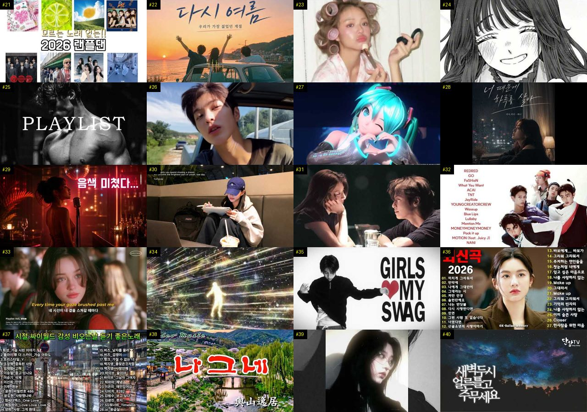

성공 사례 #41–#60:

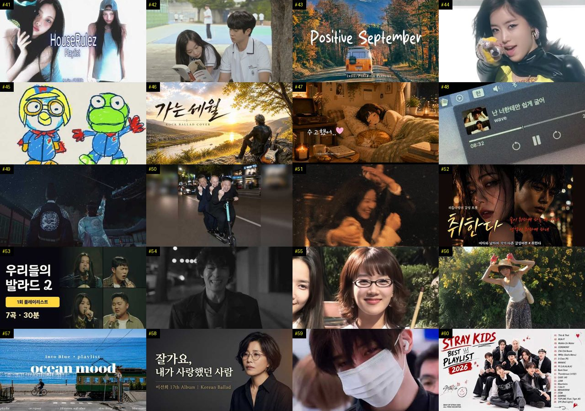

성공 사례 #61–#80:

성공 사례 #81–#100:

성공 사례 #101–#120:

성공 사례 #121–#140:

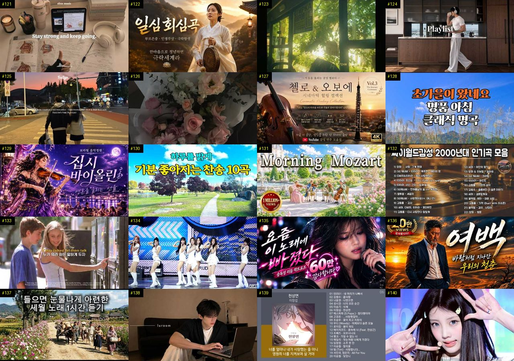

성공 사례 #141–#160:

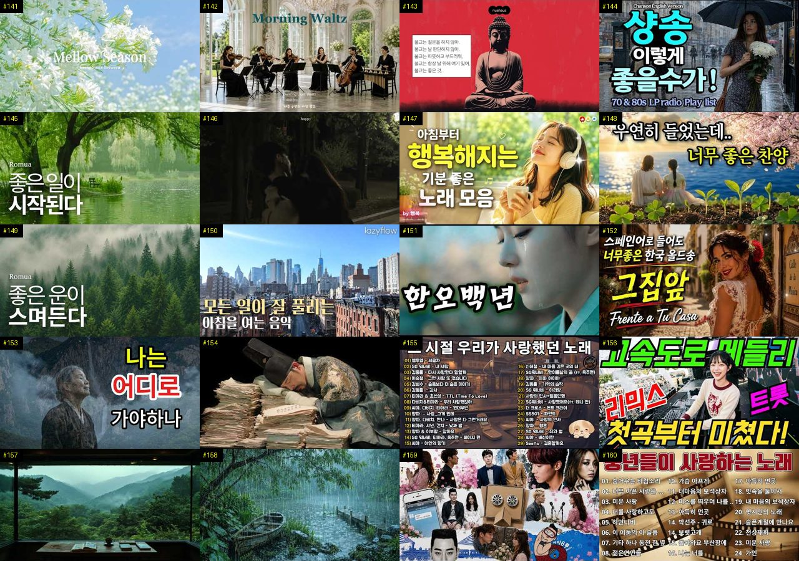

성공 사례 #161–#180:

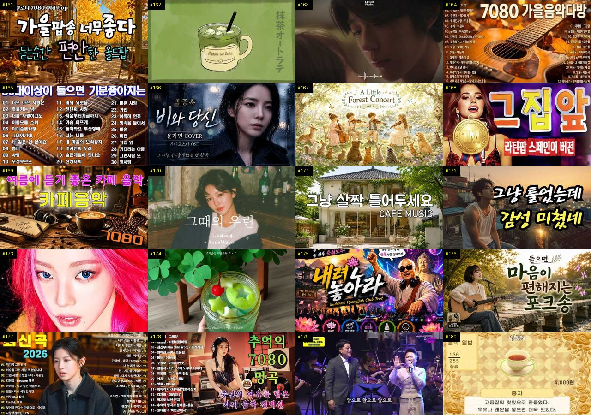

성공 사례 #181–#200:

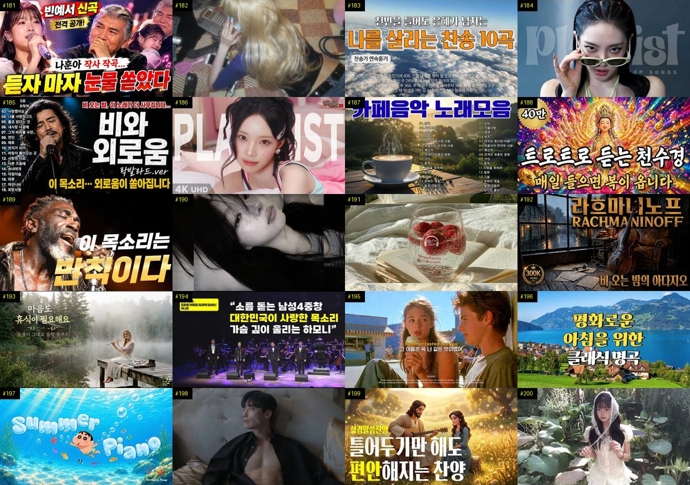

성공 사례 #201–#220:

성공 사례 #221–#240:

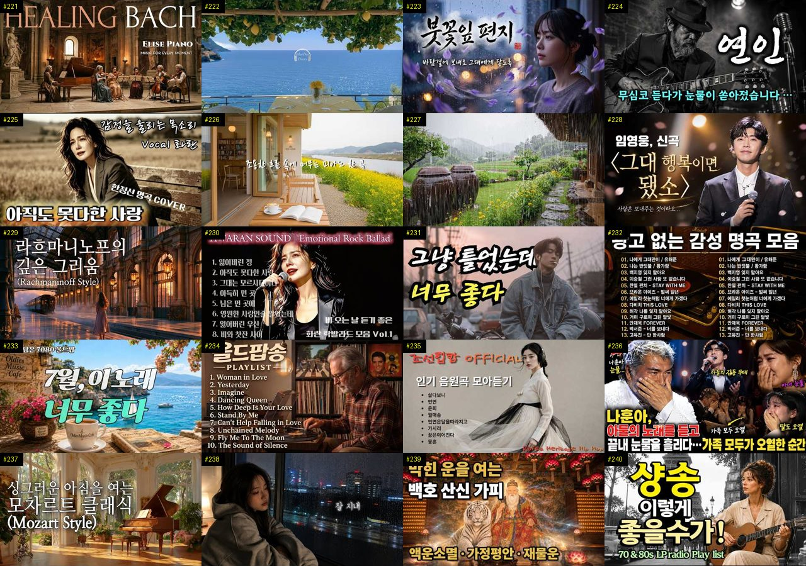

성공 사례 #241–#260:

성공 사례 #261–#280:

성공 사례 #281–#300:

성공 사례 #301–#320:

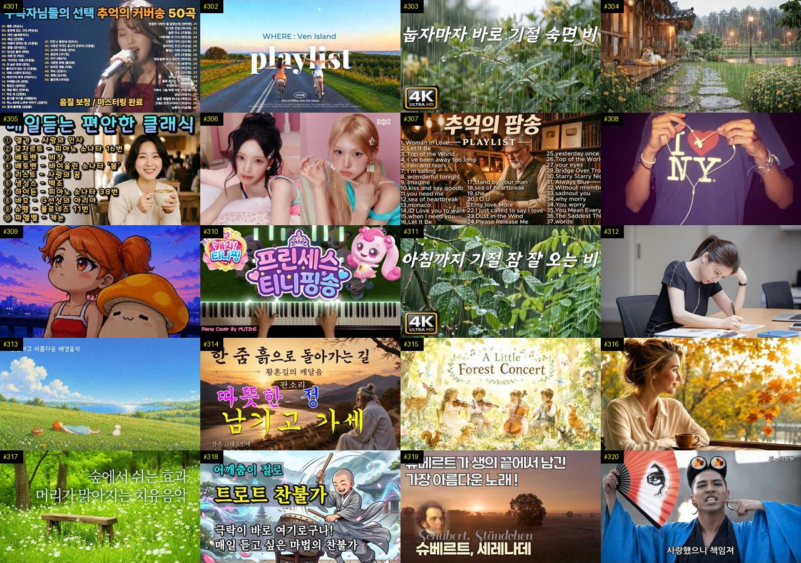

성공 사례 #321–#340:

성공 사례 #341–#360:

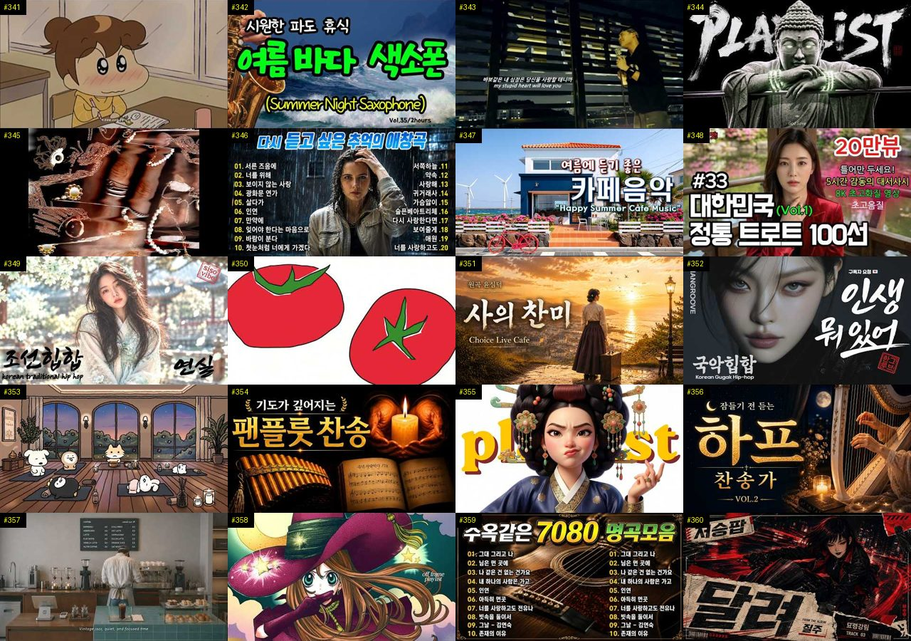

같은 채널 짝 — 줄마다 [성공 사례 #n · 같은 채널 평소 영상 #n-a · #n-b] (40 … #227-b):

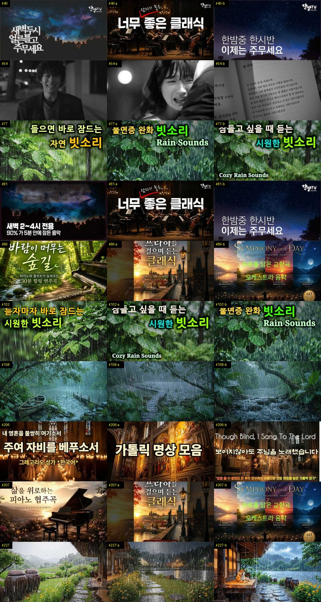

같은 채널 짝 — 줄마다 [성공 사례 #n · 같은 채널 평소 영상 #n-a · #n-b] (266 … #354-b):

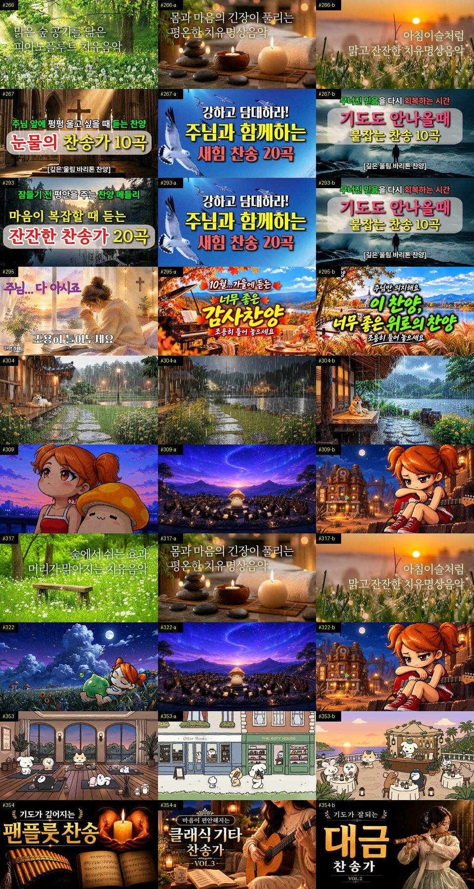

비교 — 자료를 받았지만 성공 기준 밖 (조회수 큰 순, 번호는 `analysis.json` 의 others 순서):

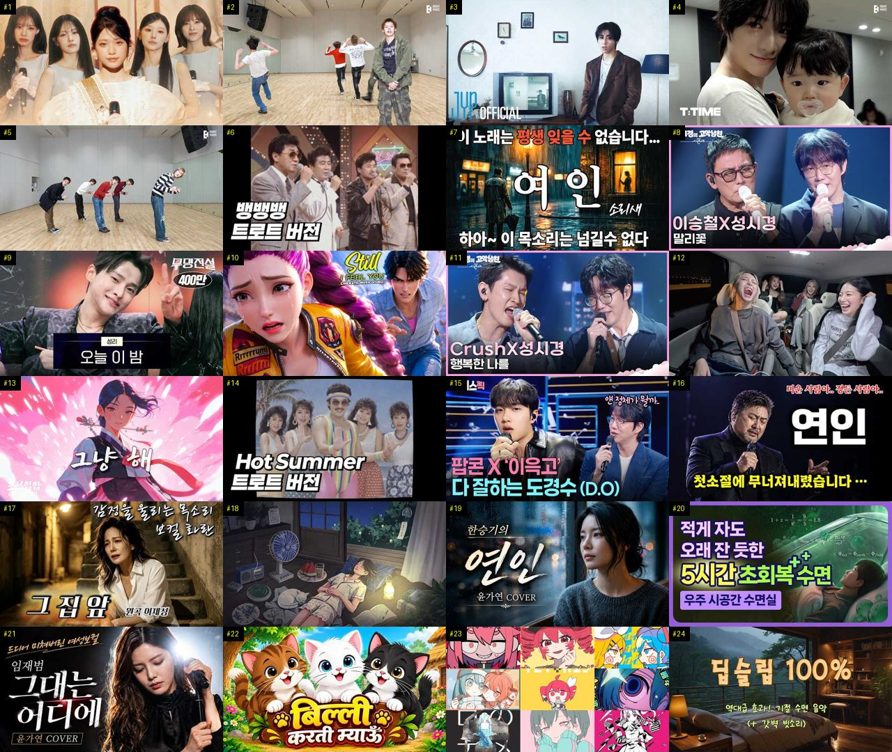

## 6. 길이·내용 구성

### 6-1. 길이별 성공 비율 (비교 집단)

| 길이 | 영상 (성공 비율) | 성공 사례 |
|---|---|---|
| 4~8분 | 318 (37%) | 78 |
| 8~15분 | 168 (18%) | 19 |
| 15~25분 | 160 (48%) | 47 |
| 25~40분 | 42 (71%) | 21 |
| 40분 이상 | 322 (78%) | 195 |

### 6-2. 채널 크기별 성공 비율 (참고 — 구독자가 적을수록 배수가 커지기 쉬움)

| 구독자 | 영상 (성공 비율) |
|---|---|
| 0~999명 | 299 (18%) |
| 1,000~4,999명 | 274 (55%) |
| 5,000~19,999명 | 265 (73%) |
| 20,000~50,000명 | 172 (65%) |

### 6-3. 성공 사례의 구성

- 길이 중앙값: 성공 사례 56.4분 · 비교 집단의 나머지 10.5분
- 타임라인(챕터) 있는 성공 사례: 41% (챕터 수 중앙값 11)
- 대본이 있는 성공 사례: 0개 — 말 속도 중앙값 – 음절/초, 첫 1분 음절 중앙값 – (대본이 없어 도입부·흐름은 아직 셀 수 없음)
- 도입부(첫 20초 첫 문장) 유형: 대본 없음 — 아직 셀 수 없음
- 사례마다의 챕터·도입부(첫 20초)·첫 1분·90초마다 흐름은 9번.

### 6-4. 참여율 (비교 집단, 중앙값)

| | 영상 | 조회수 1,000회당 좋아요 | 조회수 1,000회당 댓글 |
|---|---|---|---|
| 성공 | 508 | 7.9 | 0.3 |
| 나머지 | 502 | 14.2 | 1.4 |

## 7. 구독자 — 빨리 크는 작은 채널

YouTube API 는 영상별 구독 증가를 주지 않는다 → 채널 단위로 본다. 개설 24개월 안·구독자 1,000 이상 채널을 **월 구독자 증가(구독자 ÷ 개설 뒤 달 수)** 순으로. 최근 하루 증가 = 받을 때마다 남긴 구독자 기록 (3일 넘게 벌어져야 나옴). 주로 다룬 주제 = 우리가 본 그 채널 영상의 주제 묶음. **기관·브랜드?** = 채널 이름에 운용사 ETF 상표·증권·은행·공식·방송 같은 말 (`analysis_rules.toml` [growth] BRAND_HINT) — 광고비로 큰 채널일 수 있어 개인 채널과 따로 보라.

| 채널 | 기관·브랜드? | 개설 | 구독자 | 월 구독자 증가 | 최근 하루 증가 | 영상 수 | 월 업로드 | 길이 중앙값 | 주로 다룬 주제 | 대표 영상 (하루 조회수 큰 것) |
|---|---|---|---|---|---|---|---|---|---|---|
| 정이랑의 진기명기 |  | 2025-11-07 | 198,000 | 17,572 | – | 310 | 27.5 | 23.1분 | 6. 피아노·클래식·연주곡 | [2007년 우己lㄱr バr己б했던 학원☆™🎹 #정이랑 #추억 #공감 #…](https://www.youtube.com/watch?v=argmeBt7OUU) 2,916,955회 |
| 명곡부활단 |  | 2026-03-21 | 105,000 | 15,293 | – | 316 | 46.0 | 4.8분 | 5. 운동·드라이브·신나는, 9. 가요·발… | [여인 – 우리 가슴속 깊이 박혀 있던 그 노래, 듣는 순간 그 시절로 …](https://www.youtube.com/watch?v=a0iBRRoDnDw) 6,592,855회 |
| 레코드 속 추억 | 예(레코드) | 2026-04-10 | 56,000 | 9,067 | – | 132 | 21.4 | 81.8분 | 기타, 9. 가요·발라드·트로트 | [“꽃길” “인연” “묻어버린 아픔” “마지막 연인” “사랑 참”🎸🔥조회…](https://www.youtube.com/watch?v=YBeWbO46Gtw) 1,209,149회 |
| 노래방 옆 만화방 |  | 2025-11-20 | 81,000 | 7,472 | – | 235 | 21.7 | 4.5분 | 10. 팝송·K팝·J팝, 9. 가요·발라드… | [정승환 & 박지원- 그 여자 (시크릿가든 OST) l [정승환의 노래방…](https://www.youtube.com/watch?v=QlOJ3HsA6Jk) 2,718,336회 |
| ERRDAY GROOVE (… |  | 2025-11-05 | 81,700 | 7,209 | – | 226 | 19.9 | 4.1분 | 12. 커버·노래 부르기 | [엄정화 - 초대 [90's New Jack Swing Cover] (뉴…](https://www.youtube.com/watch?v=xNV5j1v53RY) 1,502,529회 |
| 국악딴따라 |  | 2026-05-19 | 35,000 | 7,150 | – | 49 | 10.0 | 54.8분 | 1. 수면·명상·힐링, 15. CCM·찬양… | [국악딴따라 노래모음｜30곡 연속듣기](https://www.youtube.com/watch?v=VctWdCriD_k) 508,191회 |
| Midnight Melody… |  | 2026-04-16 | 28,000 | 4,657 | – | 105 | 17.5 | 89.7분 | 9. 가요·발라드·트로트 | [샹송이 이렇게 까지 좋은줄 몰랐습니다. 아침부터 저녁까지 듣게되는 70…](https://www.youtube.com/watch?v=ubP0xqEZxYo) 824,527회 |
| 힐리멀스 |  | 2026-05-14 | 23,000 | 4,517 | – | 40 | 7.9 | 130.2분 | 7. 재즈·보사노바, 4. 카페·매장·라운지 | [🌿 𝑯𝒆𝒂𝒍𝒊𝒎𝒂𝒍𝒔 ∣ 호텔 재즈바, 곧 연주가 시작돼요 🎷 ∣ Co…](https://www.youtube.com/watch?v=ui-1w1UbrvY) 877,454회 |
| URLIST |  | 2024-10-27 | 105,000 | 4,445 | – | 253 | 10.7 | 127.1분 | 8. 로파이·시티팝·칠 | [[𝗣𝗹𝗮𝘆𝗹𝗶𝘀𝘁] 그냥 틀어놓기 좋은 느좋 노래 모음💿🤎∣ chill…](https://www.youtube.com/watch?v=lpVCXni0Ijs) 1,246,638회 |
| 달빛가락 |  | 2025-09-13 | 56,200 | 4,298 | – | 20 | 1.5 | 5.2분 | 9. 가요·발라드·트로트 | [🎧 "인생아 너무 애쓰지마라." I 한 평생 애쓰신 당신께 드립니다 I…](https://www.youtube.com/watch?v=WO-zQDOyPws) 2,428,548회 |
| Lofi Breeze |  | 2025-06-23 | 65,000 | 4,122 | – | 380 | 24.1 | 80.2분 | 8. 로파이·시티팝·칠 | [[playlist] ❄️눈내리는 숲속 카페에서 듣기 좋은 ∣ 잔잔한 감…](https://www.youtube.com/watch?v=3SAfcUYWwkA) 1,615,913회 |
| 달빛라운지 |  | 2025-07-05 | 62,900 | 4,091 | – | 125 | 8.1 | 77.5분 | 9. 가요·발라드·트로트, 3. 공부·집중… | [🌸 카페 음악 59집 ∣ 그냥 틀어놨는데 기분 좋아지는 노래 🎧 봄 느…](https://www.youtube.com/watch?v=kffGUspRCR8) 362,624회 |
| 중년 애창곡ㅣ애창 |  | 2025-07-06 | 62,600 | 4,080 | – | 1,476 | 96.2 | 74.4분 | 기타, 9. 가요·발라드·트로트 | [[Playlist] 미친듯이 중독되는 90년대 레트로 댄스 모음 / A…](https://www.youtube.com/watch?v=ekUuIWNbJJs) 302,735회 |
| Soul Cafe |  | 2025-02-24 | 75,500 | 3,843 | – | 430 | 21.9 | 111.5분 | 4. 카페·매장·라운지, 10. 팝송·K팝… | [✨️ 봄빛 가득한 날, 그냥 틀어두기 좋은 팝송 ∣ 봄에 듣기좋은 노래…](https://www.youtube.com/watch?v=lM83an7ckmU) 1,523,522회 |
| The Clavis |  | 2026-05-01 | 19,800 | 3,609 | – | 73 | 13.3 | 72.7분 | 6. 피아노·클래식·연주곡 | [[Playlist] 라흐마니노프의 깊은 그리움 ∣ 멀리서 들려오는 서정…](https://www.youtube.com/watch?v=vcpBmyFBJos) 648,351회 |
| 골방 찬양 |  | 2026-03-05 | 26,000 | 3,518 | – | 63 | 8.5 | 71.7분 | 15. CCM·찬양·국악·동요, 1. 수면… | [[찬송가 연속듣기]무뎌진 마음에 다시 살아나는 소망∣ 들을수록 가슴 벅…](https://www.youtube.com/watch?v=HSf4KuqotKg) 37,538회 |
| centralgrocery … |  | 2026-02-05 | 27,200 | 3,273 | – | 82 | 9.9 | 236.8분 | 7. 재즈·보사노바, 3. 공부·집중·작업 | [playlist ∣ 여름, 레몬과 재즈에 대하여](https://www.youtube.com/watch?v=Gr7ZxTdL8XA) 677,137회 |
| okply |  | 2026-05-11 | 15,500 | 3,005 | – | 46 | 8.9 | 114.8분 | 6. 피아노·클래식·연주곡 | [[Playlist] "아침에 듣기 좋은 산뜻한 클래식 왈츠" ∣ Sum…](https://www.youtube.com/watch?v=D2WezFoeswI) 989,014회 |
| Korean Ballads … |  | 2025-07-21 | 43,700 | 2,943 | – | 300 | 20.2 | 106.9분 | 9. 가요·발라드·트로트 | [하루 종일 듣기 좋은 노래🎈🎈일할때 듣기좋은 발라드 추천 광고없는 노래…](https://www.youtube.com/watch?v=gp-7-sUpsEA) 3,542,387회 |
| 추억의 올드팝 EverPop |  | 2026-04-20 | 15,800 | 2,687 | – | 87 | 14.8 | 107.7분 | 9. 가요·발라드·트로트 | [주부들이 엄선한 감성 팝송 Best 26 ∣ EverPop 레트로 팝 …](https://www.youtube.com/watch?v=JZH9pZhtl9I) 488,763회 |
| 옥탑방 radio |  | 2026-02-10 | 21,400 | 2,627 | – | 70 | 8.6 | 20.1분 | 4. 카페·매장·라운지, 1. 수면·명상·… | [Playlist 19 MHz ∣ 같이 있는 시간이 제일 편한 날 ☀️ …](https://www.youtube.com/watch?v=yirGzkQvqfE) 338,853회 |
| 한그루브 |  | 2025-02-12 | 50,000 | 2,491 | – | 204 | 10.2 | 4.5분 | 5. 운동·드라이브·신나는 | [우리 행복하자 (Let's Just Be Happy) ∣ 미안하단 말보…](https://www.youtube.com/watch?v=d0jaFafrkkM) 384,295회 |
| Ceci Pop |  | 2025-09-26 | 29,500 | 2,338 | – | 57 | 4.5 | 92.6분 | 9. 가요·발라드·트로트 | [첫 곡부터 감성 미쳐버린🎧8090 레전드 플레이리스트](https://www.youtube.com/watch?v=i4uJ7c6b9gw) 1,538,468회 |
| 프륀 Pruiin |  | 2026-05-19 | 11,400 | 2,329 | – | 63 | 12.9 | 135.1분 | 11. 힙합·R&B·EDM | [🍉 냉장고를 열었더니 수박만 있는 브금](https://www.youtube.com/watch?v=h6oskIb0ASU) 234,024회 |
| 트로트의 맛! |  | 2025-05-14 | 39,600 | 2,318 | – | 1,117 | 65.4 | 249.8분 | 10. 팝송·K팝·J팝 | [㉖대한민국 정통 트로트 60선 (Korean Trot 60) ∣ 전설의…](https://www.youtube.com/watch?v=75u_o8j9V0s) 325,082회 |

## 8. 시청자 니즈 (성공 사례 360개의 시청자 댓글 44,213개 — 채널 주인 댓글·도배 댓글 112개 뺌)

갈래는 낱말 규칙 (한 댓글이 여러 갈래). '더 알고 싶은 것'은 ① **요청**(다뤄 주세요·알려 주세요·궁금해요 — 다음 영상 주제 후보, 아래 8-1) 과 ② 물음표 질문(반문이 섞임, 8-2) 으로 나눠 인용한다.

| 갈래 | 댓글 | 비율 | 좋아요 합 |
|---|---|---|---|
| 좋은 점 — 영상 (도움·설명·정리·공감) | 482 | 1.1% | 3,062 |
| 감사·응원 (일반) | 6,217 | 14% | 40,561 |
| 더 알고 싶은 것 (질문·요청) | 782 | 1.8% | 4,166 |
| 아쉬운 점 — 영상 (제목·광고·길이·정보 오류·목소리) | 350 | 0.8% | 2,234 |
| 반박·불만 — 의견 다름 (내용) | 195 | 0.4% | 2,130 |
| 정치·사회 (영상과 무관한 의견) | 94 | 0.2% | 2,258 |
| 경험 공유 (내 이야기) | 2,287 | 5.2% | 34,200 |
| 구독·다음 기대 | 352 | 0.8% | 1,401 |

### 좋은 점 — 영상 (도움·설명·정리·공감) — 좋아요 많은 댓글

- 👍229 [#5] “처음에 크레이지 아케이드 소리 들리길래 영상 잘못 들어온 줄 알았네 ㅋㅋㅋㅋ 하 첫 곡부터 마지막 곡까지 너무 레전드라서 쉬는 날에 엄청난 힐링하고 갑니다 ㅠ”
- 👍189 [#235] “조선힙합 멜로디도 좋지만 모든 곡들의 가사가 너무 마음에 와닿습니다. 좋은 노래 만들어줘서 감사합니다. 위안이 되는 따뜻한 노래들.”
- 👍124 [#134] “스타즈 오늘 둘다 레전드네 ㄷㄷㄷ❤❤❤❤”
- 👍108 [#56] “안녕하세요, 오늘의 플리님! 저는 도덕 수업에서 선플 달기 활동을 하고 있는 중1 학생입니다. 영상 정말 잘 보고 있어요. 항상 좋은 영상 올려주셔서 감사합니다. 좋은 하루 보내세요”
- 👍78 [#5] “디지몬 어드벤처, 이누야샤, 달빛천사, 아따맘마, 피치피치핏치, 카우보이 비밥, 나루토, 개구리 중사 케로로, 캐릭캐릭 체인지, 원피스 등등... 이런 레전드 꿀잼 애니메이션들을 감상할 수 있었던 90년대생들은 진짜 선택받은 어린이들 세대였던 것 같습니다.”
- 👍60 [#179] “힐링음악님 요즘 세로운 영상 찾아 올리시는 라 수고가 많으시죠? 덕분에 이렇게 좋은 영상을 보네요 고맙습니다🙏 (어디로 부터 그대는 왔는가) 전 이 가사가 유난히 좋더라구요^^”
- 👍59 [#3] “우리가 고3만 아니였다면 맞춰갈 수 있는 시간이 있었을텐데 정말 아쉽고 힘들다 벌써 1달이 넘었는데 단 하루도 널 잊은적이 없어 살면서 사랑을 알려줘서 고마워 지금은 너에게 아무것도 안하는게 돕는거라고 생각해서 수능 끝나고 연락할거야 우리 입시 성공해서 다시 만나자 영원한건 없어도 다시 만난다면 평생 사랑할게”
- 👍54 [#102] “빗소리가 부드럽고 그윽하게 들려서 듣기 편안합니다. 어떤 빗소리는 탁탁 튀는 것 같은 가벼운 소리가 나요.”

### 감사·응원 (일반) — 좋아요 많은 댓글

- 👍531 [#270] “독다니엘 독일 살때 교회 다니며 파이프 오르간 연주자 였다더니 피아노도 수준급 인가보네요. 멋져요. 힝상 응원 합니다. 다니엘이 갖고 있는 순수함이 좋아요. 🎉🎉🎉🎉🎉❤❤❤❤❤”
- 👍529 [#42] “진짜 많이 보고싶다. 내 고등학생 생활이 전부 너라서 너 말고는 아무것도 안보였던 시기엿어. 고등학교 동안 나한테 과분한 사랑 주고 항상 내 편이 되어줘서 너무너무 고마워 우리 성인되는 날에 같이 첫 술 마시자고 했었는데 기억나? 그 약속 이제는 못 지키겠다. 헤어질 때 너무 아팟고 너와의 좋았던 기억들이 너무 많은데도 그 힘들었던 기억들이 계속 괴롭혔어.”
- 👍252 [#50] “이 플리 듣고 자전거 타면서 수많은 지뢰를 피해서 겨우 탈북했네요~감사합니다 근데.. 앞에 누가 총을 들고있네요?”
- 👍244 [#131] “마음을 행복하게 해주셔서 감사드립니다. 기쁨이 몽글몽글😊 건강해지는 기분입니다. 모두모두 행복하시기를... 좋은 선물 주시는 운영자님도 행복하시고, 좋은 일이 가득가득하시기를😊”
- 👍244 [#195] “이 노래를 듣는 모든 분이 진짜 행복해졌으면 좋겠어 로또 1등 당첨 된 느낌으로요 진짜 행복해지길 불행은 길고 행복은 짧아도 짧더라도 느낄 수 있는 그 행복에 감사하자구요”
- 👍244 [#308] “기말 일주일 전 벼락치기 시작합니다.. 기적을 기대해보겟음 다들 화이팅”
- 👍229 [#170] “78년생 ..97학번입니다. 삐삐치고 손편지 쓰던 시절이 그립네요. 내 대학교 시절. 내 청춘과 함께했던 그녀에게 감사합니다. 우리는 서툴렀지만 서로에게 좋은 추억과 기억과 시간을 주었네요. 어디서든 항상 잘 살고 있을 그녀에게 다시한번 감사합니다.”
- 👍201 [#87] “아름다운 음악 1곡이... 사람의 인생을 바꿀 수도 있고... 또 다른 삶의 도전을 일으키는 촉매제가 될 수도 있다고 봅니다... 지긋이 두눈을 감고 들으니... 마음의 위로와 평안이 느껴집니다... 좋은 곡을 듣게 해주셔서... 대단히... 감사합니다...^^”

### 더 알고 싶은 것 (질문·요청) — 좋아요 많은 댓글

- 👍1,047 [#105] “개발할 때마다 듣습니다; 많이 올려주세요”
- 👍208 [#42] “여전히 잊지 못하였습니다. 당신이 나의 이상형이라서, 당신이 나의 첫사랑이라서, 끝난 관계임에도 나에게 잘 해줘서, 너무 착한 사람이라서, 귀여운 걸 본인만 몰라서, 허세 같은데 싫지 않은 적은 처음이라서, 영원을 약속하고 싶게 만든 사람이라서.. 이유는 수백 개 수천 개지만 그 정도로 당신이 좋은 이유가 수두룩 빽빽한데 이 이야기를 전할 수가 없습니다 이”
- 👍94 [#284] “항상 잘 듣고 있는 구독자입니다, 알아봐 주실지는 모르겠는데…. 매번 이렇게 댓글 다는 채널은 여기가 처음입니다. 매번 빠지지 않고 새 영상 올려주셔서 감사해요. 제가 고요한 걸 무서워해서 다양한 백색소음을 들어봤는데 여기가 가장 좋더라고요. 꾸준히 영상 올려주셔서 감사하고, 계속 영상 올려주세요. +매번 답글 달아주시기 힘들텐대 항상 감사합니다”
- 👍88 [#179] “김호중 테너의 활동 영상 발굴해서 많이 많이 올려주세요. 이미 완성된 테너 김호중 감동입니다.”
- 👍88 [#179] “기다렸습니다 김호중 테너님 공연 많이올려주시면 좋겠 습니다 영상감사합니다 🎉🎉🎉”
- 👍68 [#142] “8주된 뱃속의 아기를 와이프와 보내고 상심이 큰 어제와 오늘이었습니다. 와이프에게 어떻게 하면 힘이 될 수 있을까 하다 우연히 듣게 되었는데, 마치 고즈넉한 숲 속 궁전에서 여유로운 하루를 맞이하는 느낌을 주는 노래 같아 하루 종일 듣고 있습니다. 힘 내볼게요. 앞으로도 좋은 노래 많이 올려주세요”
- 👍62 [#142] “최고에요! 제 브이로그 배경음악으로 클래식을 많이 쓰는데, 혹시 출처표시하고 bgm으로 쓸 수 있을까요? 안되더라두 괜찮으니 편하게 알려주세요! 좋은 음악 감사합니다! :)”
- 👍56 [#54] “어릴 땐 어른이 부러웠습니다. 아무거나 다 할 수 있는. 하지만 정작 어른이 된 저는 삶에 휩쓸려 무뎌지고 부서진, 그런 사람이라는 걸 깨닫게 되었습니다. 우리 다시 돌아갈 수 있을까요? 아무 걱정 없이, 아무 생각도 안 하는 그때로”

### 아쉬운 점 — 영상 (제목·광고·길이·정보 오류·목소리) — 좋아요 많은 댓글

- 👍632 [#45] “현재 08년생 입니다.. 벌써 마지막 10대의 절반이 지났다는게 믿겨지지 않네요. 어릴때 저녁밥 먹기 전 동네 친구들과 술래잡기 하던게 엊그제 같은데 저에겐 항상 멀게만 느껴졌던 20대라는 현실을 곧 마주할 생각을 하니 솔직히 현실감이 없습니다.. 아직 추억도 많이 없고 즐기지못한게 많은거 같아 맨날 옛날로 돌아가고 싶다는 생각을 하곤 하는데 몇년 뒤엔 오”
- 👍70 [#229] “18년을 함께한 우리 고양이가 고양이별로 떠난지 4일째 되는 밤입니다. 집안 모든 곳이 냥이와 함께한 곳이라 가는 곳마다 눈물이 납니다. 마치 그곳에 앉아 있는 것 같아 나도 모르게 두 손을 뻗곤 합니다. 원없이 사랑한 것 같았는데 보내고나니 아쉬움과 후회만 밀려옵니다.”
- 👍64 [#186] “광고가 계속 나와요😢😢”
- 👍57 [#240] “가사는 모르지만, 애절하면서 흡인력 있는 목소리가 너무 좋습니다.”
- 👍51 [#179] “오늘 김호중 가수의 노래를 이것저것 찾아 듣고 있는데 이 노래를 듣게 되네요. 김호중 테너의 목소리가 너무 듣기 좋습니다. 이애숙님과 두 분 함께 부르는 노래가 완전 멋지네요. 올려주셔서 감사합니다 ~”
- 👍49 [#113] “남편의 계속 반복되는 외도로 어린아들 둘 데리고 이혼한지 9개월 눈물 흘릴 여유조차 없이 살다가 노래들으려고 켠 유튜브에서 우연히 발견한 노래들.. 마음을 보듬어 주는것같은 따뜻한 목소리에 눈물이 터져 울고 위로받고 갑니디 원래 안달지만 꼭 달고싶었어요. 오래 노래해주세요. 자주와서 들을게요. 너무 고맙습니다.”
- 👍46 [#257] “반복해서 들을수록 더 빠져듭니다 이루네 가수님 응원합니다”
- 👍45 [#176] “요즘 유튜브나 여러 플랫폼에서는 AI 기술을 활용해 특정 가수의 창법이나 음색을 학습시킨 커버 곡들이 정말 많이 쏟아지고 있네요. 특히 전통적인 록 발라드나 트로트 메들리 같은 영상 중에는 사람이 직접 부른 것처럼 정교하게 만들어졌지만, 실제로는 AI 목소리 모델을 입혀서 기계적으로 양산된 콘텐츠들이 꽤 많습니다. 음색이나 부르는 스타일이 지나치게 정형화되”

### 반박·불만 — 의견 다름 (내용) — 좋아요 많은 댓글

- 👍807 [#270] “다니엘 웃기는거 빼고 다 잘하네 🥰”
- 👍155 [#23] “선곡말도안됨”
- 👍142 [#322] “아 메이플 관련 브금이랑 영상만 보면 저때로 돌아가고 싶다라는 생각이 계속 든다.. 무더운 여름방학 집에 에어컨도 없어서 방에서 선풍기 하나로 동생과 싸우고 한대 있는 컴퓨터로 너가 몇분을 더했니 어쨌니 그러다가 게임 금지 당하고.. 동생보다 30분이라도 먼저 일어나서 몰래 게임하고.. 지금은 동생도 나도 너무 많이 커버렸구나. 어렸을때 형이란 이유도 동생”
- 👍132 [#49] “-내가 약조하마.너를 지켜주겠다고. 그렇게 다정히 말씀하시던 든든한 나의 님은, 지금 풀숲에 쓰러져 간신히 숨만 내쉬고 계신다. -상공, 제발 숨만 쉬십시오. 제가 어떻게든... -연화야. 상공의 손이 나의 손은 따스히 잡아온다.그 온기가 서글프도록 따뜻해서, 심장 한편이 저릿하게 아려온다. -아닙니다, 그러지 마십시오. 지금이라도 의원을 부르면.. -너도”
- 👍113 [#64] “제목을 보자마자 한사람이 떠올라서 홀린듯이 클릭해버렸어요. 이런 플리 잘 안들을 것 같아서 그냥 터놓고 말할게. 중학교 때 처음 만난 언니. 정말 예쁘고, 멋지고 빛이 나서 이보다 주인공 같은 사람이 있을까 싶은 사람. 정병 와서 새벽에 연락해도 꼬박꼬박 답장해주고 내가 힘들때 옆에서 참 많을 위로를 해주었던 건 정말 아직도 고마워. 내가 죽지 않고 이렇게”
- 👍91 [#50] “탈북할 땐 어떤 노래를 듣는걸까 하고 왔는데 첫곡듣고 어이없어서 터졌네 ㅋㅋㅋㅋ 무슨 관련이야”
- 👍47 [#54] “왜 우리는 아는 사람들에게 위로받지 못하고 모르는 사람들에게 인터넷상에서 위로를 받는 걸까요 힘들다고 말하는 게 부끄러운 것도 아닌데 다른 사람들의 댓글을 보며 와.. 이런 사람들도 있구나 저런 사람들에 비하면 나는 행복한 거구나..라고 위안 삼으며 다시 또 지옥같이 지치는 일상으로 돌아가는 사람도 있고 다른 사람들의 댓글을 보며 위로를 받고 살아갈 용기를”
- 👍45 [#179] “너무잘한다 이런인재를 순간의 실수에 너무오래 가둬놓네 엄청난죄 지은 사람들도 다풀어주고 아예법의재제도 안하면서 국보급 가수한태는 왜그리 독한지 참어이없는 사법부다”

### 정치·사회 (영상과 무관한 의견) — 좋아요 많은 댓글

- 👍788 [#103] “일본곡 플리+한국그룹의 중국인 멤버 썸네일이라니.. 이것이 동아시아 대통합”
- 👍623 [#229] “사랑하는남편이 하늘나라가신지 두달하고십사일째입니다~ 제마음을 위로해주네요~”
- 👍85 [#179] “이런노래들으니 이나라가 얼마나 귀한지 모르겠습니다 망하는나라 한순간 우리가 모두 힘내어 지켜야 합니다”
- 👍79 [#270] “대한 외국인 중에서 한국인보다 역사를 많이 아는 다니엘~~ 굿입니다~~^^”
- 👍24 [#6] “그냥 케이팝,드라마,예능 다 2010년대 이후로 이제 옛날같지않더라 케이팝으로 유명하던 우리나라가 더 이상 그냥 챌린지하는 노래밖에 안나오고..어제 청룡?보니까 확실히 전과 다름 연말에 가족끼리 시상식보는 감성도 사라진듯 다 모르는것들만 나오고 옛날엔 드라마도 지금보면 ㄹㅈㄷ인거 많이 나오고 예능도 신서유기,무도 등등 지금보면 ㄹㅈㄷ인거 많았는데 지금 보면”
- 👍23 [#168] “이재성..가장 뛰어난 싱어송라이터였는데.. 고독한DJ라는..노래불렀다가....전두환정권에서.방송금지당해..최전성기..87년에...갑자기TV에서.사라졌고.. 라디오에서도 이재성 노래를 10년동안 들을수 없었음.”
- 👍11 [#183] “우리나라가 하나님 보시기에 정의롭고 의가 살아있었음 참 좋겠습니다”
- 👍10 [#236] “예서양노래잘합이다연에인들모두뭉쳐민주주의대통령님을위해노래로만이위로해주새요항상감사합니다.대한민국만새.”

### 경험 공유 (내 이야기) — 좋아요 많은 댓글

- 👍2,673 [#42] “야 보고싶어 내 생일에 연락 왜 안했냐 너 밥 한끼 더 좋은거 먹으라고 네가 기념일마다 줬던 토스 기프티콘 일부러 안 썼어 너한테 입금 됐냐 돈 하나도 안 아까운데 그냥 그렇다고 내 계좌 비밀번호 우리 만난 날이야 내 노트북 비밀번호도 우리 만난 날이야 훔쳐가도 되는데 홍대에서 이제 공연해? 아직인가 너한테 기타 쳐달라고 했던 노래가 하필 이 영상 첫 노래”
- 👍2,513 [#45] “내가 왜 고3일까… 평생 안 올 줄 알았는데 ㅠㅠㅠㅠ 뽀로로 너랑 걱정없이 놀 때가 너무 그리워…”
- 👍1,898 [#45] “뉴스에서 고등학생 자살율 얘기할때 진짜 이해 안됐는데 막상 고등학생 되니까 내가 그 경계에 서있네”
- 👍1,252 [#290] “영상 내려가서 내가 멘헤라될뻔”
- 👍1,132 [#42] “이 세상 단 둘만 가진 기억인데 아까워서 어떻게 잊나요 내가,”
- 👍1,069 [#54] “요즘 옥상문이 잠겨있네요 더워서 그런가 벌써 네 건물 가봤는데 잠겨서 죽고싶은데 마음데로 죽지도 못하네요 얼마전에 울다가 깨닳았어요 아 나 안죽고싶은데.. 내가 죽고싶은게 아니라 지금이 너무 힘들어서 차라리 죽고싶은거구나 아 행복해지고 싶은거구나 죽고싶은게 아니라 행복해지고 싶은데 행복이 저는 너무 어려워요 행복하고싶었던거라는 생각이 들지마자 너무 서러워서”
- 👍624 [#8] “헐 짖짜 내가 생각하던 어른여지 플리..사랑에 상처받기도하지만 또 사랑을 믿는..”
- 👍548 [#168] “몇년전에 한국가요를 외국어버전으로 번역해서 영상으로 제작한 유튜브가 있었습니다. 3개국 외국어로 제작해서 한국가요를 알리고자 하는 영상이었는데 하루아침에 모든영상이 없어진일이 일어났지요. 계속 이어졌으면 지금의 K-Pop 붐이 한층 더 올라가지 않았을까 싶은 생각이 듭니다. 모든 영상을 내린 이유는 저도 모르겠네요. 이재성의 그집앞 노래도 100만뷰를 넘었”

### 구독·다음 기대 — 좋아요 많은 댓글

- 👍110 [#235] “듣다보니. 가슴에 스며들어 구독하고. 계속 듣게 되네요 60후반이지만 요즘 젊은이들 조선힙합이 꽂치네요 좋은음악. ~^^❤❤❤”
- 👍105 [#179] “김호중님의 무대가 기다려집니다”
- 👍48 [#198] “구독박고 갑니다 태어나서 이렇게 섹시한 남자 첨이에요 허남준땜시 잠이 안와요 매일 유투브로 찾아봐도 질리지 않아요 ㅋ”
- 👍42 [#252] “썸녜일도 느낌.있고.음악도 좋네요 ! 음악은 ai로 만드신건가요?궁금. 그림도 왠지 직접그리신듯 구독하고가요😊”
- 👍33 [#257] “이루님 영원한 ❤팬입니다”
- 👍32 [#58] “이별 벌써 20년째 저는 가족 반대 때문에 헤어진 한남자 잊지 못합니다 지금 도 그사람 잊지 못합니다 아니 영윈히 기다려요 이노래가 아퍼요 그사람 마음 같아😢”
- 👍30 [#257] “이루네씨 ~ 살랑살랑 흔드는몸짖이 아주 매력적입니다 . 개인적으로 저도 이노래 좋아합니다 . 그동안 이은하씨가 달라진 모습과 아픈소식을 들어 마음이 아팠습니다 .최근엔 살이 많이 빠진모습으로 볼수있어 건강이 많이 회복된것같아 다행이라 생각합니다 . 이루네씨도 승승장구 하시고 이은하씨 모습도 자주 뵐수 있기를 기대합니다 .”
- 👍18 [#130] “아침찬양에 너무 잘 맞는 목소리와 은혜입니다. 첫곡듣고 바로 구독했습니다”

### 8-1. 더 알고 싶은 것 ① 요청 — 다뤄 주세요·알려 주세요·궁금해요 (596개 중 좋아요 순, 영상마다 2개까지)

- 👍1,047 [#105] “개발할 때마다 듣습니다; 많이 올려주세요”
- 👍94 [#284] “항상 잘 듣고 있는 구독자입니다, 알아봐 주실지는 모르겠는데…. 매번 이렇게 댓글 다는 채널은 여기가 처음입니다. 매번 빠지지 않고 새 영상 올려주셔서 감사해요. 제가 고요한 걸 무서워해서 다양한 백색소음을 들어봤는데 여기가 가장 좋더라고요. 꾸준히 영상 올려주셔서 감사하고, 계속 영상 올려주세요. +매번 답글 달아주시기 힘들텐대 항상 감사합니다”
- 👍88 [#179] “김호중 테너의 활동 영상 발굴해서 많이 많이 올려주세요. 이미 완성된 테너 김호중 감동입니다.”
- 👍88 [#179] “기다렸습니다 김호중 테너님 공연 많이올려주시면 좋겠 습니다 영상감사합니다 🎉🎉🎉”
- 👍68 [#142] “8주된 뱃속의 아기를 와이프와 보내고 상심이 큰 어제와 오늘이었습니다. 와이프에게 어떻게 하면 힘이 될 수 있을까 하다 우연히 듣게 되었는데, 마치 고즈넉한 숲 속 궁전에서 여유로운 하루를 맞이하는 느낌을 주는 노래 같아 하루 종일 듣고 있습니다. 힘 내볼게요. 앞으로도 좋은 노래 많이 올려주세요”
- 👍62 [#142] “최고에요! 제 브이로그 배경음악으로 클래식을 많이 쓰는데, 혹시 출처표시하고 bgm으로 쓸 수 있을까요? 안되더라두 괜찮으니 편하게 알려주세요! 좋은 음악 감사합니다! :)”
- 👍54 [#96] “아 진짜 주인장 제발 이 플레이리스트 더 길게 만들어주세요 제발요”
- 👍47 [#252] “트랙리스트 위에있는 글은 주인장님이 써내려간 글귀일까요? 너무 멋져요.. ❤ 혹시 책의 한 소절이라면 제목을 알려주실 수 있으실까요😊”
- 👍45 [#22] “첫번째 나온 노래 너무 좋은데 가수랑 제목좀 알려주세요.. 아무리 찾아도 안나와요 😢”
- 👍41 [#184] “혹시 투어스 노래 모음 만들어 주실수 있나여..?”
- 👍35 [#12] “개조아요 타임라인 올려주세요”
- 👍34 [#160] “2026년에도 이 노래 듣는 분들 손! 댓글로 알려주세요 🎶”
- 👍33 [#250] “우선 이런 질문드려 죄송합니다. 제 생애 최고의 전율을 느꼈습니다. 그래서 무지한 질문을 드리더라도 용서부탁드립니다. 유튜브 보다가 떠서 감상하게 되었는데, 어느분이 부르신걸까요? 혹시 설명란에 있는것처럼 ai로 만드신 걸까요?”
- 👍32 [#75] “저런 얼굴하고 물어보면 어 아니 너가 훨씬 나아 가 나올듯 노래 리스트가 너무 좋아유 계속 올려주세요!”
- 👍32 [#303] “호르몬제는 무서워서 못 먹고 영양제 알아보던 중이에요. 한 번 깨면 다시 잠드는 게 너무 힘들어요. 흡수 잘 된다는 리포좀멜라토닌에 감태·레몬밤·가바 같이 들어간 각성완화제 먹고 있는데 엄청 센 건 아닌데 누우면 좀 차분해지긴 하더라고요. 같은 나이대 분들 어떻게 넘기시는지 궁금하네요.”
- 👍31 [#231] “대전 에서조그만술집하는데.손님들난리가낫네요.너무너무좋다구.술매상이두배로올랏습니다.너무너무좋답니다.항상감사합니다.게속좋은노래올려주세요😅😊😊😊”
- 👍30 [#177] “55분에 시작하는 노래 가수와 제목좀 알려주세요ㅜㅜ”
- 👍29 [#23] “진짜 댓글 앵간하면 안쓰는데 이거 조합 ㅈ됨 너무좋다 여자여자스러운데 당당하고 자존감높은 여자 플리임 이런거 너무 좋아서 맨날 들을거 같음 더 만들어주세요❤”
- 👍24 [#183] “이 찬양 큰위로가 됩니다 감사합니다, 혹시 찬양사역자분 누구신지. 알고싶네요,”
- 👍23 [#38] “노래다운받는방법 알려주세요”
- 👍21 [#97] “너무 시원하고 감동적인 노래 잘듣고 갑니다 앞으로도 더욱 많은 노래 올려주세요”
- 👍20 [#116] “낮엔 피곤한데 밤엔 또렷해서 멜라토닌 알아봤네요. 요즘 부쩍 잠이 얕아지고 감정 기복에 잠까지 설쳐요. 일반 멜라토닌은 흡수가 별로라길래 리포좀멜라토닌에 가바·테아닌까지 든 각성완화제로 바꿔봤는데 엄청 센 건 아닌데 누우면 좀 차분해지긴 하더라고요. 같은 또래 워킹맘분들은 어떻게 관리하시나 궁금해요.”
- 👍20 [#143] “궁금해서 들어왓는데 이쫀득한 스캣출발 뭐여....”
- 👍20 [#297] “아들건강하게 해주시고 대운 부탁드립니다❤❤❤❤❤❤❤”
- 👍19 [#177] “1시 9분 가수좀 알 수 있을까요?? 노래제목좀 부탁드려요 🙏”
- 👍18 [#231] “한번만 더 넘 좋네요,, 이전 영상에 '그대없는 밤'도 넘 좋았는데, 이런 노래들 더 많이 만들어 주세요.👍”
- 👍18 [#267] “혹시 실제 부르시는건지 AI 인지 궁금하네요 너무 은혜로와서~ 너무 잘하셔서~~”
- 👍16 [#270] “뭐야!!!!!!!터치❤❤이제까지 숨기고 있던거야??지성 넘치는건 익히 알았지만 감성까지 넘치네.뱃노래도 언젠가 부탁합니다”
- 👍16 [#331] “축하드립니다!! 계속 은혜로운 찬양 부탁합니다^*^”
- 👍15 [#56] “노래 제목 부탁드립니다 아재라서 하나도 몰라요 ㅜㅡㅜ 40중반 아저씨의 간곡한 부탁입니다 ~!!!”
- 👍15 [#133] “첫번째 곡이랑 비슷한 노래 추천 좀 해주세요ㅠ 첫 곡이 너무 좋은데 찾아봐도 없어요ㅜㅜ”
- 👍14 [#200] “와 첫번째 노래 궁금하다 좋으네”
- 👍14 [#241] “우연히 듣게 됐는데 너무 상큼하고 너무 행복해져요. 제목도 알고 싶은데.. 방법 없을까요?”
- 👍14 [#252] “가사하나 없는 플리인데.. 들으면 마음이 진짜 편안해져요ㅎㅎ 적당히 잔잔하면서 넘 좋아요ㅎㅎ 몇주간 이 채널의 플리만 계속 무의식적으로 들었네요❤️ 좋은 플리 많이 올려주세요❤️”
- 👍13 [#320] “와 썸네일 지나가듯이 봤는데 무언가 잘못된 썸네일을 봤는데...라는 느낌을 받음과 동시에 새로고침을했는데 너무 궁금해서 헤매고 다녔다”
- 👍12 [#92] “이런 느낌으로 좀 더 만들어주세요ㅠㅠ 너무 제스탈 인생리스트!!”
- 👍12 [#297] “아들 딸 마음편히 살수있도록 나무아미타불 도손모아 빌고빕니다 부탁드립니다 나무아미타불 관세움보살”
- 👍11 [#198] “구독 받고 갑니다. 영상 많이 올려주세요”
- 👍10 [#130] “너무 은혜스러워요~ 아름다운 목소리의 찬양이라 하루를 기분좋게 보낼것 같아요 역시 찬송가가 좋아요~ 계속해서 많은 찬양올려주세요~”
- 👍10 [#144] “궁금합니다. 소절과 소절 사이 가수의 들숨 소리를 구현할 수 있는지요? 정말 궁금해서 묻습니다.”

### 8-2. 더 알고 싶은 것 ② 물음표 질문 (반문이 섞임 — 좋아요 순, 최상위 댓글)

- 👍208 [#42] “여전히 잊지 못하였습니다. 당신이 나의 이상형이라서, 당신이 나의 첫사랑이라서, 끝난 관계임에도 나에게 잘 해줘서, 너무 착한 사람이라서, 귀여운 걸 본인만 몰라서, 허세 같은데 싫지 않은 적은 처음이라서, 영원을 약속하고 싶게 만든 사람이라서.. 이유는 수백 개 수천 개지만 그 정도로 당신이 좋은 이유가 수두룩 빽빽한데 이 이야기를 전할 수가 없습니다 이”
- 👍56 [#54] “어릴 땐 어른이 부러웠습니다. 아무거나 다 할 수 있는. 하지만 정작 어른이 된 저는 삶에 휩쓸려 무뎌지고 부서진, 그런 사람이라는 걸 깨닫게 되었습니다. 우리 다시 돌아갈 수 있을까요? 아무 걱정 없이, 아무 생각도 안 하는 그때로”
- 👍32 [#179] “오 😮이 반가운 영상 어떻케 오늘에야 만나죠? 언제인가요? 김호중 코리아나 이애숙님. 이죠?”
- 👍31 [#283] “언제 상송이 나오죠?”
- 👍16 [#3] “제 연인이 표현을 잘 안하는 편이에요 근데 저는 표현도 많이 하고 남자지만 불안형이거든요 연애초긴 하지만 그녀의 마음이 어떤지 연락도 잘 안될땐 뭘 하는지도 궁금하고 불안하고 그래요 어떻게 고칠까요?”
- 👍15 [#253] “혹시 첫 번째 노래 가수를 있을까요? 검색으로는 안 나와서요ㅜㅜ 가사를 보고 싶은데ㅜㅜ”
- 👍13 [#71] “와~~ 정말 가슴이 뻥 뚫리고. 머리가 신선해집니다 어쩜 저런 보물이 있을까요? 수연양!!! 사랑합니다 할아버지 할머니랑 영원히 행복하세요~~~!!”
- 👍13 [#189] “가수가 어떻게 되나요?”
- 👍12 [#171] “혹시 배경 어딘지 정보알수있을까요?”
- 👍12 [#233] “혹시 흘러나오는 여자 목소리 가수이름 알수있을까요? 엄마가 궁금해하셔서요ㅠ”
- 👍11 [#107] “집사람이 좋아하네요 혹시 악보를 구입할수있을까요??”
- 👍11 [#290] “혹시 저 그림 웹툰이면 제목 알수있을까요?”
- 👍10 [#36] “이 노래를 들으면서 떠오르는 계절은 어느 계절인가요? 봄, 여름, 가을, 겨울 중 하나를 골라주세요. 🍂”
- 👍10 [#70] “영상의 사진이 어디서 나온 것인지 알 수 있을까요?”
- 👍8 [#42] “저두 가슴이 미어지는 사랑을 해보고싶어용 이성적인 감정은 언제 생기는건가요? 아무리 봐두 친구로밖에 안느껴지는데…”
- 👍8 [#96] “사진 출처 어딘지 알수있을까요?”
- 👍8 [#113] “첫번째 노래 가수 이름 알수있을까요?”
- 👍8 [#177] “눈을 감고 이 노래를 들으면 어느 시절로 돌아가는 것 같으신가요? 학교 다니던 시절인가요, 첫사랑을 만나던 시절인가요, 아니면 가족과 함께했던 시절인가요?”
- 👍7 [#200] “노래 제목들 알수 있을까요?ㅜㅜ”
- 👍7 [#231] “2번곡 제목 알 수 있을까요?”

### 8-3. 아쉬운 점 — 영상에 대한 비판 (좋아요 순, 답글 포함)

- 👍632 [#45] “현재 08년생 입니다.. 벌써 마지막 10대의 절반이 지났다는게 믿겨지지 않네요. 어릴때 저녁밥 먹기 전 동네 친구들과 술래잡기 하던게 엊그제 같은데 저에겐 항상 멀게만 느껴졌던 20대라는 현실을 곧 마주할 생각을 하니 솔직히 현실감이 없습니다.. 아직 추억도 많이 없고 즐기지못한게 많은거 같아 맨날 옛날로 돌아가고 싶다는 생각을 하곤 하는데 몇년 뒤엔 오”
- 👍70 [#229] “18년을 함께한 우리 고양이가 고양이별로 떠난지 4일째 되는 밤입니다. 집안 모든 곳이 냥이와 함께한 곳이라 가는 곳마다 눈물이 납니다. 마치 그곳에 앉아 있는 것 같아 나도 모르게 두 손을 뻗곤 합니다. 원없이 사랑한 것 같았는데 보내고나니 아쉬움과 후회만 밀려옵니다.”
- 👍64 [#186] “광고가 계속 나와요😢😢”
- 👍58 [#6] (답글) “진짜요..ㅜㅜ다시는 이런 케이팝만의 분의기를 못 본다는게 너무 아쉬움…”
- 👍57 [#240] “가사는 모르지만, 애절하면서 흡인력 있는 목소리가 너무 좋습니다.”
- 👍51 [#179] “오늘 김호중 가수의 노래를 이것저것 찾아 듣고 있는데 이 노래를 듣게 되네요. 김호중 테너의 목소리가 너무 듣기 좋습니다. 이애숙님과 두 분 함께 부르는 노래가 완전 멋지네요. 올려주셔서 감사합니다 ~”
- 👍49 [#113] “남편의 계속 반복되는 외도로 어린아들 둘 데리고 이혼한지 9개월 눈물 흘릴 여유조차 없이 살다가 노래들으려고 켠 유튜브에서 우연히 발견한 노래들.. 마음을 보듬어 주는것같은 따뜻한 목소리에 눈물이 터져 울고 위로받고 갑니디 원래 안달지만 꼭 달고싶었어요. 오래 노래해주세요. 자주와서 들을게요. 너무 고맙습니다.”
- 👍46 [#257] “반복해서 들을수록 더 빠져듭니다 이루네 가수님 응원합니다”
- 👍45 [#176] “요즘 유튜브나 여러 플랫폼에서는 AI 기술을 활용해 특정 가수의 창법이나 음색을 학습시킨 커버 곡들이 정말 많이 쏟아지고 있네요. 특히 전통적인 록 발라드나 트로트 메들리 같은 영상 중에는 사람이 직접 부른 것처럼 정교하게 만들어졌지만, 실제로는 AI 목소리 모델을 입혀서 기계적으로 양산된 콘텐츠들이 꽤 많습니다. 음색이나 부르는 스타일이 지나치게 정형화되”
- 👍35 [#130] “두분다 목소리가 너무 좋으셔서 자꾸 듣게되요~찬송가도 너무좋지만 목소리가 엄청 편안하고 부드러워요”
- 👍35 [#231] “밤낚시하다 우연히 듣고 낚시 접고 물멍하게 만들어버림 좋네요 분위기 감성 느낌 그래서~물멍”
- 👍34 [#248] “제 노래 스퇄일 최고입니다😊 가수 목소리 좋고 선곡도 최고 운동할때 이어폰 귀에 꼽고❤ 한시간 넘게 운동하는데 지루함 없이 운동합니다 대박 기원합니다🎉🎉🎉🎉🎉”
- 👍33 [#194] “역시나 보이스칼라가 독보적입니다.언제들어도 너무 감동입니다. 영상편집이 정성이 많이 들어간게 보이네요,보는 내내 웃게 되네요.👏👏👏👏👏👏👏👍👍👍김호중 테너 너무보고싶네요.무대에 서신 모습 빨리 보고싶어요”
- 👍26 [#3] “가장 헷갈린 시기 같아요 잘하고 있다고 누가 꼭 안아주면 좋겠어요 열심히 살았는데 아쉬움이 항상 남네요”
- 👍26 [#105] “이거 들으면서 학원 숙제 베꼈는데 밀려써서 걸렸습니다 조심하세요”
- 👍24 [#183] “찬송가사들은 눈물나게 아름다고 곡조 또한 멋지고 또 부르시는 분들의 목소리가 너무너무 은혜스럽습니다. 그런데 "예수님생각" 의 사이트에서 부르시는 분들의 목소리와 흡사한데 같은 팀인데 사이트 이름만 다르게 사용하나요? 저는 하루에 거의 서너군데에 "예수님생각" 사이트를 캐나다에도... 일본에도 열심히 나르고 있는데 좀 헷갈립니다. 은혜만 받으면 되는데 그래”
- 👍23 [#170] “청춘은 서툴기에 그 자체로 빛난다. 완벽하다면 너무 지루할테니까..”
- 👍18 [#5] “엄선한 노래+고음질 음원+고화질 일러스트+노래 도입부마다 짧은 영상+기막힌 재생 순서... 이게 정성이고 사랑이네요 저 지금 케이블 티비 달린 친구네 집 놀러 온 기분이에요 바닥에 엎어져서 빌린 닌텐도DS로 만져라+커비 왕창 하고 과자 먹고 또 티비 보다가 집에 저녁 먹으러 돌아가야 할 것 같아요 진짜 양질의 재생목록... 감사합니다”
- 👍17 [#243] “AI목소리가 너무너무 아름답고 듣기좋아요”
- 👍16 [#201] “제가 찾던 분위기와 악기 .. 이 조합을 찾기 엄청 힘들었는데 드디어 이곳에서 찾았네요!! 매일이 행복합니다. 기분이가 참 밝아지고 좋아집니다. 반복해서 들을때마다 새롭게 느껴지는 기분인건.. 들을때마다 악기 소리 하나하나 오늘은 플룻, 오늘은 바이올린 .. 매력에 흠뻑 빠지게 되네요! 감사합니다.”

## 9. 사례별 자세히 (따로 — 40개씩)

사례마다 챕터·설명 앞부분·대본(첫 20초·첫 1분·90초마다 흐름)·같은 채널 평소 영상·댓글 갈래와 인용 (같은 # 번호):

- `analysis_cases_01.md` — #1–#40
- `analysis_cases_02.md` — #41–#80
- `analysis_cases_03.md` — #81–#120
- `analysis_cases_04.md` — #121–#160
- `analysis_cases_05.md` — #161–#200
- `analysis_cases_06.md` — #201–#240
- `analysis_cases_07.md` — #241–#280
- `analysis_cases_08.md` — #281–#320
- `analysis_cases_09.md` — #321–#360
