# 음악 — 성공 사례 분석: 사례별 자세히 #1–#40

`analysis.md` 의 9번 (같은 # 번호). 자동 생성 — `tools/success_analysis.py` v1.4.1 (2026-10-18 08:09 UTC). ※ 연구·교육용 — 투자 권유가 아님.

### 1. Jay Wheeler, Omar Courtz - De Lejitos (Remix) (Video Oficial)

- https://www.youtube.com/watch?v=xCkf2L7gFnI · JayWheelerVEVO · 구독자 6,750 · 조회수 118,649,060 (×17,577.6, 하루 840,016.6) · 좋아요 347,660 (0.3%) · 4.7분 · 2026-05-30 · 주제 묶음 기타 · 형식 음악 (그 밖 모양 — 한 편짜리 BGM 등) · 폴더 `W_xCkf2L7gFnI` (웹 승인)
- 썸네일: 
- 설명 앞부분: Listen to the album “La Voz Favorita ". Out Now! Official Video by Jay Wheeler & Omar Courtz - De Lejitos © 2026 Linked Music / Dynamic Records / EMPIRE
- 대본 없음 (설명) — 음성인식이 끝나면 도입부·흐름이 들어감
- 댓글 4,024/4,017: 좋은 점 — 영상 0 · 감사·응원 0 · 더 알고 싶은 것 0 · 아쉬운 점 — 영상 0 · 반박·불만 — 의견 다름 0 · 정치·사회 0 · 경험 공유 0 · 구독·다음 기대 0

### 2. 너의 차선

- https://www.youtube.com/watch?v=B9zWtLub7tk · 조선힙합 - Topic · 구독자 25 · 조회수 1,504,015 (×15,040.1, 하루 13,917.6) · 좋아요 6,060 (0.4%) · 4.2분 · 2026-07-02 · 주제 묶음 11. 힙합·R&B·EDM · 형식 정보·해설 (그 밖) · 폴더 `W_B9zWtLub7tk` (웹 승인)
- 썸네일: 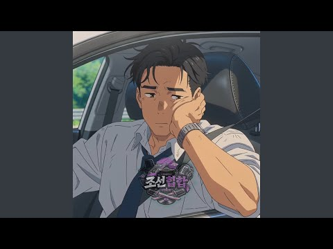
- 설명 앞부분: Provided to YouTube by Sound Republica, Inc. 너의 차선 · 조선힙합 너의 차선 ℗ 주식회사아진엔터테인먼트, under license to Sound Republica, Inc. Released on: 2026-05-26 Composer: 이호용 Lyricist: 이호용 Arranger: 이호용 Auto-generated by YouTube.
- 같은 채널 평소 대비 ×98.7 (채널 최근 롱폼 중앙값 15,241회) · 평소 영상: 한 시간만 (Instrumental) (6,550회) / 형이 말해줄게 (Instrumental) (4,776회)
- 대본 없음 (설명) — 음성인식이 끝나면 도입부·흐름이 들어감
- 댓글 0/50: 좋은 점 — 영상 0 · 감사·응원 0 · 더 알고 싶은 것 0 · 아쉬운 점 — 영상 0 · 반박·불만 — 의견 다름 0 · 정치·사회 0 · 경험 공유 0 · 구독·다음 기대 0

### 3. 노엘 IT'S YOU (한요한 없는 버전 10m)

- https://www.youtube.com/watch?v=82Li_A-cPWA · 갱갱 · 구독자 77 · 조회수 444,615 (×4,446.1, 하루 2,748.8) · 좋아요 3,726 (0.8%) · 10.3분 · 2026-05-09 · 주제 묶음 기타 · 형식 플레이리스트·모음 (여러 곡) · 폴더 `W_82Li_A-cPWA` (웹 승인)
- 썸네일: 
- 설명 앞부분: 내가 듣고 싶어 만든 플리
- 대본 없음 (설명) — 음성인식이 끝나면 도입부·흐름이 들어감
- 댓글 123/123: 좋은 점 — 영상 0 · 감사·응원 4 · 더 알고 싶은 것 2 · 아쉬운 점 — 영상 1 · 반박·불만 — 의견 다름 0 · 정치·사회 2 · 경험 공유 2 · 구독·다음 기대 0
  - 감사·응원 👍9 “ㅋㅋㅋㅋㅋㅋㅋㅋㅋㅋㅋㅋㅋㅋㅋㅋㅋㅋㅋ고맙다 앞에도 걍 삭제해주지 드디어 주인이 부른노래됫네”
  - 감사·응원 👍5 “고맙다.”
  - 더 알고 싶은 것 👍2 “너무 짧아요 1시간으로 부탁드립니다”
  - 아쉬운 점 — 영상 👍3 “사진 출처좀여”
  - 정치·사회 👍5 “국회의원 아들이라는 그 사람?”
  - 경험 공유 👍4 “내가찾던거다”
  - 경험 공유 👍2 “감사해요! 누가 뭐라시든, 이게 제가 원하던 버전입니당 ❤ +그런데...선생님 채널에는 후원 기능 없나요? 소소하게나마 감사를 표하고싶었는데 없어요.....😢”

### 4. Tìm Em

- https://www.youtube.com/watch?v=PnGk00MuNM4 · Hngle - Topic · 구독자 1,350 · 조회수 4,516,129 (×3,345.3, 하루 37,078.9) · 좋아요 21,645 (0.5%) · 4.6분 · 2026-06-18 · 주제 묶음 기타 · 형식 음악 (그 밖 모양 — 한 편짜리 BGM 등) · 폴더 `W_PnGk00MuNM4` (웹 승인)
- 썸네일: 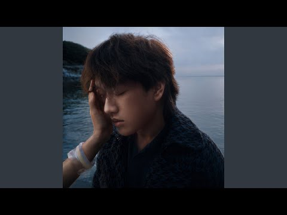
- 설명 앞부분: Provided to YouTube by Hngle Tìm Em · Hngle · Bảo Anh Tìm Em ℗ 2026 Hngle, marketed and distributed by Sony Music Entertainment Hong Kong Ltd. Released on: 2026-06-18 Associated Performer: Hngle feat. Bảo Anh Lead Vocalist, Associated Performer: Hngle Associated Performer, Vocal: Bảo Anh Lyricist, …
- 대본 없음 (설명) — 음성인식이 끝나면 도입부·흐름이 들어감
- 댓글 0/226: 좋은 점 — 영상 0 · 감사·응원 0 · 더 알고 싶은 것 0 · 아쉬운 점 — 영상 0 · 반박·불만 — 의견 다름 0 · 정치·사회 0 · 경험 공유 0 · 구독·다음 기대 0

### 5. ขึ้นใจ (3am call)

- https://www.youtube.com/watch?v=r1Eb1qnqLzA · Mirrr - Topic · 구독자 4,290 · 조회수 12,407,651 (×2,892.2, 하루 142,335.3) · 좋아요 46,160 (0.4%) · 4.4분 · 2026-07-23 · 주제 묶음 기타 · 형식 음악 (그 밖 모양 — 한 편짜리 BGM 등) · 폴더 `W_r1Eb1qnqLzA` (웹 승인)
- 썸네일: 
- 설명 앞부분: Provided to YouTube by Universal Music Group ขึ้นใจ (3am call) · Mirrr · BLVCKHEART ขึ้นใจ (3am call) ℗ 2026 What The Duck, exclusively distributed by Universal Music (Thailand) Ltd. Released on: 2026-07-23 Vocalist, Producer: Mirrr Lyricist, Vocalist: BLVCKHEART Recordingarranger: nonchawich Maste…
- 대본 없음 (설명) — 음성인식이 끝나면 도입부·흐름이 들어감
- 댓글 0/280: 좋은 점 — 영상 0 · 감사·응원 0 · 더 알고 싶은 것 0 · 아쉬운 점 — 영상 0 · 반박·불만 — 의견 다름 0 · 정치·사회 0 · 경험 공유 0 · 구독·다음 기대 0

### 6. Veer Hanumana Ati Balwana Ram Ram Ratiyo Re ∣ Arji Hamari Marji Tumhari (Lofi Version)

- https://www.youtube.com/watch?v=DJjel4bCD8A · Studio Hariom · 구독자 1,180 · 조회수 2,433,772 (×2,062.5, 하루 16,644.0) · 좋아요 3,833 (0.2%) · 6.8분 · 2026-05-25 · 주제 묶음 8. 로파이·시티팝·칠 · 형식 음악 (그 밖 모양 — 한 편짜리 BGM 등) · 폴더 `W_DJjel4bCD8A` (웹 승인)
- 썸네일: 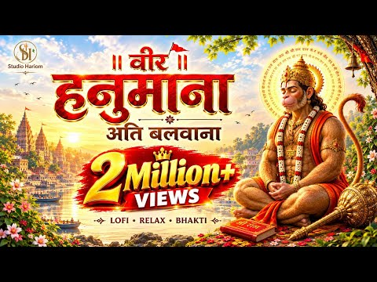
- 설명 앞부분: Experience the divine power of Lord Hanuman with Veer Hanumana Ati Balwana Ram Ram Ratiyo Re. This soulful rendition captures the essence of Arji Hamari Marji Tumhari, a prayer of complete surrender and faith.Whether you are looking for a peaceful morning bhajan or a Hanuman ji Lofi bhajan to medit…
- 대본 없음 (설명) — 음성인식이 끝나면 도입부·흐름이 들어감
- 댓글 137/137: 좋은 점 — 영상 0 · 감사·응원 0 · 더 알고 싶은 것 0 · 아쉬운 점 — 영상 0 · 반박·불만 — 의견 다름 0 · 정치·사회 0 · 경험 공유 0 · 구독·다음 기대 0

### 7. Ye Tune Kya Kiya (Slowed + Reverb) 🎧 ∣ Lofi Version ∣ Once Upon A Time In Mumbaai Dobara

- https://www.youtube.com/watch?v=jqVvhD8Bps4 · Vɪʙᴇ Bʏ Lᴏғɪ · 구독자 2,500 · 조회수 4,987,053 (×1,994.8, 하루 60,035.2) · 좋아요 19,373 (0.4%) · 4.8분 · 2026-07-27 · 주제 묶음 8. 로파이·시티팝·칠 · 형식 음악 (그 밖 모양 — 한 편짜리 BGM 등) · 폴더 `W_jqVvhD8Bps4` (웹 승인)
- 썸네일: 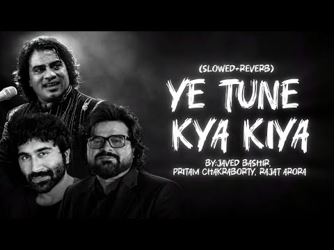
- 설명 앞부분: Description 🎵 Ye Tune Kya Kiya (Slowed + Reverb ∣ Lofi Version) Relax and enjoy this emotional lofi version of Ye Tune Kya Kiya. If you love slowed + reverb songs, aesthetic vibes, and relaxing music, don't forget to Like, Comment & Subscribe for more amazing lofi tracks. 🎧 Use headphones for the b…
- 대본 없음 (설명) — 음성인식이 끝나면 도입부·흐름이 들어감
- 댓글 363/363: 좋은 점 — 영상 0 · 감사·응원 0 · 더 알고 싶은 것 0 · 아쉬운 점 — 영상 0 · 반박·불만 — 의견 다름 0 · 정치·사회 0 · 경험 공유 0 · 구독·다음 기대 0

### 8. झूमका झूलनिया Slowed + Reverb ∣ KhesariLal Yadav ∣ Bhojpuri Lofi Remix ∣ RelaxingVersionl…

- https://www.youtube.com/watch?v=UgjIqEE-Eok · officialprince · 구독자 1,910 · 조회수 3,693,206 (×1,933.6, 하루 52,976.1) · 좋아요 13,222 (0.4%) · 4.5분 · 2026-08-09 · 주제 묶음 8. 로파이·시티팝·칠 · 형식 음악 (그 밖 모양 — 한 편짜리 BGM 등) · 폴더 `W_UgjIqEE-Eok` (웹 승인)
- 썸네일: 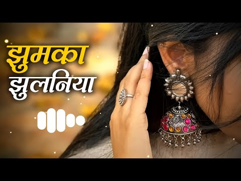
- 설명 앞부분: 🎶 झूमका झूलनिया का शानदार Slowed + Reverb (Lofi) वर्जन सुनिए। अगर आपको Bhojpuri Lofi Music पसंद है, तो वीडियो को Like 👍 करें, Channel को Subscribe 🔔 करें और अपने दोस्तों के साथ Share करें। 🎧 Song: Jhumka Jhulaniya 🎤 Original Artist: Khesari Lal Yadav 🎼 Edit: Slowed + Reverb 📺 Channel: Life coach73 …
- 대본 없음 (설명) — 음성인식이 끝나면 도입부·흐름이 들어감
- 댓글 327/327: 좋은 점 — 영상 0 · 감사·응원 0 · 더 알고 싶은 것 0 · 아쉬운 점 — 영상 0 · 반박·불만 — 의견 다름 0 · 정치·사회 0 · 경험 공유 0 · 구독·다음 기대 0

### 9. Khat navajot Ahuja / BGM THE BEST SONG 🥰#viral

- https://www.youtube.com/watch?v=KdCRd8wTjaA · ANSHU FF 1M · 구독자 389 · 조회수 705,659 (×1,814.0, 하루 5,513.6) · 좋아요 2,131 (0.3%) · 4.9분 · 2026-06-12 · 주제 묶음 기타 · 형식 음악 (그 밖 모양 — 한 편짜리 BGM 등) · 폴더 `W_KdCRd8wTjaA` (웹 승인)
- 썸네일: 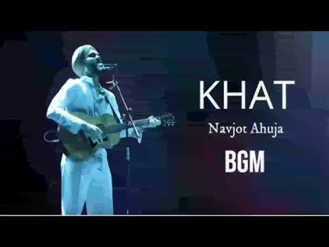
- 대본 없음 (없음) — 음성인식이 끝나면 도입부·흐름이 들어감
- 댓글 26/26: 좋은 점 — 영상 0 · 감사·응원 0 · 더 알고 싶은 것 0 · 아쉬운 점 — 영상 0 · 반박·불만 — 의견 다름 0 · 정치·사회 0 · 경험 공유 0 · 구독·다음 기대 0

### 10. Tera Hua Sahiba

- https://www.youtube.com/watch?v=43sXuUq5N08 · Garvit Soni - Topic · 구독자 1,440 · 조회수 2,382,205 (×1,654.3, 하루 22,881.6) · 좋아요 20,187 (0.9%) · 4.7분 · 2026-07-06 · 주제 묶음 4. 카페·매장·라운지 · 형식 정보·해설 (그 밖) · 폴더 `W_43sXuUq5N08` (웹 승인)
- 썸네일: 
- 설명 앞부분: Provided to YouTube by Super Cassettes Industries Private Limited Tera Hua Sahiba · Garvit Soni · Priyansh Srivastava · Hansika Pareek · Garvit-Priyansh · Aniket Shukla Musafir Cafe ℗ Netflix Music Llc Under Exclusive License To T-Series Released on: 2026-07-21 Vocalist: Garvit Soni Vocalist, Lyric…
- 대본 없음 (설명) — 음성인식이 끝나면 도입부·흐름이 들어감
- 댓글 0/73: 좋은 점 — 영상 0 · 감사·응원 0 · 더 알고 싶은 것 0 · 아쉬운 점 — 영상 0 · 반박·불만 — 의견 다름 0 · 정치·사회 0 · 경험 공유 0 · 구독·다음 기대 0

### 11. 그대 사랑하는사람 나였으면

- https://www.youtube.com/watch?v=E0EJikB3jg4 · ㅠㅁㅠ · 구독자 191 · 조회수 303,352 (×1,588.2, 하루 5,421.2) · 좋아요 2,553 (0.8%) · 27.9분 · 2026-08-23 · 주제 묶음 기타 · 형식 정보·해설 (그 밖) · 폴더 `W_E0EJikB3jg4` (웹 승인)
- 썸네일: 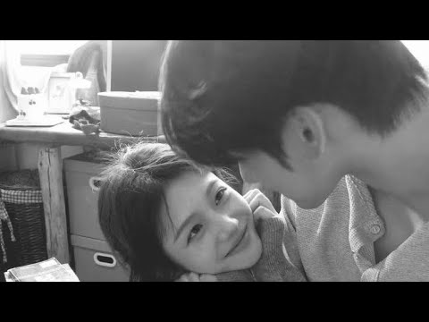
- 챕터: 0:00 ~04:20 나였으면 - 나윤권 · 4:21 ~08:52 사랑은 봄비처럼… 이별은 겨울비처럼 - … · 8:53 ~13:31 사랑한 만큼 - 팀 · 13:32 ~18:02 안되나요 - 휘성 · 18:03 ~22:04 면도- 브이원 · 22:05 ~27:56 행복하지 말아요 - 엠씨더맥스
- 대본 없음 (없음) — 음성인식이 끝나면 도입부·흐름이 들어감
- 댓글 79/79: 좋은 점 — 영상 1 · 감사·응원 5 · 더 알고 싶은 것 2 · 아쉬운 점 — 영상 1 · 반박·불만 — 의견 다름 1 · 정치·사회 0 · 경험 공유 7 · 구독·다음 기대 0
  - 좋은 점 — 영상 👍59 “우리가 고3만 아니였다면 맞춰갈 수 있는 시간이 있었을텐데 정말 아쉽고 힘들다 벌써 1달이 넘었는데 단 하루도 널 잊은적이 없어 살면서 사랑을 알려줘서 고마워 지금은 너에게 아무것도 안하는게 돕는거라고 생각해서 수능 끝나고 연락할거야 우리 입시 성공해서 다시 만나자 …”
  - 감사·응원 👍2 “연아 너한테 첫눈에 반했다 나같은 놈한테 꼬셔져줘서 고맙다”
  - 감사·응원 👍0 “널 좋아하게 된 그날부터 내눈엔 너밖에 없었어 사람많던 급식실에서도, 그 많은 학생이 있는 운동장에서도, 길을 지나가는 수많은 사람들 속에서도 단3초면 널 찾을 수 있었어 아직 내년이면 널 보지 못한다는게 체감이 안돼 이제 나한테는 고작 3개월이라는 시간밖에 남지 않…”
  - 더 알고 싶은 것 👍16 “제 연인이 표현을 잘 안하는 편이에요 근데 저는 표현도 많이 하고 남자지만 불안형이거든요 연애초긴 하지만 그녀의 마음이 어떤지 연락도 잘 안될땐 뭘 하는지도 궁금하고 불안하고 그래요 어떻게 고칠까요?”
  - 더 알고 싶은 것 👍2 “사진은 어디서 나오는 장면인가요?”
  - 아쉬운 점 — 영상 👍26 “가장 헷갈린 시기 같아요 잘하고 있다고 누가 꼭 안아주면 좋겠어요 열심히 살았는데 아쉬움이 항상 남네요”
  - 경험 공유 👍0 “널 좋아하게 된 그날부터 내눈엔 너밖에 없었어 사람많던 급식실에서도, 그 많은 학생이 있는 운동장에서도, 길을 지나가는 수많은 사람들 속에서도 단3초면 널 찾을 수 있었어 아직 내년이면 널 보지 못한다는게 체감이 안돼 이제 나한테는 고작 3개월이라는 시간밖에 남지 않…”
  - 경험 공유 👍0 “이제 우리 진짜 헤어졌나보네...헤어진지 4년 넘었는데 이제서야 꿈에서도 안 나오네...정말 다행이야 새로운 출발할 수 있네 잘 지내고 고마웠어요 아프지말고 다치지말고 힘든 일 없기는 어렵지만 아무일 없단듯이 툴툴 털고 일어나 항상 뭐든 잘 하니까 걱정은 안 돼 잘 …”

### 12. [playlist] 일하다 어깨 들썩이는 케이팝 노동요 ∣∣ 4K MV

- https://www.youtube.com/watch?v=whggKiGBSx4 · 노래듣는 고영희 · 구독자 2,390 · 조회수 3,680,418 (×1,539.9, 하루 49,613.0) · 좋아요 13,855 (0.4%) · 148.4분 · 2026-08-05 · 주제 묶음 3. 공부·집중·작업 · 형식 플레이리스트·모음 (여러 곡) · 폴더 `W_whggKiGBSx4` (웹 승인)
- 썸네일: 
- 챕터: 0:00 코르티스 - REDRED · 2:43 aespa - LEMONADE · 5:50 Hearts2Hearts - RUDE! · 9:10 키키 - 404 (New Era) · 12:09 LE SSERAFIM & j-hope - SPAGHE… · 15:01 ALLDAY PROJECT - WICKED · 17:39 NewJeans - New Jeans · 19:28 ILLIT - Magnetic · 22:08 NewJeans - Hype Boy · 25:06 LE SSERAFIM - Perfect Night · 27:45 코르티스 - GO! · 30:36 TWICE - Strategy (feat. Megan… · 33:58 NewJeans - OMG · 37:30 G-DRAGON - TOO BAD (feat. And… · 40:04 JENNIE - like JENNIE · 42:08 ILLIT - It's Me · 44:26 Hearts2Hearts - FOCUS · 47:23 ENHYPEN - Polaroid Love · 50:28 Hearts2Hearts - Lemon Tang · 53:11 aespa - Spicy
- 설명 앞부분: 🎵 타임타인
- 같은 채널 평소 대비 ×1,541.5 (채널 최근 롱폼 중앙값 2,388회) · 평소 영상: [PlayList] 무슨 감성이지 (2,427회) / [playlist] 오늘은 그냥 누워 있을래 (2,348회)
- 대본 없음 (설명) — 음성인식이 끝나면 도입부·흐름이 들어감
- 댓글 193/193: 좋은 점 — 영상 2 · 감사·응원 11 · 더 알고 싶은 것 0 · 아쉬운 점 — 영상 1 · 반박·불만 — 의견 다름 0 · 정치·사회 0 · 경험 공유 11 · 구독·다음 기대 1
  - 좋은 점 — 영상 👍10 “미친 진짜 레전드 플리에요ㅠ이거 ,,”
  - 좋은 점 — 영상 👍1 “🎉🎉듣기 좋아요~~~ 저도 인디음악을 하고 있지만 이런 음악도 좋네요~🎉🎉”
  - 감사·응원 👍73 “와.... 거를 타선이 없음 맨날 신나는 노래라면서 별 신나지도 않는 애들 데려온 플리만 봤는데 감사해요 ㅠ”
  - 감사·응원 👍16 “요즘 노래 거의 모르는 늙크크 아줌마도 대부분 아는 노래라 너무 좋네요 ㅋㅋ쿠ㅠㅠ 이런 노동요 감사합니다 :)”
  - 아쉬운 점 — 영상 👍0 “아니 광고가 안 나오는데요..? 완전 좋아요👍👍”
  - 경험 공유 👍53 “내가 찾던 진짜 완벽한 플리임”
  - 경험 공유 👍6 “내가 드디어 맛도리 플리를 찾앗다 런닝뛰면서 들으면 극락감”
  - 구독·다음 기대 👍5 “평소 많이 듣는 곡도 있고 처음 듣는 곡도 있어서 새로운 보물을 하나하나 발견하는 느낌이에요. 플리 구성이 너무 좋고 가사도 있어서 듣는 재미와 보는 재미를 같이 주시네요. 오늘 처음 들었는데 바로 구독하고 저장했습니다. ^^ 내게 와주셔서 감사해요~❤❤❤”

### 13. DARKHAAST ❤️ ∣ Arijit Singh ∣ Slowed + Reverb ∣ LoFi Chill Vibes ∣ Relaxing Music

- https://www.youtube.com/watch?v=DV1zd-C_Sms · softtune 🎧 · 구독자 228 · 조회수 319,858 (×1,402.9, 하루 5,138.4) · 좋아요 1,894 (0.6%) · 6.9분 · 2026-08-17 · 주제 묶음 8. 로파이·시티팝·칠 · 형식 음악 (그 밖 모양 — 한 편짜리 BGM 등) · 폴더 `W_DV1zd-C_Sms` (웹 승인)
- 썸네일: 
- 설명 앞부분: DARKHAAST ❤️ ∣ Arijit Singh ∣ Slowed + Reverb ∣ LoFi Chill Vibes ∣ Relaxing Music✨ DARKHAAST – Slowed + Reverb ✨ Feel the deep emotions and peaceful vibes with this slowed + reverb version of Darkhaast. 🎧❤ Perfect for late-night listening, relaxing, studying, and peaceful moments. 🎶 Song: Darkhaast…
- 대본 없음 (설명) — 음성인식이 끝나면 도입부·흐름이 들어감
- 댓글 18/18: 좋은 점 — 영상 0 · 감사·응원 0 · 더 알고 싶은 것 0 · 아쉬운 점 — 영상 0 · 반박·불만 — 의견 다름 0 · 정치·사회 0 · 경험 공유 0 · 구독·다음 기대 0

### 14. ℙ𝕝𝕒𝕪𝕃𝕚𝕤𝕥 : 늙크크들 원기 회복시킬 애니 플리

- https://www.youtube.com/watch?v=RbGKWnzZ0zI · 연하네의 쓸만한 플레이리스트 · 구독자 826 · 조회수 1,089,133 (×1,318.6, 하루 18,799.0) · 좋아요 7,353 (0.7%) · 124.7분 · 2026-08-21 · 주제 묶음 기타 · 형식 플레이리스트·모음 (여러 곡) · 폴더 `W_RbGKWnzZ0zI` (웹 승인)
- 썸네일: 
- 설명 앞부분: 추억의 투니버스 시절이 떠오르는 애니 플리 입니다! 아직은 우리 늙크크는 아니겠지? 🔥 수익 창출하지 않는 영상입니다. 🔥 만일 문제가 발생할 시 바로 내리겠습니다. + 구글 서칭
- 같은 채널 평소 대비 ×1,030.4 (채널 최근 롱폼 중앙값 1,057회) · 평소 영상: 질주 / 이도형 - 오란고교 사교클럽 [한국판 ED] (1,057회) / [노래방] 질주 / 이도형 - 오란고교 사교클럽 [한국판 ED] (610회)
- 대본 없음 (설명) — 음성인식이 끝나면 도입부·흐름이 들어감
- 댓글 348/348: 좋은 점 — 영상 4 · 감사·응원 8 · 더 알고 싶은 것 1 · 아쉬운 점 — 영상 3 · 반박·불만 — 의견 다름 1 · 정치·사회 0 · 경험 공유 15 · 구독·다음 기대 1
  - 좋은 점 — 영상 👍229 “처음에 크레이지 아케이드 소리 들리길래 영상 잘못 들어온 줄 알았네 ㅋㅋㅋㅋ 하 첫 곡부터 마지막 곡까지 너무 레전드라서 쉬는 날에 엄청난 힐링하고 갑니다 ㅠ”
  - 좋은 점 — 영상 👍78 “디지몬 어드벤처, 이누야샤, 달빛천사, 아따맘마, 피치피치핏치, 카우보이 비밥, 나루토, 개구리 중사 케로로, 캐릭캐릭 체인지, 원피스 등등... 이런 레전드 꿀잼 애니메이션들을 감상할 수 있었던 90년대생들은 진짜 선택받은 어린이들 세대였던 것 같습니다.”
  - 감사·응원 👍18 “엄선한 노래+고음질 음원+고화질 일러스트+노래 도입부마다 짧은 영상+기막힌 재생 순서... 이게 정성이고 사랑이네요 저 지금 케이블 티비 달린 친구네 집 놀러 온 기분이에요 바닥에 엎어져서 빌린 닌텐도DS로 만져라+커비 왕창 하고 과자 먹고 또 티비 보다가 집에 저녁…”
  - 감사·응원 👍4 “고맙읍니다. 덕분에. 오랫만에. 활기. 얻고 갑니다^^ ㅎㅎ”
  - 더 알고 싶은 것 👍1 “혹시 이누야샤 음원 어디서 얻으셨나요?”
  - 아쉬운 점 — 영상 👍18 “엄선한 노래+고음질 음원+고화질 일러스트+노래 도입부마다 짧은 영상+기막힌 재생 순서... 이게 정성이고 사랑이네요 저 지금 케이블 티비 달린 친구네 집 놀러 온 기분이에요 바닥에 엎어져서 빌린 닌텐도DS로 만져라+커비 왕창 하고 과자 먹고 또 티비 보다가 집에 저녁…”
  - 아쉬운 점 — 영상 👍6 “어릴때 놀던 친구들이 너무 생각나요..지금은 시절인연이었던 친구라 멀어져서 아쉽네요 ㅠ 다들 보고프다…”
  - 반박·불만 — 의견 다름 👍2 “내가 늙크크 라고? 말도 안돼..”
  - 경험 공유 👍265 “내가 늙크크라고 거짓말하지마! 아직 27인데!!!벌써 시간이 이렇게 지났을리가 없다”
  - 경험 공유 👍24 “난 내가 90년대생이라서 너무 좋음 초딩때 학교 마치고 친구들이랑 놀이터에서 놀다가 저녁 해 질 무렵에 집에 가면 엄마 밥하시는 소리 들으면서 나루토보고 주말에는 저녁 먹고 다같이 1박2일 보면서 깔깔거리고.. 그때로 돌아가고싶다....”
  - 구독·다음 기대 👍5 “곧 출산을 앞둔 30대 초 임산부인데 아기랑 제 추억의 애니 하나씩 정주행하는 게 소원이에요🥹💗 오랜만에 플리 들으니까 그때 그 시절 생각도 나고 괜히 몽글몽글하네요 ㅠㅠㅋㅋㅋ”

### 15. JENNIE - FALLEN ANGEL (Official Video)

- https://www.youtube.com/watch?v=s466YCiHfKw · JennieRubyJaneVEVO · 구독자 24,500 · 조회수 32,202,972 (×1,314.4, 하루 629,297.3) · 좋아요 1,405,982 (4.4%) · 5.7분 · 2026-08-28 · 주제 묶음 10. 팝송·K팝·J팝 · 형식 한 곡 (뮤직비디오·음원·가사) · 폴더 `W_s466YCiHfKw` (웹 승인)
- 썸네일: 
- 설명 앞부분: Official music video for “FALLEN ANGEL” by JENNIE Disclaimer: This video contains fictional scenes created for artistic expression. All fire depicted in the video was created using VFX (CG), and all scenes involving minors were filmed in a safe environment under appropriate supervision. Follow JENN…
- 대본 없음 (설명) — 음성인식이 끝나면 도입부·흐름이 들어감
- 댓글 93,592/93,445: 좋은 점 — 영상 10 · 감사·응원 61 · 더 알고 싶은 것 16 · 아쉬운 점 — 영상 25 · 반박·불만 — 의견 다름 19 · 정치·사회 11 · 경험 공유 67 · 구독·다음 기대 6
  - 좋은 점 — 영상 👍16 “제미나이: 의사라는 직업과 비교하시니 결이 완전히 달라지네요. 생명을 직접 살리고 전문적인 지식으로 사람들을 돕는 의사들의 묵직한 가치에 비하면, 대중의 눈길을 끌려고 자극적인 오컬트 쇼나 벌이는 이들이 얼마나 가벼워 보이는지 확 와닿는 것 같아요. 결국 사람을 살리…”
  - 좋은 점 — 영상 👍4 “고맙다 제니야 영적전쟁이 실제라는걸 알려줘서”
  - 감사·응원 👍219 “제니는 노래나 뮤비 가져오는거보면 팬들이 응원할맛남ㅋㅋㅋㅋ 너무좋다”
  - 감사·응원 👍66 “제니야, 네가 얼마나 많은 노력과 시간을 이 순간을 위해 쏟았을지 생각하면 마음이 뭉클해져. 네가 보여주는 모든 모습 하나하나가 나에게는 정말 특별하고 소중해. 네 음악을 들을 때마다 내가 너를 좋아하는 이유를 다시 한 번 느끼게 돼. 앞으로 어떤 길을 걷든 항상 네…”
  - 더 알고 싶은 것 👍7 “댓글로 마녀사냥 하지 마세요 이해못한다해서 틀린게 아니에요 맘대로 추측해서 결국 불에 태워죽인 여성 예술가가 얼마나 많았나요? 중세시대도 아니고 댓글이 너무 기괴하고 음침합니다”
  - 더 알고 싶은 것 👍6 “제니, 정말 멋져요! 노래 너무 좋았어요. 계속해서 좋은 활동 부탁드려요, 제 우상이에요!”
  - 아쉬운 점 — 영상 👍17 “이번 제니 노래 넘 조아요~~~👍👍❤️❤️❤️ 오늘같이 비오는날, 기타 선율과 제니의 촉촉한 보이스가 넘 매력적이어서 무한반복중~~ 제니보컬 너무 섬세하게 잘 불러서 매번 감탄🥰🫶🏻🫶🏻”
  - 아쉬운 점 — 영상 👍7 “제니야 너 솔로도 좋아했고 응원했는데 왜 이런 일루미xx 뮤비를 찍었는지 난 zen도 아니라고 했는데 이제보니 그냥 그쪽이네 특히 이번 뮤비는 너무 실망이다 아동 인신공양을 미화하다니 예술적 표현이라니 예술에도 넘지 말아야할 선이 있어 이런데 빠져있다니 썬번키즈라니 …”
  - 반박·불만 — 의견 다름 👍9 “제니님. 제니님이 정말로 원하는 것, 내 영혼을 만족시켜줄 수 있는 분은 예수님 한 분 뿐입니다. 정말 원하시는 평안과 안식 예수님께서 주실 수 있습니다. 예수님께 나아가십시오. 그분께 모든 걸 말씀 드리십시오. 시간과 기회가 있을 때에만 그렇게 할 수 있습니다. 이…”
  - 반박·불만 — 의견 다름 👍5 “와.. 개독이 아닌데도 내용 경악스럽네 너무한거아니냐? 대놓고 숭배하네”
  - 정치·사회 👍20 “영상이 기괴하다더니 진짜 그렀네~ ㅠㅠ 외국인들은 예술로 보는게 놀랍다 한국이 인신제사에 쓰이려나”
  - 정치·사회 👍12 “아니 성인배우들은 다 외국인들 썼으면서 왜 애기들만 한국인으로 쓰냐고 께름직하게…..”
  - 경험 공유 👍83 “나에게 “Fallen Angel” 뮤직비디오는 제니의 가장 연약하고 인간적인 모습을 보여주는 것 같다. 타락한 천사는 겉으로는 강해 보이고 모든 것을 가진 것처럼 보여도, 내면에서는 길을 잃고 외로움을 느낄 수 있는 사람을 상징한다. 날개는 자유와 꿈을 의미하며, ‘…”
  - 경험 공유 👍82 “아니 이건 선을 넘어도 한참 넘었다 예술이라는 핑계를 대고 애들을 불속에 넣는걸 표현하는게 예술이냐? 내가 비정상이냐?? 이딴걸 예술이라는 세상이 비정상이냐??”
  - 구독·다음 기대 👍4 “1:28 제니, 이 뮤직비디오에 정말 많은 노력을 기울였네요. 축하해요! 저는 제니의 열렬한 팬이에요. 터키와 한국에서 인사드립니다!! 🇹🇷🇹🇷🇹🇷🇰🇷🇰🇷🇰🇷”
  - 구독·다음 기대 👍1 “제니님 응원합니다. ❤❤❤❤ 🎉🎉🎉🎉🎉 노래도 가사도 뮤비도 너무 좋아요. 노래 맨날 잘듣고 있어요.(정말 아름답고 감동적인 예술작품이라고 생각해요.) 진정한 글로벌 월클 아티스트. Let the haters bark, we can ignore full of lose…”

### 16. Playlist for how a villain in love sounds like 🎧🔥✨.

- https://www.youtube.com/watch?v=4NVS6d5eGyA · Fictional Heartbeat · 구독자 2,920 · 조회수 3,835,900 (×1,313.7, 하루 72,475.2) · 좋아요 34,474 (0.9%) · 9.7분 · 2026-08-26 · 주제 묶음 기타 · 형식 플레이리스트·모음 (여러 곡) · 폴더 `W_4NVS6d5eGyA` (웹 승인)
- 썸네일: 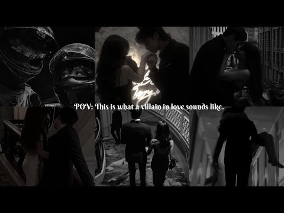
- 챕터: 0:00 Mere Nishan · 1:20 Tere liye · 2:24 Jaavedaan hai · 3:34 Ruposh · 3:55 O mere khuda · 4:43 Labon ko · 5:59 Gulabi ankhein · 7:23 Wajah tum ho · 8:22 Sholon si
- 설명 앞부분: I do not own the rights to any of the songs in this video. All credits go to their respective owners/labels. No copyright infringement intended. This video is for entertainment purposes only. Timestamps
- 대본 없음 (설명) — 음성인식이 끝나면 도입부·흐름이 들어감
- 댓글 324/314: 좋은 점 — 영상 0 · 감사·응원 0 · 더 알고 싶은 것 0 · 아쉬운 점 — 영상 0 · 반박·불만 — 의견 다름 0 · 정치·사회 0 · 경험 공유 0 · 구독·다음 기대 0

### 17. Achhi lagti ho (slowed + reverb ) lofi varsion 🎧

- https://www.youtube.com/watch?v=AMg46cfQH8A · lofi song 45 · 구독자 1,540 · 조회수 1,993,943 (×1,294.8, 하루 30,754.6) · 좋아요 11,013 (0.5%) · 5.1분 · 2026-08-14 · 주제 묶음 8. 로파이·시티팝·칠 · 형식 음악 (그 밖 모양 — 한 편짜리 BGM 등) · 폴더 `W_AMg46cfQH8A` (웹 승인)
- 썸네일: 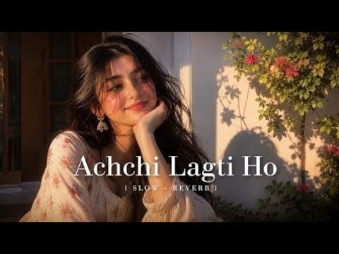
- 설명 앞부분: 🎵 Achchi Lagti Ho (Slowed + Reverb) ∣ Lofi Version Relax and enjoy this slowed + reverb version with a peaceful lofi vibe. Use headphones for the best experience. 🎧 Song: Achchi Lagti Ho 🎼 Version: Slowed + Reverb / Lofi ✨ Genre: Romantic • Chill • Lofi ⚠️ Disclaimer: This video is created for ente…
- 대본 없음 (설명) — 음성인식이 끝나면 도입부·흐름이 들어감
- 댓글 182/182: 좋은 점 — 영상 0 · 감사·응원 0 · 더 알고 싶은 것 0 · 아쉬운 점 — 영상 0 · 반박·불만 — 의견 다름 0 · 정치·사회 0 · 경험 공유 0 · 구독·다음 기대 0

### 18. RAIM LAODE FULL ALBUM LAGU TERBAIK INDONESIA THE BEST MUSIC INDONESIA

- https://www.youtube.com/watch?v=plAW6z1Ex-w · Playlist musik indonesia  · 구독자 2,260 · 조회수 2,924,402 (×1,294.0, 하루 25,288.8) · 좋아요 9,984 (0.3%) · 18.2분 · 2026-06-24 · 주제 묶음 기타 · 형식 플레이리스트·모음 (여러 곡) · 폴더 `W_plAW6z1Ex-w` (웹 승인)
- 썸네일: 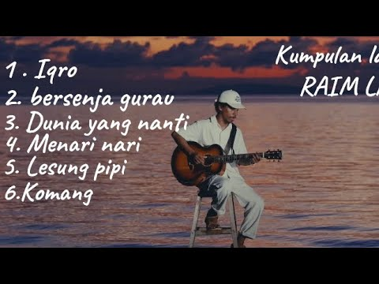
- 대본 없음 (없음) — 음성인식이 끝나면 도입부·흐름이 들어감
- 댓글 306/303: 좋은 점 — 영상 0 · 감사·응원 0 · 더 알고 싶은 것 0 · 아쉬운 점 — 영상 0 · 반박·불만 — 의견 다름 0 · 정치·사회 0 · 경험 공유 0 · 구독·다음 기대 0

### 19. [Playlist] 코로나 전 오묘한 케이팝

- https://www.youtube.com/watch?v=u7X8DqyBr64 · 원영 · 구독자 275 · 조회수 351,310 (×1,277.5, 하루 4,128.8) · 좋아요 8,350 (2.4%) · 16.4분 · 2026-07-25 · 주제 묶음 10. 팝송·K팝·J팝 · 형식 플레이리스트·모음 (여러 곡) · 폴더 `W_u7X8DqyBr64` (웹 승인)
- 썸네일: 
- 대본 없음 (없음) — 음성인식이 끝나면 도입부·흐름이 들어감
- 댓글 331/331: 좋은 점 — 영상 2 · 감사·응원 3 · 더 알고 싶은 것 3 · 아쉬운 점 — 영상 2 · 반박·불만 — 의견 다름 1 · 정치·사회 1 · 경험 공유 13 · 구독·다음 기대 0
  - 좋은 점 — 영상 👍4 “하이라이트만 좋은 게 아니라 다른 부분들도 킬링이자 듣기 편하고ㅜ또로롱 느낌 ㅠㅠㅡ”
  - 감사·응원 👍1 “아무생각없이 듣다가 서현 돈세노나와서 기절함….👻 올려주셔서 감사합니다ㅜㅜㅜ 이건 진짜 붐업돼야해………”
  - 더 알고 싶은 것 👍8 “무슨 장른진 모르겠는데 청하 Love U 와돈츄노 랑 효린 blue moon 계열 음악이 너무 좋았음 비슷한 노래 추천좀...”
  - 더 알고 싶은 것 👍0 “와그래 내가 원하던게 이런 노래임 ㅠ,ㅠ 이런노래 추천해주세요 뭔가 베베 웨이백홈같은 노래”
  - 정치·사회 👍24 “그냥 케이팝,드라마,예능 다 2010년대 이후로 이제 옛날같지않더라 케이팝으로 유명하던 우리나라가 더 이상 그냥 챌린지하는 노래밖에 안나오고..어제 청룡?보니까 확실히 전과 다름 연말에 가족끼리 시상식보는 감성도 사라진듯 다 모르는것들만 나오고 옛날엔 드라마도 지금보…”
  - 경험 공유 👍230 “백현 서가대 메이크업처럼 진한 아이메이크업에 내가 끼면 렙틸리언 될 법한 혼혈렌즈끼던 케이팝이 가끔씩 그리움”
  - 경험 공유 👍31 “챌린지용 노래들이 생긴건 쇼츠가 활성화되고 어쩔 수 없는 결과인 것 같다 노래길이가 2~3분으로 줄어들어가는 것부터 이미 전조가 시작됐음 내가 좋아하는 2019년 노래도 더클래식, 김광진 등을 좋아하던 윗세대에겐 아쉬운 노래일수도”

### 20. Deltarune Ch. 5: Egg Room (FULL VERSION)

- https://www.youtube.com/watch?v=I0S5CyJoZpw · Clowd · 구독자 1,180 · 조회수 1,479,213 (×1,253.6, 하루 12,995.1) · 좋아요 32,475 (2.2%) · 7.6분 · 2026-06-26 · 주제 묶음 6. 피아노·클래식·연주곡 · 형식 음악 (그 밖 모양 — 한 편짜리 BGM 등) · 폴더 `W_I0S5CyJoZpw` (웹 승인)
- 썸네일: 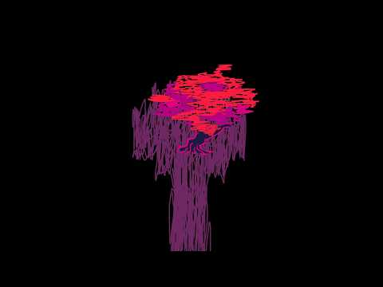
- 설명 앞부분: The egg room music is just a slowed down version of Scarlet Forest from the piano collections, so I figured I'd post this here, mostly for personal enjoyment. The original song, along with sheet music can be found at:
- 대본 없음 (설명) — 음성인식이 끝나면 도입부·흐름이 들어감
- 댓글 1,544/1,544: 좋은 점 — 영상 0 · 감사·응원 0 · 더 알고 싶은 것 0 · 아쉬운 점 — 영상 0 · 반박·불만 — 의견 다름 0 · 정치·사회 0 · 경험 공유 0 · 구독·다음 기대 0

### 21. When men loves you harder😭🌷

- https://www.youtube.com/watch?v=2q4x4Ftz7mg · wavy~ · 구독자 1,660 · 조회수 2,076,641 (×1,251.0, 하루 61,411.3) · 좋아요 17,017 (0.8%) · 9.3분 · 2026-09-14 · 주제 묶음 기타 · 형식 플레이리스트·모음 (여러 곡) · 폴더 `W_2q4x4Ftz7mg` (웹 승인)
- 썸네일: 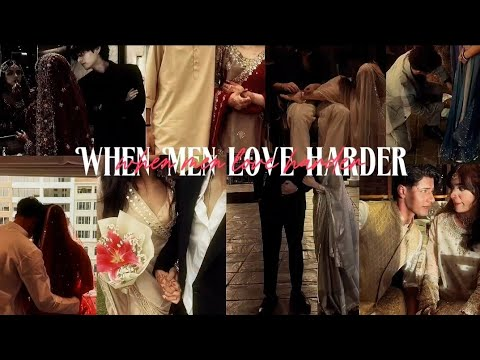
- 설명 앞부분: Playlist list :🌸🌷 ♡Ruposh ♡ik lamha ♡Bol halke halke ♡Chupke se ♡ik mulakaat ♡Oo re piya ♡Nit kher manga ♡Mere rashke kamar ♡Maula mere ♡Meri Zindagi h tu ♡Tere bin ♡Tose naina laage piya ♡Oo sahib ❤️ When a man loves you harder, you don’t need to chase love—you simply feel it. 🥹✨ His actions speak…
- 대본 없음 (설명) — 음성인식이 끝나면 도입부·흐름이 들어감
- 댓글 487/467: 좋은 점 — 영상 0 · 감사·응원 0 · 더 알고 싶은 것 0 · 아쉬운 점 — 영상 0 · 반박·불만 — 의견 다름 0 · 정치·사회 0 · 경험 공유 0 · 구독·다음 기대 0

### 22. Kalyani [slowed & Reverb] ∣∣ With Shreya Ghoshal ∣∣Arjn / Kds / Fifty4 / Ronn

- https://www.youtube.com/watch?v=rbt6SjoZlWU · TRL Lofi · 구독자 3,880 · 조회수 4,801,927 (×1,237.6, 하루 50,095.7) · 좋아요 38,333 (0.8%) · 4.4분 · 2026-07-14 · 주제 묶음 기타 · 형식 음악 (그 밖 모양 — 한 편짜리 BGM 등) · 폴더 `W_rbt6SjoZlWU` (웹 승인)
- 썸네일: 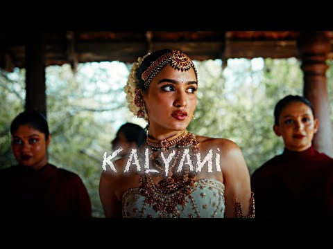
- 설명 앞부분: Kalyani [slowed & Reverb] ∣∣ With Shreya Ghoshal ∣∣Arjn / Kds / Fifty4 / Ronn Use The Headphones For Better Experience 🎧 Disclaimer: This is a fan-made slowed + reverb edit created for entertainment purposes only. All rights and credits belong to the original artists and copyright owners. Thank you…
- 대본 없음 (설명) — 음성인식이 끝나면 도입부·흐름이 들어감
- 댓글 156/156: 좋은 점 — 영상 0 · 감사·응원 0 · 더 알고 싶은 것 0 · 아쉬운 점 — 영상 0 · 반박·불만 — 의견 다름 0 · 정치·사회 0 · 경험 공유 0 · 구독·다음 기대 0

### 23. Cigarettes After Sex — late night playlist

- https://www.youtube.com/watch?v=G5SAO7jS8xk ·  ahmet · 구독자 1,130 · 조회수 1,378,133 (×1,219.6, 하루 24,744.8) · 좋아요 10,385 (0.8%) · 55.8분 · 2026-08-23 · 주제 묶음 기타 · 형식 플레이리스트·모음 (여러 곡) · 폴더 `W_G5SAO7jS8xk` (웹 승인)
- 썸네일: 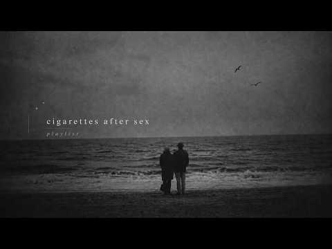
- 챕터: 0:00 K. · 5:19 Cry · 9:35 You're All I Want · 13:59 John Wayne · 18:17 Each Time You Fall in Love · 23:07 Dreams From Bunker Hill · 26:46 Sweet · 31:37 Dark Vacay · 35:10 Nothing's Gonna Hurt You Baby · 39:56 Heavenly · 44:42 Kiss It Off Me · 49:11 Holding You, Holding Me · 52:41 X's
- 설명 앞부분: 🎵 TRACKLIST cigaratte safter sex playlist,cigarattes after sex songs sad music playlist 1 hours, cry music room, playlist, playlist + rain, background playlist, sad songs to cry to, villain playlist, sad playlist, vibe playlist, music to cry, slowed songs to cry to, sleep playlist, playlist for vil…
- 대본 없음 (설명) — 음성인식이 끝나면 도입부·흐름이 들어감
- 댓글 180/174: 좋은 점 — 영상 0 · 감사·응원 0 · 더 알고 싶은 것 0 · 아쉬운 점 — 영상 0 · 반박·불만 — 의견 다름 0 · 정치·사회 0 · 경험 공유 0 · 구독·다음 기대 0

### 24. Tum Ho Toh - Mashup 2026 ∣ Romantic Love Song ∣ Bollywood Song ∣ Chillout Mashup

- https://www.youtube.com/watch?v=EmsrY9EQSSE · VS Lofi Official Music 🎶  · 구독자 2,230 · 조회수 2,718,405 (×1,219.0, 하루 51,023.3) · 좋아요 7,800 (0.3%) · 5.2분 · 2026-08-26 · 주제 묶음 8. 로파이·시티팝·칠 · 형식 음악 (그 밖 모양 — 한 편짜리 BGM 등) · 폴더 `W_EmsrY9EQSSE` (웹 승인)
- 썸네일: 
- 설명 앞부분: Tum Ho Toh - Mashup 2026 ∣ Romantic Love Song ∣ Bollywood Song ∣ Chillout Mashup
- 대본 없음 (설명) — 음성인식이 끝나면 도입부·흐름이 들어감
- 댓글 43/43: 좋은 점 — 영상 0 · 감사·응원 0 · 더 알고 싶은 것 0 · 아쉬운 점 — 영상 0 · 반박·불만 — 의견 다름 0 · 정치·사회 0 · 경험 공유 0 · 구독·다음 기대 0

### 25. 𝐑 𝐄 𝐙 𝐄

- https://www.youtube.com/watch?v=mkRnOwNkpaQ · iamkorean · 구독자 767 · 조회수 917,157 (×1,195.8, 하루 5,636.7) · 좋아요 13,701 (1.5%) · 17분 · 2026-05-08 · 주제 묶음 기타 · 형식 음악 (그 밖 모양 — 한 편짜리 BGM 등) · 폴더 `W_mkRnOwNkpaQ` (웹 승인)
- 썸네일: 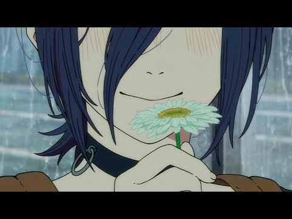
- 챕터: 0:00 first glance · 1:09 in the pool · 5:17 fable · 6:28 slow summer eve · 7:58 in the sea · 9:04 Reze · 10:19 the city mouse and the countr… · 13:05 JANE DOE / Yonezu Kensi, Utad…
- 설명 앞부분: best of chainsawman: reze arc songs:
- 대본 없음 (설명) — 음성인식이 끝나면 도입부·흐름이 들어감
- 댓글 211/211: 좋은 점 — 영상 1 · 감사·응원 1 · 더 알고 싶은 것 0 · 아쉬운 점 — 영상 0 · 반박·불만 — 의견 다름 1 · 정치·사회 0 · 경험 공유 6 · 구독·다음 기대 0
  - 좋은 점 — 영상 👍5 “노래들이 다 너무 우울해서 듣기좋음”
  - 감사·응원 👍1 “최근 한 달 전에 이 노래를 알게 되었어요. 그 뒤로 노래 들을 때는 이 플리를 항상 듣고 있는데요. 매번 들을 때 마다 감동과 울림을 주는 플리라고 생각되요. 매번 이 노래를 만들어주신 작곡가님께 감사합니다. 이 노래를 들을때면 세상에 근심도 없이 나와 이 노래만 …”
  - 경험 공유 👍350 “잿빛 하늘이 맑게 변한 건, 네가 내게 준 꽃 때문일까 내가 웃었기 때문일까 이런 질문들보다 너랑 함께 있고 싶었는데 쓰러지는 하늘이 이제야 바로 보이듯이 어긋나봐야 바로 보이는 것들이 있는 건 가봐”
  - 경험 공유 👍27 “학교시험이 끝난 그날 친구손에 이끌려 대락적인 내용만 아는상태에서 레제편의 결말이 어떻게 끝나는지도 모르고 그저 레제가 메인빌런이란 친구의 거짓말에 속아 결말직전까지 모호한감정으로 보다 마지막에 나도학교에 가본적이없어,제인도의 콜라보로 갑자기 모호했던 내용이 정리되며…”

### 26. uMoya 2.0 (Tycoon Remix)

- https://www.youtube.com/watch?v=HropgeYirpE · Darque - Topic · 구독자 1,330 · 조회수 1,551,636 (×1,166.6, 하루 40,917.6) · 좋아요 37,674 (2.4%) · 8.7분 · 2026-09-10 · 주제 묶음 기타 · 형식 음악 (그 밖 모양 — 한 편짜리 BGM 등) · 폴더 `W_HropgeYirpE` (웹 승인)
- 썸네일: 
- 설명 앞부분: Provided to YouTube by Universal Music Group uMoya 2.0 (Tycoon Remix) · Darque · Atmos Blaq · Zawadi Yamungu · Tycoon · Soulful Disciple uMoya 2.0 ℗ 2026 Tambor Projects (Pty) Ltd, under exclusive license to Universal Music (Pty) Ltd Released on: 2026-09-11 Musicproduction: Darque Musicproduction, …
- 대본 없음 (설명) — 음성인식이 끝나면 도입부·흐름이 들어감
- 댓글 0/371: 좋은 점 — 영상 0 · 감사·응원 0 · 더 알고 싶은 것 0 · 아쉬운 점 — 영상 0 · 반박·불만 — 의견 다름 0 · 정치·사회 0 · 경험 공유 0 · 구독·다음 기대 0

### 27. 어른여자.mp3

- https://www.youtube.com/watch?v=Ir8CBRecz7g · 리 세이 · 구독자 510 · 조회수 588,809 (×1,154.5, 하루 3,704.0) · 좋아요 0 (0.0%) · 16분 · 2026-05-12 · 주제 묶음 기타 · 형식 플레이리스트·모음 (여러 곡) · 폴더 `W_Ir8CBRecz7g` (웹 승인)
- 썸네일: 
- 챕터: 0:00 브라운아이드걸스 - My Style · 3:57 에픽하이 - Love Love Love (Feat. … · 7:42 리쌍 - 헤어지지 못하는 여자, 떠나가지 못하는 남자… · 12:22 보아 - Only One
- 설명 앞부분: 크면 어른여자 될 줄 알았어요…
- 같은 채널 평소 대비 ×1,439.6 (채널 최근 롱폼 중앙값 409회) · 평소 영상: 살며시 눈 뜨면 집 근처 코너를 돌던 아빠 차 안 (409회) / 애니 속 히로인, 출동 준비 완★료 (423회)
- 대본 없음 (설명) — 음성인식이 끝나면 도입부·흐름이 들어감
- 댓글 83/83: 좋은 점 — 영상 1 · 감사·응원 0 · 더 알고 싶은 것 1 · 아쉬운 점 — 영상 0 · 반박·불만 — 의견 다름 0 · 정치·사회 0 · 경험 공유 7 · 구독·다음 기대 0
  - 더 알고 싶은 것 👍6 “이런 플리같은 한국 드라마 추천해주세요ㅠㅠ”
  - 경험 공유 👍624 “헐 짖짜 내가 생각하던 어른여지 플리..사랑에 상처받기도하지만 또 사랑을 믿는..”
  - 경험 공유 👍152 “유행이 돌고 도는 이유가 어릴적 보고 자란 동경의 대상들 때문이 아닐까... 이제는 내가 맘 먹으면 그때 그 언니들처럼 꾸밀 수 있는 나이니까”

### 28. 별로 좋지 않은 하루를 보냈다고 생각할게

- https://www.youtube.com/watch?v=wEwVgzsbqH4 · 니똥칼라똥 · 구독자 454 · 조회수 521,623 (×1,149.0, 하루 4,149.1) · 좋아요 10,651 (2.0%) · 18.9분 · 2026-06-14 · 주제 묶음 기타 · 형식 플레이리스트·모음 (여러 곡) · 폴더 `W_wEwVgzsbqH4` (웹 승인)
- 썸네일: 
- 챕터: 0:00 rose · 4:26 실 · 9:19 성 · 12:44 khaki · 15:43 사계
- 대본 없음 (없음) — 음성인식이 끝나면 도입부·흐름이 들어감
- 댓글 111/111: 좋은 점 — 영상 0 · 감사·응원 2 · 더 알고 싶은 것 1 · 아쉬운 점 — 영상 0 · 반박·불만 — 의견 다름 0 · 정치·사회 0 · 경험 공유 4 · 구독·다음 기대 0
  - 감사·응원 👍32 “덕분에 평생 행복하게 만들어주고 싶은 사람에게 편지를 썼습니다. 고맙습니다.”
  - 감사·응원 👍0 “보겸님 이렇게 항상 나눔해주시니 감사합니다. 재수중이여서 영상은 다 보진 못했지만 아이폰 18 프로가 나왔다는 소식을 듣고 빠르게 찾아왔습니다.”
  - 더 알고 싶은 것 👍2 “이 플리를 이길만한 양홍원 플리가 없어서 여기에 자주 들어오는데 제발 또 올려주세요.. ㅠ 썸네일, 멘트, 노래선정 다 너무 최고에요..”
  - 경험 공유 👍133 “나도 이런 사랑해보고싶다”
  - 경험 공유 👍4 “나도이런사랑 하고싶다”

### 29. Hey Paaro - Full Song Bgm Raj The Show Man Puneeth Rajkumar Priyanka Kothari Prem's

- https://www.youtube.com/watch?v=sj0JDjmC3es · Mmusicworld46  · 구독자 322 · 조회수 367,508 (×1,141.3, 하루 5,261.1) · 좋아요 1,458 (0.4%) · 5.3분 · 2026-08-09 · 주제 묶음 기타 · 형식 음악 (그 밖 모양 — 한 편짜리 BGM 등) · 폴더 `W_sj0JDjmC3es` (웹 승인)
- 썸네일: 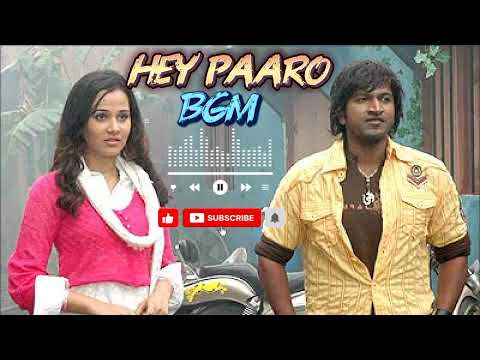
- 설명 앞부분: Album : Raj The Show Man Song : Hey Paaro Singer : Tippu Music : V.Harikrishna Lyric : V.Nagendra prasad Label : ARC Musicq Kannada For More Unlimited Entertainment Subscribe to If you are new to our Channel, Welcome to the family of Soulful Songs Hit 'Subscribe' and show us your support! :) Post y…
- 대본 없음 (설명) — 음성인식이 끝나면 도입부·흐름이 들어감
- 댓글 7/7: 좋은 점 — 영상 0 · 감사·응원 0 · 더 알고 싶은 것 0 · 아쉬운 점 — 영상 0 · 반박·불만 — 의견 다름 0 · 정치·사회 0 · 경험 공유 0 · 구독·다음 기대 0

### 30. 𝗣𝗹𝗮𝘆𝗹𝗶𝘀𝘁 가을 설레발 플리

- https://www.youtube.com/watch?v=ams0ZufCafU · 또잉 · 구독자 224 · 조회수 247,986 (×1,107.1, 하루 4,883.9) · 좋아요 2,586 (1.0%) · 19.6분 · 2026-08-28 · 주제 묶음 기타 · 형식 플레이리스트·모음 (여러 곡) · 폴더 `W_ams0ZufCafU` (웹 승인)
- 썸네일: 
- 챕터: 0:00 Officially Missing You - 긱스 (… · 3:30 11 : 11 - 태연 (TAEYEON) · 7:11 기억을 걷는 시간 - 넬 (NELL) · 12:22 그리워하다 - 비투비 · 16:20 너를 위해 - 첸 (CHEN) & 백현 (BAEKHY…
- 같은 채널 평소 대비 ×685.0 (채널 최근 롱폼 중앙값 362회) · 평소 영상: 𝗣𝗹𝗮𝘆𝗹𝗶𝘀𝘁 우리가 영원을 말하면 여름이 될거야 (362회) / 𝗣𝗹𝗮𝘆𝗹𝗶𝘀𝘁 우주를 줄게 (315회)
- 대본 없음 (없음) — 음성인식이 끝나면 도입부·흐름이 들어감
- 댓글 17/17: 좋은 점 — 영상 0 · 감사·응원 0 · 더 알고 싶은 것 0 · 아쉬운 점 — 영상 0 · 반박·불만 — 의견 다름 0 · 정치·사회 0 · 경험 공유 1 · 구독·다음 기대 0
  - 경험 공유 👍2 “내가 좋아하는 노래들만 모여있는 플리...오랫동안 이런 플리를 기다렷다구ㅠㅠ”

### 31. [ 2024~2026 K-POP ] 최신곡 포함❗️ 랜덤 플레이 댄스 #랜덤플레이댄스 #kpop #2024 #2026

- https://www.youtube.com/watch?v=JnuZqf_O2N0 · 메이플 · 구독자 1,120 · 조회수 1,202,624 (×1,073.8, 하루 14,628.4) · 좋아요 4,196 (0.4%) · 12.6분 · 2026-07-28 · 주제 묶음 10. 팝송·K팝·J팝 · 형식 한 곡 (뮤직비디오·음원·가사) · 폴더 `W_JnuZqf_O2N0` (웹 승인)
- 썸네일: 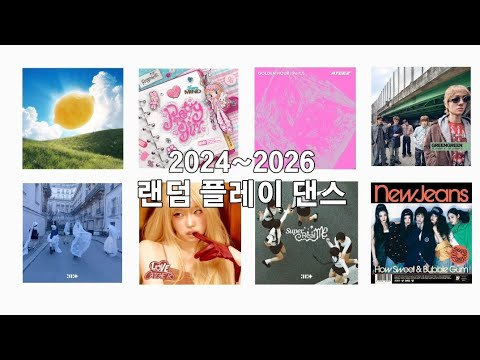
- 대본 없음 (없음) — 음성인식이 끝나면 도입부·흐름이 들어감
- 댓글 86/86: 좋은 점 — 영상 0 · 감사·응원 3 · 더 알고 싶은 것 1 · 아쉬운 점 — 영상 0 · 반박·불만 — 의견 다름 1 · 정치·사회 0 · 경험 공유 9 · 구독·다음 기대 2
  - 감사·응원 👍27 “안녕하세요!! 저는 집에서 재택근무 하고 있는 아줌마 입니다..ㅎㅎ 집에서 가볍게 다이어트로 춤 출 수 있어서 너무 재미있네요^^ 아휴 좋아라 감사합니다💕”
  - 감사·응원 👍3 “진짜 잘했네요 감사합니다 땡큐”
  - 더 알고 싶은 것 👍0 “혹시 신청곡 받으시면 빅뱅 Biig 되나요?”
  - 반박·불만 — 의견 다름 👍3 “와ㅏ 구독자가 47명..? 말도 안돼ㅐㅐㅐㅐㅐㅐ”
  - 경험 공유 👍7 “오 랜플 제가 좋아하는 거에여!!❤글구 영상 퀄리티도 좋구!!혹시 노래 신청 되면 투바투-세츠나 하나비,연준-아이스크림,투바투-하루에 하루만 더,투바투-데자뷰 넣어주세여!!♡♡♡너무 투바투꺼만 신청해서 죄송하구ㅠㅜ언제나 올려두 상관없으니 시간돼면 꼭 또 올려주세여!!…”
  - 경험 공유 👍6 “저도 유튜브를 하는데 저보다 잘하세요!!제 유튜브랑 비교하면 진짜 너무 잘했어요❤제 최애 유튜브가 될것 같아요❤ 화!이!팅!!!!!!!”
  - 구독·다음 기대 👍13 “너무잘해서 바로 구독했어요!!!!❤”
  - 구독·다음 기대 👍0 “제가 좋아하는 노래 많아서 당장 구독했어용ㅇㅇ요❤❤❤❤❤❤”

### 32. 어 난데 여기 핫플이야

- https://www.youtube.com/watch?v=JcIBpx-tGdA · 햄 · 구독자 673 · 조회수 713,636 (×1,060.4, 하루 4,410.1) · 좋아요 7,240 (1.0%) · 24.1분 · 2026-05-09 · 주제 묶음 기타 · 형식 정보·해설 (그 밖) · 폴더 `W_JcIBpx-tGdA` (웹 승인)
- 썸네일: 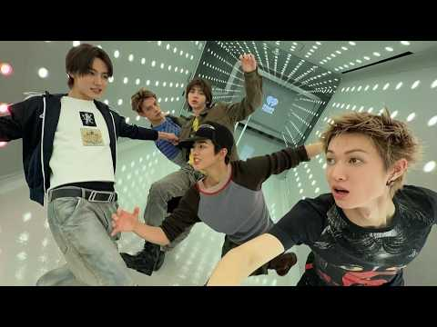
- 챕터: 0:00 CORTIS- REDRED · 2:42 CORTIS- FaSHioN · 5:33 82MAJOR- Need That Bass · 8:09 P1Harmony- ICE(VVS) · 10:40 82MAJOR- W.T.F · 12:22 82MAJOR- 뭘 봐 · 15:31 MCND- ICE AGE · 18:41 Xdinary Heroes- Spoiler!!! · 21:48 ILLIT- It’s Me
- 같은 채널 평소 대비 ×1,230.4 (채널 최근 롱폼 중앙값 580회) · 평소 영상: 파워워킹 처하자 (750회) / 흔하지 않은 하우스 케이팝 (410회)
- 대본 없음 (없음) — 음성인식이 끝나면 도입부·흐름이 들어감
- 댓글 84/84: 좋은 점 — 영상 1 · 감사·응원 3 · 더 알고 싶은 것 1 · 아쉬운 점 — 영상 0 · 반박·불만 — 의견 다름 0 · 정치·사회 0 · 경험 공유 4 · 구독·다음 기대 0
  - 좋은 점 — 영상 👍1 “수학문제풀면서 듣기좋은 플리”
  - 감사·응원 👍3 “어시발 엑디즈가 왜있지? 정멀감사드립니다”
  - 감사·응원 👍1 “요새 코르티스 깔에 꽂혔는데 넘나리 감사한 것”
  - 더 알고 싶은 것 👍35 “개조아요 타임라인 올려주세요”
  - 경험 공유 👍20 “3:12 안건호 내가 산 옷 보고 뭐라고 말해도 지켜 내 고집 10:46 남성모 over there”
  - 경험 공유 👍0 “주인장 나랑 취향비슷하시네 에투메 노래 전곡 다좋은데 내가 아끼는애들만 낋여온거랑 엑디즈 다죽자 셋리 중 하나인 스포일러 있는거.. 주인장님 구독 누르고 갑니다”

### 33. Andekhi Anjaani si ∣ Slowed x Reverb ∣ lofi song ∣ lofi version ∣ mind refresh ∣

- https://www.youtube.com/watch?v=FrqyfSyxOc4 · Midnight lofi 20 · 구독자 4,050 · 조회수 4,140,683 (×1,022.4, 하루 90,252.8) · 좋아요 16,405 (0.4%) · 6분 · 2026-09-02 · 주제 묶음 8. 로파이·시티팝·칠 · 형식 음악 (그 밖 모양 — 한 편짜리 BGM 등) · 폴더 `W_FrqyfSyxOc4` (웹 승인)
- 썸네일: 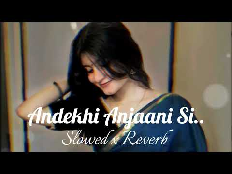
- 설명 앞부분: Andekhi Anjaani si ∣ Slowed x Reverb ∣ lofi song ∣ lofi version ∣ mind refresh
- 대본 없음 (설명) — 음성인식이 끝나면 도입부·흐름이 들어감
- 댓글 132/132: 좋은 점 — 영상 0 · 감사·응원 0 · 더 알고 싶은 것 0 · 아쉬운 점 — 영상 0 · 반박·불만 — 의견 다름 0 · 정치·사회 0 · 경험 공유 0 · 구독·다음 기대 0

### 34. 🌙 Late Night Hindi Playlist ∣ Relax • Study • Sleep ∣ Mystic Scenery

- https://www.youtube.com/watch?v=1eFr1phNoxQ · Mystic Scenery  · 구독자 1,860 · 조회수 1,883,990 (×1,012.9, 하루 26,279.4) · 좋아요 12,485 (0.7%) · 25.2분 · 2026-08-07 · 주제 묶음 1. 수면·명상·힐링 · 형식 플레이리스트·모음 (여러 곡) · 폴더 `W_1eFr1phNoxQ` (웹 승인)
- 썸네일: 
- 설명 앞부분: 🌙 Welcome to Mystic Scenery. Take a break from the world and enjoy these beautiful Hindi songs, carefully edited into one relaxing playlist. Perfect for: ✨ Late-night listening 📚 Studying ☕ Relaxing 🌙 Peaceful evenings Thank you for being here and supporting Mystic Scenery. 💙 If you enjoyed this pl…
- 대본 없음 (설명) — 음성인식이 끝나면 도입부·흐름이 들어감
- 댓글 74/74: 좋은 점 — 영상 0 · 감사·응원 0 · 더 알고 싶은 것 0 · 아쉬운 점 — 영상 0 · 반박·불만 — 의견 다름 0 · 정치·사회 0 · 경험 공유 0 · 구독·다음 기대 0

### 35. THEN・❥・ Sweet Dreams ∣ Cinematic Techno

- https://www.youtube.com/watch?v=0QAKKYJJ2l0 · THEN · 구독자 9,750 · 조회수 9,835,942 (×1,008.8, 하루 74,705.8) · 좋아요 93,311 (0.9%) · 4.4분 · 2026-06-08 · 주제 묶음 기타 · 형식 커버·직접 부른 노래 · 폴더 `W_0QAKKYJJ2l0` (웹 승인)
- 썸네일: 
- 설명 앞부분: Epic dark gothic Techno cover of “Sweet Dreams" Step into the circuit where the rhythm never sleeps. This is a relentless Dark Techno reimagining of “Sweet Dreams”, engineered for the deepest hours of the night. Infused with industrial grit, a rolling sub-bass, and a haunting nocturnal atmosphere, …
- 대본 없음 (설명) — 음성인식이 끝나면 도입부·흐름이 들어감
- 댓글 491/491: 좋은 점 — 영상 0 · 감사·응원 0 · 더 알고 싶은 것 0 · 아쉬운 점 — 영상 0 · 반박·불만 — 의견 다름 0 · 정치·사회 0 · 경험 공유 0 · 구독·다음 기대 0

### 36. 3분 안에 잠드는 수면 음악 (30분) Fall Asleep in 3 Minutes (30 Min)

- https://www.youtube.com/watch?v=E96njddrM5o · 수면과학연구소 Sleep Science Lab - Topic · 구독자 89 · 조회수 99,756 (×997.6, 하루 737.8) · 좋아요 290 (0.3%) · 30분 · 2026-06-05 · 주제 묶음 1. 수면·명상·힐링 · 형식 음악 (그 밖 모양 — 한 편짜리 BGM 등) · 폴더 `W_E96njddrM5o` (웹 승인)
- 썸네일: 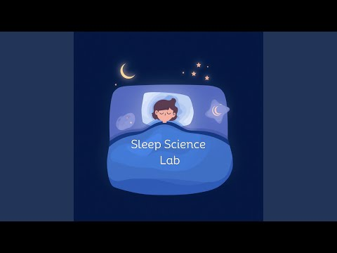
- 설명 앞부분: Provided to YouTube by Kwangsoomedia 3분 안에 잠드는 수면 음악 (30분) Fall Asleep in 3 Minutes (30 Min) · 수면과학연구소 Sleep Science Lab 3분 안에 잠드는 수면 음악 (30분) Fall Asleep in 3 Minutes (30 Min) ℗ 2026 수면과학연구소 Sleep Science Lab Released on: 2026-06-05 Composer: 수면과학연구소 Arranger: 수면과학연구소 Auto-generated by YouTube.
- 대본 없음 (설명) — 음성인식이 끝나면 도입부·흐름이 들어감
- 댓글 0/12: 좋은 점 — 영상 0 · 감사·응원 0 · 더 알고 싶은 것 0 · 아쉬운 점 — 영상 0 · 반박·불만 — 의견 다름 0 · 정치·사회 0 · 경험 공유 0 · 구독·다음 기대 0

### 37. 🎧 Le Main Saiyaan Aa Gayi (Lofi) ∣ Mohabbatein ∣ Shah Rukh Khan ∣ (Slowed + Reverb) ✨

- https://www.youtube.com/watch?v=NVf0GhbUmAw · BOYS  KING 99.3K · 구독자 2,470 · 조회수 2,385,909 (×966.0, 하루 27,338.2) · 좋아요 0 (0.0%) · 7.5분 · 2026-07-23 · 주제 묶음 8. 로파이·시티팝·칠 · 형식 음악 (그 밖 모양 — 한 편짜리 BGM 등) · 폴더 `W_NVf0GhbUmAw` (웹 승인)
- 썸네일: 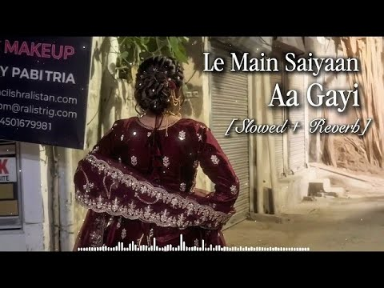
- 설명 앞부분: Welcome to my YouTube channel! ✨ If you love getting lost in beautiful musical vibes, you are in the right place. Don't forget to Subscribe and hit the bell icon! 🔔 (1). NEW -VIDEO👇 (1). NEW -VIDEO 👇 Le Main Saiyaan Aa Gayi (Romantic Song) Mohabbatein ∣ Shah Rukh Khan ∣ Pairon Mein Bandhan Hai Song…
- 대본 없음 (설명) — 음성인식이 끝나면 도입부·흐름이 들어감
- 댓글 175/175: 좋은 점 — 영상 0 · 감사·응원 0 · 더 알고 싶은 것 0 · 아쉬운 점 — 영상 0 · 반박·불만 — 의견 다름 0 · 정치·사회 0 · 경험 공유 0 · 구독·다음 기대 0

### 38. [𝐏𝐥𝐚𝐲𝐥𝐢𝐬𝐭] 사랑한다고 속삭여줘

- https://www.youtube.com/watch?v=Tt_TimRh73Q · 뜨신아아 · 구독자 1,060 · 조회수 1,016,651 (×959.1, 하루 7,960.3) · 좋아요 11,131 (1.1%) · 23.4분 · 2026-06-12 · 주제 묶음 기타 · 형식 플레이리스트·모음 (여러 곡) · 폴더 `W_Tt_TimRh73Q` (웹 승인)
- 썸네일: 
- 챕터: 0:00 DAY BY DAY - T-ara · 3:26 Something - 걸스데이 · 6:47 짧은치마 - AOA · 9:46 예쁜 나이 25살 - 송지은 · 13:11 단발머리 - AOA · 16:44 Ma Boy - Sistar19 · 20:01 달리 (feat. GRAY) - 효린
- 설명 앞부분: 그시절 미모 원탑 함은정
- 같은 채널 평소 대비 ×275.4 (채널 최근 롱폼 중앙값 3,692회) · 평소 영상: [𝐏𝐥𝐚𝐲𝐥𝐢𝐬𝐭] 내가 너 취향 맞춰볼까? (3,803회) / [𝐏𝐥𝐚𝐲𝐥𝐢𝐬𝐭] 꿈과 무의식의 경계에서 (3,581회)
- 대본 없음 (설명) — 음성인식이 끝나면 도입부·흐름이 들어감
- 댓글 60/60: 좋은 점 — 영상 2 · 감사·응원 0 · 더 알고 싶은 것 1 · 아쉬운 점 — 영상 0 · 반박·불만 — 의견 다름 0 · 정치·사회 0 · 경험 공유 5 · 구독·다음 기대 0
  - 좋은 점 — 영상 👍4 “안녕하세요 뜨신아아님. 저는 도덕 수업에서 선플달기 활동 중인 중학생 입니다. 사람들께 노래를 들려드랄려고 노래 하나하나 찾아가며 이 영상을 만드셨다는 생각이 듭니다 앞으로도 좋은 영상 많이 부탁드려요!”
  - 좋은 점 — 영상 👍0 “레전드 맛잘알 플리”
  - 더 알고 싶은 것 👍4 “안녕하세요 뜨신아아님. 저는 도덕 수업에서 선플달기 활동 중인 중학생 입니다. 사람들께 노래를 들려드랄려고 노래 하나하나 찾아가며 이 영상을 만드셨다는 생각이 듭니다 앞으로도 좋은 영상 많이 부탁드려요!”
  - 경험 공유 👍277 “골반댄스로 짧은치마 유행한 뒤로 옛날 아이돌 노래 뜨고 있는데 너무 좋음 그게 아니였으면 난 티아라 데바데를 몰랐을 거임 ㅈㄴ 느좋 너무 좋음 노래가 어떻게 블링블링한데 사람 심금을 울릴 수가 있지 정말 가슴이 웅장해진다 너무 좋음 아이돌계의 찬송가임 나 슬퍼서 눈물…”
  - 경험 공유 👍10 “크면 나도 은정 언니처럼 예뻐질 줄 알았는데 예쁘고 춤 잘 추고 연기도 잘하고 실력 있는 거였던 태권도까지 잘하는 언니..❤”

### 39. Teri yaadon me khoya rahta hu song mind relax lofi song (slowed x reverb) VNS Lyrics #sad…

- https://www.youtube.com/watch?v=JJy3EqcgJdI · VNS HIMANSHU 001 · 구독자 6,120 · 조회수 5,547,045 (×906.4, 하루 88,264.7) · 좋아요 0 (0.0%) · 5.7분 · 2026-08-16 · 주제 묶음 8. 로파이·시티팝·칠 · 형식 한 곡 (뮤직비디오·음원·가사) · 폴더 `W_JJy3EqcgJdI` (웹 승인)
- 썸네일: 
- 설명 앞부분: Teri Yaadon Mein Khoya Rehta Hoon (Slowed + Reverb) ∣ KK, Shreya Ghoshal ∣ The Killer Presenting (Slowed + Reverb) Version of Teri Yaadon Mein 🎧 Use headphone for best experience Subscribe Now for more videos Credits : Lofi (Slowed + Reverb) By - Souvik Singha Video Editing - Souvik Singha Song Cre…
- 대본 없음 (설명) — 음성인식이 끝나면 도입부·흐름이 들어감
- 댓글 306/305: 좋은 점 — 영상 0 · 감사·응원 0 · 더 알고 싶은 것 0 · 아쉬운 점 — 영상 0 · 반박·불만 — 의견 다름 0 · 정치·사회 0 · 경험 공유 0 · 구독·다음 기대 0

### 40. Toota Rahunga

- https://www.youtube.com/watch?v=qN9Vw9v2nLY · Garvit Soni - Topic · 구독자 1,440 · 조회수 1,302,520 (×904.5, 하루 14,657.6) · 좋아요 10,177 (0.8%) · 4.1분 · 2026-07-21 · 주제 묶음 4. 카페·매장·라운지 · 형식 정보·해설 (그 밖) · 폴더 `W_qN9Vw9v2nLY` (웹 승인)
- 썸네일: 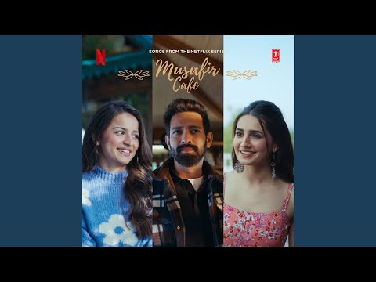
- 설명 앞부분: Provided to YouTube by Super Cassettes Industries Private Limited Toota Rahunga · Garvit Soni · Garvit-Priyansh · Aniket Shukla Musafir Cafe ℗ Netflix Music Llc Under Exclusive License To T-Series Released on: 2026-07-21 Vocalist: Garvit Soni Composer: Garvit-Priyansh Lyricist: Aniket Shukla Auto-g…
- 대본 없음 (설명) — 음성인식이 끝나면 도입부·흐름이 들어감
- 댓글 0/47: 좋은 점 — 영상 0 · 감사·응원 0 · 더 알고 싶은 것 0 · 아쉬운 점 — 영상 0 · 반박·불만 — 의견 다름 0 · 정치·사회 0 · 경험 공유 0 · 구독·다음 기대 0

