# 음악 — 성공 사례 분석: 사례별 자세히 #41–#80

`analysis.md` 의 9번 (같은 # 번호). 자동 생성 — `tools/success_analysis.py` v1.4.1 (2026-10-19 08:37 UTC). ※ 연구·교육용 — 투자 권유가 아님.

### 41. POV You're back in the 90s 💗📻 ∣ Old hindi songs ∣ Bollywood trending hits

- https://www.youtube.com/watch?v=4GMIMevMn6Y · Manii · 구독자 2,510 · 조회수 2,143,819 (×854.1, 하루 38,559.8) · 좋아요 25,782 (1.2%) · 8.2분 · 2026-08-24 · 주제 묶음 기타 · 형식 음악 (그 밖 모양 — 한 편짜리 BGM 등) · 폴더 `W_4GMIMevMn6Y` (웹 승인)
- 썸네일: 
- 설명 앞부분: 🎧✨ Upgrade Your Music Vibes — Check Them Out Here 👇 If you miss the 90s, this playlist is going to hit different. 🥹❤ A collection of the best old Hindi & Bollywood songs from the golden era — songs we grew up with, fell in love with, and still remember word by word. 🎧 Perfect for late nights, long …
- 같은 채널 평소 대비 ×56.5 (채널 최근 롱폼 중앙값 37,916회) · 평소 영상: POV 💖 You finally found the perfect playlist🌙 #tr… (45,038회) / 𝑷𝑶𝑽: 𝑰𝒕'𝒔 𝟐𝑨𝑴 𝒂𝒏𝒅 𝒕𝒉𝒆𝒔𝒆 𝒔𝒐𝒏𝒈𝒔 𝒉𝒊𝒕 𝒅𝒊𝒇𝒇𝒆𝒓𝒆𝒏𝒕 🕯️🎧 ∣… (30,794회)
- 대본 없음 (설명) — 음성인식이 끝나면 도입부·흐름이 들어감
- 댓글 803/778: 좋은 점 — 영상 0 · 감사·응원 0 · 더 알고 싶은 것 0 · 아쉬운 점 — 영상 0 · 반박·불만 — 의견 다름 0 · 정치·사회 0 · 경험 공유 0 · 구독·다음 기대 0

### 42. Top Hits Indonesia 2026 ∣ Top Hits Spotify Indonesia 2026 ∣ Top Hits Spotify 2026 ∣ Tanpa…

- https://www.youtube.com/watch?v=ANPUoFuWpEo · ShadowBrief · 구독자 9,720 · 조회수 8,201,924 (×843.8, 하루 51,437.5) · 좋아요 35,247 (0.4%) · 65분 · 2026-05-12 · 주제 묶음 기타 · 형식 정보·해설 (그 밖) · 폴더 `W_ANPUoFuWpEo` (웹 승인)
- 썸네일: 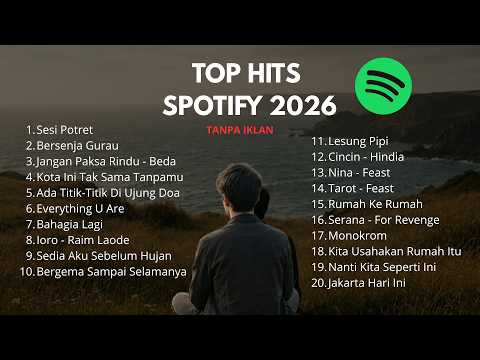
- 설명 앞부분: NIKMATI DAFTAR LAGU TOP SPOTIFY INDONESIA 2026, 01. Sesi Potret 02. Bersenja Gurau 03. Jangan Paksa Rindu - Beda 04. Kota Ini Tak Sama Tanpamu 05. Ada Titik-Titik Di Ujung Doa 06. Everything U Are 07. Bahagia Lagi 08. Iqro' - Raim Laode 09. Sedia Aku Sebelum Hujan 10. Bergema Sampai Selamanya 11. L…
- 대본 없음 (설명) — 음성인식이 끝나면 도입부·흐름이 들어감
- 댓글 998/994: 좋은 점 — 영상 0 · 감사·응원 0 · 더 알고 싶은 것 0 · 아쉬운 점 — 영상 0 · 반박·불만 — 의견 다름 0 · 정치·사회 0 · 경험 공유 0 · 구독·다음 기대 0

### 43. Baddies playlist🫦💋

- https://www.youtube.com/watch?v=iwtL-agF0LQ · Music-cholic · 구독자 1,230 · 조회수 1,025,670 (×833.9, 하루 7,050.2) · 좋아요 17,787 (1.7%) · 18.9분 · 2026-05-26 · 주제 묶음 기타 · 형식 플레이리스트·모음 (여러 곡) · 폴더 `W_iwtL-agF0LQ` (웹 승인)
- 썸네일: 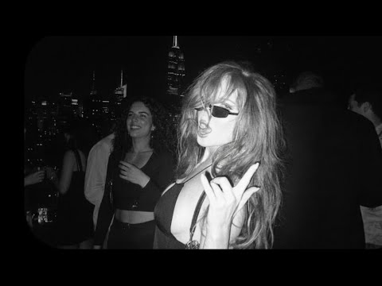
- 챕터: 0:00 Breaking dishes · 3:16 Obsessed · 7:17 Toxic · 10:36 Telephone · 14:05 on the floor
- 설명 앞부분: Playlists of baddies ∣ hot girls playlist ∣ 2000’ playlists Subscribe and comment for more such songs 🩷
- 대본 없음 (설명) — 음성인식이 끝나면 도입부·흐름이 들어감
- 댓글 56/56: 좋은 점 — 영상 0 · 감사·응원 0 · 더 알고 싶은 것 0 · 아쉬운 점 — 영상 0 · 반박·불만 — 의견 다름 0 · 정치·사회 0 · 경험 공유 0 · 구독·다음 기대 0

### 44. MOOD : FIRST LOVE { Desi playlist }

- https://www.youtube.com/watch?v=zVH3YHdvXHY · xukiyo  · 구독자 3,230 · 조회수 2,650,635 (×820.6, 하루 16,465.4) · 좋아요 25,447 (1.0%) · 11.8분 · 2026-05-11 · 주제 묶음 기타 · 형식 플레이리스트·모음 (여러 곡) · 폴더 `W_zVH3YHdvXHY` (웹 승인)
- 썸네일: 
- 같은 채널 평소 대비 ×84.1 (채널 최근 롱폼 중앙값 31,509회) · 평소 영상: MOOD : DUET { Desi playlist pt.2} (31,509회) / MOOD : DUET { Desi playlist } (51,697회)
- 대본 없음 (없음) — 음성인식이 끝나면 도입부·흐름이 들어감
- 댓글 71/68: 좋은 점 — 영상 0 · 감사·응원 0 · 더 알고 싶은 것 0 · 아쉬운 점 — 영상 0 · 반박·불만 — 의견 다름 0 · 정치·사회 0 · 경험 공유 0 · 구독·다음 기대 0

### 45. DANGRANGTO Playlist Hay Nhất ∣ Xương Rồng, Vùng Vẫy, Wrong Time, Một Ly & More

- https://www.youtube.com/watch?v=okmN02_PnaM · hiệu ứng đám mây. · 구독자 1,660 · 조회수 1,342,471 (×808.7, 하루 14,268.8) · 좋아요 3,437 (0.3%) · 24.9분 · 2026-07-17 · 주제 묶음 8. 로파이·시티팝·칠 · 형식 플레이리스트·모음 (여러 곡) · 폴더 `W_okmN02_PnaM` (웹 승인)
- 썸네일: 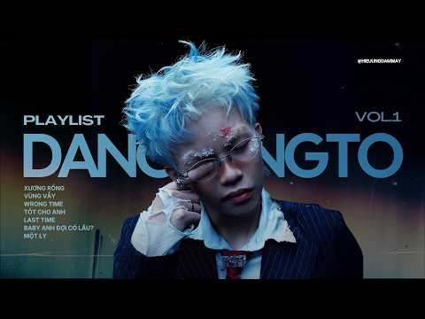
- 설명 앞부분: 🎧 DANGRANGTO Playlist Hay Nhất – Tuyển tập những ca khúc được yêu thích nhất của DANGRANGTO, mang giai điệu nhẹ nhàng, cảm xúc và phù hợp để nghe vào những lúc cần một chút bình yên. Danh sách bài hát: Xương Rồng Vùng Vẫy Wrong Time Tốt Cho Anh Last Time Baby Anh Đợi Có Lâu? Một Ly Nếu bạn yêu thíc…
- 같은 채널 평소 대비 ×6.1 (채널 최근 롱폼 중앙값 221,772회) · 평소 영상: HNGLE, fishy, dangrangto & CoolKid Playlist ∣ Tìm… (221,772회) / HNGLE x PHUCXP Playlist Hay Nhất ∣ Tìm Em, Chẳng … (320,957회)
- 대본 없음 (설명) — 음성인식이 끝나면 도입부·흐름이 들어감
- 댓글 58/58: 좋은 점 — 영상 0 · 감사·응원 0 · 더 알고 싶은 것 0 · 아쉬운 점 — 영상 0 · 반박·불만 — 의견 다름 0 · 정치·사회 0 · 경험 공유 0 · 구독·다음 기대 0

### 46. 🎧 Le Main Saiyaan Aa Gayi (Lofi) ∣ Mohabbatein ∣ Shah Rukh Khan ∣ (Slowed + Reverb)✨

- https://www.youtube.com/watch?v=iOdAwvF0kmk · lofi.slowed_02 · 구독자 5,670 · 조회수 4,536,259 (×800.0, 하루 49,240.5) · 좋아요 21,884 (0.5%) · 7.5분 · 2026-07-19 · 주제 묶음 8. 로파이·시티팝·칠 · 형식 음악 (그 밖 모양 — 한 편짜리 BGM 등) · 폴더 `W_iOdAwvF0kmk` (웹 승인)
- 썸네일: 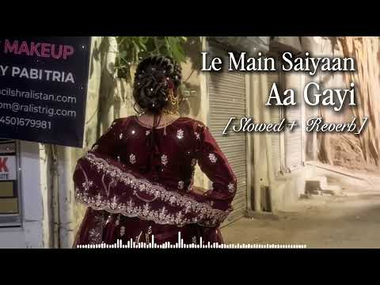
- 설명 앞부분: Welcome to my YouTube channel! ✨ If you love getting lost in beautiful musical vibes, you are in the right place. Don't forget to Subscribe and hit the bell icon! 🔔 Le Main Saiyaan Aa Gayi (Romantic Song) Mohabbatein ∣ Shah Rukh Khan ∣ Pairon Mein Bandhan Hai Song Le Main Saiyaan Aa Gayi (Romantic …
- 같은 채널 평소 대비 ×885.1 (채널 최근 롱폼 중앙값 5,125회) · 평소 영상: "Labon Ko" ∣ Slowed + Reverb ∣ KK x @lofi.slowed_… (5,125회) / 🎧 Le Main Saiyaan Aa Gayi (Lofi) ∣ Mohabbatein ∣ … (5,114회)
- 대본 없음 (설명) — 음성인식이 끝나면 도입부·흐름이 들어감
- 댓글 291/291: 좋은 점 — 영상 0 · 감사·응원 0 · 더 알고 싶은 것 0 · 아쉬운 점 — 영상 0 · 반박·불만 — 의견 다름 0 · 정치·사회 0 · 경험 공유 0 · 구독·다음 기대 0

### 47. Tu Chahiye [lyrics] Atif Aslam

- https://www.youtube.com/watch?v=AJ0KTHkTGYA · Chill Beats Hub  · 구독자 1,890 · 조회수 1,499,558 (×793.4, 하루 24,648.9) · 좋아요 4,195 (0.3%) · 4.5분 · 2026-08-19 · 주제 묶음 기타 · 형식 한 곡 (뮤직비디오·음원·가사) · 폴더 `W_AJ0KTHkTGYA` (웹 승인)
- 썸네일: 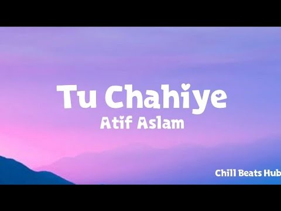
- 설명 앞부분: 🎧 Welcome to Chill Beats Hub 🌙 Your daily destination for chill vibes, relaxing Lofi beats and peaceful music. ✨ Whether you're studying 📚, relaxing 😌, working 💻, travelling 🚗 or just enjoying a quiet night 🌌 — Chill Beats Hub is here to make your moments better with smooth and relaxing sounds. 🎶 🌙…
- 같은 채널 평소 대비 ×389.1 (채널 최근 롱폼 중앙값 3,854회) · 평소 영상: Khat [lyrics] Navjot Ahuja (6,111회) / Achchi lagti ho (Slowed+reverb) lofi song—use hea… (1,597회)
- 대본 없음 (설명) — 음성인식이 끝나면 도입부·흐름이 들어감
- 댓글 74/74: 좋은 점 — 영상 0 · 감사·응원 0 · 더 알고 싶은 것 0 · 아쉬운 점 — 영상 0 · 반박·불만 — 의견 다름 0 · 정치·사회 0 · 경험 공유 0 · 구독·다음 기대 0

### 48. Tera Sang Yaara - Slowed Reverb ∣∣ Atif Aslam ∣∣ Dopohor Lofi

- https://www.youtube.com/watch?v=QcR63bT06iE · Dopohor Lofi · 구독자 3,430 · 조회수 2,700,773 (×787.4, 하루 69,687.8) · 좋아요 11,920 (0.4%) · 5분 · 2026-09-10 · 주제 묶음 8. 로파이·시티팝·칠 · 형식 음악 (그 밖 모양 — 한 편짜리 BGM 등) · 폴더 `W_QcR63bT06iE` (웹 승인)
- 썸네일: 
- 설명 앞부분: Tera Sang Yaara - Slowed Reverb ∣ Dopohor Lofi Song Credits : Song - Tera Sang Yaara Movie - Rustom (2016) Singer - Atif Aslam Composer - Arko Written By - Manoj Muntashir Slowed + Reverb by - Dopohor Lofi 🎧 Use Headphones For Better Experience ✨ Hashtags : Related Searches : tera sang yaara lofi, …
- 같은 채널 평소 대비 ×227.7 (채널 최근 롱폼 중앙값 11,860회) · 평소 영상: Main Rang Sharbaton Ka - Slowed Reverb ∣∣ Atif As… (12,424회) / Bolna - Slowed Reverb ∣∣ Arijit Singh ∣∣ Dopohor … (11,296회)
- 대본 없음 (설명) — 음성인식이 끝나면 도입부·흐름이 들어감
- 댓글 219/219: 좋은 점 — 영상 0 · 감사·응원 0 · 더 알고 싶은 것 0 · 아쉬운 점 — 영상 0 · 반박·불만 — 의견 다름 0 · 정치·사회 0 · 경험 공유 0 · 구독·다음 기대 0

### 49. Hanuman Chalisa ∣ Peaceful & Divine ∣ Powerful Bhajan for Peace & Positivity

- https://www.youtube.com/watch?v=pmQtkBTtzLw · Shri Music Studios · 구독자 1,410 · 조회수 1,097,156 (×778.1, 하루 6,565.0) · 좋아요 6,484 (0.6%) · 6.4분 · 2026-05-05 · 주제 묶음 1. 수면·명상·힐링 · 형식 음악 (그 밖 모양 — 한 편짜리 BGM 등) · 폴더 `W_pmQtkBTtzLw` (웹 승인)
- 썸네일: 
- 설명 앞부분: 🙏 Hanuman Chalisa – Peaceful & Divine Experience 🙏 Immerse yourself in the calm and spiritual energy of the Hanuman Chalisa, a sacred devotional hymn dedicated to Lord Hanuman. This version is specially designed to create a peaceful, divine, and meditative atmosphere, helping you relax your mind an…
- 같은 채널 평소 대비 ×1,471.7 (채널 최근 롱폼 중앙값 746회) · 평소 영상: गायत्री मंत्र ∣ Gayatri Mantra for Positive Energ… (798회) / सुंदर ते ध्यान, उभे विटेवरी ∣ आषाढी एकादशी स्पेशल… (693회)
- 대본 없음 (설명) — 음성인식이 끝나면 도입부·흐름이 들어감
- 댓글 601/601: 좋은 점 — 영상 0 · 감사·응원 0 · 더 알고 싶은 것 0 · 아쉬운 점 — 영상 0 · 반박·불만 — 의견 다름 0 · 정치·사회 0 · 경험 공유 0 · 구독·다음 기대 0

### 50. Những Bản Nhạc LoFi Chill Hay Nhất 2026 ∣ TikTok Viral Triệu Lượt Xem

- https://www.youtube.com/watch?v=4vl5hS0oXH0 · Kvyzz Music · 구독자 1,260 · 조회수 959,134 (×761.2, 하루 11,226.8) · 좋아요 8,555 (0.9%) · 26.1분 · 2026-07-25 · 주제 묶음 8. 로파이·시티팝·칠 · 형식 음악 (그 밖 모양 — 한 편짜리 BGM 등) · 폴더 `W_4vl5hS0oXH0` (웹 승인)
- 썸네일: 
- 챕터: 0:00 Dự Báo Thời Tiết Hôm Nay Mưa · 4:37 Vết Thương · 8:55 Có em · 12:42 W/n - id 072019 · 17:24 Nắng có mang em về · 21:57 Nếu biết đó là lần cuối
- 설명 앞부분: 💖💖 Cảm Ơn Bạn Đã Đồng Hành Cùng Chúng Tôi! 🎶 Xin chân thành cảm ơn bạn đã dành thời gian lắng nghe và thưởng thức video âm nhạc này. Mỗi lượt xem, mỗi lượt thích, mỗi bình luận và mỗi lần chia sẻ của bạn đều là nguồn động lực vô cùng to lớn để chúng tôi tiếp tục sáng tạo và mang đến nhiều sản phẩm …
- 대본 없음 (설명) — 음성인식이 끝나면 도입부·흐름이 들어감
- 댓글 185/185: 좋은 점 — 영상 0 · 감사·응원 0 · 더 알고 싶은 것 0 · 아쉬운 점 — 영상 0 · 반박·불만 — 의견 다름 0 · 정치·사회 0 · 경험 공유 0 · 구독·다음 기대 0

### 51. [Playlist Tâm Trạng]#1 - Xương Rồng, Vết Thương, Tìm Em, Ngày Rời Chuyến Bay.

- https://www.youtube.com/watch?v=DcZ75tBPfa4 · Cà Chuaa · 구독자 2,410 · 조회수 1,719,077 (×713.3, 하루 20,295.8) · 좋아요 10,390 (0.6%) · 15.5분 · 2026-07-26 · 주제 묶음 기타 · 형식 플레이리스트·모음 (여러 곡) · 폴더 `W_DcZ75tBPfa4` (웹 승인)
- 썸네일: 
- 챕터: 0:00 Dangrangto - ‘xương rồng (int… · 3:56 fishy - VẾT THƯƠNG · 7:43 Hngle - Tìm em ft. Bảo Anh · 11:56 Minh Huy - Ngày Rời Chuyến Ba…
- 설명 앞부분: 🎵tracklist None of the music in this video belongs to me, all rights to their respective owners.
- 같은 채널 평소 대비 ×72.6 (채널 최근 롱폼 중앙값 23,680회) · 평소 영상: [Playlist Tâm Trạng]#3 - 2 4, Text 07, Vô Tình (L… (23,680회) / [ Playlist Tâm Trạng ]#4 - Em tiếc đoạn tình cảm … (24,119회)
- 대본 없음 (설명) — 음성인식이 끝나면 도입부·흐름이 들어감
- 댓글 344/344: 좋은 점 — 영상 0 · 감사·응원 0 · 더 알고 싶은 것 0 · 아쉬운 점 — 영상 0 · 반박·불만 — 의견 다름 0 · 정치·사회 0 · 경험 공유 0 · 구독·다음 기대 0

### 52. Barsaat 🌧️ ∣ All Trending Songs 🎧∣ Taare x Samjho Na x Safar x Bairan x Zulfein x Sahiba …

- https://www.youtube.com/watch?v=xGPm2j1dDr4 · LOFI XP VIBES · 구독자 2,490 · 조회수 1,722,426 (×691.7, 하루 45,616.2) · 좋아요 0 (0.0%) · 23분 · 2026-09-11 · 주제 묶음 기타 · 형식 음악 (그 밖 모양 — 한 편짜리 BGM 등) · 폴더 `W_xGPm2j1dDr4` (웹 승인)
- 썸네일: 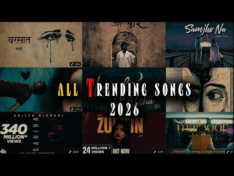
- 챕터: 0:00 ​ — Barsaat 🌧️ · 0:59 ​ — Taare ⭐ · 1:19 ​ — Samjho Na ❤️ · 2:35 ​ — Safar 🌙 · 3:45 ​ — Bairan 💔 · 5:59 ​ — Zulfein ✨ · 9:19 ​ — Sahiba ❤️ · 11:56 ​ — Majboor 🥀
- 설명 앞부분: Barsaat 🌧️ ∣ All Trending Hindi Songs 2026 🎧 ∣ Barsaat x Taare x Samjho Na x Safar x Bairan x Zulfein x Sahiba x Majboor ∣ Lofi & Slowed Reverb 🌧️ Barsaat ∣ All Trending Hindi Songs 2026 🎧❤ Welcome to Lofi by Aura— your destination for trending Hindi songs, romantic vibes, emotional melodies and re…
- 같은 채널 평소 대비 ×225.2 (채널 최근 롱폼 중앙값 7,648회) · 평소 영상: TALWIINDER ALL HIT SONGS ∣∣ top talwiinder songs∣… (10,488회) / AFGHAN JALEBI - (SLOWED+REVERB) ∣∣ INSTAGRAM VIRA… (12,100회)
- 대본 없음 (설명) — 음성인식이 끝나면 도입부·흐름이 들어감
- 댓글 193/183: 좋은 점 — 영상 0 · 감사·응원 0 · 더 알고 싶은 것 0 · 아쉬운 점 — 영상 0 · 반박·불만 — 의견 다름 0 · 정치·사회 0 · 경험 공유 0 · 구독·다음 기대 0

### 53. POV: You Own The Dance Floor💃🏻🪩✨ ∣∣Song Playlist+ Timestamps #song #music #chatpategaane …

- https://www.youtube.com/watch?v=HRGB0HnXdOs · Author_Shreyuu · 구독자 6,200 · 조회수 4,242,634 (×684.3, 하루 28,827.8) · 좋아요 31,605 (0.7%) · 8분 · 2026-05-25 · 주제 묶음 기타 · 형식 플레이리스트·모음 (여러 곡) · 폴더 `W_HRGB0HnXdOs` (웹 승인)
- 썸네일: 
- 챕터: 0:00 " Chunnari Chunnari" · 1:28 "Chammak Challo" · 2:15 "Chikni Chameli" · 3:40 "Kajra Re" · 5:07 "Aithey Aa" · 6:18 "High Heels Te Nache" · 7:04 "Chokra Jawan"
- 설명 앞부분: DISCLAIMER ‼ This is a song playlist created for entertainment and aesthetic purposes only. All songs used in this video belong to their respective owners and I do not claim any rights over the audio or music. This video is simply a curated mix to create a certain vibe and mood for listeners. No co…
- 대본 없음 (설명) — 음성인식이 끝나면 도입부·흐름이 들어감
- 댓글 617/614: 좋은 점 — 영상 0 · 감사·응원 0 · 더 알고 싶은 것 0 · 아쉬운 점 — 영상 0 · 반박·불만 — 의견 다름 0 · 정치·사회 0 · 경험 공유 0 · 구독·다음 기대 0

### 54. Hanuman Chalisa Sleep Version 🕉️ ∣ Sleep In 5 Minutes 😴 ∣ Stress Relief, Healing & Positi…

- https://www.youtube.com/watch?v=RgmRMA0Bs34 · Ananta Rhythm  · 구독자 4,510 · 조회수 3,076,769 (×682.2, 하루 19,189.2) · 좋아요 21,848 (0.7%) · 7.1분 · 2026-05-12 · 주제 묶음 1. 수면·명상·힐링 · 형식 음악 (그 밖 모양 — 한 편짜리 BGM 등) · 폴더 `W_RgmRMA0Bs34` (웹 승인)
- 썸네일: 
- 설명 앞부분: 🙏 Close your eyes, relax your mind, and listen to this peaceful Hanuman Chalisa Sleep Version created for a calm and devotional nighttime experience. The soft chanting, gentle background music, and soothing spiritual atmosphere make this Hanuman Chalisa perfect for listening before sleep, during me…
- 같은 채널 평소 대비 ×5,756.3 (채널 최근 롱폼 중앙값 534회) · 평소 영상: Hare Krishna Mahamantra 🦚 ∣ Hare Krishna Hare Ram… (542회) / Ya Devi Sarva Bhuteshu ✨ 11 Times ∣ Most Powerful… (527회)
- 대본 없음 (설명) — 음성인식이 끝나면 도입부·흐름이 들어감
- 댓글 1,523/1,500: 좋은 점 — 영상 0 · 감사·응원 0 · 더 알고 싶은 것 0 · 아쉬운 점 — 영상 0 · 반박·불만 — 의견 다름 0 · 정치·사회 0 · 경험 공유 0 · 구독·다음 기대 0

### 55. Yeh Raatein Yeh Mausam - Soft Acoustic Cover ∣ Beautiful Night Vibes 🌙

- https://www.youtube.com/watch?v=IrLRtCGI2Oc · Divine Soul Records  · 구독자 8,280 · 조회수 5,601,673 (×676.5, 하루 35,178.8) · 좋아요 14,195 (0.2%) · 5.1분 · 2026-05-13 · 주제 묶음 12. 커버·노래 부르기 · 형식 커버·직접 부른 노래 · 폴더 `W_IrLRtCGI2Oc` (웹 승인)
- 썸네일: 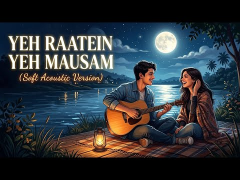
- 설명 앞부분: Welcome to this soft acoustic rendition of the timeless classic, "Yeh Raatein Yeh Mausam." 🎸✨ I wanted to capture the magic of a breezy, moonlit night by the river through this unplugged version. Whether you are taking a late-night drive, stargazing, or just relaxing with your thoughts, I hope this…
- 같은 채널 평소 대비 ×349.8 (채널 최근 롱폼 중앙값 16,016회) · 평소 영상: Meri Bheegi Bheegi Si 🔥(UNBELIEVABLE Acoustic Roc… (16,016회) / PRITHIBI TA NAKI (পৃথিবীটা নাকি) — Hard Rock Cove… (14,209회)
- 대본 없음 (설명) — 음성인식이 끝나면 도입부·흐름이 들어감
- 댓글 277/277: 좋은 점 — 영상 0 · 감사·응원 0 · 더 알고 싶은 것 0 · 아쉬운 점 — 영상 0 · 반박·불만 — 의견 다름 0 · 정치·사회 0 · 경험 공유 0 · 구독·다음 기대 0

### 56. 7 मिनट में बच्चा गहरी नींद सोए🌙 सो जा मेरे चाँद से लाल ∣ Hindi Lori for Baby Sleep & Peac…

- https://www.youtube.com/watch?v=IxnmH8QjS_A · deep sleep vibes · 구독자 898 · 조회수 607,076 (×676.0, 하루 3,850.5) · 좋아요 2,334 (0.4%) · 6.8분 · 2026-05-14 · 주제 묶음 1. 수면·명상·힐링 · 형식 음악 (그 밖 모양 — 한 편짜리 BGM 등) · 폴더 `W_IxnmH8QjS_A` (웹 승인)
- 썸네일: 
- 설명 앞부분: 🌙 Welcome to **Deep Sleep Vibes** 🌙 Struggling with stress, anxiety, insomnia, or lack of focus? You’re in the perfect place. Deep Sleep Vibes is your daily escape into a world of calmness, peace, and deep relaxation. We create high-quality relaxing music, soothing sounds, and sleep therapy audio d…
- 같은 채널 평소 대비 ×10,466.8 (채널 최근 롱폼 중앙값 58회) · 평소 영상: Moon, Stay With Me Tonight 🌙 ∣ Deep Sleep LoFi fo… (59회) / Fall Asleep in 6 Minutes 🌙 ∣ Deep Sleep LoFi for … (57회)
- 대본 없음 (설명) — 음성인식이 끝나면 도입부·흐름이 들어감
- 댓글 152/152: 좋은 점 — 영상 0 · 감사·응원 0 · 더 알고 싶은 것 0 · 아쉬운 점 — 영상 0 · 반박·불만 — 의견 다름 0 · 정치·사회 0 · 경험 공유 0 · 구독·다음 기대 0

### 57. Pov: certified Baddie playlist 🔥# playlist # baddie

- https://www.youtube.com/watch?v=vzNOiBV_W6g · it's GAURAV PATEL  · 구독자 7,850 · 조회수 5,294,288 (×674.4, 하루 42,625.4) · 좋아요 41,282 (0.8%) · 8.3분 · 2026-06-17 · 주제 묶음 기타 · 형식 플레이리스트·모음 (여러 곡) · 폴더 `W_vzNOiBV_W6g` (웹 승인)
- 썸네일: 
- 챕터: 0:00 High heels · 0:54 hauli hauli · 1:34 taka de dentro · 1:53 main tera boyfriend · 2:53 love dose · 3:47 chittiyan kalliyan · 4:37 dupatta tera nau rang · 5:34 kala chasma · 6:18 lat lag gayi · 6:48 Babli badmaash hai · 7:17 nachangi saari raat · 7:40 naal nachna · 7:59 brown rang de
- 설명 앞부분: 07:17nachangi saari raat The music used in this video is not allowed by me. All rights belong to their respective artists composers, and copyright holders. This video is made pure for entertainment purposes and to share my love for great music with my audience. I acknowledge the immense talent and …
- 대본 없음 (설명) — 음성인식이 끝나면 도입부·흐름이 들어감
- 댓글 696/692: 좋은 점 — 영상 0 · 감사·응원 0 · 더 알고 싶은 것 0 · 아쉬운 점 — 영상 0 · 반박·불만 — 의견 다름 0 · 정치·사회 0 · 경험 공유 0 · 구독·다음 기대 0

### 58. 'pov: bạn mở lại một tab ký ức năm 2018 ♪♪

- https://www.youtube.com/watch?v=8ljpWVIINTs · chalye · 구독자 2,330 · 조회수 1,546,937 (×663.9, 하루 11,850.2) · 좋아요 23,110 (1.5%) · 27.4분 · 2026-06-10 · 주제 묶음 기타 · 형식 플레이리스트·모음 (여러 곡) · 폴더 `W_8ljpWVIINTs` (웹 승인)
- 썸네일: 
- 챕터: 0:00 TOULIVER X LÊ HIẾU X SOOBIN H… · 3:39 Anh Đã Quen Với Cô Đơn - Soob… · 7:36 KÉM DUYÊN ∣ RUM X NIT X MASEW · 11:22 Touliver x Soobin Hoàng Sơn -… · 14:27 Lời Yêu Ngây Dại - Kha · 18:38 THẰNG ĐIÊN ∣ JUSTATEE x PHƯƠN… · 23:14 Khuôn Mặt Đáng Thương- Sơn Tù…
- 설명 앞부분: Playlist Nhạc Việt Peak VL ₊˚♪ tracklist None of the music in this video belongs to me, all rights to their respective owners.
- 같은 채널 평소 대비 ×131.6 (채널 최근 롱폼 중앙값 11,759회) · 평소 영상: songs that feel like old love (11,759회) / Ethereal/calm songs because you're majestic (20,198회)
- 대본 없음 (설명) — 음성인식이 끝나면 도입부·흐름이 들어감
- 댓글 331/331: 좋은 점 — 영상 0 · 감사·응원 0 · 더 알고 싶은 것 0 · 아쉬운 점 — 영상 0 · 반박·불만 — 의견 다름 0 · 정치·사회 0 · 경험 공유 0 · 구독·다음 기대 0

### 59. Mind Relax Lofi Mashup ∣ Mind Relaxing Songs ∣ Mind Relax Lofi Song ∣ Slowed And Reverb ∣…

- https://www.youtube.com/watch?v=JyM_L7ZZ9xw · SONGS ZONE  · 구독자 3,000 · 조회수 1,991,073 (×663.7, 하루 14,163.7) · 좋아요 15,221 (0.8%) · 28.7분 · 2026-05-31 · 주제 묶음 8. 로파이·시티팝·칠 · 형식 음악 (그 밖 모양 — 한 편짜리 BGM 등) · 폴더 `W_JyM_L7ZZ9xw` (웹 승인)
- 썸네일: 
- 설명 앞부분: Mind Relax Lofi Mashup ∣ Mind Relaxing Songs ∣ Mind Relax Lofi Song ∣ Slowed And Reverb ∣ Lofi Songs तुरंत 100 ₹ का कैशबैक पाने के लिए हमे इंस्टाग्राम पर फॉलो करे और मैसेज करे *FREEBYT100 Song Code - M2 Channel Name - SONG ZONE Controversy Name - SONG ZONE ❤️‍🩹 PLEASE USE HEADPHONE ❤️‍🩹 List Of Son…
- 대본 없음 (설명) — 음성인식이 끝나면 도입부·흐름이 들어감
- 댓글 357/357: 좋은 점 — 영상 0 · 감사·응원 0 · 더 알고 싶은 것 0 · 아쉬운 점 — 영상 0 · 반박·불만 — 의견 다름 0 · 정치·사회 0 · 경험 공유 0 · 구독·다음 기대 0

### 60. Steve Lacy - the feeling (Official Video)

- https://www.youtube.com/watch?v=Qw20tg1v7Fc · SteveLacyVEVO · 구독자 8,430 · 조회수 5,560,223 (×659.6, 하루 40,826.1) · 좋아요 105,410 (1.9%) · 4.6분 · 2026-06-05 · 주제 묶음 기타 · 형식 플레이리스트·모음 (여러 곡) · 폴더 `W_Qw20tg1v7Fc` (웹 승인)
- 썸네일: 
- 설명 앞부분: Follow Steve Lacy: MANAGEMENT Dave Airaudi Management Brit Weathers Management Kathleen Heffernan Executive Producer PRODUCTION Matthew Castellanos Director Maddy Denley Creative Collaborator Dylan Palley Producer Alex Storm Associate Producer Sam Roze Production Manager Robert "RB" Blair 1st AD GL…
- 대본 없음 (설명) — 음성인식이 끝나면 도입부·흐름이 들어감
- 댓글 5,393/5,393: 좋은 점 — 영상 0 · 감사·응원 0 · 더 알고 싶은 것 0 · 아쉬운 점 — 영상 1 · 반박·불만 — 의견 다름 0 · 정치·사회 0 · 경험 공유 0 · 구독·다음 기대 0
  - 아쉬운 점 — 영상 👍0 “무한반복”

### 61. Tere Liye [Slowed+Reverb+Lofi] Song ∣ Atif Aslam, Shreya Ghoshal ∣ Song- PRINCE ∣DK LOFI

- https://www.youtube.com/watch?v=zwDQAObOpx4 · DK LOFI · 구독자 3,590 · 조회수 2,303,266 (×641.6, 하루 24,427.2) · 좋아요 0 (0.0%) · 4.5분 · 2026-07-17 · 주제 묶음 8. 로파이·시티팝·칠 · 형식 음악 (그 밖 모양 — 한 편짜리 BGM 등) · 폴더 `W_zwDQAObOpx4` (웹 승인)
- 썸네일: 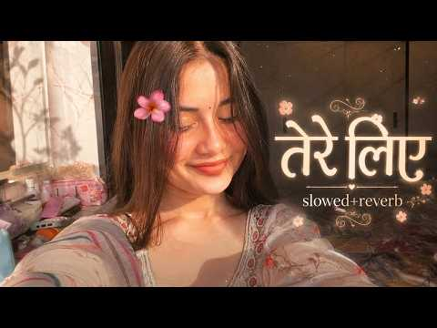
- 설명 앞부분: Tere Liye [Slowed+Reverb+Lofi] Song ∣ Atif Aslam, Shreya Ghoshal ∣ Song- PRINCE ∣DK LOFI Presenting (Slowed + Reverb) Version tere liye 🎧 Use headphone for best experience Subscribe Now for more videos Credits : Lofi (Slowed + Reverb) By - Dilkhushmeena Video Editing - Dilkhush meena Present By - D…
- 같은 채널 평소 대비 ×356.4 (채널 최근 롱폼 중앙값 6,463회) · 평소 영상: Afghan Jalebi [Slowed+Reverb+Lofi] Song ∣ saif al… (6,463회) / Ek din teri raahon mein [Slowed+Reverb+Lofi] Song… (6,853회)
- 대본 없음 (설명) — 음성인식이 끝나면 도입부·흐름이 들어감
- 댓글 415/409: 좋은 점 — 영상 0 · 감사·응원 0 · 더 알고 싶은 것 0 · 아쉬운 점 — 영상 0 · 반박·불만 — 의견 다름 0 · 정치·사회 0 · 경험 공유 0 · 구독·다음 기대 0

### 62. SAD LO-FI 🥺 💔 2026 Ultimate Mind Relaxing Lofi Beats ∣ Study Sleep & Chill lofi ∣ #lofimu…

- https://www.youtube.com/watch?v=XLtdtHJExEY · Clsxzff · 구독자 1,860 · 조회수 1,189,430 (×639.5, 하루 42,665.4) · 좋아요 9,809 (0.8%) · 19.6분 · 2026-09-21 · 주제 묶음 1. 수면·명상·힐링 · 형식 음악 (그 밖 모양 — 한 편짜리 BGM 등) · 폴더 `W_XLtdtHJExEY` (웹 승인)
- 썸네일: 
- 설명 앞부분: Welcome to the world of soothing lofi music, where stress fades away, and peace takes over. This 2026 mind-relaxing lofi mix is perfect for: Deep Focus & Studying 📖 Relaxing & Meditation 🧘‍♂ Chilling After a Long Day 🌅 Peaceful Sleep & Stress Relief 😴 ©NOTE : Reupload/Misuse of the following video …
- 대본 없음 (설명) — 음성인식이 끝나면 도입부·흐름이 들어감
- 댓글 173/177: 좋은 점 — 영상 0 · 감사·응원 0 · 더 알고 싶은 것 0 · 아쉬운 점 — 영상 0 · 반박·불만 — 의견 다름 0 · 정치·사회 0 · 경험 공유 0 · 구독·다음 기대 0

### 63. POV: you discovered that ✨South Indian and Hindi ✨songs hit different x timestamps ∣∣ par…

- https://www.youtube.com/watch?v=lbT4VY3UKkY · Arena · 구독자 3,490 · 조회수 2,205,785 (×632.0, 하루 33,992.3) · 좋아요 29,353 (1.3%) · 14.6분 · 2026-08-15 · 주제 묶음 12. 커버·노래 부르기 · 형식 음악 (그 밖 모양 — 한 편짜리 BGM 등) · 폴더 `W_lbT4VY3UKkY` (웹 승인)
- 썸네일: 
- 챕터: 0:00 KALYANI-(REMIX) · 0:50 Othaiyadi Pathayila · 1:50 Unakkul Naane · 3:04 tum tum · 4:10 Vachindamma · 5:27 Chuttamalle · 6:52 Inkem Inkem · 8:17 Aankhon ki Gustakhiya (hindi) · 9:40 Titli (hindi) · 10:57 Jugraafiya (hindi) · 12:08 O Rangrez (hindi) · 13:32 Aasa kooda
- 설명 앞부분: Don't forget to subscribe^^ Do not copy this video. I do not claim to own any of the audios or images used in this video; they DONOT belong to me.
- 같은 채널 평소 대비 ×438.6 (채널 최근 롱폼 중앙값 5,030회) · 평소 영상: 𝟏𝟓+ ꩜ 𝐫𝐚𝐧𝐝𝐨𝐦𝐚𝐮𝐝𝐢𝐨𝐬 𝐜𝐮𝐳 𝐲𝐨𝐮'𝐫𝐞 𝐨𝐛𝐬𝐞𝐬𝐬𝐞𝐝 𝐰𝐢𝐭𝐡 𝐲𝐨𝐮𝐫𝐬… (6,814회) / ⟡ ݁Ethereal trendy songs which are 10/10 cause yo… (3,245회)
- 대본 없음 (설명) — 음성인식이 끝나면 도입부·흐름이 들어감
- 댓글 406/397: 좋은 점 — 영상 0 · 감사·응원 0 · 더 알고 싶은 것 0 · 아쉬운 점 — 영상 0 · 반박·불만 — 의견 다름 0 · 정치·사회 0 · 경험 공유 0 · 구독·다음 기대 0

### 64. Darmiyaan

- https://www.youtube.com/watch?v=v2TsWj3wxHM · Rekha Bhardwaj - Topic · 구독자 8,590 · 조회수 5,406,071 (×629.3, 하루 59,371.7) · 좋아요 51,514 (0.9%) · 4.5분 · 2026-07-20 · 주제 묶음 4. 카페·매장·라운지 · 형식 정보·해설 (그 밖) · 폴더 `W_v2TsWj3wxHM` (웹 승인)
- 썸네일: 
- 설명 앞부분: Provided to YouTube by Super Cassettes Industries Private Limited Darmiyaan · Rekha Bhardwaj · Raghav Kaushik · Amrita Saluja Musafir Cafe ℗ Netflix Music Llc Under Exclusive License To T-Series Released on: 2026-07-21 Vocalist: Rekha Bhardwaj Vocalist, Composer: Raghav Kaushik Lyricist: Amrita Sal…
- 대본 없음 (설명) — 음성인식이 끝나면 도입부·흐름이 들어감
- 댓글 0/236: 좋은 점 — 영상 0 · 감사·응원 0 · 더 알고 싶은 것 0 · 아쉬운 점 — 영상 0 · 반박·불만 — 의견 다름 0 · 정치·사회 0 · 경험 공유 0 · 구독·다음 기대 0

### 65. MKAstro – Darkness Chill ∣ Club Banger Trap ∣ (Visualizer)

- https://www.youtube.com/watch?v=emsqrCS0yiw · MKAstro Studio · 구독자 3,570 · 조회수 2,222,773 (×622.6, 하루 20,202.3) · 좋아요 15,086 (0.7%) · 5.8분 · 2026-07-01 · 주제 묶음 8. 로파이·시티팝·칠 · 형식 AI 음악 · 폴더 `W_emsqrCS0yiw` (웹 승인)
- 썸네일: 
- 설명 앞부분: MKAstro – Darkness Chill No rush. No light. Just the cold and the calm. Original dark trap track with distorted bass, written, produced, mixed and mastered by MKAstro. Visual concept, direction and editing by MKAstro. Thumbnail designed by MKAstro. Heavy distorted 808s, cold atmosphere, the darknes…
- 같은 채널 평소 대비 ×2,773.3 (채널 최근 롱폼 중앙값 802회) · 평소 영상: MKAstro - Night Shift (Music Video) (829회) / MKAstro - Darkness Storm (Music Video) (774회)
- 대본 없음 (설명) — 음성인식이 끝나면 도입부·흐름이 들어감
- 댓글 154/154: 좋은 점 — 영상 0 · 감사·응원 0 · 더 알고 싶은 것 0 · 아쉬운 점 — 영상 0 · 반박·불만 — 의견 다름 0 · 정치·사회 0 · 경험 공유 0 · 구독·다음 기대 0

### 66. POV: You are ✨ Self Obsessed women💅 Playlist hindi bollywood

- https://www.youtube.com/watch?v=wOy_aMJqDgo · 𝐌𝐫. · 구독자 2,670 · 조회수 1,657,402 (×620.8, 하루 15,491.6) · 좋아요 23,814 (1.4%) · 14.4분 · 2026-07-04 · 주제 묶음 기타 · 형식 플레이리스트·모음 (여러 곡) · 폴더 `W_wOy_aMJqDgo` (웹 승인)
- 썸네일: 
- 설명 앞부분: Main character vibe playlist for you🔥 Disclaimer: All music belongs to its respective owners. This playlist is created for entertainment and promotional purposes only. No copyright infringement intended. Disclaimer: FAIR USE Copyright Disclaimer under section 107 of Copyright Act 1976, allowance is…
- 같은 채널 평소 대비 ×1,367.5 (채널 최근 롱폼 중앙값 1,212회) · 평소 영상: 𝘉𝘰𝘭𝘭𝘺𝘸𝘰𝘰d + 𝘉𝘩𝘰𝘫𝘱𝘶𝘳𝘪 𝘱𝘭𝘢𝘺𝘭𝘪𝘴𝘵 💘 𝘮𝘢𝘬𝘦 𝘺𝘰𝘶 𝘋𝘢𝘯𝘤𝘦 𝘢𝘵… (1,212회) / A Playlist cuz you're in a MOOD swing 🤌🏻🙂 (1,062회)
- 대본 없음 (설명) — 음성인식이 끝나면 도입부·흐름이 들어감
- 댓글 841/836: 좋은 점 — 영상 0 · 감사·응원 0 · 더 알고 싶은 것 0 · 아쉬운 점 — 영상 0 · 반박·불만 — 의견 다름 0 · 정치·사회 0 · 경험 공유 0 · 구독·다음 기대 0

### 67. Om Namah Shivaya 🕉 #hanumanansh #backgroundmusic #trendingsong

- https://www.youtube.com/watch?v=YnhFtBGO2zI · Rudree Aarya vlogs  · 구독자 2,470 · 조회수 1,528,433 (×618.8, 하루 35,900.8) · 좋아요 12,142 (0.8%) · 15.5분 · 2026-09-06 · 주제 묶음 기타 · 형식 음악 (그 밖 모양 — 한 편짜리 BGM 등) · 폴더 `W_YnhFtBGO2zI` (웹 승인)
- 썸네일: 
- 대본 없음 (없음) — 음성인식이 끝나면 도입부·흐름이 들어감
- 댓글 385/382: 좋은 점 — 영상 0 · 감사·응원 0 · 더 알고 싶은 것 0 · 아쉬운 점 — 영상 0 · 반박·불만 — 의견 다름 0 · 정치·사회 0 · 경험 공유 0 · 구독·다음 기대 0

### 68. Achchi Lagti Ho (Slowed + Reverb) ∣ Lofi Version 🎧

- https://www.youtube.com/watch?v=fc8Mab9zGkg · GTAvexo9 · 구독자 24,100 · 조회수 14,907,456 (×618.6, 하루 160,754.2) · 좋아요 102,835 (0.7%) · 6.5분 · 2026-07-18 · 주제 묶음 8. 로파이·시티팝·칠 · 형식 음악 (그 밖 모양 — 한 편짜리 BGM 등) · 폴더 `W_fc8Mab9zGkg` (웹 승인)
- 썸네일: 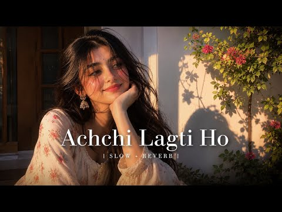
- 설명 앞부분: 🎵 Achchi Lagti Ho (Slowed + Reverb) ∣ Lofi Version Relax and enjoy this slowed + reverb version with a peaceful lofi vibe. Use headphones for the best experience. 🎧 Song: Achchi Lagti Ho 🎼 Version: Slowed + Reverb / Lofi ✨ Genre: Romantic • Chill • Lofi ⚠️ Disclaimer: This video is created for ente…
- 대본 없음 (설명) — 음성인식이 끝나면 도입부·흐름이 들어감
- 댓글 2,047/2,046: 좋은 점 — 영상 0 · 감사·응원 0 · 더 알고 싶은 것 0 · 아쉬운 점 — 영상 0 · 반박·불만 — 의견 다름 0 · 정치·사회 0 · 경험 공유 0 · 구독·다음 기대 0

### 69. Hangova (From "DC")

- https://www.youtube.com/watch?v=B6ppp6WBCKg · Anirudh Ravichander - Topic · 구독자 31,700 · 조회수 19,468,229 (×614.1, 하루 185,618.7) · 좋아요 156,080 (0.8%) · 4.1분 · 2026-07-06 · 주제 묶음 기타 · 형식 정보·해설 (그 밖) · 폴더 `W_B6ppp6WBCKg` (웹 승인)
- 썸네일: 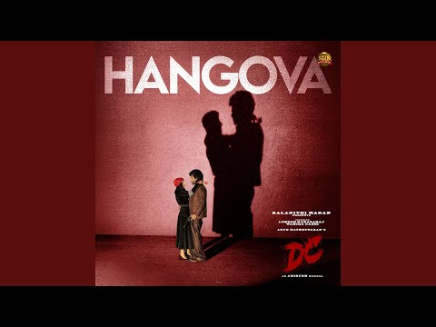
- 설명 앞부분: Provided to YouTube by The Orchard Enterprises Hangova (From "DC") · Anirudh Ravichander · Heisenberg Hangova (From "DC") ℗ 2026 Sun Pictures Released on: 2026-07-06 Producer: Kalanithi Maran Engineer: Srinivasan M Additional Programming Engineer: Shashank Vijay Additional Programming Engineer: Mar…
- 대본 없음 (설명) — 음성인식이 끝나면 도입부·흐름이 들어감
- 댓글 0/1,452: 좋은 점 — 영상 0 · 감사·응원 0 · 더 알고 싶은 것 0 · 아쉬운 점 — 영상 0 · 반박·불만 — 의견 다름 0 · 정치·사회 0 · 경험 공유 0 · 구독·다음 기대 0

### 70. 이게 삶이더라고｜세월 끝에 깨닫는 인생 이야기｜감성 발라드

- https://www.youtube.com/watch?v=QalAq2cvw8U · 웃음콘서트TV · 구독자 2,660 · 조회수 1,615,673 (×607.4, 하루 10,817.3) · 좋아요 4,337 (0.3%) · 5.4분 · 2026-05-23 · 주제 묶음 9. 가요·발라드·트로트 · 형식 한 곡 (뮤직비디오·음원·가사) · 폴더 `W_QalAq2cvw8U` (웹 승인)
- 썸네일: 
- 설명 앞부분: 빛바랜 사진 속의 젊은 날, 앞만 보고 달려왔던 시간들, 그리고 곁을 지켜준 소중한 사람. 『이게 삶이더라고』**는 빠르게 흘러온 세월 끝에서 비로소 삶의 의미를 돌아보게 되는 따뜻한 감성 발라드입니다. 때로는 힘들고 고단했지만, 돌아보면 그 모든 순간들이 모여 지금의 나를 만들고 있었음을 조용히 이야기합니다. 나이 들어간다는 건 무언가를 잃어가는 일이 아니라, 더 깊은 마음과 추억을 품어가는 일인지도 모르겠습니다. 이 노래는 함께 걸어온 시간의 소중함과 평범한 하루 속에 숨겨진 행복을 담았습니다. 잠시 바쁜 하루를 내려놓고 잔잔…
- 같은 채널 평소 대비 ×475.3 (채널 최근 롱폼 중앙값 3,400회) · 평소 영상: 세월이 남긴 자리｜아픔도 결국 사랑이 됩니다｜힐링음악｜웃음콘서트 (3,752회) / 웃음콘서트 -나란히 걷는 길 (3,047회)
- 대본 없음 (설명) — 음성인식이 끝나면 도입부·흐름이 들어감
- 댓글 334/334: 좋은 점 — 영상 6 · 감사·응원 70 · 더 알고 싶은 것 6 · 아쉬운 점 — 영상 3 · 반박·불만 — 의견 다름 0 · 정치·사회 2 · 경험 공유 6 · 구독·다음 기대 6
  - 좋은 점 — 영상 👍5 “가사가 너무가슴에와닿네요 잘들었어요”
  - 좋은 점 — 영상 👍4 “아이구야 사랑덩어리 우리멋진신 김재홍 선생님 노래가사가 구구절절 한편의 시처럼 기가막히게 좋으네요 거기다 배경까지 정말 쥑이네요 푹빠져 듣고 또듣고 큰박수로 응원하면서 갑니다 함께 라서 너무 너무 행복하고 좋아요 김재홍 쌤 ❤❤❤합니다”
  - 감사·응원 👍17 “좋은 노래 제 마음을 울리네요 감사합니다 ❤❤❤”
  - 감사·응원 👍12 “지나온 날들을 회상하게 돼네요 너무 감명 깊은은 노래 감사합니다~♡~”
  - 더 알고 싶은 것 👍9 “오늘도 청계천 걸어며 걸어온길 삶속에 명상하면서 음악 감상하고 갑니다 오늘도 좋은음악 올려주세요 셈님 감사합니다”
  - 더 알고 싶은 것 👍4 “가수분누구신지아시는분알려주세요~~^^”
  - 아쉬운 점 — 영상 👍2 “목소리가 너무좋아요 노래도잘하시고요 🎉 응원합니다”
  - 아쉬운 점 — 영상 👍0 “Ai목소리인가요?”
  - 정치·사회 👍2 “국회로 보냅시다.”
  - 정치·사회 👍0 “청와대 민정수석실.민원실 02.114전화번호문이를했더니등록안되어따고합니다.무슨놈이이런나라가있씁니다.국민세금.벌금내고있잔아요.의자.책상다치워버립시다하물며 제주특별자치도 제주지방검찰청독립기관었는대 제주인구5십오만명정도생계곤란3십프로중수청으로 바뀌면서타지역관할로되어있씁니다…”
  - 경험 공유 👍4 “너무 감동입니다👍이민생활에 일들….🥰저희도 52년 이민자 2세 교육시키고 은퇴해서 잘지내고 있읍니다.내 나라는 그리울뿐 역이민은 또 다른 역경일텐데 문화가 너무 달라져서….키다리쌤 수고많으셨어요.”
  - 경험 공유 👍3 “저도 나이가 들어가네요 가사가 맘속에 스미듯 스쳐지나간 날들 ~~ 아 참좋다”
  - 구독·다음 기대 👍5 “우면히 들어요 너무 감동이에요 구독하고 자주 들어요 감사합니다”
  - 구독·다음 기대 👍5 “삶은 여행이라고 내 삶을 한번더 내다보는듯 가슴에 와 닿네요 잠들기전에 듣고 꿈도 꿔 볼래요 구독합니다 좋아요 👍”

### 71. [𝐩𝐥𝐚𝐲𝐥𝐢𝐬𝐭] 띵곡들만 모아놓은 애니 노동요 OST 플리💿

- https://www.youtube.com/watch?v=16zIXIea0_U · ASMRuru_루루 · 구독자 890 · 조회수 539,738 (×606.5, 하루 4,084.9) · 좋아요 4,138 (0.8%) · 54.4분 · 2026-06-09 · 주제 묶음 3. 공부·집중·작업 · 형식 플레이리스트·모음 (여러 곡) · 폴더 `W_16zIXIea0_U` (웹 승인)
- 썸네일: 
- 챕터: 0:00 주술회전 - SPECIALZ · 3:50 나루토 - Silhouette (실루엣) · 7:45 체인소 맨 - IRIS OUT · 10:13 귀멸의 칼날 - Zankyosanka (잔향산가) · 13:14 은혼 - Some Like It Hot!! (사무라이… · 16:23 진격의 거인 - Shinzou wo Sasageyo!… · 21:58 괴도키드 - Ai no Scenario (사랑의 시나… · 26:13 귀멸의 칼날 - Gurenge (홍련화) · 30:07 체인소 맨 - KICK BACK · 33:20 사이코패스 - Namae No Nai Kaibutsu… · 38:27 주술회전 - Kaikai Kitan (회회기담) · 42:05 최애의 아이 - アイドル (아이돌) · 45:37 귀멸의 칼날 - Kizuna no Kiseki (인연… · 49:16 진격의 거인 - Guren no Yumiya (홍련의…
- 설명 앞부분: 🎧 재생목록 100만 조회수 나와서 만들어 본 애니 노동요 플리 주인장이 작업하고 공부할 때 들으려고 만들어 둔 애니 OST 모음입니다 🎶 💬 여러분의 최애 애니 OST도 댓글로 추천해 주세요! ⏰ Track List
- 같은 채널 평소 대비 ×859.5 (채널 최근 롱폼 중앙값 628회) · 평소 영상: 【진격거 ASMR】 리바이 병장님과 공부하기📚 벽난로 백색소음 1시간 ∣ Attack o… (628회) / 【왕사남 모동숲 ASMR】 저도 그 안에 있습니까? ∣ 왕과 사는 남자 1시간 수면 as… (431회)
- 대본 없음 (설명) — 음성인식이 끝나면 도입부·흐름이 들어감
- 댓글 91/91: 좋은 점 — 영상 0 · 감사·응원 2 · 더 알고 싶은 것 0 · 아쉬운 점 — 영상 1 · 반박·불만 — 의견 다름 0 · 정치·사회 0 · 경험 공유 4 · 구독·다음 기대 0
  - 감사·응원 👍2 “헐 다 제가 넘 좋아하는 노래에요ㅠㅠ❤❤ 감사합니당 많이 들을게용”
  - 감사·응원 👍0 “공부할때 매일 틀어요 감사해요!”
  - 아쉬운 점 — 영상 👍4 “개인적으로 푸르름이 사는 곳이 없는게 너무 아쉬움 ㅠㅠ”
  - 경험 공유 👍5 “당신 제가 좋아하는 노래 염탐했죠.”
  - 경험 공유 👍2 “헐 다 제가 넘 좋아하는 노래에요ㅠㅠ❤❤ 감사합니당 많이 들을게용”

### 72. Heartbreak Chillout ∣ Vishal Mishra ∣ Arijit singh ∣ Soulful Music ∣ Romantic Lo-fi ∣ New…

- https://www.youtube.com/watch?v=XlYh9K0UNXI · Nilay Kumar Maji · 구독자 2,400 · 조회수 1,453,174 (×605.5, 하루 8,710.9) · 좋아요 8,893 (0.6%) · 8분 · 2026-05-05 · 주제 묶음 8. 로파이·시티팝·칠 · 형식 음악 (그 밖 모양 — 한 편짜리 BGM 등) · 폴더 `W_XlYh9K0UNXI` (웹 승인)
- 썸네일: 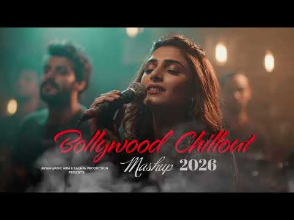
- 설명 앞부분: Heartbreak Chillout ∣ Vishal Mishra ∣ Arijit singh ∣ Soulful Music ∣ Romantic Lo-fi ∣ New Song ∣ Hindi Video Song ∣ New Romantic Song ∣ New Hindi Song 2026 ∣ New Song 2026 Hindi ∣ New Hindi Songs ∣ Hindi Song ∣ New Song Hindi ∣ Hindi New Song ∣ Hindi Song New ∣ Ranveer Singh Songs ∣ Ranveer Singh N…
- 같은 채널 평소 대비 ×18,051.9 (채널 최근 롱폼 중앙값 80회) · 평소 영상: চির অভাগী তোমারো লাগি ∣ Chiro Ovagi Tomaro Lagi ∣… (82회) / Ishq Mera x Preet Re ∣∣ Lo-fi Smashup ∣∣ Bollywoo… (79회)
- 대본 없음 (설명) — 음성인식이 끝나면 도입부·흐름이 들어감
- 댓글 137/137: 좋은 점 — 영상 0 · 감사·응원 0 · 더 알고 싶은 것 0 · 아쉬운 점 — 영상 0 · 반박·불만 — 의견 다름 0 · 정치·사회 0 · 경험 공유 0 · 구독·다음 기대 0

### 73. Twinkle Twinkle - Best Lullabies for Babies To Sleep ∣ Little Light 🌙 ∣ Sleepy Star & Rai…

- https://www.youtube.com/watch?v=PE3jMxJjyB0 · KiddoBeatz · 구독자 850 · 조회수 503,546 (×592.4, 하루 3,008.8) · 좋아요 1,294 (0.3%) · 10.7분 · 2026-05-05 · 주제 묶음 1. 수면·명상·힐링 · 형식 음악 (그 밖 모양 — 한 편짜리 BGM 등) · 폴더 `W_PE3jMxJjyB0` (웹 승인)
- 썸네일: 
- 설명 앞부분: ✨ Twinkle-Twinkle Little Light 🌙 ∣ Sleepy Star & Rainy Lullaby Mix ✨ Drift into a world of calm and comfort with this soothing lullaby blend featuring “Twinkle-Twinkle Little Light,” “Twinkle-Twinkle Sleepy Star Is Calling You,” and a gentle rainy lullaby atmosphere. 🌧️💤 This peaceful mix is design…
- 같은 채널 평소 대비 ×610.4 (채널 최근 롱폼 중앙값 825회) · 평소 영상: BABY SHARK SPLASHY 🦈 ∣Baby Shark Style Kids Song … (825회) / Twinkle Twinkle Forest Night 🌙✨ Sleepy Star Song … (533회)
- 대본 없음 (설명) — 음성인식이 끝나면 도입부·흐름이 들어감
- 댓글 0/0: 좋은 점 — 영상 0 · 감사·응원 0 · 더 알고 싶은 것 0 · 아쉬운 점 — 영상 0 · 반박·불만 — 의견 다름 0 · 정치·사회 0 · 경험 공유 0 · 구독·다음 기대 0

### 74. Mann mera (Original Version) ∣ Slowed + Reverb ∣ Gajendra Verma ∣ #song #lofi #slowedandr…

- https://www.youtube.com/watch?v=4ObYNh1TOHY · LOFI ZONE 990K · 구독자 16,900 · 조회수 9,948,335 (×588.7, 하루 118,144.8) · 좋아요 50,998 (0.5%) · 5분 · 2026-07-27 · 주제 묶음 8. 로파이·시티팝·칠 · 형식 음악 (그 밖 모양 — 한 편짜리 BGM 등) · 폴더 `W_4ObYNh1TOHY` (웹 승인)
- 썸네일: 
- 설명 앞부분: Lyrics : Gajendra Verma - Mann Mera (Original Version) Saari raat aahen bharta Pal pal yaadon mein marta Maane na mera mann mera Sooni sooni shaam, soone savere Behte hain aansu mere Jaane kuch bhi na mann mera Kabhi tera tha jo, begaana ab hai woh Deewana, deewana samjhe na Kabhi khoya rahe Kabhi …
- 같은 채널 평소 대비 ×1,380.9 (채널 최근 롱폼 중앙값 7,204회) · 평소 영상: Main_Agar_Kahoon_[Slowed_Reverb] - Om Shanti Om ∣… (7,204회) / Hawa Hawa ❤️ ∣ Slowed + Reverb ∣ Lofi Romantic Vi… (6,692회)
- 대본 없음 (설명) — 음성인식이 끝나면 도입부·흐름이 들어감
- 댓글 1,591/1,591: 좋은 점 — 영상 0 · 감사·응원 0 · 더 알고 싶은 것 0 · 아쉬운 점 — 영상 0 · 반박·불만 — 의견 다름 0 · 정치·사회 0 · 경험 공유 0 · 구독·다음 기대 0

### 75. Playlist Song Inggris Gamon Santai...∣∣ The Winner Takes It All

- https://www.youtube.com/watch?v=E9Nm4xOU-tk · musik gen z · 구독자 1,990 · 조회수 1,164,067 (×585.0, 하루 13,845.4) · 좋아요 0 (0.0%) · 31.1분 · 2026-07-27 · 주제 묶음 기타 · 형식 플레이리스트·모음 (여러 곡) · 폴더 `W_E9Nm4xOU-tk` (웹 승인)
- 썸네일: 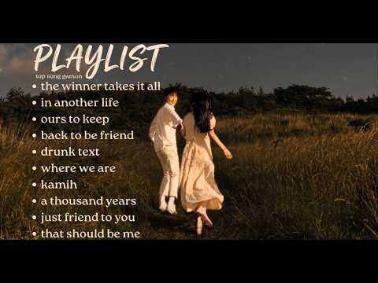
- 설명 앞부분: terima kasih karena pernah hadir di hidupku meski tidak bisa menetap setidaknya bisa menemani hari hari ku
- 같은 채널 평소 대비 ×131.8 (채널 최근 롱폼 중앙값 8,830회) · 평소 영상: TOP PLAYLIST SPOTIFY 2026 (8,830회) / 𝘱𝘭𝘢𝘺𝘭𝘪𝘴𝘵 𝘵𝘰𝘱 𝘴𝘰𝘯𝘨 𝘪𝘯𝘨𝘨𝘳𝘪𝘴, 𝘣𝘪𝘬𝘪𝘯 𝘨𝘢𝘮𝘰𝘯!!!!!! (7,514회)
- 대본 없음 (설명) — 음성인식이 끝나면 도입부·흐름이 들어감
- 댓글 467/463: 좋은 점 — 영상 0 · 감사·응원 0 · 더 알고 싶은 것 0 · 아쉬운 점 — 영상 0 · 반박·불만 — 의견 다름 0 · 정치·사회 0 · 경험 공유 0 · 구독·다음 기대 0

### 76. Peace of Mind : Sufi Bollywood Nonstop ∣ Rahat Fateh Ali Khan ∣ Kailash Kher

- https://www.youtube.com/watch?v=RlyVCMHCuqc · Aures Music Station · 구독자 3,720 · 조회수 2,163,100 (×581.5, 하루 27,782.2) · 좋아요 16,239 (0.8%) · 57.1분 · 2026-08-02 · 주제 묶음 기타 · 형식 음악 (그 밖 모양 — 한 편짜리 BGM 등) · 폴더 `W_RlyVCMHCuqc` (웹 승인)
- 썸네일: 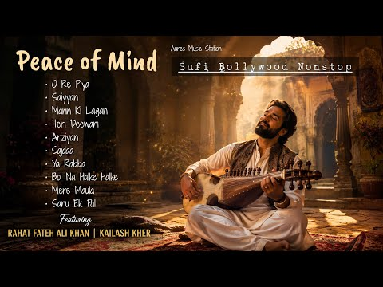
- 설명 앞부분: Peace of Mind: Sufi Bollywood Mix ∣ Rahat Fateh Ali Khan & Kailash Kher Find your center with this soulful, unbroken Sufi Bollywood mix. Designed to bring you absolute peace of mind, this playlist features the deeply resonant and spiritual voices of legends like Rahat Fateh Ali Khan and Kailash Khe…
- 같은 채널 평소 대비 ×2,766.1 (채널 최근 롱폼 중앙값 782회) · 평소 영상: For When It Actually Hurts 💔 ∣ The Ultimate Heart… (1,050회) / Main Character Energy ∣ Gym Hypes ∣ Hype Tracks (514회)
- 대본 없음 (설명) — 음성인식이 끝나면 도입부·흐름이 들어감
- 댓글 124/123: 좋은 점 — 영상 0 · 감사·응원 0 · 더 알고 싶은 것 0 · 아쉬운 점 — 영상 0 · 반박·불만 — 의견 다름 0 · 정치·사회 0 · 경험 공유 0 · 구독·다음 기대 0

### 77. 𝐩𝐥𝐚𝐲𝐥𝐢𝐬𝐭 느좋 인스타 감성

- https://www.youtube.com/watch?v=RG-8iv6ORFY · 알수없는 사용자 · 구독자 1,730 · 조회수 996,946 (×576.3, 하루 14,628.7) · 좋아요 11,070 (1.1%) · 27분 · 2026-08-12 · 주제 묶음 기타 · 형식 플레이리스트·모음 (여러 곡) · 폴더 `W_RG-8iv6ORFY` (웹 승인)
- 썸네일: 
- 챕터: 0:00 향수 - LauRel, EUNSAN, Saula · 2:59 낙서 - 펀치넬로 (feat. 백예린) · 6:08 그걸로도 충분해요 - San E (feat.수안) · 9:25 로꼬 - 시간이들겠지 · 13:13 Bolero - shane · 16:17 니가 모르게 - 로꼬 · 20:26 right now - coogie · 23:28 알아 - 프라이머리 (feat. Sumin)
- 설명 앞부분: 문제될시에 삭제합니다(๑･̑◡･̑๑)
- 같은 채널 평소 대비 ×27.6 (채널 최근 롱폼 중앙값 36,180회) · 평소 영상: 𝐩𝐥𝐚𝐲𝐥𝐢𝐬𝐭 오늘 고백하는 그 남자를 보고 (48,408회) / 𝐩𝐥𝐚𝐲𝐥𝐢𝐬𝐭 너의 그 사랑의 안전지대가 어딨어? (23,951회)
- 대본 없음 (설명) — 음성인식이 끝나면 도입부·흐름이 들어감
- 댓글 94/94: 좋은 점 — 영상 0 · 감사·응원 9 · 더 알고 싶은 것 1 · 아쉬운 점 — 영상 1 · 반박·불만 — 의견 다름 0 · 정치·사회 0 · 경험 공유 1 · 구독·다음 기대 1
  - 감사·응원 👍9 “진짜 뻥안치고 3주 전에 올라왔을 때부터 진짜 하루도 빠짐없이 듣습니다.. ㅎㅎ 버스에서,샤워할 때,자기 전,공부할 때 정말 계속 들어요 ㅠㅠ지친 하루 끝에 이 노래 들으면서 큰 힘 얻고싶습니당 감사드려요 제 최애플리를 만들어 주셔서..❤”
  - 감사·응원 👍7 “진짜 뻥안치고 3주 전에 올라뢌을 때부터 진짜 하루도 빠짐없이 듣습니다.. ㅎㅎ 버스에서,샤워할 때,자기 전,공부할 때 정말 계속 들어요 ㅠㅠ지친 하루 끝에 이 노래 들으면서 큰 힘 얻고싶습니당 감사드려요 제 최애플리를 만들어 주셔서..❤”
  - 더 알고 싶은 것 👍2 “제목 알려주세요ㅠㅠ”
  - 아쉬운 점 — 영상 👍8 “진짜 너무 좋아요 .. 요즘 뭔 여자아이돌 썸네일에 오글거리는 가사 제목, 개뻔한 노래들만 즐비한 양산형 플레이리스트에 질려버렸던 참인데 곡 라인업 너무 깔끔해요 구독하고갑니다 🥰”
  - 경험 공유 👍32 “노래 진짜 좋아요! 제가 어려서 맞춤법을 많이 틀리는데 좋다는 댓글 꼭 쓰고 싶어서 엄마한테 물어보고 도움 받아서 쓰는 댓글 이에요 ❤️ 오늘 처음 듣고 반해버렸어요!! 항상 들을게요!”
  - 구독·다음 기대 👍8 “진짜 너무 좋아요 .. 요즘 뭔 여자아이돌 썸네일에 오글거리는 가사 제목, 개뻔한 노래들만 즐비한 양산형 플레이리스트에 질려버렸던 참인데 곡 라인업 너무 깔끔해요 구독하고갑니다 🥰”

### 78. Premada Oorali Kannada LO-FI Song By Nitro plus kannada

- https://www.youtube.com/watch?v=LEqTIHGB7_g · NITRO PLUS KANNADA · 구독자 4,530 · 조회수 2,595,138 (×572.9, 하루 25,368.7) · 좋아요 14,414 (0.6%) · 11.5분 · 2026-07-09 · 주제 묶음 8. 로파이·시티팝·칠 · 형식 음악 (그 밖 모양 — 한 편짜리 BGM 등) · 폴더 `W_LEqTIHGB7_g` (웹 승인)
- 썸네일: 
- 설명 앞부분: Go and check Premada Oorali Kannada Movie Teaser and also visit Movie theatre to watch movie Support guys to our YouTube channel 🙏 COPYRIGHT DISCLAIMER This Following Audio/Video is Strictly meant for Promotional Purpose.We Do not Wish to make any Commercial Use of this & Intended to Showcase the C…
- 같은 채널 평소 대비 ×17,654.0 (채널 최근 롱폼 중앙값 147회) · 평소 영상: Kavite Kavite Kannada Lofi Song By Nitro plus kan… (147회) / HEY GAGANA KANNADA LOFI SONG BY NITRO PLUS KANNADA (180회)
- 대본 없음 (설명) — 음성인식이 끝나면 도입부·흐름이 들어감
- 댓글 240/240: 좋은 점 — 영상 0 · 감사·응원 0 · 더 알고 싶은 것 0 · 아쉬운 점 — 영상 0 · 반박·불만 — 의견 다름 0 · 정치·사회 0 · 경험 공유 0 · 구독·다음 기대 0

### 79. DUDE 30 Min Loop 🎧 ∣ Orchestral Suite • Metro Proposal • Please Don’t Forget Me

- https://www.youtube.com/watch?v=rNkUDAFaFbM · Zontyx · 구독자 1,860 · 조회수 1,062,835 (×571.4, 하루 7,288.2) · 좋아요 23,632 (2.2%) · 29.7분 · 2026-05-26 · 주제 묶음 기타 · 형식 긴 한 곡·반복 (N시간) · 폴더 `W_rNkUDAFaFbM` (웹 승인)
- 썸네일: 
- 설명 앞부분: 🎧 DUDE – 30 Min Emotional Loop Experience Featuring emotional background scores from DUDE including Orchestral Suite, Please Don’t Forget Me, and The Metro Proposal with echo effects, ambient enhancements, and cinematic visuals. ✨ Edited with: High Echo Effects Ambient Enhancements Smooth Loop Tran…
- 같은 채널 평소 대비 ×6,021.7 (채널 최근 롱폼 중앙값 176회) · 평소 영상: Can You Solve This Crazy River Crossing Puzzle in… (177회) / Limit 🔥 ∣ Lyrical Video (176회)
- 대본 없음 (설명) — 음성인식이 끝나면 도입부·흐름이 들어감
- 댓글 974/968: 좋은 점 — 영상 0 · 감사·응원 0 · 더 알고 싶은 것 0 · 아쉬운 점 — 영상 0 · 반박·불만 — 의견 다름 0 · 정치·사회 0 · 경험 공유 0 · 구독·다음 기대 0

### 80. Best pakistani OST for you ✨🤍 ∣ Pakistani songs∣ #playlist #viral

- https://www.youtube.com/watch?v=-VoKBfZJR5U · shaaedits31 · 구독자 10,200 · 조회수 5,674,906 (×556.4, 하루 31,578.3) · 좋아요 61,092 (1.1%) · 17.7분 · 2026-04-22 · 주제 묶음 기타 · 형식 플레이리스트·모음 (여러 곡) · 폴더 `W_-VoKBfZJR5U` (웹 승인)
- 썸네일: 
- 설명 앞부분: ! Disclaimer ! All rights to the above songs belong to their respective owners. This video is made for entertainment purposes only. no copyright infringement intended.
- 대본 없음 (설명) — 음성인식이 끝나면 도입부·흐름이 들어감
- 댓글 926/900: 좋은 점 — 영상 0 · 감사·응원 0 · 더 알고 싶은 것 0 · 아쉬운 점 — 영상 0 · 반박·불만 — 의견 다름 0 · 정치·사회 0 · 경험 공유 0 · 구독·다음 기대 0

