# 음악 — 성공 사례 분석: 사례별 자세히 #41–#80

`analysis.md` 의 9번 (같은 # 번호). 자동 생성 — `tools/success_analysis.py` v1.4.1 (2026-10-16 13:16 UTC). ※ 연구·교육용 — 투자 권유가 아님.

### 41. 하우스룰즈가 최고야

- https://www.youtube.com/watch?v=V0mzAQ7z3D0 · Yeon · 구독자 948 · 조회수 293,799 (×309.9, 하루 6,660.9) · 좋아요 6,325 (2.1%) · 18.1분 · 2026-09-02 · 주제 묶음 기타 · 형식 플레이리스트·모음 (여러 곡) · 폴더 `W_V0mzAQ7z3D0` (웹 승인)
- 썸네일: 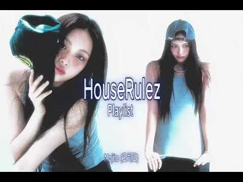
- 챕터: 0:00 house · 4:03 Do it · 8:01 mojito (모히또) · 12:08 Romance
- 설명 앞부분: 하우스룰즈 플레이리스트
- 대본 없음 (설명) — 음성인식이 끝나면 도입부·흐름이 들어감
- 댓글 232/232: 좋은 점 — 영상 0 · 감사·응원 2 · 더 알고 싶은 것 2 · 아쉬운 점 — 영상 0 · 반박·불만 — 의견 다름 1 · 정치·사회 0 · 경험 공유 5 · 구독·다음 기대 0
  - 감사·응원 👍2 “와..하우스룰즈라니.... 좋은 노래 다시 들을수 있어서 감사합니다!”
  - 더 알고 싶은 것 👍5 “타임라인 만들어주세요ㅜㅜ”
  - 더 알고 싶은 것 👍3 “싸클이나 스포티파이에 올려주실수 있나요ㅜㅜ”
  - 경험 공유 👍26 “06년 스무살 대학교 새내기시절 난 누구보다 달라 싸이월드 배경음으로 두잇 했었는데 이제 마흔이 되었네.....그때나 지금이나 나만 나이가 먹은거같네 노래는 똑같은데....”
  - 경험 공유 👍2 “난 내가 워홀갔던 2011년의 호주 퍼스 클럽에 하우스룰즈가 온 이유를 아직도 모르겠다... 아련하네”

### 42. 𝐏𝐥𝐚𝐲𝐥𝐢𝐬𝐭 ∣ Q. 여전히 잊지 못했나요?

- https://www.youtube.com/watch?v=ObbsVpc8iRM · 청춘 · 구독자 1,360 · 조회수 411,763 (×302.8, 하루 3,213.0) · 좋아요 9,517 (2.3%) · 24분 · 2026-06-10 · 주제 묶음 기타 · 형식 플레이리스트·모음 (여러 곡) · 폴더 `W_ObbsVpc8iRM` (웹 승인)
- 썸네일: 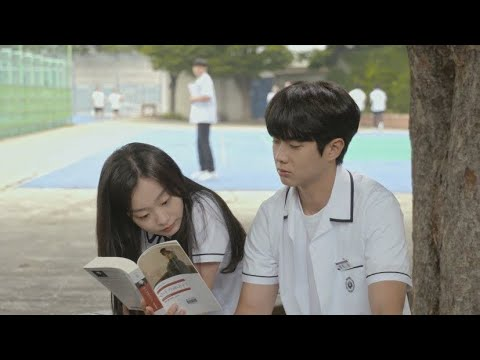
- 챕터: 0:00 인트로 · 0:19 wave to earth-seasons · 4:15 써니사이드-첫사랑 · 7:40 볼빨간사춘기- 사랑할 수밖에 · 11:22 에릭남, CHEEZE-사랑인가요 · 15:17 임현정-사랑은 봄비처럼…이별은 겨울비처럼… · 20:00 산이, 레이나-한여름밤의 꿀
- 설명 앞부분: 그 시절 나는 너를 정말 많이 사랑했던 거 알지? 영화 (만약에 우리) 중
- 대본 없음 (설명) — 음성인식이 끝나면 도입부·흐름이 들어감
- 댓글 491/491: 좋은 점 — 영상 5 · 감사·응원 21 · 더 알고 싶은 것 7 · 아쉬운 점 — 영상 3 · 반박·불만 — 의견 다름 7 · 정치·사회 0 · 경험 공유 164 · 구독·다음 기대 0
  - 좋은 점 — 영상 👍18 “고등학교때 만난 너에게 사랑을 배웠어 고마웠어”
  - 좋은 점 — 영상 👍0 “조금만 더 일찍 만났더라면.. 아니면 조금만 더 늦게 만났더라면.. 이 두 문장이 계속 머릿속에서 맴돈다. 우리 둘다 조금만 덜 성숙했을 때 만났더라면 아니면 우리 둘다 조금만 더 성숙해진 상태에서 만났다면 결과는 달라졌을까 하고 매일매일 생각해본다. 진짜 인연이 끝…”
  - 감사·응원 👍529 “진짜 많이 보고싶다. 내 고등학생 생활이 전부 너라서 너 말고는 아무것도 안보였던 시기엿어. 고등학교 동안 나한테 과분한 사랑 주고 항상 내 편이 되어줘서 너무너무 고마워 우리 성인되는 날에 같이 첫 술 마시자고 했었는데 기억나? 그 약속 이제는 못 지키겠다. 헤어질…”
  - 감사·응원 👍51 “여기 사람들 거의 다 전여친 전남친 얘기를 남겼네요 그래도 전 짝사랑인지 아니면 잠시라도 썸이었는지 모르는, 어쩌면 평생 모를 그 애에 대한 얘기를 해보려해요.. 우리 2024년 그때 꽤 친했었어 기억나? 처음 같은 반 된거였는데 너무 친해지는 바람에 애들은 다 우리…”
  - 더 알고 싶은 것 👍208 “여전히 잊지 못하였습니다. 당신이 나의 이상형이라서, 당신이 나의 첫사랑이라서, 끝난 관계임에도 나에게 잘 해줘서, 너무 착한 사람이라서, 귀여운 걸 본인만 몰라서, 허세 같은데 싫지 않은 적은 처음이라서, 영원을 약속하고 싶게 만든 사람이라서.. 이유는 수백 개 수…”
  - 더 알고 싶은 것 👍8 “저두 가슴이 미어지는 사랑을 해보고싶어용 이성적인 감정은 언제 생기는건가요? 아무리 봐두 친구로밖에 안느껴지는데…”
  - 아쉬운 점 — 영상 👍1 “하루도 빠짐없이 주지도 못하는 후회 아쉬움 반성이 담긴 편지를 쓰고 있어 언젠가는 줄수 있을까? 왜 하필 내가 미숙할때 너를 만나서 짧게 끝나버리게 만든걸까 그날의 내가 너무 원망스럽고 용서가 안된다 연락이라도 만회라도 해보고 싶어도 차단당해서 이젠 뭘 할수도 없어 …”
  - 아쉬운 점 — 영상 👍1 “내 고등학생 시절의 기억은 전부 너야 너는 알까 내가 얼마나 너를 사랑했는지 나를 사랑한다는 확신이 드는 눈으로 날 바라봐줘서 고마웠어 그 눈빛이 지금도 생각나 우리가 헤어진지 꽤나 오랜 시간이 지났는데 난 지금도 니가 보고싶다 아마 안 믿을 것 같아 사실 지금의 너…”
  - 반박·불만 — 의견 다름 👍2 “처음 중학교에 들어온 날, 반에 있던 너를 봤어 첫눈에 반했다는 말이 이건가 싶더라고 처음엔 너한테 말도 못 걸고 반친구 정도로 지냈어 어떨 때는 내 첫사랑이 이렇게만 끝날 것 같아서 조금 아쉽고 서운하기도 했지 그러다 조금씩 말도 하고 장난도 조금 칠 때쯤 너가 내…”
  - 반박·불만 — 의견 다름 👍1 “우리 2030년에 다시 만나기로 했잖아. 그래도 올 수 있다면 최대한 빨리 와줘. 정 안된다면 몇 달만이라도 일찍 와주면 안 돼? 내가 연말 좋아하는거 너도 잘 알잖아. 20살의 크리스마스는 너랑 보내고 싶어. 너가 나한테 헤어지자던 밤, 내가 시킨 모루 꽃다발 세트…”
  - 경험 공유 👍2,673 “야 보고싶어 내 생일에 연락 왜 안했냐 너 밥 한끼 더 좋은거 먹으라고 네가 기념일마다 줬던 토스 기프티콘 일부러 안 썼어 너한테 입금 됐냐 돈 하나도 안 아까운데 그냥 그렇다고 내 계좌 비밀번호 우리 만난 날이야 내 노트북 비밀번호도 우리 만난 날이야 훔쳐가도 되는…”
  - 경험 공유 👍1,132 “이 세상 단 둘만 가진 기억인데 아까워서 어떻게 잊나요 내가,”

### 43. Positive September 🍂 Relaxing Coffee Melody & Acoustic Chill Cafe ~ Indie/Pop/Folk/Acoust…

- https://www.youtube.com/watch?v=Bq4sPMz6fUk · Chill Moments · 구독자 4,420 · 조회수 1,333,813 (×301.8, 하루 27,167.9) · 좋아요 9,417 (0.7%) · 142.9분 · 2026-08-28 · 주제 묶음 4. 카페·매장·라운지 · 형식 플레이리스트·모음 (여러 곡) · 폴더 `W_Bq4sPMz6fUk` (웹 승인)
- 썸네일: 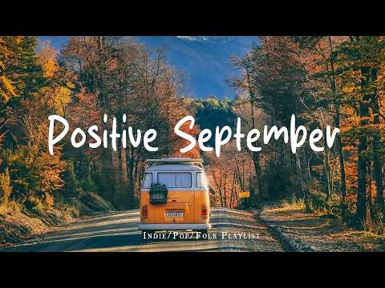
- 챕터: 0:00 There's a New Day - Staffan C… · 3:21 Wrong Team - Sture Zetterberg · 6:47 I Am Better Off (Acoustic Ver… · 10:12 Know Me - Las Lunas, Frigga · 14:15 Love Story - Velvet Moon · 17:27 I Remember - Dayon · 21:13 Running Circles - Cody Francis · 24:40 There He Goes - Loving Caliber · 27:43 I'm Dreaming Of You - Candeli… · 31:06 Sweet Embrace - Go For Howell… · 34:06 Fall into You - Houses On The… · 36:59 I Want You to Stay - Dayon, M… · 40:16 Today Is a Good Day to Live -… · 44:42 Bye Bye Love - Windshield · 48:16 Differently - Sture Zetterber… · 50:53 All Of The Time - Go For Howe… · 54:21 Faster Car (Acoustic Version)… · 58:08 The Concept Of You And I - La…
- 설명 앞부분: Positive September 🍂 Relaxing Coffee Melody & Acoustic Chill Cafe ~ Indie/Pop/Folk/Acoustic Playlist Positive September 🍂 Relaxing Coffee Melody & Acoustic Chill Cafe ~ Indie/Pop/Folk/Acoustic Playlist Positive September 🍂 Relaxing Coffee Melody & Acoustic Chill Cafe ~ Indie/Pop/Folk/Acoustic Playl…
- 대본 없음 (설명) — 음성인식이 끝나면 도입부·흐름이 들어감
- 댓글 98/98: 좋은 점 — 영상 1 · 감사·응원 0 · 더 알고 싶은 것 0 · 아쉬운 점 — 영상 0 · 반박·불만 — 의견 다름 0 · 정치·사회 0 · 경험 공유 0 · 구독·다음 기대 2
  - 좋은 점 — 영상 👍1 “음악이 듣기 좋아서 자주 놀러 와야 겠어요^^ 잘듣고 갑니다~~”
  - 구독·다음 기대 👍3 “시청하는 것만으로도 이미 나는 자유를 선물 받은 기분입니다. 정성가득하고 아름다운 자연의 풍광을 영상에 담아주셔서 잘 보고 갑니다. 좋아요, 구독하고 가요. 또 놀러올게용 ^^”
  - 구독·다음 기대 👍0 “구독하고가요”

### 44. Playlist 화장할 때 들으면 기분 째지는 2세대 플리

- https://www.youtube.com/watch?v=LtoVUe_-J18 · menow · 구독자 1,690 · 조회수 508,459 (×300.9, 하루 2,861.8) · 좋아요 4,762 (0.9%) · 20분 · 2026-04-21 · 주제 묶음 기타 · 형식 플레이리스트·모음 (여러 곡) · 폴더 `W_LtoVUe_-J18` (웹 승인)
- 썸네일: 
- 챕터: 0:00 ~ Brown Eyed Girls - Adracada… · 3:02 ~ T-ara- Bo Peep Bo Peep · 6:47 ~ SISTAR - 쏘쿨 · 10:09 ~ 애프터스쿨 -Diva · 13:28 ~ 걸스데이 - 반짝반짝 · 16:34 ~ 카라 - Step
- 설명 앞부분: 음원으로 인한 수익은 발생하지 않습니다. No revenue is generated from the music used in this video. 𖤐TIME LINE𖤐
- 대본 없음 (설명) — 음성인식이 끝나면 도입부·흐름이 들어감
- 댓글 42/42: 좋은 점 — 영상 1 · 감사·응원 2 · 더 알고 싶은 것 0 · 아쉬운 점 — 영상 0 · 반박·불만 — 의견 다름 0 · 정치·사회 0 · 경험 공유 0 · 구독·다음 기대 0
  - 좋은 점 — 영상 👍1 “이건 진짜 레전드다. 이거 듣고 밤샘 작업했어요 잠이 다 날라감”

### 45. 난 아직 어린데

- https://www.youtube.com/watch?v=Zo3DsQ9j2J0 · 맹묘 · 구독자 1,580 · 조회수 459,506 (×290.8, 하루 3,609.7) · 좋아요 22,102 (4.8%) · 20.1분 · 2026-06-11 · 주제 묶음 기타 · 형식 플레이리스트·모음 (여러 곡) · 폴더 `W_Zo3DsQ9j2J0` (웹 승인)
- 썸네일: 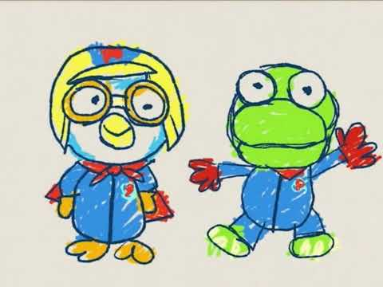
- 대본 없음 (없음) — 음성인식이 끝나면 도입부·흐름이 들어감
- 댓글 990/990: 좋은 점 — 영상 11 · 감사·응원 105 · 더 알고 싶은 것 6 · 아쉬운 점 — 영상 4 · 반박·불만 — 의견 다름 6 · 정치·사회 2 · 경험 공유 208 · 구독·다음 기대 0
  - 좋은 점 — 영상 👍2 “나 왜 아름다운 세상 가사를 까먹지 않은걸까? 유치원에서 배웠던건데”
  - 좋은 점 — 영상 👍0 “초등학생 5학년 학생입니다 전 중학교를 아이들이 많이 안 가는데를 지망하려는데 거기 가서 새학기때 저 빼고 다 놀고있고 아는애 없어서 뻘쭘해하는 애라도 친구하고 싶은데 없을까 걱정이 되고 그냥..지금 이런 인간관계가 맞을까 생각도들고 시험점수는 망했고 20살 되서 취…”
  - 감사·응원 👍63 “평생 10대 학생일줄알았는데 성인까지 반년도 안남은 고3이네요 다들 과거를 그리워하고 지금의 나보다 나은 내가 되길 원하지만 사실 지금의 모습이 가장 성공한, 행복한 나의 모습일거에요 오늘조차도 또다른 나의 과거가 될것이기에 우리 모두 힘내죠”
  - 감사·응원 👍58 “그냥 너무 힘들어.. 엄마아빠가 힘들면 쉬라고 하지만 현실적으로 쉴 수가 없잖아...공부해야지. 친화력도 떨어지고, 말재주도 없고, 예체능도 못하는데 어쩌겠어.. 앞으로 뭐해먹고 살아야 할지 막막하다. 남들 앞에서는 괜찮은 척하지만.. 너무 힘들어 누구한테 털어놓아야…”
  - 더 알고 싶은 것 👍2 “중학교에 입학한게 엊그제 같은데 벌써 고등학교를 준비하고 있네요 저는 고등학교도 멀다고 생각했고 성인은 더더욱 멀게 느껴져서 평생을 학생으로 살거라 막연히 생각했던 것 같아요 그런데 문득 저에게 학생으로 남을 시간이 4년밖에 남지 않았단걸 느끼니까 무서운게 많아졌어요…”
  - 더 알고 싶은 것 👍1 “하…. 궁금해서 눌렀는데 난 왜 울고있는거야..?”
  - 아쉬운 점 — 영상 👍632 “현재 08년생 입니다.. 벌써 마지막 10대의 절반이 지났다는게 믿겨지지 않네요. 어릴때 저녁밥 먹기 전 동네 친구들과 술래잡기 하던게 엊그제 같은데 저에겐 항상 멀게만 느껴졌던 20대라는 현실을 곧 마주할 생각을 하니 솔직히 현실감이 없습니다.. 아직 추억도 많이 …”
  - 아쉬운 점 — 영상 👍0 “순수한 어린 아이 같은 목소리가 너무 슬프게 느껴진다...ㅋㅋ”
  - 반박·불만 — 의견 다름 👍1 “나는 아직 중학생도아닌데 왜 미래를 걱정하고있지 난 그냥 엄마 아기 하고싶은데 엄마랑 이나이 그대로 계속 살아가고싶은데 평생 엄마 옆에있고싶은데”
  - 반박·불만 — 의견 다름 👍0 “진짜 자살하고 싶다.나 왜살지 기쁜척,괜찮은척,행복한척하면 뭐해, 진짜 척인데. 진짜 내가 아닌데.”
  - 정치·사회 👍6 “어렸을 땐 우리나라가 왜 청소년 자살율 1위 국가인지 이해조차 못했었는데, 고2가 된 지금 그 이유를 알 것 같다. 세상은 어린 친구들에게 너무 많은 선택을 요구하고, 고등학교에서의 짧은 3년, 아직 내가 뭘 좋아하고 뭘 잘하는지 모를지도 모르는 시기에 앞으로의 60…”
  - 정치·사회 👍0 “이선 성우님은 정말 대통령이 맞다”
  - 경험 공유 👍2,513 “내가 왜 고3일까… 평생 안 올 줄 알았는데 ㅠㅠㅠㅠ 뽀로로 너랑 걱정없이 놀 때가 너무 그리워…”
  - 경험 공유 👍1,898 “뉴스에서 고등학생 자살율 얘기할때 진짜 이해 안됐는데 막상 고등학생 되니까 내가 그 경계에 서있네”

### 46. [커버곡] 가는세월 🎧 락발라드로 다시 태어난 불후의 명곡 🎶두둥치 DUDUNGCHI

- https://www.youtube.com/watch?v=0J4iOmTGAgo · 두둥치 · 구독자 255 · 조회수 70,711 (×277.3, 하루 451.7) · 좋아요 375 (0.5%) · 4.2분 · 2026-05-12 · 주제 묶음 9. 가요·발라드·트로트 · 형식 커버·직접 부른 노래 · 폴더 `W_0J4iOmTGAgo` (웹 승인)
- 썸네일: 
- 설명 앞부분: 🎧 이 곡은 음원으로도 들을 수 있습니다 YouTube Music · Apple Music · Spotify에서 [두둥치] 검색 🎶 두둥치 (DUDUNGCHI) 채널에 오신 걸 환영합니다! 쟝르를 넘나드는 감성 음악 채널입니다. K-pop, R&B, 재즈, 발라드, 힙합, 트로트, 동요까지 제작 기업홍보송, CM송, 선거홍보송, 응원가, 주제가 제작 특별한 순간들로 가득한 힐링 음악 채널 🎵 [커버곡] 가는세월 🎧 락발라드로 다시 태어난 불후의 명곡 🎶두둥치 DUDUNGCHI
- 대본 없음 (설명) — 음성인식이 끝나면 도입부·흐름이 들어감
- 댓글 26/26: 좋은 점 — 영상 0 · 감사·응원 1 · 더 알고 싶은 것 1 · 아쉬운 점 — 영상 0 · 반박·불만 — 의견 다름 0 · 정치·사회 0 · 경험 공유 1 · 구독·다음 기대 0
  - 감사·응원 👍0 “감도밉니다고맙습니다”
  - 더 알고 싶은 것 👍1 “구독!!! 좋은곡 많이 부탁드립니다”

### 47. "수고했어..오늘은 푹 자! 😴 마음을 편하게 해주는 피아노 수면음악 (10 Hours)

- https://www.youtube.com/watch?v=3br0mkww4do · jazzyang 재즈냥 · 구독자 1,370 · 조회수 378,436 (×276.2, 하루 4,162.5) · 좋아요 1,981 (0.5%) · 616.6분 · 2026-07-17 · 주제 묶음 1. 수면·명상·힐링 · 형식 플레이리스트·모음 (여러 곡) · 폴더 `W_3br0mkww4do` (웹 승인)
- 썸네일: 
- 설명 앞부분: 🌙 오늘도 정말 수고하셨습니다. 복잡했던 하루를 내려놓고, 편안한 피아노 선율과 함께 깊은 휴식을 가져보세요. 잠들기 전, 명상, 휴식, 공부 후 힐링, 스트레스 완화에 함께해 보세요. 오늘은 아무 걱정 없이 푹 쉬세요. 편안한 밤 되시길 바랍니다. 🤍 Take a deep breath, let go of the day, and relax with the gentle sound of soft piano music. This 10-hour sleep music playlist is designed to help calm your m…
- 대본 없음 (설명) — 음성인식이 끝나면 도입부·흐름이 들어감
- 댓글 91/91: 좋은 점 — 영상 0 · 감사·응원 3 · 더 알고 싶은 것 0 · 아쉬운 점 — 영상 0 · 반박·불만 — 의견 다름 0 · 정치·사회 0 · 경험 공유 0 · 구독·다음 기대 1
  - 감사·응원 👍10 “틀어놓고 오랫만에 밤새 꿀잠을 잤네요. 감사합니다.😊”
  - 감사·응원 👍7 “브라질에서 연락 주셨네요, 감사합니다! 🤗🇧🇷🇰🇷”
  - 구독·다음 기대 👍5 “정말 좋은 음악 입니다 구독하고 응원 합니다~”

### 48. [ Playlist ] 어떻게 너가 다른 남자를 만나

- https://www.youtube.com/watch?v=0USEQaYCf78 · 하온 · 구독자 1,700 · 조회수 462,610 (×272.1, 하루 5,714.2) · 좋아요 4,019 (0.9%) · 20.9분 · 2026-07-27 · 주제 묶음 기타 · 형식 플레이리스트·모음 (여러 곡) · 폴더 `W_0USEQaYCf78` (웹 승인)
- 썸네일: 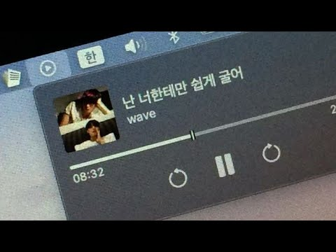
- 챕터: 0:00 릴러말즈 - 거리에서 · 3:28 WINNER - 끼부리지마 · 6:52 범키 - 갖고놀래 · 10:30 태산 - 네가 생각난단 말이야 (자작곡) · 13:19 basecamp - camp · 17:01 디핵 - OHAYO MY NIGHT
- 설명 앞부분: 그냥 내 스타일 대로 함 만들어봐써.. 😳
- 대본 없음 (설명) — 음성인식이 끝나면 도입부·흐름이 들어감
- 댓글 48/48: 좋은 점 — 영상 1 · 감사·응원 0 · 더 알고 싶은 것 0 · 아쉬운 점 — 영상 0 · 반박·불만 — 의견 다름 0 · 정치·사회 0 · 경험 공유 0 · 구독·다음 기대 0
  - 좋은 점 — 영상 👍14 “아니 와 완전 야르한 플리.. ㄹㅇ 레전드 플리 찾은 거 같아서 기분 개좋음”

### 49. 𝐏𝐥𝐚𝐲𝐥𝐢𝐬𝐭 l 연모(戀慕)

- https://www.youtube.com/watch?v=uVbmoXg5YvI · 미니악단 · 구독자 643 · 조회수 174,180 (×270.9, 하루 1,509.1) · 좋아요 4,378 (2.5%) · 69분 · 2026-06-23 · 주제 묶음 3. 공부·집중·작업 · 형식 플레이리스트·모음 (여러 곡) · 폴더 `W_uVbmoXg5YvI` (웹 승인)
- 썸네일: 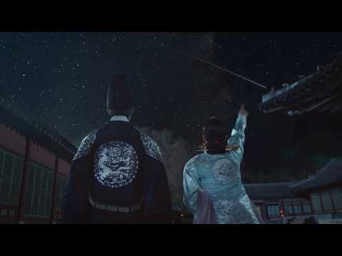
- 설명 앞부분: 연모(戀慕) : 사랑하여 간절히 그리워함. Photo Credit : Pinterest 당신을 위한 플레이리스트[Palylist]
- 대본 없음 (설명) — 음성인식이 끝나면 도입부·흐름이 들어감
- 댓글 88/88: 좋은 점 — 영상 0 · 감사·응원 1 · 더 알고 싶은 것 1 · 아쉬운 점 — 영상 0 · 반박·불만 — 의견 다름 1 · 정치·사회 0 · 경험 공유 4 · 구독·다음 기대 0
  - 감사·응원 👍0 “잘들을께요 ❤❤❤화이팅”
  - 더 알고 싶은 것 👍0 “연을 역으로 바꾼 버전도 만들어 주세요”
  - 반박·불만 — 의견 다름 👍132 “-내가 약조하마.너를 지켜주겠다고. 그렇게 다정히 말씀하시던 든든한 나의 님은, 지금 풀숲에 쓰러져 간신히 숨만 내쉬고 계신다. -상공, 제발 숨만 쉬십시오. 제가 어떻게든... -연화야. 상공의 손이 나의 손은 따스히 잡아온다.그 온기가 서글프도록 따뜻해서, 심장 …”
  - 경험 공유 👍132 “-내가 약조하마.너를 지켜주겠다고. 그렇게 다정히 말씀하시던 든든한 나의 님은, 지금 풀숲에 쓰러져 간신히 숨만 내쉬고 계신다. -상공, 제발 숨만 쉬십시오. 제가 어떻게든... -연화야. 상공의 손이 나의 손은 따스히 잡아온다.그 온기가 서글프도록 따뜻해서, 심장 …”
  - 경험 공유 👍5 “무조건 내가 가고싶은 극 상향 학교만 다 합격, 최초합격해라…. 한번만 내 소원을 들어주길”

### 50. 탈북할 때 듣는 플리

- https://www.youtube.com/watch?v=rrgoyhVFJ68 · 비둘기 · 구독자 2,920 · 조회수 757,408 (×259.4, 하루 9,980.4) · 좋아요 31,224 (4.1%) · 57.6분 · 2026-08-01 · 주제 묶음 기타 · 형식 플레이리스트·모음 (여러 곡) · 폴더 `W_rrgoyhVFJ68` (웹 승인)
- 썸네일: 
- 챕터: 0:00 프라이머리 - 자니 · 3:53 리쌍 - 헤어지지 못하는 여자, 떠나가지 못하는 남자 · 8:37 비오 - 네가 없는 밤 · 12:25 산이 - Me You · 15:54 허각, 지아 - I Need You · 19:37 긱스 - Officially Missing You · 23:07 프라이머리 - ? · 26:22 박경 - 보통연애 · 30:13 빈지노 - Aqua Man · 34:00 에픽하이 - 연애소설 · 37:57 우원재 - 시차 · 41:13 지코 - 걘 아니야 · 44:50 릴러말즈 - 하지마 · 47:05 TOIL - 검정색하트 · 51:01 ASH ISLAND - 멜로디 · 54:03 숀 - Way Back Home
- 대본 없음 (없음) — 음성인식이 끝나면 도입부·흐름이 들어감
- 댓글 1,536/1,536: 좋은 점 — 영상 6 · 감사·응원 73 · 더 알고 싶은 것 16 · 아쉬운 점 — 영상 8 · 반박·불만 — 의견 다름 9 · 정치·사회 29 · 경험 공유 23 · 구독·다음 기대 3
  - 좋은 점 — 영상 👍4 “30:27 압록강 넘어갈때 듣기 좋을듯”
  - 좋은 점 — 영상 👍3 “새벽에 듣기 좋은 플리”
  - 감사·응원 👍252 “이 플리 듣고 자전거 타면서 수많은 지뢰를 피해서 겨우 탈북했네요~감사합니다 근데.. 앞에 누가 총을 들고있네요?”
  - 감사·응원 👍48 “덕분에 수용소에 갇혀있습니다 감사합니다.”
  - 더 알고 싶은 것 👍3 “동무들이 노래차림표를 추천해주길래 한번 찾아와봤습네다. 아주 좋습네다.”
  - 더 알고 싶은 것 👍1 “썸넬이랑 제목보고 대체 무슨노래인지 궁금해서 들어옴”
  - 아쉬운 점 — 영상 👍0 “어그로 미쳤네 ㅅㅂㅋㅋㅋㅋ”
  - 아쉬운 점 — 영상 👍0 “왜 노래가 평범하지...? 탈북예정인데 실망스럽네...”
  - 반박·불만 — 의견 다름 👍91 “탈북할 땐 어떤 노래를 듣는걸까 하고 왔는데 첫곡듣고 어이없어서 터졌네 ㅋㅋㅋㅋ 무슨 관련이야”
  - 반박·불만 — 의견 다름 👍14 “진짜 존나 웃겨서 말도 안나옴 ㅋㅋㅋㅋㅋㅋㅋㅋㅋ... 새벽 두시에 이거 보고 혼자 쪼개고있는 내가 한심하다 너무 내 취향인데 어캄 아시발진짜”
  - 정치·사회 👍2 “이재명 ㅇㄷ??”
  - 정치·사회 👍2 “이재명이랑 민주당이랑 문재인얼굴은 안들어간거 깨네 ㅋㅋ”
  - 경험 공유 👍14 “진짜 존나 웃겨서 말도 안나옴 ㅋㅋㅋㅋㅋㅋㅋㅋㅋ... 새벽 두시에 이거 보고 혼자 쪼개고있는 내가 한심하다 너무 내 취향인데 어캄 아시발진짜”
  - 경험 공유 👍1 “자니 (Three Dictators Remix)(Intro) (전화 신호음... 뚜르르르...) 정은: 여보세요? 어, 진핑아. 나와 정은: 어 푸틴이랑 같이 있어 지금 정은: 아냐 우리끼리 핵이나 한잔 하지 뭐 소박하게 정은: 벙커? 에이, 너 가면 또 잠들 거잖아…”
  - 구독·다음 기대 👍1 “진지하게 매일 듣고 있다”
  - 구독·다음 기대 👍0 “광고도 별로 없고 옛날 노래만 모아놔서 향수 뿜뿜 불러오네요.. 학생때 알바할때 많이 들었었는데... 노동요로 듣는데 예전 감성 소환되고 좋네요~ 바둘기는 안좋아하지만 ㅎㅎ 구독하고 가요 ㅎ”

### 51. [Playlist] 드라마 OST 모음

- https://www.youtube.com/watch?v=h_2uk2pTQQA · playlistsilyalp · 구독자 771 · 조회수 198,515 (×257.5, 하루 4,057.2) · 좋아요 3,958 (2.0%) · 17.5분 · 2026-08-28 · 주제 묶음 13. OST·사운드트랙 · 형식 플레이리스트·모음 (여러 곡) · 폴더 `W_h_2uk2pTQQA` (웹 승인)
- 썸네일: 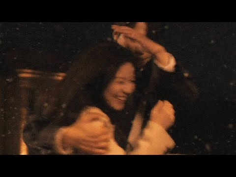
- 대본 없음 (없음) — 음성인식이 끝나면 도입부·흐름이 들어감
- 댓글 17/17: 좋은 점 — 영상 1 · 감사·응원 0 · 더 알고 싶은 것 0 · 아쉬운 점 — 영상 0 · 반박·불만 — 의견 다름 0 · 정치·사회 0 · 경험 공유 0 · 구독·다음 기대 1
  - 좋은 점 — 영상 👍2 “공부할때 듣기좋네용ㅇ..집중잘됨”
  - 구독·다음 기대 👍1 “진짜 플리가 갓벽 그 잡채다,,🫪♥️ 오늘부터 구독했어요 이거 지우지 마세요ㅜ🥺💗”

### 52. 별일 없던 하루였는데, 괜히 마음이 시끄러운 밤

- https://www.youtube.com/watch?v=mc73qn75vMs · 리듬다방(김리다) · 구독자 1,360 · 조회수 341,118 (×250.8, 하루 2,646.3) · 좋아요 1,206 (0.4%) · 7.5분 · 2026-06-09 · 주제 묶음 기타 · 형식 음악 (그 밖 모양 — 한 편짜리 BGM 등) · 폴더 `W_mc73qn75vMs` (웹 승인)
- 썸네일: 
- 설명 앞부분: 🎵 취한다 술이 취하게 하는 게 아냐, 생각이 취하게 하네. 별일 없던 하루였는데 괜히 마음이 시끄러운 밤. 누구나 말 못 할 사연 하나쯤 품고 살아가듯, 오늘도 또 하루를 버텨낸 당신에게 이 노래를 전합니다. 🎧 AI를 활용하여 제작한 창작 음악입니다. 📱 틱톡 · 유튜브에서 "리듬다방"을 검색하시면 더 많은 음악을 만나보실 수 있습니다. Navigating emotional uncertainty when things feel confusing. Explore the feeling of being new to love even …
- 대본 없음 (설명) — 음성인식이 끝나면 도입부·흐름이 들어감
- 댓글 207/207: 좋은 점 — 영상 2 · 감사·응원 19 · 더 알고 싶은 것 4 · 아쉬운 점 — 영상 0 · 반박·불만 — 의견 다름 0 · 정치·사회 0 · 경험 공유 6 · 구독·다음 기대 1
  - 좋은 점 — 영상 👍5 “음악도 좋지만 가사가 마음에 와닿는군요 대박나세요 🎉🎉🎉🎉🎉❤❤❤❤❤”
  - 좋은 점 — 영상 👍1 “너무듣기좋아요👍👍잘듣고갑니다❤❤”
  - 감사·응원 👍13 “안녕하세요. 저는 이제 막 시작한 작은 음악방송을 운영하고 있습니다. 시청자의 신청으로 '취한다'를 방송에서 소개하게 되었는데, 혹시 방송에서 해당 음악(또는 관련 영상)을 함께 송출해도 괜찮을지 여쭤보고 싶어 연락드렸습니다. 혹시 원하지 않으시거나 방송에서의 사용이…”
  - 감사·응원 👍4 “다방님 하루빨리 여러곳에서 들을수 있고 부을수 있었으면 참 좋겠습니다 화이팅”
  - 더 알고 싶은 것 👍1 “컬러링도되나요?”
  - 경험 공유 👍6 “우리집대장이 두달전에 하늘나라로가셨는데 제 마음을 이야기하는것같아요 노래듣고 매일 웁니다 생각이나고 그리워서”
  - 경험 공유 👍3 “내가 하고 싶은 얘기들을 들려주고 있네요 😢”
  - 구독·다음 기대 👍0 “노래넘좋아요ㆍ구독완료”

### 53. 우리들의 발라드2 1회 플레이리스트｜가을밤 마음을 울린 발라드 7곡 #우리들의발라드 #우발2

- https://www.youtube.com/watch?v=wPEmG4xfTLE · 우낄라꼬 · 구독자 1,190 · 조회수 298,206 (×250.6, 하루 33,592.6) · 좋아요 864 (0.3%) · 30.4분 · 2026-10-07 · 주제 묶음 9. 가요·발라드·트로트 · 형식 플레이리스트·모음 (여러 곡) · 폴더 `W_wPEmG4xfTLE` (웹 승인)
- 썸네일: 
- 챕터: 0:00 사랑 그 쓸쓸함에 대하여 - 김소연 (원곡: 양희은) · 5:25 난치병 - 이민우 (원곡: 하림) · 9:09 안 되나요 - 허채민 (원곡: 휘성) · 13:45 이별 여행 - 민지유 (원곡: 원미연) · 17:48 세상이 그대를 속일지라도 - 한로이 (원곡: 김장훈) · 22:33 기도 - 라유정 (원곡: 정일영) · 25:49 김성호의 회상 - 임바다 (원곡: 김성호)
- 설명 앞부분: 우리들의 발라드2 1회 무대에서 불린 발라드 일곱 곡을 한 번에 이어 듣는 플레이리스트입니다. 가을밤 혼자 듣기 좋은 노래들로 채웠습니다. 🎵 TRACK LIST SBS 우리들의 발라드2ㅣ매주 월요일 밤10시
- 대본 없음 (설명) — 음성인식이 끝나면 도입부·흐름이 들어감
- 댓글 63/63: 좋은 점 — 영상 1 · 감사·응원 13 · 더 알고 싶은 것 0 · 아쉬운 점 — 영상 2 · 반박·불만 — 의견 다름 0 · 정치·사회 0 · 경험 공유 1 · 구독·다음 기대 0
  - 좋은 점 — 영상 👍22 “울 김소연님 응원합니다.! 김소연님 끝음에서 'The saddest Thing'의 멜라니샤프카 가수가 넘 생각났어요. 쓸쓸하면서 덤덤한 표정은 '양하영'님도 생각나고...;;; 그 분위기와 목소리로 레전드 노래 많이 불러주시길요~!!”
  - 감사·응원 👍38 “소연양 밖에 생각이 안남 우승까지 쭉~응원합니다 ❤❤❤”
  - 감사·응원 👍27 “한로이 노래듣고 50넘은 아줌마가 눈물펑펑.ㅜㅜㅜㅜ 최고이고 위로가 되는곡 너무 감사해요. 로이군 응원합니다. 꼭 1등하길 바래요.”
  - 아쉬운 점 — 영상 👍11 “로이님 노래만 무한반복이네요 넘좋네요”
  - 아쉬운 점 — 영상 👍5 “임바다님 음색짱..무한반복중이요”
  - 경험 공유 👍1 “우리들의 발라드2 끝나고 자동반사적으로 유튜브채널 소연양의 노래 찾아 봤어요 처음 듣는 그순간 저도 모르게 가슴속에서 올라오는 울컥하는 감정을 주채 할 수없었네요 그냥 소연양의 노래 한 소절 한 소 절이 홀로느꼈을 외로움과 쓸쓸함 속에서 음악을 통해서 자신만의 카타르…”

### 54. [𝙥𝙡𝙖𝙮𝙡𝙞𝙨𝙩] 삶에 무뎌지는 법

- https://www.youtube.com/watch?v=8KGuQMhnb14 · 꾹팅 · 구독자 1,220 · 조회수 297,201 (×243.6, 하루 2,289.2) · 좋아요 0 (0.0%) · 19.4분 · 2026-06-08 · 주제 묶음 기타 · 형식 플레이리스트·모음 (여러 곡) · 폴더 `W_8KGuQMhnb14` (웹 승인)
- 썸네일: 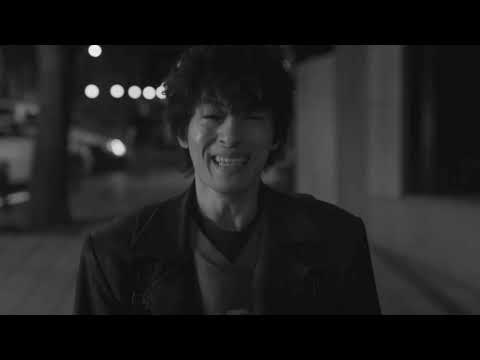
- 챕터: 0:00 03:36 서영주 of 너드커넥션 ∣ 나란한 밤 · 3:39 07:05 한강 ∣ 언젠가 이 슬픔도 사라지겠지 · 7:07 11:18 선우정아 ∣ 보통사람 · 11:19 15:36 sondia ∣ 어른 · 15:37 19:16 이무진 ∣ 쉼표
- 설명 앞부분: 📍 수익을 창출하지 않습니다. ∣ No monetization
- 같은 채널 평소 대비 ×58.9 (채널 최근 롱폼 중앙값 5,050회) · 평소 영상: [𝙥𝙡𝙖𝙮𝙡𝙞𝙨𝙩] 나 아직 너 보고싶어 (6,770회) / [𝙥𝙡𝙖𝙮𝙡𝙞𝙨𝙩] 이별에도 인연이 있었음을 (3,330회)
- 대본 없음 (설명) — 음성인식이 끝나면 도입부·흐름이 들어감
- 댓글 363/363: 좋은 점 — 영상 5 · 감사·응원 51 · 더 알고 싶은 것 5 · 아쉬운 점 — 영상 3 · 반박·불만 — 의견 다름 8 · 정치·사회 0 · 경험 공유 103 · 구독·다음 기대 0
  - 좋은 점 — 영상 👍0 “아직 16년 밖에 안살았는데 살아보니까 이세상 어떻게 살라는거야 진짜.. 진짜 진짜 용기내고 싶어요 늘 내가 용기 낸건 나를 갉아 먹는거였는데 이번만 맘을 굳게 먹으면 앞으로 편해 지지 않을까 아직 어려서 뭘 모른다 이런말 듣기 싫어 나도 알아 보여 너네가 날 어린아…”
  - 좋은 점 — 영상 👍0 “진실.거짓.진심. 사이에서.. 나는 진실된 답을 원하는걸까. 거짓된답을 원하는걸까.. 아니면 진심이 담긴 답을 원하는걸까. 그 어떤 답이 나에게 도움이 될까. 살아갈 힘을 쥐여줄까. ...어떤 이들은 그러더라. 진심.진실.거짓 모든것을 원하는 내가 욕심쟁이고 모순된 …”
  - 감사·응원 👍65 “어른이 되는게 너무 무서워서 매일 하루하루가 초조하고 급박하고 숨막혀요...아직 제대로 잘 하는것도 없는데 이 상태로 어른이 되었다간 나랑 내 주변이 너무 힘들어할 것 같아요. 어떻게 해야하는지 모르겠어요. 너무 힘들어서 그만하고 싶어요... 삶이 너무 버거워서 하교…”
  - 감사·응원 👍14 “요즘 너무 힘들고 지치고 우울합니다 밤이 왜 이렇게 긴지 잘 모르겠습니다 이제는 제가 뭘 싫어하는지 좋아하는지 잘 모르겠습니다 왜 이런 일이 저한테 온 건지 잘 모르겠습니다 삶이 진짜 치지고 우울하고 힘듭니다 죽기에는 너무 젊고 울기에는 너무 나이가 들엇네요 언젠간 …”
  - 더 알고 싶은 것 👍56 “어릴 땐 어른이 부러웠습니다. 아무거나 다 할 수 있는. 하지만 정작 어른이 된 저는 삶에 휩쓸려 무뎌지고 부서진, 그런 사람이라는 걸 깨닫게 되었습니다. 우리 다시 돌아갈 수 있을까요? 아무 걱정 없이, 아무 생각도 안 하는 그때로”
  - 더 알고 싶은 것 👍1 “도저히 지금 제가 무엇이 필요한지, 어떤 말이 필요한지, 애초에 뭐가 필요하긴 한건지 그 어떤 것도 감이 안 와 댓글 달아요. 일단 저는 지금 고등학교 2학년 입니다. 곧 3학년 올라가는. 저는 초등학교 6학년 때부터 꿈이 확고했거든요. 나중에 커서 음악하는 사람이 …”
  - 아쉬운 점 — 영상 👍6 “아프지말라는 뻔한 위로보다 많이 아프냐고 물어봐줬으면 좋겠다”
  - 아쉬운 점 — 영상 👍0 “저 중2학생인데요 사춘기인지 중2병인지 잘은 모르겠지만 너무 힘드네요 한부모가정이라 더 남들과 비교하게되고 공부로 인한 스트레스도 그 누구도 주지 않지만 그냥 힘들어요 손목에 상처 낼 자신은 없어서 항상 팔에 하고 종아리에만 상처를 내고 있고 이제는 상처가 나도 무뎌…”
  - 반박·불만 — 의견 다름 👍47 “왜 우리는 아는 사람들에게 위로받지 못하고 모르는 사람들에게 인터넷상에서 위로를 받는 걸까요 힘들다고 말하는 게 부끄러운 것도 아닌데 다른 사람들의 댓글을 보며 와.. 이런 사람들도 있구나 저런 사람들에 비하면 나는 행복한 거구나..라고 위안 삼으며 다시 또 지옥같이…”
  - 반박·불만 — 의견 다름 👍9 “그냥 평소와 같은 상황인데 반항을 하고 싶었나봐요…. 그냥 아무말도 안하고 그냥 말하는 것도 듣지도 않았어요 저도 왜이러는지 모르겠어요”
  - 경험 공유 👍1,069 “요즘 옥상문이 잠겨있네요 더워서 그런가 벌써 네 건물 가봤는데 잠겨서 죽고싶은데 마음데로 죽지도 못하네요 얼마전에 울다가 깨닳았어요 아 나 안죽고싶은데.. 내가 죽고싶은게 아니라 지금이 너무 힘들어서 차라리 죽고싶은거구나 아 행복해지고 싶은거구나 죽고싶은게 아니라 행…”
  - 경험 공유 👍324 “차라리 내가 조금만 더 무감각해서 느끼지 못했으면 좋겠다”

### 55. [PLAYLIST] 할머니가 돼서도 들을 노래

- https://www.youtube.com/watch?v=Oomy8ijLJxQ · 당무 · 구독자 2,590 · 조회수 574,363 (×221.8, 하루 3,613.1) · 좋아요 10,750 (1.9%) · 23.7분 · 2026-05-10 · 주제 묶음 기타 · 형식 플레이리스트·모음 (여러 곡) · 폴더 `W_Oomy8ijLJxQ` (웹 승인)
- 썸네일: 
- 챕터: 0:00 4:35 Perhaps Love · 4:36 9:23 Wish Ur My Love · 9:26 12:38 baby baby · 12:38 15:45 아쉬운 마음인걸 · 15:48 19:08 To You Of Mine · 19:11 23:27 Habbit (Bye Bye)
- 대본 없음 (없음) — 음성인식이 끝나면 도입부·흐름이 들어감
- 댓글 131/131: 좋은 점 — 영상 3 · 감사·응원 9 · 더 알고 싶은 것 0 · 아쉬운 점 — 영상 0 · 반박·불만 — 의견 다름 0 · 정치·사회 0 · 경험 공유 6 · 구독·다음 기대 0
  - 좋은 점 — 영상 👍25 “아쉬운마음인걸이 ㅈㅉ 레전드”
  - 좋은 점 — 영상 👍0 “안녕하세요 당무님 도덕 선플챌린지하는 동화중학교 1학년입니다.저는 늘 공부할때 음악을 듣는편인데요 그럴때마다 맨날 무슨 노래를 들어야되지라고 늘 고민하는데요 그래도 맨날 당무님이 만드신 플레이리스트를 선택하게 되는것같아요!바쁜시간 쪼개시면서 늘 좋은노래 알려주셔서 감…”
  - 감사·응원 👍39 “서민정씨 너무 귀여워용 ㅋㅋ 90년대생들 힘내라아”
  - 감사·응원 👍38 “2006년 고1 소풍날, 옆반 친구가 쥐여준 과자 한 봉지가 고백이 될 줄은 몰랐습니다. 어색하고 떨리는 마음에 창밖만 바라보는데 시간이 참 느리게 흘러가더라고요. 소풍 내내 같이 다니면서 하얀 줄의 아이리버 이어폰을 나눠 꼈던 그날. 귓가에 울리던 'Perhaps …”
  - 경험 공유 👍28 “12:38 나오자마자 제일 소름돋음 내가 이 노래를 잊고 살았네...”
  - 경험 공유 👍4 “와...진짜 제가 다 좋아하는 노래네요ㅠㅠ 감사합니다..! 잊고 살았는데🥲”

### 56. 𝐏𝐥𝐚𝐲𝐥𝐢𝐬𝐭 틀기만 해도 기분이 좋아지는 플리☀️🌿 (광고없음) 국내 노래 모음

- https://www.youtube.com/watch?v=mg5OWdP3DL8 · 오늘의 플리 · 구독자 6,700 · 조회수 1,473,817 (×220.0, 하루 22,899.7) · 좋아요 3,529 (0.2%) · 603.4분 · 2026-08-13 · 주제 묶음 기타 · 형식 플레이리스트·모음 (여러 곡) · 폴더 `W_mg5OWdP3DL8` (웹 승인)
- 썸네일: 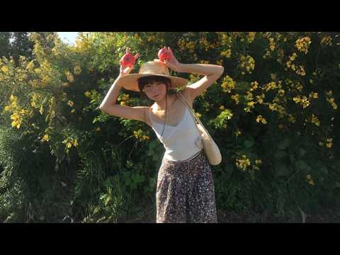
- 대본 없음 (없음) — 음성인식이 끝나면 도입부·흐름이 들어감
- 댓글 150/150: 좋은 점 — 영상 3 · 감사·응원 7 · 더 알고 싶은 것 16 · 아쉬운 점 — 영상 1 · 반박·불만 — 의견 다름 0 · 정치·사회 0 · 경험 공유 3 · 구독·다음 기대 0
  - 좋은 점 — 영상 👍108 “안녕하세요, 오늘의 플리님! 저는 도덕 수업에서 선플 달기 활동을 하고 있는 중1 학생입니다. 영상 정말 잘 보고 있어요. 항상 좋은 영상 올려주셔서 감사합니다. 좋은 하루 보내세요”
  - 좋은 점 — 영상 👍1 “모처럼...가사가 귀에 잘들어와요. 평화로운 느낌이예요. 기분이 좋아졌어요~^^😊”
  - 감사·응원 👍108 “안녕하세요, 오늘의 플리님! 저는 도덕 수업에서 선플 달기 활동을 하고 있는 중1 학생입니다. 영상 정말 잘 보고 있어요. 항상 좋은 영상 올려주셔서 감사합니다. 좋은 하루 보내세요”
  - 감사·응원 👍9 “힐링되네요 감사합니다”
  - 더 알고 싶은 것 👍15 “노래 제목 부탁드립니다 아재라서 하나도 몰라요 ㅜㅡㅜ 40중반 아저씨의 간곡한 부탁입니다 ~!!!”
  - 더 알고 싶은 것 👍8 “전체 플레이이스트 알순없나요~? 너무 노래 좋아요. 가수라도 알고싶어요”
  - 아쉬운 점 — 영상 👍0 “같은노래반복되는거아님??”
  - 경험 공유 👍11 “두번째곡 3:10 창문을 열면 하얀 바람이 들어와 어제의 마음도 조용히 불었나 발끝에 닿는 따뜻한 먼지 위로 이름 모를 설렘이 슬쩍 번져 가 자꾸만 멀어지던 내 그림자도 오늘은 가볍게 내 옆을 걷고 손끝에 맺힌 햇살 한번 더 흔들리며 말 대신 웃음이 먼저 나와 너와 …”

### 57. [𝗣𝗹𝗮𝘆𝗹𝗶𝘀𝘁] 행운이 따라올 것 같은 여름 플리 🌊🚃 ∣ 괜히 여행 가고 싶어지는 음악 ∣ 카페 BGM ∣ 휴식• 작업 • 노동요

- https://www.youtube.com/watch?v=sdyu1kMXQPw · HIWAVA · 구독자 2,080 · 조회수 448,891 (×215.8, 하루 3,285.3) · 좋아요 2,190 (0.5%) · 165.3분 · 2026-06-01 · 주제 묶음 3. 공부·집중·작업 · 형식 플레이리스트·모음 (여러 곡) · 폴더 `W_sdyu1kMXQPw` (웹 승인)
- 썸네일: 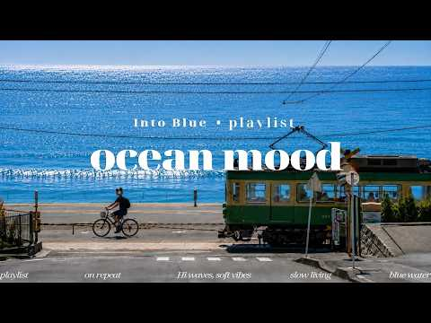
- 챕터: 0:00 nothing much today · 3:50 walk a little slower · 7:03 windows down again · 10:28 stay here awhile · 13:32 not heading home yet · 16:33 still not sleepy · 19:37 window seat · 24:04 long way home · 27:04 couldn't sleep anyway · 29:58 one more minute · 33:03 on repeat🔁🎧
- 설명 앞부분: 🚃 Kamakura Seaside, Japan 🇯🇵 오늘은 듣자마자 어디론가 떠나고 싶어지는 음악들을 담아왔어요 🧳 바다 옆을 지나가는 전철, 따뜻한 햇살, 그리고 괜히 기분 좋아지는 여름 공기 같은 노래들 오늘도 이 음악이 당신 하루를 조금 더 시원하게 만들어주길 ☁ 다음에도 기분 좋은 풍경과 음악으로 만나요💙 Today, I brought songs that make you want to go somewhere as soon as you hear them 🚃 A train passing by the sea, warm sunli…
- 대본 없음 (설명) — 음성인식이 끝나면 도입부·흐름이 들어감
- 댓글 157/157: 좋은 점 — 영상 1 · 감사·응원 4 · 더 알고 싶은 것 2 · 아쉬운 점 — 영상 1 · 반박·불만 — 의견 다름 0 · 정치·사회 0 · 경험 공유 0 · 구독·다음 기대 3
  - 좋은 점 — 영상 👍2 “갑자기 어디론가 떠나고 싶은 음악~ 넘 듣기 좋네요!!”
  - 감사·응원 👍4 “🎶 멋진 플레이리스트 잘 듣고 갑니다. 음악들이 하나같이 다 너무 좋네요. 🎧🔥 채널 분위기가 좋아서 바로 구독 남기고 가요. 🙌 앞으로 자주 왕래하면서 힘이 되는 이웃으로 소통하며 지내요. 😊 찐하게 응원합니다. 파이팅. 🚀💙”
  - 감사·응원 👍2 “감사합니다 ❤ 이 세상에 사랑과 행복만 가득하길 바래요”
  - 더 알고 싶은 것 👍1 “혹시 노래 가사는 어디서 볼 수 있나요?”
  - 더 알고 싶은 것 👍1 “안녕하세요! 플리 마지막 노래가 너무 좋아서 혹시 누구 노랜지 알려주실 수 있나요? (노래 - on repeat)”
  - 아쉬운 점 — 영상 👍1 “목소리가너무 감미로워요”
  - 구독·다음 기대 👍1 “음악 잘듣고 구독하고 합니다 ^^”
  - 구독·다음 기대 👍1 “구독하고 갑니다~”

### 58. 이선희 노래 〈잘가요, 내사랑〉 ∣ Goodbye, The One I Loved ∣ 再见了，我曾爱过的人 ∣ さようなら、私が愛した人 ∣ Korean Ballad

- https://www.youtube.com/watch?v=Ibdr_7ukGyI · AI음악으로멜론1위찍습니다 · 구독자 3,080 · 조회수 647,012 (×210.1, 하루 4,240.1) · 좋아요 4,437 (0.7%) · 4.8분 · 2026-05-16 · 주제 묶음 9. 가요·발라드·트로트 · 형식 AI 음악 · 폴더 `W_Ibdr_7ukGyI` (웹 승인)
- 썸네일: 
- 설명 앞부분: 잘가요, 내가 사랑했던 사람. 만약 이선희의 17집이 나온다면 이런 감성의 타이틀곡이 아닐까 상상하며 만든 팬메이드 AI 음악입니다. 오랜 시간 마음에 남아 있는 사람, 끝내 전하지 못했던 마지막 인사를 담았습니다. 90년대 한국 발라드의 깊은 감성과 이선희 음악을 좋아하셨던 분들이라면 천천히 끝까지 들어보세요. ※ 본 영상은 실제 이선희 정규 17집 음원이 아닌 팬메이드 창작 콘텐츠입니다.
- 대본 없음 (설명) — 음성인식이 끝나면 도입부·흐름이 들어감
- 댓글 707/707: 좋은 점 — 영상 1 · 감사·응원 36 · 더 알고 싶은 것 8 · 아쉬운 점 — 영상 8 · 반박·불만 — 의견 다름 13 · 정치·사회 2 · 경험 공유 16 · 구독·다음 기대 2
  - 좋은 점 — 영상 👍7 “이선희 명품 레전드 가수 최고”
  - 감사·응원 👍39 “이선희씨 항상 건강하시고 행복하시고 아무장애없이 좋은 일만 가득하시길 바랍니다 힘내세요 파이팅 입니다 🎉🎉🎉”
  - 감사·응원 👍37 “가수이선희님 응원합니다 ❤❤❤”
  - 더 알고 싶은 것 👍4 “내가 좋아하는 이선희 가수님! 넘 슬프네요 그리고 바보처럼 울게하네요 깊은 사연들이 뇌리속을 맴돌아 잠들지 못해 이선희 가수님의 모든 사연을 1시간넘게 이어폰으로 들은후 이 음악을 듣고 있어요 오래전 (진주mbc라이브엔죠이) 공연때 (J에게)를 부르던중 갑자기 가곡을…”
  - 더 알고 싶은 것 👍3 “이선희씨 맞나요 ?”
  - 아쉬운 점 — 영상 👍9 “노래도 좋고 가수의 가창력도 좋은데 상관도 없는 이선희님의 사진과 이름으로 사람들을 끌어 모은것은 넘무 아쉬워요”
  - 아쉬운 점 — 영상 👍3 “하루에수십번들어도너무좋아요.애절하고선희님목소리가너무이뻐요.듣고또들어도또듣고싶엉.좋은노래들려주세요”
  - 반박·불만 — 의견 다름 👍4 “이선희 노래가 아닙니다”
  - 반박·불만 — 의견 다름 👍3 “이선희아닙니다”
  - 정치·사회 👍4 “우리나라가수 통틀어서 이선희 따를자를 보지못했습니다 대단한 이선희 LP판 들을때 부터 이선희 판이 비싼거만큼 명곡이고 타가수가 따라올수 없는 말 그대로 타의추종을 불허하는 명가수십니다”
  - 정치·사회 👍2 “이선희 와 메뚜기는 좌파 입니다ㆍ 메뚜기가 논밭 헤치기 전에 잡으시다ㆍ메뚜기 이선희 이원종은 좌파 입니다ㆍ”
  - 경험 공유 👍57 “언젠가는 나도 없을 세상인데ᆢ 만나고 헤어짐을 ᆢ마무리 잘 하고 가고싶네요~~!!!”
  - 경험 공유 👍32 “이별 벌써 20년째 저는 가족 반대 때문에 헤어진 한남자 잊지 못합니다 지금 도 그사람 잊지 못합니다 아니 영윈히 기다려요 이노래가 아퍼요 그사람 마음 같아😢”
  - 구독·다음 기대 👍32 “이별 벌써 20년째 저는 가족 반대 때문에 헤어진 한남자 잊지 못합니다 지금 도 그사람 잊지 못합니다 아니 영윈히 기다려요 이노래가 아퍼요 그사람 마음 같아😢”
  - 구독·다음 기대 👍6 “안녕하세요 잘듣고갑니다 그리고 쿡하고 구독하고 갑니다 ❤❤❤행복하세요 🎉🎉🎉최고이십니다 ❤❤❤최고이십니다 🎉🎉🎉행복하세요”

### 59. 𝐏𝐥𝐚𝐲𝐥𝐢𝐬𝐭 안 붙잡을게, 진짜로

- https://www.youtube.com/watch?v=mgSfxFVkmv4 · 탱이 · 구독자 1,680 · 조회수 348,845 (×207.7, 하루 2,930.4) · 좋아요 10,931 (3.1%) · 18.3분 · 2026-06-19 · 주제 묶음 기타 · 형식 플레이리스트·모음 (여러 곡) · 폴더 `W_mgSfxFVkmv4` (웹 승인)
- 썸네일: 
- 챕터: 0:00 Saula - Perfume · 2:59 빈첸 - FLYING HIGH WITH U · 6:23 Kaution - ed · 9:44 &TEAM - MISMATCH · 13:06 백현 - Love Again · 16:29 Joh! - ABG
- 설명 앞부분: [TIME LINE]
- 대본 없음 (설명) — 음성인식이 끝나면 도입부·흐름이 들어감
- 댓글 150/150: 좋은 점 — 영상 0 · 감사·응원 1 · 더 알고 싶은 것 1 · 아쉬운 점 — 영상 0 · 반박·불만 — 의견 다름 0 · 정치·사회 0 · 경험 공유 14 · 구독·다음 기대 0
  - 감사·응원 👍0 “오...... 감사합니다”
  - 더 알고 싶은 것 👍2 “첫노래 제목알려주세요”
  - 경험 공유 👍50 “안 믿으실 수도 있지만 이 닉네임이 12년째 쓰고 있는 자호 같은 이름인데 시온님 성함이랑 한자까지 똑같더라고요 그 미묘한 내적 친밀감 때문인지 노래들이 다 좋아서 그런지 새벽이라 그런지 셋 다인지 상당히 과몰입이 되네요 같은 나라에 태어나서 같은 언어로 말을 해도 …”
  - 경험 공유 👍13 “그냥 붙잡아줘 미안해 스미마셍 뚜이부치 씬 로이 로시엔토 내가 잘못했어 용서해줘”

### 60. [Playlist] 스트레이 키즈 노래 모음 연속 듣기 🔥 Stray Kids Best Songs 2026 (God's Menu, Maniac, Chk Chk …

- https://www.youtube.com/watch?v=Lj8FLAC9h58 · 내귀에 PLY · 구독자 2,300 · 조회수 461,523 (×200.7, 하루 7,140.3) · 좋아요 9,637 (2.1%) · 120.4분 · 2026-08-12 · 주제 묶음 10. 팝송·K팝·J팝 · 형식 플레이리스트·모음 (여러 곡) · 폴더 `W_Lj8FLAC9h58` (웹 승인)
- 썸네일: 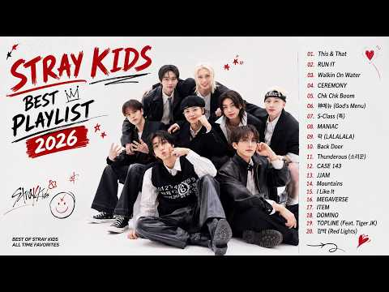
- 챕터: 0:00 This & That · 3:04 RUN IT · 6:29 Walkin On Water · 9:15 CEREMONY · 11:57 Chk Chk Boom · 14:21 神메뉴 (God's Menu) · 17:08 S-Class (특) · 20:22 MANIAC · 23:25 락 (LALALALA) · 26:24 Back Door · 29:31 Thunderous (소리꾼) · 32:32 CASE 143 · 35:42 JJAM · 38:44 Mountains · 41:49 I Like It · 44:15 MEGAVERSE · 47:19 ITEM · 50:30 DOMINO · 53:47 TOPLINE (Feat. Tiger JK) · 57:09 강박 (Red Lights)
- 설명 앞부분: Stray Kids (스트레이 키즈) 대표 명곡 모음 플레이리스트 2026 🎧🔥 'Chk Chk Boom', 'God's Menu (신메뉴)', 'S-Class (특)' 등 스트레이 키즈의 글로벌 히트곡과 인기 띵곡들을 연속으로 감상해 보세요! 오늘 하루도 스트레이 키즈의 파워풀하고 중독성 있는 마라맛 음악으로 에너지 충전하세요! ⚡ Enjoy the ultimate Stray Kids Best Songs Playlist 2026! 🎧🔥 From global hit tracks like 'Chk Chk Boom', 'God's M…
- 대본 없음 (설명) — 음성인식이 끝나면 도입부·흐름이 들어감
- 댓글 164/164: 좋은 점 — 영상 0 · 감사·응원 1 · 더 알고 싶은 것 1 · 아쉬운 점 — 영상 0 · 반박·불만 — 의견 다름 0 · 정치·사회 0 · 경험 공유 1 · 구독·다음 기대 0
  - 감사·응원 👍88 “안그래도 새 노래 들어간 플리 필요했는데 감사해요! 길이도 아주 좋아~”
  - 더 알고 싶은 것 👍9 “수록곡들도 만들어주세요!!”

### 61. Italian Deep House 2026 ∣ Mediterranean Vibes

- https://www.youtube.com/watch?v=Cr5KN_TuQNk · House Italiano · 구독자 24,400 · 조회수 4,894,147 (×200.6, 하루 27,519.4) · 좋아요 38,721 (0.8%) · 14.6분 · 2026-04-21 · 주제 묶음 8. 로파이·시티팝·칠 · 형식 음악 (그 밖 모양 — 한 편짜리 BGM 등) · 폴더 `W_Cr5KN_TuQNk` (웹 승인)
- 썸네일: 
- 챕터: 0:00 Fuoco Nella Sabbia · 2:31 Passione Vera · 6:12 Ritmo del Sud · 9:48 Dolce Arrivo · 12:28 Ultima Danza
- 설명 앞부분: You can find us on Spotify: Escape to the heart of Italy with this smooth and uplifting deep house mix inspired by Mediterranean sunsets, coastal breezes, and the timeless charm of la dolce vita. From golden hour by the sea to late-night drives along the coast, this mix is designed to bring you pur…
- 대본 없음 (설명) — 음성인식이 끝나면 도입부·흐름이 들어감
- 댓글 387/387: 좋은 점 — 영상 0 · 감사·응원 0 · 더 알고 싶은 것 0 · 아쉬운 점 — 영상 0 · 반박·불만 — 의견 다름 0 · 정치·사회 0 · 경험 공유 0 · 구독·다음 기대 0

### 62. #등불 - #영사운드(1972년) Covered by sMUSIC#영사운드 #Reinterpreting K-pop Classics #남자보컬

- https://www.youtube.com/watch?v=tW_gZzlbg-4 · sMusic 7080_명곡 리메이크곡 커버곡  · 구독자 6,860 · 조회수 1,344,585 (×196.0, 하루 8,427.6) · 좋아요 3,715 (0.3%) · 4.2분 · 2026-05-10 · 주제 묶음 10. 팝송·K팝·J팝 · 형식 커버·직접 부른 노래 · 폴더 `W_tW_gZzlbg-4` (웹 승인)
- 썸네일: 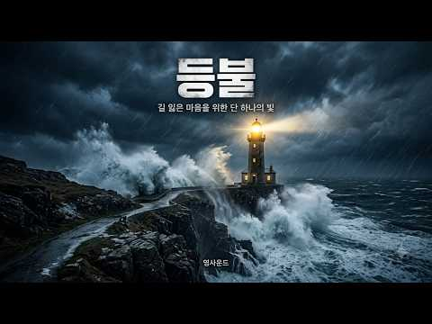
- 대본 없음 (없음) — 음성인식이 끝나면 도입부·흐름이 들어감
- 댓글 296/296: 좋은 점 — 영상 1 · 감사·응원 34 · 더 알고 싶은 것 4 · 아쉬운 점 — 영상 0 · 반박·불만 — 의견 다름 2 · 정치·사회 1 · 경험 공유 10 · 구독·다음 기대 3
  - 좋은 점 — 영상 👍2 “우연히 검색하다 듣게 됐는데 선생님 노래 너무 좋아요~잠시나마 추억에 젖어 보내요~이계절에 듣기 좋은거 같아요~좋은 노래 감사해요❤❤❤❤❤❤❤❤❤❤❤❤❤”
  - 감사·응원 👍27 “젊은 시절의 감성이 고스란히 녹아있는 좋은 음악 감사합니다”
  - 감사·응원 👍8 “마음은 등불노래에 온전히 녹여지다 감사합니다❤❤❤”
  - 더 알고 싶은 것 👍3 “멋진 목소리의 주인공이 참 궁금하네요.”
  - 더 알고 싶은 것 👍3 “아주 멋져요. 고목 (윤시내), 내 인생 바람에 실어 (장미화) -> 소울 가득한 느낌 부르스 락 버젼 가능할까요. 부탁드려봅니다.”
  - 반박·불만 — 의견 다름 👍1 “땡땡땡 종쳤데이 학교 파했으니 이제 집으로 돌아가자~~ 뭔소리일까요? 글쎄요. 그 종은 애밀래 종일 겁니다. 알라를 와 밀겠습니꺼 감사합니다 👁💥💜🐚🐣🐉🦋💎🙏”
  - 반박·불만 — 의견 다름 👍0 “좀 섬뜩하지 않나요. 인간이 아닌데 인간 이상의 감동을 만든다는건 뭔가 잘못되어 가고 있어요. 점차 인간이 서있을 자리가 사라 질겁니다. 지금의 이 환호가 저주가 될수도 있어요”
  - 정치·사회 👍0 “자식많은 부모님마냥 일하는데 왜이리볼멘소리들하시는지격려해주세요 대통령님께❤”
  - 경험 공유 👍18 “여인 첨듣는 곡인데 참 절절하고 애절하네요ㆍ어떤 여인을 가슴 깊이 절절이 짝사랑했었나 봅니다ㆍ”
  - 경험 공유 👍13 “내가 지금 60대인데 10대 후반부터 들었던 가장 쓸쓸한 감정을 두번다시 어느누구도 그 감정을 대체할 수없습니댜.”
  - 구독·다음 기대 👍3 “좋아요 구독누르고 듣습니다!!”
  - 구독·다음 기대 👍3 “방금 구독했습니다. 오랜만에 좋은 노래 들어요. 광안리 커피숍에서 듣고 있습니다. 천천히 좋은 노래 감상할께요. 추억을 먹고 사는 나이라.”

### 63. 하루 한 번 듣는 신묘장구대다라니 ∣ 15가지 재앙을 막고 77가지 복을 부르는 진언 #신묘장구대다라니 #천수경 #관세음보살 #명상음악 #기도음악 #불교음악 #…

- https://www.youtube.com/watch?v=nDhxAWNwhYc · KARMA FLOW · 구독자 724 · 조회수 141,444 (×195.4, 하루 795.2) · 좋아요 1,099 (0.8%) · 5.8분 · 2026-04-21 · 주제 묶음 15. CCM·찬양·국악·동요 · 형식 플레이리스트·모음 (여러 곡) · 폴더 `W_nDhxAWNwhYc` (웹 승인)
- 썸네일: 
- 설명 앞부분: 신묘장구대다라니 ∣ 천수경 핵심 진언 ∣ 불교음악 · 명상음악 · 기도음악 15가지 재앙을 막고, 7가지 복을 얻는다고 전해지는 신묘장구대다라니. 관세음보살의 자비와 위신력이 담긴 천수경의 핵심 진언이며, 한 구절 한 구절마다 기적의 힘이 담겨 있다고 전해집니다. 우주의 깊은 파장을 머금은 이 진언의 울림이 불안과 괴로움, 막힌 흐름 위에 닿아 오늘의 마음에도 다시 평안과 복이 피어나기를 바라며 이 음악을 만들었습니다. 🙏 재앙과 액운이 멀어지기를 🙏 무거운 업장과 답답함이 가벼워지기를 🙏 막혀 있던 복의 흐름이 다시 열리기를 🙏…
- 대본 없음 (설명) — 음성인식이 끝나면 도입부·흐름이 들어감
- 댓글 117/117: 좋은 점 — 영상 1 · 감사·응원 23 · 더 알고 싶은 것 1 · 아쉬운 점 — 영상 0 · 반박·불만 — 의견 다름 0 · 정치·사회 1 · 경험 공유 5 · 구독·다음 기대 0
  - 좋은 점 — 영상 👍7 “관세음보살 관세음보살 관세음보살 부서진 마음에도 길은 있고 멈춘 복도 다시 흐르길 좋은 영상 감사합니다 위로받고 갑니다”
  - 감사·응원 👍12 “나무아미타불 관세음보살 지장보살마하살 부처님! 행운과 재물이 늘함께하길 소원합니다 감사합니다🙏”
  - 감사·응원 👍10 “업장소멸되어 맘편히 살게 해주셔서 감사합니다🙏”
  - 더 알고 싶은 것 👍3 “6개의 노래가 자동으로 재생이 되게 혹시 하나의 영상으로 올려주실수 있나요?”
  - 정치·사회 👍0 “이재명대통령지켜주세요연임하게해주세요다치지않게해주세요지켜주세요20년연임하게해주세요거짓말쟁이조폭깡패윤석열김건희미국모스탄도국힘당의원들도이진숙도감옥 사형 사형국힘김두겸황교안오세훈추경호한동훈최상목국힘당들의원전광훈전한길2찍태극기부대들사기꾼얼굴윤석열당선무효벌금100넘게나오길빕니다…”
  - 경험 공유 👍6 “관세음보살님.. 지장 보살님.. 부처님의 공덕과 자비로 주희와저를 부부의 연을 맺도록 도와주시고 주희가 힘들고 괴로울때 아프고 슬블때 저에게 기대어 쉴수 있게 하식ㆍㄷ 저희들에게 대박의 기운을 주시어 세상에 작은 밀알이 되게 하시고 저희들 가족과 어머님. 무병장수하게…”
  - 경험 공유 👍5 “빚다갚고 나도이롭고 남도이루운삶을 살겠습니다 ᆢ 로또당첨ᆢ관세음보살ᆢ”

### 64. 애매모호한 첫사랑

- https://www.youtube.com/watch?v=A6rImTTl348 · na tsu · 구독자 933 · 조회수 181,463 (×194.5, 하루 2,036.7) · 좋아요 7,930 (4.4%) · 19.3분 · 2026-07-19 · 주제 묶음 기타 · 형식 플레이리스트·모음 (여러 곡) · 폴더 `W_A6rImTTl348` (웹 승인)
- 썸네일: 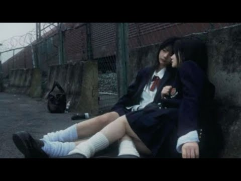
- 설명 앞부분: 흐르는 것들은 하늘과 모든 걸 품었지만 우린 품지 못했으니 *알레프, 자유
- 대본 없음 (설명) — 음성인식이 끝나면 도입부·흐름이 들어감
- 댓글 419/419: 좋은 점 — 영상 2 · 감사·응원 11 · 더 알고 싶은 것 2 · 아쉬운 점 — 영상 1 · 반박·불만 — 의견 다름 3 · 정치·사회 0 · 경험 공유 44 · 구독·다음 기대 0
  - 좋은 점 — 영상 👍0 “그때 잘 했더라면 지금 다시 만나다면 그때 했던 실수를 안 할 자신있다 믿었는데 어느날 바뀐 너의 프로필사진에 밝게 웃는 모습을 보고 너와 멀어져야겠다 생각했어. 돌아보니 내 옆에있던 넌 한편의 슬픔이 담긴 눈이였는데 지금 만나는 사람과는 그런 슬픔과 걱정없이 너무 …”
  - 좋은 점 — 영상 👍0 “선곡 최고에요 감사합니다🥲 구구절절 내 마음을 적다가 너무 구차해보여서 전부 다 지웠지만 아무튼 보고싶다!!! 그냥 언제 어디에서나 다치지 말고 건강하고 행복하게 잘 지내길”
  - 감사·응원 👍4 “To. 너 이렇게 편지를 쓰는 것도 정말 오랜만이네. 이걸 네 생일에 적었더라면 정말 좋았을 텐데. 올해 네 생일을 축하 못한 것도 정말 미안하고 아쉬워. 하고 싶은 말이 많았는데 막상 글로 써 내려가려니까 두서없이 적게 된다. 네가 없는 동안 어쩌다 보니 문학도 많…”
  - 감사·응원 👍3 “주인장 말투 너무 커여워요 ❤ 이런 감성 플리는 진짜 처음인데 생각보다 너무 좋아요.. 새로운 취향을 찾은 것 같아요! 잘 들을게요 감사해요!”
  - 더 알고 싶은 것 👍3 “다들 여기에 첫사랑 이야기를 푸시는데.. 저도 그런 느낌이 뭔지 알고싶네요”
  - 더 알고 싶은 것 👍0 “중학교 때 좋아하지도 않는데 먼저 고백했다는 이유로 너가 받아줬었잖아, 그 남자애. 결국 둘이 흐지부지됐지만 아직도 가끔 궁금하다. 내가 고백해도 똑같이 받아줬을까? 오늘도 전화하고 왔는데 왜 아직도 너가 이렇게 좋은지 모르겠어. 아무리 다른 여자 사겨도 결국 헤어지…”
  - 반박·불만 — 의견 다름 👍113 “제목을 보자마자 한사람이 떠올라서 홀린듯이 클릭해버렸어요. 이런 플리 잘 안들을 것 같아서 그냥 터놓고 말할게. 중학교 때 처음 만난 언니. 정말 예쁘고, 멋지고 빛이 나서 이보다 주인공 같은 사람이 있을까 싶은 사람. 정병 와서 새벽에 연락해도 꼬박꼬박 답장해주고 …”
  - 반박·불만 — 의견 다름 👍1 “여자 사이에서는 동성애에 대한 인식이 남자들 사이에서는 다른가요.. 남자는 게이라면 아예 말도안되고 상상도 하기싫은 존재로 여겨지는데...”
  - 경험 공유 👍191 “진짜 내가 여자만 아니었다면 꼬셔버리고 싶은 여사친 1명쯤 있지 않나요?ㅋㅋ”
  - 경험 공유 👍145 “너싫어 왜냐면너는 바보고 이기적이고 말도많고 이상하고 사랑스럽고 사랑스럽고 사랑스럽고 몰라그냥싫어 너랑말안해 연락도안해주고뭐야이게 나도너남자좋아하는거아는데 그러면왜그랫냐고나한테 껴안고무릎에눕고뽀뽀하려하고 그러면서남자좋아한다는이유ㅠ로내고백안받아주면 난정말울지도몰라 너그…”

### 65. 일할 때 듣기 좋은 발라드 베스트 100곡 🌸 광고 없는 감성 플레이리스트 왁스, 소울스타, 원티드, 임창정, 성시경, 더원, 백지영, 김필, 김범수, 양파 #…

- https://www.youtube.com/watch?v=aJ61beIT3qc · Dragon Melody · 구독자 1,260 · 조회수 245,035 (×194.5, 하루 2,020.7) · 좋아요 821 (0.3%) · 138.7분 · 2026-06-17 · 주제 묶음 9. 가요·발라드·트로트 · 형식 플레이리스트·모음 (여러 곡) · 폴더 `W_aJ61beIT3qc` (웹 승인)
- 썸네일: 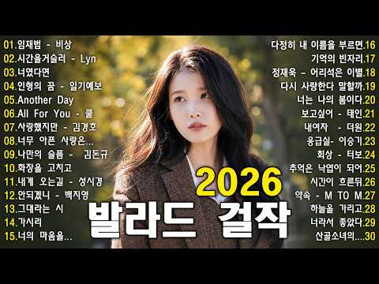
- 설명 앞부분: 안녕하세요! 🎶 바람의 발라드* 채널에 오신 것을 환영합니다. 이곳은 **90년대부터 2000년대까지의 레전드 한국 발라드**를 사랑하는 모든 분들을 위한 감성 음악 채널입니다. 🕰️ *추억 속으로 떠나는 시간 여행 한국 발라드의 전성기였던 1990\~2000년대! 감미로운 멜로디**와 **감성적인 가사**가 어우러진 명곡들은 지금도 많은 이들의 마음을 울리고 있습니다. 그 시절 감동을 다시 느껴보세요. 🎤 *당신이 사랑했던 발라드 가수 총출동 김범수, 임재범, 성시경, 박효신, 이수영, 거미, 휘성, 플라이 투 더 스카이, 조성…
- 대본 없음 (설명) — 음성인식이 끝나면 도입부·흐름이 들어감
- 댓글 30/30: 좋은 점 — 영상 0 · 감사·응원 3 · 더 알고 싶은 것 0 · 아쉬운 점 — 영상 1 · 반박·불만 — 의견 다름 0 · 정치·사회 0 · 경험 공유 0 · 구독·다음 기대 0
  - 감사·응원 👍0 “감사합니다 ^^”
  - 감사·응원 👍0 “제목을 같이 올려 주셔서 감사합니다.”
  - 아쉬운 점 — 영상 👍0 “광고가 없다고 했는데 있네요”

### 66. 𝐏𝐥𝐚𝐲𝐥𝐢𝐬𝐭 듣자마자 흥 폭발하는🔥 최신 K-POP 노래 모음 노동요

- https://www.youtube.com/watch?v=yngpCQNKY_M · 클로버 플레이리스트 · 구독자 3,580 · 조회수 691,720 (×193.2, 하루 6,108.6) · 좋아요 3,641 (0.5%) · 40.9분 · 2026-06-25 · 주제 묶음 10. 팝송·K팝·J팝 · 형식 플레이리스트·모음 (여러 곡) · 폴더 `W_yngpCQNKY_M` (웹 승인)
- 썸네일: 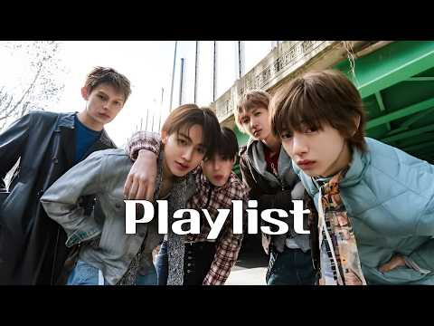
- 대본 없음 (없음) — 음성인식이 끝나면 도입부·흐름이 들어감
- 댓글 69/69: 좋은 점 — 영상 1 · 감사·응원 3 · 더 알고 싶은 것 1 · 아쉬운 점 — 영상 0 · 반박·불만 — 의견 다름 0 · 정치·사회 0 · 경험 공유 0 · 구독·다음 기대 0
  - 좋은 점 — 영상 👍0 “너무 듣기 좋아요 저가 좋아하는 노래 만 있어요”
  - 감사·응원 👍28 “k pop 처돌이 의대생인데요,,,아직도 종강을 못하고있는데요 (눈물),,, 시험전에 급하게 빡세게 공부해야할때 빡칠때.. 전투력 기분좋게 상승하네요 감사합니다ㅠ 덕분에 살아요..”
  - 감사·응원 👍3 “다 요즘 노래네요!! 찾아보신게 대단해요!! 떡상 응원할게용❤❤❤ 구독 ㄱㄱ❤❤❤”

### 67. 아득히 먼 곳 ∣ 이별 감성 발라드 ∣ 커버 노래 편곡 수노 AI

- https://www.youtube.com/watch?v=8l6a5DRZqHU · 엄마의 세월 - 한국 발라드 명곡 · 구독자 1,110 · 조회수 207,221 (×186.7, 하루 1,435.1) · 좋아요 483 (0.2%) · 4분 · 2026-05-25 · 주제 묶음 9. 가요·발라드·트로트 · 형식 AI 음악 · 폴더 `W_8l6a5DRZqHU` (웹 승인)
- 썸네일: 
- 설명 앞부분: 아득히 먼 곳 (원곡 가수 : 구창모) 1985년 발표, 7080 추억의 명곡을 수노의 도움을 받아 다시 편곡하였습니다. 즐겁게 감상해 주시면 감사하겠습니다.
- 대본 없음 (설명) — 음성인식이 끝나면 도입부·흐름이 들어감
- 댓글 20/20: 좋은 점 — 영상 0 · 감사·응원 0 · 더 알고 싶은 것 0 · 아쉬운 점 — 영상 1 · 반박·불만 — 의견 다름 0 · 정치·사회 0 · 경험 공유 0 · 구독·다음 기대 0
  - 아쉬운 점 — 영상 👍12 “아득히 먼 곳 황금빛 저녁노을 내리는 곳은 사랑이 애처로이 떠난 자리지 노을은 항상 아쉬움을 두고 스러지기 때문이야 나를 떠난 님은 호숫가 푸른숲속 아늑한 곳에 잠들어 있는데 찬 바람 비껴불어 이르는 곳에 있는 나는 오늘밤도 그리운 님 생각에 불면의 밤을 지새우고 있…”

### 68. 들꽃처럼 살다가

- https://www.youtube.com/watch?v=1vBXiLsHZrs · 소은뮤직 · 구독자 583 · 조회수 104,895 (×179.9, 하루 946.4) · 좋아요 861 (0.8%) · 4.7분 · 2026-06-27 · 주제 묶음 기타 · 형식 음악 (그 밖 모양 — 한 편짜리 BGM 등) · 폴더 `W_1vBXiLsHZrs` (웹 승인)
- 썸네일: 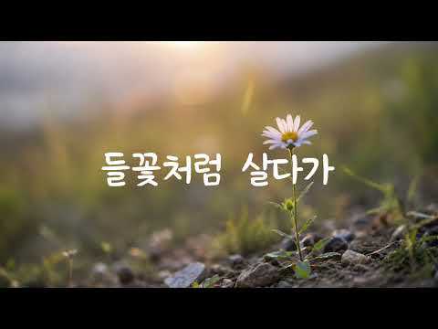
- 설명 앞부분: 🌼 들꽃처럼 살다가 누구에게 보이기 위해 피어나는 것이 아니라, 자신의 자리에서 묵묵히 계절을 견디며 향기를 남기는 들꽃처럼 살아가고 싶은 마음을 담은 노래입니다. 기쁜 날도, 힘든 날도 자연의 흐름을 닮아 담담하게 받아들이며, 바람과 구름, 그리고 소중한 사람들과 함께하는 평범한 하루의 소중함을 노래합니다. [Verse 1] 길가에 피어 있는 작은 꽃 하나처럼 누구에게 보이려고 피어난 건 아니었네 비바람이 불어와도 고개 숙여 견디고 다시 오는 봄날 속에 환하게 웃었네 [Chorus] 나는 들꽃처럼 살다가 바람에게 안부 묻고 구름…
- 대본 없음 (설명) — 음성인식이 끝나면 도입부·흐름이 들어감
- 댓글 108/108: 좋은 점 — 영상 0 · 감사·응원 22 · 더 알고 싶은 것 2 · 아쉬운 점 — 영상 2 · 반박·불만 — 의견 다름 0 · 정치·사회 1 · 경험 공유 2 · 구독·다음 기대 0
  - 감사·응원 👍19 “사랑하는 들꽃~~!!! 어찌 이 작디작은 풀꽃을 사랑하지 않을 수 있을까요. 들꽃 앞에 서면 한없이 마음 설레는 것을~. 아름다운 날에 아름다운 들꽃 노래를 듣고 있노라니 아름다운 행복이 내 마음에 가득 차오립니다. 이토록 따스한 사랑을 안겨 주셔서 진심으로 감사드립…”
  - 감사·응원 👍11 “들꽃처럼 묵묵히 자신의 자리를 지키는 삶이 참 아름답게 느껴지네요. 오늘 하루 지친 마음이 노래 덕분에 따뜻하게 치유되는 기분이에요. 좋은 노래 감사합니다”
  - 더 알고 싶은 것 👍2 “제 옆에는 이런좋은 가사의 노래들을 들려주는 분이 있습니다 고마운 사람이지요 가사가 제맘에 넘닿아요!! 구절구절. 좋은노래 많이 올려주세요~^^”
  - 더 알고 싶은 것 👍1 “제 18번 으로 만들려고합니다 가수 하보미 님 맞나요 ?”
  - 아쉬운 점 — 영상 👍6 “들꽃 한송이! 향기 예쁨 외로움 인내 기다림 아쉬움 설레임 희망... 많은 느낌을 갖게 하지요. 잔잔하게 울림이 있는 노래 잘 듣고 나갑니다. 좋은 시간 주셔서 감사합니다. 소은뮤직 채널 응원합니다.”
  - 아쉬운 점 — 영상 👍0 “가수 AI 목소리인가요”
  - 정치·사회 👍0 “기쁜소식! 죄없는 대통령 감옥살이 ! 나라거들 낼려고 작심 한거모르고 ! 내로남불인 극에 달한놈들에게 속은... 박근혜대통령님! 건강지켜셔서 좋은날 꼭 봐야합니다! 멸공!”
  - 경험 공유 👍4 “내가 살아온 내모습 같네요 너무감동 적이네요”
  - 경험 공유 👍1 “제가 좋아하는 들꽃~! 좋은 노래 들으며 잠시나마 복잡한 마음들을 힐링합니다~감사합니다~❤😂🎉”

### 69. [ 𝑷𝒍𝒂𝒚𝒍𝒊𝒔𝒕 ] 전남친 잊는 플리

- https://www.youtube.com/watch?v=bLYI4NHve9Y · 아야 · 구독자 1,300 · 조회수 233,476 (×179.6, 하루 3,069.1) · 좋아요 4,665 (2.0%) · 17.4분 · 2026-08-01 · 주제 묶음 기타 · 형식 플레이리스트·모음 (여러 곡) · 폴더 `W_bLYI4NHve9Y` (웹 승인)
- 썸네일: 
- 대본 없음 (없음) — 음성인식이 끝나면 도입부·흐름이 들어감
- 댓글 55/55: 좋은 점 — 영상 2 · 감사·응원 2 · 더 알고 싶은 것 0 · 아쉬운 점 — 영상 0 · 반박·불만 — 의견 다름 0 · 정치·사회 0 · 경험 공유 2 · 구독·다음 기대 0
  - 좋은 점 — 영상 👍27 “와진짜바로잊음레전드”
  - 좋은 점 — 영상 👍0 “노래 너무 좋아요😊 저도 노래 올리깊시작했는데 많이 배우고 갑니다❤”
  - 감사·응원 👍0 “여자들아화이팅❤”
  - 경험 공유 👍6 “내가 착해서 헤어지자 했다니~ 지팔지꼰 축하행♡”
  - 경험 공유 👍0 “노래 너무 좋아요😊 저도 노래 올리깊시작했는데 많이 배우고 갑니다❤”

### 70. 안들으면후회함 playlist

- https://www.youtube.com/watch?v=_eAnA8TgKWM · 서른마흔오백다섯살 · 구독자 3,410 · 조회수 588,564 (×172.6, 하루 4,395.8) · 좋아요 18,693 (3.2%) · 24분 · 2026-06-04 · 주제 묶음 기타 · 형식 플레이리스트·모음 (여러 곡) · 폴더 `W__eAnA8TgKWM` (웹 승인)
- 썸네일: 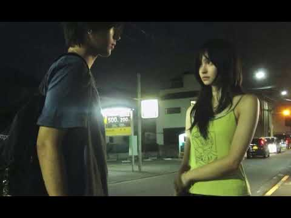
- 대본 없음 (없음) — 음성인식이 끝나면 도입부·흐름이 들어감
- 댓글 169/169: 좋은 점 — 영상 0 · 감사·응원 4 · 더 알고 싶은 것 2 · 아쉬운 점 — 영상 0 · 반박·불만 — 의견 다름 0 · 정치·사회 0 · 경험 공유 7 · 구독·다음 기대 0
  - 감사·응원 👍1 “기말 화이팅!”
  - 감사·응원 👍1 “와 썸넬 바껴서 제 최애플리 사라진줄알았어요 와 감사합니다”
  - 더 알고 싶은 것 👍10 “영상의 사진이 어디서 나온 것인지 알 수 있을까요?”
  - 경험 공유 👍21 “걍 누르고 뭔 노래 나올지 모르능데 나도 모르게 따라부르고있음”
  - 경험 공유 👍1 “싸이월드 시절 인프피였던 내가 좋아하던 노래만 모여있고, 소름돋음 ㄹㅈㄷ”

### 71. 이수연, K-trot, [감성노래 탑7 메들리]

- https://www.youtube.com/watch?v=wz-ZkvuAdTg · 통기타 한석 TV · 구독자 2,620 · 조회수 451,900 (×172.5, 하루 2,813.8) · 좋아요 5,253 (1.2%) · 26.3분 · 2026-05-08 · 주제 묶음 9. 가요·발라드·트로트 · 형식 플레이리스트·모음 (여러 곡) · 폴더 `W_wz-ZkvuAdTg` (웹 승인)
- 썸네일: 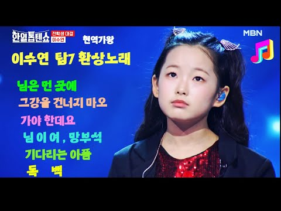
- 대본 없음 (없음) — 음성인식이 끝나면 도입부·흐름이 들어감
- 댓글 311/311: 좋은 점 — 영상 2 · 감사·응원 33 · 더 알고 싶은 것 3 · 아쉬운 점 — 영상 1 · 반박·불만 — 의견 다름 0 · 정치·사회 2 · 경험 공유 5 · 구독·다음 기대 1
  - 좋은 점 — 영상 👍6 “다른 트롯가수들처럼 무작정 꺾으려만하는거도 없네 장르마다 자연스럽고 듣기 편안하고 감동이 오네”
  - 좋은 점 — 영상 👍1 “세상을 너무 오래산거처래 구구절절 너무잘한다”
  - 감사·응원 👍20 “최고의 감성가수 천사 이수연공주 . 힐링되요❤❤❤ 감사합니다 사랑합니다”
  - 감사·응원 👍20 “수연아 너무잘합니다 힘내세요 화이팅”
  - 더 알고 싶은 것 👍13 “와~~ 정말 가슴이 뻥 뚫리고. 머리가 신선해집니다 어쩜 저런 보물이 있을까요? 수연양!!! 사랑합니다 할아버지 할머니랑 영원히 행복하세요~~~!!”
  - 더 알고 싶은 것 👍3 “수연이는 노래를 가지고 논다 기성 가수보다 노래를 더 잘한다 노래가 다 잘되니 노래 부를맛 나고 노래부르는게 얼마나 신나고 좋을까요?”
  - 아쉬운 점 — 영상 👍5 “이수연야 정말잘하군요. 다만 원곡에충실했쓰면해요 잘하다보니. 너무오버하는게. 실망이내요. 아직 어리고 배울게많은대. 나뿐버릇. 자리잡을까 걱정이내요. 필요이상으로. 오버는. 독이여요”
  - 정치·사회 👍7 “대한민국 이재명보유국 대한민국 이수연 보유국 최고의 두분”
  - 경험 공유 👍10 “수연양 기분좋은 모습보니 나도 기분좋아요 수연양 사랑해요~~”
  - 경험 공유 👍7 “수연의 버전 그강을 건너지 마오 100번을 듣고나니 이제는 저도 부를 수가 있답니다 국보급 목소리 최고입니다”
  - 구독·다음 기대 👍11 “수현아 고마워 감동이야 매일듣고 있어 내마음에 최고”

### 72. 가을이 머무는 호숫가 ∣ 피아노·첼로·바이올린으로 듣는 고요한 클래식

- https://www.youtube.com/watch?v=zNMH3ua74tE · 순례자 우물  · 구독자 939 · 조회수 157,992 (×168.3, 하루 4,031.6) · 좋아요 1,237 (0.8%) · 122분 · 2026-09-07 · 주제 묶음 6. 피아노·클래식·연주곡 · 형식 음악 (그 밖 모양 — 한 편짜리 BGM 등) · 폴더 `W_zNMH3ua74tE` (웹 승인)
- 썸네일: 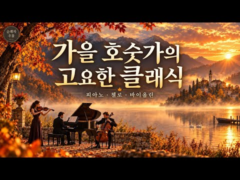
- 설명 앞부분: 안개가 내려앉은 호수처럼, 천천히 마음을 가라앉혀 주는 고요한 선율을 담았습니다. 피아노의 섬세한 울림, 첼로의 깊고 따뜻한 음색, 바이올린의 맑고 서정적인 선율이 어우러지는 잔잔한 피아노 트리오 클래식입니다. 조용히 쉬고 싶은 시간, 책을 읽거나 공부할 때, 기도와 묵상, 차 한 잔과 함께하는 순간에 편안하게 들어보세요. 🎼 Track List 01. 안개 속의 아다지오 02. 오래된 극장의 숨결 03. 물안개 위의 선율 04. 저물녘의 기도 05. 고요가 머무는 홀 06. 마지막 빛이 사라질 때 🎻 Piano · Cello ·…
- 대본 없음 (설명) — 음성인식이 끝나면 도입부·흐름이 들어감
- 댓글 36/36: 좋은 점 — 영상 0 · 감사·응원 7 · 더 알고 싶은 것 0 · 아쉬운 점 — 영상 0 · 반박·불만 — 의견 다름 0 · 정치·사회 0 · 경험 공유 0 · 구독·다음 기대 0
  - 감사·응원 👍5 “❤ 😊 참 감사합니다”
  - 감사·응원 👍5 “앞으로 찾아뵙겠습니다.응원합니다.”

### 73. 살면서 한 번쯤 들어봐야 할 클래식 15곡 ∣ 공부·휴식·카페에서 듣기 좋은 클래식 음악

- https://www.youtube.com/watch?v=hDepOWqLbXI · canvasclassics · 구독자 183 · 조회수 30,125 (×164.6, 하루 261.8) · 좋아요 300 (1.0%) · 152.1분 · 2026-06-23 · 주제 묶음 6. 피아노·클래식·연주곡 · 형식 플레이리스트·모음 (여러 곡) · 폴더 `W_hDepOWqLbXI` (웹 승인)
- 썸네일: 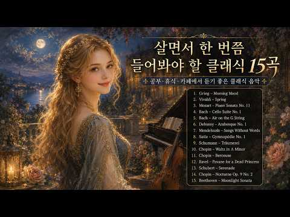
- 설명 앞부분: 살면서 한 번쯤 들어봐야 할 아름다운 클래식 15곡을 모았습니다. 아침의 평온함을 담은 그리그의 ‘Morning Mood’부터, 비발디의 ‘봄’, 모차르트의 ‘피아노 소나타 11번’, 바흐, 드뷔시, 쇼팽, 베토벤의 명곡까지 공부할 때, 일할 때, 책을 읽을 때, 카페에서 쉬고 싶을 때 듣기 좋은 클래식 음악입니다. Canvas Classics는 클래식 음악과 명화 같은 감성 이미지를 함께 감상할 수 있는 채널입니다. 잔잔한 선율과 아름다운 장면들이 여러분의 하루를 조금 더 차분하고 깊게 만들어주길 바랍니다. 🎧 추천 감상 시간 …
- 대본 없음 (설명) — 음성인식이 끝나면 도입부·흐름이 들어감
- 댓글 3/3: 좋은 점 — 영상 0 · 감사·응원 0 · 더 알고 싶은 것 0 · 아쉬운 점 — 영상 0 · 반박·불만 — 의견 다름 0 · 정치·사회 0 · 경험 공유 0 · 구독·다음 기대 0

### 74. 𝐏𝐥𝐚𝐲𝐥𝐢𝐬𝐭 ∣ 첫 비트부터 심박수 폭발 ❤️ 미친 텐션 운동 플리 ∣ 헬스 · 러닝 · EDM · 힙합 🎧

- https://www.youtube.com/watch?v=XrUNOYMFd58 · Grind Vibe · 구독자 5,550 · 조회수 908,056 (×163.6, 하루 7,139.5) · 좋아요 5,741 (0.6%) · 80.7분 · 2026-06-11 · 주제 묶음 11. 힙합·R&B·EDM · 형식 플레이리스트·모음 (여러 곡) · 폴더 `W_XrUNOYMFd58` (웹 승인)
- 썸네일: 
- 챕터: 0:00 Pop & Go · 3:27 Dub-da-ri, dub-da-ri, dub-dub! · 6:38 Auto Banggu · 7:37 Code Red · 10:29 Fast Forward · 13:26 Laser Tag (edit) · 16:38 Main Character · 20:19 Hyperflight · 24:11 sooooo good · 26:49 Ocean Drive · 29:30 PSYCHO · 31:38 Sprite · 34:51 SNS · 36:44 gv_v70 · 37:47 High energy
- 설명 앞부분: 운동, 작업, 헬스장, 드라이브까지 텐션을 확 끌어 올려드릴 플레이리스트🎧 ❤ 루즈한 구간 없이 몰아치는 트랙들로 구성했습니다.🚀 🎧 A go-to Hip-Hop & EDM playlist for the gym, running, and grind-time ∣ Grind Vibe When everything feels like too much, hit play and your body moves on autopilot 😎 From commuting and workouts to driving and late-night grind se…
- 대본 없음 (설명) — 음성인식이 끝나면 도입부·흐름이 들어감
- 댓글 337/337: 좋은 점 — 영상 0 · 감사·응원 14 · 더 알고 싶은 것 5 · 아쉬운 점 — 영상 2 · 반박·불만 — 의견 다름 0 · 정치·사회 0 · 경험 공유 1 · 구독·다음 기대 1
  - 감사·응원 👍10 “요즘 헬스하면 즐길노래가 없었는데.. ㅎ 완죤~~쒼나게 하네요~~❤❤ 감사합니다~~😊”
  - 감사·응원 👍3 “진짜운동이고프게만드네 감사해요”
  - 더 알고 싶은 것 👍7 “26:49 이거 1시간만들어주세요”
  - 더 알고 싶은 것 👍6 “계속듣고있어요! 최고! 팝앤고 1시간짜리로 만들어주시면 안될까요? 아님 따로라도❤”
  - 아쉬운 점 — 영상 👍3 “이 정도 편집이면 완전 재능이다 👍 1시간 20분이 고마 순삭~~~”
  - 아쉬운 점 — 영상 👍2 “감사해요 덕분에 재미있었어요 지루할뻔 했는데 ❤”
  - 구독·다음 기대 👍3 “흥겨운 음악 잘득고 구독하고 갑니다.”

### 75. Playlist ∣ 어때 그 남잔 나보다 더 나?

- https://www.youtube.com/watch?v=Eh4ZRMyh8vo · 안개 · 구독자 3,200 · 조회수 511,466 (×159.8, 하루 4,052.2) · 좋아요 5,189 (1.0%) · 25.6분 · 2026-06-12 · 주제 묶음 기타 · 형식 플레이리스트·모음 (여러 곡) · 폴더 `W_Eh4ZRMyh8vo` (웹 승인)
- 썸네일: 
- 챕터: 0:00 DAY6 - Congratulations · 3:49 BIG Naughty - Vancouver · 7:26 Colde - 와르르 · 11:57 ZICO - 너는 나 나는 너 · 15:31 ZICO - 걘 아니야 · 19:08 IU - 사랑이 잘 (With 오혁) · 22:23 BIG Naughty - 정이라고 하자 (Feat. …
- 설명 앞부분: 이 영상은 수익을 창출하지 않습니다.
- 대본 없음 (설명) — 음성인식이 끝나면 도입부·흐름이 들어감
- 댓글 69/69: 좋은 점 — 영상 0 · 감사·응원 0 · 더 알고 싶은 것 1 · 아쉬운 점 — 영상 0 · 반박·불만 — 의견 다름 0 · 정치·사회 0 · 경험 공유 1 · 구독·다음 기대 0
  - 더 알고 싶은 것 👍32 “저런 얼굴하고 물어보면 어 아니 너가 훨씬 나아 가 나올듯 노래 리스트가 너무 좋아유 계속 올려주세요!”

### 76. 얼마나 들었는지 감도 안 옴

- https://www.youtube.com/watch?v=1vELYr_nSxI · shhh... · 구독자 6,860 · 조회수 1,080,993 (×157.6, 하루 20,540.4) · 좋아요 28,451 (2.6%) · 24.8분 · 2026-08-24 · 주제 묶음 기타 · 형식 음악 (그 밖 모양 — 한 편짜리 BGM 등) · 폴더 `W_1vELYr_nSxI` (웹 승인)
- 썸네일: 
- 챕터: 0:00 Sweetest Pie - Megan Thee Sta… · 3:19 boyfriend - Ariana Grande, So… · 6:22 NVMD - Denise Julia · 9:20 thank u, next - Ariana Grande · 12:46 double take - Dhruv · 15:34 You got it - Vedo · 18:44 Please Me - Cardi B, Bruno Ma… · 22:02 Like That (feat. Gucci Mane) …
- 설명 앞부분: sped up ver. 진짜 진짜 많이 들었던 팝송 모음
- 대본 없음 (설명) — 음성인식이 끝나면 도입부·흐름이 들어감
- 댓글 169/169: 좋은 점 — 영상 3 · 감사·응원 6 · 더 알고 싶은 것 1 · 아쉬운 점 — 영상 1 · 반박·불만 — 의견 다름 2 · 정치·사회 0 · 경험 공유 7 · 구독·다음 기대 0
  - 좋은 점 — 영상 👍14 “첫곡 마지막곡 개레전드 둘이 이어들으면 더 맛도리”
  - 좋은 점 — 영상 👍0 “평소에 노래를 자주 듣는데 이번 영상도 노래 구성이 좋아서 편하게 듣기 좋았어요! 공부하거나 쉬면서 듣기 좋은 곡들이 많아서 앞으로도 자주 찾아올 것 같아요. 감사합니다”
  - 감사·응원 👍76 “와.. 전부 23년도에 들었던 노래들이라서 제일 행복했던 그때가 떠올라요 일요일 밤을 행복하게 만들어주셔서 감사해요ㅠㅠ❤”
  - 감사·응원 👍1 “진짜 구라 안까고 거의 다 내 플리에 있는 노래에요! 진짜 너무 감사합니다 듣자마자 바로 구독함”
  - 더 알고 싶은 것 👍0 “ㅈㅉ넘궁금한데 저ㅜ영상 출처가 잇나요 아니면 직접 만드신건가요ㅜㅜㅜ 뭔가느낌ㅇ 좋아서너무궁금합ㄴ 다......”
  - 아쉬운 점 — 영상 👍0 “ㅈㅉ넘궁금한데 저ㅜ영상 출처가 잇나요 아니면 직접 만드신건가요ㅜㅜㅜ 뭔가느낌ㅇ 좋아서너무궁금합ㄴ 다......”
  - 반박·불만 — 의견 다름 👍0 “아 말도 안 돼 너무 2021 감성임 ㄴㅇㅅ ㅠ”
  - 경험 공유 👍84 “와 ㄹㅇ 맛도리들만 모아놧네..... 내가 n년동안 닳도록 반복재생 하던 곡들밖에 없음”
  - 경험 공유 👍2 “제가이거뜰줄알앗습니다흐흐”

### 77. 눈 뜨면 아침인 숲속 평온한 빗소리 ∣ 🌲 깊은 수면을 위한 평온한 백색소음 (Rain Sounds for Sleeping)

- https://www.youtube.com/watch?v=ri10d9TXXGE · Cozy Rain on Leaves · 구독자 3,290 · 조회수 514,147 (×156.3, 하루 5,525.3) · 좋아요 3,499 (0.7%) · 210분 · 2026-07-15 · 주제 묶음 2. 자연 소리·백색소음 · 형식 자연 소리·백색소음 (음악 낱말 없는 제목) · 폴더 `W_ri10d9TXXGE` (웹 승인)
- 썸네일: 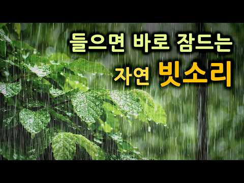
- 설명 앞부분: 싱그러운 초록 잎사귀 위로 떨어지는 맑고 깨끗한 자연의 빗소리입니다. 복잡한 하루의 소음을 지우고, 자연이 주는 가장 평온한 빗소리에 귀를 기울여 보세요. 깊고 편안한 잠이 필요할 때, 혹은 학업과 업무에 집중하고 싶을 때 이 포근한 빗소리와 함께해 보세요. 오늘 밤도 눈 뜨면 아침이 되는 마법 같은 편안하고 깊은 수면을 취하시길 바랍니다. 오늘도 고생 많으셨습니다. 편안한 밤 되세요. 💤
- 같은 채널 평소 대비 ×111.8 (채널 최근 롱폼 중앙값 4,599회) · 평소 영상: 오늘도 편안한 빗소리로 불면증을 극복하세요. 🌲숲속의 수면 빗소리 ASMR (Rain S… (4,599회) / 잠안올 때 듣는 시원한 빗소리 ASMR 🌿 불면증에 효과있는 백색소음 (Rain Soun… (4,698회)
- 대본 없음 (설명) — 음성인식이 끝나면 도입부·흐름이 들어감
- 댓글 127/127: 좋은 점 — 영상 6 · 감사·응원 11 · 더 알고 싶은 것 0 · 아쉬운 점 — 영상 0 · 반박·불만 — 의견 다름 0 · 정치·사회 0 · 경험 공유 10 · 구독·다음 기대 0
  - 좋은 점 — 영상 👍12 “촉촉하게 비가오는날이면 만물이차분해지고 생명이살아납니다 듣기좋아요”
  - 좋은 점 — 영상 👍7 “빗소리가 기분좋게 들려서 좋은영상 감사합니다”
  - 감사·응원 👍35 “현제 장마철이라서 현제 호우주의보까지내려있는대도 빗소리는 여전히 평안합니다 영상감사합니다😁🎉”
  - 감사·응원 👍7 “빗소리가 기분좋게 들려서 좋은영상 감사합니다”
  - 경험 공유 👍110 “자다 죽어도 여한은 없지만, 다시 사람으로 태어난다면 꼭 우리엄마의 엄마로 태어나고 싶어요😢”

### 78. 𝐏𝐥𝐚𝐲𝐥𝐢𝐬𝐭 도경수 느좋 노래 모음

- https://www.youtube.com/watch?v=9GtuEDTdFus · 오느레 · 구독자 112 · 조회수 17,480 (×156.1, 하루 100.3) · 좋아요 100 (0.6%) · 11.3분 · 2026-04-25 · 주제 묶음 기타 · 형식 플레이리스트·모음 (여러 곡) · 폴더 `W_9GtuEDTdFus` (웹 승인)
- 썸네일: 
- 대본 없음 (없음) — 음성인식이 끝나면 도입부·흐름이 들어감
- 댓글 2/2: 좋은 점 — 영상 0 · 감사·응원 1 · 더 알고 싶은 것 0 · 아쉬운 점 — 영상 0 · 반박·불만 — 의견 다름 0 · 정치·사회 0 · 경험 공유 0 · 구독·다음 기대 0
  - 감사·응원 👍4 “감사합니다 선생님”

### 79. 노래방차트 발라드 2026년 7월 1차 🎤 최신 인기차트 노래모음 ∣ 발라드 플레이리스트

- https://www.youtube.com/watch?v=uedFUZ1kMjk · 오늘의 음악 · 구독자 1,130 · 조회수 174,833 (×154.7, 하루 2,760.0) · 좋아요 444 (0.2%) · 83.2분 · 2026-08-14 · 주제 묶음 9. 가요·발라드·트로트 · 형식 플레이리스트·모음 (여러 곡) · 폴더 `W_uedFUZ1kMjk` (웹 승인)
- 썸네일: 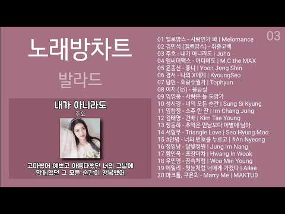
- 설명 앞부분: 2026년 7월 1차 **노래방 인기차트 발라드**를 한곳에서 즐겨보세요. 🎤🎶 감성적인 멜로디와 아름다운 보컬이 돋보이는 **최신 발라드 인기곡과 노래방 추천곡**을 모아 플레이리스트로 준비했습니다. 노래방에서 부르기 좋은 인기 발라드부터 감성적인 최신곡까지 편하게 감상해보세요. 출퇴근, 드라이브, 휴식, 혼자만의 음악 시간은 물론 노래방 선곡에도 잘 어울립니다. 🎧 **노래방차트 발라드 2026년 7월 1차**와 함께 최신 인기곡을 즐겨보세요.
- 대본 없음 (설명) — 음성인식이 끝나면 도입부·흐름이 들어감
- 댓글 8/8: 좋은 점 — 영상 0 · 감사·응원 1 · 더 알고 싶은 것 3 · 아쉬운 점 — 영상 0 · 반박·불만 — 의견 다름 0 · 정치·사회 0 · 경험 공유 1 · 구독·다음 기대 0
  - 감사·응원 👍0 “포장마차 노래 좋네요. 감사합니다.”
  - 더 알고 싶은 것 👍7 “곡마다 가사를알고싶어요”
  - 더 알고 싶은 것 👍4 “ㅂ곡마다 제목을 알고싶어요”

### 80. #장터에핀작은꽃#인생트로트#감성트로트#눈물나는노래#가족사랑#엄마생각#할머니사랑#추억의노래#7080감성#중년감성#인생노래#트로트신곡#AI트로트#트로트추천#감동노래…

- https://www.youtube.com/watch?v=U-J6pNop1bU · 인생 감성 트롯트노래 · 구독자 1,780 · 조회수 274,541 (×154.2, 하루 2,768.2) · 좋아요 1,077 (0.4%) · 4.8분 · 2026-07-09 · 주제 묶음 9. 가요·발라드·트로트 · 형식 한 곡 (뮤직비디오·음원·가사) · 폴더 `W_U-J6pNop1bU` (웹 승인)
- 썸네일: 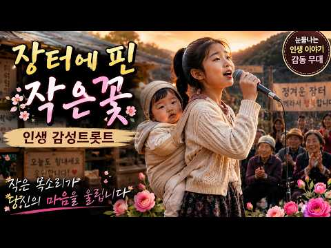
- 설명 앞부분: 유튜브 제목 추천 🌸 장터에 핀 작은 꽃 ∣ 열세 살 소녀가 부르는 인생 감성 트로트 🌸 눈물과 희망으로 피어난 작은 목소리 영상 설명서 어느 오래된 장터 한가운데… 작은 꽃처럼 피어난 한 소녀의 노래가 시작됩니다. 어린 나이지만 마음속에는 깊은 사랑과 그리움이 있고, 엄마와 할머니의 웃는 얼굴을 생각하며 진심을 담아 마이크를 잡았습니다. 세월이 흘러도 사라지지 않는 가족의 사랑, 힘든 인생길 속에서도 다시 피어나는 희망… “작은 꽃도 다시 피듯 우리 인생도 다시 피어납니다.” 열세 살 소녀가 전하는 따뜻한 감성 트로트, 오늘 당…
- 대본 없음 (설명) — 음성인식이 끝나면 도입부·흐름이 들어감
- 댓글 18/18: 좋은 점 — 영상 1 · 감사·응원 3 · 더 알고 싶은 것 0 · 아쉬운 점 — 영상 0 · 반박·불만 — 의견 다름 0 · 정치·사회 0 · 경험 공유 0 · 구독·다음 기대 0
  - 좋은 점 — 영상 👍0 “가슴에 와닿네요”
  - 감사·응원 👍10 “노래가마음이아프네요소녀가꿈울안고갑니다힘네세요영사감사합니다❤❤구독”
  - 감사·응원 👍3 “장터에핀작은꽃 노래좋아요 눈시울이 붉어졌습니다 감사합니다”

