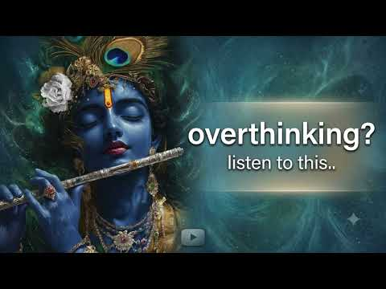
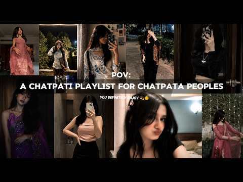
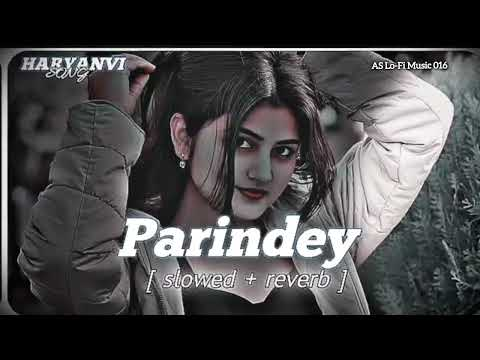
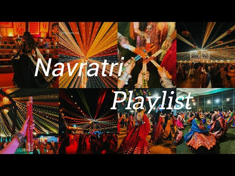
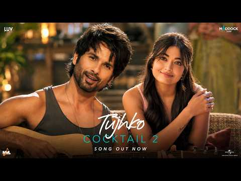
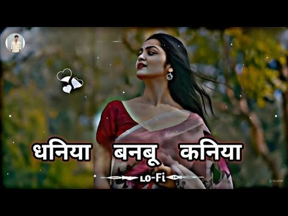
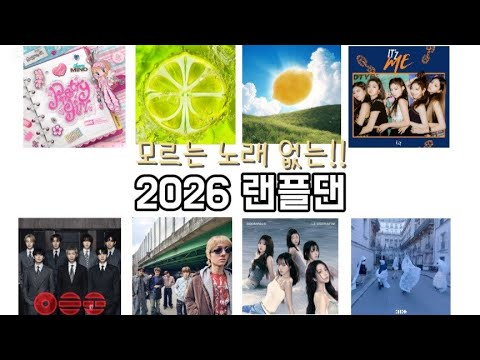
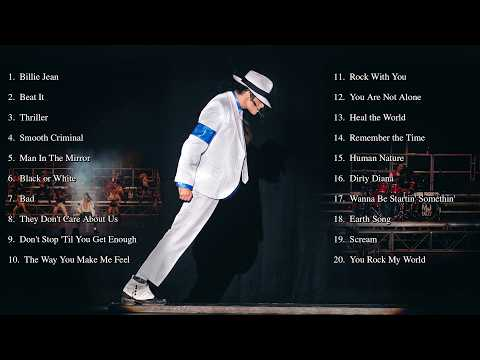

# 음악 — 성공 사례 분석: 사례별 자세히 #81–#120

`analysis.md` 의 9번 (같은 # 번호). 자동 생성 — `tools/success_analysis.py` v1.4.1 (2026-10-18 08:09 UTC). ※ 연구·교육용 — 투자 권유가 아님.

### 81. Phonk/funk playlist bcz I’m bored (Timestaps)

- https://www.youtube.com/watch?v=8AXBNw3EGu8 · 1vy_x · 구독자 5,110 · 조회수 2,804,452 (×548.8, 하루 18,877.2) · 좋아요 27,907 (1.0%) · 9.8분 · 2026-05-22 · 주제 묶음 기타 · 형식 플레이리스트·모음 (여러 곡) · 폴더 `W_8AXBNw3EGu8` (웹 승인)
- 썸네일: 
- 챕터: 0:00 montagem fearless · 0:16 montagem sethron · 0:29 Vazio eterno · 0:47 Eclipser · 1:04 montagem tenta · 1:25 montagem abnormal · 2:03 montagem domer · 2:20 nervy funk · 2:39 funk de beleza · 3:10 NO REPLY · 3:25 metamorphosis · 3:41 dream funk · 3:55 heavenly jumpstyle · 4:09 fight night cypher · 4:24 VIOLENTO · 4:42 montagem alquima · 4:56 retolam funk · 5:12 crazy story x lunar diamanté … · 5:29 psychosis- ultra slowed · 5:43 cuando de te moja la tarea 2
- 설명 앞부분: New playlist !! The quality might have been downgraded, or else the playlist wouldn’t download. Hope you guys like it !! (I’m sorry if there’s problems with the sound or if some parts are too loud, I tried doing my best) Timestaps !!
- 대본 없음 (설명) — 음성인식이 끝나면 도입부·흐름이 들어감
- 댓글 304/301: 좋은 점 — 영상 0 · 감사·응원 0 · 더 알고 싶은 것 0 · 아쉬운 점 — 영상 0 · 반박·불만 — 의견 다름 0 · 정치·사회 0 · 경험 공유 0 · 구독·다음 기대 0

### 82. Sanson Ki Mala Pe (Slowed & Emotional Version) ∣ Hindi Love Song

- https://www.youtube.com/watch?v=7y_L2sW-3J4 · Karela Records · 구독자 4,360 · 조회수 2,378,660 (×545.6, 하루 17,714.6) · 좋아요 8,360 (0.4%) · 7.3분 · 2026-06-06 · 주제 묶음 기타 · 형식 음악 (그 밖 모양 — 한 편짜리 BGM 등) · 폴더 `W_7y_L2sW-3J4` (웹 승인)
- 썸네일: 
- 설명 앞부분: Presenting “Sanson Ki Mala Pe (New Version)” — a soulful and emotional Hindi romantic song filled with love, feelings and heart touching melody. ❤ Feel the magic of emotions, deep lyrics and soothing music in this brand new version. 🎧 Use Headphones For Best Experience 💖 Don’t Forget To Like, Share…
- 대본 없음 (설명) — 음성인식이 끝나면 도입부·흐름이 들어감
- 댓글 92/92: 좋은 점 — 영상 0 · 감사·응원 0 · 더 알고 싶은 것 0 · 아쉬운 점 — 영상 0 · 반박·불만 — 의견 다름 0 · 정치·사회 0 · 경험 공유 0 · 구독·다음 기대 0

### 83. DESI PUNJABI PLAYLIST THAT GETS YOUR VIBE 😌🎧

- https://www.youtube.com/watch?v=JQ922u24pH8 · Your April · 구독자 3,210 · 조회수 1,749,237 (×544.9, 하루 12,122.1) · 좋아요 13,792 (0.8%) · 11.4분 · 2026-05-27 · 주제 묶음 기타 · 형식 플레이리스트·모음 (여러 곡) · 폴더 `W_JQ922u24pH8` (웹 승인)
- 썸네일: 
- 챕터: 0:00 01:42 - For a Reason · 1:42 03:01 - One Love · 3:01 04:31 - Naah Goriye · 4:31 05:50 - Tauba tauba · 5:50 07:52 - Softly · 7:52 09:16 - Boyfriend · 9:16 10:12 - Wakhra swag ni · 10:12 11:21 - Qutal
- 설명 앞부분: TIMESTAMPS 👇🏻 HASHTAG 👇🏻 COPYRIGHT DISCLAIMER 👇🏻 All the songs used in this playlist belong to their respective owners. I do not own any of the audio or visuals included. This playlist is created for entertainment and promotional purposes only. No copyright infringement intended. If you are the rig…
- 대본 없음 (설명) — 음성인식이 끝나면 도입부·흐름이 들어감
- 댓글 393/392: 좋은 점 — 영상 0 · 감사·응원 0 · 더 알고 싶은 것 0 · 아쉬운 점 — 영상 0 · 반박·불만 — 의견 다름 0 · 정치·사회 0 · 경험 공유 0 · 구독·다음 기대 0

### 84. Overthinking? Listen To This Krishna Flute Music & Stop Worrying Instantly 🕉️

- https://www.youtube.com/watch?v=Pckh0r0bGAM · Dhwani · 구독자 1,420 · 조회수 767,365 (×540.4, 하루 5,911.0) · 좋아요 7,553 (1.0%) · 8분 · 2026-06-10 · 주제 묶음 기타 · 형식 음악 (그 밖 모양 — 한 편짜리 BGM 등) · 폴더 `W_Pckh0r0bGAM` (웹 승인)
- 썸네일: 
- 설명 앞부분: Are you caught up in a loop of overthinking, anxiety, or stress? Take a deep breath, sit back, and let the divine melody of Lord Krishna’s flute wash your worries away. In the Bhagavad Gita, Sri Krishna teaches us the art of letting go and trusting the divine flow of the universe. This peaceful, so…
- 대본 없음 (설명) — 음성인식이 끝나면 도입부·흐름이 들어감
- 댓글 134/134: 좋은 점 — 영상 0 · 감사·응원 0 · 더 알고 싶은 것 0 · 아쉬운 점 — 영상 0 · 반박·불만 — 의견 다름 0 · 정치·사회 0 · 경험 공유 0 · 구독·다음 기대 0

### 85. Barsaat 🌧️∣ All Trending Songs ∣ Taare x Samjho Na x Safar x Bairan x Zulfein x Sahiba x …

- https://www.youtube.com/watch?v=41HX_5G6eqQ · Voxwaves · 구독자 13,600 · 조회수 7,306,932 (×537.3, 하루 177,022.0) · 좋아요 92,822 (1.3%) · 22.9분 · 2026-09-07 · 주제 묶음 8. 로파이·시티팝·칠 · 형식 플레이리스트·모음 (여러 곡) · 폴더 `W_41HX_5G6eqQ` (웹 승인)
- 썸네일: 
- 챕터: 0:00 Barsaat 🌧️ · 0:59 Taare ⭐ · 1:19 Samjho Na ❤️ · 2:35 Safar 🌙 · 3:45 Bairan 💔 · 5:59 Zulfein ✨ · 9:19 Sahiba ❤️ · 11:56 Majboor 🥀
- 설명 앞부분: Barsaat 🌧️ ∣ All Trending Hindi Songs 2026 🎧 ∣ Taare x Samjho Na x Safar x Bairan x Zulfein x Sahiba x Majboor ∣ Lofi & Slowed Reverb 🌧️ Barsaat ∣ All Trending Hindi Songs 2026 🎧❤ Welcome to Voxwaves — your destination for trending Hindi songs, romantic vibes, emotional melodies and relaxing Lofi /…
- 대본 없음 (설명) — 음성인식이 끝나면 도입부·흐름이 들어감
- 댓글 1,062/1,007: 좋은 점 — 영상 0 · 감사·응원 0 · 더 알고 싶은 것 0 · 아쉬운 점 — 영상 0 · 반박·불만 — 의견 다름 0 · 정치·사회 0 · 경험 공유 0 · 구독·다음 기대 0

### 86. You’ll Sleep Like a Child in Hanuman’s Protection ∣ Soft Hanuman Chalisa #bhakti #hanuman

- https://www.youtube.com/watch?v=oSeh-sXFCTM · Sanatan Jug · 구독자 5,540 · 조회수 2,975,270 (×537.0, 하루 18,049.5) · 좋아요 25,464 (0.9%) · 111.6분 · 2026-05-06 · 주제 묶음 1. 수면·명상·힐링 · 형식 한 곡 (뮤직비디오·음원·가사) · 폴더 `W_oSeh-sXFCTM` (웹 승인)
- 썸네일: 
- 설명 앞부분: Drift into a peaceful slumber with this calming blend of ambient music and sleep sounds, designed for deep sleep and ultimate sleep relaxation. Let the serene night visuals of Hanuman under a starry night guide you to tranquility. 🙏✨ The slow, soothing recitation plays gently in the background, all…
- 대본 없음 (설명) — 음성인식이 끝나면 도입부·흐름이 들어감
- 댓글 399/398: 좋은 점 — 영상 0 · 감사·응원 0 · 더 알고 싶은 것 0 · 아쉬운 점 — 영상 0 · 반박·불만 — 의견 다름 0 · 정치·사회 0 · 경험 공유 0 · 구독·다음 기대 0

### 87. Old Punjabi Bangers ∣ Punjabi Hits Playlist ∣ Still Cookin

- https://www.youtube.com/watch?v=rJgcNE-7emM · STILL COOKIN · 구독자 3,420 · 조회수 1,831,003 (×535.4, 하루 18,053.7) · 좋아요 17,685 (1.0%) · 14.1분 · 2026-07-08 · 주제 묶음 기타 · 형식 플레이리스트·모음 (여러 곡) · 폴더 `W_rJgcNE-7emM` (웹 승인)
- 썸네일: 
- 챕터: 0:00 Laden · 0:45 5 Taara · 1:15 Veervaar · 2:36 Raat Di Gedi · 3:18 Good Luck Charm · 3:41 Dhol Jageero Da · 4:16 Patiala Peg · 4:54 Dil Luteya · 6:05 Odhi Ankh Bhi Kamini, Mera Di… · 6:33 Gabru · 7:09 Kafka · 7:42 Wakhra Swag · 8:43 One Love · 10:03 Lak Tunu Tunu · 10:30 Surmedaani · 11:25 Suit Suit · 12:07 High Rated Gabru · 13:05 Lahore
- 설명 앞부분: Playlist: Artwork – pankuucurates Keywords: ( Ignore ) Old Punjabi Bangers Pt. 1, Old Punjabi Bangers, Punjabi Playlist, Best Punjabi Songs, Punjabi Hits, Punjabi Party Songs, Punjabi Music, Punjabi DJ Songs, Punjabi Dance Songs, Evergreen Punjabi Songs, Punjabi Classics, Bhangra Songs, Wedding Son…
- 대본 없음 (설명) — 음성인식이 끝나면 도입부·흐름이 들어감
- 댓글 107/104: 좋은 점 — 영상 0 · 감사·응원 0 · 더 알고 싶은 것 0 · 아쉬운 점 — 영상 0 · 반박·불만 — 의견 다름 0 · 정치·사회 0 · 경험 공유 0 · 구독·다음 기대 0

### 88. Me Sunti Rahu 💭🎶 ∣ Heart Touching Lofi Song (Slowed + Reverb)

- https://www.youtube.com/watch?v=TKMu6Wg396c · 𝕃𝕠𝕤𝕥_𝕗𝕖𝕖𝕝𝕚𝕟𝕘𝕤_𝕓𝕖𝕒𝕥𝕤_∅⁷ · 구독자 4,620 · 조회수 2,422,094 (×524.3, 하루 17,574.6) · 좋아요 15,806 (0.7%) · 5.7분 · 2026-06-02 · 주제 묶음 8. 로파이·시티팝·칠 · 형식 음악 (그 밖 모양 — 한 편짜리 BGM 등) · 폴더 `W_TKMu6Wg396c` (웹 승인)
- 썸네일: 
- 챕터: 0:00 Intro & Soft Beats · 2:30 Main Melody · 5:45 Rain & Piano Layer · 9:20 Deep Chill Section · 12:50 Gentle Outro
- 설명 앞부분: Me Sunti Rahu 💭🎶 ∣ Heart Touching Lofi Song (Slowed + Reverb) “Main sunti rahu, aur waqt tham sa jaye 🌙 Me Sunti Rahu 💭🎶 ∣ Heart Touching Lofi Song (Slowed + Reverb) Soft melodies, deep emotions & peaceful vibes for late-night listening and soulful moments 🎧💖” ✨ Feel every note, cherish every memor…
- 대본 없음 (설명) — 음성인식이 끝나면 도입부·흐름이 들어감
- 댓글 389/389: 좋은 점 — 영상 0 · 감사·응원 0 · 더 알고 싶은 것 0 · 아쉬운 점 — 영상 0 · 반박·불만 — 의견 다름 0 · 정치·사회 0 · 경험 공유 0 · 구독·다음 기대 0

### 89. ✨️𝐬𝐨𝐧𝐠𝐬 𝐭𝐡𝐚𝐭 𝐦𝐚𝐤𝐞 𝐥𝐢𝐟𝐞 𝐟𝐞𝐞𝐥 𝐥𝐢𝐤𝐞 𝐚 𝐥𝐨𝐯𝐞 𝐬𝐭𝐨𝐫𝐲 ∣ aesthetic hindi playlist

- https://www.youtube.com/watch?v=GMF0FN2nrBw · Echoess of unity 🎶 · 구독자 6,140 · 조회수 3,214,379 (×523.5, 하루 23,332.2) · 좋아요 36,361 (1.1%) · 18.6분 · 2026-06-02 · 주제 묶음 기타 · 형식 플레이리스트·모음 (여러 곡) · 폴더 `W_GMF0FN2nrBw` (웹 승인)
- 썸네일: 
- 챕터: 0:00 humsafar · 2:18 dooron dooron · 4:26 tere liye · 6:58 majboor · 7:52 finding her · 9:21 sitaare · 11:25 mai agar kahoon · 14:10 meri zindgi hai tu · 15:02 ishq bulava · 16:10 teri deewani
- 설명 앞부분: Some songs don't just play in the background—they turn ordinary moments into scenes from a love story. 🌙💕 This playlist is filled with dreamy Hindi songs, late-night melodies, soft romantic vibes, and timeless Bollywood tracks that make life feel a little more magical. Whether you're watching the r…
- 대본 없음 (설명) — 음성인식이 끝나면 도입부·흐름이 들어감
- 댓글 409/408: 좋은 점 — 영상 0 · 감사·응원 0 · 더 알고 싶은 것 0 · 아쉬운 점 — 영상 0 · 반박·불만 — 의견 다름 0 · 정치·사회 0 · 경험 공유 0 · 구독·다음 기대 0

### 90. Ankhiyon Ke Jharokhon Se ∣ Soft Classic Instrumental 🎶 ∣ Old Is Gold Evergreen Melody ✨

- https://www.youtube.com/watch?v=KCgBk52MuY8 · Saaz-e-Dil · 구독자 1,930 · 조회수 1,002,296 (×519.3, 하루 7,969.6) · 좋아요 4,895 (0.5%) · 4.5분 · 2026-06-14 · 주제 묶음 6. 피아노·클래식·연주곡 · 형식 정보·해설 (그 밖) · 폴더 `W_KCgBk52MuY8` (웹 승인)
- 썸네일: 
- 설명 앞부분: Description: 🌸 Ankhiyon Ke Jharokhon Se ∣ Soft Classic Instrumental ∣ Old Is Gold Evergreen Melody 🌸 Dil ko sukoon dene wali is khoobsurat instrumental melody mein aapka swagat hai. Ankhiyon Ke Jharokhon Se ki yaadon ko ek naye andaaz mein mehsoos kijiye, jahan har sur purane sunahre daur ki meethi…
- 대본 없음 (설명) — 음성인식이 끝나면 도입부·흐름이 들어감
- 댓글 127/127: 좋은 점 — 영상 0 · 감사·응원 0 · 더 알고 싶은 것 0 · 아쉬운 점 — 영상 0 · 반박·불만 — 의견 다름 0 · 정치·사회 0 · 경험 공유 0 · 구독·다음 기대 0

### 91. Noah Kahan - Orbiter (Official Lyric Video)

- https://www.youtube.com/watch?v=OFcKm-5jSQE · NoahKahanVEVO · 구독자 29,700 · 조회수 15,220,212 (×512.5, 하루 86,312.0) · 좋아요 95,949 (0.6%) · 4.8분 · 2026-04-25 · 주제 묶음 기타 · 형식 한 곡 (뮤직비디오·음원·가사) · 폴더 `W_OFcKm-5jSQE` (웹 승인)
- 썸네일: 
- 설명 앞부분: Official Lyric Video for “Orbiter” by Noah Kahan Follow Noah Kahan: Creative Direction: Mikey Lavi Animation: Grace Hartrick Photography: Patrick McCormack Lyrics: I look exhausted, oh stiff and awkward on the outside of the moment It’s not my first time bitter drunk on a red carpet Or my first tim…
- 대본 없음 (설명) — 음성인식이 끝나면 도입부·흐름이 들어감
- 댓글 1,405/1,405: 좋은 점 — 영상 0 · 감사·응원 0 · 더 알고 싶은 것 0 · 아쉬운 점 — 영상 0 · 반박·불만 — 의견 다름 0 · 정치·사회 0 · 경험 공유 0 · 구독·다음 기대 0

### 92. [𝐏𝐥𝐚𝐲𝐥𝐢𝐬𝐭] 그리고 난 다시 사랑에 빠질수 밖에 없었어

- https://www.youtube.com/watch?v=cIlJK2Pfhm8 · 느좋을 추구합니다 · 구독자 1,030 · 조회수 527,120 (×511.8, 하루 9,256.6) · 좋아요 12,134 (2.3%) · 18.1분 · 2026-08-22 · 주제 묶음 기타 · 형식 플레이리스트·모음 (여러 곡) · 폴더 `W_cIlJK2Pfhm8` (웹 승인)
- 썸네일: 
- 대본 없음 (없음) — 음성인식이 끝나면 도입부·흐름이 들어감
- 댓글 177/177: 좋은 점 — 영상 1 · 감사·응원 7 · 더 알고 싶은 것 2 · 아쉬운 점 — 영상 0 · 반박·불만 — 의견 다름 0 · 정치·사회 0 · 경험 공유 23 · 구독·다음 기대 1
  - 좋은 점 — 영상 👍6 “전여친인 나지만 언제나 너가 보고싶어 뒤에서 너 소문 정리해주고 내가 망가지면서 까지 널 위하고 잇어 너 유예설이랑 비밀연애하는거 나만 안다? 너 팔목에 민트색 머리끈 그거 유예설 꺼잖아 유예설 나랑 얼마나 친한지는 아는거지 ? 왜 꼭 유예설이야. 유예설이 솔직히 우…”
  - 감사·응원 👍1 “ㅣ거 요즘 내 최애 플리임 감사합니다 항상 들으면서 자요 !!”
  - 감사·응원 👍1 “학 진짜ㅜ감사해여”
  - 더 알고 싶은 것 👍1 “요즘 매일매일 듣는 최애 플리에요 너무너무 좋아여 앞으로 플리 좋은 플리 부탁드립니다🥺🥺”
  - 더 알고 싶은 것 👍0 “채널모토가 저랑잘맞으시네여.. 앞으로도 느좋남마니올려주세요”
  - 경험 공유 👍524 “내가 너까지 잃어야해?”
  - 경험 공유 👍12 “작년에 너가 하늘색 좋아한대서 하늘색 좋아했는데 나 아직도 하늘색이 제일 좋아 너가 알아봐줄까봐 일년째 신발 키링 노트 배경화면 다 하늘색이야”
  - 구독·다음 기대 👍1 “요즘 매일매일 듣는 최애 플리에요 너무너무 좋아여 앞으로 플리 좋은 플리 부탁드립니다🥺🥺”

### 93. If you want to dance...🩰✨watch this playlist💃❣️ #bollywood #bollywoodmix #trending

- https://www.youtube.com/watch?v=x0br2Hc-4G8 · LyricVibes~ · 구독자 6,060 · 조회수 3,099,953 (×511.5, 하루 21,389.7) · 좋아요 35,809 (1.2%) · 24.4분 · 2026-05-26 · 주제 묶음 기타 · 형식 플레이리스트·모음 (여러 곡) · 폴더 `W_x0br2Hc-4G8` (웹 승인)
- 썸네일: 
- 설명 앞부분: Bollywood mix 2026 Bollywood dance hits 2026 Hope You Guyz Enjoy The Playlist🫶💕 Music Credits : Original Artist Picture credit : original owner Edits Credit : LyricVibes254😉 Disclaimer : Under Section 107 of the Copyright Act 1976, allowance is made for fair use for purposes such as criticism, comm…
- 대본 없음 (설명) — 음성인식이 끝나면 도입부·흐름이 들어감
- 댓글 380/379: 좋은 점 — 영상 0 · 감사·응원 0 · 더 알고 싶은 것 0 · 아쉬운 점 — 영상 0 · 반박·불만 — 의견 다름 0 · 정치·사회 0 · 경험 공유 0 · 구독·다음 기대 0

### 94. 💋 A Chatpati Playlist Only For Chatpata People 😋✨ ∣ Ultimate Vibe Songs Playlist 🎧💖

- https://www.youtube.com/watch?v=3FhXwFGVaDE · JellyBloxify · 구독자 33,100 · 조회수 16,841,548 (×508.8, 하루 125,578.6) · 좋아요 111,102 (0.7%) · 7.5분 · 2026-06-06 · 주제 묶음 1. 수면·명상·힐링 · 형식 플레이리스트·모음 (여러 곡) · 폴더 `W_3FhXwFGVaDE` (웹 승인)
- 썸네일: 
- 챕터: 0:00 Caller Tune · 0:54 Chittiyan calliyan · 1:29 Ooh La La · 2:13 Genda Phool · 2:50 Afghan Jalebi · 3:38 Jhalla Wllah · 4:04 Udi Udi · 4:49 Pinky · 5:35 Pink Lips · 6:42 Love Letter
- 설명 앞부분: Welcome to the ultimate Chatpati Playlist made especially for all the Chatpata People out there! 💋🌶️ This playlist is packed with aesthetic, feel-good, romantic, energetic, and mood-boosting songs that will keep your vibe alive from start to finish. 🎧❤️‍🔥 Whether you're chilling alone, scrolling la…
- 대본 없음 (설명) — 음성인식이 끝나면 도입부·흐름이 들어감
- 댓글 2,208/2,197: 좋은 점 — 영상 0 · 감사·응원 1 · 더 알고 싶은 것 1 · 아쉬운 점 — 영상 0 · 반박·불만 — 의견 다름 0 · 정치·사회 0 · 경험 공유 0 · 구독·다음 기대 0

### 95. Parindey (Slowed + Reverb) ∣ Haryanvi Lofi Song 🎧 Chill Vibes

- https://www.youtube.com/watch?v=v8CKkI20B2s · AS LO-FI Music 016 · 구독자 3,740 · 조회수 1,897,352 (×507.3, 하루 11,013.4) · 좋아요 7,010 (0.4%) · 4.1분 · 2026-04-29 · 주제 묶음 8. 로파이·시티팝·칠 · 형식 음악 (그 밖 모양 — 한 편짜리 BGM 등) · 폴더 `W_v8CKkI20B2s` (웹 승인)
- 썸네일: 
- 설명 앞부분: Parindey (Slowed + Reverb) ∣ Haryanvi Lofi Song 🎧 Chill Vibes Parindey (Slowed + Reverb) Haryanvi Lofi Song 🎧 Aaj ka yeh lofi remix aapko ek calm aur relaxing vibe dega. Agar aap night me headphones laga kar chill karna pasand karte ho, to yeh track perfect hai 🌙✨ 🎶 Use headphones for best experien…
- 대본 없음 (설명) — 음성인식이 끝나면 도입부·흐름이 들어감
- 댓글 150/150: 좋은 점 — 영상 0 · 감사·응원 0 · 더 알고 싶은 것 0 · 아쉬운 점 — 영상 0 · 반박·불만 — 의견 다름 0 · 정치·사회 0 · 경험 공유 0 · 구독·다음 기대 0

### 96. 🍂 가을이 오면 생각나는 노래 ∣ 커피 한 잔과 함께 듣는 가을 감성 플레이리스트 ☕

- https://www.youtube.com/watch?v=Fc7JJxJBgJA · enuscento-에뉴센토  · 구독자 710 · 조회수 360,087 (×507.2, 하루 8,013.0) · 좋아요 963 (0.3%) · 114.3분 · 2026-09-03 · 주제 묶음 4. 카페·매장·라운지 · 형식 플레이리스트·모음 (여러 곡) · 폴더 `W_Fc7JJxJBgJA` (웹 승인)
- 썸네일: 
- 챕터: 0:00 커피가 식기 전에 · 5:52 조금 더 걷고 싶어 · 10:16 이 계절이 멈췄으면 · 15:25 우리 오늘부터 · 23:25 우리 조금 늦게 만났다면 · 28:11 우리 왜 이럴까 · 32:44 오늘도 너에게 가는 길 · 37:31 바람이 너를 데려오면 · 43:49 말하지 못한 마음 · 48:25 다음 가을에도 · 53:20 다시 좋은 날 · 58:14 네가 웃던 오후 · 65:18 너의 온도 42도 · 70:35 너와 걷던 가을 길 · 75:32 너란 이유, 너에게 가다 · 80:34 낙엽처럼 · 84:39 그리고 다시 나의 계절 · 89:46 그날 우리는 · 95:23 같은 길, 다른 마음 · 99:38 가을편지
- 설명 앞부분: 🍂 가을이 오면, 괜히 생각나는 사람이 있습니다. 조금 선선해진 바람, 천천히 식어가는 커피 한 잔, 낙엽이 떨어지는 길을 걷다 보면 문득 떠오르는 사람과 그때의 우리. 사랑이 시작되던 순간부터 말하지 못했던 마음, 그리고 시간이 지나도 남아 있는 그리움까지. 카페에서 조용히 시간을 보내고 싶을 때, 가을길을 혼자 걷고 싶을 때, 운전하며 창밖의 풍경을 바라볼 때 편하게 틀어두고 들어보세요. ☕🍁 🎧 총 22곡 🍂 Autumn Emotional Playlist ☕ Coffee · Love · Walk · Memories 🎵 PLA…
- 같은 채널 평소 대비 ×1,150.4 (채널 최근 롱폼 중앙값 313회) · 평소 영상: 🏨 고급 호텔 로비에서 흘러나올 것 같은 음악 ∣ 우아한 클래식 & 피아노 (316회) / [Workout Playlist] 운동 시작 3초 만에 텐션 올라가는 팝💪 헬스, 러닝,… (310회)
- 대본 없음 (설명) — 음성인식이 끝나면 도입부·흐름이 들어감
- 댓글 62/62: 좋은 점 — 영상 2 · 감사·응원 1 · 더 알고 싶은 것 2 · 아쉬운 점 — 영상 0 · 반박·불만 — 의견 다름 0 · 정치·사회 0 · 경험 공유 0 · 구독·다음 기대 1
  - 좋은 점 — 영상 👍0 “커피 한 잔과 함께 추억을 회상하기에 편안하게 듣기 좋은 곡들에 마음을 차분하게 해주는 가을 분위기가 가득하네요.. 오래 머물다 갑니다.~”
  - 좋은 점 — 영상 👍0 “가을에 딱 듣기 좋은 음악이네요. 감사합니다.”
  - 감사·응원 👍0 “가을에 딱 듣기 좋은 음악이네요. 감사합니다.”
  - 더 알고 싶은 것 👍0 “너무잘들었습니다. 덕분에 하루종일 기분좋게 보냈어요 이런노래 어디서만드셨나요?”
  - 더 알고 싶은 것 👍0 “노래도넘좋고 여자남자보컬너무좋네요 제목 가수 모두알고싶어요”
  - 구독·다음 기대 👍3 “한글 가사가 왠지 반갑네요~ 구독했어요~”

### 97. ○ Bollywood navratri song playlist ○ #navratri #garbasongs #bollywoodsongs

- https://www.youtube.com/watch?v=g9nj1SDsXng · july_luna · 구독자 4,540 · 조회수 2,295,070 (×505.5, 하루 83,146.3) · 좋아요 23,827 (1.0%) · 18.9분 · 2026-09-20 · 주제 묶음 기타 · 형식 플레이리스트·모음 (여러 곡) · 폴더 `W_g9nj1SDsXng` (웹 승인)
- 썸네일: 
- 대본 없음 (없음) — 음성인식이 끝나면 도입부·흐름이 들어감
- 댓글 102/101: 좋은 점 — 영상 0 · 감사·응원 0 · 더 알고 싶은 것 0 · 아쉬운 점 — 영상 0 · 반박·불만 — 의견 다름 0 · 정치·사회 0 · 경험 공유 0 · 구독·다음 기대 0

### 98. 𝙥𝙡𝙖𝙮𝙡𝙞𝙨𝙩 slavic

- https://www.youtube.com/watch?v=49A1aj-uIcs · aa · 구독자 1,540 · 조회수 773,200 (×502.1, 하루 7,915.2) · 좋아요 20,603 (2.7%) · 16.8분 · 2026-07-12 · 주제 묶음 기타 · 형식 플레이리스트·모음 (여러 곡) · 폴더 `W_49A1aj-uIcs` (웹 승인)
- 썸네일: 
- 챕터: 0:00 Мой мармеладный · 3:20 Базовый минимум · 5:34 Ева · 8:52 Я сошла с ума · 12:27 Dead inside · 14:31 ВИРТУАЛЬНАЯ ЛЮБОВЬ
- 설명 앞부분: playlist for slavic girls vibe (Not slavic music playlist)
- 대본 없음 (설명) — 음성인식이 끝나면 도입부·흐름이 들어감
- 댓글 191/188: 좋은 점 — 영상 0 · 감사·응원 0 · 더 알고 싶은 것 0 · 아쉬운 점 — 영상 0 · 반박·불만 — 의견 다름 0 · 정치·사회 1 · 경험 공유 3 · 구독·다음 기대 0
  - 정치·사회 👍26 “난 한국인인데 한국 사람들한탠 이런 이미지가 없단게 너무 슬프다 러시아나 다른 나라들의 사람들이라 하면 다들 각자의 신비롭고 그런 이미지들이 있는데 한국인이라고 하면 그냥 kpop이니 뭐니 하는 그런 재미없고 오글거리는것들밖에 없으니까 너무 아쉬움 정부가 한국콘텐츠진…”
  - 경험 공유 👍907 “내가 찾던 러시아 노래 여기 다 있음”
  - 경험 공유 👍266 “내가들은러시아플리중가장좋음”

### 99. Ishq x Pal Pal Endless Mashup (Slowed + Reverb) - Afusic x Abdullah Faheem x Talha Anjum …

- https://www.youtube.com/watch?v=h231qlqI-dg · Lost In Lyrics · 구독자 1,090 · 조회수 546,184 (×501.1, 하루 5,470.6) · 좋아요 3,392 (0.6%) · 27.6분 · 2026-07-10 · 주제 묶음 8. 로파이·시티팝·칠 · 형식 한 곡 (뮤직비디오·음원·가사) · 폴더 `W_h231qlqI-dg` (웹 승인)
- 썸네일: 
- 설명 앞부분: 🎧 Use Headphones for the Best Experience. Experience the emotional journey of Ishq x Pal Pal Endless Mashup (Slowed + Reverb) featuring Afusic, Abdullah Faheem, Talha Anjum, Anuv Jain, and AP Dhillon. This heart-touching mashup blends soothing lofi vibes with slowed + reverb effects, making it perf…
- 대본 없음 (설명) — 음성인식이 끝나면 도입부·흐름이 들어감
- 댓글 109/109: 좋은 점 — 영상 0 · 감사·응원 0 · 더 알고 싶은 것 0 · 아쉬운 점 — 영상 0 · 반박·불만 — 의견 다름 0 · 정치·사회 0 · 경험 공유 0 · 구독·다음 기대 0

### 100. Arijit Singh - Tujhko (from Cocktail 2) Rashmika Mandanna, Shahid Kapoor & Kriti ∣ Love S…

- https://www.youtube.com/watch?v=WWIfHemqSEA · iPop Superhits · 구독자 47,300 · 조회수 23,689,756 (×500.8, 하루 174,049.7) · 좋아요 95,019 (0.4%) · 5.6분 · 2026-06-04 · 주제 묶음 기타 · 형식 한 곡 (뮤직비디오·음원·가사) · 폴더 `W_WWIfHemqSEA` (웹 승인)
- 썸네일: 
- 설명 앞부분: ✨ Presenting a special tribute to "Tujhko" – the beautifully soulful and romantic track from the upcoming movie Cocktail 2! Featuring the incredible chemistry of Shahid Kapoor and Rashmika Mandanna, this song beautifully blends romance with deep emotion. If you love this track as much as I do, don'…
- 대본 없음 (설명) — 음성인식이 끝나면 도입부·흐름이 들어감
- 댓글 1,133/1,130: 좋은 점 — 영상 0 · 감사·응원 0 · 더 알고 싶은 것 0 · 아쉬운 점 — 영상 0 · 반박·불만 — 의견 다름 0 · 정치·사회 0 · 경험 공유 0 · 구독·다음 기대 0

### 101. I'm Tired Of Loving You - Golden Lace Ballads ∣ Classic Country Ballad ∣ Lyric Video

- https://www.youtube.com/watch?v=URrqbWhzzMU · Golden Lace Ballads · 구독자 3,140 · 조회수 1,549,637 (×493.5, 하루 10,549.6) · 좋아요 4,730 (0.3%) · 5.8분 · 2026-05-24 · 주제 묶음 기타 · 형식 한 곡 (뮤직비디오·음원·가사) · 폴더 `W_URrqbWhzzMU` (웹 승인)
- 썸네일: 
- 설명 앞부분: “I’m Tired Of Loving You” is a heartfelt classic country ballad about betrayal, heartbreak, and finally finding the strength to let go. After giving everything to a love built on lies, the heart slowly realizes it can’t keep hurting forever. 🤠🎶 🎶 Genre: Classic Country Ballad 💔 Theme: Betrayal, Tox…
- 대본 없음 (설명) — 음성인식이 끝나면 도입부·흐름이 들어감
- 댓글 361/360: 좋은 점 — 영상 0 · 감사·응원 0 · 더 알고 싶은 것 0 · 아쉬운 점 — 영상 0 · 반박·불만 — 의견 다름 0 · 정치·사회 0 · 경험 공유 0 · 구독·다음 기대 0

### 102. Baddie playlist 💋✨Aura+99999∣ SanviEditz #songplaylist

- https://www.youtube.com/watch?v=p8u1URNm4ao · ♡𝑺𝒂𝒏𝒗𝒊𝑬𝒅𝒊𝒕𝒛♡ · 구독자 4,820 · 조회수 2,358,712 (×489.4, 하루 56,187.3) · 좋아요 31,387 (1.3%) · 8.1분 · 2026-09-06 · 주제 묶음 기타 · 형식 플레이리스트·모음 (여러 곡) · 폴더 `W_p8u1URNm4ao` (웹 승인)
- 썸네일: 
- 대본 없음 (없음) — 음성인식이 끝나면 도입부·흐름이 들어감
- 댓글 2,195/2,102: 좋은 점 — 영상 0 · 감사·응원 1 · 더 알고 싶은 것 0 · 아쉬운 점 — 영상 0 · 반박·불만 — 의견 다름 0 · 정치·사회 0 · 경험 공유 0 · 구독·다음 기대 0
  - 감사·응원 👍0 “❤❤❤❤매우 감사합니다”

### 103. धनियां बनबू कनियाँ - Lofi Song ∣∣ Khesari Lal Yadav ∣∣ Dilwala (Slowed+Reverb) ∣ SANJAY_M…

- https://www.youtube.com/watch?v=s-1MerBYomA · ꧁༒乙x°᭄Ᏼᴀʙᴜ࿐ · 구독자 3,840 · 조회수 1,877,687 (×489.0, 하루 35,216.6) · 좋아요 9,411 (0.5%) · 5.1분 · 2026-08-26 · 주제 묶음 8. 로파이·시티팝·칠 · 형식 음악 (그 밖 모양 — 한 편짜리 BGM 등) · 폴더 `W_s-1MerBYomA` (웹 승인)
- 썸네일: 
- 대본 없음 (없음) — 음성인식이 끝나면 도입부·흐름이 들어감
- 댓글 267/267: 좋은 점 — 영상 0 · 감사·응원 0 · 더 알고 싶은 것 0 · 아쉬운 점 — 영상 0 · 반박·불만 — 의견 다름 0 · 정치·사회 0 · 경험 공유 0 · 구독·다음 기대 0

### 104. Autumn Fireplace Jazz ∣ Cozy Crackling Fire Ambience

- https://www.youtube.com/watch?v=q87NJ-696WM · Midnight Fika · 구독자 4,060 · 조회수 1,952,234 (×480.9, 하루 56,166.5) · 좋아요 8,002 (0.4%) · 129.6분 · 2026-09-13 · 주제 묶음 2. 자연 소리·백색소음 · 형식 음악 (그 밖 모양 — 한 편짜리 BGM 등) · 폴더 `W_q87NJ-696WM` (웹 승인)
- 썸네일: 
- 설명 앞부분: Let the fire burn, the jazz play softly, and the evening slow down. Cozy up by a warm autumn fireplace with soft jazz, crackling fire sounds and a peaceful fall atmosphere. This relaxing autumn ambience is perfect for reading, studying, working, unwinding or simply enjoying a quiet evening at home.…
- 대본 없음 (설명) — 음성인식이 끝나면 도입부·흐름이 들어감
- 댓글 207/196: 좋은 점 — 영상 0 · 감사·응원 0 · 더 알고 싶은 것 0 · 아쉬운 점 — 영상 0 · 반박·불만 — 의견 다름 0 · 정치·사회 0 · 경험 공유 0 · 구독·다음 기대 0

### 105. ✨Best Bollywood LoFi Mashup 2026 🌙✨ lofi song

- https://www.youtube.com/watch?v=ohHqAaHYlLI · Soul Beats · 구독자 4,790 · 조회수 2,289,722 (×478.0, 하루 23,674.9) · 좋아요 0 (0.0%) · 25.8분 · 2026-07-13 · 주제 묶음 8. 로파이·시티팝·칠 · 형식 음악 (그 밖 모양 — 한 편짜리 BGM 등) · 폴더 `W_ohHqAaHYlLI` (웹 승인)
- 썸네일: 
- 설명 앞부분: 🎶 **Best Bollywood LoFi Mashup 2026** 🌙✨ Experience the ultimate collection of soulful Bollywood hits transformed into relaxing **LoFi Mashup** vibes. Perfect for late-night listening, studying, working, long drives, or simply relaxing after a busy day. 🎧 **Use Headphones for the Best Audio Experie…
- 대본 없음 (설명) — 음성인식이 끝나면 도입부·흐름이 들어감
- 댓글 122/122: 좋은 점 — 영상 0 · 감사·응원 0 · 더 알고 싶은 것 0 · 아쉬운 점 — 영상 0 · 반박·불만 — 의견 다름 0 · 정치·사회 0 · 경험 공유 0 · 구독·다음 기대 0

### 106. Devik - Muje tumse x tu tu hai wahi DJ remix (BGM) music 🎶 @MrBeast @YouTube @KidsDianaSh…

- https://www.youtube.com/watch?v=FPuJuLyZmJI · Newworldbeats0.2 · 구독자 729 · 조회수 347,504 (×476.7, 하루 7,366.7) · 좋아요 7,918 (2.3%) · 9.7분 · 2026-09-01 · 주제 묶음 기타 · 형식 음악 (그 밖 모양 — 한 편짜리 BGM 등) · 폴더 `W_FPuJuLyZmJI` (웹 승인)
- 썸네일: 
- 설명 앞부분: oll 5G Tumsa Nahin Dekha 2000s Mashup Description Welcome to VibesWithAni! Enjoy this soul-soothing blend of timeless romantic classics: "Mujhe Tumse Mohabbat Hai" x "Tu Tu Hai Wahi" Mashup. Perfect for late-night vibes, relaxation, and long drives. If you loved this mashup, don't forget to Like, S…
- 대본 없음 (설명) — 음성인식이 끝나면 도입부·흐름이 들어감
- 댓글 137/137: 좋은 점 — 영상 0 · 감사·응원 0 · 더 알고 싶은 것 0 · 아쉬운 점 — 영상 0 · 반박·불만 — 의견 다름 0 · 정치·사회 0 · 경험 공유 0 · 구독·다음 기대 0

### 107. [ 𝐏𝐥𝐚𝐲𝐥𝐢𝐬𝐭 ] 적당히 신나는 그루브 힙합 플레이리스트 ∣ Chill R&B • Cafe Music

- https://www.youtube.com/watch?v=p3tvSF3BgYM · SSoundW · 구독자 4,020 · 조회수 1,914,311 (×476.2, 하루 33,115.1) · 좋아요 7,971 (0.4%) · 89.9분 · 2026-08-21 · 주제 묶음 8. 로파이·시티팝·칠 · 형식 플레이리스트·모음 (여러 곡) · 폴더 `W_p3tvSF3BgYM` (웹 승인)
- 썸네일: 
- 챕터: 0:00 Keep This Pace · 2:31 Nothing Urgent Here · 5:26 Good Mood Bad Timing · 8:11 Somewhere Past Busy · 11:33 Out of Office Emotionally · 14:28 Better in Motion · 18:24 Leave Room for Friday · 21:45 My Plans Lost Interest · 25:29 The Long Way Suits Me · 28:51 No Reason to Go Home Yet · 32:33 Almost Too Easy · 35:42 Nothing Chasing Us · 38:42 Let the City Keep Running · 41:53 The Air Changed First
- 설명 앞부분: 도시의 불빛이 천천히 스쳐 지나가는 밤, 좋아하는 음악과 함께 조금 더 멀리 달려보세요. 오늘 밤의 기분 좋은 그루브가 오래 이어지길. 🌙🚗 💿 이 플레이리스트에 수록된 음악은 주요 음원 스트리밍 서비스에서도 감상하실 수 있습니다. Spotify, YouTube Music, Amazon Music, Deezer, SoundCloud, Flo 등 다양한 플랫폼에서 만나보세요. 🎧 Spotify 🎵 YouTube Music 🎼 Music & Production SSoundW 🎵 모든 음악은 SSoundW에서 직접 작곡·제작한 오리지널…
- 같은 채널 평소 대비 ×487.5 (채널 최근 롱폼 중앙값 3,926회) · 평소 영상: [ 𝐏𝐥𝐚𝐲𝐥𝐢𝐬𝐭 ] 느좋 노래가 숨긴다고 숨겨지는 것도 아니고.. 감성힙합 플리 🤍 … (4,121회) / [ 𝐏𝐥𝐚𝐲𝐥𝐢𝐬𝐭 ] 시작부터 감성적인 노래 좋다🤍 ∣ Hiphop • Chill R&… (3,732회)
- 대본 없음 (설명) — 음성인식이 끝나면 도입부·흐름이 들어감
- 댓글 253/253: 좋은 점 — 영상 0 · 감사·응원 8 · 더 알고 싶은 것 2 · 아쉬운 점 — 영상 0 · 반박·불만 — 의견 다름 0 · 정치·사회 0 · 경험 공유 2 · 구독·다음 기대 2
  - 감사·응원 👍6 “선곡하신 음악들에서 채널만의 색깔이 느껴져서 참 좋아요. 저도 음악을 사랑하는 마음으로 소소하게 채널을 운영 중인데, 취향이 통하는 분을 만나 기분이 좋네요. 좋은 음악 들려주셔서 감사하고, 구독 누르고 자주 놀러 올게요!”
  - 감사·응원 👍2 “노래 잘듣고 가요~!!^^ 그리고 응원합니다!!!!!”
  - 더 알고 싶은 것 👍5 “재생목록도 만들어주세요 🙏🙏”
  - 더 알고 싶은 것 👍1 “가사도 올려주세요 ❤”
  - 경험 공유 👍6 “선곡하신 음악들에서 채널만의 색깔이 느껴져서 참 좋아요. 저도 음악을 사랑하는 마음으로 소소하게 채널을 운영 중인데, 취향이 통하는 분을 만나 기분이 좋네요. 좋은 음악 들려주셔서 감사하고, 구독 누르고 자주 놀러 올게요!”
  - 경험 공유 👍1 “노래 너무 좋아용😂😂.. 저도 잘 들어서 노래 만드는거 시작했어요!”
  - 구독·다음 기대 👍3 “알고리즘 따라 왔다가 음악 좋아서 구독했어요~ 같은 음악플리로 소통해요😊”
  - 구독·다음 기대 👍1 “적당하게 신나는 그루브가 이렇게 좋군요. 구독하고 갑니다.”

### 108. Relaxing Jazz Café in Paris ∣ Rainy Evening Jazz Ambience with Cozy Coffee Shop Vibes

- https://www.youtube.com/watch?v=eR37WB9IE9E · European Jazz Café · 구독자 1,240 · 조회수 590,076 (×475.9, 하루 4,463.3) · 좋아요 1,687 (0.3%) · 14.4분 · 2026-06-08 · 주제 묶음 2. 자연 소리·백색소음 · 형식 음악 (그 밖 모양 — 한 편짜리 BGM 등) · 폴더 `W_eR37WB9IE9E` (웹 승인)
- 썸네일: 
- 설명 앞부분: European Jazz Café. Relaxing Jazz Café in Paris ∣ Rainy Evening Ambience with Cozy Coffee Shop Vibes Welcome to European Jazz Café — your cozy escape into the timeless elegance of Europe's most charming cafés. Step into a world of warm candlelight, rainy Parisian evenings, vintage coffeehouses, and…
- 같은 채널 평소 대비 ×948.7 (채널 최근 롱폼 중앙값 622회) · 평소 영상: Paris Twilight Coffeehouse Jazz ∣ Smooth Rainy Ev… (622회) / Relaxing Jazz Café in Paris ∣ Rainy Evening Jazz … (641회)
- 대본 없음 (설명) — 음성인식이 끝나면 도입부·흐름이 들어감
- 댓글 24/24: 좋은 점 — 영상 0 · 감사·응원 0 · 더 알고 싶은 것 0 · 아쉬운 점 — 영상 0 · 반박·불만 — 의견 다름 0 · 정치·사회 0 · 경험 공유 0 · 구독·다음 기대 0

### 109. THE WEEKND ∣ Late Night Drive Playlist

- https://www.youtube.com/watch?v=DgBM12cGM-Q · Jostynsc · 구독자 10,300 · 조회수 4,798,033 (×465.8, 하루 40,553.2) · 좋아요 40,610 (0.9%) · 40.8분 · 2026-06-22 · 주제 묶음 5. 운동·드라이브·신나는 · 형식 플레이리스트·모음 (여러 곡) · 폴더 `W_DgBM12cGM-Q` (웹 승인)
- 썸네일: 
- 챕터: 0:00 Starboy · 3:40 One Of The Girls · 7:36 Die For You · 11:35 Blinding Lights · 14:55 The Hills · 18:31 Timeless · 22:30 In Your Eyes · 26:21 Out Of Time · 29:49 I Feel It Coming · 33:56 Can’t Feel My Face · 37:14 Save Your Tears
- 설명 앞부분: The Weeknd Late Night Drive. Take a late-night drive through Madrid with The Weeknd as your soundtrack. From empty streets and glowing city lights to the calm of the early hours, this playlist blends dark melodies, dreamy atmospheres, and cinematic vibes into the perfect night drive experience. Fol…
- 대본 없음 (설명) — 음성인식이 끝나면 도입부·흐름이 들어감
- 댓글 304/295: 좋은 점 — 영상 0 · 감사·응원 0 · 더 알고 싶은 것 0 · 아쉬운 점 — 영상 0 · 반박·불만 — 의견 다름 0 · 정치·사회 0 · 경험 공유 0 · 구독·다음 기대 0

### 110. Mind relaxing lofi song Arijit Singh ∣ Soft songs ∣ Arijit Singh songs ∣ best lofi song

- https://www.youtube.com/watch?v=43y5rT7YjQY · Y Music 2 · 구독자 36,300 · 조회수 16,831,448 (×463.7, 하루 121,011.1) · 좋아요 73,635 (0.4%) · 27.9분 · 2026-06-01 · 주제 묶음 8. 로파이·시티팝·칠 · 형식 음악 (그 밖 모양 — 한 편짜리 BGM 등) · 폴더 `W_43y5rT7YjQY` (웹 승인)
- 썸네일: 
- 설명 앞부분: Best Of Arijit Singh / Old Hits Song / Top 10 All time Hits song / Arijit Singh old song /arijit singh old songs, If you enjoyed this video, don’t forget to Like 👍 ∣ Share 🔄 ∣ Comment 💬. 🔔 Subscribe to my YouTube channel and turn on the notification bell 🔔 for more amazing videos! arijit singh old …
- 대본 없음 (설명) — 음성인식이 끝나면 도입부·흐름이 들어감
- 댓글 1,372/1,367: 좋은 점 — 영상 0 · 감사·응원 0 · 더 알고 싶은 것 0 · 아쉬운 점 — 영상 0 · 반박·불만 — 의견 다름 0 · 정치·사회 0 · 경험 공유 0 · 구독·다음 기대 0

### 111. GTA 6 Raul Batista Mission Theme Music - Clean Audio - Extended Look Trailer Music

- https://www.youtube.com/watch?v=Lu2v0EWc0-0 · GAMING Benchmarks · 구독자 1,350 · 조회수 625,640 (×463.4, 하루 12,321.3) · 좋아요 8,467 (1.4%) · 5.3분 · 2026-08-28 · 주제 묶음 기타 · 형식 음악 (그 밖 모양 — 한 편짜리 BGM 등) · 폴더 `W_Lu2v0EWc0-0` (웹 승인)
- 썸네일: 
- 설명 앞부분: In the GTA 6 An Extended Look , we got a glimpse of the GTA 6 OST. This music and artwork are owned by Rockstar Games & Take Two Interactive. Audio is edited with Audacity. Artificial Intelligence (AI) is used to isolate and remove gunshot, explosion, police sounds and vocals from Lucia, Jason and …
- 대본 없음 (설명) — 음성인식이 끝나면 도입부·흐름이 들어감
- 댓글 864/861: 좋은 점 — 영상 0 · 감사·응원 0 · 더 알고 싶은 것 0 · 아쉬운 점 — 영상 0 · 반박·불만 — 의견 다름 0 · 정치·사회 0 · 경험 공유 0 · 구독·다음 기대 0

### 112. 🎀Students fav playlist👀 ∣next comment∣

- https://www.youtube.com/watch?v=yx9rhLzbY0A · @vibe_withe_me · 구독자 5,400 · 조회수 2,421,211 (×448.4, 하루 34,641.9) · 좋아요 26,441 (1.1%) · 7분 · 2026-08-09 · 주제 묶음 기타 · 형식 플레이리스트·모음 (여러 곡) · 폴더 `W_yx9rhLzbY0A` (웹 승인)
- 썸네일: 
- 대본 없음 (없음) — 음성인식이 끝나면 도입부·흐름이 들어감
- 댓글 1,169/1,198: 좋은 점 — 영상 0 · 감사·응원 0 · 더 알고 싶은 것 0 · 아쉬운 점 — 영상 0 · 반박·불만 — 의견 다름 0 · 정치·사회 0 · 경험 공유 0 · 구독·다음 기대 0

### 113. Idea 22 - Depressed in 448Hz (Cello cry & Piano & slow) @GibranAlcocerOfficial

- https://www.youtube.com/watch?v=zMMuayoF_o4 · WORRIES · 구독자 403 · 조회수 180,209 (×447.2, 하루 2,214.7) · 좋아요 3,474 (1.9%) · 12.9분 · 2026-07-28 · 주제 묶음 6. 피아노·클래식·연주곡 · 형식 AI 음악 · 폴더 `W_zMMuayoF_o4` (웹 승인)
- 썸네일: 
- 설명 앞부분: ⚠️ Important Note: I do not own the copyright to the composition here, I just cover it and add some Arrangement Thank you for your understanding and I wish you a good listening. If you enjoyed listening, I'd love to hear your thoughts in the comments. Your feedback and suggestions help me create be…
- 대본 없음 (설명) — 음성인식이 끝나면 도입부·흐름이 들어감
- 댓글 116/116: 좋은 점 — 영상 0 · 감사·응원 0 · 더 알고 싶은 것 0 · 아쉬운 점 — 영상 0 · 반박·불만 — 의견 다름 0 · 정치·사회 0 · 경험 공유 0 · 구독·다음 기대 0

### 114. [𝐩𝐥𝐚𝐲𝐥𝐢𝐬𝐭] 저 정말 바라는 거 없어요

- https://www.youtube.com/watch?v=ZUW47tZkwkg · 음악저장소 · 구독자 1,820 · 조회수 813,103 (×446.8, 하루 29,250.6) · 좋아요 12,977 (1.6%) · 27.3분 · 2026-09-20 · 주제 묶음 기타 · 형식 플레이리스트·모음 (여러 곡) · 폴더 `W_ZUW47tZkwkg` (웹 승인)
- 썸네일: 
- 챕터: 0:00 베스티 - 연애의 조건 · 3:12 소녀시대 - Gee · 6:31 소녀시대 - 소원을 말해봐 · 9:58 송지은 - 예쁜 나이 25살 · 13:23 AOA - 단발머리 · 16:58 AOA - 짧은치마 · 19:58 티아라 - Bo Peep Bo Peep · 23:43 티아라 - ROLY-POLY
- 같은 채널 평소 대비 ×52.0 (채널 최근 롱폼 중앙값 15,625회) · 평소 영상: [𝐩𝐥𝐚𝐲𝐥𝐢𝐬𝐭] 집에 가지마요 누나 (20,940회) / [𝐩𝐥𝐚𝐲𝐥𝐢𝐬𝐭] 애초에 너랑 친구 먹기 싫었어 (10,310회)
- 대본 없음 (없음) — 음성인식이 끝나면 도입부·흐름이 들어감
- 댓글 88/87: 좋은 점 — 영상 2 · 감사·응원 2 · 더 알고 싶은 것 2 · 아쉬운 점 — 영상 0 · 반박·불만 — 의견 다름 1 · 정치·사회 0 · 경험 공유 4 · 구독·다음 기대 0
  - 좋은 점 — 영상 👍9 “플리 레전드”
  - 좋은 점 — 영상 👍1 “안녕하세요 도덕시간에 선플 달기를 하고 있는 중학생입니다! 사실 요즘 학업으로 인해서 지치기도 하고 학교생활도 별로 재미가 없었는데 등교준비하면서 듣기 좋은 플리 만들어주셔서 감사합니다 항상 건강하시고 좋은 플리 더 만들어주세요!”
  - 감사·응원 👍6 “하 진짜 이거에요 일주일 동안 이거만 들었어요 이걸 이길 플리는 없어요 나의 빛 만들어주셔서 감사합니다”
  - 감사·응원 👍1 “안녕하세요 도덕시간에 선플 달기를 하고 있는 중학생입니다! 사실 요즘 학업으로 인해서 지치기도 하고 학교생활도 별로 재미가 없었는데 등교준비하면서 듣기 좋은 플리 만들어주셔서 감사합니다 항상 건강하시고 좋은 플리 더 만들어주세요!”
  - 더 알고 싶은 것 👍29 “진짜 댓글 앵간하면 안쓰는데 이거 조합 ㅈ됨 너무좋다 여자여자스러운데 당당하고 자존감높은 여자 플리임 이런거 너무 좋아서 맨날 들을거 같음 더 만들어주세요❤”
  - 더 알고 싶은 것 👍1 “안녕하세요 도덕시간에 선플 달기를 하고 있는 중학생입니다! 사실 요즘 학업으로 인해서 지치기도 하고 학교생활도 별로 재미가 없었는데 등교준비하면서 듣기 좋은 플리 만들어주셔서 감사합니다 항상 건강하시고 좋은 플리 더 만들어주세요!”
  - 반박·불만 — 의견 다름 👍155 “선곡말도안됨”
  - 경험 공유 👍203 “내가 17년동안 찾았던 플리다”
  - 경험 공유 👍3 “내가 바라는건 170이상의키에다가고양이상에중안부긴이쁜얼굴상에크롭티가잘어울리고고음잘하고마음잘알아주고돈많고손이길고커야하고웅냥냥기여버야하고착하고t에다가나보디예쁘고하는 것 밖에 없어요! 이 플리 저아요”

### 115. 🎶Spotify Hits Music 2026 ∣∣ Top Music Playlist -- Best 100 English Songs ∣ Viral Tiktok M…

- https://www.youtube.com/watch?v=0gvy7v6GTMo · Soft Feelings · 구독자 5,900 · 조회수 2,628,216 (×445.5, 하루 39,884.8) · 좋아요 7,559 (0.3%) · 138.6분 · 2026-08-13 · 주제 묶음 기타 · 형식 플레이리스트·모음 (여러 곡) · 폴더 `W_0gvy7v6GTMo` (웹 승인)
- 썸네일: 
- 설명 앞부분: 🎶Spotify Hits Music 2026 ∣∣ Top Music Playlist -- Best 100 English Songs ∣ Viral Tiktok Music Enjoy the ultimate **Spotify Hits Music 2026** playlist, featuring the best English songs, trending pop hits, viral TikTok music, and fresh sounds loved by listeners around the world. From catchy melodies …
- 대본 없음 (설명) — 음성인식이 끝나면 도입부·흐름이 들어감
- 댓글 188/185: 좋은 점 — 영상 1 · 감사·응원 2 · 더 알고 싶은 것 1 · 아쉬운 점 — 영상 0 · 반박·불만 — 의견 다름 0 · 정치·사회 0 · 경험 공유 0 · 구독·다음 기대 0
  - 좋은 점 — 영상 👍1 “선곡이 너무 센스 있고 듣기 좋네요! 하루 종일 틀어놓고 감상하기에 최고의 플레이리스트입니다. 좋은 음악 모음 감사해요! ✨🎶”
  - 감사·응원 👍1 “감사합니다.”
  - 감사·응원 👍1 “선곡이 너무 센스 있고 듣기 좋네요! 하루 종일 틀어놓고 감상하기에 최고의 플레이리스트입니다. 좋은 음악 모음 감사해요! ✨🎶”
  - 더 알고 싶은 것 👍0 “목소리는 ai인가? 알고 싶습니다.”

### 116. कर्पूरगौरं करुणावतारं ∣ Shiva Lingam Divine Prayer ∣ Karpur Gauram Karunavtaram - Lo-fi V…

- https://www.youtube.com/watch?v=5I7pQfjbUHo · Darshan Dhara · 구독자 4,020 · 조회수 1,779,175 (×442.6, 하루 11,082.1) · 좋아요 6,723 (0.4%) · 8.4분 · 2026-05-10 · 주제 묶음 8. 로파이·시티팝·칠 · 형식 음악 (그 밖 모양 — 한 편짜리 BGM 등) · 폴더 `W_5I7pQfjbUHo` (웹 승인)
- 썸네일: 
- 설명 앞부분: 🙏 Karpurgauram Karunavtaram ∣ Powerful Shiva Mantra ∣ Krishna Mantra ∣ Peace & Meditation Music 🕉 Experience divine peace and spiritual energy with the sacred mantra “Karpurgauram Karunavtaram,” dedicated to Lord Shiva. This powerful devotional chant helps calm the mind, reduce stress, improve medi…
- 대본 없음 (설명) — 음성인식이 끝나면 도입부·흐름이 들어감
- 댓글 139/139: 좋은 점 — 영상 0 · 감사·응원 0 · 더 알고 싶은 것 0 · 아쉬운 점 — 영상 0 · 반박·불만 — 의견 다름 0 · 정치·사회 0 · 경험 공유 0 · 구독·다음 기대 0

### 117. One playlist. A thousand imaginary love stories. ❤️

- https://www.youtube.com/watch?v=aIYTT2ihwvM · soul wali vibes 🎵 · 구독자 2,410 · 조회수 1,056,210 (×438.3, 하루 19,335.0) · 좋아요 13,463 (1.3%) · 22.1분 · 2026-08-24 · 주제 묶음 기타 · 형식 플레이리스트·모음 (여러 곡) · 폴더 `W_aIYTT2ihwvM` (웹 승인)
- 썸네일: 
- 챕터: 0:00 jeene laga hoon · 2:04 Kinna sonna · 4:24 Maine kud ko · 6:17 Dhokha dhadhi · 7:58 Maiya mainu · 9:40 Tera fitoor · 11:35 Ishq sufiyaan · 13:16 maula maula · 15:06 riste natte · 16:53 o meri laila · 19:13 hareyaa
- 대본 없음 (없음) — 음성인식이 끝나면 도입부·흐름이 들어감
- 댓글 354/354: 좋은 점 — 영상 0 · 감사·응원 0 · 더 알고 싶은 것 0 · 아쉬운 점 — 영상 0 · 반박·불만 — 의견 다름 0 · 정치·사회 0 · 경험 공유 0 · 구독·다음 기대 0

### 118. 모르는 노래 없는!! 2026 랜덤플레이댄스🍋 ∣ 랜플댄 ∣ 랜플💫 ∣ 모르는 노래 없는 랜플댄🩷 ∣ 케이팝 랜덤플레이댄스 ∣ 틱톡 랜덤플레이댄스 ∣ 하투하 ∣…

- https://www.youtube.com/watch?v=tAJM1fttdG0 · 바나나한 바냐 · 구독자 577 · 조회수 252,093 (×436.9, 하루 3,800.4) · 좋아요 629 (0.2%) · 5.1분 · 2026-08-13 · 주제 묶음 10. 팝송·K팝·J팝 · 형식 음악 (그 밖 모양 — 한 편짜리 BGM 등) · 폴더 `W_tAJM1fttdG0` (웹 승인)
- 썸네일: 
- 대본 없음 (없음) — 음성인식이 끝나면 도입부·흐름이 들어감
- 댓글 36/36: 좋은 점 — 영상 0 · 감사·응원 3 · 더 알고 싶은 것 0 · 아쉬운 점 — 영상 0 · 반박·불만 — 의견 다름 0 · 정치·사회 0 · 경험 공유 2 · 구독·다음 기대 0
  - 감사·응원 👍1 “더블유디에이 넣어주셔서 감사해요 그거 들어잇는 랜플 못봣는데 ㅠㅠ”
  - 경험 공유 👍1 “제가 랜플 좋아하는데넘 좋아요 ❤❤❤”
  - 경험 공유 👍0 “제가 좋아하는 노래밖에 없잖아영ㅠㅠ 나중에 친구들이랑 이거틀고 쳐봐야징🤭”

### 119. 🌊 여름에 듣기 좋은 노래☀️ 하루 종일 듣기 좋은 여름 플레이리스트 🌴 바다로 떠나고 싶어지는 여름 노래 모음 ∣ 다시 여름 Playlist

- https://www.youtube.com/watch?v=L-pbTsp8AH8 · 마음선곡 · 구독자 844 · 조회수 368,453 (×436.6, 하루 2,631.7) · 좋아요 1,440 (0.4%) · 119분 · 2026-05-31 · 주제 묶음 5. 운동·드라이브·신나는 · 형식 플레이리스트·모음 (여러 곡) · 폴더 `W_L-pbTsp8AH8` (웹 승인)
- 썸네일: 
- 설명 앞부분: 🌊 다시 여름 ∣ 우리가 가장 젊은 계절에 듣는 노래 "가장 젊은 날은 늘 오늘." 우리는 자꾸 지나간 여름을 그리워합니다. 그때가 좋았다고, 그때가 가장 젊었다고. 하지만 이 앨범을 만들며 알게 되었습니다. 가장 젊은 날은 지나간 어느 여름이 아니라 바로 지금이라는 것을. 뜨거운 햇살, 시원한 바람, 녹아내리는 아이스커피, 바닷길 드라이브, 친구들과의 웃음, 그리고 파도 소리. 이 플레이리스트는 지난 여름을 추억하기 위한 음악이 아니라, 지금 이 계절을 더 사랑하기 위한 음악입니다. 올여름, 잠시라도 바다에 풍덩 빠진 기분이 들…
- 같은 채널 평소 대비 ×404.4 (채널 최근 롱폼 중앙값 911회) · 평소 영상: 사춘기 자녀와 부딪히는 부모에게 ∣ 10대의 너에게 ∣ 사춘기 아이에게 들려주고 싶은 노… (911회) / 오늘 밤, 바다가 보고 싶다면 🌙조용히 마음을 건드는 밤바다 음악 ㅣ밤바다에 차 세워두고… (929회)
- 대본 없음 (설명) — 음성인식이 끝나면 도입부·흐름이 들어감
- 댓글 67/67: 좋은 점 — 영상 1 · 감사·응원 2 · 더 알고 싶은 것 5 · 아쉬운 점 — 영상 2 · 반박·불만 — 의견 다름 0 · 정치·사회 0 · 경험 공유 1 · 구독·다음 기대 1
  - 좋은 점 — 영상 👍3 “여름에 듣기 좋은 노래”
  - 감사·응원 👍9 “기분좋은 아침을 만들어주는 노래 감사해요~~♡”
  - 감사·응원 👍1 “노래가 너무 상큼하네요. 지친날 기분을 업시켜주는 노래 감사합니다.❤❤❤”
  - 더 알고 싶은 것 👍45 “첫번째 나온 노래 너무 좋은데 가수랑 제목좀 알려주세요.. 아무리 찾아도 안나와요 😢”
  - 더 알고 싶은 것 👍9 “유튜브 뮤직에서 노래제목을 검색해도 안나와요. 가수좀 알려 주세요.”
  - 아쉬운 점 — 영상 👍8 “ai 노래 라구요? 저장하고 듣고 싶을 정도로 좋은데..아쉽네요..ㅜㅜ”
  - 아쉬운 점 — 영상 👍1 “AI같운뎅”
  - 경험 공유 👍2 “나도 엄청 좋은 팝이 있길래 아무리 찾아도 안나와서 나중에보니 Ai 노래였음 Ai는 어째서 못하는게없을까 인간의 가치가 점점 사라지고있는거 같기도”
  - 구독·다음 기대 👍2 “매일 듣는데 노래제목 검색하러 샤잠 돌렸는데 하나도 검색이 안된다는... 😂”

### 120. Michael Jackson Greatest Hits Mix ∣ Celebrating MICHAEL (2026) ∣ Top 20 Songs

- https://www.youtube.com/watch?v=F2-83E_iNb4 · IONEMusic · 구독자 10,700 · 조회수 4,617,145 (×431.5, 하루 46,354.0) · 좋아요 34,957 (0.8%) · 94.5분 · 2026-07-10 · 주제 묶음 기타 · 형식 음악 (그 밖 모양 — 한 편짜리 BGM 등) · 폴더 `W_F2-83E_iNb4` (웹 승인)
- 썸네일: 
- 챕터: 0:00 Billie Jean · 4:48 Beat It · 8:57 Thriller · 14:52 Smooth Criminal · 19:02 Man In The Mirror · 24:00 Black or White · 27:18 Bad · 31:22 They Don't Care About Us · 35:47 Don't Stop Til You Get Enough · 41:42 The Way You Make Me Feel · 46:34 Rock With You · 50:11 You Are Not Alone · 55:39 Heal the World · 60:01 Remember the Time · 63:58 Human Nature · 67:58 Dirty Diana · 72:31 Wanna Be Startin' Somethin' · 78:28 Earth Song · 84:48 Scream · 89:26 You Rock My World
- 설명 앞부분: 🎧 **Love soulful pop, R&B, and timeless melodies? Discover **IONE Original Music** — original R&B, soul, indie pop & chill for quiet nights, summer drives, and everyday moments. To celebrate the release of MICHAEL (2026), this special fan-made mix brings together 20 of Michael Jackson’s most iconic…
- 대본 없음 (설명) — 음성인식이 끝나면 도입부·흐름이 들어감
- 댓글 1,177/1,165: 좋은 점 — 영상 0 · 감사·응원 0 · 더 알고 싶은 것 0 · 아쉬운 점 — 영상 0 · 반박·불만 — 의견 다름 0 · 정치·사회 1 · 경험 공유 0 · 구독·다음 기대 0
  - 정치·사회 👍0 “국개해산 간첩공작 헌재판새다간첩 위헌법다기각때리고 독재정권 국가채무로공무원도곧월급 안나온다방심마라”

