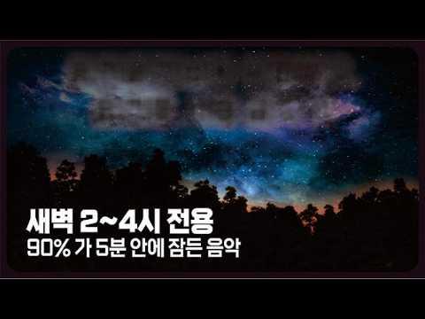
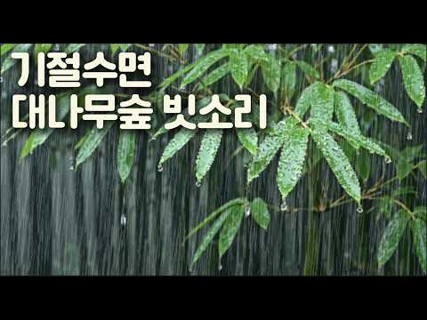
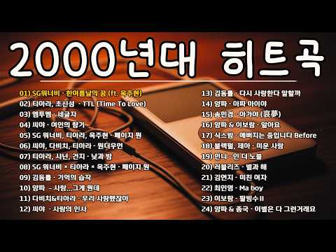

# 음악 — 성공 사례 분석: 사례별 자세히 #81–#120

`analysis.md` 의 9번 (같은 # 번호). 자동 생성 — `tools/success_analysis.py` v1.4.1 (2026-10-16 13:16 UTC). ※ 연구·교육용 — 투자 권유가 아님.

### 81. 새벽 2시~4시 재입면 음악 ∣ 생각 멈추고 다시 잠드는 BGM [중간광고없음]

- https://www.youtube.com/watch?v=KBdCHv2UpRU · 단잠TV · 구독자 2,510 · 조회수 384,611 (×153.2, 하루 2,481.2) · 좋아요 1,428 (0.4%) · 191.6분 · 2026-05-14 · 주제 묶음 2. 자연 소리·백색소음 · 형식 음악 (그 밖 모양 — 한 편짜리 BGM 등) · 폴더 `W_KBdCHv2UpRU` (웹 승인)
- 썸네일: 
- 설명 앞부분: 😴 새벽에 자꾸 깨시나요? 억지로 자려 할수록 더 깨어있게 됩니다. 이 음악은 새벽 2~4시 사이 각성 후 '다시 잠드는 것'을 돕기 위해 50BPM의 심박수 이하 템포로 설계된 재입면 전용 수면음악입니다. 이런 분께 추천합니다 새벽 1시~4시 사이에 자꾸 깨는 분 생각이 많아서 다시 잠들기 힘든 분 수면제 없이 자연스럽게 잠들고 싶은 분 불면증, 수면장애로 고생 중인 분 🎵 음악 정보 템포: 50 BPM (심박수 이하) 악기: 앰비언트 피아노 + 웜 신시사이저 + 소프트 첼로 보컬: 없음 (순수 기악곡) 💡 효과적으로 듣는 법 …
- 같은 채널 평소 대비 ×536.8 (채널 최근 롱폼 중앙값 716회) · 평소 영상: 아, 졸려... 클래식 수면음악 ∣ 피아노와 현악기 for Deep Sleep [중간광고… (748회) / 한밤중 한 시 반, 이제는 주무세요 🌙 ∣ 다시 잠들고 싶은 새벽을 위한 수면음악 (685회)
- 대본 없음 (설명) — 음성인식이 끝나면 도입부·흐름이 들어감
- 댓글 62/62: 좋은 점 — 영상 1 · 감사·응원 6 · 더 알고 싶은 것 0 · 아쉬운 점 — 영상 1 · 반박·불만 — 의견 다름 0 · 정치·사회 0 · 경험 공유 5 · 구독·다음 기대 1
  - 감사·응원 👍9 “잘 듣고있습니다 감사합니다.”
  - 감사·응원 👍7 “효과 좋아요. 고맙습니다.”
  - 아쉬운 점 — 영상 👍1 “광고가 다 망치네”
  - 경험 공유 👍17 “제가 그래요. 2시, 2시반 이쯤 깨서 잠을 못 자요.”
  - 경험 공유 👍2 “어제 제가 딱 2시쯤 깨있었는데 이 음악 덕분에 틀자마자 20분안에 잠들었어요 감사합니다 저장해갈게요 ㅠ”
  - 구독·다음 기대 👍0 “영상의 곡이 좋아서 구독합니다❤”

### 82. 𝐏𝐥𝐚𝐲𝐥𝐢𝐬𝐭 야르한 제이팝

- https://www.youtube.com/watch?v=3QaZldwEZ3g · 탱이 · 구독자 1,680 · 조회수 253,614 (×151.0, 하루 2,028.9) · 좋아요 5,197 (2.1%) · 18.3분 · 2026-06-13 · 주제 묶음 10. 팝송·K팝·J팝 · 형식 플레이리스트·모음 (여러 곡) · 폴더 `W_3QaZldwEZ3g` (웹 승인)
- 썸네일: 
- 설명 앞부분: [TIME LINE]
- 대본 없음 (설명) — 음성인식이 끝나면 도입부·흐름이 들어감
- 댓글 59/59: 좋은 점 — 영상 2 · 감사·응원 2 · 더 알고 싶은 것 3 · 아쉬운 점 — 영상 0 · 반박·불만 — 의견 다름 0 · 정치·사회 0 · 경험 공유 0 · 구독·다음 기대 0
  - 좋은 점 — 영상 👍5 “썸네일 리쿠인것부터 개 큰 야르인데 심지어 첫 곡부터 레전드임 미쳤다”
  - 좋은 점 — 영상 👍2 “노래 좋은데 무슨노래인지 제목좀 정리해주실수 잇을까여,,?😢”
  - 감사·응원 👍0 “썸넬 리쿠보고 바로 들어왓는데.. 띵곡만 넣어주셔서 감사합니다... 😻 이것만 들을게용...”
  - 더 알고 싶은 것 👍2 “노래 좋은데 무슨노래인지 제목좀 정리해주실수 잇을까여,,?😢”
  - 더 알고 싶은 것 👍0 “진짜 이것만 듣고잇는데 이런 느끼믕로 2탄 만들어주세요🫰🏻🫰🏻🫰🏻”

### 83. playlist ∣ 우리 사랑은 필름 같았으면 해요

- https://www.youtube.com/watch?v=k8giKQV4a40 · 웨일 · 구독자 3,400 · 조회수 502,296 (×147.7, 하루 3,890.7) · 좋아요 4,138 (0.8%) · 21.5분 · 2026-06-09 · 주제 묶음 기타 · 형식 플레이리스트·모음 (여러 곡) · 폴더 `W_k8giKQV4a40` (웹 승인)
- 썸네일: 
- 대본 없음 (없음) — 음성인식이 끝나면 도입부·흐름이 들어감
- 댓글 58/58: 좋은 점 — 영상 0 · 감사·응원 6 · 더 알고 싶은 것 0 · 아쉬운 점 — 영상 0 · 반박·불만 — 의견 다름 0 · 정치·사회 0 · 경험 공유 5 · 구독·다음 기대 0
  - 감사·응원 👍166 “안녕하세요 저는 대구경동초 6학년 선플달기 운동을 하고 있는 김소윤입니다. 웨일 님의 플레이리스트를 제가 공부할때 자주 듣는데, 항상 들을때마다 노래 선정이 좋으신 것같습니다. 항상 멋지고 아름다운 노래들을 골라서 플레이리스트를 만들어주셔서 감사합니다! 웨일 님의 플…”
  - 감사·응원 👍5 “거를노래가없네정말,,,,감사합니다..😭❤️❤️”
  - 경험 공유 👍166 “안녕하세요 저는 대구경동초 6학년 선플달기 운동을 하고 있는 김소윤입니다. 웨일 님의 플레이리스트를 제가 공부할때 자주 듣는데, 항상 들을때마다 노래 선정이 좋으신 것같습니다. 항상 멋지고 아름다운 노래들을 골라서 플레이리스트를 만들어주셔서 감사합니다! 웨일 님의 플…”
  - 경험 공유 👍69 “중3때 날 진짜 좋아해준던 남친이있었는데 아직도 그때의 여름날이 생생하게 기억남 걔 학원이랑 내가 다니던 학원이 거리가 꽤 있었는데 내가 평소보다 빨리 끝나서 걔가 뛰어서 10분만에 옴 그렇게 더운 날 걔도 학원에서 공부하다 와서 한손에는 샤프 꽉 쥐고있고 땀 뻘뻘 …”

### 84. [기절수면/중간광고없음] 10분후 검은화면/ 듣자마자 잠드는 대나무숲 빗소리 🌧️잎 끝에 떨어지는 편안한 비ㅣ수면부족 불면증 스트래스 백색소음 ASMR

- https://www.youtube.com/watch?v=l89z7BzLSmI · 신가네숲 빗소리  · 구독자 1,350 · 조회수 198,497 (×147.0, 하루 1,822.3) · 좋아요 1,410 (0.7%) · 420분 · 2026-06-29 · 주제 묶음 2. 자연 소리·백색소음 · 형식 자연 소리·백색소음 (음악 낱말 없는 제목) · 폴더 `W_l89z7BzLSmI` (웹 승인)
- 썸네일: 
- 설명 앞부분: 🌧️ 고요한 대나무 숲에 맘 편해지는 비가 내립니다. 대나무잎 끝에 맺힌 빗방울이 천천히 떨어지고, 숲속을 가득 채우는 빗소리가 마음을 편안하게 감싸줍니다. 복잡했던 하루를 내려놓고 자연이 들려주는 빗소리와 함께 깊고 편안한 휴식을 가져보세요. 😴 이런 분들께 추천합니다. 잠이 쉽게 오지 않을 때 깊은 숙면이 필요할 때 공부와 업무에 집중하고 싶을 때 명상과 휴식 시간을 보내고 싶을 때 🎧 이어폰이나 스피커로 감상하시면 더욱 풍부한 자연의 소리를 느끼실 수 있습니다. 오늘도 편안한 밤 되세요. 🌙
- 대본 없음 (설명) — 음성인식이 끝나면 도입부·흐름이 들어감
- 댓글 41/41: 좋은 점 — 영상 0 · 감사·응원 2 · 더 알고 싶은 것 0 · 아쉬운 점 — 영상 0 · 반박·불만 — 의견 다름 0 · 정치·사회 0 · 경험 공유 0 · 구독·다음 기대 1
  - 감사·응원 👍1 “다른영상보다 탁월하네요 빗소리 참 좋아요 감사합니다”
  - 구독·다음 기대 👍3 “최고의 빗소리~~ 구독하고 오늘 부터 청취합니다~~!!”

### 85. 김동률 명곡 모음 🎵 베스트 발라드 20곡 연속듣기 ∣ 다시 사랑한다 말할까 · 감사 · 기억의 습작 ∣ K-Ballad Playlist

- https://www.youtube.com/watch?v=9kIULv7grWs · 노래모음 · 구독자 2,130 · 조회수 312,748 (×146.8, 하루 2,346.4) · 좋아요 961 (0.3%) · 75.3분 · 2026-06-05 · 주제 묶음 9. 가요·발라드·트로트 · 형식 플레이리스트·모음 (여러 곡) · 폴더 `W_9kIULv7grWs` (웹 승인)
- 썸네일: 
- 설명 앞부분: 김동률 명곡 모음 🎵 베스트 발라드 20곡 연속듣기 ∣ 다시 사랑한다 말할까 · 감사 · 기억의 습작 ∣ K-Ballad Playlist 대한민국을 대표하는 싱어송라이터 김동률의 명곡들을 한곳에 모았습니다. 감성적인 가사와 깊은 울림의 멜로디로 오랫동안 사랑받아온 김동률의 대표곡들을 편안하게 감상해 보세요. 🎧 수록곡 (일부) 01. 다시 사랑한다 말할까 02. 감사 03. 기억의 습작 04. 기적 (Duet With 이소은) 05. 사랑한다는 말 06. 취중진담 07. 이제서야 08. 귀향 09. 사랑하지 않으니까요 10. 이방…
- 대본 없음 (설명) — 음성인식이 끝나면 도입부·흐름이 들어감
- 댓글 49/49: 좋은 점 — 영상 1 · 감사·응원 5 · 더 알고 싶은 것 0 · 아쉬운 점 — 영상 0 · 반박·불만 — 의견 다름 0 · 정치·사회 1 · 경험 공유 1 · 구독·다음 기대 0
  - 좋은 점 — 영상 👍1 “나한테는 전혀 와닿지않는 노래네요 비와외로움 사랑한후에 아득히먼곳 박선주의 귀로같은 류의 노래를 좋아하는 스타일이라”
  - 감사·응원 👍6 “🎉❤다시 사랑한다 말할까.. 🎉❤감사..”
  - 감사·응원 👍3 “너무 좋네요... 감사합니다..”
  - 정치·사회 👍0 “노인을 공경하지 않는. 인간이 대통령이라? 부모없는 인간이 낫구려”
  - 경험 공유 👍5 “그래 다시 사랑한다말해 진짜 ㅠㅠㅠㅠ 나도너사링해 그래서 기다렸다고”

### 86. @노노뮤직#피아노연주곡 #플루트연주곡#명상음악 #휴식음악 #뉴에이지 #감성음악 #숲길 #자연음악 #마음치유 #힐링BGM #피아노플루트 #평화로운음악#Instru…

- https://www.youtube.com/watch?v=8Fiore1srWM · 노노스튜디오 · 구독자 462 · 조회수 66,905 (×144.8, 하루 494.9) · 좋아요 527 (0.8%) · 32.1분 · 2026-06-03 · 주제 묶음 6. 피아노·클래식·연주곡 · 형식 연주 (직접 연주하는 영상) · 폴더 `W_8Fiore1srWM` (웹 승인)
- 썸네일: 
- 설명 앞부분: 숲길을 천천히 걸으며 바람을 느껴본 적이 있으신가요? 《바람이 머무는 숲길》은 피아노와 플루트가 함께 만들어내는 따뜻하고 평화로운 연주곡입니다. 잔잔한 피아노 선율과 부드러운 플루트의 울림이 지친 마음을 편안하게 감싸주며, 마치 햇살이 비치는 숲길을 걷는 듯한 고요한 시간을 선물합니다. 명상할 때, 책을 읽을 때, 공부할 때, 잠들기 전 또는 조용한 휴식 시간에 함께해 보세요. 오늘 하루도 수고한 당신의 마음에 작은 위로가 되기를 바랍니다.
- 같은 채널 평소 대비 ×420.8 (채널 최근 롱폼 중앙값 159회) · 평소 영상: @노노뮤직#프라하 #Prague #유럽클래식 #창작클래식 #BackgroundMusic … (159회) / @노노뮤직#SymphonyOfADay#하루의교향곡#오케스트라#클래식음악#Classical… (169회)
- 대본 없음 (설명) — 음성인식이 끝나면 도입부·흐름이 들어감
- 댓글 11/11: 좋은 점 — 영상 0 · 감사·응원 0 · 더 알고 싶은 것 0 · 아쉬운 점 — 영상 0 · 반박·불만 — 의견 다름 0 · 정치·사회 0 · 경험 공유 0 · 구독·다음 기대 0

### 87. 바흐의 파사칼리아

- https://www.youtube.com/watch?v=MQf3ajxEFfQ · 홍준 뮤직 TV · 구독자 4,490 · 조회수 641,115 (×142.8, 하루 4,950.4) · 좋아요 8,744 (1.4%) · 40분 · 2026-06-09 · 주제 묶음 기타 · 형식 정보·해설 (그 밖) · 폴더 `W_MQf3ajxEFfQ` (웹 승인)
- 썸네일: 
- 챕터: 0:00 Passacaglia I – Prelude of Si… · 4:20 Passacaglia II – Echoes of th… · 8:35 Passacaglia III – Moonlit Rev… · 12:45 Passacaglia IV – The Flow of … · 16:50 Passacaglia V – Shadows and L… · 21:00 Passacaglia VI – Meditative S… · 25:15 Passacaglia VII – Nocturne in… · 29:30 Passacaglia VIII – Devotion · 33:50 Passacaglia IX – Endless Vari… · 37:20 Passacaglia Finale – The Last…
- 설명 앞부분: 🎸 바흐의 파사칼리아 ∣ 깊은 밤을 물들이는 클래식 기타의 울림 요한 세바스티안 바흐의 불멸의 명곡 「파사칼리아」를 클래식 기타의 섬세하고 깊은 음색으로 만나보세요. 한 음 한 음 이어지는 기타의 울림은 고요한 밤의 정적 속으로 우리를 이끌며, 때로는 장엄하게, 때로는 사색적으로 마음을 어루만져 줍니다. 복잡한 일상 속에서 잠시 멈춰 서서, 바흐의 선율과 함께 평온한 휴식의 시간을 가져보시길 바랍니다. 이 음악이 마음에 드셨다면, 편안한 감상 되세요. 감사합니다. 바흐,파사칼리아,바흐 파사칼리아,클래식 기타,기타 연주곡,클래식 음…
- 대본 없음 (설명) — 음성인식이 끝나면 도입부·흐름이 들어감
- 댓글 662/662: 좋은 점 — 영상 6 · 감사·응원 75 · 더 알고 싶은 것 7 · 아쉬운 점 — 영상 5 · 반박·불만 — 의견 다름 4 · 정치·사회 2 · 경험 공유 18 · 구독·다음 기대 2
  - 좋은 점 — 영상 👍36 “밤에 듣기 좋은 곡^^ 같이 듣던 아이가 스르르 잠드는 걸 보니 정말 평온한 곡인듯요🥰”
  - 좋은 점 — 영상 👍20 “저녁에 책읽으며 듣기좋은 음악이네요 감사합니다~❤”
  - 감사·응원 👍201 “아름다운 음악 1곡이... 사람의 인생을 바꿀 수도 있고... 또 다른 삶의 도전을 일으키는 촉매제가 될 수도 있다고 봅니다... 지긋이 두눈을 감고 들으니... 마음의 위로와 평안이 느껴집니다... 좋은 곡을 듣게 해주셔서... 대단히... 감사합니다...^^”
  - 감사·응원 👍97 “많이아픈데 어느날 아침 찾아온음악으로 큰위안을 얻고 힘이됩니다 감사합니다”
  - 더 알고 싶은 것 👍2 “연주자가 누군지 알 수 있을까요?”
  - 더 알고 싶은 것 👍0 “이 곡은 어디서 다운로드 받을 수 있을까요? 멜론에도 없어요 ㅠ”
  - 아쉬운 점 — 영상 👍5 “클레식이란 지루하다는 무지한 생각을 하던 1인 이었는데 아름다운선율로 생각을 확 바꿔주네요😂”
  - 아쉬운 점 — 영상 👍0 “바흐의 파사칼리아와푸가c단조가 아니라 핸델의 파사칼리아를 AI를 이용해 여러 변주를 만들어 올려 조회수 장사를 하면 안됩니다. 시청하시는 분들이 잘못된 정보를 받아들 수 있습니다. 댓글을 읽어 보면 벌써 많은 분들이 거짓정보를 믿고 있네요. 못된 짓 당장 멈추세요.”
  - 반박·불만 — 의견 다름 👍0 “헨델이 들으면 슬퍼하겠어요 바하 작곡이 아닙니다”
  - 반박·불만 — 의견 다름 👍0 “바흐가 아닌데요”
  - 정치·사회 👍0 “요즘 이재명 인간이 하는 짓 보고 울화가 하늘 끝까지 치솟고.대한민국의 정치현실이 우울하고 그런데 파사칼리아를 들르면 ·감정이 정화되면서 평온해짐을 느낍니다.”
  - 경험 공유 👍137 “이 곡을 들으며 제가 이제 너무 바빠졌다는 생각이 드네요 들어야 할 좋은 곡들이 너무너무 많다는걸 알았네요”
  - 경험 공유 👍82 “이 연주곡을 듣기전까지 제가 바흐를 좋아하는지 몰랐어요😂”
  - 구독·다음 기대 👍2 “서정적인 기타연주 잘 감상하고 구독하고 갑니다.~♡”
  - 구독·다음 기대 👍1 “잠시 쉬며 삶에 대해 생각을 많이 하게되는 곡이네요 기타의 서정적임이 바흐의 마음을 전해 주는 것 같아요 우연히 들어왔다가 채널 곡 들이 좋아 구독하고 갑니다 아름다운 곡들 공유 해 주셔서 감사합니다.”

### 88. 𝗣𝗹𝗮𝘆𝗹𝗶𝘀𝘁 ∣ 일할때 틀어놓기 좋은 지브리 x 픽사 x 디즈니 재즈🔥🎺 ∣ #NoAImusic ∣ Ghibli x Pixar x Disney Jazz

- https://www.youtube.com/watch?v=ayKr-gtJQIQ · 오늘은 재즈데이 | Jazzday · 구독자 3,360 · 조회수 473,494 (×140.9, 하루 3,624.5) · 좋아요 3,768 (0.8%) · 379.1분 · 2026-06-07 · 주제 묶음 7. 재즈·보사노바 · 형식 플레이리스트·모음 (여러 곡) · 폴더 `W_ayKr-gtJQIQ` (웹 승인)
- 썸네일: 
- 챕터: 0:00 Once Upon a Time & Jazz Waltz · 4:02 The Time of Your Life & Swing · 8:09 A Town With An Ocean View & B… · 12:52 Alice In Wonderland & Jazz Wa… · 17:35 Always With Me & Jazz Samba (… · 23:08 The Spirit of Adventure & Swi… · 27:12 Let It Go & 5-4 Jazz · 31:21 PONYO & Jazz Funk (T.II) (Pon… · 37:28 Remember Me & Bossanova · 42:41 How Far I'll Go & Swing · 46:16 Merry Go Round of Life & 6-8 … · 50:49 Le Festin & Jazz Waltz · 56:04 Hey Let's Go & Bossanova · 60:52 Can You Feel The Love Tonight… · 65:10 Ashitaka And San & 5-4 Jazz · 69:53 Life's Incredible Again & Jaz… · 75:34 When She Loved Me & Bossanova · 79:51 Under The Sea & Swing · 83:45 Path of The Wind & 5-4 Jazz (… · 89:02 Married Life & Jazz Waltz
- 설명 앞부분: 따뜻한 실제 연주로 채워진 공간입니다.🙂 편안한 시간 되시길 바라며, 방문해주셔서 감사합니다. ▪︎ 음악이 좋으셨다면 'Hype' 버튼으로 응원해주세요! ▪︎ 여러분의 최애곡을 댓글로 남겨주세요! ▪︎ 음원 자체를 콘텐츠로 삼는 활동(플레이리스트 제작 등)을 금지합니다. ▪︎ 원본 음원 파일은 별도로 제공하지 않습니다. ▪︎ 채널의 모든 음악은 직접 연주하고 프로듀싱한 음원입니다. (AI 생성 음원이 아닙니다.) ▪︎ 원곡이 있는 경우, 본 콘텐츠는 팬메이드이며 원저작자와 공식적인 연관이 없음을 밝힙니다.
- 대본 없음 (설명) — 음성인식이 끝나면 도입부·흐름이 들어감
- 댓글 40/40: 좋은 점 — 영상 0 · 감사·응원 4 · 더 알고 싶은 것 0 · 아쉬운 점 — 영상 0 · 반박·불만 — 의견 다름 0 · 정치·사회 0 · 경험 공유 0 · 구독·다음 기대 0
  - 감사·응원 👍79 “이 글을 읽고 계신 모든 분들께, 우리가 만날 일은 없을지 모르지만, 여러분의 삶에 기쁨과 성공, 끝없는 행복이 가득하길 진심으로 바랍니다. 힘내시고 건강하세요!”
  - 감사·응원 👍73 “디즈니랑 지브리를 같이 모아둘 생각을 하시다니 매우 감사...”

### 89. 𝐩𝐥𝐚𝐲𝐥𝐢𝐬𝐭 요즘 인스타 부계 감성

- https://www.youtube.com/watch?v=WBabiGZluh8 · 알수없는 사용자 · 구독자 1,730 · 조회수 241,635 (×139.7, 하루 3,405.3) · 좋아요 6,448 (2.7%) · 17.5분 · 2026-08-06 · 주제 묶음 기타 · 형식 플레이리스트·모음 (여러 곡) · 폴더 `W_WBabiGZluh8` (웹 승인)
- 썸네일: 
- 챕터: 0:00 상상더하기 - 라붐 · 4:08 낙낙 - 트와이스 · 7:19 take it slow - 레드벨벳 · 10:51 about love - 레드벨벳 · 14:16 빨간맛 - 레드벨벳
- 설명 앞부분: 2016~7년도 3세대여돌 노래를 오랜만에 들으니 감회가 새롭네요,,,🏩 문제될시에 삭제합니다(๑･̑◡･̑๑)
- 대본 없음 (설명) — 음성인식이 끝나면 도입부·흐름이 들어감
- 댓글 52/52: 좋은 점 — 영상 0 · 감사·응원 0 · 더 알고 싶은 것 2 · 아쉬운 점 — 영상 0 · 반박·불만 — 의견 다름 0 · 정치·사회 0 · 경험 공유 5 · 구독·다음 기대 1
  - 더 알고 싶은 것 👍4 “진짜 제가 찾고 찾던 플리.. 맨날와요 사랑함다 에겐플리 많이 부탁드려요”
  - 더 알고 싶은 것 👍2 “혹시 사진 출처 알 수 있을까요? 포근하고 느낌이 좋네용”
  - 경험 공유 👍36 “미친!! 내가 어떻게 장키를 잊고 지냈는데ㅠㅠㅠ 주인장님 너무 좋아여💗💗”
  - 경험 공유 👍4 “진짜 제가 찾고 찾던 플리.. 맨날와요 사랑함다 에겐플리 많이 부탁드려요”
  - 구독·다음 기대 👍7 “한창 장키 정주행중이었는데 너므행보카다”

### 90. [playlist] skrrrr….

- https://www.youtube.com/watch?v=20mvF_OP0FY · le · 구독자 12,300 · 조회수 1,669,704 (×135.8, 하루 9,922.2) · 좋아요 49,172 (2.9%) · 26.1분 · 2026-05-01 · 주제 묶음 기타 · 형식 플레이리스트·모음 (여러 곡) · 폴더 `W_20mvF_OP0FY` (웹 승인)
- 썸네일: 
- 챕터: 0:00 Lil Uzi Vert - 20 Min · 3:41 24kGoldn - Mood (feat. iann d… · 6:00 BlackMayo - Jus’ know · 8:00 Jeremih - Oui · 11:57 kent Jones - Don’t Mind · 15:14 Pop Smoke - What You Know Bou… · 17:54 blxst & tyga - chosen (feat. … · 20:37 Don Toliver - No Idea · 23:21 Russ - What They Want
- 대본 없음 (없음) — 음성인식이 끝나면 도입부·흐름이 들어감
- 댓글 276/276: 좋은 점 — 영상 0 · 감사·응원 3 · 더 알고 싶은 것 1 · 아쉬운 점 — 영상 0 · 반박·불만 — 의견 다름 0 · 정치·사회 1 · 경험 공유 0 · 구독·다음 기대 0
  - 감사·응원 👍3 “만들어주셔서 감사합니다ㅠㅜㅡ”
  - 감사·응원 👍2 “와 진짜 제 취향 노래 찾기 어려웠는데 진짜 감사합니다 ㅜㅠㅠㅠ ㅠ”
  - 더 알고 싶은 것 👍0 “사진에 나오는 남자분 이름이 어떻게 될까요 ??”
  - 정치·사회 👍0 “외국인 왤케 많아”

### 91. 자비의 빛, 신묘장구대다라니

- https://www.youtube.com/watch?v=oZyrd47zI6o · 부다야나마하 · 구독자 2,860 · 조회수 387,886 (×135.6, 하루 5,470.5) · 좋아요 2,868 (0.7%) · 6.6분 · 2026-08-06 · 주제 묶음 1. 수면·명상·힐링 · 형식 음악 (그 밖 모양 — 한 편짜리 BGM 등) · 폴더 `W_oZyrd47zI6o` (웹 승인)
- 썸네일: 
- 설명 앞부분: 🙏 부다야나마하 — 부처님께 경배합니다 지친 하루의 끝, 잠 못 드는 밤, 마음이 무거운 순간에 함께하는 불교음악 채널입니다. 수천 년을 이어온 진언과 염불을 현대적인 감성으로 담아냅니다. 관세음보살의 자비, 아미타불의 광명, 천수경과 반야심경의 지혜가 오늘을 살아가는 당신의 마음에 닿기를 발원합니다. 📿 천수경 · 반야심경 · 광명진언 나무아미타불 · 관세음보살 · 신묘장구대다라니 소원성취, 업장소멸, 마음의 평온을 기원하며 매일 새로운 기도음악으로 찾아뵙겠습니다. 생년월일만 넣으시면 명식을 세우고 풀이까지 드립니다. 올해 일,…
- 대본 없음 (설명) — 음성인식이 끝나면 도입부·흐름이 들어감
- 댓글 228/228: 좋은 점 — 영상 3 · 감사·응원 46 · 더 알고 싶은 것 1 · 아쉬운 점 — 영상 4 · 반박·불만 — 의견 다름 1 · 정치·사회 0 · 경험 공유 4 · 구독·다음 기대 0
  - 좋은 점 — 영상 👍3 “불교에 "신묘장구 대다라니" 라는 경이 있습니다. 이것을 일부 해석하고 현대에 맞게 음률을 덪댓신것으로 보입니다. 물론 신자 혹은 스님께서 하신것 같구요... 모두가 불제자 이며 앞으로 부처가 되실 분들 이라 배웠습니다. 잘 들어 주셔서 감사하고 저 또한 너무 잘 들…”
  - 좋은 점 — 영상 👍1 “어제 처음듣고 마음에와닿는게크고 저는 아침일찍제일먼저사경을하고있습니다 감사드립니다 나무관세음보살 나무관세음보살 나무관세음보살”
  - 감사·응원 👍19 “거룩하신 부처님을 알게 해주셔서 감사합니다 이제라도 알게해주셔서 감사합니다 나무관세음보살 나무관세음보살 나무관세음보살”
  - 감사·응원 👍15 “감사 감사합니다 ~ 눈물나고 신비로운 목소리 입니다.건강. 평범한 일상 감사기도 드립니다.”
  - 더 알고 싶은 것 👍3 “이거 한시간듣기만들어주세요.😊”
  - 아쉬운 점 — 영상 👍2 “영상 감사합니다 근데 너무 짧아서 아쉽네요”
  - 아쉬운 점 — 영상 👍1 “동영상연속재생 해놓고 계속 반복해서 듣고 있습니다.”
  - 경험 공유 👍15 “어떤분 이실까요. 의심은 잘 안하는데 요즘 기계로 별걸 다 만들어내서 혹시 해봤습니다. 영상도 아름답고 음색도 황홀해서 별다른 소원이 생각나지 않네요. 가을이 오구있습니다.”
  - 경험 공유 👍6 “저희온가족 모두 무사하고 건강하고 평안하길 바라면서 제가하는일 잘되게 해주세요 나미아미타불 🙏🙏🙏”

### 92. [playlist] 내 주위는 온통 lovely day

- https://www.youtube.com/watch?v=m-xuokRyfvQ · 지륭 · 구독자 1,210 · 조회수 162,128 (×134.0, 하루 1,011.4) · 좋아요 3,197 (2.0%) · 19.9분 · 2026-05-09 · 주제 묶음 기타 · 형식 플레이리스트·모음 (여러 곡) · 폴더 `W_m-xuokRyfvQ` (웹 승인)
- 썸네일: 
- 대본 없음 (없음) — 음성인식이 끝나면 도입부·흐름이 들어감
- 댓글 20/20: 좋은 점 — 영상 0 · 감사·응원 2 · 더 알고 싶은 것 1 · 아쉬운 점 — 영상 0 · 반박·불만 — 의견 다름 0 · 정치·사회 0 · 경험 공유 1 · 구독·다음 기대 0
  - 감사·응원 👍3 “학원까지 버스타고 19분인데 이거 들으면 딱 내릴 때 끝나서 좋아요 감사합니다”
  - 더 알고 싶은 것 👍12 “이런 느낌으로 좀 더 만들어주세요ㅠㅠ 너무 제스탈 인생리스트!!”
  - 경험 공유 👍31 “저진짜 10번ㅇ,ㄴ 들었어요 계속 생각나구 노래 넘조쿠 덕분에 숙제할때 이거 아님 인대여 큐피드땜에 조아했는데 아니.... 뒤에도 다 제가워하는 느낌이ㅕㅅ숴요 사랑해여..”

### 93. 재생하자마자 텐션 터지는 2026 남녀돌 믹스업 (과제, 청소, 운동할 때 듣는 플리)

- https://www.youtube.com/watch?v=x09m3Lgzc-A · MxJin06 · 구독자 5,040 · 조회수 654,766 (×129.9, 하루 8,480.4) · 좋아요 2,463 (0.4%) · 99.2분 · 2026-07-31 · 주제 묶음 5. 운동·드라이브·신나는 · 형식 플레이리스트·모음 (여러 곡) · 폴더 `W_x09m3Lgzc-A` (웹 승인)
- 썸네일: 
- 챕터: 0:00 ILLIT (아일릿) ‘It’s Me’ Officia… · 2:14 aespa 에스파 'Supernova' MV · 5:10 CORTIS (코르티스) 'REDRED' Offici… · 7:50 LE SSERAFIM (르세라핌) 'BOOMPALA'… · 10:42 BABYMONSTER - 'I LIKE IT' M-V · 14:05 aespa 에스파 'LEMONADE' MV · 17:10 TWS (투어스) '널 따라가 (You, You)' … · 19:53 NMIXX(엔믹스) “Crescendo” M-V · 22:26 aespa 에스파 'Live My Life' MV · 25:01 QWER 'BAD HABIT' (80's Video … · 27:51 STAYC 스테이씨 '2 L0VE' MV · 30:49 i-dle (아이들) 'Gimme Dat Love' … · 33:08 aespa 에스파 'Whiplash' MV · 36:09 RIIZE 라이즈 'Do your dance' MV · 39:02 tripleS(트리플에스) 'Baby Flower' … · 42:05 NMIXX(엔믹스) “Heavy Serenade” M… · 45:03 fromis_9 (프로미스나인) 'Vitamin ME… · 48:12 ILLIT (아일릿) 'Lucky Girl Syndr… · 50:28 BOYNEXTDOOR (보이넥스트도어) 'VIRAL'… · 53:43 izna 'METRONOME' MV
- 대본 없음 (없음) — 음성인식이 끝나면 도입부·흐름이 들어감
- 댓글 30/30: 좋은 점 — 영상 0 · 감사·응원 1 · 더 알고 싶은 것 0 · 아쉬운 점 — 영상 0 · 반박·불만 — 의견 다름 0 · 정치·사회 0 · 경험 공유 0 · 구독·다음 기대 1
  - 감사·응원 👍3 “와 진짜 다 좋다❤❤ 제작자님 감사합니다 진짜 골고루 넣어놓으셨네욘❤❤”
  - 구독·다음 기대 👍4 “중간중간에 틈 없이 바로바로 나오는게 너무 좋아요! 구독합니다!”

### 94. Playlist ∣ 틀어놓으면 그냥 계속 리듬 타게 되는 그루브 😎 집중 끊기지 않는 리듬 🎧 ∣ JAZZHOP · CHILLHOP ∣ 카페 · 작업 · BGM

- https://www.youtube.com/watch?v=wsB8ej3Jon4 · Hush Chords · 구독자 19,500 · 조회수 2,510,132 (×128.7, 하루 15,823.2) · 좋아요 23,997 (1.0%) · 318.1분 · 2026-05-10 · 주제 묶음 8. 로파이·시티팝·칠 · 형식 플레이리스트·모음 (여러 곡) · 폴더 `W_wsB8ej3Jon4` (웹 승인)
- 썸네일: 
- 챕터: 0:00 Stay In Flow · 2:22 Easy On The Move · 5:15 Catch The Step · 8:10 Right On Time · 11:05 Feels Right · 14:02 Soft Feel · 16:55 Back In Motion · 19:48 Stay In Line · 22:40 Keep It Going · 25:35 In Line · 28:30 Stay A Bit · 31:25 Let It Pass · 34:20 For Now
- 설명 앞부분: 오늘 작업은 이걸로 시작해보세요. 가볍게 틀어두기만 해도 흐름이 자연스럽게 이어지고, 과하게 힘주지 않아도 리듬이 계속 살아있는 재즈힙합 & 칠힙 그루브로 구성했습니다. 집중을 방해하지 않으면서도 고개가 자연스럽게 끄덕여지는 리듬, 작업할 때 가장 편하게 오래 들을 수 있는 균형 잡힌 플레이리스트입니다. 💻 지금 이 순간, 플레이하고 흐름에 그대로 올라타 보세요. 🎧 🎵 Time Track Music for your space. Groove for your flow. ⚠️ This playlist is built on smooth…
- 대본 없음 (설명) — 음성인식이 끝나면 도입부·흐름이 들어감
- 댓글 722/722: 좋은 점 — 영상 0 · 감사·응원 7 · 더 알고 싶은 것 0 · 아쉬운 점 — 영상 0 · 반박·불만 — 의견 다름 0 · 정치·사회 0 · 경험 공유 1 · 구독·다음 기대 1
  - 감사·응원 👍4 “이런 플리 찾고 있었는데 알고리즘 감사합니다 😭”
  - 감사·응원 👍3 “책 읽기 딱 좋네요. 응원합니다.”
  - 경험 공유 👍2 “좋네요^^ 오늘은 그냥 즐거웠네요 나도 구독 하고. 갑니다^^”
  - 구독·다음 기대 👍1 “좋아요.구독하고 갑니다”

### 95. 𝐏𝐥𝐚𝐲𝐥𝐢𝐬𝐭 듣자마자 텐션 업🔥K-POP 여돌 노래 모음 노동요

- https://www.youtube.com/watch?v=xtfreKB54KQ · 클로버 플레이리스트 · 구독자 3,580 · 조회수 459,701 (×128.4, 하루 4,229.9) · 좋아요 2,642 (0.6%) · 53분 · 2026-06-29 · 주제 묶음 10. 팝송·K팝·J팝 · 형식 플레이리스트·모음 (여러 곡) · 폴더 `W_xtfreKB54KQ` (웹 승인)
- 썸네일: 
- 대본 없음 (없음) — 음성인식이 끝나면 도입부·흐름이 들어감
- 댓글 39/39: 좋은 점 — 영상 1 · 감사·응원 1 · 더 알고 싶은 것 0 · 아쉬운 점 — 영상 0 · 반박·불만 — 의견 다름 0 · 정치·사회 0 · 경험 공유 1 · 구독·다음 기대 0
  - 좋은 점 — 영상 👍1 “노래들 다 넘 제 취향 이예용❤ 좋은 영상 만들어주셔서 감사합니다❤❤❤”
  - 감사·응원 👍1 “노래들 다 넘 제 취향 이예용❤ 좋은 영상 만들어주셔서 감사합니다❤❤❤”
  - 경험 공유 👍4 “제가 제일 좋아하는 플리에요!!매일 공부하면서 들어요!”

### 96. 𝐏𝐥𝐚𝐲𝐥𝐢𝐬𝐭 비에 젖은 와인향

- https://www.youtube.com/watch?v=Pt3nGKCTF2U · 유월 · 구독자 3,770 · 조회수 474,277 (×125.8, 하루 3,459.5) · 좋아요 12,273 (2.6%) · 21.1분 · 2026-06-01 · 주제 묶음 기타 · 형식 플레이리스트·모음 (여러 곡) · 폴더 `W_Pt3nGKCTF2U` (웹 승인)
- 썸네일: 
- 챕터: 0:00 로꼬, 화사(HWASA) - 주지마 · 3:54 릴러말즈(Leellamarz), 미노이(Meenoi)… · 7:31 정국(Jungkook) - Still With You · 11:31 Seori - 긴 밤 (Feat. 기리보이) · 15:02 OnlyOneOf(온리원오브) - dOra maar · 18:22 종현(JONGHYUN) - Moon
- 설명 앞부분: ‘손 끝에 짙게 남은 와인 잔향‘𓈒 이번에는 주인장표 습도 높은 몽환 R&B 플리로 말아왔어요. 비에 젖은 와인향 같은 노래들로 꾹꾹 눌러 담아왔으니, 이번에도 맛봐 주실 거죠? 🍷 𓈒𓏸 𓂂
- 대본 없음 (설명) — 음성인식이 끝나면 도입부·흐름이 들어감
- 댓글 124/124: 좋은 점 — 영상 0 · 감사·응원 4 · 더 알고 싶은 것 3 · 아쉬운 점 — 영상 1 · 반박·불만 — 의견 다름 0 · 정치·사회 0 · 경험 공유 3 · 구독·다음 기대 0
  - 감사·응원 👍5 “감사합니다 시험 기간에 미쳐서 슬라임만들면서 들었어요 ㅎ”
  - 감사·응원 👍3 “제 최애 플리로 당첨슨 .. 너무 감사드려요 ♡”
  - 더 알고 싶은 것 👍54 “아 진짜 주인장 제발 이 플레이리스트 더 길게 만들어주세요 제발요”
  - 더 알고 싶은 것 👍8 “사진 출처 어딘지 알수있을까요?”
  - 아쉬운 점 — 영상 👍7 “온리원오브 노래 들어간 플리 처음 봤어요ㅜㅜ 너무 반갑다.. 온리원오브에 비슷한 분위기의 매력적인 노래 많으니까 많이 찾아 들어주셨으면 좋겠어요.. 해체하는 바람에 더 좋은 노래 못 들어서 아쉽네요,,”
  - 경험 공유 👍5 “오늘 내가 제일 치명적이다”
  - 경험 공유 👍3 “정말루 내가 이 플리 조회수 100은 올린것가틈 ㄴㅁ 고능해”

### 97. 김상민 – YOU (2001) ∣ 폭발적인 고음의 여자 보컬 리메이크/커버 2 Keys+

- https://www.youtube.com/watch?v=-GVdD_Onszw · AuraAPT · 구독자 13,100 · 조회수 1,646,979 (×125.7, 하루 20,311.4) · 좋아요 3,744 (0.2%) · 4.1분 · 2026-07-27 · 주제 묶음 12. 커버·노래 부르기 · 형식 커버·직접 부른 노래 · 폴더 `W_-GVdD_Onszw` (웹 승인)
- 썸네일: 
- 설명 앞부분: 김상민의 명곡 **〈YOU〉**를 애절하면서도 폭발적인 고음의 여자 보컬로 다시 불러보았습니다. 〈YOU〉는 2001년 5월 14일 발매된 김상민의 정규 2집 《Face》 수록곡으로, 선명한 록 발라드 사운드와 김상민 특유의 강렬한 고음으로 오랫동안 사랑받아 온 곡입니다. 사랑하는 사람이 떠난 뒤, 비가 오는 거리와 텅 빈 밤에 홀로 남겨진 사람의 외로움과 그리움을 담은 노래입니다. 꿈속에서는 다시 만날 수 있지만 아침이 되면 또다시 떠나보내야 하는 아픔을 여자 보컬의 섬세한 감성과 진한 고음으로 표현했습니다. 🎵 원곡: 김상민 …
- 대본 없음 (설명) — 음성인식이 끝나면 도입부·흐름이 들어감
- 댓글 269/269: 좋은 점 — 영상 2 · 감사·응원 8 · 더 알고 싶은 것 8 · 아쉬운 점 — 영상 3 · 반박·불만 — 의견 다름 2 · 정치·사회 0 · 경험 공유 6 · 구독·다음 기대 4
  - 좋은 점 — 영상 👍4 “진짜 이건 아무리 들어도 레전드다..원곡이든 커버든 그냥 다 찢어버림..들을 때 마다 소름돋네”
  - 좋은 점 — 영상 👍3 “너~무 잘함, 너무 듣기좋음”
  - 감사·응원 👍44 “제가 들어본 중 최고의 you 입니다!! 고맙습니다❤”
  - 감사·응원 👍12 “김상민 님의 명곡을 이렇게 애절하고 폭발적인 여자 보컬로 들으니 또 다른 깊은 울림이 있네요. 비 오는 날 감성에 너무 잘 어울리는 리메이크입니다. 역시 명곡은 언제 들어도 좋네요. 새로운 목소리로 재해석해주셔서 감사합니다. 앞으로도 좋은 커버 영상 기대할게요! 자주…”
  - 더 알고 싶은 것 👍21 “너무 시원하고 감동적인 노래 잘듣고 갑니다 앞으로도 더욱 많은 노래 올려주세요”
  - 더 알고 싶은 것 👍9 “정말 노래 환상적입니다. 누구신지 궁금합니다.”
  - 아쉬운 점 — 영상 👍13 “목소리 너무좋아요 하루 무한반복으로 듣고있어요”
  - 아쉬운 점 — 영상 👍1 “노래듣고 눈물이 났네요 목소리가 너무나 졸고 잘부르시네요~ 앞으로 쭈~~욱 노래 들려주세요~~^^ 응원하겠습니다~~”
  - 반박·불만 — 의견 다름 👍3 “Ai로 이렇게 노래하면 반칙아닌가? 득음정도가아닌데 ~”
  - 반박·불만 — 의견 다름 👍2 “Ai는 아니죠?ㅠㅠ”
  - 경험 공유 👍44 “제가 들어본 중 최고의 you 입니다!! 고맙습니다❤”
  - 경험 공유 👍19 “와 나도 노래좀 안다고 생각 했는데 50년동안 ai노래가 있을줄이야 솔직히 사람이 부른것 보다 더 감동이네 6시간 동안 비슷한거 찾아서 듣고 있는중...”
  - 구독·다음 기대 👍12 “김상민 님의 명곡을 이렇게 애절하고 폭발적인 여자 보컬로 들으니 또 다른 깊은 울림이 있네요. 비 오는 날 감성에 너무 잘 어울리는 리메이크입니다. 역시 명곡은 언제 들어도 좋네요. 새로운 목소리로 재해석해주셔서 감사합니다. 앞으로도 좋은 커버 영상 기대할게요! 자주…”
  - 구독·다음 기대 👍4 “매일매일듣게돼는ㅎㅎ 완전따봉 이에요^^ 목소리도예쁘고❤❤❤❤❤”

### 98. 당신의 피아노 레벨은? (Lv.1~Lv.8 + 라캄파넬라) ∣ What is your Piano Level? 🎹

- https://www.youtube.com/watch?v=1E5Zi3Gs1ys · Bony_Musician · 구독자 674 · 조회수 84,463 (×125.3, 하루 638.5) · 좋아요 1,616 (1.9%) · 6.5분 · 2026-06-06 · 주제 묶음 6. 피아노·클래식·연주곡 · 형식 연주 (직접 연주하는 영상) · 폴더 `W_1E5Zi3Gs1ys` (웹 승인)
- 썸네일: 
- 설명 앞부분: 여러분의 피아노 실력은 과연 몇 단계인가요? 🎹🤔 가장 기초적인 Lv.1 단계부터 손가락이 날아다니는 마의 Lv.8 단계까지, 대중적인 클래식/뉴에이지 명곡들로 피아노 레벨 테스트 영상을 준비했습니다! 그리고 영상 맨 마지막에는 전설의 악마의 곡, 라 캄파넬라(La Campanella)가 보너스 최종 보스 레벨로 기다리고 있으니 끝까지 놓치지 마세요! 🔥 평소 피아노 난이도 순위나 재미있는 피아노 챌린지 영상을 검색해 들어오신 분들 모두 환영합니다. 영상을 보시면서 여러분이 연주할 수 있는 가장 높은 레벨은 몇 단계인지, 혹은 가…
- 대본 없음 (설명) — 음성인식이 끝나면 도입부·흐름이 들어감
- 댓글 340/340: 좋은 점 — 영상 2 · 감사·응원 7 · 더 알고 싶은 것 8 · 아쉬운 점 — 영상 0 · 반박·불만 — 의견 다름 2 · 정치·사회 0 · 경험 공유 24 · 구독·다음 기대 3
  - 좋은 점 — 영상 👍2 “전 개인적으로 쇼팽 왈츠가 캐리비안보다 어려운것 같네용 전 8단계 다 칠 수 있슴돠 (피아노 15년 배웠는데 라캄파넬라 못치는 고1.. ㅋㅋ)”
  - 좋은 점 — 영상 👍1 “좋은 영상 감사합니다. 저는 실력은 3단계 수준이지만 쇼팽의 왈츠는 흉내는 낼 수 있어요!”
  - 감사·응원 👍1 “좋은 영상 감사합니다. 저는 실력은 3단계 수준이지만 쇼팽의 왈츠는 흉내는 낼 수 있어요!”
  - 감사·응원 👍1 “7살때부터 피아노 친 체르니 40 5학년 잼민이입니다! 오래 친거에 비해 대회 준비를 안했어서.. 칠수있는게 많진 않았지만 최근 대회 준비를 시작했어서 연주곡들 보시고 제 레벨 체크해주시면 감사하겠습니다 🙇‍♀️ 4학년: 랑게-간절한 행운 (학년대상, 3등상) / 하…”
  - 더 알고 싶은 것 👍3 “슈베르트 즉흥곡 2번은 몇정도 될까요?”
  - 더 알고 싶은 것 👍2 “3년 다녀서 7~8단계용 혹시 15 Etudes de Virtuosite Op. 72 No. 6 은 레벨이 어느정도 일까요?”
  - 반박·불만 — 의견 다름 👍1 “저 초보자 아닌데 왜 리버 플라워... 치고있지?”
  - 경험 공유 👍3 “지금 5학년인데 레벨7이면 괜찮은거에요? 자금 피아노 5년차임다”
  - 경험 공유 👍3 “저 라캄파넬라 샵 그대로 해서 제가 편곡해서쳐요..초4임요”
  - 구독·다음 기대 👍6 “구독했구요 근데 베토벤 소나타 비창 3악장이랑 베토벤 월광 소나타 둘 중에 어떤게 더 어렵지?”
  - 구독·다음 기대 👍2 “134번째로 구독하고감니다”

### 99. 🎵 전체듣기 ∣ 에헤야~ 막걸리 한 잔 하세 🍶 ∣힐링 국악

- https://www.youtube.com/watch?v=KYXF2WEd2Ew · 에헤라디여 5060 · 구독자 357 · 조회수 44,428 (×124.5, 하루 333.8) · 좋아요 336 (0.8%) · 4.2분 · 2026-06-05 · 주제 묶음 1. 수면·명상·힐링 · 형식 플레이리스트·모음 (여러 곡) · 폴더 `W_KYXF2WEd2Ew` (웹 승인)
- 썸네일: 
- 설명 앞부분: 얼씨구~ 달 밝은 밤, 막걸리 한 사발 앞에 앉아 오늘 하루 수고한 나에게 건네는 따뜻한 한 잔 🍶 장단 따라 어깨 들썩, 시린 속도 한잔 넘기면 세상살이 좀 괜찮더라 ☕ 마음이 편안해지는 다음 곡도 함께 들어보세요 [1시간 연속듣기] 🍶 막걸리 한잔하세 외 8곡 ∣ 5060 인생공감 힐링 국악트롯 전곡 무한반복 작사 : 에헤라디여 작곡 : AI 가락
- 대본 없음 (설명) — 음성인식이 끝나면 도입부·흐름이 들어감
- 댓글 30/30: 좋은 점 — 영상 1 · 감사·응원 5 · 더 알고 싶은 것 0 · 아쉬운 점 — 영상 0 · 반박·불만 — 의견 다름 0 · 정치·사회 0 · 경험 공유 0 · 구독·다음 기대 0
  - 좋은 점 — 영상 👍3 “좋은영상감사합니다❤”
  - 감사·응원 👍3 “나에영원히 인연 입니다감사100세까지쭉......”
  - 감사·응원 👍3 “5060_은 숫짜입니다 막걸리 가락에 어깨가 들썩이는 분들은 ,,산전수전_격으신 분들이라 마음합니다. *저는57년(정유생)입니다. ^함께함에 감사합니다”

### 100. 𝐏𝐥𝐚𝐲𝐥𝐢𝐬𝐭 그냥 네 눈동자가 예뻤어

- https://www.youtube.com/watch?v=FOjiqNxjDDw · 유월 · 구독자 3,770 · 조회수 461,074 (×122.3, 하루 3,052.4) · 좋아요 6,264 (1.4%) · 21.9분 · 2026-05-18 · 주제 묶음 기타 · 형식 플레이리스트·모음 (여러 곡) · 폴더 `W_FOjiqNxjDDw` (웹 승인)
- 썸네일: 
- 챕터: 0:00 박재범(JAY PARK) - All I Wanna D… · 3:37 쿠기(Coogie) - Alone (Feat. 이하이) · 6:36 그루비룸(GroovyRoom) - Yes or No … · 9:34 범키(BUMKEY) - 갖고놀래(Attraction)… · 13:10 쿠기(Coogie) - Two Pills · 16:09 BOYCOLD - 바람바람~ (Feat. BIG Na… · 18:54 쿠기(Coogie) - Right Now (Feat.…
- 설명 앞부분: 이런 느좋 국힙 좋아하시는 분 있죠? 이 주인장이 맛도리로 낋여왔어요. 한 번 맛 봐주세요
- 대본 없음 (설명) — 음성인식이 끝나면 도입부·흐름이 들어감
- 댓글 67/67: 좋은 점 — 영상 1 · 감사·응원 1 · 더 알고 싶은 것 1 · 아쉬운 점 — 영상 0 · 반박·불만 — 의견 다름 0 · 정치·사회 0 · 경험 공유 1 · 구독·다음 기대 0
  - 좋은 점 — 영상 👍12 “pip 안되는분들을 위한 꿀팁 1.유튜브 프리미엄 이벤트할때 무료체험하기 2. 영상 링크 복사해서 사파리에 붙여넣고 틀고 나가면 pip돼용 미소녀들 플리 열시미 듣자!!!~~”
  - 감사·응원 👍7 “와 쌤 답장 해주는 거 너무 감동.. 진짜 느좋 플리에 느좋 말투.. 응원하고 갑니둥!!!!”
  - 더 알고 싶은 것 👍8 “다 좋아하는 노래예용 ㅠ 이런 감성힙합으로 사람들이 잘 모르는 숨겨진 띵곡 플리도 만들어주실 수 있나여??”
  - 경험 공유 👍4 “아씨 개좋다ㅠㅠ 제가 좋아요 3천 만들엇어여🫰🏻🫰🏻🥰”

### 101. 𝐏𝐥𝐚𝐲𝐥𝐢𝐬𝐭 ∣ 오늘 텐션 폭발🔥쌈뽕 노동요🕺🏻 출퇴근·운동용 Feel Good Groove Pop Funk (Pop Rap / Chill Vibes) 카페…

- https://www.youtube.com/watch?v=oyx0lS5I-TY · melohour · 구독자 1,380 · 조회수 168,625 (×122.2, 하루 960.1) · 좋아요 563 (0.3%) · 622.8분 · 2026-04-23 · 주제 묶음 8. 로파이·시티팝·칠 · 형식 플레이리스트·모음 (여러 곡) · 폴더 `W_oyx0lS5I-TY` (웹 승인)
- 썸네일: 
- 챕터: 0:00 SWAY SIDE · 3:56 ONE ONLY ME · 7:46 SHINE POP · 10:33 ALL EYES ON ME · 13:32 HIGH DOSE · 16:39 FLASH BOUNCE · 19:44 RUN THE FLOOR · 22:46 CAN’T LOOK AWAY · 25:50 STEP & SLIDE · 28:43 GOT THAT GLOW · 31:25 LEAN BACK FLOW · 34:22 SOFT GLOW · 38:11 STAY IN MOTION
- 설명 앞부분: 🔥 분위기를 끌어올리고 싶은 순간, 바로 재생하세요. 이 플레이리스트는 도입부터 자연스럽게 몰입되는 Feel Good Groove Pop & Funk 중심의 고에너지 플레이리스트입니다. 듣자마자 기분이 좋아지고 리듬을 타게 되는 신나는 팝송과 그루브 팝 음악들로 구성되어 있으며, 가볍지 않지만 부담 없이 계속 듣게 되는 안정적인 에너지를 담고 있습니다. 출퇴근길 플레이리스트로도 좋고, 운동할 때 텐션을 끌어올리는 음악으로도 좋고, 드라이브할 때 분위기를 살리는 음악으로도 잘 어울립니다. 또한 카페 매장 BGM, 작업용 BGM, 집…
- 대본 없음 (설명) — 음성인식이 끝나면 도입부·흐름이 들어감
- 댓글 30/30: 좋은 점 — 영상 0 · 감사·응원 3 · 더 알고 싶은 것 0 · 아쉬운 점 — 영상 0 · 반박·불만 — 의견 다름 0 · 정치·사회 0 · 경험 공유 0 · 구독·다음 기대 1
  - 감사·응원 👍1 “금요일 화이팅!!”
  - 감사·응원 👍0 “약간 기분 꿀꿀했는데 덕분에 환기하고 가요 감사합니다”
  - 구독·다음 기대 👍1 “구독했습니다^^ 모든곡이 전부 AI로 만든건가요?”

### 102. 듣자 마자 바로 잠드는 숲속 시원한 빗소리 ASMR (Rain Sounds), 불면증 완화, 힐링 빗소리

- https://www.youtube.com/watch?v=berSZ8YAKP8 · Cozy Rain on Leaves · 구독자 3,290 · 조회수 395,254 (×120.1, 하루 2,905.4) · 좋아요 3,855 (1.0%) · 180분 · 2026-06-02 · 주제 묶음 2. 자연 소리·백색소음 · 형식 자연 소리·백색소음 (음악 낱말 없는 제목) · 폴더 `W_berSZ8YAKP8` (웹 승인)
- 썸네일: 
- 설명 앞부분: 초록빛 숲속의 나뭇잎에 떨어지는 빗방울은 세상을 차분하게 잠재웁니다. 시원한 빗줄기를 가만히 바라보고 있으면, 복잡했던 마음도 어느새 씻겨 내려가는 듯합니다. 오늘도 이 공간을 찾아주신 모든 분들이 평온한 밤 보내시길 진심으로 응원합니다. 편안한 밤 되세요. 💤 🎧 Real Sound: 비오는 날 직접 현장에서 녹음한 실제 빗소리만을 사용하여 깊은 입체적인 몰입감을 드립니다.
- 같은 채널 평소 대비 ×85.0 (채널 최근 롱폼 중앙값 4,648회) · 평소 영상: 잠안올 때 듣는 시원한 빗소리 ASMR 🌿 불면증에 효과있는 백색소음 (Rain Soun… (4,698회) / 오늘도 편안한 빗소리로 불면증을 극복하세요. 🌲숲속의 수면 빗소리 ASMR (Rain S… (4,599회)
- 대본 없음 (설명) — 음성인식이 끝나면 도입부·흐름이 들어감
- 댓글 144/144: 좋은 점 — 영상 5 · 감사·응원 6 · 더 알고 싶은 것 0 · 아쉬운 점 — 영상 0 · 반박·불만 — 의견 다름 0 · 정치·사회 0 · 경험 공유 0 · 구독·다음 기대 1
  - 좋은 점 — 영상 👍54 “빗소리가 부드럽고 그윽하게 들려서 듣기 편안합니다. 어떤 빗소리는 탁탁 튀는 것 같은 가벼운 소리가 나요.”
  - 좋은 점 — 영상 👍34 “아주듣기좋은빗소리 서늘한빗소리가나무잎으로떨어지는소리 잠자기딱좋은빗소리 로스안젤스애서❤😂🎉😢😮😅”
  - 감사·응원 👍20 “빗소리 든고있으니 가슴도 시원하고 기분이 좋아젔어요. 감사해요 😊”
  - 감사·응원 👍13 “빗소리 좋은 영상 감사합니다.”
  - 구독·다음 기대 👍2 “구독했어요 ㅡ빗소리좋네요ㅡ불면증심해서ㅡ”

### 103. 모시모시 키코에테루 ? {Playlist}

- https://www.youtube.com/watch?v=2UnsCozc5tg · 손집 · 구독자 1,690 · 조회수 201,075 (×119.0, 하루 1,135.4) · 좋아요 8,684 (4.3%) · 19.1분 · 2026-04-22 · 주제 묶음 기타 · 형식 플레이리스트·모음 (여러 곡) · 폴더 `W_2UnsCozc5tg` (웹 승인)
- 썸네일: 
- 챕터: 0:00 楽音 Sasane - mosi mosi? · 2:43 Serani poji - ぴぽぴぽ · 7:06 Plus Tech Squeeze Box - A Day… · 10:40 フレネシ - オニガシマ · 14:33 COLTEMONIKHA - Yum yum yummy 🎧
- 설명 앞부분: 🎧: 주인장 추천 곡 본 플레이리스트는 선곡에 AI음악을 배제하였습니다.
- 대본 없음 (설명) — 음성인식이 끝나면 도입부·흐름이 들어감
- 댓글 57/57: 좋은 점 — 영상 1 · 감사·응원 1 · 더 알고 싶은 것 1 · 아쉬운 점 — 영상 0 · 반박·불만 — 의견 다름 0 · 정치·사회 1 · 경험 공유 0 · 구독·다음 기대 3
  - 정치·사회 👍788 “일본곡 플리+한국그룹의 중국인 멤버 썸네일이라니.. 이것이 동아시아 대통합”
  - 구독·다음 기대 👍8 “주인장 진짜 대단한 사람이다 첫곡듣자마자 바로 구독박아요”
  - 구독·다음 기대 👍2 “어느날 내 알고리즘에 들어온 이 채널... 너무 좋아서 구독하고 갑니다.. 총총”

### 104. ⟨𝐜𝐚𝐟𝐞 𝐏𝐋𝐀𝐘𝐋𝐈𝐒𝐓⟩🩵맑은 초여름의 어느 날, 카페 피아노 10시간 [중간광고없음] ∣ 작업·공부·휴식 ∣ 𝐃𝐚𝐢𝐥𝐲𝐁𝐆𝐌+

- https://www.youtube.com/watch?v=nm_Mh-VIWvY · Daily BGM plus · 구독자 1,350 · 조회수 157,267 (×116.5, 하루 1,118.7) · 좋아요 335 (0.2%) · 602.7분 · 2026-05-28 · 주제 묶음 6. 피아노·클래식·연주곡 · 형식 플레이리스트·모음 (여러 곡) · 폴더 `W_nm_Mh-VIWvY` (웹 승인)
- 썸네일: 
- 설명 앞부분: 🩵맑은 초여름의 어느 날, 카페 피아노 10시간 맑은 공기와 부드러운 햇살이 머무는 순간처럼 편안하게 흐르는 피아노 음악입니다. 잔잔하고 따뜻한 분위기의 음악으로 조용한 하루에 잘 어울립니다. 공부할 때, 작업할 때, 혹은 잠시 쉬어가고 싶은 순간에도 함께해 주세요.🍵 오늘도 맑고 여유로운 하루 보내시길 바랍니다.🤍 🌿Summer Beginning Cafe Piano 10 Hours Soft and peaceful piano music for peaceful and relaxing moments. A gentle playlist …
- 대본 없음 (설명) — 음성인식이 끝나면 도입부·흐름이 들어감
- 댓글 27/27: 좋은 점 — 영상 0 · 감사·응원 2 · 더 알고 싶은 것 0 · 아쉬운 점 — 영상 0 · 반박·불만 — 의견 다름 0 · 정치·사회 0 · 경험 공유 0 · 구독·다음 기대 1
  - 감사·응원 👍1 “진심으로 감사합니다 ❤”
  - 감사·응원 👍1 “아름다운 음악 감사합니다.”
  - 구독·다음 기대 👍1 “멋진 사운드와 유니크한 영상이 너무 좋네요~💕💕 구독하고 계속 스밍하렵니다~~🌿🌿🍀🍀”

### 105. 𝙿𝚕𝚊𝚢𝚕𝚒𝚜𝚝 중국 가오 노래들

- https://www.youtube.com/watch?v=-h0dUUluarY · 진구달려  · 구독자 5,710 · 조회수 662,539 (×116.0, 하루 15,947.0) · 좋아요 16,150 (2.4%) · 14.1분 · 2026-09-05 · 주제 묶음 기타 · 형식 플레이리스트·모음 (여러 곡) · 폴더 `W_-h0dUUluarY` (웹 승인)
- 썸네일: 
- 대본 없음 (없음) — 음성인식이 끝나면 도입부·흐름이 들어감
- 댓글 225/225: 좋은 점 — 영상 2 · 감사·응원 2 · 더 알고 싶은 것 2 · 아쉬운 점 — 영상 1 · 반박·불만 — 의견 다름 1 · 정치·사회 1 · 경험 공유 7 · 구독·다음 기대 0
  - 좋은 점 — 영상 👍0 “노래 너무 좋아요😊 저도 노래 올리깊시작했는데 많이 배우고 갑니다❤❤❤”
  - 좋은 점 — 영상 👍0 “배그할때 듣기좋은노래~”
  - 더 알고 싶은 것 👍1,047 “개발할 때마다 듣습니다; 많이 올려주세요”
  - 더 알고 싶은 것 👍4 “이거 없으면 작업을 못 하는 몸이 됐어요 다른 노래 추가해서 1시간짜리 만들어주세요”
  - 아쉬운 점 — 영상 👍26 “이거 들으면서 학원 숙제 베꼈는데 밀려써서 걸렸습니다 조심하세요”
  - 경험 공유 👍2 “아니 내가 찾던 가오노래중에 이거다하는 생각이 들 정도로 찾던거임.... 진짜 거의 다 아는거네 ㅋㅋㅋㅋㅋㅋㅋ”
  - 경험 공유 👍0 “노래 너무 좋아요😊 저도 노래 올리깊시작했는데 많이 배우고 갑니다❤❤❤”

### 106. {playlist} 할렐야루한 노래만 갖고옴...

- https://www.youtube.com/watch?v=cnBMqI-z8q8 · 밤티플리 · 구독자 1,280 · 조회수 147,108 (×114.9, 하루 1,058.2) · 좋아요 2,998 (2.0%) · 18.8분 · 2026-05-30 · 주제 묶음 기타 · 형식 플레이리스트·모음 (여러 곡) · 폴더 `W_cnBMqI-z8q8` (웹 승인)
- 썸네일: 
- 대본 없음 (없음) — 음성인식이 끝나면 도입부·흐름이 들어감
- 댓글 30/30: 좋은 점 — 영상 0 · 감사·응원 1 · 더 알고 싶은 것 1 · 아쉬운 점 — 영상 0 · 반박·불만 — 의견 다름 0 · 정치·사회 0 · 경험 공유 2 · 구독·다음 기대 0
  - 감사·응원 👍0 “밤티님 감사하요”
  - 더 알고 싶은 것 👍5 “이것만 들음 공부시작할때 이 플리로 시작함 ㅇㄴ 너무좋아요 더올려주세요 1일1영상ㅂㅌ드립니다”
  - 경험 공유 👍0 “내가 보려고 만든 타임라인 0:00 Aqua Man - 빈지노 0:00 Aqua Man - 빈지노 3:44 바람이나 좀 쐐 - 개리 3:44 바람이나 좀 쐐 - 개리 7:22 The Lady - 범키 7:22 The Lady - 범키 11:12 이럴거면 그러지 말지 …”
  - 경험 공유 👍0 “내가 1빠다”

### 107. 쇼팽, 첼로로 물들다 ∣ 피아노와 첼로로 듣는 녹턴의 밤 (Chopin for Cello & Piano)

- https://www.youtube.com/watch?v=HV7WBsQq-Ms · EmberClassic · 구독자 4,830 · 조회수 549,271 (×113.7, 하루 6,255.7) · 좋아요 3,479 (0.6%) · 71.3분 · 2026-07-20 · 주제 묶음 6. 피아노·클래식·연주곡 · 형식 음악 (그 밖 모양 — 한 편짜리 BGM 등) · 폴더 `W_HV7WBsQq-Ms` (웹 승인)
- 썸네일: 
- 챕터: 0:00 01. Nocturne of First Light · 2:34 02. Evening Reverie · 4:20 03. Whispered Longing · 6:45 04. Candlelight · 8:50 05. Passionate Heart · 10:39 06. Moonlit Waltz · 13:09 07. Tears and Grace · 15:20 08. A Tender Confession Styles · 17:58 09. Deep Waters · 20:19 10. Rhapsody in Blue Hour · 23:10 11. Before the Dawn · 25:21 12. Quiet Farewell · 27:40 13. Morning Star · 30:15 14. Stillness at Sunrise · 32:46 15. Eternal Nocturne · 35:40 16. Nocturne of First Light · 38:14 17. Evening Reverie · 40:00 18. Whispered Longing · 42:25 19. Candlelight · 44:30 20. Passionate Heart
- 설명 앞부분: 🎹 쇼팽, 첼로로 물들다 — 피아노와 첼로로 듣는 녹턴의 밤 🎻 첼로의 첫 한 음이 어둠 속에서 노래하기 시작하면, 피아노가 달빛처럼 그 위에 내려앉습니다. 프레데리크 쇼팽 — '피아노의 시인'이라 불린 그의 음악을, 첼로와 피아노의 듀엣으로 다시 그렸습니다. 쇼팽의 노래하는 선율을 첼로의 깊고 따뜻한 음색이 이어받고, 그 유명한 물결치는 아르페지오를 피아노가 감쌉니다. 밤에서 새벽으로 흐르는 15곡의 여정, 그 서정에 잠겨보세요. 🎼 쇼팽의 언어 — 노래하는 피아노의 시 쇼팽은 피아노를 '노래하게' 만든 작곡가였습니다. 그의 음…
- 대본 없음 (설명) — 음성인식이 끝나면 도입부·흐름이 들어감
- 댓글 170/170: 좋은 점 — 영상 0 · 감사·응원 30 · 더 알고 싶은 것 3 · 아쉬운 점 — 영상 1 · 반박·불만 — 의견 다름 0 · 정치·사회 0 · 경험 공유 7 · 구독·다음 기대 4
  - 감사·응원 👍13 “아름다운 선율에 위로 받습니다. 창조주께서 사람에게 주신 가장 귀하고도 빛나는 선물은 음악임이 분명합니다. 좋은 음악 감사합니다❤”
  - 감사·응원 👍7 “아름다운 음악 선물 감사합니다❤”
  - 더 알고 싶은 것 👍11 “집사람이 좋아하네요 혹시 악보를 구입할수있을까요??”
  - 더 알고 싶은 것 👍1 “15곡 제목을 순서대로 알려주세요~ 좋은 음악 감사합니다 :)”
  - 경험 공유 👍31 “아~ 이곡 처음부터 듣는데 왜 눈물이 나지~~~ 눈물이 고이고 ~ 사는게 뭔지~ 아웅다웅 살이유가 있을까~ 그냥 물흐른대로 흘려보내자~ 나도 떠내려 가고~ 가고싶은대로 가도록~”
  - 경험 공유 👍1 “너무 미안해요. 내가 멈췼어야 했는데...어떤식으로든 욕심을 부리지 않았어야 했는데..”
  - 구독·다음 기대 👍1 “구독과 좋아요 누르고 갑니다 알림설정두요 이 아침에 넘 어울리는 곡이라 진한 커피와 한 잔하고 있습니다 ㆍ고맙습니다”
  - 구독·다음 기대 👍1 “요즘 매일 듣네요 넘 평온해지는 힐링음악❤”

### 108. 🎻 바흐에게서 영감을 받은 바로크 듀엣 – 첼로와 오보에

- https://www.youtube.com/watch?v=NxDxvXUWyFQ · yoon acacia · 구독자 1,690 · 조회수 182,681 (×108.1, 하루 2,438.1) · 좋아요 1,312 (0.7%) · 69.7분 · 2026-08-02 · 주제 묶음 6. 피아노·클래식·연주곡 · 형식 음악 (그 밖 모양 — 한 편짜리 BGM 등) · 폴더 `W_NxDxvXUWyFQ` (웹 승인)
- 썸네일: 
- 설명 앞부분: 🎻 바흐에게서 영감을 받은 바로크 듀엣 – 첼로와 오보에 질서와 아름다움이 공존하는 바흐의 음악 세계에서 영감을 받아 만든 바로크 스타일의 창작 연주곡입니다. 따뜻한 첼로의 깊은 울림과 맑고 섬세한 오보에의 선율이 서로 대화를 나누듯 어우러지며, 고요한 숲길을 걷는 듯한 평안함을 전합니다. 바쁜 일상 속에서 잠시 멈추어 마음을 쉬게 하고 싶을 때, 이 음악이 편안한 쉼과 잔잔한 위로가 되기를 바랍니다. 🎼 추천 감상 시간 독서와 공부 작업 및 집중 시간 휴식과 명상 아침을 여는 클래식 조용한 저녁 시간 마음을 차분히 하고 싶은 순…
- 대본 없음 (설명) — 음성인식이 끝나면 도입부·흐름이 들어감
- 댓글 35/35: 좋은 점 — 영상 0 · 감사·응원 3 · 더 알고 싶은 것 0 · 아쉬운 점 — 영상 1 · 반박·불만 — 의견 다름 0 · 정치·사회 0 · 경험 공유 0 · 구독·다음 기대 0
  - 감사·응원 👍15 “윤아카시아님 안녕하세요 우연히 피드 넘기다 제목을 보고 들어왔어요 반갑습니다 모닝 커피 타임인데 참 좋아요 구독과 좋아요로 응원합니다 자주찾아올게요 중간지나가며 나오는 오보에 연주도 넘넘 좋아요😊😊😊❤”
  - 감사·응원 👍5 “작업하면서 첼로 소리에 잠시 힘든 것을 잊고 계속 듣게 되네요. 좋은 음악 감사합니다. 좋아요 구독 누르고 갑니다.”
  - 아쉬운 점 — 영상 👍0 “그러니까 첼로-오보 듀엣으로 전곡이 연주되는 거군요? 일단 앞 부분 들어보고 Ai 특유의 지루함 비스무레한 것이 아니라면 구독/좋아요 하고 가겠습니다.”

### 109. 임영웅 콘서트 명곡 22곡 모음 💙 가장 사랑받는 감성 트로트·추억 발라드 연속듣기 #임영웅 #임영웅노래모음 #감성트로트

- https://www.youtube.com/watch?v=532qBV3Bs9o · 별빛 영웅 뮤직 · 구독자 2,920 · 조회수 305,078 (×104.5, 하루 2,833.2) · 좋아요 4,045 (1.3%) · 75.3분 · 2026-06-30 · 주제 묶음 9. 가요·발라드·트로트 · 형식 플레이리스트·모음 (여러 곡) · 폴더 `W_532qBV3Bs9o` (웹 승인)
- 썸네일: 
- 설명 앞부분: 임영웅 콘서트 명곡 22곡 모음 💙 가장 사랑받는 감성 트로트와 추억 발라드를 한 자리에서 만나보세요. 별빛 같은 나의 사랑아, 미운 사랑, 잊혀진 계절, 그 겨울의 찻집, 보라빛 엽서, 애모, 어느 60대 노부부 이야기, 남자의 인생, 희나리까지 마음을 따뜻하게 감싸주는 임영웅 감성 명곡들을 편안하게 이어 들을 수 있도록 준비했습니다. 바쁜 하루 끝에 조용히 쉬고 싶을 때, 부모님과 함께 듣기 좋은 노래가 필요할 때, 지난 사랑과 인생의 추억을 떠올리고 싶을 때, 이 플레이리스트가 여러분의 마음에 작은 위로가 되었으면 좋겠습니다…
- 대본 없음 (설명) — 음성인식이 끝나면 도입부·흐름이 들어감
- 댓글 113/113: 좋은 점 — 영상 1 · 감사·응원 13 · 더 알고 싶은 것 0 · 아쉬운 점 — 영상 0 · 반박·불만 — 의견 다름 0 · 정치·사회 0 · 경험 공유 1 · 구독·다음 기대 0
  - 좋은 점 — 영상 👍3 “햐 노래 참 잘한다 목소리좋고 바름좋고 잘합니다”
  - 감사·응원 👍6 “영웅선생님. 지금도 변함없이.그목소리 가슴이 뭉쿨하네요 찐팬언제나 응원합니다.파이팅~”
  - 감사·응원 👍4 “잘생긴임영웅님사랑사랑사랑합니다늘뒤에서응원합니다건행”
  - 경험 공유 👍2 “내 누님, 58년개띠로 임영웅 전국팬~! 전국공연에 버스로 돌아다님~!😂😂😂💃💃💃 남자인 내가 봐도 잘~ 하네~! 난 여가수 전추영 좋아 함.👍👍👍”

### 110. 나무에 내리는 부드러운 빗소리/ 듣자마자 기절수면 나무 빗소리/ 이명 치료 효과/ 빗소리 1시간/ 5분후 검정화면

- https://www.youtube.com/watch?v=otpGN7l-8mo · 아늑한 빗소리 - Cozy Rain Sounds · 구독자 4,200 · 조회수 419,817 (×100.0, 하루 5,512.5) · 좋아요 1,063 (0.2%) · 64분 · 2026-08-01 · 주제 묶음 2. 자연 소리·백색소음 · 형식 자연 소리·백색소음 (음악 낱말 없는 제목) · 폴더 `W_otpGN7l-8mo` (웹 승인)
- 썸네일: 
- 설명 앞부분: 나무에 내리는 부드러운 빗소리입니다. 듣자마자 기절수면 나무 빗소리와 함께 편안하게 주무세요.😴 여러분의 숙면에 도움이 되었으면 합니다. 5분후 검정화면 빗소리 1시간입니다. [아늑한 빗소리 종류] 길가 빗소리, 숲속 빗소리, 숲길 빗소리, 처마 빗소리, 연못 빗소리, 나무 빗소리, 유리창 빗소리, 폭우 빗소리 등 다양한 종류의 빗소리를 업로드 합니다. 어제보다 더 나은 행복한 하루 되세요.☘ 현장에서 직접 녹음한 빗소리로 직접 편집합니다. 2025 © 아늑한 빗소리. 허가 없이 재 사용은 불가 합니다.
- 대본 없음 (설명) — 음성인식이 끝나면 도입부·흐름이 들어감
- 댓글 34/34: 좋은 점 — 영상 0 · 감사·응원 1 · 더 알고 싶은 것 0 · 아쉬운 점 — 영상 0 · 반박·불만 — 의견 다름 0 · 정치·사회 0 · 경험 공유 3 · 구독·다음 기대 0

### 111. [Playlist] 조용히 혼자 듣고 싶다… 천상의 감성 보이스 7080 올드팝 🎧 ∣ 카페·휴식·감성 BGM

- https://www.youtube.com/watch?v=HBx4T1dadhI · TrueOldies 7080 · 구독자 5,550 · 조회수 551,665 (×99.4, 하루 3,715.2) · 좋아요 4,517 (0.8%) · 140.2분 · 2026-05-21 · 주제 묶음 9. 가요·발라드·트로트 · 형식 플레이리스트·모음 (여러 곡) · 폴더 `W_HBx4T1dadhI` (웹 승인)
- 썸네일: 
- 챕터: 0:00 Where The Light Remained (빛이 … · 3:03 After The Long Silence (긴 침묵이… · 6:30 Far From This Town (이 마을을 떠나) · 9:10 Before The Season Changed (계절… · 11:57 You Were Still There (당신은 아직 … · 14:13 The Song We Used To Know (우리에… · 17:01 When The Street Went Quiet (거… · 20:30 Stay For A While (잠시 머물러 주세요) · 23:19 Only The Music Stayed (음악만 남아) · 26:27 Back To The Old Street (오래된 거… · 28:51 Lights Across The Window (창 너… · 32:05 Harbor Lights (항구의 불빛) · 34:59 Replay
- 설명 앞부분: 조용한 아침, 창가에 앉아 음악을 듣듯 잔잔하게 스며드는 7080 올드팝을 준비했습니다. 🎧 따뜻한 감성 보이스와 부드러운 멜로디가 오늘 하루의 시작을 편안하게 채워줄 거예요. 커피 한 잔과 함께 천천히 나만의 추억 속으로 떠나보세요. ☕🤍 TrueOldies 7080과 함께 오늘도 조용한 감성 여행 되시길 바랍니다. 채널을 이어가는 큰 힘이 됩니다. 🎶 If you need a quiet moment today, let these old melodies stay beside you for a while. 🎼 Time Track …
- 대본 없음 (설명) — 음성인식이 끝나면 도입부·흐름이 들어감
- 댓글 346/346: 좋은 점 — 영상 6 · 감사·응원 38 · 더 알고 싶은 것 1 · 아쉬운 점 — 영상 0 · 반박·불만 — 의견 다름 0 · 정치·사회 0 · 경험 공유 5 · 구독·다음 기대 5
  - 좋은 점 — 영상 👍6 “파란 하늘에 구름한점없지만 가슴에 와닿는 노래에 푹 빠져듭니다. 왠지 행복한 분위기에 감사드립니다 ❤”
  - 좋은 점 — 영상 👍6 “음악이 잔잔하니 너무 듣기 좋아요 ❤”
  - 감사·응원 👍14 “오늘은 한가한 주말오후~커피한잔에 추억을 느끼며 듣는 좋은음악~너무 감사합니다^^”
  - 감사·응원 👍13 “소피 마르소가 내 학창시절에 상송같은 팝송을 부르는것같은 꿈을 꾸게하는 그저, 편안한 오후! 고마워요 ❤😂🎉 그리고 감사합니다!!”
  - 더 알고 싶은 것 👍0 “좋네요.친구랑 호수가 캠핑장에서 낯술 한잔하며 듣고있어요. 가수에 대해 알고 싶은데? 누가 알려주세요.”
  - 경험 공유 👍5 “노래가 편하고 좋아요~ 구독하고 쭉 듣다 갑니다. 저도 열심히 해봐야겠어요!!”
  - 경험 공유 👍1 “음악은 참 신기합니다. 수십 년 전에 들었던 멜로디 하나가 잊고 있던 장면까지 다시 꺼내 주니까요. 저도 그런 힘을 가진 올드팝을 만들어 보고 싶어서 요즘 여러 곡을 시도하고 있습니다.”
  - 구독·다음 기대 👍5 “노래가 편하고 좋아요~ 구독하고 쭉 듣다 갑니다. 저도 열심히 해봐야겠어요!!”
  - 구독·다음 기대 👍4 “잠안오는밤.. 마음을적시는 노래 구독하고 들어봅니다”

### 112. 옛날 시골집 슬레이트 빗소리ㅣ고향의 향수ㅣ추억ㅣ수면유도

- https://www.youtube.com/watch?v=IHYnumQGS2o · 빗소리 Healing Sound · 구독자 1,350 · 조회수 134,109 (×99.3, 하루 1,005.3) · 좋아요 974 (0.7%) · 300분 · 2026-06-05 · 주제 묶음 1. 수면·명상·힐링 · 형식 자연 소리·백색소음 (음악 낱말 없는 제목) · 폴더 `W_IHYnumQGS2o` (웹 승인)
- 썸네일: 
- 설명 앞부분: 본 채널의 콘텐츠는 독창적인 시각 및 청각적 경험을 제공하기 위해 크리에이터가 직접 제작합니다. 영상은 AI 생성 소스를 기반으로 이펙트, 색 보정, 타임랩스 등 정교한 레이어 합성 편집 과정을 거쳐 완성되었습니다. 오디오는 전문 레코더로 직접 필드 레코딩한 오리지널 소스와 여러 레이어의 고품질 빗소리와 사운드를 정교하게 믹싱(Sound Design)하여 완성한 독창적인 창작물입니다. All content on this channel is directly crafted by the creator to provide a unique…
- 대본 없음 (설명) — 음성인식이 끝나면 도입부·흐름이 들어감
- 댓글 47/47: 좋은 점 — 영상 1 · 감사·응원 5 · 더 알고 싶은 것 0 · 아쉬운 점 — 영상 2 · 반박·불만 — 의견 다름 0 · 정치·사회 0 · 경험 공유 0 · 구독·다음 기대 1
  - 좋은 점 — 영상 👍8 “다른 빗소리보다 수면에 큰 도움되여 정겨움인가봐요~ 감사합니다.”
  - 감사·응원 👍22 “향수를 부르는 편한 빗노리네요. 저런 처마 밑에서 잠시나마 비를 피해 서있던 옛추억이 떠올라 행복했어요. 감사해요 ~”
  - 감사·응원 👍8 “다른 빗소리보다 수면에 큰 도움되여 정겨움인가봐요~ 감사합니다.”
  - 아쉬운 점 — 영상 👍2 “감자찌고 오타정정보냄”
  - 아쉬운 점 — 영상 👍0 “지붕쪽만 봤을떄는 ai인지 몰랐는데 장독대랑 꽃쪽보니까 ai티나긴하는구나.”
  - 구독·다음 기대 👍5 “정말 어린시절 생각이 나네요.. 구독했어요, 감사합니다~🎉🎉🎉”

### 113. [Playlist] 만약에 그날, 널 붙잡았다면│감성 발라드 플리

- https://www.youtube.com/watch?v=KtjdGajPw_8 · 심야플리 · 구독자 2,310 · 조회수 224,176 (×97.0, 하루 1,310.6) · 좋아요 1,513 (0.7%) · 67.3분 · 2026-04-28 · 주제 묶음 9. 가요·발라드·트로트 · 형식 플레이리스트·모음 (여러 곡) · 폴더 `W_KtjdGajPw_8` (웹 승인)
- 썸네일: 
- 챕터: 0:00 망설임 · 2:43 만약에 우리 · 6:29 낡은 일기장 · 10:03 빗소리와 너 · 13:05 밤의 도시 · 16:05 보내지 못한 편지 · 19:43 낮은 목소리 · 23:23 남겨진 계획 · 26:53 가로등 아래서 · 30:25 꿈의 조각 · 33:39 Replay
- 설명 앞부분: 그날, 조금만 다른 선택을 했다면 우리는 지금도 함께였을까요. 돌아갈 수 없는 순간과 끝내 전하지 못한 말들, 늦게야 밀려오는 후회까지… 조용한 밤, 문득 떠오르는 그때의 우리를 담았습니다. 지나간 사랑을 떠올리는 밤에 이 플레이리스트가 당신의 감정을 대신해주길 바랍니다. 🎧 이어폰으로 들으면 더 깊게 와닿아요 📡 Music & Production : 심야플리 (This music was created using AI, with all creative direction and editing done by myself.)
- 대본 없음 (설명) — 음성인식이 끝나면 도입부·흐름이 들어감
- 댓글 179/179: 좋은 점 — 영상 4 · 감사·응원 17 · 더 알고 싶은 것 5 · 아쉬운 점 — 영상 4 · 반박·불만 — 의견 다름 1 · 정치·사회 0 · 경험 공유 17 · 구독·다음 기대 0
  - 감사·응원 👍49 “남편의 계속 반복되는 외도로 어린아들 둘 데리고 이혼한지 9개월 눈물 흘릴 여유조차 없이 살다가 노래들으려고 켠 유튜브에서 우연히 발견한 노래들.. 마음을 보듬어 주는것같은 따뜻한 목소리에 눈물이 터져 울고 위로받고 갑니디 원래 안달지만 꼭 달고싶었어요. 오래 노래해…”
  - 감사·응원 👍2 “망설임이좋아서 계속듣고있어요!!!! 와우!!! 감동입니다. 잔잔하게 가슴에 감정이 몽글해요. 멜론으로ㅋㅋㄱ계속찾았어요 이곳에서만 들을수있다니 ^^♡♡♡♡ 정말 소중한 재능의 달란트를 가지고 계십니다 응원합니다.”
  - 더 알고 싶은 것 👍8 “첫번째 노래 가수 이름 알수있을까요?”
  - 더 알고 싶은 것 👍2 “02:43 만약에 우리 이거 대체 누구 노래에요? 지피티도 제미나이도 아무도 몰라요. 알려 주세요.ㅜㅜ”
  - 아쉬운 점 — 영상 👍49 “남편의 계속 반복되는 외도로 어린아들 둘 데리고 이혼한지 9개월 눈물 흘릴 여유조차 없이 살다가 노래들으려고 켠 유튜브에서 우연히 발견한 노래들.. 마음을 보듬어 주는것같은 따뜻한 목소리에 눈물이 터져 울고 위로받고 갑니디 원래 안달지만 꼭 달고싶었어요. 오래 노래해…”
  - 아쉬운 점 — 영상 👍2 “근래 들어본 ai 노래 중에 최애... 채널 주인분이 작사, 작곡은 직접 해서인지 ai 목소리인데도 감정이입이 되는게 대박이네여”
  - 경험 공유 👍5 “일년중 하루를 살아도 내가 꿈꾸던 삶을 살고 싶었다..그 삶이 너와 함께 하는 순간이였다는걸 왜..넌 모르는걸까..그래서 우린 헤어진걸까..그래서 내가 널 잡지 못했던걸까..내 욕심이였기 때문에..”
  - 경험 공유 👍5 “헤어진지 이제 5일. 됐네요... 내가 잘한게 있었나 싶은만큼 못한것만, 받은것만 기억나요. 이래서 감히 다시 만나달라고 빌지도 못하겠어요.... 많이 사랑해. 내가 잘못했어... 부디 날 만나 사랑한걸 후회하지 말아죠”

### 114. 힐링음악 ∣ 쉬어 가도 괜찮아 (It’s Okay to Rest) ∣ 지친 마음을 쉬게 하는 국악 힙합 ∣ KR/ROM/EN Lyrics

- https://www.youtube.com/watch?v=OTmG9c33c1M · 풍그루 · 구독자 598 · 조회수 57,547 (×96.2, 하루 716.6) · 좋아요 181 (0.3%) · 5.1분 · 2026-07-28 · 주제 묶음 1. 수면·명상·힐링 · 형식 한 곡 (뮤직비디오·음원·가사) · 폴더 `W_OTmG9c33c1M` (웹 승인)
- 썸네일: 
- 설명 앞부분: 🎵 이 곡이 포함된 1시간 풀버전 플레이리스트 보기 🌿 힐링음악 ∣ 쉬어 가도 괜찮아 (Swi-eo Ga-do Gwaen-chan-a _ It’s Okay to Rest) 계속 달려야만 잘하고 있는 것은 아니다. 때로는 멈춰 서는 것도, 잠시 숨을 고르는 것도, 나를 지키기 위한 용기다. 세상은 빠르게 가라고 말하지만, 지친 마음은 조용히 말한다. “오늘은 조금 쉬어도 괜찮아.” 이 노래는 너무 오래 버텨온 마음에게 보내는 국악 힙합 힐링음악이다. 완벽하지 않아도 괜찮고, 남들보다 늦어도 괜찮다. 쉬어 간다고 해서 뒤처지는 것이 …
- 대본 없음 (설명) — 음성인식이 끝나면 도입부·흐름이 들어감
- 댓글 10/10: 좋은 점 — 영상 0 · 감사·응원 0 · 더 알고 싶은 것 1 · 아쉬운 점 — 영상 0 · 반박·불만 — 의견 다름 0 · 정치·사회 0 · 경험 공유 0 · 구독·다음 기대 0
  - 더 알고 싶은 것 👍1 “부디 계속 노래를 만들어 주세요. 정말 잘하고 계세요 🥰”

### 115. ​🎧 𝐩𝐥𝐚𝐲𝐥𝐢𝐬𝐭 ∣ 아무 걱정 없이 쉬고 싶은 날, 편안하고 아늑한 어쿠스틱 빈티지 재즈

- https://www.youtube.com/watch?v=Py3IKxJcbAA · MONA mood · 구독자 9,840 · 조회수 932,349 (×94.8, 하루 9,272.2) · 좋아요 6,009 (0.6%) · 84.4분 · 2026-07-08 · 주제 묶음 7. 재즈·보사노바 · 형식 플레이리스트·모음 (여러 곡) · 폴더 `W_Py3IKxJcbAA` (웹 승인)
- 썸네일: 
- 챕터: 0:00 1.Lazy Delay · 2:32 2.Cozy Air · 6:15 3.Summer Break · 9:22 4.Just Today · 12:04 5.Slow Hours · 15:13 6.Sure Joys · 18:07 7.Clearing Out · 20:52 8.Late Lunch · 24:12 9.Belief · 28:09 repeat.
- 설명 앞부분: 창 밖엔 비, 집에서 뒹굴거리고 싶은 날 머릿속 자잘한 걱정거리들은 잠시 흩어지게 두자. 🧸 Let all the little worries in your head fade away. ​🎧 Music by MONA mood (AI Assisted) © 2026 MONA mood. All rights reserved.
- 대본 없음 (설명) — 음성인식이 끝나면 도입부·흐름이 들어감
- 댓글 94/94: 좋은 점 — 영상 2 · 감사·응원 6 · 더 알고 싶은 것 2 · 아쉬운 점 — 영상 0 · 반박·불만 — 의견 다름 0 · 정치·사회 0 · 경험 공유 4 · 구독·다음 기대 3
  - 좋은 점 — 영상 👍2 “카페에서도 듣기 좋은 노래입니다 :)”
  - 좋은 점 — 영상 👍0 “음악을 듣는 내내 분위기가 참 따뜻하다는 생각이 들었습니다. 선곡도 자연스럽게 이어져서 편하게 듣기 좋네요. 저도 이런 감성의 음악을 좋아하고 소개하고 있어서 더욱 반갑게 듣고 갑니다.”
  - 감사·응원 👍2 “편안한 음아 너무 감사해요~^^”
  - 감사·응원 👍1 “좋은 음악 늘 넘 감사드려용 하트뿅뿅”
  - 더 알고 싶은 것 👍1 “소파 어디알려주세요?”
  - 더 알고 싶은 것 👍0 “소파 정보좀부탁드려요 ^^”
  - 경험 공유 👍0 “어릴 때 저도 메트리스에 누워 책을 얼굴에 묻은 적 있어서 이 썸네일을 보면 어릴 적 생각 납니다.”
  - 경험 공유 👍0 “음악을 듣는 내내 분위기가 참 따뜻하다는 생각이 들었습니다. 선곡도 자연스럽게 이어져서 편하게 듣기 좋네요. 저도 이런 감성의 음악을 좋아하고 소개하고 있어서 더욱 반갑게 듣고 갑니다.”
  - 구독·다음 기대 👍2 “우연히 듣게됐는데 너무 좋아서 구독하고 좋아요 누르고가요🙂”
  - 구독·다음 기대 👍0 “요새 매일 듣게 되네요 감사해요! 이런 분위기 플리 또 기다릴게요”

### 116. 𝐏𝐥𝐚𝐲𝐥𝐢𝐬𝐭 틀자마자 시원해지는 당도보장 여름플리🩵(중간광고❌) Feel Good Chill Pop🎧카페•매장음악•노동요

- https://www.youtube.com/watch?v=t1i4n4SvtkE · OurmuseMusic · 구독자 848 · 조회수 78,071 (×92.1, 하루 641.8) · 좋아요 344 (0.4%) · 607.7분 · 2026-06-16 · 주제 묶음 8. 로파이·시티팝·칠 · 형식 플레이리스트·모음 (여러 곡) · 폴더 `W_t1i4n4SvtkE` (웹 승인)
- 썸네일: 
- 챕터: 0:00 Apricot Light · 2:58 Sunday Lemon Tea · 6:28 No Place Better · 9:01 Blueberry Morning · 12:29 Tiny Things · 15:16 Cinema Blue · 19:11 Coffee Stain & Summer Days · 23:03 Right On Time · 25:44 Postcard Skies · 29:04 Orange Soda Sunset · 32:06 Easy Like That · 35:39 Golden Breeze · 39:05 Half Past Four · 42:09 Lemon Pie Afternoon · 45:37 Slow Bloom · 48:43 Still New · 52:13 Sun on Your Sleeve · 55:21 Table for Two · 58:11 Window Seat · 60:46 Replay
- 설명 앞부분: ⏱ Timestamp Production & Sound Design by Ourmuse. Copyright ⓒ Ourmuse. All rights reserved. ※ 본 채널은 AI 기반 이미지·영상 제작 도구를 활용한 콘텐츠를 포함하고 있습니다.
- 대본 없음 (설명) — 음성인식이 끝나면 도입부·흐름이 들어감
- 댓글 68/68: 좋은 점 — 영상 0 · 감사·응원 4 · 더 알고 싶은 것 6 · 아쉬운 점 — 영상 0 · 반박·불만 — 의견 다름 1 · 정치·사회 0 · 경험 공유 0 · 구독·다음 기대 6
  - 감사·응원 👍1 “반갑습니다~ 🌊 커피 한 잔과 함께 듣기 정말 좋은 플레이리스트네요. 좋아요 꾹! 구독도 하고 자주 들르겠습니다. 감사합니다.”
  - 감사·응원 👍0 “안녕하세요! 우연히 방문했는데 분위기가 정말 좋네요. 음악도 너무 편안해서 끝까지 잘 들었습니다. 앞으로도 좋은 플레이리스트 많이 만들어 주세요! 채널 응원하겠습니다. 구독하고 자주 놀러올게요. 좋은 음악 감사합니다! 🎶”
  - 더 알고 싶은 것 👍20 “낮엔 피곤한데 밤엔 또렷해서 멜라토닌 알아봤네요. 요즘 부쩍 잠이 얕아지고 감정 기복에 잠까지 설쳐요. 일반 멜라토닌은 흡수가 별로라길래 리포좀멜라토닌에 가바·테아닌까지 든 각성완화제로 바꿔봤는데 엄청 센 건 아닌데 누우면 좀 차분해지긴 하더라고요. 같은 또래 워킹맘…”
  - 더 알고 싶은 것 👍0 “안녕하세요! 우연히 방문했는데 분위기가 정말 좋네요. 음악도 너무 편안해서 끝까지 잘 들었습니다. 앞으로도 좋은 플레이리스트 많이 만들어 주세요! 채널 응원하겠습니다. 구독하고 자주 놀러올게요. 좋은 음악 감사합니다! 🎶”
  - 반박·불만 — 의견 다름 👍20 “낮엔 피곤한데 밤엔 또렷해서 멜라토닌 알아봤네요. 요즘 부쩍 잠이 얕아지고 감정 기복에 잠까지 설쳐요. 일반 멜라토닌은 흡수가 별로라길래 리포좀멜라토닌에 가바·테아닌까지 든 각성완화제로 바꿔봤는데 엄청 센 건 아닌데 누우면 좀 차분해지긴 하더라고요. 같은 또래 워킹맘…”
  - 구독·다음 기대 👍0 “노래 썸네일 넘 좋아요~ 꼭 목표 달성하세요. 구독하고 갑니다^^”
  - 구독·다음 기대 👍0 “피곤함이 날아가네요❤구독해요😊오늘 일하면서 듣기 즐거웠어요~”

### 117. #나는너를 - #장현 (1974년) Covered by sMUSIC #7080가요명곡 #리메이크명곡

- https://www.youtube.com/watch?v=3F3vaZpv1ik · sMusic 7080_명곡 리메이크곡 커버곡  · 구독자 6,860 · 조회수 622,823 (×90.8, 하루 4,377.6) · 좋아요 1,875 (0.3%) · 4.5분 · 2026-05-27 · 주제 묶음 12. 커버·노래 부르기 · 형식 커버·직접 부른 노래 · 폴더 `W_3F3vaZpv1ik` (웹 승인)
- 썸네일: 
- 대본 없음 (없음) — 음성인식이 끝나면 도입부·흐름이 들어감
- 댓글 80/80: 좋은 점 — 영상 1 · 감사·응원 7 · 더 알고 싶은 것 2 · 아쉬운 점 — 영상 1 · 반박·불만 — 의견 다름 1 · 정치·사회 0 · 경험 공유 1 · 구독·다음 기대 1
  - 좋은 점 — 영상 👍1 “키가 좀높으거같습니다 원곡의 장점을살려 중저음으로 했으면 더듣기 좋을걸 그랬읍니다 잘들었음니다”
  - 감사·응원 👍9 “주점에서의 나의 18번곡 최헌님의 "당신은 몰라와 바로 이곡 따라부르기 의외로 쉬움~ 감사합니다~”
  - 감사·응원 👍8 “좋은음악 좋은느낌... 따뜻한 감성을 채우고 갑니다 감사합니다 수고하셨습니다 *^^* ❤❤❤❤❤❤”
  - 더 알고 싶은 것 👍5 “이건 어떻게 만드나요? 방법을 알고싶은데 ^^ 저도 만들어보고 싶네요 취미로~^^”
  - 더 알고 싶은 것 👍2 “🔸️김범수의 ''제발'을 이분이 부르신다면 떻게 변하실런지 참 궁금합니다 ᆢ 듣고 싶네요 제발....”
  - 아쉬운 점 — 영상 👍4 “노래가 일분길어서좋다 장현형님 천국에서 잘계시죠 78년도에 충장로1가 에서 막걸리 먹을때가 생각나네여”
  - 반박·불만 — 의견 다름 👍0 “욕한것도 아닌데 댓글을 삭제하느군요 .알엇습니다.겨울 님의 속 마음을 이제야 진심이해 햇읍니다.”
  - 경험 공유 👍5 “이건 어떻게 만드나요? 방법을 알고싶은데 ^^ 저도 만들어보고 싶네요 취미로~^^”
  - 구독·다음 기대 👍1 “노래나그네님 좋아요 구독합니다. 근데 악기구성만 조금 변화를 주면 좋을거 같아요. 악기가 다 똑같아요!”

### 118. 지금 다시 들어도 좋은 2000년대 명곡 모음 (SG워너비·티아라·씨야) 🎧 그 시절 우리가 사랑했던 노래들 ∣ 2000년대 발라드 명곡

- https://www.youtube.com/watch?v=vBIWuORF8vI · 그때 그 가락 · 구독자 2,450 · 조회수 222,391 (×90.8, 하루 22,979.3) · 좋아요 3,583 (1.6%) · 101.5분 · 2026-10-06 · 주제 묶음 9. 가요·발라드·트로트 · 형식 플레이리스트·모음 (여러 곡) · 폴더 `W_vBIWuORF8vI` (웹 승인)
- 썸네일: 
- 챕터: 0:00 SG워너비 - 한여름날의 꿈 (ft. 옥주현) · 4:15 티아라 & 초신성 - TTL (Time To Love) · 7:33 엠투엠 - 세글자 · 11:26 씨야 - 여인의 향기 · 15:13 SG 워너비, 티아라, 옥주현 - 페이지 원 · 18:14 씨야, 다비치, 티아라 - 원더우먼 · 21:52 티아라, 샤넌, 건지 - 낮과 밤 · 25:16 SG 워너비 × 티아라 × 옥주현 - 페이지 원 · 28:17 김동률 - 기억의 습작 · 33:22 양파 - 사랑...그게 뭔데 · 37:03 다비치 & 티아라 - 우리 사랑했잖아 · 40:33 씨야 - 사랑의 인사 · 43:43 김동률 - 다시 사랑한다 말할까 · 48:31 양파 - 아파 아이야 · 52:11 송민경 - 아가야 (哀夢) · 55:52 양파 & 이보람 - 알아요 · 59:24 식스밤 - 예뻐지는 중입니다 Before · 63:00 블랙펄, 제아 - 미운 사랑 · 66:54 민니 - 인 더 노블 · 69:54 러블리즈 - 별과 해
- 설명 앞부분: 첫 소절만 들어도 그 시절로 돌아가는 2000년대 히트곡들을 모았습니다. MP3와 싸이월드 BGM으로 듣던 그때 그 감성을 다시 느껴보세요. 교복을 입고 학교를 오가던 시절, 우리가 싸이월드 BGM으로 채워 넣었던 소중한 기억들을 담고 있습니다. SG워너비부터 티아라, 김동률까지, 그 시절을 함께했던 추억의 노래들이 여러분의 마음을 다시 두드립니다. 어떤 곡은 첫사랑의 기억을, 또 어떤 곡은 잊고 지냈던 학창 시절의 풍경을 떠오르게 합니다. 세월은 흘렀지만 2000년대 발라드 명곡들이 전하는 그날의 감정은 여전히 선명합니다. 오늘…
- 대본 없음 (설명) — 음성인식이 끝나면 도입부·흐름이 들어감
- 댓글 40/40: 좋은 점 — 영상 0 · 감사·응원 2 · 더 알고 싶은 것 0 · 아쉬운 점 — 영상 0 · 반박·불만 — 의견 다름 1 · 정치·사회 0 · 경험 공유 0 · 구독·다음 기대 0
  - 감사·응원 👍2 “우연한 클릭 좋아했던 최애곡들이다..' 너무감사”
  - 반박·불만 — 의견 다름 👍2 “10번 사랑 그게뭔데 아닌데? 뭘 이따구로 만드노”

### 119. 신나는 뽕짝·트로트 14곡 연속듣기 🎵 관광버스 필수곡 ∣ 신나는 뽕짝 메들리 ∣ 고속도로 트롯 BEST

- https://www.youtube.com/watch?v=LxWOrfUcQlY · 뽕친놈 · 구독자 4,710 · 조회수 426,963 (×90.7, 하루 4,403.1) · 좋아요 2,506 (0.6%) · 50.7분 · 2026-07-11 · 주제 묶음 5. 운동·드라이브·신나는 · 형식 플레이리스트·모음 (여러 곡) · 폴더 `W_LxWOrfUcQlY` (웹 승인)
- 썸네일: 
- 챕터: 0:00 사랑아 - 장윤정 · 3:57 내 나이가 어때서 - 오승근 · 7:19 막걸리 한잔 - 강진 · 10:53 오라버니 - 금잔디 · 14:25 니가 왜 거기서 나와 - 영탁 · 17:52 산다는 건 - 홍진영 · 21:42 한잔해 - 박군 · 25:09 천태만상 - 윤수현 · 28:28 부초같은 인생 - 김용임 · 31:51 보릿고개 - 진성 · 35:28 안동역에서 - 진성 · 39:06 사랑의 배터리 - 홍진영 · 42:57 아모르 파티 - 김연자 · 46:48 나쁜남자 - 신유
- 설명 앞부분: 흥겨운 리듬과 시원한 가창력이 가득한 신나는 트로트 14곡 모음입니다. 관광버스, 장거리 운전, 여행길, 드라이브, 작업할 때 듣기 좋은 신나는 뽕짝 트로트 모음! 귀가 뻥 뚫리는 시원한 가창력과 흥겨운 리듬으로 스트레스까지 날려보세요. 🎵 수록곡 🎶 관광버스 트롯 🎶 고속도로 트롯 🎶 신나는 뽕짝 메들리 🎶 트로트 연속듣기 🎶 드라이브 음악 추천
- 대본 없음 (설명) — 음성인식이 끝나면 도입부·흐름이 들어감
- 댓글 77/77: 좋은 점 — 영상 1 · 감사·응원 6 · 더 알고 싶은 것 0 · 아쉬운 점 — 영상 0 · 반박·불만 — 의견 다름 0 · 정치·사회 0 · 경험 공유 1 · 구독·다음 기대 0
  - 좋은 점 — 영상 👍0 “목소리좋고 박자가 짱”
  - 감사·응원 👍55 “@ 들석 들석하네요. 좋은 목소리와 들석이는 리듬이 좋아요.감사합니다.”
  - 감사·응원 👍6 “🎉😮🎉😂😊차장님~~^^ 택배 발송 완료 되었습니다. 감사합니다^^”
  - 경험 공유 👍0 “항상 남들 앞에서는 괜찮다고 말하지만 사실 저도 많이 지쳤습니다. 책임져야 할 것들이 많아질수록 내 마음을 돌볼 시간은 점점 줄어드는 것 같습니다. 그래도 이런 노래를 들을 때만큼은 아무 걱정 없이 잠시 쉬어갈 수 있어서 감사합니다. 이 댓글을 읽는 모든 분들도 자신…”

### 120. 𝑷𝒍𝒂𝒚𝒍𝒊𝒔𝒕 내가 아는 사람 얘기해줄게

- https://www.youtube.com/watch?v=tNhYMR1z938 · sorii · 구독자 4,680 · 조회수 411,639 (×88.0, 하루 2,313.0) · 좋아요 3,234 (0.8%) · 29.8분 · 2026-04-21 · 주제 묶음 기타 · 형식 플레이리스트·모음 (여러 곡) · 폴더 `W_tNhYMR1z938` (웹 승인)
- 썸네일: 
- 챕터: 0:00 San E - 아는사람 얘기 · 3:26 싸이 - 어땠을까 (feat. 박정현) · 7:30 프라이머리 - ? · 10:44 투빅 - 요즘 바쁜가봐 · 14:31 매드 클라운 - 우리집을 못 찾겠군요 (FEAT. 볼… · 18:08 San E - ME YOU (Feat. 백예린) · 21:36 다이나믹 듀오 & 박정현 - 싱숭생숭 · 25:58 BIGBANG - 거짓말
- 대본 없음 (없음) — 음성인식이 끝나면 도입부·흐름이 들어감
- 댓글 15/15: 좋은 점 — 영상 0 · 감사·응원 0 · 더 알고 싶은 것 0 · 아쉬운 점 — 영상 0 · 반박·불만 — 의견 다름 1 · 정치·사회 0 · 경험 공유 0 · 구독·다음 기대 0
  - 반박·불만 — 의견 다름 👍2 “입장정리가 아닌데요”

