# 음악 — 성공 사례 분석: 사례별 자세히 #121–#160

`analysis.md` 의 9번 (같은 # 번호). 자동 생성 — `tools/success_analysis.py` v1.4.1 (2026-10-17 10:21 UTC). ※ 연구·교육용 — 투자 권유가 아님.

### 121. Playlist ✍️집중력 1등 공부 플레이리스트 BGM ∣ 공부할때 듣기 좋은 음악🎧 focus&study music (가사없는)

- https://www.youtube.com/watch?v=wouMGz1k7K8 · obne music 오브네뮤직 · 구독자 7,110 · 조회수 615,022 (×86.5, 하루 11,196.2) · 좋아요 3,775 (0.6%) · 122.1분 · 2026-08-23 · 주제 묶음 3. 공부·집중·작업 · 형식 플레이리스트·모음 (여러 곡) · 폴더 `W_wouMGz1k7K8` (웹 승인)
- 썸네일: 
- 챕터: 0:00 Cozy Rain · 1:39 Midnight Study · 4:01 Chill Lofi · 6:00 Relaxing Beats · 8:43 3 AM Study Motivation · 11:02 Quiet Night · 14:48 Deep Focus · 17:32 Before the Sun Rises · 19:58 Early Birds · 22:49 Sleepy City Lights · 24:47 Soft Focus · 27:26 Cafe Window · 29:37 Smooth Espresso · 33:35 Whispers of Jazz · 37:14 Afternoon Study · 40:26 Calm · 42:25 Replay
- 설명 앞부분: Tracklist 💿 📸Change the picture imported from pinterest & midjourney Playlist ✍️집중력 1등 공부 플레이리스트 BGM 조용한 로파이 비트와 따뜻한 감성으로 오래 집중할 수 있도록 만든 Lo-Fi Study Music입니다. 시험공부, 공시·국시·수능, 과제, 독서, 코딩, 업무까지 오랜 시간 부담 없이 틀어둘 수 있는 장시간 집중 플레이리스트를 만나보세요. 🎶 모든 음악은 주인장이 직접 만든 음원으로 오직 obne에서만 들을 수 있는 창작 사운드로 구성됩니다. 모든 이…
- 같은 채널 평소 대비 ×83.5 (채널 최근 롱폼 중앙값 7,368회) · 평소 영상: Playlist✍️ 중간고사 집중력 풀충전 공부 플레이리스트 BGM ∣ 오래 공부할 때 … (7,368회) / Playlist✍🏻 시험기간 집중력 끌어올리는 공부 플레이리스트 BGM ∣ 한번 몰입하면… (7,217회)
- 대본 없음 (설명) — 음성인식이 끝나면 도입부·흐름이 들어감
- 댓글 49/49: 좋은 점 — 영상 0 · 감사·응원 1 · 더 알고 싶은 것 0 · 아쉬운 점 — 영상 0 · 반박·불만 — 의견 다름 0 · 정치·사회 0 · 경험 공유 1 · 구독·다음 기대 0
  - 감사·응원 👍3 “곡 잘 듣고 있어요.. 음악 들으니까 공부가 덜 잘 되고 좋네요.감사해요”
  - 경험 공유 👍6 “맨날 공부잘되는 팝송 이런거 다 사람 늘어지고 오히려 방해되는게 많았는데 이건안그럼. 딱 내가 원하던거였슨”

### 122. 회심곡(回心曲) - 쉬운 우리말로 풀어낸 한마음 회심곡, 불교음악, 부모은중경,부모은혜 ,인생무상 , 나무아미타불, AI창작곡, Dragonsong

- https://www.youtube.com/watch?v=0_QIhEcEiq0 · Dragonsong · 구독자 593 · 조회수 50,444 (×85.1, 하루 880.7) · 좋아요 356 (0.7%) · 7.5분 · 2026-08-21 · 주제 묶음 기타 · 형식 음악 (그 밖 모양 — 한 편짜리 BGM 등) · 폴더 `W_0_QIhEcEiq0` (웹 승인)
- 썸네일: 
- 설명 앞부분: 영상 노래 모두 Dragonsong AI 창작곡입니다. 세월 속에서 우리는 많은 것을 얻고 또 잃으며 살아갑니다. 검은 머리가 희어지고 고운 얼굴에 세월의 흔적이 내려앉은 뒤에야 비로소 깨닫게 되는 것들이 있습니다. 이 곡은 인생의 덧없음과 부모님의 깊은 은혜, 그리고 미움과 욕심을 내려놓고 좋은 마음을 남기고 가자는 뜻을 담아 만든 회심곡입니다. 아미타불을 우러르며 마음을 돌이켜 지나온 삶을 되돌아보고, 곁에 있는 소중한 사람들에게 따뜻한 마음을 전하고자 했습니다. 이 노래를 듣는 모든 분들의 가정에 평안이 깃들고, 부모님의 은…
- 같은 채널 평소 대비 ×50.0 (채널 최근 롱폼 중앙값 1,008회) · 평소 영상: 청령포(清泠浦) — 단종(端宗)영월 , 정순왕후와의 슬픈 이별 , 조선 역사 MV, 왕사… (1,026회) / 다음 생이 있다면 3 - 환생, 윤회, 환생연가(還生戀歌) , 중국풍, 轮回恋歌：千年只为… (990회)
- 대본 없음 (설명) — 음성인식이 끝나면 도입부·흐름이 들어감
- 댓글 39/39: 좋은 점 — 영상 0 · 감사·응원 2 · 더 알고 싶은 것 0 · 아쉬운 점 — 영상 0 · 반박·불만 — 의견 다름 0 · 정치·사회 0 · 경험 공유 1 · 구독·다음 기대 1
  - 감사·응원 👍4 “삶의 덧없음과 부모님의 은혜, 그리고 욕심과 집착을 내려놓는 마음을 담아 참 깊은 울림을 주는 회심곡이네요 🙏🌿 특히 부모님 살아계실 때 더 잘해야 한다는 메시지와, 결국 아무것도 가져갈 수 없으니 좋은 마음과 인연을 남기며 살아가자는 가르침이 오래 마음에 남습니다.…”
  - 감사·응원 👍2 “감사 합니다❤❤❤”
  - 경험 공유 👍3 “저도 좋교는 다르지만 좋은 뜻으로 노래하는 그 마음이 참 좋군요!! 부모님께 효도하고 세상이 따듯해지게 바라겠습니다❤❤❤”
  - 구독·다음 기대 👍1 “인생이 살다보면 뒤늦게 깨닫게 되는 부모님의 은혜.....잘듣고 갑니다 ❤❤❤유친맺고 자주 소통해요 ❤❤❤구독할게요”

### 123. Playlist l 우리는 너무 어렸고 서툴렀다, 가사없는음악

- https://www.youtube.com/watch?v=DN0T_nrFf6o · Freemu 프리뮤 · 구독자 3,610 · 조회수 304,280 (×84.3, 하루 4,918.2) · 좋아요 5,048 (1.7%) · 60.2분 · 2026-08-16 · 주제 묶음 6. 피아노·클래식·연주곡 · 형식 플레이리스트·모음 (여러 곡) · 폴더 `W_DN0T_nrFf6o` (웹 승인)
- 썸네일: 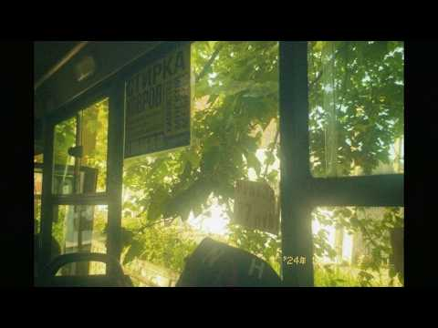
- 설명 앞부분: 오랜만의 자작곡입니다 :) 들어주셔서 감사합니다 Composed & Produced by freemu
- 같은 채널 평소 대비 ×786.3 (채널 최근 롱폼 중앙값 387회) · 평소 영상: Playlist l 파도가 멈추지 않는 밤이었다, 가사없는음악 (387회) / Playlist l 포스트 아포칼립스, 다시 피어나는 세계에서 (Post-Apocalyp… (438회)
- 대본 없음 (설명) — 음성인식이 끝나면 도입부·흐름이 들어감
- 댓글 56/56: 좋은 점 — 영상 0 · 감사·응원 7 · 더 알고 싶은 것 1 · 아쉬운 점 — 영상 0 · 반박·불만 — 의견 다름 0 · 정치·사회 0 · 경험 공유 5 · 구독·다음 기대 4
  - 감사·응원 👍12 “너도 가끔은 내가 생각나면 좋겠어 나만큼이 아니더라도 지나가면서라도 볼 수 있는 걸 감사해야 할까. 그렇게 놓고싶지 않았는데 내가 영원이 되어줄 수 없지만 부디 그 사람이 너의 옆을 영원히 지켜주길 너와 나 정도의 얕은 사이인 사랑이 아니길 그것만을 다시 돌아가면 서…”
  - 감사·응원 👍3 “전 잘 안울고 잘 참는 성격인데, 오늘도 평소처럼 가사없는 음악들 들으면서 잘 넘어갈 하루였는데, 방금 갑자기 버텨온게 봇물 터지듯이 터져서 오랜만에 엉엉 울었어요. 음악듣고 툴툴 털어버리고 자고 아무렇지 않게 내일이 오다보면, 그동안의 10년의 노력도 헛된시간이 아…”
  - 더 알고 싶은 것 👍0 “혹시 악보 구매는 안되나요?”
  - 경험 공유 👍442 “제가 한 쪽 귀가 약하다해야하나 소리를 잘 못듣는데 신기하게 이 영상 일부소리가 안 들리는 귀로 들리네요 자주 올게요!”
  - 경험 공유 👍49 “정말 정말 고마웠고 후반에 잘해주지 못 한게 마음에 조금 걸리지만 그 부분은 나중에 떠올려도 미화가 되지 않을 것 같고.. 좋았던 나날들만 생각한다면 정말 행복했지 우리? 성숙하게 행동하지 못 해서 미안했고, 헤어지고 나서야 깨닫는게 많아. 참.. 내가 눈치가 없었지…”
  - 구독·다음 기대 👍4 “헉 ai아니고 자작곡이라니 너무 귀하고 좋아요,,, 바로 구독누르고갑니다💚💛”
  - 구독·다음 기대 👍1 “듣자마자 구독했어요ㅜㅜ너무좋아요!!!!”

### 124. 𝐏𝐥𝐚𝐲𝐥𝐢𝐬𝐭 너도 지금 이 노래 듣고 있을까? 🤍 ∣ Chill R&B · 매장음악 · 카페 플레이리스트

- https://www.youtube.com/watch?v=AM8WMi8_1cE · mellomoodyy · 구독자 6,240 · 조회수 517,981 (×83.0, 하루 5,875.1) · 좋아요 5,026 (1.0%) · 90.1분 · 2026-07-21 · 주제 묶음 8. 로파이·시티팝·칠 · 형식 플레이리스트·모음 (여러 곡) · 폴더 `W_AM8WMi8_1cE` (웹 승인)
- 썸네일: 
- 챕터: 0:00 Golden Hour Hearts · 2:56 Summer We Never Planned · 5:55 Lemon Soda Dreams · 8:36 Windows Down Forever · 11:35 Meet Me by the Ocean · 14:45 You Look Better in Sunset · 17:40 Twenty-Something Nights · 20:26 Until the Last Firework · 23:33 Blue Skies Between Us · 26:40 See You Next Summer
- 설명 앞부분: 문득 그런 생각이 드는 밤이 있습니다. 지금 이 순간, 어딘가에서 같은 하늘을 바라보며 같은 음악을 듣고 있는 사람이 있을까. 퇴근길의 지하철, 늦은 밤 집으로 돌아가는 길, 따뜻한 커피 한 잔을 들고 창밖을 바라보는 시간. 각자의 하루는 다르지만, 좋은 음악 앞에서는 모두 같은 감정을 느끼게 되는 것 같습니다. 이 플레이리스트는 늦은 밤의 조용한 공기와 잘 어울리는 Modern Chill R&B, Bedroom Pop, Indie R&B로 채워졌습니다. 혼자 있는 시간이 외롭지 않도록, 잠시 쉬어가고 싶은 순간마다 편안하게 함께…
- 같은 채널 평소 대비 ×143.8 (채널 최근 롱폼 중앙값 3,603회) · 평소 영상: 𝐏𝐥𝐚𝐲𝐥𝐢𝐬𝐭 ∣ 휴가 첫날, 제일 먼저 듣고 싶은 노래 🏖️🚗 ∣ chill • R&… (3,636회) / 𝐏𝐥𝐚𝐲𝐥𝐢𝐬𝐭 ∣ 오늘 좀 멋있게 보내고 싶은 날 듣는 노래 🖤 ∣ R&B · 감성힙합 (3,570회)
- 대본 없음 (설명) — 음성인식이 끝나면 도입부·흐름이 들어감
- 댓글 185/185: 좋은 점 — 영상 2 · 감사·응원 6 · 더 알고 싶은 것 0 · 아쉬운 점 — 영상 0 · 반박·불만 — 의견 다름 0 · 정치·사회 0 · 경험 공유 1 · 구독·다음 기대 2
  - 좋은 점 — 영상 👍2 “노래가 너무 듣기 좋아요☺️굿~~💗”
  - 좋은 점 — 영상 👍1 “생각이 많은날 듣기 좋네요.”
  - 감사·응원 👍59 “이 글을 읽고 계신 모든 분들께, 우리가 만날 일은 없을지 모르지만, 여러분의 삶에 기쁨과 성공, 끝없는 행복이 가득하길 진심으로 바랍니다. 힘내시고 건강하세요!”
  - 감사·응원 👍2 “몰래몰래 응원하는 음악맛집이에요^^”
  - 경험 공유 👍2 “네네! 저도 지금 이 노래 듣고 있어요! 자꾸 듣게 되는 음악이예요!”
  - 구독·다음 기대 👍5 “음악도 너무 좋은데 썸네일 맛집이라 구독하고 갑니다!!! 많이 올려주세여 ^^”
  - 구독·다음 기대 👍2 “첫주 기분좋게 시작합니다 멋진 하루 되세요 구독하고 감상 중입니다”

### 125. 🎧요즘 들은 플리 중에 제일 느낌 좋다… 느좋 감성힙합 Chill 𝐏𝐥𝐚𝐲𝐥𝐢𝐬𝐭 🌙

- https://www.youtube.com/watch?v=9iqkcoMV39k · 𝐅𝐞𝐞𝐥𝐿𝐲𝐧 · 구독자 5,020 · 조회수 415,614 (×82.8, 하루 2,979.0) · 좋아요 3,925 (0.9%) · 70.3분 · 2026-05-30 · 주제 묶음 8. 로파이·시티팝·칠 · 형식 플레이리스트·모음 (여러 곡) · 폴더 `W_9iqkcoMV39k` (웹 승인)
- 썸네일: 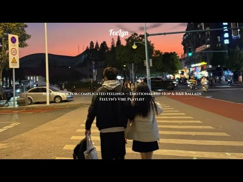
- 챕터: 0:00 천천히 번지는 밤 (Night Spreading Sl… · 2:54 비행모드 (Airplane Mode) · 5:48 바람 지나간 자리 (Where the Breeze P… · 8:36 네 맘의 타이밍 (Timing Of Your Hear… · 11:10 초여름 밤의 대화 (Conversations on a… · 14:10 흐려진 거리 끝에서 (At The End Of Fad… · 17:45 잠깐 스쳐간 계절 (The Season That Pa… · 20:36 파도 끝에 남겨진 말 (Words Left Beyon… · 23:43 불빛 끝에서 (At The Edge of Lights) · 26:39 한 칸 뒤에 앉은 너 (You Sitting One … · 29:40 우리만 아는 Sign (The Sign Only We… · 32:13 다시 웃을 수 있게 (Until We Smile Ag… · 35:07 Repeat
- 설명 앞부분: [ FeelLyn Playlist ] 플레이리스트의 모든 곡은 AI 활용해 제작된 "FeelLyn" 창작물입니다. All songs in this playlist are theatrically produced using AI. All tracks feature "FeelLyn." Unauthorized copying, reproduction, or use is prohibited. 🎧음악: FeelLyn 📷사진: Pinterest
- 같은 채널 평소 대비 ×47.2 (채널 최근 롱폼 중앙값 8,800회) · 평소 영상: 🎧 가을에 첫 곡부터 분위기 이러면 반칙이지… 국내 감성힙합 R&B 𝐏𝐥𝐚𝐲𝐥𝐢𝐬𝐭 🍂 (8,800회) / 아무도 모르게 혼자서만 꺼내 듣고 싶은 🎧 느좋 국내 감성힙합 R&B 𝐏𝐥𝐚𝐲𝐥𝐢𝐬𝐭 🌙 (8,770회)
- 대본 없음 (설명) — 음성인식이 끝나면 도입부·흐름이 들어감
- 댓글 281/281: 좋은 점 — 영상 1 · 감사·응원 12 · 더 알고 싶은 것 10 · 아쉬운 점 — 영상 4 · 반박·불만 — 의견 다름 1 · 정치·사회 0 · 경험 공유 5 · 구독·다음 기대 9
  - 좋은 점 — 영상 👍8 “요런 감성 너무 좋아요😊찾고찾았는데 이게 AI라구요?아무렴 어때요 전 너무 듣기 좋네요 마음도 몽글몽글해지고 주인장님 감사합니다 🫶🏻”
  - 감사·응원 👍8 “요런 감성 너무 좋아요😊찾고찾았는데 이게 AI라구요?아무렴 어때요 전 너무 듣기 좋네요 마음도 몽글몽글해지고 주인장님 감사합니다 🫶🏻”
  - 감사·응원 👍8 “우연히 방문했는데 분위기가 정말 좋네요. 음악도 너무 편안해서 끝까지 잘 들었습니다. 앞으로도 좋은 플레이리스트 많이 만들어 주세요! 채널 응원하겠습니다. 구독하고 자주 놀러올게요. 좋은 음악 감사합니다! 🎶”
  - 더 알고 싶은 것 👍8 “우연히 방문했는데 분위기가 정말 좋네요. 음악도 너무 편안해서 끝까지 잘 들었습니다. 앞으로도 좋은 플레이리스트 많이 만들어 주세요! 채널 응원하겠습니다. 구독하고 자주 놀러올게요. 좋은 음악 감사합니다! 🎶”
  - 더 알고 싶은 것 👍7 “노래 너무 좋아요 전AI건 뭐건 제가 좋으면 끝이라 더 많이 부탁합니다”
  - 아쉬운 점 — 영상 👍10 “천천히 번지는밤 진짜 매일 무한반복재생중인데 음원 멜론에 올라갔음 좋겠네요 ㅠㅠ 좋아요 너무”
  - 아쉬운 점 — 영상 👍2 “비행모드랑 흐려진 거리 끝에서 몇 일 무한반복 듣고있네요ㅜㅜ 저 어쩔...”
  - 반박·불만 — 의견 다름 👍3 “우연히 듣게 되었는데, 이건 우연이 아니죠? 운전할때 들으면 진짜 기분 좋아요. 바람 지나간 자리💚💚💚”
  - 경험 공유 👍7 “노래 너무 좋아요 전AI건 뭐건 제가 좋으면 끝이라 더 많이 부탁합니다”
  - 경험 공유 👍4 “처음 이노래 접해서 들었는데 노래가 너무좋은거에요. 근데 댓글에 왜 멜론에 없냐길래 설마 ai노래인가 했는데 정말 그렇더라고요..? 주인장님 진짜 천재 아니세요? 어케 이런곡을 여러개 만드셔서 플레이리스트로 이렇게.. 할수있으신지.. ai노래 처음 막 나왔을때 심통봇…”
  - 구독·다음 기대 👍8 “우연히 방문했는데 분위기가 정말 좋네요. 음악도 너무 편안해서 끝까지 잘 들었습니다. 앞으로도 좋은 플레이리스트 많이 만들어 주세요! 채널 응원하겠습니다. 구독하고 자주 놀러올게요. 좋은 음악 감사합니다! 🎶”
  - 구독·다음 기대 👍1 “노래 진짜 너무좋네요. 구독했어요 😊”

### 126. [playlist] 다신 사랑하지 않을 다짐

- https://www.youtube.com/watch?v=xNrmomdWeqk · le · 구독자 12,300 · 조회수 1,005,478 (×81.8, 하루 5,958.4) · 좋아요 13,405 (1.3%) · 25.4분 · 2026-05-01 · 주제 묶음 기타 · 형식 플레이리스트·모음 (여러 곡) · 폴더 `W_xNrmomdWeqk` (웹 승인)
- 썸네일: 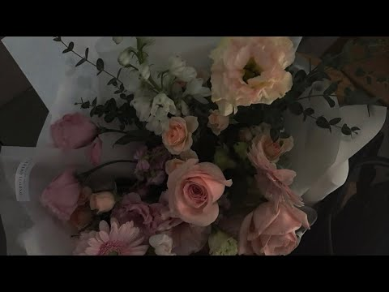
- 챕터: 0:00 DANIEL - 은방울 · 4:52 최윤영 - 우리가 영원을 말하면 여름이 될거야 (fe… · 9:17 리도어 - 영원은 그렇듯 · 13:14 검정치마 - EVERYTHING · 18:15 겸 - 사랑 없이 사는 게 왜 그렇게 어려울까요 · 21:01 알레프 - 다신 사랑하지 않을 다짐
- 같은 채널 평소 대비 ×26.5 (채널 최근 롱폼 중앙값 37,953회) · 평소 영상: [playlist] 예쁜 꽃송이 창밖에 내려와 ✿ₒ˚ ͙ .* ૢ°₊·*:❀ (42,853회) / [playlist] 사랑 남녀 듀엣곡 모음 2 (33,053회)
- 대본 없음 (없음) — 음성인식이 끝나면 도입부·흐름이 들어감
- 댓글 655/654: 좋은 점 — 영상 3 · 감사·응원 19 · 더 알고 싶은 것 1 · 아쉬운 점 — 영상 5 · 반박·불만 — 의견 다름 3 · 정치·사회 0 · 경험 공유 175 · 구독·다음 기대 0
  - 좋은 점 — 영상 👍11 “전에 알고 지내던 누군가가 말하기를 회복은 죽을만큼 아픈 고통 후에 오는 법이므로, 나머지는 시간과 세포 그리고 신선한 공기가 해결해준댔다 그러니까 그 고통은 일종의 포비돈 같은거겠지 다신 사랑하지 않을 다짐은 법적 효력도 기한도 없다 그러니까 언제든 다시 사랑해도 …”
  - 좋은 점 — 영상 👍0 “너한테서 사랑을 배웠고, 너한테서 이별을 배웠다.”
  - 감사·응원 👍4 “너는 추운 11월에 세상에게 마지막을 말하고 그대로 추락했지 그 겨울 그 곳에서 얼마나 춥고 무서웠을까. 우리 같이 모동숲 접속해서 했잖아 장례식 다 끝나고 너랑 같이 했던 닌텐도를 켜봤어 편지함이 띠링띠링 울려서 확인해봤더니 너가 편지를 남겨놨더라 다음생이 있다면 …”
  - 감사·응원 👍2 “너가 먼저 다가와서 너 없이는 못 살게 만들어놓고 왜 그렇게 나쁜말로 나 밀어냈어? 내가 그렇게 나빴었나? 너가 백일 이백일 삼백일 안 챙기고 내 생일 안 챙겨줬을 때도 난 묵묵히 챙기고 너가 몇날 며칠 연락 없을 때도 힘든일 있는가 싶어서 그냥 기다렸는데 왜 나한테…”
  - 아쉬운 점 — 영상 👍1 “다신 사랑같은 거 안한다 너무 실망스럽고 혐오스럽다”
  - 아쉬운 점 — 영상 👍0 “야, 우리 쌍방 아니였어? 아, 내 착각이었나. 너가 나한테 먼저 선톡도 하고 좋사도 물어봤잖아. 우리 통화도, 문자도 1시간 넘게 했었잖아. 근데 이제와서 다른 얘 좋아했었다며 나한테 패드립에서 온갖 욕을 다 퍼붓더라? 너랑 그렇게 욕을 밖으며 싸우고, 나 있지 두…”
  - 반박·불만 — 의견 다름 👍4 “이제는 어떠한 사람의 말도 안들을려고. 들어서 그쪽 편을 들었더니. 오해가 생겼고. 그오해가 풀리니까. 내가 했던 말들이 너무 미안해서 울고있어. 엄마말이 맞았어. 누구 한사람의 말만 듣고 따르면 안되는거였는데, 결국 내가 그중 하나였던거야. 앞으론 안그런다고 다짐했…”
  - 반박·불만 — 의견 다름 👍2 “학업 때문에 첫사랑을 포기했어요 맞는 선택인지는 잘 모르겠어요 그 친구는 살면서 본 사람들 중 가장 다정하고 배려심 넘치는 사람이였는데 솔직히 너무 후회돼요 그치만 되돌리기엔 늦었으니 그냥 하루하루 미련과 동시에 죄책감을 가지며 살아가고 있어요 거절한 건 전데 왜 제…”
  - 경험 공유 👍309 “진짜 왜 내가 아직까지도 너때문에 힘들어야 하는건데 내가 그리운건 예전의 너야”
  - 경험 공유 👍266 “나 혼자 잘 지내고 있었는데 너가 내 마음에 왜 먼저 들어와놓고 너가 먼저 흔들어놓고 이렇게 떠나버리면 난 어떡해 네가 다 휘집어버리고 가버리면 흩트러진 내 마음은 어떡하라고 또 나는 혼자 내 마음을 정리하겠지 나쁜 남자야 너가 다시 돌아오길 바라는 내 자신이 싫어 …”

### 127. 듣는 순간 마음이 편안해지는 첼로와 오보에 🎻 ∣ 공부, 휴식, 감성 힐링 음악

- https://www.youtube.com/watch?v=aha1_5ENidU · 따뜻한 휴식 Studio · 구독자 1,990 · 조회수 162,032 (×81.4, 하루 1,165.6) · 좋아요 1,980 (1.2%) · 33.4분 · 2026-05-31 · 주제 묶음 1. 수면·명상·힐링 · 형식 음악 (그 밖 모양 — 한 편짜리 BGM 등) · 폴더 `W_aha1_5ENidU` (웹 승인)
- 썸네일: 
- 챕터: 0:00 The Song That Never Ends · 4:12 Today Was a Happy Day · 8:05 A Pleasant Journey · 12:18 The World I Dream Of · 16:40 Peaceful Mind · 20:15 Memory · 24:30 Going Home · 29:10 I'll Be Your Umbrella · 34:20 The Gift of Us · 39:12 I'll Be on Your Side · 44:05 You Don’t Have to Hurt Alone · 49:40 Freedom of Mind
- 설명 앞부분: 🎻 첼로의 깊은 울림과 오보에의 따뜻한 선율이 함께하는 감성 OST 컬렉션 노을이 지는 저녁, 혼자 걷는 길, 누군가를 떠올리는 순간처럼 조용히 마음을 감싸주는 연주곡들을 담았습니다. 오늘 하루도 수고한 당신에게 따뜻한 쉼이 되는 음악이 되었으면 좋겠습니다. 🎼 TRACK LIST 🎧 Recommended for: ☕ Café ambience 📖 Reading & studying 🌙 Relaxing nights 🚗 Night driving 💭 Emotional reflection 😴 Healing & sleep 🎻 Cello & …
- 같은 채널 평소 대비 ×371.6 (채널 최근 롱폼 중앙값 436회) · 평소 영상: 언젠가 빛나는 날 🌅 오늘을 살아가는 당신에게 (436회) / 따뜻한 감성 Playlist #3 🌙 지친 하루를 안아주는 힐링 음악 모음 (421회)
- 대본 없음 (설명) — 음성인식이 끝나면 도입부·흐름이 들어감
- 댓글 100/100: 좋은 점 — 영상 3 · 감사·응원 21 · 더 알고 싶은 것 2 · 아쉬운 점 — 영상 1 · 반박·불만 — 의견 다름 2 · 정치·사회 0 · 경험 공유 3 · 구독·다음 기대 3
  - 좋은 점 — 영상 👍3 “너무듣기 좋아서 황홀하기하네요 ㅡ감사합니다”
  - 좋은 점 — 영상 👍1 “가브리엘스 오보에의 오보에, 첼로 버전 각각 찾아 듣다가 여기로 오게되었어요 첼로 소리 좋아해서 배웠는데 중단하게 되어 다시 시간과 여유를 찾으면 다시 도전하려고 합니다. 아름다운곡들 감사합니다.”
  - 감사·응원 👍25 “제일 좋아하는 첼로음에 오보에까지~~ 행복한 시간 만들어 주셔서 감사합니다❤”
  - 감사·응원 👍25 “샵에서 틀어주면 손님들이 너무 편하다고 좋아하십니다. 늘 나의 일상을 평온하게 해주셔서 감사합니다. 지금도 내 공간에는 온통 아름다운 이 선률들이 흐르고 있습니다.”
  - 더 알고 싶은 것 👍1 “메일 확인 부탁드립니다. 따듯한 휴식님 음악이 좋아서 제가 개발중인 앱에 BGM넣고 싶어서 메일 드렸습니다. 답변 기다리고 있습니다. God bless you~~”
  - 아쉬운 점 — 영상 👍1 “너무 좋은 음악을 제공해 주셔서 편안함 가운데 일할 수 있게 됐습니다. 감사합니다~ 단 한 가지 중간 광고가 있어서 아쉽긴 합니다.”
  - 반박·불만 — 의견 다름 👍6 “AI음악아닌거 찾다가 여기 왔는데.. 이건 AI 아니죠? 좋네요 ~~”
  - 경험 공유 👍1 “비... 빗줄기는 고즈넉한 동백숲으로 소리없이 내리고 있었다. 붉은 꽃봉오리를 달고 있는 동백나무는 빗줄기를 온몸으로 맞으며 평소보다 더욱 싱그럽게 빛났다. 우산을 쓴 관람객 서너 명이 동백숲 정경을 둘러보고 있었다. 나는 고풍스런 대청마루에 앉아 빗줄기를 지그시 바…”
  - 경험 공유 👍1 “메일 확인 부탁드립니다. 따듯한 휴식님 음악이 좋아서 제가 개발중인 앱에 BGM넣고 싶어서 메일 드렸습니다. 답변 기다리고 있습니다. God bless you~~”
  - 구독·다음 기대 👍7 “구독과 좋아요 누르고 갑니다 알림설정두요 클리식 문외한 두 듣기가 편안하고 감미로워서 좋습니다”
  - 구독·다음 기대 👍5 “마음 편안한 음악 잘 듣고 구독하고 갑니다.~^^”

### 128. 마음이 편안해져요, 가을 아침 클래식 ㅣ듣기만 해도 행복해지는 클래식 명곡

- https://www.youtube.com/watch?v=XOiUmptBDVk · Aria classic | 아리아클래식 · 구독자 2,510 · 조회수 202,196 (×80.6, 하루 4,434.3) · 좋아요 1,246 (0.6%) · 68분 · 2026-09-01 · 주제 묶음 6. 피아노·클래식·연주곡 · 형식 연주 (직접 연주하는 영상) · 폴더 `W_XOiUmptBDVk` (웹 승인)
- 썸네일: 
- 설명 앞부분: 🍃가을 아침에 들으면 행복해지는 클래식 명곡들ㅣ힐링 음악ㅣ휴식 BGM 제가 사는 곳은 가을비가 이틀 내리 연달아 내렸어요.. 저녁에는 제법 쌀쌀한게 꽤 가을느낌이 나는 느낌이지요 이제 곧 선선하고 기분 좋은 가을이 찾아오겠지요.. 오늘 아침은 따뜻한 커피 한 잔에 아리아 클래식을 곁들여서, 마음을 편안하게 어루만지는 행복한 가을 아침을 시작해 보는 건 어떠세요..?^^ 오늘 하루도 가슴 가득 사랑과 행복만 가득하시길 진심으로 바랄게요..^^♥ ☕ 아침 커피와 함께 📖 독서와 공부 🌿 휴식과 명상 💼 업무와 집중 © 2026. Ar…
- 같은 채널 평소 대비 ×22.2 (채널 최근 롱폼 중앙값 9,107회) · 평소 영상: 마음이 평화가 와요, 가을아침 명품 클래식ㅣ듣기만 해도 행복해지는 클래식 명곡 (15,042회) / 쇼팽이 선물한 봄, 낭만과 사랑의 클래식 앙상블 ∣ Spring in Paris (3,172회)
- 대본 없음 (설명) — 음성인식이 끝나면 도입부·흐름이 들어감
- 댓글 18/18: 좋은 점 — 영상 0 · 감사·응원 7 · 더 알고 싶은 것 0 · 아쉬운 점 — 영상 0 · 반박·불만 — 의견 다름 0 · 정치·사회 0 · 경험 공유 0 · 구독·다음 기대 0
  - 감사·응원 👍8 “피아노.소리와.첼로.타.악기.소리.울림이.오늘따라.더..시원스럽고.선.선한.기분이.드네요.비가오고.난.뒤에라.오늘.새벽에는.정말.선.선.함니다..진짜.가을이.왔네요..지긋.지긋.했던.여름더위가..정말.흔적도없이.사라젖읍니다.창문을.열어놓고.새벽공기.바람을..마시며.오…”
  - 감사·응원 👍5 “마음이.편안해지네요.감사해요”

### 129. 영혼을 울리는 집시 바이올린 🎻 ∣ 감성 바이올린 · 집시 음악 · 휴식 플레이리스트 ∣ 보라빛 음악정원

- https://www.youtube.com/watch?v=7xQeXJwhFh8 · 보랏빛 음악정원 · 구독자 174 · 조회수 13,589 (×78.1, 하루 261.5) · 좋아요 164 (1.2%) · 87.7분 · 2026-08-26 · 주제 묶음 6. 피아노·클래식·연주곡 · 형식 플레이리스트·모음 (여러 곡) · 폴더 `W_7xQeXJwhFh8` (웹 승인)
- 썸네일: 
- 설명 앞부분: 달빛이 머무는 밤, 집시 바이올린의 깊고 자유로운 선율에 천천히 빠져보세요. 🎻🌙 애절하면서도 뜨거운 바이올린의 울림과 유랑의 밤을 닮은 낭만적인 분위기를 담아 감상 · 휴식 · 독서 · 작업 시간에 잘 어울리는 플레이리스트로 구성했습니다. 🎵 Track List 1. 달빛을 따라 떠나는 바이올린 2. 바람 끝에 남은 선율 3. 별빛 아래 떠도는 춤 4. 불빛 따라 흐르는 밤 5. 붉은 달 아래의 약속 6. 새벽길에 남은 노래 7. 바람이 머문 언덕 8. 별이 내린 오래된 거리 9. 달빛이 스친 유랑길 10. 불꽃처럼 스친 밤 1…
- 같은 채널 평소 대비 ×43.6 (채널 최근 롱폼 중앙값 312회) · 평소 영상: [플레이리스트] 달빛이 스민 길 ∣ 국악 힐링 OST ∣ 달빛 아래 듣는 잔잔한 국악 선율 (338회) / [Playlist] 달빛에 스민 칼끝 🌙 자객 OST｜조선 궁궐의 밤을 걷는 판타지 국악… (286회)
- 대본 없음 (설명) — 음성인식이 끝나면 도입부·흐름이 들어감
- 댓글 16/16: 좋은 점 — 영상 0 · 감사·응원 1 · 더 알고 싶은 것 0 · 아쉬운 점 — 영상 0 · 반박·불만 — 의견 다름 0 · 정치·사회 0 · 경험 공유 1 · 구독·다음 기대 0
  - 감사·응원 👍0 “아름다운 연주곡 잘 들었습니다~감사합니다~수고 많으셨습니다”
  - 경험 공유 👍2 “아! 내가 좋아하는 데 뭐라 말을 못하겠노 냄새가 좀 찐하긴 하는데 그냥 좋아요는 좋아요”

### 130. 하루를 밝게 만드는 찬송가 모음 10곡 ∣ 기분 좋아지는 찬송가 모음 10곡 ∣ 어쿠스틱 기타 찬양 ∣ 듣기만 해도 마음이 가벼워지는 찬송가 10곡

- https://www.youtube.com/watch?v=AOyN15yGFrs · 주님곁에 · 구독자 18,700 · 조회수 1,459,911 (×78.1, 하루 10,190.3) · 좋아요 16,947 (1.2%) · 70.5분 · 2026-05-27 · 주제 묶음 15. CCM·찬양·국악·동요 · 형식 플레이리스트·모음 (여러 곡) · 폴더 `W_AOyN15yGFrs` (웹 승인)
- 썸네일: 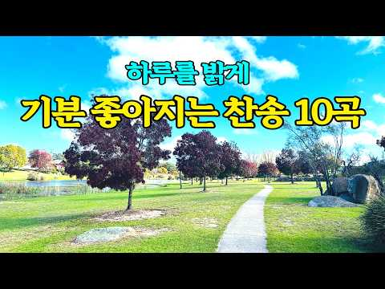
- 챕터: 0:00 88장 내 진정 사모하는 · 3:19 438장 내 영혼이 은총 입어 · 6:28 301장 지금까지 지내온 것 · 9:24 79장 주 하나님 지으신 모든 세계 · 13:52 491장 저 높은 곳을 향하여 · 18:16 191장 내가 매일 기쁘게 · 21:21 28장 복의 근원 강림하사 · 24:56 412장 내 영혼의 그윽히 깊은 데서 · 29:34 405장 주의 친절한 팔에 안기세 · 32:29 552장 아침 해가 돋을 때 · 35:55 반복
- 설명 앞부분: 하루를 밝게 만드는 따뜻한 어쿠스틱 기타 찬송가 모음 10곡입니다. 경쾌한 리듬과 편안한 기타 사운드 위에 익숙한 찬송의 은혜를 담았습니다. 아침을 시작할 때, 가볍게 집안 일을 할 때, 카페처럼 편안한 분위기로 시간을 보내고 싶을 때, 드라이브를 하거나 공부와 작업을 할 때도 부담 없이 들으실 수 있습니다. 너무 무겁지도, 지나치게 빠르지도 않은 따뜻하고 기분 좋은 흐름으로 구성했습니다. 지친 마음에는 작은 쉼이 되고, 평범한 하루에는 잔잔한 감사가 머물기를 바랍니다. 오늘 하루도 하나님 안에서 밝고 평안한 시간이 되시길 바랍니…
- 같은 채널 평소 대비 ×30.1 (채널 최근 롱폼 중앙값 48,515회) · 평소 영상: [평안 찬송] 사랑하는 가족을 마음에 품고 듣는 찬송 10곡 ∣ 가족 구원을 위해 기도하… (52,570회) / [2시간 연속듣기] 부족함 속에서도 넘치는 감사를 채우는 평안의 찬송가 모음 ∣ 주 날개… (44,460회)
- 대본 없음 (설명) — 음성인식이 끝나면 도입부·흐름이 들어감
- 댓글 1,229/1,229: 좋은 점 — 영상 6 · 감사·응원 335 · 더 알고 싶은 것 12 · 아쉬운 점 — 영상 13 · 반박·불만 — 의견 다름 2 · 정치·사회 1 · 경험 공유 33 · 구독·다음 기대 6
  - 좋은 점 — 영상 👍4 “저는 외국에 살아요. 마음이 맑아지고 찬송가 가사가 귀에 잘들어 옵니다 오래 신앙생활햇는데 마음이 힘들어서 낙심이 오래엿는데 .....이찬송가를 저장해두엇어요. 애들에게도 보내주고 운전때마다 들으라 했어요 감사합니다 ~~~”
  - 좋은 점 — 영상 👍2 “28장 좀 이상하게 편집되었어요 그것말고는 너무 좋아요. 아침에 듣기좋은 찬송가입니다. 감사합니다.”
  - 감사·응원 👍132 “지금까지 지내 온것 다주님 은혜입니다 남은 삶도 주님함께하실 줄 믿고감사드립니다.아멘”
  - 감사·응원 👍69 “아침에 맑고 청아한 찬송 들으며 성경필사하니 세상은 어디로 가고 하늘의 평안이 나를 덮습니다 감사합니다”
  - 더 알고 싶은 것 👍10 “너무 은혜스러워요~ 아름다운 목소리의 찬양이라 하루를 기분좋게 보낼것 같아요 역시 찬송가가 좋아요~ 계속해서 많은 찬양올려주세요~”
  - 더 알고 싶은 것 👍5 “은혜 로운 찬양 감사합니다 항상주님안에세 은혜를 누릴수 있기를 기도 합니다 오늘은 금요일 입니다 혼자감당하시기 힝든 기도가 있으시면 올려주시면. 함께 기도해 드리겠습니다 주님의 마음 입니다~~ 형제여 주님이 힘주시고 강건하시기를~~😀”
  - 아쉬운 점 — 영상 👍35 “두분다 목소리가 너무 좋으셔서 자꾸 듣게되요~찬송가도 너무좋지만 목소리가 엄청 편안하고 부드러워요”
  - 아쉬운 점 — 영상 👍6 “주일 아침, 우연히 밝고 기분좋은 찬송을 듣게 되었습니다. 얼마나 은혜스럽고 좋은 지 계속해서 무한반복 중입니다. 은혜스러운 아침을 열어주셔서 감사합니다. 구독과 좋아요로 응원합니다. ^^”
  - 반박·불만 — 의견 다름 👍1 “참으로 감사합니다 찬양은 은셰롭고 화면은 아름답고요 저는 YouTube TV로 감상을 하는데 펴다가 바로 다른 곳으로 갑니다. 왜??? 글씨들 테두리가 검정으로 그리고 굵게 만드셔서요 감상만 하면 그냥 넘어가는데 화면을 봐야 할 경우 질식하게되요 가늘게 하시든지 굵게…”
  - 반박·불만 — 의견 다름 👍0 “유튭에 올라온 찬송가를 듣다 어느순간 안듣게 되더라구요. 찾는 곡도 없지만 찾아도 그냥 이게 아닌데 하는 마음이 더 컸었습니다. 그래서 이 인트로 보고 기존의 것들 모아놨구나 생각해서 안누르려다가 기대없이 눌렀는데... 참 좋은 찬송을 만났습니다. 감사한 아침입니다.…”
  - 경험 공유 👍19 “내가 다시 교회가기를 믿음생활하기를 바랬던 엄마 나 이제야 매일 기도하고 찬송가 들으면서 엄마생각하는데 하늘나라에서라도 기뻐했으면 좋겠다”
  - 경험 공유 👍16 “저도 지금처음 들었어 넘좋아요 ~넘 평안한 두분 목소리 감사합니다 ~😂😂”
  - 구독·다음 기대 👍18 “아침찬양에 너무 잘 맞는 목소리와 은혜입니다. 첫곡듣고 바로 구독했습니다”
  - 구독·다음 기대 👍4 “사운드 분위기가 너무좋아요 따뜻하고ᆢ촉촉한느낌 ᆢ잠에서 깨자마자 듣게되었는데 오프라인저장 해야겠어요 매일듣고싶네요”

### 131. Mozart Style ∣ 아침 공기처럼 가볍게 흐르는 모차르트풍 스트링 앙상블 ✿중간광고 없음 ∣ 잔잔한 클래식, Morning Music, Cafe BGM

- https://www.youtube.com/watch?v=8SUfn18vz_U · Lucerna Harmonia · 구독자 18,200 · 조회수 1,416,391 (×77.8, 하루 12,117.4) · 좋아요 28,479 (2.0%) · 132분 · 2026-06-22 · 주제 묶음 4. 카페·매장·라운지 · 형식 음악 (그 밖 모양 — 한 편짜리 BGM 등) · 폴더 `W_8SUfn18vz_U` (웹 승인)
- 썸네일: 
- 챕터: 0:00 Morning Tea Waltz · 2:57 Golden Window Light · 5:20 Gentle Sunny Steps · 8:14 Bright Salon Melody · 10:23 Crystal Morning Dance · 12:52 Soft Air Serenade · 15:31 Sunlit Harmony · 18:35 Graceful Morning Smile · 21:11 Warm Café Waltz · 24:24 Lighthearted Reverie · 27:42 Dancing Porcelain Light · 30:32 Elegant Daybreak · 33:26 Morning Petals Serenade · 37:10 Sunbeam Waltz Reverie · 40:13 Clear Sky Melody · 44:00 Repeat
- 설명 앞부분: Mozart Style의 밝고 우아한 스트링 앙상블이 맑은 아침 공기처럼 가볍게 흐릅니다. 햇살이 비치는 유럽식 정원과 화사한 꽃, 분수와 조각상이 어우러진 풍경 속에서 편안한 아침을 느껴보세요. 독서 BGM이나 휴식 음악, 카페 분위기가 필요한 순간에 자연스럽게 곁을 채워줍니다. 여러분은 이 음악과 함께 어떤 아침 풍경을 바라보고 계신가요? More Music on Spotify & YouTube Music YouTube Music Spotify 🌷 햇살과 꽃 사이로 흐르는 모차르트의 아침 푸른 하늘 아래 밝은 햇살이 정원과 분…
- 같은 채널 평소 대비 ×195.9 (채널 최근 롱폼 중앙값 7,231회) · 평소 영상: Tchaikovsky Style ∣ 햇살 스미는 정원처럼 서정적으로 흐르는 현악앙상블🌿[… (7,231회) / Chopin Style ∣ 책과 커피가 머무는 유리 온실 서재의 피아노 트리오 📚중간광고… (7,267회)
- 대본 없음 (설명) — 음성인식이 끝나면 도입부·흐름이 들어감
- 댓글 1,123/1,123: 좋은 점 — 영상 3 · 감사·응원 43 · 더 알고 싶은 것 0 · 아쉬운 점 — 영상 1 · 반박·불만 — 의견 다름 0 · 정치·사회 0 · 경험 공유 1 · 구독·다음 기대 1
  - 좋은 점 — 영상 👍26 “이런 분위기의 클래식 음악은 언제 들어도 질리지 않네요. 좋은 영상 감사합니다. 🎶”
  - 좋은 점 — 영상 👍0 “좋은영상 감사합니다”
  - 감사·응원 👍244 “마음을 행복하게 해주셔서 감사드립니다. 기쁨이 몽글몽글😊 건강해지는 기분입니다. 모두모두 행복하시기를... 좋은 선물 주시는 운영자님도 행복하시고, 좋은 일이 가득가득하시기를😊”
  - 감사·응원 👍32 “아침에 일어나 맞는 음악 기분좋은 하루시작이예요 플릇의 경쾌함 현악기의 만남이 이렇게좋을수가 음악이주는 행복 감사합니다”
  - 아쉬운 점 — 영상 👍0 “시작전에 광고가 넘길다ㅡ”
  - 구독·다음 기대 👍0 “구독과 좋아요 누르고 갑니다 알림설정두요 커피 한 잔과 좋은 기분으로 듣고 있습니다”

### 132. 싸이월드 감성 발라드 💿 그 시절 MP3에 꼭 있던 노래 ∣ 2000년대 발라드 명곡 모음 🎧 SG워너비, 씨야, 다비치, 티아라, SS501

- https://www.youtube.com/watch?v=5T42ApT_D-o · 그때 그 가락 · 구독자 2,450 · 조회수 187,838 (×76.7, 하루 7,349.9) · 좋아요 4,413 (2.4%) · 105.1분 · 2026-09-21 · 주제 묶음 9. 가요·발라드·트로트 · 형식 플레이리스트·모음 (여러 곡) · 폴더 `W_5T42ApT_D-o` (웹 승인)
- 썸네일: 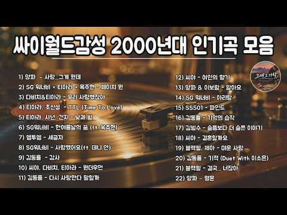
- 챕터: 0:00 양파 – 사랑...그게 뭔데 · 3:41 SG 워너비 × 티아라 × 옥주현 - 페이지 원 · 6:42 다비치 & 티아라 - 우리 사랑했잖아 · 10:12 티아라, 초신성 - TTL (Time To Love) · 13:30 티아라, 샤넌, 건지 - 낮과 밤 · 16:54 SG워너비 - 한여름날의 꿈 (ft. 옥주현) · 21:09 엠투엠 - 세글자 · 25:02 SG워너비 - 사랑했어요 (ft. 데니 안) · 28:50 김동률 - 감사 · 33:36 씨야, 다비치, 티아라 - 원더우먼 · 37:14 김동률 - 다시 사랑한다 말할까 · 42:01 씨야 - 여인의 향기 · 45:48 양파 & 이보람 - 알아요 · 49:21 SG 워너비 - 아리랑 · 53:52 SS501 - 파인드 · 57:02 김동률 - 기억의 습작 · 62:07 김범수 - 슬픔보다 더 슬픈 이야기 · 67:37 씨야 - 결혼할까요 · 71:53 블랙펄, 제아 - 미운 사랑 · 75:47 김동률 - 기적 (Duet With 이소은)
- 설명 앞부분: 그 시절, MP3 플레이어에 꼭 저장해 두었던 노래가 있었습니다. 싸이월드 미니홈피를 열어 오늘의 기분과 어울리는 BGM을 고르고, 이어폰을 꽂은 채 같은 노래를 몇 번이고 반복해서 듣던 밤. 누군가를 좋아하기 시작했을 때도, 사랑이 끝나 혼자 돌아오던 길에도, 쉽게 잠들지 못했던 새벽에도 늘 우리 곁에는 이런 노래들이 있었습니다. 🎧 싸이월드 감성 발라드 — 그 시절 MP3에 꼭 있던 노래 이번 플레이리스트에는 SG워너비, 씨야, 다비치, 티아라, 양파, 김동률, 김범수, SS501, 엠투엠, 블랙펄, 더 크로스, 유해준 등 그…
- 같은 채널 평소 대비 ×2.1 (채널 최근 롱폼 중앙값 89,426회) · 평소 영상: 2000년대 히트곡 🎧 첫 소절만 들어도 그 시절로 돌아가는 노래들 ∣ 추억의 발라드 명… (89,426회) / 2000년대 발라드 명곡 모음 ∣ 그 시절 가요계를 휩쓴 전설의 명곡들 (SG워너비, 씨… (101,712회)
- 대본 없음 (설명) — 음성인식이 끝나면 도입부·흐름이 들어감
- 댓글 16/16: 좋은 점 — 영상 0 · 감사·응원 0 · 더 알고 싶은 것 1 · 아쉬운 점 — 영상 0 · 반박·불만 — 의견 다름 0 · 정치·사회 0 · 경험 공유 0 · 구독·다음 기대 0
  - 더 알고 싶은 것 👍1 “여러분은 노래를 들으면서 옛날 생각을 많이 하는 편인가요? 아니면 음악은 음악으로 즐기는 편인가요? 여러분의 생각이 궁금합니다.”

### 133. 𝘱𝘭𝘢𝘺𝘭𝘪𝘴𝘵 들으면 행복해지는 노래 모음 🫧 하루종일 듣기 좋은 팝송 플레이리스트

- https://www.youtube.com/watch?v=lQrhgr4_dKg · seroma room · 구독자 16,600 · 조회수 1,246,747 (×75.1, 하루 7,493.9) · 좋아요 7,296 (0.6%) · 542.2분 · 2026-05-04 · 주제 묶음 10. 팝송·K팝·J팝 · 형식 플레이리스트·모음 (여러 곡) · 폴더 `W_lQrhgr4_dKg` (웹 승인)
- 썸네일: 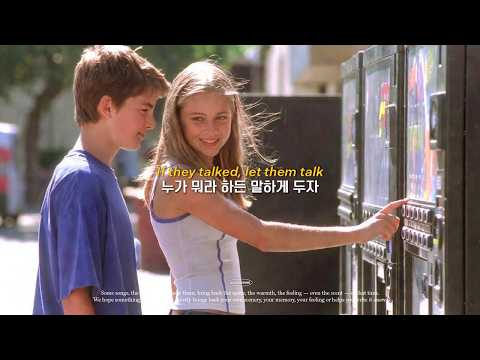
- 챕터: 0:00 Running Late but Feeling Good · 2:21 A Little Too Late · 4:36 Backseat Brave · 7:18 Just Enough Chaos · 10:30 First Jump · 12:41 A Song We Played Too Loud · 15:27 Off Script Day · 18:37 We Took the Longer Way Around · 21:40 Everything Felt Possible Then · 24:02 We Talked About Everything · 26:10 We Made It Up · 29:07 We Didn’t Check the Time Once · 32:05 Too Bright to Stay Inside · 34:31 Laughing Like It’s Nothing · 37:25 Missed The Bus · 39:25 That Day Felt Like a Movie Sc… · 42:13 Music First
- 설명 앞부분: 들으면 기분이 조금 가벼워지는 노래들을 모았어요 🫧 출근길, 산책, 공부나 작업할 때 편하게 틀어두기 좋은 플레이리스트입니다 🎧 오늘 하루가 조금 더 좋아지길 바라요 🤍 Songs that make your day feel a little lighter 🫧 Easy to play in the background for your commute, a walk, or while you work or study 🎧 Hope this adds a small moment of happiness to your day 🤍 🎧 Youtube Mu…
- 같은 채널 평소 대비 ×129.4 (채널 최근 롱폼 중앙값 9,638회) · 평소 영상: 𝘱𝘭𝘢𝘺𝘭𝘪𝘴𝘵 오늘은 웃을 일이 좀 많을 것 같아 ☀️ 하루종일 듣기 좋은 노래 모음 … (9,638회) / 𝘱𝘭𝘢𝘺𝘭𝘪𝘴𝘵 틀자마자 기분 좋아지는 여름 팝송 🫧☀️ 하루종일 듣기 좋은 요즘 플레이… (9,341회)
- 대본 없음 (설명) — 음성인식이 끝나면 도입부·흐름이 들어감
- 댓글 167/167: 좋은 점 — 영상 5 · 감사·응원 10 · 더 알고 싶은 것 4 · 아쉬운 점 — 영상 2 · 반박·불만 — 의견 다름 0 · 정치·사회 0 · 경험 공유 5 · 구독·다음 기대 1
  - 좋은 점 — 영상 👍21 “이 노래들은 진짜 하루 종일 듣기 좋은 것 같아요 ^^”
  - 좋은 점 — 영상 👍7 “안녕하세요 선플달기활동을 하고있는 학생입니다 !! 오늘 뭔가 기분이 답답하고 좋지 않았는데 이 플레이리스트를 듣다 보니 서서히 감정이 스며들어가는 것 같습니다 ㅎㅎ고정에 달아두시는 좋은 말씀에 힘입어 남은 오늘 하루 잘 보내보겠습니다 감사합니다😊”
  - 감사·응원 👍20 “온종일 틀어놓고 집안일도 하고 커피도 마시고 일상의 위로에요 ^^ 감사합니다.”
  - 감사·응원 👍7 “안녕하세요 선플달기활동을 하고있는 학생입니다 !! 오늘 뭔가 기분이 답답하고 좋지 않았는데 이 플레이리스트를 듣다 보니 서서히 감정이 스며들어가는 것 같습니다 ㅎㅎ고정에 달아두시는 좋은 말씀에 힘입어 남은 오늘 하루 잘 보내보겠습니다 감사합니다😊”
  - 더 알고 싶은 것 👍15 “첫번째 곡이랑 비슷한 노래 추천 좀 해주세요ㅠ 첫 곡이 너무 좋은데 찾아봐도 없어요ㅜㅜ”
  - 더 알고 싶은 것 👍1 “We Didn't Check the Time once 이노래도 내주세요 ㅠㅠ 애플 뮤직이라도 아님 이곡만 만들어주세요 ㅠ 지금6시간째 이곡만 듣고 있어요 ㅠ 29:07”
  - 아쉬운 점 — 영상 👍8 “오뭔가 ai같다햇는데 맞앗네..;;”
  - 아쉬운 점 — 영상 👍0 “Ai 티 존나나는데 이거 좋다는건 다 막귀냐 목소리부터 존나ai인데”
  - 경험 공유 👍0 “ㅅㅂ 이게a.i곡이었다고? 명곡인줄알고 반년째따라불럿는데 하......진짜싫네 이게말이돼?”
  - 구독·다음 기대 👍7 “뭔가 가라앉고 기분이 우울한 밤이었는데, 정말 기분이 밝아지고 행복해졌어요 구독박고 갑니다! 감사해요 ㅜㅜ”

### 134. 하츠투하츠 Hearts2Hearts 'RUDE!+Lemon Tang' 2026 한국대중음악상(KM Chart Awards) 260725

- https://www.youtube.com/watch?v=ddGnUiIjrgo · poptforming · 구독자 5,870 · 조회수 437,513 (×74.5, 하루 5,214.9) · 좋아요 11,482 (2.6%) · 6.6분 · 2026-07-25 · 주제 묶음 기타 · 형식 음악 (그 밖 모양 — 한 편짜리 BGM 등) · 폴더 `W_ddGnUiIjrgo` (웹 승인)
- 썸네일: 
- 대본 없음 (없음) — 음성인식이 끝나면 도입부·흐름이 들어감
- 댓글 314/314: 좋은 점 — 영상 2 · 감사·응원 2 · 더 알고 싶은 것 1 · 아쉬운 점 — 영상 0 · 반박·불만 — 의견 다름 0 · 정치·사회 0 · 경험 공유 1 · 구독·다음 기대 0
  - 좋은 점 — 영상 👍124 “스타즈 오늘 둘다 레전드네 ㄷㄷㄷ❤❤❤❤”
  - 좋은 점 — 영상 👍11 “하츠투하츠 KMA 2026 어워즈 청량하고 상큼한 무대 레전드네!!! 칼군무 대박ㅠㅠ라이브 너무 잘하고 청순하고 헤메코 이쁘고 열정적인 퍼포먼스 진짜 너무 멋지다!!!ㅠㅠ완전 최고!!!👍👍하츠투하츠 화이팅!!!❤❤❤”
  - 감사·응원 👍11 “하츠투하츠 KMA 2026 어워즈 청량하고 상큼한 무대 레전드네!!! 칼군무 대박ㅠㅠ라이브 너무 잘하고 청순하고 헤메코 이쁘고 열정적인 퍼포먼스 진짜 너무 멋지다!!!ㅠㅠ완전 최고!!!👍👍하츠투하츠 화이팅!!!❤❤❤”
  - 감사·응원 👍7 “하츠투하츠 파이팅 ! 유하 파이팅 ! 🎀”
  - 더 알고 싶은 것 👍0 “안녕하세요 여러분, 멤버 중에 제일 나이가 많은 분이 누구신지 궁금해서 여쭤봅니다. 🤔”
  - 경험 공유 👍0 “제가 항상 생각하는 건... 하츠투하츠 멤버들이 공연할 때마다 숨이 차지 않을까 하는 거예요.?”

### 135. 요즘 이 노래에 빠졌다 🎧 중독성 리듬 락트로트 17곡 2시간 10분 연속듣기 ∣ I’m Addicted to These Songs

- https://www.youtube.com/watch?v=rDvH1El0H3k · 인생은 트로트 · 구독자 9,120 · 조회수 673,679 (×73.9, 하루 16,430.2) · 좋아요 3,943 (0.6%) · 130.3분 · 2026-09-06 · 주제 묶음 9. 가요·발라드·트로트 · 형식 플레이리스트·모음 (여러 곡) · 폴더 `W_rDvH1El0H3k` (웹 승인)
- 썸네일: 
- 설명 앞부분: 레트로 감성이 어우러진 락트로트 플레이리스트입니다. TRACK LIST 총 17곡 2시간10분
- 같은 채널 평소 대비 ×46.1 (채널 최근 롱폼 중앙값 14,625회) · 평소 영상: 사랑에 빠졌나 봐 ❤️ 시크한 그녀의 락트로트 댄스 10곡 ∣ 1시간 10분 (15,243회) / 시청자 요청으로 만든 힙팝트로트 2탄 🎧 한 곡만 들으려다 끝까지 들었다 ∣ 10곡 1시… (14,007회)
- 대본 없음 (설명) — 음성인식이 끝나면 도입부·흐름이 들어감
- 댓글 338/338: 좋은 점 — 영상 2 · 감사·응원 30 · 더 알고 싶은 것 5 · 아쉬운 점 — 영상 6 · 반박·불만 — 의견 다름 0 · 정치·사회 0 · 경험 공유 5 · 구독·다음 기대 2
  - 좋은 점 — 영상 👍6 “처음보는 노래 제목에 선택했는데 진짜 듣기 좋네요 🎉🎉”
  - 좋은 점 — 영상 👍3 “와우 !! 이 영상 너무나도 대박 입니다요 ^^ 슬픈듯 눈물이 나올듯 말듯 경쾌하고 신나며 마음을 쥐락펴락하며 아무튼 넘 좋아요 ^^ 좋은 영상 너무너무 감사합니다 ^^ 이노래를듣고있으면 (이세상 모든것이 다 내것 같아 행복해집니다 ~.^)”
  - 감사·응원 👍10 “매일 출퇴근때~듣고있어요~~^^😊 좋은음악 감사합니다 ^^❤❤❤”
  - 감사·응원 👍9 “노래가 다 좋치만 1번 13번 좋네요 감사합니다”
  - 더 알고 싶은 것 👍2 “어떤곡이 제일좋은지 알려주세요 ㅎㅎㅎ 난 너무 좋아서 몇번을 들었네요 님. 강사합니다~~~^^😂😂😂”
  - 더 알고 싶은 것 👍1 “댓글보니 노래방 걸러링 이야기 만든데 거기에 통화 연결음까지...... 부탁드립니다 너무 좋아요 사랑합니다❤❤❤❤❤❤”
  - 아쉬운 점 — 영상 👍6 “요즘 AI 목소리 넘 좋고 노래 넘 잘해서 중독됨~”
  - 아쉬운 점 — 영상 👍4 “아~노래좋네~~ 계속듣다보니 같은 노랜가? 좀 아쉼네요 같은 리듬이...조금 지루해져요^^”
  - 경험 공유 👍3 “살면서 가장 힘든 것은 힘든 상황보다도 아무에게도 내 마음을 말할 수 없을 때인 것 같습니다. 저도 오랫동안 가족 걱정과 현실적인 문제들을 혼자 감당하며 지냈습니다. 오늘 이 노래를 들으니 굳이 말하지 않아도 제 마음을 알아주는 친구를 만난 기분입니다. 눈물이 나면서…”
  - 경험 공유 👍2 “맑고 듣기는좋으네요 넘좋은데요 감사합니다 이늦은밤 들으니 더욱더 빠져드네요 그런데 듣는사람마다 다르게 들리수도 제가 듣기에는 음과 리듬이 거의 동일?비슷 ㅎ 그리고 굴곡진곳하나없고 감정선 느낌은 없는것같아요 그럼에도 불구하고 듣기조아 자꾸듣게되는 장점은있네요 다 좋은…”
  - 구독·다음 기대 👍3 “노래를 듣고 있자니 지나가다고 구독하고 갑니다. 😄”
  - 구독·다음 기대 👍2 “와~~~ 오전에 듣다가 점심먹으면서도 계속듣고 있네요 이런적이 없었는데... 중독된것같네요 바로 구독❤알림 설정했네요 감사합니다 귀한 음악 들려주셔서 항상 함께하겠습니다^^!”

### 136. 🎬 듣는 순간 지나온 세월이 생각나 울컥했습니다. 🎼 너무 많은 것들을 책임지며 살아온 당신을 위한 노래 🎙️ 정동원 - "여백" [락카페 버전]

- https://www.youtube.com/watch?v=f9qBfvwQ9Ak · 가슴을 울리는 락카페 · 구독자 10,900 · 조회수 762,998 (×70.0, 하루 5,344.5) · 좋아요 2,957 (0.4%) · 4분 · 2026-05-27 · 주제 묶음 4. 카페·매장·라운지 · 형식 커버·직접 부른 노래 · 폴더 `W_f9qBfvwQ9Ak` (웹 승인)
- 썸네일: 
- 설명 앞부분: 살아오면서 우리는 가족을 위해, 현실을 위해, 내일을 위해 숨 가쁘게 살아왔지만 정작 내 마음은 한 번도 쉬지 못했는지도 모릅니다. “전화기 충전은 잘 하면서 내 삶은 충전하지 못하고 사네” 이 노래의 가사처럼 우리는 늘 바쁜 세상 속에서 내 마음의 여백을 잃고 살아왔습니다. 주름은 세월의 흔적이 아니라 끝까지 버텨낸 인생의 훈장이고, 지친 마음은 열심히 살아온 시간의 증거일지도 모릅니다. “여백”을 들으며 이제는 잠시라도 나 자신을 위해 살아도 괜찮다고 스스로에게 말해주고 싶었습니다. 오늘만큼은 여러분의 마음에도 작은 여백 하나…
- 같은 채널 평소 대비 ×91.8 (채널 최근 롱폼 중앙값 8,314회) · 평소 영상: 아련한 이노래 🍂 후렴부분 듣다가 참았던 눈물이 결국 터져버렸습니다. 🎙️ "그날" - … (8,314회) / [신청곡] 주저앉아 울고 싶을 때, 이 노래가 울 수 있는 핑계가 되어주기를 바라는 마음… (8,455회)
- 대본 없음 (설명) — 음성인식이 끝나면 도입부·흐름이 들어감
- 댓글 198/198: 좋은 점 — 영상 2 · 감사·응원 17 · 더 알고 싶은 것 2 · 아쉬운 점 — 영상 2 · 반박·불만 — 의견 다름 0 · 정치·사회 0 · 경험 공유 4 · 구독·다음 기대 2
  - 좋은 점 — 영상 👍3 “노래가가슴에와닿네요❤❤❤”
  - 좋은 점 — 영상 👍2 “저는.이노래을.매일.듣고있습니다.목소리가.너무.듣기좋습니다.하루에한두번.꼭듣고.자거든요.감사합니다”
  - 감사·응원 👍29 “가사의 의미를 음미하면서 들어보니 마치 지금까지 살아온 제모습인것 같아서 마음이 씁쓸함을 느끼네요 가수님의 애절한 허스키 보이스가 더해져서 가슴이 벅차오름니다. 노래감사해요.”
  - 감사·응원 👍22 “울 정동원 가수님의 여백 이네요 허스키하신 음색인데 목소리 좋으시네요 잘부르시네요 멋찌십니다 감사합니다 그좋은 목소리로 독백도 잘부르실것 같읍니다 응원합니다 😂”
  - 더 알고 싶은 것 👍3 “안녕하세요 김종찬 산다는것은 부탁드립니다”
  - 더 알고 싶은 것 👍1 “삶이 주마등처럼 지나가는 군요 멋진노래 잘들었습니다. 서울의달도 부탁드립니다”
  - 아쉬운 점 — 영상 👍3 “반복해서 ᆢ그리고 또 반복해서 듣고 있네요 음률도 가사도 너무 너무 진한 감동을 주네요~~”
  - 아쉬운 점 — 영상 👍3 “목소리가 너무 좋았요~~🎉🎉”
  - 경험 공유 👍31 “나도 머리가 하얀다 나도 늙어가고있다 세월은 못붓잡는다 어찌하오리까. 나도 내 앞가름도 못하고 여기까지 왔다.”
  - 경험 공유 👍4 “하늘에있는엄마 큰오빠 잘계시죠 저도나이 51세입니다 두아이엄마 딸 아들 많이커서 시집장가갈 나이 입니다. 여백 노래잘듣고갑니다🎉”
  - 구독·다음 기대 👍2 “매일 듣는데 힐링을 제대로하고 있고 행복하네요 음악 한곡한곡 선율도 가사도 좋고 정말 행복을 주는 음악이네요”
  - 구독·다음 기대 👍2 “구독합니다🎉”

### 137. 옛추억에 눈물나는 노래 '세월' #감성발라드 #감성가요

- https://www.youtube.com/watch?v=zNbEjZxdswM · 고구려TV🍒음악방송 · 구독자 4,140 · 조회수 289,328 (×69.9, 하루 2,819.4) · 좋아요 2,940 (1.0%) · 67.3분 · 2026-07-06 · 주제 묶음 9. 가요·발라드·트로트 · 형식 음악 (그 밖 모양 — 한 편짜리 BGM 등) · 폴더 `W_zNbEjZxdswM` (웹 승인)
- 썸네일: 
- 설명 앞부분: 세월 노래 감상하시고
- 같은 채널 평소 대비 ×883.4 (채널 최근 롱폼 중앙값 328회) · 평소 영상: 힙합 '요즘세상'이 왜이렇게 돌아가지? #고구려tv음악방송 (339회) / 어린시절 다슬기 잡이 추억이 서린 노래 (316회)
- 대본 없음 (설명) — 음성인식이 끝나면 도입부·흐름이 들어감
- 댓글 196/196: 좋은 점 — 영상 1 · 감사·응원 16 · 더 알고 싶은 것 1 · 아쉬운 점 — 영상 4 · 반박·불만 — 의견 다름 1 · 정치·사회 0 · 경험 공유 12 · 구독·다음 기대 0
  - 감사·응원 👍49 “영상을.보니까,아주.먼.옛날에.시골길에.소달구지.사람들.꼭.어릴때.나의.시골길.하고.똑.갇 네요.가난했어도,그때가.좋아읍니다.인심좋고.정이넘치는.웃음이.끓길지않는.항상.넉.넉한.시골민심..그때가.그립습니다..그대채널을.응원함니다”
  - 감사·응원 👍45 “눈물나게 하네요! 그때, 그 시절이 그립습니다. 감사합니다”
  - 더 알고 싶은 것 👍2 “노래 제목 아시는 분! 좀 부탁합니다.”
  - 아쉬운 점 — 영상 👍13 “내고향 김해 생림 먼지 풀푸나고 어쩌다 차한대 지나갈때면 황토흙탕물튈까봐 잽빠르게 피해버린 기억 이제 나이 칠십을 넘기며 아련한 추억속에 훌쩍가버린 시간에 아쉬움과,그리움이 교차하네”
  - 아쉬운 점 — 영상 👍6 “내가가장좋아하던 코스모스가 이제는 보기힘들어서 넘아쉬워요 어쩌다보이는건 옛날 코스모스가 아니고 느낌이 달라요”
  - 반박·불만 — 의견 다름 👍5 “기존 가요는 아니죠?”
  - 경험 공유 👍38 “한숨돌려 아련한. 길 내가 걸온지도 모르고 세월에 밀려 왔네요.”
  - 경험 공유 👍32 “아,제가 초등학교 다닐때 신작로 길에 피든 코스모스 생각나네요”

### 138. playlist l 틀자마자 집중 잘 되는 느좋 노동요 🎧 chill • r&b • vibes ☾

- https://www.youtube.com/watch?v=ese2bIvjZGU · luroom · 구독자 8,190 · 조회수 571,355 (×69.8, 하루 10,586.9) · 좋아요 4,726 (0.8%) · 248.2분 · 2026-08-24 · 주제 묶음 8. 로파이·시티팝·칠 · 형식 플레이리스트·모음 (여러 곡) · 폴더 `W_ese2bIvjZGU` (웹 승인)
- 썸네일: 
- 챕터: 0:00 My Own Line · 3:30 After I Begin · 6:58 Next Beat · 10:13 No Curtain Call · 13:28 Thank You Is Enough · 16:41 The Rookie · 19:41 Not Evidence · 22:24 Unplayed · 26:25 Secondhand Panic · 30:37 No Manual · 34:02 By Touch · 37:56 Less Is Full · 41:21 Replay
- 설명 앞부분: 기분은 가볍게 올라오고, 집중은 자연스럽게 따라오는 느낌. 🎧 just press play stay in luroom 💿Track list / Timeline ❕ Curated by luroom. All visuals are carefully selected and reimagined for the channel. All music is original and created exclusively for luroom. © luroom. All rights reserved.
- 같은 채널 평소 대비 ×70.6 (채널 최근 롱폼 중앙값 8,096회) · 평소 영상: playlist l 툭 떨어진 가을 무드 줍줍한 느좋플리 🍂 chill • r&b • v… (8,249회) / playlist l 틀어두면 시간 순삭되는 느좋 공부 플리 📖 chill • r&b • … (7,942회)
- 대본 없음 (설명) — 음성인식이 끝나면 도입부·흐름이 들어감
- 댓글 175/175: 좋은 점 — 영상 1 · 감사·응원 2 · 더 알고 싶은 것 0 · 아쉬운 점 — 영상 0 · 반박·불만 — 의견 다름 0 · 정치·사회 0 · 경험 공유 0 · 구독·다음 기대 0
  - 좋은 점 — 영상 👍1 “음악이 듣기 좋네요~ 구독중”
  - 감사·응원 👍1 “일할 때 틀어두면 잡생각 싹 사라지고 집중이 너무 잘 돼서, 감사한 마음에 구독과 좋아요 바로 누르고 갑니다 🎧✨”
  - 감사·응원 👍1 “새벽에 작업하면서 듣고 있는데, 노래가 참 좋네요. 🤍🖤 어쩜 이렇게 좋은 노래 선물을 주시는지... ^^ 감사해요.”

### 139. Playlist 🎤 노래방 발라드 인기차트 & 애창곡

- https://www.youtube.com/watch?v=4ZLxFva_K5I · 필청 · 구독자 2,150 · 조회수 144,582 (×67.2, 하루 993.3) · 좋아요 617 (0.4%) · 165분 · 2026-05-24 · 주제 묶음 9. 가요·발라드·트로트 · 형식 플레이리스트·모음 (여러 곡) · 폴더 `W_4ZLxFva_K5I` (웹 승인)
- 썸네일: 
- 설명 앞부분: 노래방 인기차트 상위권을 차지한 발라드 명곡과 꾸준히 사랑받는 세대 불문 애창곡 플레이리스트입니다. 듣기만 해도 가슴이 먹먹해지는 발라드의 매력에 빠져보세요. 🎧 💬 여러분이 사랑하는 아티스트에게 응원의 댓글을 남겨주세요. 🎧 타임라인 (Timeline)
- 같은 채널 평소 대비 ×15.7 (채널 최근 롱폼 중앙값 9,194회) · 평소 영상: Playlist 💔 실시간으로 깨진 마음 접착제로 붙여주는 위로 곡들 (11,317회) / Playlist 🧗 노래방 고음의 벽을 넘다가 음이탈 나도 감성으로 커버 가능한 곡 (7,072회)
- 대본 없음 (설명) — 음성인식이 끝나면 도입부·흐름이 들어감
- 댓글 20/20: 좋은 점 — 영상 1 · 감사·응원 2 · 더 알고 싶은 것 0 · 아쉬운 점 — 영상 0 · 반박·불만 — 의견 다름 0 · 정치·사회 0 · 경험 공유 0 · 구독·다음 기대 0
  - 좋은 점 — 영상 👍12 “레전드 곡들만 모아놨네 👑 거를 타선이 없다 진짜로!!”
  - 감사·응원 👍11 “감사합니다 🎼”
  - 감사·응원 👍3 “좋은 음악 감사합니다 🐨”

### 140. [KPOP playlist] 마법처럼 빠져드는 케이팝 노동요

- https://www.youtube.com/watch?v=uuZiS5xRAVw · 오이는빼주세요 · 구독자 13,100 · 조회수 868,365 (×66.3, 하루 5,570.4) · 좋아요 2,969 (0.3%) · 59.7분 · 2026-05-14 · 주제 묶음 10. 팝송·K팝·J팝 · 형식 플레이리스트·모음 (여러 곡) · 폴더 `W_uuZiS5xRAVw` (웹 승인)
- 썸네일: 
- 같은 채널 평소 대비 ×58.7 (채널 최근 롱폼 중앙값 14,795회) · 평소 영상: NCT 127 엔시티 127 PLAYLIST 2026 l 엔시티 127 노래모음 (신곡포… (14,795회) / CHUNG HA 청하 PLAYLIST 2026 l 청하 노래모음 (신곡포함) l 𝐂𝐇𝐔𝐍… (13,157회)
- 대본 없음 (없음) — 음성인식이 끝나면 도입부·흐름이 들어감
- 댓글 70/70: 좋은 점 — 영상 0 · 감사·응원 7 · 더 알고 싶은 것 0 · 아쉬운 점 — 영상 0 · 반박·불만 — 의견 다름 0 · 정치·사회 0 · 경험 공유 1 · 구독·다음 기대 0
  - 감사·응원 👍11 “도덕 선플달기 봉사활동하는 5학년 학생입니다 와 진짜 제목처럼 마법같이 빠져들었어요 ㅎㅎ❤ 이런거 올려주셔서 감사합니다!”
  - 감사·응원 👍2 “진짜 오이님 플리는 믿고들어용,,!! 맨날 오이님 플리 들으면서 운동하는데 안힘들고 오히려 즐겨용! 좋은플리 마니 만드러 주셔서 감사해용,,,🥹💕💕”
  - 경험 공유 👍11 “어떻게 내가듣고싶은것만 쏙쏙있지”

### 141. 하늘을 닮은 여름 🌸 여름 감성 피아노 플레이리스트 ∣ BGM ∣ 힐링·작업·집중

- https://www.youtube.com/watch?v=Os2XdhfzZdo · Mellow Season · 구독자 2,870 · 조회수 189,156 (×65.9, 하루 2,044.6) · 좋아요 1,385 (0.7%) · 120.9분 · 2026-07-16 · 주제 묶음 6. 피아노·클래식·연주곡 · 형식 플레이리스트·모음 (여러 곡) · 폴더 `W_Os2XdhfzZdo` (웹 승인)
- 썸네일: 
- 설명 앞부분: 하늘을 닮은 여름 🌸 흰 꽃 사이로 스며드는 바람과 푸른 하늘이 여름을 더욱 맑게 물들입니다. 잠시 서두름을 내려놓고, 계절의 한 장면 속에 머물러 보세요. Welcome to Mellow Season. A quiet place where gentle melodies drift through the seasons. Inspired by soft light, changing leaves, blooming flowers, and the small moments that make everyday life beautiful, Mellow…
- 같은 채널 평소 대비 ×22.7 (채널 최근 롱폼 중앙값 8,348회) · 평소 영상: 여름빛으로 물든 꽃길 🌸 여름 감성 피아노 플레이리스트 ∣ BGM ∣ 집중·작업·공부 (8,744회) / 바다가 쉬어가는 오후 🌊 여름 감성 피아노 플레이리스트 ∣ BGM ∣ 힐링·집중·휴식 (7,951회)
- 대본 없음 (설명) — 음성인식이 끝나면 도입부·흐름이 들어감
- 댓글 31/31: 좋은 점 — 영상 0 · 감사·응원 3 · 더 알고 싶은 것 0 · 아쉬운 점 — 영상 0 · 반박·불만 — 의견 다름 0 · 정치·사회 0 · 경험 공유 0 · 구독·다음 기대 1
  - 감사·응원 👍2 “요즘 실기공부하면서 듣는 음악이에요 대단한 말로 표현은 못하겠지만 너무나 취향이에요 집중도 잘되고 잘 듣고 있습니다 감사합니다”
  - 감사·응원 👍1 “멋진 작품이네요 감사합니다”
  - 구독·다음 기대 👍0 “분위기가 미치네요 구독하고 갑니다~”

### 142. [Playlist] "아침에 듣기 좋은 산뜻한 클래식 왈츠" ∣ Summer Palace Waltz 🌿

- https://www.youtube.com/watch?v=D2WezFoeswI · okply · 구독자 15,500 · 조회수 989,014 (×63.8, 하루 6,461.8) · 좋아요 13,072 (1.3%) · 148.9분 · 2026-05-17 · 주제 묶음 6. 피아노·클래식·연주곡 · 형식 플레이리스트·모음 (여러 곡) · 폴더 `W_D2WezFoeswI` (웹 승인)
- 썸네일: 
- 설명 앞부분: 햇살이 가득 들어오는 여름 궁전, 창문 너머로 불어오는 시원한 바람, 그리고 가볍게 춤추듯 흐르는 아침 왈츠. 현악4중주와 플룻, 차임벨이 함께 만드는 산뜻하고 기분 좋은 클래식 플레이리스트입니다. 아침에 커피를 마실 때, 공부하거나 일할 때, 기분 좋은 하루를 시작하고 싶을 때 편안하게 들어보세요. This playlist was created with AI-assisted music and visual production. Enjoy a bright and refreshing classical waltz for your mor…
- 같은 채널 평소 대비 ×121.7 (채널 최근 롱폼 중앙값 8,130회) · 평소 영상: [Playlist] Summer Festival 🌊 ∣ 여름 해변의 클래식 앙상블 (8,375회) / [Playlist] 틀자마자 화사해지는 클래식 음악 🌷 현악·플루트·하프 앙상블 ∣ Be… (7,884회)
- 대본 없음 (설명) — 음성인식이 끝나면 도입부·흐름이 들어감
- 댓글 578/578: 좋은 점 — 영상 4 · 감사·응원 100 · 더 알고 싶은 것 7 · 아쉬운 점 — 영상 3 · 반박·불만 — 의견 다름 0 · 정치·사회 1 · 경험 공유 9 · 구독·다음 기대 7
  - 좋은 점 — 영상 👍4 “정말 아침에 듣기 좋은 음악이에요 왈츠가 이렇게 좋은지 몰랐어요😊”
  - 좋은 점 — 영상 👍2 “딸래미 아침 깨우는 음악으로 사용해요^^ 아이도 기분 좋게 일어나요^^ 밝고 산뜻한 분위기 듣기 좋아요❤”
  - 감사·응원 👍115 “아침 시간에 이런 느낌의 곡들이 모아진 클래식을 찾고 있었는데 드디어 찾은 것 같아 너무 기쁩니다 이제 아침 마다 거실에 틀어두고 구름위를 걷는듯한 아침이 되겠습니다 좋은 음악 선물에 감사합니다!! 🎉”
  - 감사·응원 👍62 “최고에요! 제 브이로그 배경음악으로 클래식을 많이 쓰는데, 혹시 출처표시하고 bgm으로 쓸 수 있을까요? 안되더라두 괜찮으니 편하게 알려주세요! 좋은 음악 감사합니다! :)”
  - 더 알고 싶은 것 👍68 “8주된 뱃속의 아기를 와이프와 보내고 상심이 큰 어제와 오늘이었습니다. 와이프에게 어떻게 하면 힘이 될 수 있을까 하다 우연히 듣게 되었는데, 마치 고즈넉한 숲 속 궁전에서 여유로운 하루를 맞이하는 느낌을 주는 노래 같아 하루 종일 듣고 있습니다. 힘 내볼게요. 앞으…”
  - 더 알고 싶은 것 👍62 “최고에요! 제 브이로그 배경음악으로 클래식을 많이 쓰는데, 혹시 출처표시하고 bgm으로 쓸 수 있을까요? 안되더라두 괜찮으니 편하게 알려주세요! 좋은 음악 감사합니다! :)”
  - 아쉬운 점 — 영상 👍5 “아ᆢ 넘 좋은데 광고가 있네요. 운동할때 쭉 들으려했는데😂”
  - 아쉬운 점 — 영상 👍4 “너무 좋네요 집에서 듣고있어요 광고가 포함된걸까요?”
  - 경험 공유 👍8 “아직 돌 안 된 아이가 있는데 아침마다 아이를 위해 틀어주고 있습니다. 근데 듣다보니 저도 기분이 좋더라고요. 좋은 하루를 보낼 것 만 같은 느낌!”
  - 경험 공유 👍8 “저도 이 왈츠곡들 다 너무 좋아요. 기분좋은 곡들이 신나게 합니다”
  - 구독·다음 기대 👍7 “새들이 와서 지저귀는거 같아요 넘 좋아서 구독합니다”
  - 구독·다음 기대 👍6 “한곡듣자마자 구독했어요🙈 좋은 음악 감사합니다✨🤍”

### 143. [𝐏𝐥𝐚𝐲𝐥𝐢𝐬𝐭] 불교는 날 판단하지 않아 ∣ 불교 재즈 Playlist

- https://www.youtube.com/watch?v=M4sdkiasFdA · nuehaus · 구독자 6,090 · 조회수 386,300 (×63.4, 하루 2,201.5) · 좋아요 19,157 (5.0%) · 395.4분 · 2026-04-24 · 주제 묶음 7. 재즈·보사노바 · 형식 플레이리스트·모음 (여러 곡) · 폴더 `W_M4sdkiasFdA` (웹 승인)
- 썸네일: 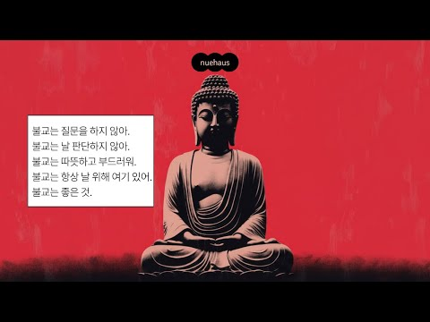
- 챕터: 0:00 Bardo · 3:16 Lotus · 7:09 Void · 10:47 Moksha · 14:32 Metta · 18:11 Impermanence · 21:29 Sangha · 25:47 Koan · 27:59 Sesshin · 32:39 Cheong · 35:27 Musang · 37:42 Samadhi · 40:17 Sutra · 45:32 Refuge
- 설명 앞부분: "자기 자신이 바로 자신의 등불이다." 석가모니 🐰모든 곡은 nuehaus가 직접 작사·작곡하며, AI를 활용하여 제작되었습니다. All tracks written and composed by nuehaus, produced with AI assistance. Visuals may include AI-generated images, external sources, or a combination of both. Lyrics & Music by nuehaus ∣ AI-Assisted Production © 2026 nuehaus. A…
- 같은 채널 평소 대비 ×108.0 (채널 최근 롱폼 중앙값 3,578회) · 평소 영상: [𝐏𝐥𝐚𝐲𝐥𝐢𝐬𝐭] 더위에 녹았음 청년 ∣ Neo Soul · Chillvibes 플레이… (3,816회) / [𝐏𝐥𝐚𝐲𝐥𝐢𝐬𝐭] 뭔 하루가 노래 듣다가 끝나네 ∣ R&B · Funk mix💿 (3,825회)
- 대본 없음 (설명) — 음성인식이 끝나면 도입부·흐름이 들어감
- 댓글 322/322: 좋은 점 — 영상 1 · 감사·응원 5 · 더 알고 싶은 것 10 · 아쉬운 점 — 영상 0 · 반박·불만 — 의견 다름 1 · 정치·사회 0 · 경험 공유 9 · 구독·다음 기대 1
  - 좋은 점 — 영상 👍1 “와레전드로집중처잘됨”
  - 감사·응원 👍5 “방금 힘들게 울었습니다 사는게 귀찮아졌습니다 왜이렇게 칠칠맞은 지도 모르겠고 제가 못미더웠습니다 근데 이런거 하나 안뜨던 알고리즘이 이걸 앞에 둬서 딱 들어갔더니 첫번째 댓글이 스스로 수련해서 진리를 찾아라 답은 내맘속에 있다 이거네요 그치 지금 스스로를 수련하는거지…”
  - 감사·응원 👍5 “자기자신도 신이다. 종종 와서 듣겠습니다 감사합니다”
  - 더 알고 싶은 것 👍20 “궁금해서 들어왓는데 이쫀득한 스캣출발 뭐여....”
  - 더 알고 싶은 것 👍5 “와 뭐지 궁금해서 눌렀는데 너무너무 좋네요”
  - 반박·불만 — 의견 다름 👍5 “왜 이유없이 기분이 좋아지는 거짘ㅋㅋㅋㅋㅋㅋㅋㅋㅋㅋㅋ어이없엌ㅋㅋㅋㅋㅋㅋㅋㅋㅋ”
  - 경험 공유 👍9 “불자 10년차인데 이런 불교 재즈 어떻게 만드는지 프롬포트 알려줘잉 ㅠㅠ 저도 만들고싶어요 부디 자비를 🍀”
  - 경험 공유 👍6 “내가 천주교여서 좋다 불교재즈도 듣고 불교랑 사이가 좋아서 너무 다행…♡”
  - 구독·다음 기대 👍0 “냅다 구독하고 갑니다”

### 144. 샹송이 이렇게 까지 좋은줄 몰랐습니다. 아랑드롱이 사랑하던 멜로디가 아름다운 그 음악 ∣ Songs That Take You Back to the70s

- https://www.youtube.com/watch?v=MHgCWNV-eKY · Yesterday SOUND · 구독자 6,060 · 조회수 381,853 (×63.0, 하루 2,479.0) · 좋아요 4,726 (1.2%) · 43.9분 · 2026-05-16 · 주제 묶음 기타 · 형식 음악 (그 밖 모양 — 한 편짜리 BGM 등) · 폴더 `W_MHgCWNV-eKY` (웹 승인)
- 썸네일: 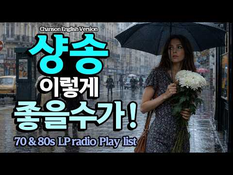
- 챕터: 0:00 Pétales sous Pluie · 4:40 Larmes Ventées · 9:13 Vent d'ardoise · 13:25 Pluie Trèfle Lointain · 17:22 Pluie de Deuil · 22:44 Pluie Prédawn · 26:43 Cricket Nylon Sadness · 31:08 Brouillard Prédawn · 35:33 Goutte Solitude · 39:41 Chanson Lointaine Birdcall
- 설명 앞부분: 프랑스 샹송을 영어로 번역하여 다시 부른 음악 모음입니다. 원곡의 서정적인 감성은 그대로 간직한 채, 영어 가사로 부드럽게 흘러나오는 멜로디가 조용한 새벽과 비 내리는 창가의 분위기를 함께 떠올리게 합니다. 편안하고 고요하게, 마음을 천천히 가라앉히고 싶을 때 들어보세요. ☕ 이런 순간에 어울려요 비 오는 날 창가에서의 사색 혼자 조용히 추억에 잠기고 싶을 때 잔잔한 카페나 와인 한 잔의 무드 책을 읽거나 글을 쓸 때 늦은 밤, 마음을 가라앉히고 싶을 때 🎧 가만히 흘려두기만 해도 공간의 공기가 달라지는 음악입니다. 🎵 타임라인 …
- 같은 채널 평소 대비 ×741.5 (채널 최근 롱폼 중앙값 515회) · 평소 영상: 첫 곡부터 빠져들게 되는 샹송 ∣ 뜨겁게 찬란했던 그 시절의 음악 ∣ 마음을 쉬게 만드는… (515회) / 샹송이 이렇게 아름다울 수 있을까요 가슴속 진한 여운으로 남아있는 멜로디 ∣ 아련한 첫사… (520회)
- 대본 없음 (설명) — 음성인식이 끝나면 도입부·흐름이 들어감
- 댓글 203/203: 좋은 점 — 영상 6 · 감사·응원 32 · 더 알고 싶은 것 5 · 아쉬운 점 — 영상 3 · 반박·불만 — 의견 다름 1 · 정치·사회 1 · 경험 공유 5 · 구독·다음 기대 2
  - 좋은 점 — 영상 👍26 “비오는날 듣기좋은 샹송 음악에 취하고 음색에취해봅니다~~ 그리운남편이 보고 싶네요 5개월전에 하늘천국에 먼저 떠나버린 그대여~~ 짙은음악선율이 눈물을 훔치게하네요~~”
  - 좋은 점 — 영상 👍26 “한국 가요와 정서적으로 통하는 샹송 이네요 감성 과 공감이 가슴에 요동 칩니다”
  - 감사·응원 👍82 “바닷가에서아내와함께것다가이음악에빠져버렸다 밀려 온 밀물의 물거품을 발 베게 삼고 누군가 심어 놓은 가지,수박,상치,들깨 잎 이 춤을 춘다 아기 강아지도 꼬리 흔든다. 작은 부두 배에 앉은 까치는 낭만 까치가 되어 어딘가를 쳐다 보고 바닷가 바위에 또 한 마리 귀욤 냥…”
  - 감사·응원 👍27 “회색빛 하늘과 비내리는 오늘.. 바람에 속삭이는 나뭇잎들과 인사하며 달리는 도로위에서 듣는 이 샹송이 넘 감미롭고 힐링이 되네요 넘 감사 합니다”
  - 더 알고 싶은 것 👍10 “궁금합니다. 소절과 소절 사이 가수의 들숨 소리를 구현할 수 있는지요? 정말 궁금해서 묻습니다.”
  - 더 알고 싶은 것 👍4 “구독했어요 좋은 음악 부탁드려요 😊”
  - 아쉬운 점 — 영상 👍3 “들숨은~~ 콧소리에 아랫배 깊숙히 에서 올라오는 호흡과~~ 기계음(바이브레이션) 의 합작음 이라 생각되네요~동네가수”
  - 아쉬운 점 — 영상 👍1 “너무 중간중간 광고가 많아 감상에 너무 방해가 되어 듣기가 좀 어렵네요.”
  - 반박·불만 — 의견 다름 👍10 “샹숑 아닌데요!”
  - 정치·사회 👍1 “일을행하는 여호와 그것을 지어성취하시는 여호와 그이름을 여호와라 하는자가 이같이 이르노라 너는 내게 부르짖으라 내가 네게 응답하겠고 네가 알지못하는 크고 비밀한일을 네게 보이리라 말씀하신주님 아버지하나님 존경하는 도널드트럼프미국대통령님께서 국정운영하는 미국에 시총3조…”
  - 경험 공유 👍3 “마음이 차분해지는 낭만 가득한 음율.. 우산 쓴 여인이 내가 되어봅니다...”
  - 경험 공유 👍1 “일을행하는 여호와 그것을 지어성취하시는 여호와 그이름을 여호와라 하는자가 이같이 이르노라 너는 내게 부르짖으라 내가 네게 응답하겠고 네가 알지못하는 크고 비밀한일을 네게 보이리라 말씀하신주님 아버지하나님 존경하는 도널드트럼프미국대통령님께서 국정운영하는 미국에 시총3조…”
  - 구독·다음 기대 👍4 “구독했어요 좋은 음악 부탁드려요 😊”
  - 구독·다음 기대 👍3 “완죤!! 좋아요 들으면서 비까지 내리길 기다려져요”

### 145. 생각보다 좋게 풀리는 날 🎵마음에 초록빛을 채우는 힐링 피아노 ∣ 스트레스 해소 · 편안한 휴식 · 카페음악 ∣ Relaxing Piano

- https://www.youtube.com/watch?v=QC3xgG-dZJg · Romua 로무아 · 구독자 3,370 · 조회수 211,591 (×62.8, 하루 1,817.0) · 좋아요 981 (0.5%) · 180.7분 · 2026-06-22 · 주제 묶음 6. 피아노·클래식·연주곡 · 형식 플레이리스트·모음 (여러 곡) · 폴더 `W_QC3xgG-dZJg` (웹 승인)
- 썸네일: 
- 설명 앞부분: ⌜ 단순하게 살아갈수록, 좋은 것들이 선명해지니까 ⌟ 여름 장마가 시작된 걸까요 비가 머물다 가기를 반복합니다 🌧 조용한 호숫가에 앉아 차분히 내리는 비와 함께 오늘 하루를 시작해봅니다 복잡한 마음은 잠시 내려놓고 나뭇잎 끝에 매달린 투명한 빗방울을 가만히 바라봅니다 비가 내린 뒤 더욱 선명해진 초록빛 잎들처럼 마음도 한결 싱그러워져요 비와 함께 진하게 다가오는 흙과 풀 냄새에 머릿속도 시원하게 맑아집니다 그저 단순해짐으로써 우리는 더 많은 것을 얻기보다 이미 곁에 있던 소중한 것들을 발견하게 됩니다 바쁘게 지나칠 때는 보이지 않…
- 같은 채널 평소 대비 ×29.5 (채널 최근 롱폼 중앙값 7,181회) · 평소 영상: 빨간 기차를 타고 떠났을 뿐인데 🎵마음에 행복을 주는 힐링 피아노 ∣ 스트레스 해소 · … (7,181회) / 모든게 다 괜찮아지는 날 🎵마음을 편안하게 하는 힐링 피아노 ∣ 스트레스 해소 · 편안한… (6,976회)
- 대본 없음 (설명) — 음성인식이 끝나면 도입부·흐름이 들어감
- 댓글 33/33: 좋은 점 — 영상 0 · 감사·응원 7 · 더 알고 싶은 것 0 · 아쉬운 점 — 영상 0 · 반박·불만 — 의견 다름 0 · 정치·사회 0 · 경험 공유 0 · 구독·다음 기대 0
  - 감사·응원 👍5 “비 오는 날 창밖을 보며 듣기 너무 좋네요. 덕분에 복잡했던 마음이 한결 차분해집니다. 감사합니다. 🌿”
  - 감사·응원 👍3 “감사합니다 날마다 좋은날입니다🤍”

### 146. 𝐏𝐥𝐚𝐲𝐥𝐢𝐬𝐭 너도 나 좋아했으면 좋겠다

- https://www.youtube.com/watch?v=4mAxMsNJAMI · .happy · 구독자 228 · 조회수 14,126 (×62.0, 하루 114.9) · 좋아요 97 (0.7%) · 18.4분 · 2026-06-16 · 주제 묶음 3. 공부·집중·작업 · 형식 플레이리스트·모음 (여러 곡) · 폴더 `W_4mAxMsNJAMI` (웹 승인)
- 썸네일: 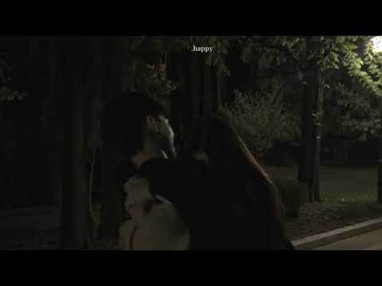
- 설명 앞부분: 이 채널은 수익 창출을 하지 않습니다
- 같은 채널 평소 대비 ×3.1 (채널 최근 롱폼 중앙값 4,593회) · 평소 영상: 𝐏𝐥𝐚𝐲𝐥𝐢𝐬𝐭 가장 예쁜 사람 (4,593회) / 𝐏𝐥𝐚𝐲𝐥𝐢𝐬𝐭 누군가를 좋아한다는 것은 (4,213회)
- 대본 없음 (설명) — 음성인식이 끝나면 도입부·흐름이 들어감
- 댓글 2/2: 좋은 점 — 영상 0 · 감사·응원 0 · 더 알고 싶은 것 0 · 아쉬운 점 — 영상 0 · 반박·불만 — 의견 다름 0 · 정치·사회 0 · 경험 공유 0 · 구독·다음 기대 0

### 147. 😊 아침부터 기분 좋게 행복해지는 노래 모음 🎧 가볍게 흥얼거리는 기분 좋게 행복한 노래 모음

- https://www.youtube.com/watch?v=r0jtXc1Y-jE · 행복 · 구독자 7,010 · 조회수 425,721 (×60.7, 하루 7,532.9) · 좋아요 1,497 (0.4%) · 116.4분 · 2026-08-21 · 주제 묶음 14. AI 음악 · 형식 AI 음악 · 폴더 `W_r0jtXc1Y-jE` (웹 승인)
- 썸네일: 
- 챕터: 0:00 비가 그친 자리 (After the Rain) · 4:34 늦은 오후, 붉게 물드는 창가 (Late Aftern… · 8:26 늦은 오후, 붉게 물드는 창가 (Late Aftern… · 11:49 담벼락에 걸린 노을 (Sunset on the All… · 15:55 붉은 노을빛 바닷가 (Sunset Ocean Walk) · 19:10 세월을 담은 따스한 손 (Hands Holding W… · 23:16 아침은 답을 묻지 않아 · 25:55 주말 아침의 초록빛 햇살 (Morning Sun in… · 29:05 비가 그친 자리 (After the Rain) · 33:39 늦은 오후, 붉게 물드는 창가 (Late Aftern… · 37:32 늦은 오후, 붉게 물드는 창가 (Late Aftern… · 40:54 담벼락에 걸린 노을 (Sunset on the All… · 45:01 붉은 노을빛 바닷가 (Sunset Ocean Walk) · 48:15 세월을 담은 따스한 손 (Hands Holding W… · 52:22 아침은 답을 묻지 않아 · 55:00 주말 아침의 초록빛 햇살 (Morning Sun in… · 58:10 비가 그친 자리 (After the Rain) · 62:45 늦은 오후, 붉게 물드는 창가 (Late Aftern… · 66:37 늦은 오후, 붉게 물드는 창가 (Late Aftern… · 69:59 담벼락에 걸린 노을 (Sunset on the All…
- 설명 앞부분: 노래가 마음에 드셨다면 😊 2. 🎧 노래를 계속 이어서 듣고 싶으실 때는 연속 재생을 켜주시면 더 편하게 감상하실 수 있어요 📱 휴대폰 영상 터치 → 오른쪽 상단 톱니바퀴 → 더보기 → 연속 재생 체크 💻 컴퓨터 영상에서 마우스 우클릭 → 연속 재생 클릭 ※ 새 영상마다 다시 설정해주셔야 적용됩니다 오늘도 건강하고 즐거운 하루 보내세요 😊 화이팅! 💪 마음의 피로를 비워내고 하루를 기분 좋게 시작할 수 있는 따스한 행복채널의 노래 모음입니다. ☀️🎶 커피 한 잔의 여유, 주말의 드라이브, 그리고 조용한 휴식 시간에 편안하게 함께해…
- 같은 채널 평소 대비 ×107.3 (채널 최근 롱폼 중앙값 3,966회) · 평소 영상: 아침부터 행복해지는 🌿 마음이 편안해지는 하루의 쉼표 ☕ 기분 좋게 스며드는 노래 10곡… (4,864회) / 같이 들어요 🎧기분 전환 노래 모음ㅣ세월을 견뎌온 당신을 위한 노래 모음 (2,684회)
- 대본 없음 (설명) — 음성인식이 끝나면 도입부·흐름이 들어감
- 댓글 152/152: 좋은 점 — 영상 2 · 감사·응원 22 · 더 알고 싶은 것 1 · 아쉬운 점 — 영상 1 · 반박·불만 — 의견 다름 0 · 정치·사회 0 · 경험 공유 1 · 구독·다음 기대 3
  - 좋은 점 — 영상 👍2 “정말 아침에 듣기 좋은 노래들입니다.”
  - 좋은 점 — 영상 👍1 “아침에 일어나 집정리하구 커피타 옥상올라가 하늘보며 커피한잔하기 딱좋은 잔잔한음악 ❤❤ 자주들어와 들어야겠어요 맘이 편하구 잠잘때도 듣기 좋은것 같아요 ❤ 생각정리 할때 듣기도 좋겠어요”
  - 감사·응원 👍9 “노래 넘 잘 들었어요 감동 ㆍ감사합니다”
  - 감사·응원 👍7 “노래 너무좋다. 세상이 맑아지는 느낌 . 그분좋아지는 노래 고맙습니다❤”
  - 더 알고 싶은 것 👍2 “노래 제목이 궁금합니다”
  - 아쉬운 점 — 영상 👍4 “😂🎉목소리가 너무 이뻐요”
  - 경험 공유 👍1 “방금 음식하다가 윤연히 들었는데 저도 몰래 흥이 났어 흥얼거리게되네요 옛 어린시절도 생각이 많이 나네요 연속 으로 듣고 싶네요”
  - 구독·다음 기대 👍3 “좋은 노래 잘 듣고 구독하고 갑니다”
  - 구독·다음 기대 👍3 “새벽에 듣는 노래 좋네요.구독합니다. ❤❤❤”

### 148. 우연히 들었는데..너무 좋은 찬양 🌱 희망의 봄 찬양모음 BEST 🌸 클래식 기타 찬양 연속듣기

- https://www.youtube.com/watch?v=s1AkO_dWLp8 · 🎵 찬양의 시간속에 · 구독자 9,860 · 조회수 593,992 (×60.2, 하루 3,383.5) · 좋아요 9,560 (1.6%) · 65.7분 · 2026-04-24 · 주제 묶음 6. 피아노·클래식·연주곡 · 형식 연주 (직접 연주하는 영상) · 폴더 `W_s1AkO_dWLp8` (웹 승인)
- 썸네일: 
- 챕터: 0:00 ❶ 다시 피어나는 새싹처럼 · 3:59 ❷ 다시 피어날 너에게 · 8:21 ❸ 주님의 손을 잡아요 · 12:13 ❹ 다시 피어나리라 · 16:30 ❺ 주님의 봄 · 20:23 ❻ 봄 햇살 아래서 · 24:23 ❼ 아름다운 윤슬처럼 · 28:28 ❽ 은혜의 꽃잎이 내릴 때 · 32:43 ❶~❽ 재생 (한번 더 은혜받기)
- 설명 앞부분: 우연히 들었는데.. 너무 좋은 찬양 🌱 희망의 봄 찬양모음 BEST 🌸 클래식 기타 찬양 연속듣기 "추운 겨울이 지나고 따뜻한 봄바람이 불어오듯, 주님의 은혜가 우리의 지친 마음에 소생의 꽃을 피우길 기도합니다." 🌱 [희망의 봄] 클래식 기타 찬양 BEST 🌸 연속듣기 "우연히 들었는데, 너무 좋아서 잊지 못할 찬양..." 봄의 숨결처럼 따뜻하고, 새싹처럼 소중한 주님의 사랑을 클래식 기타의 아름다운 선율로 담았습니다. 지친 마음에 위로와 소망이 필요한 모든 분들께 이 찬양들이 작은 벚꽃잎처럼 내려앉길 소망합니다. 오늘 하루도 …
- 같은 채널 평소 대비 ×350.4 (채널 최근 롱폼 중앙값 1,695회) · 평소 영상: 지치고 힘들 때 위로가 되는 찬양 🌈 소망의 위로 찬양모음 BEST 🍂 가을 클래식 기타… (1,723회) / 7월에 듣는... 은혜로운 찬양 🌱 아름다운 여름 찬양모음 BEST｜잔잔한 기타 찬양 1… (1,667회)
- 대본 없음 (설명) — 음성인식이 끝나면 도입부·흐름이 들어감
- 댓글 796/796: 좋은 점 — 영상 0 · 감사·응원 159 · 더 알고 싶은 것 12 · 아쉬운 점 — 영상 5 · 반박·불만 — 의견 다름 0 · 정치·사회 0 · 경험 공유 26 · 구독·다음 기대 1
  - 감사·응원 👍94 “노래 듣는거 부르는것 을 넘 좋아하는데 ㅡ트롯 발라드 만 듣다가 주님을 만나서 찬송가 를 접하면서 제 마음의 위로와 자신감 행복함이 넘침 니다 ~ 정말 하나님께 감사드리고 고맙습니다 ~ 끝까지 저의 가족 지켜주시고 도와주십시요 ~ 아멘 사랑합니다”
  - 감사·응원 👍53 “새벽4시기도하면서 듣게된찬양 영혼을울리네요 71세의 나이에 주님의 봄이 왔음을 알게해주는 소망의 찬양 감사합니다~~❤”
  - 더 알고 싶은 것 👍3 “너무 감사합니다. 찬양하시는분 이름을 알수있을까요?”
  - 더 알고 싶은 것 👍2 “누가 작사 하시고 누가 작곡하셨는지 정말 궁금합니다 너무나 아름다운 노래 인데요”
  - 아쉬운 점 — 영상 👍5 “목소리가 너무나 아름다워요❤”
  - 아쉬운 점 — 영상 👍3 “다른사람 에게는 보낼수가 없어서. 아쉽네요 🎉”
  - 경험 공유 👍5 “아무것도 내가 할수있는게 없는데 그져 막막함에 무너져 우연히 찬양 듣고있는 눈물만 나네~”
  - 경험 공유 👍5 “제가 여기 있사옵니다 저를 기억하소서 아멘”
  - 구독·다음 기대 👍1 “정말 우연히 찬양듣게 되었는데. 너무 좋네요 좋아요 구독. 꾸욱 놀렀습니다 좋은 찬양 올려주셔서 감사합니다 매일 듣게 될거 같습니다 찬양을 통해 주님을 깊이 만나서 이찬양을 듣고있는 모든 이들이 막혀있는 모든 결박들이 풀리고. 고통받고있는 모든병마들이. 치유되기를 찬…”

### 149. 행운이 찾아오는 아침 🎵마음에 건강한 에너지를 채우는 힐링 피아노 ∣ 스트레스 해소 · 편안한 휴식 · 카페음악 ∣ Relaxing Piano

- https://www.youtube.com/watch?v=Xp2bSO5r5Os · Romua 로무아 · 구독자 3,370 · 조회수 199,902 (×59.3, 하루 1,532.4) · 좋아요 1,003 (0.5%) · 180분 · 2026-06-08 · 주제 묶음 6. 피아노·클래식·연주곡 · 형식 플레이리스트·모음 (여러 곡) · 폴더 `W_Xp2bSO5r5Os` (웹 승인)
- 썸네일: 
- 설명 앞부분: ⌜ 좋은 일은 생각보다 조용히 찾아온다 ⌟ 새벽 안개가 숲 사이를 천천히 지나가고 이른 아침의 마음에는 맑은 바람이 통하는 길이 열립니다 우리는 종종 특별한 순간만을 기다리지만 삶을 바꾸는 것은 어느 평범한 아침의 산뜻한 공기, 마음을 스치는 평온, 그리고 이유 없이 가벼워진 발걸음일 때가 많아요 계절이 바뀌는 소리를 들은 사람은 없습니다 하지만 어느 날 문득 창밖을 바라보며 다음 계절이 왔음을 알게 되지요 좋은 일도 그렇게 찾아옵니다 자신을 드러내지 않은 채 조용히 우리 곁에 앉아 삶의 풍경을 조금씩 바꾸어 갑니다 오늘은 이 음…
- 같은 채널 평소 대비 ×27.8 (채널 최근 롱폼 중앙값 7,181회) · 평소 영상: 빨간 기차를 타고 떠났을 뿐인데 🎵마음에 행복을 주는 힐링 피아노 ∣ 스트레스 해소 · … (7,181회) / 모든게 다 괜찮아지는 날 🎵마음을 편안하게 하는 힐링 피아노 ∣ 스트레스 해소 · 편안한… (6,976회)
- 대본 없음 (설명) — 음성인식이 끝나면 도입부·흐름이 들어감
- 댓글 37/37: 좋은 점 — 영상 0 · 감사·응원 7 · 더 알고 싶은 것 0 · 아쉬운 점 — 영상 0 · 반박·불만 — 의견 다름 0 · 정치·사회 0 · 경험 공유 0 · 구독·다음 기대 0
  - 감사·응원 👍8 “오늘도 나에게 행운이 온다 모든이들에게 행운이가길 바랍니다 감사합니다😄😄”
  - 감사·응원 👍1 “오늘도 힐링됩니다 감사합니다”

### 150. 모든 일이 잘 풀리는 아침을 여는 음악 ∣ 막혔던 일이 시원하게 풀리는 기분

- https://www.youtube.com/watch?v=6MQT5DkZTEU · LazyFlow · 구독자 10,700 · 조회수 632,787 (×59.1, 하루 3,823.1) · 좋아요 5,013 (0.8%) · 90.4분 · 2026-05-04 · 주제 묶음 5. 운동·드라이브·신나는 · 형식 플레이리스트·모음 (여러 곡) · 폴더 `W_6MQT5DkZTEU` (웹 승인)
- 썸네일: 
- 챕터: 0:00 Unhappy And Still Yours · 3:53 Hello Sunshine · 7:18 Golden Room · 10:31 Play It Again · 13:42 It All Adds Up · 17:01 Every Single Day · 22:02 Just Like That · 25:27 The Sky This Morning · 28:53 But It's a Good One · 32:30 Familiar and Good · 37:21 Blue Above Me · 41:13 Good Vibes Only · 45:12 Repeat
- 설명 앞부분: 기분 좋은 에너지가 가득한 아침을 위한 팝송 플레이리스트입니다. 오늘 하루, 당신이 머무는 모든 공간에 특별한 행운과 좋은 소식이 가득하시길 바랍니다. 🎵 Tracklist 🌤️ lazyflow는 매일 아침 7시, 당신의 하루가 마법처럼 잘 풀리길 바라는 마음을 담아 직접 제작한 감성 팝송 플레이리스트를 배달합니다. 오늘도 이 음악과 함께 당신의 모든 순간이 특별한 행운과 좋은 소식으로 가득하시길 바랍니다.
- 같은 채널 평소 대비 ×111.5 (채널 최근 롱폼 중앙값 5,677회) · 평소 영상: 모든 일이 잘 풀리는 아침을 여는 음악 ∣ 오늘 하루, 모든 순간이 특별해지는 음악 (5,677회) / 모든 일이 잘 풀리는 아침을 여는 음악 ∣ 준비된 당신에게 찾아올 가장 완벽한 가을의 기회 (5,674회)
- 대본 없음 (설명) — 음성인식이 끝나면 도입부·흐름이 들어감
- 댓글 167/167: 좋은 점 — 영상 1 · 감사·응원 24 · 더 알고 싶은 것 2 · 아쉬운 점 — 영상 1 · 반박·불만 — 의견 다름 0 · 정치·사회 0 · 경험 공유 4 · 구독·다음 기대 0
  - 좋은 점 — 영상 👍15 “음악 좋기만 한데요😅 이런 듣기 좋은 음악을 공짜로 들을 수 있는데, Ai니 머니 하는 댓글보다는 감사하는 마음을 갖는게 내 행복에 더 도움이 될거같습니다❤”
  - 감사·응원 👍15 “음악 좋기만 한데요😅 이런 듣기 좋은 음악을 공짜로 들을 수 있는데, Ai니 머니 하는 댓글보다는 감사하는 마음을 갖는게 내 행복에 더 도움이 될거같습니다❤”
  - 감사·응원 👍9 “언제나 항상 늘. 모든 일이 모든면에서 다 잘된다 술술잘풀리고 다잘된다 평안 건강 함에 감사합니다 🙏🙏🙏🙏🙏🙏🙏🙏🎉🎉🎉🎉🎉🎉🎉”
  - 더 알고 싶은 것 👍1 “너무 피곤해 누워 폰하다 듣고 일어났어요❤ 첫번째 곡 너무 제취향인데 곡을 검색해보니 나오진 않네요-.- 알 수 있을까요?”
  - 아쉬운 점 — 영상 👍0 “광고가 너무 많이 떠요”
  - 경험 공유 👍7 “앞으로 내가 하는 모든 일이 잘 풀리길 기도하면서 이 플리로 시원하게 시작해봅니다!! 감사합니다!!”
  - 경험 공유 👍2 “저도 가족들과함께 좋은 음악들으며 좋은기운을 받고 갑니다.”

### 151. [COVER] 한오백년 _ 어버이날을 맞이하여...

- https://www.youtube.com/watch?v=W40yM35SfWc · 감성메아리 · 구독자 5,320 · 조회수 313,812 (×59.0, 하루 1,900.2) · 좋아요 1,773 (0.6%) · 4.8분 · 2026-05-05 · 주제 묶음 12. 커버·노래 부르기 · 형식 AI 음악 · 폴더 `W_W40yM35SfWc` (웹 승인)
- 썸네일: 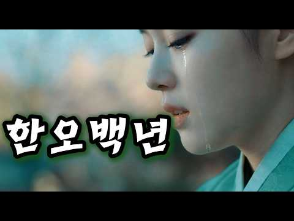
- 설명 앞부분: 커버해 보았습니다 당신의 오늘 하루에 따뜻한 위로와 여유로운 쉼표를 선물할 수 있으면 좋겠습니다 🎤 Vocal by AI
- 같은 채널 평소 대비 ×592.1 (채널 최근 롱폼 중앙값 530회) · 평소 영상: 단 한 번만 내 손 마디마디 온기를 채워주오🌧️/이승의 인연이 여기가 끝이로구나/손 한번… (530회) / "정통 트로트"로 가슴을 적셔주는 노래들😭 /14곡 노래모음 ▶️ (558회)
- 대본 없음 (설명) — 음성인식이 끝나면 도입부·흐름이 들어감
- 댓글 58/58: 좋은 점 — 영상 0 · 감사·응원 8 · 더 알고 싶은 것 2 · 아쉬운 점 — 영상 1 · 반박·불만 — 의견 다름 0 · 정치·사회 0 · 경험 공유 2 · 구독·다음 기대 1
  - 감사·응원 👍15 “한오백년 노래가락이 너무 슬퍼요 우리 어머니 가족들 보고 싶어요 노래 감사합니다”
  - 감사·응원 👍14 “감성메아리님 안녕하세요 흐린 날씨로 시작을 하는 월요일 님의 멋진 노래 한오백년 감상하며 구독 좋아요 엄지 세워 힘차게 응원합니다 한주도 즐겁고 행복하게 보내시고 건강하세요.❤💞❤💞❤”
  - 더 알고 싶은 것 👍3 “가수도 ai 인가요? 아니면 진짜 사람인가요? 사람이라면 가수를 알고 싶네요.”
  - 더 알고 싶은 것 👍1 “다음으로 '천년 바위' 부탁합니다,꾸벅”
  - 아쉬운 점 — 영상 👍3 “사람 목소리 인가요? AI목소리인가요?”
  - 경험 공유 👍1 “한오백년 잘넘가네 나도한수하는데 많이 듲고 한수배울께요”

### 152. [스페인 감성] "Frente a Tu Casa ∣ 그집앞 - 이재성" Korean OldPop 한국명곡

- https://www.youtube.com/watch?v=IXEpsuBWbg8 · 스페인 감성 한국 올드송 · 구독자 1,420 · 조회수 81,363 (×57.3, 하루 1,240.9) · 좋아요 587 (0.7%) · 4.5분 · 2026-08-12 · 주제 묶음 12. 커버·노래 부르기 · 형식 음악 (그 밖 모양 — 한 편짜리 BGM 등) · 폴더 `W_IXEpsuBWbg8` (웹 승인)
- 썸네일: 
- 설명 앞부분: 안녕하세요!! "스페인 감성 한국 올드송"입니다. 한국의 좋은 노래들을 Música Española (무시카 에스파뇰라)로 리메이크해서 불러 드리겠습니다. kpop의 멋진 멜로디와 깊은 감성을 스페인의 감성과 만나 깊이를 더했습니다. 이 채널에서 만들어지는 음악들은 AI를 도구로 이용해 직접 구상하고 제작되는 노력의 결과물입니다. 더 좋은 음악을 제공할 수 있도록 항상 노력하겠습니다. ¡Hola! Bienvenidos a "Canciones Clásicas Coreanas con Alma Española". En este cana…
- 대본 없음 (설명) — 음성인식이 끝나면 도입부·흐름이 들어감
- 댓글 14/14: 좋은 점 — 영상 0 · 감사·응원 1 · 더 알고 싶은 것 0 · 아쉬운 점 — 영상 0 · 반박·불만 — 의견 다름 0 · 정치·사회 0 · 경험 공유 1 · 구독·다음 기대 0
  - 감사·응원 👍6 “영상을 보니까 제가 1987년도에 이태리 밀라노에서 프랑스를 거쳐 바르셀로나까지 기차를 타고 가서 거기에서 스페인 쇼를 본 기억이 생생합니다. 좋습니다 응원합니다 ❤🎉🎉”
  - 경험 공유 👍6 “영상을 보니까 제가 1987년도에 이태리 밀라노에서 프랑스를 거쳐 바르셀로나까지 기차를 타고 가서 거기에서 스페인 쇼를 본 기억이 생생합니다. 좋습니다 응원합니다 ❤🎉🎉”

### 153. 나는 어디로 가나 - (국악 발라드)

- https://www.youtube.com/watch?v=hd_rjKroAqM · Rok Bi · 구독자 8,520 · 조회수 487,675 (×57.2, 하루 3,105.1) · 좋아요 2,486 (0.5%) · 5분 · 2026-05-13 · 주제 묶음 9. 가요·발라드·트로트 · 형식 AI 음악 · 폴더 `W_hd_rjKroAqM` (웹 승인)
- 썸네일: 
- 설명 앞부분: "아티스트 Rok Bi의 공식 유튜브 채널, **'록비 감성음악'*입니다." [ 🎵 록비 감성음악 재생목록 ] 🎵 곡 정보 (Credits) 살다 보면 내가 가는 길이 맞는지 의문이 들 때가 있습니다. 이 노래가 여러분의 지친 마음을 잠시 쉬게 하는 이정표가 되었으면 좋겠습니다. 곡을 듣고 느껴지는 여러분의 마음을 댓글로 자유롭게 남겨주세요. [🎧 YouTube Music]에서도 감상 가능합니다. 작사: 록비 (Rok Bi)&AI 작곡: 록비 & Suno AI 보컬: Rokbi Vocals, Powered by AI 기획/제작: …
- 같은 채널 평소 대비 ×40.4 (채널 최근 롱폼 중앙값 12,081회) · 평소 영상: 인생의 길목에서 다시 만난 명곡 10곡 ∣ 록비 감성음악 (12,923회) / 백년해로 인생의 길에서 함께한 우리의 노래 ∣ 록비 감성음악 ∣ 1시간 풀영상 (11,239회)
- 대본 없음 (설명) — 음성인식이 끝나면 도입부·흐름이 들어감
- 댓글 203/203: 좋은 점 — 영상 4 · 감사·응원 36 · 더 알고 싶은 것 1 · 아쉬운 점 — 영상 0 · 반박·불만 — 의견 다름 0 · 정치·사회 0 · 경험 공유 7 · 구독·다음 기대 0
  - 좋은 점 — 영상 👍3 “나이가 들어갈 수록 왜 감성노래, 인생노래 가 마음에 와닿는지....^^;; 나이가 들었다는 반증이겠죠? ^^ 뭉클한 노래, 동영상 잘 듣고 갑니다.”
  - 좋은 점 — 영상 👍1 “22년도 코로나로 어머님을 떠나보내고 절절히 가슴에 와닿아요 오늘도 이자식은 소리죽여 웁니다”
  - 감사·응원 👍14 “노래가 너무 절절하네요,좋은 노래 들려줘서 고마워요.응원합니다.🎉🎉🎉❤❤❤😊😊😊”
  - 감사·응원 👍13 “구독 좋아요로 응원합니다 최고입니다 늘 행복하세요❤❤❤🎉🎉”
  - 더 알고 싶은 것 👍6 “오늘도 록비님의음으로 하루시작합니다 항암잘견디고 좋은음만들어주세요”
  - 경험 공유 👍6 “어쩜 내인생 내삶과 똑같나 눈물이 나도모르게 고인다”
  - 경험 공유 👍2 “머리속은 숯덩이처럼 소음으로 뒤범벅되고 죽고싶도록 이번삶 싫다 이명소리 26년째 어디로 가야하나😢😢😢😢😢”

### 154. [𝙋𝙡𝙖𝙮𝙡𝙞𝙨𝙩] 세종대왕이 경복궁에서 야근하며 듣던 가야금 재즈

- https://www.youtube.com/watch?v=q3oC3zdfyw4 · 조선재즈 · 구독자 9,970 · 조회수 566,223 (×56.8, 하루 4,455.1) · 좋아요 21,737 (3.8%) · 180.7분 · 2026-06-12 · 주제 묶음 7. 재즈·보사노바 · 형식 플레이리스트·모음 (여러 곡) · 폴더 `W_q3oC3zdfyw4` (웹 승인)
- 썸네일: 
- 설명 앞부분: 세종대왕도 야근은 힘들었을 겁니다. 경복궁 깊은 밤, 촛불 아래 가야금이 흐릅니다. 조선의 밤과 재즈가 만났습니다:)
- 같은 채널 평소 대비 ×110.5 (채널 최근 롱폼 중앙값 5,126회) · 평소 영상: [𝙋𝙡𝙖𝙮𝙡𝙞𝙨𝙩] 세종대왕이 코딩하며 들었던 가야금 재즈 (5,126회) / [𝙋𝙡𝙖𝙮𝙡𝙞𝙨𝙩] 퇴근 궁녀 (퇴사할게여) ∣ 느좋 조선 가야금 재즈 (5,233회)
- 대본 없음 (설명) — 음성인식이 끝나면 도입부·흐름이 들어감
- 댓글 468/468: 좋은 점 — 영상 2 · 감사·응원 8 · 더 알고 싶은 것 6 · 아쉬운 점 — 영상 2 · 반박·불만 — 의견 다름 4 · 정치·사회 1 · 경험 공유 10 · 구독·다음 기대 5
  - 좋은 점 — 영상 👍0 “생활안복 자주 입는데, 한복입고 어디 놀러갈때 듣기 좋아요. 굿뜨 뭐랄까 혼자 마패를 들고 암행어사 하러 가는 기분이랑 연모하는 사내 담벼락에 훔쳐보러 가는 기분”
  - 좋은 점 — 영상 👍0 “너무좋아요 나도만들고싶네요 많이배우고갑니다❤❤❤❤❤❤❤”
  - 감사·응원 👍5 “와.... 가야금 너무 좋아하는데 이런 귀한 플리를 올려주시다니 감사합니다....”
  - 감사·응원 👍4 “오 좋아요... 제작 감사함당 잘 들을게요”
  - 더 알고 싶은 것 👍3 “구독 좋아요 알림설정합니다. 한국의 미를 잃지 않는 퓨전음악 많이 부탁드립니다. 덕분에 출근길이 즐거워요.”
  - 더 알고 싶은 것 👍1 “집현전 학자들 편도 부탁합니다. 엄지척!”
  - 아쉬운 점 — 영상 👍6 “ㅋㅋㅋㅋㅋㅋㅋ 고얀 AI 같으니라고”
  - 아쉬운 점 — 영상 👍3 “구간반복해서 들을 수 있게 해주세요”
  - 반박·불만 — 의견 다름 👍4 “와 재즈 좋아하는데 가야금과 재즈가 이렇게 잘 어울리다니. 가야금의 선율이 그루비해서 깜짝 놀랐습니다. AI 작곡이란데서 한번 더 놀람.. 말도안됨 😂”
  - 반박·불만 — 의견 다름 👍1 “절대음감이라 AI 음악이 맞으실 수도ㅋㅋㅋ 근데 저렇게 누워 계실 분이 아닌데 두 눈 부릅 뜨고 계셔야 하지 않을까요?”
  - 정치·사회 👍0 “전하 .. 요즘 나라가 말이 아닙니다 이걸 어찌해야 된답니까 ...”
  - 경험 공유 👍9 “클래식 공부를 어릴때 부터 하면서 재즈도 같이 조금 했었는데 살면서 들은 재즈 중에 제일 좋습니다….”
  - 경험 공유 👍3 “세종대왕도 야근하는데 내가 뭐라고”
  - 구독·다음 기대 👍3 “구독 좋아요 알림설정합니다. 한국의 미를 잃지 않는 퓨전음악 많이 부탁드립니다. 덕분에 출근길이 즐거워요.”
  - 구독·다음 기대 👍1 “가능하구나 재즈라는 것이!!!! 감탄하고 구독하고 갑니다~!”

### 155. 2000년대 발라드 명곡 30곡 💿 그 시절 우리가 사랑했던 노래｜SG워너비·김동률·씨야·티아라·양파 ✔ 싸이월드 BGM

- https://www.youtube.com/watch?v=IZ6NgLQjStY · 추억음악다방 · 구독자 3,430 · 조회수 193,245 (×56.3, 하루 2,157.8) · 좋아요 1,473 (0.8%) · 117.8분 · 2026-07-19 · 주제 묶음 9. 가요·발라드·트로트 · 형식 플레이리스트·모음 (여러 곡) · 폴더 `W_IZ6NgLQjStY` (웹 승인)
- 썸네일: 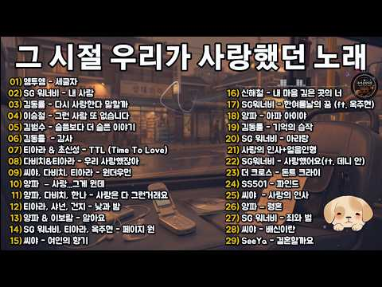
- 설명 앞부분: 2000년대 발라드 명곡 29곡 💿 그 시절 우리가 사랑했던 노래들을 한자리에 담았습니다. SG워너비, 김동률, 씨야, 티아라, 다비치, 양파, 이승철, 김범수, 더 크로스, SS501 등 첫 소절만 들어도 그때의 사랑과 이별, 학창 시절과 싸이월드 감성이 떠오르는 추억의 명곡 플레이리스트입니다. MP3 플레이어에 좋아하는 노래를 가득 담아 다니던 시절, 폴더폰 문자 한 통을 기다리며 밤을 지새우던 순간, 싸이월드 미니홈피 BGM으로 차마 말하지 못한 마음을 대신 전했던 날들… 시간이 오래 흘렀어도 그 시절의 노래를 다시 듣는 순…
- 같은 채널 평소 대비 ×50.3 (채널 최근 롱폼 중앙값 3,839회) · 평소 영상: 싸이월드 감성 2000년대 명곡 모음 💿 텅 빈 거리에서 🎧 다시 듣는 그 시절 발라드 (5,771회) / SG워너비 - Timeless (가사/Lyrics) 💔 이 노래, 듣는 순간 울컥한다｜2… (1,907회)
- 대본 없음 (설명) — 음성인식이 끝나면 도입부·흐름이 들어감
- 댓글 17/17: 좋은 점 — 영상 0 · 감사·응원 1 · 더 알고 싶은 것 1 · 아쉬운 점 — 영상 0 · 반박·불만 — 의견 다름 0 · 정치·사회 0 · 경험 공유 0 · 구독·다음 기대 0
  - 감사·응원 👍0 “중간중간에 드라마 대사 같은게 들리는데 검토 한번만 해주심 감사할 거 같아용ㅠ”
  - 더 알고 싶은 것 👍0 “비 오는 날 가장 듣고 싶은 옛날 노래가 있다면 어떤 곡인가요? 여러분만의 추천곡을 알려주세요.”

### 156. 처음부터 신나서 환장하는! ❤️ 신나는 트로트리믹스 고속도로메들리 ∣ 최신트로트 ∣ 트로트메들리 ∣ 감성트로트

- https://www.youtube.com/watch?v=zt45-jow7lo · 다솜이의 트로트책방 · 구독자 7,710 · 조회수 433,625 (×56.2, 하루 2,668.2) · 좋아요 3,308 (0.8%) · 71.2분 · 2026-05-07 · 주제 묶음 5. 운동·드라이브·신나는 · 형식 플레이리스트·모음 (여러 곡) · 폴더 `W_zt45-jow7lo` (웹 승인)
- 썸네일: 
- 챕터: 0:00 단심가 · 3:39 찜했어요 · 7:04 하늘만큼 땅만큼 · 10:29 두근두근 내사랑 · 14:05 사랑의 신호등 · 18:09 꽃보다 그대요 · 21:50 사랑 충전 완료 · 24:56 사랑보따리 · 28:23 천번을 물어도 · 32:00 꽃신 신고 갈게요 · 35:35 반복재생
- 설명 앞부분: 오늘도 찾아온 최신트로트 EDM리믹스 디스코메들리 😘 이번주도 고생 많으신 여러분! 신나는 트로트메들리로 다솜 트로트책방에서 힐링하고 가셨으면 좋겠어요 👍 여러분의 쉼터가 되길 바라는 마음이에요 💕 즐겁게 들어주시고 남겨주시는 따뜻한 댓글 한마디에 저도 너무너무 힘이 납니다 😘😘 항상 감사드립니다 😁 EDM트로트 리믹스 BEST 모음 애절한 감성트로트 더 들어보기 신나는 트로트 더 들어보기 계속 신나는 EDM 리믹스 메들리 더 들어보기 다솜이 싱글 들어보기 💖노래 순서💖
- 같은 채널 평소 대비 ×45.3 (채널 최근 롱폼 중앙값 9,573회) · 평소 영상: 이 맛이지~!! 최고로 신나는 트로트리믹스 모음 7번째!! 고속도로메들리 ∣ 최신트로트 … (9,518회) / 들을수록 빠져든다! 신나는 댄스트로트 고속도로메들리 ∣ 최신트롯 ∣ 감성트로트 (8,305회)
- 대본 없음 (설명) — 음성인식이 끝나면 도입부·흐름이 들어감
- 댓글 139/139: 좋은 점 — 영상 0 · 감사·응원 5 · 더 알고 싶은 것 2 · 아쉬운 점 — 영상 1 · 반박·불만 — 의견 다름 0 · 정치·사회 1 · 경험 공유 0 · 구독·다음 기대 3
  - 감사·응원 👍5 “음악이신나좋아요화이팅🎉🎉🎉❤❤❤”
  - 감사·응원 👍2 “화이팅”
  - 더 알고 싶은 것 👍1 “구독. 망치로박고갑니다. 기분전환 최곱니다. cd 구입되나요???”
  - 아쉬운 점 — 영상 👍6 “신나요 잘듣고 있어요 낚시배 하는데 살수 있나요 ?”
  - 정치·사회 👍0 “영어이나라대한민국미국영어이나라본한국말억양토늘회화영어들어나가금그들영어와저너꼭알어두고미국말영어러시아촌칙급이길느한국어이북말조선족톤극사기느어대”
  - 구독·다음 기대 👍2 “첫노래 트로트가사제목이 어떻게되나요 가수 가사제목 궁금하내요 구독하고갑니다 댓글달아주시면 감사하겠습니다 너무신납니다”
  - 구독·다음 기대 👍2 “구독합니다. 신나네요”

### 157. [중간광고없음] 🌿 잠시, 아무 생각도 하지 말아요. ∣ 숲속에서 듣는 잔잔한 피아노 ∣ BGM ∣ 휴식, 힐링, 독서

- https://www.youtube.com/watch?v=ebDKy0szHC8 · Riae & Piano · 구독자 12,400 · 조회수 695,335 (×56.1, 하루 7,438.9) · 좋아요 3,525 (0.5%) · 181.3분 · 2026-07-15 · 주제 묶음 6. 피아노·클래식·연주곡 · 형식 음악 (그 밖 모양 — 한 편짜리 BGM 등) · 폴더 `W_ebDKy0szHC8` (웹 승인)
- 썸네일: 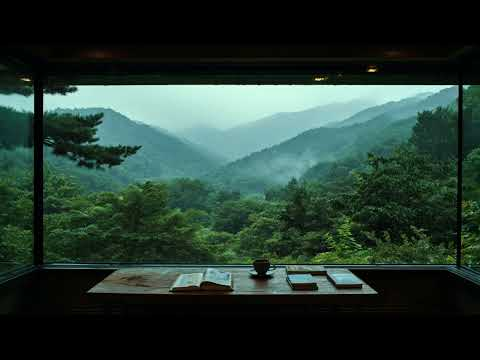
- 설명 앞부분: 잠시 모든 생각을 내려놓고, 창밖 가득 펼쳐진 숲과 잔잔한 피아노 선율 속에서 마음을 쉬어가세요. 독서와 공부, 휴식, 그리고 혼자만의 조용한 시간을 더욱 평온하게 만들어 줄 힐링 플레이리스트입니다. Take a break from every thought and let the peaceful forest view and gentle piano melodies calm your mind. A relaxing playlist for reading, studying, working, or simply enjoying a quiet m…
- 같은 채널 평소 대비 ×43.9 (채널 최근 롱폼 중앙값 15,838회) · 평소 영상: [중간광고없음] ☁️🌿 점점 좋아지고 있어 ∣ 비 그친 숲에서 듣는 희망의 피아노 ∣ B… (15,838회) / [중간광고없음] ☁️🍃 잠시 쉬어가도 괜찮아, 넌 잘하고 있어 ∣ 위로의 피아노 ∣ BG… (15,639회)
- 대본 없음 (설명) — 음성인식이 끝나면 도입부·흐름이 들어감
- 댓글 191/191: 좋은 점 — 영상 0 · 감사·응원 15 · 더 알고 싶은 것 0 · 아쉬운 점 — 영상 2 · 반박·불만 — 의견 다름 0 · 정치·사회 0 · 경험 공유 2 · 구독·다음 기대 2
  - 감사·응원 👍6 “드디어 찾았습니다. 완전 저의 스타일 피아노 연주 입니다. 잘 만들어 주어서 감사합니다. 슬픔을 슬픔으로 흘러가게 해 주는 피아노 선율에 저의 마음도 같이 흘러가는 시간이 됩니다.”
  - 감사·응원 👍3 “감사합니다❤”
  - 아쉬운 점 — 영상 👍10 “생각이 많아지고 뭔가 심신의 안정을 원할때.멍때리며 머릿속의 안개를 걷어내고 싶을때 들어요.무엇보다 중간광고가 없어서 좋아요”
  - 아쉬운 점 — 영상 👍1 “"몇 번을 반복해서 들어도 질리지 않는 곡이에요. 편곡 센스가 남다르신 것 같아요. 구독 좋아요로 응원할게요~"”
  - 경험 공유 👍2 “아기 낮잠음악으로 최고에요. 같이 듣는 저도 너무 힐링됩니다.오늘 하루도 평온함을 선물해주셔서 감사합니다.”
  - 구독·다음 기대 👍2 “구독하고갑니다.좋아요”
  - 구독·다음 기대 👍1 “잔잔한 음악 많이 들어봤지만, 이 영상에 정착했어요. 가장 마음이 편해요. 다이어리 매일 쓰는데 매일 듣고있어요”

### 158. 숲속에 내리는 잔잔한 빗소리 🌧️ 명상, 깊은 수면, 편안한 소리

- https://www.youtube.com/watch?v=4Xl4kMOmGY8 · 숲 속 빗소리 · 구독자 1,800 · 조회수 100,192 (×55.7, 하루 1,320.2) · 좋아요 702 (0.7%) · 187.7분 · 2026-08-02 · 주제 묶음 2. 자연 소리·백색소음 · 형식 자연 소리·백색소음 (음악 낱말 없는 제목) · 폴더 `W_4Xl4kMOmGY8` (웹 승인)
- 썸네일: 
- 설명 앞부분: 숲속에 내리는 잔잔한 빗소리 🌧️ 명상, 깊은 수면, 편안한 소리 고요한 숲속에 내리는 부드러운 빗소리와 함께 몸과 마음의 긴장을 풀어보세요. 숲속에 부드럽게 내리는 빗소리와 나뭇잎 사이로 스치는 잔잔한 바람, 멀리서 들려오는 자연스러운 천둥소리와 함께 깊은 평온함을 느껴보세요. 이 편안한 자연의 분위기는 숙면을 돕고, 스트레스를 줄이며, 공부하거나 일할 때 집중력을 유지하는 데 도움을 줄 수 있습니다. 이 채널에서는 깊은 수면, 명상, 휴식과 마음의 안정을 위한 자연스럽고 몰입감 있는 사운드 풍경을 제작합니다. 숲속의 빗소리가 …
- 같은 채널 평소 대비 ×49.0 (채널 최근 롱폼 중앙값 2,046회) · 평소 영상: 숲속에 내리는 잔잔한 빗소리 🌧️ 수면 부족 · 불면증 · 스트레스 완화를 위한 백색소음… (2,061회) / 숲속에 내리는 잔잔한 빗소리 🌧️ 쌓인 피로를 녹이고 빠른 입면과 깊은 숙면을 돕는 힐링… (2,031회)
- 대본 없음 (설명) — 음성인식이 끝나면 도입부·흐름이 들어감
- 댓글 41/41: 좋은 점 — 영상 0 · 감사·응원 0 · 더 알고 싶은 것 0 · 아쉬운 점 — 영상 0 · 반박·불만 — 의견 다름 0 · 정치·사회 0 · 경험 공유 0 · 구독·다음 기대 0

### 159. [MIXSET] 늙크크의 여름 HipHop & R&B

- https://www.youtube.com/watch?v=_o3psN6OCTk · 떵신 tteongshin · 구독자 8,140 · 조회수 452,483 (×55.6, 하루 4,869.0) · 좋아요 9,603 (2.1%) · 22.1분 · 2026-07-16 · 주제 묶음 11. 힙합·R&B·EDM · 형식 정보·해설 (그 밖) · 폴더 `W__o3psN6OCTk` (웹 승인)
- 썸네일: 
- 설명 앞부분: 2026년 여름을 맞아 2010년대 중반 여름을 대표했던 HipHop & R&B 곡들을 모아 믹셋으로 완성했습니다. 🎧 Tracklist Enjoy! ☀ [SoundCloud]
- 대본 없음 (설명) — 음성인식이 끝나면 도입부·흐름이 들어감
- 댓글 204/204: 좋은 점 — 영상 0 · 감사·응원 5 · 더 알고 싶은 것 5 · 아쉬운 점 — 영상 2 · 반박·불만 — 의견 다름 0 · 정치·사회 0 · 경험 공유 13 · 구독·다음 기대 2
  - 감사·응원 👍4 “내가늙크크라서너무좋다이런노래들이난좋다감사합니다구독햇어요🫰🏻🫰🏻🫰🏻”
  - 감사·응원 👍2 “와... 20대 추억 돋는 아침 출근길입니다!!! 감사해요😊”
  - 더 알고 싶은 것 👍8 “진짜 곡 넘어가는거 예술임… 더만들어주세요제발”
  - 더 알고 싶은 것 👍7 “믹셋 계속 만들어주세요..🥺❤️”
  - 아쉬운 점 — 영상 👍2 “도파민 중독자인 저에게는 이런 플리가 필요했어요 좀 지루하다 싶으면 다른 곡😍”
  - 경험 공유 👍15 “내가 늙크크가 되었다는게 믿기지않아.. 분명 나 엊그제 20살이었던것 같은데.......................................”
  - 경험 공유 👍10 “지나가는 97년생인데.. 분명 영크크라 생각했는데 다 내가 좋아하는 노래라니... 나 언제 늙크크 된거지 ㅠㅜ 무튼 플리 개조아여❤”
  - 구독·다음 기대 👍2 “와.. 우연히 듣고 바로 구독합니다. 잘 부탁드려요!”
  - 구독·다음 기대 👍2 “구독하고 갈게여”

### 160. 첫 곡부터 너무 좋다 🍂 하루종일 듣게 되는 가을 올드팝 ∣ Vol.228 ∣ 7080 추억의 팝송 ∣ Autumn Oldies ∣ Coffee · Study …

- https://www.youtube.com/watch?v=naLL7CGOC-8 · moka melody · 구독자 14,600 · 조회수 804,147 (×55.1, 하루 13,749.2) · 좋아요 3,982 (0.5%) · 367.3분 · 2026-08-19 · 주제 묶음 4. 카페·매장·라운지 · 형식 음악 (그 밖 모양 — 한 편짜리 BGM 등) · 폴더 `W_naLL7CGOC-8` (웹 승인)
- 썸네일: 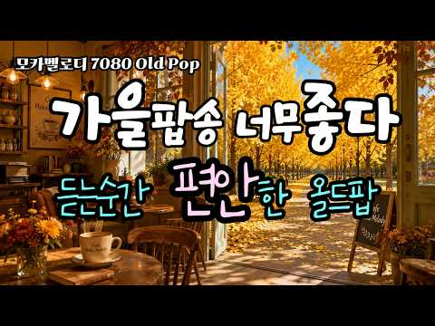
- 챕터: 0:00 Where the Blue Sea Remembers … · 4:52 The Best Part of My Day 하루 중 … · 8:44 All the Years With You 너와 함께 … · 13:07 Under the Golden Tree 황금빛 나무 … · 17:15 Somewhere Past the City Light… · 21:53 Walking Home With You 너와 함께 걷… · 25:11 Blue Sky Kind of Day 파란 하늘이 아… · 29:38 Somewhere Along the Years 지나온… · 33:23 You Became My Day 어느새 나의 하루가 … · 37:56 Worth Every Mile 함께한 모든 길이 좋았… · 42:04 At the End of the Day 하루가 저물어… · 46:17 Nothing Special Today 오늘도 평범해… · 51:10 Warm Yesterday 따뜻했던 지난날 · 54:53 Repeat
- 설명 앞부분: 🎧 Old pop music for reading, studying, working, and deep focus This vintage old pop playlist is perfect as background music for coffee time, book reading, writing, study sessions, and work-from-home hours. Many listeners play this music while working quietly, studying for long hours, relaxing in th…
- 같은 채널 평소 대비 ×42.2 (채널 최근 롱폼 중앙값 19,055회) · 평소 영상: 9월, 첫 곡부터 너무 좋다🍂 가을엔 이런 노래가 참 좋더라｜Vol.237｜ 7080 추… (19,979회) / 9월, 첫 곡부터 참 좋다🍂 요즘 자꾸 이런 노래가 듣고 싶다｜Vol.238｜ 7080 … (18,131회)
- 대본 없음 (설명) — 음성인식이 끝나면 도입부·흐름이 들어감
- 댓글 301/301: 좋은 점 — 영상 5 · 감사·응원 57 · 더 알고 싶은 것 5 · 아쉬운 점 — 영상 2 · 반박·불만 — 의견 다름 0 · 정치·사회 0 · 경험 공유 9 · 구독·다음 기대 4
  - 좋은 점 — 영상 👍6 “안녕하세요. 아름다운 가을 풍경과 함께 잠시 머물러 봅니다. 🍂 오늘처럼 하늘이 흐리고 다소 어두운 날씨에는, 따뜻한 커피 한 잔과 이런 음악이 더욱 마음에 와닿는 것 같습니다. 감미롭고 부드러운 남성 보컬의 아름다운 선율이 잔잔히 흐르며, 복잡했던 마음까지 편안하게…”
  - 좋은 점 — 영상 👍6 “모카멜로디님 좋은아침입니다~🙂 은행 나무길을 보고 있자니 제몸이 빨려들어가 저 길을 걷고 있네요.제 마음이 그래서일까요 오늘은 저길이 쓸쓸해 보입니다. 생각이 많은 오늘입니다. 정리가 잘되면 좋겠어요. 오늘도 화이팅입니다~☕️❤”
  - 감사·응원 👍21 “아~~가을입니다 멋집니다 고맙습니다~”
  - 감사·응원 👍15 “이런 좋은 노래는 70세의 사람을 20대의 나이로 시공간을 옮겨서 그 시절의 추억 속으로 잠기게하는 능력이 있는가 봐요. 감사합니다”
  - 더 알고 싶은 것 👍2 “아티스 이름을 알고 싶은데요 너무듣기 좋아요”
  - 더 알고 싶은 것 👍1 “어제 알고리즘 떠서 우연히 듣게 됬네요 오늘도 일어나자마자 듣고있네요 음악이 감미롭네요 구독 합니다 첫번째곡 두번째곡 가수와 노래제목 부탁드립니다”
  - 아쉬운 점 — 영상 👍3 “지금 병원...지루한 항암시간 너무나 좋은 곡들이 많은 위로가 됩니다 선곡 너무 좋으네요”
  - 아쉬운 점 — 영상 👍1 “가사가 안 나와 아쉽네요~~^^”
  - 경험 공유 👍11 “오늘 우리 사랑하는 손자 돌입니다. 우리 집에서 손님들 초대해서 돌잔차를 하려고 준비중이예요. 이제 거의 준비를 마치고 손자에개 편지를 쓰는데 이 음악이 마음을 차분하게 하면서 딸을 키우던 지난날들이 떠오르네요.. 그 딸이 벌써 커서 아이를 낳았으니 기쁘고 감동스럽네…”
  - 경험 공유 👍5 “오래된 팝송을 듣다 보면 악기 몇 개만으로도 마음을 움직이는 곡들이 참 많다는 생각이 듭니다. 저도 그런 담백한 분위기를 살려 음악을 만들어 보니 옛 음악의 매력을 새삼 알게 되네요.”
  - 구독·다음 기대 👍1 “첫소절 듣고 구독합니다 감사합니다~~”
  - 구독·다음 기대 👍1 “잘듣고 가요, 따뜻하고 평온한 가을 보내시길 바랍니다! 구독합니다”

