# 음악 — 성공 사례 분석: 사례별 자세히 #121–#160

`analysis.md` 의 9번 (같은 # 번호). 자동 생성 — `tools/success_analysis.py` v1.5.1 (2026-10-24 07:42 UTC). ※ 연구·교육용 — 투자 권유가 아님.

### 121. katseye (clean) playlist ⊹ ࣪ ˖

- https://www.youtube.com/watch?v=_VEtnBXtUNs · 𝟑𝟎𝟑.𝐧𝐞𝐰.𝐞𝐫𝐚 · 구독자 7,800 · 조회수 3,382,569 (×433.7, 하루 40,177.2) · 좋아요 24,304 (0.7%) · 25.3분 · 2026-08-01 · 주제 묶음 기타 · 형식 플레이리스트·모음 (여러 곡) · 폴더 `W__VEtnBXtUNs` (웹 승인)
- 썸네일: 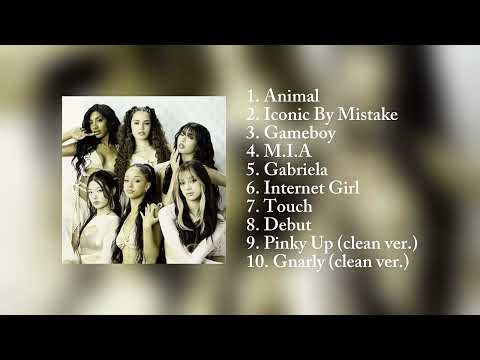
- 설명 앞부분: ⋆. 𐙚 ˚ timestamps
- 대본 없음 (설명) — 음성인식이 끝나면 도입부·흐름이 들어감
- 댓글 2,599/2,611: 좋은 점 — 영상 0 · 감사·응원 0 · 더 알고 싶은 것 0 · 아쉬운 점 — 영상 0 · 반박·불만 — 의견 다름 0 · 정치·사회 0 · 경험 공유 0 · 구독·다음 기대 0

### 122. One Playlist. Endless Feelings. ∣ Soft Love Songs for Late Night Drives & Overthinking 💙

- https://www.youtube.com/watch?v=Auvd4NPXHnI · Unrequited Love · 구독자 5,750 · 조회수 2,488,796 (×432.8, 하루 22,866.9) · 좋아요 44,058 (1.8%) · 23.2분 · 2026-07-07 · 주제 묶음 5. 운동·드라이브·신나는 · 형식 플레이리스트·모음 (여러 곡) · 폴더 `W_Auvd4NPXHnI` (웹 승인)
- 썸네일: 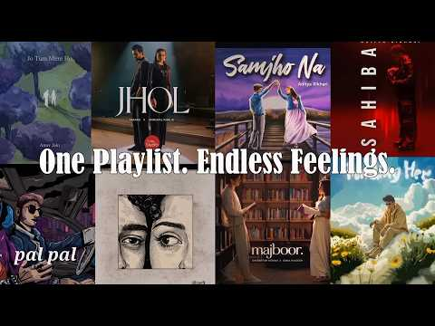
- 설명 앞부분: 🌙 Welcome to Midnight Vibes 🌙 A playlist for late-night drives, quiet moments, and memories that never fade. Whether you're studying, relaxing, or thinking about someone special, these songs create the perfect midnight atmosphere. ✨ Sit back, wear your headphones, and enjoy the vibes. 👍 If you enjo…
- 대본 없음 (설명) — 음성인식이 끝나면 도입부·흐름이 들어감
- 댓글 436/437: 좋은 점 — 영상 0 · 감사·응원 0 · 더 알고 싶은 것 0 · 아쉬운 점 — 영상 0 · 반박·불만 — 의견 다름 0 · 정치·사회 0 · 경험 공유 0 · 구독·다음 기대 0

### 123. 𝑮𝒐𝒍𝒅𝒆𝒏 𝑩𝒓𝒐𝒘𝒏 - 𝑻𝒉𝒆 𝑺𝒕𝒓𝒂𝒏𝒈𝒍𝒆𝒓𝒔 ∣ ⚔︎ 𝑩𝒆𝒔𝒕 𝒑𝒂𝒓𝒕 𝒍𝒐𝒐𝒑𝒆𝒅 ⚔︎

- https://www.youtube.com/watch?v=9MLxTIPaoTQ · Medieval Anemoia · 구독자 2,410 · 조회수 1,042,206 (×432.4, 하루 13,457.2) · 좋아요 17,370 (1.7%) · 11.8분 · 2026-08-07 · 주제 묶음 기타 · 형식 정보·해설 (그 밖) · 폴더 `W_9MLxTIPaoTQ` (웹 승인)
- 썸네일: 
- 설명 앞부분: 🎧 Best experienced with headphones The Stranglers - Golden Brown (1982) Slowed + Best Part Looped ⚔︎ LOOPING One of the most beautiful, hypnotic, and unforgettable songs ever recorded. A timeless classic crafted to slow down time and evoke deep nostalgia. 🍂✨ In this version, the track has been slow…
- 같은 채널 평소 대비 ×2,316.0 (채널 최근 롱폼 중앙값 450회) · 평소 영상: rest here, weary traveler... (cozy medieval minec… (450회) / 3 Hours of Medieval Campfire Ambience 🗡️ Relaxing (453회)
- 대본 없음 (설명) — 음성인식이 끝나면 도입부·흐름이 들어감
- 댓글 417/423: 좋은 점 — 영상 0 · 감사·응원 0 · 더 알고 싶은 것 0 · 아쉬운 점 — 영상 0 · 반박·불만 — 의견 다름 0 · 정치·사회 0 · 경험 공유 0 · 구독·다음 기대 0

### 124. Top Bhojpuri Hits Mix 2026 ∣ Nonstop Bhojpuri Mashup 🎧🔥

- https://www.youtube.com/watch?v=7v8NIUwR1No · Anivix · 구독자 6,320 · 조회수 2,717,465 (×430.0, 하루 24,127.4) · 좋아요 21,455 (0.8%) · 6분 · 2026-07-03 · 주제 묶음 기타 · 형식 음악 (그 밖 모양 — 한 편짜리 BGM 등) · 폴더 `W_7v8NIUwR1No` (웹 승인)
- 썸네일: 
- 설명 앞부분: 🎶 Just here to share music with fellow Bhojpuri music lovers. ❤ This remix/mix is created for entertainment purposes only. All rights belong to the respective owners, including the original singer(s), music composer(s), lyricist(s), and music label. No copyright infringement is intended. If you are…
- 같은 채널 평소 대비 ×1,125.5 (채널 최근 롱폼 중앙값 2,414회) · 평소 영상: Non-Stop Romantic Bollywood Jukebox 💖 ∣ Best Love… (3,023회) / Beauty in Love Mashup ∣ Saiyaara X Barbaad X EK V… (1,806회)
- 대본 없음 (설명) — 음성인식이 끝나면 도입부·흐름이 들어감
- 댓글 483/497: 좋은 점 — 영상 0 · 감사·응원 0 · 더 알고 싶은 것 0 · 아쉬운 점 — 영상 0 · 반박·불만 — 의견 다름 0 · 정치·사회 0 · 경험 공유 0 · 구독·다음 기대 0

### 125. Stay With Me Now..

- https://www.youtube.com/watch?v=mT2U96LfO3g · AERIN - Project Music  · 구독자 571 · 조회수 244,799 (×428.7, 하루 1,504.9) · 좋아요 2,517 (1.0%) · 4.6분 · 2026-05-14 · 주제 묶음 기타 · 형식 음악 (그 밖 모양 — 한 편짜리 BGM 등) · 폴더 `W_mT2U96LfO3g` (웹 승인)
- 썸네일: 
- 설명 앞부분: AERIN – STAY WITH ME NOW Some connections don’t arrive loudly. They unfold slowly — through movement, silence, atmosphere, and the spaces between words. “Stay With Me Now” by AERIN captures the feeling of emotional flow between two people drifting through the same moment. Nothing feels forced. Ever…
- 같은 채널 평소 대비 ×1,419.1 (채널 최근 롱폼 중앙값 172회) · 평소 영상: Underneath These Skies (180회) / Homecoming (165회)
- 대본 없음 (설명) — 음성인식이 끝나면 도입부·흐름이 들어감
- 댓글 31/31: 좋은 점 — 영상 0 · 감사·응원 0 · 더 알고 싶은 것 0 · 아쉬운 점 — 영상 0 · 반박·불만 — 의견 다름 0 · 정치·사회 0 · 경험 공유 0 · 구독·다음 기대 0

### 126. Heartbroken Lofi Songs 💔 ∣ Slowed + Reverb ∣ Late Night Chill & Study Vibes 🎧

- https://www.youtube.com/watch?v=ki362-gbdjs · Qais Music Studio · 구독자 2,170 · 조회수 922,906 (×425.3, 하루 38,650.9) · 좋아요 2,453 (0.3%) · 7.3분 · 2026-09-30 · 주제 묶음 3. 공부·집중·작업 · 형식 음악 (그 밖 모양 — 한 편짜리 BGM 등) · 폴더 `W_ki362-gbdjs` (웹 승인)
- 썸네일: 
- 설명 앞부분: Welcome 🙏to world of soothing lofi music, where stress fades away, and peace takes over. This 2025 mind-relaxing lofi mix is perfect for: Deep Focus & Studying 📖 Relaxing & Meditation 🧘‍♂ Chilling After a Long Day 🌅 Peaceful Sleep & Stress Relief 😴 Let these calm beats and chill vibes take you on a…
- 같은 채널 평소 대비 ×3,605.1 (채널 최근 롱폼 중앙값 256회) · 평소 영상: Heartbroken Lofi Songs 💔 ∣ Slowed + Reverb ∣ Late… (256회) / Heartbroken Lofi Songs 💔 ∣ Slowed + Reverb ∣ Late… (253회)
- 대본 없음 (설명) — 음성인식이 끝나면 도입부·흐름이 들어감
- 댓글 10/10: 좋은 점 — 영상 0 · 감사·응원 0 · 더 알고 싶은 것 0 · 아쉬운 점 — 영상 0 · 반박·불만 — 의견 다름 0 · 정치·사회 0 · 경험 공유 0 · 구독·다음 기대 0

### 127. Playlist cuz you're in love 💌#playlist #love #2026

- https://www.youtube.com/watch?v=gbf3ZYx6EbU · it's GAURAV PATEL  · 구독자 7,970 · 조회수 3,309,446 (×415.2, 하루 19,826.8) · 좋아요 27,586 (0.8%) · 10.6분 · 2026-05-10 · 주제 묶음 기타 · 형식 플레이리스트·모음 (여러 곡) · 폴더 `W_gbf3ZYx6EbU` (웹 승인)
- 썸네일: 
- 설명 앞부분: Playlist cuz you're in love 💌 (all the credit of the songs to the respective owners) It just made for fun (if you have any problem during using of song then i remove it)
- 대본 없음 (설명) — 음성인식이 끝나면 도입부·흐름이 들어감
- 댓글 531/529: 좋은 점 — 영상 0 · 감사·응원 0 · 더 알고 싶은 것 0 · 아쉬운 점 — 영상 0 · 반박·불만 — 의견 다름 0 · 정치·사회 0 · 경험 공유 0 · 구독·다음 기대 0

### 128. Dance playlist for chatpati girls 🥂💅🏻🍷#dance #viral#trending#instagram #fypシ#virlsong#gir…

- https://www.youtube.com/watch?v=wh1wOQrBIrk · soft girl 🦋💫 · 구독자 4,100 · 조회수 1,694,028 (×413.2, 하루 12,490.1) · 좋아요 10,833 (0.6%) · 8.5분 · 2026-06-10 · 주제 묶음 기타 · 형식 플레이리스트·모음 (여러 곡) · 폴더 `W_wh1wOQrBIrk` (웹 승인)
- 썸네일: 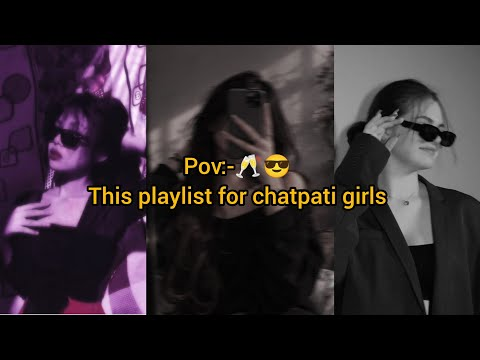
- 같은 채널 평소 대비 ×83.8 (채널 최근 롱폼 중앙값 20,214회) · 평소 영상: Attitude playlist for strong girls 🥂🔥#boollywoods… (26,003회) / Different dance playlist 🎶🤧💅🏻#bolleywoodsong #vir… (14,424회)
- 대본 없음 (없음) — 음성인식이 끝나면 도입부·흐름이 들어감
- 댓글 110/110: 좋은 점 — 영상 0 · 감사·응원 0 · 더 알고 싶은 것 0 · 아쉬운 점 — 영상 0 · 반박·불만 — 의견 다름 0 · 정치·사회 0 · 경험 공유 0 · 구독·다음 기대 0

### 129. CHILL NIGHT MOOD🌙 R&B Mix Playlist ∣ Late Night Vibes, Relaxing, Study & Late Working Mus…

- https://www.youtube.com/watch?v=zA04SiNiLYk · Late Night RnB Coding · 구독자 2,610 · 조회수 1,075,786 (×412.2, 하루 6,418.4) · 좋아요 3,528 (0.3%) · 158.2분 · 2026-05-09 · 주제 묶음 3. 공부·집중·작업 · 형식 플레이리스트·모음 (여러 곡) · 폴더 `W_zA04SiNiLYk` (웹 승인)
- 썸네일: 
- 설명 앞부분: A smooth late-night R&B chill mix for working, studying, coding, relaxing, or enjoying the city night view. This mix is inspired by purple neon rooms, midnight skylines, rainy windows, and quiet after-dark emotions. Perfect for deep focus, night work sessions, slow evenings, or relaxed background m…
- 대본 없음 (설명) — 음성인식이 끝나면 도입부·흐름이 들어감
- 댓글 54/54: 좋은 점 — 영상 0 · 감사·응원 0 · 더 알고 싶은 것 0 · 아쉬운 점 — 영상 0 · 반박·불만 — 의견 다름 0 · 정치·사회 0 · 경험 공유 0 · 구독·다음 기대 0

### 130. 🍂 알록달록 가을 음악이야기 ∣ Autumn Collection Vol.

- https://www.youtube.com/watch?v=o3DojrmPMbs · little step melody · 구독자 85 · 조회수 40,965 (×409.6, 하루 1,775.3) · 좋아요 34 (0.1%) · 206.4분 · 2026-10-01 · 주제 묶음 1. 수면·명상·힐링 · 형식 음악 (그 밖 모양 — 한 편짜리 BGM 등) · 폴더 `W_o3DojrmPMbs` (웹 승인)
- 썸네일: 
- 설명 앞부분: 🍂 Autumn Collection Vol.1 l Gentle Felt Piano Melodies Inspired by a Colorful Autumn Day 알록달록 물든 가을 나뭇잎과 살랑이는 바람, 바스락거리는 낙엽길에서 영감을 받은 포근한 펠트 피아노 선율을 담았습니다. 따뜻한 햇살 아래 천천히 걸으며 가을의 작은 풍경을 바라보는 듯한 음악입니다. Little Step Melody는 그림책 같은 감성과 포근한 피아노 선율을 담아, 오래도록 곁에 두고 싶은 음악을 만들어갑니다. Thank you for listening. M…
- 같은 채널 평소 대비 ×53.3 (채널 최근 롱폼 중앙값 769회) · 평소 영상: 🏕️ 모험이 가득한, 캠핑 음악이야기 ∣ Camping Collection Vol.1 G… (769회) / 🍅 동글동글 토마토 재즈 이야기 ∣ Jazz Collection Vol.1Round To… (564회)
- 대본 없음 (설명) — 음성인식이 끝나면 도입부·흐름이 들어감
- 댓글 3/3: 좋은 점 — 영상 0 · 감사·응원 1 · 더 알고 싶은 것 0 · 아쉬운 점 — 영상 0 · 반박·불만 — 의견 다름 0 · 정치·사회 0 · 경험 공유 0 · 구독·다음 기대 0
  - 감사·응원 👍0 “앗 1등 ^^ 작업중에 듣고 있는데 1시간 순삭이네요~ 좋은음악감사합니다 ^^”

### 131. Viral Songs Playlist 2026 ∣ Barsaat, Sheesha, Parvati, Roots

- https://www.youtube.com/watch?v=nmc4ScFV3j4 · Vijay Garje · 구독자 3,540 · 조회수 1,441,984 (×407.3, 하루 72,828.6) · 좋아요 13,927 (1.0%) · 31.3분 · 2026-10-04 · 주제 묶음 기타 · 형식 플레이리스트·모음 (여러 곡) · 폴더 `W_nmc4ScFV3j4` (웹 승인)
- 썸네일: 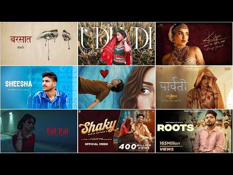
- 챕터: 0:00 Barsaat – Banjare · 3:03 Udi Udi – Neesh Sarkar · 5:39 Kalyani – Arjun, KDS, Fuliya,… · 9:47 Sheesha – Mitta Ror ft. Swara… · 13:06 Bairan – Banjare · 15:37 Parvati – Hanuman Ansh (Sadhu… · 20:22 Pal Pal – AFusic x AliSoomroM… · 22:50 Shaky – Sanju Rathod ft. Isha… · 26:25 Roots – Bintu Pabra & KP Kundu
- 설명 앞부분: 🔥 2026 ke sabse viral aur trending gaane, ek hi playlist mein! Is video mein shamil gaane: 👍 Video pasand aaye to Like, Share aur Subscribe zaroor karein. 🔔 Bell icon dabayein taaki har naya trending playlist sabse pehle aap tak pahunche. 👍 Like ∣ 💬 Comment your favorite song ∣ 🔔 Subscribe. COPYRIG…
- 같은 채널 평소 대비 ×12,760.9 (채널 최근 롱폼 중앙값 113회) · 평소 영상: Vlog ∣ Goa Trip with Friends ∣ Beach, Pool & Suns… (113회) / Part 4 (99회)
- 대본 없음 (설명) — 음성인식이 끝나면 도입부·흐름이 들어감
- 댓글 320/439: 좋은 점 — 영상 0 · 감사·응원 0 · 더 알고 싶은 것 0 · 아쉬운 점 — 영상 0 · 반박·불만 — 의견 다름 0 · 정치·사회 0 · 경험 공유 0 · 구독·다음 기대 0

### 132. [Playlist] Music is my drug

- https://www.youtube.com/watch?v=msoR3EhPNAA · Hugs  · 구독자 6,660 · 조회수 2,700,334 (×405.5, 하루 53,319.6) · 좋아요 65,374 (2.4%) · 20.9분 · 2026-09-03 · 주제 묶음 기타 · 형식 플레이리스트·모음 (여러 곡) · 폴더 `W_msoR3EhPNAA` (웹 승인)
- 썸네일: 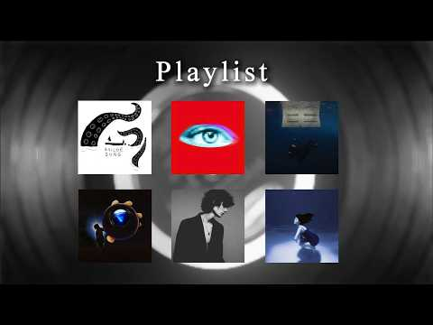
- 설명 앞부분: 🎧 Welcome to Hugs. A little playlist for when music is the only thing you need. 🎵 Songs featured in this playlist Sailor Song - Gigi Perez Self Aware - Temper City WILDFLOWER - Billie Eilish End Of Beginning - Djo Back to friends - sombr No One Noticed - The Marías ⚠️ Copyright Notice If you have a…
- 대본 없음 (설명) — 음성인식이 끝나면 도입부·흐름이 들어감
- 댓글 538/541: 좋은 점 — 영상 0 · 감사·응원 0 · 더 알고 싶은 것 0 · 아쉬운 점 — 영상 0 · 반박·불만 — 의견 다름 0 · 정치·사회 0 · 경험 공유 0 · 구독·다음 기대 0

### 133. 𝙅 𝙋𝙤𝙥 𝙋𝙡𝙖𝙮𝙡𝙞𝙨𝙩 저기, 나 지금 사랑에 빠지고 있어

- https://www.youtube.com/watch?v=-_t34PClPSE · 이로하 · 구독자 1,890 · 조회수 765,128 (×404.8, 하루 4,852.0) · 좋아요 14,609 (1.9%) · 20.9분 · 2026-05-19 · 주제 묶음 기타 · 형식 플레이리스트·모음 (여러 곡) · 폴더 `W_-_t34PClPSE` (웹 승인)
- 썸네일: 
- 설명 앞부분: 저기, 나 지금 사랑에 빠지고 있어 노래 제목 댓글에 나와 잇습니다!
- 대본 없음 (설명) — 음성인식이 끝나면 도입부·흐름이 들어감
- 댓글 165/168: 좋은 점 — 영상 4 · 감사·응원 17 · 더 알고 싶은 것 2 · 아쉬운 점 — 영상 0 · 반박·불만 — 의견 다름 0 · 정치·사회 0 · 경험 공유 11 · 구독·다음 기대 2
  - 좋은 점 — 영상 👍1 “새벽마다 듣기 좋은 노래들입니다! 덕분에 밤 새기 쉬워진것 같습니다”
  - 좋은 점 — 영상 👍1 “와레전드플리다진심”
  - 감사·응원 👍3 “제목 보고 첫 곡 예상하면서 들어왔는데 역시나... 딱 몽글몽글하고 시원한 분위기☺️ 제가 제일 좋아합니다 감사합니다 선생님😻”
  - 감사·응원 👍3 “와 이렇게 맛있는거만 골라먹으시면.. 너무 감사합니다”
  - 더 알고 싶은 것 👍2 “제이팝 좋은거 찾고있는데 추천좀여”
  - 더 알고 싶은 것 👍1 “노래 너무 좋다 이런 노래 어디서 가져오는 건가요?”
  - 경험 공유 👍5 “내가조와하는근본제이팝들다여기잇어서너무설렘”
  - 경험 공유 👍4 “제가 만든줄앟았어요 ㅋㅋㅋㅋ취향 엄청 똑같네요 저랑”
  - 구독·다음 기대 👍3 “찾았다 내꺼 바로 구독박습니다”
  - 구독·다음 기대 👍1 “노래 너무 좋아요! 매일 듣고 있습니다! 좋은 노래 감사합니다!”

### 134. Attract Peace & Positive Energy ∣ Raag Malhar Morning Meditation Music #meditationmusic

- https://www.youtube.com/watch?v=c45OwnC599Y · Tatva Meditation · 구독자 215 · 조회수 86,802 (×403.7, 하루 601.5) · 좋아요 465 (0.5%) · 15분 · 2026-06-02 · 주제 묶음 1. 수면·명상·힐링 · 형식 음악 (그 밖 모양 — 한 편짜리 BGM 등) · 폴더 `W_c45OwnC599Y` (웹 승인)
- 썸네일: 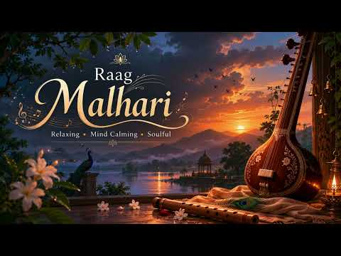
- 설명 앞부분: Begin your morning with 15 minutes of peaceful meditation music inspired by the uplifting essence of Raag Malhar. Designed to cultivate positive energy, inner peace, and mental clarity, this gentle soundscape helps you start the day with calmness, gratitude, and renewed focus. Whether you're medita…
- 같은 채널 평소 대비 ×729.4 (채널 최근 롱폼 중앙값 119회) · 평소 영상: 30 Minutes Deep Sleep Music ∣ Anxiety Relief, Inn… (143회) / Flute Meditation 1 Hr ∣ Deep Sleep Music, Healing… (95회)
- 대본 없음 (설명) — 음성인식이 끝나면 도입부·흐름이 들어감
- 댓글 9/9: 좋은 점 — 영상 0 · 감사·응원 0 · 더 알고 싶은 것 0 · 아쉬운 점 — 영상 0 · 반박·불만 — 의견 다름 0 · 정치·사회 0 · 경험 공유 0 · 구독·다음 기대 0

### 135. Throwback R&B Classics 📺 Chris Brown, Rihanna, Akon, Usher, Ne-Yo - OLD SCHOOL R&B MIX 90…

- https://www.youtube.com/watch?v=gCUbxsTWZ18 · R&B Afterglow · 구독자 15,500 · 조회수 6,177,435 (×398.5, 하루 62,459.0) · 좋아요 27,662 (0.4%) · 193.5분 · 2026-07-17 · 주제 묶음 11. 힙합·R&B·EDM · 형식 정보·해설 (그 밖) · 폴더 `W_gCUbxsTWZ18` (웹 승인)
- 썸네일: 
- 설명 앞부분: 🎵 Welcome to a nostalgic journey through the best throwback R&B classics of the 90s and 2000s! 📺 Enjoy a smooth old school R&B mix featuring Chris Brown, Rihanna, Akon, Usher, Ne-Yo and more unforgettable voices. Let these timeless R&B hits, soulful vocals, romantic grooves, and classic throwback m…
- 같은 채널 평소 대비 ×4,730.0 (채널 최근 롱폼 중앙값 1,306회) · 평소 영상: 90_S R&B PARTY MIX 🎶 Alicia Keys, Usher, Rihanna,… (1,306회) / 90'S R&B PARTY MIX - Rihanna, Chris Brown, Usher,… (1,285회)
- 대본 없음 (설명) — 음성인식이 끝나면 도입부·흐름이 들어감
- 댓글 698/762: 좋은 점 — 영상 0 · 감사·응원 0 · 더 알고 싶은 것 0 · 아쉬운 점 — 영상 0 · 반박·불만 — 의견 다름 0 · 정치·사회 0 · 경험 공유 0 · 구독·다음 기대 0

### 136. 2026 최신곡 랜덤플레이댄스∣ K-pop Random Play Dance 2026 #랜덤플레이댄스 #랜플댄스 #랜플댄 #kpop #챌린지 #댄스

- https://www.youtube.com/watch?v=bliX1fxHkKk · 샤파 · 구독자 909 · 조회수 362,228 (×398.5, 하루 17,268.5) · 좋아요 1,122 (0.3%) · 6.1분 · 2026-10-03 · 주제 묶음 10. 팝송·K팝·J팝 · 형식 한 곡 (뮤직비디오·음원·가사) · 폴더 `W_bliX1fxHkKk` (웹 승인)
- 썸네일: 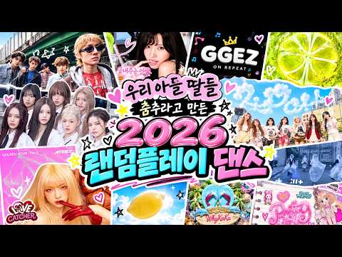
- 설명 앞부분: 2026 최신곡, 틱톡 챌린지로 유명한 곡 12곡으로 만든 랜덤플레이댄스예요 몇 곡 알고 있는지 댓글 적어주세요!
- 같은 채널 평소 대비 ×3.4 (채널 최근 롱폼 중앙값 105,630회) · 평소 영상: 2026년 최신곡 랜덤플레이댄스 I K-POP Random Play Dance 2026 … (105,630회) / (요청곡)2026년 랜덤플레이댄스 총집합! I Random Play Dance 2026 … (110,090회)
- 대본 없음 (설명) — 음성인식이 끝나면 도입부·흐름이 들어감
- 댓글 46/48: 좋은 점 — 영상 0 · 감사·응원 0 · 더 알고 싶은 것 0 · 아쉬운 점 — 영상 0 · 반박·불만 — 의견 다름 0 · 정치·사회 0 · 경험 공유 1 · 구독·다음 기대 0
  - 경험 공유 👍2 “제가 아는노래만 있어요!모르는것도 없어서 넘 좋아요❤”

### 137. /KATSEYE PLAYLIST💫/ All Songs In One Video / ICONIC BY MISTAKE 💥/

- https://www.youtube.com/watch?v=wQHy50dFnfY ·  𝓔𝓵𝓵𝓲𝔁𝔁𝓺 🤍🎀 · 구독자 2,640 · 조회수 1,051,488 (×398.3, 하루 8,935.8) · 좋아요 8,638 (0.8%) · 43분 · 2026-06-28 · 주제 묶음 기타 · 형식 플레이리스트·모음 (여러 곡) · 폴더 `W_wQHy50dFnfY` (웹 승인)
- 썸네일: 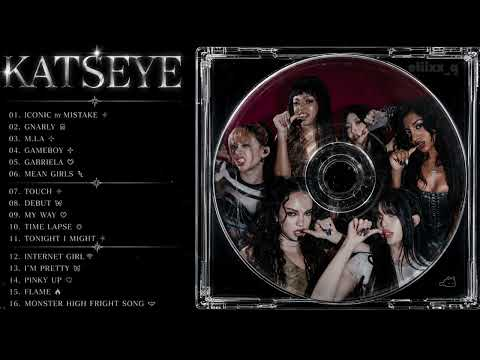
- 챕터: 0:00 ICONIC By MISTAKE · 2:56 GNARLY · 5:14 M.I.A · 7:05 GAMEBOY · 10:37 GABRIELA · 13:49 MEAN GIRLS · 17:25 TOUCH · 19:35 DEBUT · 21:38 MY WAY · 24:11 TIME LAPSE · 27:23 TONIGHT I MIGHT · 29:56 INTERNET GIRL · 32:41 I'M PRETTY · 35:07 PINKY UP · 38:01 FLAME · 40:44 MONSTER HIGH FRIGHT SONG
- 설명 앞부분: KATSEYE SONGS PLAYLIST💋🔥
- 대본 없음 (설명) — 음성인식이 끝나면 도입부·흐름이 들어감
- 댓글 950/950: 좋은 점 — 영상 0 · 감사·응원 0 · 더 알고 싶은 것 0 · 아쉬운 점 — 영상 0 · 반박·불만 — 의견 다름 0 · 정치·사회 0 · 경험 공유 0 · 구독·다음 기대 0

### 138. [playlist] 잔잔한 안건호 보컬 모음 플레이리스트 ∣ 커버곡 ∣ 코르티스

- https://www.youtube.com/watch?v=WHHQaKlBtZk · W · 구독자 24 · 조회수 39,548 (×395.5, 하루 242.9) · 좋아요 726 (1.8%) · 13.3분 · 2026-05-14 · 주제 묶음 12. 커버·노래 부르기 · 형식 커버·직접 부른 노래 · 폴더 `W_WHHQaKlBtZk` (웹 승인)
- 썸네일: 
- 챕터: 0:00 내 마음에 비친 내 모습 (원곡 유재하) · 1:53 Blue Lips (원곡 코르티스) · 2:58 Great Pretender (원곡 Dominic f… · 5:37 Swap It Out (원곡 Justin Bieber) · 6:37 그대 작은 나의 세상이 되어 (원곡 카더가든) · 9:08 Let’s go picnic (원곡 george) · 10:48 JoyRide (원곡 코르티스)
- 설명 앞부분: 코르티스 건호 보컬•커버곡 모음
- 대본 없음 (설명) — 음성인식이 끝나면 도입부·흐름이 들어감
- 댓글 12/12: 좋은 점 — 영상 0 · 감사·응원 2 · 더 알고 싶은 것 0 · 아쉬운 점 — 영상 0 · 반박·불만 — 의견 다름 0 · 정치·사회 0 · 경험 공유 0 · 구독·다음 기대 0
  - 감사·응원 👍18 “이런 플리 찾고 있고 있었어요 감사해요ㅠㅜ🫶”
  - 감사·응원 👍7 “감사해요 심심안정 건호플리❤❤❤”

### 139. Heartbreaking 💔 Lofi Mashup 🎧Slowed + Reverb Songs ∣ Relax, Study, Focus & Late Night Vib…

- https://www.youtube.com/watch?v=gCuJrBYRJpM · Fiaz Baloch Official  · 구독자 7,170 · 조회수 2,818,580 (×393.1, 하루 58,452.9) · 좋아요 8,147 (0.3%) · 8분 · 2026-09-06 · 주제 묶음 3. 공부·집중·작업 · 형식 음악 (그 밖 모양 — 한 편짜리 BGM 등) · 폴더 `W_gCuJrBYRJpM` (웹 승인)
- 썸네일: 
- 설명 앞부분: Welcome 🤗 to world of songs soothing lofi music, where stress fades away, and peace takes over. This 2026 mind-relaxing lofi mix is perfect for: Deep Focus & Studying 📖 Relaxing & Meditation 🧘‍♂ Chilling After a Long Day 🌅 Peaceful Sleep & Stress Relief 😴 Let these calm beats and chill vibes take y…
- 같은 채널 평소 대비 ×5,598.0 (채널 최근 롱폼 중앙값 504회) · 평소 영상: Heartbreaking 💔 Lofi Mashup 🎧Slowed + Reverb Song… (528회) / Heartbreaking 💔 Lofi Mashup 🎧Slowed + Reverb Song… (479회)
- 대본 없음 (설명) — 음성인식이 끝나면 도입부·흐름이 들어감
- 댓글 154/156: 좋은 점 — 영상 0 · 감사·응원 0 · 더 알고 싶은 것 0 · 아쉬운 점 — 영상 0 · 반박·불만 — 의견 다름 0 · 정치·사회 0 · 경험 공유 0 · 구독·다음 기대 0

### 140. Barsaat ∣ All Trending Hindi Songs 2026 ∣ Safar × Bairan × Zulfein × Sahiba × Majboor ∣ L…

- https://www.youtube.com/watch?v=-hXkiB-eLfs · SukumusicHindi · 구독자 3,390 · 조회수 1,329,356 (×392.1, 하루 30,385.4) · 좋아요 8,200 (0.6%) · 22.9분 · 2026-09-10 · 주제 묶음 8. 로파이·시티팝·칠 · 형식 음악 (그 밖 모양 — 한 편짜리 BGM 등) · 폴더 `W_-hXkiB-eLfs` (웹 승인)
- 썸네일: 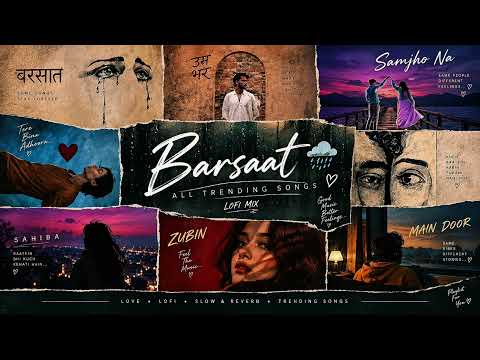
- 챕터: 0:00 ​ — Barsaat 🌧️ · 0:59 ​ — Taare ⭐ · 1:19 ​ — Samjho Na ❤️ · 2:35 ​ — Safar 🌙 · 3:45 ​ — Bairan 💔 · 5:59 ​ — Zulfein ✨ · 9:19 ​ — Sahiba ❤️ · 11:56 ​ — Majboor 🥀
- 설명 앞부분: Barsaat 🌧️ ∣ All Trending Hindi Songs 2026 🎧 ∣ Taare x Samjho Na x Safar x Bairan x Zulfein x Sahiba x Majboor ∣ Lofi & Slowed Reverb 🌧️ Barsaat ∣ All Trending Hindi Songs 2026 🎧❤ Welcome to Voxwaves — your destination for trending Hindi songs, romantic vibes, emotional melodies and relaxing Lofi /…
- 같은 채널 평소 대비 ×969.6 (채널 최근 롱폼 중앙값 1,371회) · 평소 영상: वीर हनुमाना अति बलवाना 🚩 ∣ श्री हनुमान जी का मधुर… (1,371회) / वृन्दावन जाउंगी सखी ना लौट । Vrindavan Jaungi ∣ J… (2,339회)
- 대본 없음 (설명) — 음성인식이 끝나면 도입부·흐름이 들어감
- 댓글 161/165: 좋은 점 — 영상 0 · 감사·응원 0 · 더 알고 싶은 것 0 · 아쉬운 점 — 영상 0 · 반박·불만 — 의견 다름 0 · 정치·사회 0 · 경험 공유 0 · 구독·다음 기대 0

### 141. ALL TRENDING HINDI SONGS 2026...PLAYLIST #asthetic #trend #fypシ

- https://www.youtube.com/watch?v=xI0IEWIxUBQ · Rb Lofi · 구독자 27,000 · 조회수 10,422,745 (×386.0, 하루 168,182.4) · 좋아요 75,777 (0.7%) · 7.9분 · 2026-08-23 · 주제 묶음 기타 · 형식 플레이리스트·모음 (여러 곡) · 폴더 `W_xI0IEWIxUBQ` (웹 승인)
- 썸네일: 
- 같은 채널 평소 대비 ×1,153.7 (채널 최근 롱폼 중앙값 9,034회) · 평소 영상: 𝑰𝑻’𝑺 𝟐 𝑨𝑴 𝑨𝑵𝑫 𝑻𝑯𝑬𝑺𝑬 𝑺𝑶𝑵𝑮𝑺 𝑯𝑰𝑻 𝑫𝑰𝑭𝑭𝑬𝑹𝑬𝑵𝑻... 🌸🎀✨ #f… (9,631회) / 𝑺𝒐𝒏𝒈𝒔 𝑾𝒉𝒊𝒄𝒉 𝑭𝒆𝒆𝒍 𝑫𝒊𝒇𝒇𝒆𝒓𝒆𝒏𝒕 𝑨𝒕 𝟑𝑨𝑴 🎧🔥 #fypシ #trend… (8,438회)
- 대본 없음 (없음) — 음성인식이 끝나면 도입부·흐름이 들어감
- 댓글 1,565/1,716: 좋은 점 — 영상 0 · 감사·응원 0 · 더 알고 싶은 것 0 · 아쉬운 점 — 영상 0 · 반박·불만 — 의견 다름 0 · 정치·사회 0 · 경험 공유 0 · 구독·다음 기대 0

### 142. "some aesthetic desi song's you'll absolutely love"🌊✨😭//part -1//edit by @ashrigee

- https://www.youtube.com/watch?v=6D1sq3Y-hB0 · Anushri  · 구독자 7,570 · 조회수 2,905,241 (×383.8, 하루 26,068.8) · 좋아요 18,319 (0.6%) · 12.5분 · 2026-07-04 · 주제 묶음 기타 · 형식 음악 (그 밖 모양 — 한 편짜리 BGM 등) · 폴더 `W_6D1sq3Y-hB0` (웹 승인)
- 썸네일: 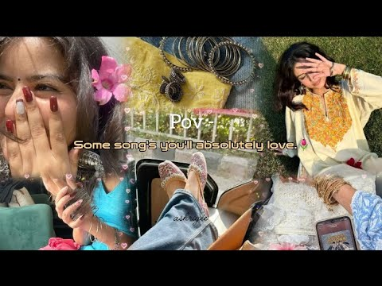
- 챕터: 0:00 Sheesha · 0:58 Sawaar Loon · 1:56 O Meri Laila · 2:54 Udi Udi · 3:52 Ishq De Fanniyar · 4:50 Aarzu · 5:48 Ishq Bulava · 6:46 Majboor · 7:44 Fakira · 8:42 Tere Bina · 9:40 Mast Magan · 10:38 Boyfriend · 11:36 Dagabaaz Re
- 설명 앞부분: 🌷 A little desi playlist for your heart. Hope these songs become your comfort place. ♡ ✦ Edited by ashrigee Tracklist: If you enjoyed these vibes, don't forget to Like, Comment & Subscribe. 🤍
- 같은 채널 평소 대비 ×15.7 (채널 최근 롱폼 중앙값 184,898회) · 평소 영상: "Chatpate Songs, Full On Tadka"💅🏻✨//part-7//edit … (186,819회) / "a little desi playlist ♡"✨🌷//part-8//editing by … (182,976회)
- 대본 없음 (설명) — 음성인식이 끝나면 도입부·흐름이 들어감
- 댓글 503/508: 좋은 점 — 영상 0 · 감사·응원 0 · 더 알고 싶은 것 0 · 아쉬운 점 — 영상 0 · 반박·불만 — 의견 다름 0 · 정치·사회 0 · 경험 공유 0 · 구독·다음 기대 0

### 143. Haryanvi playlist that walk up your inner dancer 🔥💋#lifewithvenus9

- https://www.youtube.com/watch?v=tYuLhTnHgOQ · Venus Yadav · 구독자 12,500 · 조회수 4,725,514 (×378.0, 하루 56,522.9) · 좋아요 25,325 (0.5%) · 11분 · 2026-08-01 · 주제 묶음 기타 · 형식 플레이리스트·모음 (여러 곡) · 폴더 `W_tYuLhTnHgOQ` (웹 승인)
- 썸네일: 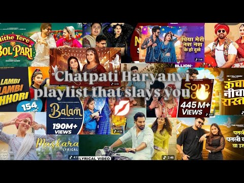
- 대본 없음 (없음) — 음성인식이 끝나면 도입부·흐름이 들어감
- 댓글 570/592: 좋은 점 — 영상 0 · 감사·응원 0 · 더 알고 싶은 것 0 · 아쉬운 점 — 영상 0 · 반박·불만 — 의견 다름 0 · 정치·사회 0 · 경험 공유 0 · 구독·다음 기대 0

### 144. Dopamine Reset ∣ Indian Classical Flute Music for Relaxation & Meditation #bansuri #dopam…

- https://www.youtube.com/watch?v=gSOocWITTT4 · Desert Harmony Music · 구독자 2,320 · 조회수 872,821 (×376.2, 하루 8,243.1) · 좋아요 6,053 (0.7%) · 8.4분 · 2026-07-10 · 주제 묶음 1. 수면·명상·힐링 · 형식 음악 (그 밖 모양 — 한 편짜리 BGM 등) · 폴더 `W_gSOocWITTT4` (웹 승인)
- 썸네일: 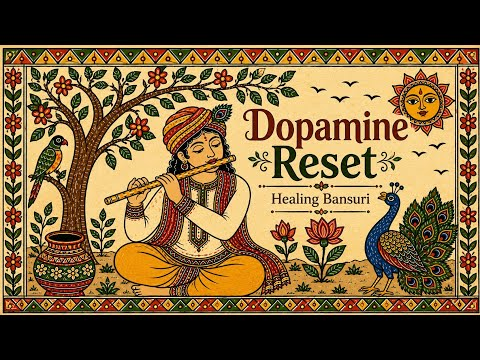
- 설명 앞부분: Step into a world of calm with the soothing melodies of the Indian Bansuri, inspired by the timeless beauty of traditional folk art and classical music. This instrumental journey is perfect for deep relaxation, meditation, stress relief, yoga, studying, reading, mindful breathing, and peaceful slee…
- 같은 채널 평소 대비 ×1,465.7 (채널 최근 롱폼 중앙값 596회) · 평소 영상: Golden Hour Sitar Bliss ∣ Peaceful Indian Classic… (617회) / Evening Cortisol Calm 🌿 ∣ Raag Bhairavi Bansuri 4… (574회)
- 대본 없음 (설명) — 음성인식이 끝나면 도입부·흐름이 들어감
- 댓글 132/138: 좋은 점 — 영상 0 · 감사·응원 0 · 더 알고 싶은 것 0 · 아쉬운 점 — 영상 0 · 반박·불만 — 의견 다름 0 · 정치·사회 0 · 경험 공유 0 · 구독·다음 기대 0

### 145. 너 때문에 하루를 살아 #이별 #이별노래 #이별감성 #새벽감성 #OST #감성발라드 #kpop #kpopballad #작사작곡 #Thelyrics #Compos…

- https://www.youtube.com/watch?v=hhbJfI8dJ9o · 글쓰는여자🎀 · 구독자 640 · 조회수 240,358 (×375.6, 하루 1,955.0) · 좋아요 646 (0.3%) · 5.3분 · 2026-06-23 · 주제 묶음 10. 팝송·K팝·J팝 · 형식 한 곡 (뮤직비디오·음원·가사) · 폴더 `W_hhbJfI8dJ9o` (웹 승인)
- 썸네일: 
- 같은 채널 평소 대비 ×597.9 (채널 최근 롱폼 중앙값 402회) · 평소 영상: 사랑은 못 받았는데 #엄마 #어머니 #엄마노래 #가족 #눈물 #감성 #감성음악 #감성발라… (402회) / 너를 처음 만난 날 #첫사랑 #설렘 #사랑 #연애 #사랑노래 #인디팝 #인디음악 #로맨스… (408회)
- 대본 없음 (없음) — 음성인식이 끝나면 도입부·흐름이 들어감
- 댓글 105/105: 좋은 점 — 영상 0 · 감사·응원 6 · 더 알고 싶은 것 1 · 아쉬운 점 — 영상 0 · 반박·불만 — 의견 다름 1 · 정치·사회 1 · 경험 공유 4 · 구독·다음 기대 3
  - 감사·응원 👍3 “멋진보이스..노래도 좋고, 응원할께요~~~~”
  - 감사·응원 👍2 “노래 음원 너무 좋아요^^ 좋은 음악 감사합니다.👍🏻 💕💕💕💕💕”
  - 더 알고 싶은 것 👍2 “가사를알고싶어요”
  - 반박·불만 — 의견 다름 👍0 “따님 엄마가 고마운게 한두게가 아닙니다 너무너무 감사드립니다 사랑합니다 💜 기도하겠습니다 💜 따님 때문에 더 용기내어 살기로 마음 먹고 하나님께 선생님께 모든 조건을 세울수가 있었어요 다 선생님 배신하고 그여자 목사 편들때 저는요 울분을 금치못하며 조금의 흔들림없이 …”
  - 정치·사회 👍2 “이곡을 우연히 외국인(몽골인) 손님때문에 알게되었는데 이틀째 반복으로 듣고 있습니다. 이삿짐 일을 한다는데 가족때문에 버틴답니다. 저는 택시기사 입니다.”
  - 경험 공유 👍6 “사랑하면 안 되는 거였어 처음부터 알고 있었는데 왜 너였을까? 그러면 안되는거 였어 처음부터 알면서도 애써 아닌척했지만 이미 늦어버린것 같아 스쳐지나갈 사람이라 믿으려 했었는데 어느새 내 하루 끝엔 항상 네가 서있어 한 번만 덜 보고 싶었다면 한번만 덜 사랑했다면 이…”
  - 경험 공유 👍5 “너무 좋습니다 분위기가 제가원하는 ~~^^🥸😎🤓🤩”
  - 구독·다음 기대 👍3 “노래 잘들었어요 구독하고 갑니다😊😊😊😊”
  - 구독·다음 기대 👍2 “와우 노래 정말 좋네요. 한번들었는데 따라부르고 있어요. 언제 라이브하면 꼭 가고싶네요 . 응원합니다 ~ 구독하고가요~”

### 146. 90’S Old Hindi Songs🥰 90s Love Song💘 Udit Narayan, Alka Yagnik, Kumar Sanu, Sonu Nigam

- https://www.youtube.com/watch?v=qDOFK8SfKmA · 90s Lovers Point · 구독자 17,600 · 조회수 6,603,923 (×375.2, 하루 96,677.1) · 좋아요 19,353 (0.3%) · 27.4분 · 2026-08-17 · 주제 묶음 기타 · 형식 음악 (그 밖 모양 — 한 편짜리 BGM 등) · 폴더 `W_qDOFK8SfKmA` (웹 승인)
- 썸네일: 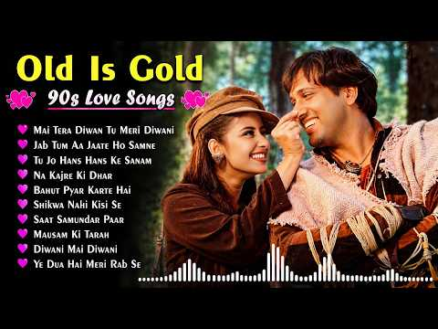
- 설명 앞부분: 90’S Old Hindi Songs💚 90s Love Song💘Udit Narayan, Alka Yagnik, Kumar Sanu, Sonu Nigam songs Hindi Jukebox songs OFFICIAL 90S LOVER POINT 80's Ke Superhit Gane II 80's Superhits II Bollywood Romantic Songs II Old is Gold II Evergreen Old Song II Bollywood Old Romantic Songs II 60's_70's_80's Super h…
- 같은 채널 평소 대비 ×3,968.7 (채널 최근 롱폼 중앙값 1,664회) · 평소 영상: 90’S Old Hindi Songs🥰 90s Love Song💘 Udit Narayan… (1,712회) / 90’S Old Hindi Songs🥰 90s Love Song💘 Udit Narayan… (1,616회)
- 대본 없음 (설명) — 음성인식이 끝나면 도입부·흐름이 들어감
- 댓글 217/234: 좋은 점 — 영상 0 · 감사·응원 0 · 더 알고 싶은 것 0 · 아쉬운 점 — 영상 0 · 반박·불만 — 의견 다름 0 · 정치·사회 0 · 경험 공유 0 · 구독·다음 기대 0

### 147. Lahore Diya ✨ Slowed Reverb ∣ Late Night Vibes ∣ Punjabi Lofi

- https://www.youtube.com/watch?v=-rNlgODrgjo · Arun music 100  · 구독자 9,450 · 조회수 3,540,863 (×374.7, 하루 26,397.7) · 좋아요 25,280 (0.7%) · 4.2분 · 2026-06-12 · 주제 묶음 8. 로파이·시티팝·칠 · 형식 한 곡 (뮤직비디오·음원·가사) · 폴더 `W_-rNlgODrgjo` (웹 승인)
- 썸네일: 
- 설명 앞부분: Lahore Diya ✨ Slowed Reverb ∣ Late Night Vibes ∣ Punjabi Lofi Song Description: 🎧 Lahore Diya (Slowed + Reverb) Version Enjoy this relaxing slowed and reverb edit of Lahore Diya. Perfect for late-night listening, studying, relaxing, and enjoying Punjabi music vibes. ✨ Use Headphones For Best Experi…
- 같은 채널 평소 대비 ×97.9 (채널 최근 롱폼 중앙값 36,170회) · 평소 영상: Main Agar Saamne Aa Bhi Jaya Karu 🥀 ∣ Slowed + Re… (37,936회) / Fallin For You x Dai Dai x Gali Gali Mein Firta x… (34,403회)
- 대본 없음 (설명) — 음성인식이 끝나면 도입부·흐름이 들어감
- 댓글 252/267: 좋은 점 — 영상 0 · 감사·응원 0 · 더 알고 싶은 것 0 · 아쉬운 점 — 영상 0 · 반박·불만 — 의견 다름 0 · 정치·사회 0 · 경험 공유 0 · 구독·다음 기대 0

### 148. 왜 이제 와｜음색 미쳤다는 반응 나온 새벽 감성 발라드 ｜ なぜ今になって｜音色がすごいという反応が出た、深夜の感性バラード ｜爲什麼現在才說 ｜的音色真的是絕了 凌晨感性…

- https://www.youtube.com/watch?v=TWunCWy98FU · Faded Love Notes · 구독자 1,150 · 조회수 428,773 (×372.9, 하루 2,664.8) · 좋아요 1,250 (0.3%) · 4.3분 · 2026-05-16 · 주제 묶음 9. 가요·발라드·트로트 · 형식 AI 음악 · 폴더 `W_TWunCWy98FU` (웹 승인)
- 썸네일: 
- 설명 앞부분: "왜 이제 와..." 다 끝났다고 생각했는데, 늦은 밤 걸려온 한 통의 전화에 다시 흔들리는 마음. 《왜 이제 와》는 잊었다고 믿었던 사람을 끝내 놓지 못한 마음을 담은 레트로 감성 댄스곡입니다. 🎧 늦은 밤, 이어폰으로 들어보세요. 아마... 한 사람쯤 떠오를지도 모릅니다. 🎵 음악 제작 작사 및 창작 기획: Faded Love Notes 음악 제작: AI 기반 음악 제작 도구 활용 영상 및 아트워크: Faded Love Notes 본 채널의 음악은 직접 기획한 가사와 콘셉트를 바탕으로 AI 음악 제작 도구를 활용하여 제작되었습…
- 같은 채널 평소 대비 ×384.2 (채널 최근 롱폼 중앙값 1,116회) · 평소 영상: 또 기다려 (Still Waiting) (1,116회) / 돌아서지 마(Don’t Turn Away) (1,147회)
- 대본 없음 (설명) — 음성인식이 끝나면 도입부·흐름이 들어감
- 댓글 84/85: 좋은 점 — 영상 1 · 감사·응원 2 · 더 알고 싶은 것 3 · 아쉬운 점 — 영상 1 · 반박·불만 — 의견 다름 0 · 정치·사회 1 · 경험 공유 1 · 구독·다음 기대 1
  - 좋은 점 — 영상 👍1 “인간의 한계를 넘으니깐 듣기 좋네...”
  - 감사·응원 👍3 “빨리 지니 .멜론 나왔으면 좋겠네요 항상 응원합나다”
  - 더 알고 싶은 것 👍7 “노래넘~~~좋아요 다운받을수있나요 알려주세요❤”
  - 더 알고 싶은 것 👍3 “내 귀가 이노랠 못떠나네요 1시간 연속재생 만들어 주세요 노래 굿~~~”
  - 정치·사회 👍0 “도대체 같은편끼리 왜들이러는건지 대통령이 뭘그렇게 잘못하고 있다는건지 무슨 전생에 원수도 아니고 이제 한사람에게 그만 할때도 되지않았나요 수십년간 한사람에게 모두달려들어 이렇게까지 할수있는지”
  - 경험 공유 👍4 “내가 모르는 노래인데 왜 이래 좋아!!....”
  - 구독·다음 기대 👍0 “정겨운 레트로 음악스타일 잘 듣고 구독하고 갑니다 ❤😎”

### 149. Heartbroken Lofi Songs 💔 ∣ Slowed + Reverb ∣ Late Night Study & Focus Mood 🎧

- https://www.youtube.com/watch?v=MvV7_DKFZQA · peacefulvibes 😍 · 구독자 12,900 · 조회수 4,803,102 (×372.3, 하루 79,987.2) · 좋아요 14,648 (0.3%) · 16.3분 · 2026-08-25 · 주제 묶음 3. 공부·집중·작업 · 형식 음악 (그 밖 모양 — 한 편짜리 BGM 등) · 폴더 `W_MvV7_DKFZQA` (웹 승인)
- 썸네일: 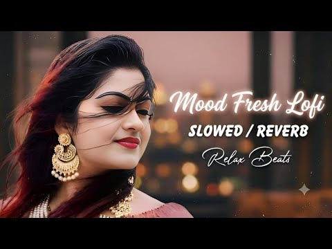
- 설명 앞부분: Welcome🤗 the world of soothing lofi music, where stress fades away, and peace takes over. This 2025 mind-relaxing lofi mix is perfect for: Deep Focus & Studying 📖 Relaxing & Meditation 🧘‍♂ Chilling After a Long Day 🌅 Peaceful Sleep & Stress Relief 😴 Let these calm beats and chill vibes take you on …
- 같은 채널 평소 대비 ×14,402.1 (채널 최근 롱폼 중앙값 334회) · 평소 영상: Heartbroken Lofi Songs 💔 ∣ Slowed + Reverb ∣ Late… (338회) / Heartbroken Lofi Songs 💔 ∣ Slowed + Reverb ∣ Late… (329회)
- 대본 없음 (설명) — 음성인식이 끝나면 도입부·흐름이 들어감
- 댓글 284/292: 좋은 점 — 영상 0 · 감사·응원 0 · 더 알고 싶은 것 0 · 아쉬운 점 — 영상 0 · 반박·불만 — 의견 다름 0 · 정치·사회 0 · 경험 공유 0 · 구독·다음 기대 0

### 150. Teri Meri Prem Kahani 💖 Slowed + Reverb ∣ Romantic Lofi Song ∣ Feel the Love 🎧

- https://www.youtube.com/watch?v=Njmb7oBzkpM · 🌙 MoonVerse  · 구독자 7,090 · 조회수 2,632,070 (×371.2, 하루 23,875.9) · 좋아요 19,212 (0.7%) · 6.3분 · 2026-07-06 · 주제 묶음 8. 로파이·시티팝·칠 · 형식 음악 (그 밖 모양 — 한 편짜리 BGM 등) · 폴더 `W_Njmb7oBzkpM` (웹 승인)
- 썸네일: 
- 설명 앞부분: 💕 Teri Meri Prem Kahani – Slowed + Reverb अगर आपको Romantic Slowed + Reverb गाने पसंद हैं, तो इस वीडियो को Like करें, Share करें और चैनल को Subscribe करें। 🎧 Use Headphones for the Best Experience. 🔔 Subscribe for more Slowed + Reverb, Lofi and Romantic songs.
- 대본 없음 (설명) — 음성인식이 끝나면 도입부·흐름이 들어감
- 댓글 755/768: 좋은 점 — 영상 0 · 감사·응원 0 · 더 알고 싶은 것 0 · 아쉬운 점 — 영상 0 · 반박·불만 — 의견 다름 0 · 정치·사회 0 · 경험 공유 0 · 구독·다음 기대 0

### 151. 𝐏𝐥𝐚𝐲𝐥𝐢𝐬𝐭 : 딱딱 나 틀딱 ∣ 보카로 근본 플리 1탄

- https://www.youtube.com/watch?v=W_G2W0nTGYY · 윤슬자 · 구독자 1,060 · 조회수 390,869 (×368.7, 하루 2,405.6) · 좋아요 9,829 (2.5%) · 245.8분 · 2026-05-14 · 주제 묶음 기타 · 형식 플레이리스트·모음 (여러 곡) · 폴더 `W_W_G2W0nTGYY` (웹 승인)
- 썸네일: 
- 챕터: 0:00 멜트 ∣ 하츠네 미쿠 ∣ ryo · 4:17 미쿠미쿠하게 해줄게♪ ∣ 하츠네 미쿠 ∣ ikamo · 5:56 루카루카★나이트피버 ∣ 메구리네 루카 ∣ samfree · 9:55 장난기 기능 ∣ 카사네 테토 ∣ 고지마지P · 14:04 해피 신디사이저 ∣ 메구리네 루카, GUMI ∣ Ea… · 17:54 이얼 팬클럽 ∣ 카가미네 린, GUMI ∣ 미키토P · 21:49 뇌장작렬걸 ∣ 하츠네 미쿠, GUMI ∣ 레루리리 · 24:59 뇌내혁명걸 ∣ 하츠네 미쿠 ∣ 마레츠 · 28:38 악의딸 ∣ 카가미네 린 ∣ mothy악의P · 33:15 악의하인 ∣ 카가미네 렌 (feat. 카가미네 린) … · 38:25 리그렛 메세지 ∣ 카가미네 린 ∣ mothy_악의P · 41:47 심해소녀 ∣ 하츠네 미쿠 ∣ 유우유P · 45:19 마음짓기 ∣ GUMI ∣ 쵸쵸P · 49:45 그것이 당신의 행복이라 할지라도 ∣ 메구리네 루카 ∣… · 54:11 벚꽃의 비 ∣ 하츠네 미쿠 ∣ halyosy · 59:02 진흙 속에 피다 ∣ 하츠네 미쿠 ∣ 하리P · 63:45 아야노의 행복이론 ∣ IA ∣ 진P · 69:18 누덕누덕 스타카토 ∣ 하츠네 미쿠 ∣ 토아 · 73:22 연애재판 ∣ 하츠네 미쿠 ∣ 40mP · 77:03 하로/하와유 ∣ 하츠네 미쿠 ∣ 나노우
- 설명 앞부분: 수익 창출 X
- 같은 채널 평소 대비 ×14.2 (채널 최근 롱폼 중앙값 27,506회) · 평소 영상: 𝐏𝐥𝐚𝐲𝐥𝐢𝐬𝐭 : 딱딱 나 응애틀딱 ∣ 보카로 근본 플리 3탄 (41,393회) / 𝐏𝐥𝐚𝐲𝐥𝐢𝐬𝐭 : 딱딱 나 최종틀딱 ∣ 보카로 근본 플리 4탄 (13,618회)
- 대본 없음 (설명) — 음성인식이 끝나면 도입부·흐름이 들어감
- 댓글 333/333: 좋은 점 — 영상 2 · 감사·응원 12 · 더 알고 싶은 것 1 · 아쉬운 점 — 영상 3 · 반박·불만 — 의견 다름 2 · 정치·사회 0 · 경험 공유 10 · 구독·다음 기대 2
  - 좋은 점 — 영상 👍1 “보컬로이드 입문자로서 도움이 되는군요 감사합니다!”
  - 좋은 점 — 영상 👍1 “진짜레전드플리네요모르는곡이거의없어요너무좋고그냥제발사랑해요3일만에2탄올린거진짜레전드갓구독햇어여제발더만들어쥬세요”
  - 감사·응원 👍40 “이게 근본이라는 것이다 근본이라고 올리는 영상들아... 이정도로 근본 영상은 정말 오랜만에 봅니다 감사합니다”
  - 감사·응원 👍5 “아 감사합니다 이 노래들 들었을 시대는 아닌데 보카로 곡 나오는 게 너무 많아서 따라가기 힘들엇음... 계속 들을게요 감사합니다ㅠㅜ”
  - 더 알고 싶은 것 👍2 “요즘 멀쩡한 이빨 틀니로 속이는 보카로 플리 많은데 진짜 잃어버린 틀니 드디어 찾았습니다 항상 행복하시고 여분 틀니도 제작 부탁드립니다..”
  - 아쉬운 점 — 영상 👍2 “일부러 화질 144p로 설정함”
  - 아쉬운 점 — 영상 👍1 “이거야 이거 이 파상풍 걸릴 거 같은 기계음이 좋다고”
  - 반박·불만 — 의견 다름 👍5 “아 감사합니다 이 노래들 들었을 시대는 아닌데 보카로 곡 나오는 게 너무 많아서 따라가기 힘들엇음... 계속 들을게요 감사합니다ㅠㅜ”
  - 반박·불만 — 의견 다름 👍1 “아닌데? 천성의약함 고스트룰은 최신곡인데? 내 기억이 그렇게 말하고 있는데?”
  - 경험 공유 👍155 “웃기지 마 나한텐 이게 최신곡이야 나는 여기서 더 업데이트 안 된다고 이런 명곡이 내 마음속에 살아 숨쉬는데 내가 늙은 거라고...? 이런 기깔난 라인업을 보고 눈물 흘리는 내가 틀딱인거라고? 세상이 날 상대로 트루먼 쇼를 찍는건 아닐까”
  - 경험 공유 👍14 “근본 보카플리라길래 들어가면 모르는 보카만 수두룩한데 여긴 내가 다 아는 곡들임….”
  - 구독·다음 기대 👍1 “육조 년과 하룻밤 이야기ㅋㅋㅋㅋㅋㅋㅋㅋㅋㅋㅋㅋㅋㅋㅋㅋㅋㅋㅋ 사랑해요 구독했어요”
  - 구독·다음 기대 👍1 “바로 구독했습니다”

### 152. katseye playlist✨💋

- https://www.youtube.com/watch?v=H40nuw4mebU · maiia · 구독자 23,200 · 조회수 8,535,456 (×367.9, 하루 157,185.1) · 좋아요 49,887 (0.6%) · 21.3분 · 2026-08-31 · 주제 묶음 기타 · 형식 플레이리스트·모음 (여러 곡) · 폴더 `W_H40nuw4mebU` (웹 승인)
- 썸네일: 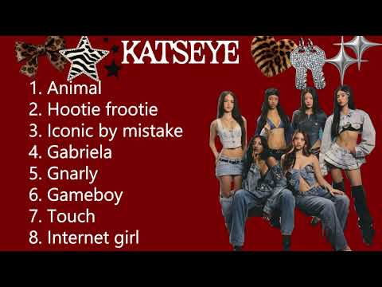
- 대본 없음 (없음) — 음성인식이 끝나면 도입부·흐름이 들어감
- 댓글 4,330/4,722: 좋은 점 — 영상 0 · 감사·응원 0 · 더 알고 싶은 것 0 · 아쉬운 점 — 영상 0 · 반박·불만 — 의견 다름 0 · 정치·사회 0 · 경험 공유 1 · 구독·다음 기대 0
  - 경험 공유 👍0 “본 포스팅은 제가 직접 제품을 사용해 볼 수 있었는데요 정말 많은”

### 153. 𝐏𝐥𝐚𝐲𝐥𝐢𝐬𝐭 (가사X) 후회 없는 미래를 위해 ✍️ 새벽공부 집중 로파이 BGM🎧 유리숲 플리 🌙

- https://www.youtube.com/watch?v=hZLVePYp9Z0 · Yurisoop · 구독자 1,290 · 조회수 469,599 (×364.0, 하루 6,258.9) · 좋아요 2,817 (0.6%) · 132분 · 2026-08-10 · 주제 묶음 8. 로파이·시티팝·칠 · 형식 플레이리스트·모음 (여러 곡) · 폴더 `W_hZLVePYp9Z0` (웹 승인)
- 썸네일: 
- 챕터: 0:00 Hearthside · 3:03 Vellichor · 6:05 Fireside · 9:06 Cashmere · 12:06 Mellowed · 15:06 Ethereal · 18:07 Fallow · 21:07 Lilted · 24:09 Gentled · 27:08 Vellum · 30:10 Noisette
- 설명 앞부분: 꿈을 향해 보내는 이 새벽이 언젠가 청춘에서 가장 빛나는 시간으로 남기를. 후회 없는 미래를 위해 오늘도 조용히 한 페이지를 채워가요. 🌙 ☁ Tracklist ☁ 🎧 Music & Sound Production by 유리숲 Yurisoop 🖼 Image source: Pinterest Image edited by 유리숲 Yurisoop 본 채널의 모든 영상, 음원 및 편집 디자인은 유리숲이 직접 기획하고 제작한 콘텐츠입니다. © Yurisoop. All rights reserved.
- 같은 채널 평소 대비 ×274.6 (채널 최근 롱폼 중앙값 1,710회) · 평소 영상: 𝐏𝐥𝐚𝐲𝐥𝐢𝐬𝐭 (가사X) 키캡 대신 이 플리 틀어,,🩵 수험생 멘탈 잡는 피아노 BGM… (1,744회) / 𝐏𝐥𝐚𝐲𝐥𝐢𝐬𝐭 (가사X) 못할 거 없지 🔥 합격 기원 초집중 로파이 🎧 유리숲 플리 🍃 (1,539회)
- 대본 없음 (설명) — 음성인식이 끝나면 도입부·흐름이 들어감
- 댓글 42/45: 좋은 점 — 영상 0 · 감사·응원 2 · 더 알고 싶은 것 0 · 아쉬운 점 — 영상 0 · 반박·불만 — 의견 다름 0 · 정치·사회 0 · 경험 공유 0 · 구독·다음 기대 0
  - 감사·응원 👍22 “이거 듣고 이 새벽에 다시 힘내요!”
  - 감사·응원 👍3 “새벽 공부. .음악 들으며.. 화이팅 해봅니다”

### 154. Samadhi in the Stone ∣ Shiva Meditation Music ∣ Himalayan Cave

- https://www.youtube.com/watch?v=yp10IdD2SxY · Divya vaani music · 구독자 217 · 조회수 78,461 (×361.6, 하루 4,179.8) · 좋아요 699 (0.9%) · 6.1분 · 2026-10-05 · 주제 묶음 1. 수면·명상·힐링 · 형식 음악 (그 밖 모양 — 한 편짜리 BGM 등) · 폴더 `W_yp10IdD2SxY` (웹 승인)
- 썸네일: 
- 설명 앞부분: Samadhi in the Stone 🕉 A deep and peaceful Shiva meditation journey inspired by an ancient Himalayan cave, where Shiva rests in profound samadhi. Surrounded by the stillness of the mountains, moonlit stone and the silence of the Himalayas, this music invites you into a quiet space of meditation, re…
- 같은 채널 평소 대비 ×167.7 (채널 최근 롱폼 중앙값 468회) · 평소 영상: GIRINĀDA ∣ Sacred Mountain Resonance ∣ Instrument… (468회) / Om Namah Shivaya ∣ Relax & Meditate ∣ 1 Hour Calm… (387회)
- 대본 없음 (설명) — 음성인식이 끝나면 도입부·흐름이 들어감
- 댓글 11/12: 좋은 점 — 영상 0 · 감사·응원 0 · 더 알고 싶은 것 0 · 아쉬운 점 — 영상 0 · 반박·불만 — 의견 다름 0 · 정치·사회 0 · 경험 공유 0 · 구독·다음 기대 0

### 155. Banjaara 🥀 Slowed + Reverb ∣ Best Hindi Lofi Song 🎧 ∣ Anime Edit 4K ∣ Relax & Chill

- https://www.youtube.com/watch?v=uxMeJy4JMS8 · Broken Sky01 · 구독자 6,750 · 조회수 2,436,242 (×360.9, 하루 27,629.8) · 좋아요 33,440 (1.4%) · 6.3분 · 2026-07-28 · 주제 묶음 8. 로파이·시티팝·칠 · 형식 음악 (그 밖 모양 — 한 편짜리 BGM 등) · 폴더 `W_uxMeJy4JMS8` (웹 승인)
- 썸네일: 
- 설명 앞부분: Banjaara 🥀 Slowed + Reverb ∣ Best Hindi Lofi Song 🎧 ∣ Anime Edit 4K ∣ Relax & Chill 🎧 Banjaara – Slowed + Reverb ∣ Lofi Version ∣ Relaxing Anime Vibes 🌙 अगर आपको शांत, सुकून भरा और दिल को छू लेने वाला Lofi Music पसंद है, तो यह Banjaara का Slowed + Reverb Version आपके लिए है। इस वीडियो में खूबसूरत A…
- 같은 채널 평소 대비 ×800.2 (채널 최근 롱폼 중앙값 3,044회) · 평소 영상: Jhol (Slowed + Reverb) 🖤 ∣ Naruto & Sakura Edit ∣… (3,087회) / 🎵 Viral Title💔 Midnight Ishq Vibes 🌧️ ∣ Hear Touc… (3,002회)
- 대본 없음 (설명) — 음성인식이 끝나면 도입부·흐름이 들어감
- 댓글 857/931: 좋은 점 — 영상 0 · 감사·응원 0 · 더 알고 싶은 것 0 · 아쉬운 점 — 영상 0 · 반박·불만 — 의견 다름 0 · 정치·사회 0 · 경험 공유 0 · 구독·다음 기대 0

### 156. • playlist 순애

- https://www.youtube.com/watch?v=Av29750WaJs · ros!e · 구독자 459 · 조회수 164,801 (×359.0, 하루 2,992.7) · 좋아요 2,659 (1.6%) · 18.4분 · 2026-08-30 · 주제 묶음 기타 · 형식 플레이리스트·모음 (여러 곡) · 폴더 `W_Av29750WaJs` (웹 승인)
- 썸네일: 
- 챕터: 0:00 기석 - 리시안셔스 · 3:33 아이유 - 밤편지 · 7:42 태연 - 그대라는 시 · 11:08 문문 - 결혼 · 14:27 이하이 - ONLY
- 같은 채널 평소 대비 ×13.0 (채널 최근 롱폼 중앙값 12,641회) · 평소 영상: • playlist 결혼식 (12,641회) / • playlist 사랑은 뜨거운 여름날의 환각 (12,775회)
- 대본 없음 (없음) — 음성인식이 끝나면 도입부·흐름이 들어감
- 댓글 56/57: 좋은 점 — 영상 1 · 감사·응원 5 · 더 알고 싶은 것 2 · 아쉬운 점 — 영상 0 · 반박·불만 — 의견 다름 1 · 정치·사회 0 · 경험 공유 12 · 구독·다음 기대 0
  - 좋은 점 — 영상 👍0 “이렇게 좋은 영상 만들어 주셔서 정말 감사합니다!! 공부할 때마다 이 노래 듣고 힘을 얻어요!! 그래서 요즘 이 노래 듣는 게 저의 힐링이에요.!지치고 힘들 때마다 이 노래 들으면 힘이 나더라구요!!앞으로도 이렇게 좋은 영상 많이 올려 주세요.❤”
  - 감사·응원 👍98 “첫사랑이랑 헤어진 이유가 걔 진로가 연예계여서 어쩔수 없이 헤어졌는데 헤어져야 하는걸 알고난 뒤에 너무 우울해서 학교에서도 계속 엎드려 있었음 근데 걔가 나 웃게 하려고 애들이 쳐다보고 있는데도 일부러 이상한 행동하고 내 볼 잡으면서 "난 너가 행복했으면 좋겠어"라고…”
  - 감사·응원 👍7 “언제부터 좋아졌는지 모르겠어. 그냥 온종일 보고 싶고 너가 웃으면 기뻐. 나만 널 그리워하는 걸까 라는 의구심이 들기도 해. 너도 한번쯤은 날 그리워 해줬으면, 내 생각을 한 번만 해주면 소원이 없겠어. 난 겁쟁이라 너한테 연락같은걸 먼저 하지 못해. 그런데 만약 네…”
  - 더 알고 싶은 것 👍0 “이플리너무조아요 친구한테도 공유햇어요ㅠ.ㅠ 계속 좋은 플리 만들어주세요♥♥”
  - 더 알고 싶은 것 👍0 “이렇게 좋은 영상 만들어 주셔서 정말 감사합니다!! 공부할 때마다 이 노래 듣고 힘을 얻어요!! 그래서 요즘 이 노래 듣는 게 저의 힐링이에요.!지치고 힘들 때마다 이 노래 들으면 힘이 나더라구요!!앞으로도 이렇게 좋은 영상 많이 올려 주세요.❤”
  - 반박·불만 — 의견 다름 👍4 “너 첫눈에 보고 반햇어.ㅋㅋㅋ넌 너가 먼저 나 좋아한줄 알지? 아냐 오죽하면 애들한테 너 보러가지 말라고 햇어 너 닳을까봐. 그 뒤로 2년이 다 되어가는데 너만 사랑한다 난 스쳐지나가는 사람이엇겟지만 그 뒤로 딴 사람도 좋아하려 해봣는데 안되더라 너랑 닮으면 뭐해 너…”
  - 경험 공유 👍160 “1년5개월전에 첫사랑이랑 헤어졌는데 아직도 못잊고있어요 친구들이 저보고 순애녀라고 하더라고요 친구들이 인정하고 잘생겼다고 소문난애가 절 좋아해도 저는 여전히 그애더라고요 그친구는 절 안좋아해서 제가 다가가는걸 불편해하는거같아서 조용히 좋아하고있어요 축구하는거 보러가고…”
  - 경험 공유 👍107 “네가 나아가는 미래에 내가 잠시라도 떠올랐으면”

### 157. Desi baddie playlist 💅💌 @desi_diva12 #playlist #baddie #desi #music #aestheic #song #edits

- https://www.youtube.com/watch?v=Y3q1y6M79EU · Desi_.Diva12 · 구독자 6,330 · 조회수 2,255,373 (×356.3, 하루 19,166.7) · 좋아요 16,101 (0.7%) · 7.3분 · 2026-06-28 · 주제 묶음 기타 · 형식 플레이리스트·모음 (여러 곡) · 폴더 `W_Y3q1y6M79EU` (웹 승인)
- 썸네일: 
- 설명 앞부분: Copyright Disclaimer: This video is made for entertainment purposes only. I do not own the music or images used in this video. All rights belong to their respective owners. No copyright infringement is intended. This playlist gives you 100 per cent desi baddie Vibes 👀💅🌼
- 같은 채널 평소 대비 ×38.8 (채널 최근 롱폼 중앙값 58,181회) · 평소 영상: When MAIN CHARACTERS fall in love 💌✨ @desi_diva12… (58,181회) / BHOJPURI Bangers 🔥🌼 +{Timestamp} @desi_diva12 #mu… (30,933회)
- 대본 없음 (설명) — 음성인식이 끝나면 도입부·흐름이 들어감
- 댓글 207/209: 좋은 점 — 영상 0 · 감사·응원 0 · 더 알고 싶은 것 0 · 아쉬운 점 — 영상 0 · 반박·불만 — 의견 다름 0 · 정치·사회 0 · 경험 공유 0 · 구독·다음 기대 0

### 158. Rabba Tu Na Naraz Hovi ❤️ ∣ Soulful Heart Touching Punjabi Qawwali 2026 ∣ Sufi Usman

- https://www.youtube.com/watch?v=Zh-3CGV7BwQ · Sufi Usman · 구독자 4,740 · 조회수 1,679,853 (×354.4, 하루 19,750.0) · 좋아요 7,360 (0.4%) · 5.9분 · 2026-07-31 · 주제 묶음 기타 · 형식 음악 (그 밖 모양 — 한 편짜리 BGM 등) · 폴더 `W_Zh-3CGV7BwQ` (웹 승인)
- 썸네일: 
- 설명 앞부분: Welcome to Sufi Usman 🤍 Sufi Usman is a space for soulful Sufi music, spiritual poetry, and heartfelt expressions of Ishq-e-Haqiqi (divine love). This channel is dedicated to peace, love, and the inner journey of the soul through music and words. ✨ All kalam and songs on this channel are original c…
- 같은 채널 평소 대비 ×1,039.5 (채널 최근 롱폼 중앙값 1,616회) · 평소 영상: Fanaa (فنا) ∣ Heart - Touching Deep Sufi Meditati… (1,616회) / MITTI MERI ZAAT (مِٹی میری ذات) ∣ A Soulful Heart… (1,636회)
- 대본 없음 (설명) — 음성인식이 끝나면 도입부·흐름이 들어감
- 댓글 214/220: 좋은 점 — 영상 0 · 감사·응원 0 · 더 알고 싶은 것 0 · 아쉬운 점 — 영상 0 · 반박·불만 — 의견 다름 0 · 정치·사회 0 · 경험 공유 0 · 구독·다음 기대 0

### 159. Heartbroken Lofi Songs 💔 ∣ Slowed + Reverb ∣ Study / Focus / Night Mood 🎧

- https://www.youtube.com/watch?v=KU7PfC9i9cE · Focus Music 2050 · 구독자 4,270 · 조회수 1,506,191 (×352.7, 하루 60,514.8) · 좋아요 3,447 (0.2%) · 13.8분 · 2026-09-29 · 주제 묶음 3. 공부·집중·작업 · 형식 음악 (그 밖 모양 — 한 편짜리 BGM 등) · 폴더 `W_KU7PfC9i9cE` (웹 승인)
- 썸네일: 
- 설명 앞부분: Welcome the world of soothing💔💔 lofi music, where stress fades away, and peace takes over. This 2025 mind-relaxing lofi mix is perfect for: Deep Focus & Studying 📖 Relaxing & Meditation 🧘‍♂ Chilling After a Long Day 🌅 Peaceful Sleep & Stress Relief 😴 Let these calm beats and chill vibes take you on…
- 같은 채널 평소 대비 ×3,607.6 (채널 최근 롱폼 중앙값 418회) · 평소 영상: Heartbroken Lofi Songs 💔 ∣ Slowed + Reverb ∣ Stud… (418회) / Heartbroken Lofi Songs 💔 ∣ Slowed + Reverb ∣ Stud… (417회)
- 대본 없음 (설명) — 음성인식이 끝나면 도입부·흐름이 들어감
- 댓글 92/92: 좋은 점 — 영상 0 · 감사·응원 0 · 더 알고 싶은 것 0 · 아쉬운 점 — 영상 0 · 반박·불만 — 의견 다름 0 · 정치·사회 0 · 경험 공유 0 · 구독·다음 기대 0

### 160. Ama hem hem

- https://www.youtube.com/watch?v=rPmZucO77sg · Thatohatsi - Topic · 구독자 36,400 · 조회수 12,824,484 (×352.3, 하루 119,965.5) · 좋아요 164,354 (1.3%) · 7.5분 · 2026-07-09 · 주제 묶음 기타 · 형식 정보·해설 (그 밖) · 폴더 `W_rPmZucO77sg` (웹 승인)
- 썸네일: 
- 설명 앞부분: Provided to YouTube by The Orchard Enterprises Ama hem hem · Thatohatsi · Sjava · ShaunMusiq Ama hem hem ℗ 2026 Kgaday Pty Ltd Released on: 2026-07-10 Producer: Shaunmusiq Author: Thatohatsi Author: Sjava Non Lyric Author: ShaunMusiq Music Publisher: SONY MUSIC Publishing Auto-generated by YouTube.
- 같은 채널 평소 대비 ×71.1 (채널 최근 롱폼 중앙값 180,490회) · 평소 영상: Zulu lami (190,128회) / iHero (170,852회)
- 대본 없음 (설명) — 음성인식이 끝나면 도입부·흐름이 들어감
- 댓글 0/2,609: 좋은 점 — 영상 0 · 감사·응원 0 · 더 알고 싶은 것 0 · 아쉬운 점 — 영상 0 · 반박·불만 — 의견 다름 0 · 정치·사회 0 · 경험 공유 0 · 구독·다음 기대 0

