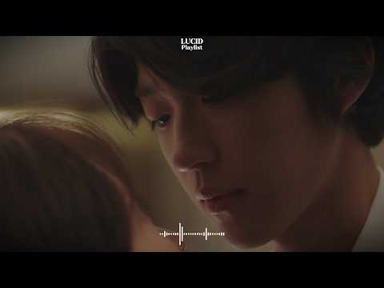

# 음악 — 성공 사례 분석: 사례별 자세히 #161–#200

`analysis.md` 의 9번 (같은 # 번호). 자동 생성 — `tools/success_analysis.py` v1.4.1 (2026-10-16 13:16 UTC). ※ 연구·교육용 — 투자 권유가 아님.

### 161. 첫 곡부터 너무 좋다 🍂 하루종일 듣게 되는 가을 올드팝 ∣ Vol.228 ∣ 7080 추억의 팝송 ∣ Autumn Oldies ∣ Coffee · Study …

- https://www.youtube.com/watch?v=naLL7CGOC-8 · moka melody · 구독자 14,600 · 조회수 804,147 (×55.1, 하루 13,958.9) · 좋아요 3,982 (0.5%) · 367.3분 · 2026-08-19 · 주제 묶음 4. 카페·매장·라운지 · 형식 음악 (그 밖 모양 — 한 편짜리 BGM 등) · 폴더 `W_naLL7CGOC-8` (웹 승인)
- 썸네일: 
- 챕터: 0:00 Where the Blue Sea Remembers … · 4:52 The Best Part of My Day 하루 중 … · 8:44 All the Years With You 너와 함께 … · 13:07 Under the Golden Tree 황금빛 나무 … · 17:15 Somewhere Past the City Light… · 21:53 Walking Home With You 너와 함께 걷… · 25:11 Blue Sky Kind of Day 파란 하늘이 아… · 29:38 Somewhere Along the Years 지나온… · 33:23 You Became My Day 어느새 나의 하루가 … · 37:56 Worth Every Mile 함께한 모든 길이 좋았… · 42:04 At the End of the Day 하루가 저물어… · 46:17 Nothing Special Today 오늘도 평범해… · 51:10 Warm Yesterday 따뜻했던 지난날 · 54:53 Repeat
- 설명 앞부분: 🎧 Old pop music for reading, studying, working, and deep focus This vintage old pop playlist is perfect as background music for coffee time, book reading, writing, study sessions, and work-from-home hours. Many listeners play this music while working quietly, studying for long hours, relaxing in th…
- 대본 없음 (설명) — 음성인식이 끝나면 도입부·흐름이 들어감
- 댓글 301/301: 좋은 점 — 영상 5 · 감사·응원 57 · 더 알고 싶은 것 5 · 아쉬운 점 — 영상 2 · 반박·불만 — 의견 다름 0 · 정치·사회 0 · 경험 공유 9 · 구독·다음 기대 4
  - 좋은 점 — 영상 👍6 “안녕하세요. 아름다운 가을 풍경과 함께 잠시 머물러 봅니다. 🍂 오늘처럼 하늘이 흐리고 다소 어두운 날씨에는, 따뜻한 커피 한 잔과 이런 음악이 더욱 마음에 와닿는 것 같습니다. 감미롭고 부드러운 남성 보컬의 아름다운 선율이 잔잔히 흐르며, 복잡했던 마음까지 편안하게…”
  - 좋은 점 — 영상 👍6 “모카멜로디님 좋은아침입니다~🙂 은행 나무길을 보고 있자니 제몸이 빨려들어가 저 길을 걷고 있네요.제 마음이 그래서일까요 오늘은 저길이 쓸쓸해 보입니다. 생각이 많은 오늘입니다. 정리가 잘되면 좋겠어요. 오늘도 화이팅입니다~☕️❤”
  - 감사·응원 👍21 “아~~가을입니다 멋집니다 고맙습니다~”
  - 감사·응원 👍15 “이런 좋은 노래는 70세의 사람을 20대의 나이로 시공간을 옮겨서 그 시절의 추억 속으로 잠기게하는 능력이 있는가 봐요. 감사합니다”
  - 더 알고 싶은 것 👍2 “아티스 이름을 알고 싶은데요 너무듣기 좋아요”
  - 더 알고 싶은 것 👍1 “어제 알고리즘 떠서 우연히 듣게 됬네요 오늘도 일어나자마자 듣고있네요 음악이 감미롭네요 구독 합니다 첫번째곡 두번째곡 가수와 노래제목 부탁드립니다”
  - 아쉬운 점 — 영상 👍3 “지금 병원...지루한 항암시간 너무나 좋은 곡들이 많은 위로가 됩니다 선곡 너무 좋으네요”
  - 아쉬운 점 — 영상 👍1 “가사가 안 나와 아쉽네요~~^^”
  - 경험 공유 👍11 “오늘 우리 사랑하는 손자 돌입니다. 우리 집에서 손님들 초대해서 돌잔차를 하려고 준비중이예요. 이제 거의 준비를 마치고 손자에개 편지를 쓰는데 이 음악이 마음을 차분하게 하면서 딸을 키우던 지난날들이 떠오르네요.. 그 딸이 벌써 커서 아이를 낳았으니 기쁘고 감동스럽네…”
  - 경험 공유 👍5 “오래된 팝송을 듣다 보면 악기 몇 개만으로도 마음을 움직이는 곡들이 참 많다는 생각이 듭니다. 저도 그런 담백한 분위기를 살려 음악을 만들어 보니 옛 음악의 매력을 새삼 알게 되네요.”
  - 구독·다음 기대 👍1 “첫소절 듣고 구독합니다 감사합니다~~”
  - 구독·다음 기대 👍1 “잘듣고 가요, 따뜻하고 평온한 가을 보내시길 바랍니다! 구독합니다”

### 162. 𝐏𝐥𝐚𝐲𝐥𝐢𝐬𝐭 ∣ 교토의 작은 카페, 말차향 재즈 🍵🎧 抹茶オーツラテ

- https://www.youtube.com/watch?v=vLX3-MrBXFk · 아오링고 잡화점 AORINGGO · 구독자 10,500 · 조회수 574,452 (×54.7, 하루 9,799.9) · 좋아요 4,118 (0.7%) · 292.4분 · 2026-08-18 · 주제 묶음 4. 카페·매장·라운지 · 형식 플레이리스트·모음 (여러 곡) · 폴더 `W_vLX3-MrBXFk` (웹 승인)
- 썸네일: 
- 챕터: 0:00 Matcha Oat Latte Afternoon · 2:44 A Small Café · 5:47 Soft Green Latte · 8:24 Matcha Oat & Slow Jazz · 11:02 Oat Milk in the Afternoon · 13:36 Matcha Oat by the Window · 16:00 Velvet Green Latte · 18:40 A Quiet Oat Latte · 21:04 Sweet & Bitter Green · 23:29 Late Summer Oat Latte · 26:08 A Quiet Corner · 28:48 The Green Latte Hour · 31:12 Soft Light & Oat Milk · 33:34 Little Café Jazz · 35:59 After the Last Sip · 38:35 Green Lights at Dusk · 41:41 repeat 🔁
- 설명 앞부분: 📓 8월 말. 오후의 작은 카페. 여행을 하다 보면 계획에 없던 곳에서 오래 머물게 되는 순간이 있다. 그날도 특별히 정해둔 목적지는 없었다. 아침부터 이곳저곳을 돌아다니다가, 점심을 먹고 다시 골목을 걷고 있었다. 8월 말의 햇살은 여전히 뜨거웠다. 바람은 조금 선선해졌지만, 한낮의 더위는 쉽게 가시지 않았다. 골목 모퉁이에서 작은 카페 하나를 발견했다. 크지 않은 유리창 너머로 나무 테이블 몇 개가 보였고, 문 옆에는 초록색 메뉴판이 조용히 놓여 있었다. 잠시 쉬어갈까. 별다른 이유 없이 문을 열고 들어갔다. 카페 안은 바깥보…
- 대본 없음 (설명) — 음성인식이 끝나면 도입부·흐름이 들어감
- 댓글 114/114: 좋은 점 — 영상 2 · 감사·응원 7 · 더 알고 싶은 것 1 · 아쉬운 점 — 영상 0 · 반박·불만 — 의견 다름 0 · 정치·사회 0 · 경험 공유 5 · 구독·다음 기대 2
  - 좋은 점 — 영상 👍0 “안녕하세요. 선생님이 만드시는 음악을 정말 좋아하고 존경합니다. 음악이 정말 너무 좋습니다. 저도 선생님처럼 좋은 음악을 만들어보고 싶어서 한 달 넘게 고민하고 여러 가지 방법으로 만들어봤지만, 아직 마음에 드는 결과를 얻지 못하고 있습니다. 그리고 예전에 선생님 채…”
  - 감사·응원 👍4 “현재 취업준비하면서 이력서 쓸 때마다 항상 카페에서 아오링고 잡화점 노래 틀어놓고 해요! 마음이 너무 편안해지고 저만의 공간에 있는 느낌이라 집중이 잘됩니다 ㅠㅠ 썸네일 그림 볼때마다 마음이 몽글해지구용 항상 감사합니다~~~”
  - 감사·응원 👍1 “그림과 글과 음악이 잘 어울리는 편안한 느낌이 정말 좋네요^0^ 감사합니다!”
  - 더 알고 싶은 것 👍0 “안녕하세요. 선생님이 만드시는 음악을 정말 좋아하고 존경합니다. 음악이 정말 너무 좋습니다. 저도 선생님처럼 좋은 음악을 만들어보고 싶어서 한 달 넘게 고민하고 여러 가지 방법으로 만들어봤지만, 아직 마음에 드는 결과를 얻지 못하고 있습니다. 그리고 예전에 선생님 채…”
  - 경험 공유 👍4 “너무 이뻐요!감삼다! 그림 조금씩 움직이는 것도 짱 귀엽고 음악도 좋고 사랑해요💞💞💞 다음에는 레밍턴 케이크를 해주실 수 있나요?? 아실지 모르지만 제가 유일하게 좋아하는 케이크에요!🤎🤎 안해주셔도 돼요! 이미 너무 좋아여 지금 지상낙원이란 말이 딱 들어맞는 순간? …”
  - 경험 공유 👍0 “나도 그림 그려서 이렇게 많은 사람들이랑 나누고 싶네요. 사진과 다른 인간미 넘치는 손맛이 음악까지 느긋하게 만드는데요.”
  - 구독·다음 기대 👍3 “그림도 아기자기하고 음악도 너무 좋아용^^ 좋아요 구독하고 자주 놀러 올게용*^^*”

### 163. 너를 놓지 않을 이유가 생겼어｜[Playlist] 끝내 끊어내지 못한 두 사람의 이야기｜감성 발라드 플레이리스트🎧

- https://www.youtube.com/watch?v=dQUrclzxhX4 · Chita · 구독자 2,980 · 조회수 161,242 (×54.1, 하루 899.9) · 좋아요 2,512 (1.6%) · 126.2분 · 2026-04-20 · 주제 묶음 9. 가요·발라드·트로트 · 형식 플레이리스트·모음 (여러 곡) · 폴더 `W_dQUrclzxhX4` (웹 승인)
- 썸네일: 
- 챕터: 0:00 밤의 공기 (Night Air) · 4:24 흉터 위에 핀 꽃 (Bloom on Scars) · 8:42 너의 뒷모습 (Your Back) · 12:57 내 세상은 온통 너라서 (All My World Is… · 17:09 닿을 수 없는 (Out of Reach) · 20:32 창가에 머무는 시선 (By the Window) · 24:51 조금은 느린 고백 (A Quiet Confession) · 28:56 오래된 커튼을 걷고 (Pulling Back the … · 33:16 나의 꿈속엔 네가 살아 (You in My Dream… · 37:40 밤의 끝에서 (End of the Night)
- 설명 앞부분: 지는 아픔 따윈 몰라도 좋을텐데. 네가 한 계절 동안 피어있는 꽃이라면 세상이 영원히 여름이었으면 해. 『밤의 베란다』 💿 Chapters (10곡) 📝 가사는 고정 댓글의 답글에 남겨두었습니다. 편하게 감상해주세요🎧
- 대본 없음 (설명) — 음성인식이 끝나면 도입부·흐름이 들어감
- 댓글 76/76: 좋은 점 — 영상 0 · 감사·응원 2 · 더 알고 싶은 것 2 · 아쉬운 점 — 영상 0 · 반박·불만 — 의견 다름 0 · 정치·사회 0 · 경험 공유 1 · 구독·다음 기대 0
  - 감사·응원 👍4 “만나서서로에가장합당한방법을찿자.서로힘들게하지말고.나를생각해주는깊은마음고맙게생각해.하지만이러식은아닌것같애.난마음을열어놓고애기들어줄게.날지킬필요없어.난나쁜인간들로인해마지막까지와서.죽음도두렵지않아.이더러운세상에더살고싶지않아.그러니날신경안쓰도돼.”
  - 더 알고 싶은 것 👍10 “밤의 공기만 따로 올려주세요 ㅠ 가사도 멜로디도 너무 슬프도록 아름답네요^^ 밤의공기 너무 좋아요 ㅠ”
  - 경험 공유 👍4 “이세상에이런세사미잇는줄정말몰라서.난지금까지밝은세상만보고살아서.이런슬픔이잇는세상이잇는지.상상도못해서.나도너꿈꿔서.너가공줌전화잡고눈물을한없이흘리는거.또.한번만안아달라고내품에안기는것.”

### 164. 7080 추억의 노래 광고없음🎶 7080노래모음 주옥같은노래 ✨7080 추억의 노래 한국인이 가장 좋아하는 💘50대 이상이 사랑한 7080 추억의 팝송

- https://www.youtube.com/watch?v=3tshpfOljYs · 7080 감성 선율 · 구독자 7,460 · 조회수 402,352 (×53.9, 하루 11,277.4) · 좋아요 1,093 (0.3%) · 118.6분 · 2026-09-10 · 주제 묶음 9. 가요·발라드·트로트 · 형식 플레이리스트·모음 (여러 곡) · 폴더 `W_3tshpfOljYs` (웹 승인)
- 썸네일: 
- 설명 앞부분: 이 영상은 1970–80년대 감성을 담은 명곡들을 모아 따뜻한 멜로디와 함께 추억을 되살리는 플레이리스트입니다. 🎧 7080 한국 발라드 모음 🌙 감성 · 추억 · 힐링 📀 제작 도구 Adobe CC 📢 안내 모든 음악은 정식 라이센스를 통해 사용되며, 편안한 시간 보내시길 바랍니다. 시청해주셔서 진심으로 감사합니다. 음악이 마음에 드셨다면 여러분의 작은 응원이 큰 힘이 됩니다.
- 대본 없음 (설명) — 음성인식이 끝나면 도입부·흐름이 들어감
- 댓글 63/63: 좋은 점 — 영상 1 · 감사·응원 3 · 더 알고 싶은 것 5 · 아쉬운 점 — 영상 1 · 반박·불만 — 의견 다름 0 · 정치·사회 0 · 경험 공유 2 · 구독·다음 기대 0
  - 좋은 점 — 영상 👍1 “특별한 날에 듣기 좋은 곡들이에요. 추천합니다!”
  - 감사·응원 👍1 “노래부른 가수님들 누구셔요 ? 너무 정성것 부르시네요ᆢ 잘 듣고 갑니다ᆢ고맙습니다ᆢ~~”
  - 감사·응원 👍0 “이런 노래들 듣는 게 진짜 힐링이에요. 감사합니다!”
  - 더 알고 싶은 것 👍6 “옛날 친구들과 모닥불옆에서 기타치며 노래하던 추억이 새록새록 살아나네요ㆍ그친구들 내여친은 어디서 무엇하는지 궁금하네요ㆍ캐나다 이민가고 연락이 ~뚝~~ㅠㅠ”
  - 더 알고 싶은 것 👍1 “아련한 추억, 음악다방, 지직거리는 LP판을 통해 듣던 그노래, 그시절이 그립습니다 좋은음악 많이 만들어주세요❤❤”
  - 아쉬운 점 — 영상 👍15 “희나리 부르시는분이 누구인가요? 목소리가 너무 예뻐서요”
  - 경험 공유 👍4 “이 음악들 듣고 있으면 저도 50대가 된 기분이에요! 😂”
  - 경험 공유 👍1 “50대 이상이 사랑한 노래라니, 저도 그 시기에 자라서 더욱 공감 가네요. 💘”

### 165. 50대이상이 들으면 정말 좋아할 노래 추천곡✨중년들이 사랑하는 겨울 노래 모음💕박인희/배따라기/여진/휘버스/정태춘/유익종/양하영/김현식/이은하/우순실 /이진관/…

- https://www.youtube.com/watch?v=TTkoF883bC8 · KTrot Melody · 구독자 10,100 · 조회수 540,043 (×53.5, 하루 6,952.3) · 좋아요 1,816 (0.3%) · 126분 · 2026-07-30 · 주제 묶음 9. 가요·발라드·트로트 · 형식 플레이리스트·모음 (여러 곡) · 폴더 `W_TTkoF883bC8` (웹 승인)
- 썸네일: 
- 설명 앞부분: 50대이상이 들으면 정말 좋아할 노래 추천곡✨중년들이 사랑하는 겨울 노래 모음💕박인희/배따라기/여진/휘버스/정태춘/유익종/양하영/김현식/이은하/우순실 /이진관/이장희/임수정 🎶 7080 발라드 명곡 모음 ∣ 추억을 부르는 감성 음악 🎶 7080 시대의 감성을 그대로 담은 발라드 명곡들을 한자리에서 만나보세요. 따뜻한 멜로디와 깊은 가사가 어우러진 이 음악들은 세대를 초월해 지금까지도 많은 사랑을 받고 있습니다. 이 플레이리스트는 1970~80년대의 대표적인 발라드 음악을 중심으로 구성되어 있으며, 조용한 밤이나 감성적인 순간에 듣…
- 대본 없음 (설명) — 음성인식이 끝나면 도입부·흐름이 들어감
- 댓글 103/103: 좋은 점 — 영상 3 · 감사·응원 4 · 더 알고 싶은 것 1 · 아쉬운 점 — 영상 2 · 반박·불만 — 의견 다름 0 · 정치·사회 0 · 경험 공유 4 · 구독·다음 기대 0
  - 좋은 점 — 영상 👍8 “이 노래들을 듣고 있으면 젊었던 그 시절의 겨울이 생각납니다. ❄ 김현식, 유익종, 박인희… 이름만 들어도 그때의 추억이 하나둘 떠오르네요. 세월이 흘러도 좋은 노래는 마음속에서 늙지 않는 것 같습니다. 오늘도 좋은 음악 들으며 잠시 추억에 젖어봅니다. 🎶☕”
  - 좋은 점 — 영상 👍5 “60대 이상 어르신분들이 듣기 좋은 노래네요..지나가다 잠시 들러보아여”
  - 감사·응원 👍2 “오늘 이 음악을 들으면서 오래전 사랑했던 사람이 생각났습니다. 그 시절에는 서로의 손을 잡고 걷는 것만으로도 세상을 다 가진 것처럼 행복했는데, 시간이 흐르면서 우리는 서로 다른 길을 걷게 되었습니다. 이제는 연락조차 닿지 않는 사람이지만, 가끔 이렇게 익숙한 멜로디…”
  - 더 알고 싶은 것 👍2 “요즘 처음 듣는 노래와 예전에 수없이 들었던 노래 중 어떤 음악이 더 오래 마음에 남는다고 생각하시나요?”
  - 아쉬운 점 — 영상 👍5 “ai목소리와 ai작곡인거 같네”
  - 아쉬운 점 — 영상 👍4 “AI같은데”
  - 경험 공유 👍22 “내가 벌써 중년이라니~~맘은 청년인데!!!”
  - 경험 공유 👍2 “멜로디와 가사가 매칭이 제대로 안된 노래가 종종 있네요 1시간 정도 즈음에 나온 김연숙의 그날은 제가 알던 노래가 아니네요 듣기가 좀 그랬어요 제기억에는 "언덕위에 손잡고 거닐던 기억도 아스라히~ 이렇게 시작했던거 같은데 다른노래인가 순간 착각했음 그다음곡 바다의 연…”

### 166. 비와 당신 (라디오스타 OST) - 가연이와 함께 듣는 비 오는 감성

- https://www.youtube.com/watch?v=WmHI_XkpO2E · GAYEON YOON · 구독자 28,600 · 조회수 1,528,538 (×53.5, 하루 14,804.1) · 좋아요 2,470 (0.2%) · 4.3분 · 2026-07-05 · 주제 묶음 12. 커버·노래 부르기 · 형식 커버·직접 부른 노래 · 폴더 `W_WmHI_XkpO2E` (웹 승인)
- 썸네일: 
- 설명 앞부분: 박중훈의 〈비와 당신〉을 윤가연의 목소리로 다시 불러보았습니다. 영화 〈라디오 스타〉 OST로 많은 사람들에게 익숙한 이 곡은 비 오는 날 문득 떠오르는 추억과, 지나간 사람에 대한 그리움을 담고 있는 감성적인 명곡입니다. 담담하게 시작되지만 마음속 깊은 곳을 천천히 적시는 멜로디, 그리고 시간이 지나도 쉽게 잊히지 않는 아련한 분위기가 오래 남는 노래입니다. 이번 윤가연 COVER에서는 원곡이 가진 쓸쓸하고 따뜻한 감성을 살리면서도, 비 내리는 날 조용히 혼자 듣고 싶은 느낌으로 차분하게 표현해보았습니다. 오늘처럼 마음이 조금 …
- 대본 없음 (설명) — 음성인식이 끝나면 도입부·흐름이 들어감
- 댓글 237/237: 좋은 점 — 영상 1 · 감사·응원 19 · 더 알고 싶은 것 2 · 아쉬운 점 — 영상 4 · 반박·불만 — 의견 다름 1 · 정치·사회 0 · 경험 공유 7 · 구독·다음 기대 3
  - 좋은 점 — 영상 👍3 “듣기좋은목소리 잘듣고있습니다”
  - 감사·응원 👍9 “와~요청했는데 이렇게 올려주시다니!! 고맙습니다~^^”
  - 감사·응원 👍8 “요즘 유튜브에 커버곡이 많이 올라오는데 어쨌든 저에게는 원탑입니다. 정말 감사합니다.”
  - 더 알고 싶은 것 👍2 “해후가 빠진거 같아요 나훈아 노래도 1곡밖에 없는데 좀 더 올려주시면 감사하겠습니다”
  - 더 알고 싶은 것 👍1 “'수노'에서 이제 기존 곡 커버가 안되던데 어찌 하셨는지? 대단 ㅋㅋ 비법 좀 부탁드립니다^^”
  - 아쉬운 점 — 영상 👍8 “AI 목소리가 이가을 만천하에 감동을 선사합니다.”
  - 아쉬운 점 — 영상 👍3 “무한반복으로 듣고 있는중..커버곡중 단연 압도적으로 최고입니다(이곡은 소향이나 소화할까 아무나 못 부를듯)”
  - 반박·불만 — 의견 다름 👍1 “윤가연님! 가사를 틀렸어요! '사무치던지' 아니고 '사무친 건지' 입니다.”
  - 경험 공유 👍3 “제가 좋아하는 노래인데, 이제까지 들어본 것중 제일 잘 부르시네요. 목소리도 너무 좋고 노래를 너무 잘 하시네요. 앞으로 아주 자주 들을 것 같아요. 꼭 대성하세요.”
  - 구독·다음 기대 👍4 “가연님 정말 멋져요. 비와 당신 너무 좋아요. 마음의 감동이 깊게 남습니다. 가연님~ 사랑합니다. 적극적으로 구독합니다.”
  - 구독·다음 기대 👍3 “목소리 걷멋이들어가면 듣기거북합니다 원곡 있는그대로불러주세요 가연님부른 전곡은아니여도 거의좋아요 누르고 매일듣고있어요 몆몆곡은 좀그러네요 이곡도 넘잘부르셧습니다”

### 167. The Little Forest Concert Vol.2 ∣ Cozy String Quartet for Reading & Relaxing ∣ No Mid-Rol…

- https://www.youtube.com/watch?v=0DvSj6DAKDM · 그루잠 Gurujam · 구독자 27,400 · 조회수 1,453,914 (×53.1, 하루 11,313.5) · 좋아요 34,658 (2.4%) · 45.1분 · 2026-06-10 · 주제 묶음 3. 공부·집중·작업 · 형식 음악 (그 밖 모양 — 한 편짜리 BGM 등) · 폴더 `W_0DvSj6DAKDM` (웹 승인)
- 썸네일: 
- 챕터: 0:00 A Tiny Concert Begins · 1:28 Morning Seats in the Forest · 3:31 A Waltz for Woodland Friends · 5:24 The Squirrel’s Quiet Applause · 6:54 Sunlight on the String Quartet · 8:08 Cello by the Mossy Path · 10:02 Waltzing Through Green Shadows · 11:36 The Little Meadow Ensemble · 13:48 Quiet Pizzicato Footsteps · 15:23 Afternoon Strings in the Woods · 17:13 Golden Light Between Trees · 19:21 A Calm Bowing Circle · 20:58 Goodbye from the Forest Stage · 22:32 Replay
- 설명 앞부분: A cozy string quartet playlist inspired by a small concert in the forest. Gentle classical background music for reading, studying, relaxing, and quiet mornings. 작은 숲속 연주회를 떠올리며 만든 따뜻한 현악 4중주 BGM입니다. 독서, 공부, 아침 작업, 카페 분위기, 조용한 휴식 시간에 편하게 틀어두기 좋은 음악입니다. This playlist is designed to stay calm and comf…
- 대본 없음 (설명) — 음성인식이 끝나면 도입부·흐름이 들어감
- 댓글 364/364: 좋은 점 — 영상 1 · 감사·응원 4 · 더 알고 싶은 것 2 · 아쉬운 점 — 영상 0 · 반박·불만 — 의견 다름 0 · 정치·사회 0 · 경험 공유 1 · 구독·다음 기대 0
  - 좋은 점 — 영상 👍1 “현악기 선율이 너무 듣기 좋습니다. 옹기종기 앉아있는 귀여운 친구들 오와열을 맞춰 집중하는 모습이 자연속 연주회를 보는것만 같네요. 눈과 귀.. 다 호강하고 갑니다 ^^”
  - 감사·응원 👍4 “음악이 내가 좋아하는 스타일이에요 그림도 넘 예뻐서 동화속에 들어간 느낌이랄까 행복한 시간이 되는것 같아서 감사합니다.”
  - 감사·응원 👍4 “평화롭네요 감사합니다”
  - 더 알고 싶은 것 👍2 “안녕하세요~ 혹시 이 음악을 행사 진행 중에 사용하기 위해 다운로드할 수 있을까요? 감사합니다🙏🏼너무 좋아합니다❤️‍🔥”
  - 경험 공유 👍4 “음악이 내가 좋아하는 스타일이에요 그림도 넘 예뻐서 동화속에 들어간 느낌이랄까 행복한 시간이 되는것 같아서 감사합니다.”

### 168. 그 집 앞 (스페인어 버전 뮤직비디오) ∣ 이재성 원곡 라틴팝 리메이크 ∣ 한국어/스페인어 가사 자막 ∣ A Korean Old Pop Song in Spani…

- https://www.youtube.com/watch?v=T1fdlthH7Fw · J.K.M · 구독자 37,500 · 조회수 1,984,740 (×52.9, 하루 13,298.0) · 좋아요 21,566 (1.1%) · 4.2분 · 2026-05-20 · 주제 묶음 10. 팝송·K팝·J팝 · 형식 커버·직접 부른 노래 · 폴더 `W_T1fdlthH7Fw` (웹 승인)
- 썸네일: 
- 설명 앞부분: 이번 작품은 이재성 작사·작곡, 이재성 원곡의 명곡 「그 집 앞」을 스페인어 감성의 라틴 팝 스타일로 리메이크한 뮤직비디오입니다. 또한, 본 영상은 음악의 감성과 몰입감을 보다 효과적으로 전달하기 위해 AI 보조 영상 연출 및 립싱크 기술을 활용하여 제작되었습니다. 전체적인 기획·연출·편집은 채널 운영자 J.K.M이 직접 진행하였습니다. 🎵 원곡 : 이재성 (이재성 작사, 작곡) 🎤 피처링 보컬 : 남미 출신 보컬리스트 Arianny 🎵 스페인어 번안 및 리메이크 : J.K.M 🤖 음악 및 영상 제작 : AI 보조 기술 활용 끝까…
- 대본 없음 (설명) — 음성인식이 끝나면 도입부·흐름이 들어감
- 댓글 1,077/1,077: 좋은 점 — 영상 29 · 감사·응원 40 · 더 알고 싶은 것 26 · 아쉬운 점 — 영상 5 · 반박·불만 — 의견 다름 4 · 정치·사회 8 · 경험 공유 22 · 구독·다음 기대 11
  - 좋은 점 — 영상 👍39 “와우.. 솔직히 원곡보다 뭔가 더 귀에 쏙쏙 박히면서 느낌이 더 좋네요.”
  - 좋은 점 — 영상 👍8 “원곡보다 더 나은거 아닙니까? 뭔가 가슴에 와닿는 보이스 가 정말 매력적이네요..”
  - 감사·응원 👍119 “이러케 세계를 다 먹어야되요 화이팅 드립니다~!”
  - 감사·응원 👍23 “그 집 앞 은 한글로 불렀네ㅋㅋ 골든에 영원히 깨질 수 없는 처럼 ㅋㅋ 감사합니다”
  - 더 알고 싶은 것 👍4 “구독 누르고 갑니다 영상 올려주셔서 감사합니다 많이 올려 주세요 ~~!!!!😊😊😊”
  - 더 알고 싶은 것 👍3 “이게 정확히 스페니쉬 언어라면 진짜 한국 80풍하고 진짜 잘 어울리네요 더 좋은거 같아요 그리고 아마도 트롯트풍도 진짜 스페니쉬가 잘 어울릴꺼 같아요 제발 다양한 80노래도 해주시고 트롯트도 많이 번안으로 만들어주세요”
  - 아쉬운 점 — 영상 👍2 “너무 좋다 노래가 목소리가 너무좋네”
  - 아쉬운 점 — 영상 👍1 “노래는 잘 하는데 감정이 우리 감정이 아니라서 아쉽네요. 슬픈 노래인데”
  - 반박·불만 — 의견 다름 👍5 “중독성 장난아닙니다”
  - 반박·불만 — 의견 다름 👍2 “이곡이 슬픈곡은 아닌데 눈물방울이 흘러 내리는 이유는 무얼까요? 이상하네요 그저 건강하시길 진심으로 바랍니다 🙏🏼 사랑합니다 화이팅하세요 응원합니다 영원히 함께...”
  - 정치·사회 👍23 “이재성..가장 뛰어난 싱어송라이터였는데.. 고독한DJ라는..노래불렀다가....전두환정권에서.방송금지당해..최전성기..87년에...갑자기TV에서.사라졌고.. 라디오에서도 이재성 노래를 10년동안 들을수 없었음.”
  - 정치·사회 👍1 “편집자님 할일이 하나 더 생겻네요. AI 가수와 가장 비슷한 외모와 가창력을 지닌 외국인 가수를 찾는 일입니다. 두 가수가 겨루는 모습을 보여주면 바둑애서 알파고와 겨룬 이세돌고수의 장면과 대조를 이룰 겁니다. 어려울 거라 생각하지만 기대해 봅니다. 이곳에서 아는 가…”
  - 경험 공유 👍548 “몇년전에 한국가요를 외국어버전으로 번역해서 영상으로 제작한 유튜브가 있었습니다. 3개국 외국어로 제작해서 한국가요를 알리고자 하는 영상이었는데 하루아침에 모든영상이 없어진일이 일어났지요. 계속 이어졌으면 지금의 K-Pop 붐이 한층 더 올라가지 않았을까 싶은 생각이 …”
  - 경험 공유 👍20 “내가 좋아하는 노래 스페인어로 들으니 최고다 진짜 고급진 노래네 ❤❤❤”
  - 구독·다음 기대 👍8 “제가 한때 굉장히 좋아했던... 너무나 닮아서 구독박고 갑니다.”
  - 구독·다음 기대 👍6 “775좋와요 그집앞구독누르며 ㅡ기가막혀 ㅡ따봉 영상도. 멋져 👍 ❤❤❤❤❤🎉건강하세요”

### 169. 카페음악 ∣ 최고 다방 음악❤️ 카페에서 듣기 좋은 노래 ❤️ 50대-60대가 좋아하는 중년가요 ∣ 아침 카페 ∣ 여름에 듣기 좋은 카페 음악 ✨

- https://www.youtube.com/watch?v=_h8CNlmPkjo · Korean Cafe Music · 구독자 3,280 · 조회수 173,594 (×52.9, 하루 1,242.8) · 좋아요 3,824 (2.2%) · 10.8분 · 2026-05-29 · 주제 묶음 4. 카페·매장·라운지 · 형식 플레이리스트·모음 (여러 곡) · 폴더 `W__h8CNlmPkjo` (웹 승인)
- 썸네일: 
- 설명 앞부분: Korean cafe music 에서 준비한 감성 가득한 카페 음악 플레이리스트입니다. 50대와 60대가 사랑하는 중년가요와 추억의 명곡들을 엄선하여 오래된 음악다방의 따뜻한 분위기를 담은 감성 카페 음악으로 구성하였습니다. 부드럽게 흐르는 멜로디와 마음을 편안하게 해주는 감미로운 선율은 지나간 추억과 아름다운 순간들을 자연스럽게 떠올리게 하며, 여유로운 아침 카페의 분위기와 여름의 시원한 감성을 동시에 전해줍니다. 커피 한 잔과 함께 조용히 듣기 좋은 음악으로, 휴식 시간, 독서, 드라이브, 업무 또는 하루를 시작하는 아침 시간…
- 대본 없음 (설명) — 음성인식이 끝나면 도입부·흐름이 들어감
- 댓글 22/22: 좋은 점 — 영상 0 · 감사·응원 8 · 더 알고 싶은 것 0 · 아쉬운 점 — 영상 0 · 반박·불만 — 의견 다름 0 · 정치·사회 0 · 경험 공유 0 · 구독·다음 기대 0
  - 감사·응원 👍4 “카페음악 10년이 지났는데 오랜만에 들으니 음악 좋으네 감사합니다🎉❤”
  - 감사·응원 👍3 “감사합니다 응원합니다 👏 사랑합니다 💕”

### 170. (중간 광고 없음) 𝐏𝐥𝐚𝐲𝐥𝐢𝐬𝐭 ∣ 그때의 우린 왜 그리 서툴렀을까 ｜ 밤에 듣는 시린 첫사랑 발라드 플레이리스트 🎧 #발라드 #이별노래 #플레이리스트 #잔…

- https://www.youtube.com/watch?v=O-wm0ZSF2KU · SonaWave · 구독자 12,300 · 조회수 649,643 (×52.8, 하루 4,412.8) · 좋아요 5,448 (0.8%) · 125.1분 · 2026-05-22 · 주제 묶음 9. 가요·발라드·트로트 · 형식 플레이리스트·모음 (여러 곡) · 폴더 `W_O-wm0ZSF2KU` (웹 승인)
- 썸네일: 
- 챕터: 0:00 01. 그늘 · 2:59 02. 서투른 걸음 · 5:58 03. 눈 먼지 · 9:17 04. Stay · 12:04 05. 가로등 · 15:12 06. 골목길 · 18:21 07. 새벽비 · 21:11 08. 서투른 · 24:24 09. 서툰 밤 · 28:11 10. 숨소리 · 31:16 11. 시선 · 35:12 12. 안녕 · 38:42 13. 첫눈 · 41:40 Repeat
- 설명 앞부분: 골목길을 채우던 가로등 불빛이 유난히 길게 그림자를 늘리던 밤. 아무런 예고도 없이 찾아온 바람에 너의 얇은 셔츠 깃이 흔들렸고, 나는 그저 주머니 속 손만 만지작거렸지. 마음의 속도를 맞추는 법을 몰라서 너의 한 걸음에 나의 두 걸음을 얹으며 그렇게 멀어져 가던 뒷모습. 잘 지내냐는 흔한 인사조차 바람에 날려 보낼 만큼 오랜 시간이 흘렀지만, 어느 잔잔한 밤, 문득 스쳐 가는 온기 속에서 여전히 머물러 있는 그날의 우리를 만납니다. 🎵 Tracklist & Timeline ✨Producer & Visual Director ∣ S…
- 대본 없음 (설명) — 음성인식이 끝나면 도입부·흐름이 들어감
- 댓글 674/674: 좋은 점 — 영상 3 · 감사·응원 25 · 더 알고 싶은 것 17 · 아쉬운 점 — 영상 11 · 반박·불만 — 의견 다름 6 · 정치·사회 0 · 경험 공유 56 · 구독·다음 기대 4
  - 감사·응원 👍229 “78년생 ..97학번입니다. 삐삐치고 손편지 쓰던 시절이 그립네요. 내 대학교 시절. 내 청춘과 함께했던 그녀에게 감사합니다. 우리는 서툴렀지만 서로에게 좋은 추억과 기억과 시간을 주었네요. 어디서든 항상 잘 살고 있을 그녀에게 다시한번 감사합니다.”
  - 감사·응원 👍50 “81년생 닭띠들 잘살고 있나?? ㅎ대학첫사랑도생각나고.. 지금은 얼굴엔 주름과 나이만먹어가네 가끔은 그시절이 그립다 친구들아 힘내자”
  - 더 알고 싶은 것 👍4 “가로등하고 골목길좀 따로올려주시면 감사하겠습니다^^;”
  - 더 알고 싶은 것 👍3 “1,2,3번 노래 따로 올려 주실수 있나요?”
  - 아쉬운 점 — 영상 👍23 “청춘은 서툴기에 그 자체로 빛난다. 완벽하다면 너무 지루할테니까..”
  - 아쉬운 점 — 영상 👍5 “3:00 서투른걸음 아주 좋네요 운동하면서 무한반복중입니다 좋은 ai 음악 감사합니다😊”
  - 반박·불만 — 의견 다름 👍6 “사진 예뻐요 😊실존인물은 아니죠? ㅎㅎ”
  - 반박·불만 — 의견 다름 👍1 “79. 98학번 우린 인생에 많은걸 포기한세대인데 왜이리 지금이 뒤돌아보니 어색하냐 이럴려고 견딘게 아닌데 이제는 한국아니 른곳에가서 살고싶구나”
  - 경험 공유 👍10 “서투르게 고백했고 그걸 받아줬던 네가 내 첫사랑이었어.. 처음볼때부터 사랑에 빠져서 사귀고 싶었는데 쟈기는 좋은 사람이 아니라며 망설였었지.. 진짜 미안하다.. 내가 너무 부족했어.. 너란 사람을 온전히 사랑하기에 많이 부족했어... 벌써 20년이 더 지났지만.. 가…”
  - 경험 공유 👍7 “2008년 학교복학해서 학교에 적응이 안될쯤 먼저 다가와서 말걸어주고 그렇게 이쁜 사랑을 했었는데 가끔 그때가 너무 그립다 어느덧 40이 넘었구나 한번쯤은 잘살고 있는지 궁금하네 그때도 지금도 행복했으면 좋겠다”
  - 구독·다음 기대 👍0 “진짜 노래 너무좋아요. 음원발매 간절히 기다려요ㅠ”
  - 구독·다음 기대 👍0 “와 사진때문에 바로 구독했습니다.. 진짜 이런 여친있었으면.. 26.6.18 목 2143”

### 171. [Playlist] 초록빛 향기 머무는 여름날과 어울리는 음악 ∣ 잔잔한 감성팝 카페음악 ∣ Healing lo-fi pop ballad cafe music ∣…

- https://www.youtube.com/watch?v=l3rA0WjsaNM · 낡은 레코드 · 구독자 8,870 · 조회수 465,685 (×52.5, 하루 3,178.5) · 좋아요 2,259 (0.5%) · 77.9분 · 2026-05-23 · 주제 묶음 1. 수면·명상·힐링 · 형식 플레이리스트·모음 (여러 곡) · 폴더 `W_l3rA0WjsaNM` (웹 승인)
- 썸네일: 
- 설명 앞부분: [Playlist] 초록빛 향기 머무는 여름날과 어울리는 음악 ∣ 잔잔한 감성팝 카페음악 ∣ Healing lo-fi pop ballad cafe music ∣ 여름 플레이리스트 📻 따뜻한 노란 조명이 비추는 겨울 카페, 창밖으로는 조용히 눈이 내려 얇은 눈송이들이 밤공기 위에 고요함을 덮어 씌우는 시간 오늘 낡은 레코드가 전하는 음악은 천천히 흐르는 발라드 · 팝 · 어쿠스틱 선율로 겨울 저녁의 숨결을 닮은 잔잔한 플레이리스트입니다. ✨🌙 창가 자리에 앉아 서두르지 않고 떨어지는 눈을 바라보며, 두 손에는 아직 따뜻함이 남아 있…
- 대본 없음 (설명) — 음성인식이 끝나면 도입부·흐름이 들어감
- 댓글 71/71: 좋은 점 — 영상 0 · 감사·응원 7 · 더 알고 싶은 것 6 · 아쉬운 점 — 영상 2 · 반박·불만 — 의견 다름 1 · 정치·사회 0 · 경험 공유 0 · 구독·다음 기대 1
  - 감사·응원 👍1 “너무 좋아요!^^ 힐링되는 음악에 지친 기분마저 업되는 듯!~~~~~~ 창을 내려놔도 음악이 잔잔히 들리니 너무 너무 좋네요~~~ 감사합니다^^”
  - 감사·응원 👍1 “하루종일 삶의 무의미함과 사회의 부조리함에 대해 생각하다가 이 플리 듣고 "그래 신은 불완벽하고 무능하지만 그건 신의 문제다" 라고 생각을 결론 지었습니다 저는 가서 물이나 마시고 잠이나 자야겠습니다 감미로운 플리 감사합니다”
  - 더 알고 싶은 것 👍12 “혹시 배경 어딘지 정보알수있을까요?”
  - 더 알고 싶은 것 👍3 “하루종일 듣고 있어요~^^ 첫번째 곡 제목 알 수 있을까요?”
  - 아쉬운 점 — 영상 👍6 “끝까지 들어봐야겠지만 중간 광고가 없었음 좋겠네요.도입부 음악도 화면 이미지도 참 좋네요~~~”
  - 아쉬운 점 — 영상 👍0 “중간 중간에 광고가 들어가서 음악을 감상하는데 방해가 되네요.”
  - 구독·다음 기대 👍0 “우와~~~듣는순간 오장육부가 힐링되는 곡입니다. 바로 구독 좋아요 알림설정 완료!”

### 172. 첫 곡부터 감성 미쳐버린🎧8090 레전드 플레이리스트

- https://www.youtube.com/watch?v=i4uJ7c6b9gw · Ceci Pop · 구독자 29,500 · 조회수 1,538,468 (×52.1, 하루 11,606.7) · 좋아요 12,679 (0.8%) · 112.8분 · 2026-06-06 · 주제 묶음 9. 가요·발라드·트로트 · 형식 플레이리스트·모음 (여러 곡) · 폴더 `W_i4uJ7c6b9gw` (웹 승인)
- 썸네일: 
- 챕터: 0:00 늦은 안녕 (Second story) · 4:28 다시 만날 그 날 · 7:14 그대를 불러요 · 10:22 숨겨진 마음 · 13:21 가지마 · 17:15 라디오에서 · 20:22 You and me · 23:34 이 밤이 지나면 · 27:06 오늘도 취하네 · 30:18 Moon light Drive · 34:06 기억 속 멜로디 · 37:36 Replay
- 설명 앞부분: 🌿 추억을 불러오는 바람이 코끝을 스치는 초여름입니다. 그 시절 함께 듣던 노래들, 마음 한편에 고이 남아 있던 기억들도 음악을 따라 다시 찾아오곤 하죠. 오늘은 잠시 바쁜 하루를 내려놓고, 노래와 함께 쉬어가세요🎧✨ 💿Track List: ✨쎄씨팝은 80-90년대 한국 감성을 현대적인 사운드로 다시 만든 뉴트로 시티팝 플레이리스트입니다. 모든 음악은 쎄씨팝만의 감성으로 AI 제작 도구를 활용해 직접 기획·제작한 오리지널 콘텐츠입니다. 댓글로 듣고 싶은 감성(봄, 밤, 첫사랑, 이별 등)을 남겨주세요.
- 대본 없음 (설명) — 음성인식이 끝나면 도입부·흐름이 들어감
- 댓글 1,362/1,362: 좋은 점 — 영상 13 · 감사·응원 86 · 더 알고 싶은 것 25 · 아쉬운 점 — 영상 15 · 반박·불만 — 의견 다름 4 · 정치·사회 2 · 경험 공유 56 · 구독·다음 기대 18
  - 좋은 점 — 영상 👍18 “8090레전드라고 해서 있었던 곡들인줄 알고 찾아 헤맸네요., AI곡들인데 가사,멜로디 다 더무 좋아요!”
  - 좋은 점 — 영상 👍7 “제 감성과 잘맞는 노래들이 많아요 아쉬운건 따로만 듣고 싶은 노래가 있는데 어캐할지 ㅎ 전 숨겨진 마음이란 노래가 와닿네요 너무 좋네요”
  - 감사·응원 👍43 “음악은 참 신기해요.. 세월은 흐르고 풍경은 바뀌고 우리의 모습도 변했는데 음악하나로 그시절로 돌아간것같은 기분이 들어요.. 잊고살았던 내 젊은날.. 남루했지만 젊음이라는 이름으로 찬란했었던 그시절을 추억할 수 있게 해주셔서 감사드립니다❤”
  - 감사·응원 👍23 “20대도 그립지만 오늘이 나의 제일 젊은날 ... 즐기고 감사해야지”
  - 더 알고 싶은 것 👍8 “울적할때 이 노래 들으면서 드라이브하면 정말 좋을것 같아요 노래 스타일 너무 좋아요♡♡ 좋은 노래 많이 올려주세요!ㅎ”
  - 더 알고 싶은 것 👍6 “와 노래 좋네요!! "한번만 더" 듣고 울컥하고 감동받았네요 혹시 최근 리스트 곡들도 곡별로 올려주실수 있을까요?? 잘 듣고 있습니다~”
  - 아쉬운 점 — 영상 👍6 “감성 어쩔 지금 무한반복 듣고 있습니다”
  - 아쉬운 점 — 영상 👍5 “첫곡 듣는순간... 이거다 했습니다.. 눈물이 나더군요... 오랜만에 감성이... 첫곡 무한반복중입니다~”
  - 반박·불만 — 의견 다름 👍14 “참 세월 야속하네요 올해 49 참 20대때는 아무 걱정없고 철없이 살면서 근심 걱정 안하구 살았는데 사는게 너무 힘들다 보니 왜이리 멍하니 눈물만 자주 나구 울음 포인트가 아닌데 참 돌아가신 아버지한테 기도 합니다 잘 버틸수있게 해달라구”
  - 반박·불만 — 의견 다름 👍5 “말도 안되네요 이노래 뭐지?하고 검색했는데 하도 안나와서 알아보니 자작곡... 넘 멋집니다. 음원으로 저장하고 싶을만큼 대단하네요.”
  - 정치·사회 👍5 “대학 입학하자마자 전두환 군부정권ㅡ"FM라디오 2시의 데이트 김기덕입니다" 들으면서 데모하다가 도서관가서 중간고사 준비하고ㅡ그 와중에 이대, 숙대, 서울여대 축제가서 데이트하고 졸업하고 외국계은행 들어가니 노태우 6.29 항복선언ㅡㅡ그리고 벌써 60대가 되었으니 세월…”
  - 경험 공유 👍61 “저도 79 양띠에요 그리운 20대입니당 20대의 딸을 보며 그 시절 제 모습을 떠올려보네요”
  - 경험 공유 👍47 “강남역 뉴욕제과 앞….그냥 기다리면 친구가 늦더라도 베시시 웃으며 미안하다고 핑계를 대는 이야기를 들어도 별다르게 화나지도 않고 와서ㅜ만났으니 얼른 밥 먹고 영화보자고 팔장끼고 걸어가던 강남역 거리들…이제 난 삶의 절반을 살고, 남은 시간이 얼마일지 모르지만 그 시간…”
  - 구독·다음 기대 👍17 “첨들어봤는데 넘좋아서 바로 구독했어요. 50대 주부~😊”
  - 구독·다음 기대 👍15 “79년생 그시절 제가 그리운 노래입니다^^ 구독 좋아요 알림 설정 꾸욱 하고 나갑니다~ㅎ”

### 173. 2026년 6월 여돌 노래모음 ∣ 🔥 KPOP PLAYLIST

- https://www.youtube.com/watch?v=a_19lS2wwOw · 달플리 𝑷𝒍𝒂𝒚𝒍𝒊𝒔𝒕  · 구독자 12,000 · 조회수 616,786 (×51.4, 하루 4,519.6) · 좋아요 2,841 (0.5%) · 64.9분 · 2026-06-02 · 주제 묶음 10. 팝송·K팝·J팝 · 형식 플레이리스트·모음 (여러 곡) · 폴더 `W_a_19lS2wwOw` (웹 승인)
- 썸네일: 
- 대본 없음 (없음) — 음성인식이 끝나면 도입부·흐름이 들어감
- 댓글 53/53: 좋은 점 — 영상 0 · 감사·응원 1 · 더 알고 싶은 것 0 · 아쉬운 점 — 영상 0 · 반박·불만 — 의견 다름 0 · 정치·사회 0 · 경험 공유 0 · 구독·다음 기대 0
  - 감사·응원 👍12 “오늘도 감사합니다. 좋은 플리 ❤️❤️❤️”

### 174. 💚 초여름맛 메론소다 ☆・. ‘ . ꒰ 가사없는 집중 음악 ꒱

- https://www.youtube.com/watch?v=FkmrHoP4xSk · 둥실  ︵☆ · 구독자 1,190 · 조회수 60,965 (×51.2, 하루 382.9) · 좋아요 1,750 (2.9%) · 171.3분 · 2026-05-10 · 주제 묶음 3. 공부·집중·작업 · 형식 한 곡 (뮤직비디오·음원·가사) · 폴더 `W_FkmrHoP4xSk` (웹 승인)
- 썸네일: 
- 설명 앞부분: 고시생인 제가 공부할 때 들을 플리를 만들 목적으로 운영 중인 곳입니다 (*´∪`) 폭닥하고 말랑한 음악들을 통해 함께 공부하며 힐링해요 🎶💖 오늘도 애쓰고 있는 당신께, 이 음악들이 여러분의 마음을 담뿍 채워주기를 바라며,,🎶 Thank you for being here. All copyrights are owned by 둥실
- 대본 없음 (설명) — 음성인식이 끝나면 도입부·흐름이 들어감
- 댓글 60/60: 좋은 점 — 영상 1 · 감사·응원 13 · 더 알고 싶은 것 5 · 아쉬운 점 — 영상 0 · 반박·불만 — 의견 다름 0 · 정치·사회 0 · 경험 공유 2 · 구독·다음 기대 0
  - 좋은 점 — 영상 👍0 “공부할때듣기 좋아요!!!!”
  - 감사·응원 👍63 “너무 감사합니다! 중1인데 중학교 와서 맨널 놀아요ㅋㅋ 동생이랑 레고 조립하면서 들었어용~😋”
  - 감사·응원 👍10 “기분이 그럭저럭이었는데, 썸네일에 보이는 초록초록한 메론소다에, 청량하고 시원하면서도 도로롱 유리구슬 흘러가듯 음악이 나와서 즐겁게 들으면서 공부 시작합니다! 감사합니다”
  - 더 알고 싶은 것 👍2 “모든 영상 정말정말 잘 보고 있어요…! 유튭보면서 첨 댓글 달아보네요,,, 그만큼 넘 좋구 1시간이 훅훅 갑니다! 앞으로도 다 잘 들을테니 마니 올려주세요!”
  - 더 알고 싶은 것 👍0 “이런 템포 곡 너무 좋아요 앞으로도 많이 부탁드려요,,,💖”
  - 경험 공유 👍1 “시원한 에어컨바람 맞으며 뜨듯한 털옷 잠옷입고 집에서 게임하는 내 무릎위에 우리집강아지 엎드려서 자던.. 행복했던 그때가 그립읍니다. 전역만 하게 해다오..”

### 175. 🎵 내려놓아라 ∣ 신나는 불교 EDM 트로트 ∣ 근심 걱정 다 내려놔라

- https://www.youtube.com/watch?v=-y3mLSiAcU0 · 극락가요 · 구독자 393 · 조회수 19,877 (×50.6, 하루 162.7) · 좋아요 111 (0.6%) · 4.5분 · 2026-06-16 · 주제 묶음 5. 운동·드라이브·신나는 · 형식 음악 (그 밖 모양 — 한 편짜리 BGM 등) · 폴더 `W_-y3mLSiAcU0` (웹 승인)
- 썸네일: 
- 설명 앞부분: 🙏 내려놓아라 🌸 ※ 본 콘텐츠는 AI 기반 음악 및 영상 제작 도구를 활용하여 제작되었습니다. 붙잡을수록 괴롭고, 내려놓을수록 가벼워지는 마음. "내려놓아라"는 불교의 가르침을 신나는 EDM 트로트 리듬에 담아낸 힐링 음악입니다. 욕심도, 미움도, 지나간 상처도 잠시 내려놓고 쿵짝쿵짝 장구 소리와 신나는 클럽 비트에 맞춰 함께 웃고 노래하며 마음을 쉬어가세요. 🌸 마음을 비우면 꽃이 핀다 🌸 미워했던 사람도 결국 인연 🌸 오늘 숨 쉬고 있다는 것만으로도 복 힘든 하루를 보내고 있다면, 이 노래가 작은 위로가 되길 바랍니다. 🙏 …
- 대본 없음 (설명) — 음성인식이 끝나면 도입부·흐름이 들어감
- 댓글 7/7: 좋은 점 — 영상 0 · 감사·응원 2 · 더 알고 싶은 것 0 · 아쉬운 점 — 영상 0 · 반박·불만 — 의견 다름 0 · 정치·사회 0 · 경험 공유 0 · 구독·다음 기대 0
  - 감사·응원 👍0 “권력을 내려 놓아라 욕심을 내지말자 부처님 말씀을 새겨 듣겠습니다 노래 감사합니다 관세음보살 기도 🙏 🌸 합니다 근심걱정 이 노래 듣고 내려 놓으세요”
  - 감사·응원 👍0 “아쌋둥실둥실좋아좋아.감사합니다😅❤”

### 176. 7080 감성 포크송 ∣ 듣기 좋은 통기타 포크 15곡

- https://www.youtube.com/watch?v=Hpsm6Kn5TM4 · ***7080가요산책*** · 구독자 4,730 · 조회수 238,909 (×50.5, 하루 2,856.5) · 좋아요 2,244 (0.9%) · 64.5분 · 2026-07-24 · 주제 묶음 9. 가요·발라드·트로트 · 형식 AI 음악 · 폴더 `W_Hpsm6Kn5TM4` (웹 승인)
- 썸네일: 
- 챕터: 0:00 노을빛 산책길 · 4:19 기타 소리 · 8:38 강물은 흐르는데 · 13:17 그해 여름 · 17:31 돌다리에서 · 22:05 마음이 쉬어가네 · 26:08 들꽃 향기 · 30:13 별이 흐르는 강 · 34:34 작은 시냇가 · 39:10 오솔길 · 43:34 작은 창가에 핀꽃 · 47:45 초록빛 오후 · 51:18 고향 가는길 · 55:46 노을은 내친구 · 60:01 햇살이 누워있네
- 설명 앞부분: 🌿 들으면 마음이 편해지는 7080 감성 포크송 15곡 바쁜 하루를 잠시 내려놓고, 통기타 선율과 따뜻한 멜로디가 함께하는 7080 감성 포크를 만나보세요. 강가를 따라 걷는 산책길, 노을이 물드는 시골 풍경, 바람이 머무는 오솔길처럼 편안하고 따뜻한 이야기를 담은 창작 포크송 15곡입니다 7080 가요산책은 70~80년대의 따뜻한 감성을 담은 창작 포크와 감성 가요를 전하는 채널입니다. 오늘도 이 음악이 여러분의 하루에 작은 위로와 편안한 쉼이 되기를 바랍니다. 🎵 Time Track ※ 본 영상의 음악과 이미지는 AI를 활용하…
- 대본 없음 (설명) — 음성인식이 끝나면 도입부·흐름이 들어감
- 댓글 105/105: 좋은 점 — 영상 1 · 감사·응원 5 · 더 알고 싶은 것 2 · 아쉬운 점 — 영상 1 · 반박·불만 — 의견 다름 0 · 정치·사회 0 · 경험 공유 1 · 구독·다음 기대 0
  - 감사·응원 👍11 “통기타 선율이 잃었던 감성을 깨우네요...요즘 이런 노래가 듣고싶었는데....감사해요^^”
  - 감사·응원 👍2 “목소리가 풋풋함 좋은 노래에 빠져듭니다 ❤❤❤❤ 항상🎉🎉 응원합니다 👍”
  - 더 알고 싶은 것 👍2 “가사올려주세요.”
  - 더 알고 싶은 것 👍2 “노래제목,가수이름 부탁해요..요즘 워낙 가짜가 많아서요”
  - 아쉬운 점 — 영상 👍45 “요즘 유튜브나 여러 플랫폼에서는 AI 기술을 활용해 특정 가수의 창법이나 음색을 학습시킨 커버 곡들이 정말 많이 쏟아지고 있네요. 특히 전통적인 록 발라드나 트로트 메들리 같은 영상 중에는 사람이 직접 부른 것처럼 정교하게 만들어졌지만, 실제로는 AI 목소리 모델을 …”
  - 경험 공유 👍1 “오랫동안 가족을 위해 살다 보니 어느 순간 제가 좋아했던 것이 무엇인지조차 잊어버렸습니다. 늘 누군가의 엄마, 아빠, 남편, 아내로 살았지만 오늘 이 음악을 들으며 잠시 예전의 제 모습을 떠올렸네요. 우리도 가끔은 자신을 위해 살아도 괜찮다고 생각합니다. 이 글을 읽…”

### 177. 1990~2026 한국 감성 발라드 명곡 100 🎵 마음을 울리는 인기 노래 모음 하루 종일 들어도 좋은 발라드 ❤️❤️

- https://www.youtube.com/watch?v=l3FyvUQUgSA · 바람의 발라드 · 구독자 21,000 · 조회수 1,060,770 (×50.5, 하루 8,508.1) · 좋아요 2,108 (0.2%) · 130.5분 · 2026-06-13 · 주제 묶음 9. 가요·발라드·트로트 · 형식 플레이리스트·모음 (여러 곡) · 폴더 `W_l3FyvUQUgSA` (웹 승인)
- 썸네일: 
- 설명 앞부분: 📜 창작자 메시지 ∣ 작곡가의 진심을 담아 여러분의 따뜻한 관심과 소중한 피드백에 진심으로 감사드립니다. 여러분의 응원은 매일 저에게 음악 작업에 대한 큰 동기와 영감이 됩니다. 🎶 제가 만든 음악과 영상을 즐기셨다면, 친구들과 공유해 주시면 더 많은 분들과 감성을 나눌 수 있습니다. 정기적으로 업로드되는 영상과 새로운 감성 음악, 창작 콘텐츠로 여러분을 찾아뵙겠습니다. 함께하는 이 공간이 여러분의 하루에 작은 위로와 즐거움이 되길 바랍니다. 💜 사용된 크리에이티브 툴 Adobe Premiere Pro CC Adobe After …
- 대본 없음 (설명) — 음성인식이 끝나면 도입부·흐름이 들어감
- 댓글 121/121: 좋은 점 — 영상 1 · 감사·응원 4 · 더 알고 싶은 것 10 · 아쉬운 점 — 영상 0 · 반박·불만 — 의견 다름 2 · 정치·사회 0 · 경험 공유 5 · 구독·다음 기대 0
  - 좋은 점 — 영상 👍29 “55:17 노래가 그냥 개레전드임.. ai였다는게 더충격”
  - 감사·응원 👍1 “덕분에 힐링하며 하루 보낼수 있었네요~ 감사해요^^”
  - 감사·응원 👍1 “시청 해주셔서 감사합니다! 내 비디오가 재미있다면 구독, 좋아요 및 공유를 잊지 마세요! 좋은 하루 되세요! 💖💖”
  - 더 알고 싶은 것 👍30 “55분에 시작하는 노래 가수와 제목좀 알려주세요ㅜㅜ”
  - 더 알고 싶은 것 👍19 “1시 9분 가수좀 알 수 있을까요?? 노래제목좀 부탁드려요 🙏”
  - 반박·불만 — 의견 다름 👍1 “53분노래는 AI가아닙니다 핑크란마”

### 178. 50대이상이 들으면 기분좋아지는 7080노래모음, 베스트 7080노래모음, 광고 없는 7080 좋은노래 모음

- https://www.youtube.com/watch?v=L0rtQ0ZFr7o · VibeTune · 구독자 11,400 · 조회수 565,084 (×49.6, 하루 3,607.6) · 좋아요 3,382 (0.6%) · 72.7분 · 2026-05-12 · 주제 묶음 9. 가요·발라드·트로트 · 형식 플레이리스트·모음 (여러 곡) · 폴더 `W_L0rtQ0ZFr7o` (웹 승인)
- 썸네일: 
- 설명 앞부분: 01 - 이재성 - 그집앞 02 - 김범룡 - 바람바람바람 03 - 김신우(Kim Shin Woo) - 귀거래사 04 - 잊혀진 사랑 - 조용필 05 - 봄비 - 이은하 06 - 구창모 - 아득히먼곳 07 - 김광석 - 어느 60대 노부부 이야기 08 - 조용필 - 그 겨울의 찻집 09 - 이용 – 잊혀진 계절 10 - 빗물 - 채은옥 11 - 해바라기 - 내마음의보석상자 12 - 김재희 - 애증의 강 13 - 백지로 보낸 편지 14 - 추억의 명곡.!! 정태춘- 촛불 15 - 정태춘의 '북한강에서'
- 대본 없음 (설명) — 음성인식이 끝나면 도입부·흐름이 들어감
- 댓글 85/85: 좋은 점 — 영상 0 · 감사·응원 6 · 더 알고 싶은 것 0 · 아쉬운 점 — 영상 1 · 반박·불만 — 의견 다름 0 · 정치·사회 0 · 경험 공유 1 · 구독·다음 기대 0
  - 감사·응원 👍28 “저두 오랜만에 들으니 옛생각 납니다 명곡은 언제 들어도 명곡 옛추억에 푹빠진느킴 정말 줗아요 마음이 많이 우울했는데 중년들의 마음을 그대로 전해주는 느킴. 정말감사합니다 ❤❤❤❤😅😅😅”
  - 감사·응원 👍1 “아침 들으니 기분 업이됩니다 오랜만어듣기도하구요 옛날 생각도 나고 젊어지는생각이 듭니다 그옛날를 회상하면 듣고있습니다 감사합니다 ❤❤❤”
  - 아쉬운 점 — 영상 👍1 “그집앞은 원곡자 이재성씨가 아니라서 아쉽네요 ;;;”
  - 경험 공유 👍5 “이런 노래를 들으니 내가 언제 이렇게 나이가 들었나 서글퍼 지네요”

### 179. [감동음악]🎵듣는 순간 가슴이 먹먹해진다… 김호중 × 이애숙 《나의 조국은》 감동 실황 ∣ 천상의 목소리 김호중…

- https://www.youtube.com/watch?v=FAMrq6SXxys · 🎧 Sound Rest · 구독자 2,710 · 조회수 133,995 (×49.4, 하루 846.9) · 좋아요 3,967 (3.0%) · 4.5분 · 2026-05-11 · 주제 묶음 1. 수면·명상·힐링 · 형식 음악 (그 밖 모양 — 한 편짜리 BGM 등) · 폴더 `W_FAMrq6SXxys` (웹 승인)
- 썸네일: 
- 설명 앞부분: 김희갑 작곡의 명곡 《나의 조국은》 그리고 깊은 감성과 울림을 전하는 김호중, 이애숙의 아름다운 듀엣. 한 소절 한 소절마다 조국에 대한 사랑과 그리움, 그리고 살아온 세월의 감정이 고스란히 담겨 있다. 김호중의 웅장하면서도 따뜻한 보이스와 이애숙의 섬세하고 깊은 감성이 만나 가슴 벅찬 감동의 무대를 완성했다. 🇰🇷 오늘 이 노래를 통해 우리 마음속 ‘나의 조국’을 다시 떠올려보길 바란다. 🎧 이어폰으로 들으면 더욱 깊은 감동을 느낄 수 있다. Kim Hee-gap's masterpiece "My Fatherland." 🎹🎧 An…
- 대본 없음 (설명) — 음성인식이 끝나면 도입부·흐름이 들어감
- 댓글 612/612: 좋은 점 — 영상 5 · 감사·응원 105 · 더 알고 싶은 것 4 · 아쉬운 점 — 영상 1 · 반박·불만 — 의견 다름 1 · 정치·사회 1 · 경험 공유 6 · 구독·다음 기대 1
  - 좋은 점 — 영상 👍60 “힐링음악님 요즘 세로운 영상 찾아 올리시는 라 수고가 많으시죠? 덕분에 이렇게 좋은 영상을 보네요 고맙습니다🙏 (어디로 부터 그대는 왔는가) 전 이 가사가 유난히 좋더라구요^^”
  - 좋은 점 — 영상 👍52 “기다리고. 있었답니다 여성가수님은 혹시 손에손잡고 부르시던 맴버인가요? ,"나의조국은" 노래도 첨듣는 노래 역시 김호중 의 목소리. 넘 웅장합니다 좋은영상. 감사합니다”
  - 감사·응원 👍178 “처음 듣는 노래. 이런 때도 있었내요. 영상 올려주시니 감사드립니다. 김호중님 의 새로운 또 다른 모습을 봅니다. 김호중 을 기다립니다 ~💜”
  - 감사·응원 👍162 “김호중 가수님의 꼭꼭 숨어있던 귀한 영상을 보석처럼 만나다니 고맙습니다 ❤🎉”
  - 더 알고 싶은 것 👍88 “김호중 테너의 활동 영상 발굴해서 많이 많이 올려주세요. 이미 완성된 테너 김호중 감동입니다.”
  - 더 알고 싶은 것 👍88 “기다렸습니다 김호중 테너님 공연 많이올려주시면 좋겠 습니다 영상감사합니다 🎉🎉🎉”
  - 아쉬운 점 — 영상 👍51 “오늘 김호중 가수의 노래를 이것저것 찾아 듣고 있는데 이 노래를 듣게 되네요. 김호중 테너의 목소리가 너무 듣기 좋습니다. 이애숙님과 두 분 함께 부르는 노래가 완전 멋지네요. 올려주셔서 감사합니다 ~”
  - 반박·불만 — 의견 다름 👍45 “너무잘한다 이런인재를 순간의 실수에 너무오래 가둬놓네 엄청난죄 지은 사람들도 다풀어주고 아예법의재제도 안하면서 국보급 가수한태는 왜그리 독한지 참어이없는 사법부다”
  - 정치·사회 👍85 “이런노래들으니 이나라가 얼마나 귀한지 모르겠습니다 망하는나라 한순간 우리가 모두 힘내어 지켜야 합니다”
  - 경험 공유 👍137 “멋진 영상 감동입니다. 내가 응원하는 김호중 테너 가수님 언제나 빛나네요.”
  - 경험 공유 👍122 “테너 김호중. 님은 주요국가행사에 많이 참여했었죠 평창 동계 올림픽 개회식 때도 애국가로 감동을 주던 그모습 생생합니다 범접불가한 테너 김호중 응원합니다”
  - 구독·다음 기대 👍105 “김호중님의 무대가 기다려집니다”

### 180. 𝙋𝙇𝘼𝙔𝙇𝙄𝙎𝙏 찻집 리틀 포레스트

- https://www.youtube.com/watch?v=9NAEMS-BJT0 · off frame · 구독자 3,300 · 조회수 163,132 (×49.4, 하루 1,336.4) · 좋아요 7,094 (4.3%) · 78.8분 · 2026-06-16 · 주제 묶음 6. 피아노·클래식·연주곡 · 형식 플레이리스트·모음 (여러 곡) · 폴더 `W_9NAEMS-BJT0` (웹 승인)
- 썸네일: 
- 설명 앞부분: 『 페퍼민트 언덕 너머 사과숲 ☘︎ 리틀 포레스트 영업 중 ~ 』 ☀︎ 무더운 여름엔 리틀 포레스트로⸝⋆ 오늘도 열려있답니다 ☀︎ 홍차 ⭑ 3,000 라벤더 ⭑ 3,500 로즈마리 ⭑ 3,500 히비스커스 ⭑ 3,500 레몬밤 ⭑ 3,500 청귤 유자티 ⭑ 4,000 수박 민트티 ⭑ 4,000 매실차 ⭑ 4,000 (𝒔𝒆𝒂𝒔𝒐𝒏𝒂𝒍) 커피 ⭑ 2,500 미니 핫케이크 ⭑ 4,000 딸기 케이크 ⭑ 5,500 초콜릿 파르페 ⭑ 7,500 ⇣ 사과숲으로 오는 방법 ⇣ ­※ 플리의 스토리 구성은 off frame, 이미지는 닌텐도 게임…
- 대본 없음 (설명) — 음성인식이 끝나면 도입부·흐름이 들어감
- 댓글 129/129: 좋은 점 — 영상 1 · 감사·응원 4 · 더 알고 싶은 것 5 · 아쉬운 점 — 영상 2 · 반박·불만 — 의견 다름 0 · 정치·사회 0 · 경험 공유 5 · 구독·다음 기대 2
  - 좋은 점 — 영상 👍1 “ㅎ ㅏ.. 찻집 시리즈로 더 내주시면 안될까요?! 작업하는데 너무 듣기 좋아서 무한반복으로 하루종일 듣는 중 .. ❤️🔥”
  - 감사·응원 👍1 “진짜 너무 좋아요ㅠㅠ 없어지면 안돼 너무 소중해... 감사합니다”
  - 더 알고 싶은 것 👍2 “버블티는 없을까용..🥺 흑당버블티도 있으면 좋겠당 저두 추천해주세요 시험공부 중이예요!”
  - 더 알고 싶은 것 👍2 “기말 1주일 남은 저도 추천해주실 수 있나요 🥲”
  - 아쉬운 점 — 영상 👍1 “ㅎ ㅏ.. 찻집 시리즈로 더 내주시면 안될까요?! 작업하는데 너무 듣기 좋아서 무한반복으로 하루종일 듣는 중 .. ❤️🔥”
  - 아쉬운 점 — 영상 👍0 “진지하게 첫번째 곡이 너무 좋은데, 첫번째 곡 무한반복 영상 올려주실 순 없나요? ㅜㅜㅜ 비슷한 깔의 음악을 이곳저곳 찾아다녀도 결국 여기로 오게 됩니다... 너무 좋아요ㅠㅠ”
  - 경험 공유 👍2 “기말 1주일 남은 저도 추천해주실 수 있나요 🥲”
  - 경험 공유 👍1 “사장님 저도 메뉴 하나만 추천해주세요 !!!”
  - 구독·다음 기대 👍2 “3초듣고 구독박았습니다. 더 주세요.”
  - 구독·다음 기대 👍0 “노래 넘 귀여워요 구독했어요><”

### 181. 빈예서 신곡 공개! 듣자마자 눈물 터졌다… “나훈아의 감성이 그대로” 😭🎵

- https://www.youtube.com/watch?v=noMxR6lohxM · 서울 뮤직 · 구독자 1,160 · 조회수 56,295 (×48.5, 하루 6,692.8) · 좋아요 324 (0.6%) · 6.9분 · 2026-10-08 · 주제 묶음 기타 · 형식 한 곡 (뮤직비디오·음원·가사) · 폴더 `W_noMxR6lohxM` (웹 승인)
- 썸네일: 
- 설명 앞부분: 🎵✨ 빈예서 신곡 〈눈물이 먼저 대답했어요〉 공개! ✨🎵 💔 한 소절이 시작되는 순간, 가슴 깊이 숨겨두었던 감정이 터져 나옵니다. 😭 애절한 목소리와 따뜻한 멜로디가 어우러져 듣는 순간 눈시울을 적시는 감성 트로트. 🎤 사랑, 그리움, 추억 그리고 전하지 못했던 마음을 한 곡에 담았습니다. 🌹 잔잔하게 시작해 후렴으로 갈수록 깊어지는 감정선이 이 노래의 매력입니다. 💫 마지막까지 들으면 더욱 오래 마음에 남는 특별한 감동을 느낄 수 있습니다. ❤️ 오늘 하루, 잠시 모든 것을 내려놓고 이 노래와 함께 따뜻한 시간을 보내세요. 💬…
- 대본 없음 (설명) — 음성인식이 끝나면 도입부·흐름이 들어감
- 댓글 19/19: 좋은 점 — 영상 0 · 감사·응원 4 · 더 알고 싶은 것 0 · 아쉬운 점 — 영상 0 · 반박·불만 — 의견 다름 1 · 정치·사회 0 · 경험 공유 0 · 구독·다음 기대 0
  - 감사·응원 👍2 “ㅂ이푼빈예서화이팅🎉🎉🎉”
  - 감사·응원 👍1 “예서양 노래 넘 심금을울립니다 넘 잔잔하고 부드럽고 예술적인 감정담아 응원합니다”
  - 반박·불만 — 의견 다름 👍2 “예서노래가. 아닌데”

### 182. 여자력 상승하는 플리

- https://www.youtube.com/watch?v=KSeIkQ_dpsg · 무한우주에순간의빛일지라도 · 구독자 3,250 · 조회수 156,311 (×48.1, 하루 3,641.3) · 좋아요 5,089 (3.3%) · 15.4분 · 2026-09-03 · 주제 묶음 기타 · 형식 플레이리스트·모음 (여러 곡) · 폴더 `W_KSeIkQ_dpsg` (웹 승인)
- 썸네일: 
- 챕터: 0:00 [Gwen Stefani] Luxurious · 4:25 [Yellow Claw] Love & war · 6:22 [kali Uchis] Moonlight · 9:29 [Mariah Carey] Obsessed · 13:33 [Kairo Keyz & Thiago Sub] flo…
- 설명 앞부분: 해당 영상은 수익창출을 목적으로 업로드된 영상이 아니며 어떠한 수익도 발생하지 않습니다.
- 대본 없음 (설명) — 음성인식이 끝나면 도입부·흐름이 들어감
- 댓글 12/12: 좋은 점 — 영상 0 · 감사·응원 1 · 더 알고 싶은 것 1 · 아쉬운 점 — 영상 0 · 반박·불만 — 의견 다름 0 · 정치·사회 0 · 경험 공유 1 · 구독·다음 기대 0
  - 감사·응원 👍2 “와 미친 내 플리랑 개비슷해요 내가 원하던 화장 플리는 이거 ㅜㅠㅠㅠ감사핮이다😢”
  - 더 알고 싶은 것 👍2 “마지막 곡 같은 플리 만들어주시면안돼요????ㅠㅠㅠㅠㅠㅠㅠㅠ ㅠㅠㅠㅠㅠㅠ”
  - 경험 공유 👍2 “와 미친 내 플리랑 개비슷해요 내가 원하던 화장 플리는 이거 ㅜㅠㅠㅠ감사핮이다😢”

### 183. 회복과 감사의 찬송가10곡ㅣ지친 몸과 마음을 위한 회복과 치유의 찬송모음 ∣ 찬송가 연속듣기 ∣ HYMN ∣ 광고없이 찬양듣기 ∣ 찬송가 연속듣기

- https://www.youtube.com/watch?v=OOg0_7qXHIQ · HOLY NOTE · 구독자 20,300 · 조회수 968,142 (×47.7, 하루 5,448.9) · 좋아요 12,482 (1.3%) · 136분 · 2026-04-21 · 주제 묶음 15. CCM·찬양·국악·동요 · 형식 플레이리스트·모음 (여러 곡) · 폴더 `W_OOg0_7qXHIQ` (웹 승인)
- 썸네일: 
- 챕터: 0:00 384. 나의 갈 길 다 가도록 · 3:04 310. 아 하나님의 은혜로 · 6:39 370. 주 안에 있는 나에게 · 11:12 314. 내 구주 예수를 · 13:45 369. 죄 짐 맡은 우리 구주 · 16:47 413. 내 평생에 가는 길 · 21:24 445. 태산을 넘어 험곡에 가도 · 24:28 380. 나의 생명 되신 주 · 27:25 542. 구주 예수 의지함이 · 29:54 391. 오 놀라운 구세주 · 33:59 반복
- 설명 앞부분: 하늘 위에서 듣는 찬송가 어떠신가요? 비행 중 촬영한 영상입니다^^ 하늘보다 높으신 하나님을 찬양하며 거저 받은 은혜를 묵상하며 오늘도 하나님 앞에 무릎으로 나아가기를 소망합니다 그분의 사랑을, 그분의 은혜를 다시 한번 깊이 묵상하는 시간이 되길 바랍니다. 🙏 이 찬송을 들으며 어떤 은혜를 받으셨나요? 댓글로 나눠주시면 함께 감사드리겠습니다.^^ ⓒ 2026 HOLY NOTE. All rights reserved.
- 대본 없음 (설명) — 음성인식이 끝나면 도입부·흐름이 들어감
- 댓글 479/479: 좋은 점 — 영상 3 · 감사·응원 196 · 더 알고 싶은 것 6 · 아쉬운 점 — 영상 2 · 반박·불만 — 의견 다름 1 · 정치·사회 2 · 경험 공유 20 · 구독·다음 기대 2
  - 좋은 점 — 영상 👍11 “감사합니다 고맙습니다 좋은영상 볼수있게해주셔서요.주님괴롭고힘듬니다.도와주세요.”
  - 감사·응원 👍131 “순수한 마음으로 바꾸어 평안함 주시니감사합니다 아멘 아멘 입니다”
  - 감사·응원 👍94 “내 어릴적에 찬송가는 노소구분없이 찬양했지요. 지금은 교회에서 ccm을 주로하니 이제 6십중반인 저는 집에서 나홀로 찬송가를 부릅니다. 때때로 그때가 그립기도 합니다... 은혜로운찬양 감사합니다^^”
  - 더 알고 싶은 것 👍24 “이 찬양 큰위로가 됩니다 감사합니다, 혹시 찬양사역자분 누구신지. 알고싶네요,”
  - 더 알고 싶은 것 👍6 “승리우찬송가도 올려주시면감사요^^”
  - 아쉬운 점 — 영상 👍24 “찬송가사들은 눈물나게 아름다고 곡조 또한 멋지고 또 부르시는 분들의 목소리가 너무너무 은혜스럽습니다. 그런데 "예수님생각" 의 사이트에서 부르시는 분들의 목소리와 흡사한데 같은 팀인데 사이트 이름만 다르게 사용하나요? 저는 하루에 거의 서너군데에 "예수님생각" 사이트…”
  - 아쉬운 점 — 영상 👍2 “중간광고가 없으니 정말 좋아요. 그래서 자주 자주 들을것 같아요 좋은 찬양 감사합니다 .”
  - 반박·불만 — 의견 다름 👍0 “몸에 마귀 넣고 666받게 하고 정신병원에 보내고 목소리 뺏고 이러시는 하나님 당신이 뭤때문에 이러는지 모르겠 습니다. 계속 이러는 이유를 모르겠고 여기서 이런 몸으로 일하라는 것인지 뭐하나 해주는것은 싫고 선교사 까지 바라는분 당신에게 믿음이 없는데 서로 우리는 못…”
  - 정치·사회 👍11 “우리나라가 하나님 보시기에 정의롭고 의가 살아있었음 참 좋겠습니다”
  - 정치·사회 👍0 “이 나라 교회가 주님보다 세상을 사랑하고 타헙하는 타락의 죄를 범하고 있습니다. 이 나라 교회 그리고 주님을 믿는 우리 모두가 회개하고 주님께 용서를 구하길 원합니다. 주여 용서해주시고 이 나라 교회가 다시 회복되어 주님을 경외하고 주님 만을 사랑하며 오직 하늘의 의…”
  - 경험 공유 👍65 “입윈해 계신 우리 엄마 편한마음 갖게해 주시옵소서 아멘”
  - 경험 공유 👍38 “오늘목사님신방받습니다 하나님동행하시여은혜로운 신방되게도와주소서. 제가 폐암중입니다 위로되게 하시오며 암 세포가 사라지는기적을. 주시기를 간절히 기도드립니다”
  - 구독·다음 기대 👍7 “찬양이 너무 은혜가 됩니다~매일매일 듣고 또 듣고 있습니다~ 기쁨도 감사도 넘쳐 납니다~감사합니다~^^”
  - 구독·다음 기대 👍2 “좋아요 ❤ 구독합니다 알람설정까지 그리고 후원합니다 응원합니다 ❤ 최고입니다 👍”

### 184. [KPOP playlist] 난리도 아닌 감다살 케이팝 노동요

- https://www.youtube.com/watch?v=AnsLD0Klc6s · 오이는빼주세요 · 구독자 13,100 · 조회수 621,620 (×47.5, 하루 4,894.2) · 좋아요 1,976 (0.3%) · 59.1분 · 2026-06-11 · 주제 묶음 10. 팝송·K팝·J팝 · 형식 플레이리스트·모음 (여러 곡) · 폴더 `W_AnsLD0Klc6s` (웹 승인)
- 썸네일: 
- 대본 없음 (없음) — 음성인식이 끝나면 도입부·흐름이 들어감
- 댓글 47/47: 좋은 점 — 영상 0 · 감사·응원 4 · 더 알고 싶은 것 2 · 아쉬운 점 — 영상 0 · 반박·불만 — 의견 다름 0 · 정치·사회 0 · 경험 공유 0 · 구독·다음 기대 0
  - 감사·응원 👍5 “에투메 진짜 감다살....넣어주셔서 감사해요..ㅠㅠ”
  - 감사·응원 👍3 “플리짜실때bpm도 고려해주셨으면 좋겠어요ㅠㅠ 빠른템포음악나오다가 확템포느린곡 나오니까 무드가 죽네용ㅠㅠ 플리감사해요 잘듣고갑니당”
  - 더 알고 싶은 것 👍41 “혹시 투어스 노래 모음 만들어 주실수 있나여..?”
  - 더 알고 싶은 것 👍2 “혹시 베이비몬스터 플리 만들어주실수 있나요..? 수록곡 모읍집 하나만 만들어주시면 감사하겠습니다ㅠㅠ 너무 즐겨 듣는 플리 항상 만들어주셔서 감사합니다!!!🫶🏻”

### 185. “사는 게 힘들수록, 그 시절 노래가 더 그립습니다…”｜가슴 저리는 7080 추억의 명곡모음｜슬로우 블루스 락발라드

- https://www.youtube.com/watch?v=uS61Sf1rAsQ · 추억의 멜로디 · 구독자 4,300 · 조회수 201,550 (×46.9, 하루 3,068.8) · 좋아요 3,830 (1.9%) · 85.9분 · 2026-08-11 · 주제 묶음 9. 가요·발라드·트로트 · 형식 커버·직접 부른 노래 · 폴더 `W_uS61Sf1rAsQ` (웹 승인)
- 썸네일: 
- 설명 앞부분: 사는 게 힘들수록, 이상하게도 우리는 다시 그 시절 노래를 찾게 됩니다. 젊은 날의 사랑, 말하지 못했던 이별, 가슴 한편에 오래 남아 있는 사람, 그리고 세월이 지나서야 더 깊게 느껴지는 인생의 무게까지… 이번 앨범은 한국인이 오래 사랑해온 추억의 명곡들을 깊고 허스키한 남자 보컬과 슬로우 블루스 락발라드 감성으로 다시 담아낸 연속듣기 모음입니다. 화려하게 부르기보다, 가슴속 깊은 곳에서 천천히 꺼내듯 부르는 목소리. 조용히 들을수록 더 먹먹해지고, 혼자 듣다 보면 어느새 오래전 기억이 떠오르는 노래들입니다. 사랑을 위하여, 사…
- 대본 없음 (설명) — 음성인식이 끝나면 도입부·흐름이 들어감
- 댓글 84/84: 좋은 점 — 영상 1 · 감사·응원 9 · 더 알고 싶은 것 1 · 아쉬운 점 — 영상 1 · 반박·불만 — 의견 다름 0 · 정치·사회 0 · 경험 공유 5 · 구독·다음 기대 0
  - 좋은 점 — 영상 👍7 “멋지게 잘불러요. 듣기좋아요”
  - 감사·응원 👍20 “여전히잘듣고있읍니다 더운날씨에건강조심하시고 늘그목소리간직하시고 늘고맙고감사합니다 우리집사람여전히계속듣고있읍니다 목소리엄청좋타고요”
  - 감사·응원 👍6 “마음에 닿아서 기분전환이되요 감사해요”
  - 더 알고 싶은 것 👍0 “답글 잘 보았네요 제가 올해 65세이고 손주까지 보았지만 젊은시절 집사람 하고 연애하고 신혼 초 그때 그시절 많이 듣던곡들이라 몇번을 들어도 실증이 날수가 없는 곡들이네요 낮에 안양천 자전거 도로를 달리며 항상 듣고 있네요 좋은곡들 앞으로도 많이 부탁합니다 항상 건강…”
  - 아쉬운 점 — 영상 👍1 “한참 듣고 있는데 광고가 ㅠ짜증”
  - 경험 공유 👍20 “여전히잘듣고있읍니다 더운날씨에건강조심하시고 늘그목소리간직하시고 늘고맙고감사합니다 우리집사람여전히계속듣고있읍니다 목소리엄청좋타고요”
  - 경험 공유 👍5 “나도 남자인데 또한 나도 노래 한다고 하던사람인데 .... 어디서 숨어있다가 이제 내가 노래를 듣게 만들어 주었지 나는 이미 80세가 되었는데 도 너무 빠진다 유튜브 로 목소리 를 듣게 하지말고 .... 내마음 뜻대로 되지는 않겠지만 지금 내나이에 너무좋아 유튜브 가…”

### 186. ᴘʟᴀʏʟɪsᴛ ∣ 🌊푸른 바다처럼 시원한 7월 여돌 뮤직비디오 플리 ∣ 여름 청량 최신 걸그룹 인기곡 뮤비 모음 ∣ 4K 초고화질

- https://www.youtube.com/watch?v=2EbdnZvOSwc · 마쁠(MA-PLE·KPOP) · 구독자 24,800 · 조회수 1,162,112 (×46.9, 하루 13,330.4) · 좋아요 3,754 (0.3%) · 127.2분 · 2026-07-21 · 주제 묶음 10. 팝송·K팝·J팝 · 형식 플레이리스트·모음 (여러 곡) · 폴더 `W_2EbdnZvOSwc` (웹 승인)
- 썸네일: 
- 챕터: 0:00 RESCENE - Pretty Girl · 3:32 I.O.I - 갑자기 (Suddenly) · 6:47 BABYMONSTER - I LIKE IT · 10:13 aespa - LEMONADE · 13:21 QWER - Our Voyage · 16:30 STAYC - 2 L0VE · 19:29 H1-KEY(하이키) - 여름이었다 · 22:41 IVE - BLACKHOLE · 25:59 Hearts2Hearts - Lemon Tang · 28:42 최예나 (YENA) - 캐치 캐치 (Catch Cat… · 31:46 BABYMONSTER - SUGAR HONEY ICE… · 34:44 RESCENE - Deja Vu · 37:48 NMIXX - Heavy Serenade · 40:58 최유정 (CHOI YOOJUNG) - 비장의 무기 (… · 43:25 DAVICHI - 타임캡슐 · 47:35 IVE - BANG BANG · 50:32 izna - METRONOME · 53:43 BLACKPINK - 뛰어 (JUMP) · 56:46 MEOVV - In my hands · 59:09 Billlie - WORK
- 설명 앞부분: 재생하는 순간 이곳이 여름휴가지! 더위까지 잊게 만드는 시원한 K-POP 플레이리스트🍋🌴 🌊 푸른 바다처럼 시원한 청량감과 심장을 울리는 강렬한 비트가 만나는 여름 여돌 플리☀ 상큼한 청량감부터 HOT한 쇠맛 사운드까지, 한 번에 즐기는 여름 텐션🎧💫 런닝, 라이딩, 쇠질, 운동할 때 텐션 업💪 드라이브, 공부, 일할 때, 노동요로도 찰떡💡 매장 BGM으로도 부담 없이 어울리는 여름 감성 선곡🎶 청량한 무드와 강렬한 에너지의 완벽한 조합⚡ 4K 초고화질로 즐기는 K-POP 걸그룹 뮤직비디오 모음 오늘도 재생 버튼 하나로 여름 텐션…
- 대본 없음 (설명) — 음성인식이 끝나면 도입부·흐름이 들어감
- 댓글 84/84: 좋은 점 — 영상 0 · 감사·응원 5 · 더 알고 싶은 것 0 · 아쉬운 점 — 영상 3 · 반박·불만 — 의견 다름 0 · 정치·사회 0 · 경험 공유 0 · 구독·다음 기대 0
  - 감사·응원 👍6 “이 여름 마쁠님 덕분에 시원하며 기분 좋은 음악 들 수 있어 좋네요 언제나 응원 합니다 항상 행운이 가득하길 바랍니다”
  - 감사·응원 👍3 “혹시 영상 21:9로 만들어주실순 없나요?....차에서 보고싶은데요...암튼 잘듣고있어요~감사합니다~!!”
  - 아쉬운 점 — 영상 👍64 “광고가 계속 나와요😢😢”
  - 아쉬운 점 — 영상 👍9 “화질, 음질, 플리구성 다 좋은 믿고듣는 마쁠! 06:47, 13:21 특히 화질 미쳤음ㅋㅋ”

### 187. 카페음악 ☕ 5월의 카페에서 잔잔하게 듣기 좋은 음악 🌿 7080 카페음악모음 🎶 중년을 위한 감성 카페 명곡 모음

- https://www.youtube.com/watch?v=5-b-PY1I2ss · Cozy Cafe Music · 구독자 3,870 · 조회수 180,351 (×46.6, 하루 1,095.5) · 좋아요 4,175 (2.3%) · 12.8분 · 2026-05-04 · 주제 묶음 9. 가요·발라드·트로트 · 형식 플레이리스트·모음 (여러 곡) · 폴더 `W_5-b-PY1I2ss` (웹 승인)
- 썸네일: 
- 설명 앞부분: Cozy Cafe Music에서 준비한 5월 감성 가득한 7080 카페 음악 플레이리스트입니다. 따뜻한 봄 햇살이 머무는 카페 분위기 속에서 듣기 좋은 잔잔한 명곡들로 구성되어, 중년 세대 시청자분들께 깊은 공감과 편안함을 선사합니다. 부드러운 멜로디와 감성적인 선율이 어우러져 아침의 여유로운 시작, 오후의 휴식, 그리고 감성적인 저녁까지 하루 종일 부담 없이 즐길 수 있는 힐링 음악입니다. ☕🌿🎶 이 영상에 수록된 음악은 Cozy Cafe Music 채널 제작팀이 직접 엄선하고 정성껏 선곡 및 편집하여 완성한 플레이리스트입니다.…
- 대본 없음 (설명) — 음성인식이 끝나면 도입부·흐름이 들어감
- 댓글 19/19: 좋은 점 — 영상 2 · 감사·응원 4 · 더 알고 싶은 것 0 · 아쉬운 점 — 영상 0 · 반박·불만 — 의견 다름 0 · 정치·사회 0 · 경험 공유 0 · 구독·다음 기대 0
  - 좋은 점 — 영상 👍1 “너무너무 듣기좋아요 자주 뵈어요~~^”
  - 좋은 점 — 영상 👍0 “너무너무 듣기좋아요”
  - 감사·응원 👍2 “좋은노래불러 주셔서 감사해요 🎉좋아요 ^^”
  - 감사·응원 👍0 “참 아름다운 노래와 감미로운 목소리 주님이 주신 은혜입니다. 멀리 스페인에서 듣고 있어요 감사합니다. ❤”

### 188. 업장을 소멸하고 복을 부르는 천수경 노래 ∣ 힐링 불교 음악

- https://www.youtube.com/watch?v=AT2MDa7WctU · 진서연의 세월한곡 · 구독자 9,450 · 조회수 440,067 (×46.6, 하루 2,535.0) · 좋아요 4,066 (0.9%) · 14.1분 · 2026-04-25 · 주제 묶음 1. 수면·명상·힐링 · 형식 음악 (그 밖 모양 — 한 편짜리 BGM 등) · 폴더 `W_AT2MDa7WctU` (웹 승인)
- 썸네일: 
- 챕터: 0:00 마음의 등불 천수경 · 4:37 만사형통 천수경 · 9:40 천수의 아리랑
- 설명 앞부분: 부처님의 자비로우신 천수경 말씀을 정겨운 트로트 가락에 담았습니다. 고단한 일상 속에서 지친 마음을 위로받고, 모든 업장을 씻어내어 하시는 일마다 만사형통하시길 지극한 마음으로 기원합니다. 🎧 타임라인 (Timestamp)
- 대본 없음 (설명) — 음성인식이 끝나면 도입부·흐름이 들어감
- 댓글 391/391: 좋은 점 — 영상 3 · 감사·응원 90 · 더 알고 싶은 것 2 · 아쉬운 점 — 영상 0 · 반박·불만 — 의견 다름 0 · 정치·사회 1 · 경험 공유 13 · 구독·다음 기대 0
  - 좋은 점 — 영상 👍7 “목소리 맑고 청량해서 귀에쏙 들어오네요 관세음보살님께감사핲니다 서원합니다”
  - 좋은 점 — 영상 👍2 “저체온증이와서 고생중인데 몸이따뜻하게해주소서 딸 미용실자격증도 올해안에 꼭따게해주시옵소서 일이술술풀리고 나쁜액운물리쳐주시고 이제는 행운만가득들어오게해주시고 로또1등에도 당첨되어서 돈고생에서 벗어나게해주시옵소서 비나이다 관세음보살님 천수경불교노래 마음에와닿아서 듣고 또…”
  - 감사·응원 👍12 “나무괸세음보살 관세음보살 관세음보살 감사합니다 .🎉🎉🎉”
  - 감사·응원 👍11 “고맙습니다 필승”
  - 더 알고 싶은 것 👍6 “빚을 갚을때까지 건강하게 부탁드립니다”
  - 더 알고 싶은 것 👍1 “4월부터 신랑회사입사 기다리는데 조카며느리만 둘이 입사시키고 자리가 아직 비질않아 취업을 못하고 있습니다 기다리기 너무힘들어요. 제차례는 언제 오나요? 빠른시일내에 자리나오게 해 주셔서 취업할수있게 도와주세요.기다리는게 너무 힘이 듭니다”
  - 정치·사회 👍2 “식민지 일중러미 노예 물질문명 전쟁 인면수심 정치 기득권 亡 분노의 함성 몸 건너!!!!!!!!X? 한민족 단군조선 천손 정신문명 평화 권선징악 인권 지구촌 興 자신의 화두 맘 발견!!!!!!!!X? 파병을 반대한다 미국 자본주의 한국 인본주의 생명 이재명 얼 트럼프…”
  - 경험 공유 👍15 “우리아들 96년 음 10월11일생 하는일 제발 잘풀리고 금전에 허덕이지않고 살앗으면합니다 우리아들 안정된 생활하는거보는게 소원 입니다 관세음보살 님비나이다 울 신랑 60년생 음3월29일생 다친지 8년째 여태 혼자 간병하고잇네요 아무쪼록 무병장수하고 수명장수하게 비나이…”
  - 경험 공유 👍5 “부처님 저희자녀들 모두건강주셰요”

### 189. 듣다 보면 끝까지 듣게 되는 명품 보컬 ∣ 7080 슬로우 레게・레트로 락발라드・Love Song・Vintage Ballad・감성 BGM

- https://www.youtube.com/watch?v=V9FOduIEv6w · afterparis · 구독자 7,200 · 조회수 330,404 (×45.9, 하루 3,127.8) · 좋아요 2,962 (0.9%) · 82.8분 · 2026-07-02 · 주제 묶음 9. 가요·발라드·트로트 · 형식 음악 (그 밖 모양 — 한 편짜리 BGM 등) · 폴더 `W_V9FOduIEv6w` (웹 승인)
- 썸네일: 
- 챕터: 0:00 The Streetlamp Stayed Until D… · 4:24 Coffee Gone Cold, Memories St… · 8:47 My Shadow Knows This Song · 12:42 Rain Fell After Everyone Left · 16:40 A Slow Dance for Empty Chairs · 20:27 The Vinyl Turned Without a Wo… · 24:05 When the Harbor Forgot My Name · 28:35 Midnight Borrowed My Smile · 33:30 One Window Still Glows · 37:39 The Breeze Carried Yesterday … · 41:24 Repeat
- 설명 앞부분: 어느 날 우연히 라디오를 켰는데, 처음 듣는 목소리인데도 이상하게 오래전부터 알고 있었던 것처럼 편안하게 들릴 때가 있습니다. 이번 플레이리스트는 그런 순간을 담았습니다. 깊고 중후한 보컬, 따뜻한 아날로그 사운드, 그리고 천천히 흐르는 슬로우 레게 리듬이 조용히 하루를 마무리할 수 있도록 함께합니다. 오늘은 아무 생각 없이 좋은 목소리 하나만 믿고 끝까지 들어보세요. 어쩌면 마지막 곡이 끝날 때쯤, 조금은 편안한 마음이 되어 있을지도 모릅니다. One day, you turn on an old radio by chance, an…
- 대본 없음 (설명) — 음성인식이 끝나면 도입부·흐름이 들어감
- 댓글 183/183: 좋은 점 — 영상 2 · 감사·응원 8 · 더 알고 싶은 것 3 · 아쉬운 점 — 영상 2 · 반박·불만 — 의견 다름 0 · 정치·사회 0 · 경험 공유 2 · 구독·다음 기대 1
  - 좋은 점 — 영상 👍9 “억지로 목소리를 만들지 않고 있는 그대로라 너무 듣기 좋습니다 ~~”
  - 좋은 점 — 영상 👍5 “AI 거의 확실합니다. ai가 중요한게 아니라 우리의 감성을 만져주면 되는거라 생각되네요, 넘 듣기 좋아요,”
  - 감사·응원 👍5 “마음이편해진는드해진내요좋아요그리곻그에날아버지가브르덕드여주시노래가새각이나내요감사함사해요🎉🎉🎉🎉😅😅😅😅😅😅”
  - 감사·응원 👍4 “기분이 좋아지는 음악 감사합니다~”
  - 더 알고 싶은 것 👍13 “가수가 어떻게 되나요?”
  - 더 알고 싶은 것 👍0 “repeat 구간 없는 영상으로 올려주셔요.”
  - 아쉬운 점 — 영상 👍1 “이 Ai 저음 좋으네요 다른 Ai목소리 너무찢어져서 거부감만”
  - 아쉬운 점 — 영상 👍0 “Ai음성같은데요”
  - 구독·다음 기대 👍1 “넘 좋아 구독합니다 ㅎㅎ”

### 190. 𝑃𝑙𝑎𝑦𝑙𝑖𝑠𝑡 느좋 도우인 플리

- https://www.youtube.com/watch?v=muaiYrT3glM · 진구달려  · 구독자 5,710 · 조회수 261,030 (×45.7, 하루 3,515.8) · 좋아요 4,857 (1.9%) · 14.7분 · 2026-08-03 · 주제 묶음 기타 · 형식 플레이리스트·모음 (여러 곡) · 폴더 `W_muaiYrT3glM` (웹 승인)
- 썸네일: 
- 대본 없음 (없음) — 음성인식이 끝나면 도입부·흐름이 들어감
- 댓글 52/52: 좋은 점 — 영상 0 · 감사·응원 0 · 더 알고 싶은 것 1 · 아쉬운 점 — 영상 0 · 반박·불만 — 의견 다름 0 · 정치·사회 1 · 경험 공유 2 · 구독·다음 기대 0
  - 경험 공유 👍75 “와 아버지 드디어 제가 찾고싶었던 노랠 찾았습니다”

### 191. 𝙋𝙡𝙖𝙮𝙡𝙞𝙨𝙩 ∣ 상큼하게 톡 터지는 딸기 에이드와 느린 독서 *'~*-⋆._.-*~⋆ ∣ 카페 플리 ∣ 𝘚𝘱𝘢𝘳𝘬𝘭𝘪𝘯𝘨 𝘊𝘢𝘧𝘦 𝘗𝘪𝘢𝘯𝘰 🍓

- https://www.youtube.com/watch?v=L1E4rkvGo-Y · BlueDot Diary · 구독자 6,520 · 조회수 297,344 (×45.6, 하루 2,725.3) · 좋아요 6,128 (2.1%) · 123.4분 · 2026-06-29 · 주제 묶음 3. 공부·집중·작업 · 형식 플레이리스트·모음 (여러 곡) · 폴더 `W_L1E4rkvGo-Y` (웹 승인)
- 썸네일: 
- 챕터: 0:00 Strawberry Syndrome · 1:33 Fizzing Sunlight · 4:43 Sparkling Cozy · 7:27 Bubbles On My Page · 9:38 Ice, Berry, Fizz · 11:15 Lukewarm Morning Syrup · 12:55 Fizzy Strawberry Clouds · 14:01 Strawberry Ade Sentences · 15:10 Slowly, L'été · 17:04 White Sheets And Red Letters · 19:07 Pillow-side Matinee · 20:34 ~loop
- 설명 앞부분: Artist: Blue Dot Diary 바쁘게 일상을 지내다 보면, 온 몸을 감싸 안아주던 하얗고 포근한 호텔식 침구가 문득 그리워질 때가 있어요. 바스락거리는 이불 속에 누워 투명한 잔 속에서 둥둥 떠다니는 딸기를 멍하니 바라보는 시간. 오늘은 그 기분 좋은 나른함과 청량함을 이 공간에 가득 채워두었습니다. 햇살이 스며드는 하얀 리넨 위에서 에이드 한 잔을 곁들이듯, 언제든 온전히 나만을 위한 휴식을 즐겨보세요. ⓒ 2026 Blue Dot Diary. All rights reserved. Unauthorized use is …
- 대본 없음 (설명) — 음성인식이 끝나면 도입부·흐름이 들어감
- 댓글 75/75: 좋은 점 — 영상 0 · 감사·응원 1 · 더 알고 싶은 것 1 · 아쉬운 점 — 영상 0 · 반박·불만 — 의견 다름 0 · 정치·사회 0 · 경험 공유 0 · 구독·다음 기대 0
  - 감사·응원 👍5 “집중도 잘되고 기분도 좋아져용.. 좋은 플레이리스트 감사합니다❤”
  - 더 알고 싶은 것 👍3 “어떻게 이런 노래가 있을수 있죠???<좋은노래>최고최고🎉🎉🎉❤”

### 192. 비 오는 밤의 라흐마니노프 ∣ 깊고 잔잔한 아다지오 1시간

- https://www.youtube.com/watch?v=HNgBqMnvUcU · Minimal Classic · 구독자 7,640 · 조회수 346,202 (×45.3, 하루 2,471.0) · 좋아요 4,900 (1.4%) · 60.2분 · 2026-05-29 · 주제 묶음 1. 수면·명상·힐링 · 형식 긴 한 곡·반복 (N시간) · 폴더 `W_HNgBqMnvUcU` (웹 승인)
- 썸네일: 
- 설명 앞부분: 🎵 라흐마니노프 Rachmaninoff 플레이리스트 모음 비 오는 밤의 라흐마니노프. 깊고 잔잔한 아다지오 10곡을 1시간 동안 감상하세요. 수면 · 공부 · 명상 · 휴식을 위한 미니멀 클래식 음악입니다. ⏱️ 화면에 1시간 카운트다운 타이머가 함께 흐릅니다. 🎬 영상 시작 전 작곡가 소개 라흐마니노프 (Sergei Rachmaninoff, 1873–1943) 피아노의 마지막 낭만주의자 러시아에서 태어나 혁명을 피해 망명한 작곡가. 70년의 생애 동안 고향을 그리워하며 피아노를 위한 음악을 썼습니다. 그의 손은 건반 12도를 넘…
- 대본 없음 (설명) — 음성인식이 끝나면 도입부·흐름이 들어감
- 댓글 341/341: 좋은 점 — 영상 5 · 감사·응원 43 · 더 알고 싶은 것 1 · 아쉬운 점 — 영상 2 · 반박·불만 — 의견 다름 3 · 정치·사회 0 · 경험 공유 32 · 구독·다음 기대 0
  - 좋은 점 — 영상 👍13 “감사합니다! 요즘 주로 저녁에 썬셋 을 보며 걸을때 듣습니다! 한국을 떠나 있어서 외로울때가 있어요 많은 도움이 되요! 감사합니다!”
  - 감사·응원 👍54 “깊은밤 늦게까지 음악을 들으며 시집을 읽다가 댓글을 썼어요 고즈넉한 깊은밤 음악을 들으니 더 마음에와 닫네요 좋은음악 감사합니다❤😊”
  - 감사·응원 👍36 “이렇게 슬픈 음악이 있네요 가슴뛰는 그리움이 사무쳐서 가끔만 들어야겠어요 저는 너무 여리거든욫 감사합니다 🎉”
  - 더 알고 싶은 것 👍1 “첼로가맞나요? 첼로는 사람 의 목소리와 많이 닮은 악기라 들어본 적이 있어요.. 그래서인지 항상혼자인 제어깨를 토닥토닥 해 주는것같아 자주듣게 되어요 슬프지만 힘이나는연주 인듯 요ㅜ”
  - 아쉬운 점 — 영상 👍1 “음악에 몰입하고 있는데 헉... 광고가 두독취소하고 이젠... 경제적 보상을 원하면 후원계좌 올리시면 되는데.... 이젠 그만...”
  - 경험 공유 👍540 “엄마를묻고서 밥도못먹고 토만하고 설사를하고 그렇게2주가지나고,, 시간이지날수록 보고픈엄마 사무치도록 그리운엄마 그리고 엄마와함께한추억을 핸폰갤러리에서 다시꺼내봅니다 곧다시 만날날엔 엄마를꼭다시 안아주며 사랑한다고 보고싶었노라고 우리엄마를 꼭안을거예요❤”
  - 경험 공유 👍328 “그동안 잊고지낸 다시 만나고 싶은거 나 자신이내요..죽어라 일해서 가족이 풍족해지면 그게 보람인줄만 알고 살았는데..이젠 내가 너무 불쌍해 미치겠어요..나를위해 옷하나 신발하나 가방하나 사본적 없이 그녕 가족에게 다 퍼주며 살았는데..이젠 나는 그래도 되는사람이 되버…”

### 193. 마음도 휴식이 필요해요 BGM (플루트 연주) 🎵 조용한 숲과 호수의 휴식

- https://www.youtube.com/watch?v=pzBSdxT3Bp4 · 느린풍경이야기 · 구독자 1,060 · 조회수 47,612 (×44.9, 하루 328.5) · 좋아요 495 (1.0%) · 39.6분 · 2026-05-24 · 주제 묶음 6. 피아노·클래식·연주곡 · 형식 연주 (직접 연주하는 영상) · 폴더 `W_pzBSdxT3Bp4` (웹 승인)
- 썸네일: 
- 챕터: 0:00 Flute Melody 01 - Morning Dew · 2:43 Flute Melody 02 - Gentle Bree… · 5:30 Flute Melody 03 - Forest Path · 8:28 Flute Melody 04 - Quiet Stream · 11:31 Flute Melody 05 - Green Meadow · 14:36 Flute Melody 06 - Soft Sunlig… · 17:00 Flute Melody 07 - Whispering … · 20:05 Flute Melody 08 - Peaceful Jo… · 22:45 Flute Melody 09 - Clear Sky · 25:32 Flute Melody 10 - Mountain Wi… · 27:50 Flute Melody 11 - Calm Waters · 30:46 Flute Melody 12 - Silent Vall… · 33:44 Flute Melody 13 - Evening Glow · 36:48 Flute Melody 14 - Starlit Dre…
- 설명 앞부분: 마음도 휴식이 필요해요. 새벽 안개가 머무는 호수, 숲속에 스며드는 바람, 그리고 조용히 울려 퍼지는 플루트 선율. 바쁜 하루 속에서 잠시 멈추고, 천천히 호흡하며 마음의 여유를 찾아보세요. 플루트의 맑고 부드러운 음색이 지친 마음을 편안하게 감싸주는 휴식과 명상을 위한 BGM입니다. 🎵 추천 감상 시간 휴식할 때 명상할 때 독서할 때 공부할 때 자기 전 조용한 새벽과 밤 오늘 하루도 수고하셨습니다. 잠시 마음을 쉬게 해주세요. [ Music Production ] 작사 : 느린풍경 작곡 : ai 작곡 /보컬 : ai 아바타 영상…
- 대본 없음 (설명) — 음성인식이 끝나면 도입부·흐름이 들어감
- 댓글 21/21: 좋은 점 — 영상 0 · 감사·응원 4 · 더 알고 싶은 것 0 · 아쉬운 점 — 영상 0 · 반박·불만 — 의견 다름 0 · 정치·사회 0 · 경험 공유 1 · 구독·다음 기대 1
  - 감사·응원 👍8 “내가.가장좋아하는.플루트.연주곡.너무.너무.좋와요.저장해서.시간.날때마다.들을검니다.음악.좋아요..❤이채널을.응원함니다🎉🎉🎉”
  - 감사·응원 👍5 “출근길 마음이 어지럽고 부정이 밀려왔는데 평온하고 따스한 음악에 마음을 내려놓고 쉬고갑니다.감사합니다.그리고 우리 길냥이들 오늘도 그저 안녕하기만을 기도합니다.^^❤❤”
  - 경험 공유 👍8 “내가.가장좋아하는.플루트.연주곡.너무.너무.좋와요.저장해서.시간.날때마다.들을검니다.음악.좋아요..❤이채널을.응원함니다🎉🎉🎉”
  - 구독·다음 기대 👍3 “출근하기 싫어서 갈등을 느끼고 우울할 때 마음을 편안하게 해 주는 플릇소리에 감사드리면서 구독과 좋아요 누르고 갑니다 ㆍ 알림설정두요”

### 194. 🎵듣는 순간 소름… 김호중·허종훈·임경택·임창한 남성4중창 레전드 공연 ∣ 김호중의 폭발적 테너… ‘오 나의 태양’부터 ‘나의 조국은’까지 전율의 4중창

- https://www.youtube.com/watch?v=ypW1MoCFDA8 · 🎧 Sound Rest · 구독자 2,710 · 조회수 120,602 (×44.5, 하루 831.6) · 좋아요 2,776 (2.3%) · 13.9분 · 2026-05-24 · 주제 묶음 6. 피아노·클래식·연주곡 · 형식 정보·해설 (그 밖) · 폴더 `W_ypW1MoCFDA8` (웹 승인)
- 썸네일: 
- 설명 앞부분: 대한민국이 사랑하는 테너 김호중. 그리고 허종훈, 임경택, 임창한이 함께 만든 감동의 남성4중창 무대. 세계적인 명곡 ‘O Sole Mio(오 나의 태양)’와 ‘Torna a Surriento(돌아오라 소렌토로)’의 뜨거운 감성, 그리고 가슴 깊이 울려 퍼지는 ‘나의 조국은’까지… 한 사람의 목소리를 넘어 네 명의 하모니가 만들어낸 전율의 순간을 담았다. 음악은 언어를 넘어 마음을 움직인다. 오늘 이 무대가 여러분의 가슴에도 오래 남길 바란다. Korea's beloved tenor, Kim Ho-joong. And the tou…
- 대본 없음 (설명) — 음성인식이 끝나면 도입부·흐름이 들어감
- 댓글 182/182: 좋은 점 — 영상 2 · 감사·응원 22 · 더 알고 싶은 것 0 · 아쉬운 점 — 영상 2 · 반박·불만 — 의견 다름 0 · 정치·사회 0 · 경험 공유 1 · 구독·다음 기대 1
  - 좋은 점 — 영상 👍48 “좋은영상 감사합니다”
  - 좋은 점 — 영상 👍2 “달라 달라 너무 듣기 좋다. 타고난 목소리에 노력하는 천재 어서 다리 회복하고 당신의 노래 실컷 듣고 싶다”
  - 감사·응원 👍122 “김호중 테너 힘내세요 Vincero”
  - 감사·응원 👍109 “멋지고 아름다운영상 올려주셔서 너무 감사합니다 자주 들으며 우리가수님 기다립니다”
  - 아쉬운 점 — 영상 👍33 “역시나 보이스칼라가 독보적입니다.언제들어도 너무 감동입니다. 영상편집이 정성이 많이 들어간게 보이네요,보는 내내 웃게 되네요.👏👏👏👏👏👏👏👍👍👍김호중 테너 너무보고싶네요.무대에 서신 모습 빨리 보고싶어요”
  - 아쉬운 점 — 영상 👍15 “나의 조국이. 최고네요. 가사를 자막에 넣었으면. ~~~~~. ㅎㅎ 아쉬움 ㅋㅋ. 70대. 할머니가. 계속듣기 1시간 이네여. 감사함댜.”
  - 구독·다음 기대 👍3 “우리가수님 무대가 그립습니다 가수님 건강하기만 기대합니다 많이보고싶다 많이^^”

### 195. 𝘱𝘭𝘢𝘺𝘭𝘪𝘴𝘵 듣자마자 행복해질거야🍦☀️ 요즘 감성 노래 모음 ∣ 하루 종일 듣기 좋은 팝송 플레이리스트

- https://www.youtube.com/watch?v=4zc4GyIQPco · seroma room · 구독자 16,600 · 조회수 735,487 (×44.3, 하루 5,768.0) · 좋아요 2,863 (0.4%) · 599.4분 · 2026-06-11 · 주제 묶음 10. 팝송·K팝·J팝 · 형식 플레이리스트·모음 (여러 곡) · 폴더 `W_4zc4GyIQPco` (웹 승인)
- 썸네일: 
- 챕터: 0:00 We Talked Through the Whole C… · 3:06 Clouds Over the Ice Cream Sta… · 6:05 You Made Summer Taste Better · 9:12 The Cone Didn't Last Long · 12:01 Summer Served Cold · 14:37 Between Two Bites · 17:32 One Scoop No Hurry · 20:36 Strawberry for You, Vanilla f… · 23:51 Pink Scoop Afternoon · 26:22 Cherry Skies Ice Cream · 29:26 Your Ice Cream Was Melting Fi… · 32:18 The Table Outside the Shop · 34:56 The Sun Felt Like Vanilla · 37:51 The Heat Stayed Outside · 40:51 You Looked Better Than the Ic… · 44:03 You Picked the Better Flavor · 47:08 We Forgot About the Weather
- 설명 앞부분: 듣는 순간 기분이 좋아지고, 괜히 웃음이 나는 팝송들을 담았습니다 🍦☀ 일할 때, 공부할 때, 산책할 때, 멍 때릴 때 하루 종일 편하게 틀어두기 좋은 플레이리스트입니다. This playlist is filled with pop songs that instantly lift your mood and put a smile on your face 🍦☀ Perfect to keep on in the background while working, studying, taking a walk, or simply zoning out. A p…
- 대본 없음 (설명) — 음성인식이 끝나면 도입부·흐름이 들어감
- 댓글 62/62: 좋은 점 — 영상 1 · 감사·응원 7 · 더 알고 싶은 것 0 · 아쉬운 점 — 영상 2 · 반박·불만 — 의견 다름 0 · 정치·사회 0 · 경험 공유 0 · 구독·다음 기대 1
  - 좋은 점 — 영상 👍1 “ㅎ 귀여운 영상이 몽글몽글해지네요..!! 좋은 영상 감사해요! 🤍🤍”
  - 감사·응원 👍244 “이 노래를 듣는 모든 분이 진짜 행복해졌으면 좋겠어 로또 1등 당첨 된 느낌으로요 진짜 행복해지길 불행은 길고 행복은 짧아도 짧더라도 느낄 수 있는 그 행복에 감사하자구요”
  - 감사·응원 👍29 “주말 출근길이라 우울했는데 첫곡부터 행복해지네요. 가끔 삶이 힘들고 버거울때도 있지만 또 그만큼 행복하고 감사한 일도 있으니까요. 지금 이순간은 잠시 버거운 터널을 지나가는 길이라 생각하려합니다. 여기 오시는 모든 분들의 삶에 행복과 행운, 온갖 좋은 일들이 깃들기를…”
  - 아쉬운 점 — 영상 👍0 “왜 ai같냐ㅑ 근데노래가 넘 좋음 ❤🎉 진짜 좋은노래만 해놨디ㅏㅏ”
  - 아쉬운 점 — 영상 👍0 “광고가 없었다면 완벽했을겁니다”
  - 구독·다음 기대 👍1 “유튜브 프리미엄처럼 볼 수 있어서 좋아요 구독하고갑니다 자주올게요”

### 196. 마음이 편안해지는 명품 아침 클래식 ㅣ듣기만 해도 행복해지는 클래식 명곡

- https://www.youtube.com/watch?v=jhz1rDyH7gc · Aria classic | 아리아클래식 · 구독자 2,510 · 조회수 110,393 (×44.0, 하루 1,273.6) · 좋아요 1,035 (0.9%) · 59.4분 · 2026-07-21 · 주제 묶음 6. 피아노·클래식·연주곡 · 형식 연주 (직접 연주하는 영상) · 폴더 `W_jhz1rDyH7gc` (웹 승인)
- 썸네일: 
- 설명 앞부분: 평화로운 아침을 위한 클래식 명곡 모음ㅣ힐링 음악ㅣ휴식 BGM 포근한 아침 햇살이 하루를 깨우는 시간, 오랫동안 사랑받아온 아름다운 클래식 명곡들이 평온하고 따뜻한 하루의 시작을 함께합니다. 잠시 마음의 여유를 되찾고, 아름다운 선율과 함께 평화로운 아침을 맞이해 보세요...^^ ☀ ☕ 아침 커피와 함께 📖 독서와 공부 🌿 휴식과 명상 💼 업무와 집중 A peaceful collection of timeless classical masterpieces for a beautiful morning. Let these beloved c…
- 대본 없음 (설명) — 음성인식이 끝나면 도입부·흐름이 들어감
- 댓글 18/18: 좋은 점 — 영상 0 · 감사·응원 3 · 더 알고 싶은 것 1 · 아쉬운 점 — 영상 0 · 반박·불만 — 의견 다름 0 · 정치·사회 0 · 경험 공유 0 · 구독·다음 기대 0
  - 감사·응원 👍4 “제목을 올려주시면 감사하겠습니다”
  - 감사·응원 👍0 “감사합니다”
  - 더 알고 싶은 것 👍4 “제목을 올려주시면 감사하겠습니다”

### 197. [𝑬𝑽𝑬𝑹𝒀𝑫𝑨𝒀, 𝑷𝑰𝑨𝑵𝑶] 몽글몽글🩵 여름에 듣기 좋은 피아노 연주곡 10시간 모음 (중간광고없음, 카페음악, 매장음악, Relaxing Piano Mus…

- https://www.youtube.com/watch?v=5lWOn3zHsI0 · Everyday, Piano 에브리데이피아노 · 구독자 5,430 · 조회수 235,970 (×43.5, 하루 1,835.0) · 좋아요 415 (0.2%) · 614.5분 · 2026-06-09 · 주제 묶음 6. 피아노·클래식·연주곡 · 형식 연주 (직접 연주하는 영상) · 폴더 `W_5lWOn3zHsI0` (웹 승인)
- 썸네일: 
- 설명 앞부분: (영상 내 문제로 재 업로드합니다💙) 🟢 이 영상의 모든 음악은 𝑬𝑽𝑬𝑹𝒀𝑫𝑨𝒀, 𝑷𝑰𝑨𝑵𝑶 가 작곡, 연주, 녹음하였습니다.
- 대본 없음 (설명) — 음성인식이 끝나면 도입부·흐름이 들어감
- 댓글 20/20: 좋은 점 — 영상 1 · 감사·응원 3 · 더 알고 싶은 것 0 · 아쉬운 점 — 영상 0 · 반박·불만 — 의견 다름 0 · 정치·사회 0 · 경험 공유 1 · 구독·다음 기대 0
  - 좋은 점 — 영상 👍0 “너무 듣기 좋아요❤”
  - 감사·응원 👍1 “고요한 사무실에 틀어두기 정말 좋은 음악이네요! 감사합니다”
  - 감사·응원 👍0 “영상 올려주셔서 정말 감사합니다!😍”

### 198. 유어아너 허남준이 말아주는 나쁜남자 PLAYLIST 🖤 ㅣ A Dark Bad Boy Playlist Inspired by Heo Nam jun

- https://www.youtube.com/watch?v=0YV2RKwLls0 · 허남준 팬페이지 허남준독 ㅣHeo Nam Jun Dok  · 구독자 5,000 · 조회수 215,540 (×43.1, 하루 1,597.4) · 좋아요 3,994 (1.8%) · 18.4분 · 2026-06-03 · 주제 묶음 10. 팝송·K팝·J팝 · 형식 플레이리스트·모음 (여러 곡) · 폴더 `W_0YV2RKwLls0` (웹 승인)
- 썸네일: 
- 챕터: 0:00 1. Neon Bleeding (03:52) · 3:52 2. Sweet Venom (02:14) · 6:06 3. Pray For My Sins (03:09) · 9:15 4. Chained to the Dark (04:10) · 13:25 5. Beautiful Monster (03:59)
- 설명 앞부분: 드라마 유어 아너 속에서 거칠고 치명적인 매력으로 눈길을 사로잡았던 허남준. '진짜 나쁜 남자'에게서만 느껴지는 어둡고 위태로운 섹시함, 그리고 지독한 집착의 무드... 그 치명적인 서사에 완벽하게 몰입하게 만드는 다크 팝 플레이리스트입니다. 무쌍 북부 대공의 정석, 차세계의 눈빛에 갇혀 헤어나올 수 없는 밤을 위한 음악들. 이어폰을 꽂고 볼륨을 높여 감상해 보세요. Playlist Tracks (타임라인)
- 대본 없음 (설명) — 음성인식이 끝나면 도입부·흐름이 들어감
- 댓글 493/493: 좋은 점 — 영상 1 · 감사·응원 11 · 더 알고 싶은 것 3 · 아쉬운 점 — 영상 4 · 반박·불만 — 의견 다름 0 · 정치·사회 0 · 경험 공유 5 · 구독·다음 기대 3
  - 감사·응원 👍37 “노래가 하나같이 어울려서 아침부터 입꼬리 올리고 신나서 출근합니다!감사해요~주인장님❤”
  - 감사·응원 👍22 “부모님께 감사드려야 하실듯 진짜 체형은 타고나는거라”
  - 더 알고 싶은 것 👍11 “구독 받고 갑니다. 영상 많이 올려주세요”
  - 더 알고 싶은 것 👍3 “Please make more of these! I absolutely love your work. I’m a huge fan of Han Nam-jun. He has this quiet charisma that shines through his expressions…”
  - 아쉬운 점 — 영상 👍15 “음악 너무 좋은데요 완전촬떡입니다. ㅎ 더 멋있어 멋있어 요새 이영상보느라 잠을 못자여 무한반복입니다❤”
  - 아쉬운 점 — 영상 👍3 “썸네일 무엇~♡ 유어아너 모음집 중 최고입니다. 영상이랑 음악이 너무 찰떡이에요. 일하면서 무한반복으로 틀어 보고 있어요!”
  - 경험 공유 👍11 “졸라 멋있네~! 꽃미남만 좋아하던 내가 날티나는 뱀파이어상을 좋아할줄 몰랐다네ㅋㅋㅋㅋ 뱀파이어 역할한번 해줘요~~플리즈~~ㅋㅋㅋ😅”
  - 경험 공유 👍6 “연기 완전 미친거 아니가 내가 몰입이되서 조카 넘어진것도 모르고 계속보고 눈빛 감정선하고 한번바라”
  - 구독·다음 기대 👍48 “구독박고 갑니다 태어나서 이렇게 섹시한 남자 첨이에요 허남준땜시 잠이 안와요 매일 유투브로 찾아봐도 질리지 않아요 ㅋ”
  - 구독·다음 기대 👍4 “조연부터 찬찬히 그리고 힘든날도 있었겠지만.더 단단해지는 허남준님.쉬지않고 일 했던만큼 그 전부터 잘 되시길 많이 빌었어요.그리고 건강이 우선이니 늘 건강하시고 더 좋은 작품으로 멋진 남진씨가 더 높이 올라 정상에 오르시길 늘 기원할께요.가족 모두 건강하시고 늘 편안…”

### 199. 👉듣는 순간 마음이 차분해지는 성경 찬양 ∣ Calm Scripture Worship (공부·집중·묵상)

- https://www.youtube.com/watch?v=kdn9w1w3v_I · 생명타임 · 구독자 4,690 · 조회수 198,516 (×42.3, 하루 1,148.0) · 좋아요 1,929 (1.0%) · 227.7분 · 2026-04-26 · 주제 묶음 15. CCM·찬양·국악·동요 · 형식 음악 (그 밖 모양 — 한 편짜리 BGM 등) · 폴더 `W_kdn9w1w3v_I` (웹 승인)
- 썸네일: 
- 챕터: 0:00 잠언 3: 5–6 ∣ 너는 마음을 다하여 · 3:50 이사야 43: 1–3 ∣ 너는 내 것이라 · 8:49 마태복음 7: 7–8 ∣ 구하라 그리하면 · 12:41 시편 1: 1–3 ∣ 복 있는 사람은 · 16:07 예레미야 29: 11–13 ∣ 너희를 향한 나의 생각 · 20:16 베드로전서 5: 7 ∣ 너희 염려를 다 주께 맡기라 · 22:15 시편 37: 4–5 ∣ 네 마음의 소원을 · 25:54 시편 46: 1–3, 10 ∣ 하나님은 우리의 피난처… · 28:48 여호수아 1: 9 ∣ 강하고 담대하라 · 32:48 갈라디아서 6: 9 ∣ 낙심하지 말지니 · 36:00 시편 91: 1–2, 14–16 ∣ 지존자의 은밀한 곳 · 40:34 고린도전서 13: 4–7, 13 ∣ 사랑은 언제나 오… · 45:31 Replay
- 설명 앞부분: 이 영상은 성경 말씀을 기반으로 AI 음악 기술을 활용한 워십 콘텐츠입니다 각 곡은 해당 성경 구절의 의미를 해치지 않도록 구성되었으며, 묵상·기도·집중을 돕기 위한 음악적 흐름과 감정선을 고려하여 제작되었습니다. 단순 반복 음악이 아닌, 📖 말씀 → 🎶 음악 → 🙏 묵상으로 이어지는 하나의 영적 흐름(Spiritual Flow)을 경험하실 수 있습니다. 공부할 때 집중이 필요할 때 마음이 불안하거나 지칠 때 조용한 기도와 묵상의 시간이 필요할 때 이 영상이 작은 평안이 되기를 바랍니다. 📀 list 생명의 말씀과 찬양으로 영혼의…
- 대본 없음 (설명) — 음성인식이 끝나면 도입부·흐름이 들어감
- 댓글 178/178: 좋은 점 — 영상 2 · 감사·응원 53 · 더 알고 싶은 것 0 · 아쉬운 점 — 영상 1 · 반박·불만 — 의견 다름 0 · 정치·사회 0 · 경험 공유 13 · 구독·다음 기대 1
  - 좋은 점 — 영상 👍8 “너무 좋아요~~♡♡♡ 찬양 부르시는 분들 너무 감미로운 목소리로 불러주시니 정말 더욱 은혜롭습니다♡ 하나님 말씀이 마음에 와닿고 너무 좋습니다!! ^^ 자주 들을것 같아요~^^”
  - 좋은 점 — 영상 👍4 “호소력있는목소리가마으에와닿읍니다감미롭고은혜스런찬양너무감사합니다심령을어루만지시고평안을얻게됩니다”
  - 감사·응원 👍49 “어린나이 16살에 암 판정을 받고 하나님을 생각지도 못하고 방황하다 사촌형 교회 목사님이 저에게 하나님을 믿으라 그러면 너의 병이 치유될 것이다 라고 말씀 하셨지만 투병때문에 교회를 다니지 못하다가 이 노래를 듣고 믿게 되었네요 감사해요❤”
  - 감사·응원 👍19 “아름다운 목소리 감동입니다 하나님 아버지 감사합니다 아멘🙏🙏🙏🍀🍀🍀🍀🍀🍀🍀🍀❤❤”
  - 아쉬운 점 — 영상 👍2 “안녕하세요. 너무 은혜로운 찬양들이라 매일 듣고 있습니다. 어제까지는 챕터동영상연속재생이 떴는데 오늘은 안뜨네요. 반복해서 들으며 기도하는데 쳅터동영상연속모드 다시 활성화 해주시면 감사하겠습니다. 감사합니다.”
  - 경험 공유 👍8 “살아계신 하나님의 말씀을 찬양으로 들으니 그 말씀이 살아서 나에게로 옵니다 "내가 너희를 사랑한단다" "내가 네 하나님이란다" "내가 지명하여 불렀나니 너는 내 아들이라" 오!! 주님 감사하옵니다❤❤❤❤”
  - 경험 공유 👍8 “찬양을 듣고 댓글을 읽어보면서 회개하게 되네요. 모든 건 때가 있는 법인데 순종조차 내가 하기 쉽거나 어려운걸 구별하고 쉬운 순종만 하면서 정작 가장 순종해야 할 영역에서 게으르고 망설이다 지연된 모든 것들 때문에요. 그럼에도 다시 리셋할 수 있게 해주시니 감사드릴 …”
  - 구독·다음 기대 👍2 “안녕하세요. 너무 은혜로운 찬양들이라 매일 듣고 있습니다. 어제까지는 챕터동영상연속재생이 떴는데 오늘은 안뜨네요. 반복해서 들으며 기도하는데 쳅터동영상연속모드 다시 활성화 해주시면 감사하겠습니다. 감사합니다.”

### 200. 𝐏𝐥𝐚𝐲𝐥𝐢𝐬𝐭 틀기만 해도 기분이 좋아지는 플리☀️🌿 (광고없음) 국내 노래 모음

- https://www.youtube.com/watch?v=9aeCgBBnmYI · 오늘의 플리 · 구독자 6,700 · 조회수 283,238 (×42.3, 하루 1,766.7) · 좋아요 883 (0.3%) · 617.4분 · 2026-05-09 · 주제 묶음 기타 · 형식 플레이리스트·모음 (여러 곡) · 폴더 `W_9aeCgBBnmYI` (웹 승인)
- 썸네일: 
- 대본 없음 (없음) — 음성인식이 끝나면 도입부·흐름이 들어감
- 댓글 27/27: 좋은 점 — 영상 1 · 감사·응원 0 · 더 알고 싶은 것 6 · 아쉬운 점 — 영상 2 · 반박·불만 — 의견 다름 0 · 정치·사회 0 · 경험 공유 0 · 구독·다음 기대 0
  - 좋은 점 — 영상 👍3 “좋은 영상 좋은 음악 참으로 좋아요~ 자주 들릴께요~”
  - 더 알고 싶은 것 👍14 “와 첫번째 노래 궁금하다 좋으네”
  - 더 알고 싶은 것 👍7 “노래 제목들 알수 있을까요?ㅜㅜ”
  - 아쉬운 점 — 영상 👍1 “노래차트 공개해주세요~~ 제목이 없어서 아쉽네요”
  - 아쉬운 점 — 영상 👍0 “노래가 계속반복되는게 맞나요??”

