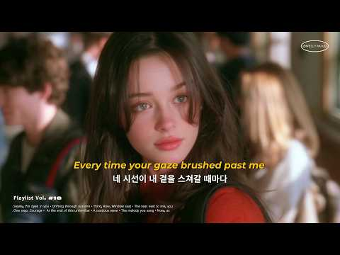
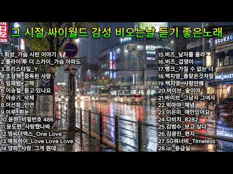
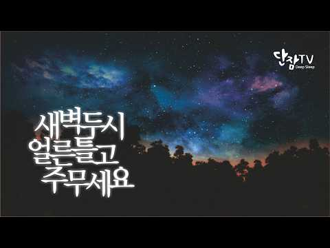
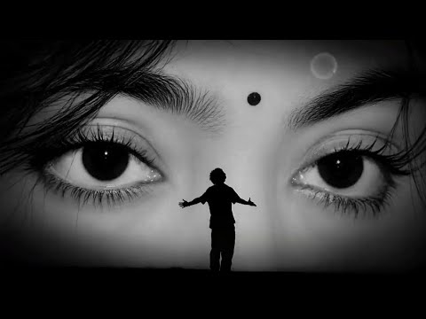
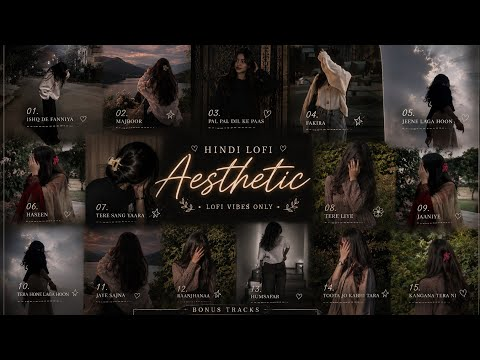
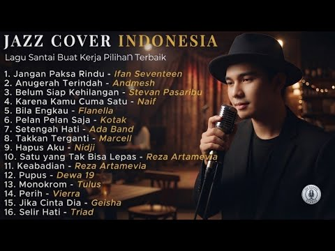
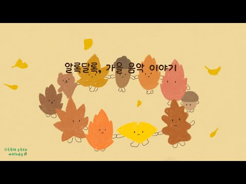

# 음악 — 성공 사례 분석: 사례별 자세히 #161–#200

`analysis.md` 의 9번 (같은 # 번호). 자동 생성 — `tools/success_analysis.py` v1.4.1 (2026-10-19 08:37 UTC). ※ 연구·교육용 — 투자 권유가 아님.

### 161. CORTIS PLAYLIST (코르티스 플레이리스트) 머니머니머니부터 나니까지

- https://www.youtube.com/watch?v=2byCD3x_vPY · 우울 대신 우웅! · 구독자 2,260 · 조회수 783,467 (×346.7, 하루 14,174.0) · 좋아요 12,905 (1.7%) · 41.5분 · 2026-08-25 · 주제 묶음 기타 · 형식 플레이리스트·모음 (여러 곡) · 폴더 `W_2byCD3x_vPY` (웹 승인)
- 썸네일: 
- 챕터: 0:00 RedRed · 2:42 Go! · 5:31 FaSHioN · 8:25 What You Want · 11:39 Acai · 14:34 TNT · 16:38 JoyRide · 19:13 YoungCreatorCrew · 22:11 Wassup · 25:17 Blue Lips · 27:38 Lullaby · 30:22 Mention Me · 33:26 MONEYMONEYMONEY · 35:45 Pack it up · 37:38 MOTION (feat. Juicy J) · 40:16 NANI
- 대본 없음 (없음) — 음성인식이 끝나면 도입부·흐름이 들어감
- 댓글 187/187: 좋은 점 — 영상 0 · 감사·응원 0 · 더 알고 싶은 것 0 · 아쉬운 점 — 영상 0 · 반박·불만 — 의견 다름 0 · 정치·사회 1 · 경험 공유 2 · 구독·다음 기대 1
  - 정치·사회 👍0 “다 외국인이네”
  - 경험 공유 👍264 “아니 nani 진심으로 내줬으면 내가 진짜 한이 없다 너무 내줬으면 좋겠음.”
  - 경험 공유 👍1 “내가 이걸 찾고있었어!!!!!!”
  - 구독·다음 기대 👍2 “이거 진짜 매일 듣는듯 ㅋㅋ”

### 162. 𝐏𝐥𝐚𝐲𝐥𝐢𝐬𝐭 🍁 설레는 바람이 부는 가을이 왔나봐 ∣ 틀어두기 좋은 감성 팝송 모음

- https://www.youtube.com/watch?v=jmU_fq-iTSE · Melly Moood · 구독자 6,230 · 조회수 2,144,992 (×344.3, 하루 60,519.5) · 좋아요 11,388 (0.5%) · 188.2분 · 2026-09-13 · 주제 묶음 10. 팝송·K팝·J팝 · 형식 플레이리스트·모음 (여러 곡) · 폴더 `W_jmU_fq-iTSE` (웹 승인)
- 썸네일: 
- 챕터: 0:00 Slowly, I’m dyed in you · 3:11 Drifting through autumn · 6:57 Third, Row, Window seat · 10:45 The seat next to me, you · 13:44 One step, Courage · 17:44 At the end of this unfamiliar · 20:50 A cautious wave · 24:24 The melody you sang · 27:45 Now, us
- 설명 앞부분: 안녕하세요, 여러분 오랜만에 인사드려요 어느새 가을이 완연해졌네요 🍁🍂 가을을 탄다는 건 그저 쓸쓸하다는 뜻만은 아니라, 누군가가 유독 자주 마음에 스친다는 뜻인 것 같아요 🤎 가을 특유의 공기와 온도, 그 잔잔한 분위기가 그렇게 만드는 게 아닐까 싶습니다 오늘은 설레는 하이틴 무드의 음악을 준비했어요 설렘과 떨림을 매번 조금씩 다른 색으로 담아보려 하는데, 오늘은 가을과 어울리는 떨림을 골라봤습니다 💌🍁 편안하게 감상하시고, 오늘 하루도 따뜻하게 보내세요 🧡 💿 Track List 💿 Music by Melly Moodcopyr…
- 같은 채널 평소 대비 ×312.4 (채널 최근 롱폼 중앙값 6,867회) · 평소 영상: 𝐏𝐥𝐚𝐲𝐥𝐢𝐬𝐭 10월은 좋은일만 일어날꺼야 🍀 🤍 ∣ 공부·작업할 때 듣는 가을 팝송 … (7,776회) / 𝐏𝐥𝐚𝐲𝐥𝐢𝐬𝐭 이런 날씨, 이런 온도에 이런 노래는 못참지 ∣ 모든게 잘 풀릴거 같은 … (5,958회)
- 대본 없음 (설명) — 음성인식이 끝나면 도입부·흐름이 들어감
- 댓글 283/283: 좋은 점 — 영상 0 · 감사·응원 11 · 더 알고 싶은 것 7 · 아쉬운 점 — 영상 0 · 반박·불만 — 의견 다름 0 · 정치·사회 0 · 경험 공유 5 · 구독·다음 기대 2
  - 감사·응원 👍9 “운전할때 우연히 틀었는데 차막히는 도로가 나름 낭만도 있고 주위도 보고 여유로운 시간을 보냈어요. 역시 좋은 노래가 주는 힘이 대단하네요 ㅎㅎ 아주 좋은 플리 만들어주셔서 감사합니다😊”
  - 감사·응원 👍3 “첫 노래부터 너무 좋아요 뭔가 진짜 가을이 온거 같은 기분 ㅠㅠㅠㅠㅠㅠ 좋은 노래 모아주셔서 감사해영 ~~~!!!❤❤❤”
  - 더 알고 싶은 것 👍4 “아니 사진 따로 올려주시면 안되나요 컴터 배경화면 해놓고 싶어요 너무 이뿜”
  - 더 알고 싶은 것 👍2 “두번째 곡인 Drifiting through autumn은 언제 발매되나요? 너무 제 취향이에요! 애플뮤직에 없어서요.”
  - 경험 공유 👍3 “지금 또 나를 계속 가스라이팅하면 나도 가스라이팅 할꺼야 ~ !!!”
  - 경험 공유 👍1 “음악 너무 좋아요 제가 좋아하는 분위기의 음악들이에요!!!!”
  - 구독·다음 기대 👍0 “저녁식사후 커피 한잔 하면서 듣고 있습니다. 듣다보니 점차 음원에 빠져드는것 같아요. 일단 구독하고, 자주 방문토록 하겠습니다.”
  - 구독·다음 기대 👍0 “이른 아침 차 한 잔과 함께 듣습니다. 넘 좋군요. 구독합니다.”

### 163. [PLAYLIST] Biển Đảo Và Em, Fallin Flower, Người Yêu Bỏ Lỡ,… ∣ wenjin.

- https://www.youtube.com/watch?v=dMaqYNGvzmA · wenjin. · 구독자 2,560 · 조회수 877,743 (×342.9, 하루 8,749.0) · 좋아요 10,428 (1.2%) · 26.2분 · 2026-07-11 · 주제 묶음 기타 · 형식 플레이리스트·모음 (여러 곡) · 폴더 `W_dMaqYNGvzmA` (웹 승인)
- 썸네일: 
- 챕터: 0:00 Biển, Đảo Và Em · 4:55 Fallin’ Flower · 8:37 Người Yêu Bỏ Lỡ · 13:48 Cry For Me · 18:46 Giày Cao Gót Màu Đỏ · 22:10 Thiếu Niên Hoa Hồng
- 설명 앞부분: Playlisst audio ∣ Một list siêu hay cho người cuồng audio!
- 같은 채널 평소 대비 ×18.6 (채널 최근 롱폼 중앙값 47,066회) · 평소 영상: Hngle - Tìm Em (slowed) ∣ Hngle, ft. Bảo Anh ∣ we… (47,066회) / [PLAYLIST] Bản Giao Hưởng Địa Cầu - Luôn tiến về … (127,050회)
- 대본 없음 (설명) — 음성인식이 끝나면 도입부·흐름이 들어감
- 댓글 442/442: 좋은 점 — 영상 0 · 감사·응원 0 · 더 알고 싶은 것 0 · 아쉬운 점 — 영상 0 · 반박·불만 — 의견 다름 0 · 정치·사회 0 · 경험 공유 0 · 구독·다음 기대 0

### 164. PLAYLIST I it's like supernatural I 느좋 팝송 기모띠 야르 찹찹 플리

- https://www.youtube.com/watch?v=1huhmKD8P7U · 자세히알아보기 · 구독자 551 · 조회수 187,625 (×340.5, 하루 2,441.7) · 좋아요 5,577 (3.0%) · 19.6분 · 2026-08-03 · 주제 묶음 10. 팝송·K팝·J팝 · 형식 플레이리스트·모음 (여러 곡) · 폴더 `W_1huhmKD8P7U` (웹 승인)
- 썸네일: 
- 챕터: 0:00 Ariana Grande - hate that I m… · 3:18 Ariana Grande - supernatural · 6:02 SZA - Good Days · 10:42 SZA (Feat. Travis Scott) - Op… · 14:44 Kali Uchis - Breeze! · 17:08 Kaash Paige - Love Songs
- 같은 채널 평소 대비 ×399.2 (채널 최근 롱폼 중앙값 470회) · 평소 영상: PLAYLIST I 주말이 빨리 오는 주파수 I 케이팝 여돌 느좋 플리 (470회) / PLAYLIST I 이런 날씨에 너와 이렇게 행복할 수가 I 기모띠 느좋 야르 장마 봄 … (448회)
- 대본 없음 (없음) — 음성인식이 끝나면 도입부·흐름이 들어감
- 댓글 101/101: 좋은 점 — 영상 1 · 감사·응원 2 · 더 알고 싶은 것 4 · 아쉬운 점 — 영상 0 · 반박·불만 — 의견 다름 0 · 정치·사회 0 · 경험 공유 3 · 구독·다음 기대 2
  - 감사·응원 👍1 “원래 그냥 플리 듣고만 마는데 노래 선정도 기막히시고 댓글보니까 너무 귀여우셔서 차마 응원을 안 할 수가 없네요 ㅎㅎ 잘 듣겠습니당”
  - 감사·응원 👍0 “고맙습니다, 잘들을께요”
  - 더 알고 싶은 것 👍1 “이런 스타일 플리 더 많이 만들어주세요ㅜㅜ 개좋아요”
  - 더 알고 싶은 것 👍1 “40분씩 만들어주실 수 있나요!? 화장하면서 듣고싶어요!! (*'▽'*)”
  - 경험 공유 👍45 “배경에 이끌려서 들어왔는데 인생플리찾았어요 ㅈㅉ 내가 저렇게 된거같음”
  - 경험 공유 👍9 “영광스럽다 내가 이런 환상적인 플리에 무려 천번째 좋아요를 누르게 되다니 ,,, 쥔장님 성공하세요”
  - 구독·다음 기대 👍5 “진지하게 매일 듣고잇음”

### 165. Heartbroken Lofi Songs 💔 ∣ Slowed + Reverb ∣ Study / Focus / Night Mood 🎧

- https://www.youtube.com/watch?v=KU7PfC9i9cE · Focus Music 2050 · 구독자 4,270 · 조회수 1,452,767 (×340.2, 하루 72,899.0) · 좋아요 3,369 (0.2%) · 13.8분 · 2026-09-29 · 주제 묶음 3. 공부·집중·작업 · 형식 음악 (그 밖 모양 — 한 편짜리 BGM 등) · 폴더 `W_KU7PfC9i9cE` (웹 승인)
- 썸네일: 
- 설명 앞부분: Welcome the world of soothing💔💔 lofi music, where stress fades away, and peace takes over. This 2025 mind-relaxing lofi mix is perfect for: Deep Focus & Studying 📖 Relaxing & Meditation 🧘‍♂ Chilling After a Long Day 🌅 Peaceful Sleep & Stress Relief 😴 Let these calm beats and chill vibes take you on…
- 같은 채널 평소 대비 ×3,039.3 (채널 최근 롱폼 중앙값 478회) · 평소 영상: Heartbroken Lofi Songs 💔 ∣ Slowed + Reverb ∣ Stud… (517회) / Heartbroken Lofi Songs 💔 ∣ Slowed + Reverb ∣ Stud… (518회)
- 대본 없음 (설명) — 음성인식이 끝나면 도입부·흐름이 들어감
- 댓글 92/92: 좋은 점 — 영상 0 · 감사·응원 0 · 더 알고 싶은 것 0 · 아쉬운 점 — 영상 0 · 반박·불만 — 의견 다름 0 · 정치·사회 0 · 경험 공유 0 · 구독·다음 기대 0

### 166. 한국 드라마 OST 황금기 모음💗마음을 울리는 인기 노래 모음 하루 종일 들어도 좋은 발라드🎧20-26년 K-Drama Ost Playlist ㅣ깊은 여운이 남…

- https://www.youtube.com/watch?v=Vxw1QiXjDvs · K-Drama Memories · 구독자 2,670 · 조회수 900,235 (×337.2, 하루 18,567.4) · 좋아요 4,590 (0.5%) · 74.3분 · 2026-08-31 · 주제 묶음 13. OST·사운드트랙 · 형식 플레이리스트·모음 (여러 곡) · 폴더 `W_Vxw1QiXjDvs` (웹 승인)
- 썸네일: 
- 설명 앞부분: 한국 드라마 OST 황금기 모음💗마음을 울리는 인기 노래 모음 하루 종일 들어도 좋은 발라드🎧20-26년 K-Drama Ost Playlist ㅣ깊은 여운이 남았던 🎧트랙 목록: K-Drama Memories ∣ 추억 🌸 잊을 수 없는 K-Drama OST와 한국 발라드를 만나볼 수 있는 따뜻한 공간입니다. 한 곡의 노래에는 하나의 감정이 담겨 있고, 한 소절의 멜로디는 잊고 있던 특별한 순간을 다시 떠올리게 합니다. 가슴 아픈 사랑 노래부터 아름다운 드라마 OST까지, 한국 드라마와 감성적인 이야기, 오래도록 마음에 남는 음악을…
- 같은 채널 평소 대비 ×663.6 (채널 최근 롱폼 중앙값 1,356회) · 평소 영상: 🌅 아련한 추억을 불러일으키는 OST 플레이리스트 🎵 음악이 시작되는 순간 가슴을 울리는… (1,522회) / 🎧 광고 없는 드라마 OST 명곡 💿 2020-2026 K-Drama OST ∣ 깊은 여… (1,191회)
- 대본 없음 (설명) — 음성인식이 끝나면 도입부·흐름이 들어감
- 댓글 140/140: 좋은 점 — 영상 0 · 감사·응원 2 · 더 알고 싶은 것 0 · 아쉬운 점 — 영상 1 · 반박·불만 — 의견 다름 0 · 정치·사회 0 · 경험 공유 1 · 구독·다음 기대 0
  - 감사·응원 👍21 “🎵✨ 좋은 음악을 들려주셔서 감사합니다. 마음이 편안해지고 따뜻해지는 최고의 플레이리스트입니다. ❤”
  - 감사·응원 👍3 “내가 좋아하는 노래만 모아놓은거같아요 마음이 힘들때 들으면서 위로받고 힘낼께요 감사합니다🎉❤🎉”
  - 아쉬운 점 — 영상 👍0 “광고가너무끊네😢”
  - 경험 공유 👍3 “내가 좋아하는 노래만 모아놓은거같아요 마음이 힘들때 들으면서 위로받고 힘낼께요 감사합니다🎉❤🎉”

### 167. 𝐏𝐥𝐚𝐲𝐥𝐢𝐬𝐭 느좋

- https://www.youtube.com/watch?v=3lY_H67eQl4 · 고김 · 구독자 539 · 조회수 181,387 (×336.5, 하루 1,592.3) · 좋아요 7,235 (4.0%) · 15.3분 · 2026-06-27 · 주제 묶음 기타 · 형식 플레이리스트·모음 (여러 곡) · 폴더 `W_3lY_H67eQl4` (웹 승인)
- 썸네일: 
- 챕터: 0:00 What You Want (smoke.ver) - S… · 2:25 와르르 - 건호 ai cover · 6:55 925 - Ardhito Pramono · 10:05 Slow dancing - V · 13:13 How much is weed - Dominic Fi…
- 대본 없음 (없음) — 음성인식이 끝나면 도입부·흐름이 들어감
- 댓글 52/52: 좋은 점 — 영상 1 · 감사·응원 2 · 더 알고 싶은 것 0 · 아쉬운 점 — 영상 0 · 반박·불만 — 의견 다름 0 · 정치·사회 0 · 경험 공유 0 · 구독·다음 기대 0
  - 좋은 점 — 영상 👍0 “처음 레전드..”
  - 감사·응원 👍3 “와 이게뭐야 만들어주셔서 감사합니다……..”
  - 감사·응원 👍3 “의도하신건지 모르겠는데요 혹시나 실수이실까봐 말 드려요 뷔님 노래 제목 slowing dance가 아니고 slow dancing이에요 근데 플리가 너어무 좋네여!!❤ 좋은 플리 감사합니다”

### 168. Lahore Diya ✨ Slowed Reverb ∣ Late Night Vibes ∣ Punjabi Lofi

- https://www.youtube.com/watch?v=-rNlgODrgjo · Arun music 100  · 구독자 9,450 · 조회수 3,168,929 (×335.3, 하루 24,532.2) · 좋아요 22,883 (0.7%) · 4.2분 · 2026-06-12 · 주제 묶음 8. 로파이·시티팝·칠 · 형식 한 곡 (뮤직비디오·음원·가사) · 폴더 `W_-rNlgODrgjo` (웹 승인)
- 썸네일: 
- 설명 앞부분: Lahore Diya ✨ Slowed Reverb ∣ Late Night Vibes ∣ Punjabi Lofi Song Description: 🎧 Lahore Diya (Slowed + Reverb) Version Enjoy this relaxing slowed and reverb edit of Lahore Diya. Perfect for late-night listening, studying, relaxing, and enjoying Punjabi music vibes. ✨ Use Headphones For Best Experi…
- 같은 채널 평소 대비 ×87.6 (채널 최근 롱폼 중앙값 36,170회) · 평소 영상: Main Agar Saamne Aa Bhi Jaya Karu 🥀 ∣ Slowed + Re… (37,936회) / Fallin For You x Dai Dai x Gali Gali Mein Firta x… (34,403회)
- 대본 없음 (설명) — 음성인식이 끝나면 도입부·흐름이 들어감
- 댓글 252/252: 좋은 점 — 영상 0 · 감사·응원 0 · 더 알고 싶은 것 0 · 아쉬운 점 — 영상 0 · 반박·불만 — 의견 다름 0 · 정치·사회 0 · 경험 공유 0 · 구독·다음 기대 0

### 169. Golden Brown x Love Story - Relaxing Celtic Fantasy Medieval Music & Ambience

- https://www.youtube.com/watch?v=hzPdVFw768A · The Knight Sanctuary · 구독자 3,090 · 조회수 1,030,379 (×333.5, 하루 7,972.5) · 좋아요 22,110 (2.1%) · 16.9분 · 2026-06-12 · 주제 묶음 2. 자연 소리·백색소음 · 형식 음악 (그 밖 모양 — 한 편짜리 BGM 등) · 폴더 `W_hzPdVFw768A` (웹 승인)
- 썸네일: 
- 설명 앞부분: Step into a dark fantasy celtic medieval dream with this slowed medieval instrumental version of Indila - Love Story x Golden Brown by The Stranglers, reimagined in a haunting bardcore / fantasy castle atmosphere. This instrumental mix blends the emotional romance of Love Story with the mysterious …
- 대본 없음 (설명) — 음성인식이 끝나면 도입부·흐름이 들어감
- 댓글 536/528: 좋은 점 — 영상 0 · 감사·응원 1 · 더 알고 싶은 것 1 · 아쉬운 점 — 영상 0 · 반박·불만 — 의견 다름 0 · 정치·사회 0 · 경험 공유 0 · 구독·다음 기대 0

### 170. Ama hem hem

- https://www.youtube.com/watch?v=rPmZucO77sg · Thatohatsi - Topic · 구독자 36,400 · 조회수 12,111,770 (×332.7, 하루 118,812.4) · 좋아요 158,138 (1.3%) · 7.5분 · 2026-07-09 · 주제 묶음 기타 · 형식 정보·해설 (그 밖) · 폴더 `W_rPmZucO77sg` (웹 승인)
- 썸네일: 
- 설명 앞부분: Provided to YouTube by The Orchard Enterprises Ama hem hem · Thatohatsi · Sjava · ShaunMusiq Ama hem hem ℗ 2026 Kgaday Pty Ltd Released on: 2026-07-10 Producer: Shaunmusiq Author: Thatohatsi Author: Sjava Non Lyric Author: ShaunMusiq Music Publisher: SONY MUSIC Publishing Auto-generated by YouTube.
- 같은 채널 평소 대비 ×67.1 (채널 최근 롱폼 중앙값 180,490회) · 평소 영상: Zulu lami (190,128회) / iHero (170,852회)
- 대본 없음 (설명) — 음성인식이 끝나면 도입부·흐름이 들어감
- 댓글 0/2,534: 좋은 점 — 영상 0 · 감사·응원 0 · 더 알고 싶은 것 0 · 아쉬운 점 — 영상 0 · 반박·불만 — 의견 다름 0 · 정치·사회 0 · 경험 공유 0 · 구독·다음 기대 0

### 171. 💿 마음이 따뜻해지는 감성 발라드 🌸 광고없이 듣는 명곡 🌸 SG워너비, 김범수, 허각

- https://www.youtube.com/watch?v=d68bRNKlMQA · 서울 소울 발라드-Seoul Soul · 구독자 899 · 조회수 298,332 (×331.9, 하루 5,152.4) · 좋아요 756 (0.2%) · 156.2분 · 2026-08-22 · 주제 묶음 9. 가요·발라드·트로트 · 형식 음악 (그 밖 모양 — 한 편짜리 BGM 등) · 폴더 `W_d68bRNKlMQA` (웹 승인)
- 썸네일: 
- 설명 앞부분: 🌍 추억발라드"에 오신 것을 환영합니다! 🌍 감성을 자극하는 아름다운 발라드로 지난 날의 추억을 되새겨보세요. 마음을 울리는 멜로디와 함께 특별한 순간을 만들어 드립니다. 📹 제작 및 편집:
- 같은 채널 평소 대비 ×419.9 (채널 최근 롱폼 중앙값 710회) · 평소 영상: 🎼 심장을 울리는 그리운 이별 발라드 🌸 광고없는 감성 충전 명곡 🌸 에일리, 거미, 백… (717회) / 마음 편하게 일할때 듣기좋은 명품 발라드 추천 광고없는 노래모음 TOP 100 🌸 감동의… (704회)
- 대본 없음 (설명) — 음성인식이 끝나면 도입부·흐름이 들어감
- 댓글 48/48: 좋은 점 — 영상 0 · 감사·응원 7 · 더 알고 싶은 것 3 · 아쉬운 점 — 영상 1 · 반박·불만 — 의견 다름 0 · 정치·사회 0 · 경험 공유 0 · 구독·다음 기대 0
  - 감사·응원 👍10 “당신의 이름이나 사연, 혹은 아픔을 알지는 못하지만, 당신이 소중한 존재라는 사실은 잘 알고 있습니다. 당신은 사랑과 치유, 행복과 평화를 누릴 자격이 충분한 사람입니다. 그러니 부디 포기하지 마세요. 힘들더라도 계속해서 앞으로 나아가세요. 세상은 당신의 빛을 필요로…”
  - 감사·응원 👍6 “이 가을날에 요렇게 좋은 음악을 듣게 해주셔서 고맙습니다”
  - 더 알고 싶은 것 👍10 “이 노래를 들으면서 떠오르는 계절은 어느 계절인가요? 봄, 여름, 가을, 겨울 중 하나를 골라주세요. 🍂”
  - 더 알고 싶은 것 👍1 “오래된 노래를 다시 들으면 잊고 있었던 기억까지 떠오르는 것 같습니다. 오늘 이 노래를 들으며 어떤 추억이 가장 먼저 생각나셨나요?”
  - 아쉬운 점 — 영상 👍0 “리듬 가사곡이너무좋은데 제목이 안 나와서 아쉽네요.”

### 172. Prasanna Vadanam – Enigma Style ∣ Lord Vishnu Peaceful Meditation Music..

- https://www.youtube.com/watch?v=QeF_NFcmxt4 · devinebeatsstudio · 구독자 1,360 · 조회수 449,940 (×330.8, 하루 4,824.8) · 좋아요 3,653 (0.8%) · 5.1분 · 2026-07-18 · 주제 묶음 1. 수면·명상·힐링 · 형식 음악 (그 밖 모양 — 한 편짜리 BGM 등) · 폴더 `W_QeF_NFcmxt4` (웹 승인)
- 썸네일: 
- 설명 앞부분: Experience the divine serenity of Prasanna Vadanam, a peaceful meditation music composition dedicated to Lord Vishnu, the Preserver of the Universe. This soothing spiritual soundtrack is inspired by calming ambient and Enigma-style soundscapes, creating the perfect atmosphere for meditation, yoga, …
- 같은 채널 평소 대비 ×2,865.9 (채널 최근 롱폼 중앙값 157회) · 평소 영상: Radha Krishna Divine Flute ∣ Moonlight Love & Hea… (159회) / 🌙 Deep Sleep in 15 Minutes ∣ Krishna Soft Bansuri… (155회)
- 대본 없음 (설명) — 음성인식이 끝나면 도입부·흐름이 들어감
- 댓글 116/116: 좋은 점 — 영상 0 · 감사·응원 0 · 더 알고 싶은 것 0 · 아쉬운 점 — 영상 0 · 반박·불만 — 의견 다름 0 · 정치·사회 0 · 경험 공유 0 · 구독·다음 기대 0

### 173. The Complete "Love Is in the Air" Theme by Rock Burwell ∣ Obsession 2026

- https://www.youtube.com/watch?v=ipCco3jw504 · NR ENTERTAINMENT Music / Robillart Nicolas · 구독자 2,810 · 조회수 927,816 (×330.2, 하루 6,293.3) · 좋아요 16,691 (1.8%) · 4.5분 · 2026-05-24 · 주제 묶음 6. 피아노·클래식·연주곡 · 형식 음악 (그 밖 모양 — 한 편짜리 BGM 등) · 폴더 `W_ipCco3jw504` (웹 승인)
- 썸네일: 
- 챕터: 0:00 Part 1: The "Honeymoon Phase"… · 1:56 Part 2: The Distortion (Nikki… · 4:15 Outro
- 설명 앞부분: Listen to the complete "Love Is in the Air" soundtrack theme composed by Rock Burwell from the psychological horror film "Obsession (2026)", directed by Curry Barker. This track seamlessly combines both Part 1 and Part 2 into a single, immersive listening experience, capturing the full atmosphere o…
- 같은 채널 평소 대비 ×3,092.7 (채널 최근 롱폼 중앙값 300회) · 평소 영상: ELVIRA Mistress of the Dark - Special Edition Fil… (300회) / ELVIRA Mistress of the Dark - Special Edition Fil… (317회)
- 대본 없음 (설명) — 음성인식이 끝나면 도입부·흐름이 들어감
- 댓글 614/614: 좋은 점 — 영상 0 · 감사·응원 0 · 더 알고 싶은 것 0 · 아쉬운 점 — 영상 0 · 반박·불만 — 의견 다름 0 · 정치·사회 0 · 경험 공유 0 · 구독·다음 기대 0

### 174. 【BGM】置いていかないで｜1分後に涙が溢れてくる曲

- https://www.youtube.com/watch?v=e9ArzLcNNbw · 1分後に〇〇する曲🎧 · 구독자 1,200 · 조회수 395,600 (×329.7, 하루 3,066.5) · 좋아요 1,284 (0.3%) · 4.3분 · 2026-06-12 · 주제 묶음 기타 · 형식 음악 (그 밖 모양 — 한 편짜리 BGM 등) · 폴더 `W_e9ArzLcNNbw` (웹 승인)
- 썸네일: 
- 설명 앞부분: 今後の新曲はこちらのSUZURIページからダウンロードできるようにしていきます。 SpotifyやApple Musicなどの音楽配信サイトでの提供はできませんが、
- 같은 채널 평소 대비 ×86.7 (채널 최근 롱폼 중앙값 4,560회) · 평소 영상: 【MV】親不孝｜1分後に考えさせられる曲 (7,048회) / 【1時間耐久】絵巻｜1分後に涙が溢れてくる曲 (7,960회)
- 대본 없음 (설명) — 음성인식이 끝나면 도입부·흐름이 들어감
- 댓글 61/61: 좋은 점 — 영상 0 · 감사·응원 0 · 더 알고 싶은 것 0 · 아쉬운 점 — 영상 0 · 반박·불만 — 의견 다름 0 · 정치·사회 0 · 경험 공유 0 · 구독·다음 기대 0

### 175. DARKHAAST ❤️‍🩹 slowed x reverb Arijit Singh (Lyrics) Ft. Sunidhi Chauhan ∣ Shivaay ∣ gk l…

- https://www.youtube.com/watch?v=7u9GjyI2yxg ·  GK lofi song · 구독자 9,720 · 조회수 3,200,455 (×329.3, 하루 28,314.9) · 좋아요 18,108 (0.6%) · 6.9분 · 2026-06-28 · 주제 묶음 8. 로파이·시티팝·칠 · 형식 한 곡 (뮤직비디오·음원·가사) · 폴더 `W_7u9GjyI2yxg` (웹 승인)
- 썸네일: 
- 설명 앞부분: DARKHAAST ❤️‍🩹 slowed x reverb Arijit Singh (Lyrics) Ft. Sunidhi Chauhan ∣ Shivaay ∣ gk lofi song 🎵 GK lofi song 🎧 💘 Song Credits : Song: Darkhaast Singer: Arijit Singh & Sunidhi Chauhan Music Director : Mithoon Lyrics: Sayeed Quadri Drum Programming By Bobby Shrivastava Guitars Played By Kalyan Ba…
- 같은 채널 평소 대비 ×545.7 (채널 최근 롱폼 중앙값 5,864회) · 평소 영상: Kaise Hua [ Slowed+ Reverb ] - Full Song ∣ Kabir … (7,951회) / Pee Loon🌹 [Slowed + Reverb] - Mohit Chauhan, Emra… (8,393회)
- 대본 없음 (설명) — 음성인식이 끝나면 도입부·흐름이 들어감
- 댓글 264/264: 좋은 점 — 영상 0 · 감사·응원 0 · 더 알고 싶은 것 0 · 아쉬운 점 — 영상 0 · 반박·불만 — 의견 다름 0 · 정치·사회 0 · 경험 공유 0 · 구독·다음 기대 0

### 176. Rabba Tu Na Naraz Hovi ❤️ ∣ Soulful Heart Touching Punjabi Qawwali 2026 ∣ Sufi Usman

- https://www.youtube.com/watch?v=Zh-3CGV7BwQ · Sufi Usman · 구독자 4,740 · 조회수 1,555,085 (×328.1, 하루 19,415.6) · 좋아요 7,052 (0.4%) · 5.9분 · 2026-07-31 · 주제 묶음 기타 · 형식 음악 (그 밖 모양 — 한 편짜리 BGM 등) · 폴더 `W_Zh-3CGV7BwQ` (웹 승인)
- 썸네일: 
- 설명 앞부분: Welcome to Sufi Usman 🤍 Sufi Usman is a space for soulful Sufi music, spiritual poetry, and heartfelt expressions of Ishq-e-Haqiqi (divine love). This channel is dedicated to peace, love, and the inner journey of the soul through music and words. ✨ All kalam and songs on this channel are original c…
- 같은 채널 평소 대비 ×956.4 (채널 최근 롱폼 중앙값 1,626회) · 평소 영상: MITTI MERI ZAAT (مِٹی میری ذات) ∣ A Soulful Heart… (1,636회) / Fanaa (فنا) ∣ Heart - Touching Deep Sufi Meditati… (1,616회)
- 대본 없음 (설명) — 음성인식이 끝나면 도입부·흐름이 들어감
- 댓글 214/214: 좋은 점 — 영상 0 · 감사·응원 0 · 더 알고 싶은 것 0 · 아쉬운 점 — 영상 0 · 반박·불만 — 의견 다름 0 · 정치·사회 0 · 경험 공유 0 · 구독·다음 기대 0

### 177. 듣기만 해도 설레는 그시절 1990~2026년 사랑하고 슬퍼했던 노래- 휘성,프리스타일,조장혁,임재범,이승철,이승기,이선희,이루,윤하,버즈,바이브,빅마마,이은미…

- https://www.youtube.com/watch?v=dCB0KQI7qfU · 감정 작사가 · 구독자 600 · 조회수 196,495 (×327.5, 하루 1,268.9) · 좋아요 770 (0.4%) · 118.5분 · 2026-05-17 · 주제 묶음 기타 · 형식 음악 (그 밖 모양 — 한 편짜리 BGM 등) · 폴더 `W_dCB0KQI7qfU` (웹 승인)
- 썸네일: 
- 설명 앞부분: 그때 우린 이 노래 하나로 새벽을 버티고 하루를 위로받았다. 싸이월드 미니홈피 BGM, 도토리로 구매해서 반복 재생하던 90~2000년대 감성 플레이리스트 🎧 비 오는 도시 야경과 함께 추억 속으로 돌아가보세요 🌧
- 같은 채널 평소 대비 ×1,802.7 (채널 최근 롱폼 중앙값 109회) · 평소 영상: 듣기만 해도 설레는 그시절 1990~2026 사랑하고 슬퍼했던 노래 - KCM, 다비치 … (141회) / 듣기만 해도 설레는 그시절 1990~2026 사랑하고 슬퍼했던 노래- MC몽, 에프터스쿨… (77회)
- 대본 없음 (설명) — 음성인식이 끝나면 도입부·흐름이 들어감
- 댓글 46/46: 좋은 점 — 영상 1 · 감사·응원 5 · 더 알고 싶은 것 0 · 아쉬운 점 — 영상 1 · 반박·불만 — 의견 다름 0 · 정치·사회 0 · 경험 공유 0 · 구독·다음 기대 0
  - 감사·응원 👍9 “처음이자 마지막 나의 팬심을 쏟았던 휘성^^ 이젠 좀 편안해졌겠지. ,,, 노래 감사합니다. 그런가봐요 김형중 추천합니다”
  - 감사·응원 👍4 “이 노래들을 듣고 있으니 사랑했던 순간도, 가슴 아팠던 순간도 모두 추억이 되어 다시 떠오르네요. 시간이 흘러도 좋은 노래는 그 시절의 감정을 그대로 전해주는 것 같습니다. 덕분에 오랜만에 마음이 따뜻해졌습니다. 감사합니다.”
  - 아쉬운 점 — 영상 👍7 “22, 23 커버곡 올리신건가요? 원곡자가 아닌듯 해서 조금 아쉽네요. 바쁘게 일하느라 위쪽 노래들은 집중해서 못들었는데 두곡은 귀레이더에 걸려요”

### 178. Banjaara 🥀 Slowed + Reverb ∣ Best Hindi Lofi Song 🎧 ∣ Anime Edit 4K ∣ Relax & Chill

- https://www.youtube.com/watch?v=uxMeJy4JMS8 · Broken Sky01 · 구독자 6,750 · 조회수 2,196,267 (×325.4, 하루 26,393.2) · 좋아요 30,698 (1.4%) · 6.3분 · 2026-07-28 · 주제 묶음 8. 로파이·시티팝·칠 · 형식 음악 (그 밖 모양 — 한 편짜리 BGM 등) · 폴더 `W_uxMeJy4JMS8` (웹 승인)
- 썸네일: 
- 설명 앞부분: Banjaara 🥀 Slowed + Reverb ∣ Best Hindi Lofi Song 🎧 ∣ Anime Edit 4K ∣ Relax & Chill 🎧 Banjaara – Slowed + Reverb ∣ Lofi Version ∣ Relaxing Anime Vibes 🌙 अगर आपको शांत, सुकून भरा और दिल को छू लेने वाला Lofi Music पसंद है, तो यह Banjaara का Slowed + Reverb Version आपके लिए है। इस वीडियो में खूबसूरत A…
- 같은 채널 평소 대비 ×731.6 (채널 최근 롱폼 중앙값 3,002회) · 평소 영상: 🎵 Viral Title💔 Midnight Ishq Vibes 🌧️ ∣ Hear Touc… (3,002회) / Jhol (Slowed + Reverb) 🖤 ∣ Naruto & Sakura Edit ∣… (3,087회)
- 대본 없음 (설명) — 음성인식이 끝나면 도입부·흐름이 들어감
- 댓글 857/856: 좋은 점 — 영상 0 · 감사·응원 0 · 더 알고 싶은 것 0 · 아쉬운 점 — 영상 0 · 반박·불만 — 의견 다름 0 · 정치·사회 0 · 경험 공유 0 · 구독·다음 기대 0

### 179. 나그네

- https://www.youtube.com/watch?v=FFwUpZZGqnc · 여산일거 · 구독자 4,270 · 조회수 1,379,937 (×323.2, 하루 8,341.7) · 좋아요 4,236 (0.3%) · 8.9분 · 2026-05-06 · 주제 묶음 기타 · 형식 한 곡 (뮤직비디오·음원·가사) · 폴더 `W_FFwUpZZGqnc` (웹 승인)
- 썸네일: 
- 설명 앞부분: 감성노래 여산일거 Music Video
- 같은 채널 평소 대비 ×208.6 (채널 최근 롱폼 중앙값 6,616회) · 평소 영상: 5월의찬가 (6,616회) / 한송이꽃 (6,281회)
- 대본 없음 (설명) — 음성인식이 끝나면 도입부·흐름이 들어감
- 댓글 372/372: 좋은 점 — 영상 4 · 감사·응원 45 · 더 알고 싶은 것 6 · 아쉬운 점 — 영상 2 · 반박·불만 — 의견 다름 0 · 정치·사회 1 · 경험 공유 4 · 구독·다음 기대 6
  - 좋은 점 — 영상 👍2 “너무.듣기좋아요.최고.제데로된.드롯곡이.나왔네요”
  - 좋은 점 — 영상 👍2 “여산일거가 무슨뜻 노래하시는분 AI는 아니면 좋겠어요 듣기 좋아요”
  - 감사·응원 👍63 “안녕하세요 아름답고멋져요 감미롭고감동 이네요 좋은하루되세요 너무좋아요 감사합니다 선생님 수고하셨습니다 너무잘하십니다 🎉🎉🎉구독꼬옥 좋은하루되세요 ❤❤❤”
  - 감사·응원 👍38 “아주좋아요 영상 과 노래 🎵 최고랍니다 💃 멋져버려요 좋아 👌 잘듣고 갑니다 감사해요 ~~^^^♡😅”
  - 더 알고 싶은 것 👍23 “노래다운받는방법 알려주세요”
  - 더 알고 싶은 것 👍6 “노래는듣고있는데,가수는누군지,자기소개가없으니많이궁금합니다”
  - 아쉬운 점 — 영상 👍3 “낚시하면서 들어보니. 완전짱 하루종일 이노래만듣고있어요 넘좋와요~~♡”
  - 정치·사회 👍0 “내가 군생활 시에도 부산 거제리 여군도 있었는데 세월이 흘러 여성 장군도있어 남여 평등 실감 남니다 외국거주하다 한국군으로 살아가는데 빨갱이기질 범죄 집단 패거리가 선조님의 피눈물이걱정됨니다 나는80 임박하니 힘은 없고 입만살아 미안합니다”
  - 경험 공유 👍2 “나그네 내가 나그네 ! 즐감하고 좋아요 꾹 구독 꾹 누르고 응원합니다 ~~~~~~~~~🎉🎉🎉”
  - 경험 공유 👍0 “시대가 아~~~무리 바꾸어도 인간이기전에 사람답게 사는게 인생.....그럼! 내가 못받아도 내자식들이....”
  - 구독·다음 기대 👍14 “경쾌한나그네 기가 막힙니다 한강 자전거타면서 매일듣는 나그네는 행복입니다 항상건강하고 행복하십시요”
  - 구독·다음 기대 👍5 “노래가 좋아서 따라와서 구독하고 손잡고 머물면서 넉을 놓고 노래 듣고 갑니다 수고 하셨습니다 또 뵙겠습니다~❤❤❤❤❤”

### 180. JANANAYAGAN - Forest BGM ∣ The Ultimate Cinematic Experience 🐘🔥

- https://www.youtube.com/watch?v=uVuVb5CdEC8 · Massplix  · 구독자 1,330 · 조회수 427,386 (×321.3, 하루 2,564.5) · 좋아요 0 (0.0%) · 4.5분 · 2026-05-05 · 주제 묶음 기타 · 형식 음악 (그 밖 모양 — 한 편짜리 BGM 등) · 폴더 `W_uVuVb5CdEC8` (웹 승인)
- 썸네일: 
- 설명 앞부분: Experience the raw power of the forest. Dive into the cinematic world of Jananayagan with this high-quality Forest BGM. Featuring intense tribal beats and a haunting atmosphere, this score captures the essence of the wild and the unstoppable energy of Thalapathy Vijay. 🎧 Headphones Recommended for …
- 대본 없음 (설명) — 음성인식이 끝나면 도입부·흐름이 들어감
- 댓글 167/166: 좋은 점 — 영상 0 · 감사·응원 0 · 더 알고 싶은 것 0 · 아쉬운 점 — 영상 0 · 반박·불만 — 의견 다름 0 · 정치·사회 0 · 경험 공유 0 · 구독·다음 기대 0

### 181. Sonata in the Dark 🎹 Beethoven-Inspired Melancholic Classical Piano Music

- https://www.youtube.com/watch?v=sakrZHnzs6k · Elysian Classical · 구독자 189 · 조회수 60,400 (×319.6, 하루 891.0) · 좋아요 534 (0.9%) · 16분 · 2026-08-12 · 주제 묶음 6. 피아노·클래식·연주곡 · 형식 음악 (그 밖 모양 — 한 편짜리 BGM 등) · 폴더 `W_sakrZHnzs6k` (웹 승인)
- 썸네일: 
- 설명 앞부분: 🎹 Sonata in the Dark Dark — A Classical Piano Composition Inspired by Beethoven Immerse yourself in the somber, passionate atmosphere of "Sonata in the Dark Dark," a solo piano composition inspired by the drama, emotional depth, and iconic arpeggios of Ludwig van Beethoven. Designed to accompany yo…
- 같은 채널 평소 대비 ×88.6 (채널 최근 롱폼 중앙값 682회) · 평소 영상: Clarity of Dawn 🎹 30+ Minutes of Mozart-Inspired … (776회) / Passionate Violin Sonata 🎹 Brahms Inspired ∣ Virt… (588회)
- 대본 없음 (설명) — 음성인식이 끝나면 도입부·흐름이 들어감
- 댓글 17/17: 좋은 점 — 영상 0 · 감사·응원 0 · 더 알고 싶은 것 0 · 아쉬운 점 — 영상 0 · 반박·불만 — 의견 다름 0 · 정치·사회 0 · 경험 공유 0 · 구독·다음 기대 0

### 182. 𝒑𝒍𝒂𝒚𝒍𝒊𝒔𝒕 틱톡 그 느좋 노래 모음

- https://www.youtube.com/watch?v=NG6SQIGv3-Y · 뭐야 · 구독자 1,720 · 조회수 548,880 (×319.1, 하루 5,611.0) · 좋아요 11,839 (2.2%) · 8.9분 · 2026-07-13 · 주제 묶음 기타 · 형식 플레이리스트·모음 (여러 곡) · 폴더 `W_NG6SQIGv3-Y` (웹 승인)
- 썸네일: 
- 챕터: 0:00 illusionary daytime x trackma… · 2:26 mimosa 2000 x furacăo 2000 (s… · 3:01 我的心下起了雪 · 4:20 not the one · 5:12 1-800- bbno$ · 7:07 PPAP · 7:31 Chi-Chi · 8:13 sweet parade dj remix
- 설명 앞부분: 해당 영상으로 수익창출을 하지 않습니다. 많은 분들이 함께 보시기에 불편함을 느낄 수 있을만한 댓글은 무통보 삭제하겠습니다.
- 같은 채널 평소 대비 ×48.8 (채널 최근 롱폼 중앙값 11,244회) · 평소 영상: 𝒑𝒍𝒂𝒚𝒍𝒊𝒔𝒕 틱톡 그 느좋 노래 모음6 (11,662회) / 𝒑𝒍𝒂𝒚𝒍𝒊𝒔𝒕 분위기 있는 그 느좋 팝송 (10,825회)
- 대본 없음 (설명) — 음성인식이 끝나면 도입부·흐름이 들어감
- 댓글 112/112: 좋은 점 — 영상 0 · 감사·응원 3 · 더 알고 싶은 것 3 · 아쉬운 점 — 영상 0 · 반박·불만 — 의견 다름 0 · 정치·사회 0 · 경험 공유 2 · 구독·다음 기대 1
  - 감사·응원 👍1 “정망정말 감사해요 이런플리 너무 필요했어요 바로 구독햇어요 첫곡 같은거 포함해서 많이 만들어주새요🥹🥹🥹🫪🫪🫪🥰🥰🥰”
  - 감사·응원 👍0 “4:20 노래 찾고 있었는데 ㅜㅜ 감사합니다 ㅜ”
  - 더 알고 싶은 것 👍3 “선생님 이거 사클 만들어주실수있나요 ㅠ”
  - 더 알고 싶은 것 👍1 “와진짜사랑해요이런거더마니올려주세요”
  - 경험 공유 👍2 “그래 내가원했던게 이거라구ㅜㅜㅜ 사랑해요사랑해요사랑해요사랑해요사랑해요 진짜로사랑해요사랑해요사랑해요사랑해요이거많이들을게요이거많이들을게요이거많이들을게요이거많이들을게요진심으로ㅜㅜ💃🏻💃🏻”
  - 경험 공유 👍0 “와 그래 내가 원한게 이거라궁!!! 이쁜언니 후속작 예정 없나요?!”
  - 구독·다음 기대 👍15 “아니ㅁㅊ 그래 이런 플리를 원했다고요ㅠㅠ 맨날 틱톡 보면서 노래 ㄱ좋은데 무슨 노래인지도 모르고 플리 찾아봐도 없어서 맨날 틱톡만 들락날락 거렸는데 이런 플리를 낋여주시다니ㅠㅠ 너무 좋아요 진짜 주인장님❤ +썸네일 강해린 느좋이여서 안 들어올수가 없음ㄹㅇ +두번째 플…”

### 183. LEO ROJAS - Top 16 Andean Pan Flute Melodies ★ Full Album - Most Beautiful Melodies

- https://www.youtube.com/watch?v=wR5yxMCTZA0 · Andean Flute Melodies · 구독자 4,840 · 조회수 1,540,166 (×318.2, 하루 30,868.6) · 좋아요 9,928 (0.6%) · 98.3분 · 2026-08-30 · 주제 묶음 6. 피아노·클래식·연주곡 · 형식 플레이리스트·모음 (여러 곡) · 폴더 `W_wR5yxMCTZA0` (웹 승인)
- 썸네일: 
- 설명 앞부분: 🎶 TOP 16 ANDEAN PAN FLUTE MELODIES ★ Full Album - Most Beautiful Melodies A curated journey through 16 original Andean pan flute performances - soulful melodies inspired by the spirit of the Andes, played live on the traditional zampoña. In this full album, you'll enjoy: 16 original pan flute perfo…
- 같은 채널 평소 대비 ×637.1 (채널 최근 롱폼 중앙값 2,418회) · 평소 영상: ANDEAN PAN FLUTE 🌿 Spiritual Music for Healing & … (2,950회) / NATURE'S SERENITY 🌿 Andean Pan Flute Music for a … (1,885회)
- 대본 없음 (설명) — 음성인식이 끝나면 도입부·흐름이 들어감
- 댓글 233/233: 좋은 점 — 영상 0 · 감사·응원 4 · 더 알고 싶은 것 0 · 아쉬운 점 — 영상 0 · 반박·불만 — 의견 다름 0 · 정치·사회 0 · 경험 공유 1 · 구독·다음 기대 0
  - 감사·응원 👍3 “오랫만에 힐링한 기분입니다 좋은음악 드려주셔서 감사합니다”
  - 감사·응원 👍1 “좋 은음악 감사해요~~^^🎉🎉🎉🎉🎉🎉🎉”
  - 경험 공유 👍3 “창공을 나르는 새한마리가 되어날고 있는것같네요, 지금 내가 사랑하는 종필님 과 같이듣고 싶어요, 보고싶네요,”

### 184. Perfect South Indian Playlist 🪷🦢 (+timestamps)

- https://www.youtube.com/watch?v=ROBjw6FcYxs · Being Diva 💅🏻 · 구독자 5,720 · 조회수 1,817,409 (×317.7, 하루 55,647.8) · 좋아요 18,453 (1.0%) · 7.7분 · 2026-09-16 · 주제 묶음 기타 · 형식 플레이리스트·모음 (여러 곡) · 폴더 `W_ROBjw6FcYxs` (웹 승인)
- 썸네일: 
- 챕터: 0:00 Kalyani · 0:48 Othaiyadi patayila · 1:37 Aasa koda · 2:50 Tum tum · 3:47 Vachindamma · 4:35 Inkem Inkem · 5:34 Unakkul naane · 6:28 Chuttamalle
- 설명 앞부분: Perfect South Indian songs 🪷🦢 South Indian Diva 💅🏻 South Indian song playlist The playlist which you'll would love. This playlist include trending songs. Your mood will instantly change. You might heard this song on social media. Don't worry if you had bad day these song will let you relax.... ☁️ P…
- 같은 채널 평소 대비 ×15.0 (채널 최근 롱폼 중앙값 120,787회) · 평소 영상: Being Chaotic Is Your Love Language 😋🫣 (+timestam… (120,787회) / POV - You Are In Love 💗😩🫶🏻 (+timestamps) (149,937회)
- 대본 없음 (설명) — 음성인식이 끝나면 도입부·흐름이 들어감
- 댓글 266/260: 좋은 점 — 영상 0 · 감사·응원 0 · 더 알고 싶은 것 0 · 아쉬운 점 — 영상 0 · 반박·불만 — 의견 다름 0 · 정치·사회 0 · 경험 공유 0 · 구독·다음 기대 0

### 185. 𝙋𝙤𝙫 :- 𝘽𝙝𝙤𝙟𝙥𝙪𝙧𝙞 𝙥𝙡𝙖𝙮𝙡𝙞𝙨𝙩 ∣∣ 𝙘𝙝𝙞𝙡𝙡 𝙜𝙪𝙮𝙨 𝙖𝙣𝙙 𝙚𝙣𝙟𝙤𝙮 ∣∣ 𝙂𝘼𝙇𝘼𝙓𝘼𝙔𝙔𝙐 ∣∣

- https://www.youtube.com/watch?v=areWocW1pXI · AYUSH · 구독자 4,310 · 조회수 1,359,402 (×315.4, 하루 32,419.3) · 좋아요 10,112 (0.7%) · 8분 · 2026-09-07 · 주제 묶음 기타 · 형식 플레이리스트·모음 (여러 곡) · 폴더 `W_areWocW1pXI` (웹 승인)
- 썸네일: 
- 설명 앞부분: JOIN TELEGRAM CHANNEL 👇 🎧💫 Put on your headphones for the ultimate vibe experience ✨🎶 Because music always feels better when it’s close to your soul 💕 JOIN TELEGRAM CHANNEL 👇 🌷✨ Disclaimer: No copyright infringement intended. I don't own the picture or the song in this video, nor do I claim to own …
- 같은 채널 평소 대비 ×182.6 (채널 최근 롱폼 중앙값 7,444회) · 평소 영상: Bhojpuri Mega Mashup 2026 ∣ Old is Gold Remix ∣ S… (7,444회) / Kalyani x Majboor ✨- Shreya Ghoshal ∣ Zoha Waseem… (6,868회)
- 대본 없음 (설명) — 음성인식이 끝나면 도입부·흐름이 들어감
- 댓글 180/180: 좋은 점 — 영상 0 · 감사·응원 0 · 더 알고 싶은 것 0 · 아쉬운 점 — 영상 0 · 반박·불만 — 의견 다름 0 · 정치·사회 0 · 경험 공유 0 · 구독·다음 기대 0

### 186. 새벽 2시, 잠이 깼다면 다시 자세요 ∣ 6분 후 다시 잠드는 피아노 명상음악 for Deep Sleep [중간광고없음]

- https://www.youtube.com/watch?v=ViCEPJCOgy4 · 단잠TV · 구독자 2,510 · 조회수 782,463 (×311.7, 하루 5,517.0) · 좋아요 3,119 (0.4%) · 181.7분 · 2026-05-30 · 주제 묶음 1. 수면·명상·힐링 · 형식 음악 (그 밖 모양 — 한 편짜리 BGM 등) · 폴더 `W_ViCEPJCOgy4` (웹 승인)
- 썸네일: 
- 설명 앞부분: 새벽에 잠이 깨면 시계를 보지 마세요. 잠깐 눈을 뜬 것뿐입니다. 이 음악은 다시 잠들 수 있도록 만들어진 조용한 피아노 명상곡입니다. 따뜻한 펠트 피아노와 은은한 현악기가 마음을 천천히 가라앉히고 깊은 휴식으로 안내합니다. 이어폰 없이도 편안하게 들을 수 있도록 부드러운 음역과 안정적인 흐름으로 제작되었습니다. 오늘도 편안한 밤 되세요.
- 같은 채널 평소 대비 ×1,092.1 (채널 최근 롱폼 중앙값 716회) · 평소 영상: 아, 졸려... 클래식 수면음악 ∣ 피아노와 현악기 for Deep Sleep [중간광고… (748회) / 한밤중 한 시 반, 이제는 주무세요 🌙 ∣ 다시 잠들고 싶은 새벽을 위한 수면음악 (685회)
- 대본 없음 (설명) — 음성인식이 끝나면 도입부·흐름이 들어감
- 댓글 216/216: 좋은 점 — 영상 3 · 감사·응원 38 · 더 알고 싶은 것 0 · 아쉬운 점 — 영상 0 · 반박·불만 — 의견 다름 0 · 정치·사회 0 · 경험 공유 3 · 구독·다음 기대 0
  - 좋은 점 — 영상 👍9 “새벽 2시에 우현이 이걸 보게 되었습니다 며칠동안 많이 아파는데 마니 걱정과 근심이 덕분에 마니 사라졌습니다 좋은 영상 감사합니다~^^ 항상 건강하시고 ~더위 잘 이겨내봐요~”
  - 좋은 점 — 영상 👍4 “퇴사한지 한달정도 되어가네요.. 계약직 2년하고 정규직이라는 심사에서 떨어지고 요즘들어 정말 이생각 저생각 암울한 생각으로 나날들을 보내고 있습니다😢 잠을 자려니 생각이 많아 잠이 너무 안왔는데 알고리즘이 오늘도 저를 위로해줬네요 좋은 영상 감사합니다”
  - 감사·응원 👍76 “생각이 많아 잠 못 이루고 있었는데 이 영상이 떴네요, 재수 생활 중인데 6개월 뒤엔 맘 편히 눈 뜨고 싶네요 원하는 삶을 위해 오늘도 내일도 화이팅!”
  - 감사·응원 👍13 “안녕하세요. 진짜 이름이 새벽입니다... 지금은 4시입니다... 감사합니다”
  - 경험 공유 👍6 “에휴..5일주간.. 편하게일하고싶다 주6일이라니 그것도 새벽 5시출근.. 현타온다 나름 열심히 산것같은데 이럴려고 타지역으로왔나싶기도하고 내가 뭘 위해 살려고 아득바득 살고있는지.. "왜 살까?"”
  - 경험 공유 👍1 “신기하게 새벽2시 딱 뜨네 하루 쉬고 또 내일 출근이라니.. 샵 오픈한지 5년차이고 곧 30이될 몇년 안남았는데 서른일땐 더 성장되어 있길!! 내일도 화이팅하고 알고리즘 잘타서 잘 듣고 잘자겠습니다!”

### 187. Hallucination Journey ∣ Stoner Music & Trippy Visuals🌿

- https://www.youtube.com/watch?v=QbWDBeBn_OY · RYNO · 구독자 550 · 조회수 171,244 (×311.4, 하루 1,325.5) · 좋아요 1,199 (0.7%) · 10분 · 2026-06-12 · 주제 묶음 8. 로파이·시티팝·칠 · 형식 음악 (그 밖 모양 — 한 편짜리 BGM 등) · 폴더 `W_QbWDBeBn_OY` (웹 승인)
- 썸네일: 
- 설명 앞부분: Hallucination Journey ∣ Stoner Music & Trippy Visuals🌿 Leave reality behind and step into a world of endless psychedelic visuals, cosmic landscapes, surreal dimensions, and immersive stoner vibes. This visual experience combines trippy hallucination-inspired artwork, deep space scenery, dreamlike e…
- 같은 채널 평소 대비 ×209.9 (채널 최근 롱폼 중앙값 816회) · 평소 영상: STONER MODE🌿: PSYTRANCE FOR THE HOMIES💀 (965회) / RYNO ∣ Cloud Walker 🌿 ∣ Fractal Engine Vol. 001 (981회)
- 대본 없음 (설명) — 음성인식이 끝나면 도입부·흐름이 들어감
- 댓글 13/13: 좋은 점 — 영상 0 · 감사·응원 0 · 더 알고 싶은 것 0 · 아쉬운 점 — 영상 0 · 반박·불만 — 의견 다름 0 · 정치·사회 0 · 경험 공유 0 · 구독·다음 기대 0

### 188. SAD LO-FI 🥺 💔 2026 Ultimate Mind Relaxing Lofi Beats ∣ Study Sleep & Chill lofi ∣ #lofimu…

- https://www.youtube.com/watch?v=29EWidvY0b8 · AR BROTHER · 구독자 7,190 · 조회수 2,232,693 (×310.5, 하루 51,841.6) · 좋아요 10,929 (0.5%) · 18.6분 · 2026-09-06 · 주제 묶음 1. 수면·명상·힐링 · 형식 음악 (그 밖 모양 — 한 편짜리 BGM 등) · 폴더 `W_29EWidvY0b8` (웹 승인)
- 썸네일: 
- 설명 앞부분: Welcome to the world of soothing lofi music, where stress fades away, and peace takes over. This 2026 mind-relaxing lofi mix is perfect for: Deep Focus & Studying 📖 Relaxing & Meditation 🧘‍♂ Chilling After a Long Day 🌅 Peaceful Sleep & Stress Relief 😴 ©NOTE : Reupload/Misuse of the following video …
- 대본 없음 (설명) — 음성인식이 끝나면 도입부·흐름이 들어감
- 댓글 87/86: 좋은 점 — 영상 0 · 감사·응원 0 · 더 알고 싶은 것 0 · 아쉬운 점 — 영상 0 · 반박·불만 — 의견 다름 0 · 정치·사회 0 · 경험 공유 0 · 구독·다음 기대 0

### 189. 하우스룰즈가 최고야

- https://www.youtube.com/watch?v=V0mzAQ7z3D0 · Yeon · 구독자 948 · 조회수 293,799 (×309.9, 하루 6,262.4) · 좋아요 6,325 (2.1%) · 18.1분 · 2026-09-02 · 주제 묶음 기타 · 형식 플레이리스트·모음 (여러 곡) · 폴더 `W_V0mzAQ7z3D0` (웹 승인)
- 썸네일: 
- 챕터: 0:00 house · 4:03 Do it · 8:01 mojito (모히또) · 12:08 Romance
- 설명 앞부분: 하우스룰즈 플레이리스트
- 같은 채널 평소 대비 ×198.8 (채널 최근 롱폼 중앙값 1,478회) · 평소 영상: 두림코어 (1,478회) / 느좋여름감성키키 (1,854회)
- 대본 없음 (설명) — 음성인식이 끝나면 도입부·흐름이 들어감
- 댓글 232/232: 좋은 점 — 영상 0 · 감사·응원 2 · 더 알고 싶은 것 2 · 아쉬운 점 — 영상 0 · 반박·불만 — 의견 다름 1 · 정치·사회 0 · 경험 공유 5 · 구독·다음 기대 0
  - 감사·응원 👍2 “와..하우스룰즈라니.... 좋은 노래 다시 들을수 있어서 감사합니다!”
  - 더 알고 싶은 것 👍5 “타임라인 만들어주세요ㅜㅜ”
  - 더 알고 싶은 것 👍3 “싸클이나 스포티파이에 올려주실수 있나요ㅜㅜ”
  - 경험 공유 👍26 “06년 스무살 대학교 새내기시절 난 누구보다 달라 싸이월드 배경음으로 두잇 했었는데 이제 마흔이 되었네.....그때나 지금이나 나만 나이가 먹은거같네 노래는 똑같은데....”
  - 경험 공유 👍2 “난 내가 워홀갔던 2011년의 호주 퍼스 클럽에 하우스룰즈가 온 이유를 아직도 모르겠다... 아련하네”

### 190. 𝐵𝑒𝓈𝓉 𝒮𝑜𝓊𝓉𝒽 𝐼𝓃𝒹𝒾𝒶𝓃 𝒮𝑜𝓃𝑔𝓈 𝒫𝓁𝒶𝓎𝓁𝒾𝓈𝓉 🎶 𝒯𝒶𝓂𝒾𝓁 • 𝒯𝑒𝓁𝓊𝑔𝓊 • 𝑀𝒶𝓁𝒶𝓎𝒶𝓁𝒶𝓂 • 𝒦𝒶𝓃𝓃𝒶𝒹𝒶

- https://www.youtube.com/watch?v=GAXYvJx8rD4 · Nyxelune · 구독자 5,650 · 조회수 1,742,121 (×308.3, 하루 19,180.3) · 좋아요 26,896 (1.5%) · 10.3분 · 2026-07-20 · 주제 묶음 기타 · 형식 정보·해설 (그 밖) · 폴더 `W_GAXYvJx8rD4` (웹 승인)
- 썸네일: 
- 챕터: 0:00 othaiyadi pathayila · 0:52 chuttamalle · 2:14 unakaal nanne · 3:04 vachindamma · 3:53 katchi sera · 4:32 aasa koda · 5:33 unakkal thaana · 6:15 inkem inkem · 7:27 tum tum · 8:09 oo Antava mawa · 8:42 arabic kuthu · 9:36 illuminati
- 설명 앞부분: Hit that subscribe button and turn on notifications so you don't miss the next drop! 🔔❤ 🎵 TRACKLIST & TIMESTAMPS: Agar aapko fashion/outfit ideas pasand hain 👗✨, mera second channel bhi check karo!👇
- 대본 없음 (설명) — 음성인식이 끝나면 도입부·흐름이 들어감
- 댓글 1,056/1,044: 좋은 점 — 영상 0 · 감사·응원 0 · 더 알고 싶은 것 0 · 아쉬운 점 — 영상 0 · 반박·불만 — 의견 다름 0 · 정치·사회 0 · 경험 공유 0 · 구독·다음 기대 0

### 191. Sad lo_fi🥺💔2026 ultimate

- https://www.youtube.com/watch?v=q-iefUnWPCY · mr prakash 😊 · 구독자 5,320 · 조회수 1,630,419 (×306.5, 하루 43,176.7) · 좋아요 9,222 (0.6%) · 18.6분 · 2026-09-11 · 주제 묶음 기타 · 형식 음악 (그 밖 모양 — 한 편짜리 BGM 등) · 폴더 `W_q-iefUnWPCY` (웹 승인)
- 썸네일: 
- 설명 앞부분: Welcome to the world of soothing lofi music, where stress fades away, and peace takes over. This 2026 mind-relaxing lofi mix is perfect for: Deep Focus & Studying 📖 Relaxing & Meditation 🧘‍♂ Chilling After a Long Day 🌅 Peaceful Sleep & Stress Relief 😴 ©NOTE : Reupload/Misuse of the following video …
- 대본 없음 (설명) — 음성인식이 끝나면 도입부·흐름이 들어감
- 댓글 143/143: 좋은 점 — 영상 0 · 감사·응원 0 · 더 알고 싶은 것 0 · 아쉬운 점 — 영상 0 · 반박·불만 — 의견 다름 0 · 정치·사회 0 · 경험 공유 0 · 구독·다음 기대 0

### 192. 𝒑𝒍𝒂𝒚𝒍𝒊𝒔𝒕 1

- https://www.youtube.com/watch?v=rRxojiPo0SU · 헿 · 구독자 630 · 조회수 192,764 (×306.0, 하루 2,104.6) · 좋아요 5,526 (2.9%) · 10.6분 · 2026-07-19 · 주제 묶음 기타 · 형식 플레이리스트·모음 (여러 곡) · 폴더 `W_rRxojiPo0SU` (웹 승인)
- 썸네일: 
- 대본 없음 (없음) — 음성인식이 끝나면 도입부·흐름이 들어감
- 댓글 40/40: 좋은 점 — 영상 0 · 감사·응원 1 · 더 알고 싶은 것 5 · 아쉬운 점 — 영상 0 · 반박·불만 — 의견 다름 0 · 정치·사회 2 · 경험 공유 2 · 구독·다음 기대 0
  - 더 알고 싶은 것 👍5 “아니 영상 왜 다 내리셨어요 저 죽으라고 그러시는거에요?? 제발 다시 올려주세요 도우인 플리 제일 맛있게 끓이면서 이러는게 어딧어……. 제발 돌아와……..”
  - 더 알고 싶은 것 👍2 “나만 알고싶은데 요새 인스타로 너무 많이들 넘어온다”
  - 정치·사회 👍522 “9:06 중국인들 탑 랩 파트, 학교를 안 갔어, 오빠오삐옵, 싸이노래 개좋아함”
  - 정치·사회 👍6 “뭔가 중국인들이 좋아하는 특유의 비트가 있는듯.. 근데 나도 너무좋아함 ㅋㅋ 그래서 핀둬둬 쇼핑할때마다 중녀들이 필터끼고 도우인찍어서 올린 후기들 하나씩 감상함”
  - 경험 공유 👍683 “근데 도우인 들어가면 한국어로 된 노래 많이 써서 내가 틱톡 보고 있는건지 헷갈림”
  - 경험 공유 👍6 “뭔가 중국인들이 좋아하는 특유의 비트가 있는듯.. 근데 나도 너무좋아함 ㅋㅋ 그래서 핀둬둬 쇼핑할때마다 중녀들이 필터끼고 도우인찍어서 올린 후기들 하나씩 감상함”

### 193. Tum Jo Aaye ✨ ∣∣ Kitab Song ∣∣ Bairan ( Slowed X Reverb ) Mix Songs❣️

- https://www.youtube.com/watch?v=xyL4vZnw5xs · Mix Facto 02 · 구독자 40,300 · 조회수 12,298,664 (×305.2, 하루 76,486.0) · 좋아요 0 (0.0%) · 20.3분 · 2026-05-11 · 주제 묶음 기타 · 형식 음악 (그 밖 모양 — 한 편짜리 BGM 등) · 폴더 `W_xyL4vZnw5xs` (웹 승인)
- 썸네일: 
- 설명 앞부분: Thanks for watching my Song Songs included: Tum Jo Aaye Ye Tune Kya Kiya Hamara Haal Na Puchho Kitab Bairan 🎧SONG🎧🎤 All song lofi verjan. And Lo-fi Song's Hindi Slowed and reverb song, Sad song trending Hindi Song's Hindi gane 🥺🥀💔 sad song, sad lofi songsad trending songs new song non stop hindi ro…
- 같은 채널 평소 대비 ×6,952.3 (채널 최근 롱폼 중앙값 1,769회) · 평소 영상: Teri Meri Prem Kahani🥀∣∣ तेरी मेरी प्रेम कहानी 💔 … (1,769회) / Meri Dhadkan Dhadkan Tum hol Jodha Akbar title So… (1,064회)
- 대본 없음 (설명) — 음성인식이 끝나면 도입부·흐름이 들어감
- 댓글 2,719/2,712: 좋은 점 — 영상 0 · 감사·응원 0 · 더 알고 싶은 것 0 · 아쉬운 점 — 영상 0 · 반박·불만 — 의견 다름 0 · 정치·사회 0 · 경험 공유 0 · 구독·다음 기대 0

### 194. Playlist For You To Create Fake Scenarios In Your Mind 🤍 ∣ Hindi Playlist 2026✨

- https://www.youtube.com/watch?v=0gUwbTCQ78k · NOXTUNE
 · 구독자 20,700 · 조회수 6,290,706 (×303.9, 하루 87,719.7) · 좋아요 76,143 (1.2%) · 12.6분 · 2026-08-08 · 주제 묶음 기타 · 형식 플레이리스트·모음 (여러 곡) · 폴더 `W_0gUwbTCQ78k` (웹 승인)
- 썸네일: 
- 챕터: 0:00 ISHQ DE FANNIYA · 0:59 MAJBOOR · 1:55 PAL PAL DIL KE PAAS · 3:09 FAKIRA · 4:56 JEENE LAGA HOON · 5:57 HASEEN · 6:42 TERE SANG YAARA · 7:21 TERE LIYE · 7:37 JAANIYE · 9:02 TERA HONE LAGA HOON · 10:02 JAYE SAJNA · 11:35 RAANJHANAA
- 설명 앞부분: A PLAYLIST FOR YOU TO FALL IN LOVE WITH THE MOMENTS YOU IMAGINE ୨ৎ ˚ ࣪⋆♡ Put on your headphones, close your eyes, and let every song take you into a world of fake scenarios, unsent texts, late-night drives, and the people you can't stop thinking about. 🎧☁ Maybe it's a memory. Maybe it's a feeling. …
- 같은 채널 평소 대비 ×1,035.1 (채널 최근 롱폼 중앙값 6,078회) · 평소 영상: NON STOP HEART-BROKEN( SAD MASHUP ) ∣ BestBroken/… (8,001회) / NON STOP HEARTBROKEN 💔 ∣ Sad Songs Slowed + Rever… (4,154회)
- 대본 없음 (설명) — 음성인식이 끝나면 도입부·흐름이 들어감
- 댓글 1,399/1,388: 좋은 점 — 영상 0 · 감사·응원 0 · 더 알고 싶은 것 0 · 아쉬운 점 — 영상 0 · 반박·불만 — 의견 다름 0 · 정치·사회 0 · 경험 공유 0 · 구독·다음 기대 0

### 195. Sands of Cairo at Night ∣ Egyptian Jazz & Relaxing Arabic Lounge 🌙

- https://www.youtube.com/watch?v=k74U2uUB67s · Moonlit Cairo · 구독자 4,110 · 조회수 1,246,980 (×303.4, 하루 20,773.9) · 좋아요 7,354 (0.6%) · 69.8분 · 2026-08-20 · 주제 묶음 4. 카페·매장·라운지 · 형식 음악 (그 밖 모양 — 한 편짜리 BGM 등) · 폴더 `W_k74U2uUB67s` (웹 승인)
- 썸네일: 
- 설명 앞부분: Sands of Cairo at Night ∣ Egyptian Jazz & Relaxing Arabic Lounge 🌙 Welcome to Moonlit Cairo 🌙 Step into the timeless atmosphere of Cairo after dark, where warm jazz melodies, Arabic instruments, and moonlit rhythms create the perfect escape. From soulful oud performances and Egyptian-inspired jazz …
- 같은 채널 평소 대비 ×613.4 (채널 최근 롱폼 중앙값 2,033회) · 평소 영상: Lost in Cairo After Dark ∣ Egyptian Jazz & Arabic… (2,033회) / Hidden Corners of Cairo ∣ Egyptian Jazz & Arabic … (1,995회)
- 대본 없음 (설명) — 음성인식이 끝나면 도입부·흐름이 들어감
- 댓글 127/127: 좋은 점 — 영상 0 · 감사·응원 0 · 더 알고 싶은 것 0 · 아쉬운 점 — 영상 0 · 반박·불만 — 의견 다름 0 · 정치·사회 0 · 경험 공유 0 · 구독·다음 기대 0

### 196. 𝐏𝐥𝐚𝐲𝐥𝐢𝐬𝐭 ∣ Q. 여전히 잊지 못했나요?

- https://www.youtube.com/watch?v=ObbsVpc8iRM · 청춘 · 구독자 1,360 · 조회수 411,763 (×302.8, 하루 3,144.2) · 좋아요 9,517 (2.3%) · 24분 · 2026-06-10 · 주제 묶음 기타 · 형식 플레이리스트·모음 (여러 곡) · 폴더 `W_ObbsVpc8iRM` (웹 승인)
- 썸네일: 
- 챕터: 0:00 인트로 · 0:19 wave to earth-seasons · 4:15 써니사이드-첫사랑 · 7:40 볼빨간사춘기- 사랑할 수밖에 · 11:22 에릭남, CHEEZE-사랑인가요 · 15:17 임현정-사랑은 봄비처럼…이별은 겨울비처럼… · 20:00 산이, 레이나-한여름밤의 꿀
- 설명 앞부분: 그 시절 나는 너를 정말 많이 사랑했던 거 알지? 영화 (만약에 우리) 중
- 같은 채널 평소 대비 ×5.1 (채널 최근 롱폼 중앙값 81,243회) · 평소 영상: 𝐏𝐥𝐚𝐲𝐥𝐢𝐬𝐭 Q. 영원은 존재하나요? (81,243회) / 𝐏𝐥𝐚𝐲𝐥𝐢𝐬𝐭 ∣ Q. 첫사랑을 잊지 못하는 이유는? (92,857회)
- 대본 없음 (설명) — 음성인식이 끝나면 도입부·흐름이 들어감
- 댓글 491/491: 좋은 점 — 영상 5 · 감사·응원 21 · 더 알고 싶은 것 7 · 아쉬운 점 — 영상 3 · 반박·불만 — 의견 다름 7 · 정치·사회 0 · 경험 공유 164 · 구독·다음 기대 0
  - 좋은 점 — 영상 👍18 “고등학교때 만난 너에게 사랑을 배웠어 고마웠어”
  - 좋은 점 — 영상 👍0 “조금만 더 일찍 만났더라면.. 아니면 조금만 더 늦게 만났더라면.. 이 두 문장이 계속 머릿속에서 맴돈다. 우리 둘다 조금만 덜 성숙했을 때 만났더라면 아니면 우리 둘다 조금만 더 성숙해진 상태에서 만났다면 결과는 달라졌을까 하고 매일매일 생각해본다. 진짜 인연이 끝…”
  - 감사·응원 👍529 “진짜 많이 보고싶다. 내 고등학생 생활이 전부 너라서 너 말고는 아무것도 안보였던 시기엿어. 고등학교 동안 나한테 과분한 사랑 주고 항상 내 편이 되어줘서 너무너무 고마워 우리 성인되는 날에 같이 첫 술 마시자고 했었는데 기억나? 그 약속 이제는 못 지키겠다. 헤어질…”
  - 감사·응원 👍51 “여기 사람들 거의 다 전여친 전남친 얘기를 남겼네요 그래도 전 짝사랑인지 아니면 잠시라도 썸이었는지 모르는, 어쩌면 평생 모를 그 애에 대한 얘기를 해보려해요.. 우리 2024년 그때 꽤 친했었어 기억나? 처음 같은 반 된거였는데 너무 친해지는 바람에 애들은 다 우리…”
  - 더 알고 싶은 것 👍208 “여전히 잊지 못하였습니다. 당신이 나의 이상형이라서, 당신이 나의 첫사랑이라서, 끝난 관계임에도 나에게 잘 해줘서, 너무 착한 사람이라서, 귀여운 걸 본인만 몰라서, 허세 같은데 싫지 않은 적은 처음이라서, 영원을 약속하고 싶게 만든 사람이라서.. 이유는 수백 개 수…”
  - 더 알고 싶은 것 👍8 “저두 가슴이 미어지는 사랑을 해보고싶어용 이성적인 감정은 언제 생기는건가요? 아무리 봐두 친구로밖에 안느껴지는데…”
  - 아쉬운 점 — 영상 👍1 “하루도 빠짐없이 주지도 못하는 후회 아쉬움 반성이 담긴 편지를 쓰고 있어 언젠가는 줄수 있을까? 왜 하필 내가 미숙할때 너를 만나서 짧게 끝나버리게 만든걸까 그날의 내가 너무 원망스럽고 용서가 안된다 연락이라도 만회라도 해보고 싶어도 차단당해서 이젠 뭘 할수도 없어 …”
  - 아쉬운 점 — 영상 👍1 “내 고등학생 시절의 기억은 전부 너야 너는 알까 내가 얼마나 너를 사랑했는지 나를 사랑한다는 확신이 드는 눈으로 날 바라봐줘서 고마웠어 그 눈빛이 지금도 생각나 우리가 헤어진지 꽤나 오랜 시간이 지났는데 난 지금도 니가 보고싶다 아마 안 믿을 것 같아 사실 지금의 너…”
  - 반박·불만 — 의견 다름 👍2 “처음 중학교에 들어온 날, 반에 있던 너를 봤어 첫눈에 반했다는 말이 이건가 싶더라고 처음엔 너한테 말도 못 걸고 반친구 정도로 지냈어 어떨 때는 내 첫사랑이 이렇게만 끝날 것 같아서 조금 아쉽고 서운하기도 했지 그러다 조금씩 말도 하고 장난도 조금 칠 때쯤 너가 내…”
  - 반박·불만 — 의견 다름 👍1 “우리 2030년에 다시 만나기로 했잖아. 그래도 올 수 있다면 최대한 빨리 와줘. 정 안된다면 몇 달만이라도 일찍 와주면 안 돼? 내가 연말 좋아하는거 너도 잘 알잖아. 20살의 크리스마스는 너랑 보내고 싶어. 너가 나한테 헤어지자던 밤, 내가 시킨 모루 꽃다발 세트…”
  - 경험 공유 👍2,673 “야 보고싶어 내 생일에 연락 왜 안했냐 너 밥 한끼 더 좋은거 먹으라고 네가 기념일마다 줬던 토스 기프티콘 일부러 안 썼어 너한테 입금 됐냐 돈 하나도 안 아까운데 그냥 그렇다고 내 계좌 비밀번호 우리 만난 날이야 내 노트북 비밀번호도 우리 만난 날이야 훔쳐가도 되는…”
  - 경험 공유 👍1,132 “이 세상 단 둘만 가진 기억인데 아까워서 어떻게 잊나요 내가,”

### 197. Positive September 🍂 Relaxing Coffee Melody & Acoustic Chill Cafe ~ Indie/Pop/Folk/Acoust…

- https://www.youtube.com/watch?v=Bq4sPMz6fUk · Chill Moments · 구독자 4,420 · 조회수 1,333,813 (×301.8, 하루 25,698.7) · 좋아요 9,417 (0.7%) · 142.9분 · 2026-08-28 · 주제 묶음 4. 카페·매장·라운지 · 형식 플레이리스트·모음 (여러 곡) · 폴더 `W_Bq4sPMz6fUk` (웹 승인)
- 썸네일: 
- 챕터: 0:00 There's a New Day - Staffan C… · 3:21 Wrong Team - Sture Zetterberg · 6:47 I Am Better Off (Acoustic Ver… · 10:12 Know Me - Las Lunas, Frigga · 14:15 Love Story - Velvet Moon · 17:27 I Remember - Dayon · 21:13 Running Circles - Cody Francis · 24:40 There He Goes - Loving Caliber · 27:43 I'm Dreaming Of You - Candeli… · 31:06 Sweet Embrace - Go For Howell… · 34:06 Fall into You - Houses On The… · 36:59 I Want You to Stay - Dayon, M… · 40:16 Today Is a Good Day to Live -… · 44:42 Bye Bye Love - Windshield · 48:16 Differently - Sture Zetterber… · 50:53 All Of The Time - Go For Howe… · 54:21 Faster Car (Acoustic Version)… · 58:08 The Concept Of You And I - La…
- 설명 앞부분: Positive September 🍂 Relaxing Coffee Melody & Acoustic Chill Cafe ~ Indie/Pop/Folk/Acoustic Playlist Positive September 🍂 Relaxing Coffee Melody & Acoustic Chill Cafe ~ Indie/Pop/Folk/Acoustic Playlist Positive September 🍂 Relaxing Coffee Melody & Acoustic Chill Cafe ~ Indie/Pop/Folk/Acoustic Playl…
- 같은 채널 평소 대비 ×234.8 (채널 최근 롱폼 중앙값 5,681회) · 평소 영상: Positive October 🍂 Morning songs to help you rela… (5,756회) / September Chill 🍁 Chill Music to Start Your Perfe… (5,606회)
- 대본 없음 (설명) — 음성인식이 끝나면 도입부·흐름이 들어감
- 댓글 98/98: 좋은 점 — 영상 1 · 감사·응원 0 · 더 알고 싶은 것 0 · 아쉬운 점 — 영상 0 · 반박·불만 — 의견 다름 0 · 정치·사회 0 · 경험 공유 0 · 구독·다음 기대 2
  - 좋은 점 — 영상 👍1 “음악이 듣기 좋아서 자주 놀러 와야 겠어요^^ 잘듣고 갑니다~~”
  - 구독·다음 기대 👍3 “시청하는 것만으로도 이미 나는 자유를 선물 받은 기분입니다. 정성가득하고 아름다운 자연의 풍광을 영상에 담아주셔서 잘 보고 갑니다. 좋아요, 구독하고 가요. 또 놀러올게용 ^^”
  - 구독·다음 기대 👍0 “구독하고가요”

### 198. Heartbreaking 💔 Lofi Mashup 🎧 Slowed + Reverb Songs ∣ Study, Focus &Late Night Mood

- https://www.youtube.com/watch?v=099F7hK6c8c · Song verse Hindi  · 구독자 9,700 · 조회수 2,926,327 (×301.7, 하루 82,908.1) · 좋아요 7,030 (0.2%) · 13분 · 2026-09-14 · 주제 묶음 3. 공부·집중·작업 · 형식 음악 (그 밖 모양 — 한 편짜리 BGM 등) · 폴더 `W_099F7hK6c8c` (웹 승인)
- 썸네일: 
- 설명 앞부분: Welcome 🙏to world of soothing lofi music, where stress fades away, and peace takes over. This 2025 mind-relaxing lofi mix is perfect for: Deep Focus & Studying 📖 Relaxing & Meditation 🧘‍♂ Chilling After a Long Day 🌅 Peaceful Sleep & Stress Relief 😴 Let these calm beats and chill vibes take you on a…
- 대본 없음 (설명) — 음성인식이 끝나면 도입부·흐름이 들어감
- 댓글 186/184: 좋은 점 — 영상 0 · 감사·응원 0 · 더 알고 싶은 것 0 · 아쉬운 점 — 영상 0 · 반박·불만 — 의견 다름 0 · 정치·사회 0 · 경험 공유 0 · 구독·다음 기대 0

### 199. Jazz Cover Indonesia ∣ Lagu Santai Untuk Bekerja 🎷

- https://www.youtube.com/watch?v=kwqjENclcyE · Ide Rahayu · 구독자 4,500 · 조회수 1,352,834 (×300.6, 하루 13,342.8) · 좋아요 3,137 (0.2%) · 74.5분 · 2026-07-09 · 주제 묶음 12. 커버·노래 부르기 · 형식 커버·직접 부른 노래 · 폴더 `W_kwqjENclcyE` (웹 승인)
- 썸네일: 
- 설명 앞부분: Nikmati koleksi lagu santai buat kerja 2026 dengan nuansa smooth jazz cover yang menenangkan dan elegan. Playlist ini berisi aransemen ulang lagu pop terbaik versi jazz, cocok untuk menemani aktivitas harian seperti bekerja, belajar, fokus, atau sekadar bersantai. Dengan sentuhan saxophone yang lem…
- 같은 채널 평소 대비 ×748.7 (채널 최근 롱폼 중앙값 1,807회) · 평소 영상: Jazz Lagu Cover Indonesia ∣ Vibes Cafe Kopi Shop (1,807회) / Lagu Pop Hits 2000 an ∣ Bikin Nostalgia Masa SMA (1,829회)
- 대본 없음 (설명) — 음성인식이 끝나면 도입부·흐름이 들어감
- 댓글 152/150: 좋은 점 — 영상 0 · 감사·응원 0 · 더 알고 싶은 것 0 · 아쉬운 점 — 영상 0 · 반박·불만 — 의견 다름 0 · 정치·사회 0 · 경험 공유 0 · 구독·다음 기대 0

### 200. 🍂 알록달록 가을 음악이야기 ∣ Autumn Collection Vol.

- https://www.youtube.com/watch?v=o3DojrmPMbs · little step melody · 구독자 85 · 조회수 30,031 (×300.3, 하루 1,657.9) · 좋아요 25 (0.1%) · 206.4분 · 2026-10-01 · 주제 묶음 1. 수면·명상·힐링 · 형식 음악 (그 밖 모양 — 한 편짜리 BGM 등) · 폴더 `W_o3DojrmPMbs` (웹 승인)
- 썸네일: 
- 설명 앞부분: 🍂 Autumn Collection Vol.1 l Gentle Felt Piano Melodies Inspired by a Colorful Autumn Day 알록달록 물든 가을 나뭇잎과 살랑이는 바람, 바스락거리는 낙엽길에서 영감을 받은 포근한 펠트 피아노 선율을 담았습니다. 따뜻한 햇살 아래 천천히 걸으며 가을의 작은 풍경을 바라보는 듯한 음악입니다. Little Step Melody는 그림책 같은 감성과 포근한 피아노 선율을 담아, 오래도록 곁에 두고 싶은 음악을 만들어갑니다. Thank you for listening. M…
- 같은 채널 평소 대비 ×36.0 (채널 최근 롱폼 중앙값 835회) · 평소 영상: 예쁜 꿈속으로🫧스르르 잠드는 자장가 🌙 ∣ Lullaby Collection Vol.1 … (1,106회) / 🍅 동글동글 토마토 재즈 이야기 ∣ Jazz Collection Vol.1Round To… (564회)
- 대본 없음 (설명) — 음성인식이 끝나면 도입부·흐름이 들어감
- 댓글 3/3: 좋은 점 — 영상 0 · 감사·응원 1 · 더 알고 싶은 것 0 · 아쉬운 점 — 영상 0 · 반박·불만 — 의견 다름 0 · 정치·사회 0 · 경험 공유 0 · 구독·다음 기대 0
  - 감사·응원 👍0 “앗 1등 ^^ 작업중에 듣고 있는데 1시간 순삭이네요~ 좋은음악감사합니다 ^^”

