# 음악 — 성공 사례 분석: 사례별 자세히 #201–#240

`analysis.md` 의 9번 (같은 # 번호). 자동 생성 — `tools/success_analysis.py` v1.4.1 (2026-10-19 08:37 UTC). ※ 연구·교육용 — 투자 권유가 아님.

### 201. "Comfort song's - All in one playlist"😭✨🌷//part-4//edit by @ashrigee

- https://www.youtube.com/watch?v=617yn663oeA · Anushri  · 구독자 7,070 · 조회수 2,123,066 (×300.3, 하루 29,820.8) · 좋아요 15,332 (0.7%) · 7.6분 · 2026-08-09 · 주제 묶음 기타 · 형식 플레이리스트·모음 (여러 곡) · 폴더 `W_617yn663oeA` (웹 승인)
- 썸네일: 
- 설명 앞부분: 🌷A little playlist for your heart. Hope these song's become your comfort place.♡ ✦ Edited by Ashrigee Tracklist: If you enjoyed these vibes, don't forget to Like, Comment & Subscribe. ♡
- 같은 채널 평소 대비 ×11.4 (채널 최근 롱폼 중앙값 186,819회) · 평소 영상: "Chatpate Songs, Full On Tadka"💅🏻✨//part-7//edit … (186,819회) / "a little desi playlist ♡"✨🌷//part-8//editing by … (182,976회)
- 대본 없음 (설명) — 음성인식이 끝나면 도입부·흐름이 들어감
- 댓글 293/293: 좋은 점 — 영상 0 · 감사·응원 0 · 더 알고 싶은 것 0 · 아쉬운 점 — 영상 0 · 반박·불만 — 의견 다름 0 · 정치·사회 0 · 경험 공유 0 · 구독·다음 기대 0

### 202. Karpur Gauram ∣ कर्पूर गौरम् ∣ Shiva Stotram Trance Remix ∣ Divine Peaceful Devotional So…

- https://www.youtube.com/watch?v=d47X_wGxFnY · DigitalDeepDevotion · 구독자 4,130 · 조회수 1,233,935 (×298.8, 하루 7,969.2) · 좋아요 8,669 (0.7%) · 11.1분 · 2026-05-17 · 주제 묶음 1. 수면·명상·힐링 · 형식 음악 (그 밖 모양 — 한 편짜리 BGM 등) · 폴더 `W_d47X_wGxFnY` (웹 승인)
- 썸네일: 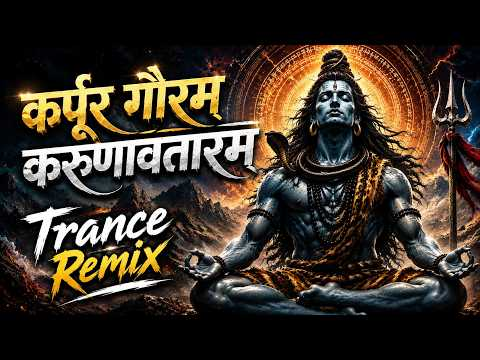
- 설명 앞부분: Karpur Gauram ∣ कर्पूर गौरम् ∣ Shiva Stotram Trance Remix ∣ Divine Peaceful Devotional Song Experience the divine energy of Karpur Gauram in a peaceful trance remix style. This Shiva Stotram devotional version is created for meditation, prayer, inner calm, and spiritual immersion. Feel the sacred v…
- 같은 채널 평소 대비 ×1,301.6 (채널 최근 롱폼 중앙값 948회) · 평소 영상: Powerful Shiv Mantra ∣ Om Tryambakam Yajamahe ∣ म… (948회) / Govinda Gopala Re Kanhaiya Nandalala ∣ गोविंदा गो… (1,034회)
- 대본 없음 (설명) — 음성인식이 끝나면 도입부·흐름이 들어감
- 댓글 337/337: 좋은 점 — 영상 0 · 감사·응원 0 · 더 알고 싶은 것 0 · 아쉬운 점 — 영상 0 · 반박·불만 — 의견 다름 0 · 정치·사회 0 · 경험 공유 0 · 구독·다음 기대 0

### 203. 🎹 Your Name (君の名は。) Relaxing Piano BGM ∣ Anime Piano Lounge

- https://www.youtube.com/watch?v=Gv3qOVcC5X8 · AnimeBeats · 구독자 1,270 · 조회수 378,378 (×297.9, 하루 2,137.5) · 좋아요 1,834 (0.5%) · 57.6분 · 2026-04-25 · 주제 묶음 4. 카페·매장·라운지 · 형식 커버·직접 부른 노래 · 폴더 `W_Gv3qOVcC5X8` (웹 승인)
- 썸네일: 
- 챕터: 0:00 Dream Lantern · 2:57 School Road · 4:50 Itomori High School · 7:34 First View of Tokyo · 10:01 Cafe at Last · 12:36 Theme of Ms. Okudera · 15:44 Unusual Changes of Two · 18:32 Zenzenzense · 21:06 Goshintai · 24:37 Date · 27:40 Autumn Festival · 30:03 Evoking Memories · 32:22 Visit to Hida · 34:42 Library · 37:28 The Night Inn · 40:20 Again to Goshintai · 43:08 Kuchikamizake Trip · 46:49 Council of War · 48:47 Persuading Mayor · 52:08 Katawaredoki
- 설명 앞부분: Relive the emotional journey of Taki and Mitsuha with this relaxing piano cover of the "Your Name" (Kimi no Na wa) soundtrack. Perfect for studying, working, or simply relaxing late at night. Welcome to Anime Piano Lounge. If you enjoy this calming anime music, please like and subscribe! Tracklist:
- 같은 채널 평소 대비 ×183.9 (채널 최근 롱폼 중앙값 2,057회) · 평소 영상: 🎹 Your Lie in April (四月は君の嘘) 🌸 Emotional Piano Co… (2,109회) / Your Name (君の名は。) 🍃 Distant Memories ∣ Relaxing C… (2,005회)
- 대본 없음 (설명) — 음성인식이 끝나면 도입부·흐름이 들어감
- 댓글 19/19: 좋은 점 — 영상 0 · 감사·응원 0 · 더 알고 싶은 것 0 · 아쉬운 점 — 영상 0 · 반박·불만 — 의견 다름 0 · 정치·사회 0 · 경험 공유 0 · 구독·다음 기대 0

### 204. 💖 मेरा चाँद मुझे आया नजर ∣ New Hindi Song 2026 ∣ Romantic Songs Bollywood ∣ #hindisong #b…

- https://www.youtube.com/watch?v=FxNQw0BRhWg · Feel The Music  · 구독자 3,320 · 조회수 985,019 (×296.7, 하루 30,001.3) · 좋아요 4,400 (0.4%) · 16.1분 · 2026-09-16 · 주제 묶음 기타 · 형식 음악 (그 밖 모양 — 한 편짜리 BGM 등) · 폴더 `W_FxNQw0BRhWg` (웹 승인)
- 썸네일: 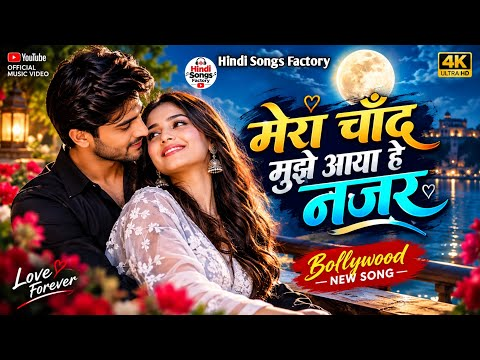
- 설명 앞부분: अगर आप सुकून, प्यार और हल्की सी यादों में खो जाना चाहते हैं, तो यह Romantic Hindi LoFi म्यूज़िक आपके लिए है। Bollywood Romantic Songs,Hindi Love Songs,Bollywood Mashup,Bollywood Love Mashup,Hindi Romantic Mashup,Arijit Singh songs,Jubin Nautiyal love songs,new hindi song,new hindi song 2025,jubin n…
- 같은 채널 평소 대비 ×583.5 (채널 최근 롱폼 중앙값 1,688회) · 평소 영상: Mind Relaxing Lofi Beats ∣ Slowed + Reverb 🎧Mix F… (2,000회) / Heartbreaking 💔 Lofi Mashup +Reverb Songs ∣ Relax… (1,376회)
- 대본 없음 (설명) — 음성인식이 끝나면 도입부·흐름이 들어감
- 댓글 65/65: 좋은 점 — 영상 0 · 감사·응원 0 · 더 알고 싶은 것 0 · 아쉬운 점 — 영상 0 · 반박·불만 — 의견 다름 0 · 정치·사회 0 · 경험 공유 0 · 구독·다음 기대 0

### 205. Nhạc Thiền Tĩnh Tâm 🌿 Giải Tỏa Căng Thẳng, Buông Bỏ Muộn Phiền & Ngủ Ngon

- https://www.youtube.com/watch?v=qTOqj4r0FNg · Thiền Sen Trúc · 구독자 2,050 · 조회수 607,753 (×296.5, 하루 5,903.8) · 좋아요 2,808 (0.5%) · 58.6분 · 2026-07-08 · 주제 묶음 1. 수면·명상·힐링 · 형식 음악 (그 밖 모양 — 한 편짜리 BGM 등) · 폴더 `W_qTOqj4r0FNg` (웹 승인)
- 썸네일: 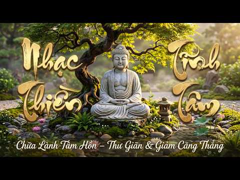
- 설명 앞부분: 🌿 Nhạc Thiền Tĩnh Tâm ∣ Giải Tỏa Căng Thẳng, Buông Bỏ Muộn Phiền & Ngủ Ngon Chào mừng bạn đến với không gian nhạc thiền tĩnh tâm, nơi những giai điệu nhẹ nhàng giúp bạn tìm lại sự bình yên sau những bộn bề của cuộc sống. Hãy để âm nhạc đưa bạn vào trạng thái thư thái, buông bỏ mọi căng thẳng, xoa d…
- 같은 채널 평소 대비 ×152.7 (채널 최근 롱폼 중앙값 3,980회) · 평소 영상: Nhạc Thiền Tĩnh Lặng 🍃 Giảm Căng Thẳng, Tịnh Tâm … (3,980회) / Nhạc Thiền Bình An 🍃Thả Lỏng Tâm Trí, Chữa Lành C… (3,312회)
- 대본 없음 (설명) — 음성인식이 끝나면 도입부·흐름이 들어감
- 댓글 433/433: 좋은 점 — 영상 0 · 감사·응원 0 · 더 알고 싶은 것 0 · 아쉬운 점 — 영상 0 · 반박·불만 — 의견 다름 0 · 정치·사회 0 · 경험 공유 0 · 구독·다음 기대 0

### 206. pov: you're blushing while listening to this 🎧✨

- https://www.youtube.com/watch?v=MOpFDe87RBM · NIKKU  · 구독자 9,120 · 조회수 2,678,324 (×293.7, 하루 20,486.7) · 좋아요 27,819 (1.0%) · 13.4분 · 2026-06-10 · 주제 묶음 기타 · 형식 플레이리스트·모음 (여러 곡) · 폴더 `W_MOpFDe87RBM` (웹 승인)
- 썸네일: 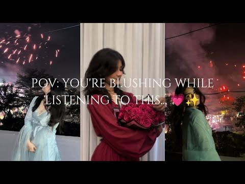
- 챕터: 0:00 Manwa Lage · 0:56 Tum Jo Aaye · 1:39 Teri Ore · 2:35 Zaalima · 4:01 Mai Rang Sharbaton Ka · 4:54 Titli · 5:45 Bol Halke Halke · 6:50 Sun Sathiya · 7:45 Subhanallah · 8:47 Sawar Loon · 9:58 Dagabaaz Re · 10:50 Falak Tak · 11:57 Saathiya · 12:53 Special Outro (Hota agar mai …
- 설명 앞부분: pov: you're blushing while listening to this 🎧✨ Put on your headphones for the ultimate vibe experience. Because music always feels better when it's close to your soul. 🌙 Is playlist ko tab sunna jab tum akele ho, ya jab tumhe bas thoda sukoon chahiye. Ye kuch haseen pal tumhare dil ko ekdum halka …
- 같은 채널 평소 대비 ×3,059.2 (채널 최근 롱폼 중앙값 876회) · 평소 영상: songs that feel like falling in love... 🪐✨ (934회) / POV: listening to this when you miss them at 2 AM… (817회)
- 대본 없음 (설명) — 음성인식이 끝나면 도입부·흐름이 들어감
- 댓글 1,534/1,525: 좋은 점 — 영상 0 · 감사·응원 0 · 더 알고 싶은 것 0 · 아쉬운 점 — 영상 0 · 반박·불만 — 의견 다름 0 · 정치·사회 0 · 경험 공유 0 · 구독·다음 기대 0

### 207. LOVEIN & Ismail Uluçay - Drafting (Original Mix)

- https://www.youtube.com/watch?v=clQARvetnyk · LOVEIN · 구독자 40,500 · 조회수 11,884,118 (×293.4, 하루 71,258.1) · 좋아요 36,351 (0.3%) · 7.3분 · 2026-05-05 · 주제 묶음 4. 카페·매장·라운지 · 형식 음악 (그 밖 모양 — 한 편짜리 BGM 등) · 폴더 `W_clQARvetnyk` (웹 승인)
- 썸네일: 
- 설명 앞부분: DeepHouse / Car Music / Chill Music 🎧 Spotify Playlist: Song: LOVEIN & Ismail Uluçay - Drafting BIG THANKS❤ Video by 9INE EXPERIENCE: Follow LOVEIN: Follow İsmail Uluçay: Follow All Night Records: ✓ Click on the bell 🔔 and be the first to listen to music! ◉ COPYRIGHT OWNER: ◉ Please do not delete m…
- 같은 채널 평소 대비 ×184.3 (채널 최근 롱폼 중앙값 64,476회) · 평소 영상: LOVEIN - I Call (Original Mix) (65,604회) / Akcent - Stay With Me (LOVEIN Remix) (63,347회)
- 대본 없음 (설명) — 음성인식이 끝나면 도입부·흐름이 들어감
- 댓글 422/422: 좋은 점 — 영상 0 · 감사·응원 0 · 더 알고 싶은 것 0 · 아쉬운 점 — 영상 0 · 반박·불만 — 의견 다름 0 · 정치·사회 0 · 경험 공유 0 · 구독·다음 기대 0

### 208. 90s Romantic Hits DJ Mix ∣ Hindi Love Song ∣ 90s Romantic Bollywood Hits ∣ Old Is Gold Lo…

- https://www.youtube.com/watch?v=Lk2qE-YdhS8 · AM MUSIC HUB · 구독자 4,000 · 조회수 1,170,815 (×292.7, 하루 17,943.1) · 좋아요 3,473 (0.3%) · 16분 · 2026-08-15 · 주제 묶음 기타 · 형식 음악 (그 밖 모양 — 한 편짜리 BGM 등) · 폴더 `W_Lk2qE-YdhS8` (웹 승인)
- 썸네일: 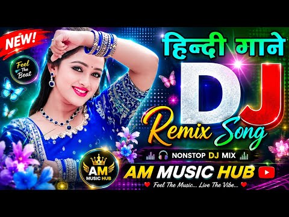
- 설명 앞부분: Welcome to our romantic music journey! ✨ Dive into a world of love, emotions, dreams, and beautiful melodies with this heartfelt romantic song. 💕 This track is dedicated to everyone who has ever fallen in love, missed someone special, or cherished unforgettable moments with their soulmate. 🌹❤ Let t…
- 같은 채널 평소 대비 ×2,399.2 (채널 최근 롱폼 중앙값 488회) · 평소 영상: 90s Romantic Hits DJ Mix ∣ Hindi Love Song ∣ 90s … (488회) / 90s Romantic Hits DJ Mix ∣ Hindi Love Song ∣ 90s … (504회)
- 대본 없음 (설명) — 음성인식이 끝나면 도입부·흐름이 들어감
- 댓글 50/50: 좋은 점 — 영상 0 · 감사·응원 0 · 더 알고 싶은 것 0 · 아쉬운 점 — 영상 0 · 반박·불만 — 의견 다름 0 · 정치·사회 0 · 경험 공유 0 · 구독·다음 기대 0

### 209. 난 아직 어린데

- https://www.youtube.com/watch?v=Zo3DsQ9j2J0 · 맹묘 · 구독자 1,580 · 조회수 459,506 (×290.8, 하루 3,531.8) · 좋아요 22,102 (4.8%) · 20.1분 · 2026-06-11 · 주제 묶음 기타 · 형식 플레이리스트·모음 (여러 곡) · 폴더 `W_Zo3DsQ9j2J0` (웹 승인)
- 썸네일: 
- 대본 없음 (없음) — 음성인식이 끝나면 도입부·흐름이 들어감
- 댓글 990/990: 좋은 점 — 영상 11 · 감사·응원 105 · 더 알고 싶은 것 6 · 아쉬운 점 — 영상 4 · 반박·불만 — 의견 다름 6 · 정치·사회 2 · 경험 공유 208 · 구독·다음 기대 0
  - 좋은 점 — 영상 👍2 “나 왜 아름다운 세상 가사를 까먹지 않은걸까? 유치원에서 배웠던건데”
  - 좋은 점 — 영상 👍0 “초등학생 5학년 학생입니다 전 중학교를 아이들이 많이 안 가는데를 지망하려는데 거기 가서 새학기때 저 빼고 다 놀고있고 아는애 없어서 뻘쭘해하는 애라도 친구하고 싶은데 없을까 걱정이 되고 그냥..지금 이런 인간관계가 맞을까 생각도들고 시험점수는 망했고 20살 되서 취…”
  - 감사·응원 👍63 “평생 10대 학생일줄알았는데 성인까지 반년도 안남은 고3이네요 다들 과거를 그리워하고 지금의 나보다 나은 내가 되길 원하지만 사실 지금의 모습이 가장 성공한, 행복한 나의 모습일거에요 오늘조차도 또다른 나의 과거가 될것이기에 우리 모두 힘내죠”
  - 감사·응원 👍58 “그냥 너무 힘들어.. 엄마아빠가 힘들면 쉬라고 하지만 현실적으로 쉴 수가 없잖아...공부해야지. 친화력도 떨어지고, 말재주도 없고, 예체능도 못하는데 어쩌겠어.. 앞으로 뭐해먹고 살아야 할지 막막하다. 남들 앞에서는 괜찮은 척하지만.. 너무 힘들어 누구한테 털어놓아야…”
  - 더 알고 싶은 것 👍2 “중학교에 입학한게 엊그제 같은데 벌써 고등학교를 준비하고 있네요 저는 고등학교도 멀다고 생각했고 성인은 더더욱 멀게 느껴져서 평생을 학생으로 살거라 막연히 생각했던 것 같아요 그런데 문득 저에게 학생으로 남을 시간이 4년밖에 남지 않았단걸 느끼니까 무서운게 많아졌어요…”
  - 더 알고 싶은 것 👍1 “하…. 궁금해서 눌렀는데 난 왜 울고있는거야..?”
  - 아쉬운 점 — 영상 👍632 “현재 08년생 입니다.. 벌써 마지막 10대의 절반이 지났다는게 믿겨지지 않네요. 어릴때 저녁밥 먹기 전 동네 친구들과 술래잡기 하던게 엊그제 같은데 저에겐 항상 멀게만 느껴졌던 20대라는 현실을 곧 마주할 생각을 하니 솔직히 현실감이 없습니다.. 아직 추억도 많이 …”
  - 아쉬운 점 — 영상 👍0 “순수한 어린 아이 같은 목소리가 너무 슬프게 느껴진다...ㅋㅋ”
  - 반박·불만 — 의견 다름 👍1 “나는 아직 중학생도아닌데 왜 미래를 걱정하고있지 난 그냥 엄마 아기 하고싶은데 엄마랑 이나이 그대로 계속 살아가고싶은데 평생 엄마 옆에있고싶은데”
  - 반박·불만 — 의견 다름 👍0 “진짜 자살하고 싶다.나 왜살지 기쁜척,괜찮은척,행복한척하면 뭐해, 진짜 척인데. 진짜 내가 아닌데.”
  - 정치·사회 👍6 “어렸을 땐 우리나라가 왜 청소년 자살율 1위 국가인지 이해조차 못했었는데, 고2가 된 지금 그 이유를 알 것 같다. 세상은 어린 친구들에게 너무 많은 선택을 요구하고, 고등학교에서의 짧은 3년, 아직 내가 뭘 좋아하고 뭘 잘하는지 모를지도 모르는 시기에 앞으로의 60…”
  - 정치·사회 👍0 “이선 성우님은 정말 대통령이 맞다”
  - 경험 공유 👍2,513 “내가 왜 고3일까… 평생 안 올 줄 알았는데 ㅠㅠㅠㅠ 뽀로로 너랑 걱정없이 놀 때가 너무 그리워…”
  - 경험 공유 👍1,898 “뉴스에서 고등학생 자살율 얘기할때 진짜 이해 안됐는데 막상 고등학생 되니까 내가 그 경계에 서있네”

### 210. Omnia vincit

- https://www.youtube.com/watch?v=5yKI8IQNzAo · Soul Beyond Silence · 구독자 460 · 조회수 133,775 (×290.8, 하루 1,174.3) · 좋아요 1,653 (1.2%) · 4.2분 · 2026-06-27 · 주제 묶음 기타 · 형식 정보·해설 (그 밖) · 폴더 `W_5yKI8IQNzAo` (웹 승인)
- 썸네일: 
- 설명 앞부분: Omnia Vincit is an Enigma-inspired mystical ambient journey about breaking invisible chains, inner awakening, and spiritual freedom. Let the ethereal soundscapes, sacred chants, and cinematic atmosphere guide you beyond the limits of the mind. ✨ If this music resonates with you, please Like, Subscr…
- 대본 없음 (설명) — 음성인식이 끝나면 도입부·흐름이 들어감
- 댓글 38/38: 좋은 점 — 영상 0 · 감사·응원 0 · 더 알고 싶은 것 0 · 아쉬운 점 — 영상 0 · 반박·불만 — 의견 다름 0 · 정치·사회 0 · 경험 공유 0 · 구독·다음 기대 0

### 211. Patar Bashori ∣ পাতার বাঁশরী ∣ Lofi Bangla Song ∣ Emotional Bangla Song ∣ Jasu Lo-Fi

- https://www.youtube.com/watch?v=rgKNbCrC-cc · Jasu LOFI  · 구독자 26,700 · 조회수 7,754,679 (×290.4, 하루 96,014.0) · 좋아요 33,670 (0.4%) · 4.1분 · 2026-07-30 · 주제 묶음 8. 로파이·시티팝·칠 · 형식 한 곡 (뮤직비디오·음원·가사) · 폴더 `W_rgKNbCrC-cc` (웹 승인)
- 썸네일: 
- 설명 앞부분: Patar Bashori ∣ পাতার বাঁশরী ∣ Lofi Bangla Song ∣ Sad Bangla Song ∣ Koster Song ∣ Jasu Lo-Fi 💙 Welcome to Jasu Lo-Fi Enjoy the emotional Lo-Fi version of **"Patar Bashori (পাতার বাঁশরী)"**. This beautiful Bangla song is presented with soft Lo-Fi beats, relaxing melodies, and heartfelt emotions to c…
- 같은 채널 평소 대비 ×3,962.5 (채널 최근 롱폼 중앙값 1,957회) · 평소 영상: দিতে গিয়ে প্রেমের মাশুল ∣ Dite Giye Premer Masul … (1,957회) / মাথার মানজন করে ভাবি ∣ Matha Manjon Kore Vabi ∣ B… (1,955회)
- 대본 없음 (설명) — 음성인식이 끝나면 도입부·흐름이 들어감
- 댓글 1,081/1,081: 좋은 점 — 영상 0 · 감사·응원 0 · 더 알고 싶은 것 0 · 아쉬운 점 — 영상 0 · 반박·불만 — 의견 다름 0 · 정치·사회 0 · 경험 공유 0 · 구독·다음 기대 0

### 212. 𝘊𝘦𝘳𝘵𝘪𝘧𝘪𝘦𝘥 𝘋𝘦𝘴𝘪 𝘉𝘢𝘯𝘨𝘦𝘳𝘴 𝘵𝘩𝘢𝘵 𝘴𝘭𝘢𝘱 (+𝘵𝘪𝘮𝘦𝘴𝘵𝘢𝘮𝘱𝘴) 💅🔥

- https://www.youtube.com/watch?v=PZcsGXrrBGY · A BEE Editz · 구독자 10,200 · 조회수 2,946,747 (×288.9, 하루 50,965.5) · 좋아요 0 (0.0%) · 12.9분 · 2026-08-22 · 주제 묶음 기타 · 형식 플레이리스트·모음 (여러 곡) · 폴더 `W_PZcsGXrrBGY` (웹 승인)
- 썸네일: 
- 챕터: 0:00 Tu Cheez Badi Hai Mast Mast · 1:18 Nachange Saari Raat · 2:34 High Heels · 4:15 Baby Doll · 6:17 Teri Lat Lag Ja Gi · 7:26 First Kiss · 8:41 Bom Diggy · 9:38 Main Tera Boyfriend · 10:59 Kamariya
- 설명 앞부분: Certified Desi Bangers only. 💅🔥 Turn up the volume! Here is the ultimate lineup of high-energy Desi dance hits that never miss at parties, road trips, or workout sessions. Drop a comment with your favorite track below, and don't forget to like and subscribe for more curated vibes. 🎧✨ .. .. TIMESTAM…
- 같은 채널 평소 대비 ×52.3 (채널 최근 롱폼 중앙값 56,374회) · 평소 영상: You're in Love 🌸✨... and Everything Feels Differe… (60,735회) / This Playlist Will Make You Miss Someone You Love… (52,014회)
- 대본 없음 (설명) — 음성인식이 끝나면 도입부·흐름이 들어감
- 댓글 363/352: 좋은 점 — 영상 0 · 감사·응원 0 · 더 알고 싶은 것 0 · 아쉬운 점 — 영상 0 · 반박·불만 — 의견 다름 0 · 정치·사회 0 · 경험 공유 0 · 구독·다음 기대 0

### 213. 🤍Golden brown x Love story (Piano Cover)🤍

- https://www.youtube.com/watch?v=dK4RoOPXQ0Q · Solaceful Keys · 구독자 212 · 조회수 61,208 (×288.7, 하루 654.0) · 좋아요 1,149 (1.9%) · 4.1분 · 2026-07-17 · 주제 묶음 6. 피아노·클래식·연주곡 · 형식 커버·직접 부른 노래 · 폴더 `W_dK4RoOPXQ0Q` (웹 승인)
- 썸네일: 
- 설명 앞부분: ✨A song very close to my heart💓.I have practised this song a lot, and refined it as much as i could. If u like this video, do make sure to leave a like and also subscribe my channel. :DDDD 🎧 Use headphones for better experience! searching tags: Golden Brown piano cover Love Story Indila piano cover…
- 대본 없음 (설명) — 음성인식이 끝나면 도입부·흐름이 들어감
- 댓글 82/82: 좋은 점 — 영상 0 · 감사·응원 0 · 더 알고 싶은 것 0 · 아쉬운 점 — 영상 0 · 반박·불만 — 의견 다름 0 · 정치·사회 0 · 경험 공유 0 · 구독·다음 기대 0

### 214. Golden Melodies for the Soul (Sax & Violin Lounge)

- https://www.youtube.com/watch?v=0shfF2LDgmI · Timeless Echo · 구독자 5,700 · 조회수 1,643,724 (×288.4, 하루 12,040.2) · 좋아요 10,560 (0.6%) · 6.7분 · 2026-06-04 · 주제 묶음 4. 카페·매장·라운지 · 형식 음악 (그 밖 모양 — 한 편짜리 BGM 등) · 폴더 `W_0shfF2LDgmI` (웹 승인)
- 썸네일: 
- 챕터: 0:00 The Moon Awakens · 2:44 Starlight Promenade · 6:10 Finale
- 설명 앞부분: 🌙 Moonlight Serenade – Romantic Saxophone & Violin ∣ Cinematic AI Visual Journey Two musicians meet in a candlelit ballroom, and their music follows them from rainy terraces to a rooftop above the city lights. A slow, romantic instrumental journey for quiet nights. 🎬 Timestamps 🎬 About the Visuals …
- 같은 채널 평소 대비 ×176.8 (채널 최근 롱폼 중앙값 9,299회) · 평소 영상: Timeless Symphony A Love Story Across Centuries S… (9,411회) / Velvet Romance ∣ Saxophone & Violin Soul Fusion (9,187회)
- 대본 없음 (설명) — 음성인식이 끝나면 도입부·흐름이 들어감
- 댓글 356/356: 좋은 점 — 영상 0 · 감사·응원 2 · 더 알고 싶은 것 0 · 아쉬운 점 — 영상 0 · 반박·불만 — 의견 다름 0 · 정치·사회 0 · 경험 공유 0 · 구독·다음 기대 0
  - 감사·응원 👍4 “해 저무는 저녁 나절 지난 세월 아픈 마음 다독이던 나자리노의 ' 잊고 살리라 !' 가 이제는 갈 시간 가가워지고 있는 나에게는 한 자락 꿈 같이 돼 버렸네요 수고하시는 분께 감사의 마음 전합니다 ♡◇♡”
  - 감사·응원 👍2 “안녕하세요 아름답고멋져요 감미롭고감동 이네요 좋은하루되세요 너무좋아요 감사합니다 선생님 수고하셨습니다 너무잘하십니다 무더운날씨에건강조심하셔요 🎉🎉🎉구독꼬옥 좋은하루되세요 ❤❤❤”

### 215. [グラブル] Granblue Fantasy OST - Last Salvation (vs. Raskeid & Hewle) (ラスケィドとフューレBGM)

- https://www.youtube.com/watch?v=TFsAT5TtzSg · Decim · 구독자 1,650 · 조회수 468,480 (×283.9, 하루 5,228.7) · 좋아요 2,992 (0.6%) · 7분 · 2026-07-21 · 주제 묶음 기타 · 형식 음악 (그 밖 모양 — 한 편짜리 BGM 등) · 폴더 `W_TFsAT5TtzSg` (웹 승인)
- 썸네일: 
- 설명 앞부분: Track 367 BGM that plays when you fight Raskeid in Evoking Solomonis
- 같은 채널 평소 대비 ×415.0 (채널 최근 롱폼 중앙값 1,129회) · 평소 영상: 「グラブル」Granblue Fantasy: Symphony in Blue - Battle… (1,129회) / 「グラブル」Granblue Fantasy: Symphony in Blue - The Jo… (1,133회)
- 대본 없음 (설명) — 음성인식이 끝나면 도입부·흐름이 들어감
- 댓글 416/415: 좋은 점 — 영상 0 · 감사·응원 0 · 더 알고 싶은 것 0 · 아쉬운 점 — 영상 0 · 반박·불만 — 의견 다름 0 · 정치·사회 0 · 경험 공유 0 · 구독·다음 기대 0

### 216. [커버곡] 가는세월 🎧 락발라드로 다시 태어난 불후의 명곡 🎶두둥치 DUDUNGCHI

- https://www.youtube.com/watch?v=0J4iOmTGAgo · 두둥치 · 구독자 255 · 조회수 70,711 (×277.3, 하루 443.7) · 좋아요 375 (0.5%) · 4.2분 · 2026-05-12 · 주제 묶음 9. 가요·발라드·트로트 · 형식 커버·직접 부른 노래 · 폴더 `W_0J4iOmTGAgo` (웹 승인)
- 썸네일: 
- 설명 앞부분: 🎧 이 곡은 음원으로도 들을 수 있습니다 YouTube Music · Apple Music · Spotify에서 [두둥치] 검색 🎶 두둥치 (DUDUNGCHI) 채널에 오신 걸 환영합니다! 쟝르를 넘나드는 감성 음악 채널입니다. K-pop, R&B, 재즈, 발라드, 힙합, 트로트, 동요까지 제작 기업홍보송, CM송, 선거홍보송, 응원가, 주제가 제작 특별한 순간들로 가득한 힐링 음악 채널 🎵 [커버곡] 가는세월 🎧 락발라드로 다시 태어난 불후의 명곡 🎶두둥치 DUDUNGCHI
- 같은 채널 평소 대비 ×456.2 (채널 최근 롱폼 중앙값 155회) · 평소 영상: [𝐏𝐥𝐚𝐲𝐥𝐢𝐬𝐭] 두둥치_슬픈 발라드 노래 모음 🌧️3시간 연속듣기 (178회) / [커버곡] 트로트 🎙️ 버거형의 트로트가 더 신나게 재 탄생되었다!! 🎙️ (132회)
- 대본 없음 (설명) — 음성인식이 끝나면 도입부·흐름이 들어감
- 댓글 26/26: 좋은 점 — 영상 0 · 감사·응원 1 · 더 알고 싶은 것 1 · 아쉬운 점 — 영상 0 · 반박·불만 — 의견 다름 0 · 정치·사회 0 · 경험 공유 1 · 구독·다음 기대 0
  - 감사·응원 👍0 “감도밉니다고맙습니다”
  - 더 알고 싶은 것 👍1 “구독!!! 좋은곡 많이 부탁드립니다”

### 217. Peni Me Chheni Satai Diyo -Instagram Trending Lofi Song ∣ Awadhesh Premi Old song• Slowed…

- https://www.youtube.com/watch?v=gJyWm3GFFik · Tushar Music Bass King  · 구독자 5,660 · 조회수 1,569,234 (×277.2, 하루 19,810.2) · 좋아요 5,541 (0.4%) · 6.1분 · 2026-08-01 · 주제 묶음 8. 로파이·시티팝·칠 · 형식 음악 (그 밖 모양 — 한 편짜리 BGM 등) · 폴더 `W_gJyWm3GFFik` (웹 승인)
- 썸네일: 
- 같은 채널 평소 대비 ×1,307.7 (채널 최근 롱폼 중앙값 1,200회) · 평소 영상: Deware Chhina Kaile Ba ∣ Instagram Viral Song - A… (1,200회) / Palani Me Jawani Rowata - Instagram Trending Lofi… (1,159회)
- 대본 없음 (없음) — 음성인식이 끝나면 도입부·흐름이 들어감
- 댓글 87/87: 좋은 점 — 영상 0 · 감사·응원 0 · 더 알고 싶은 것 0 · 아쉬운 점 — 영상 0 · 반박·불만 — 의견 다름 0 · 정치·사회 0 · 경험 공유 0 · 구독·다음 기대 0

### 218. Cozy Rainy Autumn Café 🍁 Relaxing Day with Warm Jazz Music & Fireplace Sounds for Peacefu…

- https://www.youtube.com/watch?v=1wyP0BN_jqI · Tiny Café Jazz · 구독자 3,900 · 조회수 1,079,729 (×276.9, 하루 11,372.4) · 좋아요 4,687 (0.4%) · 231.1분 · 2026-07-16 · 주제 묶음 4. 카페·매장·라운지 · 형식 음악 (그 밖 모양 — 한 편짜리 BGM 등) · 폴더 `W_1wyP0BN_jqI` (웹 승인)
- 썸네일: 
- 설명 앞부분: Cozy Rainy Autumn Café 🍁 Relaxing Day with Warm Jazz Music & Fireplace Sounds for Peaceful Moments This video gives you a glimpse into a cozy little corner where smooth jazz melodies, gentle piano notes and warm café ambience come together to create peaceful moments for your soul. Here, the sound o…
- 같은 채널 평소 대비 ×532.4 (채널 최근 롱폼 중앙값 2,028회) · 평소 영상: A Rainy Evening Made for Coffee, Jazz & Quiet Mom… (2,028회) / Let the Rain Night Take Its Time☕Peaceful Autumn … (1,854회)
- 대본 없음 (설명) — 음성인식이 끝나면 도입부·흐름이 들어감
- 댓글 457/452: 좋은 점 — 영상 0 · 감사·응원 0 · 더 알고 싶은 것 0 · 아쉬운 점 — 영상 0 · 반박·불만 — 의견 다름 0 · 정치·사회 0 · 경험 공유 0 · 구독·다음 기대 0

### 219. "수고했어..오늘은 푹 자! 😴 마음을 편하게 해주는 피아노 수면음악 (10 Hours)

- https://www.youtube.com/watch?v=3br0mkww4do · jazzyang 재즈냥 · 구독자 1,370 · 조회수 378,436 (×276.2, 하루 4,037.8) · 좋아요 1,981 (0.5%) · 616.6분 · 2026-07-17 · 주제 묶음 1. 수면·명상·힐링 · 형식 플레이리스트·모음 (여러 곡) · 폴더 `W_3br0mkww4do` (웹 승인)
- 썸네일: 
- 설명 앞부분: 🌙 오늘도 정말 수고하셨습니다. 복잡했던 하루를 내려놓고, 편안한 피아노 선율과 함께 깊은 휴식을 가져보세요. 잠들기 전, 명상, 휴식, 공부 후 힐링, 스트레스 완화에 함께해 보세요. 오늘은 아무 걱정 없이 푹 쉬세요. 편안한 밤 되시길 바랍니다. 🤍 Take a deep breath, let go of the day, and relax with the gentle sound of soft piano music. This 10-hour sleep music playlist is designed to help calm your m…
- 같은 채널 평소 대비 ×1,386.2 (채널 최근 롱폼 중앙값 273회) · 평소 영상: Playlist ∣ 고양이들의 일상이 담긴노래🐱 Songs inspired by the … (273회) / Playlist ☕ 커피로 잠 깨며 듣는 어쿠스틱 팝송 ∣ Acoustic Pop, Ca… (296회)
- 대본 없음 (설명) — 음성인식이 끝나면 도입부·흐름이 들어감
- 댓글 91/91: 좋은 점 — 영상 0 · 감사·응원 3 · 더 알고 싶은 것 0 · 아쉬운 점 — 영상 0 · 반박·불만 — 의견 다름 0 · 정치·사회 0 · 경험 공유 0 · 구독·다음 기대 1
  - 감사·응원 👍10 “틀어놓고 오랫만에 밤새 꿀잠을 잤네요. 감사합니다.😊”
  - 감사·응원 👍7 “브라질에서 연락 주셨네요, 감사합니다! 🤗🇧🇷🇰🇷”
  - 구독·다음 기대 👍5 “정말 좋은 음악 입니다 구독하고 응원 합니다~”

### 220. Shri Krishna Govind Hare Murari - Non Stop Krishna Bhajans Lofi ∣ Bhakti Song ∣ Krishna B…

- https://www.youtube.com/watch?v=Tqr5PqrzeQw · Bhajan World official · 구독자 33,000 · 조회수 9,069,848 (×274.8, 하루 81,097.7) · 좋아요 73,830 (0.8%) · 29.8분 · 2026-06-29 · 주제 묶음 8. 로파이·시티팝·칠 · 형식 음악 (그 밖 모양 — 한 편짜리 BGM 등) · 폴더 `W_Tqr5PqrzeQw` (웹 승인)
- 썸네일: 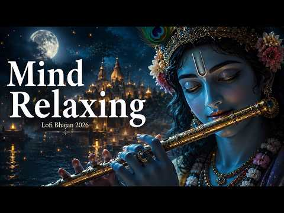
- 설명 앞부분: Shri Krishna Govind Hare Murari - Non Stop Krishna Bhajans Lofi ∣ Bhakti Song ∣ Krishna Bhajan Shri Krishna Govind Hare Murari - Non Stop Krishna Bhajans Lofi ∣ Bhakti Song ∣ Krishna Bhajan Shri Krishna Govind Hare Murari, Non Stop Krishna Bhajans Lofi, Krishna Bhajan, Bhakti Song, lofi krishna bha…
- 같은 채널 평소 대비 ×122.8 (채널 최근 롱폼 중앙값 73,836회) · 평소 영상: Shri Krishna Govind Hare Murari - Non Stop Krishn… (73,836회) / Shri Krishna Govind Hare Murari - Non Stop Krishn… (85,588회)
- 대본 없음 (설명) — 음성인식이 끝나면 도입부·흐름이 들어감
- 댓글 1,540/1,540: 좋은 점 — 영상 0 · 감사·응원 0 · 더 알고 싶은 것 0 · 아쉬운 점 — 영상 0 · 반박·불만 — 의견 다름 0 · 정치·사회 0 · 경험 공유 0 · 구독·다음 기대 0

### 221. 😱NEW VIRAL😱SOBRANG SIKAT SA DISCO DJ MIX KABA-KABA NONSTOP PARTY MUSIC 2026

- https://www.youtube.com/watch?v=EF2Bbs1GWm0 · VIRAL MIX COLLECTION · 구독자 16,700 · 조회수 4,581,418 (×274.3, 하루 26,125.8) · 좋아요 16,185 (0.4%) · 29.8분 · 2026-04-27 · 주제 묶음 기타 · 형식 음악 (그 밖 모양 — 한 편짜리 BGM 등) · 폴더 `W_EF2Bbs1GWm0` (웹 승인)
- 썸네일: 
- 설명 앞부분: VIRAL DISCO PARTY MUSIC
- 같은 채널 평소 대비 ×20,138.1 (채널 최근 롱폼 중앙값 228회) · 평소 영상: MAX SURBAN - DI KAMAO (MASA BANGER REMIX 2026)@VI… (229회) / MASA BANGER DISCO REMIX 2026 🔥LOVE SONG REMIX🔥@VI… (226회)
- 대본 없음 (설명) — 음성인식이 끝나면 도입부·흐름이 들어감
- 댓글 606/606: 좋은 점 — 영상 0 · 감사·응원 0 · 더 알고 싶은 것 0 · 아쉬운 점 — 영상 0 · 반박·불만 — 의견 다름 0 · 정치·사회 0 · 경험 공유 0 · 구독·다음 기대 0

### 222. [ Playlist ] 어떻게 너가 다른 남자를 만나

- https://www.youtube.com/watch?v=0USEQaYCf78 · 하온 · 구독자 1,700 · 조회수 462,610 (×272.1, 하루 5,522.7) · 좋아요 4,019 (0.9%) · 20.9분 · 2026-07-27 · 주제 묶음 기타 · 형식 플레이리스트·모음 (여러 곡) · 폴더 `W_0USEQaYCf78` (웹 승인)
- 썸네일: 
- 챕터: 0:00 릴러말즈 - 거리에서 · 3:28 WINNER - 끼부리지마 · 6:52 범키 - 갖고놀래 · 10:30 태산 - 네가 생각난단 말이야 (자작곡) · 13:19 basecamp - camp · 17:01 디핵 - OHAYO MY NIGHT
- 설명 앞부분: 그냥 내 스타일 대로 함 만들어봐써.. 😳
- 대본 없음 (설명) — 음성인식이 끝나면 도입부·흐름이 들어감
- 댓글 48/48: 좋은 점 — 영상 1 · 감사·응원 0 · 더 알고 싶은 것 0 · 아쉬운 점 — 영상 0 · 반박·불만 — 의견 다름 0 · 정치·사회 0 · 경험 공유 0 · 구독·다음 기대 0
  - 좋은 점 — 영상 👍14 “아니 와 완전 야르한 플리.. ㄹㅇ 레전드 플리 찾은 거 같아서 기분 개좋음”

### 223. Vachindamma (Lyrics + English Translation) ∣ Geetha Govindam ∣ Sid Sriram ∣ Vijay Devarak…

- https://www.youtube.com/watch?v=DliA185LSPU · LYRICS FOR YOU · 구독자 5,220 · 조회수 1,417,140 (×271.5, 하루 8,299.0) · 좋아요 9,973 (0.7%) · 4.1분 · 2026-05-01 · 주제 묶음 기타 · 형식 한 곡 (뮤직비디오·음원·가사) · 폴더 `W_DliA185LSPU` (웹 승인)
- 썸네일: 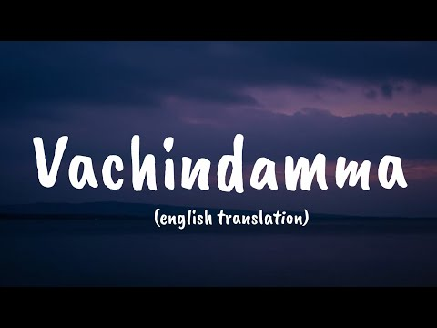
- 설명 앞부분: “Vachindamma” from the movie Geetha Govindam is a beautiful Telugu romantic song sung by Sid Sriram. With heartfelt lyrics written by Sri Mani and soothing music composed by Gopi Sunder, the song captures the joy and magic of falling in love. Featuring Vijay Devarakonda and Rashmika Mandanna, the t…
- 같은 채널 평소 대비 ×236.7 (채널 최근 롱폼 중앙값 5,987회) · 평소 영상: Raja Heluvagella (Lyrics) ∣ Raj The showman ∣ Shr… (5,987회) / Yendu Kanda Kanasu (Lyrics) ∣ Lankesh Patrike ∣ R… (5,887회)
- 대본 없음 (설명) — 음성인식이 끝나면 도입부·흐름이 들어감
- 댓글 240/240: 좋은 점 — 영상 0 · 감사·응원 0 · 더 알고 싶은 것 0 · 아쉬운 점 — 영상 0 · 반박·불만 — 의견 다름 0 · 정치·사회 0 · 경험 공유 0 · 구독·다음 기대 0

### 224. 𝐏𝐥𝐚𝐲𝐥𝐢𝐬𝐭 l 연모(戀慕)

- https://www.youtube.com/watch?v=uVbmoXg5YvI · 미니악단 · 구독자 643 · 조회수 174,180 (×270.9, 하루 1,473.3) · 좋아요 4,378 (2.5%) · 69분 · 2026-06-23 · 주제 묶음 3. 공부·집중·작업 · 형식 플레이리스트·모음 (여러 곡) · 폴더 `W_uVbmoXg5YvI` (웹 승인)
- 썸네일: 
- 설명 앞부분: 연모(戀慕) : 사랑하여 간절히 그리워함. Photo Credit : Pinterest 당신을 위한 플레이리스트[Palylist]
- 같은 채널 평소 대비 ×705.2 (채널 최근 롱폼 중앙값 247회) · 평소 영상: 𝐏𝐥𝐚𝐲𝐥𝐢𝐬𝐭 무도회를 기다리며 l The Princess Waltz - Before … (247회) / 𝐏𝐥𝐚𝐲𝐥𝐢𝐬𝐭 유성우 아래 약속 l Work & Study Fantasy Music✎﹏ (234회)
- 대본 없음 (설명) — 음성인식이 끝나면 도입부·흐름이 들어감
- 댓글 88/88: 좋은 점 — 영상 0 · 감사·응원 1 · 더 알고 싶은 것 1 · 아쉬운 점 — 영상 0 · 반박·불만 — 의견 다름 1 · 정치·사회 0 · 경험 공유 4 · 구독·다음 기대 0
  - 감사·응원 👍0 “잘들을께요 ❤❤❤화이팅”
  - 더 알고 싶은 것 👍0 “연을 역으로 바꾼 버전도 만들어 주세요”
  - 반박·불만 — 의견 다름 👍132 “-내가 약조하마.너를 지켜주겠다고. 그렇게 다정히 말씀하시던 든든한 나의 님은, 지금 풀숲에 쓰러져 간신히 숨만 내쉬고 계신다. -상공, 제발 숨만 쉬십시오. 제가 어떻게든... -연화야. 상공의 손이 나의 손은 따스히 잡아온다.그 온기가 서글프도록 따뜻해서, 심장 …”
  - 경험 공유 👍132 “-내가 약조하마.너를 지켜주겠다고. 그렇게 다정히 말씀하시던 든든한 나의 님은, 지금 풀숲에 쓰러져 간신히 숨만 내쉬고 계신다. -상공, 제발 숨만 쉬십시오. 제가 어떻게든... -연화야. 상공의 손이 나의 손은 따스히 잡아온다.그 온기가 서글프도록 따뜻해서, 심장 …”
  - 경험 공유 👍5 “무조건 내가 가고싶은 극 상향 학교만 다 합격, 최초합격해라…. 한번만 내 소원을 들어주길”

### 225. Heartbreaking 💔 songs + lofi Mashup songs Slowed Reverb songs Arijit singsong.

- https://www.youtube.com/watch?v=swi-om1VW34 · JR buzdar official  · 구독자 16,400 · 조회수 4,419,170 (×269.5, 하루 80,008.7) · 좋아요 12,775 (0.3%) · 8분 · 2026-08-25 · 주제 묶음 8. 로파이·시티팝·칠 · 형식 음악 (그 밖 모양 — 한 편짜리 BGM 등) · 폴더 `W_swi-om1VW34` (웹 승인)
- 썸네일: 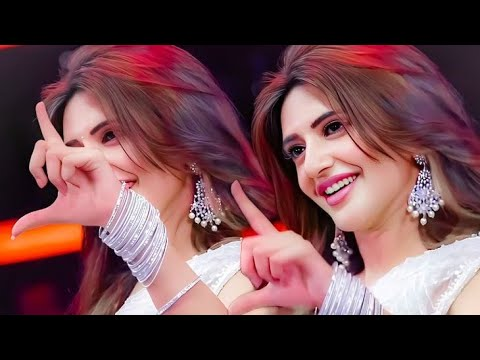
- 설명 앞부분: Welcome to the world of soothing lofi music, where stress fades away, and peace takes over. This Latest 2026 mind-relaxing lofi mix is perfect for: Deep Focus & Studying 📖 Relaxing & Meditation 🧘‍♂ Chilling After a Long Day 🌅 Peaceful Sleep & Stress Relief 😴 Let these calm beats and chill vibes tak…
- 같은 채널 평소 대비 ×12,662.4 (채널 최근 롱폼 중앙값 349회) · 평소 영상: Heartbreaking 💔 LoFi Mashup 🎧 Slowed + Reverb Son… (352회) / Heartbreaking 💔 LoFi Mashup 🎧 Slowed + Reverb Son… (346회)
- 대본 없음 (설명) — 음성인식이 끝나면 도입부·흐름이 들어감
- 댓글 202/202: 좋은 점 — 영상 0 · 감사·응원 0 · 더 알고 싶은 것 0 · 아쉬운 점 — 영상 0 · 반박·불만 — 의견 다름 0 · 정치·사회 0 · 경험 공유 0 · 구독·다음 기대 0

### 226. Hum Tere Hote Toh ( Official Music ) Musafir cafe ....

- https://www.youtube.com/watch?v=V_UCyoYIWEo · Music Covers & Remixes · 구독자 1,750 · 조회수 470,869 (×269.1, 하루 5,661.7) · 좋아요 5,000 (1.1%) · 4.4분 · 2026-07-28 · 주제 묶음 4. 카페·매장·라운지 · 형식 음악 (그 밖 모양 — 한 편짜리 BGM 등) · 폴더 `W_V_UCyoYIWEo` (웹 승인)
- 썸네일: 
- 설명 앞부분: Hum Tere Hote Toh .... 💖💕 Some souls meet forever, but too early or too late! Feel the Love with "Darmiyaan (Unplugged)" from the "Musafir Cafe". Starring Vikrant Massey, Vedika Pinto and Mahima Makwana as Chander, Sudha and Preeti, weave a tale full of love and longing with Musafir Cafe, Chander’s…
- 같은 채널 평소 대비 ×410.9 (채널 최근 롱폼 중앙값 1,146회) · 평소 영상: Hona Tha Pyaar 2.0 - Atif Aslam - Hadiqa Kiani (L… (1,146회) / Lyrical;Tum Jo Aaye ∣Once Upon A Time In Mumbail … (1,090회)
- 대본 없음 (설명) — 음성인식이 끝나면 도입부·흐름이 들어감
- 댓글 79/79: 좋은 점 — 영상 0 · 감사·응원 0 · 더 알고 싶은 것 0 · 아쉬운 점 — 영상 0 · 반박·불만 — 의견 다름 0 · 정치·사회 0 · 경험 공유 0 · 구독·다음 기대 0

### 227. 조영버 노동요

- https://www.youtube.com/watch?v=twTedu4I1mg · 궈바오러우 · 구독자 498 · 조회수 133,708 (×268.5, 하루 801.4) · 좋아요 2,393 (1.8%) · 19.7분 · 2026-05-05 · 주제 묶음 3. 공부·집중·작업 · 형식 플레이리스트·모음 (여러 곡) · 폴더 `W_twTedu4I1mg` (웹 승인)
- 썸네일: 
- 챕터: 0:00 ZXKAI & SLXUGHTER - NO BATIDÃO · 1:29 Nakama; MC Staff - MENTE MÁ · 2:44 Taki Taki - DJ Snake; Selena … · 4:14 SPRING BREAK IN MEXICO - Hede… · 5:15 Tanir; Tyomcha; Mikis - Da Da… · 6:58 Dubidubidu - Christell · 9:56 林树豪 - 打歌妹 · 15:59 DJ小沐 - 伯虎说（就这个停顿爽1.1x） · 18:34 羊音乐 - 弥渡山歌 (PHONK)
- 대본 없음 (없음) — 음성인식이 끝나면 도입부·흐름이 들어감
- 댓글 205/205: 좋은 점 — 영상 3 · 감사·응원 4 · 더 알고 싶은 것 1 · 아쉬운 점 — 영상 0 · 반박·불만 — 의견 다름 0 · 정치·사회 5 · 경험 공유 1 · 구독·다음 기대 0
  - 좋은 점 — 영상 👍3 “레전드 퀄리티 거대하고 웅장한 브금 시원시원한 가사가 맘에 드네요”
  - 좋은 점 — 영상 👍2 “영도때문에 뇌이징이 된건가 ㅈㄴ 특이한데 다 듣기좋은게 신기하네”
  - 감사·응원 👍24 “정말 고맙다...”
  - 감사·응원 👍5 “고맙다 조강현 너덕분에 궈바오를 알게되었다”
  - 더 알고 싶은 것 👍30 “진짜 ' '서운 이야기 띵!... 똥!... 유튜브 댓글에 알람이 떴어. "저 브라질 펑크에 관심이 많은데 이 분이 브라질 펑크 부른거만 모아서 영상 만들어 주실 수 있나요?" 그냥 자기가 듣고 찾아서 모음 딸깍하면 되는 황당한 요구를 하다니.. 저 사람은 너무 '오…”
  - 정치·사회 👍1 “대한민국 대통령은 조영버를 내한시켜라”
  - 정치·사회 👍0 “너가왜 중국인인거냐 대체”
  - 경험 공유 👍1 “내가 버튜버에 빠질줄이야”

### 228. Rest Your Mind ∣ Your Brain Needs Silence ∣ Dopamine Reset 🌿 Bansuri for the Overstimulat…

- https://www.youtube.com/watch?v=UWZ_QQNKmes · Essential Indian Soul Meditation · 구독자 19,100 · 조회수 5,110,672 (×267.6, 하루 44,802.8) · 좋아요 63,696 (1.2%) · 20.7분 · 2026-06-27 · 주제 묶음 1. 수면·명상·힐링 · 형식 음악 (그 밖 모양 — 한 편짜리 BGM 등) · 폴더 `W_UWZ_QQNKmes` (웹 승인)
- 썸네일: 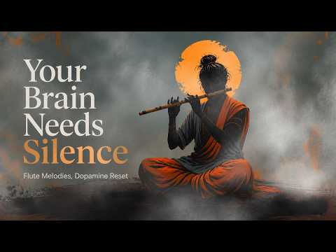
- 설명 앞부분: Your brain wasn't designed for constant stimulation. If you're feeling mentally exhausted, overwhelmed by notifications, endless scrolling, anxiety, or racing thoughts, this calming bansuri flute meditation offers a gentle space to pause, breathe, and reset. Inspired by the idea of a dopamine reset…
- 같은 채널 평소 대비 ×3,493.3 (채널 최근 롱폼 중앙값 1,463회) · 평소 영상: Dopamine Reset∣ Relaxing Flute Music & Peaceful F… (1,488회) / Emotional Release ∣ Indian Classical Music For Th… (1,438회)
- 대본 없음 (설명) — 음성인식이 끝나면 도입부·흐름이 들어감
- 댓글 833/839: 좋은 점 — 영상 0 · 감사·응원 0 · 더 알고 싶은 것 0 · 아쉬운 점 — 영상 0 · 반박·불만 — 의견 다름 0 · 정치·사회 0 · 경험 공유 0 · 구독·다음 기대 0

### 229. 🌊2000년 넘게 전해진 가장 슬픈 노래 ∣ 님아, 그 강을 건너지 마오 ∣ 역사노래 ∣ 사랑노래

- https://www.youtube.com/watch?v=4q22526wbNM · 노래말싸미 · 구독자 273 · 조회수 72,796 (×266.6, 하루 573.3) · 좋아요 451 (0.6%) · 4.6분 · 2026-06-14 · 주제 묶음 9. 가요·발라드·트로트 · 형식 플레이리스트·모음 (여러 곡) · 폴더 `W_4q22526wbNM` (웹 승인)
- 썸네일: 
- 설명 앞부분: 고조선/백수광부의 아내가 애절하게 노래한 '공무도하가' 이 영상은 생성형 Ai를 사용하여 제작되었습니다.
- 같은 채널 평소 대비 ×320.7 (채널 최근 롱폼 중앙값 227회) · 평소 영상: 🌺모란은 향기가 없었다｜「향기 없는 꽃」｜선덕여왕의 모란｜국악 발라드｜감성 역사노래｜시네… (227회) / 🌸 신라 최고의 비밀 사랑｜김유신과 천관녀의 이루어 질 수 없는 사랑｜달을 품은 꽃｜국악… (218회)
- 대본 없음 (설명) — 음성인식이 끝나면 도입부·흐름이 들어감
- 댓글 38/38: 좋은 점 — 영상 0 · 감사·응원 5 · 더 알고 싶은 것 1 · 아쉬운 점 — 영상 0 · 반박·불만 — 의견 다름 0 · 정치·사회 0 · 경험 공유 2 · 구독·다음 기대 1
  - 감사·응원 👍0 “오늘도 좋은 음악 감사합니다! 구독 좋아요로 응원합니다.”
  - 감사·응원 👍0 “노래말씨미 님 !!! 노래가 감성가득한 감미로운 노래 귀호강하고 갑니다 <님아 그강을 건너지마오 > 앞으로도 많은 음악활동 구독, 좋아요 남기고 함께 응원합니다 승승장구 하십시요 🏵🌹🥀🌺🌻🌼🌷”
  - 더 알고 싶은 것 👍3 “가수의 이름을 알고싶습니다 참 노래를 잘하네요,”
  - 경험 공유 👍17 “30년 넘게 함께한 사랑하는 사람과 이별을 준비하고 있습니다. 마음이 너무 아파서 제대로 먹지도 못하고 잠도 이루지 못한 채 눈물로 밤을 보내고 있습니다. 아이들도 모두 결혼시켜 각자의 가정을 이루었고, 이제는 젊었을 때 서로 약속했던 시간을 보내기만 하면 된다고 생…”
  - 구독·다음 기대 👍0 “애절하고 절절하고 슬픔 곡이네요!구독하고 잘 듣고 갑니다!❤👍”

### 230. Chirya Boli Chuu Chuu ∣ Allah Hu Allah Hu ∣ Peaceful Sleep ∣ Islamic Lullaby for Kids

- https://www.youtube.com/watch?v=We2DYPbILP8 · Noor Kids TV - Islamic · 구독자 14,300 · 조회수 3,812,076 (×266.6, 하루 21,194.5) · 좋아요 13,735 (0.4%) · 13.6분 · 2026-04-22 · 주제 묶음 1. 수면·명상·힐링 · 형식 음악 (그 밖 모양 — 한 편짜리 BGM 등) · 폴더 `W_We2DYPbILP8` (웹 승인)
- 썸네일: 
- 설명 앞부분: "Chirya boli chu chu, Allah hu Allah hu" is a delightful and heartwarming rhyme celebrating the harmony of nature. It translates to "The bird sings chirp chirp, proclaiming Allah's greatness!" This charming verse inspires awe for the Creator and the wonders of His creation. 🐦🌟 Childrens Song, Islam…
- 같은 채널 평소 대비 ×149.6 (채널 최근 롱폼 중앙값 25,488회) · 평소 영상: 99 Names of Allah☪️🕋 30 Min+ ∣ Alhamdulillah Alla… (28,046회) / Chirya Boli Chuu Chuu ∣ Allah Hoo Allah Hoo ∣ Soo… (22,930회)
- 대본 없음 (설명) — 음성인식이 끝나면 도입부·흐름이 들어감
- 댓글 0/0: 좋은 점 — 영상 0 · 감사·응원 0 · 더 알고 싶은 것 0 · 아쉬운 점 — 영상 0 · 반박·불만 — 의견 다름 0 · 정치·사회 0 · 경험 공유 0 · 구독·다음 기대 0

### 231. Om Namo Bhagavate Vasudevaya ∣ 1 Hour Divine Vishnu Meditation Music ∣ Premium Devotional…

- https://www.youtube.com/watch?v=OfDob7wO9OU · Zynora · 구독자 4,450 · 조회수 1,179,504 (×265.1, 하루 7,819.6) · 좋아요 8,823 (0.8%) · 77.8분 · 2026-05-21 · 주제 묶음 1. 수면·명상·힐링 · 형식 긴 한 곡·반복 (N시간) · 폴더 `W_OfDob7wO9OU` (웹 승인)
- 썸네일: 
- 설명 앞부분: Immerse yourself in the divine vibrations of **“Om Namo Bhagavate Vasudevaya”** — one of the most sacred Maha Vishnu mantras known for inner peace, spiritual protection, and deep devotional energy. This premium 1-hour chanting experience is designed with a serene temple-inspired atmosphere, powerfu…
- 같은 채널 평소 대비 ×222.4 (채널 최근 롱폼 중앙값 5,304회) · 평소 영상: Namaste Narasimhaya 🪔🌺🥥 (5,887회) / Top 5 Lord Vishnu Devotional Playlist Songs ∣ Mod… (4,720회)
- 대본 없음 (설명) — 음성인식이 끝나면 도입부·흐름이 들어감
- 댓글 317/316: 좋은 점 — 영상 0 · 감사·응원 0 · 더 알고 싶은 것 0 · 아쉬운 점 — 영상 0 · 반박·불만 — 의견 다름 0 · 정치·사회 0 · 경험 공유 0 · 구독·다음 기대 0

### 232. Vintage Vibes: Best of 80s with Cyndi Lauper, Modern Talking, Tears For Fears

- https://www.youtube.com/watch?v=1n5pMgUPYnk · Disco Paradise Hits · 구독자 24,500 · 조회수 6,474,961 (×264.3, 하루 98,501.7) · 좋아요 39,958 (0.6%) · 117.2분 · 2026-08-14 · 주제 묶음 기타 · 형식 플레이리스트·모음 (여러 곡) · 폴더 `W_1n5pMgUPYnk` (웹 승인)
- 썸네일: 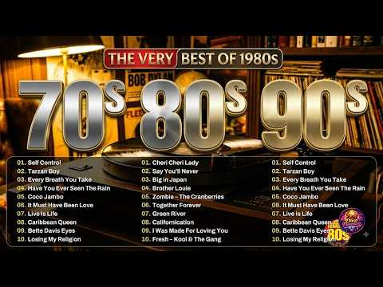
- 설명 앞부분: Vintage Vibes: Best of 80s with Cyndi Lauper, Modern Talking, Tears For Fears Best of 80s Music Legends - Tears For Fears, Madonna, Cyndi Lauper, Modern Talking, Michael Jackson 🎧 Welcome to **Legends 80s Mix** – your ultimate destination for the greatest hits of the 1980s! Dive into a nostalgic jo…
- 같은 채널 평소 대비 ×2,671.2 (채널 최근 롱폼 중앙값 2,424회) · 평소 영상: Classic 80s Pop Hits - Greatest Songs Of The 1980… (2,424회) / BEST 80S LOVE BALLADS (2,412회)
- 대본 없음 (설명) — 음성인식이 끝나면 도입부·흐름이 들어감
- 댓글 523/508: 좋은 점 — 영상 0 · 감사·응원 0 · 더 알고 싶은 것 0 · 아쉬운 점 — 영상 0 · 반박·불만 — 의견 다름 0 · 정치·사회 0 · 경험 공유 0 · 구독·다음 기대 0

### 233. 🏨 Luxury Hotel Lounge ∣ Smooth Jazz & Elegant Background Music

- https://www.youtube.com/watch?v=GBLcMvTFGyg · AMBER&OAK · 구독자 7,170 · 조회수 1,869,352 (×260.7, 하루 13,653.7) · 좋아요 14,485 (0.8%) · 100.4분 · 2026-06-04 · 주제 묶음 4. 카페·매장·라운지 · 형식 음악 (그 밖 모양 — 한 편짜리 BGM 등) · 폴더 `W_GBLcMvTFGyg` (웹 승인)
- 썸네일: 
- 설명 앞부분: 🏨 Luxury Hotel Lounge ∣ Smooth Jazz & Elegant Background Music Step into a world of comfort, elegance, and quiet sophistication. This playlist was inspired by the atmosphere of a luxury hotel lounge at night — warm lighting, city views, refined interiors, and the gentle sound of jazz drifting throu…
- 같은 채널 평소 대비 ×849.7 (채널 최근 롱폼 중앙값 2,200회) · 평소 영상: Luxury Hotel Lounge Vol.2 ∣ Smooth Jazz & Elegant… (2,200회) / Luxury Hotel Fine Dining Music ∣ Elegant Piano, S… (2,198회)
- 대본 없음 (설명) — 음성인식이 끝나면 도입부·흐름이 들어감
- 댓글 249/249: 좋은 점 — 영상 0 · 감사·응원 1 · 더 알고 싶은 것 0 · 아쉬운 점 — 영상 0 · 반박·불만 — 의견 다름 0 · 정치·사회 0 · 경험 공유 0 · 구독·다음 기대 1
  - 감사·응원 👍5 “음악 잘 들 었습니다 감사합니다”
  - 구독·다음 기대 👍1 “구독하고 갑니다.좋네요”

### 234. Sunday Morning Coffee Club ∣ R&B, Hip Hop, Afrobeats ∣ Feat.Jiangspace

- https://www.youtube.com/watch?v=2zzgY6uxZ6o · EChen · 구독자 7,820 · 조회수 2,034,173 (×260.1, 하루 12,652.2) · 좋아요 14,319 (0.7%) · 59.4분 · 2026-05-11 · 주제 묶음 11. 힙합·R&B·EDM · 형식 정보·해설 (그 밖) · 폴더 `W_2zzgY6uxZ6o` (웹 승인)
- 썸네일: 
- 챕터: 0:00 Neo - Because Of You · 0:50 Earth, Wind & Fire - You Want… · 2:16 JAŸ-Z - Run This Town ft. Rih… · 3:45 Ashanti ft Nelly & Akon - Bod… · 5:10 Mary J. Blige ft Lil Kim - I … · 6:15 Mary J. Blige - Love No Limit… · 7:45 YG vs Nicky Jam Y J Balvin - … · 8:48 Justin Bieber - Love Yourself · 9:45 Offset & Metro Boomin - Ric F… · 11:17 Tinashe - Nasty · 13:09 Tyga & Chris Brown - Nasty · 14:27 Dennis Blaze ft SophRox - Hey… · 15:18 Kris R & Ryan Castro - MÁS CH… · 16:25 Ella Mai - 100 · 18:31 NewJeans - Attention X Hey Mr… · 19:50 David Banner ft Chris Brown &… · 20:57 Doechii - DENIAL IS A RIVER · 21:56 Blackstreet - I'll Give It To… · 23:15 Soft Lipa ft 閻韋伶 - 偷偷 · 24:54 Justin Bieber ft Daniel Caesa…
- 설명 앞부분: 結合 跑步 咖啡 DJ Sunday morning in Tamsui. We laced up, brewed up, and turned up the volume. A run. A coffee. A beat that carried us home. This is what weekends are made for. Biweekly Sunday, 9AM – 12PM. Come run with us. 251新北市淡水區觀海路26號碼頭站碼頭輕軌站旁）（紅R26公車輕軌淡水漁人 All music tracks in this video are the sole…
- 같은 채널 평소 대비 ×44.4 (채널 최근 롱폼 중앙값 45,857회) · 평소 영상: GOOD VIBES MORNING Coffee Club ∣ R&B, Hip Hop, Je… (45,857회) / Late Night R&B Hip Hop Mix 2026 ∣ ∣ R&B, Hip Hop,… (33,177회)
- 대본 없음 (설명) — 음성인식이 끝나면 도입부·흐름이 들어감
- 댓글 215/214: 좋은 점 — 영상 0 · 감사·응원 0 · 더 알고 싶은 것 0 · 아쉬운 점 — 영상 0 · 반박·불만 — 의견 다름 0 · 정치·사회 0 · 경험 공유 0 · 구독·다음 기대 0

### 235. 우리들의 발라드2 1회 플레이리스트｜가을밤 마음을 울린 발라드 7곡 #우리들의발라드 #우발2

- https://www.youtube.com/watch?v=wPEmG4xfTLE · 우낄라꼬 · 구독자 1,190 · 조회수 309,118 (×259.8, 하루 26,456.9) · 좋아요 884 (0.3%) · 30.4분 · 2026-10-07 · 주제 묶음 9. 가요·발라드·트로트 · 형식 플레이리스트·모음 (여러 곡) · 폴더 `W_wPEmG4xfTLE` (웹 승인)
- 썸네일: 
- 챕터: 0:00 사랑 그 쓸쓸함에 대하여 - 김소연 (원곡: 양희은) · 5:25 난치병 - 이민우 (원곡: 하림) · 9:09 안 되나요 - 허채민 (원곡: 휘성) · 13:45 이별 여행 - 민지유 (원곡: 원미연) · 17:48 세상이 그대를 속일지라도 - 한로이 (원곡: 김장훈) · 22:33 기도 - 라유정 (원곡: 정일영) · 25:49 김성호의 회상 - 임바다 (원곡: 김성호)
- 설명 앞부분: 우리들의 발라드2 1회 무대에서 불린 발라드 일곱 곡을 한 번에 이어 듣는 플레이리스트입니다. 가을밤 혼자 듣기 좋은 노래들로 채웠습니다. 🎵 TRACK LIST SBS 우리들의 발라드2ㅣ매주 월요일 밤10시
- 대본 없음 (설명) — 음성인식이 끝나면 도입부·흐름이 들어감
- 댓글 63/64: 좋은 점 — 영상 1 · 감사·응원 13 · 더 알고 싶은 것 0 · 아쉬운 점 — 영상 2 · 반박·불만 — 의견 다름 0 · 정치·사회 0 · 경험 공유 1 · 구독·다음 기대 0
  - 좋은 점 — 영상 👍22 “울 김소연님 응원합니다.! 김소연님 끝음에서 'The saddest Thing'의 멜라니샤프카 가수가 넘 생각났어요. 쓸쓸하면서 덤덤한 표정은 '양하영'님도 생각나고...;;; 그 분위기와 목소리로 레전드 노래 많이 불러주시길요~!!”
  - 감사·응원 👍38 “소연양 밖에 생각이 안남 우승까지 쭉~응원합니다 ❤❤❤”
  - 감사·응원 👍27 “한로이 노래듣고 50넘은 아줌마가 눈물펑펑.ㅜㅜㅜㅜ 최고이고 위로가 되는곡 너무 감사해요. 로이군 응원합니다. 꼭 1등하길 바래요.”
  - 아쉬운 점 — 영상 👍11 “로이님 노래만 무한반복이네요 넘좋네요”
  - 아쉬운 점 — 영상 👍5 “임바다님 음색짱..무한반복중이요”
  - 경험 공유 👍1 “우리들의 발라드2 끝나고 자동반사적으로 유튜브채널 소연양의 노래 찾아 봤어요 처음 듣는 그순간 저도 모르게 가슴속에서 올라오는 울컥하는 감정을 주채 할 수없었네요 그냥 소연양의 노래 한 소절 한 소 절이 홀로느꼈을 외로움과 쓸쓸함 속에서 음악을 통해서 자신만의 카타르…”

### 236. 𝐀𝐋𝐋 𝐓𝐑𝐄𝐍𝐃𝐈𝐍𝐆 𝐇𝐈𝐍𝐃𝐈 𝐒𝐎𝐍𝐆𝐒 𝟐𝟎𝟐𝟔 ∣ 𝐏𝐋𝐀𝐘𝐋𝐈𝐒𝐓 🎀 ∣COZI

- https://www.youtube.com/watch?v=HNdauINck9s · cozi_music · 구독자 29,400 · 조회수 7,627,980 (×259.5, 하루 87,714.4) · 좋아요 87,843 (1.1%) · 15.2분 · 2026-07-24 · 주제 묶음 6. 피아노·클래식·연주곡 · 형식 음악 (그 밖 모양 — 한 편짜리 BGM 등) · 폴더 `W_HNdauINck9s` (웹 승인)
- 썸네일: 
- 챕터: 0:00 ISHQ DE FANNIYAR · 0:54 UDI UDI · 2:04 SHEESHA · 3:34 BANGLES · 4:38 BAIRAN · 5:54 UDAARIAN · 7:23 MAJBOOR · 8:58 DEEWAANA DEEWAANA · 10:17 KHAT · 11:20 SITAARE · 12:25 ARZ KIYA HAI · 13:38 PAL PAL X TALWINDER · 14:57 GEHRA HUA
- 설명 앞부분: Hashtags :
- 같은 채널 평소 대비 ×64.9 (채널 최근 롱폼 중앙값 117,490회) · 평소 영상: 𝐀𝐋𝐋 𝐓𝐑𝐄𝐍𝐃𝐈𝐍𝐆 𝐇𝐈𝐍𝐃𝐈 𝐒𝐎𝐍𝐆𝐒 𝟐𝟎𝟐𝟔 🎧∣ 𝐏𝐋𝐀𝐘𝐋𝐈𝐒𝐓💖 -slowe… (117,490회) / 𝐀𝐋𝐋 𝐓𝐑𝐄𝐍𝐃𝐈𝐍𝐆 𝐇𝐈𝐍𝐃𝐈 𝐒𝐎𝐍𝐆𝐒 𝟐𝟎𝟐𝟔 ∣ 𝐏𝐋𝐀𝐘𝐋𝐈𝐒𝐓 🎀 ∣ PART… (174,564회)
- 대본 없음 (설명) — 음성인식이 끝나면 도입부·흐름이 들어감
- 댓글 2,887/2,874: 좋은 점 — 영상 0 · 감사·응원 0 · 더 알고 싶은 것 0 · 아쉬운 점 — 영상 0 · 반박·불만 — 의견 다름 0 · 정치·사회 0 · 경험 공유 0 · 구독·다음 기대 0

### 237. 탈북할 때 듣는 플리

- https://www.youtube.com/watch?v=rrgoyhVFJ68 · 비둘기 · 구독자 2,920 · 조회수 757,408 (×259.4, 하루 9,624.4) · 좋아요 31,224 (4.1%) · 57.6분 · 2026-08-01 · 주제 묶음 기타 · 형식 플레이리스트·모음 (여러 곡) · 폴더 `W_rrgoyhVFJ68` (웹 승인)
- 썸네일: 
- 챕터: 0:00 프라이머리 - 자니 · 3:53 리쌍 - 헤어지지 못하는 여자, 떠나가지 못하는 남자 · 8:37 비오 - 네가 없는 밤 · 12:25 산이 - Me You · 15:54 허각, 지아 - I Need You · 19:37 긱스 - Officially Missing You · 23:07 프라이머리 - ? · 26:22 박경 - 보통연애 · 30:13 빈지노 - Aqua Man · 34:00 에픽하이 - 연애소설 · 37:57 우원재 - 시차 · 41:13 지코 - 걘 아니야 · 44:50 릴러말즈 - 하지마 · 47:05 TOIL - 검정색하트 · 51:01 ASH ISLAND - 멜로디 · 54:03 숀 - Way Back Home
- 같은 채널 평소 대비 ×251.0 (채널 최근 롱폼 중앙값 3,018회) · 평소 영상: 결제 내역으로 정몽규 깜짝 놀래키는 플리 (3,018회) / [페이스캠4K] PIG 김정은 'BAD' (PIG BOAR FaceCam) (1,380회)
- 대본 없음 (없음) — 음성인식이 끝나면 도입부·흐름이 들어감
- 댓글 1,536/1,536: 좋은 점 — 영상 6 · 감사·응원 73 · 더 알고 싶은 것 16 · 아쉬운 점 — 영상 8 · 반박·불만 — 의견 다름 9 · 정치·사회 29 · 경험 공유 23 · 구독·다음 기대 3
  - 좋은 점 — 영상 👍4 “30:27 압록강 넘어갈때 듣기 좋을듯”
  - 좋은 점 — 영상 👍3 “새벽에 듣기 좋은 플리”
  - 감사·응원 👍252 “이 플리 듣고 자전거 타면서 수많은 지뢰를 피해서 겨우 탈북했네요~감사합니다 근데.. 앞에 누가 총을 들고있네요?”
  - 감사·응원 👍48 “덕분에 수용소에 갇혀있습니다 감사합니다.”
  - 더 알고 싶은 것 👍3 “동무들이 노래차림표를 추천해주길래 한번 찾아와봤습네다. 아주 좋습네다.”
  - 더 알고 싶은 것 👍1 “썸넬이랑 제목보고 대체 무슨노래인지 궁금해서 들어옴”
  - 아쉬운 점 — 영상 👍0 “어그로 미쳤네 ㅅㅂㅋㅋㅋㅋ”
  - 아쉬운 점 — 영상 👍0 “왜 노래가 평범하지...? 탈북예정인데 실망스럽네...”
  - 반박·불만 — 의견 다름 👍91 “탈북할 땐 어떤 노래를 듣는걸까 하고 왔는데 첫곡듣고 어이없어서 터졌네 ㅋㅋㅋㅋ 무슨 관련이야”
  - 반박·불만 — 의견 다름 👍14 “진짜 존나 웃겨서 말도 안나옴 ㅋㅋㅋㅋㅋㅋㅋㅋㅋ... 새벽 두시에 이거 보고 혼자 쪼개고있는 내가 한심하다 너무 내 취향인데 어캄 아시발진짜”
  - 정치·사회 👍2 “이재명 ㅇㄷ??”
  - 정치·사회 👍2 “이재명이랑 민주당이랑 문재인얼굴은 안들어간거 깨네 ㅋㅋ”
  - 경험 공유 👍14 “진짜 존나 웃겨서 말도 안나옴 ㅋㅋㅋㅋㅋㅋㅋㅋㅋ... 새벽 두시에 이거 보고 혼자 쪼개고있는 내가 한심하다 너무 내 취향인데 어캄 아시발진짜”
  - 경험 공유 👍1 “자니 (Three Dictators Remix)(Intro) (전화 신호음... 뚜르르르...) 정은: 여보세요? 어, 진핑아. 나와 정은: 어 푸틴이랑 같이 있어 지금 정은: 아냐 우리끼리 핵이나 한잔 하지 뭐 소박하게 정은: 벙커? 에이, 너 가면 또 잠들 거잖아…”
  - 구독·다음 기대 👍1 “진지하게 매일 듣고 있다”
  - 구독·다음 기대 👍0 “광고도 별로 없고 옛날 노래만 모아놔서 향수 뿜뿜 불러오네요.. 학생때 알바할때 많이 들었었는데... 노동요로 듣는데 예전 감성 소환되고 좋네요~ 바둘기는 안좋아하지만 ㅎㅎ 구독하고 가요 ㅎ”

### 238. [Playlist] 드라마 OST 모음

- https://www.youtube.com/watch?v=h_2uk2pTQQA · playlistsilyalp · 구독자 771 · 조회수 198,515 (×257.5, 하루 3,837.1) · 좋아요 3,958 (2.0%) · 17.5분 · 2026-08-28 · 주제 묶음 13. OST·사운드트랙 · 형식 플레이리스트·모음 (여러 곡) · 폴더 `W_h_2uk2pTQQA` (웹 승인)
- 썸네일: 
- 같은 채널 평소 대비 ×12.9 (채널 최근 롱폼 중앙값 15,425회) · 평소 영상: [Playlist] 수록곡 맛집 (15,425회) / [Playlist] 절망이 와도 무너지지 말고 이겨내길 (22,999회)
- 대본 없음 (없음) — 음성인식이 끝나면 도입부·흐름이 들어감
- 댓글 17/17: 좋은 점 — 영상 1 · 감사·응원 0 · 더 알고 싶은 것 0 · 아쉬운 점 — 영상 0 · 반박·불만 — 의견 다름 0 · 정치·사회 0 · 경험 공유 0 · 구독·다음 기대 1
  - 좋은 점 — 영상 👍2 “공부할때 듣기좋네용ㅇ..집중잘됨”
  - 구독·다음 기대 👍1 “진짜 플리가 갓벽 그 잡채다,,🫪♥️ 오늘부터 구독했어요 이거 지우지 마세요ㅜ🥺💗”

### 239. 🌼 Sawan Shiv Bhajan 2026 ∣ Peaceful Mahadev Bhakti Song ∣ Bholenath Devotional Song

- https://www.youtube.com/watch?v=I_vnh6nZW6c · Bhajan Soul Collective · 구독자 8,590 · 조회수 2,208,363 (×257.1, 하루 21,468.9) · 좋아요 0 (0.0%) · 5.8분 · 2026-07-08 · 주제 묶음 기타 · 형식 음악 (그 밖 모양 — 한 편짜리 BGM 등) · 폴더 `W_I_vnh6nZW6c` (웹 승인)
- 썸네일: 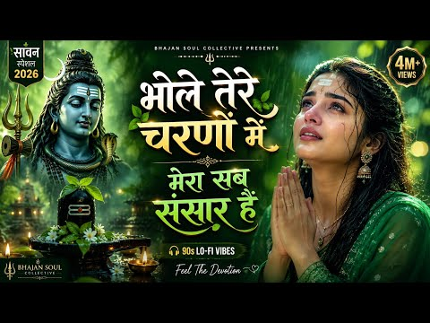
- 설명 앞부분: यदि यह भजन आपको पसंद आए, तो वीडियो को Like, Share करें और Bhajan Soul Collective को Subscribe करके हमारे साथ इस भक्ति यात्रा का हिस्सा बनें। mahadev bhajan shiv bhakti song sawan shiv bhajan mahadev ka nasha hai har har mahadev song latest shiv song new bhakti geet mahadev status song sawan ke bhaj…
- 같은 채널 평소 대비 ×288.1 (채널 최근 롱폼 중앙값 7,666회) · 평소 영상: 🌼 आत्मा को छू लेने वाली शिव प्रार्थना ∣ Peaceful … (7,666회) / 🌸 New Mahadev Song 2026 ∣ Har Har Mahadev song ∣ … (8,313회)
- 대본 없음 (설명) — 음성인식이 끝나면 도입부·흐름이 들어감
- 댓글 612/612: 좋은 점 — 영상 0 · 감사·응원 0 · 더 알고 싶은 것 0 · 아쉬운 점 — 영상 0 · 반박·불만 — 의견 다름 0 · 정치·사회 0 · 경험 공유 0 · 구독·다음 기대 0

### 240. .•♫•♬•𝙁𝙄𝙉𝙀𝙎𝙃𝙔𝙏 PLAYLIST•♬•♫

- https://www.youtube.com/watch?v=wYiyAR_dBDU · loverswift · 구독자 4,870 · 조회수 1,250,117 (×256.7, 하루 14,215.3) · 좋아요 20,570 (1.7%) · 16.8분 · 2026-07-23 · 주제 묶음 기타 · 형식 플레이리스트·모음 (여러 곡) · 폴더 `W_wYiyAR_dBDU` (웹 승인)
- 썸네일: 
- 챕터: 0:00 Confident -Justin Bieber · 4:04 Gabriella -Katseye · 7:20 Harleys In Hawai -Katy Perry · 10:20 Confidence -Kim · 13:48 Moonlight -Kali 𝗨𝗰𝗵𝗶𝘀
- 설명 앞부분: ➯ Copyright Disclaimer: I DO NOT own any rights to the picture or any music featured, this playlist is made for entertainment purposes only. Protected under Section 107 of the Copyright Act 1976
- 같은 채널 평소 대비 ×30.0 (채널 최근 롱폼 중앙값 41,698회) · 평소 영상: 𝘼𝙩𝙩𝙧𝙖𝙘𝙩𝙞𝙫𝙚 playlist cuz that's 𝙔𝙤𝙪 ♫~｡.: (69,726회) / ★ 𝖼𝗈𝗋𝗍𝗂𝗌 𝗉𝗅𝖺𝗒𝗅𝗂𝗌𝗍 𝗍𝗁𝖺𝗍 𝗀𝗂𝗏𝖾𝗌 𝗒𝗈𝗎 𝗍𝗁𝖾𝗂𝗋 𝗍𝖾𝖾𝗇𝖺𝗀𝖾 vi… (126,669회)
- 대본 없음 (설명) — 음성인식이 끝나면 도입부·흐름이 들어감
- 댓글 112/110: 좋은 점 — 영상 1 · 감사·응원 1 · 더 알고 싶은 것 0 · 아쉬운 점 — 영상 0 · 반박·불만 — 의견 다름 0 · 정치·사회 0 · 경험 공유 0 · 구독·다음 기대 0
  - 좋은 점 — 영상 👍1 “너무 듣기 좋구요 헤헤❤❤😂😂”
  - 감사·응원 👍2 “잘 듣고 있여용 화이팅😂😂 song list very good😂😂🎉”

