# 음악 — 성공 사례 분석: 사례별 자세히 #201–#240

`analysis.md` 의 9번 (같은 # 번호). 자동 생성 — `tools/success_analysis.py` v1.4.1 (2026-10-16 13:16 UTC). ※ 연구·교육용 — 투자 권유가 아님.

### 201. [Playlist] 기분 좋아지는 산뜻한 유럽 아침 앙상블 ∣ Morning Classical Ensemble

- https://www.youtube.com/watch?v=fdPFoR4XjNQ · okply · 구독자 15,500 · 조회수 653,177 (×42.1, 하루 4,157.9) · 좋아요 10,182 (1.6%) · 80.8분 · 2026-05-12 · 주제 묶음 6. 피아노·클래식·연주곡 · 형식 플레이리스트·모음 (여러 곡) · 폴더 `W_fdPFoR4XjNQ` (웹 승인)
- 썸네일: 
- 설명 앞부분: 따뜻한 아침 햇살이 궁전 정원 위로 천천히 내려앉는 시간, 가볍고 산뜻한 앙상블 선율로 하루를 시작해보세요. 이 플레이리스트는 유럽의 평화로운 아침 풍경을 떠올리게 하는 밝고 우아한 클래식 앙상블 음악들로 구성했습니다. 무겁고 어려운 클래식보다는 카페, 독서, 산책, 아침 루틴, 작업 시간에 자연스럽게 어울리는 편안하고 기분 좋은 선율을 담았습니다. 오늘의 시작이 조금 더 부드럽고 아름답게 흘러가길 바랍니다. OKPLY와 함께하는 산뜻한 유럽의 아침. A refreshing classical ensemble playlist for…
- 대본 없음 (설명) — 음성인식이 끝나면 도입부·흐름이 들어감
- 댓글 325/325: 좋은 점 — 영상 1 · 감사·응원 20 · 더 알고 싶은 것 3 · 아쉬운 점 — 영상 1 · 반박·불만 — 의견 다름 0 · 정치·사회 0 · 경험 공유 7 · 구독·다음 기대 3
  - 좋은 점 — 영상 👍7 “최고의 라이트 클라식 뮤직, 전부 듣기 좋으네요 ^^/*”
  - 감사·응원 👍35 “14:00곡과 어울릴것 같아 좋은 시 퍼옵니다. 음악은 핸폰도 좋은데 차에서 들으니 더 좋아요. 좋은곡 감사합니다. 들길에 서서 ​- 신석정 ​푸른 산이 흰 구름을 지니고 살듯 내 머리 위에는 항상 푸른 하늘이 있다. ​하늘을 향하고 삼[蔘]처럼 자라나는 해바라기처럼…”
  - 감사·응원 👍16 “제가 찾던 분위기와 악기 .. 이 조합을 찾기 엄청 힘들었는데 드디어 이곳에서 찾았네요!! 매일이 행복합니다. 기분이가 참 밝아지고 좋아집니다. 반복해서 들을때마다 새롭게 느껴지는 기분인건.. 들을때마다 악기 소리 하나하나 오늘은 플룻, 오늘은 바이올린 .. 매력에 …”
  - 더 알고 싶은 것 👍6 “죄송하지만 7분 30초에 나오는 이 곡의 제목이 무엇인지 알려주실 수 있을까요?”
  - 더 알고 싶은 것 👍6 “안녕하세요 ! 1시간 8분 부터 시작되는 음악이 너무 좋아서 그런데 제목을 알 수 있을까요??”
  - 아쉬운 점 — 영상 👍16 “제가 찾던 분위기와 악기 .. 이 조합을 찾기 엄청 힘들었는데 드디어 이곳에서 찾았네요!! 매일이 행복합니다. 기분이가 참 밝아지고 좋아집니다. 반복해서 들을때마다 새롭게 느껴지는 기분인건.. 들을때마다 악기 소리 하나하나 오늘은 플룻, 오늘은 바이올린 .. 매력에 …”
  - 경험 공유 👍246 “애기 유치원 등원 중에 들었는데 음악이 너무 경쾌해서 저도 모르게 어린이보호 구역에서 과속해버렸습니다.”
  - 경험 공유 👍16 “제가 찾던 분위기와 악기 .. 이 조합을 찾기 엄청 힘들었는데 드디어 이곳에서 찾았네요!! 매일이 행복합니다. 기분이가 참 밝아지고 좋아집니다. 반복해서 들을때마다 새롭게 느껴지는 기분인건.. 들을때마다 악기 소리 하나하나 오늘은 플룻, 오늘은 바이올린 .. 매력에 …”
  - 구독·다음 기대 👍8 “곡 하나하나 악기 연주 소리 하나하나 정말 귀가 호강하네요..👍✨️ 구독하고 갑니다^_^ 아가랑 들어야지~~👶💕🌿”
  - 구독·다음 기대 👍2 “감사합니다 구독했어요😊”

### 202. 💖 최고의 트로트 명곡 30곡 ∣ 중장년 애창곡 ∣ 운전·카페·휴식 음악 ∣ 안동역에서 미운사랑 홍시 진또배기

- https://www.youtube.com/watch?v=Tbtq8pWkeEk · 달빛머문 새벽세시 · 구독자 1,040 · 조회수 43,570 (×41.9, 하루 2,066.5) · 좋아요 214 (0.5%) · 98.2분 · 2026-09-25 · 주제 묶음 9. 가요·발라드·트로트 · 형식 플레이리스트·모음 (여러 곡) · 폴더 `W_Tbtq8pWkeEk` (웹 승인)
- 썸네일: 
- 설명 앞부분: 🎵대한민국이 사랑하는 트로트 명곡 30곡을 한 번에 감상하세요. 운전, 작업, 휴식, 산책, 카페에서 듣기 좋은 인기 트로트 모음입니다.
- 대본 없음 (설명) — 음성인식이 끝나면 도입부·흐름이 들어감
- 댓글 6/6: 좋은 점 — 영상 0 · 감사·응원 0 · 더 알고 싶은 것 0 · 아쉬운 점 — 영상 0 · 반박·불만 — 의견 다름 0 · 정치·사회 0 · 경험 공유 0 · 구독·다음 기대 0

### 203. 사랑했어요 - 김현식 ∣ 가슴 깊이 남은 진한 그리움과 아련한 추억 #윤가연 COVER

- https://www.youtube.com/watch?v=2VFOp-WbafE · GAYEON YOON · 구독자 28,600 · 조회수 1,195,533 (×41.8, 하루 8,775.9) · 좋아요 1,971 (0.2%) · 5.2분 · 2026-06-02 · 주제 묶음 12. 커버·노래 부르기 · 형식 커버·직접 부른 노래 · 폴더 `W_2VFOp-WbafE` (웹 승인)
- 썸네일: 
- 설명 앞부분: 故김현식의 명곡 〈사랑했어요〉를 깊은 울림과 아련한 감성을 가득 담아 윤가연의 목소리로 다시 불러보았습니다. 사랑은 기쁨보다 아픔이라는 것을 뒤늦게 깨달은 그 마음, 떠나간 님을 향한 사무치는 그리움과 사랑의 기억을 담아 노래했습니다! 가슴 저릿한 명곡이 전하는 깊은 여운을 진심을 다해 감상해주시면 감사하겠습니다. 🎵 Cover by 윤가연
- 대본 없음 (설명) — 음성인식이 끝나면 도입부·흐름이 들어감
- 댓글 115/115: 좋은 점 — 영상 1 · 감사·응원 12 · 더 알고 싶은 것 0 · 아쉬운 점 — 영상 1 · 반박·불만 — 의견 다름 1 · 정치·사회 0 · 경험 공유 2 · 구독·다음 기대 2
  - 좋은 점 — 영상 👍2 “부른 가수보다 더 듣기 좋으네요..AI가 더 잘부르네요..꿀점 드세요..글구 고추 물렁해진것 부터 졸임하시고요..하루도 잘 보내고요..”
  - 감사·응원 👍9 “김현식의 명곡을 감성적으로 정말 잘 소화해 주셔서 감사할 뿐입니다. 항상 잘듣고 있습니다^^~~”
  - 감사·응원 👍7 “음색에 아름다운 향기가 묻어있어요. 계속 듣고 싶고 들을겁니다. 감사합니다 💕 🎶”
  - 아쉬운 점 — 영상 👍0 “광고가 심하네”
  - 반박·불만 — 의견 다름 👍1 “누나 노래가이게아닌데....”
  - 경험 공유 👍2 “제가 고교 시절에 정말 좋아했던 노래네요~*^^💕🍀 그때 그시절 이루지 못했던 가슴시린 사랑도 아련히 기억에서 떠오르네요~ 윤가연씨 목소리 정말 감동 입니다. 자주 들으러 올게요~ㅎ🌻🌴🍂”
  - 경험 공유 👍1 “저는 현식형님의 노래가 너무 좋아요...ㅠㅠ 제가 좋아하는 현식형님의 노래를 멋있게 불러주셔서 감사드려요..ㅠㅠ”
  - 구독·다음 기대 👍5 “가연님~ 사랑했어요 매일 듣다시피 합니다. 노래 너무 좋아요. 신청곡 되는지요. 이승철의 서쪽하늘, 그리고 이치현과 벗님들의 사랑의 슬픔도 듣게 해주세요. 감사합니다.”
  - 구독·다음 기대 👍4 “음악의 힘은 정말로 대단합니다. 힘들고 지친 사람들에게 삶의 에너지를 줍니다. 윤가연양 노래 너무 잘 합니다. 가연님 울지 마세요. 사랑은 아프면서 성숙해지는 것입니다. 잘들었습니다. 가연님 노래 계속 구독합니다.”

### 204. 그냥 틀어만 놓아도 아침까지 푹 자요/ 이명치료효과/ 듣자마자 바로 잠오는 폭우 빗소리/ 깊은 잠을 위한 최적화 백색소음, ASMR [중간광고없음, 10분후 화…

- https://www.youtube.com/watch?v=ASEKIYKzzEc · 비오는날 ASMR · 구독자 21,800 · 조회수 903,579 (×41.5, 하루 5,217.6) · 좋아요 4,378 (0.5%) · 180.8분 · 2026-04-26 · 주제 묶음 2. 자연 소리·백색소음 · 형식 자연 소리·백색소음 (음악 낱말 없는 제목) · 폴더 `W_ASEKIYKzzEc` (웹 승인)
- 썸네일: 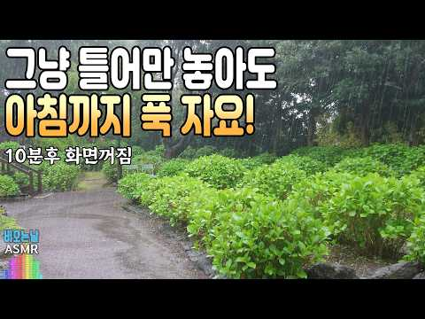
- 설명 앞부분: 공원 산책길에 내리는 폭우 빗소리입니다. 쏟아지는 폭우 빗소리 들으면서 행복하고 편안한 시간 되세요.😘 10분후 화면이 꺼지는 검정화면 빗소리 3시간입니다. [비오는날 ASMR 채널] 조용한 빗소리, 부드러운 빗소리, 폭우 빗소리, 유리창 빗소리, 길가 빗소리, 나뭇잎 빗소리, 처마 빗소리, 연못 빗소리, 숲속 빗소리, 편안한 빗소리, 잠잘오는 빗소리, 불면증과 이명증상완화 빗소리 등 다양한 빗소리 전문 채널입니다. 직접 촬영하고 편집, 녹음합니다. 2024 © 비오는날 ASMR 영상과 빗소리를 재 사용하는 것은 안됩니다.
- 대본 없음 (설명) — 음성인식이 끝나면 도입부·흐름이 들어감
- 댓글 162/162: 좋은 점 — 영상 2 · 감사·응원 35 · 더 알고 싶은 것 0 · 아쉬운 점 — 영상 0 · 반박·불만 — 의견 다름 1 · 정치·사회 0 · 경험 공유 7 · 구독·다음 기대 0
  - 감사·응원 👍48 “자연 그대로의 분위기가 너무 편안해요. 길고 지친 하루 끝에 만난 최고의 스트레스 해소제입니다. 이런 순수한 평온함을 선물해 주셔서 감사해요❤❤”
  - 감사·응원 👍28 “안녕히세요~ 오늘도 왔어요. 항상 감사합니다❤”
  - 반박·불만 — 의견 다름 👍11 “요즘 직장에서의 고민으로 저녁에 잠을 잘 못들고 있습니다. 나만 하는 고민은 아닌데 나에겐 많은 어려움이 있지만 잘 극복하려고 노력하고 있습니다. 지금도 이 소릴 듣고 잠을 청하고 있지만 잠들기 어렵네요.”

### 205. [Playlist] 로제 재즈 플레이리스트 🌹🎷 ∣ ROSÉ Jazz Playlist ∣ 재즈 커버

- https://www.youtube.com/watch?v=ZqL7hDxAlis · PLYINK 플링크 · 구독자 8,050 · 조회수 331,911 (×41.2, 하루 4,522.8) · 좋아요 6,642 (2.0%) · 110.8분 · 2026-08-04 · 주제 묶음 7. 재즈·보사노바 · 형식 커버·직접 부른 노래 · 폴더 `W_ZqL7hDxAlis` (웹 승인)
- 썸네일: 
- 설명 앞부분: 🌹오늘은 블랙핑크 로제의 재즈 스타일로 준비해봤습니다! 🎷 🎧If you’d like to listen to more jazz covers of other artists, don’t forget to subscribe! 🤍✨ [로제 재즈 전곡 + 신곡까지] [다른 아티스트의 재즈 커버곡이 궁금하시다면] ♪ Tracklist ♪ 🎷 본 영상의 음원은 원곡을 바탕으로 PLYINK에서 직접 편곡 및 제작한 콘텐츠입니다. [반복 듣기 하는 법] 모바일: 동영상 설정 버튼 - 더 보기 - 동영상 연속 재생 PC: 동영상 우클릭 - 연속 재…
- 대본 없음 (설명) — 음성인식이 끝나면 도입부·흐름이 들어감
- 댓글 116/116: 좋은 점 — 영상 0 · 감사·응원 9 · 더 알고 싶은 것 6 · 아쉬운 점 — 영상 1 · 반박·불만 — 의견 다름 0 · 정치·사회 0 · 경험 공유 1 · 구독·다음 기대 1
  - 감사·응원 👍6 “평소 로제를 엄청 좋아하는 팬인데 로제 음악을 재즈로 변환시키다니요 정말 상상도 못했네요 ㅋㅋ 근데 왜 이렇게 감미로워보이죠.. 만들어주셔서 감사해요 ㅠㅜ 진짜 매일 매시간 매분 매초마다 들을게요!!!”
  - 감사·응원 👍3 “감사합니다!”
  - 더 알고 싶은 것 👍3 “와 진짜 로제감성 낭낭한게 재즈로 느껴져서 너무 좋아요 ㅜㅜ 다른 노래들도 많이 재즈로 만들어주세요!!”
  - 더 알고 싶은 것 👍2 “보넥도 재즈 플리도 만들어주실 수 있나요..? ❤”
  - 아쉬운 점 — 영상 👍13 “ㅠㅠㅠㅠㅠ너무 좋은데 반복이 너무 많아서 로제 앨범 전곡으로 해주심 안될까요 맨날 들을게요ㅠㅠㅠ엉엉”
  - 경험 공유 👍1 “이거 너무 제 취향이에요!!!!! 친해지고 싶은 애가 로제 좋아해서 요즘 자주 듣고 있었는데 공부에 방해되는 듯해서 고민하다가 제가 좋아하는 재즈 느낌으로 가사 없는 플리 찾는 중이었는데!!! 너무 좋아요 ㅋㅋㅋㅋㅋㅋㅋㅋ”
  - 구독·다음 기대 👍0 “혹시 블랙핑크 재즈, 그리고 블랙핑크 다른 멤버들의 재즈도 신청 가능할까요.. 플링크님 구독하고 지점매수하겠습니다 너무 좋네요 ㅠㅜ”

### 206. 그레고리오성가*한국어* 주여 자비를 베푸소서 #가톨릭성가#그레고리오성가#성가미사#기도음악#묵상음악#천주교성가#미사음악#수면명상음악#힐링음악

- https://www.youtube.com/watch?v=9qbqShZRPYw · DIMOTEO RECORD BAR · 구독자 4,450 · 조회수 183,363 (×41.2, 하루 1,103.4) · 좋아요 2,948 (1.6%) · 82.1분 · 2026-05-03 · 주제 묶음 15. CCM·찬양·국악·동요 · 형식 음악 (그 밖 모양 — 한 편짜리 BGM 등) · 폴더 `W_9qbqShZRPYw` (웹 승인)
- 썸네일: 
- 설명 앞부분: 고요한 성당의 울림 속에서 흐르는 그레고리오 성가 미사 이 음악은 깊은 기도와 묵상을 위한 1시간의 여정을 담고 있습니다. 한국어 가사가 함께 어우러져 마음의 평안을 찾고, 내면의 침묵 속에서 하느님을 만나는 시간을 제공합니다. 천천히 흐르는 선율과 깊은 울림의 합창은 지친 마음을 위로하고, 불안한 생각을 잠재우며 기도와 묵상, 휴식의 순간에 자연스럽게 스며듭니다. 이 음악은 이런 순간에 함께하세요 잠들기 전 조용한 시간 기도와 묵상 마음이 지칠 때 집중이 필요한 시간 평안이 필요한 모든 순간 Track List 1. 영원의 빛 …
- 같은 채널 평소 대비 ×98.1 (채널 최근 롱폼 중앙값 1,869회) · 평소 영상: 가톨릭 명상음악 *고요 속의 기도 * (한국어) #가톨릭음악#묵상음악#기도음악#수면음악#… (1,870회) / 보이지않아도 주님을 노래했습니다./ Though Blind, I Sang To The L… (1,868회)
- 대본 없음 (설명) — 음성인식이 끝나면 도입부·흐름이 들어감
- 댓글 516/516: 좋은 점 — 영상 3 · 감사·응원 71 · 더 알고 싶은 것 5 · 아쉬운 점 — 영상 3 · 반박·불만 — 의견 다름 3 · 정치·사회 1 · 경험 공유 36 · 구독·다음 기대 0
  - 좋은 점 — 영상 👍1 “한국어라 더 와닿네요”
  - 감사·응원 👍48 “오늘 성당 30주년 봉헌미사가 있어 다녀왔습니다. 타 성당 예비신자라고 신부님께 말씀드리니 사무실로 들어가시곤 기념묵주를 쥐어주셨습니다. 예비신자지만 본당이 사정상 멀어서 여러 성당에서 미사드리며 어떨때는 마음이 외롭기도 했었습니다. 다들 신자분들끼리, 신부님과 친하…”
  - 감사·응원 👍38 “주님 사랑합니다 주님만이 저의 전부이십니다 감사합니다”
  - 더 알고 싶은 것 👍3 “은혜로운 곡 들으니 삶에 대해 한참을 생각에 잠기게 되네요. 혹시 악보를 구할 수 있나요? 어떻게 해야 할까요?”
  - 더 알고 싶은 것 👍2 “감사합니다 한번 불러보고 싶어요 악보를 구 할 수 있을까요?”
  - 아쉬운 점 — 영상 👍1 “1. 소리가 아름답고 2. 가사전달이 잘되서 좋고 3. 거룩하고 성스러운 느낌이...4. 내용이 일반적인 일상생활의 느낌이 듭니다. 좋은 찬미노래 또 부탁합니다. 옛날 젠성가, 공동체성가집을 이제 들을수 없어 아쉬웠는데 시대에 맞는 감정이 듭니다. 존재 자체만도 아름…”
  - 아쉬운 점 — 영상 👍1 “이 은혜로운 곡 듣게 해주셔서 감사합니다. 일할때도 잠잘때도 계속 듣고 있어요.나를 돌아보고 회개 할수 밖에 없는 성가입니다. 다만 게임광고가 넘 심하네요. 광고가 묵상을 훼방하고 있어요~ㅠ”
  - 반박·불만 — 의견 다름 👍1 “AI로 만든 가짜 찬양입니다 주께서는 우리의 목소리로 찬양 받기를 원하십니다 AI가 만든 가짜 기계가 하는것은 적 그리스도입니다 생명이 없는 AI는 아름답게 들릴지는 모른지만 아닙니다 제발. 우리가 정신 차려야 합니다”
  - 반박·불만 — 의견 다름 👍1 “헌금 많이 낸다고 하늘 나라에 보화 많이 쌓는것이 아닙니다. 능력이 되시먼 한달의 하루일당이면 됩니다. 주일헌금중에 꾸준히 내시던 대로 내시면서 한번 하루일당 헌금하시면 됩니다. 가정이 안되시면 최소한의 지폐한장이면 하늘나라에서는 마음을 보아주실것입니다. 두데나리온을…”
  - 정치·사회 👍1 “우리나라를 도와주소서 저 악인들은 하나님이 감찰하지 않는다고 합니다 일시적인 영광에 취해 있습니다 국민들을 교란시키고 선동하는 사악한 자들을 용서하지마소서 사악한 자들 다 드러나게 하소서 이재명 대통령 도와주소서”
  - 경험 공유 👍55 “주님 저희 시누이 지금 힘들게 암과 싸우고 있습니다 몆년전에 싸워서 이겨낸것처럼 이번에도 잘 이겨 내시길 주님 간절히 기도합니다”
  - 경험 공유 👍48 “오늘 성당 30주년 봉헌미사가 있어 다녀왔습니다. 타 성당 예비신자라고 신부님께 말씀드리니 사무실로 들어가시곤 기념묵주를 쥐어주셨습니다. 예비신자지만 본당이 사정상 멀어서 여러 성당에서 미사드리며 어떨때는 마음이 외롭기도 했었습니다. 다들 신자분들끼리, 신부님과 친하…”

### 207. @노노뮤직#피아노협주곡 #힐링음악 #감성피아노 #클래식음악 #휴식음악#명상음악 #잔잔한음악 #오케스트라 #피아노연주#힐링피아노 #peacefulmusic #pi…

- https://www.youtube.com/watch?v=aLyOUOXr5F4 · 노노스튜디오 · 구독자 462 · 조회수 18,937 (×41.0, 하루 136.1) · 좋아요 202 (1.1%) · 30분 · 2026-05-30 · 주제 묶음 6. 피아노·클래식·연주곡 · 형식 연주 (직접 연주하는 영상) · 폴더 `W_aLyOUOXr5F4` (웹 승인)
- 썸네일: 
- 설명 앞부분: 조용히 마음을 안아주는 피아노 협주곡입니다. 잔잔한 피아노 선율과 웅장한 오케스트라의 흐름 속에서 잠시 모든 걱정을 내려놓고 쉬어가시길 바랍니다. 삶이 힘들 때, 말없이 곁에 있어주는 음악 한 곡이 큰 위로가 되기도 합니다. 오늘 이 음악이 당신의 마음에 작은 평온이 되기를 바랍니다. 편안한 휴식, 명상, 공부, 독서, 수면 전 음악으로도 함께해보세요. 이어폰으로 들으시면 더욱 깊은 감동을 느끼실 수 있습니다. 🎹 삶을 위로하는 피아노 협주곡 ⏳ 30분 힐링 클래식 🌙 감성 · 휴식 · 평온 · 치유의 시간
- 같은 채널 평소 대비 ×119.1 (채널 최근 롱폼 중앙값 159회) · 평소 영상: @노노뮤직#프라하 #Prague #유럽클래식 #창작클래식 #BackgroundMusic … (159회) / @노노뮤직#SymphonyOfADay#하루의교향곡#오케스트라#클래식음악#Classical… (169회)
- 대본 없음 (설명) — 음성인식이 끝나면 도입부·흐름이 들어감
- 댓글 9/9: 좋은 점 — 영상 0 · 감사·응원 0 · 더 알고 싶은 것 0 · 아쉬운 점 — 영상 1 · 반박·불만 — 의견 다름 0 · 정치·사회 0 · 경험 공유 0 · 구독·다음 기대 2
  - 아쉬운 점 — 영상 👍2 “광고가너심하네요”
  - 구독·다음 기대 👍3 “진한 위로를 줍니다 매일매일 듣고 있어요 듣고있음 꽃이 활짝핀 정원에서 차를 마시고 싶다는 생각이 듭니다”
  - 구독·다음 기대 👍1 “구독과 좋아요 누르고 갑니다 알림설정두요 진한 에스프레스와 잘 어울리는 연주곡입니다”

### 208. 디지몬 OST - 날 지켜줘 (벅차오르는 파워 락 발라드 어레인지 커버) ∣ GrangChe.Ver

- https://www.youtube.com/watch?v=iWfeWC28USw · GrangChe · 구독자 21,500 · 조회수 867,165 (×40.3, 하루 5,651.2) · 좋아요 4,332 (0.5%) · 4.8분 · 2026-05-16 · 주제 묶음 9. 가요·발라드·트로트 · 형식 AI 음악 · 폴더 `W_iWfeWC28USw` (웹 승인)
- 썸네일: 
- 설명 앞부분: '본 컨텐츠는 AI툴을 활용하여 제작된 음악입니다.' 추억 속 파워 디지몬의 삽입곡 '날 지켜줘'를 깊이 있는 락 발라드 감성으로 재해석했어요. 1절의 원곡 정서를 유지하며, 없던 2절을 어울리게 개사해봤어요.
- 대본 없음 (설명) — 음성인식이 끝나면 도입부·흐름이 들어감
- 댓글 233/233: 좋은 점 — 영상 2 · 감사·응원 5 · 더 알고 싶은 것 4 · 아쉬운 점 — 영상 2 · 반박·불만 — 의견 다름 1 · 정치·사회 0 · 경험 공유 6 · 구독·다음 기대 0
  - 좋은 점 — 영상 👍1 “레전드 띵곡이다!”
  - 좋은 점 — 영상 👍1 “레전드”
  - 감사·응원 👍3 “늘 감사히 잘 듣고 있습니다😊”
  - 감사·응원 👍1 “목소리도 너무 좋으시고 운동하기전에 듣고가면 힘이 빡 나네요. 잘 불러주셔서 감사합니다! 구독 완료”
  - 더 알고 싶은 것 👍2 “혹시 어떻게 만들었는지 알 수 있을까요? 선생님을 보고 욕심이 생기기 시작했어요.”
  - 더 알고 싶은 것 👍1 “잘 들었어요! 노래들 너무 좋아서 거의 전곡을 다 들었네요. 이런건 어떻게 만드시는지 궁금하네요 제미나이로하니 완전히 다른노래가 되더라구요.”
  - 아쉬운 점 — 영상 👍3 “락발라드로 하니까 그냥 기계음도 노상관되버리네ㄷㄷ”
  - 아쉬운 점 — 영상 👍0 “무한반복중 ㅎㅎ”
  - 반박·불만 — 의견 다름 👍0 “이거 말도 안됨. goat.”
  - 경험 공유 👍6 “그래 내가 이래서 락발라드를 존나게 좋아했었다고 시발..”
  - 경험 공유 👍1 “와.. ai의 발전이... 분명 반년전쯤인가 ai 누구목소리 커버 이런거 듣다가 음..아직 멀었네 뭔가이상하다 생각했었는데.. 이건 그냥 너무좋네.”

### 209. 듣자마자 학창시절 떠오르는 노래 🎧 싸이월드 감성 PART 4

- https://www.youtube.com/watch?v=F-0JE3Byo9U · 소꿀 TV · 구독자 18,200 · 조회수 727,774 (×40.0, 하루 4,648.4) · 좋아요 2,346 (0.3%) · 82.6분 · 2026-05-12 · 주제 묶음 기타 · 형식 플레이리스트·모음 (여러 곡) · 폴더 `W_F-0JE3Byo9U` (웹 승인)
- 썸네일: 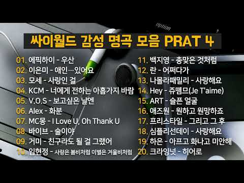
- 챕터: 0:00 에픽하이 - 우산 · 5:04 이은미 - 애인…있어요 · 9:08 모세 - 사랑인 걸 · 13:24 KCM - 너에게 전하는 아홉가지 바람 · 17:38 V.O.S - 보고싶은 날엔 · 21:11 Alex - 화분 · 26:37 MC몽 - I Love U, Oh Thank U · 29:50 바이브 - 술이야 · 33:55 거미 - 친구라도 될 걸 그랬어 · 38:37 임정희 - 사랑은 봄비처럼 이별은 겨울비처럼 · 43:20 백지영 - 총맞은 것처럼 · 47:18 란 - 어쩌다가 · 51:15 나몰라패밀리 - 사랑해요 · 55:04 Hey - 쥬뗌므(Je T'aime) · 59:15 ART - 슬픈 얼굴 · 63:46 애즈원 - 원하고 원망하죠 · 67:48 프리스타일 - 그리고 그 후 · 71:22 심플리선데이 - 사랑해요 · 75:41 하은 - 아프고 화나고 미안해 · 79:02 크라잉넛 - The Hero
- 설명 앞부분: 2000년대 싸이월드 감성 플레이리스트입니다. ‐ 밤 감성과 잘 어울리는 2000년대 명곡 ‐ 싸이월드 시절 감정을 떠올리게 하는 노래 ‐ 조용히 듣기 좋은 감성 플레이리스트 PART 4는 특히 밤에 들으면 몰입도가 높은 곡들 위주입니다.
- 대본 없음 (설명) — 음성인식이 끝나면 도입부·흐름이 들어감
- 댓글 50/50: 좋은 점 — 영상 0 · 감사·응원 2 · 더 알고 싶은 것 0 · 아쉬운 점 — 영상 0 · 반박·불만 — 의견 다름 0 · 정치·사회 0 · 경험 공유 0 · 구독·다음 기대 0
  - 감사·응원 👍4 “첫 소절만 들어도 학창시절의 장면들이 하나씩 떠오르네요. 🎧 그때 친구들과 함께 듣던 노래, 설레고 웃었던 순간들이 새록새록 생각납니다. 싸이월드 감성은 정말 시간이 지나도 잊히지 않는 것 같아요. 추억 제대로 소환하고 갑니다. 좋은 선곡 감사합니다. ❤”
  - 감사·응원 👍4 “이 아름다운 발라드를 만들어 주셔서 감사해요.”

### 210. 전율 돋는 폭발적 감성 ⚡ 대한민국 락발라드 끝판왕! M.C The Max '잠시만 안녕' 커버 ∣ 김별이

- https://www.youtube.com/watch?v=QK3Mxw--VFg · 김별이 · 구독자 5,800 · 조회수 229,605 (×39.6, 하루 4,625.7) · 좋아요 645 (0.3%) · 5.4분 · 2026-08-27 · 주제 묶음 9. 가요·발라드·트로트 · 형식 커버·직접 부른 노래 · 폴더 `W_QK3Mxw--VFg` (웹 승인)
- 썸네일: 
- 설명 앞부분: 2000년대 가요계에 전설로 남으며 수많은 사람들의 가슴을 뜨겁게 적셨던 엠씨더맥스(M.C The Max)의 대표 명곡 '잠시만 안녕'을 커버해 보았습니다. 원곡이 가진 특유의 웅장한 록 사운드와 애절한 멜로디 라인 위에, 김별이만의 섬세한 완급 조절과 폭발하듯 뻗어 나오는 사이다 고음 보컬을 얹어 한층 더 드라마틱하게 재해석했습니다. 발라드, 락, 힙합, R&B, 국악, 댄스를 넘나드는 별이의 음악 세계! 들을수록 가슴 깊이 파고드는 별이표 '잠시만 안녕', 볼륨을 높이고 시원한 고음과 함께 깊은 감성에 빠져보세요. 🎙️🎸⚡ 🎵…
- 대본 없음 (설명) — 음성인식이 끝나면 도입부·흐름이 들어감
- 댓글 32/32: 좋은 점 — 영상 0 · 감사·응원 3 · 더 알고 싶은 것 2 · 아쉬운 점 — 영상 0 · 반박·불만 — 의견 다름 0 · 정치·사회 0 · 경험 공유 0 · 구독·다음 기대 1
  - 감사·응원 👍1 “노래를 잘듣고있습니다 항상 좋은노래를 감사합니다”
  - 감사·응원 👍1 “Ai씨 좋으곡 더 좋게불러주셔서 넘 감사합니당🙏”
  - 더 알고 싶은 것 👍0 “신청곡 자두의 대화가 필요해. 부탁드려요.^^”
  - 더 알고 싶은 것 👍0 “너무 잘듣고 있어요 항상 감사합니다 혹시 김경호 - 아버지 도 가능하실까여😅 생각나실때 한번 만들어주세요😊”
  - 구독·다음 기대 👍0 “오늘 구독했습니다. 명곡들을 다시 들으니 너무 좋네요 김조한 사랑이 늦어서 미안해 가능할까요?”

### 211. 추억의7080명곡 ☕ 7080 추억 카페음악집 ✨ 중년을 위한 여유로운 멜로디

- https://www.youtube.com/watch?v=WyBN1ANCTpk · Retro Radio · 구독자 6,610 · 조회수 261,482 (×39.6, 하루 1,471.7) · 좋아요 3,544 (1.4%) · 5.7분 · 2026-04-21 · 주제 묶음 9. 가요·발라드·트로트 · 형식 플레이리스트·모음 (여러 곡) · 폴더 `W_WyBN1ANCTpk` (웹 승인)
- 썸네일: 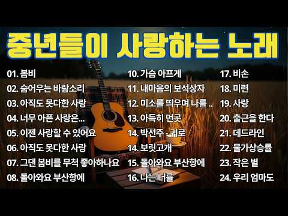
- 설명 앞부분: ☕ 추억의 7080 명곡 🎶 감성 가득한 카페 음악 플레이리스트입니다. 7080 추억의 멜로디들이 부드럽게 흐르며, 중년을 위한 여유롭고 편안한 분위기를 만들어줍니다. 따뜻한 커피 한 잔과 함께, 지나온 시간의 소중한 기억들을 천천히 떠올려보세요. ✨ 🎧 본 영상은 Retro Radio 채널에서 직접 선별한 7080 명곡들로 구성되었으며, 카페에서 흘러나오는 듯한 자연스러운 흐름으로 세심하게 편집되었습니다. 청취자 여러분께 더욱 몰입감 있는 음악 경험을 제공하기 위해 음질과 구성에 많은 노력을 기울였습니다. 오랜 시간 부담 없이 …
- 대본 없음 (설명) — 음성인식이 끝나면 도입부·흐름이 들어감
- 댓글 39/39: 좋은 점 — 영상 0 · 감사·응원 1 · 더 알고 싶은 것 1 · 아쉬운 점 — 영상 0 · 반박·불만 — 의견 다름 0 · 정치·사회 0 · 경험 공유 1 · 구독·다음 기대 0
  - 감사·응원 👍0 “7080. 제가 이런노래들속에 성장했군요. 그때의 감성으로 돌아가봅니다 감사합니다”
  - 더 알고 싶은 것 👍1 “이런 음악 더 많이 올려주세요”
  - 경험 공유 👍0 “7080. 제가 이런노래들속에 성장했군요. 그때의 감성으로 돌아가봅니다 감사합니다”

### 212. 🎧"세상에서 가장 애절한 목소리" 한 편의 영화 같은 무대, 그리고 가슴을 울리는 목소리…🎙️ 김정호 - "이름 모를 소녀" [락카페 버전]

- https://www.youtube.com/watch?v=tjA0yWEZnu8 · 가슴을 울리는 락카페 · 구독자 10,900 · 조회수 428,448 (×39.3, 하루 2,748.0) · 좋아요 2,617 (0.6%) · 4.4분 · 2026-05-13 · 주제 묶음 4. 카페·매장·라운지 · 형식 커버·직접 부른 노래 · 폴더 `W_tjA0yWEZnu8` (웹 승인)
- 썸네일: 
- 설명 앞부분: 🌙수많은 사람들 속에서도 문득 한 사람의 기억이 오래도록 마음을 붙잡는 밤이 있습니다. 오늘은 세월이 흘러도 여전히 가슴을 울리는 명곡 ‘이름 모를 소녀’를 저만의 감성과 목소리로 다시 불러보았습니다. 애절한 멜로디와 깊은 그리움이 당신의 오래된 추억 한 장을 꺼내주길 바랍니다. 🎵 Cover Song - 이름 모를 소녀 한 편의 영화 같은 무대, 그리고 가슴을 스치는 목소리… 오늘 밤, 조용히 함께 들어주세요.
- 대본 없음 (설명) — 음성인식이 끝나면 도입부·흐름이 들어감
- 댓글 90/90: 좋은 점 — 영상 1 · 감사·응원 6 · 더 알고 싶은 것 1 · 아쉬운 점 — 영상 1 · 반박·불만 — 의견 다름 0 · 정치·사회 0 · 경험 공유 7 · 구독·다음 기대 1
  - 좋은 점 — 영상 👍16 “구독 좋아요로 응원합니다 최고입니다 늘 행복하세요 넘 듣기 좋아요❤❤❤🎉🎉”
  - 감사·응원 👍16 “구독 좋아요로 응원합니다 최고입니다 늘 행복하세요 넘 듣기 좋아요❤❤❤🎉🎉”
  - 감사·응원 👍9 “심금을 울리는 창법입니다 먼저간 친구생각에 눈물흘리며 그냥 짠해지네요 고맙습니다”
  - 더 알고 싶은 것 👍1 “음악이넘좋은데 mr은 어디에서 구매할수있나요?”
  - 아쉬운 점 — 영상 👍15 “Ai 목소리에 빠져 드네요 ㅎㅎ”
  - 경험 공유 👍7 “옛날 약40년전 라디오에서 들었던 노래 ....나도 늙어가고 있구나”
  - 경험 공유 👍5 “나도 모르게 눈물이 나네요”
  - 구독·다음 기대 👍1 “구독합니다.”

### 213. 𝐏𝐥𝐚𝐲𝐥𝐢𝐬𝐭 우린 아직 흑백영화처럼 사랑하고

- https://www.youtube.com/watch?v=71_AXp38B7M · 세봄 · 구독자 14,300 · 조회수 550,751 (×38.5, 하루 3,811.0) · 좋아요 3,891 (0.7%) · 17.1분 · 2026-05-25 · 주제 묶음 기타 · 형식 플레이리스트·모음 (여러 곡) · 폴더 `W_71_AXp38B7M` (웹 승인)
- 썸네일: 
- 챕터: 0:00 검정치마 - 한시 오분 · 3:57 검정치마 - 폭죽과 풍선들 · 7:20 리도어 - 영원은 그렇듯 · 11:17 데이먼스 이어 - Mondegreen · 14:27 릴러말즈 - 흑백영화
- 설명 앞부분: 본 채널의 모든 콘텐츠는 수익 창출과 무관하게 운영됩니다. [timestamps]
- 대본 없음 (설명) — 음성인식이 끝나면 도입부·흐름이 들어감
- 댓글 28/28: 좋은 점 — 영상 0 · 감사·응원 1 · 더 알고 싶은 것 0 · 아쉬운 점 — 영상 0 · 반박·불만 — 의견 다름 0 · 정치·사회 0 · 경험 공유 1 · 구독·다음 기대 0
  - 감사·응원 👍2 “데이트 중에 너무 행복하게 잘 들었어요 감사합니다🥰”
  - 경험 공유 👍9 “내가 만약에 너랑 헤어지기 전에 엄청 돈이 많은 부자가 됐었다면 이 돈으로 너랑 같이 많은 곳을 갈 수 있을 거 같다는 생각에 엄청 기뻐했을거야”

### 214. 🪷 이 노래 들으면 막힌 재물운이 술술 풀립니다 ∣ 부처님 대운 명호·진언 13곡 ∣ 관세음·지장·아미타 #소원성취 #재물운 #금전운 #업장소멸 #천수경 #반야…

- https://www.youtube.com/watch?v=ztFLgJ5idWI · 연꽃법음 · 구독자 3,540 · 조회수 131,665 (×37.2, 하루 846.0) · 좋아요 2,472 (1.9%) · 55.7분 · 2026-05-13 · 주제 묶음 15. CCM·찬양·국악·동요 · 형식 플레이리스트·모음 (여러 곡) · 폴더 `W_ztFLgJ5idWI` (웹 승인)
- 썸네일: 
- 챕터: 0:00 ─ 막혀 있던 길이 풀리네 (관세음보살) · 4:14 ─ 묵은 업장이 바람처럼 사라지네 (지장보살) · 8:28 ─ 맑은 새벽 한 줄기 빛 (문수보살) · 12:57 ─ 별 지는 새벽에 (약사여래) · 17:19 ─ 비로자나불 그 빛 안에서 (광명진언) · 21:42 ─ 대비주의 큰 강물 따라 (신묘장구대다라니) · 25:36 ─ 한 호흡 또 한 호흡 (옴 마니 반메 훔) · 29:45 ─ 한 걸음씩 걷는다 (보현보살) · 34:17 ─ 이 죄업을 거두소서 (참회진언) · 38:29 ─ 맑혀가는 새벽이여 (정구업진언) · 42:51 ─ 피안으로 가자 (반야심경 진언) · 47:03 ─ 무량한 빛 속으로 (아미타불) · 51:04 ─ 이 모든 공덕을 회향하리 (석가모니불 회향)
- 설명 앞부분: 🪷 연꽃법음에 오신 여러분, 환영합니다 🙏 막혀 있던 일도, 끊어졌던 인연도, 무거운 마음의 짐도 부처님과 보살님의 자비로운 손길 안에서 다시 풀려갑니다. 오늘은 부처님 대운이 들어오는 명호·진언 13곡을 약 1시간 동안 정성껏 준비했습니다. 한 해의 막힌 흐름과 지친 마음을 잠시 내려놓고, 관세음보살·지장보살·문수보살·약사여래·아미타불의 가피와 옴 마니 반메 훔·신묘장구대다라니·반야심경 진언의 자비 안에서 한 호흡 또 한 호흡 머무는 시간입니다. 부처님과 보살님께서는 천 개의 눈으로 우리를 살펴주시고 천 개의 손으로 건져주시며,…
- 대본 없음 (설명) — 음성인식이 끝나면 도입부·흐름이 들어감
- 댓글 827/827: 좋은 점 — 영상 3 · 감사·응원 146 · 더 알고 싶은 것 8 · 아쉬운 점 — 영상 0 · 반박·불만 — 의견 다름 1 · 정치·사회 0 · 경험 공유 29 · 구독·다음 기대 0
  - 좋은 점 — 영상 👍5 “너무나 듣기 좋아요 ❤❤❤”
  - 좋은 점 — 영상 👍1 “나무아미타블 관세음보살 하나밖에없는 아들 87년2월10일생 지금 하고있는일 건설장입니다 잘 살아보겠다고 애쓰는아들 가엽고 안쓰러워 어미로서 도움이 안되니 억장이 무너지고 가슴아프니 부천님 자비로 아들 하고자 하는일 막힘없이 술술 잘 풀리도록 도와주소서🎉🎉🎉”
  - 감사·응원 👍12 “부처님 고맙습니다.”
  - 감사·응원 👍10 “빛청산하고 집사서 이사갈수 있도록 도와주세요 감사합니다”
  - 더 알고 싶은 것 👍3 “재물운 좀 부탁드립니다🙏🏻”
  - 더 알고 싶은 것 👍2 “제발 이번주 로또 당첨 되게 해주세여 지금 살아 있는게 아닙니다 살아 있는 송장입니다 제발 부탁드립니다 나무 아미 타불 관세음보살 감사합니다🎉🎉❤”
  - 반박·불만 — 의견 다름 👍2 “제발 이번주 로또 당첨 되게 해주세여 지금 살아 있는게 아닙니다 살아 있는 송장입니다 제발 부탁드립니다 나무 아미 타불 관세음보살 감사합니다🎉🎉❤”
  - 경험 공유 👍9 “나는행운아다 나는행운아다 나는행운아다 나무아미타불 나무아미타불 나무관세음보살 빌고비옵나이다 임진생 3월10일생 이씨계주 우리남편 우리아들과딸들 손자손녀들사위들며느리 우리아들계해생 11월29일 생 건강발원 지금차린 사업승승장구 이름나고명나게하소서 업장소멸 알고지은죄모르…”
  - 경험 공유 👍9 “제가 투자한 사업에 좋은결과 있기를 바랍니다 옴마니반매훔 제가 하는일이 많은 기회가 있기를 기원합니다 .”

### 215. "매력있다 이 음색"#휴식음악#7080노래#어쿠스틱음악#힐링음악#수면음악#카페음악#7080발라드#명상음악#집중음악#기타연주#ambient music#ambien…

- https://www.youtube.com/watch?v=CG3XI3D6gHg · 7080 마로니에 통기타TV · 구독자 390 · 조회수 14,099 (×36.1, 하루 87.1) · 좋아요 193 (1.4%) · 40.9분 · 2026-05-07 · 주제 묶음 6. 피아노·클래식·연주곡 · 형식 연주 (직접 연주하는 영상) · 폴더 `W_CG3XI3D6gHg` (웹 승인)
- 썸네일: 
- 설명 앞부분: "줄 하나하나에 담긴 진심, 어쿠스틱의 온도." "통기타 한 대로 그리는 세상." "당신의 일상에 기타 소리를 더하다." 지친 하루의 끝,마음을 어루만지는 Acoustic guitar선율을 올립니다.
- 대본 없음 (설명) — 음성인식이 끝나면 도입부·흐름이 들어감
- 댓글 20/20: 좋은 점 — 영상 1 · 감사·응원 1 · 더 알고 싶은 것 2 · 아쉬운 점 — 영상 1 · 반박·불만 — 의견 다름 0 · 정치·사회 0 · 경험 공유 1 · 구독·다음 기대 0
  - 좋은 점 — 영상 👍5 “제목이 궁금해지는 노래 입니다 ....짙은 허스키한듯한 보이스 좋내요 영상도 너무좋구요 가수와 노래제목 알고싶내요 좋은노래 좋은영상 감솨~~”
  - 감사·응원 👍2 “이제는 듣고싶은 음악을 좋아하는 음색으로 듣는 인공지능 시대가 되었네요. 이런 좋은 음악을 만들어줘서 감사합니다.”
  - 더 알고 싶은 것 👍1 “악보도 올려주시면 않될까요.”
  - 더 알고 싶은 것 👍1 “이 가수분 존함이 알고 싶군요 혹시 알고계신분 좀 알려주세요”
  - 아쉬운 점 — 영상 👍1 “나도 이제 50대 중반인데 넝넘 좋네요ㆍ 그라고 왠지 눈물이 나네요 갱년기와 세월의 아쉬움이”
  - 경험 공유 👍1 “나도 이제 50대 중반인데 넝넘 좋네요ㆍ 그라고 왠지 눈물이 나네요 갱년기와 세월의 아쉬움이”

### 216. 이 세상 미련 없이 가련다 [국악 트로트] 가슴 시린 중년 트토르

- https://www.youtube.com/watch?v=XcyHeiPdmDc · 인생트로트 라운지 · 구독자 4,140 · 조회수 146,744 (×35.5, 하루 955.8) · 좋아요 718 (0.5%) · 5.8분 · 2026-05-16 · 주제 묶음 9. 가요·발라드·트로트 · 형식 음악 (그 밖 모양 — 한 편짜리 BGM 등) · 폴더 `W_XcyHeiPdmDc` (웹 승인)
- 썸네일: 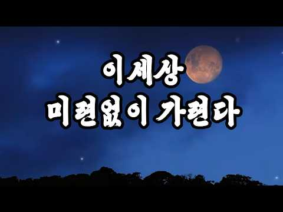
- 설명 앞부분: 고단한 세월 속에서 가족과 삶을 위해 모든 것을 내어주고 끝내 홀로 남겨진 한 사람의 서러운 인생을 담아낸 곡입니다눈물과 한숨으로 버텨온 삶의 깊은 한(恨)이처절하게 스며든 노래입니다. © 2026 인생트로트 라운지 Original Music: 인생트로트 라운지 Produced by 인생트로트 라운지
- 대본 없음 (설명) — 음성인식이 끝나면 도입부·흐름이 들어감
- 댓글 19/19: 좋은 점 — 영상 0 · 감사·응원 4 · 더 알고 싶은 것 0 · 아쉬운 점 — 영상 0 · 반박·불만 — 의견 다름 0 · 정치·사회 0 · 경험 공유 1 · 구독·다음 기대 0
  - 감사·응원 👍5 “이세상 미련없이 가련다~멋진곡 훌륭한 가수님에 매력이 넘치는 아름다운 노래 감명깊게 즐감하고 응원합니다 🎶🎵🎤👍🙌”
  - 감사·응원 👍3 “우리인간에갠 생노병사가 있으니 죽음에 대한 두려움 갖지말고 모든것 다 수용하면서 홀가분한 맘으로 욕심 내리고 비우고 살면 내가 편안할진대 욕심이란 끝이없어 제마다 삶의 방식이 다르고 생각이 달라 욕심도 가지고 살겠지요 우리인생 뭐 별거 있나요 순리대로 살아 가자구요 …”
  - 경험 공유 👍3 “우리인간에갠 생노병사가 있으니 죽음에 대한 두려움 갖지말고 모든것 다 수용하면서 홀가분한 맘으로 욕심 내리고 비우고 살면 내가 편안할진대 욕심이란 끝이없어 제마다 삶의 방식이 다르고 생각이 달라 욕심도 가지고 살겠지요 우리인생 뭐 별거 있나요 순리대로 살아 가자구요 …”

### 217. "술 한잔 생각나는 깊은 목소리..." 첫 소절 부터 아련해지는 님은 먼 곳에(블루스 Ver.)

- https://www.youtube.com/watch?v=M-8Z69t7Smo · 세월블루스 · 구독자 20,900 · 조회수 736,680 (×35.2, 하루 4,434.1) · 좋아요 4,434 (0.6%) · 4.4분 · 2026-05-03 · 주제 묶음 기타 · 형식 한 곡 (뮤직비디오·음원·가사) · 폴더 `W_M-8Z69t7Smo` (웹 승인)
- 썸네일: 
- 설명 앞부분: ※ 본 음원은 AI 기술을 활용하여 제작된 음악입니다. 안녕하세요, [세월블루스]입니다. 🥃 오늘 하루도 퍽퍽한 세상살이에 치이느라 참으로 고생 많으셨습니다. 비가 추적추적 내리는 어두운 밤, 낡은 바(Bar) 구석 자리에 앉아 독한 술 한잔 기울이고 싶은 날이 있습니다. 오늘은 김추자 선생님의 불후의 명곡 '님은 먼곳에'를, 가슴을 후벼 파는 일렉 기타의 벤딩 소리와 끈적한 하모니카가 어우러진 '정통 올드 블루스(Old Blues)' 감성으로 진득하게 다시 말아보았습니다. "사랑한다고 말할 걸 그랬지..." 차마 전하지 못하고 …
- 대본 없음 (설명) — 음성인식이 끝나면 도입부·흐름이 들어감
- 댓글 193/193: 좋은 점 — 영상 3 · 감사·응원 18 · 더 알고 싶은 것 8 · 아쉬운 점 — 영상 1 · 반박·불만 — 의견 다름 0 · 정치·사회 0 · 경험 공유 3 · 구독·다음 기대 2
  - 좋은 점 — 영상 👍8 “너무마음에와닿는음성이네요**내젊은날DJ가좋아음악다방에죽치고앉아신청했던곡처럼이늙그막에다시한번음악에취해살게하네요~고맙습니다.. 그시절감정을느끼게해주셔서요...ㅎㅎ대박나세요~^^”
  - 감사·응원 👍8 “너무마음에와닿는음성이네요**내젊은날DJ가좋아음악다방에죽치고앉아신청했던곡처럼이늙그막에다시한번음악에취해살게하네요~고맙습니다.. 그시절감정을느끼게해주셔서요...ㅎㅎ대박나세요~^^”
  - 감사·응원 👍6 “님이먼곳에 편곡멋이네요 새로운느낌 감사함다”
  - 더 알고 싶은 것 👍3 “모든곡을 지금의 이 음성, 이 음정으로 계속 올려주세요(허스키) 구독 했습니다~^^*”
  - 더 알고 싶은 것 👍1 “뜨거운안녕...부탁해요,,, 나훈아 노래좀...”
  - 아쉬운 점 — 영상 👍0 “달빛처린 (달빛어린) 금오산 (금옥산) 기슭게서 (기슭에서) 더듬어며 (더듬으며) ㅡㅡㅡㅡㅡㅡㅡ 여기만 가사전달이 완벽했더라면 하는 아쉬움이 남네요 엔딩부분 그대로 끝났으면 좋았는데 후주가 또나오는건 좀 감동을 끊는다고 할까. 하여튼 대작입니다. 수고하셨습니다.”
  - 경험 공유 👍2 “저는 60세입니다 지금까지 살아오면서 이렇게 마음을 빼았긴건 처음입니다~ 왜 제가 이제서야 만났을까요~ 정말 행복하고 감사드림니다~”
  - 경험 공유 👍1 “잊고있던 감정이 떠올라 가슴이 먹먹해집니다 저도 음악을 하지만 경이롭다고 해야하나 음악의 힘이 대단합니다 구독 좋아요 계속 듣겠습니다 좋은 음악 많이 만들어 주세요 응원하겠습니다 저도 응원 해주세요 감사합니다 ❤”
  - 구독·다음 기대 👍1 “안녕하세요 잘듣고갑니다 그리고 쿡하고 구독하고 갑니다 ❤❤❤최고이십니다 🎉🎉🎉행복하세요 ❤❤❤행복하세요 ❤❤❤최고이십니다”
  - 구독·다음 기대 👍0 “와~~~쥑이네요 구독하고 자주 뵙겠습니다”

### 218. 🎵 신나는 복고댄스 Playlist ∣ 추억 감성 뉴트로 댄스곡 모음🎧

- https://www.youtube.com/watch?v=WjxmNnlQ8LU · 7080 정미의 가요방 · 구독자 9,040 · 조회수 317,898 (×35.2, 하루 2,009.6) · 좋아요 1,675 (0.5%) · 15분 · 2026-05-11 · 주제 묶음 5. 운동·드라이브·신나는 · 형식 플레이리스트·모음 (여러 곡) · 폴더 `W_WjxmNnlQ8LU` (웹 승인)
- 썸네일: 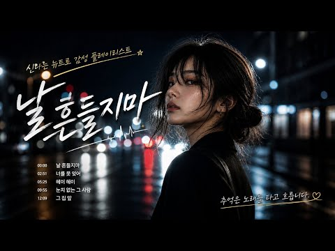
- 챕터: 0:00 날 흔들지마 · 2:51 너를 못 잊어 · 5:25 헤이 헤이 · 9:55 눈치 없는 그 사람 · 12:09 그 집 앞
- 설명 앞부분: 🎧 신나는 복고댄스 플레이리스트 🎧 추억 감성 가득한 뉴트로 댄스곡 모음✨ 운전할 때, 출근길, 카페에서도 듣기 좋은 감성 플레이리스트💖 네온빛처럼 반짝이던 그 시절, 신나는데 괜히 마음 한쪽이 시린 밤🌙 7080 정미의 가요방과 함께 오늘도 좋은 하루 되세요☕💖
- 대본 없음 (설명) — 음성인식이 끝나면 도입부·흐름이 들어감
- 댓글 217/217: 좋은 점 — 영상 1 · 감사·응원 16 · 더 알고 싶은 것 10 · 아쉬운 점 — 영상 2 · 반박·불만 — 의견 다름 0 · 정치·사회 0 · 경험 공유 4 · 구독·다음 기대 3
  - 좋은 점 — 영상 👍9 “ㅋ 쥑이네요..두 수 배우고 갑니다..만드신 노래 전부 대박나시길..응원합니다!^^”
  - 감사·응원 👍9 “ㅋ 쥑이네요..두 수 배우고 갑니다..만드신 노래 전부 대박나시길..응원합니다!^^”
  - 감사·응원 👍7 “날 흔들지마🎶 즐감했습니다~ 👍👍👍👍👍 행복한 하루 보내세요 🎶😀💓😀🎶 응원합니다 👏👏👏👏👏”
  - 더 알고 싶은 것 👍5 “걷다가 뛰게 하는 음악~• 슬로우조깅 하는 나~~ 너무 감사드려요 ❤한 곡 뽑기엔 부족한듯~~ 좋은 음악 많이 올려주세요 저도 덕분에 충전하고 감니다~•”
  - 더 알고 싶은 것 👍4 “그 집 앞 노래를 못찾겠네요. 어디서 찾을 수 있을까요? AI 음악 같은데..”
  - 아쉬운 점 — 영상 👍5 “목소리가 너무 좋은데 노래 USB 담아서 차에서 듣고 싶은데 방법이 없네요”
  - 아쉬운 점 — 영상 👍4 “노래목소리가너무좋아❤”
  - 경험 공유 👍10 “30대 여자사람 친구에게 추천햇더니 엉 이노래는 첨 접하는 장르 중독성강하다거 60대 형님들도 좋아하더군요 ㅋㅋㅋ 오늘 접한 산타페 형은 60대임 ㅋㅋ 내차랑 오디오 소리가 틀리다거 내가 사제러 스피커 튜닝 하라햇더니 ㅋㅋㅋ 술값 아끼서 튜닝하라거 강추헷음 ㅋㅋ 형 …”
  - 경험 공유 👍5 “걷다가 뛰게 하는 음악~• 슬로우조깅 하는 나~~ 너무 감사드려요 ❤한 곡 뽑기엔 부족한듯~~ 좋은 음악 많이 올려주세요 저도 덕분에 충전하고 감니다~•”
  - 구독·다음 기대 👍1 “멋진 음악 잘 듣고 갑니다. 다음곡 기대합니다❤❤❤”

### 219. 𝐏𝐥𝐚𝐲𝐥𝐢𝐬𝐭 ∣ 텐션 MAX🔥핫한 걸그룹 인기곡 노동요 뮤비 플리☀️여자아이돌 노래모음 ∣ 4K UHD

- https://www.youtube.com/watch?v=u7Mu1aDSaR4 · 마쁠(MA-PLE·KPOP) · 구독자 24,800 · 조회수 861,506 (×34.7, 하루 6,173.3) · 좋아요 3,231 (0.4%) · 135.4분 · 2026-05-30 · 주제 묶음 3. 공부·집중·작업 · 형식 플레이리스트·모음 (여러 곡) · 폴더 `W_u7Mu1aDSaR4` (웹 승인)
- 썸네일: 
- 챕터: 0:00 aespa - LEMONADE · 3:08 IVE - BANG BANG · 6:06 ILLIT - It's Me · 8:26 aespa - WDA (Whole Different … · 11:29 ITZY - Motto · 14:44 Hearts2Hearts - RUDE! · 18:06 LE SSERAFIM - BOOMPALA · 21:00 NMIXX - Heavy Serenade · 24:03 최예나 (YENA) - Catch Catch (캐치 … · 27:08 KATSEYE - PINKY UP · 29:21 LE SSERAFIM - CELEBRATION · 31:54 IVE - BLACKHOLE · 35:13 fromis_9 - LIKE YOU BETTER · 38:12 QWER - CEREMONY · 41:29 ILLIT - NOT CUTE ANYMORE · 43:40 NMIXX - Blue Valentine · 46:52 LE SSERAFIM - SPAGHETTI (feat… · 50:00 KiiiKiii - 404 (New Era) · 52:58 aespa - Whiplash · 56:01 BABYMONSTER - CHOOM (춤)
- 설명 앞부분: 더워지는 6월, 텐션까지 시원하게 끌어올리는 여자아이돌 플레이리스트☀ 최신 걸그룹 인기곡부터 중독성 강한 퍼포먼스까지 담은 K-POP 노래모음🎧 듣는 순간 분위기 달아오르는 HOT한 여름 시작부터 텐션 MAX K-Pop Girl Group MV 플리 런닝, 라이딩, 쇠질, 운동할 때 에너지 업💪 드라이브, 공부, 일할 때, 노동요로도 찰떡💡 매장 BGM으로도 부담 없이 어울리는 6월 감성 선곡🎶 끊김 없이 이어지는 비트와 무대⚡ 4K 고화질로 즐기는 K-Pop Girl Group Music Video Playlist 오늘도 재생 …
- 대본 없음 (설명) — 음성인식이 끝나면 도입부·흐름이 들어감
- 댓글 74/74: 좋은 점 — 영상 1 · 감사·응원 4 · 더 알고 싶은 것 0 · 아쉬운 점 — 영상 0 · 반박·불만 — 의견 다름 0 · 정치·사회 0 · 경험 공유 0 · 구독·다음 기대 0
  - 좋은 점 — 영상 👍0 “언제나 고퀄리티 무광고 영상 음악 올려주셔서 감사합니다 / 덕분에 에너지가 솓아요 ^_^ 좋은 일만 가득하길 바랍니다 / 흐흐 희망사항이지만 게임 할 때 듣기 좋은 아이돌 노래 모음도 있으면 좋겠습니다 흐흐”
  - 감사·응원 👍3 “광고없음 ㅈㄴ감사합니다”
  - 감사·응원 👍1 “스포티파이로 리스트업 해주시면 감사하겠어요”

### 220. 𝐏𝐥𝐚𝐲𝐥𝐢𝐬𝐭 여름 새벽향 낭만 플리

- https://www.youtube.com/watch?v=9qwdolh_Jow · 세봄 · 구독자 14,300 · 조회수 495,960 (×34.7, 하루 3,634.4) · 좋아요 8,830 (1.8%) · 18.9분 · 2026-06-02 · 주제 묶음 기타 · 형식 플레이리스트·모음 (여러 곡) · 폴더 `W_9qwdolh_Jow` (웹 승인)
- 썸네일: 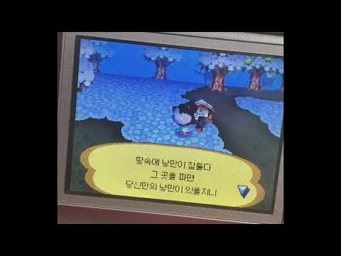
- 챕터: 0:00 그_냥 - 우리 사랑은 필름 같았으면 해요 · 4:00 wave to earth - bad · 8:24 Eddie and the Bricks - Pause · 11:13 피엘 - PILLOW · 14:21 전진희 - 여름밤에 우리
- 설명 앞부분: 본 채널의 모든 콘텐츠는 수익 창출과 무관하게 운영됩니다. [timestamps]
- 대본 없음 (설명) — 음성인식이 끝나면 도입부·흐름이 들어감
- 댓글 17/17: 좋은 점 — 영상 0 · 감사·응원 0 · 더 알고 싶은 것 0 · 아쉬운 점 — 영상 0 · 반박·불만 — 의견 다름 0 · 정치·사회 0 · 경험 공유 0 · 구독·다음 기대 0

### 221. Bach Style ∣ 마음이 편안해지는 바흐풍 잔잔한 클래식 🌿 [중간광고없음] ∣ 힐링음악, 일상 BGM, 궁전음악 ∣ Elise Piano

- https://www.youtube.com/watch?v=hbmQRFw1InE · Elise Piano | 엘리제피아노 · 구독자 24,900 · 조회수 861,699 (×34.6, 하루 5,433.4) · 좋아요 7,995 (0.9%) · 130.9분 · 2026-05-10 · 주제 묶음 6. 피아노·클래식·연주곡 · 형식 음악 (그 밖 모양 — 한 편짜리 BGM 등) · 폴더 `W_hbmQRFw1InE` (웹 승인)
- 썸네일: 
- 챕터: 0:00 Uplifting Harmony of the Soul · 2:28 Noble Symphony of the Breeze · 4:32 Serene Reflections · 6:16 Harmony of the Clear Water · 8:07 Endless Grace of the Meadow · 10:03 Gentle Cascade of Light · 12:04 Peaceful Journey of the River · 15:14 Warm Tears of Joy · 17:27 Continuous Whisper of Joy · 19:28 Blessing of the Green Leaves · 21:56 Bright Ripples on the Keys · 24:05 A Stream of Radiant Hope · 26:43 Comforting Flow of the Strings · 28:57 Radiant Steps of the Quintet · 30:40 Echoes from the Peaceful Brook · 32:48 The Gentle River of Sound · 34:50 Sparkling Summer Prelude · 37:29 Joyful Dance of the Triplets · 39:45 Shimmering Chords of Comfort · 42:24 Flowing Serenity
- 설명 앞부분: 은은한 촛불이 밝혀진 고풍스러운 궁전. 복잡하고 지친 마음을 부드럽게 위로해 주는 힐링 바흐(Healing Bach) 피아노 5중주입니다. Elise Piano ∣ Music for Every Moment 맑은 시냇물이 흐르듯 끊임없이 이어지는 피아노 반주 위로, 현악기들이 평화롭고 따뜻한 선율을 아름답게 노래합니다. 귀를 피곤하게 하는 자극적인 소리 없이 바흐(Bach) 특유의 단정하고 맑은 분위기를 담아내어 누구나 언제든 편안하게 들을 수 있습니다. 지친 일상에 산뜻한 힐링이 필요할 때나 집중해서 공부와 독서를 할 때, 당신의…
- 대본 없음 (설명) — 음성인식이 끝나면 도입부·흐름이 들어감
- 댓글 341/341: 좋은 점 — 영상 1 · 감사·응원 19 · 더 알고 싶은 것 1 · 아쉬운 점 — 영상 0 · 반박·불만 — 의견 다름 0 · 정치·사회 0 · 경험 공유 4 · 구독·다음 기대 2
  - 좋은 점 — 영상 👍2 “모짜르트 베토벤슈만그리고 바하 곡이 들어도 싫지않아 도움이 되네요 휴식에”
  - 감사·응원 👍8 “우아한 음악 들으며 바닷가 산책하니 천국입니다. 감사합니다.^^”
  - 감사·응원 👍4 “아름다운 음악들, 덕분에 마음의 평안을 얻고 있습니다, 감사합니다❤”
  - 경험 공유 👍1 “제가 찾던 좋은 음악 너무 좋네요 남편과 케피마시며 힐링하고 있어요~~”
  - 경험 공유 👍1 “안녕하세요, 46년째 재미동포 입니다. 아름답고 평화스러운 음악 감사합니다. 구독 누르고 갑니다.”
  - 구독·다음 기대 👍3 “이렇게 아름다운 음악을 들을 수 있어서 정말 행복하네요 구독하고 갑니다.^^”
  - 구독·다음 기대 👍2 “오늘 구독했습니다 바흐좋습니다🎉🎉🎉”

### 222. 𝙋𝙡𝙖𝙮𝙡𝙞𝙨𝙩 ∣ 아말피 테라스에서 봉골레와 와인 한 잔 ∣ 𝘚𝘰𝘧𝘵 𝘉𝘰𝘴𝘴𝘢 𝘑𝘢𝘻𝘻🍋🥂 ∣ 카페 플리, 지중해 플리

- https://www.youtube.com/watch?v=ZgR4pGSybaw · BlueDot Diary · 구독자 6,520 · 조회수 221,967 (×34.0, 하루 2,239.0) · 좋아요 1,799 (0.8%) · 142.8분 · 2026-07-09 · 주제 묶음 4. 카페·매장·라운지 · 형식 플레이리스트·모음 (여러 곡) · 폴더 `W_ZgR4pGSybaw` (웹 승인)
- 썸네일: 
- 챕터: 0:00 We’ll Start With Vongole · 2:14 Under The Yellow Canopy · 4:20 Salty Clams, Cool Breeze · 6:15 A Bite Of Positano · 8:11 Chardonnay On The Coast · 10:51 The Perfect Positano Course · 12:02 La Felicità · 14:45 Finish It With Delizia · 16:53 Sweet Delizia Days · 18:57 Before Driving Amalfi · 21:07 Lemons, Views, And Us · 22:16 Amalfi Route 16:30 · 23:48 ~loop
- 설명 앞부분: Artist: Blue Dot Diary 머리 위로 싱그러운 레몬나무 넝쿨이 싱그러운 그늘을 만들어주고, 눈앞에는 비현실적으로 새파란 지중해 바다가 끝없이 펼쳐진 아말피의 어느 테라스. 기분 좋은 바닷바람을 맞으며 마주한 봉골레 파스타는 그야말로 지중해 그 자체를 한 접시에 담아낸 맛입니다. 조개즙의 짭조름한 감칠맛과 깊은 풍미가 입안 가득 파도처럼 밀려올 때면, 이 완벽한 풍미에 절로 미소가 지어지며 고개를 끄덕이게 되죠."𝘔𝘢𝘮𝘮𝘢 𝘮𝘪𝘢!" 식사 후 상큼한 레몬 디저트의 여운을 음미하며 아말피 해안을 가만히 바라보는 지금, …
- 대본 없음 (설명) — 음성인식이 끝나면 도입부·흐름이 들어감
- 댓글 45/45: 좋은 점 — 영상 0 · 감사·응원 1 · 더 알고 싶은 것 0 · 아쉬운 점 — 영상 0 · 반박·불만 — 의견 다름 0 · 정치·사회 0 · 경험 공유 0 · 구독·다음 기대 0
  - 감사·응원 👍2 “아말피로 휴가 가고 싶네요^^ 힐링음악 감사해요🌿🌿”

### 223. 붓꽃잎 편지∣[감성 음악]∣댄스 트로트∣서정적인 트로트

- https://www.youtube.com/watch?v=K82Wh68Jvjc · MusubiRain · 구독자 1,310 · 조회수 44,559 (×34.0, 하루 478.2) · 좋아요 217 (0.5%) · 5분 · 2026-07-15 · 주제 묶음 9. 가요·발라드·트로트 · 형식 음악 (그 밖 모양 — 한 편짜리 BGM 등) · 폴더 `W_K82Wh68Jvjc` (웹 승인)
- 썸네일: 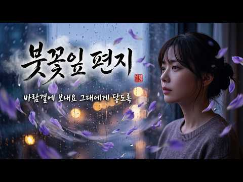
- 설명 앞부분: 제목: 붓꽃잎 편지 ∣ 서정적인 댄스 트로트 ∣ 애절한 트로트 설명: 바람에 흩날리는 붓꽃잎처럼, 마음속에 맺힌 그리움을 담아 노래합니다. 서정적인 가사와 경쾌한 댄스 트로트 비트가 어우러져 더욱 애절하게 다가오는 '붓꽃잎 편지'입니다. 그대 보내고 난 뒤 울고 있는 날 창가에 맺힌 비가 내 이름을 적어요 아픈 만큼 사랑한다 했나요, 그 말 가슴 한쪽 깊은 곳에 아직도 남아 있어 [English Version] Title: Iris Letter ∣ Lyrical Dance Trot ∣ K-Trot Description: Sendi…
- 대본 없음 (설명) — 음성인식이 끝나면 도입부·흐름이 들어감
- 댓글 26/26: 좋은 점 — 영상 0 · 감사·응원 0 · 더 알고 싶은 것 2 · 아쉬운 점 — 영상 1 · 반박·불만 — 의견 다름 0 · 정치·사회 0 · 경험 공유 0 · 구독·다음 기대 1
  - 더 알고 싶은 것 👍2 “반주좀 올 려주세요 부탁드립니다”
  - 더 알고 싶은 것 👍1 “M,R좀 부탁드립니다”
  - 아쉬운 점 — 영상 👍2 “이노래 노래방에 없네요 넘 아쉽네요”
  - 구독·다음 기대 👍1 “홍지윤 씨, 붓꽃잎 사랑 노래 너무 좋아서 매일 듣고 있어요”

### 224. "첫 소절 듣자마자 가슴 한쪽이 먹먹해지네요.." 세월 묻은 목소리로 다시부른 연인(블루스 Ver.)

- https://www.youtube.com/watch?v=y7CUK-q-f1s · 세월블루스 · 구독자 20,900 · 조회수 708,820 (×33.9, 하루 4,191.1) · 좋아요 5,115 (0.7%) · 4.6분 · 2026-04-30 · 주제 묶음 기타 · 형식 정보·해설 (그 밖) · 폴더 `W_y7CUK-q-f1s` (웹 승인)
- 썸네일: 
- 설명 앞부분: 안녕하세요, [세월블루스]입니다. 🥃 오늘 하루도 퍽퍽한 세상살이에 치이느라 참으로 고생 많으셨습니다. 비가 추적추적 내리는 어두운 밤, 낡은 바(Bar) 구석 자리에 앉아 독한 술 한잔 기울이고 싶은 날이 있습니다. 오늘은 한승기 님의 불후의 명곡 '연인'을, 가슴을 후벼 파는 일렉 기타의 벤딩 소리와 끈적한 하모니카가 어우러진 '정통 올드 블루스(Old Blues)' 감성으로 진득하게 다시 말아보았습니다. "외로운 이 가슴에 그리움만 남겨놓고..." 원곡의 뽕기를 싹 걷어낸 자리에, 산전수전 다 겪은 우리네 인생 같은 거칠고 …
- 대본 없음 (설명) — 음성인식이 끝나면 도입부·흐름이 들어감
- 댓글 274/274: 좋은 점 — 영상 1 · 감사·응원 45 · 더 알고 싶은 것 2 · 아쉬운 점 — 영상 3 · 반박·불만 — 의견 다름 0 · 정치·사회 1 · 경험 공유 15 · 구독·다음 기대 2
  - 감사·응원 👍17 “감사합니다 사랑하는님이 오늘 새벽에 하늘나라로 떠났습니다 울고싶은 오늘 같은 날 실컷울고있네요~ㅠㅠ”
  - 감사·응원 👍16 “잠시나마 짦았던 옛시간들이 주마등처럼지나가네요,감사합니다”
  - 더 알고 싶은 것 👍0 “Mr만 올려주실수 잇나요?”
  - 더 알고 싶은 것 👍0 “멜론 다운 안되나요???”
  - 아쉬운 점 — 영상 👍7 “목소리가 너무좋아요 노래를 맛있고 멋있게 부루시네요~~~”
  - 아쉬운 점 — 영상 👍4 “목소리가 너무 좋아요.”
  - 경험 공유 👍78 “제가 제일 좋아 하는 곡입니다 먼저 떠난 남편이 그립고 보고 싶습니다~~”
  - 경험 공유 👍4 “내가 100살 즈음에 이 노래를 듣는다면 그때도 난 눈물이 흐를것같다 보고싶어 너무 보고싶어서..”
  - 구독·다음 기대 👍9 “AI로 멋지게 좋은 음악 만드시네요. 딱 내 취향입니다. 구독했네요~^^”
  - 구독·다음 기대 👍3 “한승기님의 연인. 엄청 조아하는데 첫소절 들으면서 깜놀 완전 매료 되었습니다 어떤분인가? 궁금했는데 Ai 라니요 그럼에도 자꾸 듣게됩니다 감사합니다 구독합니다 God bless you✨️🌸🦋✨️”

### 225. 아직도 못다한 사랑 ∣ 화란(HWARAN) Cover (신청곡 / 감성 락 발라드)

- https://www.youtube.com/watch?v=emn7gbB-c8A · ​화란사운드® | 보컬화란 · 구독자 16,800 · 조회수 568,293 (×33.8, 하루 3,161.9) · 좋아요 2,144 (0.4%) · 4분 · 2026-04-19 · 주제 묶음 12. 커버·노래 부르기 · 형식 커버·직접 부른 노래 · 폴더 `W_emn7gbB-c8A` (웹 승인)
- 썸네일: 
- 설명 앞부분: 감정을 울리는 목소리, Emotional Retro Ballad HWARAN SOUND 아직도 못다한 사랑 Vocal 화란 (HWARAN) 화란의 목소리로 다시 불러본 레트로 감성 발라드입니다. 원곡이 가진 깊은 감정을 화란 특유의 절제된 슬픔과 여운으로 재해석했습니다. 🎼 크레딧 제작: 화란사운드 (HWARAN SOUND) 보컬: 화란 (HWARAN) Cover Song (커버곡) 🎧 감상 포인트 잔잔하게 쌓이다가 깊게 스며드는 감정선과 후반부 여운을 집중해서 들어보세요. 💛 창작 응원 농협 356-0612-756-023 (박○…
- 대본 없음 (설명) — 음성인식이 끝나면 도입부·흐름이 들어감
- 댓글 107/107: 좋은 점 — 영상 3 · 감사·응원 10 · 더 알고 싶은 것 1 · 아쉬운 점 — 영상 1 · 반박·불만 — 의견 다름 0 · 정치·사회 0 · 경험 공유 2 · 구독·다음 기대 2
  - 좋은 점 — 영상 👍4 “지금 슬품이 지나면 다 도움이 되드라 그런 시절을 기다리면 포기하지 말거라”
  - 좋은 점 — 영상 👍3 “차 만 타면 매일 듣고 있어요 ❤ 너무너무 듣기 좋아요 ❤❤ 모든 노래가 독특하니 멋집니다❤”
  - 감사·응원 👍9 “이 음악을 들을때마다 한정선씨의 아픈 삶이 생각나네요. 좋은 음악을 듣게되어 감사드립니다.”
  - 감사·응원 👍6 “꾸벅ᆢ 감사합니다 ^^ 기대를 저버리지 않는 편곡 감사합니다 잘들을께요 채널 대박나시길 바랍니다 🎉🎉🎉🎉🎉🎉🎉🎉🎉”
  - 더 알고 싶은 것 👍1 “신청곡 가능할까요~ 사랑은 끝나지않았네 이곡이 어떨지모르지만 가능하시다면 부탁드립니다~~^^♡”
  - 아쉬운 점 — 영상 👍2 “와~~ 정말 좋은데 딱 한가지 싸운드가 너무 아쉬워요. 중 대형스피커가 거의 진동을 안해요. 깊은 울림이 넘치는 저음 싸운드 레벨 좀 키워주시면 음악감상실에 고퀄리티 일텐데... 참고로 기막힌 음질 한번.. https://www.youtube.com/watch?v=k…”
  - 경험 공유 👍3 “오늘 많이 힘들었는데 내가 운이 좋았군.. 보컬 대단하네”
  - 경험 공유 👍3 “화란이란가수 첨접했는데 내가원하던목소리군요 중저음에감정의깊이가내가슴을파고들었이요 노래가장난아니네요 트롯5에 꼭나오십시오진선미 짱짱짱”
  - 구독·다음 기대 👍3 “♧보컬화란♧ 최고의 감동과 감성 제조기ᆢ 매일 듣는데 🎶 🤦 들을때 마다 다른 감동을 줍니다. 감동의 종류가 이렇게 많은줄 예전엔 미처 몰랐습니다. 운영자님 오늘도 고맙습니다 평안한 고운밤 되세요 ᆢ❤”
  - 구독·다음 기대 👍3 “차 만 타면 매일 듣고 있어요 ❤ 너무너무 듣기 좋아요 ❤❤ 모든 노래가 독특하니 멋집니다❤”

### 226. [중간광고없음] 감정을 다독여주는 따뜻한 피아노 ∣ Warm Piano Music for Emotional Comfort ☕🎼

- https://www.youtube.com/watch?v=qDyoLL6XXpU · Piano Haven · 구독자 5,100 · 조회수 171,907 (×33.7, 하루 979.0) · 좋아요 710 (0.4%) · 195.3분 · 2026-04-23 · 주제 묶음 6. 피아노·클래식·연주곡 · 형식 음악 (그 밖 모양 — 한 편짜리 BGM 등) · 폴더 `W_qDyoLL6XXpU` (웹 승인)
- 썸네일: 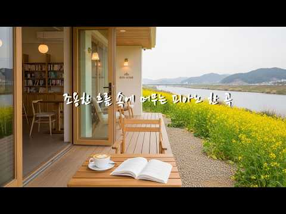
- 설명 앞부분: Piano Haven에 오신 것을 환영합니다. 이 영상은 바쁜 하루 속에서 잠시 쉬어갈 수 있도록 잔잔하고 따뜻한 피아노 선율을 담았습니다. 공부할 때, 일할 때, 책을 읽을 때, 잠들기 전, 혹은 조용히 마음을 쉬게 하고 싶은 순간에 편안한 배경음악이 되어드립니다. 감성적인 피아노 연주와 부드러운 멜로디가 지친 마음을 다독이고, 일상에 작은 평온과 위로를 전해드리길 바랍니다. Piano Haven은 힐링음악, 수면음악, 공부음악, 집중음악, 카페음악, 휴식음악을 사랑하는 분들을 위한 피아노 음악 채널입니다. 비 오는 날의 감성,…
- 대본 없음 (설명) — 음성인식이 끝나면 도입부·흐름이 들어감
- 댓글 26/26: 좋은 점 — 영상 0 · 감사·응원 2 · 더 알고 싶은 것 0 · 아쉬운 점 — 영상 0 · 반박·불만 — 의견 다름 0 · 정치·사회 0 · 경험 공유 0 · 구독·다음 기대 0
  - 감사·응원 👍1 “우와 여긴 어디인가요? 너무 멋져요 그냥 봐도 한국인데 가보고 싶습니다 좋은음악 덕분에 오전에 힐링되었습니다 감사합니다.”
  - 감사·응원 👍0 “좋은 음악 감사드립니다.”

### 227. 쏟아지는 빗소리에 복잡한 생각은 내려 놓으세요 ∣ 수면유도 백색소음 힐링 ASMR

- https://www.youtube.com/watch?v=9TqDVzWADgQ · Cozy Rainy Days ASMR · 구독자 9,320 · 조회수 313,193 (×33.6, 하루 2,371.7) · 좋아요 2,917 (0.9%) · 360.1분 · 2026-06-06 · 주제 묶음 1. 수면·명상·힐링 · 형식 자연 소리·백색소음 (음악 낱말 없는 제목) · 폴더 `W_9TqDVzWADgQ` (웹 승인)
- 썸네일: 
- 설명 앞부분: 세차게 쏟아지는 폭우 빗소리에 복잡한 생각은 내려놓고 평온한 빗소리에 귀를 기울여 보세요. 오늘도 여러분의 피곤함이 이 빗소리와 함께 깊은 잠을 취하길 바랍니다. 오늘도 이 공간을 찾아주신 모든 분들이 평온한 밤 보내시길 진심으로 응원합니다. 감사합니다. 🎧 Real Sound: 비오는 날 직접 야외에서 정성을 다해 녹음한 실제 빗소리만을 사용하여 깊은 입체적인 몰입감을 드립니다. 🛌 Healing: 불면증 해소, 집중력 향상, 명상, 혹은 그저 빗소리가 그리운 모든 순간에 함께합니다. 🏡 K-Mood: 한국의 정겨운 시골 풍경과…
- 같은 채널 평소 대비 ×40.7 (채널 최근 롱폼 중앙값 7,690회) · 평소 영상: 고요한 밤, 마당을 적시는 빗소리 🌧️ 불면증 극복을 위한 6시간 깊은 수면 백색소음 (7,690회) / 들으면 푹 잠들게 만드는 처마밑 빗소리 ASMR ∣ 불면증에 도움주는 백색소음 (7,636회)
- 대본 없음 (설명) — 음성인식이 끝나면 도입부·흐름이 들어감
- 댓글 97/97: 좋은 점 — 영상 1 · 감사·응원 3 · 더 알고 싶은 것 1 · 아쉬운 점 — 영상 0 · 반박·불만 — 의견 다름 1 · 정치·사회 0 · 경험 공유 2 · 구독·다음 기대 0
  - 좋은 점 — 영상 👍0 “김페이커트랄랄레로트랄랄라퉁퉁퉁퉁퉁퉁퉁퉁퉁사후르봉준호손흥민BTS거북이와두루미 삼천갑자동방삭치치카포사리사리센터워리워리세브리깡수천년지나마침내선택받은빛과어둠의영혼을가진바로그소년피카츄라이츄파이리꼬부기버터풀야도란피투또가스서로생긴모습은달라도우리는모두친구산에서들에서때리고굴고사막에서…”
  - 감사·응원 👍5 “3달전 돌발성 난청 와서 치료 받으며 회복중이있습니다 마음이 마니 지치고 힘들었습니다 2달전부터 귀에 바람소리 들리는 이명있는데 자연스런 빗소리 너무너무 감사합니다 너무 좋아요 꾸벅~”
  - 감사·응원 👍3 “잠이 절로 오는것 같애요 감사드립니다”
  - 더 알고 싶은 것 👍1 “호르몬제는 무서워서 못 먹고 영양제 알아보던 중이에요. 한 번 깨면 다시 잠드는 게 너무 힘들어요. 흡수 잘 된다는 리포좀멜라토닌에 감태·레몬밤·가바 같이 들어간 각성완화제 먹고 있는데 엄청 센 건 아닌데 누우면 좀 차분해지긴 하더라고요. 같은 나이대 분들 어떻게 넘…”
  - 반박·불만 — 의견 다름 👍1 “호르몬제는 무서워서 못 먹고 영양제 알아보던 중이에요. 한 번 깨면 다시 잠드는 게 너무 힘들어요. 흡수 잘 된다는 리포좀멜라토닌에 감태·레몬밤·가바 같이 들어간 각성완화제 먹고 있는데 엄청 센 건 아닌데 누우면 좀 차분해지긴 하더라고요. 같은 나이대 분들 어떻게 넘…”
  - 경험 공유 👍8 “저도 힘들고 지치내요 정신적으로 비소리가 너무 좋아요😢😢😢”
  - 경험 공유 👍1 “아파트에선 이런 빗소리를 들을수가없죠 불을끄고 눈을 감고 듣고있으면 후라이팬에 기름 잔뜩붓고생선 튀기는 기름튀는 소리처럼 들리는건 내가 이상한건지...”

### 228. 임영웅, 신곡 〈그대 행복이면 됐소〉 발표! 그대만 행복하면 됐소…

- https://www.youtube.com/watch?v=p8MCdXUSFmI · 감성트롯다방 · 구독자 4,910 · 조회수 164,819 (×33.6, 하루 1,579.6) · 좋아요 2,322 (1.4%) · 6.4분 · 2026-07-04 · 주제 묶음 9. 가요·발라드·트로트 · 형식 한 곡 (뮤직비디오·음원·가사) · 폴더 `W_p8MCdXUSFmI` (웹 승인)
- 썸네일: 
- 설명 앞부분: 사랑하지만 끝내 붙잡지 못한 사람을 위해, 마지막까지 행복만을 빌어주는 한 남자의 진심을 담은 감성 트롯 발라드입니다. 〈그대 행복이면 됐소〉는 이별의 아픔보다 사랑하는 사람의 행복을 먼저 생각하는 가장 아름다운 사랑을 노래합니다. 임영웅 특유의 따뜻하면서도 깊은 감성과 애절한 목소리가 더해져, 한 소절 한 소절마다 가슴 깊은 울림을 전합니다. 누군가를 진심으로 사랑해 본 사람이라면 누구나 공감할 수 있는 이야기. 오늘 이 노래가 여러분의 마음속 오래된 추억과 사랑을 다시 떠올리게 하길 바랍니다.
- 대본 없음 (설명) — 음성인식이 끝나면 도입부·흐름이 들어감
- 댓글 262/262: 좋은 점 — 영상 2 · 감사·응원 20 · 더 알고 싶은 것 2 · 아쉬운 점 — 영상 9 · 반박·불만 — 의견 다름 28 · 정치·사회 0 · 경험 공유 3 · 구독·다음 기대 0
  - 좋은 점 — 영상 👍0 “감성이 가슴깊이 와닿는 임영웅 님 신곡 구슬퍼요 이렇게좋은 노래를 선물해준 임영웅 님 께 감사드립니다”
  - 좋은 점 — 영상 👍0 “가슴에 와닿는목소리가 너무좋아요”
  - 감사·응원 👍11 “울영웅님은아니지만노래넘잘부르시네요~응원합니다”
  - 감사·응원 👍8 “사랑하면 응원도 하고 돕기도하고 기도와실행도하죠”
  - 더 알고 싶은 것 👍3 “가수보다 더 잘하시는 노래 제작자 분께 박수를 보냅니다 재능이십니다 이렇게 감성적인 분이면 어떤 분일까 궁금하네요 환상은 항상 행복이고 환희, 희열, 그대는 전부가 사랑입니다”
  - 더 알고 싶은 것 👍0 “임영웅 부르는 신곡 듣고싶어요. 궁금하네요.❤🎉”
  - 아쉬운 점 — 영상 👍2 “신곡나오기전aI목소리 인가봐요”
  - 아쉬운 점 — 영상 👍1 “<그대 행복이면 됐소>는 임영웅 님의 실제 신곡이 아닙니다. ​유튜브에서 조회수를 늘리기 위해 임영웅 님의 이름과 얼굴을 무단으로 도용한 가짜 뉴스 및 낚시성 영상입니다. 제미나이가”
  - 반박·불만 — 의견 다름 👍3 “🌈🦜ㅡ "임영웅씨" 목소리 아닙니다 . > 잠언19:14 > 부부는 한 몸인데 어째서 한 쪽만 행복하는가요??”
  - 반박·불만 — 의견 다름 👍2 “영웅님 목소리 아닌데요. 우린 또 제목에 낙였어요”
  - 경험 공유 👍1 “모두다싫어젔네요 챙피 하고 쑥스럽고 요즈응 잠도 못자고 힘들어요 내가 성을파는느낌 나혼자 해결 하기 힘든세상이되 ㅇㆍ버렸네요”
  - 경험 공유 👍0 “임영웅이 이런 노래 부른 적 없다 한다. 그렇다면 가짜 임영웅이 부른 가짜 노랜데 진짜 노래보다 더 조타. 세상 참... 별꼴을 다 본다. 거짓 사랑의 끝, 혼자만의 사랑, 그대 행복하면 됐소... 현재 유튜브에 나도는 가짜 임영웅 노래 3곡 확인!!”

### 229. [Playlist] 라흐마니노프의 깊은 그리움 ∣ 멀리서 들려오는 서정적인 선율 (Rachmaninoff Style) 🎹✨

- https://www.youtube.com/watch?v=vcpBmyFBJos · The Clavis · 구독자 19,800 · 조회수 648,351 (×32.7, 하루 5,417.0) · 좋아요 6,847 (1.1%) · 97.2분 · 2026-06-18 · 주제 묶음 6. 피아노·클래식·연주곡 · 형식 AI 음악 · 폴더 `W_vcpBmyFBJos` (웹 승인)
- 썸네일: 
- 챕터: 0:00 01. Longing at Dusk · 2:31 02. The Faraway Call · 5:03 03. Faded Memories · 7:30 04. Garden of Memories · 10:27 05. Tears of Memory · 14:19 06. The Last Goodbye · 16:55 07. A Young Heart's Lament · 19:22 08. The Last Letter · 23:23 09. Night Dreamer · 27:34 10. Where the River Ends · 30:41 11. A Faded Portrait · 34:12 12. Paths of Longing · 37:49 13. Falling Leaves · 41:26 14. The Old House · 44:56 15. The Last Starlight
- 설명 앞부분: The Clavis 채널에 오신 것을 환영합니다. '피아노의 거인' 세르게이 라흐마니노프가 지닌 깊고 서정적인 감성과 애수 가득한 선율을 담아낸 프리미엄 클래식 플레이리스트입니다. 황혼이 물드는 저녁부터 깊어가는 밤 시간대까지, 마음 깊은 곳에 잠든 그리움과 따뜻한 위로를 전하기 위해 솔로 피아노부터 바이올린, 첼로, 현악 앙상블, 풀 오케스트라까지 다양한 악기 구성으로 15개의 트랙을 유기적으로 연결했습니다. 라흐마니노프 특유의 웅장하고 서정적인 선율이 마음 깊은 곳을 조용히 어루만져 줄 것입니다. 깊은 휴식, 사색, 혹은 그리…
- 대본 없음 (설명) — 음성인식이 끝나면 도입부·흐름이 들어감
- 댓글 551/551: 좋은 점 — 영상 3 · 감사·응원 115 · 더 알고 싶은 것 0 · 아쉬운 점 — 영상 4 · 반박·불만 — 의견 다름 1 · 정치·사회 1 · 경험 공유 44 · 구독·다음 기대 2
  - 좋은 점 — 영상 👍5 “마음에 와닿는 음악 들려주어서 감사합니다. 잠못드는 밤입니다.”
  - 감사·응원 👍83 “요즘 라흐마니노프에 매일 감동입니다 여러가지 생각들이 스치며 애닮은 그리움에 눈물이 나네요 감사 합니다~”
  - 감사·응원 👍69 “나이가 들에 세상을 바라보는 눈이 담담해집니다. 엊그제에 그리 친하지 않았던 친구의 부고를 전해 듣고... 이제 이럴 나이가 됐구나... 새삼 되새겨보니, 담담함도 있었지만 왠지 서글픈 생각이 많았습니다. 오늘... 우연히 이 곳을 알게되어 마음을 추스리게 됩니다. …”
  - 아쉬운 점 — 영상 👍70 “18년을 함께한 우리 고양이가 고양이별로 떠난지 4일째 되는 밤입니다. 집안 모든 곳이 냥이와 함께한 곳이라 가는 곳마다 눈물이 납니다. 마치 그곳에 앉아 있는 것 같아 나도 모르게 두 손을 뻗곤 합니다. 원없이 사랑한 것 같았는데 보내고나니 아쉬움과 후회만 밀려옵니…”
  - 아쉬운 점 — 영상 👍11 “이 음악을 듣는동안 내가슴은 슬프면서도 안정 감을 갖는느낌이 듭니다 6년째 아파서 집에서 지루한 시간을 보냅니다 내몸을 내가 어찌할수 없다는게 넘 슬프고 이렇게 살아야하나 하는 생각이들면 가슴이 먹먹해 집니다 워낙 음악을 좋아하다보니 여기저기 모든 음악을 듣다가 지금…”
  - 정치·사회 👍623 “사랑하는남편이 하늘나라가신지 두달하고십사일째입니다~ 제마음을 위로해주네요~”
  - 경험 공유 👍199 “어머니가 돌아가신지 두달 되었습니다. 제가 병원에 입워해 임종을 못보고 너무나 갑자기 제게 가장 소중한분을 떠나보냈습니다....어머니를 기억하며 집에가는길에 듣겠습니다.”
  - 경험 공유 👍164 “짝꿍을 보낸 아픔보다 더 아팠던 건 아이들이 부르지 못하는 아빠라는 이름이었습니다. 가슴에 아빠라는 단어도 묻고 성장해야 하는 아이들을 보며, 나처럼 그 사람도 아프겠다 생각했어요. 그렇게 5년이 흘렀어요. 그저 시간따라 나도 흐르다보면 그 사람 만나겠지요. 아이들은…”
  - 구독·다음 기대 👍7 “음악에 빠져 드네요...자주 들러겠습니다. 구독합니다”
  - 구독·다음 기대 👍2 “❤❤❤매스컴 덕에 라흐마니노프 팬이 되었네요 아침 이불 속에서 계속 함께하고 있어요 잔잔히 내 가슴에 스며드는 아름다운 선율이 오늘도 행복한 하루를 열어줍니다 좋은 음악 감사해요❤❤❤”

### 230. 비 오는 날 듣기 좋은 화란 락발라드 모음 Vol.1 ☔7080 감성 Cover Collection

- https://www.youtube.com/watch?v=c4hjZfzxkMM · ​화란사운드® | 보컬화란 · 구독자 16,800 · 조회수 545,678 (×32.5, 하루 3,895.9) · 좋아요 5,902 (1.1%) · 34분 · 2026-05-29 · 주제 묶음 12. 커버·노래 부르기 · 형식 커버·직접 부른 노래 · 폴더 `W_c4hjZfzxkMM` (웹 승인)
- 썸네일: 
- 챕터: 0:00 잃어버린 정 · 4:25 아직도 못다한 사랑 · 8:25 그대는 모르시더이다 · 12:50 아득히 먼 곳 · 16:23 님은 먼 곳에 · 20:57 영원한 사랑인줄 알았는데 · 25:11 잃어버린 우산 · 29:24 비와 찻잔 사이
- 설명 앞부분: 감정을 울리는 목소리, Emotional Rock Ballad HWARAN SOUND 비 오는 밤, 조용히 감성을 적셔주는 7080 감성 락발라드 커버곡들을 한 편의 플레이리스트처럼 담아보았습니다. 화란의 목소리로 다시 불러본 추억과 이별, 그리고 그리움의 노래들입니다. 🎼 수록곡 🎼 안내 본 영상은 여러 원곡을 기반으로 제작된 커버곡 모음집입니다. 본 영상은 감상 및 아카이브 목적의 커버 콘텐츠입니다. 🎼 크레딧 제작: 화란사운드 (HWARAN SOUND) 보컬: 화란 (HWARAN) 영상 속 인물: 화란 (HWARAN) Cov…
- 대본 없음 (설명) — 음성인식이 끝나면 도입부·흐름이 들어감
- 댓글 285/284: 좋은 점 — 영상 3 · 감사·응원 27 · 더 알고 싶은 것 5 · 아쉬운 점 — 영상 1 · 반박·불만 — 의견 다름 1 · 정치·사회 0 · 경험 공유 9 · 구독·다음 기대 2
  - 좋은 점 — 영상 👍6 “젊은 시절이 주마등쳐럼 스쳐가요 비오는날 넘무 듣기좋아요”
  - 좋은 점 — 영상 👍3 “AI 가 내 가슴을 울려...허스키한 심금을 울리는 음색지죤 넘사벽 ...아물지 않은 내 사랑의 아픔인듯 이별의 아픔을 파노라마 처럼 뇌리로 스쳐가네요. 운명적인 만남인줄 알았는데 스치는 인연으로 서로가 찢어지는 통증을 겪으며...세월이 흘러도 가슴이 기억하는 이름석…”
  - 감사·응원 👍21 “고맙습니다 오늘같이 비가오는 날에는”
  - 감사·응원 👍20 “많은 추억을 회상하게 됩니다 .음색도 맘에들고. 암튼 들려주셔서 감사합니다💞💖”
  - 더 알고 싶은 것 👍7 “참 저장 도 했습니다 더욱 많은 노래 만들어 주세요 ^^”
  - 더 알고 싶은 것 👍3 “AI인줄 알고도 너무좋아 그냥들었는데 진짜 가수인지 궁금합니다.”
  - 아쉬운 점 — 영상 👍5 “목소리가 너무 예뻐요 ❤❤❤❤❤❤”
  - 반박·불만 — 의견 다름 👍5 “화란..사람입니다. AI 아닙니다.ㅋㅋ”
  - 경험 공유 👍12 “소낙비 치는 시작장면 멋집니다 곡도 제가 제일 좋아 하는 노래 나도 모르게 따라 부르네요 감사합니다 건강하세요🌱🌱”
  - 경험 공유 👍11 “노래가 전부 굿 !! 시상에 내가빠짐”
  - 구독·다음 기대 👍6 “오늘 첨 들어봤는데 감성 음색 너무좋으네요! 구독합니다!🥰”
  - 구독·다음 기대 👍4 “최고 65년 생인데 너무 긧가에 시원하고 시원해서 회사다니면서 매일듣음니다 ㆍ 고맙음니다”

### 231. 그냥 틀었는데 너무 좋다🎧감성 미쳐버린 8090 레전드 모음

- https://www.youtube.com/watch?v=gSt5jpGfdPg · Ceci Pop · 구독자 29,500 · 조회수 947,161 (×32.1, 하루 5,362.2) · 좋아요 8,526 (0.9%) · 72.4분 · 2026-04-22 · 주제 묶음 9. 가요·발라드·트로트 · 형식 플레이리스트·모음 (여러 곡) · 폴더 `W_gSt5jpGfdPg` (웹 승인)
- 썸네일: 
- 챕터: 0:00 한 번만 더 · 2:46 잊지말아요 · 6:18 나에게로 · 9:13 지하철 그녀 · 12:45 잊어줄게 · 15:45 비오는 목요일 · 19:34 486 486 · 22:48 이제는 · 25:18 눈빛만으로 · 29:32 미안해 · 33:00 Analog Love · 36:12 Replay
- 설명 앞부분: 🎧이어폰을 꽂는 순간, 우리들만의 추억이 펼쳐집니다. 봄비가 지나간 자리마다 초록이 피어나듯🌿 오늘 이 노래가 당신의 마음에 봄을 데려오길 바래요. ✨ 💿Track List: 🎧 쎄씨팝은 80–90년대 한국 감성을 현대적인 사운드로 재해석한 뉴트로 시티팝 플레이리스트 채널입니다. ◐ 모든 음악은 AI 제작 도구를 기반으로, 쎄씨팝만의 기획·프로듀싱·브랜딩을 거쳐 완성된 오리지널 콘텐츠입니다. © All rights reserved by Ceci Pop. Unauthorized use, reproduction, or redistri…
- 대본 없음 (설명) — 음성인식이 끝나면 도입부·흐름이 들어감
- 댓글 761/761: 좋은 점 — 영상 4 · 감사·응원 36 · 더 알고 싶은 것 18 · 아쉬운 점 — 영상 6 · 반박·불만 — 의견 다름 1 · 정치·사회 0 · 경험 공유 18 · 구독·다음 기대 15
  - 감사·응원 👍125 “안녕하세요. 한국AI산업 저작권 감사원입니다.귀하가 제작하신 음원은 좋습니다. AI음원 저작권법 제2조 3항에 따라 감사합니다.”
  - 감사·응원 👍31 “대전 에서조그만술집하는데.손님들난리가낫네요.너무너무좋다구.술매상이두배로올랏습니다.너무너무좋답니다.항상감사합니다.게속좋은노래올려주세요😅😊😊😊”
  - 더 알고 싶은 것 👍31 “대전 에서조그만술집하는데.손님들난리가낫네요.너무너무좋다구.술매상이두배로올랏습니다.너무너무좋답니다.항상감사합니다.게속좋은노래올려주세요😅😊😊😊”
  - 더 알고 싶은 것 👍18 “한번만 더 넘 좋네요,, 이전 영상에 '그대없는 밤'도 넘 좋았는데, 이런 노래들 더 많이 만들어 주세요.👍”
  - 아쉬운 점 — 영상 👍35 “밤낚시하다 우연히 듣고 낚시 접고 물멍하게 만들어버림 좋네요 분위기 감성 느낌 그래서~물멍”
  - 아쉬운 점 — 영상 👍6 “주인장님 한번만 더 이노래 하나만 트랙만들어 주심안될까요 무한반복하고싶어서😅”
  - 반박·불만 — 의견 다름 👍6 “와~~댓글을 다달아주시네요..그대 인성같은 음악..설마 댓글AI 아니죠? ㅋㅋ 농담요 좋은 음악 고맙습니다”
  - 경험 공유 👍16 “그시절 세련된 노래만 모아 놓은 것 같아요. 내가 몰랐던 가수인가 하며 찾았는데 ai라.... 취향저격”
  - 경험 공유 👍6 “뭐지 와ㅡㅡ 검색해봤네ㅡ.정규앨범인줄알고ㅡ”
  - 구독·다음 기대 👍9 “다 처음들어보는 곡인데 싶어서 보니 AI 였다니. 곡 들이 다 분위기좋아요. 구독하고 갑니다”
  - 구독·다음 기대 👍8 “첫곡부터 정말 너어무 좋네요 바로 구독했습니다!!”

### 232. 하루 끝에 듣는 힐링 발라드 🎶 광고 없는 감성 명곡 모음｜백지영, 성시경, 더원, 이승기, 김필, 양파, 임창정 - 명곡 모음 광고없음

- https://www.youtube.com/watch?v=85w3xNdP09U · N Melody Ballad - 추억발라드 · 구독자 23,800 · 조회수 755,411 (×31.7, 하루 5,780.7) · 좋아요 1,873 (0.2%) · 49.8분 · 2026-06-07 · 주제 묶음 9. 가요·발라드·트로트 · 형식 플레이리스트·모음 (여러 곡) · 폴더 `W_85w3xNdP09U` (웹 승인)
- 썸네일: 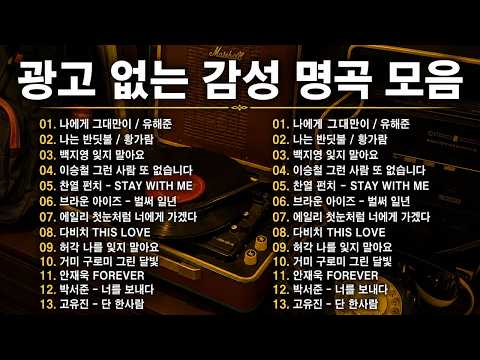
- 대본 없음 (없음) — 음성인식이 끝나면 도입부·흐름이 들어감
- 댓글 138/138: 좋은 점 — 영상 0 · 감사·응원 2 · 더 알고 싶은 것 3 · 아쉬운 점 — 영상 6 · 반박·불만 — 의견 다름 1 · 정치·사회 0 · 경험 공유 2 · 구독·다음 기대 0
  - 감사·응원 👍1 “잘듣고있어요~ 감사해요~❤”
  - 감사·응원 👍0 “늘ㆍ감사합니다 ㆍ🎉🎉🎉엄지척입니다”
  - 더 알고 싶은 것 👍6 “노래 너무 잘들었습니다! 혹시 물고기자리 누구 커버에요? 너무 선곡이 좋으셔서 궁금합니다”
  - 더 알고 싶은 것 👍3 “가수랑 제목 타임테이블 알 수 있을까요?”
  - 아쉬운 점 — 영상 👍8 “광고없다더니 광고가 많네요”
  - 아쉬운 점 — 영상 👍5 “걍 광고가 있다고 해도 듣고 싶으면 들을텐데...구지 구지 광고 없다고..”
  - 경험 공유 👍4 “광고 조금은 이해 하려고 했었는데 너무많아~”
  - 경험 공유 👍4 “엄마 불쌍한 울엄마 가슴이 미어지도록 사랑해 내가 정말 나쁜딸이야 미안해 엄마 제발 오래오래 살아 아빠도”

### 233. 🍀 7월, 바다를 보며 들으니 이 노래 너무 좋다 ☕ 커피 한 잔과 함께하는 7080 추억의 올드팝 🎧

- https://www.youtube.com/watch?v=q3iHXzi_Qn0 · 행운을담은 올드팝   · 구독자 6,160 · 조회수 191,460 (×31.1, 하루 1,812.4) · 좋아요 2,109 (1.1%) · 85.7분 · 2026-07-02 · 주제 묶음 9. 가요·발라드·트로트 · 형식 플레이리스트·모음 (여러 곡) · 폴더 `W_q3iHXzi_Qn0` (웹 승인)
- 썸네일: 
- 챕터: 0:00 Morning Mist on the Bay · 3:34 Summer Beside the Sea · 8:03 Footprints by the Summer Sea · 13:23 By the Dunes and the Radio · 17:42 When the Sea Breeze Turned th… · 21:40 Where the Seabirds Fly · 26:15 A Picture Filled with Summer · 30:15 A Shell That Remembers · 33:40 Treasure Washed Ashore · 37:48 The Breeze That Stayed Until … · 42:51 Replay 🔄
- 설명 앞부분: 🎧 행운을 담은 7080 올드팝 🎶 좋은 아침입니다. ☀️🌊 7월의 푸른 아침, 창문 너머로 반짝이는 바다가 펼쳐지고, 따뜻한 햇살과 시원한 바람이 조용히 하루를 시작하고 있습니다. 따뜻한 커피 한 잔, 은은하게 스며드는 오래된 노래, 그리고 잠시 쉬어갈 수 있는 여유. 7월에 다시 듣는 이 노래들은 마음속에 오래 머물던 추억을 조용히 다시 불러오는 것 같습니다. 잠시 모든 걱정을 내려놓고, 그 시절 함께 웃었던 사람들과 여름 바람처럼 남아 있는 기억들을 천천히 떠올려 보세요. 오늘 이 음악이 당신의 아침을 조금 더 따뜻하게, 평…
- 대본 없음 (설명) — 음성인식이 끝나면 도입부·흐름이 들어감
- 댓글 160/160: 좋은 점 — 영상 3 · 감사·응원 24 · 더 알고 싶은 것 2 · 아쉬운 점 — 영상 0 · 반박·불만 — 의견 다름 0 · 정치·사회 0 · 경험 공유 1 · 구독·다음 기대 2
  - 좋은 점 — 영상 👍5 “주말 아침에 듣기 너무 좋네요 비도 오고 차분한 목소리가 듣기 좋네요❤❤❤”
  - 좋은 점 — 영상 👍3 “소프트한 목소리와 서사시 같은 가사가 휴일 아침에 듣기 좋아요 가수 이름을 알수 있을까요?”
  - 감사·응원 👍44 “시골에 귀촌한지 3년여가 되어 가는데 테라스에서 커피 타임 하면서 긴시간 마냥 듣고 있네요. 마음을 평온하게 하는 음악이라서 ~ 좋은음악 만들어 주셔 감사합니다^^”
  - 감사·응원 👍8 “책한권 손에들고 차분한음과 마음의 평온을 느끼는 주말아침이네요 나게겐 이또한 귀한시간입니다 감사합니다”
  - 더 알고 싶은 것 👍12 “혹시 흘러나오는 여자 목소리 가수이름 알수있을까요? 엄마가 궁금해하셔서요ㅠ”
  - 더 알고 싶은 것 👍3 “소프트한 목소리와 서사시 같은 가사가 휴일 아침에 듣기 좋아요 가수 이름을 알수 있을까요?”
  - 경험 공유 👍4 “목소리도 노래도 너무 스윗하고 좋아서 계속 듣다가 갑자기 가수 이름이 궁금해졌는데, 댓글 보니 AI가수라고 하셔서 빵터졌습니다. 저도 오프라인에서 버스킹하며 취미로 노래하는 사람인데 AI가 이렇게 노래를 잘하니 가수들 다 굶어죽겠네요 ㅎㅎㅎ 너무 좋아서 한수 배우고 …”
  - 구독·다음 기대 👍3 “독일 함부르크에서 60대 새내기 할머니가 구독하고 잘 듣고 있습니다.”
  - 구독·다음 기대 👍3 “분위기가 좋아서 편안하게 음악 잘 들었습니다.. 구독 좋아요 알림설정하고 다음에 또 올께요...감사합니다.”

### 234. 주부들이 엄선한 감성 팝송 Best 26 ∣ EverPop 레트로 팝 컬렉션 ∣ 7080 올드팝송 ∣ 추억 소환 팝송모음 ∣ 가슴이 따뜻해지는 명곡 Old Po…

- https://www.youtube.com/watch?v=JZH9pZhtl9I · 추억의 올드팝 EverPop · 구독자 15,800 · 조회수 488,763 (×30.9, 하루 5,543.2) · 좋아요 0 (0.0%) · 97.8분 · 2026-07-20 · 주제 묶음 9. 가요·발라드·트로트 · 형식 플레이리스트·모음 (여러 곡) · 폴더 `W_JZH9pZhtl9I` (웹 승인)
- 썸네일: 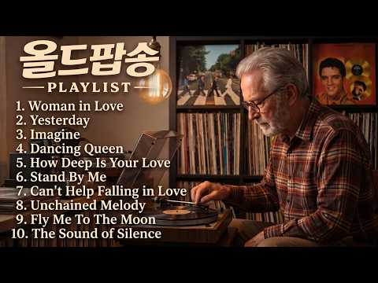
- 설명 앞부분: 주부들이 엄선한 감성 팝송 Best 26 ∣ EverPop 레트로 팝 컬렉션 ∣ 7080 올드팝송 ∣ 추억 소환 팝송모음 ∣ 가슴이 따뜻해지는 명곡 Old Pop Playlist 저희의 동의 없이 음악을 도용할 수 없습니다. 위반 시 경고를 보내드립니다.
- 대본 없음 (설명) — 음성인식이 끝나면 도입부·흐름이 들어감
- 댓글 125/125: 좋은 점 — 영상 0 · 감사·응원 17 · 더 알고 싶은 것 2 · 아쉬운 점 — 영상 2 · 반박·불만 — 의견 다름 0 · 정치·사회 0 · 경험 공유 1 · 구독·다음 기대 0
  - 감사·응원 👍22 “😊 와우~~~^^ 넘 좋아요. 몇십년만에 듣는중임다. 세월이 흘렀는데도 이 기분은, 똑같이 설레고 . 기쁘고 행복하게 잘듣습니다. 감사합니당”
  - 감사·응원 👍20 “그리워지네요 그시절이~~^^ 감사합니다 덕분에 잘듣고있지요~~^^♡♡♡🎉🎉🎉😅😅😅”
  - 더 알고 싶은 것 👍1 “제목 좀 알려주세요 다 너무 좋아용 !!”
  - 더 알고 싶은 것 👍0 “노래 재목들 좀 알 수 있을까요?”
  - 아쉬운 점 — 영상 👍5 “팝송을 즐겨 듣고 있는데 가사는 자막으로 나오고 들어보면 기억 나는 부분이 많이 있는데 제목이 기억안나는게 아쉬워요~항상 감사합니다”
  - 아쉬운 점 — 영상 👍1 “팝송 제목이 없는게 아쉽네요”

### 235. 조선힙합 OFFICIAL 발표곡 중 인기곡만 모았습니다.

- https://www.youtube.com/watch?v=fjjiznDoNEQ · 조선힙합 Official · 구독자 28,600 · 조회수 884,654 (×30.9, 하루 6,626.1) · 좋아요 7,322 (0.8%) · 28.4분 · 2026-06-05 · 주제 묶음 11. 힙합·R&B·EDM · 형식 한 곡 (뮤직비디오·음원·가사) · 폴더 `W_fjjiznDoNEQ` (웹 승인)
- 썸네일: 
- 챕터: 0:00 살다보니 · 3:03 인연 · 6:27 윤회 · 11:11 월매송 · 15:37 인연은달을따라지고 · 19:47 가시리 · 24:23 몽혼
- 설명 앞부분: 전통은 오래된 것이 아니라, 지금도 우리 혈관 속에 살아 숨 쉬는 리듬입니다. 음원으로 발표된 곡들만 모아서 구성했습니다. 🎧 Timeline (타임라인) linktr.ee/joseonhiphop spotify open.spotify.com/artist/6U768dSunJc4oZ4NFw04WY music-flo.com/detail/album/455700472/albumtrack Instagram instagram.com/joseonhiphoptv tiktok Business Contact
- 대본 없음 (설명) — 음성인식이 끝나면 도입부·흐름이 들어감
- 댓글 1,039/1,039: 좋은 점 — 영상 20 · 감사·응원 121 · 더 알고 싶은 것 19 · 아쉬운 점 — 영상 9 · 반박·불만 — 의견 다름 6 · 정치·사회 1 · 경험 공유 22 · 구독·다음 기대 14
  - 좋은 점 — 영상 👍189 “조선힙합 멜로디도 좋지만 모든 곡들의 가사가 너무 마음에 와닿습니다. 좋은 노래 만들어줘서 감사합니다. 위안이 되는 따뜻한 노래들.”
  - 좋은 점 — 영상 👍53 “사랑도돈도 우정도 다지나갑니다 우리들의 인생을노래하네요ᆢ 한번쯤경험했던 중년들은 더 가슴에 와닿네요”
  - 감사·응원 👍189 “조선힙합 멜로디도 좋지만 모든 곡들의 가사가 너무 마음에 와닿습니다. 좋은 노래 만들어줘서 감사합니다. 위안이 되는 따뜻한 노래들.”
  - 감사·응원 👍113 “와~ 진짜 들으면 들을수록 이게 뭐지? 라는 생각밖에 안들어요 어떤 노래는 눈물을 빼고 어떤 노래는 가슴을 후벼파고 또 어떤 노래는 저의 어깨를 살포시 토닥여주고.. 아~ 좋다 어찌하여 저의 알고리즘에 들어오셨나요 이유가 뭐든, 과정이 어떻든 고맙습니다 🙏”
  - 더 알고 싶은 것 👍3 “항상 응원합니다 앞으로도 좋은음악 잘부탁드립니다~~”
  - 더 알고 싶은 것 👍2 “조선힙합 노래 다 좋지만 발라드쪽 노래 진짜 너무좋아요오ㅜㅜ플리좀 만들어주세요오..❤❤❤”
  - 아쉬운 점 — 영상 👍3 “음악에 목소리가 너무 좋아요 😍😍😍😍😍”
  - 아쉬운 점 — 영상 👍2 “정말좋은 노래네요 중년들어 자꾸 아쉬움만남내요 다들 더 나아가봅시다”
  - 반박·불만 — 의견 다름 👍3 “눈물이 난다..난 이기적이게 살았구나..그들의 삶은 당연한게 아닌데.. 미안합니다”
  - 반박·불만 — 의견 다름 👍2 “이런 말도 안되는 좋은곡들을. 이렇게 다작을 만들수 있죠? 우주인인가요.? 말도 안되는 리듬감은 어디서 온것인지.. 최고입니다..”
  - 경험 공유 👍57 “와..이거 뭐지...멍한 감흥.. 꿈쩍도 않는 내가 움직인다... 정말 완벽한 뮤지션이다... 세렌디피티 는 바로 이런것~ 함께 갑시다...영원히~~~~!!”
  - 경험 공유 👍53 “사랑도돈도 우정도 다지나갑니다 우리들의 인생을노래하네요ᆢ 한번쯤경험했던 중년들은 더 가슴에 와닿네요”
  - 구독·다음 기대 👍110 “듣다보니. 가슴에 스며들어 구독하고. 계속 듣게 되네요 60후반이지만 요즘 젊은이들 조선힙합이 꽂치네요 좋은음악. ~^^❤❤❤”
  - 구독·다음 기대 👍8 “첫 곡 듣고 구독합니다~노래가 마음을 울리고 응어리를 해소 시켜 줍니다..❤”

### 236. 😭 나훈아, 아들의 노래를 듣고 끝내 눈물을 흘리다… 가족 모두가 오열한 순간25

- https://www.youtube.com/watch?v=keP33Q5JU_A · 나훈아AI Korean song · 구독자 1,450 · 조회수 44,645 (×30.8, 하루 476.7) · 좋아요 510 (1.1%) · 6.5분 · 2026-07-14 · 주제 묶음 기타 · 형식 음악 (그 밖 모양 — 한 편짜리 BGM 등) · 폴더 `W_keP33Q5JU_A` (웹 승인)
- 썸네일: 
- 설명 앞부분: 💖 부모님의 사랑과 가족의 소중함을 다시 한번 느끼게 해주는 감동의 무대입니다. 한 곡의 노래가 가족의 마음을 하나로 이어 주고, 깊은 감동과 따뜻한 사랑을 전합니다. 부모님을 향한 감사와 그리움, 그리고 가족의 소중한 추억이 담긴 아름다운 순간을 함께 감상해 보세요.
- 대본 없음 (설명) — 음성인식이 끝나면 도입부·흐름이 들어감
- 댓글 25/25: 좋은 점 — 영상 0 · 감사·응원 4 · 더 알고 싶은 것 0 · 아쉬운 점 — 영상 0 · 반박·불만 — 의견 다름 0 · 정치·사회 2 · 경험 공유 0 · 구독·다음 기대 0
  - 감사·응원 👍10 “예서양노래잘합이다연에인들모두뭉쳐민주주의대통령님을위해노래로만이위로해주새요항상감사합니다.대한민국만새.”
  - 감사·응원 👍3 “나훈아씨와는 음색이 다르지만 너무 잘하네요. 이제부터는 더 늦기전에 사랑하는 자식들에게 사랑을 베풀면서 사시길... 서로 응어리가 있으면 푸세요. 더 늦기전에 후회가 마음속에 가라앉지 않도록...힘내세요.”
  - 정치·사회 👍10 “예서양노래잘합이다연에인들모두뭉쳐민주주의대통령님을위해노래로만이위로해주새요항상감사합니다.대한민국만새.”
  - 정치·사회 👍1 “남진오빠 감사합니다 🎉 대통령님 🎉존경합니다”

### 237. [Playlist] 초록빛 싱그러운 아침에 듣는 모차르트 ∣ 독서와 사색을 위한 평온한 클래식 (Mozart Style) 🎹☀️

- https://www.youtube.com/watch?v=wMHsFC7-kUE · The Clavis · 구독자 19,800 · 조회수 593,401 (×30.0, 하루 4,540.2) · 좋아요 5,155 (0.9%) · 94.3분 · 2026-06-07 · 주제 묶음 6. 피아노·클래식·연주곡 · 형식 AI 음악 · 폴더 `W_wMHsFC7-kUE` (웹 승인)
- 썸네일: 
- 챕터: 0:00 01. Sunlight Promenade · 2:24 02. Sparkling Dew · 5:01 03. Crystal Waterdrops · 7:38 04. Golden Sunshine March · 11:02 05. Emerald Garden Wave · 13:54 06. Whisper of Light · 16:00 07. Serenade of the Sun · 18:36 08. Jupiter Dawn · 21:08 09. Golden Hour Waltz · 23:28 10. Whisper of Wind · 25:50 11. Figaro Sunlight · 28:10 12. Adagio of Light · 30:37 13. Elvira morning · 33:23 14. Emerald Horizon · 35:45 15. Serene Reflection · 38:01 16. Velvet Sonata · 41:26 17. Requiem of Light · 44:03 18. Majestic Dawn
- 설명 앞부분: The Clavis 채널에 오신 것을 환영합니다. 볼프강 아마데우스 모차르트의 영롱하고 찬란한 선율에서 영감을 받아 완성한 프리미엄 아침 클래식 플레이리스트입니다. 아침의 싱그러운 초록빛 생명력과 투명한 몰입감을 선사하기 위해, 정통 그랜드 피아노와 묵직한 현악 오케스트라 앙상블의 정교한 편곡으로 전 트랙을 유기적으로 연결했습니다. 맑은 정신을 깨우고 마음의 평온과 기억력을 돕는 모차르트 특유의 고결한 화성 구조가 당신의 소중한 아침 루틴과 새벽 독서, 사색과 차 한 잔의 시간을 한층 더 깊이 있고 품격 있게 채워줄 것입니다. ※…
- 대본 없음 (설명) — 음성인식이 끝나면 도입부·흐름이 들어감
- 댓글 315/315: 좋은 점 — 영상 0 · 감사·응원 59 · 더 알고 싶은 것 1 · 아쉬운 점 — 영상 0 · 반박·불만 — 의견 다름 2 · 정치·사회 0 · 경험 공유 8 · 구독·다음 기대 1
  - 감사·응원 👍40 “천상에서 듣는 음악 같습니다. 품격과 고상함이 묻어나는 클래식을 최상의 음질로 듣게 해 주셔서 감사합니다. 승승장구 하세요~”
  - 감사·응원 👍38 “새벽에 문득 열어봤는데, 마음을 눈물나도록 아름답게 여며주는 음악이 내게로 왔네요! 정말 너무 아름다운 이슬처럼 영롱한 음악에 마음은 나비되고, 감동에 전율에 행복함을 만끽합니다. 고맙고 고맙습니다❤❤❤ 고맙습니다”
  - 더 알고 싶은 것 👍1 “님들아 Sunlight Promenade이 클래식 지니뮤직에서 어떻게 처야 나오나요? 첫번째 곡이 너무좋아서요,,,”
  - 반박·불만 — 의견 다름 👍2 “오늘은 공식적(?)으로 가게 문을 닫고 하루를 쉴 수 있는 Labor Day. 늦잠을 즐기겠다 선언한 아내를 위해 근사한 브런치를 만들어 깜짝 놀래켜 주리라! 빵은? 소분해 냉동실에 넣어둔 잡곡빵과 흰빵을 저울질 하다 오늘 아침은 몸이 약간 싫어해도 아무래도 브런치엔…”
  - 경험 공유 👍4 “저도 모닝커피 한잔에 모짜르트의 감성에 젖어있는데요~ 너무 평온하고 행복합니다^^ 제가 누리고있는 모든것에 감사할 따름입니다♡♡♡”
  - 경험 공유 👍2 “오늘은 공식적(?)으로 가게 문을 닫고 하루를 쉴 수 있는 Labor Day. 늦잠을 즐기겠다 선언한 아내를 위해 근사한 브런치를 만들어 깜짝 놀래켜 주리라! 빵은? 소분해 냉동실에 넣어둔 잡곡빵과 흰빵을 저울질 하다 오늘 아침은 몸이 약간 싫어해도 아무래도 브런치엔…”
  - 구독·다음 기대 👍1 “김과 양 ? 이게 다일까요? 기대됩니다.”

### 238. 잘 지내💬 아직 네가 있어 / I Hope You’re Doing Well ∣ Sad Korean Ballad

- https://www.youtube.com/watch?v=PSnEIoFQB-0 · MusicSong · 구독자 7,390 · 조회수 220,334 (×29.8, 하루 1,335.0) · 좋아요 983 (0.4%) · 4.1분 · 2026-05-04 · 주제 묶음 기타 · 형식 음악 (그 밖 모양 — 한 편짜리 BGM 등) · 폴더 `W_PSnEIoFQB-0` (웹 승인)
- 썸네일: 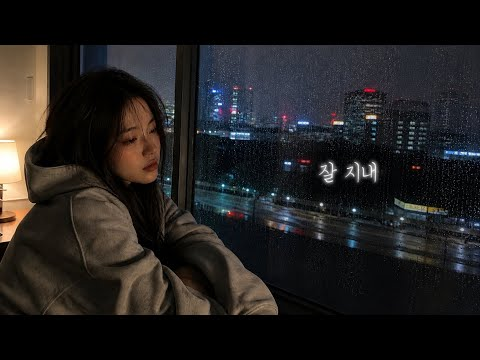
- 설명 앞부분: 잘 지내? 가끔은 내 생각도 나니. 사랑은 이미 끝났지만, 내 하루 어딘가엔 아직 네가 남아 있어. 바쁜 하루 끝에도 문득 떠오르는 사람, 잊으려 할수록 더 선명해지는 기억, 그리고 언젠가 우연히 마주치면 아무렇지 않게 건네고 싶은 한마디. “오랜만이야, 잘 지내고 있지?” 이 노래는 아직 완전히 보내지 못한 마음을 천천히 내려놓는 이별 발라드입니다. Hope this song stays with you quietly tonight. 💬 마음에 남는 가사가 있다면 댓글로 남겨주세요. If one line stayed with yo…
- 대본 없음 (설명) — 음성인식이 끝나면 도입부·흐름이 들어감
- 댓글 94/94: 좋은 점 — 영상 1 · 감사·응원 1 · 더 알고 싶은 것 1 · 아쉬운 점 — 영상 1 · 반박·불만 — 의견 다름 0 · 정치·사회 0 · 경험 공유 0 · 구독·다음 기대 0
  - 좋은 점 — 영상 👍1 “노래가 너무 좋으네요 좋은영상 즐겁게 감상합니다”
  - 감사·응원 👍1 “좋네요😊좋아요 좋아요는 몇일전에누르고 지금은 구독 누르고요😊응원합니다~~🐸🐸”
  - 더 알고 싶은 것 👍1 “남자 버젼도 부탁드립니다 👍👍”
  - 아쉬운 점 — 영상 👍1 “노래 너무 좋아요ㆍ 너무 눈물나게 슬프지만 계속 반복 듣게 됩니다ㆍAI라 너무 아쉽네요ㅠ 헤어진사람 그립게 만들지만 이제 너무지쳐 잊으려 합니다ㆍ 잘듣겠습니다ㆍ위로가됩니다❤❤🎉🎉😅”

### 239. 막힌 운을 여는 산신기도｜백호 산신 가피로 액운소멸·복덕성취·재물운 발원

- https://www.youtube.com/watch?v=ez0HnQ7tuPM · 풍요와복덕의노래 · 구독자 2,480 · 조회수 73,301 (×29.6, 하루 579.4) · 좋아요 1,111 (1.5%) · 4.9분 · 2026-06-12 · 주제 묶음 1. 수면·명상·힐링 · 형식 음악 (그 밖 모양 — 한 편짜리 BGM 등) · 폴더 `W_ez0HnQ7tuPM` (웹 승인)
- 썸네일: 
- 챕터: 0:00 나무 산왕대신 산신기도 시작 · 1:00 산왕대신·산신호법성중 정근 · 2:00 가정평안과 복덕 발원 · 3:00 옴 아나자야 사바하 · 4:00 산신청·산신축원 발원 · 4:53 마무리 정근
- 설명 앞부분: 막힌 운을 여는 산신기도｜백호 산신가피로 액운소멸·복덕성취·재물운 발원 이 영상은 깊은 산 산신각에서 올리는 나무 산왕대신 산신기도 찬불가입니다. 산왕대신님과 산신호법성중께 정성으로 공양을 올리고, 가정평안과 액운소멸, 좋은 인연과 복덕이 깃들기를 발원하는 불교 기도음악입니다. 영상 속 백호와 산신각의 이미지는 막힌 운이 열리고, 어둠은 거두어지며, 마음마다 평안과 복덕의 기운이 머물기를 바라는 마음으로 제작했습니다. 이 찬불가를 듣는 모든 분들의 가정에 평안이 깃들고, 근심과 액운은 멀어지며, 좋은 인연과 복덕의 문이 열리기를 …
- 대본 없음 (설명) — 음성인식이 끝나면 도입부·흐름이 들어감
- 댓글 584/584: 좋은 점 — 영상 6 · 감사·응원 96 · 더 알고 싶은 것 2 · 아쉬운 점 — 영상 0 · 반박·불만 — 의견 다름 1 · 정치·사회 0 · 경험 공유 24 · 구독·다음 기대 0
  - 좋은 점 — 영상 👍3 “댓글 매번 정성스럽게 답변해주시고 기도해주시는거 정말 감사합니다. 올라오는 노래가 기분 좋은 영상 이라서 자주 듣고 있어요.😊”
  - 좋은 점 — 영상 👍2 “산왕대신님 우리가족 우리신랑 우리사남매 저에게 건강운발복 금전운재물운발복 사업번창운발복 문서계약운발복 시험합격운발복 횡재운발복 좋은귀인운발복 무병장수 풍요 만사형통 소원성취 기원합니다. 선생님 좋은 영상 노래 진심으로 감사합니다. 나무아미타불 관세음보살 🙏 💛💛💛💛💛…”
  - 감사·응원 👍9 “나무 산왕대신이여 모든일들이 만사형통 되게 해주셔서 덕분입니다 감사합니다 감사합니다 감사합니다”
  - 감사·응원 👍8 “나무석가모니불 나무석가모니불 나무시야본사석가모니불 소원성취 발원합니다 감사합니다”
  - 더 알고 싶은 것 👍1 “제발 안좋은일들 다 없애주세요 갑갑하지않게 해주세요 홧병 안걸리게해주세요 제발 살려주세요 🙏 속 터지지않게해주세요 속시원하게 막힌거 뻥 뚫어주세요 너무 답답해요너무너무너무너무 제발 모든일들이 잘 되게 해주세요 막히고 안풀리는 일들 다 잘 풀리고 다 잘 되게 해주세요 …”
  - 반박·불만 — 의견 다름 👍1 “정미생 음력10월3일강명희입니다 살길을열여주소서 산왕대신님 가피를내려주시고광명을빛을내려주소서 부부화합 좋은인연뒤게해주소서 금전의문도열어주소서 부자되달라는건아닙니다 사람답게살고십습니다”
  - 경험 공유 👍23 “요즘 들어 일이 자꾸 꼬이고 막히는 느낌이라 마음이 참 무거웠는데, 영상보니까 마음이 한결 가볍고 든든합니다. 우리 집에도평안과 복이 함께하길 간절히 발원합니다. 기분이 좋아지네요.”
  - 경험 공유 👍16 “나무 신왕대신님 도와주세요 지금제가 너무힘듭니다 집주인집이 경매로 넘어가고 저희들은 갈때가 정말없습니다 두손모아 간절히 기도드립니다 부디막힌 운뚫어지게 해주시고 우리딸 컴퓨터 자격증따게히ㅣ주시고 우리집 식구들건강하게 해주세요 간절히 두손모아 두손모아 기도드립니다”

### 240. 샹송이 이렇게 까지 좋은줄 몰랐습니다. 아침부터 저녁까지 듣게되는 7080올드팝 샹송 ∣ 감성이 폭발한다

- https://www.youtube.com/watch?v=ubP0xqEZxYo · Midnight Melody Sound · 구독자 28,000 · 조회수 824,527 (×29.4, 하루 5,153.4) · 좋아요 8,847 (1.1%) · 81.5분 · 2026-05-09 · 주제 묶음 9. 가요·발라드·트로트 · 형식 정보·해설 (그 밖) · 폴더 `W_ubP0xqEZxYo` (웹 승인)
- 썸네일: 
- 챕터: 0:00 01. Valse des Pétales · 3:36 02. Vent d'Aube · 7:20 03. Creux de Tes Bras · 10:44 04. Vent m'enlace doucement · 13:57 05. Silence d'adieu · 17:07 06. Poussière d'amour · 20:29 07. Fenêtre Coréenne · 24:08 08. Rêve de rosée · 27:15 09. Étoiles au Velours · 30:46 10. Brume de han · 34:14 11. Lueur du Matin · 37:13 12. Accordéon au ralenti
- 설명 앞부분: 🌙 새벽 안개를 닮은 80년대 프랑스 샹송 ☕ 커피 한 잔과 함께, 옛 추억으로 떠나는 시간 파리의 좁은 골목길, 노란 가로등 아래 오래된 라디오에서 흘러나올 것만 같은 그 시절의 멜로디 부드러운 아코디언과 따뜻한 목소리가 만들어내는 한 편의 흑백 영화 같은 샹송을 모았습니다. 새벽이 밝아오는 창가에서, 조용한 아침 식탁에서 오늘 하루를 잔잔하게 시작해 보세요. 📍 이런 분들께 추천해요 프랑스 감성, 파리 무드를 좋아하시는 분 새벽이나 이른 아침에 잔잔한 음악을 찾으시는 분 카페에서 흘러나오는 빈티지한 음악을 사랑하시는 분 옛 추…
- 대본 없음 (설명) — 음성인식이 끝나면 도입부·흐름이 들어감
- 댓글 283/283: 좋은 점 — 영상 3 · 감사·응원 39 · 더 알고 싶은 것 8 · 아쉬운 점 — 영상 6 · 반박·불만 — 의견 다름 1 · 정치·사회 0 · 경험 공유 14 · 구독·다음 기대 3
  - 좋은 점 — 영상 👍6 “정말 오랫만에 들어 보네요 귀에 익은 듯한 샹송, 차암 듣기 좋네요”
  - 좋은 점 — 영상 👍2 “노래 하나하나가 다 너무 좋네요.. 불어를 배웠던 추억이 새록새록..”
  - 감사·응원 👍38 “애절한 감미로움에 마음이 빠져듬니다 앞으로도 아주오래도록 잘듣고 감상하겠읍니다 고맙습니다 .”
  - 감사·응원 👍20 “안녕하세요 잘 듣고 있어요 조용하고 달콤한 목소리로 속삭이며 흐르듯이 부르는 음성이 잘 어루어져 듣는 저가 분위기가 젖어 너무 좋아요 쉬면서 즐기고 갑니다 감사합니다”
  - 더 알고 싶은 것 👍7 “노래 제목과 가수 올려주시면감사드립니다~^”
  - 더 알고 싶은 것 👍3 “너무 잘 듣고 있습니다 혹시 가사도 올려주실 수 있을까요”
  - 아쉬운 점 — 영상 👍57 “가사는 모르지만, 애절하면서 흡인력 있는 목소리가 너무 좋습니다.”
  - 아쉬운 점 — 영상 👍12 “혼란스럽게 흔들리는 마음을 스스로 감정정리 해 볼수 있는 기분이네요~~~~~~~😊”
  - 반박·불만 — 의견 다름 👍38 “80을 넘는 음악을 아는 사람도 아닌데 아득한 옛날 그리움을 노래하는 것 같네요...”
  - 경험 공유 👍19 “저도 불어불문학과 90학번입니다 오랫만에 샹송 들으니 옛추억이 새록새록합니다”
  - 경험 공유 👍7 “반가워요.저도 85학번 불어불문학과.”
  - 구독·다음 기대 👍17 “부드러운 음악속 마음도 우아해지네요 아름다운 음악 올려주셔서 감사합니다❤❤❤구독하고 자주 찾을께요😅😅😅”
  - 구독·다음 기대 👍4 “너무 감사합니다.. 구독하고 갑니다❤”

