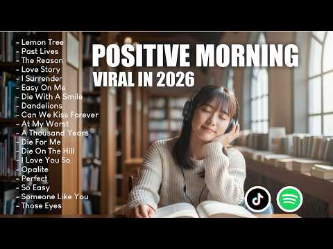

# 음악 — 성공 사례 분석: 사례별 자세히 #241–#280

`analysis.md` 의 9번 (같은 # 번호). 자동 생성 — `tools/success_analysis.py` v1.4.1 (2026-10-18 08:09 UTC). ※ 연구·교육용 — 투자 권유가 아님.

### 241. 🌼 Sawan Shiv Bhajan 2026 ∣ Peaceful Mahadev Bhakti Song ∣ Bholenath Devotional Song

- https://www.youtube.com/watch?v=I_vnh6nZW6c · Bhajan Soul Collective · 구독자 8,590 · 조회수 2,208,363 (×257.1, 하루 21,683.9) · 좋아요 0 (0.0%) · 5.8분 · 2026-07-08 · 주제 묶음 기타 · 형식 음악 (그 밖 모양 — 한 편짜리 BGM 등) · 폴더 `W_I_vnh6nZW6c` (웹 승인)
- 썸네일: 
- 설명 앞부분: यदि यह भजन आपको पसंद आए, तो वीडियो को Like, Share करें और Bhajan Soul Collective को Subscribe करके हमारे साथ इस भक्ति यात्रा का हिस्सा बनें। mahadev bhajan shiv bhakti song sawan shiv bhajan mahadev ka nasha hai har har mahadev song latest shiv song new bhakti geet mahadev status song sawan ke bhaj…
- 대본 없음 (설명) — 음성인식이 끝나면 도입부·흐름이 들어감
- 댓글 612/612: 좋은 점 — 영상 0 · 감사·응원 0 · 더 알고 싶은 것 0 · 아쉬운 점 — 영상 0 · 반박·불만 — 의견 다름 0 · 정치·사회 0 · 경험 공유 0 · 구독·다음 기대 0

### 242. .•♫•♬•𝙁𝙄𝙉𝙀𝙎𝙃𝙔𝙏 PLAYLIST•♬•♫

- https://www.youtube.com/watch?v=wYiyAR_dBDU · loverswift · 구독자 4,870 · 조회수 1,250,117 (×256.7, 하루 14,382.1) · 좋아요 20,570 (1.7%) · 16.8분 · 2026-07-23 · 주제 묶음 기타 · 형식 플레이리스트·모음 (여러 곡) · 폴더 `W_wYiyAR_dBDU` (웹 승인)
- 썸네일: 
- 챕터: 0:00 Confident -Justin Bieber · 4:04 Gabriella -Katseye · 7:20 Harleys In Hawai -Katy Perry · 10:20 Confidence -Kim · 13:48 Moonlight -Kali 𝗨𝗰𝗵𝗶𝘀
- 설명 앞부분: ➯ Copyright Disclaimer: I DO NOT own any rights to the picture or any music featured, this playlist is made for entertainment purposes only. Protected under Section 107 of the Copyright Act 1976
- 대본 없음 (설명) — 음성인식이 끝나면 도입부·흐름이 들어감
- 댓글 112/110: 좋은 점 — 영상 1 · 감사·응원 1 · 더 알고 싶은 것 0 · 아쉬운 점 — 영상 0 · 반박·불만 — 의견 다름 0 · 정치·사회 0 · 경험 공유 0 · 구독·다음 기대 0
  - 좋은 점 — 영상 👍1 “너무 듣기 좋구요 헤헤❤❤😂😂”
  - 감사·응원 👍2 “잘 듣고 있여용 화이팅😂😂 song list very good😂😂🎉”

### 243. 🍂 알록달록 가을 음악이야기 ∣ Autumn Collection Vol.

- https://www.youtube.com/watch?v=o3DojrmPMbs · little step melody · 구독자 85 · 조회수 25,652 (×256.5, 하루 1,500.7) · 좋아요 19 (0.1%) · 206.4분 · 2026-10-01 · 주제 묶음 1. 수면·명상·힐링 · 형식 음악 (그 밖 모양 — 한 편짜리 BGM 등) · 폴더 `W_o3DojrmPMbs` (웹 승인)
- 썸네일: 
- 설명 앞부분: 🍂 Autumn Collection Vol.1 l Gentle Felt Piano Melodies Inspired by a Colorful Autumn Day 알록달록 물든 가을 나뭇잎과 살랑이는 바람, 바스락거리는 낙엽길에서 영감을 받은 포근한 펠트 피아노 선율을 담았습니다. 따뜻한 햇살 아래 천천히 걸으며 가을의 작은 풍경을 바라보는 듯한 음악입니다. Little Step Melody는 그림책 같은 감성과 포근한 피아노 선율을 담아, 오래도록 곁에 두고 싶은 음악을 만들어갑니다. Thank you for listening. M…
- 대본 없음 (설명) — 음성인식이 끝나면 도입부·흐름이 들어감
- 댓글 3/3: 좋은 점 — 영상 0 · 감사·응원 1 · 더 알고 싶은 것 0 · 아쉬운 점 — 영상 0 · 반박·불만 — 의견 다름 0 · 정치·사회 0 · 경험 공유 0 · 구독·다음 기대 0
  - 감사·응원 👍0 “앗 1등 ^^ 작업중에 듣고 있는데 1시간 순삭이네요~ 좋은음악감사합니다 ^^”

### 244. ⛈️(No Ads) WARNING: YOU MAY SLEEP FAST 😴 NYC Rain on Window ∣ City Lights Glow & Deep Rel…

- https://www.youtube.com/watch?v=HLp0t2jZlKQ · Dreamy Raining · 구독자 3,810 · 조회수 969,859 (×254.6, 하루 5,795.8) · 좋아요 6,249 (0.6%) · 600분 · 2026-05-04 · 주제 묶음 1. 수면·명상·힐링 · 형식 긴 한 곡·반복 (N시간) · 폴더 `W_HLp0t2jZlKQ` (웹 승인)
- 썸네일: 
- 설명 앞부분: ⛈️(No Ads) WARNING: YOU MAY SLEEP FAST 😴 NYC Rain on Window ∣ City Lights Glow & Deep Relaxation Dreamy Raining is a gentle escape into a world of calm, where soft rain and peaceful atmospheres help you slow down and breathe. 🌙✨ Feel the delicate rhythm of raindrops falling on windows, rooftops, an…
- 대본 없음 (설명) — 음성인식이 끝나면 도입부·흐름이 들어감
- 댓글 90/88: 좋은 점 — 영상 0 · 감사·응원 0 · 더 알고 싶은 것 0 · 아쉬운 점 — 영상 0 · 반박·불만 — 의견 다름 0 · 정치·사회 0 · 경험 공유 0 · 구독·다음 기대 0

### 245. 𝐬𝐭𝐮𝐝𝐲 𝐩𝐥𝐚𝐲𝐥𝐢𝐬𝐭 이번엔 아무한테도 말 안 하고 준비한다 🤫 전문직·수험생 시험공부 집중 로파이 (가사X)

- https://www.youtube.com/watch?v=eRQFKz_nigU · loni pli 로니플리 · 구독자 1,450 · 조회수 366,814 (×253.0, 하루 9,685.8) · 좋아요 2,057 (0.6%) · 137.3분 · 2026-09-10 · 주제 묶음 8. 로파이·시티팝·칠 · 형식 플레이리스트·모음 (여러 곡) · 폴더 `W_eRQFKz_nigU` (웹 승인)
- 썸네일: 
- 챕터: 0:00 no one knows yet · 2:51 quietly begin · 5:42 just me and the books · 8:44 locked in silence · 11:02 my own secret plan · 14:20 deep in it · 16:58 no words, just work · 20:32 hours in the dark · 23:22 still going quietly · 25:55 closer than they think · 28:30 almost ready · 32:04 keep it to myself · 35:38 the quiet grind · 38:05 they'll see soon
- 설명 앞부분: Tracklist 🤫 ⓒ loni pli. AI-assisted, human-edited.
- 대본 없음 (설명) — 음성인식이 끝나면 도입부·흐름이 들어감
- 댓글 85/84: 좋은 점 — 영상 0 · 감사·응원 3 · 더 알고 싶은 것 0 · 아쉬운 점 — 영상 0 · 반박·불만 — 의견 다름 0 · 정치·사회 0 · 경험 공유 2 · 구독·다음 기대 0
  - 감사·응원 👍4 “집중 잘되네요~ 감사합니다”
  - 감사·응원 👍4 “집중이 너무 잘되네요.~ 공부 잘하고 있습니다. 감사합니다.😊”
  - 경험 공유 👍13 “저도몰래합니다 ㅎㅎ 결과만 보여줄거에요.”

### 246. The Shiva Reset ∣ Shiva Trance for the Overstimulated Mind ∣ Bhajan Clubbing ∣ ShivJi Song

- https://www.youtube.com/watch?v=N95edHAuFzA · Nirvana Beats · 구독자 7,030 · 조회수 1,774,365 (×252.4, 하루 25,218.2) · 좋아요 15,470 (0.9%) · 6.8분 · 2026-08-08 · 주제 묶음 1. 수면·명상·힐링 · 형식 음악 (그 밖 모양 — 한 편짜리 BGM 등) · 폴더 `W_N95edHAuFzA` (웹 승인)
- 썸네일: 
- 챕터: 0:00 दिव्य शिव मंत्र का आह्वान · 1:12 शिव पंचाक्षर स्तोत्र का पाठ · 3:05 नीलकंठ की महिमा का गुणगान · 5:56 दर्शनम पुण्यम स्पर्शम पाप नाशम
- 설명 앞부분: Experience deep peace with this Lord Shiva meditation visual. This serene display features Sanskrit mantras to aid your focus. "IMPORTANT: Don't copy this song or music without permission. Already notices are been sent for copyright strikes." Subscribe for weekly meditation resources and devotional…
- 대본 없음 (설명) — 음성인식이 끝나면 도입부·흐름이 들어감
- 댓글 295/295: 좋은 점 — 영상 0 · 감사·응원 0 · 더 알고 싶은 것 0 · 아쉬운 점 — 영상 0 · 반박·불만 — 의견 다름 0 · 정치·사회 0 · 경험 공유 0 · 구독·다음 기대 0

### 247. A playlist cuz kanhi is your safe place 🦚🪷🪈🦢 ∣∣ Song playlist ∣∣

- https://www.youtube.com/watch?v=vH7kCnulptw ·  Lily⋆.𐙚 ̊ · 구독자 9,350 · 조회수 2,354,987 (×251.9, 하루 18,432.2) · 좋아요 36,096 (1.5%) · 17.5분 · 2026-06-12 · 주제 묶음 기타 · 형식 플레이리스트·모음 (여러 곡) · 폴더 `W_vH7kCnulptw` (웹 승인)
- 썸네일: 
- 설명 앞부분: Disclaimer ❗ I do not own any of the song and images used in this video all the credit goes to the rightful owners. This video is only made for entertainment purposes no copyright infringement intended. Hashtags 🎀
- 대본 없음 (설명) — 음성인식이 끝나면 도입부·흐름이 들어감
- 댓글 843/833: 좋은 점 — 영상 0 · 감사·응원 0 · 더 알고 싶은 것 0 · 아쉬운 점 — 영상 0 · 반박·불만 — 의견 다름 0 · 정치·사회 0 · 경험 공유 0 · 구독·다음 기대 0

### 248. 별일 없던 하루였는데, 괜히 마음이 시끄러운 밤

- https://www.youtube.com/watch?v=mc73qn75vMs · 리듬다방(김리다) · 구독자 1,360 · 조회수 341,118 (×250.8, 하루 2,610.2) · 좋아요 1,206 (0.4%) · 7.5분 · 2026-06-09 · 주제 묶음 기타 · 형식 음악 (그 밖 모양 — 한 편짜리 BGM 등) · 폴더 `W_mc73qn75vMs` (웹 승인)
- 썸네일: 
- 설명 앞부분: 🎵 취한다 술이 취하게 하는 게 아냐, 생각이 취하게 하네. 별일 없던 하루였는데 괜히 마음이 시끄러운 밤. 누구나 말 못 할 사연 하나쯤 품고 살아가듯, 오늘도 또 하루를 버텨낸 당신에게 이 노래를 전합니다. 🎧 AI를 활용하여 제작한 창작 음악입니다. 📱 틱톡 · 유튜브에서 "리듬다방"을 검색하시면 더 많은 음악을 만나보실 수 있습니다. Navigating emotional uncertainty when things feel confusing. Explore the feeling of being new to love even …
- 같은 채널 평소 대비 ×708.4 (채널 최근 롱폼 중앙값 482회) · 평소 영상: 〈다녀가셨습니까〉 Rock Ballad Ver. ∣ 끝내 터진 그리움 (502회) / 🎵 삐뚤어질테다 ∣ 퓨전국악 (민요 × 뉴디스코) Ver. ∣ Full Ver. (461회)
- 대본 없음 (설명) — 음성인식이 끝나면 도입부·흐름이 들어감
- 댓글 207/207: 좋은 점 — 영상 2 · 감사·응원 19 · 더 알고 싶은 것 4 · 아쉬운 점 — 영상 0 · 반박·불만 — 의견 다름 0 · 정치·사회 0 · 경험 공유 6 · 구독·다음 기대 1
  - 좋은 점 — 영상 👍5 “음악도 좋지만 가사가 마음에 와닿는군요 대박나세요 🎉🎉🎉🎉🎉❤❤❤❤❤”
  - 좋은 점 — 영상 👍1 “너무듣기좋아요👍👍잘듣고갑니다❤❤”
  - 감사·응원 👍13 “안녕하세요. 저는 이제 막 시작한 작은 음악방송을 운영하고 있습니다. 시청자의 신청으로 '취한다'를 방송에서 소개하게 되었는데, 혹시 방송에서 해당 음악(또는 관련 영상)을 함께 송출해도 괜찮을지 여쭤보고 싶어 연락드렸습니다. 혹시 원하지 않으시거나 방송에서의 사용이…”
  - 감사·응원 👍4 “다방님 하루빨리 여러곳에서 들을수 있고 부을수 있었으면 참 좋겠습니다 화이팅”
  - 더 알고 싶은 것 👍1 “컬러링도되나요?”
  - 경험 공유 👍6 “우리집대장이 두달전에 하늘나라로가셨는데 제 마음을 이야기하는것같아요 노래듣고 매일 웁니다 생각이나고 그리워서”
  - 경험 공유 👍3 “내가 하고 싶은 얘기들을 들려주고 있네요 😢”
  - 구독·다음 기대 👍0 “노래넘좋아요ㆍ구독완료”

### 249. MIMIFY - I Waited too Long (Original Mix)

- https://www.youtube.com/watch?v=F2Iga1V4cqo · MIMIFY · 구독자 18,500 · 조회수 4,608,819 (×249.1, 하루 47,090.4) · 좋아요 38,328 (0.8%) · 7.8분 · 2026-07-12 · 주제 묶음 8. 로파이·시티팝·칠 · 형식 음악 (그 밖 모양 — 한 편짜리 BGM 등) · 폴더 `W_F2Iga1V4cqo` (웹 승인)
- 썸네일: 
- 설명 앞부분: MIMIFY - I Waited too Long (Original Mix) 🔥 I hope you'll support me by liking, sharing, and subscribing! 🔥 🎵 Playlist: .MIMIFY All Mix (Car Music, Bass, Techno) Hi everyone, thank you for listening to my track 🙏 For those asking about Spotify, here’s the link 🎧 Don’t forget to subscribe to the cha…
- 대본 없음 (설명) — 음성인식이 끝나면 도입부·흐름이 들어감
- 댓글 675/675: 좋은 점 — 영상 1 · 감사·응원 1 · 더 알고 싶은 것 0 · 아쉬운 점 — 영상 0 · 반박·불만 — 의견 다름 0 · 정치·사회 0 · 경험 공유 0 · 구독·다음 기대 0
  - 좋은 점 — 영상 👍7 “씨티팝 느낌이 너무 듣기 좋은거 같아요. 대한민국 🇰🇷 에서도,잘듣고 있어요~~!!”
  - 감사·응원 👍3 “오늘 하루 힘들었는데 이 음악 덕분에 제대로 힐링하고 갑니다. 감사합니다! 힐링 곡으로 저장할게요. ✨"❤❤”

### 250. జీవితంలో ఒక్కసారైనా ఆ ఏడుకొండలు ఎక్కాలయ్యా ∣Soulful Sri Venkateswara Swamy Song∣ Tirumala…

- https://www.youtube.com/watch?v=sfnGhZdoNQk · Surendra's Musical World · 구독자 5,100 · 조회수 1,266,787 (×248.4, 하루 10,356.1) · 좋아요 6,866 (0.5%) · 5.3분 · 2026-06-18 · 주제 묶음 기타 · 형식 음악 (그 밖 모양 — 한 편짜리 BGM 등) · 폴더 `W_sfnGhZdoNQk` (웹 승인)
- 썸네일: 
- 설명 앞부분: Experience the divine peace of Tirumala with this beautiful Telugu devotional song composed in Raga Kalyani. ✨🙏 ఏడుకొండల వాడైన శ్రీ వేంకటేశ్వర స్వామి వారి వైభవాన్ని, భక్తుల ఆర్తిని కళ్లకు కట్టే అత్యంత అద్భుతమైన మరియు భావోద్వేగభరితమైన సంకీర్తన. భక్తి రసంతో నిండిన "కల్యాణి రాగం" (Raga Kalyani) లో కూర…
- 대본 없음 (설명) — 음성인식이 끝나면 도입부·흐름이 들어감
- 댓글 554/554: 좋은 점 — 영상 0 · 감사·응원 0 · 더 알고 싶은 것 0 · 아쉬운 점 — 영상 0 · 반박·불만 — 의견 다름 0 · 정치·사회 0 · 경험 공유 0 · 구독·다음 기대 0

### 251. Zindagi ∣ Chal Thora Aur ∣ Na Kwahish Na Koi Tamana Mujhe (Original Song) Kadam Jaldi Bar…

- https://www.youtube.com/watch?v=dyOp23A-i_o · cefur studio · 구독자 11,400 · 조회수 2,812,485 (×246.7, 하루 22,916.3) · 좋아요 24,869 (0.9%) · 4.8분 · 2026-06-17 · 주제 묶음 기타 · 형식 음악 (그 밖 모양 — 한 편짜리 BGM 등) · 폴더 `W_dyOp23A-i_o` (웹 승인)
- 썸네일: 
- 설명 앞부분: Zindagi ∣ Zindagi by cefur ∣ studio A dark cinematic Urdu song about pain, punishment, survival, and the cruel voice of life saying: “Chal thora aur, Zindagi.” Zindagi is for the ones who kept walking even after life stopped feeling kind. It carries loneliness, regret, exhaustion, and that strange …
- 대본 없음 (설명) — 음성인식이 끝나면 도입부·흐름이 들어감
- 댓글 1,835/1,832: 좋은 점 — 영상 0 · 감사·응원 0 · 더 알고 싶은 것 0 · 아쉬운 점 — 영상 0 · 반박·불만 — 의견 다름 0 · 정치·사회 0 · 경험 공유 0 · 구독·다음 기대 0

### 252. All Stress Disappears When This Music Starts Playing 🎶 Emotional Healing Relax Music

- https://www.youtube.com/watch?v=mtelE3vg758 · Nature Healing Sounds · 구독자 7,390 · 조회수 1,810,621 (×245.0, 하루 11,185.0) · 좋아요 9,620 (0.5%) · 99.6분 · 2026-05-09 · 주제 묶음 1. 수면·명상·힐링 · 형식 음악 (그 밖 모양 — 한 편짜리 BGM 등) · 폴더 `W_mtelE3vg758` (웹 승인)
- 썸네일: 
- 설명 앞부분: All Stress Disappears When This Music Starts Playing 🎶 Emotional Healing Relax Music All Stress Disappears When This Music Starts Playing 🎶 Emotional Healing Relax Music All Stress Disappears When This Music Starts Playing 🎶 Emotional Healing Relax Music 🎵Welcome to Nature Healing Sounds – the idea…
- 대본 없음 (설명) — 음성인식이 끝나면 도입부·흐름이 들어감
- 댓글 482/479: 좋은 점 — 영상 0 · 감사·응원 4 · 더 알고 싶은 것 0 · 아쉬운 점 — 영상 0 · 반박·불만 — 의견 다름 0 · 정치·사회 0 · 경험 공유 0 · 구독·다음 기대 1
  - 감사·응원 👍3 “멋진 영상과 음악에 흠뻑 취하다 갑니다 감사합니다”
  - 감사·응원 👍3 “마믐의 폄화를 얻었네요 아름다운 음악 감사합니다 구독하고 갑니다”
  - 구독·다음 기대 👍3 “마믐의 폄화를 얻었네요 아름다운 음악 감사합니다 구독하고 갑니다”

### 253. [𝙥𝙡𝙖𝙮𝙡𝙞𝙨𝙩] 삶에 무뎌지는 법

- https://www.youtube.com/watch?v=8KGuQMhnb14 · 꾹팅 · 구독자 1,220 · 조회수 297,201 (×243.6, 하루 2,258.1) · 좋아요 0 (0.0%) · 19.4분 · 2026-06-08 · 주제 묶음 기타 · 형식 플레이리스트·모음 (여러 곡) · 폴더 `W_8KGuQMhnb14` (웹 승인)
- 썸네일: 
- 챕터: 0:00 03:36 서영주 of 너드커넥션 ∣ 나란한 밤 · 3:39 07:05 한강 ∣ 언젠가 이 슬픔도 사라지겠지 · 7:07 11:18 선우정아 ∣ 보통사람 · 11:19 15:36 sondia ∣ 어른 · 15:37 19:16 이무진 ∣ 쉼표
- 설명 앞부분: 📍 수익을 창출하지 않습니다. ∣ No monetization
- 같은 채널 평소 대비 ×58.9 (채널 최근 롱폼 중앙값 5,050회) · 평소 영상: [𝙥𝙡𝙖𝙮𝙡𝙞𝙨𝙩] 나 아직 너 보고싶어 (6,770회) / [𝙥𝙡𝙖𝙮𝙡𝙞𝙨𝙩] 이별에도 인연이 있었음을 (3,330회)
- 대본 없음 (설명) — 음성인식이 끝나면 도입부·흐름이 들어감
- 댓글 363/363: 좋은 점 — 영상 5 · 감사·응원 51 · 더 알고 싶은 것 5 · 아쉬운 점 — 영상 3 · 반박·불만 — 의견 다름 8 · 정치·사회 0 · 경험 공유 103 · 구독·다음 기대 0
  - 좋은 점 — 영상 👍0 “아직 16년 밖에 안살았는데 살아보니까 이세상 어떻게 살라는거야 진짜.. 진짜 진짜 용기내고 싶어요 늘 내가 용기 낸건 나를 갉아 먹는거였는데 이번만 맘을 굳게 먹으면 앞으로 편해 지지 않을까 아직 어려서 뭘 모른다 이런말 듣기 싫어 나도 알아 보여 너네가 날 어린아…”
  - 좋은 점 — 영상 👍0 “진실.거짓.진심. 사이에서.. 나는 진실된 답을 원하는걸까. 거짓된답을 원하는걸까.. 아니면 진심이 담긴 답을 원하는걸까. 그 어떤 답이 나에게 도움이 될까. 살아갈 힘을 쥐여줄까. ...어떤 이들은 그러더라. 진심.진실.거짓 모든것을 원하는 내가 욕심쟁이고 모순된 …”
  - 감사·응원 👍65 “어른이 되는게 너무 무서워서 매일 하루하루가 초조하고 급박하고 숨막혀요...아직 제대로 잘 하는것도 없는데 이 상태로 어른이 되었다간 나랑 내 주변이 너무 힘들어할 것 같아요. 어떻게 해야하는지 모르겠어요. 너무 힘들어서 그만하고 싶어요... 삶이 너무 버거워서 하교…”
  - 감사·응원 👍14 “요즘 너무 힘들고 지치고 우울합니다 밤이 왜 이렇게 긴지 잘 모르겠습니다 이제는 제가 뭘 싫어하는지 좋아하는지 잘 모르겠습니다 왜 이런 일이 저한테 온 건지 잘 모르겠습니다 삶이 진짜 치지고 우울하고 힘듭니다 죽기에는 너무 젊고 울기에는 너무 나이가 들엇네요 언젠간 …”
  - 더 알고 싶은 것 👍56 “어릴 땐 어른이 부러웠습니다. 아무거나 다 할 수 있는. 하지만 정작 어른이 된 저는 삶에 휩쓸려 무뎌지고 부서진, 그런 사람이라는 걸 깨닫게 되었습니다. 우리 다시 돌아갈 수 있을까요? 아무 걱정 없이, 아무 생각도 안 하는 그때로”
  - 더 알고 싶은 것 👍1 “도저히 지금 제가 무엇이 필요한지, 어떤 말이 필요한지, 애초에 뭐가 필요하긴 한건지 그 어떤 것도 감이 안 와 댓글 달아요. 일단 저는 지금 고등학교 2학년 입니다. 곧 3학년 올라가는. 저는 초등학교 6학년 때부터 꿈이 확고했거든요. 나중에 커서 음악하는 사람이 …”
  - 아쉬운 점 — 영상 👍6 “아프지말라는 뻔한 위로보다 많이 아프냐고 물어봐줬으면 좋겠다”
  - 아쉬운 점 — 영상 👍0 “저 중2학생인데요 사춘기인지 중2병인지 잘은 모르겠지만 너무 힘드네요 한부모가정이라 더 남들과 비교하게되고 공부로 인한 스트레스도 그 누구도 주지 않지만 그냥 힘들어요 손목에 상처 낼 자신은 없어서 항상 팔에 하고 종아리에만 상처를 내고 있고 이제는 상처가 나도 무뎌…”
  - 반박·불만 — 의견 다름 👍47 “왜 우리는 아는 사람들에게 위로받지 못하고 모르는 사람들에게 인터넷상에서 위로를 받는 걸까요 힘들다고 말하는 게 부끄러운 것도 아닌데 다른 사람들의 댓글을 보며 와.. 이런 사람들도 있구나 저런 사람들에 비하면 나는 행복한 거구나..라고 위안 삼으며 다시 또 지옥같이…”
  - 반박·불만 — 의견 다름 👍9 “그냥 평소와 같은 상황인데 반항을 하고 싶었나봐요…. 그냥 아무말도 안하고 그냥 말하는 것도 듣지도 않았어요 저도 왜이러는지 모르겠어요”
  - 경험 공유 👍1,069 “요즘 옥상문이 잠겨있네요 더워서 그런가 벌써 네 건물 가봤는데 잠겨서 죽고싶은데 마음데로 죽지도 못하네요 얼마전에 울다가 깨닳았어요 아 나 안죽고싶은데.. 내가 죽고싶은게 아니라 지금이 너무 힘들어서 차라리 죽고싶은거구나 아 행복해지고 싶은거구나 죽고싶은게 아니라 행…”
  - 경험 공유 👍324 “차라리 내가 조금만 더 무감각해서 느끼지 못했으면 좋겠다”

### 254. 𝐏𝐥𝐚𝐲𝐥𝐢𝐬𝐭 𝐅𝐨𝐫 𝐘𝐨𝐮 𝐓𝐨 𝐂𝐫𝐞𝐚𝐭𝐞 𝐅𝐚𝐤𝐞 𝐒𝐜𝐞𝐧𝐚𝐫𝐢𝐨𝐬 𝐈𝐧 𝐘𝐨𝐮𝐫 𝐌𝐢𝐧𝐝 🤍 ∣ Hindi Playlist 2026✨

- https://www.youtube.com/watch?v=flQgOwg4jLI · Ashik's Cloudlist  · 구독자 15,600 · 조회수 3,731,448 (×239.2, 하루 37,356.1) · 좋아요 41,321 (1.1%) · 15.2분 · 2026-07-10 · 주제 묶음 8. 로파이·시티팝·칠 · 형식 플레이리스트·모음 (여러 곡) · 폴더 `W_flQgOwg4jLI` (웹 승인)
- 썸네일: 
- 챕터: 0:00 ISHQ DE FANNIYA · 0:54 MAJBOOR · 1:46 PAL PAL DIL KE PAAS · 2:54 FAKIRA · 3:51 JEENE LAGA HOON · 4:32 HASEEN · 5:28 TERE SANG YAARA · 6:21 TERE LIYE · 7:11 JAANIYE · 8:28 TERA HONE LAGA HOON · 9:24 JAYE SAJNA · 10:49 RAANJHANAA · 11:31 HUMSAFAR · 12:16 TOOTA JO KABHI TARA · 13:19 KANGANA TERA NI · 13:59 SAWAN AAYA HAI · 14:19 FALAK TAK
- 설명 앞부분: 𝐏𝐥𝐚𝐲𝐥𝐢𝐬𝐭 𝐅𝐨𝐫 𝐘𝐨𝐮 𝐓𝐨 𝐂𝐫𝐞𝐚𝐭𝐞 𝐅𝐚𝐤𝐞 𝐒𝐜𝐞𝐧𝐚𝐫𝐢𝐨𝐬 𝐈𝐧 𝐘𝐨𝐮𝐫 𝐌𝐢𝐧𝐝 🤍 ∣ Hindi Playlist 2026✨ madly in love playlist romantic hindi songs bollywood love songs aesthetic hindi playlist playlist for fake scenarios playlist to imagine love stories late night playlist playlist for overthinkers study playlist hindi c…
- 대본 없음 (설명) — 음성인식이 끝나면 도입부·흐름이 들어감
- 댓글 965/962: 좋은 점 — 영상 0 · 감사·응원 0 · 더 알고 싶은 것 0 · 아쉬운 점 — 영상 0 · 반박·불만 — 의견 다름 0 · 정치·사회 0 · 경험 공유 0 · 구독·다음 기대 0

### 255. Relaxing Piano Music with Rain Sounds for Deep Sleep - Calm Sleep and Insomnia Relief

- https://www.youtube.com/watch?v=dzRT9vqg9xs · RainwoodPianoVEVO · 구독자 1,270 · 조회수 303,424 (×238.9, 하루 15,981.9) · 좋아요 1,083 (0.4%) · 110분 · 2026-09-29 · 주제 묶음 2. 자연 소리·백색소음 · 형식 음악 (그 밖 모양 — 한 편짜리 BGM 등) · 폴더 `W_dzRT9vqg9xs` (웹 승인)
- 썸네일: 
- 설명 앞부분: ✦ Welcome to RainwoodPianoVEVO - a place where gentle piano melodies blend with soothing rain sounds to bring you moments of calm, deep rest, and peaceful balance. ✦ Are you searching for a way to fall asleep faster, enjoy deep sleep music, ease anxiety, or simply drift away with the comfort of rel…
- 대본 없음 (설명) — 음성인식이 끝나면 도입부·흐름이 들어감
- 댓글 38/38: 좋은 점 — 영상 0 · 감사·응원 0 · 더 알고 싶은 것 0 · 아쉬운 점 — 영상 0 · 반박·불만 — 의견 다름 0 · 정치·사회 0 · 경험 공유 0 · 구독·다음 기대 0

### 256. Relax Cha Cha Music 🪘 Havana Cafe Music - Cha Cha Son Cubano

- https://www.youtube.com/watch?v=poj2d6YKC6w · Cha Cha Havana Lounge · 구독자 1,610 · 조회수 382,885 (×237.8, 하루 2,342.3) · 좋아요 2,375 (0.6%) · 6.4분 · 2026-05-07 · 주제 묶음 4. 카페·매장·라운지 · 형식 음악 (그 밖 모양 — 한 편짜리 BGM 등) · 폴더 `W_poj2d6YKC6w` (웹 승인)
- 썸네일: 
- 설명 앞부분: Discover the best Cuban music playlist featuring the vibrant sounds of Son Cubano, Latin Jazz, Salsa Cubana, Timba Cubana, and Son Montuno. This collection brings you the essence of Cuba with Afro-Cuban rhythms, Latin piano grooves, soulful guitar, and powerful vocals. Perfect for relaxing, dancing…
- 대본 없음 (설명) — 음성인식이 끝나면 도입부·흐름이 들어감
- 댓글 96/96: 좋은 점 — 영상 0 · 감사·응원 0 · 더 알고 싶은 것 0 · 아쉬운 점 — 영상 0 · 반박·불만 — 의견 다름 0 · 정치·사회 0 · 경험 공유 0 · 구독·다음 기대 0

### 257. Rain and Soft Piano Music for Deep Sleep - Calm Sleep and Stress Relief with Gentle Fores…

- https://www.youtube.com/watch?v=8DzndrjZi18 · RainwoodPianoVEVO · 구독자 1,270 · 조회수 301,777 (×237.6, 하루 6,288.9) · 좋아요 904 (0.3%) · 31.9분 · 2026-08-31 · 주제 묶음 1. 수면·명상·힐링 · 형식 음악 (그 밖 모양 — 한 편짜리 BGM 등) · 폴더 `W_8DzndrjZi18` (웹 승인)
- 썸네일: 
- 설명 앞부분: ✦ Welcome to RainwoodPianoVEVO - a place where gentle piano melodies blend with soothing rain sounds to bring you moments of calm, deep rest, and peaceful balance. ✦ Are you searching for a way to fall asleep faster, enjoy deep sleep music, ease anxiety, or simply drift away with the comfort of rel…
- 대본 없음 (설명) — 음성인식이 끝나면 도입부·흐름이 들어감
- 댓글 40/40: 좋은 점 — 영상 0 · 감사·응원 0 · 더 알고 싶은 것 0 · 아쉬운 점 — 영상 0 · 반박·불만 — 의견 다름 0 · 정치·사회 0 · 경험 공유 0 · 구독·다음 기대 0

### 258. 𝐒𝐨𝐧𝐠𝐬 𝐭𝐡𝐚𝐭 𝐟𝐞𝐞𝐥 𝐥𝐢𝐤𝐞 𝐚 𝐛𝐨𝐥𝐥𝐲𝐰𝐨𝐨𝐝 𝐦𝐨𝐯𝐢𝐞 🦢🪷🪐∣∣ songs playlist ∣∣ #playlist #songs #aesthetic

- https://www.youtube.com/watch?v=r88MexwnbMA · ⋆.ʚଓ ּ𝐋𝗒𝗋𝗂𝖼αᥣ_αυ𝗋α_07🌷𖹭 ֶָ֢  · 구독자 6,790 · 조회수 1,610,966 (×237.3, 하루 19,230.7) · 좋아요 12,247 (0.8%) · 10.5분 · 2026-07-26 · 주제 묶음 기타 · 형식 플레이리스트·모음 (여러 곡) · 폴더 `W_r88MexwnbMA` (웹 승인)
- 썸네일: 
- 설명 앞부분: bollywood songs, hindi songs, romantic bollywood songs, hindi romantic songs, aesthetic songs, aesthetic hindi songs, bollywood playlist, romantic songs playlist, hindi love songs, love songs, dreamy songs, feel good songs, soulful hindi songs, beautiful hindi songs, best bollywood songs, bollywood…
- 대본 없음 (설명) — 음성인식이 끝나면 도입부·흐름이 들어감
- 댓글 291/288: 좋은 점 — 영상 0 · 감사·응원 0 · 더 알고 싶은 것 0 · 아쉬운 점 — 영상 0 · 반박·불만 — 의견 다름 0 · 정치·사회 0 · 경험 공유 0 · 구독·다음 기대 0

### 259. Viral Pop Songs Cover 2026 🎙 Top Music Playlist Hits

- https://www.youtube.com/watch?v=JKRRl5-5-hw · Acoustic Therapy · 구독자 21,000 · 조회수 4,971,524 (×236.7, 하루 34,435.8) · 좋아요 35,651 (0.7%) · 57.4분 · 2026-05-26 · 주제 묶음 10. 팝송·K팝·J팝 · 형식 커버·직접 부른 노래 · 폴더 `W_JKRRl5-5-hw` (웹 승인)
- 썸네일: 
- 설명 앞부분: 🎶 Welcome to Acoustic Therapy — your home for chill acoustic covers, relaxing pop playlists, and cozy music vibes. Enjoy the best English songs, soft acoustic remixes, campfire melodies, travel vibes, and relaxing background music for studying, driving, sleeping, or unwinding. 🌅🎸 ✨ Updated regularl…
- 대본 없음 (설명) — 음성인식이 끝나면 도입부·흐름이 들어감
- 댓글 512/510: 좋은 점 — 영상 0 · 감사·응원 0 · 더 알고 싶은 것 0 · 아쉬운 점 — 영상 0 · 반박·불만 — 의견 다름 0 · 정치·사회 0 · 경험 공유 0 · 구독·다음 기대 0

### 260. Bedroom R&B After Hours ∣ Obsessive Love Playlist ∣ Dark romance playlist Vol.06

- https://www.youtube.com/watch?v=WRi5W4B2vgQ · afterlove. · 구독자 7,490 · 조회수 1,764,513 (×235.6, 하루 71,546.0) · 좋아요 12,797 (0.7%) · 81.7분 · 2026-09-23 · 주제 묶음 11. 힙합·R&B·EDM · 형식 플레이리스트·모음 (여러 곡) · 폴더 `W_WRi5W4B2vgQ` (웹 승인)
- 썸네일: 
- 설명 앞부분: Some memories have a way of finding you when everything else gets quiet. This playlist is for those nights when your mind starts to wander — old conversations, familiar faces, unfinished feelings, and moments you thought you had left behind. A late-night blend of Dark R&B, Trap Soul, and smooth aft…
- 대본 없음 (설명) — 음성인식이 끝나면 도입부·흐름이 들어감
- 댓글 177/177: 좋은 점 — 영상 0 · 감사·응원 0 · 더 알고 싶은 것 0 · 아쉬운 점 — 영상 0 · 반박·불만 — 의견 다름 0 · 정치·사회 0 · 경험 공유 0 · 구독·다음 기대 0

### 261. MUSIK SANTAI VIRAL 2026 🎧 Lagu Pop Indonesia Akustik Terbaik Buat Temani Aktivitas

- https://www.youtube.com/watch?v=bZEwYquV6Kg · Akustik Cantik · 구독자 10,500 · 조회수 2,470,417 (×235.3, 하루 26,777.8) · 좋아요 6,573 (0.3%) · 78.5분 · 2026-07-18 · 주제 묶음 기타 · 형식 정보·해설 (그 밖) · 폴더 `W_bZEwYquV6Kg` (웹 승인)
- 썸네일: 
- 설명 앞부분: MUSIK SANTAI VIRAL 2026 🎧 Lagu Pop Indonesia Akustik Terbaik Buat Temani Aktivitas Kumpulan lagu pop Indonesia terbaru dan lagu viral TikTok yang sedang banyak didengarkan, dibawakan dengan nuansa cover akustik cantik yang santai, adem, dan enak didengar. Playlist ini cocok untuk menemani kerja, be…
- 대본 없음 (설명) — 음성인식이 끝나면 도입부·흐름이 들어감
- 댓글 182/175: 좋은 점 — 영상 0 · 감사·응원 0 · 더 알고 싶은 것 0 · 아쉬운 점 — 영상 0 · 반박·불만 — 의견 다름 0 · 정치·사회 0 · 경험 공유 0 · 구독·다음 기대 0

### 262. Heartbreaking Lofi Mashup 💔 (Slowed + Reverb) ∣ Study, Focus & Late Night Vibes 🎧

- https://www.youtube.com/watch?v=6mgb7GxwLvA · stylish official 13.0 · 구독자 12,100 · 조회수 2,844,775 (×235.1, 하루 42,944.6) · 좋아요 8,222 (0.3%) · 7.8분 · 2026-08-13 · 주제 묶음 3. 공부·집중·작업 · 형식 음악 (그 밖 모양 — 한 편짜리 BGM 등) · 폴더 `W_6mgb7GxwLvA` (웹 승인)
- 썸네일: 
- 설명 앞부분: Welcome the world of soothing lofi musi where stress fades away, and peace takes over. This 2025 mind-relaxing lofi mix is perfect for: Deep Focus & Studying 📖 Relaxing & Meditation 🧘‍♂ Chilling After a Long Day 🌅 Peaceful Sleep & Stress Relief 😴 Let these calm beats and chill vibes take you on a j…
- 대본 없음 (설명) — 음성인식이 끝나면 도입부·흐름이 들어감
- 댓글 132/132: 좋은 점 — 영상 0 · 감사·응원 0 · 더 알고 싶은 것 0 · 아쉬운 점 — 영상 0 · 반박·불만 — 의견 다름 0 · 정치·사회 0 · 경험 공유 0 · 구독·다음 기대 0

### 263. Put Your Baby to Sleep in 2 Minutes 😴 3 Hours Deep Lullaby Music

- https://www.youtube.com/watch?v=2W9Y6KcJK1E · Calm Baby Lullaby · 구독자 4,190 · 조회수 984,098 (×234.9, 하루 5,802.0) · 좋아요 3,860 (0.4%) · 183.3분 · 2026-05-01 · 주제 묶음 1. 수면·명상·힐링 · 형식 긴 한 곡·반복 (N시간) · 폴더 `W_2W9Y6KcJK1E` (웹 승인)
- 썸네일: 
- 설명 앞부분: 🍼 Put Your Baby to Sleep in Minutes 😴 3 Hours Deep Lullaby Music Welcome to a peaceful world of soothing sounds designed to help your baby relax, calm down, and fall into a deep and restful sleep. This 3-hour baby lullaby music is carefully created with gentle melodies, soft harmonies, and calming …
- 대본 없음 (설명) — 음성인식이 끝나면 도입부·흐름이 들어감
- 댓글 0/0: 좋은 점 — 영상 0 · 감사·응원 0 · 더 알고 싶은 것 0 · 아쉬운 점 — 영상 0 · 반박·불만 — 의견 다름 0 · 정치·사회 0 · 경험 공유 0 · 구독·다음 기대 0

### 264. 🌼 Soulful Shiv Bhajan 2026 ∣ Peaceful Mahadev Bhakti Song ∣ Bholenath Devotional Song

- https://www.youtube.com/watch?v=soTUDFUagOU · Divine Bhajan Lofi · 구독자 5,950 · 조회수 1,378,226 (×231.6, 하루 14,855.5) · 좋아요 6,877 (0.5%) · 6.6분 · 2026-07-17 · 주제 묶음 8. 로파이·시티팝·칠 · 형식 음악 (그 밖 모양 — 한 편짜리 BGM 등) · 폴더 `W_soTUDFUagOU` (웹 승인)
- 썸네일: 
- 설명 앞부분: mahadev bhajan shiv bhakti song sawan shiv bhajan mahadev ka nasha hai har har mahadev song latest shiv song new bhakti geet mahadev status song sawan ke bhajan shiv devotional bholenath song kanwar bhajan mahakal bhajan hindi bhakti song bol bam song bol bam bhajan new mahakal song new shiv bhajan…
- 대본 없음 (설명) — 음성인식이 끝나면 도입부·흐름이 들어감
- 댓글 395/395: 좋은 점 — 영상 0 · 감사·응원 0 · 더 알고 싶은 것 0 · 아쉬운 점 — 영상 0 · 반박·불만 — 의견 다름 0 · 정치·사회 0 · 경험 공유 0 · 구독·다음 기대 0

### 265. Heartbreaking 💔 Lofi Mashup 🎧 Slowed + Reverb Songs ∣ Study, Focus & Late Night Vibes 202…

- https://www.youtube.com/watch?v=FB8QuMi3fTs · Z B Official Studio · 구독자 21,200 · 조회수 4,813,468 (×227.1, 하루 81,416.4) · 좋아요 15,058 (0.3%) · 7.7분 · 2026-08-20 · 주제 묶음 3. 공부·집중·작업 · 형식 음악 (그 밖 모양 — 한 편짜리 BGM 등) · 폴더 `W_FB8QuMi3fTs` (웹 승인)
- 썸네일: 
- 설명 앞부분: Welcome 🙏to world of soothing lofi music, where stress fades away, and peace takes over. This 2026 mind-relaxing lofi mix is perfect for: Deep Focus & Studying 📖 Relaxing & Meditation 🧘‍♂ Chilling After a Long Day 🌅 Peaceful Sleep & Stress Relief 😴 Let these calm beats and chill vibes take you on a…
- 대본 없음 (설명) — 음성인식이 끝나면 도입부·흐름이 들어감
- 댓글 203/196: 좋은 점 — 영상 0 · 감사·응원 0 · 더 알고 싶은 것 0 · 아쉬운 점 — 영상 0 · 반박·불만 — 의견 다름 0 · 정치·사회 0 · 경험 공유 0 · 구독·다음 기대 0

### 266. Positive Morning - Soft & Calm 🎧 ∣ Top Trending English Love songs

- https://www.youtube.com/watch?v=S4G7QEWDIng · NiceOne · 구독자 10,900 · 조회수 2,466,691 (×226.3, 하루 13,735.2) · 좋아요 15,187 (0.6%) · 83.8분 · 2026-04-21 · 주제 묶음 8. 로파이·시티팝·칠 · 형식 플레이리스트·모음 (여러 곡) · 폴더 `W_S4G7QEWDIng` (웹 승인)
- 썸네일: 
- 설명 앞부분: Looking for a boost of positive energy? 🌟🎶 This video is all about bringing you good vibes through music. Sit back, relax, and let the melody lift your mood, clear your mind, and fill your day with positivity. Whether you're studying, working, or just taking a break, this music is here to keep your…
- 대본 없음 (설명) — 음성인식이 끝나면 도입부·흐름이 들어감
- 댓글 563/563: 좋은 점 — 영상 0 · 감사·응원 0 · 더 알고 싶은 것 0 · 아쉬운 점 — 영상 0 · 반박·불만 — 의견 다름 0 · 정치·사회 0 · 경험 공유 0 · 구독·다음 기대 0

### 267. Slow and Reverb Pashto Tappy 🎧 ∣ New Pashto Song ∣ Relaxing Soul Music

- https://www.youtube.com/watch?v=88J0afFBt3s · MarjanMusic · 구독자 4,460 · 조회수 1,006,434 (×225.7, 하루 8,138.1) · 좋아요 4,552 (0.4%) · 13분 · 2026-06-16 · 주제 묶음 기타 · 형식 음악 (그 밖 모양 — 한 편짜리 BGM 등) · 폴더 `W_88J0afFBt3s` (웹 승인)
- 썸네일: 
- 설명 앞부분: Welcome ❤️🎧 Experience the emotions of love, pain, and destiny with “– a heart-touching Pashto song If you enjoy emotional Pashto music, sad love songs, and soulful melodies, this song is for you. 💔 Deep Emotions 🎵 Beautiful Pashto Melody 🌿 Relaxing Soulful Music ❤️ Pashto Love & Sad Song Don’t for…
- 대본 없음 (설명) — 음성인식이 끝나면 도입부·흐름이 들어감
- 댓글 81/81: 좋은 점 — 영상 0 · 감사·응원 0 · 더 알고 싶은 것 0 · 아쉬운 점 — 영상 0 · 반박·불만 — 의견 다름 0 · 정치·사회 0 · 경험 공유 0 · 구독·다음 기대 0

### 268. The Love Playlist You’ve Been Looking For😌🤍

- https://www.youtube.com/watch?v=G4M-E29DlAE · Melovo tunes · 구독자 3,320 · 조회수 743,337 (×223.9, 하루 5,388.3) · 좋아요 11,399 (1.5%) · 10.4분 · 2026-06-02 · 주제 묶음 기타 · 형식 플레이리스트·모음 (여러 곡) · 폴더 `W_G4M-E29DlAE` (웹 승인)
- 썸네일: 
- 챕터: 0:00 Dandelions · 0:55 Shinunoga E-Wa · 1:37 Golden Brown · 2:34 Honeypie · 3:37 Love Story · 4:44 I Wanna be yours · 5:43 Until I Found You · 6:26 A Thousand Years · 7:32 Love Me Not · 8:16 Golden Hour · 9:20 Blue
- 설명 앞부분: Some songs don't just play in the background—they stay with you.😌🤍 A playlist filled with songs that remind us of love, memories, late-night thoughts, and the people who mean the most to us. Whether you're in love, missing someone, or simply enjoying the feeling of good music, there's something her…
- 대본 없음 (설명) — 음성인식이 끝나면 도입부·흐름이 들어감
- 댓글 800/800: 좋은 점 — 영상 0 · 감사·응원 0 · 더 알고 싶은 것 0 · 아쉬운 점 — 영상 0 · 반박·불만 — 의견 다름 0 · 정치·사회 0 · 경험 공유 0 · 구독·다음 기대 0

### 269. Heartbreaking💔 mashup lofi Songs ∣ Slowed + Reverb ∣ Late Night Study & Focus Mood 🎧

- https://www.youtube.com/watch?v=z3H-p4r9EC4 · Soulmate Songs 🎵 · 구독자 7,510 · 조회수 1,672,035 (×222.6, 하루 32,010.4) · 좋아요 6,767 (0.4%) · 8분 · 2026-08-27 · 주제 묶음 3. 공부·집중·작업 · 형식 음악 (그 밖 모양 — 한 편짜리 BGM 등) · 폴더 `W_z3H-p4r9EC4` (웹 승인)
- 썸네일: 
- 설명 앞부분: Welcome to the world of soothing lofi music, where stress fades away and peace takes over. This mind-relaxing lofi mix is perfect for creating a calm atmosphere, helping you focus, relax, and unwind. Deep Focus & Studying 📖 Relaxing & Meditation 🧘‍♂ Chilling After a Long Day 🌅 Peaceful Sleep & Stre…
- 대본 없음 (설명) — 음성인식이 끝나면 도입부·흐름이 들어감
- 댓글 139/137: 좋은 점 — 영상 0 · 감사·응원 0 · 더 알고 싶은 것 0 · 아쉬운 점 — 영상 0 · 반박·불만 — 의견 다름 0 · 정치·사회 0 · 경험 공유 0 · 구독·다음 기대 0

### 270. MEGA BASS 🔊🔥 EXTREME NONSTOP EDM REMIX 💯 MONSTER DROP ⚠️ CLUB BANGER 🎧 NIGHT DRIVE 🌃 GYM …

- https://www.youtube.com/watch?v=Kc071SEvHgc · Street Bass Culture · 구독자 27,100 · 조회수 6,031,592 (×222.6, 하루 41,500.0) · 좋아요 62,589 (1.0%) · 42.7분 · 2026-05-26 · 주제 묶음 5. 운동·드라이브·신나는 · 형식 음악 (그 밖 모양 — 한 편짜리 BGM 등) · 폴더 `W_Kc071SEvHgc` (웹 승인)
- 썸네일: 
- 설명 앞부분: MEGA BASS 🔊🔥 EXTREME NONSTOP EDM REMIX 💯 MONSTER DROP ⚠️ CLUB BANGER 🎧 NIGHT DRIVE 🌃 GYM 🔥 CAR MUSIC BASS BOOSTED SONGS 2026 🔈 CAR MUSIC 2026 🔈 BASS MUSIC 2026 ▼ TAGS: EXTREME 2026 EXTREME BASS BOOSTED EXTREME BASS BOOSTED SONGS 2026 CAR MUSIC MIX 2026 BEST OF EDM BASS BOOSTED SONGS 2026 BASS BOOST…
- 대본 없음 (설명) — 음성인식이 끝나면 도입부·흐름이 들어감
- 댓글 1,383/1,379: 좋은 점 — 영상 0 · 감사·응원 0 · 더 알고 싶은 것 0 · 아쉬운 점 — 영상 0 · 반박·불만 — 의견 다름 0 · 정치·사회 0 · 경험 공유 0 · 구독·다음 기대 0

### 271. Heartbroken Lofi Songs 💔 ∣ Slowed + Reverb ∣ Late Night Sad & Chill Vibes 🌙🎧

- https://www.youtube.com/watch?v=KjFcRYZBKs0 · Music Nest HD · 구독자 11,800 · 조회수 2,617,039 (×221.8, 하루 123,658.9) · 좋아요 11,670 (0.4%) · 8.9분 · 2026-09-27 · 주제 묶음 8. 로파이·시티팝·칠 · 형식 음악 (그 밖 모양 — 한 편짜리 BGM 등) · 폴더 `W_KjFcRYZBKs0` (웹 승인)
- 썸네일: 
- 설명 앞부분: 🎧 **Welcome to a Peaceful World of Lofi Music** 🌙✨ Relax your mind, reduce everyday stress, and enjoy a peaceful atmosphere with this soothing **Lofi Music Mix**. Whether you're studying, working, sleeping, meditating, coding, gaming, or simply relaxing after a long day, these gentle beats and calm…
- 대본 없음 (설명) — 음성인식이 끝나면 도입부·흐름이 들어감
- 댓글 101/101: 좋은 점 — 영상 0 · 감사·응원 0 · 더 알고 싶은 것 0 · 아쉬운 점 — 영상 0 · 반박·불만 — 의견 다름 0 · 정치·사회 0 · 경험 공유 0 · 구독·다음 기대 0

### 272. [PLAYLIST] 할머니가 돼서도 들을 노래

- https://www.youtube.com/watch?v=Oomy8ijLJxQ · 당무 · 구독자 2,590 · 조회수 574,363 (×221.8, 하루 3,573.0) · 좋아요 10,750 (1.9%) · 23.7분 · 2026-05-10 · 주제 묶음 기타 · 형식 플레이리스트·모음 (여러 곡) · 폴더 `W_Oomy8ijLJxQ` (웹 승인)
- 썸네일: 
- 챕터: 0:00 4:35 Perhaps Love · 4:36 9:23 Wish Ur My Love · 9:26 12:38 baby baby · 12:38 15:45 아쉬운 마음인걸 · 15:48 19:08 To You Of Mine · 19:11 23:27 Habbit (Bye Bye)
- 같은 채널 평소 대비 ×90.4 (채널 최근 롱폼 중앙값 6,357회) · 평소 영상: [PLAYLIST] 얘쁜남자가 별안간 뽀뽀해줌 (6,357회) / [PLAYLIST] 이 노래 듣는 순간 여름 시작됨 (8,511회)
- 대본 없음 (없음) — 음성인식이 끝나면 도입부·흐름이 들어감
- 댓글 131/131: 좋은 점 — 영상 3 · 감사·응원 9 · 더 알고 싶은 것 0 · 아쉬운 점 — 영상 0 · 반박·불만 — 의견 다름 0 · 정치·사회 0 · 경험 공유 6 · 구독·다음 기대 0
  - 좋은 점 — 영상 👍25 “아쉬운마음인걸이 ㅈㅉ 레전드”
  - 좋은 점 — 영상 👍0 “안녕하세요 당무님 도덕 선플챌린지하는 동화중학교 1학년입니다.저는 늘 공부할때 음악을 듣는편인데요 그럴때마다 맨날 무슨 노래를 들어야되지라고 늘 고민하는데요 그래도 맨날 당무님이 만드신 플레이리스트를 선택하게 되는것같아요!바쁜시간 쪼개시면서 늘 좋은노래 알려주셔서 감…”
  - 감사·응원 👍39 “서민정씨 너무 귀여워용 ㅋㅋ 90년대생들 힘내라아”
  - 감사·응원 👍38 “2006년 고1 소풍날, 옆반 친구가 쥐여준 과자 한 봉지가 고백이 될 줄은 몰랐습니다. 어색하고 떨리는 마음에 창밖만 바라보는데 시간이 참 느리게 흘러가더라고요. 소풍 내내 같이 다니면서 하얀 줄의 아이리버 이어폰을 나눠 꼈던 그날. 귓가에 울리던 'Perhaps …”
  - 경험 공유 👍28 “12:38 나오자마자 제일 소름돋음 내가 이 노래를 잊고 살았네...”
  - 경험 공유 👍4 “와...진짜 제가 다 좋아하는 노래네요ㅠㅠ 감사합니다..! 잊고 살았는데🥲”

### 273. Music Therapy Helps Restore the Nervous System 🌿 Relaxing Music & Nature Sounds for Deep …

- https://www.youtube.com/watch?v=yP0NAC8Hzy8 · Clara Monica – Healing Piano 4K · 구독자 3,500 · 조회수 773,214 (×220.9, 하루 7,042.1) · 좋아요 23,394 (3.0%) · 19.7분 · 2026-06-30 · 주제 묶음 1. 수면·명상·힐링 · 형식 음악 (그 밖 모양 — 한 편짜리 BGM 등) · 폴더 `W_yP0NAC8Hzy8` (웹 승인)
- 썸네일: 
- 설명 앞부분: Music Therapy Helps Restore the Nervous System 🌿 Relaxing Music & Nature Sounds for Deep Sleep Music Therapy Helps Restore the Nervous System 🌿 Relaxing Music & Nature Sounds for Deep Sleep Music Therapy Helps Restore the Nervous System 🌿 Relaxing Music & Nature Sounds for Deep Sleep Let’s take a m…
- 대본 없음 (설명) — 음성인식이 끝나면 도입부·흐름이 들어감
- 댓글 236/236: 좋은 점 — 영상 0 · 감사·응원 0 · 더 알고 싶은 것 0 · 아쉬운 점 — 영상 0 · 반박·불만 — 의견 다름 0 · 정치·사회 0 · 경험 공유 0 · 구독·다음 기대 0

### 274. मन को शांति देने वाला शिव भजन ∣ Powerful Shiv Bhajan for Inner Peace 🙏

- https://www.youtube.com/watch?v=Tely_42hr8I · Sacred Rhythm · 구독자 4,140 · 조회수 913,374 (×220.6, 하루 5,079.5) · 좋아요 7,646 (0.8%) · 13.5분 · 2026-04-21 · 주제 묶음 1. 수면·명상·힐링 · 형식 음악 (그 밖 모양 — 한 편짜리 BGM 등) · 폴더 `W_Tely_42hr8I` (웹 승인)
- 썸네일: 
- 설명 앞부분: This powerful Shiv bhajan is created to bring inner peace, calmness, and spiritual connection with Mahadev 🕉 🎧 Best for: Meditation 🧘‍♂ Stress relief Night relaxation Morning peace ॐ नमः शिवाय 🙏 Om Namah Shivay 🙏 Bhajan 🌙 (Calm & Repeatable) (Chorus) (Bridge – slow, deep meditation tone) (Final Cho…
- 대본 없음 (설명) — 음성인식이 끝나면 도입부·흐름이 들어감
- 댓글 1,050/1,050: 좋은 점 — 영상 0 · 감사·응원 0 · 더 알고 싶은 것 0 · 아쉬운 점 — 영상 0 · 반박·불만 — 의견 다름 0 · 정치·사회 0 · 경험 공유 0 · 구독·다음 기대 0

### 275. 𝐏𝐥𝐚𝐲𝐥𝐢𝐬𝐭 틀기만 해도 기분이 좋아지는 플리☀️🌿 (광고없음) 국내 노래 모음

- https://www.youtube.com/watch?v=mg5OWdP3DL8 · 오늘의 플리 · 구독자 6,700 · 조회수 1,473,817 (×220.0, 하루 22,281.1) · 좋아요 3,529 (0.2%) · 603.4분 · 2026-08-13 · 주제 묶음 기타 · 형식 플레이리스트·모음 (여러 곡) · 폴더 `W_mg5OWdP3DL8` (웹 승인)
- 썸네일: 
- 같은 채널 평소 대비 ×158.6 (채널 최근 롱폼 중앙값 9,292회) · 평소 영상: 𝐏𝐥𝐚𝐲𝐥𝐢𝐬𝐭 비오는 날 듣기 좋은 플리☔️ 기분 좋아지는 국내 노래 모음 ∣ 일할때 … (9,292회) / 𝐏𝐥𝐚𝐲𝐥𝐢𝐬𝐭 첫 곡부터 행복해지는 플리🍀 (광고없음) 기분 좋아지는 국내 노래 모음 … (9,412회)
- 대본 없음 (없음) — 음성인식이 끝나면 도입부·흐름이 들어감
- 댓글 150/150: 좋은 점 — 영상 3 · 감사·응원 7 · 더 알고 싶은 것 16 · 아쉬운 점 — 영상 1 · 반박·불만 — 의견 다름 0 · 정치·사회 0 · 경험 공유 3 · 구독·다음 기대 0
  - 좋은 점 — 영상 👍108 “안녕하세요, 오늘의 플리님! 저는 도덕 수업에서 선플 달기 활동을 하고 있는 중1 학생입니다. 영상 정말 잘 보고 있어요. 항상 좋은 영상 올려주셔서 감사합니다. 좋은 하루 보내세요”
  - 좋은 점 — 영상 👍1 “모처럼...가사가 귀에 잘들어와요. 평화로운 느낌이예요. 기분이 좋아졌어요~^^😊”
  - 감사·응원 👍108 “안녕하세요, 오늘의 플리님! 저는 도덕 수업에서 선플 달기 활동을 하고 있는 중1 학생입니다. 영상 정말 잘 보고 있어요. 항상 좋은 영상 올려주셔서 감사합니다. 좋은 하루 보내세요”
  - 감사·응원 👍9 “힐링되네요 감사합니다”
  - 더 알고 싶은 것 👍15 “노래 제목 부탁드립니다 아재라서 하나도 몰라요 ㅜㅡㅜ 40중반 아저씨의 간곡한 부탁입니다 ~!!!”
  - 더 알고 싶은 것 👍8 “전체 플레이이스트 알순없나요~? 너무 노래 좋아요. 가수라도 알고싶어요”
  - 아쉬운 점 — 영상 👍0 “같은노래반복되는거아님??”
  - 경험 공유 👍11 “두번째곡 3:10 창문을 열면 하얀 바람이 들어와 어제의 마음도 조용히 불었나 발끝에 닿는 따뜻한 먼지 위로 이름 모를 설렘이 슬쩍 번져 가 자꾸만 멀어지던 내 그림자도 오늘은 가볍게 내 옆을 걷고 손끝에 맺힌 햇살 한번 더 흔들리며 말 대신 웃음이 먼저 나와 너와 …”

### 276. worry (Instrumental Ultra Slowed)

- https://www.youtube.com/watch?v=zF_hN38VVzY · LONOWN - Topic · 구독자 6,620 · 조회수 1,449,134 (×218.9, 하루 8,144.8) · 좋아요 28,421 (2.0%) · 4.3분 · 2026-04-23 · 주제 묶음 6. 피아노·클래식·연주곡 · 형식 정보·해설 (그 밖) · 폴더 `W_zF_hN38VVzY` (웹 승인)
- 썸네일: 
- 설명 앞부분: Provided to YouTube by ARCADIA worry (Instrumental Ultra Slowed) · LONOWN · riserayss worry (Instrumental edition) ℗ ARCADIA Released on: 2026-04-24 Composer: Steve Starkoff Composer: Alexey Tokman Auto-generated by YouTube.
- 대본 없음 (설명) — 음성인식이 끝나면 도입부·흐름이 들어감
- 댓글 0/364: 좋은 점 — 영상 0 · 감사·응원 0 · 더 알고 싶은 것 0 · 아쉬운 점 — 영상 0 · 반박·불만 — 의견 다름 0 · 정치·사회 0 · 경험 공유 0 · 구독·다음 기대 0

### 277. 🍂편안해지는 따뜻한 가을 노래 ∣ 추억의 올드팝송 ∣ 가을 카페 팝송 감미로운 여친 목소리∣ Oldies Playlist

- https://www.youtube.com/watch?v=yfKtKmmUsoQ · 나무감성 NAMUVIBE · 구독자 2,410 · 조회수 527,527 (×218.9, 하루 28,505.4) · 좋아요 1,846 (0.4%) · 135분 · 2026-09-29 · 주제 묶음 4. 카페·매장·라운지 · 형식 플레이리스트·모음 (여러 곡) · 폴더 `W_yfKtKmmUsoQ` (웹 승인)
- 썸네일: 
- 챕터: 0:00 Love Beneath the Autumn Moon … · 2:43 October Moonlight (10월의 달빛) · 5:45 Coffee Under the Moon (달빛 아래의… · 8:48 Chrysanthemums in October (10… · 11:13 Autumn Lotus Lake (가을 연꽃 호수) · 13:45 Letting My Heart Rest (마음을 쉬게… · 16:47 Lotus by the Quiet Lake (고요한 … · 19:51 Autumn Coffee for Two (둘이 함께하… · 22:13 Chrysanthemum Breeze (국화 향기 실… · 24:26 Leaving Worries Behind (걱정을 뒤… · 26:48 Thankful for This Autumn (이 가… · 29:16 Thank You Under the Full Moon… · 31:44 A Peaceful October Home (평온한 … · 33:45 ⟳ Loop Start
- 설명 앞부분: ※ 이 포스팅은 쿠팡파트너스 활동의 일환으로, 이에 따른 일정액의 수수료를 제공받습니다. 🚀쿠팡 단3일 주말특가 최대 70%이상🚀 여러분의 작은 응원이 이 따뜻한 음악을 오래 이어가는 큰 힘이 됩니다. 🎶 어느덧 10월이 가까워지고 있습니다. 선선한 가을바람과 주황빛으로 물든 단풍, 잔잔한 호수 위로 비치는 따뜻한 달빛을 바라보며 오늘은 편안하고 따뜻한 가을 노래로 하루를 시작해봅니다. 🍂🌕☕ 호수 위에 조용히 떠 있는 연꽃과 가을꽃, 은은하게 밝혀진 카페의 불빛을 바라보고 있으면 바쁘게 흘러가던 마음도 잠시 느려지는 것 같습니다…
- 대본 없음 (설명) — 음성인식이 끝나면 도입부·흐름이 들어감
- 댓글 173/173: 좋은 점 — 영상 3 · 감사·응원 25 · 더 알고 싶은 것 2 · 아쉬운 점 — 영상 0 · 반박·불만 — 의견 다름 0 · 정치·사회 0 · 경험 공유 5 · 구독·다음 기대 2
  - 좋은 점 — 영상 👍5 “식사중인데 차분한 음악이 넘 듣기 편안합니다. 오늘도 평안하고 즐거운 하루 보내세요 ❤❤❤”
  - 좋은 점 — 영상 👍0 “아름다운 가사가 마음에 와닿네요”
  - 감사·응원 👍31 “✅️나이가 들었나보다 대학시절 백댄스가 한 때 꿈이어서 물 좋다는 클럽을 거의 5년 이상 배회하며 빠른 템포에 리듬을 팅기는 ㅡㅡ 신입 그룹이 자신을 소개하며 검은 고양이 네로를 부르는 것이 기특해 허연 담배 너머로 박수를 보냈던 그 음악 (차후 그게 터보 였다) 나…”
  - 감사·응원 👍8 “우리의 영혼을 따듯하게 하는 음악에 잠시 쉬다 갑니디ㅡ 감사해요!❤”
  - 더 알고 싶은 것 👍5 “노래 좋습니다. 저도 답방 부탁드립니다.”
  - 더 알고 싶은 것 👍1 “안녕하세요 ? 수많은 가을 음악이 좋지만 . 나무 감성은. 한글을 자막해주셔서 , 감사드립니다. 여긴 🗾 입니다 . 교포이지만 . 영어. 발음도. 자막에. 넣어 주시면 감사하겠습니다 . 늦은 나이에 🗾 산지 29 년 되지만 일어도. 독학했으나. . 영어는 발음이. 틀…”
  - 경험 공유 👍7 “요즘은 아침에 눈을 뜨는 순간부터 해야 할 일과 걱정이 먼저 떠오를 만큼 마음에 여유가 없었습니다. 직장에서는 계속 새로운 일이 생기고, 집에 돌아와도 가족 걱정과 생활비 걱정 때문에 제대로 쉬지 못했어요. 그런데 우연히 이 신나는 민요트롯을 듣는 순간, 굳어 있던 …”
  - 경험 공유 👍6 “이 글을 읽고 계신 분께 행운을 빕니다! 지금 어떤 어려움을 겪고 계시든, 분명 이겨내실 수 있습니다! 당신은 강하고 용감한 분입니다.”
  - 구독·다음 기대 👍5 “행복하고 편안해지는 영상 잠시 머물다 구독하고갑니다”
  - 구독·다음 기대 👍1 “너무 좋아서 머물다 구독하고 갑니다.”

### 278. Playlist ∣ Start Your Work with This 😎 Light Focus, Solid Rhythm 🎧∣ JAZZHOP · CHILLHOP ∣ …

- https://www.youtube.com/watch?v=PF7MEHrmFjQ · Noirvoya · 구독자 371 · 조회수 80,931 (×218.1, 하루 621.1) · 좋아요 464 (0.6%) · 16.4분 · 2026-06-10 · 주제 묶음 3. 공부·집중·작업 · 형식 플레이리스트·모음 (여러 곡) · 폴더 `W_PF7MEHrmFjQ` (웹 승인)
- 썸네일: 
- 챕터: 0:00 Good Coffee, Good Flow · 3:20 Work Mode Sunshine · 6:40 Notes In The Margin · 10:00 Little Groove At My Desk · 13:20 Better Flow, Better Day
- 설명 앞부분: Thank you for visiting today. Subscribing and liking is true love. ❤ Start your work with this today. Even if you just play it lightly, the flow continues naturally, We composed it with jazz-hop & chill-hop grooves where the rhythm stays alive even without too much effort. A balanced playlist that'…
- 대본 없음 (설명) — 음성인식이 끝나면 도입부·흐름이 들어감
- 댓글 30/30: 좋은 점 — 영상 0 · 감사·응원 0 · 더 알고 싶은 것 0 · 아쉬운 점 — 영상 0 · 반박·불만 — 의견 다름 0 · 정치·사회 0 · 경험 공유 0 · 구독·다음 기대 0

### 279. Hyperfocus ∣ LOCK IN for 3 Hours ∣ Deep Work Study With Me (Pomodoro 50/10)

- https://www.youtube.com/watch?v=UXwJ9RwdyHs · Work With Paul · 구독자 18,000 · 조회수 3,903,596 (×216.9, 하루 95,001.8) · 좋아요 16,973 (0.4%) · 172분 · 2026-09-07 · 주제 묶음 3. 공부·집중·작업 · 형식 긴 한 곡·반복 (N시간) · 폴더 `W_UXwJ9RwdyHs` (웹 승인)
- 썸네일: 
- 챕터: 0:00 Intro · 0:40 Work Session 1 · 50:40 Break 1 · 60:40 Work Session 2 · 110:40 Break 2 · 120:40 Work Session 3 · 170:40 Outro
- 설명 앞부분: 3 hours of deep, distraction-free work with immersive focus music and a 50/10 Pomodoro timer. 🎯 JOIN HYPERFOCUS SCHOOL — FREE A free community for Deep Work, focus, productivity and accountability. 📘 GET THE HYPERFOCUS MANUAL — FREE Join Hyperfocus Weekly and get the Hyperfocus Manual instantly — a…
- 대본 없음 (설명) — 음성인식이 끝나면 도입부·흐름이 들어감
- 댓글 492/471: 좋은 점 — 영상 0 · 감사·응원 0 · 더 알고 싶은 것 0 · 아쉬운 점 — 영상 0 · 반박·불만 — 의견 다름 0 · 정치·사회 0 · 경험 공유 0 · 구독·다음 기대 0

### 280. [𝗣𝗹𝗮𝘆𝗹𝗶𝘀𝘁] 행운이 따라올 것 같은 여름 플리 🌊🚃 ∣ 괜히 여행 가고 싶어지는 음악 ∣ 카페 BGM ∣ 휴식• 작업 • 노동요

- https://www.youtube.com/watch?v=sdyu1kMXQPw · HIWAVA · 구독자 2,080 · 조회수 448,891 (×215.8, 하루 3,242.9) · 좋아요 2,190 (0.5%) · 165.3분 · 2026-06-01 · 주제 묶음 3. 공부·집중·작업 · 형식 플레이리스트·모음 (여러 곡) · 폴더 `W_sdyu1kMXQPw` (웹 승인)
- 썸네일: 
- 챕터: 0:00 nothing much today · 3:50 walk a little slower · 7:03 windows down again · 10:28 stay here awhile · 13:32 not heading home yet · 16:33 still not sleepy · 19:37 window seat · 24:04 long way home · 27:04 couldn't sleep anyway · 29:58 one more minute · 33:03 on repeat🔁🎧
- 설명 앞부분: 🚃 Kamakura Seaside, Japan 🇯🇵 오늘은 듣자마자 어디론가 떠나고 싶어지는 음악들을 담아왔어요 🧳 바다 옆을 지나가는 전철, 따뜻한 햇살, 그리고 괜히 기분 좋아지는 여름 공기 같은 노래들 오늘도 이 음악이 당신 하루를 조금 더 시원하게 만들어주길 ☁ 다음에도 기분 좋은 풍경과 음악으로 만나요💙 Today, I brought songs that make you want to go somewhere as soon as you hear them 🚃 A train passing by the sea, warm sunli…
- 같은 채널 평소 대비 ×389.7 (채널 최근 롱폼 중앙값 1,152회) · 평소 영상: [𝗣𝗹𝗮𝘆𝗹𝗶𝘀𝘁] 듣자마자 여기가 바로 휴양지 🏖️🍹 ∣ 청량한 여름 플레이리스트 ∣ … (1,152회) / [𝗣𝗹𝗮𝘆𝗹𝗶𝘀𝘁] 이 노래 들으니까 어디든 떠나고 싶어졌어 🚞🎧 ∣ Autumn Pop… (1,134회)
- 대본 없음 (설명) — 음성인식이 끝나면 도입부·흐름이 들어감
- 댓글 157/157: 좋은 점 — 영상 1 · 감사·응원 4 · 더 알고 싶은 것 2 · 아쉬운 점 — 영상 1 · 반박·불만 — 의견 다름 0 · 정치·사회 0 · 경험 공유 0 · 구독·다음 기대 3
  - 좋은 점 — 영상 👍2 “갑자기 어디론가 떠나고 싶은 음악~ 넘 듣기 좋네요!!”
  - 감사·응원 👍4 “🎶 멋진 플레이리스트 잘 듣고 갑니다. 음악들이 하나같이 다 너무 좋네요. 🎧🔥 채널 분위기가 좋아서 바로 구독 남기고 가요. 🙌 앞으로 자주 왕래하면서 힘이 되는 이웃으로 소통하며 지내요. 😊 찐하게 응원합니다. 파이팅. 🚀💙”
  - 감사·응원 👍2 “감사합니다 ❤ 이 세상에 사랑과 행복만 가득하길 바래요”
  - 더 알고 싶은 것 👍1 “혹시 노래 가사는 어디서 볼 수 있나요?”
  - 더 알고 싶은 것 👍1 “안녕하세요! 플리 마지막 노래가 너무 좋아서 혹시 누구 노랜지 알려주실 수 있나요? (노래 - on repeat)”
  - 아쉬운 점 — 영상 👍1 “목소리가너무 감미로워요”
  - 구독·다음 기대 👍1 “음악 잘듣고 구독하고 합니다 ^^”
  - 구독·다음 기대 👍1 “구독하고 갑니다~”

