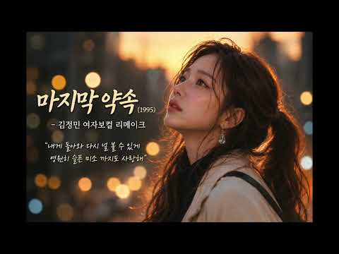
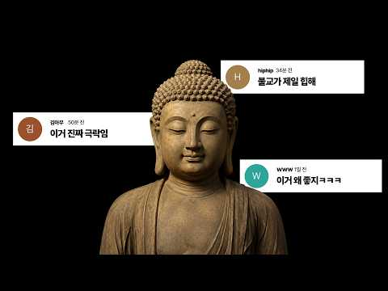
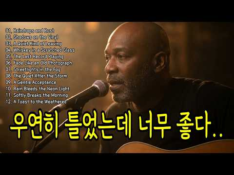
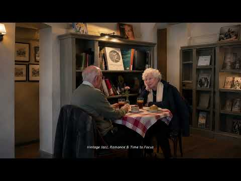
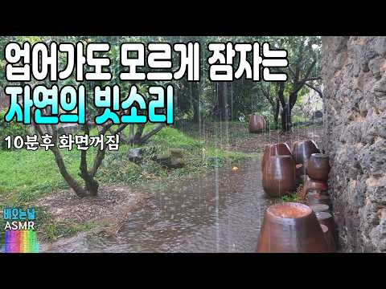
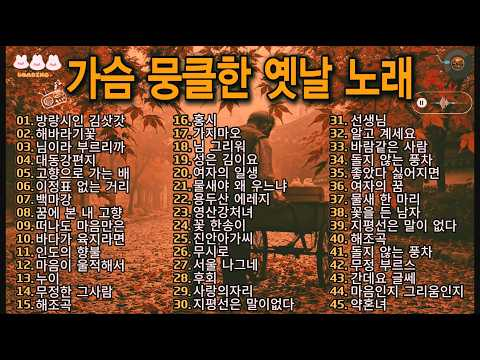

# 음악 — 성공 사례 분석: 사례별 자세히 #241–#280

`analysis.md` 의 9번 (같은 # 번호). 자동 생성 — `tools/success_analysis.py` v1.4.1 (2026-10-17 10:21 UTC). ※ 연구·교육용 — 투자 권유가 아님.

### 241. 🎤 고단한 하루 끝, 막걸리 한잔하며 듣는 눈물 나는 중년 위로가 — 인생막걸리 (가수 창)🎶 인생 트롯 ✔️

- https://www.youtube.com/watch?v=4EkREEo9LXQ · 우리인생뮤직 · 구독자 19,700 · 조회수 525,396 (×26.7, 하루 3,041.5) · 좋아요 4,139 (0.8%) · 6분 · 2026-04-27 · 주제 묶음 9. 가요·발라드·트로트 · 형식 음악 (그 밖 모양 — 한 편짜리 BGM 등) · 폴더 `W_4EkREEo9LXQ` (웹 승인)
- 썸네일: 
- 설명 앞부분: ““중년 인생, 사랑과 이별, 삶의 기쁨과 슬픔을 노래하는 인생 발라드 & 트롯 자작곡 채널입니다. 🎶 이 채널은 중년 발라드 / 인생 트롯 / 감성 발라드 / 공감 노래 / 한국 트롯 / 위로 노래 / 이별 노래 / 인생 노래 / 힐링 음악 / 자작곡 을 중심으로 제작됩니다. 여기서는 눈물 나는 인생 발라드 흥과 공감이 살아있는 인생 트롯 공감하는 현실 이야기 노래 사랑, 이별, 가족, 후회를 담은 감성 자작곡 하루 끝에 듣는 힐링 음악 & 위로 노래 를 만나실 수 있습니다. 특히 ...... 중년 감성 노래, 인생 노래, 한국…
- 같은 채널 평소 대비 ×190.5 (채널 최근 롱폼 중앙값 2,758회) · 평소 영상: "안경 쓰고 안경 찾는 내 모습 실화냐? 🤣 5060 폭풍공감 인생 트로트 [깜빡깜빡 인… (2,785회) / "고생만 시켜 미안하오.." 한평생 곁을 지켜준 당신에게 바치는 노래 ∣ 멋진 인생 (2,732회)
- 대본 없음 (설명) — 음성인식이 끝나면 도입부·흐름이 들어감
- 댓글 309/309: 좋은 점 — 영상 2 · 감사·응원 32 · 더 알고 싶은 것 2 · 아쉬운 점 — 영상 0 · 반박·불만 — 의견 다름 2 · 정치·사회 0 · 경험 공유 5 · 구독·다음 기대 3
  - 좋은 점 — 영상 👍5 “너무. 듣기좋네요. 슬프네요”
  - 감사·응원 👍33 “안녕하세요 아름답고멋져요 감미롭고감동 이네요 좋아요 좋은하루되세요 감사합니다 너무좋아요 선생님 수고하셨습니다 너무잘하십니다 🎉🎉🎉구독꼬옥 좋은하루되세요 ❤❤❤”
  - 감사·응원 👍10 “반주로 한잔하고 여행다니다 들러 흥을 깨우고 갑니다😊 감사합니다😊😊😊”
  - 더 알고 싶은 것 👍2 “참 잘하신다 우째 이렇게 잘 하실수 있을까요? 따라 다니며 노래 들어도 반도 못 들었는것 같습니다 잘 드셔요 😮”
  - 반박·불만 — 의견 다름 👍4 “이거 진짜 장난아닙니다~~ 공감 10000%”
  - 반박·불만 — 의견 다름 👍0 “하하 제스처가 왜 저리 웃기는지..”
  - 경험 공유 👍8 “😂나도노래을들으이 정처업시 방랑생햇던생각이난다 🍄”
  - 경험 공유 👍5 “져도 노래좋아 가끔 칠공 팔공 라이브 가지만 에이아이. 가수는 천상 노래 기죽어 내가 에이아이 만큼 만”
  - 구독·다음 기대 👍4 “매일듣고 있습니다~ 내인생에 이런 멋진노래가 😂😂”
  - 구독·다음 기대 👍2 “막걸리 감동입니다 곡도 아주고 등실 등실 어께 들썩들썩 잘듣고 구독합니다❤❤❤”

### 242. 마지막 약속(1995) - 김정민 ∣ 여자보컬 리메이크 [원곡감성] Cover

- https://www.youtube.com/watch?v=L7EUtPDVddY · AuraAPT · 구독자 13,100 · 조회수 348,909 (×26.6, 하루 3,966.7) · 좋아요 775 (0.2%) · 5분 · 2026-07-21 · 주제 묶음 12. 커버·노래 부르기 · 형식 커버·직접 부른 노래 · 폴더 `W_L7EUtPDVddY` (웹 승인)
- 썸네일: 
- 설명 앞부분: 김정민의 명곡 **‘마지막 약속(1995)’**을 원곡의 감성을 최대한 살려 여자보컬 버전으로 리메이크했습니다. 이별 후에도 변하지 않는 사랑과 그리움을 담은 이 노래가 여러분의 추억 속 한 장면을 떠올리게 하길 바랍니다. 🎧 이어폰으로 감상하시면 더욱 풍부한 사운드를 즐기실 수 있습니다. 🎵 Lyric “내게 돌아와 다시 널 볼 수 있게 영원히 슬픈 미소 까지도 사랑해” 👍 영상이 마음에 드셨다면 은 큰 힘이 됩니다. 감사합니다. ※ 본 영상은 원곡에 대한 존경을 담아 제작한 리메이크/커버 콘텐츠입니다. 🔖 Hashtags
- 같은 채널 평소 대비 ×15.6 (채널 최근 롱폼 중앙값 22,298회) · 평소 영상: 사랑.. 그 놈 (2009) - 바비 킴(Bobby Kim)｜원곡감성 여자보컬 리메이크｜… (22,385회) / 말리꽃 (2000) - 이승철｜가슴을 울리는 명곡 [원곡감성] 여자보컬 리메이크｜Aura… (22,211회)
- 대본 없음 (설명) — 음성인식이 끝나면 도입부·흐름이 들어감
- 댓글 41/40: 좋은 점 — 영상 0 · 감사·응원 3 · 더 알고 싶은 것 4 · 아쉬운 점 — 영상 0 · 반박·불만 — 의견 다름 0 · 정치·사회 0 · 경험 공유 2 · 구독·다음 기대 0
  - 감사·응원 👍7 “김정민은 남자의 감성 중에서도 매우 짙은 감성이라 여성 보컬이 해석해서 표현하는 것이 쉽지만은 않았을 텐데... 역시나 오늘도 좋은 곡으로 올려 주셔서 감사합니다. 잘 듣고 갑니다.^^🎉😅”
  - 감사·응원 👍1 “제가 좋아하는 명곡 중 하나인대 얼마전에 알아서 벌써 100번은 넘게 들었습니다 헤어짐의 아픔을 이 노래로 치료 해봅니다 감사합니다 채널 항상 번창하시길 바랍니다”
  - 더 알고 싶은 것 👍3 “안녕하세요 서쪽하늘 듣다가 왔는데 이 곡은 키를 얼마나 올렸는지 여쭈어도 될까요?”
  - 더 알고 싶은 것 👍2 “40대 중반 아재입니다.. 요즘 관련 음악만 듣고 있습니다 편곡 예술입니다...이런 원곡을 해치지 않는 편곡 부탁드립니다...지하철 타는 30분동안 반복 재생합니다”
  - 경험 공유 👍2 “김정민 노래 커버가 좋아요 김정민 노래 중 내가 사는 이유 커버가 될까요?”
  - 경험 공유 👍1 “제가 좋아하는 명곡 중 하나인대 얼마전에 알아서 벌써 100번은 넘게 들었습니다 헤어짐의 아픔을 이 노래로 치료 해봅니다 감사합니다 채널 항상 번창하시길 바랍니다”

### 243. 𝐏𝐥𝐚𝐲𝐥𝐢𝐬𝐭 이게 극락 사운드인가?🪷 ∣ 속세 탈출용 불교 재즈🎧

- https://www.youtube.com/watch?v=EQzDJeyYNX0 · chill potato club · 구독자 15,500 · 조회수 411,007 (×26.5, 하루 2,592.9) · 좋아요 10,421 (2.5%) · 123.1분 · 2026-05-11 · 주제 묶음 7. 재즈·보사노바 · 형식 플레이리스트·모음 (여러 곡) · 폴더 `W_EQzDJeyYNX0` (웹 승인)
- 썸네일: 
- 챕터: 0:00 Moktak Midnight Club · 1:18 Bells Through Incense · 4:17 Bodhi Groove · 6:52 Dharma After Hours · 9:37 Lotus After Dark · 12:46 Blue Lotus Ritual · 17:39 Empty Mind Swing · 20:22 Gate · 24:05 Midnight Heart Sutra · 26:58 Moonlight on the Moktak · 29:51 Moktak & Smoke · 34:09 Sutra in Blue · 36:57 Temple After Midnight
- 설명 앞부분: 절에 재즈바 하나 차리면 이런 느낌 아닐까…🪷 목탁 비트 위에 스윙 드럼 얹고, 향 냄새 대신 베이스 그루브 피어오르는 플레이리스트. 도심 소음은 잠깐 음소거하고 오늘만큼은 속세 로그아웃합시다 🎧 🤍 어떤 곡이 가장 좋은지 댓글로 알려주세요 💬 [발매 완료] 다양한 플랫폼에서 감상하실 수 있습니다🪷
- 같은 채널 평소 대비 ×54.8 (채널 최근 롱폼 중앙값 7,496회) · 평소 영상: 𝐏𝐥𝐚𝐲𝐥𝐢𝐬𝐭 주문하신 연꽃 온더락 나왔습니다🪷 ∣ Buddhist Brazilian … (7,496회) / 𝐏𝐥𝐚𝐲𝐥𝐢𝐬𝐭 가피가 끊이질 않는 불교 시티팝 (6,313회)
- 대본 없음 (설명) — 음성인식이 끝나면 도입부·흐름이 들어감
- 댓글 282/282: 좋은 점 — 영상 0 · 감사·응원 4 · 더 알고 싶은 것 3 · 아쉬운 점 — 영상 0 · 반박·불만 — 의견 다름 0 · 정치·사회 0 · 경험 공유 8 · 구독·다음 기대 2
  - 감사·응원 👍4 “대에~~~~박! 일부러 종교음악 찾아듣지 않고 재즈도 늘 졸린 음악이었는데 이끌림이었는지 눌러보고 싶어서 눌렀더니 이렇게 좋을 수가!!! 대박!!!! 👍👍👍👍👍 😮😮😮😮😮 입이 안다물어지네요! 정말 자주 들을 거 같아요! 감사합니다!”
  - 감사·응원 👍2 “세상에 수련비쥐엠으로 완전 제 스타일이에요!!!! 감사히듣겠습니다!”
  - 더 알고 싶은 것 👍2 “아니 이거 원래 있는 노래인가여..? 아님ai 인가여 ccm은 많은데 불교는 대중적인 느낌의 노래가 없어서 찾고있었는데 이게 진짜 있는 장르라면 뭐라 검색해야 나오는지 알려주세요 ㅜㅜㅜ”
  - 더 알고 싶은 것 👍2 “해당 음원 상업적(유튜브)으로 사용해도 괜찮을까요?”
  - 경험 공유 👍72 “불교재즈가 뭘까? 클릭해봤더니 진짜 불교재즈 ㅋㅋㅋ 신박하다”
  - 경험 공유 👍17 “매일 108배 하는 사람인데 이거 알게 된 후 들으면서 합니다! 나도 모르게 들썩들썩🙇🏻‍♀️🙇🏻‍♀️”
  - 구독·다음 기대 👍3 “ㅋㅋㅋ이거 듣고 신나서 구독하고 가요~ 1000번째구독자네요”

### 244. 드루와자기 트로트 커버리믹스 총집합! 신나는 트로트 35곡 연속 듣기 🎶추억의 히트송 리믹스,레전드 트로트 댄스곡 모음,추억을 소환하다 🎧 #댄스곡연속듣기

- https://www.youtube.com/watch?v=al3dfBmH620 · 드루와자기 · 구독자 19,700 · 조회수 520,841 (×26.4, 하루 3,548.8) · 좋아요 2,786 (0.5%) · 136분 · 2026-05-23 · 주제 묶음 5. 운동·드라이브·신나는 · 형식 커버·직접 부른 노래 · 폴더 `W_al3dfBmH620` (웹 승인)
- 썸네일: 
- 챕터: 0:00 거문고야 · 2:21 광대 · 6:29 그집앞 · 9:55 깜빡이를키고오세요 · 14:32 날봐귀순 · 17:36 남행열차 · 21:21 너나나나 · 24:37 동전인생 · 27:50 만년사랑 · 32:09 멍 · 36:00 무심세월 · 40:47 무조건 · 46:09 문을여시오 · 50:09 바랑 · 53:19 밤에피는장미 · 56:12 밤이짧은연인들 · 61:02 방황 · 65:15 빈손 · 69:18 사랑아제발 · 72:59 서울의달
- 설명 앞부분: "트로트를 리믹스 하여 댄스곡으로 한자리에 모았습니다! 듣기만 해도 기분이 좋아지고, 추억이 떠오르는 트로트리믹스 35곡을 연속으로 감상해보세요. 기분 전환이 필요할 때, 드라이브할 때, 또는 파티 분위기를 띄우고 싶을 때 딱 맞는 선곡! 신나는 리듬과 함께 신나는 댄스!!! 🎶"
- 같은 채널 평소 대비 ×1,552.4 (채널 최근 롱폼 중앙값 336회) · 평소 영상: 💃 다 그런거지 - 드루와자기 🕺 ∣ 신나는 트로트 / 지친 일상을 날려버릴 신나는 노래… (381회) / ✨ 나의 사랑아 - 드루와자기 💖 ∣ 가슴 깊이 스며드는 애절한 OST 발라드 🎧💫 #나… (290회)
- 대본 없음 (설명) — 음성인식이 끝나면 도입부·흐름이 들어감
- 댓글 236/236: 좋은 점 — 영상 0 · 감사·응원 29 · 더 알고 싶은 것 3 · 아쉬운 점 — 영상 4 · 반박·불만 — 의견 다름 0 · 정치·사회 0 · 경험 공유 1 · 구독·다음 기대 2
  - 감사·응원 👍47 “선곡.편곡. 목소리. 굳 즐겁고 쒼나고 행복 만땅ㅡ 감사 합니다.♡”
  - 감사·응원 👍11 “스트래스 풀리고 기분전환됐읍니다 감사합니다.”
  - 더 알고 싶은 것 👍3 “반했습니다 ❤❤😂😂😂😂 두분 목소리 짱입니다 듣고또듣고 지루할시간이 없네요 혹 무심세월 단독으로 들을수 있을까요????”
  - 더 알고 싶은 것 👍3 “리믹스 음악 짱 신나게 흔들면서 청소 했습니다. 다음에도 좋은 음악 리믹스 부탁합니다. 항상 응원합니다.화이팅”
  - 아쉬운 점 — 영상 👍34 “제 노래 스퇄일 최고입니다😊 가수 목소리 좋고 선곡도 최고 운동할때 이어폰 귀에 꼽고❤ 한시간 넘게 운동하는데 지루함 없이 운동합니다 대박 기원합니다🎉🎉🎉🎉🎉”
  - 아쉬운 점 — 영상 👍4 “조오타 광고가 너무 많음”
  - 경험 공유 👍4 “와 정말 최고네 ~ 내가 이런쪽은 많이 듣는데 가장 신나고 완벽하네 ^^”
  - 구독·다음 기대 👍1 “운동 때 매일 듣기로 했어요.ㅎ”

### 245. 잠 안 오 새벽, 깊은 허스키 보컬이 주는 위로 🌧️ 70s 빈티지 어쿠스틱 기타 BGM

- https://www.youtube.com/watch?v=BQoJJ8V8TMg · 조용한 그리움 · 구독자 21,400 · 조회수 538,926 (×25.2, 하루 6,462.8) · 좋아요 2,718 (0.5%) · 129.5분 · 2026-07-26 · 주제 묶음 12. 커버·노래 부르기 · 형식 음악 (그 밖 모양 — 한 편짜리 BGM 등) · 폴더 `W_BQoJJ8V8TMg` (웹 승인)
- 썸네일: 
- 대본 없음 (없음) — 음성인식이 끝나면 도입부·흐름이 들어감
- 댓글 106/106: 좋은 점 — 영상 2 · 감사·응원 8 · 더 알고 싶은 것 1 · 아쉬운 점 — 영상 1 · 반박·불만 — 의견 다름 0 · 정치·사회 0 · 경험 공유 2 · 구독·다음 기대 0
  - 좋은 점 — 영상 👍7 “조용히 운전하면서 듣기 좋을 것 같네요. 감사히 잘 듣겠습니다.”
  - 좋은 점 — 영상 👍5 “노래에 짙은 커피향이 가득 느껴지네요. 오늘 가을비 내리는데 듣기 좋네요”
  - 감사·응원 👍9 “이 아침에 커피와 멋진 조합이 되는 음악이군요. 감사해요 ^^”
  - 감사·응원 👍7 “조용히 운전하면서 듣기 좋을 것 같네요. 감사히 잘 듣겠습니다.”
  - 더 알고 싶은 것 👍4 “가수~~이름을 알려주세요🎉”
  - 아쉬운 점 — 영상 👍4 “너무 좋아요 혼자서도 대자연의 사계절을 느낄수 있는 풍만한 감성에 젖어드는 음악과 소울이네요 그리움과 후회가 많은 저가 많이 치유와 위안을 받고있어요 감사합니다 아쉬운건 가사제공도 해주심 더 좋을텐데 아쉽네요 그치만 훌륭합니다 최고 입니다 👍💪”

### 246. 지렸다... 심장마비 🔥 선넘은 여성보컬 락발라드 COVER 33곡 모음 ∣ 전율돋는 초고음 소름주의보 3탄 [20만뷰]

- https://www.youtube.com/watch?v=tol8QOlOsPo · 아무노래개조소 · 구독자 9,460 · 조회수 237,553 (×25.1, 하루 1,914.2) · 좋아요 1,614 (0.7%) · 133.5분 · 2026-06-15 · 주제 묶음 12. 커버·노래 부르기 · 형식 AI 음악 · 폴더 `W_tol8QOlOsPo` (웹 승인)
- 썸네일: 
- 설명 앞부분: 안녕하세요 아무노래 개조소입니다. 여성 락발라드 보컬만 따로좀 모아달라는 요청이 많아서 락발라드 COVER 곡들중에 여성보컬 노래들만 편하게 연속재생으로 들으시라고 모아서 3탄 영상을 제작하였습니다. 즐겁게 감상해주시고 듣고싶으신 곡들을 자유롭게 어떤 버전으로 듣고 싶으신지 남겨 주시면 최선을 다해서 또 제작 해보겠습니다 감사합니다. 🙏 이 영상은 원곡에 대한 깊은 존경과 사랑을 담아 AI 기술로 제작한 헌정영상입니다. 음악에 깃든 모든 권리와 영광은 원작자에게 있습니다. 🙏 This video is an AI-generated …
- 같은 채널 평소 대비 ×27.1 (채널 최근 롱폼 중앙값 8,757회) · 평소 영상: 김태우 - 사랑비 [ 여성 락발라드 Cover ] ∣ [ AI MV ] (9,158회) / 이현우 – 헤어진다음날 [ 락발라드 Cover ] (8,356회)
- 대본 없음 (설명) — 음성인식이 끝나면 도입부·흐름이 들어감
- 댓글 143/143: 좋은 점 — 영상 0 · 감사·응원 3 · 더 알고 싶은 것 7 · 아쉬운 점 — 영상 1 · 반박·불만 — 의견 다름 0 · 정치·사회 0 · 경험 공유 1 · 구독·다음 기대 3
  - 감사·응원 👍5 “기다리고있었습니다.항상좋은노래듣게해줘서감사해요.”
  - 감사·응원 👍2 “감사합니닷”
  - 더 알고 싶은 것 👍33 “우선 이런 질문드려 죄송합니다. 제 생애 최고의 전율을 느꼈습니다. 그래서 무지한 질문을 드리더라도 용서부탁드립니다. 유튜브 보다가 떠서 감상하게 되었는데, 어느분이 부르신걸까요? 혹시 설명란에 있는것처럼 ai로 만드신 걸까요?”
  - 더 알고 싶은 것 👍6 “여자 파워보컬 모아둔것만 듣고 싶었는데 확실히 ai가 잘하네요 ㅎㅎ 이런거 많이 올려주세요 가슴이 뻥 뚫리는것 같당”
  - 아쉬운 점 — 영상 👍2 “Ai는 특유의 전자음 같은게 느껴짐. 그래도 좋긴한데 조금 아쉬움 ㅠㅠ 사람이 아니라는게 ㅠㅠ”
  - 구독·다음 기대 👍3 “구독했어요~ 모음집 자주 올려주세요~~ 일하면서 듣는데 너무 좋네요~~”
  - 구독·다음 기대 👍2 “유투브처음 구독박고감니다 대박 ㅎ”

### 247. 𝐘𝐨𝐠𝐚 𝐏𝐥𝐚𝐲𝐥𝐢𝐬𝐭 바람이 살랑 우붓의 요가 샬라ㅣ허밍 요가 음악

- https://www.youtube.com/watch?v=34ESzO9DdwQ · 김샨티(Shanti Kim) · 구독자 5,070 · 조회수 126,982 (×25.1, 하루 1,065.1) · 좋아요 1,360 (1.1%) · 61.5분 · 2026-06-20 · 주제 묶음 1. 수면·명상·힐링 · 형식 플레이리스트·모음 (여러 곡) · 폴더 `W_34ESzO9DdwQ` (웹 승인)
- 썸네일: 
- 설명 앞부분: 기분좋은 명상과 함께 오늘 수련 시작할께요 찾고 있는, 또는 필요한 요가음악이 있다면 댓글로 남겨주세요
- 같은 채널 평소 대비 ×11.7 (채널 최근 롱폼 중앙값 10,828회) · 평소 영상: 【𝟏𝟓𝐦𝐢𝐧】 어른이를 위한 자장가ㅣ사바아사나 음악 (10,828회) / 𝐘𝐨𝐠𝐚 𝐏𝐥𝐚𝐲𝐥𝐢𝐬𝐭 수련이 끝난 한 여름 밤은 참 아름다와 (10,705회)
- 대본 없음 (설명) — 음성인식이 끝나면 도입부·흐름이 들어감
- 댓글 45/45: 좋은 점 — 영상 0 · 감사·응원 9 · 더 알고 싶은 것 2 · 아쉬운 점 — 영상 1 · 반박·불만 — 의견 다름 0 · 정치·사회 0 · 경험 공유 6 · 구독·다음 기대 0
  - 감사·응원 👍56 “이 음악과 함께 홀로 1시간 수련을 했어요. 이상하게 하다가 눈물이 났네요 ㅋㅋㅋ 감사합니다 샨티”
  - 감사·응원 👍5 “산정상에서 명상하며 들었습니다~^^ 오묘한 감정정화에 좋은 음악이네요~ 자연속애서 너무나 함깨 어우러지는 음악에 감사합니다^^🙏🏻”
  - 더 알고 싶은 것 👍1 “제발 제목 부탁드려요 😢❤”
  - 더 알고 싶은 것 👍0 “안녕하세요? 실례가 안된다면 혹시 음원파일을 받을 수 있을까요? 너무 좋아서 영상음악으로 쓰고 싶습니다”
  - 아쉬운 점 — 영상 👍5 “산정상에서 명상하며 들었습니다~^^ 오묘한 감정정화에 좋은 음악이네요~ 자연속애서 너무나 함깨 어우러지는 음악에 감사합니다^^🙏🏻”
  - 경험 공유 👍19 “아침에 일어나기 전 침대에서 요가하며 듣는 음악인데 우리집 고냥이녀석이 이 음악만 나오면 어디서든 나와 침대 한구석에. 엎드려 지긋이 눈 감고 끝날때까지. 있답니다. 고양이가 좋아하는 요가음악 이죠.”
  - 경험 공유 👍11 “허밍 음악 정말 좋아요. 명상하면서 듣는데 저도 다른분처럼 눈물이 나네요. 마치 엄마가 아기를 토닥이며 부르는 자장가 같은 느낌이라 위로가 되는거 같아요. 제 마음을 스스로 토닥이기 위해 자주 들을게요❤ 구독갑니당”

### 248. playlist ∣ 여름, 레몬과 재즈에 대하여

- https://www.youtube.com/watch?v=Gr7ZxTdL8XA · centralgrocery 중앙식품점 · 구독자 27,200 · 조회수 677,137 (×24.9, 하루 6,486.9) · 좋아요 10,498 (1.6%) · 236.8분 · 2026-07-05 · 주제 묶음 7. 재즈·보사노바 · 형식 플레이리스트·모음 (여러 곡) · 폴더 `W_Gr7ZxTdL8XA` (웹 승인)
- 썸네일: 
- 챕터: 0:00 Lemon Morning · 2:59 A Plate of Summer · 7:12 The Bright Table · 10:36 Summer Kitchen · 13:50 Citrus Mood · 17:49 Fresh Pick · 21:48 The Fruit Shop · 24:42 Homemade Afternoon · 27:20 Summer Brunch · 31:09 Seasonal Kitchen · 35:56 Lemon Season · 40:46 Lemon Press · 42:46 Limone · 45:50 Simply Yellow · 50:06 Sunny Notes · 53:12 Fresh Light · 55:44 Lemon & Jazz
- 설명 앞부분: 새벽은, 밤이 남겨둔 고요와 아침이 가져올 빛이 잠시 함께 머무는 시간. 그러니 여름에는 레몬을 썰고, 얼음을 채우고, 재즈를 틀어둘 것. [Tracklist] // CREDITS 채널에 사용되는 모든 일러스트와 음악은 CENTRALGROCERY가 직접 제작한 창작물입니다. Music and production by CENTRALGROCERY. Illustrations and visual content by CENTRALGROCERY. © CENTRALGROCERY. All rights reserved. // COLLABORATI…
- 같은 채널 평소 대비 ×48.4 (채널 최근 롱폼 중앙값 13,980회) · 평소 영상: playlist ∣ 여름과 가을사이, 사랑스러움에 대하여 (14,157회) / playlist ∣ 여름, 독서의 시간 (13,802회)
- 대본 없음 (설명) — 음성인식이 끝나면 도입부·흐름이 들어감
- 댓글 207/207: 좋은 점 — 영상 4 · 감사·응원 7 · 더 알고 싶은 것 5 · 아쉬운 점 — 영상 1 · 반박·불만 — 의견 다름 0 · 정치·사회 0 · 경험 공유 7 · 구독·다음 기대 4
  - 좋은 점 — 영상 👍12 “노래가 듣기 편하고 좋네요^^ 구독, 완료하고 잘 듣고 갑니다.^^ 자주소통 해요...”
  - 좋은 점 — 영상 👍11 “레전드다ㅠㅠ 뭘 하든간에 일단 틀어놓으면 집중이됨”
  - 감사·응원 👍43 “저희애기가 이 플리만 틀면 뱃속에서 난리 부르스르 쳐요 좋은 플리 감사드립니다!”
  - 감사·응원 👍13 “음악이 정말 좋네요… 덕분에 마음에 쏙 드는 하루를 보내고 있어요! 감사드립니다.”
  - 더 알고 싶은 것 👍47 “트랙리스트 위에있는 글은 주인장님이 써내려간 글귀일까요? 너무 멋져요.. ❤ 혹시 책의 한 소절이라면 제목을 알려주실 수 있으실까요😊”
  - 더 알고 싶은 것 👍14 “가사하나 없는 플리인데.. 들으면 마음이 진짜 편안해져요ㅎㅎ 적당히 잔잔하면서 넘 좋아요ㅎㅎ 몇주간 이 채널의 플리만 계속 무의식적으로 들었네요❤️ 좋은 플리 많이 올려주세요❤️”
  - 아쉬운 점 — 영상 👍11 “레몬플리 너무 좋아요. 몇번이나 무한반복 재생하고 있어요❤”
  - 경험 공유 👍43 “저희애기가 이 플리만 틀면 뱃속에서 난리 부르스르 쳐요 좋은 플리 감사드립니다!”
  - 경험 공유 👍31 “저는 오늘 제 인생의 다시는 오지않을 마지막 여름방학을 보내는 아침에 있습니다. 우연일까요.. 오늘만큼은 진짜. 내일이면 바빠서 챙겨주지 못할 아침밥과 멍때리기를 하려던 참이었습니다. 중앙식품점은 오늘 저에게 레몬다섯개와 나이프 하나를 주더군요. 어렸을 때 로마에 간…”
  - 구독·다음 기대 👍42 “썸녜일도 느낌.있고.음악도 좋네요 ! 음악은 ai로 만드신건가요?궁금. 그림도 왠지 직접그리신듯 구독하고가요😊”
  - 구독·다음 기대 👍13 “어 뭐야뭐야.. 구독할게요”

### 249. [playlist] 신기하네, 이런 빈티지재즈 좋아하는 걸 어떻게 알고 틀어줬지? ∣ 중간 광고 없음 Jazz Quite Cozy, 작업용, 명상, 공부 BGM

- https://www.youtube.com/watch?v=aZRegDWuCEo · 포 시즌 플리 Four Seasons Playlist · 구독자 39,200 · 조회수 963,443 (×24.6, 하루 15,261.4) · 좋아요 22,379 (2.3%) · 75.1분 · 2026-08-15 · 주제 묶음 7. 재즈·보사노바 · 형식 플레이리스트·모음 (여러 곡) · 폴더 `W_aZRegDWuCEo` (웹 승인)
- 썸네일: 
- 챕터: 0:00 The Jazz We Like · 2:58 Coffee for Us · 4:48 Our Morning Café · 6:50 Pancakes for Two · 9:06 Growing Old Together · 10:55 One More Coffee · 14:17 A Little Morning Walk · 16:32 You Know My Favorite Jazz · 18:45 Brunch With You
- 설명 앞부분: 조용히 흐르는 감성 플레이리스트 입니다. 공부할 때, 작업할 때, 카페처럼 틀어두고 싶을 때 혹은 아무 생각 없이 하루를 흘려보내고 싶을 때 잘 어울려요. 오늘의 분위기에 자연스럽게 스며들길 바랍니다. ☕ 🎧 All tracks are carefully selected to create a calm, cozy atmosphere. Let the music gently fill your space.
- 같은 채널 평소 대비 ×43.5 (채널 최근 롱폼 중앙값 22,136회) · 평소 영상: [playlist] 우리 나이 들어서도 이렇게 재즈 들으면서 수다 떨자. ∣ 중간 광고 … (23,080회) / [중간광고없음] 음. 좋아. 가을 재즈는 이거지. 도입부부터 낙엽 타는 냄새가 나. ∣ … (21,192회)
- 대본 없음 (설명) — 음성인식이 끝나면 도입부·흐름이 들어감
- 댓글 416/416: 좋은 점 — 영상 3 · 감사·응원 60 · 더 알고 싶은 것 16 · 아쉬운 점 — 영상 1 · 반박·불만 — 의견 다름 0 · 정치·사회 0 · 경험 공유 10 · 구독·다음 기대 19
  - 좋은 점 — 영상 👍10 “밤에 듣기 좋네요.분위기 있어요.”
  - 좋은 점 — 영상 👍2 “썸네일도 재즈도 잘 어우러져요. 넘 듣기 좋아요. 구독 누르고 듣고 있어요~💗”
  - 감사·응원 👍177 “전 배경이 너무 좋아서 듣게 되었습니다. 감사해요. 배경도 재즈도 따뜻해요”
  - 감사·응원 👍55 “육아에 마음이 너무 지쳐서 집밖으로 나왔는데 갈곳이 없어 커피한잔 사들고 근처 공원와서 듣는데 힐링되네요 제가 재즈를 좋아하는걸 오늘 알게된 기분이에요 감사합니다”
  - 더 알고 싶은 것 👍15 “혹시 첫 번째 노래 가수를 있을까요? 검색으로는 안 나와서요ㅜㅜ 가사를 보고 싶은데ㅜㅜ”
  - 더 알고 싶은 것 👍3 “공부할때 잔잔한 재즈듣는게 새로운 취미가 되었는데 딱 좋은 플레이스트네요! 앞으로도 좋은 플리 부탁드립니다!”
  - 경험 공유 👍55 “육아에 마음이 너무 지쳐서 집밖으로 나왔는데 갈곳이 없어 커피한잔 사들고 근처 공원와서 듣는데 힐링되네요 제가 재즈를 좋아하는걸 오늘 알게된 기분이에요 감사합니다”
  - 경험 공유 👍3 “순식간에 행복해졌어요 너무 제가 좋아하는무드❤❤❤잘들을게요”
  - 구독·다음 기대 👍3 “선곡이 전체적으로 조화로워서 구독하고 갑니당ㅎㅎ”
  - 구독·다음 기대 👍3 “너무 좋네요~^^ 구독합니다”

### 250. 💿 노릇노릇 빵아저씨가 만든 브금🍞

- https://www.youtube.com/watch?v=2bUpv56PbMw · 프륀 Pruiin · 구독자 11,400 · 조회수 279,047 (×24.5, 하루 2,179.3) · 좋아요 5,544 (2.0%) · 123.7분 · 2026-06-11 · 주제 묶음 11. 힙합·R&B·EDM · 형식 플레이리스트·모음 (여러 곡) · 폴더 `W_2bUpv56PbMw` (웹 승인)
- 썸네일: 
- 챕터: 0:00 Track 1 · 1:35 Track 2 · 3:28 Track 3 · 4:30 Track 4 · 5:02 Track 5 · 6:37 Track 6 · 8:09 Track 7 · 9:59 Track 8 · 11:26 Track 9 · 12:23 Repeat
- 설명 앞부분: 노릇노릇 포근한 빵아저씨의 브금ੈ🍞✩ 🎧Tracklist 모든 콘텐츠는 선별된 디지털 사운드 소스를 바탕으로 직접 보정 및 사운드 믹싱을 진행하고 있습니다! 부족하지만 즐겁게 들어주시고, 자주 찾아주세요! ꒰ྀི *ˊᵕˋ ꒱ྀིﾉ © Pruiin. All rights reserved.
- 같은 채널 평소 대비 ×18.6 (채널 최근 롱폼 중앙값 15,002회) · 평소 영상: 💿 Ice Cream Flavor BGM🍦(๑•̀؂•̀๑) (15,170회) / 💿 Sunday 𝟭𝟮:𝟰𝟱 PM (14,834회)
- 대본 없음 (설명) — 음성인식이 끝나면 도입부·흐름이 들어감
- 댓글 90/90: 좋은 점 — 영상 2 · 감사·응원 6 · 더 알고 싶은 것 1 · 아쉬운 점 — 영상 0 · 반박·불만 — 의견 다름 0 · 정치·사회 0 · 경험 공유 3 · 구독·다음 기대 1
  - 좋은 점 — 영상 👍2 “자신을 희생해서 이웃에게 유익을 주는 우리의 호빵맨❤”
  - 좋은 점 — 영상 👍1 “안녕하세요! 혹시 해당 영상의 노래를 출처 남기고 유튜브 브이로그 브금으로 사용해도 괜찮을지 문의드립니다. 좋은 영상 감사합니다!”
  - 감사·응원 👍60 “피자빵 하나랑 망고케이크 두개 그리고 에그타르트 10개 아 에그타르트는 하나씩 포장해 주시구요 빨미까레 있나요? 아~ 몇 개 있어요? 5개요~ 그럼 다 주세요. 네 다같이 나눠먹을 거예요. 친구 생일이거든요~ 파티죠~ 감사합니다~ 자주 올게요 수고하세요~”
  - 감사·응원 👍21 “감사합니다.. 덕분에 사고뭉치 12갤 아기가 좀 귀여워 보이네요.. 이 말 쓰자마자 냉장고 문을 또 열러 가네요..^^”
  - 더 알고 싶은 것 👍6 “너무 좋아요~~~구독하고갑니당 귀여운 썸네일과 귀여운 음악 많이 부탁드려요!”
  - 경험 공유 👍104 “"내가 정말로 굽고 싶었던 건 이 썩어빠진 세상이었단다"”
  - 경험 공유 👍1 “아저씨 ~ 저 또 왔어요 ~ 오늘 제가 집에서 2번째 휘낭시에를 구워봤는데 파운드케잌처럼 퐁신퐁신하게 됐어요~ 담에는 빠짝빠짝하게 만들고 싶어소 휴지도 시키고 팬닝도 적게 할려고요 ㅎㅎ 담에는 뭐를 만들어볼까요 ? 추천해주세용”
  - 구독·다음 기대 👍6 “너무 좋아요~~~구독하고갑니당 귀여운 썸네일과 귀여운 음악 많이 부탁드려요!”

### 251. 눈물 없이는 못 듣는 감성 락발라드 트로트 12곡｜중년 가슴을 울리는 인생 노래 모음｜55분 연속듣기

- https://www.youtube.com/watch?v=0rFs08Wz1Xw · 인생은 트로트 · 구독자 9,120 · 조회수 222,972 (×24.4, 하루 2,929.6) · 좋아요 2,753 (1.2%) · 55.5분 · 2026-08-02 · 주제 묶음 9. 가요·발라드·트로트 · 형식 플레이리스트·모음 (여러 곡) · 폴더 `W_0rFs08Wz1Xw` (웹 승인)
- 썸네일: 
- 설명 앞부분: 기존에 선보였던 트로트 곡들을 새로운 감성의 락트로트 스타일로 재해석한 특별 편곡 모음입니다. 애절 감성 락발라드 트로트 12곡을 만나보세요. 본 곡은 가사와 스토리 구성에 직접 참여하여 제작한 창작 음악이며, AI 기술을 활용해 완성하였습니다. 🎵 인생은 트로트 여러분의 소중한 추억과 사연도 댓글로 남겨주세요. 감사합니다. ❤ 🎵 수록곡 : 12곡 ⏱ 재생시간 : 55분
- 같은 채널 평소 대비 ×15.2 (채널 최근 롱폼 중앙값 14,625회) · 평소 영상: 사랑에 빠졌나 봐 ❤️ 시크한 그녀의 락트로트 댄스 10곡 ∣ 1시간 10분 (15,243회) / 시청자 요청으로 만든 힙팝트로트 2탄 🎧 한 곡만 들으려다 끝까지 들었다 ∣ 10곡 1시… (14,007회)
- 대본 없음 (설명) — 음성인식이 끝나면 도입부·흐름이 들어감
- 댓글 96/96: 좋은 점 — 영상 1 · 감사·응원 5 · 더 알고 싶은 것 1 · 아쉬운 점 — 영상 1 · 반박·불만 — 의견 다름 0 · 정치·사회 0 · 경험 공유 0 · 구독·다음 기대 0
  - 좋은 점 — 영상 👍1 “아~좋다 듣기좋습니다~~~”
  - 감사·응원 👍6 “좋은음악과 정성스러운 영상 알람으로 함께 응원합니다”
  - 감사·응원 👍4 “정말 마음의 심금을 울리는 이노래 감사합니다 언제가는 한줌의 제로 자연으로 돌아갈 인생 이기에 어쩌면 이노래가 더욱더 이밤을 지세웁니다”
  - 더 알고 싶은 것 👍1 “가수 이름 이나 알려 주세요!❤❤❤❤❤❤❤”
  - 아쉬운 점 — 영상 👍3 “목소리가 너무 좋고 조용한 노래가 너무 좋아요❤”

### 252. 듣는 순간 마음이 편안해지는 첼로 음악 🎻 ∣ 공부, 휴식, 감성 힐링 음악

- https://www.youtube.com/watch?v=QmJoFjq-aWE · 따뜻한 휴식 Studio · 구독자 1,990 · 조회수 48,662 (×24.4, 하루 333.3) · 좋아요 606 (1.2%) · 51.4분 · 2026-05-24 · 주제 묶음 1. 수면·명상·힐링 · 형식 음악 (그 밖 모양 — 한 편짜리 BGM 등) · 폴더 `W_QmJoFjq-aWE` (웹 승인)
- 썸네일: 
- 챕터: 0:00 The Song That Never Ends · 3:12 Today Was a Happy Day · 6:05 A Pleasant Journey · 9:18 The World I Dream Of · 12:45 Peaceful Mind · 15:32 마음의 자유 · 18:40 Memory · 21:55 좋았던 기억 · 25:10 혼자만의 시간 · 28:26 비 오는 날이면 · 31:45 외로움 · 35:12 어머니를 향한 그리움 · 38:50 소중한 사람 · 42:15 내 맘속의 연인 · 45:48 다시, 사랑한다면 · 49:20 The Song That Never Ends (Rep…
- 설명 앞부분: 🎻 끝나지 않는 선율처럼, 조용히 마음을 울리는 첼로 연주곡 모음입니다. 따뜻한 첼로 선율과 영화 OST 같은 감성 오케스트라 사운드로 혼자 있는 시간, 여행, 추억, 그리움, 그리고 작은 위로의 감정을 담았습니다. 오늘 하루도 지친 마음이 잠시 편안히 쉬어갈 수 있기를 바랍니다. 🎼 TRACK LIST 🎧 Recommended for: ☕ Café ambience 📖 Reading & studying 🌙 Relaxing nights 🚗 Night driving 💭 Emotional reflection 😴 Healing & sle…
- 같은 채널 평소 대비 ×111.6 (채널 최근 롱폼 중앙값 436회) · 평소 영상: 언젠가 빛나는 날 🌅 오늘을 살아가는 당신에게 (436회) / 따뜻한 감성 Playlist #3 🌙 지친 하루를 안아주는 힐링 음악 모음 (421회)
- 대본 없음 (설명) — 음성인식이 끝나면 도입부·흐름이 들어감
- 댓글 37/37: 좋은 점 — 영상 1 · 감사·응원 10 · 더 알고 싶은 것 0 · 아쉬운 점 — 영상 0 · 반박·불만 — 의견 다름 0 · 정치·사회 0 · 경험 공유 0 · 구독·다음 기대 1
  - 좋은 점 — 영상 👍5 “축🎉그대채널을.응원함니다.음악이.너무.아름다워요❤듣기좋와요🎉🎉🎉”
  - 감사·응원 👍8 “오랜만에 서울에 와서 우연히 이 음악을 들으면 걷고 있네요 감사합니다 ~”
  - 감사·응원 👍7 “와~~ 음악이 너무 아름다워요. 무거울 거라 생각했는데 오히려 우아한 느낌이 나네요.~~감사합니다.”
  - 구독·다음 기대 👍6 “곡이 너무 아름다워서 끝까지 계속 듣게 되요. 구독하고 계속 듣겠습니다.”

### 253. #이루네 '당신께만' 1시간 연속듣기🎵 ∣ #무명전설 #MBN

- https://www.youtube.com/watch?v=relXmZp8cPE · 무명에서 전설로 · 구독자 22,900 · 조회수 559,589 (×24.4, 하루 3,123.2) · 좋아요 5,741 (1.0%) · 68.9분 · 2026-04-21 · 주제 묶음 기타 · 형식 플레이리스트·모음 (여러 곡) · 폴더 `W_relXmZp8cPE` (웹 승인)
- 썸네일: 
- 설명 앞부분: "진짜는 이제부터 시작이다.“ 전설이 될 단 하나의 이름은? 트롯 사내들의 뜨거운 서열전쟁〈무명전설〉
- 같은 채널 평소 대비 ×1,260.3 (채널 최근 롱폼 중앙값 444회) · 평소 영상: #하루 무명전설 전곡 듣기🎵 ∣ #무명전설 #결승전 #MBN (444회) / #이창민 무명전설 전곡 듣기🎵 ∣ #무명전설 #결승전 #MBN (432회)
- 대본 없음 (설명) — 음성인식이 끝나면 도입부·흐름이 들어감
- 댓글 485/485: 좋은 점 — 영상 3 · 감사·응원 129 · 더 알고 싶은 것 1 · 아쉬운 점 — 영상 4 · 반박·불만 — 의견 다름 2 · 정치·사회 0 · 경험 공유 7 · 구독·다음 기대 5
  - 좋은 점 — 영상 👍28 “듣기좋은 허스키가 압권 느끼함이 이런매력으로 들리다니 묘한 이루네 땜시 중독에 묘약이 ~~~”
  - 좋은 점 — 영상 👍13 “이루네 노래가사가 귀에쏙쏙 들어오네요 감성이 너무멋있어요 음색이 멋짐 화이팅.”
  - 감사·응원 👍67 “이루네씨맘이우울했는데이노래듣고생기가나 네요고마워요파이팅하세요”
  - 감사·응원 👍47 “노래 진짜 잘하시네요. 매력덩어리네요. 응원합니다^^”
  - 더 알고 싶은 것 👍6 “이루가수님과 이은하가수님 뚜엣 부탁드려요 너무 잘듣고 있습니다 이앞으로 더욱더 발전 부탁합니다”
  - 아쉬운 점 — 영상 👍46 “반복해서 들을수록 더 빠져듭니다 이루네 가수님 응원합니다”
  - 아쉬운 점 — 영상 👍14 “목소리가 너무 매력있네요.”
  - 반박·불만 — 의견 다름 👍37 “1회때부터 원픽입니다 노래도 잘하고 목소리도 허스키하고 넘 매력적. 거기다 무대에서 살짝흔드는 몸짖 너무 섹시하고 노련미 뿜뿜. 이루네 팬됏어요. 이노래 너무 좋아하는 노래인데 이루네가 불러 좋아요. 사랑해요 무대서 몸짖. 분위가 태진아 느낌 살짝잇어요. ㅎ 이노래 …”
  - 경험 공유 👍42 “요즘 이루네 가수님 땜시 노래듣느라 밤잠 설치는중.. 언제 끝날지 나도모름....♡”
  - 경험 공유 👍30 “이루네씨 ~ 살랑살랑 흔드는몸짖이 아주 매력적입니다 . 개인적으로 저도 이노래 좋아합니다 . 그동안 이은하씨가 달라진 모습과 아픈소식을 들어 마음이 아팠습니다 .최근엔 살이 많이 빠진모습으로 볼수있어 건강이 많이 회복된것같아 다행이라 생각합니다 . 이루네씨도 승승장구…”
  - 구독·다음 기대 👍33 “이루님 영원한 ❤팬입니다”
  - 구독·다음 기대 👍30 “이루네씨 ~ 살랑살랑 흔드는몸짖이 아주 매력적입니다 . 개인적으로 저도 이노래 좋아합니다 . 그동안 이은하씨가 달라진 모습과 아픈소식을 들어 마음이 아팠습니다 .최근엔 살이 많이 빠진모습으로 볼수있어 건강이 많이 회복된것같아 다행이라 생각합니다 . 이루네씨도 승승장구…”

### 254. [스페인 감성] "El Yugo ∣ 멍에 - 김수희" Korean OldPop 한국명곡

- https://www.youtube.com/watch?v=agDKi1zIp-4 · 스페인 감성 한국 올드송 · 구독자 1,420 · 조회수 34,593 (×24.4, 하루 470.0) · 좋아요 363 (1.1%) · 4분 · 2026-08-04 · 주제 묶음 12. 커버·노래 부르기 · 형식 음악 (그 밖 모양 — 한 편짜리 BGM 등) · 폴더 `W_agDKi1zIp-4` (웹 승인)
- 썸네일: 
- 설명 앞부분: 안녕하세요!! "스페인 감성 한국 올드송"입니다. 한국의 좋은 노래들을 Música Española (무시카 에스파뇰라)로 리메이크해서 불러 드리겠습니다. kpop의 멋진 멜로디와 깊은 감성을 스페인의 감성과 만나 깊이를 더했습니다. 이 채널에서 만들어지는 음악들은 AI를 도구로 이용해 직접 구상하고 제작되는 노력의 결과물입니다. 더 좋은 음악을 제공할 수 있도록 항상 노력하겠습니다. ¡Hola! Bienvenidos a "Canciones Clásicas Coreanas con Alma Española". En este cana…
- 대본 없음 (설명) — 음성인식이 끝나면 도입부·흐름이 들어감
- 댓글 7/7: 좋은 점 — 영상 0 · 감사·응원 0 · 더 알고 싶은 것 0 · 아쉬운 점 — 영상 0 · 반박·불만 — 의견 다름 0 · 정치·사회 0 · 경험 공유 1 · 구독·다음 기대 0
  - 경험 공유 👍3 “노래를 들으니 진짜 내가슴에 구멍이 나고있네......목소리가 나를 옛날로 되돌아 가게하는구려! 구멍 나게한 님은 하늘나라에서 울고있는 나를 보겠지요?”

### 255. 내 삶에 임하소서 ∣ 주기도문 기반 잔잔한 찬양, 조용한 기도 ∣ Let Your Presence Fill My Life ∣ CCM Worship

- https://www.youtube.com/watch?v=HzyxKZ_w2_8 · 쉼이 되는 찬양 · 구독자 3,030 · 조회수 68,856 (×22.7, 하루 401.4) · 좋아요 217 (0.3%) · 5.3분 · 2026-04-28 · 주제 묶음 15. CCM·찬양·국악·동요 · 형식 음악 (그 밖 모양 — 한 편짜리 BGM 등) · 폴더 `W_HzyxKZ_w2_8` (웹 승인)
- 썸네일: 
- 설명 앞부분: 🎼 악보 구매 안내 (국내·해외 구매 가능) 「내 삶에 임하소서」 악보는 아래 방법으로 구매하실 수 있습니다. 🇰🇷 국내 구매 · 계좌송금 아래 신청서에서 악보 종류와 구매 방법을 확인하고 작성해 주세요. 악보 구매 신청서: 🌎 해외 구매 · PayPal 결제 🎵 단선 악보 / Lead Sheet 🎹 보컬·피아노 3단 악보 / Vocal & Piano ※ 한국어 가사가 담긴 PDF 악보이며, 실물은 배송되지 않습니다. 귀한 마음으로 함께 찬양해 주셔서 감사합니다. 🙏 이 찬양이 마음에 작은 쉼이 되셨다면 새로운 찬양이 올라올 때 …
- 같은 채널 평소 대비 ×13.4 (채널 최근 롱폼 중앙값 5,157회) · 평소 영상: 나를 붙드소서 ∣ 흔들리는 마음을 붙잡아 주시는 주님 ∣ 잔잔한 CCM 찬양 (5,157회) / 주의 그림자 아래 ∣ Under Your Shadow ∣ 세상이 날 외면해도 주님은 떠나… (4,522회)
- 대본 없음 (설명) — 음성인식이 끝나면 도입부·흐름이 들어감
- 댓글 27/27: 좋은 점 — 영상 0 · 감사·응원 5 · 더 알고 싶은 것 4 · 아쉬운 점 — 영상 0 · 반박·불만 — 의견 다름 0 · 정치·사회 0 · 경험 공유 0 · 구독·다음 기대 0
  - 감사·응원 👍2 “아멘 아멘 아멘 🙏 주님 감사합니다 아멘 아멘 아멘 🙏 ❤❤❤❤❤”
  - 감사·응원 👍1 “은혜로운 찬양 감사합니다. 특송때 부르고 싶은데 악보 좀 부탁드려요”
  - 더 알고 싶은 것 👍1 “은혜로운 찬양 감사합니다. 특송때 부르고 싶은데 악보 좀 부탁드려요”
  - 더 알고 싶은 것 👍1 “혹시 악보를 구할수 있을까요?ㅠ”

### 256. [Playlist] 오늘은 일본 카페에 앉아 있는 기분으로

- https://www.youtube.com/watch?v=fDk1BeVbz_4 · JazzBrown · 구독자 15,900 · 조회수 346,102 (×21.8, 하루 2,501.1) · 좋아요 3,761 (1.1%) · 70.5분 · 2026-06-01 · 주제 묶음 4. 카페·매장·라운지 · 형식 플레이리스트·모음 (여러 곡) · 폴더 `W_fDk1BeVbz_4` (웹 승인)
- 썸네일: 
- 챕터: 0:00 Corner Cafe in Kyoto · 2:32 Rest Stop Melody · 5:03 Five Minutes by the Sea · 7:30 Postcard on the Table · 10:10 Same Old Train · 12:24 Coffee Scent on the Table · 15:01 Jazz Piano and Dance · 17:46 Good Time Jazz · 21:14 Calm Study Day · 24:26 Soft Thaw · 27:00 Before the colors rise · 29:52 Coffee Before Spring · 32:07 Low Light · 35:08 Calm Desk Jazz · 38:41 Stay Until the Breeze Fades · 41:21 A little While Longer · 44:39 Blue Candlelight · 48:29 Smoky Mirror · 51:31 Slow Sunday Jazz
- 설명 앞부분: 커피가 내려지는 소리와 함께 말하듯 흐르는 인디 재즈 보컬을 담았습니다. 느린 재즈 반주와 따뜻한 카페의 공기, 무심한 듯 편안하게 스며드는 멜로디들. 커피 한 잔과 함께 쉬어가고 싶은 순간을 위한 빈티지 카페 재즈 플레이리스트입니다. Soft indie jazz vocals drifting through a cozy coffeehouse atmosphere. A warm cafe jazz playlist with slow grooves, gentle melodies, and everyday moments. Photo: Pexel…
- 같은 채널 평소 대비 ×60.6 (채널 최근 롱폼 중앙값 5,707회) · 평소 영상: [Playlist] 오늘은 말차라떼와 재즈로 충전하는 날 (5,707회) / [Playlist] 오늘은 책보다 배경음악이 중요합니다 (5,843회)
- 대본 없음 (설명) — 음성인식이 끝나면 도입부·흐름이 들어감
- 댓글 30/30: 좋은 점 — 영상 1 · 감사·응원 0 · 더 알고 싶은 것 0 · 아쉬운 점 — 영상 0 · 반박·불만 — 의견 다름 0 · 정치·사회 0 · 경험 공유 1 · 구독·다음 기대 1
  - 좋은 점 — 영상 👍1 “저도 초보 유튜브인데 짧게하는 일본 재즈 플리 동영상을 올렸는데 다른 분들은 어떻게 하는지 찾아 보다가 보게 되었네요. 전형적인 인디 재즈 보컬을 듣고 있으니 빠져드네요...한 수 배우고 갑니다^^~”
  - 경험 공유 👍1 “저도 초보 유튜브인데 짧게하는 일본 재즈 플리 동영상을 올렸는데 다른 분들은 어떻게 하는지 찾아 보다가 보게 되었네요. 전형적인 인디 재즈 보컬을 듣고 있으니 빠져드네요...한 수 배우고 갑니다^^~”
  - 구독·다음 기대 👍0 “구독하고갑니다❤”

### 257. [60만뷰 감사합니다]가왕의 명곡을 락발라드로! 조용필 - 그 겨울의 찻집 (AI Cover / 알고보니 혼비백산)

- https://www.youtube.com/watch?v=_GrNoR-QyMQ · 알고보니 혼비백산 · 구독자 42,900 · 조회수 907,147 (×21.1, 하루 6,127.5) · 좋아요 4,125 (0.4%) · 5.4분 · 2026-05-22 · 주제 묶음 14. AI 음악 · 형식 AI 음악 · 폴더 `W__GrNoR-QyMQ` (웹 승인)
- 썸네일: 
- 설명 앞부분: 안녕하세요, '알고보니 혼비백산' 채널을 아껴주시는 형님, 누님들! 오늘 들려드릴 곡은 설명이 필요 없는 가왕(歌王) 조용필 님의 영원한 명곡, '그 겨울의 찻집'입니다. 바람 부는 차가운 겨울, 마른 꽃이 걸린 창가에서 홀로 외로움을 삼키는 원곡의 쓸쓸한 감성을 어떻게 하면 새롭게 표현할 수 있을까 고민했습니다. 이번에는 전설적인 기타리스트 게리 무어(Gary Moore) 스타일의 애절한 블루스 락 기타 리프에, 거칠고 호소력 짙은 허스키 보컬을 더해 가슴을 깊게 파고드는 락발라드 감성으로 재해석해 보았습니다. 시대를 초월해 우…
- 같은 채널 평소 대비 ×93.7 (채널 최근 롱폼 중앙값 9,680회) · 평소 영상: 김광석 〈사랑했지만〉 끝내 곁에 머물 수 없었던 사랑… ∣ 어쿠스틱 락발라드 AI Cov… (9,950회) / “이 노래를 기다린 분들이 정말 많았습니다” 강우진 LOVE｜허스키 락발라드.ver (9,951회)
- 대본 없음 (설명) — 음성인식이 끝나면 도입부·흐름이 들어감
- 댓글 249/249: 좋은 점 — 영상 2 · 감사·응원 30 · 더 알고 싶은 것 2 · 아쉬운 점 — 영상 1 · 반박·불만 — 의견 다름 0 · 정치·사회 0 · 경험 공유 8 · 구독·다음 기대 1
  - 좋은 점 — 영상 👍2 “AI소리가 너무너무 듣기좋다”
  - 좋은 점 — 영상 👍1 “이번곡은 자연스러웠어 때로는 강약이 아닌 약약약으로 부드럽게 부르니 듣기 좋아 2:50분 전주부터 너무 좋잖아! 뜨거운 불금되셔~❤❤❤”
  - 감사·응원 👍35 “인간이든 AI이든 뭔 상관일까요 이렇게 가슴을 울리는 가사와 풍부한 감성이 우리를 울려주는데 ᆢ 진심 감사합니다~~~❤❤❤”
  - 감사·응원 👍20 “그 겨울에 찾집을 이렇게 잘 표현 하다니 가사 덧붙인것도 너무 좋았습니다 감사합니다”
  - 더 알고 싶은 것 👍1 “2026년 버젼! 멋집니다 이제 무명가수는 끝! 이름도 알려주세요”
  - 아쉬운 점 — 영상 👍3 “AI 목소리가 더 좋으니 가수들도 이제 사라져야 하나??”
  - 경험 공유 👍7 “제가 정말 좋아하고 즐겨부르는 가왕님의 그 겨울의 찻집 허스키 보이스로 구슬프게 들려오는 곡이네요. 언제들어도 감상에 잠기곤하는 정말 애뜻한곡을 잘 해석을해서 만들어 주셨네요~! 자주들려서 감상을 하겠습니다^^~~❤”
  - 경험 공유 👍7 “이번곡은 힘을 많이 빼셨고 원곡을 깊은 목소리로 최대한 살리신거 같아요 아주 편안하게 들으면서도 가슴속에서는 깊은 감정을 느끼네요 특히 후반부에 편곡은 최고인거 같습니다 제가 노래에 대해 평가할만한 능력은 없지만 중간 중간 백산님이 작사 작곡한 노래 삽입부분이 원곡을…”
  - 구독·다음 기대 👍2 “구독하고 .듣습니다 좋은노래 감사합니다”

### 258. [중간광고없음] 🌲✨ 복잡한 마음은 잠시 내려놓자 ∣ 위로와 휴식의 피아노 ∣ BGM ∣ 휴식, 힐링, 위로

- https://www.youtube.com/watch?v=ADirqRo8IyI · Riae & Piano · 구독자 12,400 · 조회수 262,036 (×21.1, 하루 3,826.8) · 좋아요 855 (0.3%) · 180.9분 · 2026-08-09 · 주제 묶음 6. 피아노·클래식·연주곡 · 형식 음악 (그 밖 모양 — 한 편짜리 BGM 등) · 폴더 `W_ADirqRo8IyI` (웹 승인)
- 썸네일: 
- 설명 앞부분: 오늘만큼은 머릿속의 많은 생각을 잠시 내려놓고, 조용히 쉬어가세요. 잔잔한 피아노 선율과 숲의 풍경이 지친 마음에 작은 위로가 되어주기를 바랍니다. Let go of your thoughts for a while and simply rest. May these gentle piano melodies bring comfort and peace to your heart. © 2026 [Riae & Piano]. All Rights Reserved. Original visuals are created exclusively for thi…
- 같은 채널 평소 대비 ×16.6 (채널 최근 롱폼 중앙값 15,738회) · 평소 영상: [중간광고없음] ☁️🌿 점점 좋아지고 있어 ∣ 비 그친 숲에서 듣는 희망의 피아노 ∣ B… (15,838회) / [중간광고없음] ☁️🍃 잠시 쉬어가도 괜찮아, 넌 잘하고 있어 ∣ 위로의 피아노 ∣ BG… (15,639회)
- 대본 없음 (설명) — 음성인식이 끝나면 도입부·흐름이 들어감
- 댓글 33/33: 좋은 점 — 영상 1 · 감사·응원 4 · 더 알고 싶은 것 0 · 아쉬운 점 — 영상 0 · 반박·불만 — 의견 다름 0 · 정치·사회 0 · 경험 공유 1 · 구독·다음 기대 1
  - 좋은 점 — 영상 👍1 “10여년전쯤 온 가족들과 글램핑했던 소중했던 기억이 떠오르게 만드는 좋은 영상과 BGM이네요. 항상 응원합니다요~~~~”
  - 감사·응원 👍2 “주말오후가 행복합니다 음악연주를 들으면서 작업하니 한없이 즐거워요 감사합니다”
  - 감사·응원 👍1 “10여년전쯤 온 가족들과 글램핑했던 소중했던 기억이 떠오르게 만드는 좋은 영상과 BGM이네요. 항상 응원합니다요~~~~”
  - 경험 공유 👍1 “너무 감사합니다 작은 천사님!❤ 항상 챙겨봐요 항상 자비를 배풀어 주시고 저도 많이 배워야 할게 많다고 느껴졌어요.다른 말의 늦쳐진다고 생각하지 마세용 충분히 잘하고 있어요 제가 독감인거 같은데......감기일수도 있는 상황이라 마음이 불편하고 힘들었는데 이 작은 노…”
  - 구독·다음 기대 👍1 “너무 감사합니다 작은 천사님!❤ 항상 챙겨봐요 항상 자비를 배풀어 주시고 저도 많이 배워야 할게 많다고 느껴졌어요.다른 말의 늦쳐진다고 생각하지 마세용 충분히 잘하고 있어요 제가 독감인거 같은데......감기일수도 있는 상황이라 마음이 불편하고 힘들었는데 이 작은 노…”

### 259. Playlist✍️ 수험생 초집중모드 공부 플레이리스트 ∣ 틀어놓는 순간 공부에 빠져드는 공부플리 BGM🎧 Study Music

- https://www.youtube.com/watch?v=vuYrODP_RTE · obne music 오브네뮤직 · 구독자 7,110 · 조회수 150,249 (×21.1, 하루 3,006.6) · 좋아요 593 (0.4%) · 120.2분 · 2026-08-28 · 주제 묶음 3. 공부·집중·작업 · 형식 플레이리스트·모음 (여러 곡) · 폴더 `W_vuYrODP_RTE` (웹 승인)
- 썸네일: 
- 챕터: 0:00 Brainwave Flow · 2:24 Cozy Corner Whispers · 5:37 Lo-Fi Beats to Relax & Study · 8:06 Lost in the Chapter · 10:59 Unspoken Thoughts · 13:13 Soft Rain outside the Window · 15:27 Mind Space Journey · 17:24 Built to Shine · 20:17 Preparing My Future · 23:35 Tomorrow’s Spotlight · 25:36 Quiet Grind, Loud Success · 27:46 Dream Catcher’s Desk · 30:38 One Page at a Time · 34:08 The Road to Greatness · 36:16 Silent Ambition · 38:39 Replay
- 설명 앞부분: Tracklist 💿 📸Change the picture imported from pinterest & midjourney Playlist ✍️집중력 풀충전 공부 플레이리스트 BGM 조용한 로파이 비트와 따뜻한 감성으로 오래 집중할 수 있도록 만든 Lo-Fi Study Music입니다. 시험공부, 공시·국시·수능, 과제, 독서, 코딩, 업무까지 오랜 시간 부담 없이 틀어둘 수 있는 장시간 집중 플레이리스트를 만나보세요. 🎶 모든 음악은 주인장이 직접 만든 음원으로 오직 obne에서만 들을 수 있는 창작 사운드로 구성됩니다. 모든 …
- 같은 채널 평소 대비 ×20.4 (채널 최근 롱폼 중앙값 7,368회) · 평소 영상: Playlist✍️ 중간고사 집중력 풀충전 공부 플레이리스트 BGM ∣ 오래 공부할 때 … (7,368회) / Playlist✍🏻 시험기간 집중력 끌어올리는 공부 플레이리스트 BGM ∣ 한번 몰입하면… (7,217회)
- 대본 없음 (설명) — 음성인식이 끝나면 도입부·흐름이 들어감
- 댓글 4/4: 좋은 점 — 영상 0 · 감사·응원 1 · 더 알고 싶은 것 0 · 아쉬운 점 — 영상 0 · 반박·불만 — 의견 다름 0 · 정치·사회 0 · 경험 공유 0 · 구독·다음 기대 0
  - 감사·응원 👍2 “I love this music, this help me so much on my studies, 감사합니다!!!!!! 🫶🩷”

### 260. 불(佛)빛사운드 - 물처럼, 바람처럼 M/V 4K #불교음악

- https://www.youtube.com/watch?v=G7P3BWOH67s · 불佛빛사운드 · 구독자 3,990 · 조회수 84,220 (×21.1, 하루 592.7) · 좋아요 566 (0.7%) · 5.8분 · 2026-05-28 · 주제 묶음 1. 수면·명상·힐링 · 형식 AI 음악 · 폴더 `W_G7P3BWOH67s` (웹 승인)
- 썸네일: 
- 설명 앞부분: ✨일도스님과 함께하는 불빛사운드 「물처럼 바람처럼」 — 부처님의 가르침을 담은 찬불가 이 곡은 석가모니의 가르침을 바탕으로, 분노와 원한, 집착을 내려놓고 자유로운 마음과 해탈의 길을 노래한 찬불가입니다. 바위에 새기듯 마음에 남는 원한이 아닌, 물 위에 그리듯 흘려보내는 삶. 그리고 바람처럼 머무르지 않는 청정한 마음을 통해 진정한 평온과 깨달음을 전합니다. 가야금과 대금의 고요한 선율 위에 얹힌 이 노래는 명상, 힐링, 마음 치유를 위한 음악으로도 깊은 울림을 줍니다. 이런 분들께 추천합니다 마음의 평화를 찾고 싶은 분 명상 …
- 같은 채널 평소 대비 ×10.0 (채널 최근 롱폼 중앙값 8,396회) · 평소 영상: 불(佛)빛사운드 - 해탈의 빛 M/V 4K #불교음악 (8,396회) / 불(佛)빛사운드 - 너의 하늘을 향해 M/V 4K #불교음악 (8,444회)
- 대본 없음 (설명) — 음성인식이 끝나면 도입부·흐름이 들어감
- 댓글 118/118: 좋은 점 — 영상 3 · 감사·응원 28 · 더 알고 싶은 것 0 · 아쉬운 점 — 영상 0 · 반박·불만 — 의견 다름 0 · 정치·사회 0 · 경험 공유 2 · 구독·다음 기대 0
  - 좋은 점 — 영상 👍14 “바위에 새긴 원한이 아니라, 물 위에 그린 마음으로 살아가라는 가르침이 깊게 와닿습니다. 붙잡지 않고 흘려보내는 삶… 오늘도 그런 하루였으면 합니다🙏🌿”
  - 좋은 점 — 영상 👍10 “물 위에 새기듯 흘려보내며 청정하게 살아가라는 부처님의 가르침이 음악을 통해 가슴에 와닿습니다.”
  - 감사·응원 👍12 “물처럼 물결처럼 마음을 낮추며 바람 지나가듯 집착을 놓고 처마끝 빗 소리에도 감사하고 세월 속에도 부처님은혜에 감사하자😊”
  - 감사·응원 👍10 “무엇이든지 마음에 담아 두지 말고 하나의 현상 처럼 흘러가는 물처럼 바람처럼 집착 하지 말라는 말씀 감사드립니다 나무 석가모니불_()_”
  - 경험 공유 👍2 “부처님 저희집 더이상 나쁜일 안생기게 도와주세요🎉🎉🎉”
  - 경험 공유 👍1 “산왕대신님 저희가족 모두건강하고 무탈하며 평안하게 하옵시며 막힌 재물운 건강운 열리고 지금 준비하며 하고자하는 모든일들이 순조롭게 원만히 이루어 계약 성사의 가피를 이루어주옵소서 산왕대신님 감사합니다 고맙습니다 덕분입니다”

### 261. 고양이 카페에 놀러 올래?

- https://www.youtube.com/watch?v=ifT02Y1gbuI · 꾸양이 · 구독자 14,800 · 조회수 309,907 (×20.9, 하루 2,163.8) · 좋아요 5,026 (1.6%) · 63.6분 · 2026-05-27 · 주제 묶음 4. 카페·매장·라운지 · 형식 플레이리스트·모음 (여러 곡) · 폴더 `W_ifT02Y1gbuI` (웹 승인)
- 썸네일: 
- 설명 앞부분: 🐱 고양이 카페에 놀러 와💛 커피 맛있게 만들어 줄게☕🍪 🎧 집중할 때 듣기 좋은 힐링 재즈 음악 이야. 공부/집중/작업 할 때 들어봐🐾 (피아노 재즈, jazz, jazzhiphop, pianojazz) 🐱 Come Hang Out at the Cat Café 💛 I’ll Make You a Warm Cup of Coffee ☕🍪 🎧 Relaxing jazz piano music for studying, focus, and work 💛 Perfect background music for reading, working, or ju…
- 같은 채널 평소 대비 ×13.9 (채널 최근 롱폼 중앙값 22,317회) · 평소 영상: 오늘은 고양이 목욕하는 날 (22,317회) / 고양이는 카페를 좋아해 (22,396회)
- 대본 없음 (설명) — 음성인식이 끝나면 도입부·흐름이 들어감
- 댓글 152/152: 좋은 점 — 영상 1 · 감사·응원 5 · 더 알고 싶은 것 0 · 아쉬운 점 — 영상 0 · 반박·불만 — 의견 다름 0 · 정치·사회 0 · 경험 공유 2 · 구독·다음 기대 0
  - 좋은 점 — 영상 👍3 “친구가 알려줘서 들어와봤는데 공부할때 듣기 짱조아요💜😸”
  - 감사·응원 👍5 “안녕하세요💕 이번에도 정말 정말 귀여워요🐱 힐링을 주셔서 감사합니다🫶 일본에서 응원하고 있어요💖”
  - 감사·응원 👍3 “항상 잘 듣고 있습니다. 감사합니다!”
  - 경험 공유 👍2 “역쉬 벗어날 수 없는 꾸양이의 매력... 건치미소에 나도 함께 웃는다...'v' 향긋한 커피두 좋은 음악두 고마워!”
  - 경험 공유 👍1 “꾸양이 너무 귀여워~♡♡♡ 나도 한잔줄래?”

### 262. 머리가 맑아지고🌳마음이 평온해져요. 피아노와 플루트 선율 ∣ 3시간, 힐링음악, 명상음악 ∣ Relaxing Music, Healing Music

- https://www.youtube.com/watch?v=QPa9L5TDD-4 · 살구사운드 SalguSound · 구독자 10,700 · 조회수 222,049 (×20.8, 하루 1,906.6) · 좋아요 1,605 (0.7%) · 188분 · 2026-06-22 · 주제 묶음 1. 수면·명상·힐링 · 형식 긴 한 곡·반복 (N시간) · 폴더 `W_QPa9L5TDD-4` (웹 승인)
- 썸네일: 
- 설명 앞부분: 안녕하세요. 살구해입니다.😊 이번 한 주도 별 탈 없이 편안한 마음으로 보내실 수 있길 바랍니다.🌿 오늘도 와주셔서 감사합니다. 불법 다운로드와 상업적 이용은 금지합니다. Copyright 2026. Salguhae All Rights Reserved. 아름다운 아침 숲 영상과 명상음악🌄 숲 속에 있는 듯🌳 10분만에 머리가 맑아지는 음악 살구해의 첫 번째 앨범 ‘물가에 앉아(at the water's edge)’가 발매되었어요. 멜론, 지니, 유튜브뮤직 등 모든 음원사이트에서 들으실 수 있어요.🌿
- 같은 채널 평소 대비 ×16.7 (채널 최근 롱폼 중앙값 13,333회) · 평소 영상: 마사지 받는 효과😊몸과 마음의 긴장이 풀려요 ∣ 3시간, 힐링음악, 명상음악 ∣ Rela… (13,333회) / 머리가 맑아지는 효과🌿이슬처럼 맑고 잔잔한 치유명상음악 ∣ 3시간, 힐링음악, 명상음악 … (13,546회)
- 대본 없음 (설명) — 음성인식이 끝나면 도입부·흐름이 들어감
- 댓글 129/129: 좋은 점 — 영상 1 · 감사·응원 47 · 더 알고 싶은 것 0 · 아쉬운 점 — 영상 1 · 반박·불만 — 의견 다름 0 · 정치·사회 0 · 경험 공유 3 · 구독·다음 기대 1
  - 좋은 점 — 영상 👍4 “감사합니다 너무 듣기 좋아요 맘이 편해지고 걱정이 사라지는듯한...”
  - 감사·응원 👍59 “유방암 으로 항암 2차 맞으러 내일 큰병원 가네요 ❤ 암이란 무엇이 됫든 한번 걸리면 둑을때까지 관리 가 필요 한듯요 좋은음악으로 아침 을 시작하는 습관 들입니다 좋은 음악 🎶 감사합니다 ❤”
  - 감사·응원 👍20 “전 우울 불안장애 불면증 까지 겹쳐 극심한 두통으로 죽음의 문앞까지 갔다가 겨우 돌아온 환자 랍니다. 명상음악을 주로 듣는데 오늘 처음 살구사운드를 방문. 영롱한 음이 제 마음을 깨끗이 씻어주고 안정 편안함을 줍니다. 자주 들리겠습니다. 감사드리고 행복하세요....”
  - 아쉬운 점 — 영상 👍7 “모든날 모든순간이 세상 모든사람에게 기쁘고 행복한 날이 반복되기를 기원합니다”
  - 구독·다음 기대 👍9 “영혼이 맑아지는 음악이네요 감사합니다.구독하고 좋아요도 눌러요😊”

### 263. [찬송가 모음]주님 앞에 펑펑 울고 싶을 때 듣는 찬양ㅣ눈물의 찬송가 10곡ㅣ깊은 울림 바리톤 찬양ㅣHYMNㅣ찬송가 연속듣기

- https://www.youtube.com/watch?v=giFgcjlR4Co · 골방 찬양 · 구독자 26,000 · 조회수 534,541 (×20.6, 하루 3,458.5) · 좋아요 10,783 (2.0%) · 81.4분 · 2026-05-15 · 주제 묶음 15. CCM·찬양·국악·동요 · 형식 플레이리스트·모음 (여러 곡) · 폴더 `W_giFgcjlR4Co` (웹 승인)
- 썸네일: 
- 챕터: 0:00 지금까지 지내온 것(찬송가 301장) · 3:32 주안에 있는 나에게 (찬송가 370장) · 7:31 내 평생에 가는 길 (찬송가 413장) · 12:00 예수 나를 위하여 (찬송가 144장) · 16:53 죄짐맡은 우리 구주 (찬송가 369장) · 20:34 나의 갈 길 다가도록 (찬송가 384장) · 23:59 내 영혼이 은총입어 (찬송가 438장) · 27:58 나 같은 죄인 살리신 (찬송가 305장) · 31:47 주 하나님 지으신 모든 세계 (찬송가 79장) · 36:20 주 예수보다 더 귀한 것은 없네 (찬송가 94장)
- 설명 앞부분: 🙏삶의 무게가 무거워 주님 앞에 엎드려 펑펑 울고 싶을 때가 있습니다. 깊은 울림을 가진 바리톤의 목소리로 전하는 '눈물의 찬송가 10곡'이 여러분의 상한 마음을 따뜻하게 어루만져 드립니다. 지금까지 지내온 모든 시간이 주님의 은혜였음을 고백하며, 영혼의 깊은 안식을 누리시길 바랍니다. 기도 중에, 잠들기 전, 새벽예배와 묵상의 시간에 들으시며 메마른 마음 위에 임하시는 하나님의 은혜를 경험하시길 바랍니다. [은혜를 나누는 방법] 영상이 은혜로우셨다면 소중한 분들에게 공유해 보세요. 🎵 오늘의 찬송 순서 (Timestamp)
- 같은 채널 평소 대비 ×5.1 (채널 최근 롱폼 중앙값 105,136회) · 평소 영상: [찬송가 연속듣기]복잡한 마음에 힘과 용기를 주는 찬송 ∣ 강하고 담대하라 ∣ 주님과 함… (105,136회) / [찬송가 모음]기도도 안 나올 때 붙잡는 찬송 10곡 ∣ 무너진 믿음을 회복하는 시간 (… (105,945회)
- 대본 없음 (설명) — 음성인식이 끝나면 도입부·흐름이 들어감
- 댓글 1,318/1,318: 좋은 점 — 영상 2 · 감사·응원 389 · 더 알고 싶은 것 8 · 아쉬운 점 — 영상 3 · 반박·불만 — 의견 다름 0 · 정치·사회 2 · 경험 공유 40 · 구독·다음 기대 5
  - 좋은 점 — 영상 👍13 “나이들었어도좋아요구독누르는법도자식들이알려줘서눌렀습니다.그리고,은혜로운찬양함께공유도했지요.늘강건하세요.”
  - 감사·응원 👍68 “고맙습니다 항상 골반찬양으로 은혜받고있습니다 전 76세노인입니다”
  - 감사·응원 👍52 “주님 오늘도 주님 함께하여 주시니 감사합니다 오직 주님만이 나의 구주이십나다 할렐루야”
  - 더 알고 싶은 것 👍18 “혹시 실제 부르시는건지 AI 인지 궁금하네요 너무 은혜로와서~ 너무 잘하셔서~~”
  - 더 알고 싶은 것 👍3 “찬양이 너무 은혜롭습니다. 반주도 너무 감미롭네요. 저는 편곡해서야 찬송가를 겨우 올리고 있는데 어떻게 저작권을 피해서 이렇게 올릴 수 있는지 비결이 궁금합니다. 아뭏든 켜 놓으니까 끝까지 듣게 되네요. 수고하세요.”
  - 아쉬운 점 — 영상 👍8 “찬양 참말로 잘하시네요 목소리가 너무 좋아서 듣는 귀가참즐겁내요”
  - 아쉬운 점 — 영상 👍3 “하나님감사합니다 저는67세할머니. 찬송부르시는선생님 목소리가너무너무진심으로참좋아서 자주듣는할머니. 진심으로찬송감사합니다”
  - 정치·사회 👍4 “감사함니다어찌 하여이나라가 이리되엏는지...후대에게 .뭐라말함니까. 그저 눈물만 흐름니다.”
  - 정치·사회 👍1 “저는 보금애국 자인데 사탄에 눈이 않보이고 목소리도 안나왔 는데 전도와 건강 광화운 돌려 오자 일반쓰레기 버릴려 하였는데 주여 하며 넘어질까 혼자 숨이 못나와 영은 살았으나24일 좌파 흔드는 데 죽다 많이 살려 주신 하나님 아버지 이곳에 살지말라고 축복 받았네요 찬양…”
  - 경험 공유 👍22 “제가 찾던 찬양. 입니다 넘넘 감사합니다 ^^❤”
  - 경험 공유 👍14 “자기야. 날씨가 더워지고 있어요. 요즘. 일어나는. 모든일이. 이해가. 안될만큼. 힘이 드네요^^ 이렇때일수로. 자기가. 생각이. 많이난다. 나좀. 도와주세요. 제가. 힘들지. 않게. 그대가. 좀. 도와주세요. 😮”
  - 구독·다음 기대 👍13 “나이들었어도좋아요구독누르는법도자식들이알려줘서눌렀습니다.그리고,은혜로운찬양함께공유도했지요.늘강건하세요.”
  - 구독·다음 기대 👍5 “성령 강림주일 예배 드리고 와서 골방찬양 유튜브 듣고 구독하고 듣습니다 감사합니다 많은사람들이 찬양 듣고 주님께 돌아오시길 기도 합니다 감사합니다”

### 264. 🍉 냉장고를 열었더니 수박만 있는 브금

- https://www.youtube.com/watch?v=h6oskIb0ASU · 프륀 Pruiin · 구독자 11,400 · 조회수 234,024 (×20.5, 하루 2,462.2) · 좋아요 4,582 (2.0%) · 146.4분 · 2026-07-14 · 주제 묶음 11. 힙합·R&B·EDM · 형식 플레이리스트·모음 (여러 곡) · 폴더 `W_h6oskIb0ASU` (웹 승인)
- 썸네일: 
- 챕터: 0:00 Track 1 · 2:37 Track 2 · 4:50 Track 3 · 7:05 Track 4 · 9:10 Track 5 · 11:24 Track 6 · 13:27 Track 7 · 16:47 Track 8 · 18:17 Repeat
- 설명 앞부분: 🎧Tracklist 모든 콘텐츠는 선별된 디지털 사운드 소스를 바탕으로 직접 보정 및 사운드 믹싱을 진행하고 있습니다! 부족하지만 즐겁게 들어주시고, 자주 찾아주세요! ꒰ྀི *ˊᵕˋ ꒱ྀིﾉ © Pruiin. All rights reserved.
- 같은 채널 평소 대비 ×15.8 (채널 최근 롱폼 중앙값 14,834회) · 평소 영상: 💿 Sunday 𝟭𝟮:𝟰𝟱 PM (14,834회) / 💿 Ice Cream Flavor BGM🍦(๑•̀؂•̀๑) (15,170회)
- 대본 없음 (설명) — 음성인식이 끝나면 도입부·흐름이 들어감
- 댓글 100/100: 좋은 점 — 영상 1 · 감사·응원 0 · 더 알고 싶은 것 1 · 아쉬운 점 — 영상 0 · 반박·불만 — 의견 다름 0 · 정치·사회 0 · 경험 공유 3 · 구독·다음 기대 1
  - 좋은 점 — 영상 👍0 “트랙 전부 마음에 드네여.. 덕분에 일하면서 집중에 도움이 되었습니다 ㅎㅎ”
  - 더 알고 싶은 것 👍0 “노래 너무 좋아요😂❤ 짱구 에피소드 몇화인가요??”
  - 경험 공유 👍4 “냉장고에 자리 없어서 수박 한 통 사기 쉽지 않은 우리집 같은 경우엔 부러운 상황이네요 ㅋㅋㅋ”
  - 경험 공유 👍4 “우리집에는 통에 깍둑깍둑 썰어 둔 수박, 남아 있는 반 통의 수박, 냉장고에 들어갈 준비를 하는 실온의 수박들이 살고 있어요. 짱구가 너무 나같아서 재미로 들으러 왔다가, 곡에 갇힘.. 짱구야, 수박 맛있엉 엄마한테 깍둑썰기 해달라고 해”
  - 구독·다음 기대 👍0 “썸네일도 제목도 브금도 다 너무 귀엽고 느좋이어서 구독하고가용🎀🐹”

### 265. 가슴을 울리는 감성 트로트 5곡 모음 ∣ 깊은 밤 듣기 좋은 노래

- https://www.youtube.com/watch?v=o_RE1dPuUoo · 트로트 작은 음악실 · 구독자 23,500 · 조회수 477,295 (×20.3, 하루 3,137.6) · 좋아요 3,554 (0.7%) · 24.4분 · 2026-05-18 · 주제 묶음 9. 가요·발라드·트로트 · 형식 플레이리스트·모음 (여러 곡) · 폴더 `W_o_RE1dPuUoo` (웹 승인)
- 썸네일: 
- 챕터: 0:00 오늘도 한 잔… 그대 생각에 · 4:43 빈 잔에 남은 추억 · 9:52 사랑은 남기고 떠난 사람 · 15:10 그리운 사람아 · 19:49 살다 보면 알게 되더라
- 설명 앞부분: 보컬은 AI 가수 소영이입니다. 🎤 🎵 감성 트로트 5곡 모음 🎵 세월과 사랑, 그리고 지워지지 않는 그리움을 담았습니다. 깊은 밤, 조용히 마음을 적시는 감성 트로트 5곡을 함께 들어보세요. 🎵 수록곡 오늘 하루의 끝에서 잠시 쉬어가는 시간이 되길 바랍니다.
- 같은 채널 평소 대비 ×77.7 (채널 최근 롱폼 중앙값 6,139회) · 평소 영상: 감성 트로트 5곡 모음 ∣ 깊은 밤 듣기 좋은 노래 (6,139회) / 그리움 5곡 모음 ∣ 깊은 밤 듣기 좋은 감성 트로트 (6,001회)
- 대본 없음 (설명) — 음성인식이 끝나면 도입부·흐름이 들어감
- 댓글 209/209: 좋은 점 — 영상 3 · 감사·응원 24 · 더 알고 싶은 것 0 · 아쉬운 점 — 영상 3 · 반박·불만 — 의견 다름 0 · 정치·사회 0 · 경험 공유 2 · 구독·다음 기대 0
  - 좋은 점 — 영상 👍13 “노래 정말 듣기 좋아요...벌써 다섯번째인듯..나이 먹어서 일까요 정말 좋아요”
  - 좋은 점 — 영상 👍2 “참 듣기좋아요😅”
  - 감사·응원 👍29 “안녕하세요 반갑습니다 오늘도 좋은노래 잘듣겠읍니다 감사합니다 행복한 한주 되시길 바랍니다 행복하세요”
  - 감사·응원 👍17 “К трот 대표님 감사합니다 오늘 처음으로 듣게되었습니다 왜국어살다보니 고향생각 식구들생각 ㅡ 너무너무 좋은노래 감사드립니다 🎉🎉🎉”
  - 아쉬운 점 — 영상 👍3 “목소리가 너무 가슴에 와 닿네요”
  - 아쉬운 점 — 영상 👍2 “AI음악이지만 AI같지않아서 좋네요 가사와 감성적인 분위기 노래라 자꾸 끌립니다”
  - 경험 공유 👍3 “지금 감성이 마음이 그 암울하고 또 내 마음이 숙 지가 안 됩니다. 그러니까 조금 어떤 그 동영상을 보내 주시면 내가 나름대로 집에서 집사람하고. 잠을 잘 것 같아요. 쉽게 얘기하면 무슨 뜻인지 아시겠죠”

### 266. 피아노 다니엘 린데만 Pf. Daniel Lindeman - 차이콥스키 [사계] 작품번호37a 4월 Tchaikovsky [The Seasons] Op.37a …

- https://www.youtube.com/watch?v=yhDdH93H4Tc · HalmaCineTokki할마씨네토끼 · 구독자 15,000 · 조회수 302,624 (×20.2, 하루 1,713.2) · 좋아요 6,687 (2.2%) · 5.8분 · 2026-04-23 · 주제 묶음 6. 피아노·클래식·연주곡 · 형식 음악 (그 밖 모양 — 한 편짜리 BGM 등) · 폴더 `W_yhDdH93H4Tc` (웹 승인)
- 썸네일: 
- 설명 앞부분: 피아노 다니엘 린데만 Pf. Daniel Lindeman 차이콥스키 [사계] 작품번호37a 4월 P.I.Tchaikovsky [The Seasons] Op.37a April 2026 브런치 클래식 Brunch Classic 1 2026.4.16. 군포문화예술회관 수리홀 군포시 군포문화재단 프라임필하모닉오케스트라
- 같은 채널 평소 대비 ×1,939.9 (채널 최근 롱폼 중앙값 156회) · 평소 영상: 드보르작 A. Dvořàk 오페라 ‘루살카’ 중 [달의 노래 Song to the moo… (160회) / 비발디 사계 중 [여름] Summer from The Four Seasons,Op 8, … (152회)
- 대본 없음 (설명) — 음성인식이 끝나면 도입부·흐름이 들어감
- 댓글 377/377: 좋은 점 — 영상 2 · 감사·응원 17 · 더 알고 싶은 것 3 · 아쉬운 점 — 영상 0 · 반박·불만 — 의견 다름 6 · 정치·사회 5 · 경험 공유 12 · 구독·다음 기대 0
  - 좋은 점 — 영상 👍32 “오래전에 다니엘이 독일 가서 성당에서인지 오르간 연주하는거 보고 너무 놀랐는데~~ 연주가 너무 좋아요..멜로디가 귀에 쏙~~들어오네요”
  - 좋은 점 — 영상 👍15 “학원에서 억지로 피아노배울 때 선생님손 끝으로 박자를 탁 탁치는 소리는 나를 회초리로 때리는 듯 했다 음악의 아름다움을 느낄 여유조차 없었지만 이제 생각해보니 그렇게라도 배웠던게 감사하며 아름다운 선율에 빠져봅니다”
  - 감사·응원 👍531 “독다니엘 독일 살때 교회 다니며 파이프 오르간 연주자 였다더니 피아노도 수준급 인가보네요. 멋져요. 힝상 응원 합니다. 다니엘이 갖고 있는 순수함이 좋아요. 🎉🎉🎉🎉🎉❤❤❤❤❤”
  - 감사·응원 👍49 “린데만씨, 어린 나이 한낱 알바생인 저한테도 참 진절하셨던 분, 응원합니다.”
  - 더 알고 싶은 것 👍16 “뭐야!!!!!!!터치❤❤이제까지 숨기고 있던거야??지성 넘치는건 익히 알았지만 감성까지 넘치네.뱃노래도 언젠가 부탁합니다”
  - 더 알고 싶은 것 👍1 “어머나~전공이 궁금하네요^&^넘 아름다운 연주 감상 잘 했어요🎉🎉🎉”
  - 반박·불만 — 의견 다름 👍807 “다니엘 웃기는거 빼고 다 잘하네 🥰”
  - 반박·불만 — 의견 다름 👍4 “독다니엘씨, 진짜 웃기는거 빼고 다 잘하시네요~~^^”
  - 정치·사회 👍79 “대한 외국인 중에서 한국인보다 역사를 많이 아는 다니엘~~ 굿입니다~~^^”
  - 정치·사회 👍6 “유대인이 다니엘만 같아라 진짜 겸손하고 박학다식하고 말도 조근조근 외국인 중에 다니엘씨가 젤 좋음”
  - 경험 공유 👍47 “먼일이야ㅜㅜ🎉 다니엘 내가아는 다니엘 맞는거야 🎉🎉🎉🎉🎉”
  - 경험 공유 👍3 “비정상회담때는 한국어가 많이 어눌했었는데요, 발음이 너무 정확하시군요. 피아노 실력에 감동했습니닺 대단하십니다🎉🎉🎉”

### 267. 대학가요제 7080 콘서트 음악 세시봉, 들으면 기분 좋아지는 7080 노래모음

- https://www.youtube.com/watch?v=SIysrUddSB0 · 음악예술단 사노라면 · 구독자 15,100 · 조회수 299,726 (×19.9, 하루 1,680.0) · 좋아요 1,401 (0.5%) · 38.9분 · 2026-04-22 · 주제 묶음 9. 가요·발라드·트로트 · 형식 연주 (직접 연주하는 영상) · 폴더 `W_SIysrUddSB0` (웹 승인)
- 썸네일: 
- 챕터: 0:00 01 바다새 (높은음자리) · 2:41 02 젊은 연인들 (휘버스) · 6:33 03 기다리는 여심 (계은숙) · 9:50 04 내가 (김학래) · 13:06 05 모모 (김만준) · 16:35 06 하얀나비 (김정호) · 20:00 07 홀로된사랑 (높은음자리) · 23:37 08 찻집의 고독 (김추자) · 25:41 09 기차와 소나무 (이규석) · 27:36 10 내가 말했잖아 (로커스트) · 30:47 11 사랑이여 (유심초) · 34:18 12 사랑으로 (해바라기)
- 설명 앞부분: 이 노래들은 단순한 음악이 아닌, 당신의 기억 속 풍경과 감정을 다시 불러내는 시간 여행이 될 것입니다. 더 좋은 콘텐츠 제작에 큰 도움이 됩니다. 📢 이 영상에 대한 수익은 모두 원작자에게 돌아갑니다. 음악예술단 사노라면, 야외 음악회, 음악 공연 무대 음악행사 음악봉사 음향장비 무료 지원 상담 010-5405-7100 정재용 무료 지원 내용 : 음향장비 일체, 가수, MC, 민요, 고고장구, 색소폰, 하모니카, 통기타, 장구, 춤 각종 악기 연주 (색소폰, 통기타, 오카리나, 아코디언, 하모니카..등) (밴드) 음악예술단 사노…
- 같은 채널 평소 대비 ×2,997.3 (채널 최근 롱폼 중앙값 100회) · 평소 영상: 26년10월 울산 나도람 노인복지센터 음악봉사, 음악예술단 사노라면, 음악 공연 (100회) / 유귀준 에어로폰 연주, 언제벌써, 낙엽은지는데, 세월아청춘아, 제18회 남창옹기종기 한마… (80회)
- 대본 없음 (설명) — 음성인식이 끝나면 도입부·흐름이 들어감
- 댓글 55/55: 좋은 점 — 영상 0 · 감사·응원 3 · 더 알고 싶은 것 1 · 아쉬운 점 — 영상 2 · 반박·불만 — 의견 다름 2 · 정치·사회 0 · 경험 공유 4 · 구독·다음 기대 1
  - 감사·응원 👍5 “기차 타고 가는데 지루한시간 잊을수 있어서 좋았어요~감사합니다!!!”
  - 감사·응원 👍5 “감사합니다❤😊😮🎉❤❤”
  - 더 알고 싶은 것 👍9 “젊은시절이 그리워 가슴도먹먹하고 그냥눈물이나네요70대니까그렇수있죠 이해부탁해요 저는지금도 노래를너무좋아하거든요”
  - 아쉬운 점 — 영상 👍5 “기차 타고 가는데 지루한시간 잊을수 있어서 좋았어요~감사합니다!!!”
  - 아쉬운 점 — 영상 👍5 “바다새노래 높은음자리아닌데요 차라리제목만올리시지하는아쉬움이드네요 젊은미소는 제목도 밴드도다틀렸어요제목을 너무이상하게잡으신게아닌가하는생각이드네요 연세지긋한세분은 따로 모셨어야했었지않나하는생각도들고요 그렇지만 갠적으론 즐감하고갑니다 감사용~~~”
  - 반박·불만 — 의견 다름 👍6 “2번곡은 젊은연인들이 아닙니다 건아들 젊은미소 입니다~”
  - 반박·불만 — 의견 다름 👍5 “바다새노래 높은음자리아닌데요 차라리제목만올리시지하는아쉬움이드네요 젊은미소는 제목도 밴드도다틀렸어요제목을 너무이상하게잡으신게아닌가하는생각이드네요 연세지긋한세분은 따로 모셨어야했었지않나하는생각도들고요 그렇지만 갠적으론 즐감하고갑니다 감사용~~~”
  - 경험 공유 👍5 “바다새노래 높은음자리아닌데요 차라리제목만올리시지하는아쉬움이드네요 젊은미소는 제목도 밴드도다틀렸어요제목을 너무이상하게잡으신게아닌가하는생각이드네요 연세지긋한세분은 따로 모셨어야했었지않나하는생각도들고요 그렇지만 갠적으론 즐감하고갑니다 감사용~~~”
  - 경험 공유 👍1 “누군가 저시대가 그립다고 나도^^ 이때 넘좋았는데 친구들 보고싶다”
  - 구독·다음 기대 👍5 “매일 듣고싶은 노래들이네요. 너무 잘 감상하고갑니다”

### 268. 🍂하루종일 듣기 좋은 기분 좋은 클래식 명곡 ∣ 중간광고❌∣ 쇼팽, 리스트, 슈만, 바흐 ∣ 명상, 휴식, 집중을 위한 피아노 BGM

- https://www.youtube.com/watch?v=zG6O9a_rRpY · 퓨얼리 피아노 클래식 𝚋𝚐𝚖 · 구독자 22,200 · 조회수 435,683 (×19.6, 하루 11,318.2) · 좋아요 1,799 (0.4%) · 180.7분 · 2026-09-08 · 주제 묶음 6. 피아노·클래식·연주곡 · 형식 커버·직접 부른 노래 · 폴더 `W_zG6O9a_rRpY` (웹 승인)
- 썸네일: 
- 설명 앞부분: 어느덧 바람이 제법 선선해졌어요 🍂 이맘때쯤이면 따뜻한 차 한 잔 옆에 두고 듣는 클래식이 유독 마음을 편안하게 만들어주더라고요. 참 신기하죠? 좋은 음악은 복잡했던 머릿속을 차분하게 정리해 주기도 하고, 괜스레 몽글몽글 기분 좋은 설렘을 채워주기도 하잖아요. 오늘 준비한 곡들은 가을바람과 유난히 잘 어울리는 밝고 기분 좋은 클래식들이에요. 바쁜 일상 속에서 잠시 어깨에 힘을 빼고, 마음 편히 쉬어가셨으면 좋겠습니다. 오늘도 들러주셔서 감사합니다. 편안한 하루 보내세요! ☕✨ PLAYLIST 드뷔시 - 아라베스크 No.1 엘가 -…
- 같은 채널 평소 대비 ×15.0 (채널 최근 롱폼 중앙값 29,027회) · 평소 영상: 차분한 저녁의 소리, 편안한 클래식 피아노 명곡 모음 ∣ 중간광고❌∣ 쇼팽, 슈만, 파헬… (29,027회) / ❤️봄에 듣기 좋은 기분 좋은 클래식 명곡 ∣ 중간광고❌∣ 슈만, 드뷔시, 포레 ∣ 명상… (29,250회)
- 대본 없음 (설명) — 음성인식이 끝나면 도입부·흐름이 들어감
- 댓글 112/112: 좋은 점 — 영상 2 · 감사·응원 27 · 더 알고 싶은 것 0 · 아쉬운 점 — 영상 1 · 반박·불만 — 의견 다름 0 · 정치·사회 0 · 경험 공유 3 · 구독·다음 기대 1
  - 좋은 점 — 영상 👍1 “클래식 듣기 좋아해요~ 직접 연주하신다니 경청할수 있어 고맙고 아름답네요 ~^^ 가을과함께 바람처럼 누려 봅니다”
  - 좋은 점 — 영상 👍1 “입원중 힘든 과정중에 우연히 접하게되어 많은 도움이 되고 있습니다 통증으로 인해 잠 못드는 새벽녘에도 누구보다 행복한 기분을 누릴수 있게 되었답니다 감사합니다...”
  - 감사·응원 👍25 “안녕하세요! 중학교 1학년 학생입니다! 공부하고 있는데 클래식을 들으니 직접 연주 해주셔서 공부가 더 잘 되는 느낌이에요! 광고 없는 음악에 직접 연주 해주시다니 공부 할 때 이것만 듣겠습니다! 감사합니다 😚💕”
  - 감사·응원 👍12 “극동방송에서 태용님의 연주 듣고 퓨얼리 피아노 방문했습니다. 넘~~ 좋습니다. 70이 넘은 나이인데, 소녀 때의 감정이 되살아나네요. 감사합니다. 애청하겠습니다.”
  - 경험 공유 👍5 “✨️🍃가을에 잘 어울리는 서정적인 곡들이네요. 오늘따라 더욱 선선한 바람이 살랑살랑 불어와 이제 가을 느낌이 확연히 드네요. 늦은 밤 창가로 부터 가을을 알리는 방울벌레와 귀뚜라미소리가 들려오고요.^^ 드뷔시의'아라베스크'의 선율을 듣고 있자니 들판의 황금빛 벼들이 …”
  - 경험 공유 👍2 “✨️K님 덕분에 알게된 바흐의 아리오소가 유명한 곡인 것 같아서 제가 찾아보니 원제목이 '내 한 발은 이미 무덤에 있다 '라고 하네요. 가족을 잃은(세명의 자녀와 첫번째 부인) 슬픔과 고통속에서 바흐가 이 곡을 써내려갔다고 하니 바흐의 참담한 마음이 느껴지는 듯 해요…”
  - 구독·다음 기대 👍2 “AI 음악이 아니라서 구독합니다. 잘 들을게요^^”

### 269. 고고프렌즈 “국어별동대” 피아노커버

- https://www.youtube.com/watch?v=IkZ1vxE2GeQ · MUJINS 뮤진스 · 구독자 19,200 · 조회수 372,924 (×19.4, 하루 4,006.2) · 좋아요 3,872 (1.0%) · 7.5분 · 2026-07-16 · 주제 묶음 6. 피아노·클래식·연주곡 · 형식 커버·직접 부른 노래 · 폴더 `W_IkZ1vxE2GeQ` (웹 승인)
- 썸네일: 
- 챕터: 0:00 노래(AR)과 어려운 버전 연주 · 2:34 어려운 버전 연주 · 4:59 쉬운 버전 연주
- 설명 앞부분: 고고프렌즈 "국어별동대" Piano Cover 입니다!
- 같은 채널 평소 대비 ×57.5 (채널 최근 롱폼 중앙값 6,481회) · 평소 영상: 리센느 ”Pretty Girl” 피아노 커버 (8,459회) / 꿈의 악마 “여명” 피아노 커버 (4,503회)
- 대본 없음 (설명) — 음성인식이 끝나면 도입부·흐름이 들어감
- 댓글 521/521: 좋은 점 — 영상 4 · 감사·응원 50 · 더 알고 싶은 것 14 · 아쉬운 점 — 영상 1 · 반박·불만 — 의견 다름 2 · 정치·사회 0 · 경험 공유 33 · 구독·다음 기대 1
  - 좋은 점 — 영상 👍3 “피아노 소리가 노래랑 잘맞아서 듣기 좋아요!! 피아노도 잘치시고 손가락에 깁스도 하셨는데 피아노 쳐주셔서 감사합니다”
  - 좋은 점 — 영상 👍0 “레전드로 잘치시내요 ㄷㄷㄷ”
  - 감사·응원 👍37 “진짜 손 아프시면서 ㅠㅠ 그런데도 넘 잘치시는거아니예요!!제가 맨날 잘때 이어폰끼고 뮤진스님이 치신 노래 듣다가 잡니다!! 그래도 저거 할때는 덜 움직이시는게 좋아요(경험자) 항상감사합니다 그리고 손은 또 왜 다치셨데 ㅠㅠ”
  - 감사·응원 👍35 “손까지 다치셨는데 너무 잘해요 !항상 응원합니당 ❤”
  - 더 알고 싶은 것 👍7 “힘드시겠지만 혹시 꿈의 악마의 마지막 아이돌 부탁드려도 될까요?❤”
  - 더 알고 싶은 것 👍1 “노래 너무 좋아요ㅠㅠ 재가 들은 노래중 재일 좋내요 앞으로도 좋은 노래 부탁해요ㅠㅠ”
  - 아쉬운 점 — 영상 👍0 “혹시 Alice in Musicland-리시렛님이 부르신 노래도 가능할까요?? 노래가 길어서😅😅😅”
  - 경험 공유 👍37 “진짜 손 아프시면서 ㅠㅠ 그런데도 넘 잘치시는거아니예요!!제가 맨날 잘때 이어폰끼고 뮤진스님이 치신 노래 듣다가 잡니다!! 그래도 저거 할때는 덜 움직이시는게 좋아요(경험자) 항상감사합니다 그리고 손은 또 왜 다치셨데 ㅠㅠ”
  - 경험 공유 👍31 “뮤진스님 제가 해달라고 했는데 진짜 만드러 주셔셔 감사합니다🥰🥰🥰🥰🥰🥰🥰🥰🥰🥰🥰🥰🥰🥰🥰🥰🥰🥰🥰🥰🥰🥰🥰🥰🥰🥰”
  - 구독·다음 기대 👍0 “댓글 한 사람들 고고프렌즈 팬이에요? 난 아빠폰으로 댓글함”

### 270. 네가 내게 알려줬어💕｜『 四季の笑顔 (사계절 미소)』｜가사해석/Lyrics

- https://www.youtube.com/watch?v=T7gBckYYJug · Nonohara · 구독자 1,240 · 조회수 23,166 (×18.7, 하루 504.4) · 좋아요 262 (1.1%) · 4.9분 · 2026-09-01 · 주제 묶음 10. 팝송·K팝·J팝 · 형식 플레이리스트·모음 (여러 곡) · 폴더 `W_T7gBckYYJug` (웹 승인)
- 썸네일: 
- 설명 앞부분: 이 플리를 듣는 모든 분들이 행복했으면 좋겠습니다😁 이 영상의 음악은 AI를 활용하여 제작되었으며, 콘텐츠 제작자가 직접 기획·편집했습니다. 사랑의 감정을 담은 감성 J-POP 플레이리스트입니다. 잔잔한 분위기의 슬픈 일본 노래 플레이리스트와 신나는 jpop 플레이리스트를 좋아하시는 분들께 추천드려요 공부할 때, 작업할 때, 또는 하루를 마무리하며 듣기 좋은 공부할 때 듣는 음악 J-POP으로 편안한 시간을 보내셨으면 좋겠습니다 애니메이션 OST 같은 감성을 좋아하신다면 J-POP 플레이리스트 애니 분위기도 함께 느껴보세요 매일 …
- 같은 채널 평소 대비 ×8.4 (채널 최근 롱폼 중앙값 2,768회) · 평소 영상: [1시간 loop] 망설이지 않아도 돼♥｜『 fly high 』｜가사해석/Lyrics (3,341회) / 좋아하는 이유를 찾아봐도💕｜『 君を好きな理由 (너를 좋아하는 이유)』｜가사해석/Lyrics (2,196회)
- 대본 없음 (설명) — 음성인식이 끝나면 도입부·흐름이 들어감
- 댓글 22/22: 좋은 점 — 영상 2 · 감사·응원 1 · 더 알고 싶은 것 0 · 아쉬운 점 — 영상 0 · 반박·불만 — 의견 다름 0 · 정치·사회 0 · 경험 공유 1 · 구독·다음 기대 1
  - 좋은 점 — 영상 👍1 “와우.. 애니메이션..!! 뮤비가 너무 잘 만드셨는데요 ^^ 한수 배우고 갑니다. 저도 창작중인데.. ㅜㅜ 감동받고 끝까지 듣고 구독하고 가요~”
  - 경험 공유 👍1 “와우.. 애니메이션..!! 뮤비가 너무 잘 만드셨는데요 ^^ 한수 배우고 갑니다. 저도 창작중인데.. ㅜㅜ 감동받고 끝까지 듣고 구독하고 가요~”
  - 구독·다음 기대 👍1 “와우.. 애니메이션..!! 뮤비가 너무 잘 만드셨는데요 ^^ 한수 배우고 갑니다. 저도 창작중인데.. ㅜㅜ 감동받고 끝까지 듣고 구독하고 가요~”

### 271. 𝓅𝓁𝒶𝓎𝓁𝒾𝓈𝓉 𖤐₊˚ 앙큼 미소녀 브금 │ 공부·작업·집중 BGM ✦

- https://www.youtube.com/watch?v=8rE90EGyCbY · 오늘은 무슨 컨셉? · 구독자 3,010 · 조회수 56,044 (×18.6, 하루 411.9) · 좋아요 1,720 (3.1%) · 29.2분 · 2026-06-03 · 주제 묶음 3. 공부·집중·작업 · 형식 플레이리스트·모음 (여러 곡) · 폴더 `W_8rE90EGyCbY` (웹 승인)
- 썸네일: 
- 설명 앞부분: 반복 ꕀ14:36 ※ 본 채널의 음원은 작곡 프로그램과 AI 도구를 활용하여 직접 기획, 제작된 자작곡입니다.
- 같은 채널 평소 대비 ×15.8 (채널 최근 롱폼 중앙값 3,554회) · 평소 영상: ⅊ℓαψℓιៜτ ∣ 잠겨죽어도 (3,639회) / [playlist] 공부할 때 듣는✨ 변신! 마법소녀 BGM 🪽 (3,470회)
- 대본 없음 (설명) — 음성인식이 끝나면 도입부·흐름이 들어감
- 댓글 39/39: 좋은 점 — 영상 0 · 감사·응원 0 · 더 알고 싶은 것 0 · 아쉬운 점 — 영상 0 · 반박·불만 — 의견 다름 0 · 정치·사회 0 · 경험 공유 1 · 구독·다음 기대 0
  - 경험 공유 👍19 “내가 바로 앙큼 미소녀다”

### 272. 7080 카페음악 베스트🌺50대이상이 들으면 기분좋아지는 7080노래모음 ∣ 베스트 7080노래모음 ∣ 광고 없는 7080 좋은노래 모음

- https://www.youtube.com/watch?v=IZmsMTzrWDY · Korean Cafe Music · 구독자 3,280 · 조회수 59,571 (×18.2, 하루 680.4) · 좋아요 1,882 (3.2%) · 10.3분 · 2026-07-21 · 주제 묶음 9. 가요·발라드·트로트 · 형식 플레이리스트·모음 (여러 곡) · 폴더 `W_IZmsMTzrWDY` (웹 승인)
- 썸네일: 
- 설명 앞부분: 세월이 흘러도 변하지 않는 아름다운 멜로디, 그리고 마음을 따뜻하게 감싸주는 7080 명곡들과 함께 여유로운 시간을 보내보세요. 향긋한 커피 한 잔과 함께 듣는 음악은 하루를 더욱 평온하고 행복하게 만들어 줍니다. ☕🍃 한 곡 한 곡에 담긴 아름다운 추억은 청춘의 설렘, 첫사랑의 기억, 가족과 친구들과 함께했던 소중한 순간들을 다시 떠올리게 합니다. 따뜻한 멜로디와 감미로운 목소리가 지친 마음에 깊은 위로를 전해드립니다. 🌸✨ 이 음악은 이런 순간에 가장 잘 어울립니다. ☕ 커피를 마시며 여유로운 시간을 보낼 때 📚 독서를 하며 …
- 같은 채널 평소 대비 ×984.6 (채널 최근 롱폼 중앙값 60회) · 평소 영상: 🌿🎶 하루 종일 듣고 싶은 카페음악｜일·공부·휴식에 어울리는 편안한 음악｜마음을 치유하는… (62회) / 🌿☕ 중년을 위한 월요일 가을 카페음악｜상쾌한 아침과 함께 듣는 감성 힐링 음악｜기분 좋… (59회)
- 대본 없음 (설명) — 음성인식이 끝나면 도입부·흐름이 들어감
- 댓글 3/3: 좋은 점 — 영상 0 · 감사·응원 0 · 더 알고 싶은 것 0 · 아쉬운 점 — 영상 0 · 반박·불만 — 의견 다름 0 · 정치·사회 0 · 경험 공유 0 · 구독·다음 기대 0

### 273. 트로트 모음 50곡 #트로트 메들리 #인기트로트 🎶 하루 종일 듣기 좋은 노래 모음 🎶 추억의 트로트 명곡 모음 🎶 잊을 수 없는 그 시절의 감성

- https://www.youtube.com/watch?v=5GO9R1-U5OM · SonicVista · 구독자 26,900 · 조회수 470,102 (×17.5, 하루 3,745.4) · 좋아요 6,736 (1.4%) · 78.9분 · 2026-06-13 · 주제 묶음 9. 가요·발라드·트로트 · 형식 플레이리스트·모음 (여러 곡) · 폴더 `W_5GO9R1-U5OM` (웹 승인)
- 썸네일: 
- 설명 앞부분: 노래가 시작되는 순간, 마치 오래된 기차역 플랫폼에 홀로 서서 천천히 다가오는 기차를 기다리는 것 같은 느낌이 듭니다. 이른 아침 안개가 역 주변을 부드럽게 감싸고 있고, 플랫폼 끝에 놓인 시계는 조용히 시간을 흘려보내고 있습니다. 낡은 벤치에는 지난 세월의 흔적이 남아 있고, 철길은 멀리 보이지 않는 곳까지 길게 이어져 있습니다. 어디선가 들려오는 기차의 희미한 기적 소리는 새로운 만남과 여행을 예고하는 듯합니다. 그 순간 들려오는 멜로디는 철길을 따라 불어오는 바람처럼 천천히 마음속으로 스며들며 잊고 있던 감정들을 깨워 줍니다…
- 같은 채널 평소 대비 ×2,568.9 (채널 최근 롱폼 중앙값 183회) · 평소 영상: 광고 없는 인기트로트 모음 🌸 하루종일 듣는다!! 딱 듣고싶은 트로트만 40곡 엄선했습니… (183회) / 50대·60대가 사랑하는 최고의 트로트 명곡｜세대를 잇는 트로트 명곡｜가을에 듣기 좋은 … (190회)
- 대본 없음 (설명) — 음성인식이 끝나면 도입부·흐름이 들어감
- 댓글 77/77: 좋은 점 — 영상 0 · 감사·응원 4 · 더 알고 싶은 것 1 · 아쉬운 점 — 영상 0 · 반박·불만 — 의견 다름 0 · 정치·사회 0 · 경험 공유 0 · 구독·다음 기대 0
  - 감사·응원 👍5 “세월은 흘러도 좋은 노래는 마음속에 오래 남는 것 같습니다. 오늘도 좋은 추억을 선물해 주셔서 감사합니다.”
  - 감사·응원 👍4 “옆에두고 한잔 할어고 하네요 넘 신나고 기분만킥 감사해요♡♡♡”
  - 더 알고 싶은 것 👍0 “가수분 들 얼굴이 궁금합니다 넘 찰지게 잘부르셔요~^^”

### 274. 𝐏𝐥𝐚𝐲𝐥𝐢𝐬𝐭 ∣ 올해 내내 듣게 될 시원한 청량팝 모음🐶🩵 첫 곡부터 기분 좋아지는 여름 플리👙 카페음악 • 노동요

- https://www.youtube.com/watch?v=DwlYkGuixsw · OOOffi · 구독자 25,600 · 조회수 442,511 (×17.3, 하루 3,127.0) · 좋아요 1,286 (0.3%) · 657.9분 · 2026-05-28 · 주제 묶음 3. 공부·집중·작업 · 형식 플레이리스트·모음 (여러 곡) · 폴더 `W_DwlYkGuixsw` (웹 승인)
- 썸네일: 
- 챕터: 0:00 Own the Day · 2:41 Ocean, Still Calling · 5:30 Cool Summer · 7:41 Fresh Dive · 11:21 Sparkling Wave · 13:58 Cool Breeze · 16:33 Yes to Me · 19:45 Ice Blue · 22:50 Cool Ocean Heart · 25:15 Blooming Errands · 27:33 When It Became Something More · 31:10 Breeze on Repeat · 33:33 A Name That Felt Like Warmth · 35:38 Ocean Spark · 38:15 Fresh Morning Air · 40:30 Fresh Coast · 44:40 Main Mood · 46:28 Ocean Breeze · 48:46 Summer Soda · 52:08 Cafe Glow
- 설명 앞부분: 📍 Backyard Pool, Palm Springs, California, USA 🇺🇸🐶💦 잠깐은 날이 선선해진 듯했는데, 이제 다시 많이 더워지네요☀ 벌써 여름이라니.. 시간도 빠르고, 날씨도 참 빠르게 변하는 것 같아요 이번 여름은 조금만 짧았으면 좋겠는데, 너무 큰 바람일까요?🫠 오늘은 귀와 마음이라도 시원해지는 하루 보내세요🐶💙 💿 모든 음악은 주인장이 직접 만든 음원으로 오직 OOOffi에서만 들을 수 있는 창작 사운드로 구성됩니다. 모든 이미지와 영상물은 직접 촬영하거나 이미지를 2차 가공, 디자인한 것입니다. 📀13…
- 같은 채널 평소 대비 ×15.7 (채널 최근 롱폼 중앙값 28,133회) · 평소 영상: 𝐏𝐥𝐚𝐲𝐥𝐢𝐬𝐭 ∣ 제 출근지는 오늘부터 뉴욕입니다🗽아침부터 기분 좋은 여름 뉴욕 플리🍃… (28,133회) / 𝐏𝐥𝐚𝐲𝐥𝐢𝐬𝐭 ∣ 트는 순간 분위기 터지는🌆 뉴욕 감성 재즈팝 플리🗽가을 플리 · 카페… (28,094회)
- 대본 없음 (설명) — 음성인식이 끝나면 도입부·흐름이 들어감
- 댓글 59/59: 좋은 점 — 영상 1 · 감사·응원 6 · 더 알고 싶은 것 2 · 아쉬운 점 — 영상 0 · 반박·불만 — 의견 다름 0 · 정치·사회 0 · 경험 공유 0 · 구독·다음 기대 2
  - 좋은 점 — 영상 👍1 “최고네요 공부에 도움이 되었어요!”
  - 감사·응원 👍2 “일하면서 듣는데 시간이 언제 갔는지 모를 만큼 음률에 취해봅니다. 응원합니다.”
  - 감사·응원 👍2 “쎔네일과 노래가 너무 좋고 환상적입니다. 시원한 여름 플리 기분 좋아집니다. 감사합니다 ^^”
  - 더 알고 싶은 것 👍3 “cool breeze 이노래 제목과 blooming errands이부분 가수좀알수있을까요? 이부분 아무리쳐도안나오네요ㅜ”
  - 더 알고 싶은 것 👍1 “저 혹시 kpop에 있는 신나는 노래처럼 진짜 신나는 노래도 만들어 주실 수 있나요? 물론 지금 노래들도 다 좋은데 베이스 빵빵하다던지 가슴 뛰게 하는 엄청 신나는 노래들도 듣고 싶은데 잘 만드실 것 같아서😊 + 굳이 kpop이 아니더라도 좋아요!”
  - 구독·다음 기대 👍1 “처음 들어오자마자 기분이 좋은노래!!!!!배경도 이쁘고 가사도 나오고 해석도 나오고 너무 좋아용 구독하고갑니다”
  - 구독·다음 기대 👍0 “여름 내내 들었어요 이제 가을 플리 기대합니다”

### 275. 가슴 뭉클한 옛날 노래 🍂 백마강·해운대 엘레지·동숙의 노래｜중년·어르신을 위한 추억의 트로트 50곡 🍁 그 시절 부모님이 사랑한 정겨운 트로트 명곡 모음

- https://www.youtube.com/watch?v=F9mzexxZOVo · 추억의 K트롯 · 구독자 14,700 · 조회수 253,316 (×17.2, 하루 3,144.6) · 좋아요 7,851 (3.1%) · 137.7분 · 2026-07-28 · 주제 묶음 9. 가요·발라드·트로트 · 형식 플레이리스트·모음 (여러 곡) · 폴더 `W_F9mzexxZOVo` (웹 승인)
- 썸네일: 
- 설명 앞부분: 🍂 가슴 뭉클한 옛날 노래 🍂 백마강 · 해운대 엘레지 · 동숙의 노래 중년과 어르신의 마음속에 오래 남아 있는 추억의 트로트 명곡 50곡을 한자리에서 감상해 보세요. 어린 시절 라디오에서 흘러나오던 노래, 부모님이 흥얼거리시던 익숙한 멜로디, 명절이면 온 가족이 함께 들었던 트로트 한 곡까지... 이 플레이리스트에는 시간이 흘러도 변함없이 사랑받는 옛날 노래와 정통 트로트가 담겨 있습니다. '백마강', '해운대 엘레지', '동숙의 노래'를 비롯한 명곡들이 추억의 한 페이지를 다시 펼쳐 드립니다. 🎶 오래된 노래는 단순한 음악이 …
- 같은 채널 평소 대비 ×59.4 (채널 최근 롱폼 중앙값 4,262회) · 평소 영상: 그 시절 그 노래 🌹 추억의 옛노래 명곡 50선｜중년·어르신 가슴을 울리는 그리운 인생 … (4,811회) / 듣는 순간 그 시절로…🌿 추억의 옛노래 50곡 ∣ 부모님이 사랑한 정통 트로트 명곡 - … (3,713회)
- 대본 없음 (설명) — 음성인식이 끝나면 도입부·흐름이 들어감
- 댓글 104/104: 좋은 점 — 영상 1 · 감사·응원 6 · 더 알고 싶은 것 0 · 아쉬운 점 — 영상 1 · 반박·불만 — 의견 다름 0 · 정치·사회 0 · 경험 공유 2 · 구독·다음 기대 0
  - 좋은 점 — 영상 👍7 “어릴 적 부모님께서 즐겨 들으시던 노래들이라 그런지 한 곡 한 곡이 더욱 가슴에 와닿습니다. 🍂 음악을 듣는 순간 그 시절의 따뜻한 추억과 가족의 모습이 떠오르네요. 세월이 흘러도 변하지 않는 명곡들을 다시 들을 수 있어 정말 감사합니다. 이 음악을 들으시는 모든 분…”
  - 감사·응원 👍9 “ㄱ그시절로돌려주는귀한노래들감사합니다”
  - 감사·응원 👍7 “어릴 적 부모님께서 즐겨 들으시던 노래들이라 그런지 한 곡 한 곡이 더욱 가슴에 와닿습니다. 🍂 음악을 듣는 순간 그 시절의 따뜻한 추억과 가족의 모습이 떠오르네요. 세월이 흘러도 변하지 않는 명곡들을 다시 들을 수 있어 정말 감사합니다. 이 음악을 들으시는 모든 분…”
  - 아쉬운 점 — 영상 👍1 “듣다가 광고가 나와 싫음 분위기 확 달아남”
  - 경험 공유 👍8 “내가 벌서 82세 세월이 흘러 여기까지 😂”

### 276. [외모지상주의 BGM] Jekyll (Edit Ver.) ∣ Lookism BGM

- https://www.youtube.com/watch?v=qWtQ9DAscjA · 루트레이블 (ROUTELABEL) · 구독자 13,200 · 조회수 227,037 (×17.2, 하루 1,283.8) · 좋아요 626 (0.3%) · 4.5분 · 2026-04-23 · 주제 묶음 기타 · 형식 음악 (그 밖 모양 — 한 편짜리 BGM 등) · 폴더 `W_qWtQ9DAscjA` (웹 승인)
- 썸네일: 
- 설명 앞부분: [외모지상주의 BGM] Jekyll (Edit Ver.) 네이버웹툰 외모지상주의에 삽입된 공식 BGM입니다. Official BGM from NAVER WEBTOON Lookism. 그림 - 박태준 작곡 - team ROUTE (나우), (Afterpayback) 유튜브에 업로드되는 모든 음악은 네이버 웹툰에 삽입된 공식 음원입니다. 음원/이미지의 가공,재사용,공유 등의 행위를 금지합니다. Contact
- 같은 채널 평소 대비 ×7.5 (채널 최근 롱폼 중앙값 30,079회) · 평소 영상: [외모지상주의 BGM] Legend & Elite ∣ Lookism BGM (30,079회) / [외모지상주의 BGM] 김갑룡 주먹패 & 야마자키 ∣ Lookism BGM (28,825회)
- 대본 없음 (설명) — 음성인식이 끝나면 도입부·흐름이 들어감
- 댓글 125/125: 좋은 점 — 영상 0 · 감사·응원 0 · 더 알고 싶은 것 0 · 아쉬운 점 — 영상 2 · 반박·불만 — 의견 다름 0 · 정치·사회 0 · 경험 공유 6 · 구독·다음 기대 0
  - 아쉬운 점 — 영상 👍2 “루트레이블님 지킬 웹툰 풀버전엔 2:37 이 멜로디가 없던데 몇주후에 올리실 지킬 풀버전 유튜브에 올리시는 버전도 이 멜로디 안나올까요 ㅠㅠ 3:03 이 멜로디만 반복되던데..”
  - 경험 공유 👍16 “나는 지왕의 팔을 자르고 그가 무서워서 아주 오랜 세월 지왕만을 연구했지라 그럴 수밖에 그를 대비하고 기다리지 않으면 난 그에게 살해당할 테니까 경왕 내가 당신보다 약하다는 건 나도 알아 그래서 처음부터 기다렸지라 당신이 이도규가 될때까지 말이여”
  - 경험 공유 👍6 “0:46 길을 걷는 꼬맹이 하나도 미쳐불겠는데 경왕도 일어나버리고, 계획대로 되는게 없구마잉. 결국 혼자 혀야겠구먼! 0:53 창수야, ㅈ만한 네가 날 이길수 있다고 생각하냐? 내 칼은 그럴수 있다고 말허는디? 1:26 우리 학교는, 이상을 살아가는 법을 가르칩니다.…”

### 277. [커버(cover)송] 카페 - "등불" 원곡 : 영사운드 / 밤에 들으면 더 좋은 노래 ∣ 가요 ∣ kpop ∣ 커버송 ∣ 통기타 ∣ sunoai ∣

- https://www.youtube.com/watch?v=v9Vq9kW0NUI · 음악과 여행 · 구독자 26,100 · 조회수 448,678 (×17.2, 하루 2,545.0) · 좋아요 1,333 (0.3%) · 4.5분 · 2026-04-24 · 주제 묶음 12. 커버·노래 부르기 · 형식 AI 음악 · 폴더 `W_v9Vq9kW0NUI` (웹 승인)
- 썸네일: 
- 설명 앞부분: [카페음악] 커버송, R&B, Cover - "등불" 원곡 : 영사운드 강추합니다~^^; 즐감하세요~^^ 작곡 : suno cover 작사 : 노래 : 그림을 영상으로 만듬 🎶 감성 가득한 음악 여행에 오신 걸 환영합니다! 다양한 장르를 즐기실 수 있습니다. 여러분의 플레이리스트를 더욱 풍성하게 채워드립니다. 음악을 사랑하는 모든 분들을 위한 공간, 지금 바로 함께하세요! 당부 말씀 All copyrights are on this channel "Music and Tour" and are prohibited from unautho…
- 같은 채널 평소 대비 ×474.3 (채널 최근 롱폼 중앙값 946회) · 평소 영상: [추억 속으로: 잊지 못할 커버송] "슬픈 베아트리체" 원곡: 조용필 / 밤에 들으면 더… (946회) / [지난 추억을 그리는 트로트 한 잔]- "눈물로 애원해도" 국악과 함께하는 애절한 사랑의… (779회)
- 대본 없음 (설명) — 음성인식이 끝나면 도입부·흐름이 들어감
- 댓글 53/53: 좋은 점 — 영상 1 · 감사·응원 3 · 더 알고 싶은 것 1 · 아쉬운 점 — 영상 2 · 반박·불만 — 의견 다름 0 · 정치·사회 0 · 경험 공유 1 · 구독·다음 기대 0
  - 좋은 점 — 영상 👍8 “이채널은 다른채널과 다르게 원곡 멜로디를 최대한 살려서 편곡한게 듣기편해 좋네요 억지로 부스팅 시켜 듣기 부담스럽던데 젤 자연스럽니다 좋은곡 많이많이 올려주세요 감시히 듣겠습니다 음악과여행 화팅요”
  - 감사·응원 👍9 “황홀한 음감입니다 행복합니다 감사합니다”
  - 감사·응원 👍5 “넘넘좋은노래들만.불러주셔서감사해요.감성목소리허스키목소리.예쁘요감동❤❤❤❤🎉🎉🎉🎉”
  - 더 알고 싶은 것 👍8 “이채널은 다른채널과 다르게 원곡 멜로디를 최대한 살려서 편곡한게 듣기편해 좋네요 억지로 부스팅 시켜 듣기 부담스럽던데 젤 자연스럽니다 좋은곡 많이많이 올려주세요 감시히 듣겠습니다 음악과여행 화팅요”
  - 아쉬운 점 — 영상 👍2 “와~~ 정말 좋은데 딱 한가지 너무 아쉬워요. 중 대형스피커가 거의 진동을 안해요. 깊은 울림이 넘치는 저음 싸운드 레벨 좀 키워주시면 정말 고퀄리티 일텐데... 참고로 기막힌 음질 한번.. https://www.youtube.com/watch?v=kEJwlaogzgs”
  - 아쉬운 점 — 영상 👍0 “곡은 좋은데 AI같은데 곡을 다 망치네. 이곡은 사람이 부르는 것이 좋다”
  - 경험 공유 👍5 “우와~ 내가 여태껏 찿던 여성. 가수입니다... 쵝오 쵝오”

### 278. 샹송이 이렇게 까지 좋은줄 몰랐습니다 ∣ 너무 좋아서 아침부터 듣게 되는 7080 올드팝 ∣ 감성이 터진

- https://www.youtube.com/watch?v=KFu4Y2j652w · Midnight Melody Sound · 구독자 28,000 · 조회수 472,486 (×16.9, 하루 2,829.3) · 좋아요 4,824 (1.0%) · 119.9분 · 2026-05-03 · 주제 묶음 9. 가요·발라드·트로트 · 형식 플레이리스트·모음 (여러 곡) · 폴더 `W_KFu4Y2j652w` (웹 승인)
- 썸네일: 
- 챕터: 0:00 Pluie Oblique (Slanting Rain) · 7:59 Lettre Pluie (Letter in the R… · 12:37 Accordion Corner · 17:10 Pluie de Nylon (Nylon Rain) · 22:18 Rue Pluie Cycliste (Cyclist o… · 26:25 Thé Tiède Paris (Lukewarm Tea… · 31:15 Pluie à Séoul (Rain in Seoul) · 35:42 Lanterne Tremblante (Tremblin… · 41:11 Thé Tasse Frileuse (A Chilly … · 46:04 Pluie à Séoul II (Rain in Seo… · 50:18 Pluie Larmoyante (Tearful Rai… · 54:57 Anges à l'abri (Angels in She…
- 설명 앞부분: ☂️ 비 오는 파리의 카페에서, 잔잔하게 흐르는 모던 샹송 플레이리스트 Modern Chanson Playlist ∣ Rainy Paris Café Vibes (70s·80s Reimagined) 낡은 LP 위로 떨어지는 빗소리, 노란 가로등, 젖은 자갈길. 70~80년대 황금기 샹송의 감성을 그대로 간직한 채 요즘의 따뜻한 사운드로 다시 편곡한 모던 샹송을 모았습니다. ☕ 비 오는 날 카페에서, 🌧️ 잠 못 드는 새벽, 📖 책 읽을 때, 와인 한 잔과 함께하는 늦은 밤, 🚶 비 내리는 골목을 걷는 그 순간을 위해. A caref…
- 같은 채널 평소 대비 ×132.1 (채널 최근 롱폼 중앙값 3,576회) · 평소 영상: 가을의 서늘한 바람소리에 문득 샹송이 생각나요 ∣ 아련한 멜로디와 떨어지는 낙옆을 떠오르… (3,677회) / 샹송이 이렇게 좋을 수가 없습니다 아랑드롱이 한없이 사랑했던 그 음악 ∣ 마음을 울리는 … (3,474회)
- 대본 없음 (설명) — 음성인식이 끝나면 도입부·흐름이 들어감
- 댓글 157/157: 좋은 점 — 영상 3 · 감사·응원 18 · 더 알고 싶은 것 5 · 아쉬운 점 — 영상 4 · 반박·불만 — 의견 다름 3 · 정치·사회 0 · 경험 공유 0 · 구독·다음 기대 2
  - 좋은 점 — 영상 👍17 “정성 담긴 영상 잘 보고 갑니다. 차분한 마음으로 오래 머물다 가게 되네요. 좋은 영상 계속 이어가시길 따뜻하게 응원하겠습니다.”
  - 좋은 점 — 영상 👍10 “샹송이라고 해서 낚였네요. 그러나 조용히 듣기 좋은 팝이네요.”
  - 감사·응원 👍26 “마음 힐링 되는 감성적 음악 너무 좋아요 감사 합니다”
  - 감사·응원 👍20 “와우 음악음성 최고에요 감사해요”
  - 더 알고 싶은 것 👍31 “언제 상송이 나오죠?”
  - 더 알고 싶은 것 👍4 “음악이 너무 좋아서 계속 듣게 되네요. 제거도 한번 보시고 피드백 부탁드립니다^^”
  - 아쉬운 점 — 영상 👍8 “분위기가 넘 좋아요 조용히 싸~악 가라앉은 음율이 맑고 고운 소리가 지루한지도 모르고 잘 듣고 갑니다 수고들 하셨어요 아름답습니다”
  - 아쉬운 점 — 영상 👍5 “중간광고가 너무많아요”
  - 반박·불만 — 의견 다름 👍8 “조회수만 목적으로 하는 것이 아니라면 썸네일과 제목을 바꾸세요. 샹송이 아닌데 샹송이 이렇게 좋다고 말하면서 다른 체널을 따라하는 아닙니다. 썸네일을 바꾸는것~~ 그래야 구독자에 대한 최소한의 예의인것 같아요”
  - 반박·불만 — 의견 다름 👍7 “대학시절 샹송이 좋아 불어을 공부했고 프랑스 문화원에서 주최한 샹송 대회에 참전하여 입상하였습니다. 샹송이 아닌데도 이렇게 버젓이 올리는 것은 무식인가 무지인가?”
  - 구독·다음 기대 👍10 “고독하게 거니는 영상 멋지고 노래도 너무 잘 어울립니다 머물렀다 구독하고 갑니다~~”
  - 구독·다음 기대 👍9 “안녕하세요..음악이 너무 좋네요~~ 구독하고 갑니다~~^^”

### 279. 누가 업어가도 모르게 잠자는 자연의 빗소리/ 불면증 치유, 이명치료효과/ 세상 모르게 잠오는 부드러운 빗소리/ 깊은 숙면 최적화 백색소음 [중간광고없음, 10분…

- https://www.youtube.com/watch?v=xUfqiEJLcf4 · 비오는날 ASMR · 구독자 21,800 · 조회수 365,608 (×16.8, 하루 2,053.3) · 좋아요 3,169 (0.9%) · 180.9분 · 2026-04-22 · 주제 묶음 2. 자연 소리·백색소음 · 형식 자연 소리·백색소음 (음악 낱말 없는 제목) · 폴더 `W_xUfqiEJLcf4` (웹 승인)
- 썸네일: 
- 설명 앞부분: 초가집 옆에 내리는 자연의 빗소리입니다. 부드러운 자연의 빗소리 들으면서 행복하고 편안한 시간 되세요.😘 10분후 화면이 꺼지는 검정화면 빗소리 3시간입니다. [비오는날 ASMR 채널] 조용한 빗소리, 부드러운 빗소리, 폭우 빗소리, 유리창 빗소리, 길가 빗소리, 나뭇잎 빗소리, 처마 빗소리, 연못 빗소리, 숲속 빗소리, 편안한 빗소리, 잠잘오는 빗소리, 불면증과 이명증상완화 빗소리 등 다양한 빗소리 전문 채널입니다. 직접 촬영하고 편집, 녹음합니다. 2024 © 비오는날 ASMR 영상과 빗소리를 재 사용하는 것은 안됩니다.
- 같은 채널 평소 대비 ×22.5 (채널 최근 롱폼 중앙값 16,278회) · 평소 영상: 그냥 틀어만 놓아도 잠오는 조용한 빗소리/ 이명치료효과/ 잠이 솔솔 오는 길가의 빗소리/… (16,278회) / 듣자마자 기절하듯 잠오는 부드러운 빗소리/ 이명치료효과/ 잠 잘오는 기절수면 빗소리/ 숙… (15,901회)
- 대본 없음 (설명) — 음성인식이 끝나면 도입부·흐름이 들어감
- 댓글 93/93: 좋은 점 — 영상 1 · 감사·응원 8 · 더 알고 싶은 것 1 · 아쉬운 점 — 영상 0 · 반박·불만 — 의견 다름 0 · 정치·사회 1 · 경험 공유 6 · 구독·다음 기대 0
  - 좋은 점 — 영상 👍4 “비오는소리 들으면 마음이 차분해져요 주룩주룩 내리는 소리 듣기 좋으네요”
  - 감사·응원 👍94 “항상 잘 듣고 있는 구독자입니다, 알아봐 주실지는 모르겠는데…. 매번 이렇게 댓글 다는 채널은 여기가 처음입니다. 매번 빠지지 않고 새 영상 올려주셔서 감사해요. 제가 고요한 걸 무서워해서 다양한 백색소음을 들어봤는데 여기가 가장 좋더라고요. 꾸준히 영상 올려주셔서 …”
  - 감사·응원 👍29 “항암중이라 몸이 아파 수면제와 빗소리에 의지해 잠을자고있습니다. 제가 들은 빗소리중 가장 편안한 빗소리라 오늘은 잠도 잘 올것 같아요 감사합니다^^”
  - 더 알고 싶은 것 👍94 “항상 잘 듣고 있는 구독자입니다, 알아봐 주실지는 모르겠는데…. 매번 이렇게 댓글 다는 채널은 여기가 처음입니다. 매번 빠지지 않고 새 영상 올려주셔서 감사해요. 제가 고요한 걸 무서워해서 다양한 백색소음을 들어봤는데 여기가 가장 좋더라고요. 꾸준히 영상 올려주셔서 …”
  - 경험 공유 👍94 “항상 잘 듣고 있는 구독자입니다, 알아봐 주실지는 모르겠는데…. 매번 이렇게 댓글 다는 채널은 여기가 처음입니다. 매번 빠지지 않고 새 영상 올려주셔서 감사해요. 제가 고요한 걸 무서워해서 다양한 백색소음을 들어봤는데 여기가 가장 좋더라고요. 꾸준히 영상 올려주셔서 …”
  - 경험 공유 👍29 “항암중이라 몸이 아파 수면제와 빗소리에 의지해 잠을자고있습니다. 제가 들은 빗소리중 가장 편안한 빗소리라 오늘은 잠도 잘 올것 같아요 감사합니다^^”

### 280. [연속듣기] 눈물 나게 가슴 뭉클한 옛날 노래 45곡 🎵 세월이 흘러도 잊을 수 없는 추억의 트로트 🎵 흘러간 옛 노래 오리지널 원곡

- https://www.youtube.com/watch?v=xj8SEIUhbjY · 추억의 K트롯 · 구독자 14,700 · 조회수 240,997 (×16.4, 하루 1,714.6) · 좋아요 4,764 (2.0%) · 132.4분 · 2026-05-29 · 주제 묶음 9. 가요·발라드·트로트 · 형식 플레이리스트·모음 (여러 곡) · 폴더 `W_xj8SEIUhbjY` (웹 승인)
- 썸네일: 
- 설명 앞부분: [연속듣기] 눈물 나게 가슴 뭉클한 옛날 노래 45곡 🎵 세월이 흘러도 잊을 수 없는 추억의 트로트 🎵 흘러간 옛 노래 오리지널 원곡 아련한 옛 시절, 우리의 마음을 달래주던 그 멜로디... 📻🍂 추억의 공간에 오신 것을 환영합니다. 세월이 무심하게 흐르고 세상이 변해도, 우연히 들려오는 옛 노래 한 소절에 가슴이 뭉클해지며 잊고 지냈던 그 시절로 돌아가곤 합니다. 이번에 준비한 "눈물 나게 가슴 뭉클한 옛날 노래 45곡"은 우리의 풋풋했던 청춘, 애틋한 고향에 대한 그리움, 그리고 인생의 희로애락을 고스란히 담아낸 시간 여행입니…
- 같은 채널 평소 대비 ×56.5 (채널 최근 롱폼 중앙값 4,262회) · 평소 영상: 그 시절 그 노래 🌹 추억의 옛노래 명곡 50선｜중년·어르신 가슴을 울리는 그리운 인생 … (4,811회) / 듣는 순간 그 시절로…🌿 추억의 옛노래 50곡 ∣ 부모님이 사랑한 정통 트로트 명곡 - … (3,713회)
- 대본 없음 (설명) — 음성인식이 끝나면 도입부·흐름이 들어감
- 댓글 78/78: 좋은 점 — 영상 0 · 감사·응원 7 · 더 알고 싶은 것 1 · 아쉬운 점 — 영상 0 · 반박·불만 — 의견 다름 0 · 정치·사회 0 · 경험 공유 1 · 구독·다음 기대 0
  - 감사·응원 👍7 “듣는 내내 가슴이 뭉클해졌습니다. 좋은 노래는 시대를 넘어 사람의 마음을 울리는 것 같네요. 소중한 추억을 떠올리게 해주셔서 감사합니다 😊🎵”
  - 감사·응원 👍5 “@ 역시나 옛노래 가사에 맛갈나 게 부르는이가 있으니좋아유. 감사합니다.”
  - 더 알고 싶은 것 👍4 “가사집 부탁드립니다”
  - 경험 공유 👍12 “내가 좋아하는 노래를 듣고 마음은 흐뭇한데 가사가 없어서 조금은 아쉬운 맘이네요 ~”

