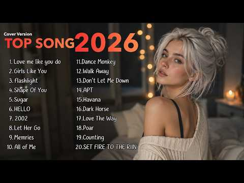

# 음악 — 성공 사례 분석: 사례별 자세히 #241–#280

`analysis.md` 의 9번 (같은 # 번호). 자동 생성 — `tools/success_analysis.py` v1.5.1 (2026-10-24 07:42 UTC). ※ 연구·교육용 — 투자 권유가 아님.

### 241. MIMIFY - I Waited too Long (Original Mix)

- https://www.youtube.com/watch?v=F2Iga1V4cqo · MIMIFY · 구독자 18,500 · 조회수 4,657,825 (×251.8, 하루 44,850.2) · 좋아요 38,507 (0.8%) · 7.8분 · 2026-07-12 · 주제 묶음 8. 로파이·시티팝·칠 · 형식 음악 (그 밖 모양 — 한 편짜리 BGM 등) · 폴더 `W_F2Iga1V4cqo` (웹 승인)
- 썸네일: 
- 설명 앞부분: MIMIFY - I Waited too Long (Original Mix) 🔥 I hope you'll support me by liking, sharing, and subscribing! 🔥 🎵 Playlist: .MIMIFY All Mix (Car Music, Bass, Techno) Hi everyone, thank you for listening to my track 🙏 For those asking about Spotify, here’s the link 🎧 Don’t forget to subscribe to the cha…
- 같은 채널 평소 대비 ×421.6 (채널 최근 롱폼 중앙값 11,048회) · 평소 영상: MIMIFY - Waiting For Closure (Original Mix) (11,108회) / MIMIFY - I Chose You (Original Mix) (10,987회)
- 대본 없음 (설명) — 음성인식이 끝나면 도입부·흐름이 들어감
- 댓글 675/677: 좋은 점 — 영상 1 · 감사·응원 1 · 더 알고 싶은 것 0 · 아쉬운 점 — 영상 0 · 반박·불만 — 의견 다름 0 · 정치·사회 0 · 경험 공유 0 · 구독·다음 기대 0
  - 좋은 점 — 영상 👍7 “씨티팝 느낌이 너무 듣기 좋은거 같아요. 대한민국 🇰🇷 에서도,잘듣고 있어요~~!!”
  - 감사·응원 👍3 “오늘 하루 힘들었는데 이 음악 덕분에 제대로 힐링하고 갑니다. 감사합니다! 힐링 곡으로 저장할게요. ✨"❤❤”

### 242. Zindagi ∣ Chal Thora Aur ∣ Na Kwahish Na Koi Tamana Mujhe (Original Song) Kadam Jaldi Bar…

- https://www.youtube.com/watch?v=dyOp23A-i_o · cefur studio · 구독자 11,600 · 조회수 2,910,784 (×250.9, 하루 22,615.1) · 좋아요 25,223 (0.9%) · 4.8분 · 2026-06-17 · 주제 묶음 기타 · 형식 음악 (그 밖 모양 — 한 편짜리 BGM 등) · 폴더 `W_dyOp23A-i_o` (웹 승인)
- 썸네일: 
- 설명 앞부분: Zindagi ∣ Zindagi by cefur ∣ studio A dark cinematic Urdu song about pain, punishment, survival, and the cruel voice of life saying: “Chal thora aur, Zindagi.” Zindagi is for the ones who kept walking even after life stopped feeling kind. It carries loneliness, regret, exhaustion, and that strange …
- 같은 채널 평소 대비 ×631.6 (채널 최근 롱폼 중앙값 4,608회) · 평소 영상: Kya Bataon Tumhein? ∣ Kya Hoon Main ∣Official Mus… (4,768회) / Jaari Hai Zindagi ∣ cefur studio x Sufical Rhymes… (4,449회)
- 대본 없음 (설명) — 음성인식이 끝나면 도입부·흐름이 들어감
- 댓글 1,835/1,848: 좋은 점 — 영상 0 · 감사·응원 0 · 더 알고 싶은 것 0 · 아쉬운 점 — 영상 0 · 반박·불만 — 의견 다름 0 · 정치·사회 0 · 경험 공유 0 · 구독·다음 기대 0

### 243. All Stress Disappears When This Music Starts Playing 🎶 Emotional Healing Relax Music

- https://www.youtube.com/watch?v=mtelE3vg758 · Nature Healing Sounds · 구독자 7,390 · 조회수 1,836,062 (×248.4, 하루 10,938.0) · 좋아요 9,666 (0.5%) · 99.6분 · 2026-05-09 · 주제 묶음 1. 수면·명상·힐링 · 형식 음악 (그 밖 모양 — 한 편짜리 BGM 등) · 폴더 `W_mtelE3vg758` (웹 승인)
- 썸네일: 
- 설명 앞부분: All Stress Disappears When This Music Starts Playing 🎶 Emotional Healing Relax Music All Stress Disappears When This Music Starts Playing 🎶 Emotional Healing Relax Music All Stress Disappears When This Music Starts Playing 🎶 Emotional Healing Relax Music 🎵Welcome to Nature Healing Sounds – the idea…
- 같은 채널 평소 대비 ×5,755.7 (채널 최근 롱폼 중앙값 319회) · 평소 영상: Let Go of Stress & Anxiety 🌿 Relaxing Healing Mus… (319회) / Nature Sounds for Relaxation 🌿 Calm Your Nervous … (336회)
- 대본 없음 (설명) — 음성인식이 끝나면 도입부·흐름이 들어감
- 댓글 482/481: 좋은 점 — 영상 0 · 감사·응원 4 · 더 알고 싶은 것 0 · 아쉬운 점 — 영상 0 · 반박·불만 — 의견 다름 0 · 정치·사회 0 · 경험 공유 0 · 구독·다음 기대 1
  - 감사·응원 👍3 “멋진 영상과 음악에 흠뻑 취하다 갑니다 감사합니다”
  - 감사·응원 👍3 “마믐의 폄화를 얻었네요 아름다운 음악 감사합니다 구독하고 갑니다”
  - 구독·다음 기대 👍3 “마믐의 폄화를 얻었네요 아름다운 음악 감사합니다 구독하고 갑니다”

### 244. 우리들의 발라드2 1회 플레이리스트｜가을밤 마음을 울린 발라드 7곡 #우리들의발라드 #우발2

- https://www.youtube.com/watch?v=wPEmG4xfTLE · 우낄라꼬 · 구독자 1,310 · 조회수 323,468 (×246.9, 하루 19,433.4) · 좋아요 897 (0.3%) · 30.4분 · 2026-10-07 · 주제 묶음 9. 가요·발라드·트로트 · 형식 플레이리스트·모음 (여러 곡) · 폴더 `W_wPEmG4xfTLE` (웹 승인)
- 썸네일: 
- 챕터: 0:00 사랑 그 쓸쓸함에 대하여 - 김소연 (원곡: 양희은) · 5:25 난치병 - 이민우 (원곡: 하림) · 9:09 안 되나요 - 허채민 (원곡: 휘성) · 13:45 이별 여행 - 민지유 (원곡: 원미연) · 17:48 세상이 그대를 속일지라도 - 한로이 (원곡: 김장훈) · 22:33 기도 - 라유정 (원곡: 정일영) · 25:49 김성호의 회상 - 임바다 (원곡: 김성호)
- 설명 앞부분: 우리들의 발라드2 1회 무대에서 불린 발라드 일곱 곡을 한 번에 이어 듣는 플레이리스트입니다. 가을밤 혼자 듣기 좋은 노래들로 채웠습니다. 🎵 TRACK LIST SBS 우리들의 발라드2ㅣ매주 월요일 밤10시
- 대본 없음 (설명) — 음성인식이 끝나면 도입부·흐름이 들어감
- 댓글 63/64: 좋은 점 — 영상 1 · 감사·응원 13 · 더 알고 싶은 것 0 · 아쉬운 점 — 영상 2 · 반박·불만 — 의견 다름 0 · 정치·사회 0 · 경험 공유 1 · 구독·다음 기대 0
  - 좋은 점 — 영상 👍22 “울 김소연님 응원합니다.! 김소연님 끝음에서 'The saddest Thing'의 멜라니샤프카 가수가 넘 생각났어요. 쓸쓸하면서 덤덤한 표정은 '양하영'님도 생각나고...;;; 그 분위기와 목소리로 레전드 노래 많이 불러주시길요~!!”
  - 감사·응원 👍38 “소연양 밖에 생각이 안남 우승까지 쭉~응원합니다 ❤❤❤”
  - 감사·응원 👍27 “한로이 노래듣고 50넘은 아줌마가 눈물펑펑.ㅜㅜㅜㅜ 최고이고 위로가 되는곡 너무 감사해요. 로이군 응원합니다. 꼭 1등하길 바래요.”
  - 아쉬운 점 — 영상 👍11 “로이님 노래만 무한반복이네요 넘좋네요”
  - 아쉬운 점 — 영상 👍5 “임바다님 음색짱..무한반복중이요”
  - 경험 공유 👍1 “우리들의 발라드2 끝나고 자동반사적으로 유튜브채널 소연양의 노래 찾아 봤어요 처음 듣는 그순간 저도 모르게 가슴속에서 올라오는 울컥하는 감정을 주채 할 수없었네요 그냥 소연양의 노래 한 소절 한 소 절이 홀로느꼈을 외로움과 쓸쓸함 속에서 음악을 통해서 자신만의 카타르…”

### 245. Relaxing Piano Music with Rain Sounds for Deep Sleep - Calm Sleep and Insomnia Relief

- https://www.youtube.com/watch?v=dzRT9vqg9xs · RainwoodPianoVEVO · 구독자 1,270 · 조회수 312,677 (×246.2, 하루 12,523.8) · 좋아요 1,106 (0.4%) · 110분 · 2026-09-29 · 주제 묶음 2. 자연 소리·백색소음 · 형식 음악 (그 밖 모양 — 한 편짜리 BGM 등) · 폴더 `W_dzRT9vqg9xs` (웹 승인)
- 썸네일: 
- 설명 앞부분: ✦ Welcome to RainwoodPianoVEVO - a place where gentle piano melodies blend with soothing rain sounds to bring you moments of calm, deep rest, and peaceful balance. ✦ Are you searching for a way to fall asleep faster, enjoy deep sleep music, ease anxiety, or simply drift away with the comfort of rel…
- 같은 채널 평소 대비 ×204.6 (채널 최근 롱폼 중앙값 1,528회) · 평소 영상: Gentle Rain and Soft Piano Music for Deep Sleep -… (1,528회) / Rainy Forest Sleep Music with Soft Piano - Stress… (1,516회)
- 대본 없음 (설명) — 음성인식이 끝나면 도입부·흐름이 들어감
- 댓글 38/40: 좋은 점 — 영상 0 · 감사·응원 0 · 더 알고 싶은 것 0 · 아쉬운 점 — 영상 0 · 반박·불만 — 의견 다름 0 · 정치·사회 0 · 경험 공유 0 · 구독·다음 기대 0

### 246. 𝐏𝐥𝐚𝐲𝐥𝐢𝐬𝐭 𝐅𝐨𝐫 𝐘𝐨𝐮 𝐓𝐨 𝐂𝐫𝐞𝐚𝐭𝐞 𝐅𝐚𝐤𝐞 𝐒𝐜𝐞𝐧𝐚𝐫𝐢𝐨𝐬 𝐈𝐧 𝐘𝐨𝐮𝐫 𝐌𝐢𝐧𝐝 🤍 ∣ Hindi Playlist 2026✨

- https://www.youtube.com/watch?v=flQgOwg4jLI · Ashik's Cloudlist  · 구독자 15,800 · 조회수 3,869,010 (×244.9, 하루 36,545.0) · 좋아요 42,061 (1.1%) · 15.2분 · 2026-07-10 · 주제 묶음 8. 로파이·시티팝·칠 · 형식 플레이리스트·모음 (여러 곡) · 폴더 `W_flQgOwg4jLI` (웹 승인)
- 썸네일: 
- 챕터: 0:00 ISHQ DE FANNIYA · 0:54 MAJBOOR · 1:46 PAL PAL DIL KE PAAS · 2:54 FAKIRA · 3:51 JEENE LAGA HOON · 4:32 HASEEN · 5:28 TERE SANG YAARA · 6:21 TERE LIYE · 7:11 JAANIYE · 8:28 TERA HONE LAGA HOON · 9:24 JAYE SAJNA · 10:49 RAANJHANAA · 11:31 HUMSAFAR · 12:16 TOOTA JO KABHI TARA · 13:19 KANGANA TERA NI · 13:59 SAWAN AAYA HAI · 14:19 FALAK TAK
- 설명 앞부분: 𝐏𝐥𝐚𝐲𝐥𝐢𝐬𝐭 𝐅𝐨𝐫 𝐘𝐨𝐮 𝐓𝐨 𝐂𝐫𝐞𝐚𝐭𝐞 𝐅𝐚𝐤𝐞 𝐒𝐜𝐞𝐧𝐚𝐫𝐢𝐨𝐬 𝐈𝐧 𝐘𝐨𝐮𝐫 𝐌𝐢𝐧𝐝 🤍 ∣ Hindi Playlist 2026✨ madly in love playlist romantic hindi songs bollywood love songs aesthetic hindi playlist playlist for fake scenarios playlist to imagine love stories late night playlist playlist for overthinkers study playlist hindi c…
- 같은 채널 평소 대비 ×6.4 (채널 최근 롱폼 중앙값 605,545회) · 평소 영상: 𝐓𝐇𝐄 𝐎𝐍𝐋𝐘 𝐏𝐋𝐀𝐘𝐋𝐈𝐒𝐓 𝐓𝐇𝐀𝐓 𝐂𝐀𝐍 𝐇𝐄𝐀𝐋 𝐘𝐎𝐔 🤍✨ (605,545회) / 𝐀𝐥𝐥 𝐭𝐫𝐞𝐧𝐝𝐢𝐧𝐠 𝐇𝐢𝐧𝐝𝐢 𝐬𝐨𝐧𝐠𝐬 𝐨𝐟 2026 💖🎶 (481,298회)
- 대본 없음 (설명) — 음성인식이 끝나면 도입부·흐름이 들어감
- 댓글 965/983: 좋은 점 — 영상 0 · 감사·응원 0 · 더 알고 싶은 것 0 · 아쉬운 점 — 영상 0 · 반박·불만 — 의견 다름 0 · 정치·사회 0 · 경험 공유 0 · 구독·다음 기대 0

### 247. Viral Pop Songs Cover 2026 🎙 Top Music Playlist Hits

- https://www.youtube.com/watch?v=JKRRl5-5-hw · Acoustic Therapy · 구독자 21,300 · 조회수 5,148,621 (×241.7, 하루 34,243.8) · 좋아요 36,251 (0.7%) · 57.4분 · 2026-05-26 · 주제 묶음 10. 팝송·K팝·J팝 · 형식 커버·직접 부른 노래 · 폴더 `W_JKRRl5-5-hw` (웹 승인)
- 썸네일: 
- 설명 앞부분: 🎶 Welcome to Acoustic Therapy — your home for chill acoustic covers, relaxing pop playlists, and cozy music vibes. Enjoy the best English songs, soft acoustic remixes, campfire melodies, travel vibes, and relaxing background music for studying, driving, sleeping, or unwinding. 🌅🎸 ✨ Updated regularl…
- 같은 채널 평소 대비 ×9,112.6 (채널 최근 롱폼 중앙값 565회) · 평소 영상: Daily English Hits 🎧 Beautiful Chill Playlist for… (565회) / Top Music Playlist 2026🐰🎧∣∣ Best Trending Spotify… (565회)
- 대본 없음 (설명) — 음성인식이 끝나면 도입부·흐름이 들어감
- 댓글 512/521: 좋은 점 — 영상 0 · 감사·응원 0 · 더 알고 싶은 것 0 · 아쉬운 점 — 영상 0 · 반박·불만 — 의견 다름 0 · 정치·사회 0 · 경험 공유 0 · 구독·다음 기대 0

### 248. Relax Cha Cha Music 🪘 Havana Cafe Music - Cha Cha Son Cubano

- https://www.youtube.com/watch?v=poj2d6YKC6w · Cha Cha Havana Lounge · 구독자 1,640 · 조회수 396,182 (×241.6, 하루 2,338.1) · 좋아요 2,423 (0.6%) · 6.4분 · 2026-05-07 · 주제 묶음 4. 카페·매장·라운지 · 형식 음악 (그 밖 모양 — 한 편짜리 BGM 등) · 폴더 `W_poj2d6YKC6w` (웹 승인)
- 썸네일: 
- 설명 앞부분: Discover the best Cuban music playlist featuring the vibrant sounds of Son Cubano, Latin Jazz, Salsa Cubana, Timba Cubana, and Son Montuno. This collection brings you the essence of Cuba with Afro-Cuban rhythms, Latin piano grooves, soulful guitar, and powerful vocals. Perfect for relaxing, dancing…
- 같은 채널 평소 대비 ×2,870.9 (채널 최근 롱폼 중앙값 138회) · 평소 영상: Havana Afterglow 🌅 Smooth Cuban Son & Tradicional… (138회) / Old School Ska ∣ Cha Cha Guaguanco - Feel the Vin… (139회)
- 대본 없음 (설명) — 음성인식이 끝나면 도입부·흐름이 들어감
- 댓글 96/99: 좋은 점 — 영상 0 · 감사·응원 0 · 더 알고 싶은 것 0 · 아쉬운 점 — 영상 0 · 반박·불만 — 의견 다름 0 · 정치·사회 0 · 경험 공유 0 · 구독·다음 기대 0

### 249. राग भैरव ∣ भगवान शिव का पवित्र प्रभात राग ∣ Raga Bhairav ∣ Morning Meditation & Healing M…

- https://www.youtube.com/watch?v=3kgbzavVRiY · मनतरंग | ManTarang · 구독자 1,950 · 조회수 467,465 (×239.7, 하루 9,819.1) · 좋아요 5,901 (1.3%) · 11.7분 · 2026-09-06 · 주제 묶음 1. 수면·명상·힐링 · 형식 음악 (그 밖 모양 — 한 편짜리 BGM 등) · 폴더 `W_3kgbzavVRiY` (웹 승인)
- 썸네일: 
- 설명 앞부분: 🌅 सुबह ध्यान (Morning Meditation) के समय 🌅 Sacred Morning Raga 🧘 Morning Meditation Music 🕉️ Shiva Meditation Music 🎵 Indian Classical Healing Music 🙏 Spiritual Relaxation Music यदि आपको भगवान शिव, भारतीय राग संगीत, ध्यान संगीत और आध्यात्मिक संगीत पसंद है, तो इस वीडियो को Like करें और हमारे चैनल को…
- 대본 없음 (설명) — 음성인식이 끝나면 도입부·흐름이 들어감
- 댓글 82/82: 좋은 점 — 영상 0 · 감사·응원 0 · 더 알고 싶은 것 0 · 아쉬운 점 — 영상 0 · 반박·불만 — 의견 다름 0 · 정치·사회 0 · 경험 공유 0 · 구독·다음 기대 0

### 250. Heartbreaking Lofi Mashup 💔 (Slowed + Reverb) ∣ Study, Focus & Late Night Vibes 🎧

- https://www.youtube.com/watch?v=6mgb7GxwLvA · stylish official 13.0 · 구독자 12,200 · 조회수 2,919,539 (×239.3, 하루 40,423.4) · 좋아요 8,324 (0.3%) · 7.8분 · 2026-08-13 · 주제 묶음 3. 공부·집중·작업 · 형식 음악 (그 밖 모양 — 한 편짜리 BGM 등) · 폴더 `W_6mgb7GxwLvA` (웹 승인)
- 썸네일: 
- 설명 앞부분: Welcome the world of soothing lofi musi where stress fades away, and peace takes over. This 2025 mind-relaxing lofi mix is perfect for: Deep Focus & Studying 📖 Relaxing & Meditation 🧘‍♂ Chilling After a Long Day 🌅 Peaceful Sleep & Stress Relief 😴 Let these calm beats and chill vibes take you on a j…
- 같은 채널 평소 대비 ×10,483.1 (채널 최근 롱폼 중앙값 278회) · 평소 영상: Heartbreaking Lofi Mashup 💔 (Slowed + Reverb) ∣ S… (310회) / Heartbreaking Lofi Mashup 💔 (Slowed + Reverb) ∣ S… (313회)
- 대본 없음 (설명) — 음성인식이 끝나면 도입부·흐름이 들어감
- 댓글 132/135: 좋은 점 — 영상 0 · 감사·응원 0 · 더 알고 싶은 것 0 · 아쉬운 점 — 영상 0 · 반박·불만 — 의견 다름 0 · 정치·사회 0 · 경험 공유 0 · 구독·다음 기대 0

### 251. 𝐒𝐨𝐧𝐠𝐬 𝐭𝐡𝐚𝐭 𝐟𝐞𝐞𝐥 𝐥𝐢𝐤𝐞 𝐚 𝐛𝐨𝐥𝐥𝐲𝐰𝐨𝐨𝐝 𝐦𝐨𝐯𝐢𝐞 🦢🪷🪐∣∣ songs playlist ∣∣ #playlist #songs #aesthetic

- https://www.youtube.com/watch?v=r88MexwnbMA · ⋆.ʚଓ ּ𝐋𝗒𝗋𝗂𝖼αᥣ_αυ𝗋α_07🌷𖹭 ֶָ֢  · 구독자 7,150 · 조회수 1,706,831 (×238.7, 하루 19,017.3) · 좋아요 12,884 (0.8%) · 10.5분 · 2026-07-26 · 주제 묶음 기타 · 형식 플레이리스트·모음 (여러 곡) · 폴더 `W_r88MexwnbMA` (웹 승인)
- 썸네일: 
- 설명 앞부분: bollywood songs, hindi songs, romantic bollywood songs, hindi romantic songs, aesthetic songs, aesthetic hindi songs, bollywood playlist, romantic songs playlist, hindi love songs, love songs, dreamy songs, feel good songs, soulful hindi songs, beautiful hindi songs, best bollywood songs, bollywood…
- 같은 채널 평소 대비 ×17.4 (채널 최근 롱폼 중앙값 97,906회) · 평소 영상: 𝐓𝐡𝐞 𝐒𝐨𝐟𝐭𝐞𝐬𝐭 𝐁𝐨𝐥𝐥𝐲𝐰𝐨𝐨𝐝 𝐏𝐥𝐚𝐲𝐥𝐢𝐬𝐭 𝐘𝐨𝐮'𝐥𝐥 𝐄𝐯𝐞𝐫 𝐇𝐞𝐚𝐫👀💌… (174,059회) / 𝐓𝐡𝐞 𝐔𝐥𝐭𝐢𝐦𝐚𝐭𝐞 𝐇𝐚𝐫𝐲𝐚𝐧𝐯𝐢 𝐏𝐥𝐚𝐲𝐥𝐢𝐬𝐭 ∣ 𝐃𝐞𝐬𝐢 𝐕𝐢𝐛𝐞𝐬 𝐏𝐥𝐚𝐲𝐥… (21,754회)
- 대본 없음 (설명) — 음성인식이 끝나면 도입부·흐름이 들어감
- 댓글 291/296: 좋은 점 — 영상 0 · 감사·응원 0 · 더 알고 싶은 것 0 · 아쉬운 점 — 영상 0 · 반박·불만 — 의견 다름 0 · 정치·사회 0 · 경험 공유 0 · 구독·다음 기대 0

### 252. Put Your Baby to Sleep in 2 Minutes 😴 3 Hours Deep Lullaby Music

- https://www.youtube.com/watch?v=2W9Y6KcJK1E · Calm Baby Lullaby · 구독자 4,340 · 조회수 1,024,530 (×236.1, 하루 5,834.6) · 좋아요 4,002 (0.4%) · 183.3분 · 2026-05-01 · 주제 묶음 1. 수면·명상·힐링 · 형식 긴 한 곡·반복 (N시간) · 폴더 `W_2W9Y6KcJK1E` (웹 승인)
- 썸네일: 
- 설명 앞부분: 🍼 Put Your Baby to Sleep in Minutes 😴 3 Hours Deep Lullaby Music Welcome to a peaceful world of soothing sounds designed to help your baby relax, calm down, and fall into a deep and restful sleep. This 3-hour baby lullaby music is carefully created with gentle melodies, soft harmonies, and calming …
- 같은 채널 평소 대비 ×1,944.1 (채널 최근 롱폼 중앙값 527회) · 평소 영상: Help Your Baby Fall Asleep Fast 😴 3 Hours Deep Lu… (527회) / Put Your Baby to Sleep in 2 Minutes 😴 2 Hours Dee… (527회)
- 대본 없음 (설명) — 음성인식이 끝나면 도입부·흐름이 들어감
- 댓글 0/0: 좋은 점 — 영상 0 · 감사·응원 0 · 더 알고 싶은 것 0 · 아쉬운 점 — 영상 0 · 반박·불만 — 의견 다름 0 · 정치·사회 0 · 경험 공유 0 · 구독·다음 기대 0

### 253. 🌼 Soulful Shiv Bhajan 2026 ∣ Peaceful Mahadev Bhakti Song ∣ Bholenath Devotional Song

- https://www.youtube.com/watch?v=soTUDFUagOU · Divine Bhajan Lofi · 구독자 5,950 · 조회수 1,394,998 (×234.4, 하루 14,125.7) · 좋아요 6,925 (0.5%) · 6.6분 · 2026-07-17 · 주제 묶음 8. 로파이·시티팝·칠 · 형식 음악 (그 밖 모양 — 한 편짜리 BGM 등) · 폴더 `W_soTUDFUagOU` (웹 승인)
- 썸네일: 
- 설명 앞부분: mahadev bhajan shiv bhakti song sawan shiv bhajan mahadev ka nasha hai har har mahadev song latest shiv song new bhakti geet mahadev status song sawan ke bhajan shiv devotional bholenath song kanwar bhajan mahakal bhajan hindi bhakti song bol bam song bol bam bhajan new mahakal song new shiv bhajan…
- 같은 채널 평소 대비 ×362.3 (채널 최근 롱폼 중앙값 3,850회) · 평소 영상: 🌼 Soulful Mata Rani Bhajan 2026 ∣ Navratri Specia… (3,850회) / 🌼 Soulful Navratri Bhajan 2026 ∣ Sherawali Mata B… (3,742회)
- 대본 없음 (설명) — 음성인식이 끝나면 도입부·흐름이 들어감
- 댓글 395/397: 좋은 점 — 영상 0 · 감사·응원 0 · 더 알고 싶은 것 0 · 아쉬운 점 — 영상 0 · 반박·불만 — 의견 다름 0 · 정치·사회 0 · 경험 공유 0 · 구독·다음 기대 0

### 254. Slow and Reverb Pashto Tappy 🎧 ∣ New Pashto Song ∣ Relaxing Soul Music

- https://www.youtube.com/watch?v=88J0afFBt3s · MarjanMusic · 구독자 4,460 · 조회수 1,027,747 (×230.4, 하루 7,927.0) · 좋아요 4,608 (0.4%) · 13분 · 2026-06-16 · 주제 묶음 기타 · 형식 음악 (그 밖 모양 — 한 편짜리 BGM 등) · 폴더 `W_88J0afFBt3s` (웹 승인)
- 썸네일: 
- 설명 앞부분: Welcome ❤️🎧 Experience the emotions of love, pain, and destiny with “– a heart-touching Pashto song If you enjoy emotional Pashto music, sad love songs, and soulful melodies, this song is for you. 💔 Deep Emotions 🎵 Beautiful Pashto Melody 🌿 Relaxing Soulful Music ❤️ Pashto Love & Sad Song Don’t for…
- 같은 채널 평소 대비 ×548.7 (채널 최근 롱폼 중앙값 1,873회) · 평소 영상: Pashto New Song 2026 ∣ پښتو نوی سندره ∣ Slow and … (2,431회) / ReverbPashto Tappy 2026 ∣ Meena Wo Naki ∣ Slow an… (1,315회)
- 대본 없음 (설명) — 음성인식이 끝나면 도입부·흐름이 들어감
- 댓글 81/81: 좋은 점 — 영상 0 · 감사·응원 0 · 더 알고 싶은 것 0 · 아쉬운 점 — 영상 0 · 반박·불만 — 의견 다름 0 · 정치·사회 0 · 경험 공유 0 · 구독·다음 기대 0

### 255. VIVANT ᐸMain themeᐳ

- https://www.youtube.com/watch?v=MuGFcUggtDs · Akira Senju - Topic · 구독자 7,670 · 조회수 1,762,094 (×229.7, 하루 19,754.0) · 좋아요 15,676 (0.9%) · 4.6분 · 2026-07-27 · 주제 묶음 13. OST·사운드트랙 · 형식 정보·해설 (그 밖) · 폴더 `W_MuGFcUggtDs` (웹 승인)
- 썸네일: 
- 설명 앞부분: Provided to YouTube by NICHION VIVANT ᐸMain themeᐳ · 千住明 TBS系 日曜劇場「VIVANT」ORIGINAL SOUNDTRACK ℗ 2023 Anchor Records Composer: 千住明 Arranger: 千住明 Auto-generated by YouTube.
- 같은 채널 평소 대비 ×26.9 (채널 최근 롱폼 중앙값 65,466회) · 평소 영상: Patriot Mission (66,545회) / VIVANT ᐸAdagioᐳ (64,388회)
- 대본 없음 (설명) — 음성인식이 끝나면 도입부·흐름이 들어감
- 댓글 0/0: 좋은 점 — 영상 0 · 감사·응원 0 · 더 알고 싶은 것 0 · 아쉬운 점 — 영상 0 · 반박·불만 — 의견 다름 0 · 정치·사회 0 · 경험 공유 0 · 구독·다음 기대 0

### 256. The Love Playlist You’ve Been Looking For😌🤍

- https://www.youtube.com/watch?v=G4M-E29DlAE · Melovo tunes · 구독자 3,320 · 조회수 755,471 (×227.6, 하루 5,248.7) · 좋아요 11,521 (1.5%) · 10.4분 · 2026-06-02 · 주제 묶음 기타 · 형식 플레이리스트·모음 (여러 곡) · 폴더 `W_G4M-E29DlAE` (웹 승인)
- 썸네일: 
- 챕터: 0:00 Dandelions · 0:55 Shinunoga E-Wa · 1:37 Golden Brown · 2:34 Honeypie · 3:37 Love Story · 4:44 I Wanna be yours · 5:43 Until I Found You · 6:26 A Thousand Years · 7:32 Love Me Not · 8:16 Golden Hour · 9:20 Blue
- 설명 앞부분: Some songs don't just play in the background—they stay with you.😌🤍 A playlist filled with songs that remind us of love, memories, late-night thoughts, and the people who mean the most to us. Whether you're in love, missing someone, or simply enjoying the feeling of good music, there's something her…
- 대본 없음 (설명) — 음성인식이 끝나면 도입부·흐름이 들어감
- 댓글 800/807: 좋은 점 — 영상 0 · 감사·응원 0 · 더 알고 싶은 것 0 · 아쉬운 점 — 영상 0 · 반박·불만 — 의견 다름 0 · 정치·사회 0 · 경험 공유 0 · 구독·다음 기대 0

### 257. [PLAYLIST] 할머니가 돼서도 들을 노래

- https://www.youtube.com/watch?v=Oomy8ijLJxQ · 당무 · 구독자 2,620 · 조회수 590,617 (×225.4, 하루 3,542.3) · 좋아요 10,847 (1.8%) · 23.7분 · 2026-05-10 · 주제 묶음 기타 · 형식 플레이리스트·모음 (여러 곡) · 폴더 `W_Oomy8ijLJxQ` (웹 승인)
- 썸네일: 
- 챕터: 0:00 4:35 Perhaps Love · 4:36 9:23 Wish Ur My Love · 9:26 12:38 baby baby · 12:38 15:45 아쉬운 마음인걸 · 15:48 19:08 To You Of Mine · 19:11 23:27 Habbit (Bye Bye)
- 같은 채널 평소 대비 ×92.9 (채널 최근 롱폼 중앙값 6,357회) · 평소 영상: [PLAYLIST] 얘쁜남자가 별안간 뽀뽀해줌 (6,357회) / [PLAYLIST] 이 노래 듣는 순간 여름 시작됨 (8,511회)
- 대본 없음 (없음) — 음성인식이 끝나면 도입부·흐름이 들어감
- 댓글 131/131: 좋은 점 — 영상 3 · 감사·응원 9 · 더 알고 싶은 것 0 · 아쉬운 점 — 영상 0 · 반박·불만 — 의견 다름 0 · 정치·사회 0 · 경험 공유 6 · 구독·다음 기대 0
  - 좋은 점 — 영상 👍25 “아쉬운마음인걸이 ㅈㅉ 레전드”
  - 좋은 점 — 영상 👍0 “안녕하세요 당무님 도덕 선플챌린지하는 동화중학교 1학년입니다.저는 늘 공부할때 음악을 듣는편인데요 그럴때마다 맨날 무슨 노래를 들어야되지라고 늘 고민하는데요 그래도 맨날 당무님이 만드신 플레이리스트를 선택하게 되는것같아요!바쁜시간 쪼개시면서 늘 좋은노래 알려주셔서 감…”
  - 감사·응원 👍39 “서민정씨 너무 귀여워용 ㅋㅋ 90년대생들 힘내라아”
  - 감사·응원 👍38 “2006년 고1 소풍날, 옆반 친구가 쥐여준 과자 한 봉지가 고백이 될 줄은 몰랐습니다. 어색하고 떨리는 마음에 창밖만 바라보는데 시간이 참 느리게 흘러가더라고요. 소풍 내내 같이 다니면서 하얀 줄의 아이리버 이어폰을 나눠 꼈던 그날. 귓가에 울리던 'Perhaps …”
  - 경험 공유 👍28 “12:38 나오자마자 제일 소름돋음 내가 이 노래를 잊고 살았네...”
  - 경험 공유 👍4 “와...진짜 제가 다 좋아하는 노래네요ㅠㅠ 감사합니다..! 잊고 살았는데🥲”

### 258. MEGA BASS 🔊🔥 EXTREME NONSTOP EDM REMIX 💯 MONSTER DROP ⚠️ CLUB BANGER 🎧 NIGHT DRIVE 🌃 GYM …

- https://www.youtube.com/watch?v=Kc071SEvHgc · Street Bass Culture · 구독자 27,400 · 조회수 6,169,917 (×225.2, 하루 40,773.8) · 좋아요 63,330 (1.0%) · 42.7분 · 2026-05-26 · 주제 묶음 5. 운동·드라이브·신나는 · 형식 음악 (그 밖 모양 — 한 편짜리 BGM 등) · 폴더 `W_Kc071SEvHgc` (웹 승인)
- 썸네일: 
- 설명 앞부분: MEGA BASS 🔊🔥 EXTREME NONSTOP EDM REMIX 💯 MONSTER DROP ⚠️ CLUB BANGER 🎧 NIGHT DRIVE 🌃 GYM 🔥 CAR MUSIC BASS BOOSTED SONGS 2026 🔈 CAR MUSIC 2026 🔈 BASS MUSIC 2026 ▼ TAGS: EXTREME 2026 EXTREME BASS BOOSTED EXTREME BASS BOOSTED SONGS 2026 CAR MUSIC MIX 2026 BEST OF EDM BASS BOOSTED SONGS 2026 BASS BOOST…
- 같은 채널 평소 대비 ×8,871.2 (채널 최근 롱폼 중앙값 696회) · 평소 영상: BASS BOOSTED SONGS 2026 🔊 EXTREME BASS BOOSTED 🔊 … (696회) / BASS BOOSTED SONGS 2026 🔊 EXTREME BASS BOOSTED 🔊 … (695회)
- 대본 없음 (설명) — 음성인식이 끝나면 도입부·흐름이 들어감
- 댓글 1,383/1,400: 좋은 점 — 영상 0 · 감사·응원 0 · 더 알고 싶은 것 0 · 아쉬운 점 — 영상 0 · 반박·불만 — 의견 다름 0 · 정치·사회 0 · 경험 공유 0 · 구독·다음 기대 0

### 259. Music Therapy Helps Restore the Nervous System 🌿 Relaxing Music & Nature Sounds for Deep …

- https://www.youtube.com/watch?v=yP0NAC8Hzy8 · Clara Monica – Healing Piano 4K · 구독자 3,590 · 조회수 804,905 (×224.2, 하루 6,952.1) · 좋아요 23,394 (2.9%) · 19.7분 · 2026-06-30 · 주제 묶음 1. 수면·명상·힐링 · 형식 음악 (그 밖 모양 — 한 편짜리 BGM 등) · 폴더 `W_yP0NAC8Hzy8` (웹 승인)
- 썸네일: 
- 설명 앞부분: Music Therapy Helps Restore the Nervous System 🌿 Relaxing Music & Nature Sounds for Deep Sleep Music Therapy Helps Restore the Nervous System 🌿 Relaxing Music & Nature Sounds for Deep Sleep Music Therapy Helps Restore the Nervous System 🌿 Relaxing Music & Nature Sounds for Deep Sleep Let’s take a m…
- 같은 채널 평소 대비 ×26.2 (채널 최근 롱폼 중앙값 30,766회) · 평소 영상: Relaxing Music Relieves stress, Anxiety and Depre… (30,766회) / Relaxing Music for Healing , Anxiety and Depressi… (32,817회)
- 대본 없음 (설명) — 음성인식이 끝나면 도입부·흐름이 들어감
- 댓글 236/244: 좋은 점 — 영상 0 · 감사·응원 0 · 더 알고 싶은 것 0 · 아쉬운 점 — 영상 0 · 반박·불만 — 의견 다름 0 · 정치·사회 0 · 경험 공유 0 · 구독·다음 기대 0

### 260. 𝐏𝐥𝐚𝐲𝐥𝐢𝐬𝐭 틀기만 해도 기분이 좋아지는 플리☀️🌿 (광고없음) 국내 노래 모음

- https://www.youtube.com/watch?v=mg5OWdP3DL8 · 오늘의 플리 · 구독자 6,960 · 조회수 1,556,804 (×223.7, 하루 21,584.1) · 좋아요 3,685 (0.2%) · 603.4분 · 2026-08-13 · 주제 묶음 기타 · 형식 플레이리스트·모음 (여러 곡) · 폴더 `W_mg5OWdP3DL8` (웹 승인)
- 썸네일: 
- 같은 채널 평소 대비 ×173.0 (채널 최근 롱폼 중앙값 8,998회) · 평소 영상: 𝐏𝐥𝐚𝐲𝐥𝐢𝐬𝐭 비오는 날 듣기 좋은 플리☔️ 기분 좋아지는 국내 노래 모음 ∣ 일할때 … (9,292회) / 𝐏𝐥𝐚𝐲𝐥𝐢𝐬𝐭 틀기만 해도 기분이 좋아지는 플리🌿 (광고없음) 국내 노래 모음 (8,704회)
- 대본 없음 (없음) — 음성인식이 끝나면 도입부·흐름이 들어감
- 댓글 150/156: 좋은 점 — 영상 3 · 감사·응원 7 · 더 알고 싶은 것 16 · 아쉬운 점 — 영상 1 · 반박·불만 — 의견 다름 0 · 정치·사회 0 · 경험 공유 3 · 구독·다음 기대 0
  - 좋은 점 — 영상 👍108 “안녕하세요, 오늘의 플리님! 저는 도덕 수업에서 선플 달기 활동을 하고 있는 중1 학생입니다. 영상 정말 잘 보고 있어요. 항상 좋은 영상 올려주셔서 감사합니다. 좋은 하루 보내세요”
  - 좋은 점 — 영상 👍1 “모처럼...가사가 귀에 잘들어와요. 평화로운 느낌이예요. 기분이 좋아졌어요~^^😊”
  - 감사·응원 👍108 “안녕하세요, 오늘의 플리님! 저는 도덕 수업에서 선플 달기 활동을 하고 있는 중1 학생입니다. 영상 정말 잘 보고 있어요. 항상 좋은 영상 올려주셔서 감사합니다. 좋은 하루 보내세요”
  - 감사·응원 👍9 “힐링되네요 감사합니다”
  - 더 알고 싶은 것 👍15 “노래 제목 부탁드립니다 아재라서 하나도 몰라요 ㅜㅡㅜ 40중반 아저씨의 간곡한 부탁입니다 ~!!!”
  - 더 알고 싶은 것 👍8 “전체 플레이이스트 알순없나요~? 너무 노래 좋아요. 가수라도 알고싶어요”
  - 아쉬운 점 — 영상 👍0 “같은노래반복되는거아님??”
  - 경험 공유 👍11 “두번째곡 3:10 창문을 열면 하얀 바람이 들어와 어제의 마음도 조용히 불었나 발끝에 닿는 따뜻한 먼지 위로 이름 모를 설렘이 슬쩍 번져 가 자꾸만 멀어지던 내 그림자도 오늘은 가볍게 내 옆을 걷고 손끝에 맺힌 햇살 한번 더 흔들리며 말 대신 웃음이 먼저 나와 너와 …”

### 261. Bedroom R&B After Hours ∣ Obsessive Love Playlist ∣ Dark romance playlist Vol.06

- https://www.youtube.com/watch?v=WRi5W4B2vgQ · afterlove. · 구독자 8,570 · 조회수 1,915,987 (×223.6, 하루 62,524.7) · 좋아요 13,617 (0.7%) · 81.7분 · 2026-09-23 · 주제 묶음 11. 힙합·R&B·EDM · 형식 플레이리스트·모음 (여러 곡) · 폴더 `W_WRi5W4B2vgQ` (웹 승인)
- 썸네일: 
- 설명 앞부분: Some memories have a way of finding you when everything else gets quiet. This playlist is for those nights when your mind starts to wander — old conversations, familiar faces, unfinished feelings, and moments you thought you had left behind. A late-night blend of Dark R&B, Trap Soul, and smooth aft…
- 같은 채널 평소 대비 ×253.1 (채널 최근 롱폼 중앙값 7,569회) · 평소 영상: Bedroom R&B After Hours ∣ Obsessive Love Playlist… (7,569회) / Bedroom R&B After Hours ∣ Obsessive Love Playlist… (7,679회)
- 대본 없음 (설명) — 음성인식이 끝나면 도입부·흐름이 들어감
- 댓글 177/192: 좋은 점 — 영상 0 · 감사·응원 0 · 더 알고 싶은 것 0 · 아쉬운 점 — 영상 0 · 반박·불만 — 의견 다름 0 · 정치·사회 0 · 경험 공유 0 · 구독·다음 기대 0

### 262. Heartbreaking💔 mashup lofi Songs ∣ Slowed + Reverb ∣ Late Night Study & Focus Mood 🎧

- https://www.youtube.com/watch?v=z3H-p4r9EC4 · Soulmate Songs 🎵 · 구독자 7,940 · 조회수 1,766,877 (×222.5, 하루 30,350.8) · 좋아요 7,093 (0.4%) · 8분 · 2026-08-27 · 주제 묶음 3. 공부·집중·작업 · 형식 음악 (그 밖 모양 — 한 편짜리 BGM 등) · 폴더 `W_z3H-p4r9EC4` (웹 승인)
- 썸네일: 
- 설명 앞부분: Welcome to the world of soothing lofi music, where stress fades away and peace takes over. This mind-relaxing lofi mix is perfect for creating a calm atmosphere, helping you focus, relax, and unwind. Deep Focus & Studying 📖 Relaxing & Meditation 🧘‍♂ Chilling After a Long Day 🌅 Peaceful Sleep & Stre…
- 같은 채널 평소 대비 ×8,314.7 (채널 최근 롱폼 중앙값 212회) · 평소 영상: Heartbreaking💔 mashup lofi Songs ∣ Slowed + Rever… (251회) / Heartbreaking💔 mashup lofi Songs ∣ Slowed + Rever… (174회)
- 대본 없음 (설명) — 음성인식이 끝나면 도입부·흐름이 들어감
- 댓글 139/145: 좋은 점 — 영상 0 · 감사·응원 0 · 더 알고 싶은 것 0 · 아쉬운 점 — 영상 0 · 반박·불만 — 의견 다름 0 · 정치·사회 0 · 경험 공유 0 · 구독·다음 기대 0

### 263. Heartbroken Lofi Songs 💔 ∣ Slowed + Reverb ∣ Late Night Sad & Chill Vibes 🌙🎧

- https://www.youtube.com/watch?v=KjFcRYZBKs0 · Music Nest HD · 구독자 12,200 · 조회수 2,712,244 (×222.3, 하루 99,919.0) · 좋아요 11,980 (0.4%) · 8.9분 · 2026-09-27 · 주제 묶음 8. 로파이·시티팝·칠 · 형식 음악 (그 밖 모양 — 한 편짜리 BGM 등) · 폴더 `W_KjFcRYZBKs0` (웹 승인)
- 썸네일: 
- 설명 앞부분: 🎧 **Welcome to a Peaceful World of Lofi Music** 🌙✨ Relax your mind, reduce everyday stress, and enjoy a peaceful atmosphere with this soothing **Lofi Music Mix**. Whether you're studying, working, sleeping, meditating, coding, gaming, or simply relaxing after a long day, these gentle beats and calm…
- 같은 채널 평소 대비 ×8,000.7 (채널 최근 롱폼 중앙값 339회) · 평소 영상: Heartbroken Lofi Songs 💔 ∣ Slowed + Reverb ∣ Late… (344회) / Heartbroken Lofi Songs 💔 ∣ Slowed + Reverb ∣ Late… (334회)
- 대본 없음 (설명) — 음성인식이 끝나면 도입부·흐름이 들어감
- 댓글 101/103: 좋은 점 — 영상 0 · 감사·응원 0 · 더 알고 싶은 것 0 · 아쉬운 점 — 영상 0 · 반박·불만 — 의견 다름 0 · 정치·사회 0 · 경험 공유 0 · 구독·다음 기대 0

### 264. Heartbreaking 💔 Lofi Mashup 🎧 Slowed + Reverb Songs ∣ Study, Focus & Late Night Vibes 202…

- https://www.youtube.com/watch?v=FB8QuMi3fTs · Z B Official Studio · 구독자 22,700 · 조회수 4,989,375 (×219.8, 하루 76,638.5) · 좋아요 15,413 (0.3%) · 7.7분 · 2026-08-20 · 주제 묶음 3. 공부·집중·작업 · 형식 음악 (그 밖 모양 — 한 편짜리 BGM 등) · 폴더 `W_FB8QuMi3fTs` (웹 승인)
- 썸네일: 
- 설명 앞부분: Welcome 🙏to world of soothing lofi music, where stress fades away, and peace takes over. This 2026 mind-relaxing lofi mix is perfect for: Deep Focus & Studying 📖 Relaxing & Meditation 🧘‍♂ Chilling After a Long Day 🌅 Peaceful Sleep & Stress Relief 😴 Let these calm beats and chill vibes take you on a…
- 같은 채널 평소 대비 ×14,588.8 (채널 최근 롱폼 중앙값 342회) · 평소 영상: Heartbreaking 💔 Lofi Mashup 🎧 Slowed + Reverb Son… (350회) / Heartbreaking 💔 Lofi Mashup 🎧 Slowed + Reverb Son… (334회)
- 대본 없음 (설명) — 음성인식이 끝나면 도입부·흐름이 들어감
- 댓글 203/205: 좋은 점 — 영상 0 · 감사·응원 0 · 더 알고 싶은 것 0 · 아쉬운 점 — 영상 0 · 반박·불만 — 의견 다름 0 · 정치·사회 0 · 경험 공유 0 · 구독·다음 기대 0

### 265. Playlist ∣ Start Your Work with This 😎 Light Focus, Solid Rhythm 🎧∣ JAZZHOP · CHILLHOP ∣ …

- https://www.youtube.com/watch?v=PF7MEHrmFjQ · Noirvoya · 구독자 371 · 조회수 81,174 (×218.8, 하루 595.6) · 좋아요 465 (0.6%) · 16.4분 · 2026-06-10 · 주제 묶음 3. 공부·집중·작업 · 형식 플레이리스트·모음 (여러 곡) · 폴더 `W_PF7MEHrmFjQ` (웹 승인)
- 썸네일: 
- 챕터: 0:00 Good Coffee, Good Flow · 3:20 Work Mode Sunshine · 6:40 Notes In The Margin · 10:00 Little Groove At My Desk · 13:20 Better Flow, Better Day
- 설명 앞부분: Thank you for visiting today. Subscribing and liking is true love. ❤ Start your work with this today. Even if you just play it lightly, the flow continues naturally, We composed it with jazz-hop & chill-hop grooves where the rhythm stays alive even without too much effort. A balanced playlist that'…
- 같은 채널 평소 대비 ×336.1 (채널 최근 롱폼 중앙값 242회) · 평소 영상: 【Playlist】JAZZHOP ☕ Café Work Music ∣ ChillHop Be… (248회) / Violin Hip Hop Beats 🎻 Aggressive Trap & Cinemati… (235회)
- 대본 없음 (설명) — 음성인식이 끝나면 도입부·흐름이 들어감
- 댓글 30/30: 좋은 점 — 영상 0 · 감사·응원 0 · 더 알고 싶은 것 0 · 아쉬운 점 — 영상 0 · 반박·불만 — 의견 다름 0 · 정치·사회 0 · 경험 공유 0 · 구독·다음 기대 0

### 266. Top Spotify Hits 2026 🎵 Trending English Love Songs ∣ Acoustic Chill Vibes ∣ Viral TikTok…

- https://www.youtube.com/watch?v=FPlJt2A0yYo · Chill Chord · 구독자 12,000 · 조회수 2,624,578 (×218.7, 하루 26,956.9) · 좋아요 11,580 (0.4%) · 54.8분 · 2026-07-18 · 주제 묶음 8. 로파이·시티팝·칠 · 형식 커버·직접 부른 노래 · 폴더 `W_FPlJt2A0yYo` (웹 승인)
- 썸네일: 
- 설명 앞부분: 🎵 Welcome to the ultimate collection of Top Spotify Hits 2026, featuring trending English love songs, relaxing acoustic covers, viral TikTok music, and chill melodies for every mood. This playlist brings together romantic English songs, soft acoustic vibes, emotional pop hits, and popular tracks in…
- 같은 채널 평소 대비 ×150.2 (채널 최근 롱폼 중앙값 17,469회) · 평소 영상: The Most Relaxing OPM Love Songs 2026 ✨ Best Taga… (17,469회) / Viral OPM Songs 2026 🇵🇭 Best Tagalog Love Playlis… (18,577회)
- 대본 없음 (설명) — 음성인식이 끝나면 도입부·흐름이 들어감
- 댓글 282/294: 좋은 점 — 영상 0 · 감사·응원 1 · 더 알고 싶은 것 0 · 아쉬운 점 — 영상 0 · 반박·불만 — 의견 다름 0 · 정치·사회 0 · 경험 공유 0 · 구독·다음 기대 0
  - 감사·응원 👍1 “감사합니다.”

### 267. Hyperfocus ∣ LOCK IN for 3 Hours ∣ Deep Work Study With Me (Pomodoro 50/10)

- https://www.youtube.com/watch?v=UXwJ9RwdyHs · Work With Paul · 구독자 19,500 · 조회수 4,258,886 (×218.4, 하루 90,478.4) · 좋아요 18,878 (0.4%) · 172분 · 2026-09-07 · 주제 묶음 3. 공부·집중·작업 · 형식 긴 한 곡·반복 (N시간) · 폴더 `W_UXwJ9RwdyHs` (웹 승인)
- 썸네일: 
- 챕터: 0:00 Intro · 0:40 Work Session 1 · 50:40 Break 1 · 60:40 Work Session 2 · 110:40 Break 2 · 120:40 Work Session 3 · 170:40 Outro
- 설명 앞부분: 3 hours of deep, distraction-free work with immersive focus music and a 50/10 Pomodoro timer. 🎯 JOIN HYPERFOCUS SCHOOL — FREE A free community for Deep Work, focus, productivity and accountability. 📘 GET THE HYPERFOCUS MANUAL — FREE Join Hyperfocus Weekly and get the Hyperfocus Manual instantly — a…
- 같은 채널 평소 대비 ×31.0 (채널 최근 롱폼 중앙값 137,184회) · 평소 영상: Hyperfocus Music ∣ 120 Min Deep Work Pomodoro (25… (137,184회) / Hyperfocus Synthwave ∣ Flow State ∣ 2 Hour Deep W… (161,535회)
- 대본 없음 (설명) — 음성인식이 끝나면 도입부·흐름이 들어감
- 댓글 492/536: 좋은 점 — 영상 0 · 감사·응원 0 · 더 알고 싶은 것 0 · 아쉬운 점 — 영상 0 · 반박·불만 — 의견 다름 0 · 정치·사회 0 · 경험 공유 0 · 구독·다음 기대 0

### 268. Peaceful Piano, Flute & Water Sounds 💧 ∣ Relaxing Music for Sleep, Meditation & Stress Re…

- https://www.youtube.com/watch?v=NO0Y0KepgZw · Cozy Flow Relaxation · 구독자 763 · 조회수 165,716 (×217.2, 하루 3,301.2) · 좋아요 773 (0.5%) · 14.6분 · 2026-09-04 · 주제 묶음 1. 수면·명상·힐링 · 형식 음악 (그 밖 모양 — 한 편짜리 BGM 등) · 폴더 `W_NO0Y0KepgZw` (웹 승인)
- 썸네일: 
- 설명 앞부분: Relax and enjoy the peaceful combination of soft piano music, gentle flute melodies, and flowing water sounds. This calming nature atmosphere is designed to create a quiet and soothing environment for your daily relaxation. Let the peaceful piano and soft flute blend naturally with the sound of flo…
- 같은 채널 평소 대비 ×199.8 (채널 최근 롱폼 중앙값 830회) · 평소 영상: Peaceful Piano & Bamboo Flute with Flowing Water … (870회) / Gentle Piano, Flute & Forest Rain Sounds 🌧️ ∣ Soo… (789회)
- 대본 없음 (설명) — 음성인식이 끝나면 도입부·흐름이 들어감
- 댓글 78/96: 좋은 점 — 영상 0 · 감사·응원 0 · 더 알고 싶은 것 0 · 아쉬운 점 — 영상 0 · 반박·불만 — 의견 다름 0 · 정치·사회 0 · 경험 공유 0 · 구독·다음 기대 0

### 269. 🍂편안해지는 따뜻한 가을 노래 ∣ 추억의 올드팝송 ∣ 가을 카페 팝송 감미로운 여친 목소리∣ Oldies Playlist

- https://www.youtube.com/watch?v=yfKtKmmUsoQ · 나무감성 NAMUVIBE · 구독자 2,470 · 조회수 535,692 (×216.9, 하루 21,876.3) · 좋아요 1,873 (0.4%) · 135분 · 2026-09-29 · 주제 묶음 4. 카페·매장·라운지 · 형식 플레이리스트·모음 (여러 곡) · 폴더 `W_yfKtKmmUsoQ` (웹 승인)
- 썸네일: 
- 챕터: 0:00 Love Beneath the Autumn Moon … · 2:43 October Moonlight (10월의 달빛) · 5:45 Coffee Under the Moon (달빛 아래의… · 8:48 Chrysanthemums in October (10… · 11:13 Autumn Lotus Lake (가을 연꽃 호수) · 13:45 Letting My Heart Rest (마음을 쉬게… · 16:47 Lotus by the Quiet Lake (고요한 … · 19:51 Autumn Coffee for Two (둘이 함께하… · 22:13 Chrysanthemum Breeze (국화 향기 실… · 24:26 Leaving Worries Behind (걱정을 뒤… · 26:48 Thankful for This Autumn (이 가… · 29:16 Thank You Under the Full Moon… · 31:44 A Peaceful October Home (평온한 … · 33:45 ⟳ Loop Start
- 설명 앞부분: ※ 이 포스팅은 쿠팡파트너스 활동의 일환으로, 이에 따른 일정액의 수수료를 제공받습니다. 🚀쿠팡 단3일 주말특가 최대 70%이상🚀 여러분의 작은 응원이 이 따뜻한 음악을 오래 이어가는 큰 힘이 됩니다. 🎶 어느덧 10월이 가까워지고 있습니다. 선선한 가을바람과 주황빛으로 물든 단풍, 잔잔한 호수 위로 비치는 따뜻한 달빛을 바라보며 오늘은 편안하고 따뜻한 가을 노래로 하루를 시작해봅니다. 🍂🌕☕ 호수 위에 조용히 떠 있는 연꽃과 가을꽃, 은은하게 밝혀진 카페의 불빛을 바라보고 있으면 바쁘게 흘러가던 마음도 잠시 느려지는 것 같습니다…
- 같은 채널 평소 대비 ×35.9 (채널 최근 롱폼 중앙값 14,928회) · 평소 영상: 🍂가을 아침 호수에서 마시면☕커피가 더 감미로워지는 노래 ∣ 듣기 좋은 7080 잔잔한 … (14,928회) / 🍂추석, 고향 가는 길☕감미로운 가을빛 노래 ∣ 커피와 듣기 좋은 7080 추억의 명곡 … (13,801회)
- 대본 없음 (설명) — 음성인식이 끝나면 도입부·흐름이 들어감
- 댓글 173/175: 좋은 점 — 영상 3 · 감사·응원 25 · 더 알고 싶은 것 2 · 아쉬운 점 — 영상 0 · 반박·불만 — 의견 다름 0 · 정치·사회 0 · 경험 공유 5 · 구독·다음 기대 2
  - 좋은 점 — 영상 👍5 “식사중인데 차분한 음악이 넘 듣기 편안합니다. 오늘도 평안하고 즐거운 하루 보내세요 ❤❤❤”
  - 좋은 점 — 영상 👍0 “아름다운 가사가 마음에 와닿네요”
  - 감사·응원 👍31 “✅️나이가 들었나보다 대학시절 백댄스가 한 때 꿈이어서 물 좋다는 클럽을 거의 5년 이상 배회하며 빠른 템포에 리듬을 팅기는 ㅡㅡ 신입 그룹이 자신을 소개하며 검은 고양이 네로를 부르는 것이 기특해 허연 담배 너머로 박수를 보냈던 그 음악 (차후 그게 터보 였다) 나…”
  - 감사·응원 👍8 “우리의 영혼을 따듯하게 하는 음악에 잠시 쉬다 갑니디ㅡ 감사해요!❤”
  - 더 알고 싶은 것 👍5 “노래 좋습니다. 저도 답방 부탁드립니다.”
  - 더 알고 싶은 것 👍1 “안녕하세요 ? 수많은 가을 음악이 좋지만 . 나무 감성은. 한글을 자막해주셔서 , 감사드립니다. 여긴 🗾 입니다 . 교포이지만 . 영어. 발음도. 자막에. 넣어 주시면 감사하겠습니다 . 늦은 나이에 🗾 산지 29 년 되지만 일어도. 독학했으나. . 영어는 발음이. 틀…”
  - 경험 공유 👍7 “요즘은 아침에 눈을 뜨는 순간부터 해야 할 일과 걱정이 먼저 떠오를 만큼 마음에 여유가 없었습니다. 직장에서는 계속 새로운 일이 생기고, 집에 돌아와도 가족 걱정과 생활비 걱정 때문에 제대로 쉬지 못했어요. 그런데 우연히 이 신나는 민요트롯을 듣는 순간, 굳어 있던 …”
  - 경험 공유 👍6 “이 글을 읽고 계신 분께 행운을 빕니다! 지금 어떤 어려움을 겪고 계시든, 분명 이겨내실 수 있습니다! 당신은 강하고 용감한 분입니다.”
  - 구독·다음 기대 👍5 “행복하고 편안해지는 영상 잠시 머물다 구독하고갑니다”
  - 구독·다음 기대 👍1 “너무 좋아서 머물다 구독하고 갑니다.”

### 270. Asiwafuni

- https://www.youtube.com/watch?v=9c1b0JLxKG4 · Benzoo - Topic · 구독자 11,900 · 조회수 2,580,206 (×216.8, 하루 30,035.9) · 좋아요 68,314 (2.6%) · 6.7분 · 2026-07-30 · 주제 묶음 기타 · 형식 음악 (그 밖 모양 — 한 편짜리 BGM 등) · 폴더 `W_9c1b0JLxKG4` (웹 승인)
- 썸네일: 
- 설명 앞부분: Provided to YouTube by The Orchard Enterprises Asiwafuni · Benzoo · Officixl Rsa · Optimist Music ZA · Marvens · Banele Mapulane · Thabo Musa Asiwafuni ℗ 2026 Benzoo / Manage The Right Way Released on: 2026-07-31 Producer: Godfrey Maledi Engineer: Tumelo Tweezy Mathebula A And R Administrator: sean…
- 같은 채널 평소 대비 ×11.2 (채널 최근 롱폼 중앙값 230,442회) · 평소 영상: Teko Modise (230,442회) / Mghulugudu (509,463회)
- 대본 없음 (설명) — 음성인식이 끝나면 도입부·흐름이 들어감
- 댓글 0/1,373: 좋은 점 — 영상 0 · 감사·응원 0 · 더 알고 싶은 것 0 · 아쉬운 점 — 영상 0 · 반박·불만 — 의견 다름 0 · 정치·사회 0 · 경험 공유 0 · 구독·다음 기대 0

### 271. [𝗣𝗹𝗮𝘆𝗹𝗶𝘀𝘁] 행운이 따라올 것 같은 여름 플리 🌊🚃 ∣ 괜히 여행 가고 싶어지는 음악 ∣ 카페 BGM ∣ 휴식• 작업 • 노동요

- https://www.youtube.com/watch?v=sdyu1kMXQPw · HIWAVA · 구독자 2,090 · 조회수 451,716 (×216.1, 하루 3,128.1) · 좋아요 2,197 (0.5%) · 165.3분 · 2026-06-01 · 주제 묶음 3. 공부·집중·작업 · 형식 플레이리스트·모음 (여러 곡) · 폴더 `W_sdyu1kMXQPw` (웹 승인)
- 썸네일: 
- 챕터: 0:00 nothing much today · 3:50 walk a little slower · 7:03 windows down again · 10:28 stay here awhile · 13:32 not heading home yet · 16:33 still not sleepy · 19:37 window seat · 24:04 long way home · 27:04 couldn't sleep anyway · 29:58 one more minute · 33:03 on repeat🔁🎧
- 설명 앞부분: 🚃 Kamakura Seaside, Japan 🇯🇵 오늘은 듣자마자 어디론가 떠나고 싶어지는 음악들을 담아왔어요 🧳 바다 옆을 지나가는 전철, 따뜻한 햇살, 그리고 괜히 기분 좋아지는 여름 공기 같은 노래들 오늘도 이 음악이 당신 하루를 조금 더 시원하게 만들어주길 ☁ 다음에도 기분 좋은 풍경과 음악으로 만나요💙 Today, I brought songs that make you want to go somewhere as soon as you hear them 🚃 A train passing by the sea, warm sunli…
- 같은 채널 평소 대비 ×398.3 (채널 최근 롱폼 중앙값 1,134회) · 평소 영상: [𝗣𝗹𝗮𝘆𝗹𝗶𝘀𝘁] 이 노래 들으니까 어디든 떠나고 싶어졌어 🚞🎧 ∣ Autumn Pop… (1,134회) / [𝗣𝗹𝗮𝘆𝗹𝗶𝘀𝘁] 듣자마자 여기가 바로 휴양지 🏖️🍹 ∣ 청량한 여름 플레이리스트 ∣ … (1,152회)
- 대본 없음 (설명) — 음성인식이 끝나면 도입부·흐름이 들어감
- 댓글 157/158: 좋은 점 — 영상 1 · 감사·응원 4 · 더 알고 싶은 것 2 · 아쉬운 점 — 영상 1 · 반박·불만 — 의견 다름 0 · 정치·사회 0 · 경험 공유 0 · 구독·다음 기대 3
  - 좋은 점 — 영상 👍2 “갑자기 어디론가 떠나고 싶은 음악~ 넘 듣기 좋네요!!”
  - 감사·응원 👍4 “🎶 멋진 플레이리스트 잘 듣고 갑니다. 음악들이 하나같이 다 너무 좋네요. 🎧🔥 채널 분위기가 좋아서 바로 구독 남기고 가요. 🙌 앞으로 자주 왕래하면서 힘이 되는 이웃으로 소통하며 지내요. 😊 찐하게 응원합니다. 파이팅. 🚀💙”
  - 감사·응원 👍2 “감사합니다 ❤ 이 세상에 사랑과 행복만 가득하길 바래요”
  - 더 알고 싶은 것 👍1 “혹시 노래 가사는 어디서 볼 수 있나요?”
  - 더 알고 싶은 것 👍1 “안녕하세요! 플리 마지막 노래가 너무 좋아서 혹시 누구 노랜지 알려주실 수 있나요? (노래 - on repeat)”
  - 아쉬운 점 — 영상 👍1 “목소리가너무 감미로워요”
  - 구독·다음 기대 👍1 “음악 잘듣고 구독하고 합니다 ^^”
  - 구독·다음 기대 👍1 “구독하고 갑니다~”

### 272. Relaxing Jazz Café in Paris ∣ Cozy Rainy Evening Jazz Ambience with Cozy Coffee Shop Vibes

- https://www.youtube.com/watch?v=3mNYh_27x5k · European Jazz Café · 구독자 1,630 · 조회수 352,041 (×216.0, 하루 4,973.8) · 좋아요 1,001 (0.3%) · 14.5분 · 2026-08-14 · 주제 묶음 2. 자연 소리·백색소음 · 형식 음악 (그 밖 모양 — 한 편짜리 BGM 등) · 폴더 `W_3mNYh_27x5k` (웹 승인)
- 썸네일: 
- 설명 앞부분: Relaxing Jazz Café in Paris ∣ Cozy Rainy Evening Jazz Ambience with Cozy Coffee Shop Vibes Welcome to European Jazz Café — your cozy escape into the timeless elegance of Europe's most charming cafés. Step into a world of warm candlelight, rainy Parisian evenings, vintage coffeehouses, and smooth ja…
- 같은 채널 평소 대비 ×604.9 (채널 최근 롱폼 중앙값 582회) · 평소 영상: Relaxing Jazz Café in Paris ∣ Rainy Evening Jazz … (582회) / Relaxing Jazz Café in Paris ∣ Eiffel Tower Rainy … (579회)
- 대본 없음 (설명) — 음성인식이 끝나면 도입부·흐름이 들어감
- 댓글 1/1: 좋은 점 — 영상 0 · 감사·응원 0 · 더 알고 싶은 것 0 · 아쉬운 점 — 영상 0 · 반박·불만 — 의견 다름 0 · 정치·사회 0 · 경험 공유 0 · 구독·다음 기대 0

### 273. (NO MID-ROLL ADS) Cozy Rainy & Spooky Halloween 🍂 Fall Jazz, Pumpkin-Kissed Streets & Fir…

- https://www.youtube.com/watch?v=p1b2tWu4XkE · Relaxing Christmas Songs · 구독자 4,360 · 조회수 939,874 (×215.6, 하루 47,330.3) · 좋아요 2,573 (0.3%) · 249.2분 · 2026-10-04 · 주제 묶음 7. 재즈·보사노바 · 형식 음악 (그 밖 모양 — 한 편짜리 BGM 등) · 폴더 `W_p1b2tWu4XkE` (웹 승인)
- 썸네일: 
- 설명 앞부분: Enjoy spooky Halloween jazz and cozy fireplace ambience. This autumn soundscape helps you relax with rainy window views. Immerse yourself in a peaceful room filled with warm pumpkin-kissed decor, overlooking a quiet river and vibrant forest. This scene is designed to help you decompress after a lon…
- 같은 채널 평소 대비 ×308.6 (채널 최근 롱폼 중앙값 3,046회) · 평소 영상: Cozy Relaxing September Jazz 🍂 (NO MID-ROLL ADS) … (3,046회) / 🍂 Cozy Sunny Fall Jazz (NO MID-ROLL ADS) – Warm P… (3,381회)
- 대본 없음 (설명) — 음성인식이 끝나면 도입부·흐름이 들어감
- 댓글 383/449: 좋은 점 — 영상 0 · 감사·응원 0 · 더 알고 싶은 것 0 · 아쉬운 점 — 영상 0 · 반박·불만 — 의견 다름 0 · 정치·사회 0 · 경험 공유 0 · 구독·다음 기대 0

### 274. Odysseus

- https://www.youtube.com/watch?v=WCxx_OVOVUw · Ludwig Göransson - Topic · 구독자 43,300 · 조회수 9,212,521 (×212.8, 하루 92,213.6) · 좋아요 163,125 (1.8%) · 8.7분 · 2026-07-16 · 주제 묶음 13. OST·사운드트랙 · 형식 음악 (그 밖 모양 — 한 편짜리 BGM 등) · 폴더 `W_WCxx_OVOVUw` (웹 승인)
- 썸네일: 
- 설명 앞부분: Provided to YouTube by Back Lot Music Odysseus · Ludwig Göransson The Odyssey (Original Motion Picture Soundtrack) ℗ 2026 Back Lot Music, a division of Universal Studios Music LLLP Released on: 2026-07-17 Main Artist: Ludwig Göransson Producer: Ludwig Göransson Composer: Ludwig Göransson Auto-gener…
- 같은 채널 평소 대비 ×18.9 (채널 최근 롱폼 중앙값 486,422회) · 평소 영상: Circe (525,582회) / Welcome Home Stranger (447,261회)
- 대본 없음 (설명) — 음성인식이 끝나면 도입부·흐름이 들어감
- 댓글 0/5,658: 좋은 점 — 영상 0 · 감사·응원 0 · 더 알고 싶은 것 0 · 아쉬운 점 — 영상 0 · 반박·불만 — 의견 다름 0 · 정치·사회 0 · 경험 공유 0 · 구독·다음 기대 0

### 275. 이선희 노래 〈잘가요, 내사랑〉 ∣ Goodbye, The One I Loved ∣ 再见了，我曾爱过的人 ∣ さようなら、私が愛した人 ∣ Korean Ballad

- https://www.youtube.com/watch?v=Ibdr_7ukGyI · AI음악으로멜론1위찍습니다 · 구독자 3,100 · 조회수 656,160 (×211.7, 하루 4,091.8) · 좋아요 4,451 (0.7%) · 4.8분 · 2026-05-16 · 주제 묶음 9. 가요·발라드·트로트 · 형식 AI 음악 · 폴더 `W_Ibdr_7ukGyI` (웹 승인)
- 썸네일: 
- 설명 앞부분: 잘가요, 내가 사랑했던 사람. 만약 이선희의 17집이 나온다면 이런 감성의 타이틀곡이 아닐까 상상하며 만든 팬메이드 AI 음악입니다. 오랜 시간 마음에 남아 있는 사람, 끝내 전하지 못했던 마지막 인사를 담았습니다. 90년대 한국 발라드의 깊은 감성과 이선희 음악을 좋아하셨던 분들이라면 천천히 끝까지 들어보세요. ※ 본 영상은 실제 이선희 정규 17집 음원이 아닌 팬메이드 창작 콘텐츠입니다.
- 같은 채널 평소 대비 ×1,137.2 (채널 최근 롱폼 중앙값 577회) · 평소 영상: 🎵 이선희의 목소리로 듣고 싶은 13곡 ｜17집 정규앨범 DEMO 노래 ｜Lee Sun-… (656회) / 소유 x MC 스나이퍼 - 💔내 전부였는데 😭 "사랑했는데 왜 날 두고 떠나가... 🔥감… (498회)
- 대본 없음 (설명) — 음성인식이 끝나면 도입부·흐름이 들어감
- 댓글 707/713: 좋은 점 — 영상 1 · 감사·응원 36 · 더 알고 싶은 것 8 · 아쉬운 점 — 영상 8 · 반박·불만 — 의견 다름 13 · 정치·사회 2 · 경험 공유 16 · 구독·다음 기대 2
  - 좋은 점 — 영상 👍7 “이선희 명품 레전드 가수 최고”
  - 감사·응원 👍39 “이선희씨 항상 건강하시고 행복하시고 아무장애없이 좋은 일만 가득하시길 바랍니다 힘내세요 파이팅 입니다 🎉🎉🎉”
  - 감사·응원 👍37 “가수이선희님 응원합니다 ❤❤❤”
  - 더 알고 싶은 것 👍4 “내가 좋아하는 이선희 가수님! 넘 슬프네요 그리고 바보처럼 울게하네요 깊은 사연들이 뇌리속을 맴돌아 잠들지 못해 이선희 가수님의 모든 사연을 1시간넘게 이어폰으로 들은후 이 음악을 듣고 있어요 오래전 (진주mbc라이브엔죠이) 공연때 (J에게)를 부르던중 갑자기 가곡을…”
  - 더 알고 싶은 것 👍3 “이선희씨 맞나요 ?”
  - 아쉬운 점 — 영상 👍9 “노래도 좋고 가수의 가창력도 좋은데 상관도 없는 이선희님의 사진과 이름으로 사람들을 끌어 모은것은 넘무 아쉬워요”
  - 아쉬운 점 — 영상 👍3 “하루에수십번들어도너무좋아요.애절하고선희님목소리가너무이뻐요.듣고또들어도또듣고싶엉.좋은노래들려주세요”
  - 반박·불만 — 의견 다름 👍4 “이선희 노래가 아닙니다”
  - 반박·불만 — 의견 다름 👍3 “이선희아닙니다”
  - 정치·사회 👍4 “우리나라가수 통틀어서 이선희 따를자를 보지못했습니다 대단한 이선희 LP판 들을때 부터 이선희 판이 비싼거만큼 명곡이고 타가수가 따라올수 없는 말 그대로 타의추종을 불허하는 명가수십니다”
  - 정치·사회 👍2 “이선희 와 메뚜기는 좌파 입니다ㆍ 메뚜기가 논밭 헤치기 전에 잡으시다ㆍ메뚜기 이선희 이원종은 좌파 입니다ㆍ”
  - 경험 공유 👍57 “언젠가는 나도 없을 세상인데ᆢ 만나고 헤어짐을 ᆢ마무리 잘 하고 가고싶네요~~!!!”
  - 경험 공유 👍32 “이별 벌써 20년째 저는 가족 반대 때문에 헤어진 한남자 잊지 못합니다 지금 도 그사람 잊지 못합니다 아니 영윈히 기다려요 이노래가 아퍼요 그사람 마음 같아😢”
  - 구독·다음 기대 👍32 “이별 벌써 20년째 저는 가족 반대 때문에 헤어진 한남자 잊지 못합니다 지금 도 그사람 잊지 못합니다 아니 영윈히 기다려요 이노래가 아퍼요 그사람 마음 같아😢”
  - 구독·다음 기대 👍6 “안녕하세요 잘듣고갑니다 그리고 쿡하고 구독하고 갑니다 ❤❤❤행복하세요 🎉🎉🎉최고이십니다 ❤❤❤최고이십니다 🎉🎉🎉행복하세요”

### 276. 𝐏𝐥𝐚𝐲𝐥𝐢𝐬𝐭 안 붙잡을게, 진짜로

- https://www.youtube.com/watch?v=mgSfxFVkmv4 · 탱이 · 구독자 1,700 · 조회수 358,737 (×211.0, 하루 2,828.9) · 좋아요 11,055 (3.1%) · 18.3분 · 2026-06-19 · 주제 묶음 기타 · 형식 플레이리스트·모음 (여러 곡) · 폴더 `W_mgSfxFVkmv4` (웹 승인)
- 썸네일: 
- 챕터: 0:00 Saula - Perfume · 2:59 빈첸 - FLYING HIGH WITH U · 6:23 Kaution - ed · 9:44 &TEAM - MISMATCH · 13:06 백현 - Love Again · 16:29 Joh! - ABG
- 설명 앞부분: [TIME LINE]
- 같은 채널 평소 대비 ×34.5 (채널 최근 롱폼 중앙값 10,411회) · 평소 영상: 𝐏𝐥𝐚𝐲𝐥𝐢𝐬𝐭 내가 작정하고 누나 꼬시면 생기는 일 (10,411회) / 𝐏𝐥𝐚𝐲𝐥𝐢𝐬𝐭 순정만화 속 여주인공이 되어보자 (13,147회)
- 대본 없음 (설명) — 음성인식이 끝나면 도입부·흐름이 들어감
- 댓글 150/151: 좋은 점 — 영상 0 · 감사·응원 1 · 더 알고 싶은 것 1 · 아쉬운 점 — 영상 0 · 반박·불만 — 의견 다름 0 · 정치·사회 0 · 경험 공유 14 · 구독·다음 기대 0
  - 감사·응원 👍0 “오...... 감사합니다”
  - 더 알고 싶은 것 👍2 “첫노래 제목알려주세요”
  - 경험 공유 👍50 “안 믿으실 수도 있지만 이 닉네임이 12년째 쓰고 있는 자호 같은 이름인데 시온님 성함이랑 한자까지 똑같더라고요 그 미묘한 내적 친밀감 때문인지 노래들이 다 좋아서 그런지 새벽이라 그런지 셋 다인지 상당히 과몰입이 되네요 같은 나라에 태어나서 같은 언어로 말을 해도 …”
  - 경험 공유 👍13 “그냥 붙잡아줘 미안해 스미마셍 뚜이부치 씬 로이 로시엔토 내가 잘못했어 용서해줘”

### 277. Sad Song Playlist (+ with timestamps) !!

- https://www.youtube.com/watch?v=q48Y5Hf83Bk · Mood Tapes 🎶 · 구독자 18,500 · 조회수 3,874,572 (×209.4, 하루 28,349.3) · 좋아요 46,234 (1.2%) · 14.7분 · 2026-06-09 · 주제 묶음 기타 · 형식 플레이리스트·모음 (여러 곡) · 폴더 `W_q48Y5Hf83Bk` (웹 승인)
- 썸네일: 
- 챕터: 0:00 Ae Dil Hai Mushkil · 1:08 Piya aaye na · 3:05 samjhawan · 5:21 tu hi hai Aashiqui · 6:54 Humnava mere · 9:29 yun hi re · 12:15 ishq karu
- 설명 앞부분: All Songs and Images belong to their respective owners (and not to this channel) !!! Subscribe for more amazing playlists CURATED especially for YOU 🫶🏻 Tags: bollywood Songs, bollywood dance songs, item songs playlist, sad song playlist, party songs hindi, sassy songs,bollywood songs, dance hits, d…
- 같은 채널 평소 대비 ×87.9 (채널 최근 롱폼 중앙값 44,055회) · 평소 영상: Sad Soothing Songs Long Drive Playlist 🚗 (55,529회) / Neeti Mohan Playlist !!! (timestamps) (32,581회)
- 대본 없음 (설명) — 음성인식이 끝나면 도입부·흐름이 들어감
- 댓글 1,520/1,577: 좋은 점 — 영상 0 · 감사·응원 0 · 더 알고 싶은 것 0 · 아쉬운 점 — 영상 0 · 반박·불만 — 의견 다름 0 · 정치·사회 0 · 경험 공유 0 · 구독·다음 기대 0

### 278. 일할 때 듣기 좋은 발라드 베스트 100곡 🌸 광고 없는 감성 플레이리스트 왁스, 소울스타, 원티드, 임창정, 성시경, 더원, 백지영, 김필, 김범수, 양파 #…

- https://www.youtube.com/watch?v=aJ61beIT3qc · Dragon Melody · 구독자 1,310 · 조회수 274,290 (×209.4, 하루 2,125.8) · 좋아요 865 (0.3%) · 138.7분 · 2026-06-17 · 주제 묶음 9. 가요·발라드·트로트 · 형식 플레이리스트·모음 (여러 곡) · 폴더 `W_aJ61beIT3qc` (웹 승인)
- 썸네일: 
- 설명 앞부분: 안녕하세요! 🎶 바람의 발라드* 채널에 오신 것을 환영합니다. 이곳은 **90년대부터 2000년대까지의 레전드 한국 발라드**를 사랑하는 모든 분들을 위한 감성 음악 채널입니다. 🕰️ *추억 속으로 떠나는 시간 여행 한국 발라드의 전성기였던 1990\~2000년대! 감미로운 멜로디**와 **감성적인 가사**가 어우러진 명곡들은 지금도 많은 이들의 마음을 울리고 있습니다. 그 시절 감동을 다시 느껴보세요. 🎤 *당신이 사랑했던 발라드 가수 총출동 김범수, 임재범, 성시경, 박효신, 이수영, 거미, 휘성, 플라이 투 더 스카이, 조성…
- 같은 채널 평소 대비 ×614.3 (채널 최근 롱폼 중앙값 446회) · 평소 영상: 일할 때 듣기 좋은 발라드 베스트 100곡 ❄️🎶광고 없는 감성 플레이리스트 ∣ 임창정,… (471회) / 일할 때 듣기 좋은 발라드 베스트 100곡 ❄️🎶광고 없는 감성 플레이리스트 ∣ 임창정,… (422회)
- 대본 없음 (설명) — 음성인식이 끝나면 도입부·흐름이 들어감
- 댓글 30/31: 좋은 점 — 영상 0 · 감사·응원 3 · 더 알고 싶은 것 0 · 아쉬운 점 — 영상 1 · 반박·불만 — 의견 다름 0 · 정치·사회 0 · 경험 공유 0 · 구독·다음 기대 0
  - 감사·응원 👍0 “감사합니다 ^^”
  - 감사·응원 👍0 “제목을 같이 올려 주셔서 감사합니다.”
  - 아쉬운 점 — 영상 👍0 “광고가 없다고 했는데 있네요”

### 279. Lagu Pop Santai Indonesia 2026 ☕ Lagu Pop Indonesia Terbaik & Paling Enak Didengar

- https://www.youtube.com/watch?v=MoghOkKhNFk · MITRO MUSIC · 구독자 5,450 · 조회수 1,137,215 (×208.7, 하루 7,073.2) · 좋아요 2,446 (0.2%) · 83.7분 · 2026-05-16 · 주제 묶음 3. 공부·집중·작업 · 형식 플레이리스트·모음 (여러 곡) · 폴더 `W_MoghOkKhNFk` (웹 승인)
- 썸네일: 
- 설명 앞부분: ☕ Selamat datang di suasana Cafe Vibes Musik Santai Indonesia — playlist lagu pop nostalgia terbaik yang siap menemani waktu ngopi, kerja, belajar, santai malam, perjalanan, hingga me time kamu. Nikmati kumpulan lagu Indonesia pilihan dengan nuansa hangat, galau, tenang, dan relaxing yang cocok dip…
- 같은 채널 평소 대비 ×249.3 (채널 최근 롱폼 중앙값 4,561회) · 평소 영상: ☕ Cafe Vibes Indonesia ∣ Playlist Lagu Galau & No… (4,998회) / BERSAMA BINTANG - DRIVE [LIRIK] COVER BY MITROMUS… (4,124회)
- 대본 없음 (설명) — 음성인식이 끝나면 도입부·흐름이 들어감
- 댓글 178/185: 좋은 점 — 영상 0 · 감사·응원 0 · 더 알고 싶은 것 0 · 아쉬운 점 — 영상 0 · 반박·불만 — 의견 다름 0 · 정치·사회 0 · 경험 공유 0 · 구독·다음 기대 0

### 280. Gladiator Ambience — Cinematic & Emotional Music for Honor and Memory

- https://www.youtube.com/watch?v=iBofqYaXA_U · sleyvenn · 구독자 5,050 · 조회수 1,052,492 (×208.4, 하루 7,110.4) · 좋아요 9,525 (0.9%) · 120분 · 2026-05-29 · 주제 묶음 2. 자연 소리·백색소음 · 형식 음악 (그 밖 모양 — 한 편짜리 BGM 등) · 폴더 `W_iBofqYaXA_U` (웹 승인)
- 썸네일: 
- 설명 앞부분: Cinematic and emotional ambient music inspired by the world of Gladiator, created for honor, memory and reflection. An ambient reinterpretation inspired by the emotional atmosphere surrounding Honor Him and the legacy carried throughout the story of Maximus. This was actually a piece I originally w…
- 같은 채널 평소 대비 ×238.7 (채널 최근 롱폼 중앙값 4,409회) · 평소 영상: Aragorn's Song ∣ A LOTR Ambient Music for Honor a… (5,334회) / Obi-Wan Kenobi ∣ Star Wars Ambient Music — After … (3,484회)
- 대본 없음 (설명) — 음성인식이 끝나면 도입부·흐름이 들어감
- 댓글 284/292: 좋은 점 — 영상 0 · 감사·응원 0 · 더 알고 싶은 것 0 · 아쉬운 점 — 영상 0 · 반박·불만 — 의견 다름 0 · 정치·사회 0 · 경험 공유 0 · 구독·다음 기대 0

