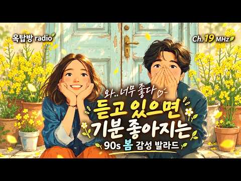

# 음악 — 성공 사례 분석: 사례별 자세히 #281–#320

`analysis.md` 의 9번 (같은 # 번호). 자동 생성 — `tools/success_analysis.py` v1.4.1 (2026-10-17 10:21 UTC). ※ 연구·교육용 — 투자 권유가 아님.

### 281. 딸에게 한 번도 하지 못했던 말... 오늘 이 노래로 전합니다 / 내딸아 / 도연스님 / 만복감성트롯 / 스님노래 / 불교노래/ 트로트

- https://www.youtube.com/watch?v=k5oAx-igPIU · 만복 낭만트롯 · 구독자 2,500 · 조회수 40,811 (×16.3, 하루 529.1) · 좋아요 502 (1.2%) · 5분 · 2026-08-01 · 주제 묶음 9. 가요·발라드·트로트 · 형식 한 곡 (뮤직비디오·음원·가사) · 폴더 `W_k5oAx-igPIU` (웹 승인)
- 썸네일: 
- 설명 앞부분: 딸을 처음 품에 안았던 날을 기억하시나요? 어느새 훌쩍 자라 어른이 되었지만, 부모의 마음속에는 아직도 작은 아이로 남아 있습니다. 한 번도 다 하지 못했던 말, ""사랑한다, 고맙다, 그리고 언제나 네 편이다."" 이 노래가 세상의 모든 딸과 부모님께 따뜻한 위로와 사랑으로 전해지길 바랍니다. 소중한 딸에게 전하고 싶은 한마디가 있다면 댓글로 남겨주세요.
- 같은 채널 평소 대비 ×19.1 (채널 최근 롱폼 중앙값 2,138회) · 평소 영상: 가을만 되면 왜 이 사람이 생각날까요… ∣ 가을에 듣는데 너무 좋다 ∣ 감성 트로트 5곡… (2,138회) / 부처님 자녀 앞길에 복을｜가슴뭉클한 기도 메들리 5곡 ∣ 스님노래 ∣ 불교음악 ∣ 감성트… (2,019회)
- 대본 없음 (설명) — 음성인식이 끝나면 도입부·흐름이 들어감
- 댓글 30/30: 좋은 점 — 영상 1 · 감사·응원 5 · 더 알고 싶은 것 0 · 아쉬운 점 — 영상 0 · 반박·불만 — 의견 다름 0 · 정치·사회 0 · 경험 공유 1 · 구독·다음 기대 3
  - 감사·응원 👍1 “스님 좋은노래 애절하고 시원 시원한 목소리 넘 좋습니다 스님 노래 매일 듣고 즐겁게 지냅니다 감사합니다 스님 항상 건강하세요❤❤❤🙏🙏🙏”
  - 감사·응원 👍0 “스님노래 매일 듣고 즐겁게 하루를 보내고 있답니다 넘 감사합니다 스님 항상 건강하세요 ❤❤❤🙏🙏🙏”
  - 경험 공유 👍0 “나무아미타불 관세음 보살 저희 엄마 부디 좋은곳으로 인도하여 주시옵소서 ~~”
  - 구독·다음 기대 👍2 “좋네요!구독하고 갑니다!👍👍👍❤❤❤”
  - 구독·다음 기대 👍1 “스님 좋은노래 애절하고 시원 시원한 목소리 넘 좋습니다 스님 노래 매일 듣고 즐겁게 지냅니다 감사합니다 스님 항상 건강하세요❤❤❤🙏🙏🙏”

### 282. 🍉여름에 듣기 좋은 카페 음악 ☕ 상쾌한 여름 바닷가 처럼 기분좋은 Playlist ∣ 중간 광고 없음 ∣ Happy Summer Cafe Music 260514

- https://www.youtube.com/watch?v=ZSVnVZ0-ROg · 오늘의 멜로디 Today's Melody · 구독자 19,700 · 조회수 317,781 (×16.1, 하루 2,030.9) · 좋아요 1,179 (0.4%) · 120.4분 · 2026-05-13 · 주제 묶음 4. 카페·매장·라운지 · 형식 플레이리스트·모음 (여러 곡) · 폴더 `W_ZSVnVZ0-ROg` (웹 승인)
- 썸네일: 
- 챕터: 0:00 Drawn To You · 3:14 Chasing You Downhill · 6:35 All Over You · 9:29 You've Got Me Good · 12:49 You Make My Heart Skip · 15:39 Summer Whisper · 19:16 Tonight Feels Like You · 22:23 Sweetly Into You · 25:38 Soft On You · 28:46 Stay The Night In · 32:07 Look At What You Do To Me · 35:42 Kiss Me In The Sunlight · 38:29 Made for Nights Like This · 41:59 Between You And The Night · 45:10 Fever For You · 48:25 Every Time You Stay · 51:10 Closer Without Trying · 54:24 Quietly Yours · 57:39 Just Letting You In · 61:32 Good For Each Other
- 설명 앞부분: 푸른 잎사귀 사이로 불어오는 여름의 싱그러운 분위기를 담았어요. 여름에 듣기 좋은 음악들 중에서도 상쾌한 여름 바닷가가 떠오르는 편안한 곡들 위주라, 그냥 틀어두는 것만으로도 기분 좋아지는 카페음악 Playlist예요. 이번 Happy Summer Cafe Music 260514는 소리가 맑고 산뜻해서 이 여유로운 리듬들과 함께 오늘 하루를 기분 좋게 보내보세요. 🌿☀ 오늘의 멜로디의 Original Playlist가 들려드리는 음악들이예요 🎵 ☀️ 아침 햇살처럼 스며드는 잔잔한 선율 ☕ 좋아하는 카페 구석 자리 같은 아늑한 분위…
- 같은 채널 평소 대비 ×65.1 (채널 최근 롱폼 중앙값 4,881회) · 평소 영상: 가을에 듣기 좋은 노래🍂 가을의 추억이 떠오르는 편안한 카페음악 Playlist ☕카페에… (5,229회) / 🍁가을 바람처럼 편안한 카페음악 (중간광고 없음) 🎶 커피 마시면서 듣기 좋은 감성 팝송… (4,533회)
- 대본 없음 (설명) — 음성인식이 끝나면 도입부·흐름이 들어감
- 댓글 57/57: 좋은 점 — 영상 3 · 감사·응원 5 · 더 알고 싶은 것 2 · 아쉬운 점 — 영상 0 · 반박·불만 — 의견 다름 0 · 정치·사회 0 · 경험 공유 1 · 구독·다음 기대 0
  - 좋은 점 — 영상 👍0 “생성된 이미지군요 잘 배워갑니다”
  - 좋은 점 — 영상 👍0 “음악이 듣기 편하고 둠칫둠칫 하게 되네요~”
  - 감사·응원 👍1 “네 감사해요 잊지 않을게요”
  - 감사·응원 👍1 “언제나 잘 듣고 있어요 집안청소할때 설거지할때 또 산행할때 그리고 울 진돗개 대한이랑 교감하며 댄싱도 한답니다 감사해요~^^”
  - 더 알고 싶은 것 👍0 “사진은 합성인가요..? 사진에 있는곳이 궁금하네요”
  - 더 알고 싶은 것 👍0 “1:15:44 에 나오는 노래 제목 알려주세요ㅜㅜ 노래가 너무 좋은데 아무리 찾아도 안나오네요😭”
  - 경험 공유 👍0 “저도 오늘아침 이❤노래 뜻까지 다 들어 볼레요❤”

### 283. [눈물주의]세상에서 가장 슬픈 노래 😢 어미의 한 [판소리]💔The Saddest Song Ever Written - A Mother's Tearful Good…

- https://www.youtube.com/watch?v=DhredFI94dc · Nana Music · 구독자 10,000 · 조회수 160,327 (×16.0, 하루 1,884.5) · 좋아요 1,091 (0.7%) · 6분 · 2026-07-24 · 주제 묶음 15. CCM·찬양·국악·동요 · 형식 플레이리스트·모음 (여러 곡) · 폴더 `W_DhredFI94dc` (웹 승인)
- 썸네일: 
- 설명 앞부분: 세상에서 가장 가슴 아픈 이별은 무엇일까요? 나의 무능함 때문에 사랑하는 자식을 먼 길로 떠나보내야만 하는 어미의 피눈물 나는 심정을 정통 판소리의 애절한 계면조 가락에 담았습니다. 떠나기 전날 밤, 떨리는 손으로 지어 올린 하얀 쌀밥 한 그릇의 먹먹함부터 어미 목소리가 자식 가는 길 발목 잡을까 손가락으로 입을 틀어막고 흙바닥을 쥐어뜯는 폭발적인 통곡까지. 오직 자식을 향한 죄책감과 지극한 사랑을 어미의 처절한 독백으로 표현했습니다. 살아가며 가슴속에 쌓인 응어리와 슬픔이 이 가락을 통해 시원하게 씻겨 내려가는 치유의 시간이 되…
- 같은 채널 평소 대비 ×185.7 (채널 최근 롱폼 중앙값 864회) · 평소 영상: [눈물주의] 손녀를 두고 떠나는 할머니의 애절한 판소리 ❤️ 손녀의 홀로서기 (2곡 통합… (940회) / 해방과 6.25 보릿고개를 겪어오신 90세 어머니의 세월… 누가 다 헤아릴 수 있으리 ∣… (787회)
- 대본 없음 (설명) — 음성인식이 끝나면 도입부·흐름이 들어감
- 댓글 99/99: 좋은 점 — 영상 0 · 감사·응원 4 · 더 알고 싶은 것 3 · 아쉬운 점 — 영상 1 · 반박·불만 — 의견 다름 1 · 정치·사회 1 · 경험 공유 4 · 구독·다음 기대 0
  - 더 알고 싶은 것 👍6 “참 좋은 음악 늘 잘 듣고 감상 하고 있습니다. 염치 없이 한가지 부탁드립니다. 재생목록 만들어 주시면 차 안에서 감상 하기 편할듯 하여 부탁드립니다. 한가지 더 부탁 드린다면 남도 민요 흥타령 그리고 육자배기 도 다시 해석하여 작품으로 올려 주십사 하고 염치 없이 …”
  - 아쉬운 점 — 영상 👍5 “저모친은 살아계신데 2년전에 먼저하늘나라간 부인생각과 시집갈 딸 생각하니 눈물흐리면서 반복해서 들었습니다”
  - 경험 공유 👍12 “내나이 어느듯 60이 넘어 버렸네 엄마엄마 우리엄마 보고 싶네요”
  - 경험 공유 👍9 “울고갑니다. 진심..... 모든 어머니 사랑합니다. 저도 어머니입니다.”

### 284. Playlist 19 MHz ∣ 같이 있는 시간이 제일 편한 날 ☀️ ∣ 90s LOVE · BALLAD · SPRING ∣ 봄 · 감성 · 휴식 · 산책 · …

- https://www.youtube.com/watch?v=yirGzkQvqfE · 옥탑방 radio · 구독자 21,400 · 조회수 338,853 (×15.8, 하루 1,898.2) · 좋아요 2,544 (0.8%) · 21.9분 · 2026-04-21 · 주제 묶음 4. 카페·매장·라운지 · 형식 플레이리스트·모음 (여러 곡) · 폴더 `W_yirGzkQvqfE` (웹 승인)
- 썸네일: 
- 챕터: 0:00 나란히 걷던 날 · 3:14 내 마음이 먼저 · 7:05 조금씩 너에게 · 10:08 너를 닮은 기분 · 12:42 내 하루에 스며와 · 16:05 문득 네가 보여서 · 18:47 천천히 가까워져 (94 BPM)
- 설명 앞부분: 특별한 일이 없어도 그냥 같이 있는 것만으로 편해지는 시간이 있는 것 같아요. 나란히 걷고, 아무 말 없이도 괜찮고, 같은 방향을 보고 있는 순간들. 이번 플레이리스트는 그런 ‘편안하게 가까워지는 마음’을 담았습니다. 조용히 흘러가지만 듣고 있으면 기분이 좋아지는 잔잔한 사랑의 순간들입니다. 이런 순간에 잘 어울려요 산책할 때 카페에서 혼자 쉬고 있을 때 생각 없이 음악 듣고 싶을 때 편하게 들어주세요 🙂 [매주 수요일, 토요일 오전 7시 새로운 음악]이 업로드됩니다. 📝 [Track Info] (90s-2000s Nostalgi…
- 같은 채널 평소 대비 ×28.5 (채널 최근 롱폼 중앙값 11,905회) · 평소 영상: Playlist TOP 10 ∣ 8월 구독자 선정 옥탑방 인기차트 🌿 ∣ Subscrib… (12,426회) / Playlist TOP 5 ∣ 6월 옥탑방 인기차트 ☔ ∣ Subscriber's Pic… (11,384회)
- 대본 없음 (설명) — 음성인식이 끝나면 도입부·흐름이 들어감
- 댓글 171/171: 좋은 점 — 영상 4 · 감사·응원 14 · 더 알고 싶은 것 5 · 아쉬운 점 — 영상 3 · 반박·불만 — 의견 다름 1 · 정치·사회 0 · 경험 공유 0 · 구독·다음 기대 2
  - 좋은 점 — 영상 👍2 “잔잔하니 듣기 좋네요”
  - 좋은 점 — 영상 👍2 “노래가 너무 듣기 좋네요~~ 구독”
  - 감사·응원 👍8 “첫장면.카세트에 테잎넣는 장면부터 훅 이끌려 바로 구독 꾸욱. 보다보다 듣다듣다 그림속 연인들의 이쁜사랑을 응원하게 되네요..”
  - 감사·응원 👍8 “늘 잘듣고 있습니다 이런 감성 어디에서도 찾기 힘들것 같은데 너무 감사합니다 😊😊😊”
  - 더 알고 싶은 것 👍3 “가수가 궁금해요. 좋아요. 구독. 하고 갑니다. ❤”
  - 더 알고 싶은 것 👍2 “나란히 걷던날 가수가 어떻게 될까요?? 너무 좋아서요!!!”
  - 아쉬운 점 — 영상 👍2 “ai목소리 듣기 좋네요😊”
  - 아쉬운 점 — 영상 👍1 “너무좋아서 댓글달아봅니다 이런분들이 방송에 나와야하는데 아쉽네요 싱어분 성함이 궁금합니다”
  - 구독·다음 기대 👍1 “정말 멋진 음악이라 듣자마자 마음이 편안해지고 기분도 밝아지네요! 구독했습니다✨”
  - 구독·다음 기대 👍1 “구독합니다 ❤”

### 285. [𝐩𝐥𝐚𝐲𝐥𝐢𝐬𝐭] 정병 제대로 터져버린 멘헤라남 플리

- https://www.youtube.com/watch?v=N2zEbM5dIH4 · 안평화 · 구독자 17,100 · 조회수 266,511 (×15.6, 하루 6,370.1) · 좋아요 9,660 (3.6%) · 15.6분 · 2026-09-05 · 주제 묶음 기타 · 형식 플레이리스트·모음 (여러 곡) · 폴더 `W_N2zEbM5dIH4` (웹 승인)
- 썸네일: 
- 같은 채널 평소 대비 ×9.4 (채널 최근 롱폼 중앙값 28,251회) · 평소 영상: ​​​​P̠̲̦̯̻̬̟͓̦͇̏̽̌̔͘͠l̴̹̩̮͓̻̱̠̠̊͒̓̆̊̅͐͛͘͟͠a͆̄̋̐́͂… (28,251회) / 싸가지 밥말아먹은 멘헤라정병남 플리 (26,786회)
- 대본 없음 (없음) — 음성인식이 끝나면 도입부·흐름이 들어감
- 댓글 168/168: 좋은 점 — 영상 2 · 감사·응원 3 · 더 알고 싶은 것 4 · 아쉬운 점 — 영상 1 · 반박·불만 — 의견 다름 0 · 정치·사회 0 · 경험 공유 7 · 구독·다음 기대 0
  - 좋은 점 — 영상 👍1 “와존나레전드세요진심”
  - 좋은 점 — 영상 👍0 “진짜 구라가 아니라 레전드 한 곡도 거를 타선 없이 제 취향저격이라 이 영상 내리시는 순간 제가 멘헤라가 됩니다”
  - 더 알고 싶은 것 👍11 “혹시 저 그림 웹툰이면 제목 알수있을까요?”
  - 더 알고 싶은 것 👍10 “선생님 썸네일 정보 부탁드립니다 급합니다”
  - 아쉬운 점 — 영상 👍3 “'결국 아무것도 바꿀 수 없었어' 이거 나올줄 알았는데 조금 아쉬움😢 딱 이 테마랑 잘맞는다고 생각했었는데”
  - 경험 공유 👍1,252 “영상 내려가서 내가 멘헤라될뻔”
  - 경험 공유 👍199 “저점매수 앙!! 환자분 흥분을 멈추셔야합니다 흥분을 멈추셔야 제가 치료가가능합니다흥분 을 멈춘 상태여야 제가 환자분의 진료 를 봐드릴수있습니다 그러니 부디 흥분 을 멈추 시고 하의를내려주시길바랍니다 흥분 한채로 하의를내 리지는마세요 그러면 진료가 불가는해집니다부디 흥…”

### 286. [평안 찬송] 마음에 평안과 기쁨을 채워주는 은혜의 찬송가 모음 ∣ 들을수록 마음이 편안해지는 찬송가 연속듣기 ∣ 걱정과 염려를 내려놓는 찬송가 메들리 ∣ 주님…

- https://www.youtube.com/watch?v=GaBxDi7Eg3M · 주님곁에 · 구독자 18,700 · 조회수 288,816 (×15.4, 하루 4,033.8) · 좋아요 4,728 (1.6%) · 71.2분 · 2026-08-06 · 주제 묶음 15. CCM·찬양·국악·동요 · 형식 커버·직접 부른 노래 · 폴더 `W_GaBxDi7Eg3M` (웹 승인)
- 썸네일: 
- 챕터: 0:00 412장 내 영혼의 그윽히 깊은 데서 · 4:35 486장 이 세상에 근심된 일이 많고 · 8:23 429장 세상 모든 풍파 너를 흔들어 · 11:19 301장 지금까지 지내온 것 · 14:14 428장 내 영혼에 햇빛 비치니 · 18:08 289장 주 예수 내 맘에 들어와 계신 후 · 22:44 287장 예수 앞에 나오면 · 25:49 496장 새벽부터 우리 · 29:32 96장 예수님은 누구신가 · 32:27 438장 내 영혼이 은총 입어 · 35:35 🔁 Repeat
- 설명 앞부분: 마음이 편안해지는 찬송가 모음입니다. 근심과 염려를 내려놓고, 찬송 가운데 전해지는 하나님의 평안과 기쁨을 함께 누려보세요. 하루를 시작하는 시간, 조용히 기도하고 싶은 순간, 마음이 지쳐 위로가 필요할 때, 또는 하루를 마무리하며 평안히 쉬고 싶은 시간에 함께 들을 수 있는 은혜로운 찬송가 메들리입니다. 이번 찬송가 모음에는 세상의 근심과 풍파 속에서도 주님을 바라보며 평안을 얻는 찬송, 지금까지 인도하신 은혜에 감사하는 찬송, 그리고 예수 안에서 누리는 기쁨을 고백하는 찬송을 담았습니다. 익숙한 찬송가의 아름다운 가사를 따라 …
- 같은 채널 평소 대비 ×6.0 (채널 최근 롱폼 중앙값 48,515회) · 평소 영상: [평안 찬송] 사랑하는 가족을 마음에 품고 듣는 찬송 10곡 ∣ 가족 구원을 위해 기도하… (52,570회) / [2시간 연속듣기] 부족함 속에서도 넘치는 감사를 채우는 평안의 찬송가 모음 ∣ 주 날개… (44,460회)
- 대본 없음 (설명) — 음성인식이 끝나면 도입부·흐름이 들어감
- 댓글 277/277: 좋은 점 — 영상 2 · 감사·응원 73 · 더 알고 싶은 것 2 · 아쉬운 점 — 영상 3 · 반박·불만 — 의견 다름 0 · 정치·사회 0 · 경험 공유 11 · 구독·다음 기대 1
  - 좋은 점 — 영상 👍1 “하나님과하루를시작합니다도움이필요합니다너무도연약한저희를강하고담대함을주소서”
  - 감사·응원 👍21 “암환자로 찬양을 들으면서 참평안을 느끼고 있습니다 하나님의 은혜감사합니다”
  - 감사·응원 👍20 “평안주시는 찬양 감사합니다. 오늘 하루도 선하고 지혜롭게 선하신 주님 믿으며 살아가겠습니다.”
  - 더 알고 싶은 것 👍2 “새벽기도 드리고 오면서 아름다운 찬양을 들으니 행복합니다 찬양하시는분들 성함을 알려 주실수 있을까요 목소리가 너무 은혜롭군요”
  - 아쉬운 점 — 영상 👍5 “찬송 부르시는 분 목소리가 너무 은혜가 됩니다 늘 자주 듣고 있습니다 감사합니다❤”
  - 아쉬운 점 — 영상 👍2 “새벽기도 드리고 오면서 아름다운 찬양을 들으니 행복합니다 찬양하시는분들 성함을 알려 주실수 있을까요 목소리가 너무 은혜롭군요”
  - 경험 공유 👍31 “제가 중풍을 고침빋고 성도답게 실게 하소서 아멘 아멘 아멘”
  - 경험 공유 👍3 “주님만이 저희에게 평안을 주십니다 감사함으로 오늘하루도 기도와간구로 살아가는 삶이 되시기를~~~”
  - 구독·다음 기대 👍1 “구독하고 잘듣고있습니다 찬양이 너무좋아요”

### 287. [PLAYLIST] 비 오는 날 계속 듣게 되는 발라드 7곡 ☔ ∣ 감성발라드 · 사랑노래 · 여름 플레이리스트

- https://www.youtube.com/watch?v=fG0GudU56S0 · 뮤직앤라이트 Music&Light · 구독자 8,640 · 조회수 133,122 (×15.4, 하루 1,285.8) · 좋아요 943 (0.7%) · 27.9분 · 2026-07-05 · 주제 묶음 9. 가요·발라드·트로트 · 형식 플레이리스트·모음 (여러 곡) · 폴더 `W_fG0GudU56S0` (웹 승인)
- 썸네일: 
- 챕터: 0:00 비가 너를 데려오면 · 3:34 빗물 끝에 네가 있다 · 7:04 우산 아래 남겨진 말 · 11:34 빗속에서 피어난 말 · 15:39 빗방울이 대신 말해 · 19:44 비 오는 밤의 약속 · 23:49 비 그친 하늘 아래
- 설명 앞부분: 비오는날노래, 비오는날발라드, 여름발라드, 감성발라드, 발라드플레이리스트를 찾고 있다면 꼭 들어보세요. 비 오는 날 계속 듣게 되는 한국 발라드 7곡 ☔ 빗소리와 가장 잘 어울리는 사랑노래와 여름 플레이리스트를 담았습니다. 창밖으로 빗방울이 하나둘 떨어지는 오후, 우산을 들고 걷는 퇴근길, 따뜻한 커피 한 잔과 함께하는 조용한 시간. 비 오는 날이면 유난히 선명해지는 기억과 쉽게 잊히지 않는 사랑의 순간들을 한 곡 한 곡에 담았습니다. 그리움으로 시작해, 다시 사랑을 만나고, 용기를 내어 마음을 전하고, 서로의 약속을 지켜 가며,…
- 같은 채널 평소 대비 ×20.3 (채널 최근 롱폼 중앙값 6,552회) · 평소 영상: [PLAYLIST] 듣는 순간 드라마가 시작되는 OST 발라드 7곡 🎬 ∣ 드라마OST … (6,552회) / [PLAYLIST] 가을만 되면 생각나는 발라드 7곡 🍂 ∣ 감성발라드 · 발라드명곡 ·… (6,032회)
- 대본 없음 (설명) — 음성인식이 끝나면 도입부·흐름이 들어감
- 댓글 112/112: 좋은 점 — 영상 2 · 감사·응원 10 · 더 알고 싶은 것 4 · 아쉬운 점 — 영상 0 · 반박·불만 — 의견 다름 1 · 정치·사회 0 · 경험 공유 3 · 구독·다음 기대 1
  - 좋은 점 — 영상 👍1 “자작나무님 가수들 이름도 순서대로 알려주세요 ❤ 노래도 참 줗으네요~~~^^ 자작나무님 목소리 처럼 듣기 좋아요~~~ 늘 건강하시고 행복하세요 ❤”
  - 감사·응원 👍15 “오늘같이 비가오는날 크게틀어놓고 들으니 넘 좋네요...❤ 감사히 잘들을께요🙏”
  - 감사·응원 👍5 “78년생 ..97학번입니다. 삐삐치고 손편지 쓰던 시절이 그립네요. 내 대학교 시절. 내 청춘과 함께했던 그녀에게 감사합니다. 우리는 서툴렀지만 서로에게 좋은 추억과 기억과 시간을 주었네요. 어디서든 항상 잘 살고 있을 그녀에게 다시한번 감사합니다.”
  - 더 알고 싶은 것 👍2 “침대에 누워서 잠들기전에 들으니 참 좋으네ㅣ요 근데 이목소리 좋은 가수가 누군지 궁금하네요”
  - 더 알고 싶은 것 👍1 “자작나무님 가수들 이름도 순서대로 알려주세요 ❤ 노래도 참 줗으네요~~~^^ 자작나무님 목소리 처럼 듣기 좋아요~~~ 늘 건강하시고 행복하세요 ❤”
  - 경험 공유 👍1 “이노래 젊은층이 ㄷ,ㄹ을거 같지만 오히려 50후반대 나도 들어요 늙었다 이런노래 주책이라 하지만 우리도 아름다운 청춘 누구나 젊음이 머물럿길래 늙어도 그마음 가슴 한켠에 아직도 작은 방을 차지하고 일다오”
  - 구독·다음 기대 👍5 “비오는날 분위기 있는 음악들어요~❤❤ @오픈라디오 구독하고갑니다~~^^”

### 288. [찬송가 연속듣기] 마음이 복잡할 때 듣는 잔잔한 찬송가 20곡 ∣ 잠들기 전 평안을 주는 찬양 메들리 (깊은 울림 바리톤 찬양) ∣ 중간광고 없음 ∣ HYMN

- https://www.youtube.com/watch?v=Tt9qwuoMPtI · 골방 찬양 · 구독자 26,000 · 조회수 400,353 (×15.4, 하루 2,659.4) · 좋아요 5,532 (1.4%) · 246.6분 · 2026-05-19 · 주제 묶음 15. CCM·찬양·국악·동요 · 형식 플레이리스트·모음 (여러 곡) · 폴더 `W_Tt9qwuoMPtI` (웹 승인)
- 썸네일: 
- 챕터: 0:00 너 근심 걱정 말아라 (찬송가 382장) · 3:40 나의 갈 길 다가도록 (찬송가 84장) · 7:04 예수를 나의 구주 삼고 (찬송가 288장) · 10:11 죄짐 맡은 우리 구주 (찬송가 144장) · 13:35 나같은 죄인 살리신 (찬송가 305장) · 17:24 고통의 멍에 벗으려고 (찬송가 272장) · 22:08 곤한 내 영혼 편히 쉴 곳과 (찬송가 406장) · 26:32 주안에 있는 나에게 (찬송가 370장) · 30:31 예수가 우리를 부르는 소리 (찬송가 528장) · 35:01 내 평생에 가는길 (찬송가 413장) · 40:06 이 세상 험하고 (찬송가 263장) · 44:01 마음속에 근심 있는 사람 (찬송가 365장) · 48:00 예수 나를 위하여 (찬송가 144장) · 53:19 선한 목자 되신 우리주 (찬송가 569장) · 56:52 지금까지 지내온 것 (찬송가 301장) · 60:05 내 영혼의 그윽히 깊은데서 (찬송가 412장) · 64:51 오 신실하신 주 (찬송가 393장) · 69:34 저 장미꽃 위에 이슬 (찬송가 442장) · 73:48 내 영혼이 은총입어 (찬송가 438장) · 77:48 사철에 봄바람 불어 잇고 (찬송가 528장)
- 설명 앞부분: 🌸마음이 복잡하고 지칠 때, 모든 염려와 걱정을 주님의 십자가 앞에 내려놓으세요. 언제나 우리와 동행하시며 신실하게 지켜주시는 주님의 품 안에서 깊은 안식과 영혼의 평안을 누리시길 간절히 기도합니다. "불면증과 고단함으로 지친 밤, 마음의 위로가 필요한 분들을 위해 골방 가족의 요청을 담아 평안히 켜두기 좋은 연속듣기 찬송 20곡 모음을 준비했어요." 가독성 좋은 큰 글씨 가사 자막이 포함되어 있어, 낮에는 묵상과 기도 음악으로, 밤에는 잠들기 전 수면 찬양으로 편안하게 청취하실 수 있습니다. [은혜를 나누는 방법] 영상이 은혜로…
- 같은 채널 평소 대비 ×3.8 (채널 최근 롱폼 중앙값 105,136회) · 평소 영상: [찬송가 연속듣기]복잡한 마음에 힘과 용기를 주는 찬송 ∣ 강하고 담대하라 ∣ 주님과 함… (105,136회) / [찬송가 모음]기도도 안 나올 때 붙잡는 찬송 10곡 ∣ 무너진 믿음을 회복하는 시간 (… (105,945회)
- 대본 없음 (설명) — 음성인식이 끝나면 도입부·흐름이 들어감
- 댓글 622/622: 좋은 점 — 영상 1 · 감사·응원 178 · 더 알고 싶은 것 5 · 아쉬운 점 — 영상 1 · 반박·불만 — 의견 다름 0 · 정치·사회 2 · 경험 공유 31 · 구독·다음 기대 0
  - 좋은 점 — 영상 👍16 “예수를나의구주삼고 이찬송가 꿈속에서주님이알려주셔서 저의평생의푯대찬양이네요😅😅😅”
  - 감사·응원 👍60 “저희가정은 감사하게도 5대째신앙생활하고있어요 그옛날시할머니시어머님께서 골방기도하셨어요 그것을지키지못해항상죄송했는데 요즘은 골방찬양 듣고 부르기도하네요 너무은혜가되고 감사하네요”
  - 감사·응원 👍24 “주여.오늘도.이럿게축복찬양주심감사합니다.드디어.집이나갇어요.그분이이사오셔서.보증금.무사히받구.이사.잘할수있도록.도와주시옵소서.불쌍이여기셔서.늘함께하시고.보살펴주시옵소서.아멘.감사합니다.😊❤❤❤”
  - 더 알고 싶은 것 👍5 “지금 저희 남편이 천식 환자입니다 그런데 지금 내과 중환자실에 입원 중입니다 현제 상태는페렴으로 모든 장기가 안좋아 졌다고 합니다 하나님께서 함께해주셔 저희 가정에도 기적이 일어나길 간절히 바랍니다 기도 함께해주실분 기도 부탁드립니다”
  - 더 알고 싶은 것 👍3 “아멘 지금. 우리아들앞에 큰시련이 생겼습니다 주님은 아시지요 상대방의 마음을 움직여서 모든일이 잘 해결되게 주님 도와주세요~중보기도 부탁드립니다🙏”
  - 아쉬운 점 — 영상 👍1 “요즘 Al 찬양이많아 좀아쉬워요~ 이찬양은 듣기가 은혜놉네요 감사합니다!!❤”
  - 정치·사회 👍6 “아버지여 이나라가 도대체가뭡니까 기독교 국가로 세워주소서 사탄들모조리 박살내주소서 찬송의 은혜주소서 아멘 샬롬❤❤❤😢😢😢🎉🎉🎉”
  - 정치·사회 👍4 “하늘에 계신 우리 아버지 아버지의 이름을 거룩하게 하시며 아버지의 나라가 오게 하시며 아버지의 뜻이 하늘에서와 같이 땅에서도 이루워지게 하소서 오늘 우리에게 일용한 양식 을 주시고 우리가 우리에게 잘못한 사람읗 용서하여 준 것 같이 우리 죄를 용서하여 주시고 우리를 …”
  - 경험 공유 👍60 “저희가정은 감사하게도 5대째신앙생활하고있어요 그옛날시할머니시어머님께서 골방기도하셨어요 그것을지키지못해항상죄송했는데 요즘은 골방찬양 듣고 부르기도하네요 너무은혜가되고 감사하네요”
  - 경험 공유 👍13 “어느곳에서도 주예수님 저희 가족들을 지켜주소서 아멘 아멘”

### 289. [Playlist] 마음이 편안해지는 힐링 피아노 ∣ Healing Piano Music for Stress Relief 🌿🎼

- https://www.youtube.com/watch?v=o0F2bvcNLMc · Piano Haven · 구독자 5,100 · 조회수 78,545 (×15.4, 하루 455.4) · 좋아요 381 (0.5%) · 194.8분 · 2026-04-27 · 주제 묶음 1. 수면·명상·힐링 · 형식 플레이리스트·모음 (여러 곡) · 폴더 `W_o0F2bvcNLMc` (웹 승인)
- 썸네일: 
- 설명 앞부분: [Playlist] 마음이 편안해지는 힐링 피아노 ∣ Healing Piano Music for Stress Relief 🌿🎼 Piano Haven에 오신 것을 환영합니다. 이 영상은 바쁜 하루 속에서 잠시 쉬어갈 수 있도록 잔잔하고 따뜻한 피아노 선율을 담았습니다. 공부할 때, 일할 때, 책을 읽을 때, 잠들기 전, 혹은 조용히 마음을 쉬게 하고 싶은 순간에 편안한 배경음악이 되어드립니다. 감성적인 피아노 연주와 부드러운 멜로디가 지친 마음을 다독이고, 일상에 작은 평온과 위로를 전해드리길 바랍니다. Piano Haven은 힐링…
- 같은 채널 평소 대비 ×17.1 (채널 최근 롱폼 중앙값 4,597회) · 평소 영상: [Playlist] 생각의 흐름을 천천히 편안하게 하는 피아노 ∣ Soft Piano M… (4,597회) / [Playlist] 마음이 조용히 숨을 고르는 피아노 ∣ Gentle Healing Pi… (4,581회)
- 대본 없음 (설명) — 음성인식이 끝나면 도입부·흐름이 들어감
- 댓글 16/16: 좋은 점 — 영상 0 · 감사·응원 2 · 더 알고 싶은 것 0 · 아쉬운 점 — 영상 0 · 반박·불만 — 의견 다름 0 · 정치·사회 0 · 경험 공유 0 · 구독·다음 기대 0
  - 감사·응원 👍1 “이 선율에 더 오래 푹 빠져들 수 있었으면 좋겠어요. 이렇게 편안한 느낌을 선사해 주셔서 감사합니다. ☺”
  - 감사·응원 👍0 “저는 택시운행하는데요 차안에서 듣기 정말 좋아요. 감사합니다. 🎉🎉🎉”

### 290. 🎵그냥 틀어놨는데 눈물이 났네요...주님은 다 아시죠ㅣ은혜로운 찬양모음 ㅣCCM플레이리스트 ㅣ위로CCM ㅣA Song of Worship Through Melo…

- https://www.youtube.com/watch?v=aY-zdL2QUBk · 평화로운음악 찬양카페 · 구독자 12,900 · 조회수 196,138 (×15.2, 하루 1,170.7) · 좋아요 3,091 (1.6%) · 36.8분 · 2026-05-02 · 주제 묶음 15. CCM·찬양·국악·동요 · 형식 플레이리스트·모음 (여러 곡) · 폴더 `W_aY-zdL2QUBk` (웹 승인)
- 썸네일: 
- 챕터: 0:00 비 오는 오후 · 3:44 기도하는 손 · 7:46 여호와는 네게 복을 주시고 · 10:46 진정한 쉼 · 15:58 지친 마음의 기도
- 설명 앞부분: 🎵그냥 틀어놨는데 눈물이 났네요...주님은 다 아시죠ㅣ은혜로운 찬양모음 ㅣCCM플레이리스트 ㅣ위로CCM ㅣA Song of Worship Through Melody 🎵찬양과 기도로 평안을 나누는 공간에 오신 걸 환영합니다. 마음을 어루만지는 기도문, 잔잔한 경음악, 은혜로운 찬양을 전합니다. 하나님의 임재가 당신의 마음을 채우기를 바랍니다. Welcome to a peaceful space of worship and prayer. We share Peaceful Praise, calming instrumental music, he…
- 같은 채널 평소 대비 ×23.2 (채널 최근 롱폼 중앙값 8,439회) · 평소 영상: 🎵10월..너무 좋은 잔잔한 가을 감사찬양🌿감사할 이유가 참 많아요 ∣ 가을찬양ㅣ은혜로운… (8,439회) / 🎵요즘 너무 지쳤다면...꼭 들어보세요(염려를 주께 맡겨요)ㅣ은혜로운 찬양모음 ㅣCCM플… (8,549회)
- 대본 없음 (설명) — 음성인식이 끝나면 도입부·흐름이 들어감
- 댓글 257/257: 좋은 점 — 영상 0 · 감사·응원 66 · 더 알고 싶은 것 4 · 아쉬운 점 — 영상 1 · 반박·불만 — 의견 다름 0 · 정치·사회 0 · 경험 공유 11 · 구독·다음 기대 1
  - 감사·응원 👍8 “감사합니다 찬양듣고회개합니다 지금저는 유방암수술후 내일방사선 시티찍고 19일날부터앙사선16회들어가요 그동안지치지않고 주님은혜 받고 잘치료되길 기도합니다”
  - 감사·응원 👍5 “찬양을 듣고있으니 주님의따뜻함을 느낍니다. 남편을 천국간지 5년이되었습니다. 매일 믿음으로 살면서 삶속에서도 주님의영광만이 드러나길바라면서 갑자기 찾아온 유방암림프전이로 검사중에 있습니다. 주님께서 하실일을 감사하며 찬양합니다~^^ 기도부탁드려요~”
  - 더 알고 싶은 것 👍5 “찬양을 듣고있으니 주님의따뜻함을 느낍니다. 남편을 천국간지 5년이되었습니다. 매일 믿음으로 살면서 삶속에서도 주님의영광만이 드러나길바라면서 갑자기 찾아온 유방암림프전이로 검사중에 있습니다. 주님께서 하실일을 감사하며 찬양합니다~^^ 기도부탁드려요~”
  - 더 알고 싶은 것 👍1 “하나님 고소고발좀 부탁드려요”
  - 아쉬운 점 — 영상 👍0 “이 찬양곡들 출처가 어떻게 될까요..? 느낌이.. AI를 통해 만든 찬양 같은데.. 맞나요??”
  - 경험 공유 👍3 “주님 감사해요 부족하지만 내가 주님 사랑하는거 아시죠...”
  - 경험 공유 👍3 “늘 제 맘대로 살다가 주님을 외치죠~♡♡ 이기적인 나의 믿음방식.. 나도 너무 애처로와요 이러면 안된다는걸 알면서도.. 그래도 주님 잡고 계시죠~?? 죄송해요 주님~❤❤”
  - 구독·다음 기대 👍2 “지친 성도들에게 새 힘을 주시기를 기도하며 은혜의 찬양 잘 듣고 구독하고 갑니다.~^^😊”

### 291. 매일 듣기 좋은 편안한 클래식🌿∣행복한 힐링 클래식 음악☕∣클래식 명곡 18곡 모음🎵

- https://www.youtube.com/watch?v=DTVWGGI7nKE · 클래식라이프Classic · 구독자 23,600 · 조회수 355,623 (×15.1, 하루 2,750.2) · 좋아요 4,223 (1.2%) · 68분 · 2026-06-10 · 주제 묶음 6. 피아노·클래식·연주곡 · 형식 플레이리스트·모음 (여러 곡) · 폴더 `W_DTVWGGI7nKE` (웹 승인)
- 썸네일: 
- 설명 앞부분: 🎼 일상의 리듬을 깨우는 찬란한 선율, 클래식라이프Classic입니다. 반복되는 일상 속에서 문득 에너지가 고갈되었다고 느껴지는 순간이 있으신가요? 오늘은 여러분의 하루에 생동감을 불어넣어 줄 세상에서 가장 편안한 클래식 명곡들을 엄선하여 찾아왔습니다. Playlist (플레이리스트) 🌿 이런 순간에 함께하세요: 나른한 오후: 커피 한 잔과 함께 처진 기분을 단숨에 끌어올리고 싶을 때 집중이 필요한 업무 시간: 복잡한 머릿속을 정리하고 능률을 높여주는 '최고의 노동요' 상쾌한 드라이브: 창밖 풍경을 영화의 한 장면으로 만들어줄 배…
- 같은 채널 평소 대비 ×53.7 (채널 최근 롱폼 중앙값 6,620회) · 평소 영상: 스트레스 풀리는 시원한 여름 클래식 모음 🌊 ∣ 기분 좋아지는 시원한 클래식 BGM #여… (7,445회) / 편안한 아침 클래식 음악🎵∣매일 듣는 편안한 클래식☕∣아침에 듣는 힐링 클래식 명곡 베스… (5,795회)
- 대본 없음 (설명) — 음성인식이 끝나면 도입부·흐름이 들어감
- 댓글 99/99: 좋은 점 — 영상 4 · 감사·응원 37 · 더 알고 싶은 것 0 · 아쉬운 점 — 영상 1 · 반박·불만 — 의견 다름 0 · 정치·사회 0 · 경험 공유 3 · 구독·다음 기대 0
  - 좋은 점 — 영상 👍9 “스토리를 알려 주셔서 더 좋네요”
  - 좋은 점 — 영상 👍4 “곡명을 몰라서 이것도 같고 저것도 같고 했는데 아 이곡이었구나! 하면서 듣고 있어요. 이제 퇴직해서 유트브로 피아노를 배우고 있는데 도움이 많이 됨요~~ ,감사합니다.~~”
  - 감사·응원 👍28 “아름다운 연주곡 잘 들었습니다~감사합니다~🎵🎻🎹 🌿🍀☘🌹🌹☘🍀🌿 ❤❤수고 많으셨습니다~☕”
  - 감사·응원 👍23 “CD로 즐겨듣던 곡을 이렇게 만나니 반갑습니다 감사합니다”
  - 아쉬운 점 — 영상 👍4 “계속 반복해서 듣게 됩니다 감사합니다”
  - 경험 공유 👍15 “자주 듣던곡들인데 곡명을 몰라서 불편했는데 이렇게 친절하게 설명 해주시니 이젠 어디가서 클래식 듣게되면 무슨곡이라 말할수 있어 제가 한층 더 유식해지는 느낌을 받을듯요 아침을 여는 클래식 덕분에 더운여름을 시원하게 보낼수 있을듯요 감사드립니다 ❤”
  - 경험 공유 👍6 “제가 좋아하는곡들입니다 20대 친구와 음악실에서.. 오랜만에 들어보니 새롭네요❤”

### 292. 지금 꼭 들으세요 🙏 아들 일이 잘 풀립니다 ∣ 경주 불국사의 기도 음악 #불교음악 #자녀기도노래

- https://www.youtube.com/watch?v=QmfOTgF-Akw · 연등 아래서 · 구독자 11,300 · 조회수 166,724 (×14.8, 하루 1,019.4) · 좋아요 5,015 (3.0%) · 35.6분 · 2026-05-06 · 주제 묶음 기타 · 형식 음악 (그 밖 모양 — 한 편짜리 BGM 등) · 폴더 `W_QmfOTgF-Akw` (웹 승인)
- 썸네일: 
- 설명 앞부분: 자녀를 위한 간절한 마음을 담아 만든 기도 음악입니다. 🙏 이 영상은 천년의 기도가 머무는 경주 불국사의 고요하고 평안한 분위기를 모티브로 제작되었습니다. 답답했던 일들이 조금씩 풀리고 따뜻한 기운과 좋은 흐름이 함께하길 바라며 부모의 마음으로 정성을 담았습니다. 잠시 눈을 감고 자녀의 이름을 마음속으로 떠올려보세요. 🙏 아들을 위한 기도 음악 🙏 부모의 마음을 담은 시간 🙏 평안과 위로를 전하는 노래 🎵 이 노래가 마음에 머물렀다면 🏮 댓글로 소원을 남겨주시면 부처님 전에 올리는 노래로 만들어 드립니다. 📢연등아래서는 직접 기획…
- 같은 채널 평소 대비 ×33.5 (채널 최근 롱폼 중앙값 4,981회) · 평소 영상: 부모의 기도로 자식 취업·합격·성공 이루어집니다 🙏 틀어만 놓아도 복이 오는 불교노래 #… (4,981회) / 30분만! 틀어놓으세요 🙏 자식 바라던 일이 이루어집니다ㅣ소원성취 관세음보살 불교노래#불… (5,012회)
- 대본 없음 (설명) — 음성인식이 끝나면 도입부·흐름이 들어감
- 댓글 4,056/4,056: 좋은 점 — 영상 4 · 감사·응원 360 · 더 알고 싶은 것 25 · 아쉬운 점 — 영상 0 · 반박·불만 — 의견 다름 0 · 정치·사회 1 · 경험 공유 67 · 구독·다음 기대 1
  - 좋은 점 — 영상 👍2 “옴마니반메훔 옴마니반메훔 오늘도 부모님마음으로 조용히 기도 드립니다 정말마음에 와닿네요”
  - 좋은 점 — 영상 👍1 “지나가다 참 좋은 영상 듣게 되었습니다 너무도 열시미 정직하게 잘 사는 우리아들 앞날에 늘 부처님 가피가 있길 빌어 주셔요ㅎ”
  - 감사·응원 👍31 “우리아들 행복 건강하고 모든 아들들이 무탈하길 바랍니다 감사합니다”
  - 감사·응원 👍19 “🙏🙏🙏아들 직장하는일 잘되길 기원합니다 감사합니다 ❤❤❤ 11:51 11:54”
  - 더 알고 싶은 것 👍20 “아들건강하게 해주시고 대운 부탁드립니다❤❤❤❤❤❤❤”
  - 더 알고 싶은 것 👍12 “아들 딸 마음편히 살수있도록 나무아미타불 도손모아 빌고빕니다 부탁드립니다 나무아미타불 관세움보살”
  - 정치·사회 👍0 “이재명 대통령님 연임 소원으로들려요 우리대통령대한민국 영원한대령령위해 영원의노래로 들림니다 나무관세음보살 나무관세음보살 나무관세음보살 대한민국 이재명 대통령영 원하라 우리자손들의 편안한삶을위해서요”
  - 경험 공유 👍20 “저희 용띠아들 양띠아들 건강하고 금전복 있길 보살펴주십시요 🙏”
  - 경험 공유 👍12 “제가 아들들 앞길을 열어주는 엄마가 되게해주세요”
  - 구독·다음 기대 👍0 “오늘도 아들위해 매일듣고있음니다 나무관세음보살 건강도. 하는일잘풀리길 기원합니다 🎉 🎉 🎉”

### 293. 💎 "신이내린 목소리네요..." 100년에 한번 있을까 말까 한 희귀한 음색 ㄷㄷ;; 귀한 노래만 엄선 ∣ 최신트로트 ∣ 감성트로트ㅣk-trot ∣ 사랑해요 7…

- https://www.youtube.com/watch?v=5vdkZXq8IVY · 7080사랑해요 · 구독자 33,500 · 조회수 489,379 (×14.6, 하루 3,408.7) · 좋아요 9,035 (1.8%) · 68.1분 · 2026-05-26 · 주제 묶음 9. 가요·발라드·트로트 · 형식 AI 음악 · 폴더 `W_5vdkZXq8IVY` (웹 승인)
- 썸네일: 
- 설명 앞부분: "신이내린 목소리네요..." 100년에 한번 있을까 말까 한 희귀한 음색 ㄷㄷ;; 귀한 노래만 엄선 ∣ 최신 트로트 ∣ 뽕짝 트로트ㅣk-trot ∣ 사랑해요 7080 추억의 멜로디가 흐르는 곳, 7080 사랑해요 채널입니다. 이곳은 단순히 음악을 듣는 공간 그 이상의 의미가 있습니다. 옛 시절 젊음의 낭만을 되새기며 잠시나마 시간 여행을 할 수 있는 특별한 공간입니다.
- 같은 채널 평소 대비 ×70.0 (채널 최근 롱폼 중앙값 6,993회) · 평소 영상: 💎 “헉… 이런 저음은 평생 처음입니다” 첫 소절부터 가슴을 파고드는 목소리… 이 가수 … (7,521회) / 🎵 "와.. 찐 트로트 감성이야요" 첫 소절에 귀가 먼저 반응하는 최신 트로트 명품 음색 (6,465회)
- 대본 없음 (설명) — 음성인식이 끝나면 도입부·흐름이 들어감
- 댓글 358/358: 좋은 점 — 영상 7 · 감사·응원 25 · 더 알고 싶은 것 6 · 아쉬운 점 — 영상 4 · 반박·불만 — 의견 다름 0 · 정치·사회 0 · 경험 공유 2 · 구독·다음 기대 0
  - 좋은 점 — 영상 👍15 “5월30일 마늘 정리 천장에 걸고 누워듣는데피로싹 달아나네요 목소리좋고 경쾌반주 감사합니다🎉곡성김삿갓❤”
  - 좋은 점 — 영상 👍7 “가수가 누군지 궁금합니다. 목소리 정말 감미롭고 듣기 좋습니다.”
  - 감사·응원 👍27 “그으ㅡㅁ색. 음정. 으로서. 아름댜운. 미색에. 끄으렸나요. 노래를. 끝일수가없어요. 감사합니다. 참좋아요. 건강하세요. 좋우신. 하루. 하루. 날. 되세요. 감사합니다.”
  - 감사·응원 👍24 “먼저 가버린 그사람이 보고싶군요 감사합니다 그리운목소리 생각나는 목소리 😊 🧚‍♀️”
  - 더 알고 싶은 것 👍7 “가수가 누군지 궁금합니다. 목소리 정말 감미롭고 듣기 좋습니다.”
  - 더 알고 싶은 것 👍5 “정감어린 목소리네요 노래부른분은 누구실까요 궁금하네요 🎉🎉🎉”
  - 아쉬운 점 — 영상 👍5 “목소리가 너무 조아요 잘하셰요😅”
  - 아쉬운 점 — 영상 👍3 “목소리가 너무 좋다 ❤😂🎉”
  - 경험 공유 👍1 “이 목소리는 신보다 윗 선인 즉, 듣는사람 내가내린 목소리가 확실 합니다..너무 감사합니다 .”
  - 경험 공유 👍0 “작곡이 너무 단조롭고 가끔 두번째 소절부터는 앞 소절과. 균형있는 음의 조화가 안되어 있다 일반 대중가요 보다 형편 없다 내가. 작곡해도 이 보다 더 잘 할 수 있다”

### 294. 여름 바닷가 테라스카페 커피한잔 너무좋다 ∣Vol.177∣ 7080 라디오 l 올드팝송 명곡 ∣ Coffee Studing Focus [11시간]

- https://www.youtube.com/watch?v=NczlNLq6beY · moka melody · 구독자 14,600 · 조회수 212,324 (×14.5, 하루 1,627.1) · 좋아요 1,297 (0.6%) · 661.1분 · 2026-06-08 · 주제 묶음 4. 카페·매장·라운지 · 형식 플레이리스트·모음 (여러 곡) · 폴더 `W_NczlNLq6beY` (웹 승인)
- 썸네일: 
- 챕터: 0:00 Sunday by the Window 창가에서 보내는… · 4:17 One More Night in June 6월의 또 … · 8:23 Where Summer Stayed 여름이 머물던 곳 · 12:39 Early Summer Serenade 초여름의 세레… · 16:38 Hold This Moment 이 순간을 붙잡고 · 21:32 One More Night in June 6월의 또 … · 25:43 Golden Summer Roads 황금빛 여름길 · 30:53 Old Town Memories 오래된 마을의 추억들 · 34:56 Stay With Me 내 곁에 머물러요 · 39:50 Summer of Friends 친구들과 함께한 여름 · 43:20 The Road We Knew 우리가 알던 그 길 · 47:35 When the Streetlights Glow 가로… · 51:46 We Were Dreamers 그 시절 우리는 꿈을 … · 55:23 Repeat
- 설명 앞부분: 🎧 Old pop music for reading, studying, working, and deep focus This vintage old pop playlist is perfect as background music for coffee time, book reading, writing, study sessions, and work-from-home hours. Many listeners play this music while working quietly, studying for long hours, relaxing in th…
- 같은 채널 평소 대비 ×10.6 (채널 최근 롱폼 중앙값 19,979회) · 평소 영상: 9월, 첫 곡부터 너무 좋다🍂 가을엔 이런 노래가 참 좋더라｜Vol.237｜ 7080 추… (19,979회) / 9월, 첫 곡부터 참 좋다🍂 요즘 자꾸 이런 노래가 듣고 싶다｜Vol.238｜ 7080 … (18,131회)
- 대본 없음 (설명) — 음성인식이 끝나면 도입부·흐름이 들어감
- 댓글 77/77: 좋은 점 — 영상 2 · 감사·응원 11 · 더 알고 싶은 것 0 · 아쉬운 점 — 영상 0 · 반박·불만 — 의견 다름 0 · 정치·사회 0 · 경험 공유 2 · 구독·다음 기대 0
  - 좋은 점 — 영상 👍1 “부드러운 팝송은 듣기좋은데 해석은 안해주나요~^^”
  - 감사·응원 👍6 “여름이 상큼하게 다가오네요 음악이 너무 좋으네요 감사합니다 ❤”
  - 감사·응원 👍3 “병원 가는 차안에서 남편과 함께 감상하고 있어요 오늘따라 멜로디며 가수 목소리며 왜케 좋은가요~ 황홀해지네요^^ 고맙습니다~ 좋은 하루되세요😊”
  - 경험 공유 👍6 “하늘에 떠 있는 구름이 너무 평화롭게 보이고 파도치는 바닷가도 너무 평화로 보여요. 오늘의 아이스 커피에 크라상 먹고 싶네요. 세월이 빨랐어. 낮에는 여름 날씨 같고 여름 바닷가 테라스 카페에서 자연 풍경 속에 커피 맛은 어떨까? 궁금해지네요. 언젠가는 경험해 보기를…”
  - 경험 공유 👍1 “노래 좋아요 그냥 틀어 놓고 듣고있어요 배경 화면이 성산일출봉 제가 사는 곳 제주입니다~^^”

### 295. 국악딴따라 노래모음｜30곡 연속듣기

- https://www.youtube.com/watch?v=VctWdCriD_k · 국악딴따라 · 구독자 35,000 · 조회수 508,191 (×14.5, 하루 10,828.4) · 좋아요 3,043 (0.6%) · 91.7분 · 2026-08-31 · 주제 묶음 15. CCM·찬양·국악·동요 · 형식 플레이리스트·모음 (여러 곡) · 폴더 `W_VctWdCriD_k` (웹 승인)
- 썸네일: 
- 설명 앞부분: 🎧 국악딴따라 노래모음｜30곡 연속듣기 국악딴따라가 지금까지 들려드린 노래 중 많은 분들이 함께 들어주신 곡들을 모아 30곡 연속듣기로 준비했습니다. 「오늘도 살아냈네」부터 「살아보니 그렇더라」 「울어도 돼」 「좋은 날을 만나리」 「다시 피어날 거야」 「마음의 내려놓는 날」 「믿은 만큼 아프더이다」 「안아주겠소」까지, 우리네 삶에서 한 번쯤 마주했던 이야기들을 국악의 선율과 힙합의 리듬에 담았습니다. 하루를 시작할 때, 잠시 쉬어가는 시간에, 운전하거나 작업할 때, 또는 조용히 음악을 듣고 싶은 순간에 편안하게 함께 들어주세요. …
- 같은 채널 평소 대비 ×10.3 (채널 최근 롱폼 중앙값 49,235회) · 평소 영상: 다시 피어나는 마음｜포기하지 않고 걸어온 당신에게(Full Album) (49,235회) / 🌿 지친 마음을 위한 위로｜말없이 오늘을 견뎌낸 당신에게(Full Album) (61,098회)
- 대본 없음 (설명) — 음성인식이 끝나면 도입부·흐름이 들어감
- 댓글 344/344: 좋은 점 — 영상 4 · 감사·응원 49 · 더 알고 싶은 것 8 · 아쉬운 점 — 영상 4 · 반박·불만 — 의견 다름 1 · 정치·사회 0 · 경험 공유 7 · 구독·다음 기대 2
  - 좋은 점 — 영상 👍2 “왜 이리 가슴에 와닿는지!”
  - 좋은 점 — 영상 👍1 “운전이 직업이라 뭐 들을만한 노래없나 하고 찾았는데..가슴에 와닿는 노래가 너무가 너무 좋네요!~^^”
  - 감사·응원 👍58 “국악 딴따라는 진정한 음악 치료사 입니다 삶의 끈을놓기 5분전에 다시 끈을 잡습니다 다시 한번 눈물을 머금고 열심히 살아보렵니다 고맙습니다”
  - 감사·응원 👍28 “흥이 나기도 하고~~ 위로가 되기도 하고~~ 비가 오니 맘이 촉촉하기도 하고~~ 묘하게 빠져듭니다ㅎ 정말 능력자이십니다~~~ 감사합니당❤❤”
  - 더 알고 싶은 것 👍3 “오늘도 출근길 나의 플레이리스트~ 가족여행할때 희망찬 신나는 노래도 만들어주세요~^^”
  - 더 알고 싶은 것 👍2 “물리매체로도 발매 계획이 있을까요? CD나 usb로요..”
  - 아쉬운 점 — 영상 👍4 “멜론에서 듣고 있다가 갑자기 권리사의 요청으로 중지되었다 그래서 너무 아쉬웠는데, 올라온거 보고 혹시 …? 하고 멜론에서 안지우고 있던거 다시 틀어보니 노래 들을수 있게되었네요! 너무 기쁩니다🥹🫶🏻위로가 되는 노래들..❤”
  - 아쉬운 점 — 영상 👍2 “정말 목소리가 너무 음악과 가사가 정말 잘 어울립니다 어떻게 이런 음악을 완성 할수 있었는지 노력이 정말 얼마나 많이 하셨는지 노래또한 가슴이 매여질 정도로 위로가 많이 됩니다❤❤❤❤❤”
  - 경험 공유 👍3 “Tv에서라도 꼭,,만나고 싶어요. 아들의 차를 타고 드라이브하면서 듣다가 유튭으로 들어와서 30곡 전곡을 들으며, 힘들었던 마음을 치유받네요~^^ 딴따라님 너무 아릅답고 제가 좋아하는 허스키 보이스라 더 끌리는것 같아요. 응원하며 오늘부터 국악 딴따라님 팬이 됐습니다…”
  - 경험 공유 👍3 “힘든시기를 겪고 있는데 국악 딴따라를 만나서 정말 많은 힘이 됩니다😂”
  - 구독·다음 기대 👍3 “Tv에서라도 꼭,,만나고 싶어요. 아들의 차를 타고 드라이브하면서 듣다가 유튭으로 들어와서 30곡 전곡을 들으며, 힘들었던 마음을 치유받네요~^^ 딴따라님 너무 아릅답고 제가 좋아하는 허스키 보이스라 더 끌리는것 같아요. 응원하며 오늘부터 국악 딴따라님 팬이 됐습니다…”
  - 구독·다음 기대 👍0 “너무 가슴에 와 닿아요 노래가 들으니 행복하네요 잘 듣고 살짝 구독하고 갑니다❤❤❤❤❤”

### 296. [커버송 모음 50곡] (중간 광고 없어요^^:) /그 시절 추억의 노래 50곡/ 구독자 선정곡 1위~50위 ∣ kpop ∣ 커버송 ∣ 통기타 ∣ sunoai …

- https://www.youtube.com/watch?v=av1_naa9D2o · 음악과 여행 · 구독자 26,100 · 조회수 371,422 (×14.2, 하루 4,805.2) · 좋아요 2,998 (0.8%) · 214.9분 · 2026-08-01 · 주제 묶음 9. 가요·발라드·트로트 · 형식 AI 음악 · 폴더 `W_av1_naa9D2o` (웹 승인)
- 썸네일: 
- 설명 앞부분: 강추합니다~^^; 즐감하세요~^^ 작곡 : 작사 : 노래 : sunoai 🎶 감성 가득한 [음악 여행]에 오신 걸 환영합니다! 다양한 장르를 즐기실 수 있습니다. 여러분의 플레이리스트를 더욱 풍성하게 채워드립니다. 음악을 사랑하는 모든 분들을 위한 공간, 지금 바로 함께하세요! 당부 말씀 All copyrights are on this channel "Music and Tour" and are prohibited from unauthorized copying
- 같은 채널 평소 대비 ×392.6 (채널 최근 롱폼 중앙값 946회) · 평소 영상: [추억 속으로: 잊지 못할 커버송] "슬픈 베아트리체" 원곡: 조용필 / 밤에 들으면 더… (946회) / [지난 추억을 그리는 트로트 한 잔]- "눈물로 애원해도" 국악과 함께하는 애절한 사랑의… (779회)
- 대본 없음 (설명) — 음성인식이 끝나면 도입부·흐름이 들어감
- 댓글 238/238: 좋은 점 — 영상 1 · 감사·응원 33 · 더 알고 싶은 것 3 · 아쉬운 점 — 영상 1 · 반박·불만 — 의견 다름 0 · 정치·사회 0 · 경험 공유 3 · 구독·다음 기대 0
  - 좋은 점 — 영상 👍1 “목소리가 너무 듣기좋와요”
  - 감사·응원 👍42 “노래제목이 없어서 좀 아쉬워 작업울 좀 했습니다. 1집 / 2집 / 3집 / 4집에 이어서 50곡 벌크로 노래 작업해 주신 주인장님께 무한한 감사드립니다 ^^ 두고두고 잘 들을께요 ~~ ^^ 락발라드 노래모음 작업 계속해 주시면 더 더욱 고맙겠습니다. 일렉기타가 더 …”
  - 감사·응원 👍41 “아이고~ 이 주옥같은 곡들을 무더기로 올려 주시다니 고맙게 잘 듣겠습니다 거친 남성보컬 주로 듣다가 여성 보컬은 감성호소에 또다른 매력이 있습니다 사실 일렉기타 리드의 거친 남성보컬은 많은 작품발표로 실컷 들었거든요 물론 남성보컬도 매력이 있습니다 만 여성보컬은 또다…”
  - 더 알고 싶은 것 👍6 “언제들어도 주옥같은 곡입니다 어느가수인지 궁금합니다~~~ 너무나 감사합니다 ❤❤❤”
  - 더 알고 싶은 것 👍1 “그냥.너무.너무.감사할뿐입니다.앞으로도..부탁합니다..”
  - 아쉬운 점 — 영상 👍0 “가사 자막이 나와서 좋아요”
  - 경험 공유 👍4 “전부 제가 좋아하는 노래만 있군요 원곡가수와는 다른 색다른 매력이 있군요”
  - 경험 공유 👍0 “하나같이 제가 좋아하는 곡들이네요, 너무 고맙습니다 좋댓구 누릅니다!❤”

### 297. 𝐏𝐥𝐚𝐲𝐥𝐢𝐬𝐭 ∣ 가을은 이런 노래 들으려고 있는 거잖아🍃 🚲아침부터 설레는 느좋 팝송.zip🎧 카페음악 · 노동요

- https://www.youtube.com/watch?v=h03aGRBo6m8 · OOOffi · 구독자 25,600 · 조회수 356,481 (×13.9, 하루 5,525.6) · 좋아요 790 (0.2%) · 631.4분 · 2026-08-13 · 주제 묶음 3. 공부·집중·작업 · 형식 플레이리스트·모음 (여러 곡) · 폴더 `W_h03aGRBo6m8` (웹 승인)
- 썸네일: 
- 챕터: 0:00 Love on a Tuesday · 2:20 Love With the Top Down · 5:15 Sunsets Are Better Together · 8:06 Saltwater on My Skin · 10:54 Summer on Your Side · 14:04 A Place Called Summer · 17:40 A Place Called Summer · 21:22 You Look Like Vacation · 24:49 The Way You Look in Summer · 27:21 We Should Stay Longer · 29:00 Barefoot in Love · 32:11 Our August Story · 34:58 Better Than Yesterday · 37:32 A Little Sun, A Little Us · 39:35 The Summer Between Us · 42:22 August by the Window · 45:02 See You Next Summer · 48:10 Just Add Sunshine · 50:36 Just Like Before · 54:06 Take the Coast Home
- 설명 앞부분: 📍Ven Island, Landskrona Municipality, Skåne County, Sweden 🇸🇪🚲 요즘 시원한 바람이 자주 부는것 같아 참 기분이 좋네요🍃 특히 저녁에는 선선해서 산책을 하거나 자전거를 타기 딱 좋은 것 같아요 앞으로 이 좋은 날씨가 오래 머물러줬으면 좋겠네요 오늘도 기분 좋은 하루 보내세요:) 💿 모든 음악은 주인장이 직접 만든 음원으로 오직 OOOffi에서만 들을 수 있는 창작 사운드로 구성됩니다. 모든 이미지와 영상물은 직접 촬영하거나 이미지를 2차 가공, 디자인한 것입니다. 📀 161집 앨범 …
- 같은 채널 평소 대비 ×12.7 (채널 최근 롱폼 중앙값 28,114회) · 평소 영상: 𝐏𝐥𝐚𝐲𝐥𝐢𝐬𝐭 ∣ 제 출근지는 오늘부터 뉴욕입니다🗽아침부터 기분 좋은 여름 뉴욕 플리🍃… (28,133회) / 𝐏𝐥𝐚𝐲𝐥𝐢𝐬𝐭 ∣ 트는 순간 분위기 터지는🌆 뉴욕 감성 재즈팝 플리🗽가을 플리 · 카페… (28,094회)
- 대본 없음 (설명) — 음성인식이 끝나면 도입부·흐름이 들어감
- 댓글 42/42: 좋은 점 — 영상 1 · 감사·응원 3 · 더 알고 싶은 것 0 · 아쉬운 점 — 영상 0 · 반박·불만 — 의견 다름 0 · 정치·사회 0 · 경험 공유 2 · 구독·다음 기대 1
  - 좋은 점 — 영상 👍2 “오랫도만 운전할 때 듣기 좋기 좋았습니다. 😊”
  - 감사·응원 👍2 “오늘도 좋은 노래 감사해요”
  - 감사·응원 👍1 “좋은노래 감사해요~~”
  - 경험 공유 👍1 “​"와, 제가 진짜 좋아하는 곡들이 다 모여 있네요! 취향 완전 저격입니다 🔫"”
  - 경험 공유 👍0 “편안하게 오래 듣고 싶은 좋은 음악이네요. 음악을 들으면서 한참을 멍~ 하고 있었네요. 저도 얼마 전 MusicBox Lofi Cafe라는 작은 음악 채널을 시작했는데, 이런 편안한 음악을 많이 채워보고 싶어지네요. 자주 들를게요.~~ 😊”
  - 구독·다음 기대 👍0 “사진을 그냥 멍하니보고 노래를 다들어버렸네요... 구독하고 자주 올게요 ㅎㅎ”

### 298. 눕자마자 바로 기절 숙면 빗소리, [중간광고없음]10분후 검은화면, "머리 대자마자 5분 만에 기절했어요" 😴잡념을 완벽히 지워주는 7시간 고밀도 빗소리, 초고…

- https://www.youtube.com/watch?v=MGtgljKRiaI · 빗소리 자장가 Rain sound lullaby · 구독자 22,300 · 조회수 305,867 (×13.7, 하루 2,320.6) · 좋아요 1,741 (0.6%) · 420분 · 2026-06-07 · 주제 묶음 2. 자연 소리·백색소음 · 형식 자연 소리·백색소음 (음악 낱말 없는 제목) · 폴더 `W_MGtgljKRiaI` (웹 승인)
- 썸네일: 
- 설명 앞부분: 오늘 밤은 침대에 누워 잠들려고 애쓰거나 뒤척이지 마세요. 그저 눕자마자 이 소리를 틀어두기만 하면 됩니다. [빗소리 자장가] 가 설계한 이 프리미엄 고해상도 오디오는 단순히 듣기 좋은 소리를 넘어, 당신이 눕는 순간 침실 주변에 강력한 '사운드 실드' 를 활성화합니다. 정교하게 다듬어진 고밀도 빗소리는 머릿속을 괴롭히던 복잡한 잡념과 외부의 모든 미세한 돌발 소음을 완벽히 중쇄(Masking)하여, 당신의 뇌파를 가장 빠르게 깊은 이완 상태로 이끄는 최고의 '천연 수면제' 가 되어 줄 것입니다. 7시간 동안 흐름이 끊기지 않는 …
- 같은 채널 평소 대비 ×21.3 (채널 최근 롱폼 중앙값 14,350회) · 평소 영상: 가장 깊이 잠드는 천연 숲 빗소리, [중간광고없음]10분후 검은화면, "아침에 눈을 떴을… (14,788회) / 한번도 안 깨고 아침까지 기절 수면하는 빗소리, [중간광고없음]10분후 검은화면, "새벽… (13,913회)
- 대본 없음 (설명) — 음성인식이 끝나면 도입부·흐름이 들어감
- 댓글 54/54: 좋은 점 — 영상 1 · 감사·응원 4 · 더 알고 싶은 것 1 · 아쉬운 점 — 영상 0 · 반박·불만 — 의견 다름 1 · 정치·사회 1 · 경험 공유 3 · 구독·다음 기대 0
  - 감사·응원 👍3 “수면의 질을. 높여주는. 힐링 빗소리 고맙습니다 부디 남들이 자는시간 저도. 잠들수. 있기를 기원해. 봅니다 모든이들이. 저와 같은. 마음으로 쉼의 시간이 되시길. 바람니다 감사합니다”
  - 감사·응원 👍2 “불면증이라 이빗소리듣고잠이들었어요 오늘은잠이오지않네요 불면증약먹었고잠들겠습니다 넘좋아요감사합니다”
  - 더 알고 싶은 것 👍32 “호르몬제는 무서워서 못 먹고 영양제 알아보던 중이에요. 한 번 깨면 다시 잠드는 게 너무 힘들어요. 흡수 잘 된다는 리포좀멜라토닌에 감태·레몬밤·가바 같이 들어간 각성완화제 먹고 있는데 엄청 센 건 아닌데 누우면 좀 차분해지긴 하더라고요. 같은 나이대 분들 어떻게 넘…”
  - 반박·불만 — 의견 다름 👍32 “호르몬제는 무서워서 못 먹고 영양제 알아보던 중이에요. 한 번 깨면 다시 잠드는 게 너무 힘들어요. 흡수 잘 된다는 리포좀멜라토닌에 감태·레몬밤·가바 같이 들어간 각성완화제 먹고 있는데 엄청 센 건 아닌데 누우면 좀 차분해지긴 하더라고요. 같은 나이대 분들 어떻게 넘…”
  - 경험 공유 👍3 “수면의 질을. 높여주는. 힐링 빗소리 고맙습니다 부디 남들이 자는시간 저도. 잠들수. 있기를 기원해. 봅니다 모든이들이. 저와 같은. 마음으로 쉼의 시간이 되시길. 바람니다 감사합니다”

### 299. 가장 편안하고 깊은 잠에 빠지게 만드는 부드러운 빗소리 ASMR ∣ 수면유도 백색소음

- https://www.youtube.com/watch?v=qOwxf0IAk_E · Cozy Rainy Days ASMR · 구독자 9,320 · 조회수 127,055 (×13.6, 하루 1,412.8) · 좋아요 1,032 (0.8%) · 360분 · 2026-07-19 · 주제 묶음 1. 수면·명상·힐링 · 형식 자연 소리·백색소음 (음악 낱말 없는 제목) · 폴더 `W_qOwxf0IAk_E` (웹 승인)
- 썸네일: 
- 설명 앞부분: 잠 못드는 오늘 밤, 세상에서 가장 편안하고 부드러운 빗소리에 깊은 잠에 빠져보세요. 시골 한옥집 앞마당이 보이며 마루 위 백구가 편안하게 잠든 이 빗소리와 꿈나라로 여행을 떠나보세요. 🎧이어폰을 착용하고 눈을 감고 들으면 효과가 더욱 좋습니다. 🎤 Real Sound: 비오는 날 직접 야외에서 정성을 다해 녹음한 실제 빗소리만을 사용하여 깊은 입체적인 몰입감을 드립니다. 🏡 K-Mood: 한국의 정겨운 시골 풍경과 고즈넉한 감성을 AI의 부분적인 도움을 받아 직접 편집하여 아름답게 구현했습니다. 🛌 Healing: 불면증 해소,…
- 같은 채널 평소 대비 ×16.5 (채널 최근 롱폼 중앙값 7,690회) · 평소 영상: 고요한 밤, 마당을 적시는 빗소리 🌧️ 불면증 극복을 위한 6시간 깊은 수면 백색소음 (7,690회) / 들으면 푹 잠들게 만드는 처마밑 빗소리 ASMR ∣ 불면증에 도움주는 백색소음 (7,636회)
- 대본 없음 (설명) — 음성인식이 끝나면 도입부·흐름이 들어감
- 댓글 27/27: 좋은 점 — 영상 0 · 감사·응원 0 · 더 알고 싶은 것 0 · 아쉬운 점 — 영상 0 · 반박·불만 — 의견 다름 0 · 정치·사회 0 · 경험 공유 0 · 구독·다음 기대 0

### 300. 매일듣는 편안한 클래식 음악🎵∣🌿힐링 클래식 명곡 모음 #클래식 #클래식 음악 #편안한 클래식

- https://www.youtube.com/watch?v=ek_Tc24cziw · 클래식라이프Classic · 구독자 23,600 · 조회수 316,666 (×13.4, 하루 1,893.0) · 좋아요 2,652 (0.8%) · 55.6분 · 2026-05-03 · 주제 묶음 6. 피아노·클래식·연주곡 · 형식 플레이리스트·모음 (여러 곡) · 폴더 `W_ek_Tc24cziw` (웹 승인)
- 썸네일: 
- 설명 앞부분: 🎼 일상의 리듬을 깨우는 찬란한 선율, 클래식라이프Classic입니다. 반복되는 일상 속에서 문득 에너지가 고갈되었다고 느껴지는 순간이 있으신가요? 오늘은 여러분의 하루에 생동감을 불어넣어 줄 세상에서 가장 편안한 클래식 명곡들을 엄선하여 찾아왔습니다. Playlist (플레이리스트) 🌿 이런 순간에 함께하세요: 나른한 오후: 커피 한 잔과 함께 처진 기분을 단숨에 끌어올리고 싶을 때 집중이 필요한 업무 시간: 복잡한 머릿속을 정리하고 능률을 높여주는 '최고의 노동요' 상쾌한 드라이브: 창밖 풍경을 영화의 한 장면으로 만들어줄 배…
- 같은 채널 평소 대비 ×47.8 (채널 최근 롱폼 중앙값 6,620회) · 평소 영상: 스트레스 풀리는 시원한 여름 클래식 모음 🌊 ∣ 기분 좋아지는 시원한 클래식 BGM #여… (7,445회) / 편안한 아침 클래식 음악🎵∣매일 듣는 편안한 클래식☕∣아침에 듣는 힐링 클래식 명곡 베스… (5,795회)
- 대본 없음 (설명) — 음성인식이 끝나면 도입부·흐름이 들어감
- 댓글 64/64: 좋은 점 — 영상 3 · 감사·응원 13 · 더 알고 싶은 것 1 · 아쉬운 점 — 영상 0 · 반박·불만 — 의견 다름 0 · 정치·사회 0 · 경험 공유 1 · 구독·다음 기대 3
  - 좋은 점 — 영상 👍10 “아침에 듣기 좋네요”
  - 좋은 점 — 영상 👍4 “-고맙습니다!!!제목은 몰랐지만귀에익숙하게평생듣던클래식입니다자세하게설명을잘해주셔서 감상 하는데 느낌이 배가됩니다🎉”
  - 감사·응원 👍14 “편안한 클래식 음악 선사에 감사합니다~~*”
  - 감사·응원 👍9 “감사드립니다❤😊😅😮🎉❤❤”
  - 더 알고 싶은 것 👍6 “1970년대 초 고등학교 시절에는 종로의 클래식 음악감상실에서 음악 숙제 하곤 했었습니다. 예전에는 클래식 소개해 주는 팟방에서 곡의 내용이나 작가에 대한 설명이 있어서 좋았었는데 이렇게 유투브로 접하게 되어 힐링도 되고 너무 좋습니다. 앞으로도 좋은 음악과 설명 부…”
  - 경험 공유 👍6 “1970년대 초 고등학교 시절에는 종로의 클래식 음악감상실에서 음악 숙제 하곤 했었습니다. 예전에는 클래식 소개해 주는 팟방에서 곡의 내용이나 작가에 대한 설명이 있어서 좋았었는데 이렇게 유투브로 접하게 되어 힐링도 되고 너무 좋습니다. 앞으로도 좋은 음악과 설명 부…”
  - 구독·다음 기대 👍7 “곡명과 자세한 설명이 함께 있어서 너무너무 좋아요~~^^** 매일매일 듣구싶어 바로 구독 좋아용~~^^♡♡”
  - 구독·다음 기대 👍4 “음악들이 너무 좋아서 뮤직부분은 처음으로 구독합니다. 번창하세요^^”

### 301. 💃🏼노동요 들으면서 파라파라나 춰야겠다ㅣK-POP PLAYLISTㅣRESCENE, AESPA, CORTIS, ILLIT, BTS, STRAY KIDSㅣDJ RU…

- https://www.youtube.com/watch?v=uAE7TcPSJn0 · Tezz Boyz 서테즈와 아이들 · 구독자 38,900 · 조회수 521,731 (×13.4, 하루 4,643.9) · 좋아요 1,545 (0.3%) · 76.1분 · 2026-06-27 · 주제 묶음 10. 팝송·K팝·J팝 · 형식 플레이리스트·모음 (여러 곡) · 폴더 `W_uAE7TcPSJn0` (웹 승인)
- 썸네일: 
- 챕터: 0:00 RESCENE - LOVE ATTACK · 3:00 I.O.I - 갑자기 · 6:14 Hearts2Hearts - Lemon Tang · 8:56 STAYC - 2 LOVE · 11:55 izna - METRONOME · 14:52 BABYMONSTER - SUGAR HONEY ICE… · 17:47 CUTIE STREET - 프리큐큐 · 21:33 aespa - LEMONADE · 24:40 CORTIS - REDRED · 27:23 RIIZE - Do Your Dance · 30:20 ILLIT - It's Me · 32:36 tripleS - Baby Flower · 35:44 NMIXX - Heavy Serenade · 38:43 RESCENE - Runaway · 41:45 BIBI - BUMPA · 45:22 BOYNEXTDOOR - VIRAL · 48:39 LE SSERAFIM - BOOMPALA · 51:35 FIFTY FIFTY - STARSTRUCK · 54:31 Stray Kids - RUN IT · 57:58 BTS - Hooligan
- 설명 앞부분: Best Korean Hiphop DJ Crew "The Takeover Seoul" [Tracklist]
- 같은 채널 평소 대비 ×56.4 (채널 최근 롱폼 중앙값 9,257회) · 평소 영상: 🏃🏻 러닝 템포에 딱 맞춰 듣기 좋은 SM 아이돌 플리ㅣK-POP PLAYLIST FOR… (9,257회) / [Livemix] 시작부터 이태원 힙합 클럽 느낌 그대로 즐길 시간ㅣHIPHOP CLUB… (10,482회)
- 대본 없음 (설명) — 음성인식이 끝나면 도입부·흐름이 들어감
- 댓글 23/23: 좋은 점 — 영상 0 · 감사·응원 0 · 더 알고 싶은 것 0 · 아쉬운 점 — 영상 0 · 반박·불만 — 의견 다름 0 · 정치·사회 0 · 경험 공유 1 · 구독·다음 기대 0
  - 경험 공유 👍0 “내가 들어본 플리 중 역대급 ㄷㄷ”

### 302. 주부들의 휴식 시간을 채워줄 팝송 Best 100 ∣ EverPop 명곡팝 컬렉션 ∣ 올드팝송 ∣ 7080 팝송추천 ∣ 추억의 명곡 Oldies Song

- https://www.youtube.com/watch?v=D4H7ItMDIGU · 추억의 올드팝 EverPop · 구독자 15,800 · 조회수 211,171 (×13.4, 하루 1,657.7) · 좋아요 0 (0.0%) · 117.5분 · 2026-06-12 · 주제 묶음 9. 가요·발라드·트로트 · 형식 플레이리스트·모음 (여러 곡) · 폴더 `W_D4H7ItMDIGU` (웹 승인)
- 썸네일: 
- 설명 앞부분: 주부들의 휴식 시간을 채워줄 팝송 Best 100 ∣ EverPop 명곡팝 컬렉션 ∣ 올드팝송 ∣ 7080 팝송추천 ∣ 추억의 명곡 Oldies Song 저희의 동의 없이 음악을 도용할 수 없습니다. 위반 시 경고를 보내드립니다.
- 같은 채널 평소 대비 ×10.0 (채널 최근 롱폼 중앙값 21,186회) · 평소 영상: 지친 하루 끝 4050이 가장 아끼는 힐링 팝송 ∣ EverPop 심야 감성팝 ∣ 708… (22,265회) / 엄마도 소녀였던 그 시절로 ∣ EverPop 7080 추억의 감성 팝송 Best ∣ 40… (20,106회)
- 대본 없음 (설명) — 음성인식이 끝나면 도입부·흐름이 들어감
- 댓글 57/57: 좋은 점 — 영상 2 · 감사·응원 8 · 더 알고 싶은 것 0 · 아쉬운 점 — 영상 1 · 반박·불만 — 의견 다름 0 · 정치·사회 0 · 경험 공유 2 · 구독·다음 기대 0
  - 좋은 점 — 영상 👍3 “70대 할비도 듣기 좋아요 ^^ 감사합니다.”
  - 좋은 점 — 영상 👍3 “귀에쏙쏙들어오는곡들~옛추억들을소환하내요~”
  - 감사·응원 👍4 “오~우 너무좋아요 원곡자는 너무오래 들어서 약간 지루함이 있었지만 타 가수의 특유함의 음색과 기교가 너무 좋아요 오래들을 수 있도록...^^감사합니다”
  - 감사·응원 👍4 “학창시절 즐겨듣던 음악이네요 예생각에 잠겨봅니다 감사요~~”
  - 아쉬운 점 — 영상 👍4 “오~우 너무좋아요 원곡자는 너무오래 들어서 약간 지루함이 있었지만 타 가수의 특유함의 음색과 기교가 너무 좋아요 오래들을 수 있도록...^^감사합니다”
  - 경험 공유 👍3 “내가 좋아하는 좋은노래 명곡만 올리셨네요 실례지만 퍼가도 될까요?”
  - 경험 공유 👍2 “한글로 자막까지! 감사합니다~ 귀에 익은 멜로디 내가 좋아하는 스타일! 촉촉히 비 오는 날에 들으니 이보다 더 좋을 수 없어요 행복합니다~~~^^”

### 303. ⠀

- https://www.youtube.com/watch?v=mDkyPzypfuo · islistening  · 구독자 32,400 · 조회수 430,331 (×13.3, 하루 3,611.2) · 좋아요 16,843 (3.9%) · 21.9분 · 2026-06-20 · 주제 묶음 기타 · 형식 플레이리스트·모음 (여러 곡) · 폴더 `W_mDkyPzypfuo` (웹 승인)
- 썸네일: 
- 챕터: 0:00 Nothin’ On You · 3:38 Kiss Me Thru the Phone · 6:52 Favorite Girl · 11:08 One Love · 14:36 Irreplaceable · 18:25 So Sick
- 설명 앞부분: Time Line
- 같은 채널 평소 대비 ×7.4 (채널 최근 롱폼 중앙값 58,493회) · 평소 영상: ⠀ (58,493회) / ⠀⠀ (26,877회)
- 대본 없음 (설명) — 음성인식이 끝나면 도입부·흐름이 들어감
- 댓글 125/125: 좋은 점 — 영상 0 · 감사·응원 3 · 더 알고 싶은 것 2 · 아쉬운 점 — 영상 0 · 반박·불만 — 의견 다름 0 · 정치·사회 0 · 경험 공유 2 · 구독·다음 기대 0
  - 감사·응원 👍244 “기말 일주일 전 벼락치기 시작합니다.. 기적을 기대해보겟음 다들 화이팅”
  - 감사·응원 👍5 “우리 모두 화이팅해요!! 찍은거 다 맞길..🍀”
  - 더 알고 싶은 것 👍7 “진심 들어본 팦송플리중에 진짜 1위임 거의 구라안치고 30번은 들으러 온거 같음 주인장님 이런 플리 더 만들어주세요 제발 ㅜㅜ”
  - 더 알고 싶은 것 👍0 “안녕하세요:) islistening님! 혹시 비즈니스 협업 관련 문의는 어디로 드리면 좋을까요?”
  - 경험 공유 👍0 “나도연애하고싶당”

### 304. 새벽에 듣기좋은 메이플 로파이 재즈 ∣ 1시간 작업·공부 음악

- https://www.youtube.com/watch?v=N5AE0jDAY2o · DOKANG · 구독자 20,400 · 조회수 266,022 (×13.0, 하루 1,705.1) · 좋아요 4,946 (1.9%) · 63.9분 · 2026-05-14 · 주제 묶음 8. 로파이·시티팝·칠 · 형식 플레이리스트·모음 (여러 곡) · 폴더 `W_N5AE0jDAY2o` (웹 승인)
- 썸네일: 
- 챕터: 0:00 커닝시티 · 2:28 루디브리엄 하늘 · 5:06 도원경 · 7:59 리프레 · 10:33 나무줄기 던전 · 13:47 에오스 탑 외부 · 16:47 판테온 · 19:35 메이플 프랜즈 신수국제학교 도심 · 23:00 오디움 연구자들의 도시·성문으로 가는 길 · 25:39 리버스 시티 Memory of Sunset · 29:03 리엔필드 (보컬) https://youtu.be/Op… · 31:58 LOOP
- 설명 앞부분: 내 두 눈은 하얗게 말라간다. 몇 대 안 되는 승용차와 트럭이 삶과 같은 속도로 도로를 내지르는 모습을 보면서. 본 채널의 모든 음악은 유튜브 영상, 인터넷 방송 등의 배경음악(BGM)으로 사용하실 수 있습니다. 채널명 : DOKANG 음악: [해당 음원 제목] ⚠️ 주의 및 금지 사항 사용 제한: 불법, 혐오 조장, 범죄, 성인물 등 사회적 물의를 일으킬 수 있는 콘텐츠에는 음원 사용을 금지합니다. 본 영상은 넥슨 메이플스토리 IP를 활용한 비공식 2차 창작물입니다.(with AI) Official Nekode Music You…
- 같은 채널 평소 대비 ×22.5 (채널 최근 롱폼 중앙값 11,805회) · 평소 영상: 오케스트라 오브 메이플스토리 VER.2 ∣ MapleStory Orchestra VER.2 (11,805회) / 호텔 아르크스의 밤 ∣ 메이플 커버 (12,157회)
- 대본 없음 (설명) — 음성인식이 끝나면 도입부·흐름이 들어감
- 댓글 155/155: 좋은 점 — 영상 0 · 감사·응원 7 · 더 알고 싶은 것 10 · 아쉬운 점 — 영상 0 · 반박·불만 — 의견 다름 0 · 정치·사회 1 · 경험 공유 2 · 구독·다음 기대 0
  - 감사·응원 👍1 “아 노래 분위기 너무 좋다 바로 구독떄립니다 좋은 음악 감사합니다 많이 올려주세요 제발 !!”
  - 감사·응원 👍1 “잘 듣고 있습니다 고맙습니다 😊😊”
  - 더 알고 싶은 것 👍2 “개별 곡마다 따로도 올려주시면 좋겠어요 ㅠ 그동안 올려주신 것들 중에 안 올려주신 것들도.. 다 랜덤으로 섞어듣고 싶어요..”
  - 더 알고 싶은 것 👍1 “아 노래 분위기 너무 좋다 바로 구독떄립니다 좋은 음악 감사합니다 많이 올려주세요 제발 !!”
  - 정치·사회 👍1 “새벽에 이렇게 운동하면서 맘편이 있을 수 있는 나라가 나라다..”
  - 경험 공유 👍44 “나도 육교에서 저러고 있을때 많은데...ㅎㅎ 옛날엔 달동네 꼭대기 올라가는게 지겹고 힘들었는데 이제 나이가 드니까 달동네 꼭대기 계단에 앉아서 바라보는 석양진 마을풍경이 따뜻하고 낭만적인 향수같은게 느껴진다...”

### 305. “프린세스 티니핑송“ 피아노 커버(Princess Teenieping Song Piano Cover)

- https://www.youtube.com/watch?v=BS-GSU9dLqk · MUJINS 뮤진스 · 구독자 19,200 · 조회수 249,569 (×13.0, 하루 1,861.2) · 좋아요 1,248 (0.5%) · 6.9분 · 2026-06-05 · 주제 묶음 6. 피아노·클래식·연주곡 · 형식 커버·직접 부른 노래 · 폴더 `W_BS-GSU9dLqk` (웹 승인)
- 썸네일: 
- 챕터: 0:00 노래(AR)와 피아노 연주 · 2:17 피아노 연주만 · 4:32 피아노 연주만(쉬운버전)
- 설명 앞부분: 프린세스 캐치! 티니핑의 ”프린세스 티니핑송“ 피아노 커버입니다! 티니핑 악보는 배포 및 판매가 힘듭니다. 피아노 악보가 함께 있는 영상을 제작했습니다.
- 같은 채널 평소 대비 ×29.5 (채널 최근 롱폼 중앙값 8,459회) · 평소 영상: 리센느 ”Pretty Girl” 피아노 커버 (8,459회) / 사랑의 하츄핑2 - 고래보석의 비밀 OST “Dear My Mom” 피아노 커버 (15,884회)
- 대본 없음 (설명) — 음성인식이 끝나면 도입부·흐름이 들어감
- 댓글 49/49: 좋은 점 — 영상 0 · 감사·응원 2 · 더 알고 싶은 것 0 · 아쉬운 점 — 영상 0 · 반박·불만 — 의견 다름 0 · 정치·사회 0 · 경험 공유 2 · 구독·다음 기대 0
  - 감사·응원 👍7 “뮤진스님 징챠 빠르시네요..🙈 제 요즘 최애 노래인데 연주해주셔서 감사함당 ㅋㅋ 자주 들으러 올게요💗”
  - 감사·응원 👍1 “😊기쁨뻐요❤피아노너무잘치시고힘들지말고하세요제가응원할께”
  - 경험 공유 👍2 “저 다이아나핑을 좋아해요 그리고요 제가 발레을 해요”
  - 경험 공유 👍0 “저도 겨울아이 피아노 치는데”

### 306. 아침까지 기절 숙면 잠 잘 오는 빗소리, [중간광고없음]10분후 검은화면, "눈 뜨니 개운한 아침이에요" 😴 아침까지 꿀잠 예약 7시간 빗소리, 뇌파 안정 천연…

- https://www.youtube.com/watch?v=pkUgoZ7h_2M · 빗소리 자장가 Rain sound lullaby · 구독자 22,300 · 조회수 286,321 (×12.8, 하루 1,837.7) · 좋아요 1,581 (0.5%) · 420분 · 2026-05-14 · 주제 묶음 2. 자연 소리·백색소음 · 형식 자연 소리·백색소음 (음악 낱말 없는 제목) · 폴더 `W_pkUgoZ7h_2M` (웹 승인)
- 썸네일: 
- 설명 앞부분: 잠들기 전의 뒤척임, 그리고 새벽에 작은 소음으로 깨어나는 고통. 오늘 밤은 그 모든 걱정을 내려놓으세요. [빗소리 자장가] 가 설계한 이 영상은 단순한 소리가 아닌, 당신의 침실을 외부와 완벽히 격리하는 '사운드 실드' 입니다. 고밀도 하이파이(Hi-Fi) 사운드로 정교하게 다듬어진 이 빗소리는 주변의 모든 잡음을 덮어버리고, 당신의 뇌파를 가장 깊고 편안한 상태로 이끄는 강력한 `천연 수면제' 가 될 것입니다. 7시간 동안 끊김 없이 이어지는 이 소리에 그저 몸을 맡기세요. 어느새 귓가에 맴돌던 소란은 잦아들고, 당신은 아침 …
- 같은 채널 평소 대비 ×20.0 (채널 최근 롱폼 중앙값 14,350회) · 평소 영상: 가장 깊이 잠드는 천연 숲 빗소리, [중간광고없음]10분후 검은화면, "아침에 눈을 떴을… (14,788회) / 한번도 안 깨고 아침까지 기절 수면하는 빗소리, [중간광고없음]10분후 검은화면, "새벽… (13,913회)
- 대본 없음 (설명) — 음성인식이 끝나면 도입부·흐름이 들어감
- 댓글 40/40: 좋은 점 — 영상 0 · 감사·응원 2 · 더 알고 싶은 것 0 · 아쉬운 점 — 영상 0 · 반박·불만 — 의견 다름 1 · 정치·사회 0 · 경험 공유 0 · 구독·다음 기대 0
  - 감사·응원 👍9 “어느~~ 노래 🎶 보다 더~ 아름다운 빗소리..에 구독! 좋아요. 꾹욱~~ 누르고 갑니다. 고맙습니다.☔️🪻🌱⚘️🥀☘️”
  - 감사·응원 👍1 “계속 잠설쳤는데 감사해요”
  - 반박·불만 — 의견 다름 👍16 “약 없이는 못 자는 악순환이 영 마음에 걸려요. 억지로 잠을 만드는 게 아니라 과하게 깨어 있는 걸 가라앉히는 쪽이라는 각성완화제 먹어봤어요 약처럼 확 자는 건 아닌데 그래도 머릿속이 좀 가라앉는 느낌은 있어요.”

### 307. 정서안정과 고운 마음을 위한 잔잔하고 아름다운 음악 l 어린이집 유치원 교실 편안한 배경 음악

- https://www.youtube.com/watch?v=ONTpCdvC9mo · 조이멜로디 JOY MELODY · 구독자 21,600 · 조회수 242,629 (×11.2, 하루 1,474.8) · 좋아요 1,967 (0.8%) · 82.3분 · 2026-05-05 · 주제 묶음 기타 · 형식 음악 (그 밖 모양 — 한 편짜리 BGM 등) · 폴더 `W_ONTpCdvC9mo` (웹 승인)
- 썸네일: 
- 설명 앞부분: 유아들의 정서 안정과 고운 마음을 키워주는 잔잔하고 아름다운 배경 음악. 💛 모든 곡이 좋은 또 다른 산뜻한 배경음악
- 같은 채널 평소 대비 ×28.2 (채널 최근 롱폼 중앙값 8,610회) · 평소 영상: 기분좋은 아침을 여는 산뜻한 피아노 음악 ㅣ Refreshing piano melody … (8,715회) / 3시간 행복한 겨울 놀이음악 l Snowy Day Playtime Music (8,504회)
- 대본 없음 (설명) — 음성인식이 끝나면 도입부·흐름이 들어감
- 댓글 0/0: 좋은 점 — 영상 0 · 감사·응원 0 · 더 알고 싶은 것 0 · 아쉬운 점 — 영상 0 · 반박·불만 — 의견 다름 0 · 정치·사회 0 · 경험 공유 0 · 구독·다음 기대 0

### 308. 한 줌 흙으로 돌아가는 길 ∣ 황혼길의 깨달음 국악 판소리트로트

- https://www.youtube.com/watch?v=Vb3VooJUgyk · Nana Music · 구독자 10,000 · 조회수 112,267 (×11.2, 하루 960.5) · 좋아요 941 (0.8%) · 7.6분 · 2026-06-22 · 주제 묶음 9. 가요·발라드·트로트 · 형식 음악 (그 밖 모양 — 한 편짜리 BGM 등) · 폴더 `W_Vb3VooJUgyk` (웹 승인)
- 썸네일: 
- 설명 앞부분: 태어날 때는 빈손으로 왔고, 떠날 때도 빈손으로 갑니다. 그런데 우리는 살아가며 무엇을 그리 다투고, 무엇을 그리 움켜쥐며 살고 있을까요? 세월은 강물처럼 흘러가고, 젊음은 어느새 추억이 되었습니다. 이 노래는 인생의 황혼길에 선 한 노인이 지나온 세월을 돌아보며 깨달은 이야기를 담았습니다. 재물도 명예도 결국은 두고 가지만, 사람과 사람 사이의 따뜻한 정(情)은 마지막까지 가슴에 남는다는 것을 노래합니다. 잠시 바쁜 삶을 멈추고, 이 노래와 함께 자신의 인생을 돌아보는 시간이 되시길 바랍니다. 🎵 제목 : 한 줌 흙으로 가는 인…
- 같은 채널 평소 대비 ×130.0 (채널 최근 롱폼 중앙값 864회) · 평소 영상: [눈물주의] 손녀를 두고 떠나는 할머니의 애절한 판소리 ❤️ 손녀의 홀로서기 (2곡 통합… (940회) / 해방과 6.25 보릿고개를 겪어오신 90세 어머니의 세월… 누가 다 헤아릴 수 있으리 ∣… (787회)
- 대본 없음 (설명) — 음성인식이 끝나면 도입부·흐름이 들어감
- 댓글 106/106: 좋은 점 — 영상 2 · 감사·응원 10 · 더 알고 싶은 것 0 · 아쉬운 점 — 영상 0 · 반박·불만 — 의견 다름 1 · 정치·사회 0 · 경험 공유 1 · 구독·다음 기대 0
  - 좋은 점 — 영상 👍2 “올. 여름도 무사히 보내고 말복도 맞이하고 조석으로 상꽤한 가을에 문턱에 접어 드는 길목에서 좋은 노래 듣다보니 어느새 가슴속 깊이 와닿는 가사 내용 마력에 빠져드니 어찌 하오리 마냥 좋은걸 내삶에 뒤안길 반성하고 많이 배워 갑니다 좋은 노래 올려 주신 al 관계자분…”
  - 좋은 점 — 영상 👍2 “우리인생 한줌재가 되고 한줌 흙이 되건만 그러게요 뭘 가져 가겠다고 아등바등 살았는지 노래 가사에 가슴 미어집니다 메고 지고 안고 갈것도 아닌데 헛된인생 살아 왔지만 늦은 이나이에 지금에와서 깨닫고 느끼며 내인생에게 고맙다고 수고했다고 얘기해주고 싶어요 좋은 노랫말 …”
  - 감사·응원 👍6 “오늘도 살아 숨쉴 수 있음 부처님께 감사하며 살아가고 있습니다 인생사 거기서 거기지요”
  - 감사·응원 👍4 “정말 좋은가사며 좋은노래입니다. 감사함.”
  - 반박·불만 — 의견 다름 👍2 “우리인생 한줌재가 되고 한줌 흙이 되건만 그러게요 뭘 가져 가겠다고 아등바등 살았는지 노래 가사에 가슴 미어집니다 메고 지고 안고 갈것도 아닌데 헛된인생 살아 왔지만 늦은 이나이에 지금에와서 깨닫고 느끼며 내인생에게 고맙다고 수고했다고 얘기해주고 싶어요 좋은 노랫말 …”

### 309. The Little Forest Concert 🌿 Cozy String Quartet Playlist for Reading & Relaxation ∣ No Mi…

- https://www.youtube.com/watch?v=z191jg299-A · 그루잠 Gurujam · 구독자 27,400 · 조회수 307,452 (×11.2, 하루 2,339.6) · 좋아요 3,428 (1.1%) · 76분 · 2026-06-08 · 주제 묶음 3. 공부·집중·작업 · 형식 플레이리스트·모음 (여러 곡) · 폴더 `W_z191jg299-A` (웹 승인)
- 썸네일: 
- 설명 앞부분: 🌿 작은 숲속 음악회에 오신 것을 환영합니다. 따뜻한 현악 4중주 선율과 부드러운 왈츠 리듬이 숲속 친구들의 작은 음악회를 떠올리게 합니다. 독서할 때, 공부할 때, 차를 마시며 쉬고 싶을 때, 조용히 흘려두기 좋은 플레이리스트입니다. Welcome to The Little Forest Concert. A cozy string quartet playlist inspired by a small woodland concert. Gentle waltz rhythms, warm violins, viola, and cello create …
- 같은 채널 평소 대비 ×36.8 (채널 최근 롱폼 중앙값 8,359회) · 평소 영상: A Day in the Forest After the Rain ∣ Peaceful Sol… (8,359회) / Cozy Fall Morning Music 🍂 ∣ Village Folk & Classi… (10,758회)
- 대본 없음 (설명) — 음성인식이 끝나면 도입부·흐름이 들어감
- 댓글 54/54: 좋은 점 — 영상 0 · 감사·응원 0 · 더 알고 싶은 것 0 · 아쉬운 점 — 영상 0 · 반박·불만 — 의견 다름 0 · 정치·사회 0 · 경험 공유 0 · 구독·다음 기대 0

### 310. 가을이 오면... 커피향이 가득한 카페에서 듣고 싶은 음악

- https://www.youtube.com/watch?v=4lPZuU2kCbA · EverOldies · 구독자 44,800 · 조회수 474,574 (×10.6, 하루 10,902.7) · 좋아요 4,677 (1.0%) · 96.9분 · 2026-09-03 · 주제 묶음 4. 카페·매장·라운지 · 형식 음악 (그 밖 모양 — 한 편짜리 BGM 등) · 폴더 `W_4lPZuU2kCbA` (웹 승인)
- 썸네일: 
- 챕터: 0:00 I Will Be With You · 3:17 I Heard Your Name · 6:20 Locking the Past · 8:36 How Have You Been · 11:44 I Wish You Well · 15:14 Somewhere in My Memory · 19:03 You Were in Everything · 22:11 Thank You for Everything · 26:06 After All This Time · 29:08 Dear Distant Soul · 32:17 Replay
- 설명 앞부분: 가을이 오면 따뜻한 커피 한잔과 오래된 노래가 생각납니다. 커피향이 가득한 카페에 앉아 창밖을 바라보며 천천히 듣고 싶은 음악을 담았습니다. 7080 올드팝의 따뜻하고 아련한 감성, 부드러운 여성 보컬과 편안한 멜로디가 어우러진 Old Pop Playlist입니다. 누군가를 기다리던 시간도, 문득 떠오르는 얼굴도, 이제는 희미해진 지난날의 기억도 음악을 듣다 보면 어느새 다시 가까워집니다. 바쁜 하루 중 잠시 쉬고 싶을 때, 혼자 커피를 마시며 생각에 잠기고 싶을 때, 그리고 추억의 팝송과 7080 감성의 올드팝이 그리울 때 함께…
- 같은 채널 평소 대비 ×58.0 (채널 최근 롱폼 중앙값 8,185회) · 평소 영상: 오래 전 추억이 떠오르는 노래 ∣ 5060 추억의 올드팝 Playlist (8,185회) / 듣는 순간 가슴이 뭉클해지는 빈티지 올드팝 ∣ 6070 추억의 올드팝 Playlist (7,899회)
- 대본 없음 (설명) — 음성인식이 끝나면 도입부·흐름이 들어감
- 댓글 292/292: 좋은 점 — 영상 6 · 감사·응원 29 · 더 알고 싶은 것 1 · 아쉬운 점 — 영상 0 · 반박·불만 — 의견 다름 0 · 정치·사회 0 · 경험 공유 3 · 구독·다음 기대 0
  - 좋은 점 — 영상 👍3 “정말 듣기 좋군요~❤”
  - 좋은 점 — 영상 👍2 “가을이 오래 동안 있었으면 좋겠어요 바람이 선선하니 올드팝송 듣기 좋아요”
  - 감사·응원 👍56 “감기로 인해 급성후두염 진단을 받았네요~ 되도록 말을 하지 말라니 입꾹닫하고 지냅니다 누워서 눈감고 들었어요~ 간간히 잠이 들기도 했나봅니다~😊 감성충만하고 편안한 노래~ 들려주셔서 고맙습니다~😊❤❤”
  - 감사·응원 👍25 “마음이 릴렉스 되는 음악이네요. 좋은음악 감사 합니다”
  - 더 알고 싶은 것 👍1 “계절의 변화따라 마음도 기분도 바뀌는 것 같네요. 새벽 안개 자욱한 메타세콰이어 나무가 끝도없이 즐비한 곳에서 들으면 아주 몽환적일 것 같아요^^ 곡의 이름을 모두 알 수 있을까요?”
  - 경험 공유 👍8 “노래 음률이 차분하고 조용하니 좋으네요..가을이 눈앞에 펼쳐질 나날들..내가 좋아하는 나무님도 가러움증 빨리 완치되어 정상적으로 포근하게 잘 자길 빌면서..나무는 내 안식처 ..매미의 집이죠”
  - 경험 공유 👍0 “가을이 오면(이문세) 가을이 오면 가실 할 수 있는 쭉정이라도 있으면 했어 그런데 도리어 곳간의 쌀알만 쥐들이 훔쳐 가버렸네 가을이 오면 누군가 나에게 다가왔으면 했어 그런데 도리어 내 기억속의 사람들만 더 떠나가 버렸네 가을이 오면 내가 그 위로를 받을 수 있을 때…”

### 311. 숲에서 쉬는 효과🌳머리가 맑아지는 치유명상음악 ∣ 3시간, 힐링음악, 명상음악 ∣ Relaxing Music, Healing Music

- https://www.youtube.com/watch?v=yq-lSVEu7U0 · 살구사운드 SalguSound · 구독자 10,700 · 조회수 111,579 (×10.4, 하루 4,382.1) · 좋아요 522 (0.5%) · 191.9분 · 2026-09-21 · 주제 묶음 1. 수면·명상·힐링 · 형식 긴 한 곡·반복 (N시간) · 폴더 `W_yq-lSVEu7U0` (웹 승인)
- 썸네일: 
- 설명 앞부분: 안녕하세요. 살구해입니다.😊 이번 한 주도 평온한 마음으로 보내실 수 있길 바라며🌿 편안히 쉬다 가세요.😊 불법 다운로드와 상업적 이용은 금지합니다. Copyright 2026. Salguhae All Rights Reserved. 아름다운 아침 숲 영상과 명상음악🌄 숲 속에 있는 듯🌳 10분만에 머리가 맑아지는 음악 살구해의 첫 번째 앨범 ‘물가에 앉아(at the water's edge)’가 발매되었어요. 멜론, 지니, 유튜브뮤직 등 모든 음원사이트에서 들으실 수 있어요.🌿 본 영상의 비주얼은 생성형 AI 기술과 자체 그래픽 …
- 같은 채널 평소 대비 ×8.4 (채널 최근 롱폼 중앙값 13,333회) · 평소 영상: 마사지 받는 효과😊몸과 마음의 긴장이 풀려요 ∣ 3시간, 힐링음악, 명상음악 ∣ Rela… (13,333회) / 머리가 맑아지는 효과🌿이슬처럼 맑고 잔잔한 치유명상음악 ∣ 3시간, 힐링음악, 명상음악 … (13,546회)
- 대본 없음 (설명) — 음성인식이 끝나면 도입부·흐름이 들어감
- 댓글 43/43: 좋은 점 — 영상 0 · 감사·응원 5 · 더 알고 싶은 것 0 · 아쉬운 점 — 영상 0 · 반박·불만 — 의견 다름 0 · 정치·사회 0 · 경험 공유 0 · 구독·다음 기대 0
  - 감사·응원 👍19 “토요일부터 어지럼증과 권태감으로 움직이질 못하고 있어 우울한 마음을 위로하려 왔습니다. 일상생활의 소중함에 감사하고 혹시 모를 자만으로 타인에게 상처를 주지는 않았나 반성하는 시간이 될 것 같습니다. 모든 분들이 건강하고 행복하시길 진심으로 바랍니다.”
  - 감사·응원 👍5 “숲속의 평온함이 여기까지 느껴지네요. 덕분에 복잡한 머릿속이 맑아지는 것 같아요. 감사합니다.🌿”

### 312. 듣자마자 어깨춤 터지는 신명나는 트로트 찬불가 14곡 #불교음악 #트로트찬불가

- https://www.youtube.com/watch?v=EYh7Yz748vs · 연꽃선율 · 구독자 21,500 · 조회수 219,345 (×10.2, 하루 1,387.8) · 좋아요 4,290 (2.0%) · 61.5분 · 2026-05-12 · 주제 묶음 9. 가요·발라드·트로트 · 형식 플레이리스트·모음 (여러 곡) · 폴더 `W_EYh7Yz748vs` (웹 승인)
- 썸네일: 
- 설명 앞부분: 사바세계의 시름은 잊고 부처님의 가르침에 어깨춤을 춰보세요! 신명나는 트로트 리듬과 은혜로운 찬불 가사가 만나 탄생한 역대급 신곡 메들리 14곡입니다. 한 곡당 3~5분 분량으로 꽉 채워, 운전할 때나 운동할 때, 혹은 도량에서 일하실 때 듣기 딱 좋습니다. 제목 리스트 1.​사바세계 축제 한마당 2.​연꽃 피는 내 마음 3.​반야심경 트위스트 4.​인연의 고속도로 5.​일체유심조 셔플 6.​관세음보살 릴레이 7.​육바라밀 댄스 8.​칠석날 오작교 사랑 9.​산사로 가는 버스 10.​자비의 비빔밥 11.​방생하는 날 12.​사천왕…
- 같은 채널 평소 대비 ×372.4 (채널 최근 롱폼 중앙값 589회) · 평소 영상: 덩실덩실 춤추는 동자승! 신나는 트로트 찬불가 14곡 연속듣기 (589회) / 22살 비구니 스님의 눈물, 무거운 번뇌를 씻어내는 새벽 산사의 찬불가 (국악 트로트 발… (470회)
- 대본 없음 (설명) — 음성인식이 끝나면 도입부·흐름이 들어감
- 댓글 289/289: 좋은 점 — 영상 3 · 감사·응원 38 · 더 알고 싶은 것 5 · 아쉬운 점 — 영상 1 · 반박·불만 — 의견 다름 0 · 정치·사회 0 · 경험 공유 2 · 구독·다음 기대 1
  - 좋은 점 — 영상 👍2 “노래가 넘 신나고 듣기좋아요 감사합니다 고맙습니다 감사합니다”
  - 좋은 점 — 영상 👍2 “❤너무듣기 좋아요 ❤ 어지러운 세상에 한줄기 빛이네요 ❤ 저장해놓구 매일매일 들어야겠네요”
  - 감사·응원 👍23 “나무아비타불 ㆍ관세음보살 산나는음악 감사합니다 ㅡ성불하십시요”
  - 감사·응원 👍9 “스님이신가요 목소리가 극락입니다 감사합니다~”
  - 더 알고 싶은 것 👍1 “절로 신명이납니다. 제목좀알려주세요. 나무아미타불 관세음보살”
  - 더 알고 싶은 것 👍0 “순서대로 노래 제목을 알고싶습니다 🙏🙏🙏”
  - 아쉬운 점 — 영상 👍1 “가사 자막이 있으면 따라 하기 좋을 것 같아요 나무아미타불 관세음보살()”
  - 경험 공유 👍7 “신나네요 내가 하는. 일 대박나게. 해 주세요🎉🎉”
  - 구독·다음 기대 👍1 “트로트 찬불가 너무 좋아요 매일 매일 듣고 싶은 찬불가입니다.너무 감사합니다.”

### 313. 슈베르트가 생의 끝에서 남긴 가장 아름다운 노래 ∣ 슈베르트 '세레나데' D.957 (Franz Schubert, Ständchen/Serenade)

- https://www.youtube.com/watch?v=15GfRzMd3qw · 클래식 여행자 (Classical Music Voyager) · 구독자 13,400 · 조회수 134,809 (×10.1, 하루 832.2) · 좋아요 1,252 (0.9%) · 4.2분 · 2026-05-08 · 주제 묶음 기타 · 형식 음악 (그 밖 모양 — 한 편짜리 BGM 등) · 폴더 `W_15GfRzMd3qw` (웹 승인)
- 썸네일: 
- 설명 앞부분: [English Subtitles Available] A hauntingly beautiful farewell from the edge of life. Unveil the desperate yearning and the final, hidden confession of a genius who lived for love.
- 같은 채널 평소 대비 ×1.8 (채널 최근 롱폼 중앙값 73,200회) · 평소 영상: 밤이 깊어질수록 더 아름다운 음악 ∣ 드뷔시 '달빛' (Debussy, Clair de … (110,559회) / 인간의 한계를 뛰어넘은 전설의 피아노곡 ∣ 리스트 '라 캄파넬라' (Franz Liszt… (35,840회)
- 대본 없음 (설명) — 음성인식이 끝나면 도입부·흐름이 들어감
- 댓글 38/38: 좋은 점 — 영상 1 · 감사·응원 3 · 더 알고 싶은 것 1 · 아쉬운 점 — 영상 0 · 반박·불만 — 의견 다름 0 · 정치·사회 0 · 경험 공유 1 · 구독·다음 기대 0
  - 좋은 점 — 영상 👍2 “저는 다시 태어나면 사랑을 않겠어요 별 도움이 안되요 나 혼자 열심히 살아 일구고 여유 생기면 봉사하고 사랑은 노노노~~~~”
  - 감사·응원 👍11 “감사합니다 !”
  - 감사·응원 👍9 “슈베르트의 노래는 다 좋아하지만 세레나데의 가사가 심금을 울 려 주기에 어릴적 부터 즐겨부르곤했는데 인생의 황혼녁에 숨죽이고 듣노라니 나도 모르게 마음 한구석이 텅비고 생을 하직하는 순간이 어떨가 싶은 처량함이 와 닿는것 같습니다. 고맙습니다.”
  - 경험 공유 👍9 “슈베르트의 노래는 다 좋아하지만 세레나데의 가사가 심금을 울 려 주기에 어릴적 부터 즐겨부르곤했는데 인생의 황혼녁에 숨죽이고 듣노라니 나도 모르게 마음 한구석이 텅비고 생을 하직하는 순간이 어떨가 싶은 처량함이 와 닿는것 같습니다. 고맙습니다.”

### 314. 2000년대 히트곡 모음 추억의 노동요 playlist

- https://www.youtube.com/watch?v=C4rRsOUQMRg · 플리 말아주는 주모 · 구독자 25,800 · 조회수 257,946 (×10.0, 하루 1,812.5) · 좋아요 4,383 (1.7%) · 189.9분 · 2026-05-28 · 주제 묶음 3. 공부·집중·작업 · 형식 플레이리스트·모음 (여러 곡) · 폴더 `W_C4rRsOUQMRg` (웹 승인)
- 썸네일: 
- 설명 앞부분: 오늘의 메뉴는 90-00년대 추억의 히트곡들을 듬뿍 담은 플레이리스트입니다. 주인장은 '내 가족이 먹는다'는 마음으로 정성을 다해 건강하고 맛있게 조리하고 있습니다.
- 같은 채널 평소 대비 ×2.2 (채널 최근 롱폼 중앙값 115,208회) · 평소 영상: 신나는 팝송 (165,973회) / 리쌍 대표곡 모음 Playlist (166,443회)
- 대본 없음 (설명) — 음성인식이 끝나면 도입부·흐름이 들어감
- 댓글 322/322: 좋은 점 — 영상 0 · 감사·응원 4 · 더 알고 싶은 것 5 · 아쉬운 점 — 영상 2 · 반박·불만 — 의견 다름 0 · 정치·사회 0 · 경험 공유 7 · 구독·다음 기대 3
  - 감사·응원 👍1 “아 진짜 빅뱅 팬인데 ㅋㅋ 너무 웃겨욬 장인정신뭔데 ㅋㅋㅋㅋㅋㅋㅋㅋㅋㅋ 구독 박고갑니다 감사합니다”
  - 감사·응원 👍0 “내 유튜브 메인화면에 박진영 백숙 썸넬이 매일 떴지만 애써 무시해왔는데 결국 굴복당하고 눌러버렸다. 선곡은 당연하고 썸넬 장인에게 홀려버림. 며칠째 하루종일 들으며 일하고있다... 이렇게 한다고 본인한테 떨어지는거 하나 없을텐데.. 진짜 장인이다. 고맙고 존경해요. …”
  - 더 알고 싶은 것 👍13 “와 썸네일 지나가듯이 봤는데 무언가 잘못된 썸네일을 봤는데...라는 느낌을 받음과 동시에 새로고침을했는데 너무 궁금해서 헤매고 다녔다”
  - 더 알고 싶은 것 👍7 “감옥에서도 올려주세요”
  - 아쉬운 점 — 영상 👍3 “선곡도 선곡인데 편집이 진짜 약 거하게 빨았음 ㅋㅋㅋㅋㅋㅋㅋㅋㅋㅋㅋㅋㅋㅋㅋ”
  - 아쉬운 점 — 영상 👍0 “0:02 이부분만 반복해서 보는중.. 개웃기네 그냥”
  - 경험 공유 👍216 “스무디 마시고 있었는데 나도 모르게 도핑한거 아닌가 살펴봄”
  - 경험 공유 👍4 “나도 모르게 플리사진에 홀린듯 들어와 버렸어..”
  - 구독·다음 기대 👍0 “오프닝 보고 구독합니다😂”
  - 구독·다음 기대 👍0 “썸네일 ㅋㅋㅋㅋ 구독박고갑니다 ㅋㅋㅋ”

### 315. 가질수 없는 너(1995) - 뱅크 ∣ Acoustic Cover ∣ 레트로카페

- https://www.youtube.com/watch?v=FLzOl-Y5jiw · 레트로 카페 (Retro Cafe) · 구독자 11,600 · 조회수 111,705 (×9.6, 하루 661.8) · 좋아요 303 (0.3%) · 4.6분 · 2026-05-01 · 주제 묶음 12. 커버·노래 부르기 · 형식 커버·직접 부른 노래 · 폴더 `W_FLzOl-Y5jiw` (웹 승인)
- 썸네일: 
- 설명 앞부분: 뱅크의 "가질수 없는너" 어쿠스틱 감성 커버곡입니다. 1995년 발표한 곡입니다. 찻집에서 따뜻한 커피한잔이 생각나는 감성입니다,
- 같은 채널 평소 대비 ×21.5 (채널 최근 롱폼 중앙값 5,194회) · 평소 영상: 인생은 미완성 - 이진관 ∣ 세월이 흐를수록 더 마음에 와닿는 노래… Acoustic C… (5,194회) / 유리벽 - 신형원 (1982) ∣ Acoustic Cover ∣ 레트로카페 (5,422회)
- 대본 없음 (설명) — 음성인식이 끝나면 도입부·흐름이 들어감
- 댓글 9/9: 좋은 점 — 영상 0 · 감사·응원 0 · 더 알고 싶은 것 0 · 아쉬운 점 — 영상 0 · 반박·불만 — 의견 다름 0 · 정치·사회 0 · 경험 공유 1 · 구독·다음 기대 0
  - 경험 공유 👍2 “아이큐님 마치음악한곡들은것같이생각되는군요 몸밖에가진것이없다 저도아파요 음악잘듣겠습니다”

### 316. 선선한 가을 밤 잠잘때 듣는 메이플 브금 (풀벌래 ASMR ) ∣ 수면유도음악 8시간

- https://www.youtube.com/watch?v=mkpa_vCH-Aw · DOKANG · 구독자 20,400 · 조회수 185,367 (×9.1, 하루 1,323.9) · 좋아요 2,007 (1.1%) · 480분 · 2026-05-30 · 주제 묶음 1. 수면·명상·힐링 · 형식 플레이리스트·모음 (여러 곡) · 폴더 `W_mkpa_vCH-Aw` (웹 승인)
- 썸네일: 
- 챕터: 0:00 엘리니아 나무줄기던전 · 3:14 오르비스 · 6:19 리스항구 · 9:11 해네시스 동쪽필드 · 12:52 엘나스 · 15:40 에우렐 · 18:29 루디브리엄 뒤틀린 시간의길 1.2 · 21:14 루디브리엄 하늘 · 24:20 도원경 · 27:29 에스페라 거울빛에 물든 바다 · 30:23 중국상해 와이탄 (구버전) · 33:33 카트라이더 캐시샵 · 36:13 loop
- 설명 앞부분: 풀벌래소리와 추억의 메이플브금과 같이 같이 잠들어요 본 채널의 모든 음악은 유튜브 영상, 인터넷 방송 등의 배경음악(BGM)으로 사용하실 수 있습니다. 채널명 : DOKANG 음악: [해당 음원 제목] ⚠️ 주의 및 금지 사항 사용 제한: 불법, 혐오 조장, 범죄, 성인물 등 사회적 물의를 일으킬 수 있는 콘텐츠에는 음원 사용을 금지합니다. 본 영상은 넥슨 메이플스토리 IP,카트라이더 IP를 활용한 비공식 2차 창작물입니다. Official Nekode Music YouTube Channel
- 같은 채널 평소 대비 ×15.7 (채널 최근 롱폼 중앙값 11,805회) · 평소 영상: 오케스트라 오브 메이플스토리 VER.2 ∣ MapleStory Orchestra VER.2 (11,805회) / 호텔 아르크스의 밤 ∣ 메이플 커버 (12,157회)
- 대본 없음 (설명) — 음성인식이 끝나면 도입부·흐름이 들어감
- 댓글 61/61: 좋은 점 — 영상 0 · 감사·응원 3 · 더 알고 싶은 것 0 · 아쉬운 점 — 영상 0 · 반박·불만 — 의견 다름 1 · 정치·사회 0 · 경험 공유 4 · 구독·다음 기대 0
  - 감사·응원 👍1 “감사해요 진짜로....”
  - 감사·응원 👍0 “어릴적 나의 사람아 20년이 훌쩍 지났지만 사고도 안치고 잘 자라줘서 너무고마워 어머니 아버지 감사하고 사랑합니다”
  - 반박·불만 — 의견 다름 👍142 “아 메이플 관련 브금이랑 영상만 보면 저때로 돌아가고 싶다라는 생각이 계속 든다.. 무더운 여름방학 집에 에어컨도 없어서 방에서 선풍기 하나로 동생과 싸우고 한대 있는 컴퓨터로 너가 몇분을 더했니 어쨌니 그러다가 게임 금지 당하고.. 동생보다 30분이라도 먼저 일어나…”
  - 경험 공유 👍142 “아 메이플 관련 브금이랑 영상만 보면 저때로 돌아가고 싶다라는 생각이 계속 든다.. 무더운 여름방학 집에 에어컨도 없어서 방에서 선풍기 하나로 동생과 싸우고 한대 있는 컴퓨터로 너가 몇분을 더했니 어쨌니 그러다가 게임 금지 당하고.. 동생보다 30분이라도 먼저 일어나…”
  - 경험 공유 👍0 “따뜻해진다.. 이상하게도 마음이 안정된다 이 마음으로 메이플랜드했었는데 이제는 효율만따지는사람들 많더라ㅋㅋㅋ”

### 317. 아름다운 것도 아파 (Beautiful Things Hurt Too) ∣ 여자 듀엣 감성 발라드 Sad Emotional Ballad

- https://www.youtube.com/watch?v=jwUGSmtsSIs · MusicSong · 구독자 7,390 · 조회수 66,613 (×9.0, 하루 406.3) · 좋아요 633 (0.9%) · 4.4분 · 2026-05-06 · 주제 묶음 9. 가요·발라드·트로트 · 형식 플레이리스트·모음 (여러 곡) · 폴더 `W_jwUGSmtsSIs` (웹 승인)
- 썸네일: 
- 설명 앞부분: 서로를 너무 사랑했던 기억은 왜 시간이 지나도 더 아프게 남을까요. 예쁘게 피었던 사랑일수록 끝난 뒤엔 더 깊은 상처로 남는 밤. 잔잔한 피아노와 섬세한 여자 듀엣 화음으로 담아낸 이별 감성 발라드입니다. 이 노래는 이별 후 후회, 그리움, 늦은 밤 감정, 그리고 아직 끝내 놓지 못한 사랑을 담고 있어요. 이어폰 끼고 새벽에 들으면 더 아픈 노래. 감성 발라드 좋아하시는 분들께 추천합니다. 🎧 Pretty Things Hurt Emotional Korean Female Duet Ballad Some beautiful things …
- 같은 채널 평소 대비 ×165.7 (채널 최근 롱폼 중앙값 402회) · 평소 영상: 진짜 좋아해 (Really Like You) (402회) / 눈물이 바다가 되어 ∣ Tears Become the Sea ∣ 다시 볼 수 없는 사람을… (388회)
- 대본 없음 (설명) — 음성인식이 끝나면 도입부·흐름이 들어감
- 댓글 43/43: 좋은 점 — 영상 0 · 감사·응원 1 · 더 알고 싶은 것 0 · 아쉬운 점 — 영상 0 · 반박·불만 — 의견 다름 0 · 정치·사회 0 · 경험 공유 1 · 구독·다음 기대 0
  - 감사·응원 👍2 “감사합니다...정말 아름답네요”
  - 경험 공유 👍3 “정해나 우리아내 생일의날 커플반지드림니다 전재우주문했습니다”

### 318. 중년카페음악 ∣ 카페에서 듣기 좋은 노래 ∣ 아침음악 ∣ 50대-60대가 좋아하는 중년가요

- https://www.youtube.com/watch?v=J9q2sbG27Qc · Cozy Cafe Music · 구독자 3,870 · 조회수 34,290 (×8.9, 하루 378.8) · 좋아요 1,249 (3.6%) · 8.6분 · 2026-07-18 · 주제 묶음 4. 카페·매장·라운지 · 형식 플레이리스트·모음 (여러 곡) · 폴더 `W_J9q2sbG27Qc` (웹 승인)
- 썸네일: 
- 설명 앞부분: 따뜻한 커피 한 잔과 함께 여유로운 시간을 즐기고 싶을 때 듣기 좋은 금잔디 카페음악 32곡 플레이리스트입니다. 부드럽고 감성적인 멜로디가 가득한 이 음악 모음은 여름의 시원한 바람과 어우러져 하루 종일 편안한 분위기를 선사합니다. 금잔디의 매력적인 목소리와 많은 사랑을 받아온 명곡들은 추억과 감동을 불러일으키며, 바쁜 일상 속에서도 마음의 여유를 찾게 해줍니다. 카페에서 흘러나오는 듯한 편안한 음악과 함께 독서, 업무, 휴식, 드라이브 또는 커피 타임을 더욱 특별하게 만들어 보세요. ☕🌿🎶 이 영상에 수록된 음악은 제작팀이 직접…
- 같은 채널 평소 대비 ×3.7 (채널 최근 롱폼 중앙값 9,287회) · 평소 영상: 🌿☕ 가을의 여유를 담은 카페음악｜중년을 위한 잔잔하고 편안한 음악｜조용한 휴식 시간 (9,287회) / 🍁☕ 10월 가을 카페음악｜요즘 많이 듣는 감성 음악 모음｜마음을 위로하는 따뜻한 힐링 … (10,245회)
- 대본 없음 (설명) — 음성인식이 끝나면 도입부·흐름이 들어감
- 댓글 3/3: 좋은 점 — 영상 0 · 감사·응원 0 · 더 알고 싶은 것 0 · 아쉬운 점 — 영상 0 · 반박·불만 — 의견 다름 0 · 정치·사회 0 · 경험 공유 1 · 구독·다음 기대 0
  - 경험 공유 👍0 “qcy 오늘 저녁 식사 🍽 오늘 저녁 영어샘 박혜진내사랑샘내사랑 너도 빨리 빨리 끝내고 집 도착 예정 입니다 수 없는 상황 봐서 미안해 내가 다 같이 밥 먹으러 런던 해리포터 시리즈 우승을 차지하고 있는”

### 319. 🏡 평생 잊지 못할 내 마음의 고향 ∣ 힐링 트로트 ∣ 혜영스님

- https://www.youtube.com/watch?v=Dx4ewFSkxSg · 혜영스님 | 힐링트로트 · 구독자 7,600 · 조회수 67,235 (×8.8, 하루 659.3) · 좋아요 523 (0.8%) · 5.7분 · 2026-07-07 · 주제 묶음 9. 가요·발라드·트로트 · 형식 AI 음악 · 폴더 `W_Dx4ewFSkxSg` (웹 승인)
- 썸네일: 
- 설명 앞부분: 🌾 고향 🌾 바쁘게 살아오다 보면 문득 그리워지는 곳이 있습니다. 어린 시절 뛰어놀던 골목길, 따뜻한 밥상을 차려주시던 부모님, 반갑게 웃으며 인사하던 이웃들... '고향'은 단순한 장소가 아니라, 우리 마음속 가장 따뜻한 추억이 머무는 곳입니다. 이 노래가 잠시나마 여러분을 그 시절로 데려다주고, 마음 한편에 따뜻한 위로가 되길 바랍니다. 💬 여러분이 가장 그리워하는 고향의 추억은 무엇인가요? 어린 시절 기억, 부모님, 친구, 고향 음식 등 어떤 이야기든 댓글로 함께 나눠주세요. 🌸 혜안스님의 힐링 트로트 채널은 삶의 위로와 희…
- 같은 채널 평소 대비 ×11.1 (채널 최근 롱폼 중앙값 6,038회) · 평소 영상: 💧 평생 함께한 당신에게... ∣ 혜영스님 부부 감성트로트 5곡 ∣ 여보 미안해 · 당신… (6,038회) / 첫사랑은 어디에 있나요… 그리운 사람, 고마운 사람｜혜영스님 감성 트로트 메들리 5곡 (6,143회)
- 대본 없음 (설명) — 음성인식이 끝나면 도입부·흐름이 들어감
- 댓글 26/26: 좋은 점 — 영상 0 · 감사·응원 1 · 더 알고 싶은 것 0 · 아쉬운 점 — 영상 0 · 반박·불만 — 의견 다름 0 · 정치·사회 1 · 경험 공유 0 · 구독·다음 기대 0
  - 감사·응원 👍0 “한동훈 국회의원님 진은정 변호사 님 아들 님 딸 님 가족 우리가 지킨다 화이팅 항상 지지합니다 고생 많이 하셨습니다”
  - 정치·사회 👍0 “한동훈 국회의원님 진은정 변호사 님 아들 님 딸 님 가족 우리가 지킨다 화이팅 항상 지지합니다 고생 많이 하셨습니다”

### 320. [𝐏𝐥𝐚𝐲𝐥𝐢𝐬𝐭] 나른 야르한 제이팝 플리

- https://www.youtube.com/watch?v=6Kd2P_Pu5Ug · Nonohara · 구독자 1,240 · 조회수 10,648 (×8.6, 하루 164.0) · 좋아요 223 (2.1%) · 14.7분 · 2026-08-13 · 주제 묶음 10. 팝송·K팝·J팝 · 형식 플레이리스트·모음 (여러 곡) · 폴더 `W_6Kd2P_Pu5Ug` (웹 승인)
- 썸네일: 
- 챕터: 0:00 coffee mix · 2:42 階下の騒音 - 층간 소음 · 6:07 Losing My Mind · 9:17 蚊 - 모기 · 12:05 夏なのに寒い - 여름인데도 추워
- 설명 앞부분: 이 플리를 듣는 모든 분들이 행복했으면 좋겠습니다😁 이 영상의 음악은 AI를 활용하여 제작되었으며, 콘텐츠 제작자가 직접 기획·편집했습니다. 사랑의 감정을 담은 감성 J-POP 플레이리스트입니다. 잔잔한 분위기의 슬픈 일본 노래 플레이리스트와 신나는 jpop 플레이리스트를 좋아하시는 분들께 추천드려요 공부할 때, 작업할 때, 또는 하루를 마무리하며 듣기 좋은 공부할 때 듣는 음악 J-POP으로 편안한 시간을 보내셨으면 좋겠습니다 애니메이션 OST 같은 감성을 좋아하신다면 J-POP 플레이리스트 애니 분위기도 함께 느껴보세요 매일 …
- 같은 채널 평소 대비 ×3.8 (채널 최근 롱폼 중앙값 2,768회) · 평소 영상: [1시간 loop] 망설이지 않아도 돼♥｜『 fly high 』｜가사해석/Lyrics (3,341회) / 좋아하는 이유를 찾아봐도💕｜『 君を好きな理由 (너를 좋아하는 이유)』｜가사해석/Lyrics (2,196회)
- 대본 없음 (설명) — 음성인식이 끝나면 도입부·흐름이 들어감
- 댓글 28/28: 좋은 점 — 영상 0 · 감사·응원 3 · 더 알고 싶은 것 1 · 아쉬운 점 — 영상 0 · 반박·불만 — 의견 다름 0 · 정치·사회 0 · 경험 공유 0 · 구독·다음 기대 0
  - 더 알고 싶은 것 👍1 “유튜브에서만 노래 듣고 있는데ㅠ 여름인데도 추워 이거만 따로 올려주시면 안될까요ㅜㅠㅠㅠ”

