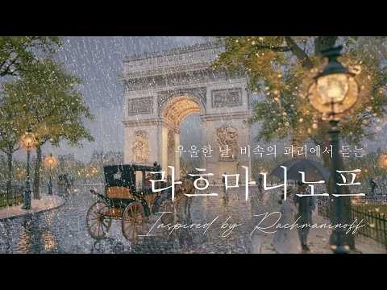
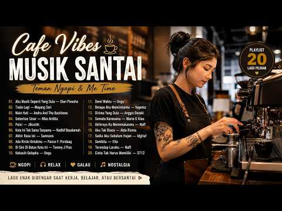
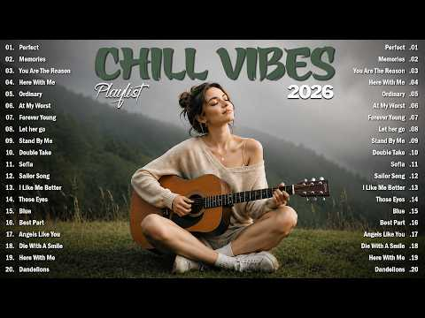
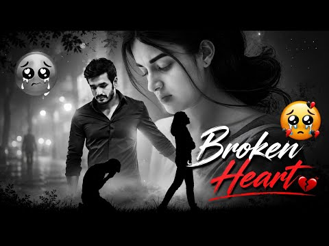
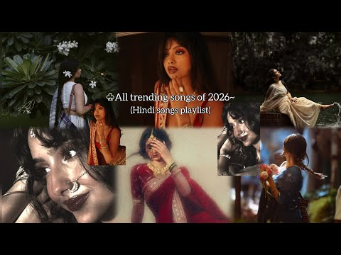
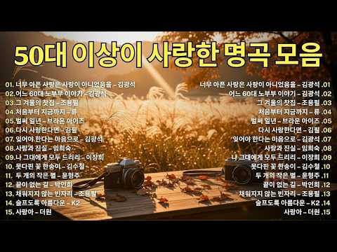
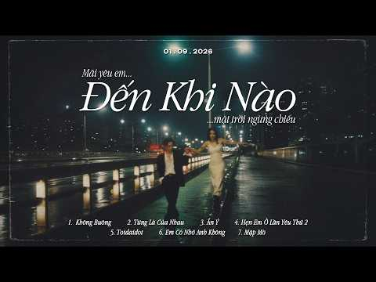

# 음악 — 성공 사례 분석: 사례별 자세히 #281–#320

`analysis.md` 의 9번 (같은 # 번호). 자동 생성 — `tools/success_analysis.py` v1.4.1 (2026-10-18 08:09 UTC). ※ 연구·교육용 — 투자 권유가 아님.

### 281. Top Spotify Hits 2026 🎵 Trending English Love Songs ∣ Acoustic Chill Vibes ∣ Viral TikTok…

- https://www.youtube.com/watch?v=FPlJt2A0yYo · Chill Chord · 구독자 11,900 · 조회수 2,527,235 (×212.4, 하루 27,656.0) · 좋아요 11,173 (0.4%) · 54.8분 · 2026-07-18 · 주제 묶음 8. 로파이·시티팝·칠 · 형식 커버·직접 부른 노래 · 폴더 `W_FPlJt2A0yYo` (웹 승인)
- 썸네일: 
- 설명 앞부분: 🎵 Welcome to the ultimate collection of Top Spotify Hits 2026, featuring trending English love songs, relaxing acoustic covers, viral TikTok music, and chill melodies for every mood. This playlist brings together romantic English songs, soft acoustic vibes, emotional pop hits, and popular tracks in…
- 대본 없음 (설명) — 음성인식이 끝나면 도입부·흐름이 들어감
- 댓글 282/282: 좋은 점 — 영상 0 · 감사·응원 1 · 더 알고 싶은 것 0 · 아쉬운 점 — 영상 0 · 반박·불만 — 의견 다름 0 · 정치·사회 0 · 경험 공유 0 · 구독·다음 기대 0
  - 감사·응원 👍1 “감사합니다.”

### 282. 이선희 노래 〈잘가요, 내사랑〉 ∣ Goodbye, The One I Loved ∣ 再见了，我曾爱过的人 ∣ さようなら、私が愛した人 ∣ Korean Ballad

- https://www.youtube.com/watch?v=Ibdr_7ukGyI · AI음악으로멜론1위찍습니다 · 구독자 3,080 · 조회수 647,012 (×210.1, 하루 4,191.1) · 좋아요 4,437 (0.7%) · 4.8분 · 2026-05-16 · 주제 묶음 9. 가요·발라드·트로트 · 형식 AI 음악 · 폴더 `W_Ibdr_7ukGyI` (웹 승인)
- 썸네일: 
- 설명 앞부분: 잘가요, 내가 사랑했던 사람. 만약 이선희의 17집이 나온다면 이런 감성의 타이틀곡이 아닐까 상상하며 만든 팬메이드 AI 음악입니다. 오랜 시간 마음에 남아 있는 사람, 끝내 전하지 못했던 마지막 인사를 담았습니다. 90년대 한국 발라드의 깊은 감성과 이선희 음악을 좋아하셨던 분들이라면 천천히 끝까지 들어보세요. ※ 본 영상은 실제 이선희 정규 17집 음원이 아닌 팬메이드 창작 콘텐츠입니다.
- 같은 채널 평소 대비 ×1,121.3 (채널 최근 롱폼 중앙값 577회) · 평소 영상: 🎵 이선희의 목소리로 듣고 싶은 13곡 ｜17집 정규앨범 DEMO 노래 ｜Lee Sun-… (656회) / 소유 x MC 스나이퍼 - 💔내 전부였는데 😭 "사랑했는데 왜 날 두고 떠나가... 🔥감… (498회)
- 대본 없음 (설명) — 음성인식이 끝나면 도입부·흐름이 들어감
- 댓글 707/707: 좋은 점 — 영상 1 · 감사·응원 36 · 더 알고 싶은 것 8 · 아쉬운 점 — 영상 8 · 반박·불만 — 의견 다름 13 · 정치·사회 2 · 경험 공유 16 · 구독·다음 기대 2
  - 좋은 점 — 영상 👍7 “이선희 명품 레전드 가수 최고”
  - 감사·응원 👍39 “이선희씨 항상 건강하시고 행복하시고 아무장애없이 좋은 일만 가득하시길 바랍니다 힘내세요 파이팅 입니다 🎉🎉🎉”
  - 감사·응원 👍37 “가수이선희님 응원합니다 ❤❤❤”
  - 더 알고 싶은 것 👍4 “내가 좋아하는 이선희 가수님! 넘 슬프네요 그리고 바보처럼 울게하네요 깊은 사연들이 뇌리속을 맴돌아 잠들지 못해 이선희 가수님의 모든 사연을 1시간넘게 이어폰으로 들은후 이 음악을 듣고 있어요 오래전 (진주mbc라이브엔죠이) 공연때 (J에게)를 부르던중 갑자기 가곡을…”
  - 더 알고 싶은 것 👍3 “이선희씨 맞나요 ?”
  - 아쉬운 점 — 영상 👍9 “노래도 좋고 가수의 가창력도 좋은데 상관도 없는 이선희님의 사진과 이름으로 사람들을 끌어 모은것은 넘무 아쉬워요”
  - 아쉬운 점 — 영상 👍3 “하루에수십번들어도너무좋아요.애절하고선희님목소리가너무이뻐요.듣고또들어도또듣고싶엉.좋은노래들려주세요”
  - 반박·불만 — 의견 다름 👍4 “이선희 노래가 아닙니다”
  - 반박·불만 — 의견 다름 👍3 “이선희아닙니다”
  - 정치·사회 👍4 “우리나라가수 통틀어서 이선희 따를자를 보지못했습니다 대단한 이선희 LP판 들을때 부터 이선희 판이 비싼거만큼 명곡이고 타가수가 따라올수 없는 말 그대로 타의추종을 불허하는 명가수십니다”
  - 정치·사회 👍2 “이선희 와 메뚜기는 좌파 입니다ㆍ 메뚜기가 논밭 헤치기 전에 잡으시다ㆍ메뚜기 이선희 이원종은 좌파 입니다ㆍ”
  - 경험 공유 👍57 “언젠가는 나도 없을 세상인데ᆢ 만나고 헤어짐을 ᆢ마무리 잘 하고 가고싶네요~~!!!”
  - 경험 공유 👍32 “이별 벌써 20년째 저는 가족 반대 때문에 헤어진 한남자 잊지 못합니다 지금 도 그사람 잊지 못합니다 아니 영윈히 기다려요 이노래가 아퍼요 그사람 마음 같아😢”
  - 구독·다음 기대 👍32 “이별 벌써 20년째 저는 가족 반대 때문에 헤어진 한남자 잊지 못합니다 지금 도 그사람 잊지 못합니다 아니 영윈히 기다려요 이노래가 아퍼요 그사람 마음 같아😢”
  - 구독·다음 기대 👍6 “안녕하세요 잘듣고갑니다 그리고 쿡하고 구독하고 갑니다 ❤❤❤행복하세요 🎉🎉🎉최고이십니다 ❤❤❤최고이십니다 🎉🎉🎉행복하세요”

### 283. Asiwafuni

- https://www.youtube.com/watch?v=9c1b0JLxKG4 · Benzoo - Topic · 구독자 11,900 · 조회수 2,475,956 (×208.1, 하루 30,979.3) · 좋아요 66,612 (2.7%) · 6.7분 · 2026-07-30 · 주제 묶음 기타 · 형식 음악 (그 밖 모양 — 한 편짜리 BGM 등) · 폴더 `W_9c1b0JLxKG4` (웹 승인)
- 썸네일: 
- 설명 앞부분: Provided to YouTube by The Orchard Enterprises Asiwafuni · Benzoo · Officixl Rsa · Optimist Music ZA · Marvens · Banele Mapulane · Thabo Musa Asiwafuni ℗ 2026 Benzoo / Manage The Right Way Released on: 2026-07-31 Producer: Godfrey Maledi Engineer: Tumelo Tweezy Mathebula A And R Administrator: sean…
- 대본 없음 (설명) — 음성인식이 끝나면 도입부·흐름이 들어감
- 댓글 0/1,350: 좋은 점 — 영상 0 · 감사·응원 0 · 더 알고 싶은 것 0 · 아쉬운 점 — 영상 0 · 반박·불만 — 의견 다름 0 · 정치·사회 0 · 경험 공유 0 · 구독·다음 기대 0

### 284. 𝐏𝐥𝐚𝐲𝐥𝐢𝐬𝐭 안 붙잡을게, 진짜로

- https://www.youtube.com/watch?v=mgSfxFVkmv4 · 탱이 · 구독자 1,680 · 조회수 348,845 (×207.7, 하루 2,887.1) · 좋아요 10,931 (3.1%) · 18.3분 · 2026-06-19 · 주제 묶음 기타 · 형식 플레이리스트·모음 (여러 곡) · 폴더 `W_mgSfxFVkmv4` (웹 승인)
- 썸네일: 
- 챕터: 0:00 Saula - Perfume · 2:59 빈첸 - FLYING HIGH WITH U · 6:23 Kaution - ed · 9:44 &TEAM - MISMATCH · 13:06 백현 - Love Again · 16:29 Joh! - ABG
- 설명 앞부분: [TIME LINE]
- 같은 채널 평소 대비 ×33.5 (채널 최근 롱폼 중앙값 10,411회) · 평소 영상: 𝐏𝐥𝐚𝐲𝐥𝐢𝐬𝐭 내가 작정하고 누나 꼬시면 생기는 일 (10,411회) / 𝐏𝐥𝐚𝐲𝐥𝐢𝐬𝐭 순정만화 속 여주인공이 되어보자 (13,147회)
- 대본 없음 (설명) — 음성인식이 끝나면 도입부·흐름이 들어감
- 댓글 150/150: 좋은 점 — 영상 0 · 감사·응원 1 · 더 알고 싶은 것 1 · 아쉬운 점 — 영상 0 · 반박·불만 — 의견 다름 0 · 정치·사회 0 · 경험 공유 14 · 구독·다음 기대 0
  - 감사·응원 👍0 “오...... 감사합니다”
  - 더 알고 싶은 것 👍2 “첫노래 제목알려주세요”
  - 경험 공유 👍50 “안 믿으실 수도 있지만 이 닉네임이 12년째 쓰고 있는 자호 같은 이름인데 시온님 성함이랑 한자까지 똑같더라고요 그 미묘한 내적 친밀감 때문인지 노래들이 다 좋아서 그런지 새벽이라 그런지 셋 다인지 상당히 과몰입이 되네요 같은 나라에 태어나서 같은 언어로 말을 해도 …”
  - 경험 공유 👍13 “그냥 붙잡아줘 미안해 스미마셍 뚜이부치 씬 로이 로시엔토 내가 잘못했어 용서해줘”

### 285. Sad Song Playlist (+ with timestamps) !!

- https://www.youtube.com/watch?v=q48Y5Hf83Bk · Mood Tapes 🎶 · 구독자 17,900 · 조회수 3,663,675 (×204.7, 하루 28,033.0) · 좋아요 44,444 (1.2%) · 14.7분 · 2026-06-09 · 주제 묶음 기타 · 형식 플레이리스트·모음 (여러 곡) · 폴더 `W_q48Y5Hf83Bk` (웹 승인)
- 썸네일: 
- 챕터: 0:00 Ae Dil Hai Mushkil · 1:08 Piya aaye na · 3:05 samjhawan · 5:21 tu hi hai Aashiqui · 6:54 Humnava mere · 9:29 yun hi re · 12:15 ishq karu
- 설명 앞부분: All Songs and Images belong to their respective owners (and not to this channel) !!! Subscribe for more amazing playlists CURATED especially for YOU 🫶🏻 Tags: bollywood Songs, bollywood dance songs, item songs playlist, sad song playlist, party songs hindi, sassy songs,bollywood songs, dance hits, d…
- 대본 없음 (설명) — 음성인식이 끝나면 도입부·흐름이 들어감
- 댓글 1,520/1,500: 좋은 점 — 영상 0 · 감사·응원 0 · 더 알고 싶은 것 0 · 아쉬운 점 — 영상 0 · 반박·불만 — 의견 다름 0 · 정치·사회 0 · 경험 공유 0 · 구독·다음 기대 0

### 286. Odysseus

- https://www.youtube.com/watch?v=WCxx_OVOVUw · Ludwig Göransson - Topic · 구독자 43,300 · 조회수 8,838,833 (×204.1, 하루 94,107.2) · 좋아요 160,217 (1.8%) · 8.7분 · 2026-07-16 · 주제 묶음 13. OST·사운드트랙 · 형식 음악 (그 밖 모양 — 한 편짜리 BGM 등) · 폴더 `W_WCxx_OVOVUw` (웹 승인)
- 썸네일: 
- 설명 앞부분: Provided to YouTube by Back Lot Music Odysseus · Ludwig Göransson The Odyssey (Original Motion Picture Soundtrack) ℗ 2026 Back Lot Music, a division of Universal Studios Music LLLP Released on: 2026-07-17 Main Artist: Ludwig Göransson Producer: Ludwig Göransson Composer: Ludwig Göransson Auto-gener…
- 대본 없음 (설명) — 음성인식이 끝나면 도입부·흐름이 들어감
- 댓글 0/5,594: 좋은 점 — 영상 0 · 감사·응원 0 · 더 알고 싶은 것 0 · 아쉬운 점 — 영상 0 · 반박·불만 — 의견 다름 0 · 정치·사회 0 · 경험 공유 0 · 구독·다음 기대 0

### 287. VIVANT ᐸMain themeᐳ

- https://www.youtube.com/watch?v=MuGFcUggtDs · Akira Senju - Topic · 구독자 7,280 · 조회수 1,478,505 (×203.1, 하루 17,766.1) · 좋아요 13,246 (0.9%) · 4.6분 · 2026-07-27 · 주제 묶음 13. OST·사운드트랙 · 형식 정보·해설 (그 밖) · 폴더 `W_MuGFcUggtDs` (웹 승인)
- 썸네일: 
- 설명 앞부분: Provided to YouTube by NICHION VIVANT ᐸMain themeᐳ · 千住明 TBS系 日曜劇場「VIVANT」ORIGINAL SOUNDTRACK ℗ 2023 Anchor Records Composer: 千住明 Arranger: 千住明 Auto-generated by YouTube.
- 대본 없음 (설명) — 음성인식이 끝나면 도입부·흐름이 들어감
- 댓글 0/0: 좋은 점 — 영상 0 · 감사·응원 0 · 더 알고 싶은 것 0 · 아쉬운 점 — 영상 0 · 반박·불만 — 의견 다름 0 · 정치·사회 0 · 경험 공유 0 · 구독·다음 기대 0

### 288. Gladiator Ambience — Cinematic & Emotional Music for Honor and Memory

- https://www.youtube.com/watch?v=iBofqYaXA_U · sleyvenn · 구독자 5,050 · 조회수 1,019,143 (×201.8, 하루 7,175.0) · 좋아요 9,347 (0.9%) · 120분 · 2026-05-29 · 주제 묶음 2. 자연 소리·백색소음 · 형식 음악 (그 밖 모양 — 한 편짜리 BGM 등) · 폴더 `W_iBofqYaXA_U` (웹 승인)
- 썸네일: 
- 설명 앞부분: Cinematic and emotional ambient music inspired by the world of Gladiator, created for honor, memory and reflection. An ambient reinterpretation inspired by the emotional atmosphere surrounding Honor Him and the legacy carried throughout the story of Maximus. This was actually a piece I originally w…
- 대본 없음 (설명) — 음성인식이 끝나면 도입부·흐름이 들어감
- 댓글 284/284: 좋은 점 — 영상 0 · 감사·응원 0 · 더 알고 싶은 것 0 · 아쉬운 점 — 영상 0 · 반박·불만 — 의견 다름 0 · 정치·사회 0 · 경험 공유 0 · 구독·다음 기대 0

### 289. [Playlist] 스트레이 키즈 노래 모음 연속 듣기 🔥 Stray Kids Best Songs 2026 (God's Menu, Maniac, Chk Chk …

- https://www.youtube.com/watch?v=Lj8FLAC9h58 · 내귀에 PLY · 구독자 2,300 · 조회수 461,523 (×200.7, 하루 6,948.3) · 좋아요 9,637 (2.1%) · 120.4분 · 2026-08-12 · 주제 묶음 10. 팝송·K팝·J팝 · 형식 플레이리스트·모음 (여러 곡) · 폴더 `W_Lj8FLAC9h58` (웹 승인)
- 썸네일: 
- 챕터: 0:00 This & That · 3:04 RUN IT · 6:29 Walkin On Water · 9:15 CEREMONY · 11:57 Chk Chk Boom · 14:21 神메뉴 (God's Menu) · 17:08 S-Class (특) · 20:22 MANIAC · 23:25 락 (LALALALA) · 26:24 Back Door · 29:31 Thunderous (소리꾼) · 32:32 CASE 143 · 35:42 JJAM · 38:44 Mountains · 41:49 I Like It · 44:15 MEGAVERSE · 47:19 ITEM · 50:30 DOMINO · 53:47 TOPLINE (Feat. Tiger JK) · 57:09 강박 (Red Lights)
- 설명 앞부분: Stray Kids (스트레이 키즈) 대표 명곡 모음 플레이리스트 2026 🎧🔥 'Chk Chk Boom', 'God's Menu (신메뉴)', 'S-Class (특)' 등 스트레이 키즈의 글로벌 히트곡과 인기 띵곡들을 연속으로 감상해 보세요! 오늘 하루도 스트레이 키즈의 파워풀하고 중독성 있는 마라맛 음악으로 에너지 충전하세요! ⚡ Enjoy the ultimate Stray Kids Best Songs Playlist 2026! 🎧🔥 From global hit tracks like 'Chk Chk Boom', 'God's M…
- 같은 채널 평소 대비 ×1,357.4 (채널 최근 롱폼 중앙값 340회) · 평소 영상: Playlist ∣ 달달함에 빠져드는 여름 셀렘 감성 플 ☕ #R&B #인디팝(중간광고없… (340회) / 🎧[Playlist] 이별 감성 국내 R&B & POP 🎧 ∣ 첫 곡 듣고 바로 저장함☀️ (350회)
- 대본 없음 (설명) — 음성인식이 끝나면 도입부·흐름이 들어감
- 댓글 164/164: 좋은 점 — 영상 0 · 감사·응원 1 · 더 알고 싶은 것 1 · 아쉬운 점 — 영상 0 · 반박·불만 — 의견 다름 0 · 정치·사회 0 · 경험 공유 1 · 구독·다음 기대 0
  - 감사·응원 👍88 “안그래도 새 노래 들어간 플리 필요했는데 감사해요! 길이도 아주 좋아~”
  - 더 알고 싶은 것 👍9 “수록곡들도 만들어주세요!!”

### 290. सुकून देने वाली धुन 🏔️ ∣ Mind Relaxing Music ∣ Flute Music

- https://www.youtube.com/watch?v=dLdXYN50hgQ · Soulful Music Melody · 구독자 4,510 · 조회수 904,871 (×200.6, 하루 6,713.8) · 좋아요 6,315 (0.7%) · 5.9분 · 2026-06-05 · 주제 묶음 기타 · 형식 음악 (그 밖 모양 — 한 편짜리 BGM 등) · 폴더 `W_dLdXYN50hgQ` (웹 승인)
- 썸네일: 
- 설명 앞부분: सुकून देने वाली धुन 🏔️ ∣ Mind Relaxing Music ∣ Flute Music यह एक शांत और सुकून देने वाला Flute / Mind Relaxing Music है, जिसे ध्यान, मेडिटेशन, रिलैक्सेशन, पढ़ाई और मानसिक शांति के लिए सुना जा सकता है। 🎶 Music Information: Music Type: Flute / Relaxing Instrumental Music No third-party song or copyri…
- 대본 없음 (설명) — 음성인식이 끝나면 도입부·흐름이 들어감
- 댓글 331/331: 좋은 점 — 영상 0 · 감사·응원 0 · 더 알고 싶은 것 0 · 아쉬운 점 — 영상 0 · 반박·불만 — 의견 다름 0 · 정치·사회 0 · 경험 공유 0 · 구독·다음 기대 0

### 291. Italian Deep House 2026 ∣ Mediterranean Vibes

- https://www.youtube.com/watch?v=Cr5KN_TuQNk · House Italiano · 구독자 24,400 · 조회수 4,894,147 (×200.6, 하루 27,245.7) · 좋아요 38,721 (0.8%) · 14.6분 · 2026-04-21 · 주제 묶음 8. 로파이·시티팝·칠 · 형식 음악 (그 밖 모양 — 한 편짜리 BGM 등) · 폴더 `W_Cr5KN_TuQNk` (웹 승인)
- 썸네일: 
- 챕터: 0:00 Fuoco Nella Sabbia · 2:31 Passione Vera · 6:12 Ritmo del Sud · 9:48 Dolce Arrivo · 12:28 Ultima Danza
- 설명 앞부분: You can find us on Spotify: Escape to the heart of Italy with this smooth and uplifting deep house mix inspired by Mediterranean sunsets, coastal breezes, and the timeless charm of la dolce vita. From golden hour by the sea to late-night drives along the coast, this mix is designed to bring you pur…
- 같은 채널 평소 대비 ×413.4 (채널 최근 롱폼 중앙값 11,840회) · 평소 영상: Italian Deep House 2026 ∣ MAFIOSA (13,365회) / Ice & Fire ∣ Sunset Italian Deep House Mix (10,314회)
- 대본 없음 (설명) — 음성인식이 끝나면 도입부·흐름이 들어감
- 댓글 387/387: 좋은 점 — 영상 0 · 감사·응원 0 · 더 알고 싶은 것 0 · 아쉬운 점 — 영상 0 · 반박·불만 — 의견 다름 0 · 정치·사회 0 · 경험 공유 0 · 구독·다음 기대 0

### 292. राग भैरव ∣ भगवान शिव का पवित्र प्रभात राग ∣ Raga Bhairav ∣ Morning Meditation & Healing M…

- https://www.youtube.com/watch?v=3kgbzavVRiY · मनतरंग | ManTarang · 구독자 1,950 · 조회수 387,317 (×198.6, 하루 9,304.5) · 좋아요 5,093 (1.3%) · 11.7분 · 2026-09-06 · 주제 묶음 1. 수면·명상·힐링 · 형식 음악 (그 밖 모양 — 한 편짜리 BGM 등) · 폴더 `W_3kgbzavVRiY` (웹 승인)
- 썸네일: 
- 설명 앞부분: 🌅 सुबह ध्यान (Morning Meditation) के समय 🌅 Sacred Morning Raga 🧘 Morning Meditation Music 🕉️ Shiva Meditation Music 🎵 Indian Classical Healing Music 🙏 Spiritual Relaxation Music यदि आपको भगवान शिव, भारतीय राग संगीत, ध्यान संगीत और आध्यात्मिक संगीत पसंद है, तो इस वीडियो को Like करें और हमारे चैनल को…
- 대본 없음 (설명) — 음성인식이 끝나면 도입부·흐름이 들어감
- 댓글 82/82: 좋은 점 — 영상 0 · 감사·응원 0 · 더 알고 싶은 것 0 · 아쉬운 점 — 영상 0 · 반박·불만 — 의견 다름 0 · 정치·사회 0 · 경험 공유 0 · 구독·다음 기대 0

### 293. Iske da faniyaar song Slowed + Reverb Lofi Music Mix ∣ Chill Beats for Study, Sleep & Nig…

- https://www.youtube.com/watch?v=yoLa1Xlkhvo · @sanjumusic · 구독자 5,440 · 조회수 1,078,801 (×198.3, 하루 10,288.4) · 좋아요 22,576 (2.1%) · 5.1분 · 2026-07-05 · 주제 묶음 1. 수면·명상·힐링 · 형식 음악 (그 밖 모양 — 한 편짜리 BGM 등) · 폴더 `W_yoLa1Xlkhvo` (웹 승인)
- 썸네일: 
- 설명 앞부분: Ultimate Slowed + Reverb Lofi Music Mix ∣ Chill Beats for Study, Sleep & Night Vibes Drift into the perfect late-night atmosphere with this slowed + reverb lofi music mix. Every track is carefully pitched down and layered with warm reverb to create that dreamy, nostalgic sound you love — ideal for …
- 대본 없음 (설명) — 음성인식이 끝나면 도입부·흐름이 들어감
- 댓글 217/217: 좋은 점 — 영상 0 · 감사·응원 0 · 더 알고 싶은 것 0 · 아쉬운 점 — 영상 0 · 반박·불만 — 의견 다름 0 · 정치·사회 0 · 경험 공유 0 · 구독·다음 기대 0

### 294. A playlist of nusrat fateh ali khan all popular qawaali's 💝💘

- https://www.youtube.com/watch?v=idCpl6LfnKo · preet_slaylist  · 구독자 49,800 · 조회수 9,844,263 (×197.7, 하루 63,717.1) · 좋아요 122,670 (1.2%) · 9.2분 · 2026-05-16 · 주제 묶음 기타 · 형식 플레이리스트·모음 (여러 곡) · 폴더 `W_idCpl6LfnKo` (웹 승인)
- 썸네일: 
- 설명 앞부분: Timestamps: Don't copy this video for your playlists channel please.
- 대본 없음 (설명) — 음성인식이 끝나면 도입부·흐름이 들어감
- 댓글 4,952/4,895: 좋은 점 — 영상 0 · 감사·응원 0 · 더 알고 싶은 것 0 · 아쉬운 점 — 영상 0 · 반박·불만 — 의견 다름 0 · 정치·사회 0 · 경험 공유 0 · 구독·다음 기대 0

### 295. #등불 - #영사운드(1972년) Covered by sMUSIC#영사운드 #Reinterpreting K-pop Classics #남자보컬

- https://www.youtube.com/watch?v=tW_gZzlbg-4 · sMusic 7080_명곡 리메이크곡 커버곡  · 구독자 6,860 · 조회수 1,344,585 (×196.0, 하루 8,334.2) · 좋아요 3,715 (0.3%) · 4.2분 · 2026-05-10 · 주제 묶음 10. 팝송·K팝·J팝 · 형식 커버·직접 부른 노래 · 폴더 `W_tW_gZzlbg-4` (웹 승인)
- 썸네일: 
- 같은 채널 평소 대비 ×417.8 (채널 최근 롱폼 중앙값 3,218회) · 평소 영상: #어느60대노부부이야기 #김광석 (1992년) #7080가요 #7080추억의곡 #리메이크… (3,563회) / #비나리 #심수봉 (1986년) #7080가요 #7080추억의곡 #리메이크명곡 #커버명곡… (2,874회)
- 대본 없음 (없음) — 음성인식이 끝나면 도입부·흐름이 들어감
- 댓글 296/296: 좋은 점 — 영상 1 · 감사·응원 34 · 더 알고 싶은 것 4 · 아쉬운 점 — 영상 0 · 반박·불만 — 의견 다름 2 · 정치·사회 1 · 경험 공유 10 · 구독·다음 기대 3
  - 좋은 점 — 영상 👍2 “우연히 검색하다 듣게 됐는데 선생님 노래 너무 좋아요~잠시나마 추억에 젖어 보내요~이계절에 듣기 좋은거 같아요~좋은 노래 감사해요❤❤❤❤❤❤❤❤❤❤❤❤❤”
  - 감사·응원 👍27 “젊은 시절의 감성이 고스란히 녹아있는 좋은 음악 감사합니다”
  - 감사·응원 👍8 “마음은 등불노래에 온전히 녹여지다 감사합니다❤❤❤”
  - 더 알고 싶은 것 👍3 “멋진 목소리의 주인공이 참 궁금하네요.”
  - 더 알고 싶은 것 👍3 “아주 멋져요. 고목 (윤시내), 내 인생 바람에 실어 (장미화) -> 소울 가득한 느낌 부르스 락 버젼 가능할까요. 부탁드려봅니다.”
  - 반박·불만 — 의견 다름 👍1 “땡땡땡 종쳤데이 학교 파했으니 이제 집으로 돌아가자~~ 뭔소리일까요? 글쎄요. 그 종은 애밀래 종일 겁니다. 알라를 와 밀겠습니꺼 감사합니다 👁💥💜🐚🐣🐉🦋💎🙏”
  - 반박·불만 — 의견 다름 👍0 “좀 섬뜩하지 않나요. 인간이 아닌데 인간 이상의 감동을 만든다는건 뭔가 잘못되어 가고 있어요. 점차 인간이 서있을 자리가 사라 질겁니다. 지금의 이 환호가 저주가 될수도 있어요”
  - 정치·사회 👍0 “자식많은 부모님마냥 일하는데 왜이리볼멘소리들하시는지격려해주세요 대통령님께❤”
  - 경험 공유 👍18 “여인 첨듣는 곡인데 참 절절하고 애절하네요ㆍ어떤 여인을 가슴 깊이 절절이 짝사랑했었나 봅니다ㆍ”
  - 경험 공유 👍13 “내가 지금 60대인데 10대 후반부터 들었던 가장 쓸쓸한 감정을 두번다시 어느누구도 그 감정을 대체할 수없습니댜.”
  - 구독·다음 기대 👍3 “좋아요 구독누르고 듣습니다!!”
  - 구독·다음 기대 👍3 “방금 구독했습니다. 오랜만에 좋은 노래 들어요. 광안리 커피숍에서 듣고 있습니다. 천천히 좋은 노래 감상할께요. 추억을 먹고 사는 나이라.”

### 296. 하루 한 번 듣는 신묘장구대다라니 ∣ 15가지 재앙을 막고 77가지 복을 부르는 진언 #신묘장구대다라니 #천수경 #관세음보살 #명상음악 #기도음악 #불교음악 #…

- https://www.youtube.com/watch?v=nDhxAWNwhYc · KARMA FLOW · 구독자 724 · 조회수 141,444 (×195.4, 하루 787.3) · 좋아요 1,099 (0.8%) · 5.8분 · 2026-04-21 · 주제 묶음 15. CCM·찬양·국악·동요 · 형식 플레이리스트·모음 (여러 곡) · 폴더 `W_nDhxAWNwhYc` (웹 승인)
- 썸네일: 
- 설명 앞부분: 신묘장구대다라니 ∣ 천수경 핵심 진언 ∣ 불교음악 · 명상음악 · 기도음악 15가지 재앙을 막고, 7가지 복을 얻는다고 전해지는 신묘장구대다라니. 관세음보살의 자비와 위신력이 담긴 천수경의 핵심 진언이며, 한 구절 한 구절마다 기적의 힘이 담겨 있다고 전해집니다. 우주의 깊은 파장을 머금은 이 진언의 울림이 불안과 괴로움, 막힌 흐름 위에 닿아 오늘의 마음에도 다시 평안과 복이 피어나기를 바라며 이 음악을 만들었습니다. 🙏 재앙과 액운이 멀어지기를 🙏 무거운 업장과 답답함이 가벼워지기를 🙏 막혀 있던 복의 흐름이 다시 열리기를 🙏…
- 대본 없음 (설명) — 음성인식이 끝나면 도입부·흐름이 들어감
- 댓글 117/117: 좋은 점 — 영상 1 · 감사·응원 23 · 더 알고 싶은 것 1 · 아쉬운 점 — 영상 0 · 반박·불만 — 의견 다름 0 · 정치·사회 1 · 경험 공유 5 · 구독·다음 기대 0
  - 좋은 점 — 영상 👍7 “관세음보살 관세음보살 관세음보살 부서진 마음에도 길은 있고 멈춘 복도 다시 흐르길 좋은 영상 감사합니다 위로받고 갑니다”
  - 감사·응원 👍12 “나무아미타불 관세음보살 지장보살마하살 부처님! 행운과 재물이 늘함께하길 소원합니다 감사합니다🙏”
  - 감사·응원 👍10 “업장소멸되어 맘편히 살게 해주셔서 감사합니다🙏”
  - 더 알고 싶은 것 👍3 “6개의 노래가 자동으로 재생이 되게 혹시 하나의 영상으로 올려주실수 있나요?”
  - 정치·사회 👍0 “이재명대통령지켜주세요연임하게해주세요다치지않게해주세요지켜주세요20년연임하게해주세요거짓말쟁이조폭깡패윤석열김건희미국모스탄도국힘당의원들도이진숙도감옥 사형 사형국힘김두겸황교안오세훈추경호한동훈최상목국힘당들의원전광훈전한길2찍태극기부대들사기꾼얼굴윤석열당선무효벌금100넘게나오길빕니다…”
  - 경험 공유 👍6 “관세음보살님.. 지장 보살님.. 부처님의 공덕과 자비로 주희와저를 부부의 연을 맺도록 도와주시고 주희가 힘들고 괴로울때 아프고 슬블때 저에게 기대어 쉴수 있게 하식ㆍㄷ 저희들에게 대박의 기운을 주시어 세상에 작은 밀알이 되게 하시고 저희들 가족과 어머님. 무병장수하게…”
  - 경험 공유 👍5 “빚다갚고 나도이롭고 남도이루운삶을 살겠습니다 ᆢ 로또당첨ᆢ관세음보살ᆢ”

### 297. 빗속 파리의 라흐마니노프 🌧️ In the Style of Rachmaninoff , 깊고 잔잔한 클래식 1시간

- https://www.youtube.com/watch?v=msDBphyeZIc · Moonlight replay · 구독자 2,390 · 조회수 466,789 (×195.3, 하루 4,882.6) · 좋아요 2,840 (0.6%) · 65.6분 · 2026-07-14 · 주제 묶음 6. 피아노·클래식·연주곡 · 형식 플레이리스트·모음 (여러 곡) · 폴더 `W_msDBphyeZIc` (웹 승인)
- 썸네일: 
- 설명 앞부분: [ 비 오는 밤 클래식 피아노 ∣ 라흐마니노프에서 영감받은 독서·공부·수면 음악 Rachmaninoff-Inspired Piano ∣ Rainy Paris Classical Music for Reading, Sleep & Focus Romantic classical piano with deep, expressive melodies, perfect for relaxing, studying, working, meditation, and peaceful nights.] 이 음악은 세르게이 라흐마니노프의 음악에서 영감을 받아 만든 클래식…
- 대본 없음 (설명) — 음성인식이 끝나면 도입부·흐름이 들어감
- 댓글 116/116: 좋은 점 — 영상 0 · 감사·응원 10 · 더 알고 싶은 것 1 · 아쉬운 점 — 영상 0 · 반박·불만 — 의견 다름 0 · 정치·사회 0 · 경험 공유 1 · 구독·다음 기대 1
  - 감사·응원 👍29 “순간을 전체로 생각하여 고통스러워 하지마라 슬퍼하지 마라 다시한번 깨닫고 갑니다 감사합니다”
  - 감사·응원 👍7 “비가 내리는 월욜 아침ᆢ 마음을 편안하고 감성적으로 적셔주는 이 음악이 넘 소중하네요 감사합니다~~♡”
  - 더 알고 싶은 것 👍0 “첫 음악 곡명 궁금해요 악보 얻을 수 있을까요?”
  - 경험 공유 👍12 “라흐마니노프를 대학교 첫 입학해서 첫 위클리때 쳐보고 완젼 반했었죠 … 연습 하기는 까다롭지만 연주곡으로 효과도 뛰어나고 그 음색과 섬세함의 남다름에 정말 이런 음색을 어떻게 찾아낼까? 한동안 빠졌었던 ,,, 그 이후 몇곡 더 연주했었는데 …. 이제 나이가 들어서 파…”
  - 구독·다음 기대 👍2 “라흐마니로프 음악은 다가 가기 어려운 곡이면서 너무 듣고 싶은 곡인데 ~~. 곡을 너무 잘 살리셨어요 잘 감상하고 구독합니다”

### 298. Lagu Pop Santai Indonesia 2026 ☕ Lagu Pop Indonesia Terbaik & Paling Enak Didengar

- https://www.youtube.com/watch?v=MoghOkKhNFk · MITRO MUSIC · 구독자 5,450 · 조회수 1,060,009 (×194.5, 하루 6,847.7) · 좋아요 2,356 (0.2%) · 83.7분 · 2026-05-16 · 주제 묶음 3. 공부·집중·작업 · 형식 플레이리스트·모음 (여러 곡) · 폴더 `W_MoghOkKhNFk` (웹 승인)
- 썸네일: 
- 설명 앞부분: ☕ Selamat datang di suasana Cafe Vibes Musik Santai Indonesia — playlist lagu pop nostalgia terbaik yang siap menemani waktu ngopi, kerja, belajar, santai malam, perjalanan, hingga me time kamu. Nikmati kumpulan lagu Indonesia pilihan dengan nuansa hangat, galau, tenang, dan relaxing yang cocok dip…
- 대본 없음 (설명) — 음성인식이 끝나면 도입부·흐름이 들어감
- 댓글 178/176: 좋은 점 — 영상 0 · 감사·응원 0 · 더 알고 싶은 것 0 · 아쉬운 점 — 영상 0 · 반박·불만 — 의견 다름 0 · 정치·사회 0 · 경험 공유 0 · 구독·다음 기대 0

### 299. 애매모호한 첫사랑

- https://www.youtube.com/watch?v=A6rImTTl348 · na tsu · 구독자 933 · 조회수 181,463 (×194.5, 하루 1,996.6) · 좋아요 7,930 (4.4%) · 19.3분 · 2026-07-19 · 주제 묶음 기타 · 형식 플레이리스트·모음 (여러 곡) · 폴더 `W_A6rImTTl348` (웹 승인)
- 썸네일: 
- 설명 앞부분: 흐르는 것들은 하늘과 모든 걸 품었지만 우린 품지 못했으니 *알레프, 자유
- 대본 없음 (설명) — 음성인식이 끝나면 도입부·흐름이 들어감
- 댓글 419/419: 좋은 점 — 영상 2 · 감사·응원 11 · 더 알고 싶은 것 2 · 아쉬운 점 — 영상 1 · 반박·불만 — 의견 다름 3 · 정치·사회 0 · 경험 공유 44 · 구독·다음 기대 0
  - 좋은 점 — 영상 👍0 “그때 잘 했더라면 지금 다시 만나다면 그때 했던 실수를 안 할 자신있다 믿었는데 어느날 바뀐 너의 프로필사진에 밝게 웃는 모습을 보고 너와 멀어져야겠다 생각했어. 돌아보니 내 옆에있던 넌 한편의 슬픔이 담긴 눈이였는데 지금 만나는 사람과는 그런 슬픔과 걱정없이 너무 …”
  - 좋은 점 — 영상 👍0 “선곡 최고에요 감사합니다🥲 구구절절 내 마음을 적다가 너무 구차해보여서 전부 다 지웠지만 아무튼 보고싶다!!! 그냥 언제 어디에서나 다치지 말고 건강하고 행복하게 잘 지내길”
  - 감사·응원 👍4 “To. 너 이렇게 편지를 쓰는 것도 정말 오랜만이네. 이걸 네 생일에 적었더라면 정말 좋았을 텐데. 올해 네 생일을 축하 못한 것도 정말 미안하고 아쉬워. 하고 싶은 말이 많았는데 막상 글로 써 내려가려니까 두서없이 적게 된다. 네가 없는 동안 어쩌다 보니 문학도 많…”
  - 감사·응원 👍3 “주인장 말투 너무 커여워요 ❤ 이런 감성 플리는 진짜 처음인데 생각보다 너무 좋아요.. 새로운 취향을 찾은 것 같아요! 잘 들을게요 감사해요!”
  - 더 알고 싶은 것 👍3 “다들 여기에 첫사랑 이야기를 푸시는데.. 저도 그런 느낌이 뭔지 알고싶네요”
  - 더 알고 싶은 것 👍0 “중학교 때 좋아하지도 않는데 먼저 고백했다는 이유로 너가 받아줬었잖아, 그 남자애. 결국 둘이 흐지부지됐지만 아직도 가끔 궁금하다. 내가 고백해도 똑같이 받아줬을까? 오늘도 전화하고 왔는데 왜 아직도 너가 이렇게 좋은지 모르겠어. 아무리 다른 여자 사겨도 결국 헤어지…”
  - 반박·불만 — 의견 다름 👍113 “제목을 보자마자 한사람이 떠올라서 홀린듯이 클릭해버렸어요. 이런 플리 잘 안들을 것 같아서 그냥 터놓고 말할게. 중학교 때 처음 만난 언니. 정말 예쁘고, 멋지고 빛이 나서 이보다 주인공 같은 사람이 있을까 싶은 사람. 정병 와서 새벽에 연락해도 꼬박꼬박 답장해주고 …”
  - 반박·불만 — 의견 다름 👍1 “여자 사이에서는 동성애에 대한 인식이 남자들 사이에서는 다른가요.. 남자는 게이라면 아예 말도안되고 상상도 하기싫은 존재로 여겨지는데...”
  - 경험 공유 👍191 “진짜 내가 여자만 아니었다면 꼬셔버리고 싶은 여사친 1명쯤 있지 않나요?ㅋㅋ”
  - 경험 공유 👍145 “너싫어 왜냐면너는 바보고 이기적이고 말도많고 이상하고 사랑스럽고 사랑스럽고 사랑스럽고 몰라그냥싫어 너랑말안해 연락도안해주고뭐야이게 나도너남자좋아하는거아는데 그러면왜그랫냐고나한테 껴안고무릎에눕고뽀뽀하려하고 그러면서남자좋아한다는이유ㅠ로내고백안받아주면 난정말울지도몰라 너그…”

### 300. 일할 때 듣기 좋은 발라드 베스트 100곡 🌸 광고 없는 감성 플레이리스트 왁스, 소울스타, 원티드, 임창정, 성시경, 더원, 백지영, 김필, 김범수, 양파 #…

- https://www.youtube.com/watch?v=aJ61beIT3qc · Dragon Melody · 구독자 1,260 · 조회수 245,035 (×194.5, 하루 1,991.4) · 좋아요 821 (0.3%) · 138.7분 · 2026-06-17 · 주제 묶음 9. 가요·발라드·트로트 · 형식 플레이리스트·모음 (여러 곡) · 폴더 `W_aJ61beIT3qc` (웹 승인)
- 썸네일: 
- 설명 앞부분: 안녕하세요! 🎶 바람의 발라드* 채널에 오신 것을 환영합니다. 이곳은 **90년대부터 2000년대까지의 레전드 한국 발라드**를 사랑하는 모든 분들을 위한 감성 음악 채널입니다. 🕰️ *추억 속으로 떠나는 시간 여행 한국 발라드의 전성기였던 1990\~2000년대! 감미로운 멜로디**와 **감성적인 가사**가 어우러진 명곡들은 지금도 많은 이들의 마음을 울리고 있습니다. 그 시절 감동을 다시 느껴보세요. 🎤 *당신이 사랑했던 발라드 가수 총출동 김범수, 임재범, 성시경, 박효신, 이수영, 거미, 휘성, 플라이 투 더 스카이, 조성…
- 같은 채널 평소 대비 ×548.8 (채널 최근 롱폼 중앙값 446회) · 평소 영상: 일할 때 듣기 좋은 발라드 베스트 100곡 ❄️🎶광고 없는 감성 플레이리스트 ∣ 임창정,… (471회) / 일할 때 듣기 좋은 발라드 베스트 100곡 ❄️🎶광고 없는 감성 플레이리스트 ∣ 임창정,… (422회)
- 대본 없음 (설명) — 음성인식이 끝나면 도입부·흐름이 들어감
- 댓글 30/30: 좋은 점 — 영상 0 · 감사·응원 3 · 더 알고 싶은 것 0 · 아쉬운 점 — 영상 1 · 반박·불만 — 의견 다름 0 · 정치·사회 0 · 경험 공유 0 · 구독·다음 기대 0
  - 감사·응원 👍0 “감사합니다 ^^”
  - 감사·응원 👍0 “제목을 같이 올려 주셔서 감사합니다.”
  - 아쉬운 점 — 영상 👍0 “광고가 없다고 했는데 있네요”

### 301. 𝐏𝐥𝐚𝐲𝐥𝐢𝐬𝐭 듣자마자 흥 폭발하는🔥 최신 K-POP 노래 모음 노동요

- https://www.youtube.com/watch?v=yngpCQNKY_M · 클로버 플레이리스트 · 구독자 3,580 · 조회수 691,720 (×193.2, 하루 6,013.7) · 좋아요 3,641 (0.5%) · 40.9분 · 2026-06-25 · 주제 묶음 10. 팝송·K팝·J팝 · 형식 플레이리스트·모음 (여러 곡) · 폴더 `W_yngpCQNKY_M` (웹 승인)
- 썸네일: 
- 같은 채널 평소 대비 ×8.9 (채널 최근 롱폼 중앙값 77,683회) · 평소 영상: 𝐏𝐥𝐚𝐲𝐥𝐢𝐬𝐭 들으면 하루가 기분 좋아지는✨ 리센느 노래 모음 (80,135회) / 𝐏𝐥𝐚𝐲𝐥𝐢𝐬𝐭 엔믹스 한 번 빠지면 못 나오는🫧 NMIXX 노래 모음 노동요 (75,231회)
- 대본 없음 (없음) — 음성인식이 끝나면 도입부·흐름이 들어감
- 댓글 69/69: 좋은 점 — 영상 1 · 감사·응원 3 · 더 알고 싶은 것 1 · 아쉬운 점 — 영상 0 · 반박·불만 — 의견 다름 0 · 정치·사회 0 · 경험 공유 0 · 구독·다음 기대 0
  - 좋은 점 — 영상 👍0 “너무 듣기 좋아요 저가 좋아하는 노래 만 있어요”
  - 감사·응원 👍28 “k pop 처돌이 의대생인데요,,,아직도 종강을 못하고있는데요 (눈물),,, 시험전에 급하게 빡세게 공부해야할때 빡칠때.. 전투력 기분좋게 상승하네요 감사합니다ㅠ 덕분에 살아요..”
  - 감사·응원 👍3 “다 요즘 노래네요!! 찾아보신게 대단해요!! 떡상 응원할게용❤❤❤ 구독 ㄱㄱ❤❤❤”

### 302. 🍉 아침에 커피 마시면서 혼자 듣는데 너무좋다. ∣ 하루 종일 틀어 놓으세요🎵7080추억의 올드팝 #감성팝송 #카페음악 #49 여성보컬

- https://www.youtube.com/watch?v=iRAcLZyPbsA · woozune · 구독자 5,780 · 조회수 1,107,471 (×191.6, 하루 13,438.6) · 좋아요 3,290 (0.3%) · 74.3분 · 2026-07-27 · 주제 묶음 9. 가요·발라드·트로트 · 형식 음악 (그 밖 모양 — 한 편짜리 BGM 등) · 폴더 `W_iRAcLZyPbsA` (웹 승인)
- 썸네일: 
- 챕터: 0:00 . Saltwater Echoes (소금물에 담긴 메… · 2:58 . Amber Shoreline (호박빛 해변선) · 5:58 . Distant Summer Days (아득한 여름… · 9:13 . Midnight Tide (한밤중의 밀물) · 12:17 . Worn-Out Melody (낡은 멜로디) · 15:22 . Paper Napkin Letters (종이 냅킨… · 18:36 . Seaside Sidewalk (해변의 산책로) · 21:43 . Fading Blue Horizon (희미해지는 … · 24:51 . Sundown Melody (일몰의 멜로디) (1) · 27:59 . Shells in My Pocket (주머니 속 … · 30:53 . Salt on the Table (테이블 위의 소… · 34:13 . Blue Umbrellas (파란 파라솔)
- 설명 앞부분: 커피 마시면서 듣기좋은 노래 혼자 조용히 듣고 싶어 지는 노래 잔잔한 멜로디가 내 마음을 편안해지게 하는 노래 추억 속으로 떠나고 싶어서 끝까지 듣게 되는 그런 노래가 있습니다. 화려하지 않아도, 조용히 마음에 스며들어 어느 순간… 계속 생각나는 노래. 이 플레이리스트는 여러분의 마음을 위로 해주는 7080 감성의 따뜻한 멜로디와 담담한 사랑 이야기를 담았습니다. ✨ 이런 순간에 잘 어울립니다 마음을 차분하게 만들고 싶을 때 혼자만의 시간을 보내고 싶을 때 잠들기 전 편안한 음악이 필요할 때 공부 · 독서 · 작업할 때 배경 음악…
- 대본 없음 (설명) — 음성인식이 끝나면 도입부·흐름이 들어감
- 댓글 187/184: 좋은 점 — 영상 3 · 감사·응원 24 · 더 알고 싶은 것 0 · 아쉬운 점 — 영상 4 · 반박·불만 — 의견 다름 0 · 정치·사회 1 · 경험 공유 11 · 구독·다음 기대 2
  - 좋은 점 — 영상 👍1 “많이 배웠습니다 고맙습니다”
  - 좋은 점 — 영상 👍1 “이. 기계음. 정말싫어. 각. 사람의 목소리가 좋지. 이노래저노래. 소리가 다같어. 백곡 천곡을 한목소리로 듣기싫증나”
  - 감사·응원 👍48 “이제 70 넘었는데 듣다보니 아련한 옛추억이 생각나네요! 정말 어렵게 살았는데... 살만하니 늙음이 서글프군요. 좋은 음악 감사합니다.”
  - 감사·응원 👍16 “바다가 아닌 주말농장 탁 트인 초원에서 들으니 더 맛깔 나네요 힐링되는 아침 감사합니다”
  - 아쉬운 점 — 영상 👍16 “아침 눈뜨면서 침대에 누워듣는데 너무 좋으네요 60대중반~ 나이먹는게 너무 아쉬워요 늘 행복하게 삶니다 운동하면서 이음악듣는 모든분들 행복하세요😂😂❤”
  - 아쉬운 점 — 영상 👍3 “아침에 테라스에서 커피한잔하면서 들으니 목소리가 너무 감미롭고 음악이 좋으니 지상낙원이 따로없네요..테라스에서 하늘을보니 가을하늘이 이렇게 맑고 높으줄 몰랐네요. 저멀리보이는 야산이 이렇게 아름다운줄 그동안 몰랐네요. 오늘 제대로 힐링하네요.너무 좋아요..^^”
  - 경험 공유 👍132 “저는 오십대후반 딸셋 엄마 아직 결혼 생각없는 딸들 아롱이 다롱이라지만 셋중 둘째딸이 같이 생활하는데 시간이 갈수록 부딪치네요!~그럴때마다 서글퍼지는데 그로인해 나를 뒤돌아 보는시간이 되네요 내부모님께도 내가 서운하게 말을 하고 있는지를 잠시나마 생각해봅니다.. 차분…”
  - 경험 공유 👍14 “벌써 내가 60대이라니 아직도 믿을수가 없어요. 퇴직하고 알바을 위해 준비중 입니다. 아침7시까지 출근이라 빠르게 준비중입니다. 그래도 내가 잘하고 좋아하는 일을 할수있다는 것에 감사함을 느낍니다.~ 9/10일 아침 6시 기온 갑자기 내려갔어요.”

### 303. ☀️ Top Acoustic Love Hits 2026 💚 Relaxing Pop Covers for Peaceful Days

- https://www.youtube.com/watch?v=r0t7mEWAGyY · Acoustic Pulse · 구독자 9,650 · 조회수 1,840,504 (×190.7, 하루 18,342.7) · 좋아요 6,063 (0.3%) · 51.8분 · 2026-07-10 · 주제 묶음 12. 커버·노래 부르기 · 형식 커버·직접 부른 노래 · 폴더 `W_r0t7mEWAGyY` (웹 승인)
- 썸네일: 
- 설명 앞부분: Start your day with warm melodies and positive emotions with Top Acoustic Love Hits 2026 ☀️🎸 This playlist brings you the best relaxing pop covers and acoustic love songs of 2026, featuring soft guitar sounds, emotional vocals, and peaceful vibes perfect for beautiful moments. Enjoy gentle acoustic…
- 대본 없음 (설명) — 음성인식이 끝나면 도입부·흐름이 들어감
- 댓글 166/163: 좋은 점 — 영상 0 · 감사·응원 0 · 더 알고 싶은 것 0 · 아쉬운 점 — 영상 0 · 반박·불만 — 의견 다름 0 · 정치·사회 0 · 경험 공유 0 · 구독·다음 기대 0

### 304. Könül Xasıyeva - Yaralayırsan ∣ Piano Version by Xeqan

- https://www.youtube.com/watch?v=Fqfo2bGkZik · Xeqan · 구독자 5,780 · 조회수 1,102,030 (×190.7, 하루 6,570.4) · 좋아요 10,041 (0.9%) · 5.5분 · 2026-05-03 · 주제 묶음 6. 피아노·클래식·연주곡 · 형식 커버·직접 부른 노래 · 폴더 `W_Fqfo2bGkZik` (웹 승인)
- 썸네일: 
- 설명 앞부분: Könül Xasıyevanın “Yaralayırsan” ifasını bu dəfə piano müşayiəti ilə təqdim edirəm. Bu əsərdə məni ən çox çəkən şey mahnının içindəki səmimi ağrı və sözlərin daşıdığı dərin hiss idi. Mən də ifanın ruhunu qoruyaraq ona pianoda öz baxışımı əlavə etdim. Bu versiyada müşayiətdən əlavə, eyni zamanda bəz…
- 대본 없음 (설명) — 음성인식이 끝나면 도입부·흐름이 들어감
- 댓글 428/428: 좋은 점 — 영상 0 · 감사·응원 0 · 더 알고 싶은 것 0 · 아쉬운 점 — 영상 0 · 반박·불만 — 의견 다름 0 · 정치·사회 0 · 경험 공유 0 · 구독·다음 기대 0

### 305. lock the f*** in. (playlist)

- https://www.youtube.com/watch?v=1mAMpmFvceY · lucent · 구독자 7,670 · 조회수 1,460,403 (×190.4, 하루 24,579.6) · 좋아요 19,399 (1.3%) · 240분 · 2026-08-19 · 주제 묶음 3. 공부·집중·작업 · 형식 플레이리스트·모음 (여러 곡) · 폴더 `W_1mAMpmFvceY` (웹 승인)
- 썸네일: 
- 설명 앞부분: lock the f*** in. (playlist) spotify focus playlist: you didn’t come this far to quit. keep going. all photos captured/created by myself. the music used is original or licensed.
- 대본 없음 (설명) — 음성인식이 끝나면 도입부·흐름이 들어감
- 댓글 394/394: 좋은 점 — 영상 0 · 감사·응원 0 · 더 알고 싶은 것 0 · 아쉬운 점 — 영상 0 · 반박·불만 — 의견 다름 0 · 정치·사회 0 · 경험 공유 0 · 구독·다음 기대 0

### 306. 아득히 먼 곳 ∣ 이별 감성 발라드 ∣ 커버 노래 편곡 수노 AI

- https://www.youtube.com/watch?v=8l6a5DRZqHU · 엄마의 세월 - 한국 발라드 명곡 · 구독자 1,110 · 조회수 207,221 (×186.7, 하루 1,417.5) · 좋아요 483 (0.2%) · 4분 · 2026-05-25 · 주제 묶음 9. 가요·발라드·트로트 · 형식 AI 음악 · 폴더 `W_8l6a5DRZqHU` (웹 승인)
- 썸네일: 
- 설명 앞부분: 아득히 먼 곳 (원곡 가수 : 구창모) 1985년 발표, 7080 추억의 명곡을 수노의 도움을 받아 다시 편곡하였습니다. 즐겁게 감상해 주시면 감사하겠습니다.
- 같은 채널 평소 대비 ×346.5 (채널 최근 롱폼 중앙값 598회) · 평소 영상: 해후 ∣ 가사자막 ∣ 이별 감성 발라드 ∣ 커버 노래 편곡 수노 AI (598회) / 알아주세요 ∣ 가사 한글 자막 ∣ 원곡 わかって下さい 因幡晃 1976 ∣ 커버 노래 편곡… (611회)
- 대본 없음 (설명) — 음성인식이 끝나면 도입부·흐름이 들어감
- 댓글 20/20: 좋은 점 — 영상 0 · 감사·응원 0 · 더 알고 싶은 것 0 · 아쉬운 점 — 영상 1 · 반박·불만 — 의견 다름 0 · 정치·사회 0 · 경험 공유 0 · 구독·다음 기대 0
  - 아쉬운 점 — 영상 👍12 “아득히 먼 곳 황금빛 저녁노을 내리는 곳은 사랑이 애처로이 떠난 자리지 노을은 항상 아쉬움을 두고 스러지기 때문이야 나를 떠난 님은 호숫가 푸른숲속 아늑한 곳에 잠들어 있는데 찬 바람 비껴불어 이르는 곳에 있는 나는 오늘밤도 그리운 님 생각에 불면의 밤을 지새우고 있…”

### 307. 2026 Ultimate Mind Relaxing Lofi Beats ∣ Study Sleep & Chill lofi ∣ #lofimusic #trendings…

- https://www.youtube.com/watch?v=FYePEj0IZC8 · Ace LoFi · 구독자 9,400 · 조회수 1,752,870 (×186.5, 하루 17,592.4) · 좋아요 0 (0.0%) · 28.2분 · 2026-07-10 · 주제 묶음 1. 수면·명상·힐링 · 형식 음악 (그 밖 모양 — 한 편짜리 BGM 등) · 폴더 `W_FYePEj0IZC8` (웹 승인)
- 썸네일: 
- 설명 앞부분: Broken & Alone 😅🚶‍♂️ ∣ Heartfelt Sad Mashu... 2026 Ultimate Mind Relaxing Lofi Beats ∣ S... Welcome to the world of soothing lofi music, where stress fades away, and peace takes over. This 2025 mind-relaxing lofi mix is perfect for: Deep Focus & Studying 📖 Relaxing & Meditation 🧘‍♂ Chilling After a…
- 대본 없음 (설명) — 음성인식이 끝나면 도입부·흐름이 들어감
- 댓글 140/140: 좋은 점 — 영상 0 · 감사·응원 0 · 더 알고 싶은 것 0 · 아쉬운 점 — 영상 0 · 반박·불만 — 의견 다름 0 · 정치·사회 0 · 경험 공유 0 · 구독·다음 기대 0

### 308. ♫ 𝗔𝗹𝗹 𝗛𝗶𝗻𝗱𝗶 𝗧𝗿𝗲𝗻𝗱𝗶𝗻𝗴 𝗦𝗼𝗻𝗴𝘀 𝗼𝗳 2026 ♫🎧🤍#HindiSongs#Playlist

- https://www.youtube.com/watch?v=eC61t3Nw-vs · 𝐌𝐚𝐧𝐬𝐢~ · 구독자 8,620 · 조회수 1,604,711 (×186.2, 하루 15,140.6) · 좋아요 0 (0.0%) · 11.9분 · 2026-07-04 · 주제 묶음 기타 · 형식 플레이리스트·모음 (여러 곡) · 폴더 `W_eC61t3Nw-vs` (웹 승인)
- 썸네일: 
- 챕터: 0:00 ​​ - Udi Udi · 1:16 ​​ - Maskara · 2:16 ​​ - Sheesha · 3:37 ​​ - Bairan · 4:53 ​​ - Kitaab · 5:36 ​​ - Udaariyaan · 6:52 ​​ - Majboor · 8:27 ​​ - Vachindama · 9:27 ​​ - Hawa Hawa · 10:27 ​​ - Jaiye Sajna
- 대본 없음 (없음) — 음성인식이 끝나면 도입부·흐름이 들어감
- 댓글 506/505: 좋은 점 — 영상 0 · 감사·응원 0 · 더 알고 싶은 것 0 · 아쉬운 점 — 영상 0 · 반박·불만 — 의견 다름 0 · 정치·사회 0 · 경험 공유 0 · 구독·다음 기대 0

### 309. 일할때 듣기좋은 발라드 추천 광고없는 노래모음 유튜브 베스트곡 TOP BEST 100 임창정,성시경,더원,백지영,김필,양파,이승기,왁스,김범수,소울스타,원티드

- https://www.youtube.com/watch?v=YVeqKohQmuw · LeafVibe 4K · 구독자 1,380 · 조회수 256,720 (×186.0, 하루 2,009.4) · 좋아요 1,166 (0.4%) · 71.8분 · 2026-06-12 · 주제 묶음 9. 가요·발라드·트로트 · 형식 플레이리스트·모음 (여러 곡) · 폴더 `W_YVeqKohQmuw` (웹 승인)
- 썸네일: 
- 설명 앞부분: 안녕하세요! 🎶 바람의 발라드* 채널에 오신 것을 환영합니다. 이곳은 **90년대부터 2000년대까지의 레전드 한국 발라드**를 사랑하는 모든 분들을 위한 감성 음악 채널입니다. 🕰️ *추억 속으로 떠나는 시간 여행 한국 발라드의 전성기였던 1990\~2000년대! 감미로운 멜로디**와 **감성적인 가사**가 어우러진 명곡들은 지금도 많은 이들의 마음을 울리고 있습니다. 그 시절 감동을 다시 느껴보세요. 🎤 *당신이 사랑했던 발라드 가수 총출동 김범수, 임재범, 성시경, 박효신, 이수영, 거미, 휘성, 플라이 투 더 스카이, 조성…
- 대본 없음 (설명) — 음성인식이 끝나면 도입부·흐름이 들어감
- 댓글 13/12: 좋은 점 — 영상 0 · 감사·응원 1 · 더 알고 싶은 것 0 · 아쉬운 점 — 영상 1 · 반박·불만 — 의견 다름 0 · 정치·사회 0 · 경험 공유 0 · 구독·다음 기대 0
  - 감사·응원 👍16 “좋네요.....비 오는날. 듣고 있는데.......고맙습니다 😊 모든분들 늘 아름답고 행복한 즐거운 일상이길 소망합니다. 인생사 살아보니 어떻게 받아 들이고 생각하느냐에 따라 그 상황이 바뀌더이다. 행복하세요❤ 모든분들.....!!”
  - 아쉬운 점 — 영상 👍0 “중간광고가 있어요 ;;;”

### 310. I Am a Child of God ∣ Afrobeat Kids Gospel Song for Kids

- https://www.youtube.com/watch?v=qxH8aOt45xE · Kidsgobible · 구독자 20,800 · 조회수 3,864,459 (×185.8, 하루 21,876.1) · 좋아요 20,242 (0.5%) · 6.8분 · 2026-04-24 · 주제 묶음 15. CCM·찬양·국악·동요 · 형식 음악 (그 밖 모양 — 한 편짜리 BGM 등) · 폴더 `W_qxH8aOt45xE` (웹 승인)
- 썸네일: 
- 설명 앞부분: I Am a Child of God ∣ Afrobeat Bible Song for Kids An original Afrobeat song for ages 3-8 that tells children they are loved as God's children. Kids can clap, jump and lift their hands along with the characters as they sing the chorus. "But as many as received him, to them he gave the right to beco…
- 대본 없음 (설명) — 음성인식이 끝나면 도입부·흐름이 들어감
- 댓글 0/0: 좋은 점 — 영상 0 · 감사·응원 0 · 더 알고 싶은 것 0 · 아쉬운 점 — 영상 0 · 반박·불만 — 의견 다름 0 · 정치·사회 0 · 경험 공유 0 · 구독·다음 기대 0

### 311. Navkar mantra's Golden Shield ∣ Feel the Ancient Jain Power Dissolving Negativity #jainbh…

- https://www.youtube.com/watch?v=FEQe99gciwU · Navkarbhakti Studios - Jain Stories & Mantras · 구독자 4,350 · 조회수 802,617 (×184.5, 하루 4,742.9) · 좋아요 2,769 (0.3%) · 8.1분 · 2026-05-02 · 주제 묶음 1. 수면·명상·힐링 · 형식 음악 (그 밖 모양 — 한 편짜리 BGM 등) · 폴더 `W_FEQe99gciwU` (웹 승인)
- 썸네일: 
- 설명 앞부분: What if 10 minutes could calm your mind completely? 🌿 This magical Navkar Mantra animation takes you through 5 spiritual worlds of peace, purity, and inner awakening. Step into a divine journey inspired by the sacred Navkar Mantra — visualized through breathtaking particle-light animation and calmi…
- 대본 없음 (설명) — 음성인식이 끝나면 도입부·흐름이 들어감
- 댓글 197/197: 좋은 점 — 영상 0 · 감사·응원 0 · 더 알고 싶은 것 0 · 아쉬운 점 — 영상 0 · 반박·불만 — 의견 다름 0 · 정치·사회 0 · 경험 공유 0 · 구독·다음 기대 0

### 312. 🌧️ Relaxing Piano & Bird Sounds ∣ Rainy Nature Ambience for Sleep & Stress Relief

- https://www.youtube.com/watch?v=O0goqFNLWDs · Solace Birdsong · 구독자 1,790 · 조회수 329,397 (×184.0, 하루 3,794.1) · 좋아요 1,482 (0.4%) · 92.3분 · 2026-07-23 · 주제 묶음 2. 자연 소리·백색소음 · 형식 음악 (그 밖 모양 — 한 편짜리 BGM 등) · 폴더 `W_O0goqFNLWDs` (웹 승인)
- 썸네일: 
- 설명 앞부분: 🌧️ Relaxing Piano & Bird Sounds ∣ Rainy Nature Ambience for Sleep & Stress Relief Relax and unwind with soothing relaxing music, peaceful birdsong, gentle rain ambience, and calming nature sounds designed to help you sleep deeply, reduce stress, focus better, meditate peacefully, and reconnect with…
- 대본 없음 (설명) — 음성인식이 끝나면 도입부·흐름이 들어감
- 댓글 223/223: 좋은 점 — 영상 0 · 감사·응원 0 · 더 알고 싶은 것 0 · 아쉬운 점 — 영상 0 · 반박·불만 — 의견 다름 0 · 정치·사회 0 · 경험 공유 0 · 구독·다음 기대 0

### 313. 🎶 2026 Ultimate Mind Relaxing Lofi Beats ∣∣ Study, Sleep & Chill 🎧

- https://www.youtube.com/watch?v=453LJJX0ncc · Hindi Lofi Song Official · 구독자 12,700 · 조회수 2,335,168 (×183.9, 하루 20,809.2) · 좋아요 11,150 (0.5%) · 30.7분 · 2026-06-28 · 주제 묶음 1. 수면·명상·힐링 · 형식 음악 (그 밖 모양 — 한 편짜리 BGM 등) · 폴더 `W_453LJJX0ncc` (웹 승인)
- 썸네일: 
- 설명 앞부분: 🎶2026 Ultimate Mind Relaxing Lofi Beats ∣ Study, Sleep and Chill 🎧 90s Hindi romantic Bollywood song😌🎧 🎧 Welcome to your peaceful escape with 2026 Ultimate Mind Relaxing Lofi Beats 🌙✨ If you're looking to relax your mind, reduce stress, or boost your focus, this lofi mix is perfect for you. Dive in…
- 대본 없음 (설명) — 음성인식이 끝나면 도입부·흐름이 들어감
- 댓글 199/199: 좋은 점 — 영상 0 · 감사·응원 0 · 더 알고 싶은 것 0 · 아쉬운 점 — 영상 0 · 반박·불만 — 의견 다름 0 · 정치·사회 0 · 경험 공유 0 · 구독·다음 기대 0

### 314. ĐẾN KHI NÀO (Hot Trend)...Mặt Trời Ngừng Chiếu ∣ Những Bản Hits Nhạc Trẻ Chill Triệu View

- https://www.youtube.com/watch?v=pB64u5qBd5g · Chà Là Chill · 구독자 38,900 · 조회수 7,137,035 (×183.5, 하루 151,973.6) · 좋아요 21,828 (0.3%) · 91.8분 · 2026-09-01 · 주제 묶음 8. 로파이·시티팝·칠 · 형식 긴 한 곡·반복 (N시간) · 폴더 `W_pB64u5qBd5g` (웹 승인)
- 썸네일: 
- 챕터: 0:00 Đến Khi Nào · 3:40 Them Bao Nhieu Lau · 7:03 Hẹn Hò · 11:27 Cuoc Song Em On Khong · 16:19 Anh Nho Em · 21:21 Mai Mai Khong Phai Anh · 26:35 Về Phía Mưa · 31:55 Suýt Nữa Thì · 36:48 Đâu Ai Biết Trước · 41:08 Yeu Mot Nguoi Sao Buon Den The · 45:04 Nhung Ke Mong Mo · 48:44 Từng Là Của Nhau · 52:37 Hen Mot Mai · 56:53 Nam Ay · 61:11 Tim Mot Nguoi Nhu The · 65:39 Chuyen Doi Ta Hop Tan · 70:30 Cự Tuyệt · 74:05 Dap An Cuoi Cung · 78:44 Toi Cho Em · 82:40 Một Bước Yêu Dặm Vạn Đau
- 설명 앞부분: ĐẾN KHI NÀO (Hot Trend)...Mặt Trời Ngừng Chiếu ∣ Những Bản Hits Nhạc Trẻ Chill Triệu View là playlist tổng hợp những bản nhạc trẻ Chill Việt 2026 với giai điệu nhẹ nhàng, sâu lắng và giàu cảm xúc. Đến Khi Nào mang đến không gian âm nhạc thư giãn, phù hợp để nghe vào ban đêm, học tập, làm việc hoặc …
- 대본 없음 (설명) — 음성인식이 끝나면 도입부·흐름이 들어감
- 댓글 509/509: 좋은 점 — 영상 0 · 감사·응원 0 · 더 알고 싶은 것 0 · 아쉬운 점 — 영상 0 · 반박·불만 — 의견 다름 0 · 정치·사회 0 · 경험 공유 0 · 구독·다음 기대 0

### 315. Relax Cha Cha Music 🪘 Havana Cafe Music - Cha Cha Son Cubano Lounge

- https://www.youtube.com/watch?v=sUO0XTpAiCY · Cha Cha Havana Lounge · 구독자 1,610 · 조회수 294,448 (×182.9, 하루 2,024.2) · 좋아요 834 (0.3%) · 5.5분 · 2026-05-25 · 주제 묶음 4. 카페·매장·라운지 · 형식 음악 (그 밖 모양 — 한 편짜리 BGM 등) · 폴더 `W_sUO0XTpAiCY` (웹 승인)
- 썸네일: 
- 설명 앞부분: Discover the best Cuban music playlist featuring the vibrant sounds of Son Cubano, Latin Jazz, Salsa Cubana, Timba Cubana, and Son Montuno. This collection brings you the essence of Cuba with Afro-Cuban rhythms, Latin piano grooves, soulful guitar, and powerful vocals. Perfect for relaxing, dancing…
- 대본 없음 (설명) — 음성인식이 끝나면 도입부·흐름이 들어감
- 댓글 20/20: 좋은 점 — 영상 0 · 감사·응원 0 · 더 알고 싶은 것 0 · 아쉬운 점 — 영상 0 · 반박·불만 — 의견 다름 0 · 정치·사회 0 · 경험 공유 0 · 구독·다음 기대 0

### 316. 【洋楽Playlist】何も考えずに聴きたい心地いいChill R&B｜Relax｜Smooth Vibes

- https://www.youtube.com/watch?v=6qkUHaRXvtE · Ethereal TIME · 구독자 4,720 · 조회수 862,987 (×182.8, 하루 7,650.1) · 좋아요 3,169 (0.4%) · 65.2분 · 2026-06-27 · 주제 묶음 8. 로파이·시티팝·칠 · 형식 플레이리스트·모음 (여러 곡) · 폴더 `W_6qkUHaRXvtE` (웹 승인)
- 썸네일: 
- 챕터: 0:00 Blue Begins · 4:51 Windowsill · 8:43 The Long Way · 13:24 Satellites Above the River · 18:08 Amber Laundry Lights · 22:12 Elevators to the Morning · 26:31 Porcelain Midnight · 30:27 The Air · 34:52 Before the Bakers Wake · 38:55 The Color of Unfolding Day
- 설명 앞부분: 1曲目から気分が上がる洋楽R&Bプレイリストを作りました。 作業や読書のBGMに 軽やかなR&Bのリズムと、やわらかいメロディーが、いつもの時間を少しだけ心地よく変えてくれます。 🌃 Ethereal TIME Chill Music / Relaxing Music / Study Music / Sleep Music / Night Drive Music を中心に、 著作権は Ethereal TIME に帰属します。 店舗・企業様向けのBGM制作、背景映像制作、動画制作などを承っております。
- 대본 없음 (설명) — 음성인식이 끝나면 도입부·흐름이 들어감
- 댓글 63/63: 좋은 점 — 영상 0 · 감사·응원 0 · 더 알고 싶은 것 0 · 아쉬운 점 — 영상 0 · 반박·불만 — 의견 다름 0 · 정치·사회 0 · 경험 공유 0 · 구독·다음 기대 0

### 317. Peaceful Piano, Flute & Water Sounds 💧 ∣ Relaxing Music for Sleep, Meditation & Stress Re…

- https://www.youtube.com/watch?v=NO0Y0KepgZw · Cozy Flow Relaxation · 구독자 763 · 조회수 139,267 (×182.5, 하루 3,149.6) · 좋아요 706 (0.5%) · 14.6분 · 2026-09-04 · 주제 묶음 1. 수면·명상·힐링 · 형식 음악 (그 밖 모양 — 한 편짜리 BGM 등) · 폴더 `W_NO0Y0KepgZw` (웹 승인)
- 썸네일: 
- 설명 앞부분: Relax and enjoy the peaceful combination of soft piano music, gentle flute melodies, and flowing water sounds. This calming nature atmosphere is designed to create a quiet and soothing environment for your daily relaxation. Let the peaceful piano and soft flute blend naturally with the sound of flo…
- 대본 없음 (설명) — 음성인식이 끝나면 도입부·흐름이 들어감
- 댓글 78/78: 좋은 점 — 영상 0 · 감사·응원 0 · 더 알고 싶은 것 0 · 아쉬운 점 — 영상 0 · 반박·불만 — 의견 다름 0 · 정치·사회 0 · 경험 공유 0 · 구독·다음 기대 0

### 318. Happy Morning Jazz 🎶 January Bossa Nova Instrumental and Relaxing Jazz Cafe Music for Stu…

- https://www.youtube.com/watch?v=qZjNyrGF4pk · FunToon Rhymes · 구독자 9,570 · 조회수 1,733,678 (×181.2, 하루 144,295.1) · 좋아요 5,450 (0.3%) · 15.4분 · 2026-10-06 · 주제 묶음 6. 피아노·클래식·연주곡 · 형식 음악 (그 밖 모양 — 한 편짜리 BGM 등) · 폴더 `W_qZjNyrGF4pk` (웹 승인)
- 썸네일: 
- 설명 앞부분: Happy Morning Jazz 🎶 January Bossa Nova Instrumental and Relaxing Jazz Cafe Music for Studying. TINY SONGS LIVE Enjoy life and relax by listening to beautiful and peaceful music. Take time to relax in the morning, afternoon and evening to the accompaniment of jazz music. Listening to peaceful and b…
- 대본 없음 (설명) — 음성인식이 끝나면 도입부·흐름이 들어감
- 댓글 0/0: 좋은 점 — 영상 0 · 감사·응원 0 · 더 알고 싶은 것 0 · 아쉬운 점 — 영상 0 · 반박·불만 — 의견 다름 0 · 정치·사회 0 · 경험 공유 0 · 구독·다음 기대 0

### 319. Peaceful Piano with Rain Sounds ∣ Relaxing Sleep Music for Meditation, Stress Relief & In…

- https://www.youtube.com/watch?v=Ral_oDb724k · Soft Rain Piano · 구독자 2,690 · 조회수 486,745 (×180.9, 하루 3,841.3) · 좋아요 2,514 (0.5%) · 47.1분 · 2026-06-13 · 주제 묶음 1. 수면·명상·힐링 · 형식 음악 (그 밖 모양 — 한 편짜리 BGM 등) · 폴더 `W_Ral_oDb724k` (웹 승인)
- 썸네일: 
- 설명 앞부분: Peaceful Piano with Rain Sounds ∣ Relaxing Sleep Music for Meditation, Stress Relief & Insomnia 🌧️ Soft Rain Piano 🌧 Welcome to Soft Rain Piano – a peaceful haven where soothing piano melodies blend with the sound of rain to create a calming and relaxing atmosphere. 🎹💧 Here, you'll find gentle pian…
- 대본 없음 (설명) — 음성인식이 끝나면 도입부·흐름이 들어감
- 댓글 104/102: 좋은 점 — 영상 0 · 감사·응원 0 · 더 알고 싶은 것 0 · 아쉬운 점 — 영상 0 · 반박·불만 — 의견 다름 0 · 정치·사회 0 · 경험 공유 0 · 구독·다음 기대 0

### 320. POV: The ultimate south indian dance🪩 playlist to blast at full volume 💥🕺🏽🔥👀

- https://www.youtube.com/watch?v=Hh_Vewjk7wo · Ethereal Echoes  · 구독자 12,700 · 조회수 2,285,228 (×179.9, 하루 17,160.7) · 좋아요 35,496 (1.6%) · 18.6분 · 2026-06-07 · 주제 묶음 기타 · 형식 플레이리스트·모음 (여러 곡) · 폴더 `W_Hh_Vewjk7wo` (웹 승인)
- 썸네일: 
- 설명 앞부분: You asked for energy, so we brought the absolute thunderstorm. ⚡🔊 While Vol. 01 was all about soft, soothing, and dreamy late-night vibes, Part 2 is built purely for the aux cord, maximum volume, and zero civic sense. From the viral beats of Illuminati to the legendary rhythms of Vaathi Coming and …
- 대본 없음 (설명) — 음성인식이 끝나면 도입부·흐름이 들어감
- 댓글 299/298: 좋은 점 — 영상 0 · 감사·응원 0 · 더 알고 싶은 것 0 · 아쉬운 점 — 영상 0 · 반박·불만 — 의견 다름 0 · 정치·사회 0 · 경험 공유 0 · 구독·다음 기대 0

