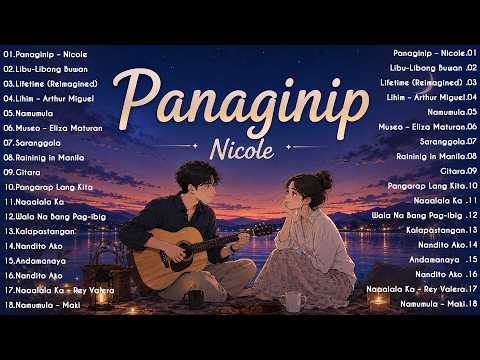

# 음악 — 성공 사례 분석: 사례별 자세히 #281–#320

`analysis.md` 의 9번 (같은 # 번호). 자동 생성 — `tools/success_analysis.py` v1.4.1 (2026-10-20 07:59 UTC). ※ 연구·교육용 — 투자 권유가 아님.

### 281. #등불 - #영사운드(1972년) Covered by sMUSIC#영사운드 #Reinterpreting K-pop Classics #남자보컬

- https://www.youtube.com/watch?v=tW_gZzlbg-4 · sMusic 7080_명곡 리메이크곡 커버곡  · 구독자 6,860 · 조회수 1,407,280 (×205.1, 하루 8,616.4) · 좋아요 3,841 (0.3%) · 4.2분 · 2026-05-10 · 주제 묶음 10. 팝송·K팝·J팝 · 형식 커버·직접 부른 노래 · 폴더 `W_tW_gZzlbg-4` (웹 승인)
- 썸네일: 
- 같은 채널 평소 대비 ×437.2 (채널 최근 롱폼 중앙값 3,218회) · 평소 영상: #어느60대노부부이야기 #김광석 (1992년) #7080가요 #7080추억의곡 #리메이크… (3,563회) / #비나리 #심수봉 (1986년) #7080가요 #7080추억의곡 #리메이크명곡 #커버명곡… (2,874회)
- 대본 없음 (없음) — 음성인식이 끝나면 도입부·흐름이 들어감
- 댓글 296/303: 좋은 점 — 영상 1 · 감사·응원 34 · 더 알고 싶은 것 4 · 아쉬운 점 — 영상 0 · 반박·불만 — 의견 다름 2 · 정치·사회 1 · 경험 공유 10 · 구독·다음 기대 3
  - 좋은 점 — 영상 👍2 “우연히 검색하다 듣게 됐는데 선생님 노래 너무 좋아요~잠시나마 추억에 젖어 보내요~이계절에 듣기 좋은거 같아요~좋은 노래 감사해요❤❤❤❤❤❤❤❤❤❤❤❤❤”
  - 감사·응원 👍27 “젊은 시절의 감성이 고스란히 녹아있는 좋은 음악 감사합니다”
  - 감사·응원 👍8 “마음은 등불노래에 온전히 녹여지다 감사합니다❤❤❤”
  - 더 알고 싶은 것 👍3 “멋진 목소리의 주인공이 참 궁금하네요.”
  - 더 알고 싶은 것 👍3 “아주 멋져요. 고목 (윤시내), 내 인생 바람에 실어 (장미화) -> 소울 가득한 느낌 부르스 락 버젼 가능할까요. 부탁드려봅니다.”
  - 반박·불만 — 의견 다름 👍1 “땡땡땡 종쳤데이 학교 파했으니 이제 집으로 돌아가자~~ 뭔소리일까요? 글쎄요. 그 종은 애밀래 종일 겁니다. 알라를 와 밀겠습니꺼 감사합니다 👁💥💜🐚🐣🐉🦋💎🙏”
  - 반박·불만 — 의견 다름 👍0 “좀 섬뜩하지 않나요. 인간이 아닌데 인간 이상의 감동을 만든다는건 뭔가 잘못되어 가고 있어요. 점차 인간이 서있을 자리가 사라 질겁니다. 지금의 이 환호가 저주가 될수도 있어요”
  - 정치·사회 👍0 “자식많은 부모님마냥 일하는데 왜이리볼멘소리들하시는지격려해주세요 대통령님께❤”
  - 경험 공유 👍18 “여인 첨듣는 곡인데 참 절절하고 애절하네요ㆍ어떤 여인을 가슴 깊이 절절이 짝사랑했었나 봅니다ㆍ”
  - 경험 공유 👍13 “내가 지금 60대인데 10대 후반부터 들었던 가장 쓸쓸한 감정을 두번다시 어느누구도 그 감정을 대체할 수없습니댜.”
  - 구독·다음 기대 👍3 “좋아요 구독누르고 듣습니다!!”
  - 구독·다음 기대 👍3 “방금 구독했습니다. 오랜만에 좋은 노래 들어요. 광안리 커피숍에서 듣고 있습니다. 천천히 좋은 노래 감상할께요. 추억을 먹고 사는 나이라.”

### 282. Odysseus

- https://www.youtube.com/watch?v=WCxx_OVOVUw · Ludwig Göransson - Topic · 구독자 43,300 · 조회수 8,838,833 (×204.1, 하루 92,151.3) · 좋아요 160,217 (1.8%) · 8.7분 · 2026-07-16 · 주제 묶음 13. OST·사운드트랙 · 형식 음악 (그 밖 모양 — 한 편짜리 BGM 등) · 폴더 `W_WCxx_OVOVUw` (웹 승인)
- 썸네일: 
- 설명 앞부분: Provided to YouTube by Back Lot Music Odysseus · Ludwig Göransson The Odyssey (Original Motion Picture Soundtrack) ℗ 2026 Back Lot Music, a division of Universal Studios Music LLLP Released on: 2026-07-17 Main Artist: Ludwig Göransson Producer: Ludwig Göransson Composer: Ludwig Göransson Auto-gener…
- 같은 채널 평소 대비 ×18.2 (채널 최근 롱폼 중앙값 486,422회) · 평소 영상: Circe (525,582회) / Welcome Home Stranger (447,261회)
- 대본 없음 (설명) — 음성인식이 끝나면 도입부·흐름이 들어감
- 댓글 0/5,594: 좋은 점 — 영상 0 · 감사·응원 0 · 더 알고 싶은 것 0 · 아쉬운 점 — 영상 0 · 반박·불만 — 의견 다름 0 · 정치·사회 0 · 경험 공유 0 · 구독·다음 기대 0

### 283. A playlist of nusrat fateh ali khan all popular qawaali's 💝💘

- https://www.youtube.com/watch?v=idCpl6LfnKo · preet_slaylist  · 구독자 49,800 · 조회수 10,142,363 (×203.7, 하루 64,810.3) · 좋아요 125,146 (1.2%) · 9.2분 · 2026-05-16 · 주제 묶음 기타 · 형식 플레이리스트·모음 (여러 곡) · 폴더 `W_idCpl6LfnKo` (웹 승인)
- 썸네일: 
- 설명 앞부분: Timestamps: Don't copy this video for your playlists channel please.
- 같은 채널 평소 대비 ×60.0 (채널 최근 롱폼 중앙값 169,094회) · 평소 영상: Pov:~ you are dancing with him/her :) 🤭🤭💘🤧 (187,977회) / ~(Item songs playlist coz you are dancing alone)~… (150,210회)
- 대본 없음 (설명) — 음성인식이 끝나면 도입부·흐름이 들어감
- 댓글 4,952/5,021: 좋은 점 — 영상 0 · 감사·응원 0 · 더 알고 싶은 것 0 · 아쉬운 점 — 영상 0 · 반박·불만 — 의견 다름 0 · 정치·사회 0 · 경험 공유 0 · 구독·다음 기대 0

### 284. Gladiator Ambience — Cinematic & Emotional Music for Honor and Memory

- https://www.youtube.com/watch?v=iBofqYaXA_U · sleyvenn · 구독자 5,050 · 조회수 1,019,143 (×201.8, 하루 7,075.7) · 좋아요 9,347 (0.9%) · 120분 · 2026-05-29 · 주제 묶음 2. 자연 소리·백색소음 · 형식 음악 (그 밖 모양 — 한 편짜리 BGM 등) · 폴더 `W_iBofqYaXA_U` (웹 승인)
- 썸네일: 
- 설명 앞부분: Cinematic and emotional ambient music inspired by the world of Gladiator, created for honor, memory and reflection. An ambient reinterpretation inspired by the emotional atmosphere surrounding Honor Him and the legacy carried throughout the story of Maximus. This was actually a piece I originally w…
- 같은 채널 평소 대비 ×231.2 (채널 최근 롱폼 중앙값 4,409회) · 평소 영상: Aragorn's Song ∣ A LOTR Ambient Music for Honor a… (5,334회) / Obi-Wan Kenobi ∣ Star Wars Ambient Music — After … (3,484회)
- 대본 없음 (설명) — 음성인식이 끝나면 도입부·흐름이 들어감
- 댓글 284/284: 좋은 점 — 영상 0 · 감사·응원 0 · 더 알고 싶은 것 0 · 아쉬운 점 — 영상 0 · 반박·불만 — 의견 다름 0 · 정치·사회 0 · 경험 공유 0 · 구독·다음 기대 0

### 285. सुकून देने वाली धुन 🏔️ ∣ Mind Relaxing Music ∣ Flute Music

- https://www.youtube.com/watch?v=dLdXYN50hgQ · Soulful Music Melody · 구독자 4,510 · 조회수 904,871 (×200.6, 하루 6,615.9) · 좋아요 6,315 (0.7%) · 5.9분 · 2026-06-05 · 주제 묶음 기타 · 형식 음악 (그 밖 모양 — 한 편짜리 BGM 등) · 폴더 `W_dLdXYN50hgQ` (웹 승인)
- 썸네일: 
- 설명 앞부분: सुकून देने वाली धुन 🏔️ ∣ Mind Relaxing Music ∣ Flute Music यह एक शांत और सुकून देने वाला Flute / Mind Relaxing Music है, जिसे ध्यान, मेडिटेशन, रिलैक्सेशन, पढ़ाई और मानसिक शांति के लिए सुना जा सकता है। 🎶 Music Information: Music Type: Flute / Relaxing Instrumental Music No third-party song or copyri…
- 같은 채널 평소 대비 ×12,311.2 (채널 최근 롱폼 중앙값 74회) · 평소 영상: दीवाना कर देगी ये हिमालय धुन 🏔️ ∣ Mind Relaxing F… (78회) / दिल खुश कर देगी ये पहाड़ी नेपाली धुन 🏔️ ∣ Mind Re… (69회)
- 대본 없음 (설명) — 음성인식이 끝나면 도입부·흐름이 들어감
- 댓글 331/331: 좋은 점 — 영상 0 · 감사·응원 0 · 더 알고 싶은 것 0 · 아쉬운 점 — 영상 0 · 반박·불만 — 의견 다름 0 · 정치·사회 0 · 경험 공유 0 · 구독·다음 기대 0

### 286. 🍉 아침에 커피 마시면서 혼자 듣는데 너무좋다. ∣ 하루 종일 틀어 놓으세요🎵7080추억의 올드팝 #감성팝송 #카페음악 #49 여성보컬

- https://www.youtube.com/watch?v=iRAcLZyPbsA · woozune · 구독자 5,780 · 조회수 1,154,763 (×199.8, 하루 13,681.5) · 좋아요 3,381 (0.3%) · 74.3분 · 2026-07-27 · 주제 묶음 9. 가요·발라드·트로트 · 형식 음악 (그 밖 모양 — 한 편짜리 BGM 등) · 폴더 `W_iRAcLZyPbsA` (웹 승인)
- 썸네일: 
- 챕터: 0:00 . Saltwater Echoes (소금물에 담긴 메… · 2:58 . Amber Shoreline (호박빛 해변선) · 5:58 . Distant Summer Days (아득한 여름… · 9:13 . Midnight Tide (한밤중의 밀물) · 12:17 . Worn-Out Melody (낡은 멜로디) · 15:22 . Paper Napkin Letters (종이 냅킨… · 18:36 . Seaside Sidewalk (해변의 산책로) · 21:43 . Fading Blue Horizon (희미해지는 … · 24:51 . Sundown Melody (일몰의 멜로디) (1) · 27:59 . Shells in My Pocket (주머니 속 … · 30:53 . Salt on the Table (테이블 위의 소… · 34:13 . Blue Umbrellas (파란 파라솔)
- 설명 앞부분: 커피 마시면서 듣기좋은 노래 혼자 조용히 듣고 싶어 지는 노래 잔잔한 멜로디가 내 마음을 편안해지게 하는 노래 추억 속으로 떠나고 싶어서 끝까지 듣게 되는 그런 노래가 있습니다. 화려하지 않아도, 조용히 마음에 스며들어 어느 순간… 계속 생각나는 노래. 이 플레이리스트는 여러분의 마음을 위로 해주는 7080 감성의 따뜻한 멜로디와 담담한 사랑 이야기를 담았습니다. ✨ 이런 순간에 잘 어울립니다 마음을 차분하게 만들고 싶을 때 혼자만의 시간을 보내고 싶을 때 잠들기 전 편안한 음악이 필요할 때 공부 · 독서 · 작업할 때 배경 음악…
- 같은 채널 평소 대비 ×102.4 (채널 최근 롱폼 중앙값 11,281회) · 평소 영상: 🍁아침에 틀었는데 정말 좋다 ∣ 커피마시면서 하루 종일 듣기 좋은 노래🎵7080추억의 올… (11,281회) / 🌻가을에 듣고 싶은 노래 너무 좋다 ∣ 하루를 기분 좋게 시작하는 노래🎵7080추억의 올… (11,239회)
- 대본 없음 (설명) — 음성인식이 끝나면 도입부·흐름이 들어감
- 댓글 187/197: 좋은 점 — 영상 3 · 감사·응원 24 · 더 알고 싶은 것 0 · 아쉬운 점 — 영상 4 · 반박·불만 — 의견 다름 0 · 정치·사회 1 · 경험 공유 11 · 구독·다음 기대 2
  - 좋은 점 — 영상 👍1 “많이 배웠습니다 고맙습니다”
  - 좋은 점 — 영상 👍1 “이. 기계음. 정말싫어. 각. 사람의 목소리가 좋지. 이노래저노래. 소리가 다같어. 백곡 천곡을 한목소리로 듣기싫증나”
  - 감사·응원 👍48 “이제 70 넘었는데 듣다보니 아련한 옛추억이 생각나네요! 정말 어렵게 살았는데... 살만하니 늙음이 서글프군요. 좋은 음악 감사합니다.”
  - 감사·응원 👍16 “바다가 아닌 주말농장 탁 트인 초원에서 들으니 더 맛깔 나네요 힐링되는 아침 감사합니다”
  - 아쉬운 점 — 영상 👍16 “아침 눈뜨면서 침대에 누워듣는데 너무 좋으네요 60대중반~ 나이먹는게 너무 아쉬워요 늘 행복하게 삶니다 운동하면서 이음악듣는 모든분들 행복하세요😂😂❤”
  - 아쉬운 점 — 영상 👍3 “아침에 테라스에서 커피한잔하면서 들으니 목소리가 너무 감미롭고 음악이 좋으니 지상낙원이 따로없네요..테라스에서 하늘을보니 가을하늘이 이렇게 맑고 높으줄 몰랐네요. 저멀리보이는 야산이 이렇게 아름다운줄 그동안 몰랐네요. 오늘 제대로 힐링하네요.너무 좋아요..^^”
  - 경험 공유 👍132 “저는 오십대후반 딸셋 엄마 아직 결혼 생각없는 딸들 아롱이 다롱이라지만 셋중 둘째딸이 같이 생활하는데 시간이 갈수록 부딪치네요!~그럴때마다 서글퍼지는데 그로인해 나를 뒤돌아 보는시간이 되네요 내부모님께도 내가 서운하게 말을 하고 있는지를 잠시나마 생각해봅니다.. 차분…”
  - 경험 공유 👍14 “벌써 내가 60대이라니 아직도 믿을수가 없어요. 퇴직하고 알바을 위해 준비중 입니다. 아침7시까지 출근이라 빠르게 준비중입니다. 그래도 내가 잘하고 좋아하는 일을 할수있다는 것에 감사함을 느낍니다.~ 9/10일 아침 6시 기온 갑자기 내려갔어요.”

### 287. ☀️ Top Acoustic Love Hits 2026 💚 Relaxing Pop Covers for Peaceful Days

- https://www.youtube.com/watch?v=r0t7mEWAGyY · Acoustic Pulse · 구독자 9,650 · 조회수 1,921,656 (×199.1, 하루 18,778.4) · 좋아요 6,292 (0.3%) · 51.8분 · 2026-07-10 · 주제 묶음 12. 커버·노래 부르기 · 형식 커버·직접 부른 노래 · 폴더 `W_r0t7mEWAGyY` (웹 승인)
- 썸네일: 
- 설명 앞부분: Start your day with warm melodies and positive emotions with Top Acoustic Love Hits 2026 ☀️🎸 This playlist brings you the best relaxing pop covers and acoustic love songs of 2026, featuring soft guitar sounds, emotional vocals, and peaceful vibes perfect for beautiful moments. Enjoy gentle acoustic…
- 같은 채널 평소 대비 ×39.1 (채널 최근 롱폼 중앙값 49,157회) · 평소 영상: 💚🎧Top Trending Music Spotify 2026 ∣∣ Calm & Soft … (50,399회) / 🎧 Best Spotify Chill Playlist 2026 💕 Trending Lov… (47,915회)
- 대본 없음 (설명) — 음성인식이 끝나면 도입부·흐름이 들어감
- 댓글 166/168: 좋은 점 — 영상 0 · 감사·응원 0 · 더 알고 싶은 것 0 · 아쉬운 점 — 영상 0 · 반박·불만 — 의견 다름 0 · 정치·사회 0 · 경험 공유 0 · 구독·다음 기대 0

### 288. राग भैरव ∣ भगवान शिव का पवित्र प्रभात राग ∣ Raga Bhairav ∣ Morning Meditation & Healing M…

- https://www.youtube.com/watch?v=3kgbzavVRiY · मनतरंग | ManTarang · 구독자 1,950 · 조회수 387,317 (×198.6, 하루 8,879.3) · 좋아요 5,093 (1.3%) · 11.7분 · 2026-09-06 · 주제 묶음 1. 수면·명상·힐링 · 형식 음악 (그 밖 모양 — 한 편짜리 BGM 등) · 폴더 `W_3kgbzavVRiY` (웹 승인)
- 썸네일: 
- 설명 앞부분: 🌅 सुबह ध्यान (Morning Meditation) के समय 🌅 Sacred Morning Raga 🧘 Morning Meditation Music 🕉️ Shiva Meditation Music 🎵 Indian Classical Healing Music 🙏 Spiritual Relaxation Music यदि आपको भगवान शिव, भारतीय राग संगीत, ध्यान संगीत और आध्यात्मिक संगीत पसंद है, तो इस वीडियो को Like करें और हमारे चैनल को…
- 대본 없음 (설명) — 음성인식이 끝나면 도입부·흐름이 들어감
- 댓글 82/82: 좋은 점 — 영상 0 · 감사·응원 0 · 더 알고 싶은 것 0 · 아쉬운 점 — 영상 0 · 반박·불만 — 의견 다름 0 · 정치·사회 0 · 경험 공유 0 · 구독·다음 기대 0

### 289. Iske da faniyaar song Slowed + Reverb Lofi Music Mix ∣ Chill Beats for Study, Sleep & Nig…

- https://www.youtube.com/watch?v=yoLa1Xlkhvo · @sanjumusic · 구독자 5,440 · 조회수 1,078,801 (×198.3, 하루 10,096.4) · 좋아요 22,576 (2.1%) · 5.1분 · 2026-07-05 · 주제 묶음 1. 수면·명상·힐링 · 형식 음악 (그 밖 모양 — 한 편짜리 BGM 등) · 폴더 `W_yoLa1Xlkhvo` (웹 승인)
- 썸네일: 
- 설명 앞부분: Ultimate Slowed + Reverb Lofi Music Mix ∣ Chill Beats for Study, Sleep & Night Vibes Drift into the perfect late-night atmosphere with this slowed + reverb lofi music mix. Every track is carefully pitched down and layered with warm reverb to create that dreamy, nostalgic sound you love — ideal for …
- 같은 채널 평소 대비 ×595.4 (채널 최근 롱폼 중앙값 1,812회) · 평소 영상: Teri Yaado Main Saphar Lofi Song ∣ Night Vibe chi… (1,812회) / Jaana Samjho Na -Aditya Rikhari & Tulsi Kumar (Ly… (2,525회)
- 대본 없음 (설명) — 음성인식이 끝나면 도입부·흐름이 들어감
- 댓글 217/217: 좋은 점 — 영상 0 · 감사·응원 0 · 더 알고 싶은 것 0 · 아쉬운 점 — 영상 0 · 반박·불만 — 의견 다름 0 · 정치·사회 0 · 경험 공유 0 · 구독·다음 기대 0

### 290. 들꽃처럼 살다가

- https://www.youtube.com/watch?v=1vBXiLsHZrs · 소은뮤직 · 구독자 583 · 조회수 115,471 (×198.1, 하루 1,007.4) · 좋아요 901 (0.8%) · 4.7분 · 2026-06-27 · 주제 묶음 기타 · 형식 음악 (그 밖 모양 — 한 편짜리 BGM 등) · 폴더 `W_1vBXiLsHZrs` (웹 승인)
- 썸네일: 
- 설명 앞부분: 🌼 들꽃처럼 살다가 누구에게 보이기 위해 피어나는 것이 아니라, 자신의 자리에서 묵묵히 계절을 견디며 향기를 남기는 들꽃처럼 살아가고 싶은 마음을 담은 노래입니다. 기쁜 날도, 힘든 날도 자연의 흐름을 닮아 담담하게 받아들이며, 바람과 구름, 그리고 소중한 사람들과 함께하는 평범한 하루의 소중함을 노래합니다. [Verse 1] 길가에 피어 있는 작은 꽃 하나처럼 누구에게 보이려고 피어난 건 아니었네 비바람이 불어와도 고개 숙여 견디고 다시 오는 봄날 속에 환하게 웃었네 [Chorus] 나는 들꽃처럼 살다가 바람에게 안부 묻고 구름…
- 같은 채널 평소 대비 ×446.7 (채널 최근 롱폼 중앙값 258회) · 평소 영상: 그 또한 나의 시간 (319회) / 비라도 내렸으면 (198회)
- 대본 없음 (설명) — 음성인식이 끝나면 도입부·흐름이 들어감
- 댓글 108/114: 좋은 점 — 영상 0 · 감사·응원 22 · 더 알고 싶은 것 2 · 아쉬운 점 — 영상 2 · 반박·불만 — 의견 다름 0 · 정치·사회 1 · 경험 공유 2 · 구독·다음 기대 0
  - 감사·응원 👍19 “사랑하는 들꽃~~!!! 어찌 이 작디작은 풀꽃을 사랑하지 않을 수 있을까요. 들꽃 앞에 서면 한없이 마음 설레는 것을~. 아름다운 날에 아름다운 들꽃 노래를 듣고 있노라니 아름다운 행복이 내 마음에 가득 차오립니다. 이토록 따스한 사랑을 안겨 주셔서 진심으로 감사드립…”
  - 감사·응원 👍11 “들꽃처럼 묵묵히 자신의 자리를 지키는 삶이 참 아름답게 느껴지네요. 오늘 하루 지친 마음이 노래 덕분에 따뜻하게 치유되는 기분이에요. 좋은 노래 감사합니다”
  - 더 알고 싶은 것 👍2 “제 옆에는 이런좋은 가사의 노래들을 들려주는 분이 있습니다 고마운 사람이지요 가사가 제맘에 넘닿아요!! 구절구절. 좋은노래 많이 올려주세요~^^”
  - 더 알고 싶은 것 👍1 “제 18번 으로 만들려고합니다 가수 하보미 님 맞나요 ?”
  - 아쉬운 점 — 영상 👍6 “들꽃 한송이! 향기 예쁨 외로움 인내 기다림 아쉬움 설레임 희망... 많은 느낌을 갖게 하지요. 잔잔하게 울림이 있는 노래 잘 듣고 나갑니다. 좋은 시간 주셔서 감사합니다. 소은뮤직 채널 응원합니다.”
  - 아쉬운 점 — 영상 👍0 “가수 AI 목소리인가요”
  - 정치·사회 👍0 “기쁜소식! 죄없는 대통령 감옥살이 ! 나라거들 낼려고 작심 한거모르고 ! 내로남불인 극에 달한놈들에게 속은... 박근혜대통령님! 건강지켜셔서 좋은날 꼭 봐야합니다! 멸공!”
  - 경험 공유 👍4 “내가 살아온 내모습 같네요 너무감동 적이네요”
  - 경험 공유 👍1 “제가 좋아하는 들꽃~! 좋은 노래 들으며 잠시나마 복잡한 마음들을 힐링합니다~감사합니다~❤😂🎉”

### 291. Samadhi in the Stone ∣ Shiva Meditation Music ∣ Himalayan Cave

- https://www.youtube.com/watch?v=yp10IdD2SxY · Divya vaani music · 구독자 217 · 조회수 42,503 (×195.9, 하루 2,874.9) · 좋아요 517 (1.2%) · 6.1분 · 2026-10-05 · 주제 묶음 1. 수면·명상·힐링 · 형식 음악 (그 밖 모양 — 한 편짜리 BGM 등) · 폴더 `W_yp10IdD2SxY` (웹 승인)
- 썸네일: 
- 설명 앞부분: Samadhi in the Stone 🕉 A deep and peaceful Shiva meditation journey inspired by an ancient Himalayan cave, where Shiva rests in profound samadhi. Surrounded by the stillness of the mountains, moonlit stone and the silence of the Himalayas, this music invites you into a quiet space of meditation, re…
- 같은 채널 평소 대비 ×99.4 (채널 최근 롱폼 중앙값 428회) · 평소 영상: GIRINĀDA ∣ Sacred Mountain Resonance ∣ Instrument… (468회) / Om Namah Shivaya ∣ Relax & Meditate ∣ 1 Hour Calm… (387회)
- 대본 없음 (설명) — 음성인식이 끝나면 도입부·흐름이 들어감
- 댓글 11/11: 좋은 점 — 영상 0 · 감사·응원 0 · 더 알고 싶은 것 0 · 아쉬운 점 — 영상 0 · 반박·불만 — 의견 다름 0 · 정치·사회 0 · 경험 공유 0 · 구독·다음 기대 0

### 292. 빗속 파리의 라흐마니노프 🌧️ In the Style of Rachmaninoff , 깊고 잔잔한 클래식 1시간

- https://www.youtube.com/watch?v=msDBphyeZIc · Moonlight replay · 구독자 2,390 · 조회수 466,789 (×195.3, 하루 4,782.9) · 좋아요 2,840 (0.6%) · 65.6분 · 2026-07-14 · 주제 묶음 6. 피아노·클래식·연주곡 · 형식 플레이리스트·모음 (여러 곡) · 폴더 `W_msDBphyeZIc` (웹 승인)
- 썸네일: 
- 설명 앞부분: [ 비 오는 밤 클래식 피아노 ∣ 라흐마니노프에서 영감받은 독서·공부·수면 음악 Rachmaninoff-Inspired Piano ∣ Rainy Paris Classical Music for Reading, Sleep & Focus Romantic classical piano with deep, expressive melodies, perfect for relaxing, studying, working, meditation, and peaceful nights.] 이 음악은 세르게이 라흐마니노프의 음악에서 영감을 받아 만든 클래식…
- 같은 채널 평소 대비 ×754.1 (채널 최근 롱폼 중앙값 619회) · 평소 영상: ​초록의 숨결, 포레가 머문 숲 🌿 Fauré-Style Classical (가사 없는 … (633회) / Marie Antoinette at Versailles ☀️ ∣ Elegant Frenc… (605회)
- 대본 없음 (설명) — 음성인식이 끝나면 도입부·흐름이 들어감
- 댓글 116/116: 좋은 점 — 영상 0 · 감사·응원 10 · 더 알고 싶은 것 1 · 아쉬운 점 — 영상 0 · 반박·불만 — 의견 다름 0 · 정치·사회 0 · 경험 공유 1 · 구독·다음 기대 1
  - 감사·응원 👍29 “순간을 전체로 생각하여 고통스러워 하지마라 슬퍼하지 마라 다시한번 깨닫고 갑니다 감사합니다”
  - 감사·응원 👍7 “비가 내리는 월욜 아침ᆢ 마음을 편안하고 감성적으로 적셔주는 이 음악이 넘 소중하네요 감사합니다~~♡”
  - 더 알고 싶은 것 👍0 “첫 음악 곡명 궁금해요 악보 얻을 수 있을까요?”
  - 경험 공유 👍12 “라흐마니노프를 대학교 첫 입학해서 첫 위클리때 쳐보고 완젼 반했었죠 … 연습 하기는 까다롭지만 연주곡으로 효과도 뛰어나고 그 음색과 섬세함의 남다름에 정말 이런 음색을 어떻게 찾아낼까? 한동안 빠졌었던 ,,, 그 이후 몇곡 더 연주했었는데 …. 이제 나이가 들어서 파…”
  - 구독·다음 기대 👍2 “라흐마니로프 음악은 다가 가기 어려운 곡이면서 너무 듣고 싶은 곡인데 ~~. 곡을 너무 잘 살리셨어요 잘 감상하고 구독합니다”

### 293. 𝐏𝐥𝐚𝐲𝐥𝐢𝐬𝐭 듣자마자 흥 폭발하는🔥 최신 K-POP 노래 모음 노동요

- https://www.youtube.com/watch?v=yngpCQNKY_M · 클로버 플레이리스트 · 구독자 3,580 · 조회수 696,552 (×194.6, 하루 5,952.5) · 좋아요 3,653 (0.5%) · 40.9분 · 2026-06-25 · 주제 묶음 10. 팝송·K팝·J팝 · 형식 플레이리스트·모음 (여러 곡) · 폴더 `W_yngpCQNKY_M` (웹 승인)
- 썸네일: 
- 같은 채널 평소 대비 ×9.3 (채널 최근 롱폼 중앙값 75,231회) · 평소 영상: 𝐏𝐥𝐚𝐲𝐥𝐢𝐬𝐭 엔믹스 한 번 빠지면 못 나오는🫧 NMIXX 노래 모음 노동요 (75,231회) / 𝐏𝐥𝐚𝐲𝐥𝐢𝐬𝐭 들으면 하루가 기분 좋아지는✨ 리센느 노래 모음 (80,135회)
- 대본 없음 (없음) — 음성인식이 끝나면 도입부·흐름이 들어감
- 댓글 69/70: 좋은 점 — 영상 1 · 감사·응원 3 · 더 알고 싶은 것 1 · 아쉬운 점 — 영상 0 · 반박·불만 — 의견 다름 0 · 정치·사회 0 · 경험 공유 0 · 구독·다음 기대 0
  - 좋은 점 — 영상 👍0 “너무 듣기 좋아요 저가 좋아하는 노래 만 있어요”
  - 감사·응원 👍28 “k pop 처돌이 의대생인데요,,,아직도 종강을 못하고있는데요 (눈물),,, 시험전에 급하게 빡세게 공부해야할때 빡칠때.. 전투력 기분좋게 상승하네요 감사합니다ㅠ 덕분에 살아요..”
  - 감사·응원 👍3 “다 요즘 노래네요!! 찾아보신게 대단해요!! 떡상 응원할게용❤❤❤ 구독 ㄱㄱ❤❤❤”

### 294. Lagu Pop Santai Indonesia 2026 ☕ Lagu Pop Indonesia Terbaik & Paling Enak Didengar

- https://www.youtube.com/watch?v=MoghOkKhNFk · MITRO MUSIC · 구독자 5,450 · 조회수 1,060,009 (×194.5, 하루 6,760.6) · 좋아요 2,356 (0.2%) · 83.7분 · 2026-05-16 · 주제 묶음 3. 공부·집중·작업 · 형식 플레이리스트·모음 (여러 곡) · 폴더 `W_MoghOkKhNFk` (웹 승인)
- 썸네일: 
- 설명 앞부분: ☕ Selamat datang di suasana Cafe Vibes Musik Santai Indonesia — playlist lagu pop nostalgia terbaik yang siap menemani waktu ngopi, kerja, belajar, santai malam, perjalanan, hingga me time kamu. Nikmati kumpulan lagu Indonesia pilihan dengan nuansa hangat, galau, tenang, dan relaxing yang cocok dip…
- 같은 채널 평소 대비 ×212.1 (채널 최근 롱폼 중앙값 4,998회) · 평소 영상: ☕ Cafe Vibes Indonesia ∣ Playlist Lagu Galau & No… (4,998회) / BERSAMA BINTANG - DRIVE [LIRIK] COVER BY MITROMUS… (4,124회)
- 대본 없음 (설명) — 음성인식이 끝나면 도입부·흐름이 들어감
- 댓글 178/176: 좋은 점 — 영상 0 · 감사·응원 0 · 더 알고 싶은 것 0 · 아쉬운 점 — 영상 0 · 반박·불만 — 의견 다름 0 · 정치·사회 0 · 경험 공유 0 · 구독·다음 기대 0

### 295. 애매모호한 첫사랑

- https://www.youtube.com/watch?v=A6rImTTl348 · na tsu · 구독자 933 · 조회수 181,463 (×194.5, 하루 1,953.8) · 좋아요 7,930 (4.4%) · 19.3분 · 2026-07-19 · 주제 묶음 기타 · 형식 플레이리스트·모음 (여러 곡) · 폴더 `W_A6rImTTl348` (웹 승인)
- 썸네일: 
- 설명 앞부분: 흐르는 것들은 하늘과 모든 걸 품었지만 우린 품지 못했으니 *알레프, 자유
- 대본 없음 (설명) — 음성인식이 끝나면 도입부·흐름이 들어감
- 댓글 419/419: 좋은 점 — 영상 2 · 감사·응원 11 · 더 알고 싶은 것 2 · 아쉬운 점 — 영상 1 · 반박·불만 — 의견 다름 3 · 정치·사회 0 · 경험 공유 44 · 구독·다음 기대 0
  - 좋은 점 — 영상 👍0 “그때 잘 했더라면 지금 다시 만나다면 그때 했던 실수를 안 할 자신있다 믿었는데 어느날 바뀐 너의 프로필사진에 밝게 웃는 모습을 보고 너와 멀어져야겠다 생각했어. 돌아보니 내 옆에있던 넌 한편의 슬픔이 담긴 눈이였는데 지금 만나는 사람과는 그런 슬픔과 걱정없이 너무 …”
  - 좋은 점 — 영상 👍0 “선곡 최고에요 감사합니다🥲 구구절절 내 마음을 적다가 너무 구차해보여서 전부 다 지웠지만 아무튼 보고싶다!!! 그냥 언제 어디에서나 다치지 말고 건강하고 행복하게 잘 지내길”
  - 감사·응원 👍4 “To. 너 이렇게 편지를 쓰는 것도 정말 오랜만이네. 이걸 네 생일에 적었더라면 정말 좋았을 텐데. 올해 네 생일을 축하 못한 것도 정말 미안하고 아쉬워. 하고 싶은 말이 많았는데 막상 글로 써 내려가려니까 두서없이 적게 된다. 네가 없는 동안 어쩌다 보니 문학도 많…”
  - 감사·응원 👍3 “주인장 말투 너무 커여워요 ❤ 이런 감성 플리는 진짜 처음인데 생각보다 너무 좋아요.. 새로운 취향을 찾은 것 같아요! 잘 들을게요 감사해요!”
  - 더 알고 싶은 것 👍3 “다들 여기에 첫사랑 이야기를 푸시는데.. 저도 그런 느낌이 뭔지 알고싶네요”
  - 더 알고 싶은 것 👍0 “중학교 때 좋아하지도 않는데 먼저 고백했다는 이유로 너가 받아줬었잖아, 그 남자애. 결국 둘이 흐지부지됐지만 아직도 가끔 궁금하다. 내가 고백해도 똑같이 받아줬을까? 오늘도 전화하고 왔는데 왜 아직도 너가 이렇게 좋은지 모르겠어. 아무리 다른 여자 사겨도 결국 헤어지…”
  - 반박·불만 — 의견 다름 👍113 “제목을 보자마자 한사람이 떠올라서 홀린듯이 클릭해버렸어요. 이런 플리 잘 안들을 것 같아서 그냥 터놓고 말할게. 중학교 때 처음 만난 언니. 정말 예쁘고, 멋지고 빛이 나서 이보다 주인공 같은 사람이 있을까 싶은 사람. 정병 와서 새벽에 연락해도 꼬박꼬박 답장해주고 …”
  - 반박·불만 — 의견 다름 👍1 “여자 사이에서는 동성애에 대한 인식이 남자들 사이에서는 다른가요.. 남자는 게이라면 아예 말도안되고 상상도 하기싫은 존재로 여겨지는데...”
  - 경험 공유 👍191 “진짜 내가 여자만 아니었다면 꼬셔버리고 싶은 여사친 1명쯤 있지 않나요?ㅋㅋ”
  - 경험 공유 👍145 “너싫어 왜냐면너는 바보고 이기적이고 말도많고 이상하고 사랑스럽고 사랑스럽고 사랑스럽고 몰라그냥싫어 너랑말안해 연락도안해주고뭐야이게 나도너남자좋아하는거아는데 그러면왜그랫냐고나한테 껴안고무릎에눕고뽀뽀하려하고 그러면서남자좋아한다는이유ㅠ로내고백안받아주면 난정말울지도몰라 너그…”

### 296. 🔥 𝗔𝗟𝗟 𝗧𝗥𝗘𝗡𝗗𝗜𝗡𝗚 𝗣𝗔𝗞𝗜𝗦𝗧𝗔𝗡𝗜 𝗦𝗢𝗡𝗚𝗦 🎶 ∣ 𝗩𝗜𝗥𝗔𝗟 𝗛𝗜𝗧𝗦 𝟮𝟬𝟮𝟲 🎧 ∣ 𝗧𝗢𝗣 𝗣𝗔𝗞𝗜𝗦𝗧𝗔𝗡𝗜 𝗦𝗢𝗡𝗚𝗦 ∣ COZI

- https://www.youtube.com/watch?v=XL5PUUwrztg · cozi_music · 구독자 29,400 · 조회수 5,695,105 (×193.7, 하루 86,372.0) · 좋아요 80,082 (1.4%) · 19.6분 · 2026-08-15 · 주제 묶음 1. 수면·명상·힐링 · 형식 AI 음악 · 폴더 `W_XL5PUUwrztg` (웹 승인)
- 썸네일: 
- 챕터: 0:00 ISHQA VE · 0:46 MAJBOOR · 1:49 MERI ZINDAGI HAI TU · 3:22 JHOL · 4:51 PAL PAL · 6:26 CHAL DIYE TUM KAHAN PE · 8:47 TERA MERA HAI PYAR AMAR · 10:05 IK LAMHA · 11:14 ISHQ · 13:09 KAHANI SUNO 2.0 · 14:51 MAAND · 15:45 MERE HUMSAFAR · 16:33 SADQAY · 17:13 GAL SUN · 18:12 TU HAI KAHAN
- 설명 앞부분: 🔥 𝗔𝗟𝗟 𝗧𝗥𝗘𝗡𝗗𝗜𝗡𝗚 𝗣𝗔𝗞𝗜𝗦𝗧𝗔𝗡𝗜 𝗦𝗢𝗡𝗚𝗦 🎶 ∣ 𝗩𝗜𝗥𝗔𝗟 𝗛𝗜𝗧𝗦 𝟮𝟬𝟮𝟲 🎧 ∣ 𝗧𝗢𝗣 𝗣𝗔𝗞𝗜𝗦𝗧𝗔𝗡𝗜 𝗦𝗢𝗡𝗚𝗦 ∣ COZI 𝐀𝐥𝐥 𝐭𝐫𝐞𝐧𝐝𝐢𝐧𝐠 PAKISTANI 𝐬𝐨𝐧𝐠𝐬 𝐨𝐟 2026 💖 ! Disclaimer ! All rights to the above songs belong to their respective owners. This video is made for entertainment purposes only. no copyright infringement intended.
- 같은 채널 평소 대비 ×48.5 (채널 최근 롱폼 중앙값 117,490회) · 평소 영상: 𝐀𝐋𝐋 𝐓𝐑𝐄𝐍𝐃𝐈𝐍𝐆 𝐇𝐈𝐍𝐃𝐈 𝐒𝐎𝐍𝐆𝐒 𝟐𝟎𝟐𝟔 🎧∣ 𝐏𝐋𝐀𝐘𝐋𝐈𝐒𝐓💖 -slowe… (117,490회) / 𝐀𝐋𝐋 𝐓𝐑𝐄𝐍𝐃𝐈𝐍𝐆 𝐇𝐈𝐍𝐃𝐈 𝐒𝐎𝐍𝐆𝐒 𝟐𝟎𝟐𝟔 ∣ 𝐏𝐋𝐀𝐘𝐋𝐈𝐒𝐓 🎀 ∣ PART… (174,564회)
- 대본 없음 (설명) — 음성인식이 끝나면 도입부·흐름이 들어감
- 댓글 2,153/2,236: 좋은 점 — 영상 0 · 감사·응원 0 · 더 알고 싶은 것 0 · 아쉬운 점 — 영상 0 · 반박·불만 — 의견 다름 0 · 정치·사회 0 · 경험 공유 0 · 구독·다음 기대 0

### 297. Könül Xasıyeva - Yaralayırsan ∣ Piano Version by Xeqan

- https://www.youtube.com/watch?v=Fqfo2bGkZik · Xeqan · 구독자 5,780 · 조회수 1,102,030 (×190.7, 하루 6,493.3) · 좋아요 10,041 (0.9%) · 5.5분 · 2026-05-03 · 주제 묶음 6. 피아노·클래식·연주곡 · 형식 커버·직접 부른 노래 · 폴더 `W_Fqfo2bGkZik` (웹 승인)
- 썸네일: 
- 설명 앞부분: Könül Xasıyevanın “Yaralayırsan” ifasını bu dəfə piano müşayiəti ilə təqdim edirəm. Bu əsərdə məni ən çox çəkən şey mahnının içindəki səmimi ağrı və sözlərin daşıdığı dərin hiss idi. Mən də ifanın ruhunu qoruyaraq ona pianoda öz baxışımı əlavə etdim. Bu versiyada müşayiətdən əlavə, eyni zamanda bəz…
- 같은 채널 평소 대비 ×26.2 (채널 최근 롱폼 중앙값 42,026회) · 평소 영상: Səni Sevməyəcəm - Könül Xasıyeva ∣ Deep House Rem… (55,583회) / Könül Xasıyeva - Qayıdacaqsan ∣ Piano Version by … (28,468회)
- 대본 없음 (설명) — 음성인식이 끝나면 도입부·흐름이 들어감
- 댓글 428/428: 좋은 점 — 영상 0 · 감사·응원 0 · 더 알고 싶은 것 0 · 아쉬운 점 — 영상 0 · 반박·불만 — 의견 다름 0 · 정치·사회 0 · 경험 공유 0 · 구독·다음 기대 0

### 298. lock the f*** in. (playlist)

- https://www.youtube.com/watch?v=1mAMpmFvceY · lucent · 구독자 7,670 · 조회수 1,460,403 (×190.4, 하루 23,781.7) · 좋아요 19,399 (1.3%) · 240분 · 2026-08-19 · 주제 묶음 3. 공부·집중·작업 · 형식 플레이리스트·모음 (여러 곡) · 폴더 `W_1mAMpmFvceY` (웹 승인)
- 썸네일: 
- 설명 앞부분: lock the f*** in. (playlist) spotify focus playlist: you didn’t come this far to quit. keep going. all photos captured/created by myself. the music used is original or licensed.
- 같은 채널 평소 대비 ×193.3 (채널 최근 롱폼 중앙값 7,556회) · 평소 영상: nobody cares until you win. (playlist) (7,556회) / lock the f*** in. (playlist) (7,153회)
- 대본 없음 (설명) — 음성인식이 끝나면 도입부·흐름이 들어감
- 댓글 394/394: 좋은 점 — 영상 0 · 감사·응원 0 · 더 알고 싶은 것 0 · 아쉬운 점 — 영상 0 · 반박·불만 — 의견 다름 0 · 정치·사회 0 · 경험 공유 0 · 구독·다음 기대 0

### 299. 일할때 듣기좋은 발라드 추천 광고없는 노래모음 유튜브 베스트곡 TOP BEST 100 임창정,성시경,더원,백지영,김필,양파,이승기,왁스,김범수,소울스타,원티드

- https://www.youtube.com/watch?v=YVeqKohQmuw · LeafVibe 4K · 구독자 1,380 · 조회수 261,976 (×189.8, 하루 2,019.0) · 좋아요 1,175 (0.4%) · 71.8분 · 2026-06-12 · 주제 묶음 9. 가요·발라드·트로트 · 형식 플레이리스트·모음 (여러 곡) · 폴더 `W_YVeqKohQmuw` (웹 승인)
- 썸네일: 
- 설명 앞부분: 안녕하세요! 🎶 바람의 발라드* 채널에 오신 것을 환영합니다. 이곳은 **90년대부터 2000년대까지의 레전드 한국 발라드**를 사랑하는 모든 분들을 위한 감성 음악 채널입니다. 🕰️ *추억 속으로 떠나는 시간 여행 한국 발라드의 전성기였던 1990\~2000년대! 감미로운 멜로디**와 **감성적인 가사**가 어우러진 명곡들은 지금도 많은 이들의 마음을 울리고 있습니다. 그 시절 감동을 다시 느껴보세요. 🎤 *당신이 사랑했던 발라드 가수 총출동 김범수, 임재범, 성시경, 박효신, 이수영, 거미, 휘성, 플라이 투 더 스카이, 조성…
- 같은 채널 평소 대비 ×327.9 (채널 최근 롱폼 중앙값 799회) · 평소 영상: 💖듣기만 해도 설레는 1990~2026년 발라드모음 우리가 사랑했던 추억노래 - 소울스타… (799회) / 일할때 듣기좋은 발라드 추천 광고없는 노래모음 - 유튜브 베스트곡 TOP BEST 100… (851회)
- 대본 없음 (설명) — 음성인식이 끝나면 도입부·흐름이 들어감
- 댓글 13/13: 좋은 점 — 영상 0 · 감사·응원 1 · 더 알고 싶은 것 0 · 아쉬운 점 — 영상 1 · 반박·불만 — 의견 다름 0 · 정치·사회 0 · 경험 공유 0 · 구독·다음 기대 0
  - 감사·응원 👍16 “좋네요.....비 오는날. 듣고 있는데.......고맙습니다 😊 모든분들 늘 아름답고 행복한 즐거운 일상이길 소망합니다. 인생사 살아보니 어떻게 받아 들이고 생각하느냐에 따라 그 상황이 바뀌더이다. 행복하세요❤ 모든분들.....!!”
  - 아쉬운 점 — 영상 👍0 “중간광고가 있어요 ;;;”

### 300. Navkar mantra's Golden Shield ∣ Feel the Ancient Jain Power Dissolving Negativity #jainbh…

- https://www.youtube.com/watch?v=FEQe99gciwU · Navkarbhakti Studios - Jain Stories & Mantras · 구독자 4,350 · 조회수 821,108 (×188.8, 하루 4,795.7) · 좋아요 2,791 (0.3%) · 8.1분 · 2026-05-02 · 주제 묶음 1. 수면·명상·힐링 · 형식 음악 (그 밖 모양 — 한 편짜리 BGM 등) · 폴더 `W_FEQe99gciwU` (웹 승인)
- 썸네일: 
- 설명 앞부분: What if 10 minutes could calm your mind completely? 🌿 This magical Navkar Mantra animation takes you through 5 spiritual worlds of peace, purity, and inner awakening. Step into a divine journey inspired by the sacred Navkar Mantra — visualized through breathtaking particle-light animation and calmi…
- 대본 없음 (설명) — 음성인식이 끝나면 도입부·흐름이 들어감
- 댓글 197/197: 좋은 점 — 영상 0 · 감사·응원 0 · 더 알고 싶은 것 0 · 아쉬운 점 — 영상 0 · 반박·불만 — 의견 다름 0 · 정치·사회 0 · 경험 공유 0 · 구독·다음 기대 0

### 301. 아득히 먼 곳 ∣ 이별 감성 발라드 ∣ 커버 노래 편곡 수노 AI

- https://www.youtube.com/watch?v=8l6a5DRZqHU · 엄마의 세월 - 한국 발라드 명곡 · 구독자 1,110 · 조회수 209,114 (×188.4, 하루 1,411.2) · 좋아요 485 (0.2%) · 4분 · 2026-05-25 · 주제 묶음 9. 가요·발라드·트로트 · 형식 AI 음악 · 폴더 `W_8l6a5DRZqHU` (웹 승인)
- 썸네일: 
- 설명 앞부분: 아득히 먼 곳 (원곡 가수 : 구창모) 1985년 발표, 7080 추억의 명곡을 수노의 도움을 받아 다시 편곡하였습니다. 즐겁게 감상해 주시면 감사하겠습니다.
- 같은 채널 평소 대비 ×349.7 (채널 최근 롱폼 중앙값 598회) · 평소 영상: 해후 ∣ 가사자막 ∣ 이별 감성 발라드 ∣ 커버 노래 편곡 수노 AI (598회) / 알아주세요 ∣ 가사 한글 자막 ∣ 원곡 わかって下さい 因幡晃 1976 ∣ 커버 노래 편곡… (611회)
- 대본 없음 (설명) — 음성인식이 끝나면 도입부·흐름이 들어감
- 댓글 20/20: 좋은 점 — 영상 0 · 감사·응원 0 · 더 알고 싶은 것 0 · 아쉬운 점 — 영상 1 · 반박·불만 — 의견 다름 0 · 정치·사회 0 · 경험 공유 0 · 구독·다음 기대 0
  - 아쉬운 점 — 영상 👍12 “아득히 먼 곳 황금빛 저녁노을 내리는 곳은 사랑이 애처로이 떠난 자리지 노을은 항상 아쉬움을 두고 스러지기 때문이야 나를 떠난 님은 호숫가 푸른숲속 아늑한 곳에 잠들어 있는데 찬 바람 비껴불어 이르는 곳에 있는 나는 오늘밤도 그리운 님 생각에 불면의 밤을 지새우고 있…”

### 302. 【洋楽Playlist】何も考えずに聴きたい心地いいChill R&B｜Relax｜Smooth Vibes

- https://www.youtube.com/watch?v=6qkUHaRXvtE · Ethereal TIME · 구독자 4,720 · 조회수 888,777 (×188.3, 하루 7,741.9) · 좋아요 3,230 (0.4%) · 65.2분 · 2026-06-27 · 주제 묶음 8. 로파이·시티팝·칠 · 형식 플레이리스트·모음 (여러 곡) · 폴더 `W_6qkUHaRXvtE` (웹 승인)
- 썸네일: 
- 챕터: 0:00 Blue Begins · 4:51 Windowsill · 8:43 The Long Way · 13:24 Satellites Above the River · 18:08 Amber Laundry Lights · 22:12 Elevators to the Morning · 26:31 Porcelain Midnight · 30:27 The Air · 34:52 Before the Bakers Wake · 38:55 The Color of Unfolding Day
- 설명 앞부분: 1曲目から気分が上がる洋楽R&Bプレイリストを作りました。 作業や読書のBGMに 軽やかなR&Bのリズムと、やわらかいメロディーが、いつもの時間を少しだけ心地よく変えてくれます。 🌃 Ethereal TIME Chill Music / Relaxing Music / Study Music / Sleep Music / Night Drive Music を中心に、 著作権は Ethereal TIME に帰属します。 店舗・企業様向けのBGM制作、背景映像制作、動画制作などを承っております。
- 같은 채널 평소 대비 ×445.1 (채널 최근 롱폼 중앙값 1,997회) · 평소 영상: 【洋楽Playlist】聴いたら癖になる最高にメロウなChill R&B｜Relax｜Smooth… (2,117회) / 【洋楽Playlist】一人時間が心地よくなるChill R&B｜Relax｜Smooth Vib… (1,877회)
- 대본 없음 (설명) — 음성인식이 끝나면 도입부·흐름이 들어감
- 댓글 63/63: 좋은 점 — 영상 0 · 감사·응원 0 · 더 알고 싶은 것 0 · 아쉬운 점 — 영상 0 · 반박·불만 — 의견 다름 0 · 정치·사회 0 · 경험 공유 0 · 구독·다음 기대 0

### 303. ♫ 𝗔𝗹𝗹 𝗛𝗶𝗻𝗱𝗶 𝗧𝗿𝗲𝗻𝗱𝗶𝗻𝗴 𝗦𝗼𝗻𝗴𝘀 𝗼𝗳 2026 ♫🎧🤍#HindiSongs#Playlist

- https://www.youtube.com/watch?v=eC61t3Nw-vs · 𝐌𝐚𝐧𝐬𝐢~ · 구독자 8,620 · 조회수 1,608,608 (×186.6, 하루 14,897.2) · 좋아요 19,437 (1.2%) · 11.9분 · 2026-07-04 · 주제 묶음 기타 · 형식 플레이리스트·모음 (여러 곡) · 폴더 `W_eC61t3Nw-vs` (웹 승인)
- 썸네일: 
- 챕터: 0:00 ​​ - Udi Udi · 1:16 ​​ - Maskara · 2:16 ​​ - Sheesha · 3:37 ​​ - Bairan · 4:53 ​​ - Kitaab · 5:36 ​​ - Udaariyaan · 6:52 ​​ - Majboor · 8:27 ​​ - Vachindama · 9:27 ​​ - Hawa Hawa · 10:27 ​​ - Jaiye Sajna
- 같은 채널 평소 대비 ×6.8 (채널 최근 롱폼 중앙값 236,434회) · 평소 영상: 𝗣𝗹𝗮𝘆𝗹𝗶𝘀𝘁 𝘁𝗼 𝗰𝗿𝗲𝗮𝘁𝗲 𝗳𝗮𝗸𝗲 𝘀𝗰𝗲𝗻𝗮𝗿𝗶𝗼𝘀 𝗶𝗻 𝘆𝗼𝘂𝗿 𝗺𝗶𝗻𝗱 🫶🏻… (236,434회) / ~A proper desi playlist because you're dancing al… (130,243회)
- 대본 없음 (없음) — 음성인식이 끝나면 도입부·흐름이 들어감
- 댓글 506/506: 좋은 점 — 영상 0 · 감사·응원 0 · 더 알고 싶은 것 0 · 아쉬운 점 — 영상 0 · 반박·불만 — 의견 다름 0 · 정치·사회 0 · 경험 공유 0 · 구독·다음 기대 0

### 304. 2026 Ultimate Mind Relaxing Lofi Beats ∣ Study Sleep & Chill lofi ∣ #lofimusic #trendings…

- https://www.youtube.com/watch?v=FYePEj0IZC8 · Ace LoFi · 구독자 9,400 · 조회수 1,752,870 (×186.5, 하루 17,247.3) · 좋아요 0 (0.0%) · 28.2분 · 2026-07-10 · 주제 묶음 1. 수면·명상·힐링 · 형식 음악 (그 밖 모양 — 한 편짜리 BGM 등) · 폴더 `W_FYePEj0IZC8` (웹 승인)
- 썸네일: 
- 설명 앞부분: Broken & Alone 😅🚶‍♂️ ∣ Heartfelt Sad Mashu... 2026 Ultimate Mind Relaxing Lofi Beats ∣ S... Welcome to the world of soothing lofi music, where stress fades away, and peace takes over. This 2025 mind-relaxing lofi mix is perfect for: Deep Focus & Studying 📖 Relaxing & Meditation 🧘‍♂ Chilling After a…
- 같은 채널 평소 대비 ×4,600.7 (채널 최근 롱폼 중앙값 381회) · 평소 영상: 🎵 Still Pain – Mind Relaxing Lofi Beats 😭😅 ∣ Stud… (381회) / 2026 Ultimate Mind Relaxing Lofi Beats ∣ Study Sl… (377회)
- 대본 없음 (설명) — 음성인식이 끝나면 도입부·흐름이 들어감
- 댓글 140/140: 좋은 점 — 영상 0 · 감사·응원 0 · 더 알고 싶은 것 0 · 아쉬운 점 — 영상 0 · 반박·불만 — 의견 다름 0 · 정치·사회 0 · 경험 공유 0 · 구독·다음 기대 0

### 305. I Am a Child of God ∣ Afrobeat Kids Gospel Song for Kids

- https://www.youtube.com/watch?v=qxH8aOt45xE · Kidsgobible · 구독자 20,800 · 조회수 3,864,459 (×185.8, 하루 21,632.0) · 좋아요 20,242 (0.5%) · 6.8분 · 2026-04-24 · 주제 묶음 15. CCM·찬양·국악·동요 · 형식 음악 (그 밖 모양 — 한 편짜리 BGM 등) · 폴더 `W_qxH8aOt45xE` (웹 승인)
- 썸네일: 
- 설명 앞부분: I Am a Child of God ∣ Afrobeat Bible Song for Kids An original Afrobeat song for ages 3-8 that tells children they are loved as God's children. Kids can clap, jump and lift their hands along with the characters as they sing the chorus. "But as many as received him, to them he gave the right to beco…
- 같은 채널 평소 대비 ×72.9 (채널 최근 롱폼 중앙값 52,976회) · 평소 영상: I Am Fearfully and Wonderfully Made ∣ Afrobeat Ch… (60,985회) / From Head to Toes ∣ Fun Christian Action Song for… (44,966회)
- 대본 없음 (설명) — 음성인식이 끝나면 도입부·흐름이 들어감
- 댓글 0/0: 좋은 점 — 영상 0 · 감사·응원 0 · 더 알고 싶은 것 0 · 아쉬운 점 — 영상 0 · 반박·불만 — 의견 다름 0 · 정치·사회 0 · 경험 공유 0 · 구독·다음 기대 0

### 306. [ 𝑷𝒍𝒂𝒚𝒍𝒊𝒔𝒕 ] 전남친 잊는 플리

- https://www.youtube.com/watch?v=bLYI4NHve9Y · 아야 · 구독자 1,300 · 조회수 241,360 (×185.7, 하루 3,022.6) · 좋아요 4,775 (2.0%) · 17.4분 · 2026-08-01 · 주제 묶음 기타 · 형식 플레이리스트·모음 (여러 곡) · 폴더 `W_bLYI4NHve9Y` (웹 승인)
- 썸네일: 
- 대본 없음 (없음) — 음성인식이 끝나면 도입부·흐름이 들어감
- 댓글 55/57: 좋은 점 — 영상 2 · 감사·응원 2 · 더 알고 싶은 것 0 · 아쉬운 점 — 영상 0 · 반박·불만 — 의견 다름 0 · 정치·사회 0 · 경험 공유 2 · 구독·다음 기대 0
  - 좋은 점 — 영상 👍27 “와진짜바로잊음레전드”
  - 좋은 점 — 영상 👍0 “노래 너무 좋아요😊 저도 노래 올리깊시작했는데 많이 배우고 갑니다❤”
  - 감사·응원 👍0 “여자들아화이팅❤”
  - 경험 공유 👍6 “내가 착해서 헤어지자 했다니~ 지팔지꼰 축하행♡”
  - 경험 공유 👍0 “노래 너무 좋아요😊 저도 노래 올리깊시작했는데 많이 배우고 갑니다❤”

### 307. Peaceful Piano with Rain Sounds ∣ Relaxing Sleep Music for Meditation, Stress Relief & In…

- https://www.youtube.com/watch?v=Ral_oDb724k · Soft Rain Piano · 구독자 2,690 · 조회수 496,093 (×184.4, 하루 3,854.4) · 좋아요 2,552 (0.5%) · 47.1분 · 2026-06-13 · 주제 묶음 1. 수면·명상·힐링 · 형식 음악 (그 밖 모양 — 한 편짜리 BGM 등) · 폴더 `W_Ral_oDb724k` (웹 승인)
- 썸네일: 
- 설명 앞부분: Peaceful Piano with Rain Sounds ∣ Relaxing Sleep Music for Meditation, Stress Relief & Insomnia 🌧️ Soft Rain Piano 🌧 Welcome to Soft Rain Piano – a peaceful haven where soothing piano melodies blend with the sound of rain to create a calming and relaxing atmosphere. 🎹💧 Here, you'll find gentle pian…
- 같은 채널 평소 대비 ×85.6 (채널 최근 롱폼 중앙값 5,794회) · 평소 영상: Piano & Rain Sounds for Deep Sleep 🎹 Relaxing Mus… (5,794회) / Relaxing Rain Sounds and Peaceful Piano Music for… (5,920회)
- 대본 없음 (설명) — 음성인식이 끝나면 도입부·흐름이 들어감
- 댓글 104/104: 좋은 점 — 영상 0 · 감사·응원 0 · 더 알고 싶은 것 0 · 아쉬운 점 — 영상 0 · 반박·불만 — 의견 다름 0 · 정치·사회 0 · 경험 공유 0 · 구독·다음 기대 0

### 308. POV: The ultimate south indian dance🪩 playlist to blast at full volume 💥🕺🏽🔥👀

- https://www.youtube.com/watch?v=Hh_Vewjk7wo · Ethereal Echoes  · 구독자 12,700 · 조회수 2,337,763 (×184.1, 하루 17,296.3) · 좋아요 36,030 (1.5%) · 18.6분 · 2026-06-07 · 주제 묶음 기타 · 형식 플레이리스트·모음 (여러 곡) · 폴더 `W_Hh_Vewjk7wo` (웹 승인)
- 썸네일: 
- 설명 앞부분: You asked for energy, so we brought the absolute thunderstorm. ⚡🔊 While Vol. 01 was all about soft, soothing, and dreamy late-night vibes, Part 2 is built purely for the aux cord, maximum volume, and zero civic sense. From the viral beats of Illuminati to the legendary rhythms of Vaathi Coming and …
- 같은 채널 평소 대비 ×7.4 (채널 최근 롱폼 중앙값 317,175회) · 평소 영상: POV: Doing anything & everything with these under… (326,829회) / POV:It’s 2 AM in your room and you’re finally the… (307,521회)
- 대본 없음 (설명) — 음성인식이 끝나면 도입부·흐름이 들어감
- 댓글 299/300: 좋은 점 — 영상 0 · 감사·응원 0 · 더 알고 싶은 것 0 · 아쉬운 점 — 영상 0 · 반박·불만 — 의견 다름 0 · 정치·사회 0 · 경험 공유 0 · 구독·다음 기대 0

### 309. 🌧️ Relaxing Piano & Bird Sounds ∣ Rainy Nature Ambience for Sleep & Stress Relief

- https://www.youtube.com/watch?v=O0goqFNLWDs · Solace Birdsong · 구독자 1,790 · 조회수 329,397 (×184.0, 하루 3,708.9) · 좋아요 1,482 (0.4%) · 92.3분 · 2026-07-23 · 주제 묶음 2. 자연 소리·백색소음 · 형식 음악 (그 밖 모양 — 한 편짜리 BGM 등) · 폴더 `W_O0goqFNLWDs` (웹 승인)
- 썸네일: 
- 설명 앞부분: 🌧️ Relaxing Piano & Bird Sounds ∣ Rainy Nature Ambience for Sleep & Stress Relief Relax and unwind with soothing relaxing music, peaceful birdsong, gentle rain ambience, and calming nature sounds designed to help you sleep deeply, reduce stress, focus better, meditate peacefully, and reconnect with…
- 같은 채널 평소 대비 ×54.9 (채널 최근 롱폼 중앙값 5,996회) · 평소 영상: 🕊️ Bird Sounds & Relaxing Piano Rain Sounds for S… (7,284회) / 🌿 Relaxing Piano & Bird Sounds 🐦 Soothing Nature … (4,708회)
- 대본 없음 (설명) — 음성인식이 끝나면 도입부·흐름이 들어감
- 댓글 223/223: 좋은 점 — 영상 0 · 감사·응원 0 · 더 알고 싶은 것 0 · 아쉬운 점 — 영상 0 · 반박·불만 — 의견 다름 0 · 정치·사회 0 · 경험 공유 0 · 구독·다음 기대 0

### 310. 🎶 2026 Ultimate Mind Relaxing Lofi Beats ∣∣ Study, Sleep & Chill 🎧

- https://www.youtube.com/watch?v=453LJJX0ncc · Hindi Lofi Song Official · 구독자 12,700 · 조회수 2,335,168 (×183.9, 하루 20,446.0) · 좋아요 11,150 (0.5%) · 30.7분 · 2026-06-28 · 주제 묶음 1. 수면·명상·힐링 · 형식 음악 (그 밖 모양 — 한 편짜리 BGM 등) · 폴더 `W_453LJJX0ncc` (웹 승인)
- 썸네일: 
- 설명 앞부분: 🎶2026 Ultimate Mind Relaxing Lofi Beats ∣ Study, Sleep and Chill 🎧 90s Hindi romantic Bollywood song😌🎧 🎧 Welcome to your peaceful escape with 2026 Ultimate Mind Relaxing Lofi Beats 🌙✨ If you're looking to relax your mind, reduce stress, or boost your focus, this lofi mix is perfect for you. Dive in…
- 같은 채널 평소 대비 ×6,504.6 (채널 최근 롱폼 중앙값 359회) · 평소 영상: 🎶 2026 Ultimate Mind Relaxing Lofi Beats ∣∣ Study… (374회) / 🎶 2026 Ultimate Mind Relaxing Lofi Beats ∣∣ Study… (344회)
- 대본 없음 (설명) — 음성인식이 끝나면 도입부·흐름이 들어감
- 댓글 199/199: 좋은 점 — 영상 0 · 감사·응원 0 · 더 알고 싶은 것 0 · 아쉬운 점 — 영상 0 · 반박·불만 — 의견 다름 0 · 정치·사회 0 · 경험 공유 0 · 구독·다음 기대 0

### 311. ĐẾN KHI NÀO (Hot Trend)...Mặt Trời Ngừng Chiếu ∣ Những Bản Hits Nhạc Trẻ Chill Triệu View

- https://www.youtube.com/watch?v=pB64u5qBd5g · Chà Là Chill · 구독자 38,900 · 조회수 7,137,035 (×183.5, 하루 145,785.3) · 좋아요 21,828 (0.3%) · 91.8분 · 2026-09-01 · 주제 묶음 8. 로파이·시티팝·칠 · 형식 긴 한 곡·반복 (N시간) · 폴더 `W_pB64u5qBd5g` (웹 승인)
- 썸네일: 
- 챕터: 0:00 Đến Khi Nào · 3:40 Them Bao Nhieu Lau · 7:03 Hẹn Hò · 11:27 Cuoc Song Em On Khong · 16:19 Anh Nho Em · 21:21 Mai Mai Khong Phai Anh · 26:35 Về Phía Mưa · 31:55 Suýt Nữa Thì · 36:48 Đâu Ai Biết Trước · 41:08 Yeu Mot Nguoi Sao Buon Den The · 45:04 Nhung Ke Mong Mo · 48:44 Từng Là Của Nhau · 52:37 Hen Mot Mai · 56:53 Nam Ay · 61:11 Tim Mot Nguoi Nhu The · 65:39 Chuyen Doi Ta Hop Tan · 70:30 Cự Tuyệt · 74:05 Dap An Cuoi Cung · 78:44 Toi Cho Em · 82:40 Một Bước Yêu Dặm Vạn Đau
- 설명 앞부분: ĐẾN KHI NÀO (Hot Trend)...Mặt Trời Ngừng Chiếu ∣ Những Bản Hits Nhạc Trẻ Chill Triệu View là playlist tổng hợp những bản nhạc trẻ Chill Việt 2026 với giai điệu nhẹ nhàng, sâu lắng và giàu cảm xúc. Đến Khi Nào mang đến không gian âm nhạc thư giãn, phù hợp để nghe vào ban đêm, học tập, làm việc hoặc …
- 같은 채널 평소 대비 ×53.3 (채널 최근 롱폼 중앙값 133,977회) · 평소 영상: Viên Đá Nhỏ...'thì thầm rằng anh yêu em yêu như t… (143,745회) / Không Buông...Tìm Em - Hngle x Bảo Anh ∣ Playlist… (124,209회)
- 대본 없음 (설명) — 음성인식이 끝나면 도입부·흐름이 들어감
- 댓글 509/509: 좋은 점 — 영상 0 · 감사·응원 0 · 더 알고 싶은 것 0 · 아쉬운 점 — 영상 0 · 반박·불만 — 의견 다름 0 · 정치·사회 0 · 경험 공유 0 · 구독·다음 기대 0

### 312. Relax Cha Cha Music 🪘 Havana Cafe Music - Cha Cha Son Cubano Lounge

- https://www.youtube.com/watch?v=sUO0XTpAiCY · Cha Cha Havana Lounge · 구독자 1,610 · 조회수 294,448 (×182.9, 하루 1,996.8) · 좋아요 834 (0.3%) · 5.5분 · 2026-05-25 · 주제 묶음 4. 카페·매장·라운지 · 형식 음악 (그 밖 모양 — 한 편짜리 BGM 등) · 폴더 `W_sUO0XTpAiCY` (웹 승인)
- 썸네일: 
- 설명 앞부분: Discover the best Cuban music playlist featuring the vibrant sounds of Son Cubano, Latin Jazz, Salsa Cubana, Timba Cubana, and Son Montuno. This collection brings you the essence of Cuba with Afro-Cuban rhythms, Latin piano grooves, soulful guitar, and powerful vocals. Perfect for relaxing, dancing…
- 같은 채널 평소 대비 ×2,133.7 (채널 최근 롱폼 중앙값 138회) · 평소 영상: Havana Afterglow 🌅 Smooth Cuban Son & Tradicional… (138회) / Old School Ska ∣ Cha Cha Guaguanco - Feel the Vin… (139회)
- 대본 없음 (설명) — 음성인식이 끝나면 도입부·흐름이 들어감
- 댓글 20/20: 좋은 점 — 영상 0 · 감사·응원 0 · 더 알고 싶은 것 0 · 아쉬운 점 — 영상 0 · 반박·불만 — 의견 다름 0 · 정치·사회 0 · 경험 공유 0 · 구독·다음 기대 0

### 313. Viral OPM Hits 2026 🇵🇭 Trending Tagalog Love Songs 🎧 Spotify Playlist With Special Vibes

- https://www.youtube.com/watch?v=au1ycoHD9cY · Calm Guitar · 구독자 11,600 · 조회수 2,119,667 (×182.7, 하루 28,499.9) · 좋아요 7,679 (0.4%) · 64.6분 · 2026-08-06 · 주제 묶음 8. 로파이·시티팝·칠 · 형식 플레이리스트·모음 (여러 곡) · 폴더 `W_au1ycoHD9cY` (웹 승인)
- 썸네일: 
- 설명 앞부분: Welcome to Calm Guitar — your cozy space for heartfelt OPM music and beautiful Tagalog love songs. 🇵🇭🎧 Enjoy a relaxing collection of viral OPM hits, emotional Filipino love songs, and trending Spotify favorites that bring a different feeling to every moment. Whether you are studying, working, driv…
- 같은 채널 평소 대비 ×102.7 (채널 최근 롱폼 중앙값 20,634회) · 평소 영상: 🌸 OPM Acoustic Songs 2026 ❤️ Best Filipino Love S… (20,634회) / Latest Filipino Music 2026 🇵🇭 ∣ OPM Love Songs ∣ … (12,075회)
- 대본 없음 (설명) — 음성인식이 끝나면 도입부·흐름이 들어감
- 댓글 199/201: 좋은 점 — 영상 0 · 감사·응원 0 · 더 알고 싶은 것 0 · 아쉬운 점 — 영상 0 · 반박·불만 — 의견 다름 0 · 정치·사회 0 · 경험 공유 0 · 구독·다음 기대 0

### 314. (NO MID-ROLL ADS) Cozy Rainy & Spooky Halloween 🍂 Fall Jazz, Pumpkin-Kissed Streets & Fir…

- https://www.youtube.com/watch?v=p1b2tWu4XkE · Relaxing Christmas Songs · 구독자 4,360 · 조회수 796,664 (×182.7, 하루 50,198.9) · 좋아요 2,259 (0.3%) · 249.2분 · 2026-10-04 · 주제 묶음 7. 재즈·보사노바 · 형식 음악 (그 밖 모양 — 한 편짜리 BGM 등) · 폴더 `W_p1b2tWu4XkE` (웹 승인)
- 썸네일: 
- 설명 앞부분: Enjoy spooky Halloween jazz and cozy fireplace ambience. This autumn soundscape helps you relax with rainy window views. Immerse yourself in a peaceful room filled with warm pumpkin-kissed decor, overlooking a quiet river and vibrant forest. This scene is designed to help you decompress after a lon…
- 같은 채널 평소 대비 ×301.8 (채널 최근 롱폼 중앙값 2,640회) · 평소 영상: 🍂 Warm Calm Autumn Jazz (NO MID-ROLL ADS) – Cozy … (2,640회) / 🍂 Warm Fall Porch Jazz (NO MID-ROLL ADS) - Cozy C… (2,733회)
- 대본 없음 (설명) — 음성인식이 끝나면 도입부·흐름이 들어감
- 댓글 383/389: 좋은 점 — 영상 0 · 감사·응원 0 · 더 알고 싶은 것 0 · 아쉬운 점 — 영상 0 · 반박·불만 — 의견 다름 0 · 정치·사회 0 · 경험 공유 0 · 구독·다음 기대 0

### 315. 가을이 머무는 호숫가 ∣ 피아노·첼로·바이올린으로 듣는 고요한 클래식

- https://www.youtube.com/watch?v=zNMH3ua74tE · 순례자 우물  · 구독자 939 · 조회수 171,424 (×182.6, 하루 3,989.5) · 좋아요 1,308 (0.8%) · 122분 · 2026-09-07 · 주제 묶음 6. 피아노·클래식·연주곡 · 형식 음악 (그 밖 모양 — 한 편짜리 BGM 등) · 폴더 `W_zNMH3ua74tE` (웹 승인)
- 썸네일: 
- 설명 앞부분: 안개가 내려앉은 호수처럼, 천천히 마음을 가라앉혀 주는 고요한 선율을 담았습니다. 피아노의 섬세한 울림, 첼로의 깊고 따뜻한 음색, 바이올린의 맑고 서정적인 선율이 어우러지는 잔잔한 피아노 트리오 클래식입니다. 조용히 쉬고 싶은 시간, 책을 읽거나 공부할 때, 기도와 묵상, 차 한 잔과 함께하는 순간에 편안하게 들어보세요. 🎼 Track List 01. 안개 속의 아다지오 02. 오래된 극장의 숨결 03. 물안개 위의 선율 04. 저물녘의 기도 05. 고요가 머무는 홀 06. 마지막 빛이 사라질 때 🎻 Piano · Cello ·…
- 같은 채널 평소 대비 ×484.2 (채널 최근 롱폼 중앙값 354회) · 평소 영상: 인생은 왜 허무한가? 성경이 말하는 삶의 목적과 영생 ∣ 삶의 질문, 성경의 답 1 (372회) / 이스라엘의 역사는 무엇을 말하는가? 성경의 예언과 성취 (336회)
- 대본 없음 (설명) — 음성인식이 끝나면 도입부·흐름이 들어감
- 댓글 36/39: 좋은 점 — 영상 0 · 감사·응원 7 · 더 알고 싶은 것 0 · 아쉬운 점 — 영상 0 · 반박·불만 — 의견 다름 0 · 정치·사회 0 · 경험 공유 0 · 구독·다음 기대 0
  - 감사·응원 👍5 “❤ 😊 참 감사합니다”
  - 감사·응원 👍5 “앞으로 찾아뵙겠습니다.응원합니다.”

### 316. Peaceful Piano, Flute & Water Sounds 💧 ∣ Relaxing Music for Sleep, Meditation & Stress Re…

- https://www.youtube.com/watch?v=NO0Y0KepgZw · Cozy Flow Relaxation · 구독자 763 · 조회수 139,267 (×182.5, 하루 3,013.7) · 좋아요 706 (0.5%) · 14.6분 · 2026-09-04 · 주제 묶음 1. 수면·명상·힐링 · 형식 음악 (그 밖 모양 — 한 편짜리 BGM 등) · 폴더 `W_NO0Y0KepgZw` (웹 승인)
- 썸네일: 
- 설명 앞부분: Relax and enjoy the peaceful combination of soft piano music, gentle flute melodies, and flowing water sounds. This calming nature atmosphere is designed to create a quiet and soothing environment for your daily relaxation. Let the peaceful piano and soft flute blend naturally with the sound of flo…
- 같은 채널 평소 대비 ×167.9 (채널 최근 롱폼 중앙값 830회) · 평소 영상: Peaceful Piano & Bamboo Flute with Flowing Water … (870회) / Gentle Piano, Flute & Forest Rain Sounds 🌧️ ∣ Soo… (789회)
- 대본 없음 (설명) — 음성인식이 끝나면 도입부·흐름이 들어감
- 댓글 78/78: 좋은 점 — 영상 0 · 감사·응원 0 · 더 알고 싶은 것 0 · 아쉬운 점 — 영상 0 · 반박·불만 — 의견 다름 0 · 정치·사회 0 · 경험 공유 0 · 구독·다음 기대 0

### 317. Happy Morning Jazz 🎶 January Bossa Nova Instrumental and Relaxing Jazz Cafe Music for Stu…

- https://www.youtube.com/watch?v=qZjNyrGF4pk · FunToon Rhymes · 구독자 9,570 · 조회수 1,745,648 (×182.4, 하루 124,615.6) · 좋아요 5,490 (0.3%) · 15.4분 · 2026-10-06 · 주제 묶음 6. 피아노·클래식·연주곡 · 형식 음악 (그 밖 모양 — 한 편짜리 BGM 등) · 폴더 `W_qZjNyrGF4pk` (웹 승인)
- 썸네일: 
- 설명 앞부분: Happy Morning Jazz 🎶 January Bossa Nova Instrumental and Relaxing Jazz Cafe Music for Studying. TINY SONGS LIVE Enjoy life and relax by listening to beautiful and peaceful music. Take time to relax in the morning, afternoon and evening to the accompaniment of jazz music. Listening to peaceful and b…
- 같은 채널 평소 대비 ×88.5 (채널 최근 롱폼 중앙값 19,728회) · 평소 영상: Happy Morning Jazz 🎶 January Bossa Nova Instrumen… (19,728회) / Happy Morning Jazz 🎶 January Bossa Nova Instrumen… (22,061회)
- 대본 없음 (설명) — 음성인식이 끝나면 도입부·흐름이 들어감
- 댓글 0/0: 좋은 점 — 영상 0 · 감사·응원 0 · 더 알고 싶은 것 0 · 아쉬운 점 — 영상 0 · 반박·불만 — 의견 다름 0 · 정치·사회 0 · 경험 공유 0 · 구독·다음 기대 0

### 318. Calm Work Music ∣ High Concentration Music for Studying, Focus & Productivity

- https://www.youtube.com/watch?v=qXQ6wEipSug · Calm Work Studio · 구독자 5,770 · 조회수 1,031,195 (×178.7, 하루 9,836.5) · 좋아요 4,285 (0.4%) · 130.8분 · 2026-07-07 · 주제 묶음 3. 공부·집중·작업 · 형식 음악 (그 밖 모양 — 한 편짜리 BGM 등) · 폴더 `W_qXQ6wEipSug` (웹 승인)
- 썸네일: 
- 설명 앞부분: Calm Work Music ∣ High Concentration Music for Studying, Focus & Productivity Calm Work Music is designed to help you stay focused, productive, and relaxed during work or study sessions. This peaceful ambient soundtrack creates the perfect atmosphere for deep work, studying, reading, writing, codin…
- 같은 채널 평소 대비 ×287.0 (채널 최근 롱폼 중앙값 3,593회) · 평소 영상: Deep Work Music for Peak Performance ∣ Deep Focus… (3,783회) / Calm Work Music for Zero Distraction ∣ High Focus… (3,403회)
- 대본 없음 (설명) — 음성인식이 끝나면 도입부·흐름이 들어감
- 댓글 296/301: 좋은 점 — 영상 0 · 감사·응원 0 · 더 알고 싶은 것 0 · 아쉬운 점 — 영상 0 · 반박·불만 — 의견 다름 0 · 정치·사회 0 · 경험 공유 0 · 구독·다음 기대 0

### 319. 이수연, K-trot, [감성노래 탑7 메들리]

- https://www.youtube.com/watch?v=wz-ZkvuAdTg · 통기타 한석 TV · 구독자 2,620 · 조회수 467,922 (×178.6, 하루 2,846.6) · 좋아요 5,382 (1.1%) · 26.3분 · 2026-05-08 · 주제 묶음 9. 가요·발라드·트로트 · 형식 플레이리스트·모음 (여러 곡) · 폴더 `W_wz-ZkvuAdTg` (웹 승인)
- 썸네일: 
- 대본 없음 (없음) — 음성인식이 끝나면 도입부·흐름이 들어감
- 댓글 311/320: 좋은 점 — 영상 2 · 감사·응원 33 · 더 알고 싶은 것 3 · 아쉬운 점 — 영상 1 · 반박·불만 — 의견 다름 0 · 정치·사회 2 · 경험 공유 5 · 구독·다음 기대 1
  - 좋은 점 — 영상 👍6 “다른 트롯가수들처럼 무작정 꺾으려만하는거도 없네 장르마다 자연스럽고 듣기 편안하고 감동이 오네”
  - 좋은 점 — 영상 👍1 “세상을 너무 오래산거처래 구구절절 너무잘한다”
  - 감사·응원 👍20 “최고의 감성가수 천사 이수연공주 . 힐링되요❤❤❤ 감사합니다 사랑합니다”
  - 감사·응원 👍20 “수연아 너무잘합니다 힘내세요 화이팅”
  - 더 알고 싶은 것 👍13 “와~~ 정말 가슴이 뻥 뚫리고. 머리가 신선해집니다 어쩜 저런 보물이 있을까요? 수연양!!! 사랑합니다 할아버지 할머니랑 영원히 행복하세요~~~!!”
  - 더 알고 싶은 것 👍3 “수연이는 노래를 가지고 논다 기성 가수보다 노래를 더 잘한다 노래가 다 잘되니 노래 부를맛 나고 노래부르는게 얼마나 신나고 좋을까요?”
  - 아쉬운 점 — 영상 👍5 “이수연야 정말잘하군요. 다만 원곡에충실했쓰면해요 잘하다보니. 너무오버하는게. 실망이내요. 아직 어리고 배울게많은대. 나뿐버릇. 자리잡을까 걱정이내요. 필요이상으로. 오버는. 독이여요”
  - 정치·사회 👍7 “대한민국 이재명보유국 대한민국 이수연 보유국 최고의 두분”
  - 경험 공유 👍10 “수연양 기분좋은 모습보니 나도 기분좋아요 수연양 사랑해요~~”
  - 경험 공유 👍7 “수연의 버전 그강을 건너지 마오 100번을 듣고나니 이제는 저도 부를 수가 있답니다 국보급 목소리 최고입니다”
  - 구독·다음 기대 👍11 “수현아 고마워 감동이야 매일듣고 있어 내마음에 최고”

### 320. सुनते ही नींद आएगी 😴 ∣ दिव्य निद्रा संगीत ∣ Himalayan Deep Sleep Meditation Music ∣ Sleep…

- https://www.youtube.com/watch?v=R_LBzRfzBBo · Sanatan Bodh · 구독자 3,060 · 조회수 532,165 (×173.9, 하루 5,287.5) · 좋아요 3,833 (0.7%) · 40분 · 2026-07-11 · 주제 묶음 1. 수면·명상·힐링 · 형식 음악 (그 밖 모양 — 한 편짜리 BGM 등) · 폴더 `W_R_LBzRfzBBo` (웹 승인)
- 썸네일: 
- 설명 앞부분: 🙏 यदि यह संगीत आपको पसंद आए तो चैनल को Subscribe करें। 🕉️ Experience divine Himalayan peace with soothing bansuri flute, gentle tanpura drone, singing bowls, flowing river sounds, and calming nature ambience. This deep sleep meditation music is designed to help you relax, reduce stress, calm the mi…
- 같은 채널 평소 대비 ×1,081.6 (채널 최근 롱폼 중앙값 492회) · 평소 영상: ​Navadurga: The Divine Nine Forms of Goddess Durg… (492회) / करवीर निवासिनी अंबाबाई स्तोत्र ∣ श्री महालक्ष्मी … (517회)
- 대본 없음 (설명) — 음성인식이 끝나면 도입부·흐름이 들어감
- 댓글 157/158: 좋은 점 — 영상 0 · 감사·응원 0 · 더 알고 싶은 것 0 · 아쉬운 점 — 영상 0 · 반박·불만 — 의견 다름 0 · 정치·사회 0 · 경험 공유 0 · 구독·다음 기대 0

