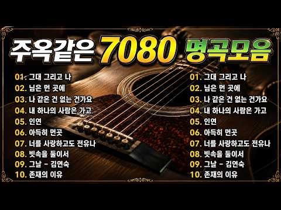

# 음악 — 성공 사례 분석: 사례별 자세히 #321–#360

`analysis.md` 의 9번 (같은 # 번호). 자동 생성 — `tools/success_analysis.py` v1.4.1 (2026-10-16 13:16 UTC). ※ 연구·교육용 — 투자 권유가 아님.

### 321. 가질수 없는 너(1995) - 뱅크 ∣ Acoustic Cover ∣ 레트로카페

- https://www.youtube.com/watch?v=FLzOl-Y5jiw · 레트로 카페 (Retro Cafe) · 구독자 11,600 · 조회수 111,705 (×9.6, 하루 665.3) · 좋아요 303 (0.3%) · 4.6분 · 2026-05-01 · 주제 묶음 12. 커버·노래 부르기 · 형식 커버·직접 부른 노래 · 폴더 `W_FLzOl-Y5jiw` (웹 승인)
- 썸네일: 
- 설명 앞부분: 뱅크의 "가질수 없는너" 어쿠스틱 감성 커버곡입니다. 1995년 발표한 곡입니다. 찻집에서 따뜻한 커피한잔이 생각나는 감성입니다,
- 대본 없음 (설명) — 음성인식이 끝나면 도입부·흐름이 들어감
- 댓글 9/9: 좋은 점 — 영상 0 · 감사·응원 0 · 더 알고 싶은 것 0 · 아쉬운 점 — 영상 0 · 반박·불만 — 의견 다름 0 · 정치·사회 0 · 경험 공유 1 · 구독·다음 기대 0
  - 경험 공유 👍2 “아이큐님 마치음악한곡들은것같이생각되는군요 몸밖에가진것이없다 저도아파요 음악잘듣겠습니다”

### 322. 선선한 가을 밤 잠잘때 듣는 메이플 브금 (풀벌래 ASMR ) ∣ 수면유도음악 8시간

- https://www.youtube.com/watch?v=mkpa_vCH-Aw · DOKANG · 구독자 20,400 · 조회수 185,367 (×9.1, 하루 1,332.3) · 좋아요 2,007 (1.1%) · 480분 · 2026-05-30 · 주제 묶음 1. 수면·명상·힐링 · 형식 플레이리스트·모음 (여러 곡) · 폴더 `W_mkpa_vCH-Aw` (웹 승인)
- 썸네일: 
- 챕터: 0:00 엘리니아 나무줄기던전 · 3:14 오르비스 · 6:19 리스항구 · 9:11 해네시스 동쪽필드 · 12:52 엘나스 · 15:40 에우렐 · 18:29 루디브리엄 뒤틀린 시간의길 1.2 · 21:14 루디브리엄 하늘 · 24:20 도원경 · 27:29 에스페라 거울빛에 물든 바다 · 30:23 중국상해 와이탄 (구버전) · 33:33 카트라이더 캐시샵 · 36:13 loop
- 설명 앞부분: 풀벌래소리와 추억의 메이플브금과 같이 같이 잠들어요 본 채널의 모든 음악은 유튜브 영상, 인터넷 방송 등의 배경음악(BGM)으로 사용하실 수 있습니다. 채널명 : DOKANG 음악: [해당 음원 제목] ⚠️ 주의 및 금지 사항 사용 제한: 불법, 혐오 조장, 범죄, 성인물 등 사회적 물의를 일으킬 수 있는 콘텐츠에는 음원 사용을 금지합니다. 본 영상은 넥슨 메이플스토리 IP,카트라이더 IP를 활용한 비공식 2차 창작물입니다. Official Nekode Music YouTube Channel
- 같은 채널 평소 대비 ×15.7 (채널 최근 롱폼 중앙값 11,805회) · 평소 영상: 오케스트라 오브 메이플스토리 VER.2 ∣ MapleStory Orchestra VER.2 (11,805회) / 호텔 아르크스의 밤 ∣ 메이플 커버 (12,157회)
- 대본 없음 (설명) — 음성인식이 끝나면 도입부·흐름이 들어감
- 댓글 61/61: 좋은 점 — 영상 0 · 감사·응원 3 · 더 알고 싶은 것 0 · 아쉬운 점 — 영상 0 · 반박·불만 — 의견 다름 1 · 정치·사회 0 · 경험 공유 4 · 구독·다음 기대 0
  - 감사·응원 👍1 “감사해요 진짜로....”
  - 감사·응원 👍0 “어릴적 나의 사람아 20년이 훌쩍 지났지만 사고도 안치고 잘 자라줘서 너무고마워 어머니 아버지 감사하고 사랑합니다”
  - 반박·불만 — 의견 다름 👍142 “아 메이플 관련 브금이랑 영상만 보면 저때로 돌아가고 싶다라는 생각이 계속 든다.. 무더운 여름방학 집에 에어컨도 없어서 방에서 선풍기 하나로 동생과 싸우고 한대 있는 컴퓨터로 너가 몇분을 더했니 어쨌니 그러다가 게임 금지 당하고.. 동생보다 30분이라도 먼저 일어나…”
  - 경험 공유 👍142 “아 메이플 관련 브금이랑 영상만 보면 저때로 돌아가고 싶다라는 생각이 계속 든다.. 무더운 여름방학 집에 에어컨도 없어서 방에서 선풍기 하나로 동생과 싸우고 한대 있는 컴퓨터로 너가 몇분을 더했니 어쨌니 그러다가 게임 금지 당하고.. 동생보다 30분이라도 먼저 일어나…”
  - 경험 공유 👍0 “따뜻해진다.. 이상하게도 마음이 안정된다 이 마음으로 메이플랜드했었는데 이제는 효율만따지는사람들 많더라ㅋㅋㅋ”

### 323. 아름다운 것도 아파 (Beautiful Things Hurt Too) ∣ 여자 듀엣 감성 발라드 Sad Emotional Ballad

- https://www.youtube.com/watch?v=jwUGSmtsSIs · MusicSong · 구독자 7,390 · 조회수 66,613 (×9.0, 하루 408.5) · 좋아요 633 (0.9%) · 4.4분 · 2026-05-06 · 주제 묶음 9. 가요·발라드·트로트 · 형식 플레이리스트·모음 (여러 곡) · 폴더 `W_jwUGSmtsSIs` (웹 승인)
- 썸네일: 
- 설명 앞부분: 서로를 너무 사랑했던 기억은 왜 시간이 지나도 더 아프게 남을까요. 예쁘게 피었던 사랑일수록 끝난 뒤엔 더 깊은 상처로 남는 밤. 잔잔한 피아노와 섬세한 여자 듀엣 화음으로 담아낸 이별 감성 발라드입니다. 이 노래는 이별 후 후회, 그리움, 늦은 밤 감정, 그리고 아직 끝내 놓지 못한 사랑을 담고 있어요. 이어폰 끼고 새벽에 들으면 더 아픈 노래. 감성 발라드 좋아하시는 분들께 추천합니다. 🎧 Pretty Things Hurt Emotional Korean Female Duet Ballad Some beautiful things …
- 대본 없음 (설명) — 음성인식이 끝나면 도입부·흐름이 들어감
- 댓글 43/43: 좋은 점 — 영상 0 · 감사·응원 1 · 더 알고 싶은 것 0 · 아쉬운 점 — 영상 0 · 반박·불만 — 의견 다름 0 · 정치·사회 0 · 경험 공유 1 · 구독·다음 기대 0
  - 감사·응원 👍2 “감사합니다...정말 아름답네요”
  - 경험 공유 👍3 “정해나 우리아내 생일의날 커플반지드림니다 전재우주문했습니다”

### 324. 중년카페음악 ∣ 카페에서 듣기 좋은 노래 ∣ 아침음악 ∣ 50대-60대가 좋아하는 중년가요

- https://www.youtube.com/watch?v=J9q2sbG27Qc · Cozy Cafe Music · 구독자 3,870 · 조회수 34,290 (×8.9, 하루 382.5) · 좋아요 1,249 (3.6%) · 8.6분 · 2026-07-18 · 주제 묶음 4. 카페·매장·라운지 · 형식 플레이리스트·모음 (여러 곡) · 폴더 `W_J9q2sbG27Qc` (웹 승인)
- 썸네일: 
- 설명 앞부분: 따뜻한 커피 한 잔과 함께 여유로운 시간을 즐기고 싶을 때 듣기 좋은 금잔디 카페음악 32곡 플레이리스트입니다. 부드럽고 감성적인 멜로디가 가득한 이 음악 모음은 여름의 시원한 바람과 어우러져 하루 종일 편안한 분위기를 선사합니다. 금잔디의 매력적인 목소리와 많은 사랑을 받아온 명곡들은 추억과 감동을 불러일으키며, 바쁜 일상 속에서도 마음의 여유를 찾게 해줍니다. 카페에서 흘러나오는 듯한 편안한 음악과 함께 독서, 업무, 휴식, 드라이브 또는 커피 타임을 더욱 특별하게 만들어 보세요. ☕🌿🎶 이 영상에 수록된 음악은 제작팀이 직접…
- 대본 없음 (설명) — 음성인식이 끝나면 도입부·흐름이 들어감
- 댓글 3/3: 좋은 점 — 영상 0 · 감사·응원 0 · 더 알고 싶은 것 0 · 아쉬운 점 — 영상 0 · 반박·불만 — 의견 다름 0 · 정치·사회 0 · 경험 공유 1 · 구독·다음 기대 0
  - 경험 공유 👍0 “qcy 오늘 저녁 식사 🍽 오늘 저녁 영어샘 박혜진내사랑샘내사랑 너도 빨리 빨리 끝내고 집 도착 예정 입니다 수 없는 상황 봐서 미안해 내가 다 같이 밥 먹으러 런던 해리포터 시리즈 우승을 차지하고 있는”

### 325. 🏡 평생 잊지 못할 내 마음의 고향 ∣ 힐링 트로트 ∣ 혜영스님

- https://www.youtube.com/watch?v=Dx4ewFSkxSg · 혜영스님 | 힐링트로트 · 구독자 7,600 · 조회수 67,235 (×8.8, 하루 665.0) · 좋아요 523 (0.8%) · 5.7분 · 2026-07-07 · 주제 묶음 9. 가요·발라드·트로트 · 형식 AI 음악 · 폴더 `W_Dx4ewFSkxSg` (웹 승인)
- 썸네일: 
- 설명 앞부분: 🌾 고향 🌾 바쁘게 살아오다 보면 문득 그리워지는 곳이 있습니다. 어린 시절 뛰어놀던 골목길, 따뜻한 밥상을 차려주시던 부모님, 반갑게 웃으며 인사하던 이웃들... '고향'은 단순한 장소가 아니라, 우리 마음속 가장 따뜻한 추억이 머무는 곳입니다. 이 노래가 잠시나마 여러분을 그 시절로 데려다주고, 마음 한편에 따뜻한 위로가 되길 바랍니다. 💬 여러분이 가장 그리워하는 고향의 추억은 무엇인가요? 어린 시절 기억, 부모님, 친구, 고향 음식 등 어떤 이야기든 댓글로 함께 나눠주세요. 🌸 혜안스님의 힐링 트로트 채널은 삶의 위로와 희…
- 대본 없음 (설명) — 음성인식이 끝나면 도입부·흐름이 들어감
- 댓글 26/26: 좋은 점 — 영상 0 · 감사·응원 1 · 더 알고 싶은 것 0 · 아쉬운 점 — 영상 0 · 반박·불만 — 의견 다름 0 · 정치·사회 1 · 경험 공유 0 · 구독·다음 기대 0
  - 감사·응원 👍0 “한동훈 국회의원님 진은정 변호사 님 아들 님 딸 님 가족 우리가 지킨다 화이팅 항상 지지합니다 고생 많이 하셨습니다”
  - 정치·사회 👍0 “한동훈 국회의원님 진은정 변호사 님 아들 님 딸 님 가족 우리가 지킨다 화이팅 항상 지지합니다 고생 많이 하셨습니다”

### 326. [𝐏𝐥𝐚𝐲𝐥𝐢𝐬𝐭] 나른 야르한 제이팝 플리

- https://www.youtube.com/watch?v=6Kd2P_Pu5Ug · Nonohara · 구독자 1,240 · 조회수 10,648 (×8.6, 하루 166.2) · 좋아요 223 (2.1%) · 14.7분 · 2026-08-13 · 주제 묶음 10. 팝송·K팝·J팝 · 형식 플레이리스트·모음 (여러 곡) · 폴더 `W_6Kd2P_Pu5Ug` (웹 승인)
- 썸네일: 
- 챕터: 0:00 coffee mix · 2:42 階下の騒音 - 층간 소음 · 6:07 Losing My Mind · 9:17 蚊 - 모기 · 12:05 夏なのに寒い - 여름인데도 추워
- 설명 앞부분: 이 플리를 듣는 모든 분들이 행복했으면 좋겠습니다😁 이 영상의 음악은 AI를 활용하여 제작되었으며, 콘텐츠 제작자가 직접 기획·편집했습니다. 사랑의 감정을 담은 감성 J-POP 플레이리스트입니다. 잔잔한 분위기의 슬픈 일본 노래 플레이리스트와 신나는 jpop 플레이리스트를 좋아하시는 분들께 추천드려요 공부할 때, 작업할 때, 또는 하루를 마무리하며 듣기 좋은 공부할 때 듣는 음악 J-POP으로 편안한 시간을 보내셨으면 좋겠습니다 애니메이션 OST 같은 감성을 좋아하신다면 J-POP 플레이리스트 애니 분위기도 함께 느껴보세요 매일 …
- 대본 없음 (설명) — 음성인식이 끝나면 도입부·흐름이 들어감
- 댓글 28/28: 좋은 점 — 영상 0 · 감사·응원 3 · 더 알고 싶은 것 1 · 아쉬운 점 — 영상 0 · 반박·불만 — 의견 다름 0 · 정치·사회 0 · 경험 공유 0 · 구독·다음 기대 0
  - 더 알고 싶은 것 👍1 “유튜브에서만 노래 듣고 있는데ㅠ 여름인데도 추워 이거만 따로 올려주시면 안될까요ㅜㅠㅠㅠ”

### 327. 중년 남자의 눈물 쏙 빼는 미친 호소력. '님은 먼곳에' (AI커버블루스 락 Ver.)#김추자 #님은먼곳에 #AI커버 #허스키보컬 #알고보니혼비백산

- https://www.youtube.com/watch?v=A0SSBzDh-Ew · 알고보니 혼비백산 · 구독자 42,900 · 조회수 368,315 (×8.6, 하루 2,190.2) · 좋아요 2,612 (0.7%) · 5.7분 · 2026-05-01 · 주제 묶음 14. AI 음악 · 형식 AI 음악 · 폴더 `W_A0SSBzDh-Ew` (웹 승인)
- 썸네일: 
- 설명 앞부분: 안녕하세요! AI로 음악에 새로운 숨결을 불어넣는 [알고보니 혼비백산]입니다. 이번에 준비한 곡은 1970년에 발표된 김추자 님의 절대적인 명곡, '님은 먼 곳에'입니다. 한국 록의 대부 신중현 님이 작곡하고, 당시 동명의 TBC 드라마 메인 테마곡으로 쓰이며 엄청난 신드롬을 일으켰던 곡이죠. 김추자 님 특유의 독보적인 소울과 사이키델릭한 감성이 담겨 있어, 50년이 훌쩍 지난 지금까지도 수많은 후배 가수들이 리메이크하는 한국 대중음악사의 마스터피스입니다. 이 위대한 명곡을 이번에는 '감성적인 블루스 록(Blues Rock)'과 …
- 대본 없음 (설명) — 음성인식이 끝나면 도입부·흐름이 들어감
- 댓글 244/244: 좋은 점 — 영상 2 · 감사·응원 20 · 더 알고 싶은 것 2 · 아쉬운 점 — 영상 2 · 반박·불만 — 의견 다름 0 · 정치·사회 0 · 경험 공유 9 · 구독·다음 기대 3
  - 좋은 점 — 영상 👍6 “여성의 노래도 멋진데, 남성의 노래도 멋지네요. 파워풀해서 듣기 좋으네요...”
  - 감사·응원 👍9 “백산쌤 !! 잘 들었습니다 좋은 노래가 많이 올려지네요 고생많으셨어요 감사합니다❤”
  - 감사·응원 👍7 “아름다운 꽂과 멋진 꿈 을 향해가는 오월의 첫날 (님은 먼곳에)와~~!!감탄사가 나오는군요 댓글을. 우연히 봤는대 어느 구독자님깨서 신청해주신 곡 이던대 백산님도 좋아하시는 곡이라구~^ㅎㅎ 기대 이상으로 훌륭했다고 봅니다 구독자 님들도 역시 똑같은 마음 이네요 고맙습…”
  - 더 알고 싶은 것 👍5 “멋있네요 이런음악 많이 만들어주셔요 역시 노래는 옛것이 좋네요”
  - 더 알고 싶은 것 👍2 “알혼백 구독 바로 갑니다. 소울 충만한 감성 쥑여주는 버젼 Green Green Grass Of Home 좀 올려주세요. 미리 감사인사 드려요. 😍😍😍💯🧡🧡🧡”
  - 아쉬운 점 — 영상 👍4 “말했으면요, 말했으면 내곁에 남았을까요ᆢ? 무한반복 감상할게요, 감사드려요.❤”
  - 아쉬운 점 — 영상 👍3 “ai 가 득음 을 한 목소리로 들려 주다 보니. 인간의 목소리로 뭔가? 아쉬웠던 것을 풀어 주네요. 진짜 큰일 났네...가수들 노래를 잘 안 듣게 된 것이.귓구녕 수준이 너무 올라 버렸어요, 책임지세요 ㅋㅋ”
  - 경험 공유 👍12 “박수 👏 👏 👏 와우 👍 👑 그대는 왕이야 거친 락의정수ㅡㅡ캭ㅡㅡ남자의 버전 님은먼곳에 사랑하는이를떠나보내니 발악하는것처럼 처절하게부르네ᆢ 😭 그래 나!!! 돌아갈께유 !! 피토하지마쇼!! ! ❤오늘도 나를 실망시키지않는 내가수님 백점 💯”
  - 경험 공유 👍5 “야ㅡㅡㅡ계속 듣고 들어도 질리지가않네 끝내주네❤ 쮝인다ㆍ 👍 👍 👍 따봉 내가 제일좋아하는 곡임 ❤❤❤ 오늘도 🤒 🕙 즐감임”
  - 구독·다음 기대 👍4 “미쳤다.. 왜 알고리즘이 이제야 뜬거지.. AI 커버 채널 몇개 구독중인데 이분이 그냥 1등 인것같습니다.. 왜 조회수가 높고 댓글이 많은지 알겠네요 곡 초이스도 편곡도 보컬음색도 전부 취향저격 제대로입니다 채널 업로드 된 곡들 하나씩 정주행 중인데 못참고 중간에 댓…”
  - 구독·다음 기대 👍3 “감사합니다, "님은먼곳에" 조관우가 부른 버전을 자주들었는데ㅡㅡ그래서 너무좋아서 신청하고 언제쯤 들을수있을까 매일 찾아보곤했는데~~듣고싶었던곡 감사합니다, "거리에서"도 신청해봅니다, 어떤 편곡이나올지 기대됩니다”

### 328. [𝙋𝙡𝙖𝙮𝙡𝙞𝙨𝙩] 그대여, -BM

- https://www.youtube.com/watch?v=YDESKcB9ppA · Artist BM · 구독자 8,660 · 조회수 72,828 (×8.4, 하루 1,625.1) · 좋아요 0 (0.0%) · 4분 · 2026-09-01 · 주제 묶음 9. 가요·발라드·트로트 · 형식 플레이리스트·모음 (여러 곡) · 폴더 `W_YDESKcB9ppA` (웹 승인)
- 썸네일: 
- 설명 앞부분: [𝙋𝙡𝙖𝙮𝙡𝙞𝙨𝙩] 그대여, 🎶 곡 소개 🎶 안녕하세요, Artist BM입니다. 이번 곡은 **《그대여,》**입니다. " 안녕하세요 BM입니다. 이 번곡은 "그대를 사랑하지만 붙잡지 않고, 그리움을 품은 채 떠나보내는 애절한 이별 이야기" 입니다 🖤 언제나 제 음악을 마음 깊이 들어주시는 여러분께, 조심스럽게 이 마음을 건넵니다. 소란한 하루 속에서도 여러분의 시간이 잠시라도 조용히 쉬어갈 수 있기를 바랍니다. 이번 노래도 그 하루의 잔잔한 배경처럼 곁에 머물 수 있었으면 좋겠습니다. 감사한 마음, 오래도록 남기를 바랍니다. 🌙…
- 대본 없음 (설명) — 음성인식이 끝나면 도입부·흐름이 들어감
- 댓글 22/22: 좋은 점 — 영상 0 · 감사·응원 1 · 더 알고 싶은 것 1 · 아쉬운 점 — 영상 0 · 반박·불만 — 의견 다름 0 · 정치·사회 0 · 경험 공유 0 · 구독·다음 기대 0
  - 감사·응원 👍4 “이번 곡도 지난번처럼 아련하고 애절한 느낌이네요🥹 조용한 가을밤에 듣기 딱 좋을 것 같아요✨ 지난번 곡도 스타일이 너무 제 취향이라 어제 하루 종일 시간 될 때마다 들었거든요🎶 이번 신곡도 그렇게 될 것 같아요🥰 ​항상 좋은 노래 선물해 주셔서 감사해요💖”
  - 더 알고 싶은 것 👍2 “멜론에 언제 발매가 되나요?”

### 329. 너와 걸으며/달달한노래/아련한노래/달콤한노래/잔잔한노래/편안한노래/가을노래/자기전에 듣기좋은 노래/여행갈때 듣기좋은 노래/힘나는노래/감성발라드/공부할때듣는노래/…

- https://www.youtube.com/watch?v=bzVlQQuegBc · 황금밴드 / Golden Band · 구독자 1,880 · 조회수 15,584 (×8.3, 하루 288.8) · 좋아요 22 (0.1%) · 4.2분 · 2026-08-23 · 주제 묶음 9. 가요·발라드·트로트 · 형식 음악 (그 밖 모양 — 한 편짜리 BGM 등) · 폴더 `W_bzVlQQuegBc` (웹 승인)
- 썸네일: 
- 설명 앞부분: 그저 편의점에 다녀오는 길 너는 이야기하고 나는 웃지 밤 공기가 선선해서 너와 걸으며 행복을 느껴 별거 없어도 이제야 하루를 보내는 것 같아 별거 아닌 이야기에 마음이 가득 차 하루를 지나는 물음에 대답 못 할때도 아침이 두려워 울먹인 적도 있었어 그럴 때 생각나는게 있어 우리 처음 손을 잡았을 때부터 놓치지 않은 맥주 한잔에 피곤한지 너는 어깨를 빌려 드라마를 보고 영화를 보고 소파 밑에 앉아 기대어 별거 아닌 일상을 이야기해 아무 의미 없는 이야기들 속에 담긴 의미를 너도 알고 있을까? 하루를 지나는 물음에 대답 못할 때도 아…
- 대본 없음 (설명) — 음성인식이 끝나면 도입부·흐름이 들어감
- 댓글 16/16: 좋은 점 — 영상 0 · 감사·응원 0 · 더 알고 싶은 것 0 · 아쉬운 점 — 영상 0 · 반박·불만 — 의견 다름 0 · 정치·사회 0 · 경험 공유 0 · 구독·다음 기대 0

### 330. ㉖대한민국 정통 트로트 60선 (Korean Trot 60) ∣ 전설의 거장들이 빚어낸 정통 명곡 메들리 #트로트 #정통트로트 #trot #kpop #은채린

- https://www.youtube.com/watch?v=75u_o8j9V0s · 트로트의 맛! · 구독자 39,600 · 조회수 325,082 (×8.2, 하루 2,012.8) · 좋아요 3,555 (1.1%) · 188.5분 · 2026-05-08 · 주제 묶음 10. 팝송·K팝·J팝 · 형식 플레이리스트·모음 (여러 곡) · 폴더 `W_75u_o8j9V0s` (웹 승인)
- 썸네일: 
- 챕터: 0:00 1사랑이비를맞아요(배금성) · 3:18 2초가삼간(최정자) · 6:26 3미워하지않으리(정원) · 9:44 4사나이맹세(이광희) · 13:19 5동숙의노래(문주란) · 17:00 6연모(박우철) · 20:14 7갈대의순정(박일남) · 23:21 8비내리는명동거리(배호) · 26:56 9안개낀장충단공원(배호) · 30:17 10남자의눈물(현철) · 33:46 11인생(모정애) · 37:10 12우중의여인(오기택) · 40:25 13내마음별과같이(현철) · 43:21 14잊을수가있을까(나훈아) · 46:38 15봉선화연정(현철) · 49:40 16찔레꽃(백난아) · 52:34 17들국화여인(현철) · 55:26 18영시의이별(배호) · 58:25 19보고싶은여인(현철) · 61:22 20나그네설움(백년설)
- 설명 앞부분: 대한민국 가요계의 역사를 만들어온 전설의 거장들이 빚어낸 불후의 정통 명곡 60곡을 엄선했습니다. 배호, 남진, 나훈아, 이미자, 주현미, 현철 등 이름만 들어도 가슴 설레는 위대한 가수들의 목소리로 기억되는 이 노래들은, 거친 세월의 풍파를 묵묵히 견뎌오신 우리 아버님들의 인생 그 자체입니다. 타향살이의 설움과 쓰라린 이별의 아픔, 그리고 그리운 고향에 대한 향수까지... 삶의 모든 희노애락이 녹아있는 이 60곡의 영원한 명곡들을 은채린의 깊은 감성으로 온 마음을 담아 엮었습니다. 고단한 하루 끝에 홀로 술잔을 기울이거나, 문득…
- 대본 없음 (설명) — 음성인식이 끝나면 도입부·흐름이 들어감
- 댓글 174/174: 좋은 점 — 영상 2 · 감사·응원 21 · 더 알고 싶은 것 0 · 아쉬운 점 — 영상 2 · 반박·불만 — 의견 다름 0 · 정치·사회 0 · 경험 공유 3 · 구독·다음 기대 0
  - 좋은 점 — 영상 👍2 “목소리좋고맛깔스럽게타고난질리지음성은체린앞으로흘러간노래계속들려주세요”
  - 좋은 점 — 영상 👍1 “반주와노래가 요란하거시끄럽지않고 차분해서 듣기좋네요”
  - 감사·응원 👍11 “요즘 ㅡ 나리짱님 ㅡ 은 채린 가수분 ㅡ 때문에 강남구에서 귀촌한후 요즘 텃밭에 모종심으며 이 음악을 틀어놓으면 세상에 더할나위없는 나의 행복 내세상이지요 감사합니다 ㅡ”
  - 감사·응원 👍10 “감미로운목소리들려주시니감사해요! 건강하시고복많이받으시고좋은일많이있으시길빕니다”
  - 아쉬운 점 — 영상 👍2 “광고가너무많어”
  - 아쉬운 점 — 영상 👍1 “채린아씨,애련하고맑고고운아씨,노래가,그리워찾아왔읍니다,언제들어도지루하지않고,명랑한노래가사람,마음을잡아들입니다,노래들으면항상,마음이편해지고,세상이달리보입니다,그만큼노래가편하고,친근감이있네요,아씨가슴속에서풍겨나오는,전설의근원이아닐까요,하늘이내린신의소리,그자체입니다,아씨,…”
  - 경험 공유 👍5 “흐흐… 이정표 없는 거리까지 광고 피해가면서 3시간 좀 넘게 다 들었어요 눈과 귀에서 피가 나올것 같지만 제가 머리가 나빠서 그런지 며칠전에 개별로 들었었는데 또 새롭네요 ㅎㅎ오늘 밤 채린이가 꿈에 나올 것 같아요😂”
  - 경험 공유 👍3 “72세요.내가좋아하는.노래다.들을수있어서.넘.넘행복합니다.항시건강하시고.더많은.노래들려주세요”

### 331. 위로와 평안의 찬송 ∣ 지친 당신을 위한 깊은 위로의 찬송가 10곡 (1만 구독자 기념 플레이리스트)ㅣ위로와 평안의 찬송가 45분 ㅣ놀라운 평안ㅣ예수님생각

- https://www.youtube.com/watch?v=bUyzotGJlfs · Worship Channel 예수님생각 [Thinking of Jesus] · 구독자 21,300 · 조회수 171,311 (×8.0, 하루 973.3) · 좋아요 2,286 (1.3%) · 45.6분 · 2026-04-23 · 주제 묶음 15. CCM·찬양·국악·동요 · 형식 플레이리스트·모음 (여러 곡) · 폴더 `W_bUyzotGJlfs` (웹 승인)
- 썸네일: 
- 챕터: 0:00 410장 내 맘에 한 노래 있어 · 4:49 411장 아 내 맘속에 · 9:25 412장 내 영혼의 그윽히 깊은 데서 · 14:49 414장 이 세상은 요란하나 · 19:34 413장 내 평생에 가는 길 · 24:25 415장 십자가 그늘 아래 · 28:05 406장 곤한 내 영혼 편히 쉴 곳과 · 32:47 405장 주의 친절한 팔에 안기세 · 35:44 417장 주 예수 넓은 품에 · 40:00 418장 주 날개 밑 내가 편안히 쉬네
- 설명 앞부분: 마음 편안해지는 찬송가 10곡 ∣ 새찬송가 405~419장 ∣ 위로와 평안 45분 플레이리스트 "여호와는 나의 목자시니 내게 부족함이 없으리로다" (시편 23:1) 안녕하세요, "예수님생각" 채널입니다. 어느덧 이 채널이 1만 명의 소중한 동역자분들과 함께하게 되었습니다. 가장 먼저 우리 하나님께 영광과 찬송올 올려드립니다. 그리고, 사순절 이후 정체된 시간 속에서도 묵묵히 자리를 지켜주신 여러분께 진심으로 감사드립니다. 감사의 마음을 담아, 그간 가장 많은 위로를 전해드렸던 '평안과 위로'의 찬송가 10곡을 엮었습니다. 45분간…
- 대본 없음 (설명) — 음성인식이 끝나면 도입부·흐름이 들어감
- 댓글 149/149: 좋은 점 — 영상 3 · 감사·응원 38 · 더 알고 싶은 것 1 · 아쉬운 점 — 영상 2 · 반박·불만 — 의견 다름 0 · 정치·사회 0 · 경험 공유 3 · 구독·다음 기대 0
  - 좋은 점 — 영상 👍1 “목소리가 편합니다.❤😂”
  - 감사·응원 👍76 “찬송속에 평안있고. 찬송에 말씀이 살아 숨쉬고 찬송속에 기도의문이 열리고 찬송속에 하나님의 임재하심에 감사하며 영광 돌려 드리네요 아멘”
  - 감사·응원 👍24 “할렐루야 아멘!!💗 주님을 기쁘게 하는 하루되게 하옵소서!! 감사합니다!!”
  - 더 알고 싶은 것 👍16 “축하드립니다!! 계속 은혜로운 찬양 부탁합니다^*^”
  - 아쉬운 점 — 영상 👍9 “할렐루야 영감있는 찬양 음색 편곡 창벞 너무 훌륭한 찬양 반복해서 듣고 힘이 납니다 감사합니다”
  - 경험 공유 👍7 “실제음성과 찬양음성이 조금달라요 어느것이 AI인지 헷갈려요 제가 그동안 받았던 은혜가AI가 아니길 ...바라면서”
  - 경험 공유 👍6 “곳곳을 비춰주든 벚꽃이 또 내년을 기약하며 살포시 떠났습니다. 세월이 쌓일수록 하나님의 작품들이 너무 황홀하여 말로 표현키 어렵습니다. 하지만 예수님생각님의 목소리와 한 단어 한 단어가 내가 표현할 수 없는 세밀함을 노래로 표해줍니다. 그래서 듣지않을 수가 없습니다.…”

### 332. 우리 행복하자 (Let's Just Be Happy) ∣ 미안하단 말보다 우리 행복하자 ∣ KR/ROM/EN Lyrics

- https://www.youtube.com/watch?v=d0jaFafrkkM · 한그루브 · 구독자 50,000 · 조회수 384,295 (×7.7, 하루 3,552.4) · 좋아요 2,800 (0.7%) · 5.5분 · 2026-06-30 · 주제 묶음 5. 운동·드라이브·신나는 · 형식 플레이리스트·모음 (여러 곡) · 폴더 `W_d0jaFafrkkM` (웹 승인)
- 썸네일: 
- 설명 앞부분: 🎵 이 곡이 포함된 1시간 풀버전 플레이리스트 보기 🌳 우리 행복하자 (U-ri Haeng-bok-ha-ja _ Let's Just Be Happy) 어이하리 어이하리, 이 철없는 마음을. 당신이 준 계절을 나는 거저 얻은 줄 알았네 이제야 보이는 당신의 야윈 그림자. 미안하단 말보다 우리 행복하자, 사랑한단 말 대신 우리 행복하자. 나 하나 키우려 당신은 세상을 견뎠고, 모진 바람은 다 맞으면서내게는 햇살만 줬네. 당신의 주름진 손마디가 내 길을 닦았는데, 고맙다는 말은 왜 이리 목에 걸리는지 내 목소리가 커질수록 당신의 대답은…
- 대본 없음 (설명) — 음성인식이 끝나면 도입부·흐름이 들어감
- 댓글 0/319 (다 받지 못함): 좋은 점 — 영상 0 · 감사·응원 0 · 더 알고 싶은 것 0 · 아쉬운 점 — 영상 0 · 반박·불만 — 의견 다름 0 · 정치·사회 0 · 경험 공유 0 · 구독·다음 기대 0

### 333. 한여름 밤의 꿈

- https://www.youtube.com/watch?v=t87CPyEGmHQ · 오레 ooree · 구독자 18,700 · 조회수 143,806 (×7.7, 하루 1,157.0) · 좋아요 6,178 (4.3%) · 119.7분 · 2026-06-14 · 주제 묶음 기타 · 형식 플레이리스트·모음 (여러 곡) · 폴더 `W_t87CPyEGmHQ` (웹 승인)
- 썸네일: 
- 설명 앞부분: 오레 ooree 계절이 바뀌는 소리 ꩜ 지금 이 모든 소중한 시간을 가슴 한 켠에 새기며 ꩜ Keeping all these precious moments close to my heart 오늘도 오레 ooree의 플레이리스트에 방문해주셔서 감사합니다. 항상 여러분께 힘이 되기를 Thank you for visiting 오레 ooree, May I always be your strength All tracks are licensed by 오레 ooree. 여러분 오레오레 함께 해요! let’s stay together ore ore…
- 대본 없음 (설명) — 음성인식이 끝나면 도입부·흐름이 들어감
- 댓글 0/88 (다 받지 못함): 좋은 점 — 영상 0 · 감사·응원 0 · 더 알고 싶은 것 0 · 아쉬운 점 — 영상 0 · 반박·불만 — 의견 다름 0 · 정치·사회 0 · 경험 공유 0 · 구독·다음 기대 0

### 334. [Fanmade OST] 하루의 끝에서/이안대군 테마 **21세기 대군부인** 감성 발라드

- https://www.youtube.com/watch?v=sf5dMF71cg4 · ycmusic25 · 구독자 13,700 · 조회수 102,078 (×7.5, 하루 629.4) · 좋아요 639 (0.6%) · 4.1분 · 2026-05-07 · 주제 묶음 9. 가요·발라드·트로트 · 형식 AI 음악 · 폴더 `W_sf5dMF71cg4` (웹 승인)
- 썸네일: 
- 설명 앞부분: 현재 방영 중인 드라마 ‘21세기 대군부인’ 속 이안대군의 애틋한 감정선에 영감을 받아 제작한 팬메이드 OST입니다. 하루를 마무리하는 순간마다 떠오르는 한 사람, 지울 수 없는 그리움과 기다림의 감정을 잔잔한 피아노 선율과 함께 담아보았습니다. 이 음악이 드라마 속 감정과 함께 여러분의 하루 끝에도 조용한 여운으로 남기를 바랍니다.
- 대본 없음 (설명) — 음성인식이 끝나면 도입부·흐름이 들어감
- 댓글 0/79 (다 받지 못함): 좋은 점 — 영상 0 · 감사·응원 0 · 더 알고 싶은 것 0 · 아쉬운 점 — 영상 0 · 반박·불만 — 의견 다름 0 · 정치·사회 0 · 경험 공유 0 · 구독·다음 기대 0

### 335. 🎵 견디고 또 견딘 당신에게 전하는 메시지 ∣ 너의 봄이 온다 - AIIN

- https://www.youtube.com/watch?v=9r7SCZtxgLQ · 박PD 음악다방 · 구독자 9,820 · 조회수 73,007 (×7.4, 하루 544.1) · 좋아요 239 (0.3%) · 5.8분 · 2026-06-04 · 주제 묶음 1. 수면·명상·힐링 · 형식 음악 (그 밖 모양 — 한 편짜리 BGM 등) · 폴더 `W_9r7SCZtxgLQ` (웹 승인)
- 썸네일: 
- 설명 앞부분: 🌸 너의 봄이 온다 🌸 박PD 음악다방에 오신 여러분을 환영합니다. 긴 겨울을 지나, 끝이 보이지 않는 시간들을 견디며 오늘도 살아낸 모든 분들에게 이 노래를 전합니다. 눈물조차 얼어버린 밤, 혼자 버텨야 했던 시간, 아무도 몰래 삼켜야 했던 아픔이 있었더라도 결국 해는 떠오르고, 봄은 찾아옵니다. 〈너의 봄이 온다〉는 힘겨운 시간을 지나고 있는 누군가에게 작은 위로와 희망이 되기를 바라는 마음을 담은 노래입니다. 🎧 Song Title 너의 봄이 온다 🎤 Vocal : AIIN (아인) 🎼 Music : Suno AI ✍️ Ly…
- 대본 없음 (설명) — 음성인식이 끝나면 도입부·흐름이 들어감
- 댓글 0/48 (다 받지 못함): 좋은 점 — 영상 0 · 감사·응원 0 · 더 알고 싶은 것 0 · 아쉬운 점 — 영상 0 · 반박·불만 — 의견 다름 0 · 정치·사회 0 · 경험 공유 0 · 구독·다음 기대 0

### 336. 가시리 ∣ 조선힙합(Official Music Video)

- https://www.youtube.com/watch?v=_uYBH28d_ys · 조선힙합 Official · 구독자 28,600 · 조회수 212,227 (×7.4, 하루 1,330.7) · 좋아요 597 (0.3%) · 4.6분 · 2026-05-10 · 주제 묶음 11. 힙합·R&B·EDM · 형식 한 곡 (뮤직비디오·음원·가사) · 폴더 `W__uYBH28d_ys` (웹 승인)
- 썸네일: 
- 설명 앞부분: 달빛이 내려앉은 조선의 밤. 떠나는 이를 붙잡지 못한 마음을 국악과 힙합의 감성으로 담았습니다. 전통의 한(恨)과 현대의 감성을 섞어 ‘가시리’라는 오래된 이별의 정서를 조선힙합 스타일로 다시 노래합니다. 🎧 Headphones Recommended 🌙 Emotional Korean Joseon HipHop 🪕 Traditional Korean Instruments × Lo-fi HipHop Youtube Music Spotify Apple Music Instagram tiktok
- 대본 없음 (설명) — 음성인식이 끝나면 도입부·흐름이 들어감
- 댓글 0/46 (다 받지 못함): 좋은 점 — 영상 0 · 감사·응원 0 · 더 알고 싶은 것 0 · 아쉬운 점 — 영상 0 · 반박·불만 — 의견 다름 0 · 정치·사회 0 · 경험 공유 0 · 구독·다음 기대 0

### 337. playlist ∣ 여름과 가을사이, 내 독서용 브금

- https://www.youtube.com/watch?v=zSUHxG9TGeQ · centralgrocery 중앙식품점 · 구독자 27,200 · 조회수 197,566 (×7.3, 하루 2,065.8) · 좋아요 2,469 (1.2%) · 225.8분 · 2026-07-12 · 주제 묶음 3. 공부·집중·작업 · 형식 플레이리스트·모음 (여러 곡) · 폴더 `W_zSUHxG9TGeQ` (웹 승인)
- 썸네일: 
- 챕터: 0:00 Reading Through July · 2:14 A Book for the Afternoon · 5:47 The Fan Turns Slowly · 8:35 The Quietest Hour of Summer · 12:23 Notes Between Chapters · 16:15 Halfway Through the Book · 20:00 Reading While the Day Cools · 22:58 The Hour Between Pages · 26:37 The Chapter I Stayed For · 30:11 A Breeze Through the Curtains · 35:13 Summer on the Bookshelf · 39:56 Reading Past Four · 43:29 The Day Slows Down Here · 47:46 The Last Warm Chapter · 50:09 A Book Beside the Fan · 54:00 A Summer Book Left Unfinished · 56:39 The Light Falls on the Margin · 59:32 The Afternoon Between Chapters · 63:18 The Margin of Summer · 66:56 A Novel in the Late Light
- 설명 앞부분: 내가 좋아하는 책들, 커피, 그리고 음악. 그런 느긋한 오후를 좋아합니다. [Tracklist] // CREDITS 채널에 사용되는 모든 일러스트와 음악은 CENTRALGROCERY가 직접 제작한 창작물입니다. Music and production by CENTRALGROCERY. Illustrations and visual content by CENTRALGROCERY. © CENTRALGROCERY. All rights reserved. // COLLABORATION
- 대본 없음 (설명) — 음성인식이 끝나면 도입부·흐름이 들어감
- 댓글 0/48 (다 받지 못함): 좋은 점 — 영상 0 · 감사·응원 0 · 더 알고 싶은 것 0 · 아쉬운 점 — 영상 0 · 반박·불만 — 의견 다름 0 · 정치·사회 0 · 경험 공유 0 · 구독·다음 기대 0

### 338. Playlist 2016 그곳으로

- https://www.youtube.com/watch?v=JXJWz7Ky8KA · 느좋모음집 · 구독자 29,100 · 조회수 207,966 (×7.2, 하루 1,869.5) · 좋아요 7,503 (3.6%) · 18.2분 · 2026-06-27 · 주제 묶음 기타 · 형식 플레이리스트·모음 (여러 곡) · 폴더 `W_JXJWz7Ky8KA` (웹 승인)
- 썸네일: 
- 챕터: 0:00 What do you mean? - Justin Bi… · 3:31 Paris in the rain - Lauv · 6:53 Closer - The chainsmokers , H… · 10:59 Where Are U now - Justin Bieb… · 15:02 HATE THAT I MADE YOU LOVE ME …
- 대본 없음 (없음) — 음성인식이 끝나면 도입부·흐름이 들어감
- 댓글 0/75 (다 받지 못함): 좋은 점 — 영상 0 · 감사·응원 0 · 더 알고 싶은 것 0 · 아쉬운 점 — 영상 0 · 반박·불만 — 의견 다름 0 · 정치·사회 0 · 경험 공유 0 · 구독·다음 기대 0

### 339. 창문으로 여름이 실려오는 브금 𓇼 ⋆.˚

- https://www.youtube.com/watch?v=wStibHhXn1A · 톤톤 tonton · 구독자 20,200 · 조회수 143,127 (×7.1, 하루 861.5) · 좋아요 1,745 (1.2%) · 250.8분 · 2026-05-03 · 주제 묶음 8. 로파이·시티팝·칠 · 형식 플레이리스트·모음 (여러 곡) · 폴더 `W_wStibHhXn1A` (웹 승인)
- 썸네일: 
- 설명 앞부분: 창문으로 여름 바람이 솔솔 불어오네요. 왠지 모르게 기분이 좋아지는 날이에요. 톤톤 tonton 🎧 Timeline 오늘도 고생했죠? (토닥토닥) 생각 많아지면 여기로 와요. 톤톤이 조용히 BGM 깔아둘게요. 👋 © All rights to this AI-assisted recording are owned by 톤톤 tonton
- 대본 없음 (설명) — 음성인식이 끝나면 도입부·흐름이 들어감
- 댓글 0/58 (다 받지 못함): 좋은 점 — 영상 0 · 감사·응원 0 · 더 알고 싶은 것 0 · 아쉬운 점 — 영상 0 · 반박·불만 — 의견 다름 0 · 정치·사회 0 · 경험 공유 0 · 구독·다음 기대 0

### 340. [𝙋𝙡𝙖𝙮𝙡𝙞𝙨𝙩] 주황색, -BM

- https://www.youtube.com/watch?v=63-irShSXR0 · Artist BM · 구독자 8,660 · 조회수 60,839 (×7.0, 하루 837.0) · 좋아요 0 (0.0%) · 4.2분 · 2026-08-04 · 주제 묶음 9. 가요·발라드·트로트 · 형식 플레이리스트·모음 (여러 곡) · 폴더 `W_63-irShSXR0` (웹 승인)
- 썸네일: 
- 설명 앞부분: [𝙋𝙡𝙖𝙮𝙡𝙞𝙨𝙩] 주황색, 🎶 곡 소개 🎶 안녕하세요, Artist BM입니다. 이번 곡은 **《주황색,》**입니다. " 안녕하세요 BM입니다. 이 번곡은 "유년 시절의 순수한 추억과 소중한 기억이 남아있는 노을빛 언덕길에서 지친 마음을 따뜻하게 다독이고 위로를 전하는 이야기" 입니다 🖤 언제나 제 음악을 마음 깊이 들어주시는 여러분께, 조심스럽게 이 마음을 건넵니다. 소란한 하루 속에서도 여러분의 시간이 잠시라도 조용히 쉬어갈 수 있기를 바랍니다. 이번 노래도 그 하루의 잔잔한 배경처럼 곁에 머물 수 있었으면 좋겠습니다. 감사…
- 대본 없음 (설명) — 음성인식이 끝나면 도입부·흐름이 들어감
- 댓글 0/23 (다 받지 못함): 좋은 점 — 영상 0 · 감사·응원 0 · 더 알고 싶은 것 0 · 아쉬운 점 — 영상 0 · 반박·불만 — 의견 다름 0 · 정치·사회 0 · 경험 공유 0 · 구독·다음 기대 0

### 341. 시작하면 시작된다 ٩(๑❛ᴗ❛๑)۶

- https://www.youtube.com/watch?v=gjtaovTAbMU · 톤톤 tonton · 구독자 20,200 · 조회수 139,428 (×6.9, 하루 1,123.1) · 좋아요 2,811 (2.0%) · 266.2분 · 2026-06-14 · 주제 묶음 8. 로파이·시티팝·칠 · 형식 플레이리스트·모음 (여러 곡) · 폴더 `W_gjtaovTAbMU` (웹 승인)
- 썸네일: 
- 설명 앞부분: 톤톤 tonton 🎧 Timeline 오늘도 고생했죠? (토닥토닥) 생각 많아지면 여기로 와요. 톤톤이 조용히 BGM 깔아둘게요. 👋 © All rights to this AI-assisted recording are owned by 톤톤 tonton
- 대본 없음 (설명) — 음성인식이 끝나면 도입부·흐름이 들어감
- 댓글 0/72 (다 받지 못함): 좋은 점 — 영상 0 · 감사·응원 0 · 더 알고 싶은 것 0 · 아쉬운 점 — 영상 0 · 반박·불만 — 의견 다름 0 · 정치·사회 0 · 경험 공유 0 · 구독·다음 기대 0

### 342. 깊은밤 색소폰 Vol.35 ∣ 시원한 파도 휴식 🌊 ∣ 2시간 힐링 색소폰 연주 ∣ Ocean Waves & Relaxing Saxophone ∣ Sleep •…

- https://www.youtube.com/watch?v=1jrUOOVjFpE · 고향 가는 나그네  · 구독자 2,670 · 조회수 18,249 (×6.8, 하루 216.8) · 좋아요 253 (1.4%) · 128.2분 · 2026-07-24 · 주제 묶음 1. 수면·명상·힐링 · 형식 연주 (직접 연주하는 영상) · 폴더 `W_1jrUOOVjFpE` (웹 승인)
- 썸네일: 
- 설명 앞부분: 잔잔하게 밀려오는 파도 소리와 부드러운 테너 색소폰 선율이 어우러진 2시간 힐링 음악입니다. 푸른 바다를 바라보며 휴식을 취하는 듯한 편안함을 느끼고, 지친 하루의 피로와 스트레스를 잠시 내려놓아 보세요. 잠들기 전의 고요한 시간, 책을 읽거나 공부할 때, 명상과 휴식, 카페 분위기, 업무 집중, 드라이브 등 다양한 순간에 자연스럽게 어울리는 감성 색소폰 연주입니다. 🎷 추천 용도 😴 수면음악 🌊 휴식음악 🧘 명상음악 📚 공부음악 ☕ 카페음악 💼 집중음악 🚗 드라이브 음악 📖 독서음악 💙 스트레스 해소 🎷 Deep Night Sa…
- 대본 없음 (설명) — 음성인식이 끝나면 도입부·흐름이 들어감
- 댓글 0/22 (다 받지 못함): 좋은 점 — 영상 0 · 감사·응원 0 · 더 알고 싶은 것 0 · 아쉬운 점 — 영상 0 · 반박·불만 — 의견 다름 0 · 정치·사회 0 · 경험 공유 0 · 구독·다음 기대 0

### 343. 임재현 - 웃어주지마요 Official MV

- https://www.youtube.com/watch?v=L4aOBuPkpLg · 임재현 Official · 구독자 39,100 · 조회수 265,471 (×6.8, 하루 2,676.7) · 좋아요 1,385 (0.5%) · 4.4분 · 2026-07-09 · 주제 묶음 기타 · 형식 한 곡 (뮤직비디오·음원·가사) · 폴더 `W_L4aOBuPkpLg` (웹 승인)
- 썸네일: 
- 대본 없음 (없음) — 음성인식이 끝나면 도입부·흐름이 들어감
- 댓글 0/151 (다 받지 못함): 좋은 점 — 영상 0 · 감사·응원 0 · 더 알고 싶은 것 0 · 아쉬운 점 — 영상 0 · 반박·불만 — 의견 다름 0 · 정치·사회 0 · 경험 공유 0 · 구독·다음 기대 0

### 344. 운동러들이 환장하는 '비트 깡패' 플리 ∣ 파상풍맛 외힙 노동요 playlist

- https://www.youtube.com/watch?v=pNmK5x-0bkA · 플리메이커 · 구독자 48,700 · 조회수 328,395 (×6.7, 하루 2,166.0) · 좋아요 5,036 (1.5%) · 57.1분 · 2026-05-17 · 주제 묶음 3. 공부·집중·작업 · 형식 플레이리스트·모음 (여러 곡) · 폴더 `W_pNmK5x-0bkA` (웹 승인)
- 썸네일: 
- 챕터: 0:00 God Save · 2:49 Never Stop · 5:44 Queue It · 8:31 Shhh · 10:42 WAKE IT UP · 12:36 Beast Mode · 14:58 Quiet Down · 17:38 I just ignite · 20:24 Goo-Goo · 22:51 Jelly Jump · 25:19 Mafia · 28:32 repeat all
- 설명 앞부분: 안녕하세요 플리메이커입니다.! 이번에 업로드가 조금 늦어져서 기다려주신 분들께 진심으로 죄송하고 또 감사드립니다.ㅠㅠ 부처님 비주얼에 맞춰서 제대로 된 쇠맛 비트 믹스로 준비했습니다. 귀에 바로 박히는 신곡 비트들부터 그동안 반응 제일 터졌던 인기 곡들까지 음질 완전 짱짱하게 다듬어서 꽉 채워뒀으니 무한 반복으로 걸어두고 갓생 살러 가시죠 🔥 오늘도 즐겁게 들어주세요! playlist 🎵 이 플레이리스트에 담긴 곡들은 모두 주인장이 Suno AI를 활용해 직접 제작한 트랙입니다! 오직 이 채널에서만 들을 수 있어요😊 작은 음악에 …
- 대본 없음 (설명) — 음성인식이 끝나면 도입부·흐름이 들어감
- 댓글 0/142 (다 받지 못함): 좋은 점 — 영상 0 · 감사·응원 0 · 더 알고 싶은 것 0 · 아쉬운 점 — 영상 0 · 반박·불만 — 의견 다름 0 · 정치·사회 0 · 경험 공유 0 · 구독·다음 기대 0

### 345. 술탄 오브 더 디스코 - 신나는 음악, 잘못된 인생 Good Beats, Ruined Life (Official Visuali…

- https://www.youtube.com/watch?v=UMinXZIMfQc · Sultan Of The Disco · 구독자 39,500 · 조회수 264,861 (×6.7, 하루 4,002.3) · 좋아요 5,326 (2.0%) · 4분 · 2026-08-11 · 주제 묶음 기타 · 형식 한 곡 (뮤직비디오·음원·가사) · 폴더 `W_UMinXZIMfQc` (웹 승인)
- 썸네일: 
- 설명 앞부분: new single [신나는 음악, 잘못된 인생] 2026. 08. 11. 6PM KST [ Official Lyrics (KOR) ] 신나는 음악에 난 춤을 추네 다른 걱정 없게 나 정말 행복 하네 미안해 사실 너무 불안 하네 모든 게 잘못 됐네 널 그냥 두고 온게 나 사실 미워서 갑질하고 이제와 회피하고 여기로 택시타고 쨋어 뒤늦게 뻘짓한거 후회만 가득하고 차라리 춤추다 죽겠어 화려한 조명 속에 불안한 나의 얼굴 못생긴 너의 얼굴 못 본체하는 모두들 안들리는 랜덤한 사람과의 대화 무슨 말인지 몰라 니 얼굴 결국 떠올라 미워서 …
- 대본 없음 (설명) — 음성인식이 끝나면 도입부·흐름이 들어감
- 댓글 0/632 (다 받지 못함): 좋은 점 — 영상 0 · 감사·응원 0 · 더 알고 싶은 것 0 · 아쉬운 점 — 영상 0 · 반박·불만 — 의견 다름 0 · 정치·사회 0 · 경험 공유 0 · 구독·다음 기대 0

### 346. ☕️ 다시 듣고 싶은 추억의 애창곡 ∣ 유튜브 발라드 애창곡 20곡 연속듣기 ∣ 김광석 임재범 신승훈 이문세 이선희 태연 이소라 에일리 이승철 김범수 김건모 김…

- https://www.youtube.com/watch?v=ZJHh-chAUSQ · Korean Ballads Playlist DD · 구독자 43,700 · 조회수 280,547 (×6.4, 하루 2,629.8) · 좋아요 1,259 (0.4%) · 117.5분 · 2026-07-01 · 주제 묶음 9. 가요·발라드·트로트 · 형식 플레이리스트·모음 (여러 곡) · 폴더 `W_ZJHh-chAUSQ` (웹 승인)
- 썸네일: 
- 설명 앞부분: ☕️ 다시 듣고 싶은 추억의 애창곡 ∣ 유튜브 발라드 애창곡 20곡 연속듣기 ∣ 김광석 임재범 신승훈 이문세 이선희 태연 이소라 에일리 이승철 김범수 김건모 김신우 조용필...
- 대본 없음 (설명) — 음성인식이 끝나면 도입부·흐름이 들어감
- 댓글 0/40 (다 받지 못함): 좋은 점 — 영상 0 · 감사·응원 0 · 더 알고 싶은 것 0 · 아쉬운 점 — 영상 0 · 반박·불만 — 의견 다름 0 · 정치·사회 0 · 경험 공유 0 · 구독·다음 기대 0

### 347. 🍉여름에 듣기 좋은 카페 음악 🌊 여름 바닷가 카페처럼 기분 좋은 Playlist ∣ 중간 광고 없음 ∣ Happy Summer Cafe Music 260511

- https://www.youtube.com/watch?v=SDGqz6SUFKY · 오늘의 멜로디 Today's Melody · 구독자 19,700 · 조회수 125,787 (×6.4, 하루 793.1) · 좋아요 567 (0.4%) · 121.5분 · 2026-05-10 · 주제 묶음 4. 카페·매장·라운지 · 형식 플레이리스트·모음 (여러 곡) · 폴더 `W_SDGqz6SUFKY` (웹 승인)
- 썸네일: 
- 챕터: 0:00 Chasing You All Summer · 3:03 Your Golden Hour · 6:31 Downtown With You · 10:21 Late Summer Feeling · 13:32 Honey Kind of Love · 17:02 Kissing You In July · 19:57 The Way You Linger · 23:46 Sweet On You · 27:25 Summer City Nights · 31:09 Next To You Is Enough · 34:32 Falling Easy · 37:31 Softly Into You · 41:12 Rooftop With You · 45:05 You've Got Me Good · 48:27 Your Smile in the Morning Lig… · 51:47 Summertime Crush · 55:10 Only Thinking of You · 58:09 Slow Burn Summer · 61:57 Quietly Yours · 65:21 Found In You
- 설명 앞부분: 여름 바다처럼 싱그러운 기운을 담은 여름에 듣기 좋은 카페 음악들이에요. 맑게 흐르는 선율들이 공간을 환하게 밝혀주고, 나른해진 하루에 기분 좋은 활력을 불어넣어 줘요. Happy Summer Cafe Music 260511가 오늘 당신이 있는 곳을 가장 시원하고 평온한 장소로 만들어 줄 거예요. 좋아하는 음료 한 잔과 함께 파도처럼 가벼운 이 리듬을 마음껏 즐겨보세요. 🌊🌿 오늘의 멜로디의 Original Playlist가 들려드리는 음악들이예요 🎵 ☀️ 아침 햇살처럼 스며드는 잔잔한 선율 ☕ 좋아하는 카페 구석 자리 같은 아늑…
- 대본 없음 (설명) — 음성인식이 끝나면 도입부·흐름이 들어감
- 댓글 0/31 (다 받지 못함): 좋은 점 — 영상 0 · 감사·응원 0 · 더 알고 싶은 것 0 · 아쉬운 점 — 영상 0 · 반박·불만 — 의견 다름 0 · 정치·사회 0 · 경험 공유 0 · 구독·다음 기대 0

### 348. ㉝대한민국 정통 트로트 100선(Vol.1)(Korean Authentic Trot 100) 한 번 틀면 5시간이 훌쩍! 감동의 대서사시 #트로트 #trot #…

- https://www.youtube.com/watch?v=PrpsrGzD3Ag · 트로트의 맛! · 구독자 39,600 · 조회수 248,864 (×6.3, 하루 1,951.7) · 좋아요 2,959 (1.2%) · 311.1분 · 2026-06-11 · 주제 묶음 10. 팝송·K팝·J팝 · 형식 플레이리스트·모음 (여러 곡) · 폴더 `W_PrpsrGzD3Ag` (웹 승인)
- 썸네일: 
- 챕터: 0:00 1.초가삼간(원곡:최정자) · 3:08 2.사나이 맹세(원곡:이광희) · 6:42 3.미워하지 않으리(원곡:정원) · 10:01 4.사랑이 비를 맞아요(원곡:배금성) · 13:19 5.남자의 눈물(원곡:현철) · 16:48 6.연모(원곡:박우철) · 20:02 7.인생(원곡:모정애) · 23:27 8.갈대의 순정(원곡:박일남) · 26:33 9.잊을 수가 있을까(원곡:나훈아) · 29:30 10.비 내리는 명동거리(원곡:배호) · 33:05 11.정에 약한 남자(원곡:고영준) · 36:08 12.원점(원곡:설운도) · 39:06 13.동숙의 노래(원곡:문주란) · 42:47 14.정(情)(원곡:박일남) · 45:40 15.내 마음 별과 같이(원곡:현철) · 48:55 16.들국화 여인(원곡:현철) · 51:49 17.안개낀 장충단 공원(원곡:배호) · 55:09 18.찔레꽃(원곡:백난아) · 58:11 19.애정이 꽃피던 시절(원곡:나훈아) · 61:20 20.잊으리(원곡:이승연)
- 설명 앞부분: 지나간 세월의 무상함과 고단했던 우리네 삶을 따뜻하게 어루만져 주는 대한민국 정통 트로트 100곡을 정성껏 엄선했습니다. 청춘의 애틋한 첫사랑부터 부모님을 향한 절절한 그리움, 그리고 이별의 아픔까지, 가슴 깊은 곳에 묻어두었던 지난날의 모든 추억들이 이 5시간의 릴레이 속에 고스란히 담겨 있습니다. 중간에 끊기는 불편함 없이, 한 번만 재생하시면 100곡의 대서사시가 끝날 때까지 멈추지 않고 흘러나옵니다. 은채린의 깊고 짙은 감성으로 재탄생한 진짜 트로트의 맛을 느끼며, 오늘 하루도 따뜻한 위로와 벅찬 감동으로 채워가시길 바랍니…
- 대본 없음 (설명) — 음성인식이 끝나면 도입부·흐름이 들어감
- 댓글 0/200 (다 받지 못함): 좋은 점 — 영상 0 · 감사·응원 0 · 더 알고 싶은 것 0 · 아쉬운 점 — 영상 0 · 반박·불만 — 의견 다름 0 · 정치·사회 0 · 경험 공유 0 · 구독·다음 기대 0

### 349. 조선힙합🔥연실🔥듣자마자 오늘은 이 리듬🔥오늘의힐링🔥국악힙합🔥노동요🔥퓨전국악🔥Korea Joseon Hip-Hop🔥KR / EN Lyrics

- https://www.youtube.com/watch?v=iQkMFMSQVOc · sisovibe · 구독자 2,810 · 조회수 16,606 (×5.9, 하루 914.4) · 좋아요 85 (0.5%) · 5.2분 · 2026-09-28 · 주제 묶음 3. 공부·집중·작업 · 형식 플레이리스트·모음 (여러 곡) · 폴더 `W_iQkMFMSQVOc` (웹 승인)
- 썸네일: 
- 설명 앞부분: 🧵 조선힙합 「연실 (緣絲)」 한 치만 늦었어도, 한 걸음만 빨랐어도 우리는 서로를 모르고 살았을지도 모릅니다. 수많은 사람을 스쳐 지나가면서도 이상하게 오래 곁에 남는 사람이 있습니다. 기쁜 날 함께 웃어준 사람, 내가 느려졌을 때 말없이 걸음을 맞춰준 사람, 잠시 머물렀지만 내 삶 어딘가에 흔적을 남기고 간 사람. 「연실(緣絲)」은 그런 **사람과 사람 사이의 보이지 않는 인연**을 노래합니다. 운명이라 부르기엔 너무 거창하고, 우연이라 하기엔 너무 오래 남은 만남. 떠난 사람도, 지금 곁에 있는 사람도, 돌아보면 모두 한 올…
- 대본 없음 (설명) — 음성인식이 끝나면 도입부·흐름이 들어감
- 댓글 0/24 (다 받지 못함): 좋은 점 — 영상 0 · 감사·응원 0 · 더 알고 싶은 것 0 · 아쉬운 점 — 영상 0 · 반박·불만 — 의견 다름 0 · 정치·사회 0 · 경험 공유 0 · 구독·다음 기대 0

### 350. Playlist ∣ 여름, 토마토, 재즈

- https://www.youtube.com/watch?v=fl5G97CMAvU · 야채상회 Vege Market · 구독자 44,400 · 조회수 255,523 (×5.8, 하루 2,399.5) · 좋아요 4,369 (1.7%) · 133.1분 · 2026-07-02 · 주제 묶음 7. 재즈·보사노바 · 형식 AI 음악 · 폴더 `W_fl5G97CMAvU` (웹 승인)
- 썸네일: 
- 설명 앞부분: 햇살을 머금은 빨간 토마토! If you enjoyed the video, don’t forget to hit Subscribe and Like! Your support helps us create even better content. Artwork in this video is created by VEGE MARKET. Music is created with a AI technology.
- 대본 없음 (설명) — 음성인식이 끝나면 도입부·흐름이 들어감
- 댓글 0/55 (다 받지 못함): 좋은 점 — 영상 0 · 감사·응원 0 · 더 알고 싶은 것 0 · 아쉬운 점 — 영상 0 · 반박·불만 — 의견 다름 0 · 정치·사회 0 · 경험 공유 0 · 구독·다음 기대 0

### 351. [뮤직비디오] 🎵 사의 찬미 ∣ 원곡 윤심덕 ∣ 감성 리메이크

- https://www.youtube.com/watch?v=Au2qy-W1WNA · 초이스 라이브카페 · 구독자 2,160 · 조회수 12,116 (×5.6, 하루 142.6) · 좋아요 116 (1.0%) · 4.5분 · 2026-07-23 · 주제 묶음 4. 카페·매장·라운지 · 형식 한 곡 (뮤직비디오·음원·가사) · 폴더 `W_Au2qy-W1WNA` (웹 승인)
- 썸네일: 
- 설명 앞부분: 🎵 사의 찬미 ∣ 원곡 윤심덕 ∣ 감성 리메이크 1926년에 발표되어 지금까지도 많은 사랑을 받고 있는 한국 가요사의 명곡 '사의 찬미'를 새로운 감성으로 리메이크했습니다. 원곡의 철학적이고 애절한 분위기는 그대로 살리면서, 따뜻한 스트링과 피아노, 그리고 잔잔한 편곡으로 현대적인 감성을 더했습니다. 고요한 석양과 바다, 1920년대의 정취를 담은 영상과 함께 깊은 여운을 느껴보세요. 🎧 이어폰 또는 헤드폰으로 감상하시면 더욱 풍부한 음질을 즐기실 수 있습니다. 👍 마음에 드셨다면 부탁드립니다. Original Song : 윤심덕…
- 대본 없음 (설명) — 음성인식이 끝나면 도입부·흐름이 들어감
- 댓글 0/6 (다 받지 못함): 좋은 점 — 영상 0 · 감사·응원 0 · 더 알고 싶은 것 0 · 아쉬운 점 — 영상 0 · 반박·불만 — 의견 다름 0 · 정치·사회 0 · 경험 공유 0 · 구독·다음 기대 0

### 352. 인생 뭐 있어 (In-saeng Mwo It-eo) ∣ 왔다 가는 바람 같은 것이지 ∣ KR/ROM/EN Lyrics

- https://www.youtube.com/watch?v=h0r9xLYF474 · 한그루브 · 구독자 50,000 · 조회수 271,310 (×5.4, 하루 1,843.4) · 좋아요 1,520 (0.6%) · 4.1분 · 2026-05-22 · 주제 묶음 5. 운동·드라이브·신나는 · 형식 플레이리스트·모음 (여러 곡) · 폴더 `W_h0r9xLYF474` (웹 승인)
- 썸네일: 
- 설명 앞부분: 🎵 이 곡이 포함된 1시간 풀버전 플레이리스트 보기 쌓아 올린 모래성 무너질까 봐 밤잠 설치고, 남의 시선 한 번에 가슴이 졸아들고, 이제 와 돌아보니 내 손엔 빈 주먹 하나뿐이라. 인생 뭐 있어 — 왔다 가는 바람 같은 것이지. 어깨 위에 내려놓지 못한 욕심들, 오늘만큼은 이 박자에 실어서 멀리 던져보세. 숨 쉬고 살아있으면 그게 정답이라네. 본 영상은 '한그루브(HanGroove)' 오리지널 콘텐츠입니다. © HanGroove 2026. All Rights Reserved.
- 대본 없음 (설명) — 음성인식이 끝나면 도입부·흐름이 들어감
- 댓글 0/125 (다 받지 못함): 좋은 점 — 영상 0 · 감사·응원 0 · 더 알고 싶은 것 0 · 아쉬운 점 — 영상 0 · 반박·불만 — 의견 다름 0 · 정치·사회 0 · 경험 공유 0 · 구독·다음 기대 0

### 353. 🌿 𝑯𝒆𝒂𝒍𝒊𝒎𝒂𝒍𝒔 ∣ 🧘 숲속 호텔의 저녁 명상 클래스 ∣ 싱잉볼 & 잔잔한 피아노 ∣ Meditation Music

- https://www.youtube.com/watch?v=GjtPZpv7iKo · 힐리멀스 · 구독자 23,000 · 조회수 117,666 (×5.1, 하루 1,830.2) · 좋아요 1,722 (1.5%) · 148분 · 2026-08-13 · 주제 묶음 1. 수면·명상·힐링 · 형식 음악 (그 밖 모양 — 한 편짜리 BGM 등) · 폴더 `W_GjtPZpv7iKo` (웹 승인)
- 썸네일: 
- 챕터: 0:00 Slow Inhale · 4:41 Soft Rising Tide · 7:08 Between Two Breaths · 10:18 Falling Into Stillness · 13:35 Where the Waves Slow · 16:41 A Quiet Turning · 19:21 Breathing in the Dark · 23:10 The Calm Beneath · 25:35 Endless Soft Tide · 29:37 🔁
- 설명 앞부분: 🌙 숲속 호텔의 저녁 명상시간 매일 저녁, 힐리멀스에서 작은 명상 클래스가 열립니다. 🧘🌿 해가 천천히 저물고 숲속에 풀벌레 소리가 들려오기 시작하면, 친구들도 하나둘 매트 위에 자리를 잡아요. 오늘의 명상 가이드는 티앙. 🐥 티앙이 싱잉볼을 가만히 울리면 잔잔한 피아노 선율과 함께 맑고 은은한 울림이 방 안을 천천히 채워갑니다. 창밖에서 들려오는 풀벌레 소리에 귀 기울이며 오늘 하루 쌓였던 생각과 긴장도 잠시 내려놓아 보세요. 🌿 꼭 무언가를 하지 않아도 괜찮아요. 가만히 누워 천천히 숨을 쉬어도 좋고, 바쁘게 보낸 하루의 끝,…
- 같은 채널 평소 대비 ×1.9 (채널 최근 롱폼 중앙값 60,987회) · 평소 영상: 🌿 𝑯𝒆𝒂𝒍𝒊𝒎𝒂𝒍𝒔 ∣ 천천히 걷다 보면 좋은 일이 생길 것 같아 🍀💕 ∣ 유럽의 작은… (68,766회) / 🌿 𝑯𝒆𝒂𝒍𝒊𝒎𝒂𝒍𝒔 ∣ 호텔 선셋 Bar, 노을을 닮은 칵테일 ∣ 하루를 마무리하는 선… (53,208회)
- 대본 없음 (설명) — 음성인식이 끝나면 도입부·흐름이 들어감
- 댓글 122/122: 좋은 점 — 영상 2 · 감사·응원 9 · 더 알고 싶은 것 6 · 아쉬운 점 — 영상 1 · 반박·불만 — 의견 다름 0 · 정치·사회 0 · 경험 공유 3 · 구독·다음 기대 0
  - 좋은 점 — 영상 👍2 “공부하면서 듣는데 너무 집중 잘되고 좋아요👍🏻 이미지도 너무 귀여워서 집중 깨질때 한번씩 쳐다보면 힐링됩니당 항상 좋은 영상 올려주셔서 감사해요❤”
  - 좋은 점 — 영상 👍1 “싱잉볼 소리가 너무너무 듣기 좋아요 그림두 너무이뻐요 힐리멀스 아이 한테 들려젔는데❤”
  - 감사·응원 👍33 “싱잉볼 치는 친구도, 앉아서 졸고있는 친구도, 누워서 입벌리고 자는 친구들도 너무 귀엽네요 여기 채널은 그림이랑 음악 듣고 있으면 마음이 평온해지는 기분이라 너무 좋아요 ^_^ 항상 좋은 컨텐츠 감사합니다”
  - 감사·응원 👍5 “운동으로 요가원을 다니고 있는데 제가 다니는 요가원이 이랬으면 좋겠네요..🥹💗 오늘도 힐링되는 음악과 그림 감사합니다! 잘 들을게요~!! (항상 부탁드리는 것 같아 죄송하지만...배경화면..부탁드려도 될까요..(속닥))”
  - 더 알고 싶은 것 👍5 “운동으로 요가원을 다니고 있는데 제가 다니는 요가원이 이랬으면 좋겠네요..🥹💗 오늘도 힐링되는 음악과 그림 감사합니다! 잘 들을게요~!! (항상 부탁드리는 것 같아 죄송하지만...배경화면..부탁드려도 될까요..(속닥))”
  - 더 알고 싶은 것 👍2 “이거너무좋아요 ㅠㅠ 가사없는 공부집중잘대는 이런음악 계속만들어주세요 그림도넘힐링,, 😂”
  - 아쉬운 점 — 영상 👍0 “싱잉볼소리 5배로 크게해서 다시영상올려주세요 ㅎㅎ 너무 제취향인데 싱잉볼소리가 안들려서 아쉽네요 ㅎ”
  - 경험 공유 👍5 “운동으로 요가원을 다니고 있는데 제가 다니는 요가원이 이랬으면 좋겠네요..🥹💗 오늘도 힐링되는 음악과 그림 감사합니다! 잘 들을게요~!! (항상 부탁드리는 것 같아 죄송하지만...배경화면..부탁드려도 될까요..(속닥))”
  - 경험 공유 👍2 “저희 꼬맹이들도 이거 틀어놓으니 캐릭터들 귀엽다고 난리네요 음악도 너무 좋구요 감사합니다👍”

### 354. 🙏 기도가 잘되는 팬플룻 찬송가 3시간 ∣ 마음이 평안해지는 독서 · 묵상 · 휴식 음악 ∣ Pan Flute Hymns for Prayer & Relaxati…

- https://www.youtube.com/watch?v=QOTgCp4r7fo · 히솝워십 | Hyssop Worship · 구독자 36,300 · 조회수 185,459 (×5.1, 하루 1,090.6) · 좋아요 0 (0.0%) · 191.8분 · 2026-04-29 · 주제 묶음 15. CCM·찬양·국악·동요 · 형식 긴 한 곡·반복 (N시간) · 폴더 `W_QOTgCp4r7fo` (웹 승인)
- 썸네일: 
- 챕터: 0:00 나의 영원하신 기업 (Leaning on the Ev… · 2:53 내 영혼이 은총 입어 (Since Christ My … · 5:41 내 주를 가까이 하게 함은 (Nearer, My Go… · 9:47 주의 음성을 내가 들으니 (I Am Thine, O … · 13:23 죄짐 맡은 우리 구주 (What a Friend We… · 15:52 구주 예수 의지함이 ('Tis So Sweet to … · 18:59 예수를 나의 구주 삼고 (Blessed Assuran… · 22:11 예수 사랑하심은 (Jesus Loves Me)
- 설명 앞부분: 🎁 히솝워십 찬송가 USB 안내 인터넷 연결 없이 찬송가를 듣고 싶으신 분들을 위해 USB도 준비되어 있습니다. 차량이나 가정에서 편안하게 이용하실 수 있습니다. 🙏 기도가 잘되는 팬플룻 찬송가 3시간 기도가 깊어지는 조용한 시간, 따뜻하고 부드러운 팬플룻 찬송가와 함께 하나님 앞에 마음을 내려놓아 보세요. 맑고 편안한 팬플룻 선율로 연주한 익숙한 찬송가가 3시간 동안 잔잔하게 이어집니다. 기도가 잘되지 않을 때, 새벽기도와 개인기도를 드릴 때, 말씀을 묵상하고 성경을 읽을 때 조용히 함께해 보세요. 독서와 공부, 업무에 집중할 …
- 같은 채널 평소 대비 ×11.3 (채널 최근 롱폼 중앙값 16,385회) · 평소 영상: 🌙 마음이 편안해지는 클래식 기타 찬송가 3시간 VOL.3 ∣ 잠들기 전 듣는 기도 · … (14,999회) / 🙏 기도가 잘되는 대금 찬송가 VOL.2 3시간 ∣ 평안한 새벽기도 · 묵상 · 기도음악… (14,414회)
- 대본 없음 (설명) — 음성인식이 끝나면 도입부·흐름이 들어감
- 댓글 0/290 (다 받지 못함): 좋은 점 — 영상 0 · 감사·응원 0 · 더 알고 싶은 것 0 · 아쉬운 점 — 영상 0 · 반박·불만 — 의견 다름 0 · 정치·사회 0 · 경험 공유 0 · 구독·다음 기대 0

### 355. [Playlist] 예의 없는 조선 디바들의 노동요 🌶️💃 #어우동 #신사임당 #장화홍련 #성춘향 #바리공주 👑 조선 디바들의 반란

- https://www.youtube.com/watch?v=2bp_rmtK96o · 조선노래꾼 · 구독자 6,470 · 조회수 32,276 (×5.0, 하루 188.5) · 좋아요 352 (1.1%) · 13.7분 · 2026-04-28 · 주제 묶음 3. 공부·집중·작업 · 형식 플레이리스트·모음 (여러 곡) · 폴더 `W_2bp_rmtK96o` (웹 승인)
- 썸네일: 
- 챕터: 0:00 어우동이 기가 막혀 (A-Woo-Dong) 💃 · 2:37 바리공주: 저승의 CEO (Bari: Underwor… · 5:35 사임당, 붓을 꺾고 마이크 (Saimdang: Mic… · 8:00 춘향, 옥중의 록 스피릿 (Chunhyang: Jai… · 11:18 장화홍련: 자매의 잔혹한 트랩 (Cold Reveng…
- 설명 앞부분: "참지 않는 그녀들이 온다, 조선을 뒤흔들 기막힌 스캔들!" 고루한 예법과 법도는 던져버리고 마이크를 잡은 다섯 명의 조선 디바! 어우동부터 바리공주까지, 역사와 설화 속 주인공들이 2026년 스타일의 힙합과 퓨전 비트로 재탄생했습니다. 조선 저잣거리를 뒤집어 놓은 그녀들의 기가 막힌 플레이리스트, 지금 바로 감상하세요!
- 대본 없음 (설명) — 음성인식이 끝나면 도입부·흐름이 들어감
- 댓글 0/60 (다 받지 못함): 좋은 점 — 영상 0 · 감사·응원 0 · 더 알고 싶은 것 0 · 아쉬운 점 — 영상 0 · 반박·불만 — 의견 다름 0 · 정치·사회 0 · 경험 공유 0 · 구독·다음 기대 0

### 356. 🌙 잠들기 전 듣는 하프 찬송가 3시간 VOL.2 ∣ 마음이 평안해지는 수면 찬송가 · 기도 · 묵상 ∣ Harp Hymns for Sleep

- https://www.youtube.com/watch?v=XqAFJ0UXfNM · 히솝워십 | Hyssop Worship · 구독자 36,300 · 조회수 172,418 (×4.8, 하루 1,378.3) · 좋아요 0 (0.0%) · 186.7분 · 2026-06-13 · 주제 묶음 1. 수면·명상·힐링 · 형식 긴 한 곡·반복 (N시간) · 폴더 `W_XqAFJ0UXfNM` (웹 승인)
- 썸네일: 
- 챕터: 0:00 주 하나님 지으신 모든 세계 (통일찬송가 40장) · 5:10 내 평생 가는 길 (통일찬송가 470장) · 10:32 내 주 되신 주를 참 사랑하고 (통일찬송가 512장) · 14:32 예수는 나의 힘이요 (통일찬송가 93장) · 17:41 저 높은 곳을 향하여 (통일찬송가 543장) · 21:27 주 음성 외에는 (통일찬송가 500장) · 24:49 예수 사랑하심은 (통일찬송가 411장) · 27:52 고통의 멍에 벗으려고 (통일찬송가 390장) · 32:42 내 주를 가까이 하게 함은 (통일찬송가 338장)
- 설명 앞부분: 🎁 히솝워십 찬송가 USB 안내 인터넷 연결 없이 찬송가를 듣고 싶으신 분들을 위해 USB도 준비되어 있습니다. 차량이나 가정에서 편안하게 이용하실 수 있습니다. 🌙 잠들기 전 듣는 하프 찬송가 3시간 VOL.2 하루를 마무리하는 조용한 밤, 따뜻하고 아름다운 하프 찬송가와 함께 하나님 안에서 평안한 쉼을 누려보세요. 부드럽고 잔잔한 하프 선율로 연주한 익숙한 찬송가가 3시간 동안 편안하게 이어집니다. 잠들기 전 마음의 걱정과 무거운 생각을 내려놓고 싶을 때, 조용히 기도하며 하루를 마무리할 때, 말씀을 묵상하고 성경을 읽을 때 …
- 같은 채널 평소 대비 ×10.5 (채널 최근 롱폼 중앙값 16,385회) · 평소 영상: 🌙 마음이 편안해지는 클래식 기타 찬송가 3시간 VOL.3 ∣ 잠들기 전 듣는 기도 · … (14,999회) / 🙏 기도가 잘되는 대금 찬송가 VOL.2 3시간 ∣ 평안한 새벽기도 · 묵상 · 기도음악… (14,414회)
- 대본 없음 (설명) — 음성인식이 끝나면 도입부·흐름이 들어감
- 댓글 0/376 (다 받지 못함): 좋은 점 — 영상 0 · 감사·응원 0 · 더 알고 싶은 것 0 · 아쉬운 점 — 영상 0 · 반박·불만 — 의견 다름 0 · 정치·사회 0 · 경험 공유 0 · 구독·다음 기대 0

### 357. [playlist] 와. 재즈가 이렇게 좋은데 중간 광고도 없다고요? 당장 클릭했다 ∣ Vintage Jazz Quite Cozy, 작업용, 명상, 공부 BGM

- https://www.youtube.com/watch?v=8NaINT-gCrE · 포 시즌 플리 Four Seasons Playlist · 구독자 39,200 · 조회수 180,614 (×4.6, 하루 2,003.3) · 좋아요 2,371 (1.3%) · 68.4분 · 2026-07-18 · 주제 묶음 7. 재즈·보사노바 · 형식 플레이리스트·모음 (여러 곡) · 폴더 `W_8NaINT-gCrE` (웹 승인)
- 썸네일: 
- 챕터: 0:00 First Pour of the Morning (아침… · 2:01 Quiet Counter (고요한 카운터) · 4:42 Coffee Before Noon (점심 전의 커피) · 6:19 Dusty Vinyl Air (먼지 낀 LP의 공기) · 7:43 Slow Afternoon (느리게 흐르는 오후) · 10:22 Warm Cup, Calm Mind (커피 한 잔의 … · 12:33 Quiet Conversation (조용한 대화) · 14:22 Window Light (창가의 햇살) · 17:05 Quiet Roast (고요한 로스팅)
- 설명 앞부분: 조용히 흐르는 감성 플레이리스트 입니다. 공부할 때, 작업할 때, 카페처럼 틀어두고 싶을 때 혹은 아무 생각 없이 하루를 흘려보내고 싶을 때 잘 어울려요. 오늘의 분위기에 자연스럽게 스며들길 바랍니다. ☕ 🎧 All tracks are carefully selected to create a calm, cozy atmosphere. Let the music gently fill your space.
- 대본 없음 (설명) — 음성인식이 끝나면 도입부·흐름이 들어감
- 댓글 0/42 (다 받지 못함): 좋은 점 — 영상 0 · 감사·응원 0 · 더 알고 싶은 것 0 · 아쉬운 점 — 영상 0 · 반박·불만 — 의견 다름 0 · 정치·사회 0 · 경험 공유 0 · 구독·다음 기대 0

### 358. 𝙋𝙇𝘼𝙔𝙇𝙄𝙎𝙏 이상한 가을밤 (Halloween)

- https://www.youtube.com/watch?v=rSj2Sx4vx5w · off frame · 구독자 3,300 · 조회수 12,237 (×3.7, 하루 2,988.7) · 좋아요 723 (5.9%) · 15.3분 · 2026-10-12 · 주제 묶음 6. 피아노·클래식·연주곡 · 형식 플레이리스트·모음 (여러 곡) · 폴더 `W_rSj2Sx4vx5w` (웹 승인)
- 썸네일: 
- 설명 앞부분: 달이 차오른 날 서른한 번째 밤에 일어난 일 할로윈을 향해 달려온 이상한 시리즈의 마지막, [이상한 가을밤]입니다. ‘뭔가 이상한 곳’으로 떠나고 싶을 땐 언제든 이곳을 찾아주세요. 즐거운 밤 되시길 ... ........ 🎃방구석에서 즐기는 할로윈👻 𝙋𝙇𝘼𝙔𝙇𝙄𝙎𝙏 유령의 노래 ※ 이미지: '슈가슈가룬' 공식 일러스트 모든 플레이리스트는 off frame이 직접 기획합니다. 콘셉트·분위기·악기 구성·사운드 디렉션·트랙 구성 등을 손수 작업하며, AI 도구로 음악을 구현한 뒤 편집 작업을 거쳐 완성합니다. Every playlis…
- 대본 없음 (설명) — 음성인식이 끝나면 도입부·흐름이 들어감
- 댓글 0/37 (다 받지 못함): 좋은 점 — 영상 0 · 감사·응원 0 · 더 알고 싶은 것 0 · 아쉬운 점 — 영상 0 · 반박·불만 — 의견 다름 0 · 정치·사회 0 · 경험 공유 0 · 구독·다음 기대 0

### 359. 주옥같은 7080 명곡모음 🎶 7080 내 생애 가장 아름다운 추억 🎶 광고 없는 7080 좋은노래 37곡 모음

- https://www.youtube.com/watch?v=VAQ3RjZh_9w · Enjoy life · 구독자 10,400 · 조회수 38,504 (×3.7, 하루 515.6) · 좋아요 620 (1.6%) · 16.8분 · 2026-08-02 · 주제 묶음 9. 가요·발라드·트로트 · 형식 플레이리스트·모음 (여러 곡) · 폴더 `W_VAQ3RjZh_9w` (웹 승인)
- 썸네일: 
- 설명 앞부분: 01. 그대 그리고 나 02. 님은 먼 곳에 03. 나 같은 건 없는 건가요 04. 내 하나의 사람은 가고 05. 인연 06. 아득히 먼곳 07. 너를 사랑하고도 전유나 08. 빗속을 둘이서 09. 그날 - 김연숙 10. 존재의 이유 11. 숙녀에게 12. 겨울비는 내리고 13. 아직도 못다한 사랑 14. 사랑 15. 슬픈계절에 만나요 🎶 **주옥같은 7080 명곡 모음** 🌿 내 생애 가장 아름다운 순간들을 떠올리게 하는 **7080 추억의 명곡 37곡**을 만나보세요. 세월이 흘러도 변하지 않는 아름다운 멜로디와 가슴 깊이 남…
- 대본 없음 (설명) — 음성인식이 끝나면 도입부·흐름이 들어감
- 댓글 0/9 (다 받지 못함): 좋은 점 — 영상 0 · 감사·응원 0 · 더 알고 싶은 것 0 · 아쉬운 점 — 영상 0 · 반박·불만 — 의견 다름 0 · 정치·사회 0 · 경험 공유 0 · 구독·다음 기대 0

### 360. 출근길 텐션 끌어올릴 때 듣는 노래 ∣ 국악퓨전 노동요 ∣ 달려

- https://www.youtube.com/watch?v=L_l_mIXqCOc · 저승팝 - 묘령강림 · 구독자 9,460 · 조회수 30,638 (×3.2, 하루 208.2) · 좋아요 517 (1.7%) · 4.9분 · 2026-05-22 · 주제 묶음 3. 공부·집중·작업 · 형식 플레이리스트·모음 (여러 곡) · 폴더 `W_L_l_mIXqCOc` (웹 승인)
- 썸네일: 
- 설명 앞부분: 속도감 있는 국악퓨전 댄스락과 강한 비트감을 결합한 묘령 4집 《질주》의 세 번째 트랙. 〈달려〉는 빠르게 치고 나가는 랩, 국악의 박자감, 차가운 야간 질주감을 중심으로 만든 국악퓨전 노래입니다. 출근길, 운동할 때, 작업 중 텐션을 올리고 싶을 때 듣기 좋은 신나는 노래입니다. 운전시 청취 주의 문이 열린 뒤에는, 느린 것부터 밤의 뒤편으로 밀려난다. 묘령 4집 《질주》 Track 3. 달려 (Run) 저승팝 - 묘령강림 MYORYEONG: THE ADVENT 👻 묘령강림 음악은 개인 창작 영상에 사용하셔도 됩니다. 단, 음악…
- 대본 없음 (설명) — 음성인식이 끝나면 도입부·흐름이 들어감
- 댓글 0/52 (다 받지 못함): 좋은 점 — 영상 0 · 감사·응원 0 · 더 알고 싶은 것 0 · 아쉬운 점 — 영상 0 · 반박·불만 — 의견 다름 0 · 정치·사회 0 · 경험 공유 0 · 구독·다음 기대 0

