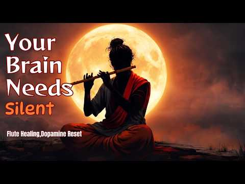

# 음악 — 성공 사례 분석: 사례별 자세히 #321–#360

`analysis.md` 의 9번 (같은 # 번호). 자동 생성 — `tools/success_analysis.py` v1.4.1 (2026-10-19 08:37 UTC). ※ 연구·교육용 — 투자 권유가 아님.

### 321. 안들으면후회함 playlist

- https://www.youtube.com/watch?v=_eAnA8TgKWM · 서른마흔오백다섯살 · 구독자 3,410 · 조회수 588,564 (×172.6, 하루 4,305.6) · 좋아요 18,693 (3.2%) · 24분 · 2026-06-04 · 주제 묶음 기타 · 형식 플레이리스트·모음 (여러 곡) · 폴더 `W__eAnA8TgKWM` (웹 승인)
- 썸네일: 
- 같은 채널 평소 대비 ×43.2 (채널 최근 롱폼 중앙값 13,625회) · 평소 영상: ່ (13,625회) / ່ (16,542회)
- 대본 없음 (없음) — 음성인식이 끝나면 도입부·흐름이 들어감
- 댓글 169/169: 좋은 점 — 영상 0 · 감사·응원 4 · 더 알고 싶은 것 2 · 아쉬운 점 — 영상 0 · 반박·불만 — 의견 다름 0 · 정치·사회 0 · 경험 공유 7 · 구독·다음 기대 0
  - 감사·응원 👍1 “기말 화이팅!”
  - 감사·응원 👍1 “와 썸넬 바껴서 제 최애플리 사라진줄알았어요 와 감사합니다”
  - 더 알고 싶은 것 👍10 “영상의 사진이 어디서 나온 것인지 알 수 있을까요?”
  - 경험 공유 👍21 “걍 누르고 뭔 노래 나올지 모르능데 나도 모르게 따라부르고있음”
  - 경험 공유 👍1 “싸이월드 시절 인프피였던 내가 좋아하던 노래만 모여있고, 소름돋음 ㄹㅈㄷ”

### 322. 이수연, K-trot, [감성노래 탑7 메들리]

- https://www.youtube.com/watch?v=wz-ZkvuAdTg · 통기타 한석 TV · 구독자 2,620 · 조회수 451,900 (×172.5, 하루 2,765.5) · 좋아요 5,253 (1.2%) · 26.3분 · 2026-05-08 · 주제 묶음 9. 가요·발라드·트로트 · 형식 플레이리스트·모음 (여러 곡) · 폴더 `W_wz-ZkvuAdTg` (웹 승인)
- 썸네일: 
- 대본 없음 (없음) — 음성인식이 끝나면 도입부·흐름이 들어감
- 댓글 311/311: 좋은 점 — 영상 2 · 감사·응원 33 · 더 알고 싶은 것 3 · 아쉬운 점 — 영상 1 · 반박·불만 — 의견 다름 0 · 정치·사회 2 · 경험 공유 5 · 구독·다음 기대 1
  - 좋은 점 — 영상 👍6 “다른 트롯가수들처럼 무작정 꺾으려만하는거도 없네 장르마다 자연스럽고 듣기 편안하고 감동이 오네”
  - 좋은 점 — 영상 👍1 “세상을 너무 오래산거처래 구구절절 너무잘한다”
  - 감사·응원 👍20 “최고의 감성가수 천사 이수연공주 . 힐링되요❤❤❤ 감사합니다 사랑합니다”
  - 감사·응원 👍20 “수연아 너무잘합니다 힘내세요 화이팅”
  - 더 알고 싶은 것 👍13 “와~~ 정말 가슴이 뻥 뚫리고. 머리가 신선해집니다 어쩜 저런 보물이 있을까요? 수연양!!! 사랑합니다 할아버지 할머니랑 영원히 행복하세요~~~!!”
  - 더 알고 싶은 것 👍3 “수연이는 노래를 가지고 논다 기성 가수보다 노래를 더 잘한다 노래가 다 잘되니 노래 부를맛 나고 노래부르는게 얼마나 신나고 좋을까요?”
  - 아쉬운 점 — 영상 👍5 “이수연야 정말잘하군요. 다만 원곡에충실했쓰면해요 잘하다보니. 너무오버하는게. 실망이내요. 아직 어리고 배울게많은대. 나뿐버릇. 자리잡을까 걱정이내요. 필요이상으로. 오버는. 독이여요”
  - 정치·사회 👍7 “대한민국 이재명보유국 대한민국 이수연 보유국 최고의 두분”
  - 경험 공유 👍10 “수연양 기분좋은 모습보니 나도 기분좋아요 수연양 사랑해요~~”
  - 경험 공유 👍7 “수연의 버전 그강을 건너지 마오 100번을 듣고나니 이제는 저도 부를 수가 있답니다 국보급 목소리 최고입니다”
  - 구독·다음 기대 👍11 “수현아 고마워 감동이야 매일듣고 있어 내마음에 최고”

### 323. ANDEAN PAN FLUTE 🌿 Gentle Healing Music to Calm the Mind l and Inner Peace Leo Rojas & Gh…

- https://www.youtube.com/watch?v=1NjCSdhJnjo · Ginevra Melodies · 구독자 186 · 조회수 31,948 (×171.8, 하루 1,805.4) · 좋아요 317 (1.0%) · 94.5분 · 2026-10-01 · 주제 묶음 1. 수면·명상·힐링 · 형식 음악 (그 밖 모양 — 한 편짜리 BGM 등) · 폴더 `W_1NjCSdhJnjo` (웹 승인)
- 썸네일: 
- 설명 앞부분: Let the gentle sound of the Andean pan flute create a peaceful atmosphere for your mind, heart, and soul. 🌿🎶 ANDEAN PAN FLUTE 🌿 Gentle Healing Music to Calm the Mind & Inner Peace is a soothing musical journey inspired by the beautiful pan flute atmosphere associated with Leo Rojas and Gheorghe Zam…
- 같은 채널 평소 대비 ×111.1 (채널 최근 롱폼 중앙값 288회) · 평소 영상: Pan Flute Meditation 🌿 Sacred Flute Melodies to H… (292회) / ANDEAN HEALING 🌿 Peaceful Pan Flute Music for Sou… (283회)
- 대본 없음 (설명) — 음성인식이 끝나면 도입부·흐름이 들어감
- 댓글 6/6: 좋은 점 — 영상 0 · 감사·응원 0 · 더 알고 싶은 것 0 · 아쉬운 점 — 영상 0 · 반박·불만 — 의견 다름 0 · 정치·사회 0 · 경험 공유 0 · 구독·다음 기대 0

### 324. Calm Work Music ∣ High Concentration Music for Studying, Focus & Productivity

- https://www.youtube.com/watch?v=qXQ6wEipSug · Calm Work Studio · 구독자 5,770 · 조회수 984,536 (×170.6, 하루 9,479.5) · 좋아요 4,142 (0.4%) · 130.8분 · 2026-07-07 · 주제 묶음 3. 공부·집중·작업 · 형식 음악 (그 밖 모양 — 한 편짜리 BGM 등) · 폴더 `W_qXQ6wEipSug` (웹 승인)
- 썸네일: 
- 설명 앞부분: Calm Work Music ∣ High Concentration Music for Studying, Focus & Productivity Calm Work Music is designed to help you stay focused, productive, and relaxed during work or study sessions. This peaceful ambient soundtrack creates the perfect atmosphere for deep work, studying, reading, writing, codin…
- 같은 채널 평소 대비 ×260.3 (채널 최근 롱폼 중앙값 3,783회) · 평소 영상: Deep Work Music for Peak Performance ∣ Deep Focus… (3,783회) / Calm Work Music for Maximum Productivity ∣ Deep F… (4,199회)
- 대본 없음 (설명) — 음성인식이 끝나면 도입부·흐름이 들어감
- 댓글 296/291: 좋은 점 — 영상 0 · 감사·응원 0 · 더 알고 싶은 것 0 · 아쉬운 점 — 영상 0 · 반박·불만 — 의견 다름 0 · 정치·사회 0 · 경험 공유 0 · 구독·다음 기대 0

### 325. 가을이 머무는 호숫가 ∣ 피아노·첼로·바이올린으로 듣는 고요한 클래식

- https://www.youtube.com/watch?v=zNMH3ua74tE · 순례자 우물  · 구독자 939 · 조회수 157,992 (×168.3, 하루 3,762.2) · 좋아요 1,237 (0.8%) · 122분 · 2026-09-07 · 주제 묶음 6. 피아노·클래식·연주곡 · 형식 음악 (그 밖 모양 — 한 편짜리 BGM 등) · 폴더 `W_zNMH3ua74tE` (웹 승인)
- 썸네일: 
- 설명 앞부분: 안개가 내려앉은 호수처럼, 천천히 마음을 가라앉혀 주는 고요한 선율을 담았습니다. 피아노의 섬세한 울림, 첼로의 깊고 따뜻한 음색, 바이올린의 맑고 서정적인 선율이 어우러지는 잔잔한 피아노 트리오 클래식입니다. 조용히 쉬고 싶은 시간, 책을 읽거나 공부할 때, 기도와 묵상, 차 한 잔과 함께하는 순간에 편안하게 들어보세요. 🎼 Track List 01. 안개 속의 아다지오 02. 오래된 극장의 숨결 03. 물안개 위의 선율 04. 저물녘의 기도 05. 고요가 머무는 홀 06. 마지막 빛이 사라질 때 🎻 Piano · Cello ·…
- 같은 채널 평소 대비 ×446.3 (채널 최근 롱폼 중앙값 354회) · 평소 영상: 인생은 왜 허무한가? 성경이 말하는 삶의 목적과 영생 ∣ 삶의 질문, 성경의 답 1 (372회) / 이스라엘의 역사는 무엇을 말하는가? 성경의 예언과 성취 (336회)
- 대본 없음 (설명) — 음성인식이 끝나면 도입부·흐름이 들어감
- 댓글 36/36: 좋은 점 — 영상 0 · 감사·응원 7 · 더 알고 싶은 것 0 · 아쉬운 점 — 영상 0 · 반박·불만 — 의견 다름 0 · 정치·사회 0 · 경험 공유 0 · 구독·다음 기대 0
  - 감사·응원 👍5 “❤ 😊 참 감사합니다”
  - 감사·응원 👍5 “앞으로 찾아뵙겠습니다.응원합니다.”

### 326. सुनते ही नींद आएगी 😴 ∣ दिव्य निद्रा संगीत ∣ Himalayan Deep Sleep Meditation Music ∣ Sleep…

- https://www.youtube.com/watch?v=R_LBzRfzBBo · Sanatan Bodh · 구독자 3,060 · 조회수 510,613 (×166.9, 하루 5,122.9) · 좋아요 3,770 (0.7%) · 40분 · 2026-07-11 · 주제 묶음 1. 수면·명상·힐링 · 형식 음악 (그 밖 모양 — 한 편짜리 BGM 등) · 폴더 `W_R_LBzRfzBBo` (웹 승인)
- 썸네일: 
- 설명 앞부분: 🙏 यदि यह संगीत आपको पसंद आए तो चैनल को Subscribe करें। 🕉️ Experience divine Himalayan peace with soothing bansuri flute, gentle tanpura drone, singing bowls, flowing river sounds, and calming nature ambience. This deep sleep meditation music is designed to help you relax, reduce stress, calm the mi…
- 같은 채널 평소 대비 ×1,037.8 (채널 최근 롱폼 중앙값 492회) · 평소 영상: ​Navadurga: The Divine Nine Forms of Goddess Durg… (492회) / करवीर निवासिनी अंबाबाई स्तोत्र ∣ श्री महालक्ष्मी … (517회)
- 대본 없음 (설명) — 음성인식이 끝나면 도입부·흐름이 들어감
- 댓글 157/157: 좋은 점 — 영상 0 · 감사·응원 0 · 더 알고 싶은 것 0 · 아쉬운 점 — 영상 0 · 반박·불만 — 의견 다름 0 · 정치·사회 0 · 경험 공유 0 · 구독·다음 기대 0

### 327. Hindi Lofi Nights ∣ Yeh Tune Kya Kiya x Ishq Risk x Ishq x Ranjheya Ve (slowed reverb)#sl…

- https://www.youtube.com/watch?v=oHrvGKhcW4s · Songhalo · 구독자 11,000 · 조회수 1,831,161 (×166.5, 하루 11,178.1) · 좋아요 0 (0.0%) · 23.8분 · 2026-05-08 · 주제 묶음 8. 로파이·시티팝·칠 · 형식 플레이리스트·모음 (여러 곡) · 폴더 `W_oHrvGKhcW4s` (웹 승인)
- 썸네일: 
- 설명 앞부분: Hindi Lofi Nights ∣ Yeh Tune Kya Kiya x Ishq Risk x Ishq x Ranjheya Ve. A soft late-night lofi mix featuring Yeh Tune Kya Kiya, Ishq Risk, Ishq, Ishq E Jaan and Ranjheya Ve. Perfect for night drive, study sessions, rain mood, heartbreak hours, calm evenings and slow romantic vibes. If you like emot…
- 같은 채널 평소 대비 ×21.9 (채널 최근 롱폼 중앙값 83,530회) · 평소 영상: If This Playlist Found You.You're Probably Thinki… (83,530회) / DARKHAAST (lyrics) - ARIJIT SINGH,SUNIDHI CHUHAN … (126,550회)
- 대본 없음 (설명) — 음성인식이 끝나면 도입부·흐름이 들어감
- 댓글 907/907: 좋은 점 — 영상 0 · 감사·응원 0 · 더 알고 싶은 것 0 · 아쉬운 점 — 영상 0 · 반박·불만 — 의견 다름 0 · 정치·사회 0 · 경험 공유 0 · 구독·다음 기대 0

### 328. Spa & Healing Music · 3 Hours 🌺 Luxury Relaxation for Massage, Yoga & Deep Rest

- https://www.youtube.com/watch?v=uzHIWyuadHM · Halcyon Hours · 구독자 364 · 조회수 60,303 (×165.7, 하루 537.9) · 좋아요 540 (0.9%) · 180분 · 2026-06-29 · 주제 묶음 1. 수면·명상·힐링 · 형식 긴 한 곡·반복 (N시간) · 폴더 `W_uzHIWyuadHM` (웹 승인)
- 썸네일: 
- 설명 앞부분: 🌺 Your personal spa, open 24 hours. 3 hours of luxurious spa and healing ambient music — gentle water features, soft wind chimes, warm therapeutic tones, and the peaceful atmosphere of a world-class wellness retreat. Perfect for massage, yoga, self-care rituals, or simply giving yourself the rest y…
- 같은 채널 평소 대비 ×900.0 (채널 최근 롱폼 중앙값 67회) · 평소 영상: Greenhouse Rain · 3 Hours 🌿 Rain on Glass Sounds … (67회) / Kalimba Dreams · 3 Hours 🎶 Gentle Thumb Piano Lul… (68회)
- 대본 없음 (설명) — 음성인식이 끝나면 도입부·흐름이 들어감
- 댓글 5/5: 좋은 점 — 영상 0 · 감사·응원 0 · 더 알고 싶은 것 0 · 아쉬운 점 — 영상 0 · 반박·불만 — 의견 다름 0 · 정치·사회 0 · 경험 공유 0 · 구독·다음 기대 0

### 329. 살면서 한 번쯤 들어봐야 할 클래식 15곡 ∣ 공부·휴식·카페에서 듣기 좋은 클래식 음악

- https://www.youtube.com/watch?v=hDepOWqLbXI · canvasclassics · 구독자 183 · 조회수 30,125 (×164.6, 하루 255.6) · 좋아요 300 (1.0%) · 152.1분 · 2026-06-23 · 주제 묶음 6. 피아노·클래식·연주곡 · 형식 플레이리스트·모음 (여러 곡) · 폴더 `W_hDepOWqLbXI` (웹 승인)
- 썸네일: 
- 설명 앞부분: 살면서 한 번쯤 들어봐야 할 아름다운 클래식 15곡을 모았습니다. 아침의 평온함을 담은 그리그의 ‘Morning Mood’부터, 비발디의 ‘봄’, 모차르트의 ‘피아노 소나타 11번’, 바흐, 드뷔시, 쇼팽, 베토벤의 명곡까지 공부할 때, 일할 때, 책을 읽을 때, 카페에서 쉬고 싶을 때 듣기 좋은 클래식 음악입니다. Canvas Classics는 클래식 음악과 명화 같은 감성 이미지를 함께 감상할 수 있는 채널입니다. 잔잔한 선율과 아름다운 장면들이 여러분의 하루를 조금 더 차분하고 깊게 만들어주길 바랍니다. 🎧 추천 감상 시간 …
- 대본 없음 (설명) — 음성인식이 끝나면 도입부·흐름이 들어감
- 댓글 3/3: 좋은 점 — 영상 0 · 감사·응원 0 · 더 알고 싶은 것 0 · 아쉬운 점 — 영상 0 · 반박·불만 — 의견 다름 0 · 정치·사회 0 · 경험 공유 0 · 구독·다음 기대 0

### 330. 𝐏𝐥𝐚𝐲𝐥𝐢𝐬𝐭 ∣ 첫 비트부터 심박수 폭발 ❤️ 미친 텐션 운동 플리 ∣ 헬스 · 러닝 · EDM · 힙합 🎧

- https://www.youtube.com/watch?v=XrUNOYMFd58 · Grind Vibe · 구독자 5,550 · 조회수 908,056 (×163.6, 하루 6,985.3) · 좋아요 5,741 (0.6%) · 80.7분 · 2026-06-11 · 주제 묶음 11. 힙합·R&B·EDM · 형식 플레이리스트·모음 (여러 곡) · 폴더 `W_XrUNOYMFd58` (웹 승인)
- 썸네일: 
- 챕터: 0:00 Pop & Go · 3:27 Dub-da-ri, dub-da-ri, dub-dub! · 6:38 Auto Banggu · 7:37 Code Red · 10:29 Fast Forward · 13:26 Laser Tag (edit) · 16:38 Main Character · 20:19 Hyperflight · 24:11 sooooo good · 26:49 Ocean Drive · 29:30 PSYCHO · 31:38 Sprite · 34:51 SNS · 36:44 gv_v70 · 37:47 High energy
- 설명 앞부분: 운동, 작업, 헬스장, 드라이브까지 텐션을 확 끌어 올려드릴 플레이리스트🎧 ❤ 루즈한 구간 없이 몰아치는 트랙들로 구성했습니다.🚀 🎧 A go-to Hip-Hop & EDM playlist for the gym, running, and grind-time ∣ Grind Vibe When everything feels like too much, hit play and your body moves on autopilot 😎 From commuting and workouts to driving and late-night grind se…
- 같은 채널 평소 대비 ×131.4 (채널 최근 롱폼 중앙값 6,909회) · 평소 영상: 𝐏𝐥𝐚𝐲𝐥𝐢𝐬𝐭 🔥 비트 맛집 ∣ 도파민 한도초과 EDM · 외힙 · 헬스플리 🎧 (6,909회) / 𝐏𝐥𝐚𝐲𝐥𝐢𝐬𝐭 🔥 도입부터 바로 질주하는 텐션 ∣ 도파민 폭발 운동 플리 ∣ EDM ·… (7,300회)
- 대본 없음 (설명) — 음성인식이 끝나면 도입부·흐름이 들어감
- 댓글 337/337: 좋은 점 — 영상 0 · 감사·응원 14 · 더 알고 싶은 것 5 · 아쉬운 점 — 영상 2 · 반박·불만 — 의견 다름 0 · 정치·사회 0 · 경험 공유 1 · 구독·다음 기대 1
  - 감사·응원 👍10 “요즘 헬스하면 즐길노래가 없었는데.. ㅎ 완죤~~쒼나게 하네요~~❤❤ 감사합니다~~😊”
  - 감사·응원 👍3 “진짜운동이고프게만드네 감사해요”
  - 더 알고 싶은 것 👍7 “26:49 이거 1시간만들어주세요”
  - 더 알고 싶은 것 👍6 “계속듣고있어요! 최고! 팝앤고 1시간짜리로 만들어주시면 안될까요? 아님 따로라도❤”
  - 아쉬운 점 — 영상 👍3 “이 정도 편집이면 완전 재능이다 👍 1시간 20분이 고마 순삭~~~”
  - 아쉬운 점 — 영상 👍2 “감사해요 덕분에 재미있었어요 지루할뻔 했는데 ❤”
  - 구독·다음 기대 👍3 “흥겨운 음악 잘득고 구독하고 갑니다.”

### 331. 20 Of The Most Beautiful Classical Adagios for Relaxation and Peace in Rachmaninoff Style

- https://www.youtube.com/watch?v=t-scHKetq7I · Classical Instrumentals · 구독자 13,700 · 조회수 2,234,578 (×163.1, 하루 12,782.4) · 좋아요 28,332 (1.3%) · 120분 · 2026-04-27 · 주제 묶음 6. 피아노·클래식·연주곡 · 형식 플레이리스트·모음 (여러 곡) · 폴더 `W_t-scHKetq7I` (웹 승인)
- 썸네일: 
- 설명 앞부분: Step into a world of deep calm and timeless emotion with 20 Of The Most Beautiful Classical Adagios for Relaxation and Peace in Rachmaninoff Style. This collection is inspired by the rich, expressive language of Rachmaninoff, where every note carries weight, and every melody unfolds with quiet inte…
- 같은 채널 평소 대비 ×83.2 (채널 최근 롱폼 중앙값 26,862회) · 평소 영상: Adagio Instrumentals – Beautiful Classical Works … (26,862회) / Adagio Instrumentals - 20 Classical Works for the… (18,683회)
- 대본 없음 (설명) — 음성인식이 끝나면 도입부·흐름이 들어감
- 댓글 946/946: 좋은 점 — 영상 0 · 감사·응원 2 · 더 알고 싶은 것 0 · 아쉬운 점 — 영상 0 · 반박·불만 — 의견 다름 0 · 정치·사회 0 · 경험 공유 0 · 구독·다음 기대 0
  - 감사·응원 👍8 “군대간아들생각하며..내 공부하며..백색소음으로 켜놨는데 백색소음이 아니라...자꾸 귀기울이고 마음 기울이게 되네요 좋은음악 고맙습니다 잘듣고있어요..”
  - 감사·응원 👍2 “참 좋은 음악입니다 감사합니다 🎉”

### 332. DIFFERENT ROAD - Melodic Viking Music for Focus & Deep Study

- https://www.youtube.com/watch?v=pP54saekswg · Jonas & Ida · 구독자 2,610 · 조회수 424,310 (×162.6, 하루 4,374.4) · 좋아요 4,752 (1.1%) · 6.5분 · 2026-07-14 · 주제 묶음 3. 공부·집중·작업 · 형식 음악 (그 밖 모양 — 한 편짜리 BGM 등) · 폴더 `W_pP54saekswg` (웹 승인)
- 썸네일: 
- 설명 앞부분: A smooth, hypnotic instrumental compilation of tagelharpa, acoustic guitars, and soft nature sounds. Perfect for deep concentration, writing, or studying without distractions.
- 같은 채널 평소 대비 ×104.6 (채널 최근 롱폼 중앙값 4,057회) · 평소 영상: Powerful Fantasy Viking Music Playlist 🌲Dynamic D… (4,057회) / Cold Blood Rush 🔥 Viking Music ∣ I Was Born to Fi… (2,004회)
- 대본 없음 (설명) — 음성인식이 끝나면 도입부·흐름이 들어감
- 댓글 87/87: 좋은 점 — 영상 0 · 감사·응원 0 · 더 알고 싶은 것 0 · 아쉬운 점 — 영상 0 · 반박·불만 — 의견 다름 0 · 정치·사회 0 · 경험 공유 0 · 구독·다음 기대 0

### 333. Om Shanti Om - Climax BGM ∣ Cineforge Records

- https://www.youtube.com/watch?v=eGnTmVPO--k · Cineforge Records · 구독자 3,120 · 조회수 506,718 (×162.4, 하루 3,522.9) · 좋아요 6,955 (1.4%) · 9.8분 · 2026-05-28 · 주제 묶음 6. 피아노·클래식·연주곡 · 형식 커버·직접 부른 노래 · 폴더 `W_eGnTmVPO--k` (웹 승인)
- 썸네일: 
- 설명 앞부분: Disclaimer: All music published on this channel is exclusively created, produced, and owned by Cineforge Records. These audio recordings are original works registered under 'Cineforge Records' and are officially released exclusively through this channel. Unauthorized copying, redistribution, re-upl…
- 같은 채널 평소 대비 ×57.9 (채널 최근 롱폼 중앙값 8,756회) · 평소 영상: Tum Hi Ho (Aashiqui 2) - Epic Orchestral Reimagin… (8,943회) / Tu Jo Mila (Bajrangi Bhaijaan) - Epic BGM Orchest… (8,568회)
- 대본 없음 (설명) — 음성인식이 끝나면 도입부·흐름이 들어감
- 댓글 111/111: 좋은 점 — 영상 0 · 감사·응원 0 · 더 알고 싶은 것 0 · 아쉬운 점 — 영상 0 · 반박·불만 — 의견 다름 0 · 정치·사회 0 · 경험 공유 0 · 구독·다음 기대 0

### 334. A Few Minutes of Mahadev ∣ Feel His Presence Instantly ∣ Gangadharae

- https://www.youtube.com/watch?v=hsGWmUi1TQc · Sacred Vedic Mantras Studio · 구독자 10,800 · 조회수 1,737,436 (×160.9, 하루 9,884.6) · 좋아요 15,946 (0.9%) · 37.9분 · 2026-04-26 · 주제 묶음 1. 수면·명상·힐링 · 형식 음악 (그 밖 모양 — 한 편짜리 BGM 등) · 폴더 `W_hsGWmUi1TQc` (웹 승인)
- 썸네일: 
- 설명 앞부분: Immerse yourself in "Gangadharae" a profound devotional hymn that glorifies Lord Shiva through his most sacred and ancient names. Each name in this composition is not merely a title it is a complete theology, a window into one of Shiva's infinite aspects. The Sacred Names Within This Song: 🌊 Gaṅgād…
- 같은 채널 평소 대비 ×466.8 (채널 최근 롱폼 중앙값 3,722회) · 평소 영상: Let Shiva Hold You Tonight ∣ Sleep in Stillness ∣… (3,738회) / 7 Minutes with Shiva ∣ Let Go of the Weight ∣ Om … (3,706회)
- 대본 없음 (설명) — 음성인식이 끝나면 도입부·흐름이 들어감
- 댓글 462/462: 좋은 점 — 영상 0 · 감사·응원 0 · 더 알고 싶은 것 0 · 아쉬운 점 — 영상 0 · 반박·불만 — 의견 다름 0 · 정치·사회 0 · 경험 공유 0 · 구독·다음 기대 0

### 335. 99% DEEP SLEEP in 3 Minutes (NO ADS) • Brain Massage While You Sleep • Goodbye Insomnia

- https://www.youtube.com/watch?v=ZqzEQHOrvPw · Awakened Soul · 구독자 5,060 · 조회수 813,736 (×160.8, 하루 29,252.5) · 좋아요 8,732 (1.1%) · 711분 · 2026-09-21 · 주제 묶음 1. 수면·명상·힐링 · 형식 음악 (그 밖 모양 — 한 편짜리 BGM 등) · 폴더 `W_ZqzEQHOrvPw` (웹 승인)
- 썸네일: 
- 설명 앞부분: 99% DEEP SLEEP in 3 Minutes (NO ADS) • Brain Massage While You Sleep • Goodbye Insomnia 🌙 Welcome to Awakened Soul, a quiet space for deep sleep music and nighttime relaxation. When the day feels heavy and your thoughts will not slow down, take a breath and let the music guide you into a calmer nig…
- 같은 채널 평소 대비 ×234.5 (채널 최근 롱폼 중앙값 3,470회) · 평소 영상: DEEP SLEEP IN 5 MINUTES • Brain Massage While You… (3,690회) / FALL ASLEEP IN 3 MINUTES • Brain Massage While Yo… (3,251회)
- 대본 없음 (설명) — 음성인식이 끝나면 도입부·흐름이 들어감
- 댓글 439/459: 좋은 점 — 영상 0 · 감사·응원 0 · 더 알고 싶은 것 0 · 아쉬운 점 — 영상 0 · 반박·불만 — 의견 다름 0 · 정치·사회 0 · 경험 공유 0 · 구독·다음 기대 0

### 336. 💃🔥𝐀 𝐏𝐥𝐚𝐲𝐥𝐢𝐬𝐭 𝐓𝐡𝐚𝐭 𝐖𝐢𝐥𝐥 𝐖𝐚𝐤𝐞 𝐔𝐩 𝐘𝐨𝐮𝐫 𝐈𝐧𝐧𝐞𝐫 𝐃𝐚𝐧𝐜𝐞𝐫 🎶⚡{+timestamps} #playlist #fyp #viral #s…

- https://www.youtube.com/watch?v=ASY7vTTB-wo · 𝙏𝙖𝙣𝙭 𝙀𝙙𝙞𝙩𝙯 🦋 · 구독자 13,200 · 조회수 2,122,517 (×160.8, 하루 15,732.7) · 좋아요 20,693 (1.0%) · 14.5분 · 2026-06-06 · 주제 묶음 기타 · 형식 플레이리스트·모음 (여러 곡) · 폴더 `W_ASY7vTTB-wo` (웹 승인)
- 썸네일: 
- 챕터: 0:00 Pink Lips · 0:46 Paani Wala Dance · 1:44 Dil Cheez Tujhe Dedi · 2:32 Aa Toh Sahi · 3:29 Character Dheela Hai · 4:20 Aadat Se Majboor · 5:07 Lat Lag Gayi · 6:03 Jadoo Ki Jhappi · 6:56 Tinku Jiya · 7:56 Billo Rani · 8:56 Fevicol Se · 9:56 Anarkali Disco Chali · 10:20 Kukkad · 11:12 Bom Digi Digi · 12:02 Nashe Si Chad Gayi · 13:03 Locha-ye-Ulfat · 13:49 Naah
- 설명 앞부분: 💃🔥 Welcome to the ultimate dance playlist! If you're looking for songs that instantly boost your mood and make you want to dance, this playlist is for you 🎶⚡ From party anthems to absolute bangers, every track is picked to keep the energy high and the vibes alive 🕺✨ 🎧 Perfect for: Parties Car rides…
- 같은 채널 평소 대비 ×9.9 (채널 최근 롱폼 중앙값 214,707회) · 평소 영상: 🌶️💅 𝐀 𝐂𝐡𝐚𝐭𝐩𝐚𝐭𝐢 𝐏𝐥𝐚𝐲𝐥𝐢𝐬𝐭 𝐅𝐨𝐫 𝐂𝐡𝐚𝐭𝐩𝐚𝐭𝐞 𝐋𝐨𝐠 😜🔥 #play… (214,707회) / 🔥𝐀 𝐏𝐥𝐚𝐲𝐥𝐢𝐬𝐭 𝐓𝐡𝐚𝐭 𝐅𝐞𝐞𝐥𝐬 𝐋𝐢𝐤𝐞 𝐅𝐚𝐥𝐥𝐢𝐧𝐠 𝐈𝐧 𝐋𝐨𝐯𝐞❤️‍🔥 𝐀… (464,128회)
- 대본 없음 (설명) — 음성인식이 끝나면 도입부·흐름이 들어감
- 댓글 281/280: 좋은 점 — 영상 0 · 감사·응원 0 · 더 알고 싶은 것 0 · 아쉬운 점 — 영상 0 · 반박·불만 — 의견 다름 0 · 정치·사회 0 · 경험 공유 0 · 구독·다음 기대 0

### 337. ENIGMA Style Music🔥Mystic River🔥2026

- https://www.youtube.com/watch?v=5m7k60JKkLc · VoiceLine Music · 구독자 4,020 · 조회수 644,723 (×160.4, 하루 3,649.7) · 좋아요 7,563 (1.2%) · 5.2분 · 2026-04-25 · 주제 묶음 기타 · 형식 음악 (그 밖 모양 — 한 편짜리 BGM 등) · 폴더 `W_5m7k60JKkLc` (웹 승인)
- 썸네일: 
- 설명 앞부분: 🔥 ENIGMA Style Music – “Mystic River” (2026) 🔥 Flow into a world of mystery and deep emotion with “Mystic River” — an ENIGMA-inspired atmospheric journey filled with ethereal voices, hypnotic rhythms, and spiritual new age energy. Soft ambient pads, mystical vocal layers, gentle electronic beats, a…
- 같은 채널 평소 대비 ×3,070.1 (채널 최근 롱폼 중앙값 210회) · 평소 영상: Mystic ENIGMA 🔥 Echoes from Another Heaven 🔥 2026 (210회) / ERA Style Music 🔥 The Last Flame Remembers You 🔥 … (211회)
- 대본 없음 (설명) — 음성인식이 끝나면 도입부·흐름이 들어감
- 댓글 199/199: 좋은 점 — 영상 0 · 감사·응원 0 · 더 알고 싶은 것 0 · 아쉬운 점 — 영상 0 · 반박·불만 — 의견 다름 0 · 정치·사회 0 · 경험 공유 0 · 구독·다음 기대 0

### 338. Zen Flute Therapy 🎶 ∣ Dopamine Reset Music for Stress & Anxiety Relief

- https://www.youtube.com/watch?v=ldZHxztiahU · Osen Moonlight · 구독자 10,100 · 조회수 1,617,916 (×160.2, 하루 23,173.4) · 좋아요 11,490 (0.7%) · 113.8분 · 2026-08-10 · 주제 묶음 1. 수면·명상·힐링 · 형식 음악 (그 밖 모양 — 한 편짜리 BGM 등) · 폴더 `W_ldZHxztiahU` (웹 승인)
- 썸네일: 
- 설명 앞부분: Welcome to your sanctuary of peace, mindfulness, and deep relaxation. Our channel is dedicated to creating calming soundscapes that help you reconnect with yourself through Healing Music, Relaxing Music, Zen Meditation Music, Tibetan Music, Bamboo Flute Music, Indian Flute Music, Soul-Calming Flute…
- 같은 채널 평소 대비 ×542.9 (채널 최근 롱폼 중앙값 2,980회) · 평소 영상: Healing Bamboo Flute Music 🍃 ∣ Calm Mind, Reduce … (2,980회) / Ultimate Zen Meditation Music 🎶 ∣ Serene Flute So… (2,940회)
- 대본 없음 (설명) — 음성인식이 끝나면 도입부·흐름이 들어감
- 댓글 444/432: 좋은 점 — 영상 0 · 감사·응원 0 · 더 알고 싶은 것 0 · 아쉬운 점 — 영상 0 · 반박·불만 — 의견 다름 0 · 정치·사회 0 · 경험 공유 0 · 구독·다음 기대 0

### 339. Playlist ∣ 어때 그 남잔 나보다 더 나?

- https://www.youtube.com/watch?v=Eh4ZRMyh8vo · 안개 · 구독자 3,200 · 조회수 511,466 (×159.8, 하루 3,964.1) · 좋아요 5,189 (1.0%) · 25.6분 · 2026-06-12 · 주제 묶음 기타 · 형식 플레이리스트·모음 (여러 곡) · 폴더 `W_Eh4ZRMyh8vo` (웹 승인)
- 썸네일: 
- 챕터: 0:00 DAY6 - Congratulations · 3:49 BIG Naughty - Vancouver · 7:26 Colde - 와르르 · 11:57 ZICO - 너는 나 나는 너 · 15:31 ZICO - 걘 아니야 · 19:08 IU - 사랑이 잘 (With 오혁) · 22:23 BIG Naughty - 정이라고 하자 (Feat. …
- 설명 앞부분: 이 영상은 수익을 창출하지 않습니다.
- 같은 채널 평소 대비 ×16.1 (채널 최근 롱폼 중앙값 31,856회) · 평소 영상: 느좋 라이즈 Playlist (34,268회) / 내 취향 여돌 원픽 (29,444회)
- 대본 없음 (설명) — 음성인식이 끝나면 도입부·흐름이 들어감
- 댓글 69/69: 좋은 점 — 영상 0 · 감사·응원 0 · 더 알고 싶은 것 1 · 아쉬운 점 — 영상 0 · 반박·불만 — 의견 다름 0 · 정치·사회 0 · 경험 공유 1 · 구독·다음 기대 0
  - 더 알고 싶은 것 👍32 “저런 얼굴하고 물어보면 어 아니 너가 훨씬 나아 가 나올듯 노래 리스트가 너무 좋아유 계속 올려주세요!”

### 340. Relaxing Guzheng & Bamboo Flute 🌸Ancient Chinese Music 🌸 #ancientchinesemusic #chinesemus…

- https://www.youtube.com/watch?v=N4y79JaFBeo · Yuzira Music  · 구독자 4,270 · 조회수 677,087 (×158.6, 하루 4,372.4) · 좋아요 7,973 (1.2%) · 64.1분 · 2026-05-17 · 주제 묶음 기타 · 형식 음악 (그 밖 모양 — 한 편짜리 BGM 등) · 폴더 `W_N4y79JaFBeo` (웹 승인)
- 썸네일: 
- 설명 앞부분: Immerse yourself in the enchanting world of Ancient Chinese Music with relaxing guzheng melodies, peaceful bamboo flute harmonies, and cinematic oriental fantasy ambience. 🌙✨ Travel through mystical lotus gardens, moonlit bamboo forests, and ancient imperial palaces while enjoying calming tradition…
- 같은 채널 평소 대비 ×3,239.7 (채널 최근 롱폼 중앙값 209회) · 평소 영상: Chinese Fantasy Music 🎋Peaceful Guzheng & Bamboo … (209회) / Chinese Zen Guzheng & Bamboo Flute ☘️ Healing Mus… (198회)
- 대본 없음 (설명) — 음성인식이 끝나면 도입부·흐름이 들어감
- 댓글 290/290: 좋은 점 — 영상 0 · 감사·응원 1 · 더 알고 싶은 것 0 · 아쉬운 점 — 영상 0 · 반박·불만 — 의견 다름 0 · 정치·사회 0 · 경험 공유 0 · 구독·다음 기대 0
  - 감사·응원 👍1 “멋진 영상에 감사드립니다”

### 341. 얼마나 들었는지 감도 안 옴

- https://www.youtube.com/watch?v=1vELYr_nSxI · shhh... · 구독자 6,860 · 조회수 1,080,993 (×157.6, 하루 19,500.4) · 좋아요 28,451 (2.6%) · 24.8분 · 2026-08-24 · 주제 묶음 기타 · 형식 음악 (그 밖 모양 — 한 편짜리 BGM 등) · 폴더 `W_1vELYr_nSxI` (웹 승인)
- 썸네일: 
- 챕터: 0:00 Sweetest Pie - Megan Thee Sta… · 3:19 boyfriend - Ariana Grande, So… · 6:22 NVMD - Denise Julia · 9:20 thank u, next - Ariana Grande · 12:46 double take - Dhruv · 15:34 You got it - Vedo · 18:44 Please Me - Cardi B, Bruno Ma… · 22:02 Like That (feat. Gucci Mane) …
- 설명 앞부분: sped up ver. 진짜 진짜 많이 들었던 팝송 모음
- 같은 채널 평소 대비 ×167.0 (채널 최근 롱폼 중앙값 6,472회) · 평소 영상: You heard me? (6,472회) / 너는 내 취향저격 (7,420회)
- 대본 없음 (설명) — 음성인식이 끝나면 도입부·흐름이 들어감
- 댓글 169/169: 좋은 점 — 영상 3 · 감사·응원 6 · 더 알고 싶은 것 1 · 아쉬운 점 — 영상 1 · 반박·불만 — 의견 다름 2 · 정치·사회 0 · 경험 공유 7 · 구독·다음 기대 0
  - 좋은 점 — 영상 👍14 “첫곡 마지막곡 개레전드 둘이 이어들으면 더 맛도리”
  - 좋은 점 — 영상 👍0 “평소에 노래를 자주 듣는데 이번 영상도 노래 구성이 좋아서 편하게 듣기 좋았어요! 공부하거나 쉬면서 듣기 좋은 곡들이 많아서 앞으로도 자주 찾아올 것 같아요. 감사합니다”
  - 감사·응원 👍76 “와.. 전부 23년도에 들었던 노래들이라서 제일 행복했던 그때가 떠올라요 일요일 밤을 행복하게 만들어주셔서 감사해요ㅠㅠ❤”
  - 감사·응원 👍1 “진짜 구라 안까고 거의 다 내 플리에 있는 노래에요! 진짜 너무 감사합니다 듣자마자 바로 구독함”
  - 더 알고 싶은 것 👍0 “ㅈㅉ넘궁금한데 저ㅜ영상 출처가 잇나요 아니면 직접 만드신건가요ㅜㅜㅜ 뭔가느낌ㅇ 좋아서너무궁금합ㄴ 다......”
  - 아쉬운 점 — 영상 👍0 “ㅈㅉ넘궁금한데 저ㅜ영상 출처가 잇나요 아니면 직접 만드신건가요ㅜㅜㅜ 뭔가느낌ㅇ 좋아서너무궁금합ㄴ 다......”
  - 반박·불만 — 의견 다름 👍0 “아 말도 안 돼 너무 2021 감성임 ㄴㅇㅅ ㅠ”
  - 경험 공유 👍84 “와 ㄹㅇ 맛도리들만 모아놧네..... 내가 n년동안 닳도록 반복재생 하던 곡들밖에 없음”
  - 경험 공유 👍2 “제가이거뜰줄알앗습니다흐흐”

### 342. 눈 뜨면 아침인 숲속 평온한 빗소리 ∣ 🌲 깊은 수면을 위한 평온한 백색소음 (Rain Sounds for Sleeping)

- https://www.youtube.com/watch?v=ri10d9TXXGE · Cozy Rain on Leaves · 구독자 3,290 · 조회수 514,147 (×156.3, 하루 5,363.6) · 좋아요 3,499 (0.7%) · 210분 · 2026-07-15 · 주제 묶음 2. 자연 소리·백색소음 · 형식 자연 소리·백색소음 (음악 낱말 없는 제목) · 폴더 `W_ri10d9TXXGE` (웹 승인)
- 썸네일: 
- 설명 앞부분: 싱그러운 초록 잎사귀 위로 떨어지는 맑고 깨끗한 자연의 빗소리입니다. 복잡한 하루의 소음을 지우고, 자연이 주는 가장 평온한 빗소리에 귀를 기울여 보세요. 깊고 편안한 잠이 필요할 때, 혹은 학업과 업무에 집중하고 싶을 때 이 포근한 빗소리와 함께해 보세요. 오늘 밤도 눈 뜨면 아침이 되는 마법 같은 편안하고 깊은 수면을 취하시길 바랍니다. 오늘도 고생 많으셨습니다. 편안한 밤 되세요. 💤
- 같은 채널 평소 대비 ×111.8 (채널 최근 롱폼 중앙값 4,599회) · 평소 영상: 오늘도 편안한 빗소리로 불면증을 극복하세요. 🌲숲속의 수면 빗소리 ASMR (Rain S… (4,599회) / 잠안올 때 듣는 시원한 빗소리 ASMR 🌿 불면증에 효과있는 백색소음 (Rain Soun… (4,698회)
- 대본 없음 (설명) — 음성인식이 끝나면 도입부·흐름이 들어감
- 댓글 127/127: 좋은 점 — 영상 6 · 감사·응원 11 · 더 알고 싶은 것 0 · 아쉬운 점 — 영상 0 · 반박·불만 — 의견 다름 0 · 정치·사회 0 · 경험 공유 10 · 구독·다음 기대 0
  - 좋은 점 — 영상 👍12 “촉촉하게 비가오는날이면 만물이차분해지고 생명이살아납니다 듣기좋아요”
  - 좋은 점 — 영상 👍7 “빗소리가 기분좋게 들려서 좋은영상 감사합니다”
  - 감사·응원 👍35 “현제 장마철이라서 현제 호우주의보까지내려있는대도 빗소리는 여전히 평안합니다 영상감사합니다😁🎉”
  - 감사·응원 👍7 “빗소리가 기분좋게 들려서 좋은영상 감사합니다”
  - 경험 공유 👍110 “자다 죽어도 여한은 없지만, 다시 사람으로 태어난다면 꼭 우리엄마의 엄마로 태어나고 싶어요😢”

### 343. 𝐏𝐥𝐚𝐲𝐥𝐢𝐬𝐭 도경수 느좋 노래 모음

- https://www.youtube.com/watch?v=9GtuEDTdFus · 오느레 · 구독자 112 · 조회수 17,480 (×156.1, 하루 98.7) · 좋아요 100 (0.6%) · 11.3분 · 2026-04-25 · 주제 묶음 기타 · 형식 플레이리스트·모음 (여러 곡) · 폴더 `W_9GtuEDTdFus` (웹 승인)
- 썸네일: 
- 같은 채널 평소 대비 ×14.1 (채널 최근 롱폼 중앙값 1,242회) · 평소 영상: 𝐏𝐥𝐚𝐲𝐥𝐢𝐬𝐭 zz6섭 노래 모음 (1,296회) / 𝐏𝐥𝐚𝐲𝐥𝐢𝐬𝐭 에스파 노래 모음 ∣ aespa playlist (1,187회)
- 대본 없음 (없음) — 음성인식이 끝나면 도입부·흐름이 들어감
- 댓글 2/2: 좋은 점 — 영상 0 · 감사·응원 1 · 더 알고 싶은 것 0 · 아쉬운 점 — 영상 0 · 반박·불만 — 의견 다름 0 · 정치·사회 0 · 경험 공유 0 · 구독·다음 기대 0
  - 감사·응원 👍4 “감사합니다 선생님”

### 344. Back To Chennai – Chennai Express Theme Music ∣ Shah Rukh Khan, Deepika Padukone ∣ Motiva…

- https://www.youtube.com/watch?v=g40bXb0KIFs · Octave Valley · 구독자 1,360 · 조회수 212,182 (×156.0, 하루 1,309.1) · 좋아요 2,515 (1.2%) · 13.6분 · 2026-05-10 · 주제 묶음 6. 피아노·클래식·연주곡 · 형식 음악 (그 밖 모양 — 한 편짜리 BGM 등) · 폴더 `W_g40bXb0KIFs` (웹 승인)
- 썸네일: 
- 설명 앞부분: Back To Chennai – Chennai Express Theme Music ∣ Shah Rukh Khan ∣ Deepika Padukone ∣ Epic Orchestral Inspired BGM Experience the energy and emotion of Back To Chennai from Chennai Express, featuring Shah Rukh Khan and Deepika Padukone, reimagined as an epic orchestral inspired background score (BGM)…
- 같은 채널 평소 대비 ×33.6 (채널 최근 롱폼 중앙값 6,315회) · 평소 영상: Humko Humise Chura Lo Instrumental – Mohabbatein … (6,315회) / Kuch Kuch Hota Hai – Instrumental Lofi Music ∣ Sh… (7,766회)
- 대본 없음 (설명) — 음성인식이 끝나면 도입부·흐름이 들어감
- 댓글 39/39: 좋은 점 — 영상 0 · 감사·응원 0 · 더 알고 싶은 것 0 · 아쉬운 점 — 영상 0 · 반박·불만 — 의견 다름 0 · 정치·사회 0 · 경험 공유 0 · 구독·다음 기대 0

### 345. 5 Minute Deep Meditation Music for Positive Energy • Relax Mind Body, Inner Peace

- https://www.youtube.com/watch?v=6-FPw2wSYsw · Christmas Haven · 구독자 289 · 조회수 45,007 (×155.7, 하루 316.3) · 좋아요 339 (0.8%) · 5.3분 · 2026-05-30 · 주제 묶음 1. 수면·명상·힐링 · 형식 음악 (그 밖 모양 — 한 편짜리 BGM 등) · 폴더 `W_6-FPw2wSYsw` (웹 승인)
- 썸네일: 
- 설명 앞부분: 5 Minute Deep Meditation Music for Positive Energy • Relax Mind Body, Inner Peace ✨ Welcome to this peaceful meditation experience ✨ Relax your body, achieve a calm mind, and let the soothing sounds guide you into a deep state of peace. This video features a serene scene with a monk meditating alon…
- 같은 채널 평소 대비 ×56.9 (채널 최근 롱폼 중앙값 791회) · 평소 영상: 20 Minute Deep Meditation Music for Positive Ener… (791회) / Best Meditation Music 2026 • 15 Minute Meditation… (796회)
- 대본 없음 (설명) — 음성인식이 끝나면 도입부·흐름이 들어감
- 댓글 5/5: 좋은 점 — 영상 0 · 감사·응원 0 · 더 알고 싶은 것 0 · 아쉬운 점 — 영상 0 · 반박·불만 — 의견 다름 0 · 정치·사회 0 · 경험 공유 0 · 구독·다음 기대 0

### 346. 노래방차트 발라드 2026년 7월 1차 🎤 최신 인기차트 노래모음 ∣ 발라드 플레이리스트

- https://www.youtube.com/watch?v=uedFUZ1kMjk · 오늘의 음악 · 구독자 1,130 · 조회수 174,833 (×154.7, 하루 2,642.9) · 좋아요 444 (0.2%) · 83.2분 · 2026-08-14 · 주제 묶음 9. 가요·발라드·트로트 · 형식 플레이리스트·모음 (여러 곡) · 폴더 `W_uedFUZ1kMjk` (웹 승인)
- 썸네일: 
- 설명 앞부분: 2026년 7월 1차 **노래방 인기차트 발라드**를 한곳에서 즐겨보세요. 🎤🎶 감성적인 멜로디와 아름다운 보컬이 돋보이는 **최신 발라드 인기곡과 노래방 추천곡**을 모아 플레이리스트로 준비했습니다. 노래방에서 부르기 좋은 인기 발라드부터 감성적인 최신곡까지 편하게 감상해보세요. 출퇴근, 드라이브, 휴식, 혼자만의 음악 시간은 물론 노래방 선곡에도 잘 어울립니다. 🎧 **노래방차트 발라드 2026년 7월 1차**와 함께 최신 인기곡을 즐겨보세요.
- 같은 채널 평소 대비 ×401.0 (채널 최근 롱폼 중앙값 436회) · 평소 영상: WSG워너비 & MSG워너비 발라드 플레이리스트 2026 🎶 감성적인 노래모음 (436회) / 실시간 인기차트 ★ 댄스 ★ 2026년 최신 댄스 노래모음과 KPOP 플레이리스트 (416회)
- 대본 없음 (설명) — 음성인식이 끝나면 도입부·흐름이 들어감
- 댓글 8/8: 좋은 점 — 영상 0 · 감사·응원 1 · 더 알고 싶은 것 3 · 아쉬운 점 — 영상 0 · 반박·불만 — 의견 다름 0 · 정치·사회 0 · 경험 공유 1 · 구독·다음 기대 0
  - 감사·응원 👍0 “포장마차 노래 좋네요. 감사합니다.”
  - 더 알고 싶은 것 👍7 “곡마다 가사를알고싶어요”
  - 더 알고 싶은 것 👍4 “ㅂ곡마다 제목을 알고싶어요”

### 347. #장터에핀작은꽃#인생트로트#감성트로트#눈물나는노래#가족사랑#엄마생각#할머니사랑#추억의노래#7080감성#중년감성#인생노래#트로트신곡#AI트로트#트로트추천#감동노래…

- https://www.youtube.com/watch?v=U-J6pNop1bU · 인생 감성 트롯트노래 · 구독자 1,780 · 조회수 274,541 (×154.2, 하루 2,692.0) · 좋아요 1,077 (0.4%) · 4.8분 · 2026-07-09 · 주제 묶음 9. 가요·발라드·트로트 · 형식 한 곡 (뮤직비디오·음원·가사) · 폴더 `W_U-J6pNop1bU` (웹 승인)
- 썸네일: 
- 설명 앞부분: 유튜브 제목 추천 🌸 장터에 핀 작은 꽃 ∣ 열세 살 소녀가 부르는 인생 감성 트로트 🌸 눈물과 희망으로 피어난 작은 목소리 영상 설명서 어느 오래된 장터 한가운데… 작은 꽃처럼 피어난 한 소녀의 노래가 시작됩니다. 어린 나이지만 마음속에는 깊은 사랑과 그리움이 있고, 엄마와 할머니의 웃는 얼굴을 생각하며 진심을 담아 마이크를 잡았습니다. 세월이 흘러도 사라지지 않는 가족의 사랑, 힘든 인생길 속에서도 다시 피어나는 희망… “작은 꽃도 다시 피듯 우리 인생도 다시 피어납니다.” 열세 살 소녀가 전하는 따뜻한 감성 트로트, 오늘 당…
- 같은 채널 평소 대비 ×486.8 (채널 최근 롱폼 중앙값 564회) · 평소 영상: 장가계에피어난인생#장가계여행#중년감성트로트#인생트로트#감성트로#힐링트로트#7080감성#추… (564회) / 꽃길인생#중년감성트롯트#인생트로트#감성트로트#정통트로트#트로트신곡#7080감성#인생노래#… (582회)
- 대본 없음 (설명) — 음성인식이 끝나면 도입부·흐름이 들어감
- 댓글 18/18: 좋은 점 — 영상 1 · 감사·응원 3 · 더 알고 싶은 것 0 · 아쉬운 점 — 영상 0 · 반박·불만 — 의견 다름 0 · 정치·사회 0 · 경험 공유 0 · 구독·다음 기대 0
  - 좋은 점 — 영상 👍0 “가슴에 와닿네요”
  - 감사·응원 👍10 “노래가마음이아프네요소녀가꿈울안고갑니다힘네세요영사감사합니다❤❤구독”
  - 감사·응원 👍3 “장터에핀작은꽃 노래좋아요 눈시울이 붉어졌습니다 감사합니다”

### 348. HEART BREAK 💔 SAD 😭 LOFI MASHUP ∣∣ HEART BROKEN 💔 HINDI SONGS ∣∣ MOOD OFF LOFI 😭 MASHUP

- https://www.youtube.com/watch?v=rXZRZ5z0Oqo · Adnan Official  · 구독자 10,000 · 조회수 1,533,872 (×153.4, 하루 11,255.6) · 좋아요 7,812 (0.5%) · 18.8분 · 2026-06-05 · 주제 묶음 8. 로파이·시티팝·칠 · 형식 음악 (그 밖 모양 — 한 편짜리 BGM 등) · 폴더 `W_rXZRZ5z0Oqo` (웹 승인)
- 썸네일: 
- 설명 앞부분: Welcome to the world of soothing lofi music, where stress fades away, and peace takes over. This 2026 mind-relaxing lofi mix is perfect for: Deep Focus & Studying📖 Relaxing & Meditation🧘‍♂ Chilling After a Long Day🌅 Peaceful Sleep & Stress Relief😴 Let these calm beats and chill vibes take you on a …
- 대본 없음 (설명) — 음성인식이 끝나면 도입부·흐름이 들어감
- 댓글 107/107: 좋은 점 — 영상 0 · 감사·응원 0 · 더 알고 싶은 것 0 · 아쉬운 점 — 영상 0 · 반박·불만 — 의견 다름 0 · 정치·사회 0 · 경험 공유 0 · 구독·다음 기대 0

### 349. 새벽 2시~4시 재입면 음악 ∣ 생각 멈추고 다시 잠드는 BGM [중간광고없음]

- https://www.youtube.com/watch?v=KBdCHv2UpRU · 단잠TV · 구독자 2,510 · 조회수 384,611 (×153.2, 하루 2,437.1) · 좋아요 1,428 (0.4%) · 191.6분 · 2026-05-14 · 주제 묶음 2. 자연 소리·백색소음 · 형식 음악 (그 밖 모양 — 한 편짜리 BGM 등) · 폴더 `W_KBdCHv2UpRU` (웹 승인)
- 썸네일: 
- 설명 앞부분: 😴 새벽에 자꾸 깨시나요? 억지로 자려 할수록 더 깨어있게 됩니다. 이 음악은 새벽 2~4시 사이 각성 후 '다시 잠드는 것'을 돕기 위해 50BPM의 심박수 이하 템포로 설계된 재입면 전용 수면음악입니다. 이런 분께 추천합니다 새벽 1시~4시 사이에 자꾸 깨는 분 생각이 많아서 다시 잠들기 힘든 분 수면제 없이 자연스럽게 잠들고 싶은 분 불면증, 수면장애로 고생 중인 분 🎵 음악 정보 템포: 50 BPM (심박수 이하) 악기: 앰비언트 피아노 + 웜 신시사이저 + 소프트 첼로 보컬: 없음 (순수 기악곡) 💡 효과적으로 듣는 법 …
- 같은 채널 평소 대비 ×536.8 (채널 최근 롱폼 중앙값 716회) · 평소 영상: 아, 졸려... 클래식 수면음악 ∣ 피아노와 현악기 for Deep Sleep [중간광고… (748회) / 한밤중 한 시 반, 이제는 주무세요 🌙 ∣ 다시 잠들고 싶은 새벽을 위한 수면음악 (685회)
- 대본 없음 (설명) — 음성인식이 끝나면 도입부·흐름이 들어감
- 댓글 62/62: 좋은 점 — 영상 1 · 감사·응원 6 · 더 알고 싶은 것 0 · 아쉬운 점 — 영상 1 · 반박·불만 — 의견 다름 0 · 정치·사회 0 · 경험 공유 5 · 구독·다음 기대 1
  - 감사·응원 👍9 “잘 듣고있습니다 감사합니다.”
  - 감사·응원 👍7 “효과 좋아요. 고맙습니다.”
  - 아쉬운 점 — 영상 👍1 “광고가 다 망치네”
  - 경험 공유 👍17 “제가 그래요. 2시, 2시반 이쯤 깨서 잠을 못 자요.”
  - 경험 공유 👍2 “어제 제가 딱 2시쯤 깨있었는데 이 음악 덕분에 틀자마자 20분안에 잠들었어요 감사합니다 저장해갈게요 ㅠ”
  - 구독·다음 기대 👍0 “영상의 곡이 좋아서 구독합니다❤”

### 350. [90 Phút Lạc Trong Không Gian Huyền Ảo] Mixset Chillout Hoài Niệm ∣ Nhạc Lạnh Hot Tiktok …

- https://www.youtube.com/watch?v=5BxoSQw9tOo · Bee Chill · 구독자 8,860 · 조회수 1,353,421 (×152.8, 하루 18,801.6) · 좋아요 6,472 (0.5%) · 92.3분 · 2026-08-08 · 주제 묶음 8. 로파이·시티팝·칠 · 형식 긴 한 곡·반복 (N시간) · 폴더 `W_5BxoSQw9tOo` (웹 승인)
- 썸네일: 
- 설명 앞부분: 🎧 **1 Hour Lạc Trong Không Gian Huyền Ảo ∣ Mixset Chillout Hoài Niệm ∣ Nhạc Lạnh Hot TikTok 2026 Một giờ đắm chìm trong **Mixset Chillout hoài niệm**, những giai điệu lạnh, sâu lắng và huyền ảo dành cho những khoảnh khắc bạn muốn tạm rời xa thế giới. 🎶 **Lạc Trong Không Gian Huyền Ảo** mang đến màu…
- 같은 채널 평소 대비 ×12.9 (채널 최근 롱폼 중앙값 104,566회) · 평소 영상: [1 Hour] Mixset VIP Chillout ∣ Playlist Nhạc Lạnh… (104,566회) / Không Ai Yêu Em Bằng Anh (Chillout Version) - Bee… (100,201회)
- 대본 없음 (설명) — 음성인식이 끝나면 도입부·흐름이 들어감
- 댓글 115/115: 좋은 점 — 영상 0 · 감사·응원 0 · 더 알고 싶은 것 0 · 아쉬운 점 — 영상 0 · 반박·불만 — 의견 다름 0 · 정치·사회 0 · 경험 공유 0 · 구독·다음 기대 0

### 351. Könül Xasıyeva - Sən Məndən Xəbərsiz ∣ Piano Version by Xeqan

- https://www.youtube.com/watch?v=ECMO19Ykny4 · Xeqan · 구독자 5,780 · 조회수 879,878 (×152.2, 하루 5,343.9) · 좋아요 8,688 (1.0%) · 6.1분 · 2026-05-07 · 주제 묶음 6. 피아노·클래식·연주곡 · 형식 커버·직접 부른 노래 · 폴더 `W_ECMO19Ykny4` (웹 승인)
- 썸네일: 
- 설명 앞부분: Könül Xasıyevanın sevilən ifalarından biri olan “Sən Məndən Xəbərsiz” mahnısını bu dəfə piano versiyasında hazırladım. Bu işdə məqsəd mahnının duyğusunu qorumaqla yanaşı, ona daha zərif, daha işıqlı və daha təsirli bir atmosfer vermək idi. Bu versiyada pianoda yalnız müşayiət yox, bəzi hissələrdə a…
- 같은 채널 평소 대비 ×20.9 (채널 최근 롱폼 중앙값 42,026회) · 평소 영상: Səni Sevməyəcəm - Könül Xasıyeva ∣ Deep House Rem… (55,583회) / Könül Xasıyeva - Qayıdacaqsan ∣ Piano Version by … (28,468회)
- 대본 없음 (설명) — 음성인식이 끝나면 도입부·흐름이 들어감
- 댓글 379/379: 좋은 점 — 영상 0 · 감사·응원 0 · 더 알고 싶은 것 0 · 아쉬운 점 — 영상 0 · 반박·불만 — 의견 다름 0 · 정치·사회 0 · 경험 공유 0 · 구독·다음 기대 0

### 352. 𝐏𝐥𝐚𝐲𝐥𝐢𝐬𝐭 야르한 제이팝

- https://www.youtube.com/watch?v=3QaZldwEZ3g · 탱이 · 구독자 1,680 · 조회수 253,614 (×151.0, 하루 1,984.3) · 좋아요 5,197 (2.1%) · 18.3분 · 2026-06-13 · 주제 묶음 10. 팝송·K팝·J팝 · 형식 플레이리스트·모음 (여러 곡) · 폴더 `W_3QaZldwEZ3g` (웹 승인)
- 썸네일: 
- 설명 앞부분: [TIME LINE]
- 같은 채널 평소 대비 ×24.4 (채널 최근 롱폼 중앙값 10,411회) · 평소 영상: 𝐏𝐥𝐚𝐲𝐥𝐢𝐬𝐭 내가 작정하고 누나 꼬시면 생기는 일 (10,411회) / 𝐏𝐥𝐚𝐲𝐥𝐢𝐬𝐭 순정만화 속 여주인공이 되어보자 (13,147회)
- 대본 없음 (설명) — 음성인식이 끝나면 도입부·흐름이 들어감
- 댓글 59/59: 좋은 점 — 영상 2 · 감사·응원 2 · 더 알고 싶은 것 3 · 아쉬운 점 — 영상 0 · 반박·불만 — 의견 다름 0 · 정치·사회 0 · 경험 공유 0 · 구독·다음 기대 0
  - 좋은 점 — 영상 👍5 “썸네일 리쿠인것부터 개 큰 야르인데 심지어 첫 곡부터 레전드임 미쳤다”
  - 좋은 점 — 영상 👍2 “노래 좋은데 무슨노래인지 제목좀 정리해주실수 잇을까여,,?😢”
  - 감사·응원 👍0 “썸넬 리쿠보고 바로 들어왓는데.. 띵곡만 넣어주셔서 감사합니다... 😻 이것만 들을게용...”
  - 더 알고 싶은 것 👍2 “노래 좋은데 무슨노래인지 제목좀 정리해주실수 잇을까여,,?😢”
  - 더 알고 싶은 것 👍0 “진짜 이것만 듣고잇는데 이런 느끼믕로 2탄 만들어주세요🫰🏻🫰🏻🫰🏻”

### 353. [Playlist] ENHYPEN (엔하이픈)-'THE SIN : BLISS'丨2026 Full Album

- https://www.youtube.com/watch?v=kG-CrsJXx5w · κööκκ · 구독자 1,870 · 조회수 282,051 (×150.8, 하루 4,791.9) · 좋아요 5,528 (2.0%) · 15.9분 · 2026-08-21 · 주제 묶음 10. 팝송·K팝·J팝 · 형식 플레이리스트·모음 (여러 곡) · 폴더 `W_kG-CrsJXx5w` (웹 승인)
- 썸네일: 
- 챕터: 0:00 Album Song List · 0:02 01 Two Fools · 2:24 02 Stuck · 4:55 03 Bad For You · 8:07 04 Bloody Paradise · 10:17 05 Checkmate · 12:40 06 Highlight
- 설명 앞부분: ENHYPEN (엔하이픈) - THE SIN : BLISS album (full version) Artist☺︎: ENHYPEN (엔하이픈) Song♬: Two Fools, Stuck, Bad For You, Bloody Paradise, Checkmate, Highlight Album✍︎: THE SIN : BLISS ⚠︎All Rights Administered by BELIFT LAB ⚠︎No Copyright Infringement Intended/ Don't Reupload! 🌼If you enjoy watching th…
- 같은 채널 평소 대비 ×70.4 (채널 최근 롱폼 중앙값 4,004회) · 평소 영상: [Playlist] CLOSE YOUR EYES (클로즈유어아이즈) -'… (4,004회) / [Playlist] ONEUS (원어스) -'FIRST LIGHT : 井​'丨2026 F… (3,937회)
- 대본 없음 (설명) — 음성인식이 끝나면 도입부·흐름이 들어감
- 댓글 240/240: 좋은 점 — 영상 0 · 감사·응원 0 · 더 알고 싶은 것 0 · 아쉬운 점 — 영상 0 · 반박·불만 — 의견 다름 0 · 정치·사회 0 · 경험 공유 0 · 구독·다음 기대 0

### 354. THE ULTIMATE HARYANVI PLAYLIST 🔥 !! #playlist #haryanvisong #dance

- https://www.youtube.com/watch?v=SoVJljRBGMw · 𐙚 𝒦𝒽𝓊𝓈𝒽𝒷𝓊𝓊  · 구독자 19,500 · 조회수 2,908,533 (×149.2, 하루 26,405.3) · 좋아요 19,752 (0.7%) · 6.9분 · 2026-07-01 · 주제 묶음 기타 · 형식 플레이리스트·모음 (여러 곡) · 폴더 `W_SoVJljRBGMw` (웹 승인)
- 썸네일: 
- 챕터: 0:00 ​ - Teri lat lag jayegi · 0:56 ​ - Solid body · 1:22 ​ - Pistol bolegi · 1:52 ​ - Lamba lamba ghunghat · 2:26 ​ - Laad piya ke · 3:13 ​ - Hero honda · 3:46 ​ - Kallo · 4:35 ​ - Bahu kale ki · 5:16 ​ - Tu cheez lajawab · 5:45 ​ - Dhai litre dhudh · 6:18 ​ - Olha me patola
- 설명 앞부분: THE ULTIMATE HARYANVI PLAYLIST 🔥 Disclaimer: FAIR USE copyright disclaimer under section 107 of copyright act 1976, allowance is made for "fair use" for purposes such as criticism, comment, news reporting, teaching, scholarship, education and research. fair use is a use permitted by copyright statu…
- 같은 채널 평소 대비 ×5.7 (채널 최근 롱폼 중앙값 510,743회) · 평소 영상: ABSOLUTE CHATPATE BANGERS !!🍷 #playlist #songs #h… (510,743회) / 𝗣𝗹𝗮𝘆𝗹𝗶𝘀𝘁 𝗳𝗼𝗿 𝘆𝗼𝘂 𝘁𝗼 𝗰𝗿𝗲𝗮𝘁𝗲 𝗳𝗮𝗸𝗲 𝘀𝗰𝗲𝗻𝗮𝗿𝗶𝗼𝘀 𝗶𝗻 𝘆𝗼𝘂𝗿… (515,281회)
- 대본 없음 (설명) — 음성인식이 끝나면 도입부·흐름이 들어감
- 댓글 305/299: 좋은 점 — 영상 0 · 감사·응원 0 · 더 알고 싶은 것 0 · 아쉬운 점 — 영상 0 · 반박·불만 — 의견 다름 0 · 정치·사회 0 · 경험 공유 0 · 구독·다음 기대 0

### 355. Relaxing Jazz Café in Paris ∣ Cozy Rainy Evening Jazz Ambience with Cozy Coffee Shop Vibes

- https://www.youtube.com/watch?v=3mNYh_27x5k · European Jazz Café · 구독자 1,240 · 조회수 183,782 (×148.2, 하루 2,792.3) · 좋아요 566 (0.3%) · 14.5분 · 2026-08-14 · 주제 묶음 2. 자연 소리·백색소음 · 형식 음악 (그 밖 모양 — 한 편짜리 BGM 등) · 폴더 `W_3mNYh_27x5k` (웹 승인)
- 썸네일: 
- 설명 앞부분: Relaxing Jazz Café in Paris ∣ Cozy Rainy Evening Jazz Ambience with Cozy Coffee Shop Vibes Welcome to European Jazz Café — your cozy escape into the timeless elegance of Europe's most charming cafés. Step into a world of warm candlelight, rainy Parisian evenings, vintage coffeehouses, and smooth ja…
- 같은 채널 평소 대비 ×305.3 (채널 최근 롱폼 중앙값 602회) · 평소 영상: Paris Twilight Coffeehouse Jazz ∣ Smooth Rainy Ev… (622회) / Relaxing Jazz Café in Paris ∣ Rainy Evening Jazz … (582회)
- 대본 없음 (설명) — 음성인식이 끝나면 도입부·흐름이 들어감
- 댓글 1/1: 좋은 점 — 영상 0 · 감사·응원 0 · 더 알고 싶은 것 0 · 아쉬운 점 — 영상 0 · 반박·불만 — 의견 다름 0 · 정치·사회 0 · 경험 공유 0 · 구독·다음 기대 0

### 356. SONGS THAT’LL MAKE YOU DANCE AT 3AM ✨🔥 FT. DESI SONGS ❤️‍🔥💋 (+TIMESTAMPS) 💅🏻 REQUESTED~ ❤…

- https://www.youtube.com/watch?v=oIXkjb_FPC4 · Dramanique⋆.𐙚 ̊ · 구독자 31,800 · 조회수 4,707,133 (×148.0, 하루 29,808.8) · 좋아요 45,046 (1.0%) · 29.3분 · 2026-05-14 · 주제 묶음 기타 · 형식 음악 (그 밖 모양 — 한 편짜리 BGM 등) · 폴더 `W_oIXkjb_FPC4` (웹 승인)
- 썸네일: 
- 설명 앞부분: Disclaimer: I do not own any of the music used in this playlist. All rights belong to their respective owners. This playlist is made for entertainment and personal enjoyment only. Timestamps:
- 같은 채널 평소 대비 ×10.0 (채널 최근 롱폼 중앙값 469,801회) · 평소 영상: POV: IT’S 3AM & YOUR HEART WON’T SHUT UP 🌙🎧✨ (REQ… (533,889회) / BOLLYWOOF SONGS WITH ENGLISH VERSES 🔥🤧 (PART-2~💋)… (405,713회)
- 대본 없음 (설명) — 음성인식이 끝나면 도입부·흐름이 들어감
- 댓글 746/745: 좋은 점 — 영상 0 · 감사·응원 0 · 더 알고 싶은 것 0 · 아쉬운 점 — 영상 0 · 반박·불만 — 의견 다름 0 · 정치·사회 0 · 경험 공유 0 · 구독·다음 기대 0

### 357. playlist ∣ 우리 사랑은 필름 같았으면 해요

- https://www.youtube.com/watch?v=k8giKQV4a40 · 웨일 · 구독자 3,400 · 조회수 502,296 (×147.7, 하루 3,807.9) · 좋아요 4,138 (0.8%) · 21.5분 · 2026-06-09 · 주제 묶음 기타 · 형식 플레이리스트·모음 (여러 곡) · 폴더 `W_k8giKQV4a40` (웹 승인)
- 썸네일: 
- 같은 채널 평소 대비 ×29.9 (채널 최근 롱폼 중앙값 16,817회) · 평소 영상: playlist ∣ 아직 못 놨어 (16,817회) / playlist ∣ 음악 취향 다른 우리 : (9,084회)
- 대본 없음 (없음) — 음성인식이 끝나면 도입부·흐름이 들어감
- 댓글 58/58: 좋은 점 — 영상 0 · 감사·응원 6 · 더 알고 싶은 것 0 · 아쉬운 점 — 영상 0 · 반박·불만 — 의견 다름 0 · 정치·사회 0 · 경험 공유 5 · 구독·다음 기대 0
  - 감사·응원 👍166 “안녕하세요 저는 대구경동초 6학년 선플달기 운동을 하고 있는 김소윤입니다. 웨일 님의 플레이리스트를 제가 공부할때 자주 듣는데, 항상 들을때마다 노래 선정이 좋으신 것같습니다. 항상 멋지고 아름다운 노래들을 골라서 플레이리스트를 만들어주셔서 감사합니다! 웨일 님의 플…”
  - 감사·응원 👍5 “거를노래가없네정말,,,,감사합니다..😭❤️❤️”
  - 경험 공유 👍166 “안녕하세요 저는 대구경동초 6학년 선플달기 운동을 하고 있는 김소윤입니다. 웨일 님의 플레이리스트를 제가 공부할때 자주 듣는데, 항상 들을때마다 노래 선정이 좋으신 것같습니다. 항상 멋지고 아름다운 노래들을 골라서 플레이리스트를 만들어주셔서 감사합니다! 웨일 님의 플…”
  - 경험 공유 👍69 “중3때 날 진짜 좋아해준던 남친이있었는데 아직도 그때의 여름날이 생생하게 기억남 걔 학원이랑 내가 다니던 학원이 거리가 꽤 있었는데 내가 평소보다 빨리 끝나서 걔가 뛰어서 10분만에 옴 그렇게 더운 날 걔도 학원에서 공부하다 와서 한손에는 샤프 꽉 쥐고있고 땀 뻘뻘 …”

### 358. Peaceful Autumn Escape 🍂 Colorful Forest Scenery with Nature Sounds & Soft Piano Music

- https://www.youtube.com/watch?v=kpm3m2Afk18 · Gentle Nature Rhythms · 구독자 5,840 · 조회수 862,013 (×147.6, 하루 11,059.5) · 좋아요 2,988 (0.4%) · 142.2분 · 2026-08-02 · 주제 묶음 6. 피아노·클래식·연주곡 · 형식 음악 (그 밖 모양 — 한 편짜리 BGM 등) · 폴더 `W_kpm3m2Afk18` (웹 승인)
- 썸네일: 
- 설명 앞부분: 🌿 Welcome to Gentle Nature Rhythms 🌿 Step into the peaceful beauty of nature and let the gentle rhythm of the seasons calm your mind. This video features beautiful birds, lush seasonal landscapes, vibrant flowers, and authentic nature sounds, creating a relaxing atmosphere for stress relief, deep r…
- 같은 채널 평소 대비 ×33.1 (채널 최근 롱폼 중앙값 26,033회) · 평소 영상: 4K Autumn Escape 🧺 Cozy Woodland Scenery with Pea… (28,517회) / Autumn by the Creek ∣ 4K Flowing Water, Birdsong … (23,549회)
- 대본 없음 (설명) — 음성인식이 끝나면 도입부·흐름이 들어감
- 댓글 143/143: 좋은 점 — 영상 0 · 감사·응원 1 · 더 알고 싶은 것 0 · 아쉬운 점 — 영상 0 · 반박·불만 — 의견 다름 0 · 정치·사회 0 · 경험 공유 0 · 구독·다음 기대 0
  - 감사·응원 👍0 “이 아침 새벽예배드리고,잔잔함과 평온함으로 하루를 여니,감사할 따름입니다.”

### 359. [기절수면/중간광고없음] 10분후 검은화면/ 듣자마자 잠드는 대나무숲 빗소리 🌧️잎 끝에 떨어지는 편안한 비ㅣ수면부족 불면증 스트래스 백색소음 ASMR

- https://www.youtube.com/watch?v=l89z7BzLSmI · 신가네숲 빗소리  · 구독자 1,350 · 조회수 198,497 (×147.0, 하루 1,776.5) · 좋아요 1,410 (0.7%) · 420분 · 2026-06-29 · 주제 묶음 2. 자연 소리·백색소음 · 형식 자연 소리·백색소음 (음악 낱말 없는 제목) · 폴더 `W_l89z7BzLSmI` (웹 승인)
- 썸네일: 
- 설명 앞부분: 🌧️ 고요한 대나무 숲에 맘 편해지는 비가 내립니다. 대나무잎 끝에 맺힌 빗방울이 천천히 떨어지고, 숲속을 가득 채우는 빗소리가 마음을 편안하게 감싸줍니다. 복잡했던 하루를 내려놓고 자연이 들려주는 빗소리와 함께 깊고 편안한 휴식을 가져보세요. 😴 이런 분들께 추천합니다. 잠이 쉽게 오지 않을 때 깊은 숙면이 필요할 때 공부와 업무에 집중하고 싶을 때 명상과 휴식 시간을 보내고 싶을 때 🎧 이어폰이나 스피커로 감상하시면 더욱 풍부한 자연의 소리를 느끼실 수 있습니다. 오늘도 편안한 밤 되세요. 🌙
- 같은 채널 평소 대비 ×29.0 (채널 최근 롱폼 중앙값 6,846회) · 평소 영상: [기절수면/중간광고없음] 10분 후 검은 화면, 편안한 여름 숲 빗소리 🌿☔ ∣ 깊은 숙… (6,846회) / [기절수면/중간광고없음] 소나무 숲을 적시는 시원한 빗소리 🌲 ∣ 10분 후 검은화면 ∣… (7,251회)
- 대본 없음 (설명) — 음성인식이 끝나면 도입부·흐름이 들어감
- 댓글 41/41: 좋은 점 — 영상 0 · 감사·응원 2 · 더 알고 싶은 것 0 · 아쉬운 점 — 영상 0 · 반박·불만 — 의견 다름 0 · 정치·사회 0 · 경험 공유 0 · 구독·다음 기대 1
  - 감사·응원 👍1 “다른영상보다 탁월하네요 빗소리 참 좋아요 감사합니다”
  - 구독·다음 기대 👍3 “최고의 빗소리~~ 구독하고 오늘 부터 청취합니다~~!!”

### 360. [스페인 감성] "Hermano Sócrates ∣ 테스형 - 나훈아 " Korean OldPop 한국명곡

- https://www.youtube.com/watch?v=FMwiMkgcfW8 · 스페인 감성 한국 올드송 · 구독자 1,420 · 조회수 208,561 (×146.9, 하루 10,571.2) · 좋아요 1,648 (0.8%) · 5.1분 · 2026-09-29 · 주제 묶음 12. 커버·노래 부르기 · 형식 음악 (그 밖 모양 — 한 편짜리 BGM 등) · 폴더 `W_FMwiMkgcfW8` (웹 승인)
- 썸네일: 
- 설명 앞부분: 안녕하세요!! "스페인 감성 한국 올드송"입니다. 한국의 좋은 노래들을 Música Española (무시카 에스파뇰라)로 리메이크해서 불러 드리겠습니다. kpop의 멋진 멜로디와 깊은 감성을 스페인의 감성과 만나 깊이를 더했습니다. 이 채널에서 만들어지는 음악들은 AI를 도구로 이용해 직접 구상하고 제작되는 노력의 결과물입니다. 더 좋은 음악을 제공할 수 있도록 항상 노력하겠습니다. ¡Hola! Bienvenidos a "Canciones Clásicas Coreanas con Alma Española". En este cana…
- 같은 채널 평소 대비 ×6.0 (채널 최근 롱폼 중앙값 34,593회) · 평소 영상: [스페인 감성] "El Yugo ∣ 멍에 - 김수희" Korean OldPop 한국명곡 (34,593회) / [스페인 감성] 와!! 스페인어로 "보릿고개"가 된다고? "El Paso de la Ce… (29,013회)
- 대본 없음 (설명) — 음성인식이 끝나면 도입부·흐름이 들어감
- 댓글 68/68: 좋은 점 — 영상 3 · 감사·응원 4 · 더 알고 싶은 것 1 · 아쉬운 점 — 영상 0 · 반박·불만 — 의견 다름 1 · 정치·사회 0 · 경험 공유 0 · 구독·다음 기대 1
  - 좋은 점 — 영상 👍5 “스페인 언어로 노래를 들어도 너무 듣기좋네요,~🎉🎉🎉”
  - 좋은 점 — 영상 👍3 “잘불렀지만 가슴에 와닿는 감성이 별로 느껴지지 않습니다. 왠지 모르게 기계적인 노래 . 역시 나훈아님의 노래는 그누구도 따를수없는 넘사벽 이네요 .”
  - 감사·응원 👍23 “와! 최고다. 훈이형 화이팅!”
  - 감사·응원 👍7 “왓 이렇게 도 멋지네요 영상 작품이네요 감상 합니다 구독으로 응원합니다 답방 기대합니다 🎉🎉🎉”
  - 더 알고 싶은 것 👍1 “AI로 편집한 곡이지요? 아니면 어느가수가 언제 부른 노래인가요?”
  - 반박·불만 — 의견 다름 👍5 “이노래는 올드송이 아닙니다....”
  - 구독·다음 기대 👍7 “왓 이렇게 도 멋지네요 영상 작품이네요 감상 합니다 구독으로 응원합니다 답방 기대합니다 🎉🎉🎉”

