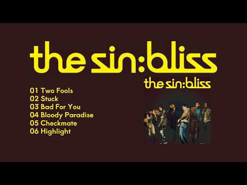
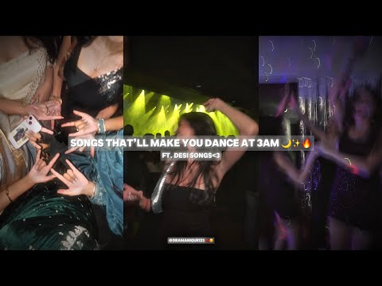
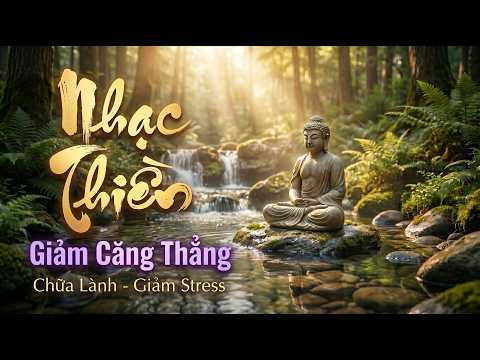
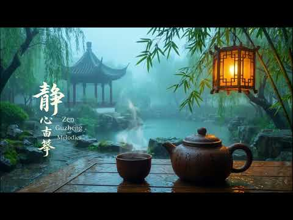
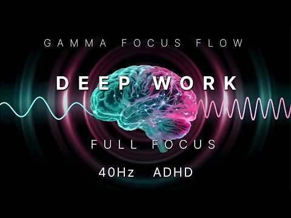

# 음악 — 성공 사례 분석: 사례별 자세히 #361–#400

`analysis.md` 의 9번 (같은 # 번호). 자동 생성 — `tools/success_analysis.py` v1.4.1 (2026-10-18 08:09 UTC). ※ 연구·교육용 — 투자 권유가 아님.

### 361. [Playlist] ENHYPEN (엔하이픈)-'THE SIN : BLISS'丨2026 Full Album

- https://www.youtube.com/watch?v=kG-CrsJXx5w · κööκκ · 구독자 1,870 · 조회수 282,051 (×150.8, 하루 4,876.4) · 좋아요 5,528 (2.0%) · 15.9분 · 2026-08-21 · 주제 묶음 10. 팝송·K팝·J팝 · 형식 플레이리스트·모음 (여러 곡) · 폴더 `W_kG-CrsJXx5w` (웹 승인)
- 썸네일: 
- 챕터: 0:00 Album Song List · 0:02 01 Two Fools · 2:24 02 Stuck · 4:55 03 Bad For You · 8:07 04 Bloody Paradise · 10:17 05 Checkmate · 12:40 06 Highlight
- 설명 앞부분: ENHYPEN (엔하이픈) - THE SIN : BLISS album (full version) Artist☺︎: ENHYPEN (엔하이픈) Song♬: Two Fools, Stuck, Bad For You, Bloody Paradise, Checkmate, Highlight Album✍︎: THE SIN : BLISS ⚠︎All Rights Administered by BELIFT LAB ⚠︎No Copyright Infringement Intended/ Don't Reupload! 🌼If you enjoy watching th…
- 대본 없음 (설명) — 음성인식이 끝나면 도입부·흐름이 들어감
- 댓글 240/240: 좋은 점 — 영상 0 · 감사·응원 0 · 더 알고 싶은 것 0 · 아쉬운 점 — 영상 0 · 반박·불만 — 의견 다름 0 · 정치·사회 0 · 경험 공유 0 · 구독·다음 기대 0

### 362. THE ULTIMATE HARYANVI PLAYLIST 🔥 !! #playlist #haryanvisong #dance

- https://www.youtube.com/watch?v=SoVJljRBGMw · 𐙚 𝒦𝒽𝓊𝓈𝒽𝒷𝓊𝓊  · 구독자 19,500 · 조회수 2,908,533 (×149.2, 하루 26,652.0) · 좋아요 19,752 (0.7%) · 6.9분 · 2026-07-01 · 주제 묶음 기타 · 형식 플레이리스트·모음 (여러 곡) · 폴더 `W_SoVJljRBGMw` (웹 승인)
- 썸네일: 
- 챕터: 0:00 ​ - Teri lat lag jayegi · 0:56 ​ - Solid body · 1:22 ​ - Pistol bolegi · 1:52 ​ - Lamba lamba ghunghat · 2:26 ​ - Laad piya ke · 3:13 ​ - Hero honda · 3:46 ​ - Kallo · 4:35 ​ - Bahu kale ki · 5:16 ​ - Tu cheez lajawab · 5:45 ​ - Dhai litre dhudh · 6:18 ​ - Olha me patola
- 설명 앞부분: THE ULTIMATE HARYANVI PLAYLIST 🔥 Disclaimer: FAIR USE copyright disclaimer under section 107 of copyright act 1976, allowance is made for "fair use" for purposes such as criticism, comment, news reporting, teaching, scholarship, education and research. fair use is a use permitted by copyright statu…
- 대본 없음 (설명) — 음성인식이 끝나면 도입부·흐름이 들어감
- 댓글 305/299: 좋은 점 — 영상 0 · 감사·응원 0 · 더 알고 싶은 것 0 · 아쉬운 점 — 영상 0 · 반박·불만 — 의견 다름 0 · 정치·사회 0 · 경험 공유 0 · 구독·다음 기대 0

### 363. Relaxing Jazz Café in Paris ∣ Cozy Rainy Evening Jazz Ambience with Cozy Coffee Shop Vibes

- https://www.youtube.com/watch?v=3mNYh_27x5k · European Jazz Café · 구독자 1,240 · 조회수 183,782 (×148.2, 하루 2,836.2) · 좋아요 566 (0.3%) · 14.5분 · 2026-08-14 · 주제 묶음 2. 자연 소리·백색소음 · 형식 음악 (그 밖 모양 — 한 편짜리 BGM 등) · 폴더 `W_3mNYh_27x5k` (웹 승인)
- 썸네일: 
- 설명 앞부분: Relaxing Jazz Café in Paris ∣ Cozy Rainy Evening Jazz Ambience with Cozy Coffee Shop Vibes Welcome to European Jazz Café — your cozy escape into the timeless elegance of Europe's most charming cafés. Step into a world of warm candlelight, rainy Parisian evenings, vintage coffeehouses, and smooth ja…
- 같은 채널 평소 대비 ×295.5 (채널 최근 롱폼 중앙값 622회) · 평소 영상: Paris Twilight Coffeehouse Jazz ∣ Smooth Rainy Ev… (622회) / Relaxing Jazz Café in Paris ∣ Rainy Evening Jazz … (641회)
- 대본 없음 (설명) — 음성인식이 끝나면 도입부·흐름이 들어감
- 댓글 1/1: 좋은 점 — 영상 0 · 감사·응원 0 · 더 알고 싶은 것 0 · 아쉬운 점 — 영상 0 · 반박·불만 — 의견 다름 0 · 정치·사회 0 · 경험 공유 0 · 구독·다음 기대 0

### 364. SONGS THAT’LL MAKE YOU DANCE AT 3AM ✨🔥 FT. DESI SONGS ❤️‍🔥💋 (+TIMESTAMPS) 💅🏻 REQUESTED~ ❤…

- https://www.youtube.com/watch?v=oIXkjb_FPC4 · Dramanique⋆.𐙚 ̊ · 구독자 31,800 · 조회수 4,707,133 (×148.0, 하루 30,002.6) · 좋아요 45,046 (1.0%) · 29.3분 · 2026-05-14 · 주제 묶음 기타 · 형식 음악 (그 밖 모양 — 한 편짜리 BGM 등) · 폴더 `W_oIXkjb_FPC4` (웹 승인)
- 썸네일: 
- 설명 앞부분: Disclaimer: I do not own any of the music used in this playlist. All rights belong to their respective owners. This playlist is made for entertainment and personal enjoyment only. Timestamps:
- 대본 없음 (설명) — 음성인식이 끝나면 도입부·흐름이 들어감
- 댓글 746/745: 좋은 점 — 영상 0 · 감사·응원 0 · 더 알고 싶은 것 0 · 아쉬운 점 — 영상 0 · 반박·불만 — 의견 다름 0 · 정치·사회 0 · 경험 공유 0 · 구독·다음 기대 0

### 365. playlist ∣ 우리 사랑은 필름 같았으면 해요

- https://www.youtube.com/watch?v=k8giKQV4a40 · 웨일 · 구독자 3,400 · 조회수 502,296 (×147.7, 하루 3,837.5) · 좋아요 4,138 (0.8%) · 21.5분 · 2026-06-09 · 주제 묶음 기타 · 형식 플레이리스트·모음 (여러 곡) · 폴더 `W_k8giKQV4a40` (웹 승인)
- 썸네일: 
- 같은 채널 평소 대비 ×29.9 (채널 최근 롱폼 중앙값 16,817회) · 평소 영상: playlist ∣ 아직 못 놨어 (16,817회) / playlist ∣ 음악 취향 다른 우리 : (9,084회)
- 대본 없음 (없음) — 음성인식이 끝나면 도입부·흐름이 들어감
- 댓글 58/58: 좋은 점 — 영상 0 · 감사·응원 6 · 더 알고 싶은 것 0 · 아쉬운 점 — 영상 0 · 반박·불만 — 의견 다름 0 · 정치·사회 0 · 경험 공유 5 · 구독·다음 기대 0
  - 감사·응원 👍166 “안녕하세요 저는 대구경동초 6학년 선플달기 운동을 하고 있는 김소윤입니다. 웨일 님의 플레이리스트를 제가 공부할때 자주 듣는데, 항상 들을때마다 노래 선정이 좋으신 것같습니다. 항상 멋지고 아름다운 노래들을 골라서 플레이리스트를 만들어주셔서 감사합니다! 웨일 님의 플…”
  - 감사·응원 👍5 “거를노래가없네정말,,,,감사합니다..😭❤️❤️”
  - 경험 공유 👍166 “안녕하세요 저는 대구경동초 6학년 선플달기 운동을 하고 있는 김소윤입니다. 웨일 님의 플레이리스트를 제가 공부할때 자주 듣는데, 항상 들을때마다 노래 선정이 좋으신 것같습니다. 항상 멋지고 아름다운 노래들을 골라서 플레이리스트를 만들어주셔서 감사합니다! 웨일 님의 플…”
  - 경험 공유 👍69 “중3때 날 진짜 좋아해준던 남친이있었는데 아직도 그때의 여름날이 생생하게 기억남 걔 학원이랑 내가 다니던 학원이 거리가 꽤 있었는데 내가 평소보다 빨리 끝나서 걔가 뛰어서 10분만에 옴 그렇게 더운 날 걔도 학원에서 공부하다 와서 한손에는 샤프 꽉 쥐고있고 땀 뻘뻘 …”

### 366. Peaceful Autumn Escape 🍂 Colorful Forest Scenery with Nature Sounds & Soft Piano Music

- https://www.youtube.com/watch?v=kpm3m2Afk18 · Gentle Nature Rhythms · 구독자 5,840 · 조회수 862,013 (×147.6, 하루 11,206.2) · 좋아요 2,988 (0.4%) · 142.2분 · 2026-08-02 · 주제 묶음 6. 피아노·클래식·연주곡 · 형식 음악 (그 밖 모양 — 한 편짜리 BGM 등) · 폴더 `W_kpm3m2Afk18` (웹 승인)
- 썸네일: 
- 설명 앞부분: 🌿 Welcome to Gentle Nature Rhythms 🌿 Step into the peaceful beauty of nature and let the gentle rhythm of the seasons calm your mind. This video features beautiful birds, lush seasonal landscapes, vibrant flowers, and authentic nature sounds, creating a relaxing atmosphere for stress relief, deep r…
- 대본 없음 (설명) — 음성인식이 끝나면 도입부·흐름이 들어감
- 댓글 143/143: 좋은 점 — 영상 0 · 감사·응원 1 · 더 알고 싶은 것 0 · 아쉬운 점 — 영상 0 · 반박·불만 — 의견 다름 0 · 정치·사회 0 · 경험 공유 0 · 구독·다음 기대 0
  - 감사·응원 👍0 “이 아침 새벽예배드리고,잔잔함과 평온함으로 하루를 여니,감사할 따름입니다.”

### 367. [기절수면/중간광고없음] 10분후 검은화면/ 듣자마자 잠드는 대나무숲 빗소리 🌧️잎 끝에 떨어지는 편안한 비ㅣ수면부족 불면증 스트래스 백색소음 ASMR

- https://www.youtube.com/watch?v=l89z7BzLSmI · 신가네숲 빗소리  · 구독자 1,350 · 조회수 198,497 (×147.0, 하루 1,792.9) · 좋아요 1,410 (0.7%) · 420분 · 2026-06-29 · 주제 묶음 2. 자연 소리·백색소음 · 형식 자연 소리·백색소음 (음악 낱말 없는 제목) · 폴더 `W_l89z7BzLSmI` (웹 승인)
- 썸네일: 
- 설명 앞부분: 🌧️ 고요한 대나무 숲에 맘 편해지는 비가 내립니다. 대나무잎 끝에 맺힌 빗방울이 천천히 떨어지고, 숲속을 가득 채우는 빗소리가 마음을 편안하게 감싸줍니다. 복잡했던 하루를 내려놓고 자연이 들려주는 빗소리와 함께 깊고 편안한 휴식을 가져보세요. 😴 이런 분들께 추천합니다. 잠이 쉽게 오지 않을 때 깊은 숙면이 필요할 때 공부와 업무에 집중하고 싶을 때 명상과 휴식 시간을 보내고 싶을 때 🎧 이어폰이나 스피커로 감상하시면 더욱 풍부한 자연의 소리를 느끼실 수 있습니다. 오늘도 편안한 밤 되세요. 🌙
- 같은 채널 평소 대비 ×29.0 (채널 최근 롱폼 중앙값 6,846회) · 평소 영상: [기절수면/중간광고없음] 10분 후 검은 화면, 편안한 여름 숲 빗소리 🌿☔ ∣ 깊은 숙… (6,846회) / [기절수면/중간광고없음] 소나무 숲을 적시는 시원한 빗소리 🌲 ∣ 10분 후 검은화면 ∣… (7,251회)
- 대본 없음 (설명) — 음성인식이 끝나면 도입부·흐름이 들어감
- 댓글 41/41: 좋은 점 — 영상 0 · 감사·응원 2 · 더 알고 싶은 것 0 · 아쉬운 점 — 영상 0 · 반박·불만 — 의견 다름 0 · 정치·사회 0 · 경험 공유 0 · 구독·다음 기대 1
  - 감사·응원 👍1 “다른영상보다 탁월하네요 빗소리 참 좋아요 감사합니다”
  - 구독·다음 기대 👍3 “최고의 빗소리~~ 구독하고 오늘 부터 청취합니다~~!!”

### 368. [스페인 감성] "Hermano Sócrates ∣ 테스형 - 나훈아 " Korean OldPop 한국명곡

- https://www.youtube.com/watch?v=FMwiMkgcfW8 · 스페인 감성 한국 올드송 · 구독자 1,420 · 조회수 208,561 (×146.9, 하루 11,147.5) · 좋아요 1,648 (0.8%) · 5.1분 · 2026-09-29 · 주제 묶음 12. 커버·노래 부르기 · 형식 음악 (그 밖 모양 — 한 편짜리 BGM 등) · 폴더 `W_FMwiMkgcfW8` (웹 승인)
- 썸네일: 
- 설명 앞부분: 안녕하세요!! "스페인 감성 한국 올드송"입니다. 한국의 좋은 노래들을 Música Española (무시카 에스파뇰라)로 리메이크해서 불러 드리겠습니다. kpop의 멋진 멜로디와 깊은 감성을 스페인의 감성과 만나 깊이를 더했습니다. 이 채널에서 만들어지는 음악들은 AI를 도구로 이용해 직접 구상하고 제작되는 노력의 결과물입니다. 더 좋은 음악을 제공할 수 있도록 항상 노력하겠습니다. ¡Hola! Bienvenidos a "Canciones Clásicas Coreanas con Alma Española". En este cana…
- 대본 없음 (설명) — 음성인식이 끝나면 도입부·흐름이 들어감
- 댓글 68/68: 좋은 점 — 영상 3 · 감사·응원 4 · 더 알고 싶은 것 1 · 아쉬운 점 — 영상 0 · 반박·불만 — 의견 다름 1 · 정치·사회 0 · 경험 공유 0 · 구독·다음 기대 1
  - 좋은 점 — 영상 👍5 “스페인 언어로 노래를 들어도 너무 듣기좋네요,~🎉🎉🎉”
  - 좋은 점 — 영상 👍3 “잘불렀지만 가슴에 와닿는 감성이 별로 느껴지지 않습니다. 왠지 모르게 기계적인 노래 . 역시 나훈아님의 노래는 그누구도 따를수없는 넘사벽 이네요 .”
  - 감사·응원 👍23 “와! 최고다. 훈이형 화이팅!”
  - 감사·응원 👍7 “왓 이렇게 도 멋지네요 영상 작품이네요 감상 합니다 구독으로 응원합니다 답방 기대합니다 🎉🎉🎉”
  - 더 알고 싶은 것 👍1 “AI로 편집한 곡이지요? 아니면 어느가수가 언제 부른 노래인가요?”
  - 반박·불만 — 의견 다름 👍5 “이노래는 올드송이 아닙니다....”
  - 구독·다음 기대 👍7 “왓 이렇게 도 멋지네요 영상 작품이네요 감상 합니다 구독으로 응원합니다 답방 기대합니다 🎉🎉🎉”

### 369. 김동률 명곡 모음 🎵 베스트 발라드 20곡 연속듣기 ∣ 다시 사랑한다 말할까 · 감사 · 기억의 습작 ∣ K-Ballad Playlist

- https://www.youtube.com/watch?v=9kIULv7grWs · 노래모음 · 구독자 2,130 · 조회수 312,748 (×146.8, 하루 2,315.3) · 좋아요 961 (0.3%) · 75.3분 · 2026-06-05 · 주제 묶음 9. 가요·발라드·트로트 · 형식 플레이리스트·모음 (여러 곡) · 폴더 `W_9kIULv7grWs` (웹 승인)
- 썸네일: 
- 설명 앞부분: 김동률 명곡 모음 🎵 베스트 발라드 20곡 연속듣기 ∣ 다시 사랑한다 말할까 · 감사 · 기억의 습작 ∣ K-Ballad Playlist 대한민국을 대표하는 싱어송라이터 김동률의 명곡들을 한곳에 모았습니다. 감성적인 가사와 깊은 울림의 멜로디로 오랫동안 사랑받아온 김동률의 대표곡들을 편안하게 감상해 보세요. 🎧 수록곡 (일부) 01. 다시 사랑한다 말할까 02. 감사 03. 기억의 습작 04. 기적 (Duet With 이소은) 05. 사랑한다는 말 06. 취중진담 07. 이제서야 08. 귀향 09. 사랑하지 않으니까요 10. 이방…
- 대본 없음 (설명) — 음성인식이 끝나면 도입부·흐름이 들어감
- 댓글 49/49: 좋은 점 — 영상 1 · 감사·응원 5 · 더 알고 싶은 것 0 · 아쉬운 점 — 영상 0 · 반박·불만 — 의견 다름 0 · 정치·사회 1 · 경험 공유 1 · 구독·다음 기대 0
  - 좋은 점 — 영상 👍1 “나한테는 전혀 와닿지않는 노래네요 비와외로움 사랑한후에 아득히먼곳 박선주의 귀로같은 류의 노래를 좋아하는 스타일이라”
  - 감사·응원 👍6 “🎉❤다시 사랑한다 말할까.. 🎉❤감사..”
  - 감사·응원 👍3 “너무 좋네요... 감사합니다..”
  - 정치·사회 👍0 “노인을 공경하지 않는. 인간이 대통령이라? 부모없는 인간이 낫구려”
  - 경험 공유 👍5 “그래 다시 사랑한다말해 진짜 ㅠㅠㅠㅠ 나도너사링해 그래서 기다렸다고”

### 370. Nhạc Thiền Tịnh Tâm An Lạc 🌿 Nhạc Thiền Chữa Lành Giúp Thư Giãn Sâu & Bình An Nội Tâm

- https://www.youtube.com/watch?v=I6stAluj1OI · Hơi Thở Chánh Niệm · 구독자 3,490 · 조회수 509,592 (×146.0, 하루 2,897.8) · 좋아요 2,322 (0.5%) · 64.3분 · 2026-04-25 · 주제 묶음 1. 수면·명상·힐링 · 형식 음악 (그 밖 모양 — 한 편짜리 BGM 등) · 폴더 `W_I6stAluj1OI` (웹 승인)
- 썸네일: 
- 설명 앞부분: Nhạc thiền tịnh tâm an lạc giúp bạn thư giãn sâu, xoa dịu tâm trí và tìm lại sự bình an trong từng hơi thở. Video nhạc thiền chữa lành này được thiết kế với giai điệu nhẹ nhàng, không lời, giúp giảm stress, giải tỏa lo âu và đưa bạn vào trạng thái tĩnh lặng tự nhiên. Nhạc thiền tịnh tâm không chỉ g…
- 대본 없음 (설명) — 음성인식이 끝나면 도입부·흐름이 들어감
- 댓글 119/119: 좋은 점 — 영상 0 · 감사·응원 0 · 더 알고 싶은 것 0 · 아쉬운 점 — 영상 0 · 반박·불만 — 의견 다름 0 · 정치·사회 0 · 경험 공유 0 · 구독·다음 기대 0

### 371. A CHATPATI PLAYLIST FOR CHATPATE PEOPLE 💅😜 #playlist #song #collab

- https://www.youtube.com/watch?v=H0yLhDLJWuI · 𐙚 𝒦𝒽𝓊𝓈𝒽𝒷𝓊𝓊  · 구독자 19,500 · 조회수 2,841,270 (×145.7, 하루 27,627.0) · 좋아요 20,807 (0.7%) · 11.2분 · 2026-07-07 · 주제 묶음 기타 · 형식 플레이리스트·모음 (여러 곡) · 폴더 `W_H0yLhDLJWuI` (웹 승인)
- 썸네일: 
- 챕터: 0:00 Mere Naseeb Mein · 1:03 Gulaabo · 2:03 Caller Tune · 2:57 Chittiyan Kalaiyan · 3:32 Oh La La · 4:16 Genda Phool · 4:53 Afghan Jalebi · 5:41 Jhalla Wallah · 6:07 Udi Udi · 6:52 Pinky · 7:39 Pink Lips · 8:45 Love Letter · 9:33 Manma Emotion Jaage · 10:44 ghana Kassoto
- 설명 앞부분: POV: A Chatpati Playlist for Chatpata People's 💅 A playlist full of Bollywood bangers, desi vibes & songs that instantly boost your mood. Whether you're getting ready, driving, chilling or just feeling extra... this playlist is for you! 😜 🎧 Put on your headphones and enjoy the vibe! ⏱️ Timestamps: …
- 대본 없음 (설명) — 음성인식이 끝나면 도입부·흐름이 들어감
- 댓글 300/301: 좋은 점 — 영상 0 · 감사·응원 0 · 더 알고 싶은 것 0 · 아쉬운 점 — 영상 0 · 반박·불만 — 의견 다름 0 · 정치·사회 0 · 경험 공유 0 · 구독·다음 기대 0

### 372. Disney Sleep Piano Collection 🧜‍♀️ ∣ Ariel’s Peaceful Night ∣ Ocean Ambience 🌊

- https://www.youtube.com/watch?v=kPPtBzS0hbE · Fairy Door · 구독자 1,830 · 조회수 266,575 (×145.7, 하루 3,295.0) · 좋아요 3,286 (1.2%) · 196.9분 · 2026-07-29 · 주제 묶음 2. 자연 소리·백색소음 · 형식 커버·직접 부른 노래 · 폴더 `W_kPPtBzS0hbE` (웹 승인)
- 썸네일: 
- 설명 앞부분: Disney Sleep Piano Collection 🧜‍♀️ ∣ Ariel’s Peaceful Night ∣ Ocean Ambience 🌊 POV: A cozy night in Ariel's magical grotto, where moonlight, gentle ocean waves, and soft lullabies guide you into peaceful sleep 🌊 🌸✨ A little corner for those who love Disney piano music and dreamy fairy-tale vibes. 🦢…
- 대본 없음 (설명) — 음성인식이 끝나면 도입부·흐름이 들어감
- 댓글 26/26: 좋은 점 — 영상 0 · 감사·응원 0 · 더 알고 싶은 것 0 · 아쉬운 점 — 영상 0 · 반박·불만 — 의견 다름 0 · 정치·사회 0 · 경험 공유 0 · 구독·다음 기대 0

### 373. @노노뮤직#피아노연주곡 #플루트연주곡#명상음악 #휴식음악 #뉴에이지 #감성음악 #숲길 #자연음악 #마음치유 #힐링BGM #피아노플루트 #평화로운음악#Instru…

- https://www.youtube.com/watch?v=8Fiore1srWM · 노노스튜디오 · 구독자 462 · 조회수 66,905 (×144.8, 하루 488.5) · 좋아요 527 (0.8%) · 32.1분 · 2026-06-03 · 주제 묶음 6. 피아노·클래식·연주곡 · 형식 연주 (직접 연주하는 영상) · 폴더 `W_8Fiore1srWM` (웹 승인)
- 썸네일: 
- 설명 앞부분: 숲길을 천천히 걸으며 바람을 느껴본 적이 있으신가요? 《바람이 머무는 숲길》은 피아노와 플루트가 함께 만들어내는 따뜻하고 평화로운 연주곡입니다. 잔잔한 피아노 선율과 부드러운 플루트의 울림이 지친 마음을 편안하게 감싸주며, 마치 햇살이 비치는 숲길을 걷는 듯한 고요한 시간을 선물합니다. 명상할 때, 책을 읽을 때, 공부할 때, 잠들기 전 또는 조용한 휴식 시간에 함께해 보세요. 오늘 하루도 수고한 당신의 마음에 작은 위로가 되기를 바랍니다.
- 같은 채널 평소 대비 ×408.0 (채널 최근 롱폼 중앙값 164회) · 평소 영상: @노노뮤직#SymphonyOfADay#하루의교향곡#오케스트라#클래식음악#Classical… (169회) / @노노뮤직#프라하 #Prague #유럽클래식 #창작클래식 #BackgroundMusic … (159회)
- 대본 없음 (설명) — 음성인식이 끝나면 도입부·흐름이 들어감
- 댓글 11/11: 좋은 점 — 영상 0 · 감사·응원 0 · 더 알고 싶은 것 0 · 아쉬운 점 — 영상 0 · 반박·불만 — 의견 다름 0 · 정치·사회 0 · 경험 공유 0 · 구독·다음 기대 0

### 374. Enigma - Eternity of Love (Enigmatic Ambient / New Age 4K)

- https://www.youtube.com/watch?v=2ohn3S5VafQ · 5TH FREQUENCY · 구독자 1,040 · 조회수 150,520 (×144.7, 하루 2,353.0) · 좋아요 1,970 (1.3%) · 5.4분 · 2026-08-15 · 주제 묶음 6. 피아노·클래식·연주곡 · 형식 음악 (그 밖 모양 — 한 편짜리 BGM 등) · 폴더 `W_2ohn3S5VafQ` (웹 승인)
- 썸네일: 
- 설명 앞부분: 🌌 "Eternity of Love" — An Enigmatic Journey Through Time & Space. Immerse yourself in a hypnotic blend of Gregorian chants, sensual Shakuhachi flute, deep sub-bass, and poetic whispers. Inspired by the legendary sound of Enigma (The Voice of Enigma & Sadeness), this track explores love that transce…
- 대본 없음 (설명) — 음성인식이 끝나면 도입부·흐름이 들어감
- 댓글 60/60: 좋은 점 — 영상 0 · 감사·응원 0 · 더 알고 싶은 것 0 · 아쉬운 점 — 영상 0 · 반박·불만 — 의견 다름 0 · 정치·사회 0 · 경험 공유 0 · 구독·다음 기대 0

### 375. If You Feel It in Your Blood… You’re a Viking ⚔️ ∣ Valhalla Awaits (Epic Viking War Music)

- https://www.youtube.com/watch?v=uPK4MWJvxMk · Viking Army · 구독자 9,580 · 조회수 1,384,664 (×144.5, 하루 7,967.1) · 좋아요 9,881 (0.7%) · 9.2분 · 2026-04-27 · 주제 묶음 13. OST·사운드트랙 · 형식 음악 (그 밖 모양 — 한 편짜리 BGM 등) · 폴더 `W_uPK4MWJvxMk` (웹 승인)
- 썸네일: 
- 설명 앞부분: If you feel it… deep in your blood — this is not just music. This is the call of the North. A story of brotherhood, battle, and the warriors who never truly fall. Through snow, fire, and death… they rise again in Valhalla. This track is for those who carry the spirit of the Viking within them the o…
- 대본 없음 (설명) — 음성인식이 끝나면 도입부·흐름이 들어감
- 댓글 587/587: 좋은 점 — 영상 0 · 감사·응원 0 · 더 알고 싶은 것 0 · 아쉬운 점 — 영상 0 · 반박·불만 — 의견 다름 0 · 정치·사회 0 · 경험 공유 0 · 구독·다음 기대 0

### 376. Good Morning Vibes 💕 Best Acoustic Love Songs to Start Your Day Feel Good Music 🎶

- https://www.youtube.com/watch?v=fxrrC6UCItY · NiceOne · 구독자 10,900 · 조회수 1,574,204 (×144.4, 하루 24,439.4) · 좋아요 5,458 (0.4%) · 91.9분 · 2026-08-14 · 주제 묶음 4. 카페·매장·라운지 · 형식 커버·직접 부른 노래 · 폴더 `W_fxrrC6UCItY` (웹 승인)
- 썸네일: 
- 설명 앞부분: Start your morning with a relaxing collection of beautiful acoustic love songs, warm melodies, and feel-good vibes. Perfect for enjoying your morning coffee, relaxing at home, studying, working, or simply taking a peaceful moment for yourself. ☕🌿 🎧 Playlist Highlights: Somewhere Only We Know • Unti…
- 대본 없음 (설명) — 음성인식이 끝나면 도입부·흐름이 들어감
- 댓글 146/143: 좋은 점 — 영상 0 · 감사·응원 0 · 더 알고 싶은 것 0 · 아쉬운 점 — 영상 0 · 반박·불만 — 의견 다름 0 · 정치·사회 0 · 경험 공유 0 · 구독·다음 기대 0

### 377. Coffee Shop Love Songs ∣ Relaxing Acoustic 70s 80s 90s Collection

- https://www.youtube.com/watch?v=p4zynVVTYpA · Acoustic Memory · 구독자 10,000 · 조회수 1,432,774 (×143.3, 하루 61,360.7) · 좋아요 6,804 (0.5%) · 80.3분 · 2026-09-24 · 주제 묶음 4. 카페·매장·라운지 · 형식 플레이리스트·모음 (여러 곡) · 폴더 `W_p4zynVVTYpA` (웹 승인)
- 썸네일: 
- 설명 앞부분: 👋 Welcome to Acoustic Memory 🎶 Step back in time with timeless acoustic love songs from the 70s, 80s, and 90s. Enjoy beautiful vocal covers of romantic classics like Wonderful Tonight and more, featuring soft acoustic melodies, soulful vocals, and nostalgic vibes. Perfect for relaxing, coffee time,…
- 대본 없음 (설명) — 음성인식이 끝나면 도입부·흐름이 들어감
- 댓글 130/129: 좋은 점 — 영상 0 · 감사·응원 0 · 더 알고 싶은 것 0 · 아쉬운 점 — 영상 0 · 반박·불만 — 의견 다름 0 · 정치·사회 0 · 경험 공유 0 · 구독·다음 기대 0

### 378. 바흐의 파사칼리아

- https://www.youtube.com/watch?v=MQf3ajxEFfQ · 홍준 뮤직 TV · 구독자 4,490 · 조회수 641,115 (×142.8, 하루 4,883.0) · 좋아요 8,744 (1.4%) · 40분 · 2026-06-09 · 주제 묶음 기타 · 형식 정보·해설 (그 밖) · 폴더 `W_MQf3ajxEFfQ` (웹 승인)
- 썸네일: 
- 챕터: 0:00 Passacaglia I – Prelude of Si… · 4:20 Passacaglia II – Echoes of th… · 8:35 Passacaglia III – Moonlit Rev… · 12:45 Passacaglia IV – The Flow of … · 16:50 Passacaglia V – Shadows and L… · 21:00 Passacaglia VI – Meditative S… · 25:15 Passacaglia VII – Nocturne in… · 29:30 Passacaglia VIII – Devotion · 33:50 Passacaglia IX – Endless Vari… · 37:20 Passacaglia Finale – The Last…
- 설명 앞부분: 🎸 바흐의 파사칼리아 ∣ 깊은 밤을 물들이는 클래식 기타의 울림 요한 세바스티안 바흐의 불멸의 명곡 「파사칼리아」를 클래식 기타의 섬세하고 깊은 음색으로 만나보세요. 한 음 한 음 이어지는 기타의 울림은 고요한 밤의 정적 속으로 우리를 이끌며, 때로는 장엄하게, 때로는 사색적으로 마음을 어루만져 줍니다. 복잡한 일상 속에서 잠시 멈춰 서서, 바흐의 선율과 함께 평온한 휴식의 시간을 가져보시길 바랍니다. 이 음악이 마음에 드셨다면, 편안한 감상 되세요. 감사합니다. 바흐,파사칼리아,바흐 파사칼리아,클래식 기타,기타 연주곡,클래식 음…
- 같은 채널 평소 대비 ×1,196.1 (채널 최근 롱폼 중앙값 536회) · 평소 영상: 풀루트.피아노 협주곡 (536회) / 명곡 소프라노 모음 (553회)
- 대본 없음 (설명) — 음성인식이 끝나면 도입부·흐름이 들어감
- 댓글 662/662: 좋은 점 — 영상 6 · 감사·응원 75 · 더 알고 싶은 것 7 · 아쉬운 점 — 영상 5 · 반박·불만 — 의견 다름 4 · 정치·사회 2 · 경험 공유 18 · 구독·다음 기대 2
  - 좋은 점 — 영상 👍36 “밤에 듣기 좋은 곡^^ 같이 듣던 아이가 스르르 잠드는 걸 보니 정말 평온한 곡인듯요🥰”
  - 좋은 점 — 영상 👍20 “저녁에 책읽으며 듣기좋은 음악이네요 감사합니다~❤”
  - 감사·응원 👍201 “아름다운 음악 1곡이... 사람의 인생을 바꿀 수도 있고... 또 다른 삶의 도전을 일으키는 촉매제가 될 수도 있다고 봅니다... 지긋이 두눈을 감고 들으니... 마음의 위로와 평안이 느껴집니다... 좋은 곡을 듣게 해주셔서... 대단히... 감사합니다...^^”
  - 감사·응원 👍97 “많이아픈데 어느날 아침 찾아온음악으로 큰위안을 얻고 힘이됩니다 감사합니다”
  - 더 알고 싶은 것 👍2 “연주자가 누군지 알 수 있을까요?”
  - 더 알고 싶은 것 👍0 “이 곡은 어디서 다운로드 받을 수 있을까요? 멜론에도 없어요 ㅠ”
  - 아쉬운 점 — 영상 👍5 “클레식이란 지루하다는 무지한 생각을 하던 1인 이었는데 아름다운선율로 생각을 확 바꿔주네요😂”
  - 아쉬운 점 — 영상 👍0 “바흐의 파사칼리아와푸가c단조가 아니라 핸델의 파사칼리아를 AI를 이용해 여러 변주를 만들어 올려 조회수 장사를 하면 안됩니다. 시청하시는 분들이 잘못된 정보를 받아들 수 있습니다. 댓글을 읽어 보면 벌써 많은 분들이 거짓정보를 믿고 있네요. 못된 짓 당장 멈추세요.”
  - 반박·불만 — 의견 다름 👍0 “헨델이 들으면 슬퍼하겠어요 바하 작곡이 아닙니다”
  - 반박·불만 — 의견 다름 👍0 “바흐가 아닌데요”
  - 정치·사회 👍0 “요즘 이재명 인간이 하는 짓 보고 울화가 하늘 끝까지 치솟고.대한민국의 정치현실이 우울하고 그런데 파사칼리아를 들르면 ·감정이 정화되면서 평온해짐을 느낍니다.”
  - 경험 공유 👍137 “이 곡을 들으며 제가 이제 너무 바빠졌다는 생각이 드네요 들어야 할 좋은 곡들이 너무너무 많다는걸 알았네요”
  - 경험 공유 👍82 “이 연주곡을 듣기전까지 제가 바흐를 좋아하는지 몰랐어요😂”
  - 구독·다음 기대 👍2 “서정적인 기타연주 잘 감상하고 구독하고 갑니다.~♡”
  - 구독·다음 기대 👍1 “잠시 쉬며 삶에 대해 생각을 많이 하게되는 곡이네요 기타의 서정적임이 바흐의 마음을 전해 주는 것 같아요 우연히 들어왔다가 채널 곡 들이 좋아 구독하고 갑니다 아름다운 곡들 공유 해 주셔서 감사합니다.”

### 379. POV: You found the ultimate South Indian aesthetic🪷 playlist 🎧✨

- https://www.youtube.com/watch?v=oQz6Wt4qb3w · Ethereal Echoes  · 구독자 12,700 · 조회수 1,809,493 (×142.5, 하루 12,382.8) · 좋아요 26,225 (1.5%) · 13.3분 · 2026-05-25 · 주제 묶음 기타 · 형식 플레이리스트·모음 (여러 곡) · 폴더 `W_oQz6Wt4qb3w` (웹 승인)
- 썸네일: 
- 챕터: 0:00 Unakkul Naane · 1:03 Chuttamalle · 2:32 Aasa Kooda · 3:54 Inkem Inkem · 5:08 Othiyade Pathayila · 6:18 Chinama Chillyama · 7:16 Nachidamma · 9:40 Tum Tum · 11:00 Katchi Sera · 11:52 Buttabomma · 12:54 Armadham
- 설명 앞부분: A space to lose yourself in the music. 🎧✨ Consider this just a little trailer... the main show is yet to begin. If Vol. 01 made you feel things, wait until you hear the absolute bombastic heat I'm brewing for Part 2. It’s going to be unreal. 🔥🔊 Hit that subscribe button and turn on notifications so…
- 대본 없음 (설명) — 음성인식이 끝나면 도입부·흐름이 들어감
- 댓글 356/355: 좋은 점 — 영상 0 · 감사·응원 0 · 더 알고 싶은 것 0 · 아쉬운 점 — 영상 0 · 반박·불만 — 의견 다름 0 · 정치·사회 0 · 경험 공유 0 · 구독·다음 기대 0

### 380. Mind Relaxing Flute Tabla and Sitar ∣ Hindustani Instrumental Compilation

- https://www.youtube.com/watch?v=ZHwM82TaZFg · Mystic Sitar · 구독자 2,540 · 조회수 358,530 (×141.2, 하루 2,123.8) · 좋아요 2,894 (0.8%) · 71.2분 · 2026-05-02 · 주제 묶음 6. 피아노·클래식·연주곡 · 형식 긴 한 곡·반복 (N시간) · 폴더 `W_ZHwM82TaZFg` (웹 승인)
- 썸네일: 
- 설명 앞부분: Mind Relaxing Flute Tabla and Sitar ∣ Hindustani Instrumental Compilation indian sitar sitar music indian sitar relaxing music indian music sitar indian classical music indian meditation music music for meditation relaxing indian music sitar meditation music sitar for mental health meditation music…
- 대본 없음 (설명) — 음성인식이 끝나면 도입부·흐름이 들어감
- 댓글 87/87: 좋은 점 — 영상 0 · 감사·응원 0 · 더 알고 싶은 것 0 · 아쉬운 점 — 영상 0 · 반박·불만 — 의견 다름 0 · 정치·사회 0 · 경험 공유 0 · 구독·다음 기대 0

### 381. 𝗣𝗹𝗮𝘆𝗹𝗶𝘀𝘁 ∣ 일할때 틀어놓기 좋은 지브리 x 픽사 x 디즈니 재즈🔥🎺 ∣ #NoAImusic ∣ Ghibli x Pixar x Disney Jazz

- https://www.youtube.com/watch?v=ayKr-gtJQIQ · 오늘은 재즈데이 | Jazzday · 구독자 3,360 · 조회수 473,494 (×140.9, 하루 3,575.6) · 좋아요 3,768 (0.8%) · 379.1분 · 2026-06-07 · 주제 묶음 7. 재즈·보사노바 · 형식 플레이리스트·모음 (여러 곡) · 폴더 `W_ayKr-gtJQIQ` (웹 승인)
- 썸네일: 
- 챕터: 0:00 Once Upon a Time & Jazz Waltz · 4:02 The Time of Your Life & Swing · 8:09 A Town With An Ocean View & B… · 12:52 Alice In Wonderland & Jazz Wa… · 17:35 Always With Me & Jazz Samba (… · 23:08 The Spirit of Adventure & Swi… · 27:12 Let It Go & 5-4 Jazz · 31:21 PONYO & Jazz Funk (T.II) (Pon… · 37:28 Remember Me & Bossanova · 42:41 How Far I'll Go & Swing · 46:16 Merry Go Round of Life & 6-8 … · 50:49 Le Festin & Jazz Waltz · 56:04 Hey Let's Go & Bossanova · 60:52 Can You Feel The Love Tonight… · 65:10 Ashitaka And San & 5-4 Jazz · 69:53 Life's Incredible Again & Jaz… · 75:34 When She Loved Me & Bossanova · 79:51 Under The Sea & Swing · 83:45 Path of The Wind & 5-4 Jazz (… · 89:02 Married Life & Jazz Waltz
- 설명 앞부분: 따뜻한 실제 연주로 채워진 공간입니다.🙂 편안한 시간 되시길 바라며, 방문해주셔서 감사합니다. ▪︎ 음악이 좋으셨다면 'Hype' 버튼으로 응원해주세요! ▪︎ 여러분의 최애곡을 댓글로 남겨주세요! ▪︎ 음원 자체를 콘텐츠로 삼는 활동(플레이리스트 제작 등)을 금지합니다. ▪︎ 원본 음원 파일은 별도로 제공하지 않습니다. ▪︎ 채널의 모든 음악은 직접 연주하고 프로듀싱한 음원입니다. (AI 생성 음원이 아닙니다.) ▪︎ 원곡이 있는 경우, 본 콘텐츠는 팬메이드이며 원저작자와 공식적인 연관이 없음을 밝힙니다.
- 같은 채널 평소 대비 ×461.0 (채널 최근 롱폼 중앙값 1,027회) · 평소 영상: 𝗣𝗹𝗮𝘆𝗹𝗶𝘀𝘁 ∣ 더위야 물럿거라!!☀️☀️ 듣기만 해도 시원해지는, 청량한 분위기의 … (1,023회) / 𝗣𝗹𝗮𝘆𝗹𝗶𝘀𝘁 ∣ 하늘이 부쩍 높아진 요즘, 다가오는 가을을 기다리며 듣는 재즈 🍃 ∣… (996회)
- 대본 없음 (설명) — 음성인식이 끝나면 도입부·흐름이 들어감
- 댓글 40/40: 좋은 점 — 영상 0 · 감사·응원 4 · 더 알고 싶은 것 0 · 아쉬운 점 — 영상 0 · 반박·불만 — 의견 다름 0 · 정치·사회 0 · 경험 공유 0 · 구독·다음 기대 0
  - 감사·응원 👍79 “이 글을 읽고 계신 모든 분들께, 우리가 만날 일은 없을지 모르지만, 여러분의 삶에 기쁨과 성공, 끝없는 행복이 가득하길 진심으로 바랍니다. 힘내시고 건강하세요!”
  - 감사·응원 👍73 “디즈니랑 지브리를 같이 모아둘 생각을 하시다니 매우 감사...”

### 382. 【靜謐時光】 古箏竹笛療癒音樂｜超好聽的中國古典音樂 古箏、琵琶、竹笛、二胡｜療癒音樂 深度睡眠 - Chinese Meditation Sleep Music

- https://www.youtube.com/watch?v=7QV9JIx-euE · Gentle Zen Melodies · 구독자 9,590 · 조회수 1,348,136 (×140.6, 하루 8,818.8) · 좋아요 8,947 (0.7%) · 232분 · 2026-05-18 · 주제 묶음 1. 수면·명상·힐링 · 형식 음악 (그 밖 모양 — 한 편짜리 BGM 등) · 폴더 `W_7QV9JIx-euE` (웹 승인)
- 썸네일: 
- 설명 앞부분: 【靜謐時光】 古箏竹笛療癒音樂｜超好聽的中國古典音樂 古箏、琵琶、竹笛、二胡｜療癒音樂 深度睡眠 - Chinese Meditation Sleep Music ✨ **歡迎來到 Chinese Meditation Sleep Music** ✨
- 대본 없음 (설명) — 음성인식이 끝나면 도입부·흐름이 들어감
- 댓글 2,844/2,810: 좋은 점 — 영상 0 · 감사·응원 0 · 더 알고 싶은 것 0 · 아쉬운 점 — 영상 0 · 반박·불만 — 의견 다름 0 · 정치·사회 0 · 경험 공유 0 · 구독·다음 기대 0

### 383. Eldorado — Hypnotic Dream Trance & Tribal Ambient Music👑✨

- https://www.youtube.com/watch?v=ggbo8YTXRrw · ARTechnoMusic · 구독자 3,810 · 조회수 535,523 (×140.6, 하루 5,481.8) · 좋아요 0 (0.0%) · 5.8분 · 2026-07-12 · 주제 묶음 8. 로파이·시티팝·칠 · 형식 음악 (그 밖 모양 — 한 편짜리 BGM 등) · 폴더 `W_ggbo8YTXRrw` (웹 승인)
- 썸네일: 
- 설명 앞부분: Step inside a legendary, hidden landscape. Reimagining a mythical city not as physical gold to be conquered, but as a timeless sanctuary of pure spiritual light hidden deep within the earth, "Eldorado" maps a serene space where the noise of the modern world completely dissolves. 🎵 Stream / Download…
- 대본 없음 (설명) — 음성인식이 끝나면 도입부·흐름이 들어감
- 댓글 69/69: 좋은 점 — 영상 0 · 감사·응원 0 · 더 알고 싶은 것 0 · 아쉬운 점 — 영상 0 · 반박·불만 — 의견 다름 0 · 정치·사회 0 · 경험 공유 0 · 구독·다음 기대 0

### 384. Hanuman Chalisa 🔥 Listen Can Change Your Energy ∣ Peace, Power & Protection

- https://www.youtube.com/watch?v=v7ezfXE074I · bhakti official studio · 구독자 4,960 · 조회수 696,783 (×140.5, 하루 4,202.5) · 좋아요 5,319 (0.8%) · 6.7분 · 2026-05-05 · 주제 묶음 1. 수면·명상·힐링 · 형식 음악 (그 밖 모양 — 한 편짜리 BGM 등) · 폴더 `W_v7ezfXE074I` (웹 승인)
- 썸네일: 
- 설명 앞부분: 🙏 Hanuman Chalisa for Peace, Healing & Positive Energy 🙏 Listen to the divine Hanuman Chalisa and invite peace, strength, and positivity into your life. This powerful devotional prayer is dedicated to Lord Hanuman, known for removing fear, negativity, and obstacles. ✨ Benefits of listening daily: C…
- 대본 없음 (설명) — 음성인식이 끝나면 도입부·흐름이 들어감
- 댓글 582/580: 좋은 점 — 영상 0 · 감사·응원 0 · 더 알고 싶은 것 0 · 아쉬운 점 — 영상 0 · 반박·불만 — 의견 다름 0 · 정치·사회 0 · 경험 공유 0 · 구독·다음 기대 0

### 385. Sleep & Reset Your Vagus Nerve ∣ Singing Bowl Sound Bath Meditation

- https://www.youtube.com/watch?v=l91ztcnXYPM · Echo Bowls · 구독자 504 · 조회수 70,741 (×140.4, 하루 683.0) · 좋아요 681 (1.0%) · 15.3분 · 2026-07-06 · 주제 묶음 1. 수면·명상·힐링 · 형식 음악 (그 밖 모양 — 한 편짜리 BGM 등) · 폴더 `W_l91ztcnXYPM` (웹 승인)
- 썸네일: 
- 설명 앞부분: Welcome to a peaceful space where you can slow down, breathe deeply, and prepare your body and mind for a restful night's sleep. This **Tibetan Singing Bowl Sound Bath** is designed to create a calming atmosphere for relaxation, mindfulness, and deep rest through the timeless resonance of handcraft…
- 대본 없음 (설명) — 음성인식이 끝나면 도입부·흐름이 들어감
- 댓글 13/13: 좋은 점 — 영상 0 · 감사·응원 0 · 더 알고 싶은 것 0 · 아쉬운 점 — 영상 0 · 반박·불만 — 의견 다름 0 · 정치·사회 0 · 경험 공유 0 · 구독·다음 기대 0

### 386. [오마주 OST] 모두가 자신의 무가치함과 싸우고 있다 Inspired Playlist ∣ 포켓라디오 #넷플릭스 #jtbcdrama #모두가 자신의 무가치함과 …

- https://www.youtube.com/watch?v=CSIUAghSOPo · pocketradio · 구독자 572 · 조회수 80,278 (×140.3, 하루 457.6) · 좋아요 784 (1.0%) · 16.3분 · 2026-04-25 · 주제 묶음 1. 수면·명상·힐링 · 형식 플레이리스트·모음 (여러 곡) · 폴더 `W_CSIUAghSOPo` (웹 승인)
- 썸네일: 
- 챕터: 0:00 1.너와 걷는 기찻길 (Walking Beside Y… · 3:26 2. 날씨를 만들어 드립니다 (We Manufactu… · 7:23 3. 말하지 않으면 사라질 것 같아서 · 11:07 4. 나는 어디에 서야 할까 (Where Should… · 14:09 5. 오늘은 너의 옆에 앉을게 (Sit Beside …
- 설명 앞부분: JTBC 드라마 {모두가 자신의 무가치함과 싸우고 있다.} 오마주 OST /Homage OST 입니다. 공식 OST 아닙니다. 영상과 이미지는 넷플릭스에서 가져왔습니다. 비교 속에서 작아진 마음, 말하지 못한 외로움, 그리고 오늘을 버텨낸 당신에게 전하는 5개의 이야기. 🎧 Track List ☕ 이런 분들에게 추천합니다 위로가 필요한 밤 지친 퇴근길 혼자 걷는 새벽 감정이 많아지는 비 오는 날 아무 말 없이 음악만 듣고 싶은 순간
- 대본 없음 (설명) — 음성인식이 끝나면 도입부·흐름이 들어감
- 댓글 93/93: 좋은 점 — 영상 0 · 감사·응원 5 · 더 알고 싶은 것 7 · 아쉬운 점 — 영상 0 · 반박·불만 — 의견 다름 1 · 정치·사회 0 · 경험 공유 3 · 구독·다음 기대 2
  - 감사·응원 👍31 “날씨는 그냥 현상이 아니라 사람들의 마음이라는 걸. 공감되는 가사입니다. 그리고 본인이 만든 날씨로 타인에게 위로나 응원을 보내지만 정작 본인은 비어있다는 가사. 너무 슬픈가사에요. 내 기분이나 감정 보다도 타인을 위해 날씨를 만든다는 것은 이타적인 마음면서도 자기 …”
  - 감사·응원 👍9 “공식 OST 보다 더 좋은 느낌입니다. 감사합니다.”
  - 더 알고 싶은 것 👍6 “2번 곡도 따로 만들어주세요^^”
  - 더 알고 싶은 것 👍4 “1번 따로 파일 있을까요?”
  - 반박·불만 — 의견 다름 👍1 “별거 아닌데 눈물이 났어요^^”
  - 경험 공유 👍3 “2번 오늘은 어떤 날씨를 원하시나요? 지리산 바래봉 등산길. 이 노래 들었는데요. 눈물이 나도 부끄럽지 않은 날씨를 만들어주세요. 라고 답했습니다.”
  - 구독·다음 기대 👍13 “너무좋아서 설레이네요 매주토요일이 기다려집니다 구교환..고윤정만 표현할수있는있는 날씨인것같아요♡”
  - 구독·다음 기대 👍4 “포켓라디오님~ 가사들이 하나같이 너무 좋고 음악분위기도 너무 좋아서 바로 구독했습니다~^^ 무언가 감성을 자극하는 분위기가 있네요~! 너무너무 감사드립니다 이런 분위기의 음악 너무 좋아하는데 정말 감사드립니다~♡”

### 387. Calm Work Music ∣ Ambient Deep Work for Focus, Productivity & Flow State

- https://www.youtube.com/watch?v=PBwiQgdwJdc · Calm Work Studio · 구독자 5,770 · 조회수 808,226 (×140.1, 하루 7,783.4) · 좋아요 2,826 (0.4%) · 130.2분 · 2026-07-06 · 주제 묶음 3. 공부·집중·작업 · 형식 음악 (그 밖 모양 — 한 편짜리 BGM 등) · 폴더 `W_PBwiQgdwJdc` (웹 승인)
- 썸네일: 
- 설명 앞부분: Calm Work Music ∣ Ambient Deep Work for Focus, Productivity & Flow State Experience the perfect balance of Calm Work Music and Ambient Deep Work designed to help you stay focused, productive, and mentally clear. This peaceful ambient soundscape creates a relaxing atmosphere for deep concentration, …
- 대본 없음 (설명) — 음성인식이 끝나면 도입부·흐름이 들어감
- 댓글 202/201: 좋은 점 — 영상 0 · 감사·응원 0 · 더 알고 싶은 것 0 · 아쉬운 점 — 영상 0 · 반박·불만 — 의견 다름 0 · 정치·사회 0 · 경험 공유 0 · 구독·다음 기대 0

### 388. মন ছুঁয়ে যাওয়া বাংলা Lo-Fi Romantic Songs ∣ Relaxing Bangla Chill Mix ∣ Heart Touching Ju…

- https://www.youtube.com/watch?v=rwiGXAhqrfU · RESHMI LO-FI WB · 구독자 24,000 · 조회수 3,356,414 (×139.8, 하루 20,200.9) · 좋아요 27,769 (0.8%) · 22.5분 · 2026-05-05 · 주제 묶음 8. 로파이·시티팝·칠 · 형식 음악 (그 밖 모양 — 한 편짜리 BGM 등) · 폴더 `W_rwiGXAhqrfU` (웹 승인)
- 썸네일: 
- 설명 앞부분: মন ছুঁয়ে যাওয়া বাংলা Lo-Fi Sad Songs 2026 💔 ∣ Relaxing Bangla Chill Mix ∣ Heart Touching Bengali Jukebox .. Relaxing and heart touching Bangla Lo-Fi sad songs collection for peaceful nights and emotional moments. এই Jukebox-এ রয়েছে মন ছুঁয়ে যাওয়া বাংলা LoFi গান, soft chill vibes এবং soothing beats …
- 대본 없음 (설명) — 음성인식이 끝나면 도입부·흐름이 들어감
- 댓글 989/989: 좋은 점 — 영상 0 · 감사·응원 0 · 더 알고 싶은 것 0 · 아쉬운 점 — 영상 0 · 반박·불만 — 의견 다름 0 · 정치·사회 0 · 경험 공유 0 · 구독·다음 기대 0

### 389. 𝐩𝐥𝐚𝐲𝐥𝐢𝐬𝐭 요즘 인스타 부계 감성

- https://www.youtube.com/watch?v=WBabiGZluh8 · 알수없는 사용자 · 구독자 1,730 · 조회수 241,635 (×139.7, 하루 3,321.6) · 좋아요 6,448 (2.7%) · 17.5분 · 2026-08-06 · 주제 묶음 기타 · 형식 플레이리스트·모음 (여러 곡) · 폴더 `W_WBabiGZluh8` (웹 승인)
- 썸네일: 
- 챕터: 0:00 상상더하기 - 라붐 · 4:08 낙낙 - 트와이스 · 7:19 take it slow - 레드벨벳 · 10:51 about love - 레드벨벳 · 14:16 빨간맛 - 레드벨벳
- 설명 앞부분: 2016~7년도 3세대여돌 노래를 오랜만에 들으니 감회가 새롭네요,,,🏩 문제될시에 삭제합니다(๑･̑◡･̑๑)
- 같은 채널 평소 대비 ×6.7 (채널 최근 롱폼 중앙값 36,180회) · 평소 영상: 𝐩𝐥𝐚𝐲𝐥𝐢𝐬𝐭 오늘 고백하는 그 남자를 보고 (48,408회) / 𝐩𝐥𝐚𝐲𝐥𝐢𝐬𝐭 너의 그 사랑의 안전지대가 어딨어? (23,951회)
- 대본 없음 (설명) — 음성인식이 끝나면 도입부·흐름이 들어감
- 댓글 52/52: 좋은 점 — 영상 0 · 감사·응원 0 · 더 알고 싶은 것 2 · 아쉬운 점 — 영상 0 · 반박·불만 — 의견 다름 0 · 정치·사회 0 · 경험 공유 5 · 구독·다음 기대 1
  - 더 알고 싶은 것 👍4 “진짜 제가 찾고 찾던 플리.. 맨날와요 사랑함다 에겐플리 많이 부탁드려요”
  - 더 알고 싶은 것 👍2 “혹시 사진 출처 알 수 있을까요? 포근하고 느낌이 좋네용”
  - 경험 공유 👍36 “미친!! 내가 어떻게 장키를 잊고 지냈는데ㅠㅠㅠ 주인장님 너무 좋아여💗💗”
  - 경험 공유 👍4 “진짜 제가 찾고 찾던 플리.. 맨날와요 사랑함다 에겐플리 많이 부탁드려요”
  - 구독·다음 기대 👍7 “한창 장키 정주행중이었는데 너므행보카다”

### 390. Relaxing Jazz Saxophone instrument Relax & Slow Down 🌿 Soft Saxophone Jazz for Peaceful M…

- https://www.youtube.com/watch?v=AaXKINtzSGI · Peaceful Sax Jazz · 구독자 13,800 · 조회수 1,925,208 (×139.5, 하루 13,677.6) · 좋아요 16,234 (0.8%) · 69.9분 · 2026-05-30 · 주제 묶음 7. 재즈·보사노바 · 형식 음악 (그 밖 모양 — 한 편짜리 BGM 등) · 폴더 `W_AaXKINtzSGI` (웹 승인)
- 썸네일: 
- 설명 앞부분: Welcome to Peaceful Sax Jazz 🎷🌿 Relax your mind and unwind with soft saxophone melodies and peaceful jazz vibes. This calming instrumental music is perfect for slowing down, finding balance, and enjoying quiet, relaxing moments. Let the gentle flow of smooth jazz and the warm sound of the saxophone…
- 대본 없음 (설명) — 음성인식이 끝나면 도입부·흐름이 들어감
- 댓글 394/394: 좋은 점 — 영상 0 · 감사·응원 0 · 더 알고 싶은 것 0 · 아쉬운 점 — 영상 0 · 반박·불만 — 의견 다름 0 · 정치·사회 0 · 경험 공유 0 · 구독·다음 기대 0

### 391. 90-Minute Deep Work Sprint ∣ Ultra Deep Concentration & 40Hz Gamma Waves

- https://www.youtube.com/watch?v=vedgEf9hcBw · Gamma Focus Flow · 구독자 6,490 · 조회수 903,462 (×139.2, 하루 5,026.1) · 좋아요 6,636 (0.7%) · 94.2분 · 2026-04-21 · 주제 묶음 1. 수면·명상·힐링 · 형식 음악 (그 밖 모양 — 한 편짜리 BGM 등) · 폴더 `W_vedgEf9hcBw` (웹 승인)
- 썸네일: 
- 챕터: 0:00 Setup & Mind Clearing. · 1:30 Flow State Entry (40Hz Gamma … · 85:00 Gentle Comedown. · 90:00 Sprint Complete.
- 설명 앞부분: This 90-minute audiovisual sprint is engineered for instant entry into the Flow State. This session blocks out distractions and helps you maintain laser-sharp focus until your task is complete. Ideal for coding, studying, writing, and intensive deep work. 🧠 The Science Behind the Session: This trac…
- 대본 없음 (설명) — 음성인식이 끝나면 도입부·흐름이 들어감
- 댓글 190/188: 좋은 점 — 영상 0 · 감사·응원 1 · 더 알고 싶은 것 0 · 아쉬운 점 — 영상 0 · 반박·불만 — 의견 다름 0 · 정치·사회 0 · 경험 공유 1 · 구독·다음 기대 0
  - 감사·응원 👍4 “내가 왜 이걸 이제야 알았을까? 좀 차분해지는 기분이네요 불안증세도 줄고 감사합니다 덕분에 집중이되네요.”
  - 경험 공유 👍4 “내가 왜 이걸 이제야 알았을까? 좀 차분해지는 기분이네요 불안증세도 줄고 감사합니다 덕분에 집중이되네요.”

### 392. Happy Morning Jazz 🎶 January Bossa Nova Instrumental and Relaxing Jazz Cafe Music for Stu…

- https://www.youtube.com/watch?v=cwBj4t1V_FY · Little Masti TV · 구독자 10,300 · 조회수 1,433,337 (×139.2, 하루 76,001.9) · 좋아요 4,919 (0.3%) · 14.5분 · 2026-09-29 · 주제 묶음 6. 피아노·클래식·연주곡 · 형식 음악 (그 밖 모양 — 한 편짜리 BGM 등) · 폴더 `W_cwBj4t1V_FY` (웹 승인)
- 썸네일: 
- 설명 앞부분: Happy Morning Jazz 🎶 January Bossa Nova Instrumental and Relaxing Jazz Cafe Music for Studying. TINY SONGS LIVE Enjoy life and relax by listening to beautiful and peaceful music. Take time to relax in the morning, afternoon and evening to the accompaniment of jazz music. Listening to peaceful and b…
- 대본 없음 (설명) — 음성인식이 끝나면 도입부·흐름이 들어감
- 댓글 0/0: 좋은 점 — 영상 0 · 감사·응원 0 · 더 알고 싶은 것 0 · 아쉬운 점 — 영상 0 · 반박·불만 — 의견 다름 0 · 정치·사회 0 · 경험 공유 0 · 구독·다음 기대 0

### 393. Jo Tere Sang KaTi RaTe 💔 Lofi Remix ∣ Emotional Slowed + Reverb ∣ Abidpro Mix

- https://www.youtube.com/watch?v=XKcT9t0tgbY · Abidpro · 구독자 46,100 · 조회수 6,343,090 (×137.6, 하루 41,774.9) · 좋아요 45,845 (0.7%) · 6.3분 · 2026-05-19 · 주제 묶음 8. 로파이·시티팝·칠 · 형식 음악 (그 밖 모양 — 한 편짜리 BGM 등) · 폴더 `W_XKcT9t0tgbY` (웹 승인)
- 썸네일: 
- 설명 앞부분: 🎧 Jo Tere Sang KaTi RaTe 💔 (Slowed + Reverb) ∣ This emotional rap beat is perfect for a lofi mix. Let this sad lofi music be your companion. Enjoy the chill music and relaxing music vibes. ✨ 🎧 Jo Tere Sang KaTi RaTe 💔 (Slowed + Reverb) ∣ Emotional LoFi Remix ∣ Abidpro Mix ✨ Experience the deep feel…
- 대본 없음 (설명) — 음성인식이 끝나면 도입부·흐름이 들어감
- 댓글 809/809: 좋은 점 — 영상 0 · 감사·응원 0 · 더 알고 싶은 것 0 · 아쉬운 점 — 영상 0 · 반박·불만 — 의견 다름 0 · 정치·사회 0 · 경험 공유 0 · 구독·다음 기대 0

### 394. music that will get you to flowstate.

- https://www.youtube.com/watch?v=72YoraTjNI0 · Pure Grit Studio · 구독자 20,400 · 조회수 2,794,811 (×137.0, 하루 28,662.9) · 좋아요 35,604 (1.3%) · 145.4분 · 2026-07-12 · 주제 묶음 기타 · 형식 음악 (그 밖 모양 — 한 편짜리 BGM 등) · 폴더 `W_72YoraTjNI0` (웹 승인)
- 썸네일: 
- 설명 앞부분: Welcome to Pure Grit Studio - this channel is for people who are actually locked in. Whether you're studying, grinding on your business, or working on your startup, our mind-calming music will help you reach flow state and get things done. Also, please support the channel by hitting subscribe - it'…
- 대본 없음 (설명) — 음성인식이 끝나면 도입부·흐름이 들어감
- 댓글 1,503/1,497: 좋은 점 — 영상 0 · 감사·응원 1 · 더 알고 싶은 것 0 · 아쉬운 점 — 영상 0 · 반박·불만 — 의견 다름 0 · 정치·사회 0 · 경험 공유 0 · 구독·다음 기대 0
  - 감사·응원 👍3 “너무 좋네요 감사합니다”

### 395. [playlist] skrrrr….

- https://www.youtube.com/watch?v=20mvF_OP0FY · le · 구독자 12,300 · 조회수 1,669,704 (×135.8, 하루 9,818.0) · 좋아요 49,172 (2.9%) · 26.1분 · 2026-05-01 · 주제 묶음 기타 · 형식 플레이리스트·모음 (여러 곡) · 폴더 `W_20mvF_OP0FY` (웹 승인)
- 썸네일: 
- 챕터: 0:00 Lil Uzi Vert - 20 Min · 3:41 24kGoldn - Mood (feat. iann d… · 6:00 BlackMayo - Jus’ know · 8:00 Jeremih - Oui · 11:57 kent Jones - Don’t Mind · 15:14 Pop Smoke - What You Know Bou… · 17:54 blxst & tyga - chosen (feat. … · 20:37 Don Toliver - No Idea · 23:21 Russ - What They Want
- 같은 채널 평소 대비 ×44.0 (채널 최근 롱폼 중앙값 37,953회) · 평소 영상: [playlist] 예쁜 꽃송이 창밖에 내려와 ✿ₒ˚ ͙ .* ૢ°₊·*:❀ (42,853회) / [playlist] 사랑 남녀 듀엣곡 모음 2 (33,053회)
- 대본 없음 (없음) — 음성인식이 끝나면 도입부·흐름이 들어감
- 댓글 276/276: 좋은 점 — 영상 0 · 감사·응원 3 · 더 알고 싶은 것 1 · 아쉬운 점 — 영상 0 · 반박·불만 — 의견 다름 0 · 정치·사회 1 · 경험 공유 0 · 구독·다음 기대 0
  - 감사·응원 👍3 “만들어주셔서 감사합니다ㅠㅜㅡ”
  - 감사·응원 👍2 “와 진짜 제 취향 노래 찾기 어려웠는데 진짜 감사합니다 ㅜㅠㅠㅠ ㅠ”
  - 더 알고 싶은 것 👍0 “사진에 나오는 남자분 이름이 어떻게 될까요 ??”
  - 정치·사회 👍0 “외국인 왤케 많아”

### 396. 자비의 빛, 신묘장구대다라니

- https://www.youtube.com/watch?v=oZyrd47zI6o · 부다야나마하 · 구독자 2,860 · 조회수 387,886 (×135.6, 하루 5,336.1) · 좋아요 2,868 (0.7%) · 6.6분 · 2026-08-06 · 주제 묶음 1. 수면·명상·힐링 · 형식 음악 (그 밖 모양 — 한 편짜리 BGM 등) · 폴더 `W_oZyrd47zI6o` (웹 승인)
- 썸네일: 
- 설명 앞부분: 🙏 부다야나마하 — 부처님께 경배합니다 지친 하루의 끝, 잠 못 드는 밤, 마음이 무거운 순간에 함께하는 불교음악 채널입니다. 수천 년을 이어온 진언과 염불을 현대적인 감성으로 담아냅니다. 관세음보살의 자비, 아미타불의 광명, 천수경과 반야심경의 지혜가 오늘을 살아가는 당신의 마음에 닿기를 발원합니다. 📿 천수경 · 반야심경 · 광명진언 나무아미타불 · 관세음보살 · 신묘장구대다라니 소원성취, 업장소멸, 마음의 평온을 기원하며 매일 새로운 기도음악으로 찾아뵙겠습니다. 생년월일만 넣으시면 명식을 세우고 풀이까지 드립니다. 올해 일,…
- 같은 채널 평소 대비 ×253.4 (채널 최근 롱폼 중앙값 1,530회) · 평소 영상: 오늘도 살아가겠습니다｜이 시대 중년 가장의 눈물과 기도｜나무 관세음보살｜구독자님 요청곡 (1,542회) / 묘법연화경 여래수량품 자아게｜마음을 밝히는 가르침｜가야금과 북이 어우러진 불교음악 (1,519회)
- 대본 없음 (설명) — 음성인식이 끝나면 도입부·흐름이 들어감
- 댓글 228/228: 좋은 점 — 영상 3 · 감사·응원 46 · 더 알고 싶은 것 1 · 아쉬운 점 — 영상 4 · 반박·불만 — 의견 다름 1 · 정치·사회 0 · 경험 공유 4 · 구독·다음 기대 0
  - 좋은 점 — 영상 👍3 “불교에 "신묘장구 대다라니" 라는 경이 있습니다. 이것을 일부 해석하고 현대에 맞게 음률을 덪댓신것으로 보입니다. 물론 신자 혹은 스님께서 하신것 같구요... 모두가 불제자 이며 앞으로 부처가 되실 분들 이라 배웠습니다. 잘 들어 주셔서 감사하고 저 또한 너무 잘 들…”
  - 좋은 점 — 영상 👍1 “어제 처음듣고 마음에와닿는게크고 저는 아침일찍제일먼저사경을하고있습니다 감사드립니다 나무관세음보살 나무관세음보살 나무관세음보살”
  - 감사·응원 👍19 “거룩하신 부처님을 알게 해주셔서 감사합니다 이제라도 알게해주셔서 감사합니다 나무관세음보살 나무관세음보살 나무관세음보살”
  - 감사·응원 👍15 “감사 감사합니다 ~ 눈물나고 신비로운 목소리 입니다.건강. 평범한 일상 감사기도 드립니다.”
  - 더 알고 싶은 것 👍3 “이거 한시간듣기만들어주세요.😊”
  - 아쉬운 점 — 영상 👍2 “영상 감사합니다 근데 너무 짧아서 아쉽네요”
  - 아쉬운 점 — 영상 👍1 “동영상연속재생 해놓고 계속 반복해서 듣고 있습니다.”
  - 경험 공유 👍15 “어떤분 이실까요. 의심은 잘 안하는데 요즘 기계로 별걸 다 만들어내서 혹시 해봤습니다. 영상도 아름답고 음색도 황홀해서 별다른 소원이 생각나지 않네요. 가을이 오구있습니다.”
  - 경험 공유 👍6 “저희온가족 모두 무사하고 건강하고 평안하길 바라면서 제가하는일 잘되게 해주세요 나미아미타불 🙏🙏🙏”

### 397. Shri Krishna Govind Hare Murari - Non Stop Krishna Bhajans Lofi ∣ Bhakti Song ∣ Krishna B…

- https://www.youtube.com/watch?v=yl8by0hGZKE · Hare Murare Mantra · 구독자 22,600 · 조회수 3,056,821 (×135.3, 하루 21,616.3) · 좋아요 14,381 (0.5%) · 59.2분 · 2026-05-29 · 주제 묶음 8. 로파이·시티팝·칠 · 형식 음악 (그 밖 모양 — 한 편짜리 BGM 등) · 폴더 `W_yl8by0hGZKE` (웹 승인)
- 썸네일: 
- 설명 앞부분: Shri Krishna Govind Hare Murari - Non Stop Krishna Bhajans Lofi ∣ Bhakti Song ∣ Krishna Bhajan Shri Krishna Govind Hare Murari, Non Stop Krishna Bhajans Lofi, Krishna Bhajan, Bhakti Song, lofi krishna bhajan, hare murari bhajan, nonstop krishna bhajan, radha krishna song, devotional songs, krishna …
- 대본 없음 (설명) — 음성인식이 끝나면 도입부·흐름이 들어감
- 댓글 419/419: 좋은 점 — 영상 0 · 감사·응원 0 · 더 알고 싶은 것 0 · 아쉬운 점 — 영상 0 · 반박·불만 — 의견 다름 0 · 정치·사회 0 · 경험 공유 0 · 구독·다음 기대 0

### 398. Relax in Bikini Bottom 🛟 Calming Tropical Music 🌊 ∣ SpongeBob

- https://www.youtube.com/watch?v=US8lFJPAWR0 · Vynture · 구독자 4,260 · 조회수 572,939 (×134.5, 하루 6,614.4) · 좋아요 16,366 (2.9%) · 249.3분 · 2026-07-23 · 주제 묶음 1. 수면·명상·힐링 · 형식 음악 (그 밖 모양 — 한 편짜리 BGM 등) · 폴더 `W_US8lFJPAWR0` (웹 승인)
- 썸네일: 
- 설명 앞부분: 🪄 Welcome, Adventurer… You’ve discovered one of many peaceful corners within the world of Vynture — a realm of pixel dreams ✨ 🌌 Take a breath. Rest your mind. Stay as long as you need. Each place in Vynture is crafted to bring you calm. Through soft ambient soundscapes 🎧, gentle lofi music 🎵, and n…
- 대본 없음 (설명) — 음성인식이 끝나면 도입부·흐름이 들어감
- 댓글 160/160: 좋은 점 — 영상 0 · 감사·응원 0 · 더 알고 싶은 것 0 · 아쉬운 점 — 영상 0 · 반박·불만 — 의견 다름 0 · 정치·사회 0 · 경험 공유 0 · 구독·다음 기대 0

### 399. 🎶Mind and body healing Music ∣ Bansuri flute + Esraj ∣ 1 hour Indian Instrumental

- https://www.youtube.com/watch?v=l1DL2JWYcyA · Indian-Soulscape · 구독자 279 · 조회수 37,500 (×134.4, 하루 318.8) · 좋아요 398 (1.1%) · 61.4분 · 2026-06-22 · 주제 묶음 6. 피아노·클래식·연주곡 · 형식 긴 한 곡·반복 (N시간) · 폴더 `W_l1DL2JWYcyA` (웹 승인)
- 썸네일: 
- 설명 앞부분: 🎵 Mind and body healing Music ∣ Bansuri flute + Esraj ∣ 1 hour Indian Instrumental Immerse yourself in 1 hour of pure healing through the timeless sounds of ancient India. 🎶 Instruments: Bansuri flute • Esraj • Swarmandal (harp-like zither) 🌿 Background: forest birds ambience 🧘 Perfect for: mind an…
- 대본 없음 (설명) — 음성인식이 끝나면 도입부·흐름이 들어감
- 댓글 10/10: 좋은 점 — 영상 0 · 감사·응원 0 · 더 알고 싶은 것 0 · 아쉬운 점 — 영상 0 · 반박·불만 — 의견 다름 0 · 정치·사회 0 · 경험 공유 0 · 구독·다음 기대 0

### 400. [playlist] 내 주위는 온통 lovely day

- https://www.youtube.com/watch?v=m-xuokRyfvQ · 지륭 · 구독자 1,210 · 조회수 162,128 (×134.0, 하루 1,000.2) · 좋아요 3,197 (2.0%) · 19.9분 · 2026-05-09 · 주제 묶음 기타 · 형식 플레이리스트·모음 (여러 곡) · 폴더 `W_m-xuokRyfvQ` (웹 승인)
- 썸네일: 
- 같은 채널 평소 대비 ×3.8 (채널 최근 롱폼 중앙값 42,916회) · 평소 영상: [playlist] 내 추억 속에 남아있어줘요 (42,916회) / [playlist] 내가 사는 이유 너니까 (15,099회)
- 대본 없음 (없음) — 음성인식이 끝나면 도입부·흐름이 들어감
- 댓글 20/20: 좋은 점 — 영상 0 · 감사·응원 2 · 더 알고 싶은 것 1 · 아쉬운 점 — 영상 0 · 반박·불만 — 의견 다름 0 · 정치·사회 0 · 경험 공유 1 · 구독·다음 기대 0
  - 감사·응원 👍3 “학원까지 버스타고 19분인데 이거 들으면 딱 내릴 때 끝나서 좋아요 감사합니다”
  - 더 알고 싶은 것 👍12 “이런 느낌으로 좀 더 만들어주세요ㅠㅠ 너무 제스탈 인생리스트!!”
  - 경험 공유 👍31 “저진짜 10번ㅇ,ㄴ 들었어요 계속 생각나구 노래 넘조쿠 덕분에 숙제할때 이거 아님 인대여 큐피드땜에 조아했는데 아니.... 뒤에도 다 제가워하는 느낌이ㅕㅅ숴요 사랑해여..”

