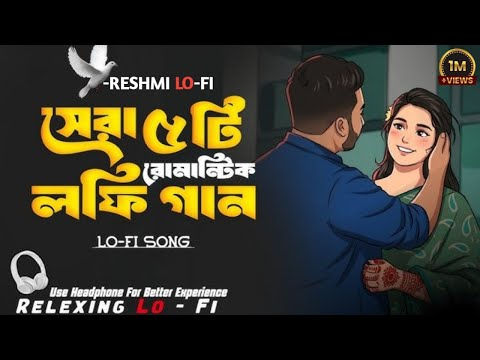
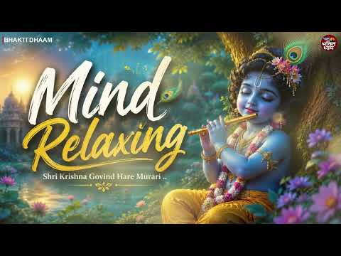
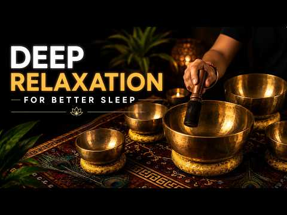
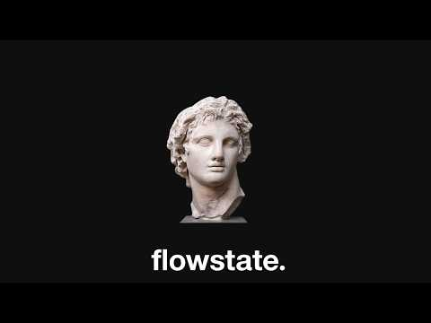
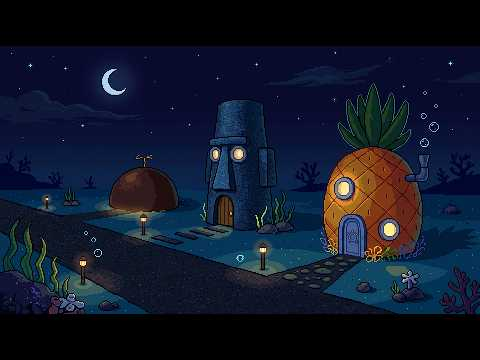

# 음악 — 성공 사례 분석: 사례별 자세히 #361–#400

`analysis.md` 의 9번 (같은 # 번호). 자동 생성 — `tools/success_analysis.py` v1.5.1 (2026-10-24 07:42 UTC). ※ 연구·교육용 — 투자 권유가 아님.

### 361. মন ছুঁয়ে যাওয়া বাংলা Lo-Fi Romantic Songs ∣ Relaxing Bangla Chill Mix ∣ Heart Touching Ju…

- https://www.youtube.com/watch?v=rwiGXAhqrfU · RESHMI LO-FI WB · 구독자 24,000 · 조회수 3,389,111 (×141.2, 하루 19,688.9) · 좋아요 27,902 (0.8%) · 22.5분 · 2026-05-05 · 주제 묶음 8. 로파이·시티팝·칠 · 형식 음악 (그 밖 모양 — 한 편짜리 BGM 등) · 폴더 `W_rwiGXAhqrfU` (웹 승인)
- 썸네일: 
- 설명 앞부분: মন ছুঁয়ে যাওয়া বাংলা Lo-Fi Sad Songs 2026 💔 ∣ Relaxing Bangla Chill Mix ∣ Heart Touching Bengali Jukebox .. Relaxing and heart touching Bangla Lo-Fi sad songs collection for peaceful nights and emotional moments. এই Jukebox-এ রয়েছে মন ছুঁয়ে যাওয়া বাংলা LoFi গান, soft chill vibes এবং soothing beats …
- 같은 채널 평소 대비 ×756.7 (채널 최근 롱폼 중앙값 4,479회) · 평소 영상: Patar Bashori - পাতার বাঁশরী ∣ Ishaan & Sunidhi ∣… (5,011회) / বুকের পাঁজড় ভাঙ্গে বিধি ∣ Buker Pajor Bhange Bid… (3,947회)
- 대본 없음 (설명) — 음성인식이 끝나면 도입부·흐름이 들어감
- 댓글 989/990: 좋은 점 — 영상 0 · 감사·응원 0 · 더 알고 싶은 것 0 · 아쉬운 점 — 영상 0 · 반박·불만 — 의견 다름 0 · 정치·사회 0 · 경험 공유 0 · 구독·다음 기대 0

### 362. Le Café de Minuit 🇫🇷 Une Chanson Romantique Inspirée par les Nuits de Paris

- https://www.youtube.com/watch?v=D4-ltf3Tdh8 · Bistrot de Minuit | Claire Delacroix · 구독자 3,490 · 조회수 491,342 (×140.8, 하루 3,612.0) · 좋아요 2,854 (0.6%) · 5.9분 · 2026-06-10 · 주제 묶음 4. 카페·매장·라운지 · 형식 음악 (그 밖 모양 — 한 편짜리 BGM 등) · 폴더 `W_D4-ltf3Tdh8` (웹 승인)
- 썸네일: 
- 설명 앞부분: Step into the enchanting atmosphere of Paris after midnight with **Le Café de Minuit** 🇫🇷 A romantic French chanson inspired by the quiet beauty of Parisian nights, where dim café lights, cobblestone streets, and lingering memories create the perfect setting for love and nostalgia. With its gentle …
- 같은 채널 평소 대비 ×1,142.7 (채널 최근 롱폼 중앙값 430회) · 평소 영상: Quand La Nuit Nous Garde ∣ French Chanson & Frenc… (430회) / Un Dernier Été ∣ Romantic French Chanson ∣ Vintag… (429회)
- 대본 없음 (설명) — 음성인식이 끝나면 도입부·흐름이 들어감
- 댓글 101/102: 좋은 점 — 영상 0 · 감사·응원 0 · 더 알고 싶은 것 0 · 아쉬운 점 — 영상 0 · 반박·불만 — 의견 다름 0 · 정치·사회 0 · 경험 공유 0 · 구독·다음 기대 0

### 363. Relaxing Jazz Saxophone instrument Relax & Slow Down 🌿 Soft Saxophone Jazz for Peaceful M…

- https://www.youtube.com/watch?v=AaXKINtzSGI · Peaceful Sax Jazz · 구독자 13,900 · 조회수 1,955,651 (×140.7, 하루 13,327.5) · 좋아요 16,366 (0.8%) · 69.9분 · 2026-05-30 · 주제 묶음 7. 재즈·보사노바 · 형식 음악 (그 밖 모양 — 한 편짜리 BGM 등) · 폴더 `W_AaXKINtzSGI` (웹 승인)
- 썸네일: 
- 설명 앞부분: Welcome to Peaceful Sax Jazz 🎷🌿 Relax your mind and unwind with soft saxophone melodies and peaceful jazz vibes. This calming instrumental music is perfect for slowing down, finding balance, and enjoying quiet, relaxing moments. Let the gentle flow of smooth jazz and the warm sound of the saxophone…
- 같은 채널 평소 대비 ×638.5 (채널 최근 롱폼 중앙값 3,063회) · 평소 영상: Sunny Spring Afternoon 🧺 Smooth Tenor Saxophone f… (3,063회) / Smooth Jazz Lounge 🥃 Relaxing Saxophone for Calm … (3,066회)
- 대본 없음 (설명) — 음성인식이 끝나면 도입부·흐름이 들어감
- 댓글 394/395: 좋은 점 — 영상 0 · 감사·응원 0 · 더 알고 싶은 것 0 · 아쉬운 점 — 영상 0 · 반박·불만 — 의견 다름 0 · 정치·사회 0 · 경험 공유 0 · 구독·다음 기대 0

### 364. Deep Sleep & Chill Lofi : Bhojpuri Slowed & Reverb Songs 🎧✨ #music #musicsong #viral #for…

- https://www.youtube.com/watch?v=zW8T1B9Fzd0 · VLOGDIPESH  · 구독자 5,220 · 조회수 732,679 (×140.4, 하루 45,356.6) · 좋아요 2,666 (0.4%) · 17.1분 · 2026-10-08 · 주제 묶음 1. 수면·명상·힐링 · 형식 음악 (그 밖 모양 — 한 편짜리 BGM 등) · 폴더 `W_zW8T1B9Fzd0` (웹 승인)
- 썸네일: 
- 설명 앞부분: Bhojpuri Slowed And Reverb Songs ∣ Non Stop Bhojpuri Song ∣ Top 10 Bhojpuri Slowed And Reverb Song 1. "Dil ko chhu jane wala Bhojpuri lofi song suno aur apne doston ke saath share karo! ❤️🎧" 2. "Bhojpuri ka naya lofi anthem suno aur isse apne dil ko sukoon aur aapke friends ko bhi! 😍🎵" 3. "Bhojpuri…
- 같은 채널 평소 대비 ×4,950.5 (채널 최근 롱폼 중앙값 148회) · 평소 영상: Reverbed] ∣ Arijit Singh ∣ Midnight Lofi Vibes 🎧 (148회) / Deep Sleep & Chill Lofi : Bhojpuri Slowed & Rever… (139회)
- 대본 없음 (설명) — 음성인식이 끝나면 도입부·흐름이 들어감
- 댓글 33/33: 좋은 점 — 영상 0 · 감사·응원 0 · 더 알고 싶은 것 0 · 아쉬운 점 — 영상 0 · 반박·불만 — 의견 다름 0 · 정치·사회 0 · 경험 공유 0 · 구독·다음 기대 0

### 365. Shri Krishna Govind Hare Murari - Non Stop Krishna Bhajans Lofi ∣ Bhakti Song ∣ Krishna B…

- https://www.youtube.com/watch?v=yl8by0hGZKE · Hare Murare Mantra · 구독자 22,600 · 조회수 3,140,089 (×138.9, 하루 21,304.1) · 좋아요 14,540 (0.5%) · 59.2분 · 2026-05-29 · 주제 묶음 8. 로파이·시티팝·칠 · 형식 음악 (그 밖 모양 — 한 편짜리 BGM 등) · 폴더 `W_yl8by0hGZKE` (웹 승인)
- 썸네일: 
- 설명 앞부분: Shri Krishna Govind Hare Murari - Non Stop Krishna Bhajans Lofi ∣ Bhakti Song ∣ Krishna Bhajan Shri Krishna Govind Hare Murari, Non Stop Krishna Bhajans Lofi, Krishna Bhajan, Bhakti Song, lofi krishna bhajan, hare murari bhajan, nonstop krishna bhajan, radha krishna song, devotional songs, krishna …
- 같은 채널 평소 대비 ×1,102.0 (채널 최근 롱폼 중앙값 2,850회) · 평소 영상: Shri Krishna Govind Hare Murari - Popular Krishan… (3,003회) / Shri Krishna Govind Hare Murari - Popular Krishan… (2,696회)
- 대본 없음 (설명) — 음성인식이 끝나면 도입부·흐름이 들어감
- 댓글 419/426: 좋은 점 — 영상 0 · 감사·응원 0 · 더 알고 싶은 것 0 · 아쉬운 점 — 영상 0 · 반박·불만 — 의견 다름 0 · 정치·사회 0 · 경험 공유 0 · 구독·다음 기대 0

### 366. Sleep & Reset Your Vagus Nerve ∣ Singing Bowl Sound Bath Meditation

- https://www.youtube.com/watch?v=l91ztcnXYPM · Echo Bowls · 구독자 543 · 조회수 75,141 (×138.4, 하루 685.8) · 좋아요 721 (1.0%) · 15.3분 · 2026-07-06 · 주제 묶음 1. 수면·명상·힐링 · 형식 음악 (그 밖 모양 — 한 편짜리 BGM 등) · 폴더 `W_l91ztcnXYPM` (웹 승인)
- 썸네일: 
- 설명 앞부분: Welcome to a peaceful space where you can slow down, breathe deeply, and prepare your body and mind for a restful night's sleep. This **Tibetan Singing Bowl Sound Bath** is designed to create a calming atmosphere for relaxation, mindfulness, and deep rest through the timeless resonance of handcraft…
- 같은 채널 평소 대비 ×995.2 (채널 최근 롱폼 중앙값 76회) · 평소 영상: Fall Asleep FAST: 30 Minute Music for Deep Sleep … (76회) / 20 Minute Yoga Nidra ∣ Reset Your Nervous System (75회)
- 대본 없음 (설명) — 음성인식이 끝나면 도입부·흐름이 들어감
- 댓글 13/17: 좋은 점 — 영상 0 · 감사·응원 0 · 더 알고 싶은 것 0 · 아쉬운 점 — 영상 0 · 반박·불만 — 의견 다름 0 · 정치·사회 0 · 경험 공유 0 · 구독·다음 기대 0

### 367. Jo Tere Sang KaTi RaTe 💔 Lofi Remix ∣ Emotional Slowed + Reverb ∣ Abidpro Mix

- https://www.youtube.com/watch?v=XKcT9t0tgbY · Abidpro · 구독자 46,100 · 조회수 6,368,010 (×138.1, 하루 40,349.7) · 좋아요 45,845 (0.7%) · 6.3분 · 2026-05-19 · 주제 묶음 8. 로파이·시티팝·칠 · 형식 음악 (그 밖 모양 — 한 편짜리 BGM 등) · 폴더 `W_XKcT9t0tgbY` (웹 승인)
- 썸네일: 
- 설명 앞부분: 🎧 Jo Tere Sang KaTi RaTe 💔 (Slowed + Reverb) ∣ This emotional rap beat is perfect for a lofi mix. Let this sad lofi music be your companion. Enjoy the chill music and relaxing music vibes. ✨ 🎧 Jo Tere Sang KaTi RaTe 💔 (Slowed + Reverb) ∣ Emotional LoFi Remix ∣ Abidpro Mix ✨ Experience the deep feel…
- 같은 채널 평소 대비 ×1,134.4 (채널 최근 롱폼 중앙값 5,614회) · 평소 영상: Hasi Ban Gaye 💔 Slowed Reverb Lofi Mashup ∣ Heart… (6,209회) / Dil Ke Armaan Slowed + Reverb 💔 Lofi Sad Song Abi… (5,018회)
- 대본 없음 (설명) — 음성인식이 끝나면 도입부·흐름이 들어감
- 댓글 809/811: 좋은 점 — 영상 0 · 감사·응원 0 · 더 알고 싶은 것 0 · 아쉬운 점 — 영상 0 · 반박·불만 — 의견 다름 0 · 정치·사회 0 · 경험 공유 0 · 구독·다음 기대 0

### 368. Positive Jazz Music ☕ Bossa Nova instrumental for Stress Relief, Working & Holiday

- https://www.youtube.com/watch?v=T2HdICk7_6M · Golden Roast Jazz Club · 구독자 11,300 · 조회수 1,558,995 (×138.0, 하루 10,979.8) · 좋아요 7,998 (0.5%) · 71.2분 · 2026-06-04 · 주제 묶음 6. 피아노·클래식·연주곡 · 형식 음악 (그 밖 모양 — 한 편짜리 BGM 등) · 폴더 `W_T2HdICk7_6M` (웹 승인)
- 썸네일: 
- 설명 앞부분: Welcome to Golden Roast Jazz Club — your cozy escape into the world of smooth jazz, warm coffee vibes, and relaxing atmospheres. ☕🎷 This channel is dedicated to bringing you the perfect blend of soft jazz, lounge music, bossa nova, and chill instrumentals — ideal for studying, working, relaxing, or…
- 같은 채널 평소 대비 ×1,309.0 (채널 최근 롱폼 중앙값 1,191회) · 평소 영상: Fall Morning Jazz ☕ Bossa Nova background for Rel… (1,206회) / Good Mood Jazz ☕ Bossa Nova instrumental for Stud… (1,176회)
- 대본 없음 (설명) — 음성인식이 끝나면 도입부·흐름이 들어감
- 댓글 235/245: 좋은 점 — 영상 0 · 감사·응원 0 · 더 알고 싶은 것 0 · 아쉬운 점 — 영상 0 · 반박·불만 — 의견 다름 0 · 정치·사회 0 · 경험 공유 0 · 구독·다음 기대 0

### 369. [playlist] skrrrr….

- https://www.youtube.com/watch?v=20mvF_OP0FY · le · 구독자 12,600 · 조회수 1,736,236 (×137.8, 하루 9,862.3) · 좋아요 50,444 (2.9%) · 26.1분 · 2026-05-01 · 주제 묶음 기타 · 형식 플레이리스트·모음 (여러 곡) · 폴더 `W_20mvF_OP0FY` (웹 승인)
- 썸네일: 
- 챕터: 0:00 Lil Uzi Vert - 20 Min · 3:41 24kGoldn - Mood (feat. iann d… · 6:00 BlackMayo - Jus’ know · 8:00 Jeremih - Oui · 11:57 kent Jones - Don’t Mind · 15:14 Pop Smoke - What You Know Bou… · 17:54 blxst & tyga - chosen (feat. … · 20:37 Don Toliver - No Idea · 23:21 Russ - What They Want
- 같은 채널 평소 대비 ×40.5 (채널 최근 롱폼 중앙값 42,853회) · 평소 영상: [playlist] 예쁜 꽃송이 창밖에 내려와 ✿ₒ˚ ͙ .* ૢ°₊·*:❀ (42,853회) / [playlist] 여름 ♡₊˚ ☘️・₊✧ (44,292회)
- 대본 없음 (없음) — 음성인식이 끝나면 도입부·흐름이 들어감
- 댓글 276/285: 좋은 점 — 영상 0 · 감사·응원 3 · 더 알고 싶은 것 1 · 아쉬운 점 — 영상 0 · 반박·불만 — 의견 다름 0 · 정치·사회 1 · 경험 공유 0 · 구독·다음 기대 0
  - 감사·응원 👍3 “만들어주셔서 감사합니다ㅠㅜㅡ”
  - 감사·응원 👍2 “와 진짜 제 취향 노래 찾기 어려웠는데 진짜 감사합니다 ㅜㅠㅠㅠ ㅠ”
  - 더 알고 싶은 것 👍0 “사진에 나오는 남자분 이름이 어떻게 될까요 ??”
  - 정치·사회 👍0 “외국인 왤케 많아”

### 370. music that will get you to flowstate.

- https://www.youtube.com/watch?v=72YoraTjNI0 · Pure Grit Studio · 구독자 20,700 · 조회수 2,850,510 (×137.7, 하루 27,544.6) · 좋아요 36,018 (1.3%) · 145.4분 · 2026-07-12 · 주제 묶음 기타 · 형식 음악 (그 밖 모양 — 한 편짜리 BGM 등) · 폴더 `W_72YoraTjNI0` (웹 승인)
- 썸네일: 
- 설명 앞부분: Welcome to Pure Grit Studio - this channel is for people who are actually locked in. Whether you're studying, grinding on your business, or working on your startup, our mind-calming music will help you reach flow state and get things done. Also, please support the channel by hitting subscribe - it'…
- 같은 채널 평소 대비 ×137.1 (채널 최근 롱폼 중앙값 20,794회) · 평소 영상: music to unlock hyper focus. (22,752회) / music to achieve greatness. (18,835회)
- 대본 없음 (설명) — 음성인식이 끝나면 도입부·흐름이 들어감
- 댓글 1,503/1,520: 좋은 점 — 영상 0 · 감사·응원 1 · 더 알고 싶은 것 0 · 아쉬운 점 — 영상 0 · 반박·불만 — 의견 다름 0 · 정치·사회 0 · 경험 공유 0 · 구독·다음 기대 0
  - 감사·응원 👍3 “너무 좋네요 감사합니다”

### 371. Calm Work Music ∣ Ambient Deep Work for Focus, Productivity & Flow State

- https://www.youtube.com/watch?v=PBwiQgdwJdc · Calm Work Studio · 구독자 6,110 · 조회수 839,191 (×137.3, 하루 7,641.5) · 좋아요 2,872 (0.3%) · 130.2분 · 2026-07-06 · 주제 묶음 3. 공부·집중·작업 · 형식 음악 (그 밖 모양 — 한 편짜리 BGM 등) · 폴더 `W_PBwiQgdwJdc` (웹 승인)
- 썸네일: 
- 설명 앞부분: Calm Work Music ∣ Ambient Deep Work for Focus, Productivity & Flow State Experience the perfect balance of Calm Work Music and Ambient Deep Work designed to help you stay focused, productive, and mentally clear. This peaceful ambient soundscape creates a relaxing atmosphere for deep concentration, …
- 같은 채널 평소 대비 ×256.4 (채널 최근 롱폼 중앙값 3,273회) · 평소 영상: Deep Work Music for Focus & Flow State ∣ Deep Con… (3,342회) / Deep Work Music 🧠 Ambient Music for Brain Power ∣… (3,204회)
- 대본 없음 (설명) — 음성인식이 끝나면 도입부·흐름이 들어감
- 댓글 202/204: 좋은 점 — 영상 0 · 감사·응원 0 · 더 알고 싶은 것 0 · 아쉬운 점 — 영상 0 · 반박·불만 — 의견 다름 0 · 정치·사회 0 · 경험 공유 0 · 구독·다음 기대 0

### 372. 𝐩𝐥𝐚𝐲𝐥𝐢𝐬𝐭 요즘 인스타 부계 감성

- https://www.youtube.com/watch?v=WBabiGZluh8 · 알수없는 사용자 · 구독자 1,810 · 조회수 247,092 (×136.5, 하루 3,138.6) · 좋아요 6,488 (2.6%) · 17.5분 · 2026-08-06 · 주제 묶음 기타 · 형식 플레이리스트·모음 (여러 곡) · 폴더 `W_WBabiGZluh8` (웹 승인)
- 썸네일: 
- 챕터: 0:00 상상더하기 - 라붐 · 4:08 낙낙 - 트와이스 · 7:19 take it slow - 레드벨벳 · 10:51 about love - 레드벨벳 · 14:16 빨간맛 - 레드벨벳
- 설명 앞부분: 2016~7년도 3세대여돌 노래를 오랜만에 들으니 감회가 새롭네요,,,🏩 문제될시에 삭제합니다(๑･̑◡･̑๑)
- 같은 채널 평소 대비 ×6.8 (채널 최근 롱폼 중앙값 36,180회) · 평소 영상: 𝐩𝐥𝐚𝐲𝐥𝐢𝐬𝐭 오늘 고백하는 그 남자를 보고 (48,408회) / 𝐩𝐥𝐚𝐲𝐥𝐢𝐬𝐭 너의 그 사랑의 안전지대가 어딨어? (23,951회)
- 대본 없음 (설명) — 음성인식이 끝나면 도입부·흐름이 들어감
- 댓글 52/53: 좋은 점 — 영상 0 · 감사·응원 0 · 더 알고 싶은 것 2 · 아쉬운 점 — 영상 0 · 반박·불만 — 의견 다름 0 · 정치·사회 0 · 경험 공유 5 · 구독·다음 기대 1
  - 더 알고 싶은 것 👍4 “진짜 제가 찾고 찾던 플리.. 맨날와요 사랑함다 에겐플리 많이 부탁드려요”
  - 더 알고 싶은 것 👍2 “혹시 사진 출처 알 수 있을까요? 포근하고 느낌이 좋네용”
  - 경험 공유 👍36 “미친!! 내가 어떻게 장키를 잊고 지냈는데ㅠㅠㅠ 주인장님 너무 좋아여💗💗”
  - 경험 공유 👍4 “진짜 제가 찾고 찾던 플리.. 맨날와요 사랑함다 에겐플리 많이 부탁드려요”
  - 구독·다음 기대 👍7 “한창 장키 정주행중이었는데 너므행보카다”

### 373. Midnight in Beirut 🌙 ∣ Lebanese Jazz & Oud Melodies for Relaxation & Deep Focus

- https://www.youtube.com/watch?v=pdSDzQVDYXk · Arabic Jazz Lounge · 구독자 17,900 · 조회수 2,435,920 (×136.1, 하루 14,000.6) · 좋아요 34,565 (1.4%) · 25.3분 · 2026-05-03 · 주제 묶음 3. 공부·집중·작업 · 형식 음악 (그 밖 모양 — 한 편짜리 BGM 등) · 폴더 `W_pdSDzQVDYXk` (웹 승인)
- 썸네일: 
- 챕터: 0:00 Lost In Cairo · 2:23 Midnight Oud Sessions · 4:43 Cairo Dreams · 6:51 Cairo After Dark · 9:14 Quiet Nights in Cairo · 11:42 Nile Nights · 14:25 Under Cairo Lights · 16:43 Arabian Night Jazz · 19:32 Cairo After Dark · 22:04 Desert Moon Jazz
- 설명 앞부분: Midnight in Beirut 🌙 ∣ Lebanese Jazz & Oud Melodies for Relaxation & Deep Focus 🎧 Arabic Jazz Lounge Blending Middle Eastern textures with modern jazz, downtempo, and chill house, Arabic Jazz Lounge creates immersive soundscapes that help you enter a deep flow state, relax, and disconnect from the …
- 같은 채널 평소 대비 ×1,139.9 (채널 최근 롱폼 중앙값 2,137회) · 평소 영상: Mystical Cairo Nights ✨ ∣ Arabic Jazz & Oriental … (2,137회) / Midnight in Old Cairo 🌙 ∣ Egyptian Jazz & Arabic … (2,086회)
- 대본 없음 (설명) — 음성인식이 끝나면 도입부·흐름이 들어감
- 댓글 767/771: 좋은 점 — 영상 0 · 감사·응원 0 · 더 알고 싶은 것 0 · 아쉬운 점 — 영상 0 · 반박·불만 — 의견 다름 0 · 정치·사회 0 · 경험 공유 0 · 구독·다음 기대 0

### 374. Fall Into Sleep Instantly • Healing Stress, Anxiety, and Depression • Stop Overthinking

- https://www.youtube.com/watch?v=ZIGKQlrOEV0 · Brainwave Resonance · 구독자 14,200 · 조회수 1,931,860 (×136.1, 하루 13,091.1) · 좋아요 20,512 (1.1%) · 480분 · 2026-05-29 · 주제 묶음 1. 수면·명상·힐링 · 형식 음악 (그 밖 모양 — 한 편짜리 BGM 등) · 폴더 `W_ZIGKQlrOEV0` (웹 승인)
- 썸네일: 
- 설명 앞부분: (No Ads) Fall Into Sleep Instantly • Healing Stress, Anxiety, and Depression • Stop Overthinking 🌙 Welcome to Brainwave Resonance 🌙 Welcome to a sacred sanctuary where tranquility, restorative sleep music, and soothing meditative frequencies converge to nurture your rest and inner balance. ✨ This c…
- 같은 채널 평소 대비 ×3,002.1 (채널 최근 롱폼 중앙값 644회) · 평소 영상: 528Hz + 432Hz + 741Hz ∣ Fall Into Deep Healing Sl… (811회) / Alpha Waves • 963Hz • Deep Sleep in 3 Minutes • W… (476회)
- 대본 없음 (설명) — 음성인식이 끝나면 도입부·흐름이 들어감
- 댓글 1,028/1,035: 좋은 점 — 영상 0 · 감사·응원 0 · 더 알고 싶은 것 1 · 아쉬운 점 — 영상 0 · 반박·불만 — 의견 다름 1 · 정치·사회 0 · 경험 공유 2 · 구독·다음 기대 0
  - 더 알고 싶은 것 👍0 “나이 드니 초저녁에 졸리고 새벽엔 일찍 깨버려서 잠 관련해서 알아보다 왔어요. 새벽 네 시면 어김없이 눈이 떠지고 다시 잠들지를 못해요. 흡수 잘 된다는 리포좀멜라토닌에 트립토판·가바·감태 같이 들어간 각성완화제 먹고 있는데 엄청 센 건 아닌데 누우면 좀 차분해지긴 …”
  - 반박·불만 — 의견 다름 👍0 “나이 드니 초저녁에 졸리고 새벽엔 일찍 깨버려서 잠 관련해서 알아보다 왔어요. 새벽 네 시면 어김없이 눈이 떠지고 다시 잠들지를 못해요. 흡수 잘 된다는 리포좀멜라토닌에 트립토판·가바·감태 같이 들어간 각성완화제 먹고 있는데 엄청 센 건 아닌데 누우면 좀 차분해지긴 …”

### 375. Relax in Bikini Bottom 🛟 Calming Tropical Music 🌊 ∣ SpongeBob

- https://www.youtube.com/watch?v=US8lFJPAWR0 · Vynture · 구독자 4,260 · 조회수 579,393 (×136.0, 하루 6,256.8) · 좋아요 16,433 (2.8%) · 249.3분 · 2026-07-23 · 주제 묶음 1. 수면·명상·힐링 · 형식 음악 (그 밖 모양 — 한 편짜리 BGM 등) · 폴더 `W_US8lFJPAWR0` (웹 승인)
- 썸네일: 
- 설명 앞부분: 🪄 Welcome, Adventurer… You’ve discovered one of many peaceful corners within the world of Vynture — a realm of pixel dreams ✨ 🌌 Take a breath. Rest your mind. Stay as long as you need. Each place in Vynture is crafted to bring you calm. Through soft ambient soundscapes 🎧, gentle lofi music 🎵, and n…
- 같은 채널 평소 대비 ×458.0 (채널 최근 롱폼 중앙값 1,265회) · 평소 영상: Shadow Watching the Stars 🌌🎹 (Sonic the Hedgehog) (1,265회) / Tropical Lofi & Ocean Waves 🏝️ Relax With Peely 🍌… (1,412회)
- 대본 없음 (설명) — 음성인식이 끝나면 도입부·흐름이 들어감
- 댓글 160/165: 좋은 점 — 영상 0 · 감사·응원 0 · 더 알고 싶은 것 0 · 아쉬운 점 — 영상 0 · 반박·불만 — 의견 다름 0 · 정치·사회 0 · 경험 공유 0 · 구독·다음 기대 0

### 376. 재생하자마자 텐션 터지는 2026 남녀돌 믹스업 (과제, 청소, 운동할 때 듣는 플리)

- https://www.youtube.com/watch?v=x09m3Lgzc-A · MxJin06 · 구독자 5,060 · 조회수 685,395 (×135.4, 하루 8,065.7) · 좋아요 2,539 (0.4%) · 99.2분 · 2026-07-31 · 주제 묶음 5. 운동·드라이브·신나는 · 형식 플레이리스트·모음 (여러 곡) · 폴더 `W_x09m3Lgzc-A` (웹 승인)
- 썸네일: 
- 챕터: 0:00 ILLIT (아일릿) ‘It’s Me’ Officia… · 2:14 aespa 에스파 'Supernova' MV · 5:10 CORTIS (코르티스) 'REDRED' Offici… · 7:50 LE SSERAFIM (르세라핌) 'BOOMPALA'… · 10:42 BABYMONSTER - 'I LIKE IT' M-V · 14:05 aespa 에스파 'LEMONADE' MV · 17:10 TWS (투어스) '널 따라가 (You, You)' … · 19:53 NMIXX(엔믹스) “Crescendo” M-V · 22:26 aespa 에스파 'Live My Life' MV · 25:01 QWER 'BAD HABIT' (80's Video … · 27:51 STAYC 스테이씨 '2 L0VE' MV · 30:49 i-dle (아이들) 'Gimme Dat Love' … · 33:08 aespa 에스파 'Whiplash' MV · 36:09 RIIZE 라이즈 'Do your dance' MV · 39:02 tripleS(트리플에스) 'Baby Flower' … · 42:05 NMIXX(엔믹스) “Heavy Serenade” M… · 45:03 fromis_9 (프로미스나인) 'Vitamin ME… · 48:12 ILLIT (아일릿) 'Lucky Girl Syndr… · 50:28 BOYNEXTDOOR (보이넥스트도어) 'VIRAL'… · 53:43 izna 'METRONOME' MV
- 같은 채널 평소 대비 ×10.4 (채널 최근 롱폼 중앙값 65,696회) · 평소 영상: 틀자마자 휴가 시작 🍹 2026 틱톡 바이럴 청량 여름 플리 (69,633회) / 도파민 충전 완료 ⚡ 지루한 평일 텐션 끌어올리는 K POP 여돌 MV 모음 (56,437회)
- 대본 없음 (없음) — 음성인식이 끝나면 도입부·흐름이 들어감
- 댓글 30/30: 좋은 점 — 영상 0 · 감사·응원 1 · 더 알고 싶은 것 0 · 아쉬운 점 — 영상 0 · 반박·불만 — 의견 다름 0 · 정치·사회 0 · 경험 공유 0 · 구독·다음 기대 1
  - 감사·응원 👍3 “와 진짜 다 좋다❤❤ 제작자님 감사합니다 진짜 골고루 넣어놓으셨네욘❤❤”
  - 구독·다음 기대 👍4 “중간중간에 틈 없이 바로바로 나오는게 너무 좋아요! 구독합니다!”

### 377. 🎶Mind and body healing Music ∣ Bansuri flute + Esraj ∣ 1 hour Indian Instrumental

- https://www.youtube.com/watch?v=l1DL2JWYcyA · Indian-Soulscape · 구독자 279 · 조회수 37,658 (×135.0, 하루 304.7) · 좋아요 399 (1.1%) · 61.4분 · 2026-06-22 · 주제 묶음 6. 피아노·클래식·연주곡 · 형식 긴 한 곡·반복 (N시간) · 폴더 `W_l1DL2JWYcyA` (웹 승인)
- 썸네일: 
- 설명 앞부분: 🎵 Mind and body healing Music ∣ Bansuri flute + Esraj ∣ 1 hour Indian Instrumental Immerse yourself in 1 hour of pure healing through the timeless sounds of ancient India. 🎶 Instruments: Bansuri flute • Esraj • Swarmandal (harp-like zither) 🌿 Background: forest birds ambience 🧘 Perfect for: mind an…
- 같은 채널 평소 대비 ×214.0 (채널 최근 롱폼 중앙값 176회) · 평소 영상: Rudra Veena Meditation Music ∣ Ancient Indian Ins… (176회) / 🎶Just Breathe ∣ Healing Instrumental Music for St… (165회)
- 대본 없음 (설명) — 음성인식이 끝나면 도입부·흐름이 들어감
- 댓글 10/10: 좋은 점 — 영상 0 · 감사·응원 0 · 더 알고 싶은 것 0 · 아쉬운 점 — 영상 0 · 반박·불만 — 의견 다름 0 · 정치·사회 0 · 경험 공유 0 · 구독·다음 기대 0

### 378. 💖💖💖The Café by the Sea©

- https://www.youtube.com/watch?v=7jPXHB9Ohus · M's Music Lounge · 구독자 2,070 · 조회수 278,621 (×134.6, 하루 2,197.1) · 좋아요 3,745 (1.3%) · 4.2분 · 2026-06-19 · 주제 묶음 4. 카페·매장·라운지 · 형식 음악 (그 밖 모양 — 한 편짜리 BGM 등) · 폴더 `W_7jPXHB9Ohus` (웹 승인)
- 썸네일: 
- 설명 앞부분: 🎧🔊 🎬Music and Video produced by M's Music Lounge 🕺 Enjoyed the mix? If you love this mix and sound, show some love with a Like and Subscribe! 📜 This track was produced using artificial intelligence (AI), and finalized by M's Music Lounge. Sound and or visuals were significantly edited or digitally …
- 같은 채널 평소 대비 ×1,243.8 (채널 최근 롱폼 중앙값 224회) · 평소 영상: Before The Morning Comes (224회) / Only You Know My Heart (233회)
- 대본 없음 (설명) — 음성인식이 끝나면 도입부·흐름이 들어감
- 댓글 195/198: 좋은 점 — 영상 0 · 감사·응원 0 · 더 알고 싶은 것 0 · 아쉬운 점 — 영상 0 · 반박·불만 — 의견 다름 0 · 정치·사회 0 · 경험 공유 0 · 구독·다음 기대 0

### 379. বিধি এমন ভাগ্য কেন দিলা ∣ Bidhi Amon Vaggo Keno Dila ∣ Bangla Folk Song 2026 ∣ Sad Folk S…

- https://www.youtube.com/watch?v=PGkwfiSxmJU · আঁখি Lo-Fi · 구독자 11,900 · 조회수 1,593,972 (×133.9, 하루 15,522.7) · 좋아요 4,933 (0.3%) · 13.8분 · 2026-07-13 · 주제 묶음 기타 · 형식 음악 (그 밖 모양 — 한 편짜리 BGM 등) · 폴더 `W_PGkwfiSxmJU` (웹 승인)
- 썸네일: 
- 설명 앞부분: 🎵 আঁখি Lo-Fi ∣ Official Channel 🎵 বিধি এমন ভাগ্য কেন দিলা ∣ Bidhi Amon Vaggo Keno Dila ∣ Bangla Folk Song 2026 ∣ Sad Folk Song স্বাগতম আঁখি Lo-Fi চ্যানেলে! 🌿✨ বাংলা লোকগান, প্রেমের গান, বিরহের গান এবং হৃদয়ছোঁয়া সুরের এক অনন্য Lo-Fi জগতে আপনাকে স্বাগতম। এখানে আপনি পাবেন শান্ত, আবেগময় এবং মন ছুঁয়…
- 같은 채널 평소 대비 ×256.7 (채널 최근 롱폼 중앙값 6,210회) · 평소 영상: জীবনের হিসাব মিলে নারে দয়াল ∣ Jiboner Hisab Mile … (6,570회) / কোনো একদিন আমায় তুমি খুঁজবে ∣ Kono Akdin Amay Tum… (5,851회)
- 대본 없음 (설명) — 음성인식이 끝나면 도입부·흐름이 들어감
- 댓글 194/195: 좋은 점 — 영상 0 · 감사·응원 0 · 더 알고 싶은 것 0 · 아쉬운 점 — 영상 0 · 반박·불만 — 의견 다름 0 · 정치·사회 0 · 경험 공유 0 · 구독·다음 기대 0

### 380. [playlist] 내 주위는 온통 lovely day

- https://www.youtube.com/watch?v=m-xuokRyfvQ · 지륭 · 구독자 1,220 · 조회수 163,269 (×133.8, 하루 971.4) · 좋아요 3,205 (2.0%) · 19.9분 · 2026-05-09 · 주제 묶음 기타 · 형식 플레이리스트·모음 (여러 곡) · 폴더 `W_m-xuokRyfvQ` (웹 승인)
- 썸네일: 
- 같은 채널 평소 대비 ×5.6 (채널 최근 롱폼 중앙값 29,008회) · 평소 영상: [playlist] 내 추억 속에 남아있어줘요 (42,916회) / [playlist] 내가 사는 이유 너니까 (15,099회)
- 대본 없음 (없음) — 음성인식이 끝나면 도입부·흐름이 들어감
- 댓글 20/20: 좋은 점 — 영상 0 · 감사·응원 2 · 더 알고 싶은 것 1 · 아쉬운 점 — 영상 0 · 반박·불만 — 의견 다름 0 · 정치·사회 0 · 경험 공유 1 · 구독·다음 기대 0
  - 감사·응원 👍3 “학원까지 버스타고 19분인데 이거 들으면 딱 내릴 때 끝나서 좋아요 감사합니다”
  - 더 알고 싶은 것 👍12 “이런 느낌으로 좀 더 만들어주세요ㅠㅠ 너무 제스탈 인생리스트!!”
  - 경험 공유 👍31 “저진짜 10번ㅇ,ㄴ 들었어요 계속 생각나구 노래 넘조쿠 덕분에 숙제할때 이거 아님 인대여 큐피드땜에 조아했는데 아니.... 뒤에도 다 제가워하는 느낌이ㅕㅅ숴요 사랑해여..”

### 381. Autumn Morning Jazz In A Cozy Garden Lounge ∣ Gentle Piano Music For Focus & Stress Relie…

- https://www.youtube.com/watch?v=tiqZDLIBbHg · Indoor Jazz Music · 구독자 5,400 · 조회수 722,651 (×133.8, 하루 10,340.9) · 좋아요 2,741 (0.4%) · 207.9분 · 2026-08-15 · 주제 묶음 4. 카페·매장·라운지 · 형식 플레이리스트·모음 (여러 곡) · 폴더 `W_tiqZDLIBbHg` (웹 승인)
- 썸네일: 
- 설명 앞부분: Autumn Morning Jazz In A Cozy Garden Lounge ∣ Gentle Piano Music For Focus & Stress Relief Today Welcome to Indoor Jazz Music, your peaceful space for relaxing jazz music, soft piano jazz, and cozy indoor ambience. Let these gentle jazz melodies create a calm atmosphere for working, studying, readi…
- 같은 채널 평소 대비 ×388.9 (채널 최근 롱폼 중앙값 1,858회) · 평소 영상: Soft October Garden Room Jazz ∣ Piano for Reading… (1,858회) / Gentle Morning Jazz In A Cozy Garden Bedroom ∣ So… (1,933회)
- 대본 없음 (설명) — 음성인식이 끝나면 도입부·흐름이 들어감
- 댓글 120/120: 좋은 점 — 영상 0 · 감사·응원 0 · 더 알고 싶은 것 0 · 아쉬운 점 — 영상 0 · 반박·불만 — 의견 다름 0 · 정치·사회 0 · 경험 공유 0 · 구독·다음 기대 0

### 382. Hanuman Chalisa for Deep Sleep ∣ Divine Protection for Peaceful Sleep ∣ No Mid Ads • Blac…

- https://www.youtube.com/watch?v=XKK7ewgprws · Inner Bhakti · 구독자 7,410 · 조회수 989,563 (×133.5, 하루 10,020.3) · 좋아요 5,942 (0.6%) · 114.8분 · 2026-07-17 · 주제 묶음 1. 수면·명상·힐링 · 형식 정보·해설 (그 밖) · 폴더 `W_XKK7ewgprws` (웹 승인)
- 썸네일: 
- 설명 앞부분: Deep Sleep Hanuman Chalisa – Rest Tonight Under the Divine Protection of Lord Hanuman Close your eyes. Surrender your worries to Lord Hanuman. May Bajrangbali protect you and your loved ones throughout the night. 🕉️ Dear Devotee, For your peaceful listening experience, this video contains no mid-ro…
- 대본 없음 (설명) — 음성인식이 끝나면 도입부·흐름이 들어감
- 댓글 156/165: 좋은 점 — 영상 0 · 감사·응원 0 · 더 알고 싶은 것 0 · 아쉬운 점 — 영상 0 · 반박·불만 — 의견 다름 0 · 정치·사회 0 · 경험 공유 0 · 구독·다음 기대 0

### 383. Deep Focus Music – Flow State for Study & Work

- https://www.youtube.com/watch?v=9xYZzgG2EuI · Deep365 · 구독자 4,180 · 조회수 557,546 (×133.4, 하루 5,127.5) · 좋아요 5,761 (1.0%) · 63.7분 · 2026-07-07 · 주제 묶음 3. 공부·집중·작업 · 형식 음악 (그 밖 모양 — 한 편짜리 BGM 등) · 폴더 `W_9xYZzgG2EuI` (웹 승인)
- 썸네일: 
- 설명 앞부분: Welcome to Deep365 Sometimes the deepest level of concentration comes from disconnecting from everything around you and entering your own mental space. This session is designed for that isolation mode a calm, controlled environment powered by ambient minimal techno rhythms and deep synthwave textur…
- 같은 채널 평소 대비 ×138.6 (채널 최근 롱폼 중앙값 4,024회) · 평소 영상: Deep Focus Music – LOCK IN ∣ Deep Work, Coding & … (4,024회) / Deep Focus Music – Night Drive Mix ∣ Serene Cave … (4,394회)
- 대본 없음 (설명) — 음성인식이 끝나면 도입부·흐름이 들어감
- 댓글 150/150: 좋은 점 — 영상 0 · 감사·응원 0 · 더 알고 싶은 것 0 · 아쉬운 점 — 영상 0 · 반박·불만 — 의견 다름 0 · 정치·사회 0 · 경험 공유 0 · 구독·다음 기대 0

### 384. Bangla Old Is Gold Romantic Song ∣ Bangla Lo-Fi ∣ 1970-1990 Evergreen Love Song ∣ Harano …

- https://www.youtube.com/watch?v=OP2DddRRTKI · Moner Tune · 구독자 24,300 · 조회수 3,239,860 (×133.3, 하루 22,540.1) · 좋아요 16,968 (0.5%) · 15.8분 · 2026-06-02 · 주제 묶음 8. 로파이·시티팝·칠 · 형식 음악 (그 밖 모양 — 한 편짜리 BGM 등) · 폴더 `W_OP2DddRRTKI` (웹 승인)
- 썸네일: 
- 설명 앞부분: 💖 Bengali Old Is Gold Romantic Songs Jukebox ∣ 1967-1990 Evergreen Love Songs Welcome to this special collection of timeless Bengali romantic songs from 1970 to 1990. Enjoy the golden era of Bangla music with heart-touching melodies, evergreen love songs, and nostalgic classics that continue to liv…
- 같은 채널 평소 대비 ×251.2 (채널 최근 롱폼 중앙값 12,896회) · 평소 영상: Bangla Old Romantic Songs ∣ 70s 80s 90s Bangla Hi… (14,429회) / কতদিন দেখিনি তোমায় ∣ Koto Din Dekhini Tomay ∣ Ban… (11,362회)
- 대본 없음 (설명) — 음성인식이 끝나면 도입부·흐름이 들어감
- 댓글 313/314: 좋은 점 — 영상 0 · 감사·응원 0 · 더 알고 싶은 것 0 · 아쉬운 점 — 영상 0 · 반박·불만 — 의견 다름 0 · 정치·사회 0 · 경험 공유 0 · 구독·다음 기대 0

### 385. Thankful Hearts ∣ Gratitude Sing Along Song with Lyrics 💗

- https://www.youtube.com/watch?v=K-c4pzbzBzE · Purely Positive Piano · 구독자 285 · 조회수 37,840 (×132.8, 하루 631.7) · 좋아요 0 (0.0%) · 4.5분 · 2026-08-25 · 주제 묶음 6. 피아노·클래식·연주곡 · 형식 한 곡 (뮤직비디오·음원·가사) · 폴더 `W_K-c4pzbzBzE` (웹 승인)
- 썸네일: 
- 설명 앞부분: Sing along to "Thankful Hearts", an uplifting song celebrating gratitude, positivity, and appreciation for life's simple blessings! 💗 This video features on-screen lyrics and custom so you can easily follow along and sing with the music. Perfect for morning inspiration, classroom sing-alongs, mindf…
- 같은 채널 평소 대비 ×234.3 (채널 최근 롱폼 중앙값 162회) · 평소 영상: Good Morning to You ☀️ ∣ Uplifting Music for a Ha… (162회) / Beyond the Horizon ∣ Inspirational Sing-Along Son… (161회)
- 대본 없음 (설명) — 음성인식이 끝나면 도입부·흐름이 들어감
- 댓글 21/26: 좋은 점 — 영상 0 · 감사·응원 0 · 더 알고 싶은 것 0 · 아쉬운 점 — 영상 0 · 반박·불만 — 의견 다름 0 · 정치·사회 0 · 경험 공유 0 · 구독·다음 기대 0

### 386. [空靈鼓療癒音樂🎶]｜放鬆、舒壓、冥想、安眠｜Steel Tongue Drum Healing Music｜SUNO pro

- https://www.youtube.com/watch?v=a_8Hi2u43Q4 · AIMF Music Factory  · 구독자 1,250 · 조회수 165,677 (×132.5, 하루 1,215.7) · 좋아요 1,537 (0.9%) · 93.1분 · 2026-06-10 · 주제 묶음 1. 수면·명상·힐링 · 형식 AI 음악 · 폴더 `W_a_8Hi2u43Q4` (웹 승인)
- 썸네일: 
- 설명 앞부분: 🎼Music by AIMF from SUNO pro ⭐️Video production APP:Capcut+快影 ⭐️Video creators:AIMF
- 같은 채널 평소 대비 ×980.3 (채널 최근 롱폼 중앙값 169회) · 평소 영상: [🌕月圓的時候，想起了家]｜中秋節・團圓・思念｜Mid-Autumn Festival｜AI創作歌曲 (169회) / [❤️往後餘生，剛好是你]｜AI創作歌曲｜謝謝你出現在我的生命裡｜溫柔系愛情歌曲・Wedding … (141회)
- 대본 없음 (설명) — 음성인식이 끝나면 도입부·흐름이 들어감
- 댓글 12/12: 좋은 점 — 영상 0 · 감사·응원 0 · 더 알고 싶은 것 0 · 아쉬운 점 — 영상 0 · 반박·불만 — 의견 다름 0 · 정치·사회 0 · 경험 공유 0 · 구독·다음 기대 0

### 387. Sholey Title Music ∣ Music Maker Abani ∣ Instrumental Cover

- https://www.youtube.com/watch?v=ajRxp64xcN8 · MUSIC MAKER ABANI · 구독자 5,850 · 조회수 775,285 (×132.5, 하루 6,478.7) · 좋아요 13,813 (1.8%) · 4.7분 · 2026-06-26 · 주제 묶음 6. 피아노·클래식·연주곡 · 형식 커버·직접 부른 노래 · 폴더 `W_ajRxp64xcN8` (웹 승인)
- 썸네일: 
- 설명 앞부분: MUSIC ARRANGEMENT : ABANI BISWAS KEY-BOARD PROGRAMMING : ABANI BISWAS PERFOM BY : STUDENTS OF ABANI BISWAS PIANO : AIDITI (DUSTU) TRUMPET : PRATYUSHA SAXOPHON : AIKANTIK, SAHIN, ARUPA, TRISHNA, ANKITA, MOURPIYA, SOUVIK, PRITHWIRAJ, AYUSH INDIAN RYTHM : SOMIT MUKHERJEE (RAMU DA) BACKING ACOUSTIC BRA…
- 대본 없음 (설명) — 음성인식이 끝나면 도입부·흐름이 들어감
- 댓글 1,423/1,433: 좋은 점 — 영상 0 · 감사·응원 0 · 더 알고 싶은 것 0 · 아쉬운 점 — 영상 0 · 반박·불만 — 의견 다름 0 · 정치·사회 0 · 경험 공유 0 · 구독·다음 기대 0

### 388. Playlist ∣ 틀어놓으면 그냥 계속 리듬 타게 되는 그루브 😎 집중 끊기지 않는 리듬 🎧 ∣ JAZZHOP · CHILLHOP ∣ 카페 · 작업 · BGM

- https://www.youtube.com/watch?v=wsB8ej3Jon4 · Hush Chords · 구독자 19,900 · 조회수 2,624,028 (×131.9, 하루 15,769.1) · 좋아요 24,421 (0.9%) · 318.1분 · 2026-05-10 · 주제 묶음 8. 로파이·시티팝·칠 · 형식 플레이리스트·모음 (여러 곡) · 폴더 `W_wsB8ej3Jon4` (웹 승인)
- 썸네일: 
- 챕터: 0:00 Stay In Flow · 2:22 Easy On The Move · 5:15 Catch The Step · 8:10 Right On Time · 11:05 Feels Right · 14:02 Soft Feel · 16:55 Back In Motion · 19:48 Stay In Line · 22:40 Keep It Going · 25:35 In Line · 28:30 Stay A Bit · 31:25 Let It Pass · 34:20 For Now
- 설명 앞부분: 오늘 작업은 이걸로 시작해보세요. 가볍게 틀어두기만 해도 흐름이 자연스럽게 이어지고, 과하게 힘주지 않아도 리듬이 계속 살아있는 재즈힙합 & 칠힙 그루브로 구성했습니다. 집중을 방해하지 않으면서도 고개가 자연스럽게 끄덕여지는 리듬, 작업할 때 가장 편하게 오래 들을 수 있는 균형 잡힌 플레이리스트입니다. 💻 지금 이 순간, 플레이하고 흐름에 그대로 올라타 보세요. 🎧 🎵 Time Track Music for your space. Groove for your flow. ⚠️ This playlist is built on smooth…
- 같은 채널 평소 대비 ×511.7 (채널 최근 롱폼 중앙값 5,128회) · 평소 영상: Playlist ∣ 듣는 순간, 가을 하늘처럼 맑아지는 기분 🍁 세련되고 분위기 좋은 그… (5,136회) / Playlist ∣ 일 시작하기 전, 커피 한 잔 ☕️ 하루가 기분 좋아지는 세련된 가을… (5,121회)
- 대본 없음 (설명) — 음성인식이 끝나면 도입부·흐름이 들어감
- 댓글 722/730: 좋은 점 — 영상 0 · 감사·응원 7 · 더 알고 싶은 것 0 · 아쉬운 점 — 영상 0 · 반박·불만 — 의견 다름 0 · 정치·사회 0 · 경험 공유 1 · 구독·다음 기대 1
  - 감사·응원 👍4 “이런 플리 찾고 있었는데 알고리즘 감사합니다 😭”
  - 감사·응원 👍3 “책 읽기 딱 좋네요. 응원합니다.”
  - 경험 공유 👍2 “좋네요^^ 오늘은 그냥 즐거웠네요 나도 구독 하고. 갑니다^^”
  - 구독·다음 기대 👍1 “좋아요.구독하고 갑니다”

### 389. 99% Fall Into Sleep Instantly (No Ads) • Eliminate Stress & Anxiety • Brain Massage While…

- https://www.youtube.com/watch?v=iVZPLhAlXUw · Bedtime Calm Sounds · 구독자 12,600 · 조회수 1,659,599 (×131.7, 하루 30,955.5) · 좋아요 5,432 (0.3%) · 237.9분 · 2026-08-31 · 주제 묶음 1. 수면·명상·힐링 · 형식 음악 (그 밖 모양 — 한 편짜리 BGM 등) · 폴더 `W_iVZPLhAlXUw` (웹 승인)
- 썸네일: 
- 설명 앞부분: 99% Fall Into Sleep Instantly (No Ads) • Eliminate Stress & Anxiety • Brain Massage While You Sleep Slow down. Breathe. Let the night carry you gently into rest. If your mind keeps racing or your body feels tense, this is your quiet space to release the day. This video is carefully crafted to creat…
- 같은 채널 평소 대비 ×256.3 (채널 최근 롱폼 중앙값 6,474회) · 평소 영상: (No Piano) Fall Into Sleep Instantly • Relaxing M… (6,474회) / DEEP SLEEP in 3 Minutes • Eliminate Stress & Anxi… (6,548회)
- 대본 없음 (설명) — 음성인식이 끝나면 도입부·흐름이 들어감
- 댓글 43/43: 좋은 점 — 영상 0 · 감사·응원 0 · 더 알고 싶은 것 0 · 아쉬운 점 — 영상 0 · 반박·불만 — 의견 다름 0 · 정치·사회 0 · 경험 공유 0 · 구독·다음 기대 0

### 390. 자비의 빛, 신묘장구대다라니

- https://www.youtube.com/watch?v=oZyrd47zI6o · 부다야나마하 · 구독자 3,160 · 조회수 415,249 (×131.4, 하루 5,278.2) · 좋아요 2,999 (0.7%) · 6.6분 · 2026-08-06 · 주제 묶음 1. 수면·명상·힐링 · 형식 음악 (그 밖 모양 — 한 편짜리 BGM 등) · 폴더 `W_oZyrd47zI6o` (웹 승인)
- 썸네일: 
- 설명 앞부분: 🙏 부다야나마하 — 부처님께 경배합니다 지친 하루의 끝, 잠 못 드는 밤, 마음이 무거운 순간에 함께하는 불교음악 채널입니다. 수천 년을 이어온 진언과 염불을 현대적인 감성으로 담아냅니다. 관세음보살의 자비, 아미타불의 광명, 천수경과 반야심경의 지혜가 오늘을 살아가는 당신의 마음에 닿기를 발원합니다. 📿 천수경 · 반야심경 · 광명진언 나무아미타불 · 관세음보살 · 신묘장구대다라니 소원성취, 업장소멸, 마음의 평온을 기원하며 매일 새로운 기도음악으로 찾아뵙겠습니다. 생년월일만 넣으시면 명식을 세우고 풀이까지 드립니다. 올해 일,…
- 같은 채널 평소 대비 ×276.6 (채널 최근 롱폼 중앙값 1,502회) · 평소 영상: 묘법연화경 여래수량품 자아게｜마음을 밝히는 가르침｜가야금과 북이 어우러진 불교음악 (1,519회) / 자성미타 아미타불｜마음을 밝히는 십념 염불｜나무아미타불 (1,484회)
- 대본 없음 (설명) — 음성인식이 끝나면 도입부·흐름이 들어감
- 댓글 228/238: 좋은 점 — 영상 3 · 감사·응원 46 · 더 알고 싶은 것 1 · 아쉬운 점 — 영상 4 · 반박·불만 — 의견 다름 1 · 정치·사회 0 · 경험 공유 4 · 구독·다음 기대 0
  - 좋은 점 — 영상 👍3 “불교에 "신묘장구 대다라니" 라는 경이 있습니다. 이것을 일부 해석하고 현대에 맞게 음률을 덪댓신것으로 보입니다. 물론 신자 혹은 스님께서 하신것 같구요... 모두가 불제자 이며 앞으로 부처가 되실 분들 이라 배웠습니다. 잘 들어 주셔서 감사하고 저 또한 너무 잘 들…”
  - 좋은 점 — 영상 👍1 “어제 처음듣고 마음에와닿는게크고 저는 아침일찍제일먼저사경을하고있습니다 감사드립니다 나무관세음보살 나무관세음보살 나무관세음보살”
  - 감사·응원 👍19 “거룩하신 부처님을 알게 해주셔서 감사합니다 이제라도 알게해주셔서 감사합니다 나무관세음보살 나무관세음보살 나무관세음보살”
  - 감사·응원 👍15 “감사 감사합니다 ~ 눈물나고 신비로운 목소리 입니다.건강. 평범한 일상 감사기도 드립니다.”
  - 더 알고 싶은 것 👍3 “이거 한시간듣기만들어주세요.😊”
  - 아쉬운 점 — 영상 👍2 “영상 감사합니다 근데 너무 짧아서 아쉽네요”
  - 아쉬운 점 — 영상 👍1 “동영상연속재생 해놓고 계속 반복해서 듣고 있습니다.”
  - 경험 공유 👍15 “어떤분 이실까요. 의심은 잘 안하는데 요즘 기계로 별걸 다 만들어내서 혹시 해봤습니다. 영상도 아름답고 음색도 황홀해서 별다른 소원이 생각나지 않네요. 가을이 오구있습니다.”
  - 경험 공유 👍6 “저희온가족 모두 무사하고 건강하고 평안하길 바라면서 제가하는일 잘되게 해주세요 나미아미타불 🙏🙏🙏”

### 391. choose peace

- https://www.youtube.com/watch?v=eIY-Pgg-b1E · sleepwalker · 구독자 14,600 · 조회수 1,914,197 (×131.1, 하루 11,015.2) · 좋아요 72,632 (3.8%) · 60분 · 2026-05-03 · 주제 묶음 기타 · 형식 긴 한 곡·반복 (N시간) · 폴더 `W_eIY-Pgg-b1E` (웹 승인)
- 썸네일: 
- 챕터: 0:00 Golden Hour · 8:46 Solitude · 19:30 Distant Memory · 27:01 Aether · 31:51 Lumen · 41:55 inner peace · 50:28 all is well
- 설명 앞부분: a 1 hour ambient mix Tracklist all music is original, no ai involved (i guess you have to clarify lol)
- 같은 채널 평소 대비 ×169.2 (채널 최근 롱폼 중앙값 11,310회) · 평소 영상: the limit does not exist (11,310회) / focus (11,042회)
- 대본 없음 (설명) — 음성인식이 끝나면 도입부·흐름이 들어감
- 댓글 1,135/1,154: 좋은 점 — 영상 0 · 감사·응원 0 · 더 알고 싶은 것 0 · 아쉬운 점 — 영상 0 · 반박·불만 — 의견 다름 0 · 정치·사회 0 · 경험 공유 1 · 구독·다음 기대 0

### 392. Cortisol Reset । 432Hz Krishna Bansuri Therapy for a Calm Mind & Stop Overthinking । Indi…

- https://www.youtube.com/watch?v=D5NHvEVAbWY · Healing Raga Studio · 구독자 24,500 · 조회수 3,206,842 (×130.9, 하루 33,110.8) · 좋아요 41,041 (1.3%) · 65.7분 · 2026-07-19 · 주제 묶음 1. 수면·명상·힐링 · 형식 음악 (그 밖 모양 — 한 편짜리 BGM 등) · 폴더 `W_D5NHvEVAbWY` (웹 승인)
- 썸네일: 
- 챕터: 0:00 Calm Beginning · 2:39 Gentle Healing · 5:24 Inner Balance · 9:20 Quiet Mind · 12:49 Peace Within · 19:55 Healing Flow · 27:51 Mental Clarity · 33:40 Sacred Stillness · 40:03 Deep Relaxation · 47:07 Mindful Presence · 53:48 Evening Calm · 59:37 Silent Reflection · 62:18 Emotional Renewal
- 설명 앞부분: Feeling overwhelmed, mentally exhausted, or caught in a loop of overthinking? Let the gentle sound of 432Hz Krishna Bansuri therapy guide you toward deep relaxation, emotional balance, and inner peace. This Indian healing music blends the soothing tones of the bansuri flute with calming ambient tex…
- 같은 채널 평소 대비 ×231.9 (채널 최근 롱폼 중앙값 13,828회) · 평소 영상: Indian Classical Instrumental Music for Durga Puj… (14,097회) / Remove Obstacles & Unlock Success: Sitar Instrume… (13,560회)
- 대본 없음 (설명) — 음성인식이 끝나면 도입부·흐름이 들어감
- 댓글 1,970/2,039: 좋은 점 — 영상 0 · 감사·응원 0 · 더 알고 싶은 것 0 · 아쉬운 점 — 영상 0 · 반박·불만 — 의견 다름 0 · 정치·사회 0 · 경험 공유 0 · 구독·다음 기대 0

### 393. 𝐏𝐥𝐚𝐲𝐥𝐢𝐬𝐭 듣자마자 텐션 업🔥K-POP 여돌 노래 모음 노동요

- https://www.youtube.com/watch?v=xtfreKB54KQ · 클로버 플레이리스트 · 구독자 3,630 · 조회수 472,537 (×130.2, 하루 4,058.0) · 좋아요 2,675 (0.6%) · 53분 · 2026-06-29 · 주제 묶음 10. 팝송·K팝·J팝 · 형식 플레이리스트·모음 (여러 곡) · 폴더 `W_xtfreKB54KQ` (웹 승인)
- 썸네일: 
- 같은 채널 평소 대비 ×6.8 (채널 최근 롱폼 중앙값 69,318회) · 평소 영상: 𝐏𝐥𝐚𝐲𝐥𝐢𝐬𝐭 엔믹스 한 번 빠지면 못 나오는🫧 NMIXX 노래 모음 노동요 (75,231회) / 𝐏𝐥𝐚𝐲𝐥𝐢𝐬𝐭 듣는 순간 미쳐버리는 3세대 케이팝 노래 모음 노동요 플레이리스트 (63,406회)
- 대본 없음 (없음) — 음성인식이 끝나면 도입부·흐름이 들어감
- 댓글 39/39: 좋은 점 — 영상 1 · 감사·응원 1 · 더 알고 싶은 것 0 · 아쉬운 점 — 영상 0 · 반박·불만 — 의견 다름 0 · 정치·사회 0 · 경험 공유 1 · 구독·다음 기대 0
  - 좋은 점 — 영상 👍1 “노래들 다 넘 제 취향 이예용❤ 좋은 영상 만들어주셔서 감사합니다❤❤❤”
  - 감사·응원 👍1 “노래들 다 넘 제 취향 이예용❤ 좋은 영상 만들어주셔서 감사합니다❤❤❤”
  - 경험 공유 👍4 “제가 제일 좋아하는 플리에요!!매일 공부하면서 들어요!”

### 394. hard work pays off, let's be productive (focus playlist to get things done)

- https://www.youtube.com/watch?v=IS6yiMGlYkE · taami study. · 구독자 9,960 · 조회수 1,290,439 (×129.6, 하루 11,968.4) · 좋아요 13,362 (1.0%) · 189.8분 · 2026-07-08 · 주제 묶음 3. 공부·집중·작업 · 형식 플레이리스트·모음 (여러 곡) · 폴더 `W_IS6yiMGlYkE` (웹 승인)
- 썸네일: 
- 챕터: 0:00 Celestine Murmur · 2:16 Emberhaze Lullaby · 4:49 Lanternfall Solace · 8:10 Moonshadow Drift · 12:05 Shadowtide Waltz · 14:09 Velvetcascade Echo · 17:12 study playlist to get things …
- 설명 앞부분: Tomorrow becomes brighter because of what you choose to do today. This study playlist helps you stay focused, get things done, and turn today's effort into tomorrow's success 🎧✨🌅 ✨ Stay tuned for more playlists designed to help you focus, study, work, and relax with minimal distractions. Press play…
- 같은 채널 평소 대비 ×165.3 (채널 최근 롱폼 중앙값 7,806회) · 평소 영상: stop waiting, it’s time to do the work (work play… (8,195회) / the study hours you put in today will pay off (fo… (7,417회)
- 대본 없음 (설명) — 음성인식이 끝나면 도입부·흐름이 들어감
- 댓글 196/198: 좋은 점 — 영상 0 · 감사·응원 0 · 더 알고 싶은 것 0 · 아쉬운 점 — 영상 0 · 반박·불만 — 의견 다름 0 · 정치·사회 0 · 경험 공유 0 · 구독·다음 기대 1
  - 구독·다음 기대 👍0 “구독하고가요”

### 395. Best Morning Powerful Mantras ∣ Shiva, Ganesh, Hanuman, Vishnu & Lakshmi ∣ Destroy Negati…

- https://www.youtube.com/watch?v=CFV27iuas7Q · Sacred Naad · 구독자 22,300 · 조회수 2,856,394 (×128.1, 하루 40,073.4) · 좋아요 25,854 (0.9%) · 15.7분 · 2026-08-14 · 주제 묶음 1. 수면·명상·힐링 · 형식 음악 (그 밖 모양 — 한 편짜리 BGM 등) · 폴더 `W_CFV27iuas7Q` (웹 승인)
- 썸네일: 
- 설명 앞부분: egin your day with divine blessings, peaceful vibrations, and powerful spiritual energy through this Complete Morning Prayer Collection. This soulful devotional compilation brings together sacred prayers and mantras dedicated to Lord Ganesha, Lord Shiva, Maa Durga, Surya Dev, Hanuman Ji, Maa Lakshm…
- 같은 채널 평소 대비 ×3,517.7 (채널 최근 롱폼 중앙값 812회) · 평소 영상: सुबह की प्रार्थना के 12 श्लोक ∣ Morning Prayer Sa… (859회) / एक तू ही सहारा ❤️ Mahadev Bhajan ∣ मन को शांति दे… (765회)
- 대본 없음 (설명) — 음성인식이 끝나면 도입부·흐름이 들어감
- 댓글 973/1,034: 좋은 점 — 영상 0 · 감사·응원 0 · 더 알고 싶은 것 0 · 아쉬운 점 — 영상 0 · 반박·불만 — 의견 다름 0 · 정치·사회 0 · 경험 공유 0 · 구독·다음 기대 0

### 396. TANGGAL STRESS MO DITO 🔥🎶 ∣ DUB REGGAE MIX 🎶🔥🇵🇭

- https://www.youtube.com/watch?v=0m7BLfBl2f8 · RELAX REGGAE PH · 구독자 13,800 · 조회수 1,766,286 (×128.0, 하루 23,231.8) · 좋아요 6,179 (0.4%) · 74.8분 · 2026-08-09 · 주제 묶음 8. 로파이·시티팝·칠 · 형식 음악 (그 밖 모양 — 한 편짜리 BGM 등) · 폴더 `W_0m7BLfBl2f8` (웹 승인)
- 썸네일: 
- 설명 앞부분: 🎶 TANGGAL STRESS MO DITO ∣ Dub Reggae Mix 🎶 Pagod sa trabaho? Stress sa araw-araw? Relax muna at hayaan ang magandang tunog ng Dub Reggae Mix na ito ang magpagaan ng iyong isip. Huminga nang malalim, pumikit, at damhin ang chill vibes na hatid ng bawat beat. Kung mahilig ka sa reggae music, tamang-…
- 같은 채널 평소 대비 ×1,903.3 (채널 최근 롱폼 중앙값 928회) · 평소 영상: NAGPAPAGAAN NG PAKIRAMDAM 🔥🎶 ∣ DUB REGGAE MIX 🔥🎶🇵🇭 (903회) / GRABE ANG SARAP SA TENGA 🔥🎶 ∣ DUB REGGAE MIX 🔥🎶🇵🇭 (863회)
- 대본 없음 (설명) — 음성인식이 끝나면 도입부·흐름이 들어감
- 댓글 256/261: 좋은 점 — 영상 0 · 감사·응원 0 · 더 알고 싶은 것 0 · 아쉬운 점 — 영상 0 · 반박·불만 — 의견 다름 0 · 정치·사회 0 · 경험 공유 0 · 구독·다음 기대 0

### 397. 📝 1 HOUR OF FOCUS ∣ 🌧️ Relaxing Piano & Rain Sounds for Studying, Deep Focus, Reading & L…

- https://www.youtube.com/watch?v=yMcznSINsFs · Melodies of Calmora · 구독자 4,970 · 조회수 636,072 (×128.0, 하루 7,319.3) · 좋아요 2,409 (0.4%) · 60.4분 · 2026-07-29 · 주제 묶음 2. 자연 소리·백색소음 · 형식 긴 한 곡·반복 (N시간) · 폴더 `W_yMcznSINsFs` (웹 승인)
- 썸네일: 
- 설명 앞부분: 🌧️ Welcome to one peaceful hour of relaxing piano music and gentle rain sounds, created to help you study, work, read, learn, and stay focused in a calm and comfortable atmosphere. 🎹📖 This one-hour focus session brings together a collection of soft, soothing piano pieces with beautiful flowing melo…
- 같은 채널 평소 대비 ×51.6 (채널 최근 롱폼 중앙값 12,319회) · 평소 영상: 📝 2.5 HOURS TO GET THINGS DONE ∣ Pomodoro 45/5 🌧️… (12,319회) / 🌧️ RAINY DAY STUDY ∣ 📝 1.5H Pomodoro (25/5) with … (12,589회)
- 대본 없음 (설명) — 음성인식이 끝나면 도입부·흐름이 들어감
- 댓글 152/170: 좋은 점 — 영상 0 · 감사·응원 0 · 더 알고 싶은 것 1 · 아쉬운 점 — 영상 0 · 반박·불만 — 의견 다름 0 · 정치·사회 0 · 경험 공유 0 · 구독·다음 기대 0
  - 더 알고 싶은 것 👍3 “Mk ko chắc bạn biết Tiếng Việt và cx ko biết bạn ở quốc gia nào. Tuy nhiên, mk phải nói thiệt! Video của bạn làm hay cực kì! Mk lại cộng thêm một kên…”

### 398. Không Buông x Từng Là Của Nhau x Tìm Em - HNGLE x BẢO ANH ∣ Những Bản Hits Nhạc Trẻ Chill…

- https://www.youtube.com/watch?v=wVLhvXB2flE · Chà Là Chill · 구독자 38,900 · 조회수 4,959,526 (×127.5, 하루 51,695.0) · 좋아요 15,537 (0.3%) · 91.8분 · 2026-07-20 · 주제 묶음 8. 로파이·시티팝·칠 · 형식 음악 (그 밖 모양 — 한 편짜리 BGM 등) · 폴더 `W_wVLhvXB2flE` (웹 승인)
- 썸네일: 
- 챕터: 0:00 Không Buông · 4:45 Từng Là Của Nhau · 8:31 Vet Thuong · 12:26 Luu Luyen Sau Chia Tay · 17:09 Có Hẹn Với Thanh Xuân · 20:48 Tình Mình Lạ Kì · 24:46 Suýt Nữa Thì · 29:39 Để Tôi Ôm Em Bằng Giai Điệu N… · 34:17 Mùa Hè Năm Ấy 2 · 38:22 Sợ · 42:20 Nam Ay · 46:38 Tình Yêu Chậm Trễ · 51:07 Hẹn E Ở Lần Yêu Thứ 2 · 57:01 Them Bao Nhieu Lau Giong Nam · 60:45 Cô Ấy Của Anh Chuẩn · 64:55 Cự Tuyệt · 68:31 Đâu Ai Biết Trước · 72:51 Em Mang Đi Mùa Hạ · 78:06 Co Dieu Gi Sau Khong Noi Cung… · 82:15 Gửi
- 설명 앞부분: Không Buông x Tìm Em x Từng Là Của Nhau - HNGLE x BẢO ANH ∣ Những Bản Hits Nhạc Trẻ Chill Triệu View là playlist tổng hợp những bản nhạc chill ballad Việt 2026 với giai điệu nhẹ nhàng, sâu lắng và đầy cảm xúc. Không Buông, Tìm Em, Từng Là Của Nhau mang đến không gian âm nhạc thư giãn, phù hợp để ng…
- 같은 채널 평소 대비 ×37.0 (채널 최근 롱폼 중앙값 133,977회) · 평소 영상: Viên Đá Nhỏ...'thì thầm rằng anh yêu em yêu như t… (143,745회) / Không Buông...Tìm Em - Hngle x Bảo Anh ∣ Playlist… (124,209회)
- 대본 없음 (설명) — 음성인식이 끝나면 도입부·흐름이 들어감
- 댓글 609/614: 좋은 점 — 영상 0 · 감사·응원 0 · 더 알고 싶은 것 0 · 아쉬운 점 — 영상 0 · 반박·불만 — 의견 다름 0 · 정치·사회 0 · 경험 공유 0 · 구독·다음 기대 0

### 399. 𝙿𝚕𝚊𝚢𝚕𝚒𝚜𝚝 중국 가오 노래들

- https://www.youtube.com/watch?v=-h0dUUluarY · 진구달려  · 구독자 6,350 · 조회수 807,698 (×127.2, 하루 16,378.6) · 좋아요 19,481 (2.4%) · 14.1분 · 2026-09-05 · 주제 묶음 기타 · 형식 플레이리스트·모음 (여러 곡) · 폴더 `W_-h0dUUluarY` (웹 승인)
- 썸네일: 
- 같은 채널 평소 대비 ×16.1 (채널 최근 롱폼 중앙값 50,310회) · 평소 영상: ℙ𝕝𝕒𝕪𝕝𝕚𝕤𝕥 틱톡 도우인 노래들 (52,891회) / 𝓟𝓵𝓪𝔂𝓵𝓲𝓼𝓽 도우인 감성 노래들 (47,729회)
- 대본 없음 (없음) — 음성인식이 끝나면 도입부·흐름이 들어감
- 댓글 225/263: 좋은 점 — 영상 2 · 감사·응원 2 · 더 알고 싶은 것 2 · 아쉬운 점 — 영상 1 · 반박·불만 — 의견 다름 1 · 정치·사회 1 · 경험 공유 7 · 구독·다음 기대 0
  - 좋은 점 — 영상 👍0 “노래 너무 좋아요😊 저도 노래 올리깊시작했는데 많이 배우고 갑니다❤❤❤”
  - 좋은 점 — 영상 👍0 “배그할때 듣기좋은노래~”
  - 더 알고 싶은 것 👍1,047 “개발할 때마다 듣습니다; 많이 올려주세요”
  - 더 알고 싶은 것 👍4 “이거 없으면 작업을 못 하는 몸이 됐어요 다른 노래 추가해서 1시간짜리 만들어주세요”
  - 아쉬운 점 — 영상 👍26 “이거 들으면서 학원 숙제 베꼈는데 밀려써서 걸렸습니다 조심하세요”
  - 경험 공유 👍2 “아니 내가 찾던 가오노래중에 이거다하는 생각이 들 정도로 찾던거임.... 진짜 거의 다 아는거네 ㅋㅋㅋㅋㅋㅋㅋ”
  - 경험 공유 👍0 “노래 너무 좋아요😊 저도 노래 올리깊시작했는데 많이 배우고 갑니다❤❤❤”

### 400. RUMI ∣ If You Want to Let Go of the Pain, Listen to This ∣ Deep Sufi Healing Music for th…

- https://www.youtube.com/watch?v=p4VN5_1HW20 · Rumi Mystic Soul · 구독자 1,440 · 조회수 181,630 (×126.1, 하루 3,735.5) · 좋아요 1,772 (1.0%) · 26.1분 · 2026-09-05 · 주제 묶음 1. 수면·명상·힐링 · 형식 음악 (그 밖 모양 — 한 편짜리 BGM 등) · 폴더 `W_p4VN5_1HW20` (웹 승인)
- 썸네일: 
- 설명 앞부분: 🌿 RUMI ∣ If You Want to Let Go of the Pain, Listen to This ∣ Deep Sufi Healing Music for the Soul Slow down. Breathe deeply. You do not have to hold onto this pain anymore. Inspired by the timeless wisdom of Rumi and the peaceful spirit of Turkish Sufism, this instrumental healing journey is create…
- 같은 채널 평소 대비 ×118.5 (채널 최근 롱폼 중앙값 1,533회) · 평소 영상: RUMI ∣ For the Soul That is Tired of Everything ∣… (1,533회) / RUMI ∣ If You Feel Lost, God Is Near ∣ Deep Sufi … (1,328회)
- 대본 없음 (설명) — 음성인식이 끝나면 도입부·흐름이 들어감
- 댓글 56/75: 좋은 점 — 영상 0 · 감사·응원 0 · 더 알고 싶은 것 0 · 아쉬운 점 — 영상 0 · 반박·불만 — 의견 다름 0 · 정치·사회 0 · 경험 공유 0 · 구독·다음 기대 0

