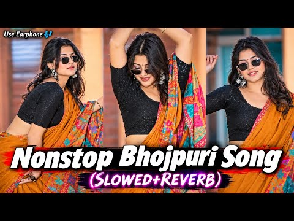
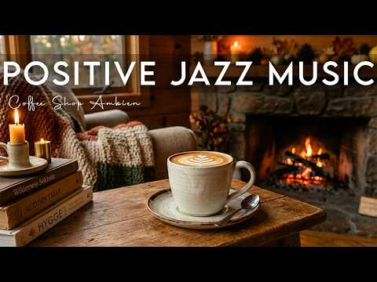
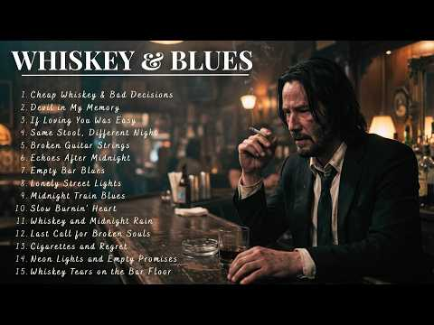

# 음악 — 성공 사례 분석: 사례별 자세히 #401–#440

`analysis.md` 의 9번 (같은 # 번호). 자동 생성 — `tools/success_analysis.py` v1.4.1 (2026-10-18 08:09 UTC). ※ 연구·교육용 — 투자 권유가 아님.

### 401. Autumn Morning Jazz In A Cozy Garden Lounge ∣ Gentle Piano Music For Focus & Stress Relie…

- https://www.youtube.com/watch?v=tiqZDLIBbHg · Indoor Jazz Music · 구독자 5,400 · 조회수 720,838 (×133.5, 하루 11,280.4) · 좋아요 2,741 (0.4%) · 207.9분 · 2026-08-15 · 주제 묶음 4. 카페·매장·라운지 · 형식 플레이리스트·모음 (여러 곡) · 폴더 `W_tiqZDLIBbHg` (웹 승인)
- 썸네일: 
- 설명 앞부분: Autumn Morning Jazz In A Cozy Garden Lounge ∣ Gentle Piano Music For Focus & Stress Relief Today Welcome to Indoor Jazz Music, your peaceful space for relaxing jazz music, soft piano jazz, and cozy indoor ambience. Let these gentle jazz melodies create a calm atmosphere for working, studying, readi…
- 대본 없음 (설명) — 음성인식이 끝나면 도입부·흐름이 들어감
- 댓글 120/120: 좋은 점 — 영상 0 · 감사·응원 0 · 더 알고 싶은 것 0 · 아쉬운 점 — 영상 0 · 반박·불만 — 의견 다름 0 · 정치·사회 0 · 경험 공유 0 · 구독·다음 기대 0

### 402. Midnight in Beirut 🌙 ∣ Lebanese Jazz & Oud Melodies for Relaxation & Deep Focus

- https://www.youtube.com/watch?v=pdSDzQVDYXk · Arabic Jazz Lounge · 구독자 17,600 · 조회수 2,348,776 (×133.4, 하루 13,980.3) · 좋아요 33,865 (1.4%) · 25.3분 · 2026-05-03 · 주제 묶음 3. 공부·집중·작업 · 형식 음악 (그 밖 모양 — 한 편짜리 BGM 등) · 폴더 `W_pdSDzQVDYXk` (웹 승인)
- 썸네일: 
- 챕터: 0:00 Lost In Cairo · 2:23 Midnight Oud Sessions · 4:43 Cairo Dreams · 6:51 Cairo After Dark · 9:14 Quiet Nights in Cairo · 11:42 Nile Nights · 14:25 Under Cairo Lights · 16:43 Arabian Night Jazz · 19:32 Cairo After Dark · 22:04 Desert Moon Jazz
- 설명 앞부분: Midnight in Beirut 🌙 ∣ Lebanese Jazz & Oud Melodies for Relaxation & Deep Focus 🎧 Arabic Jazz Lounge Blending Middle Eastern textures with modern jazz, downtempo, and chill house, Arabic Jazz Lounge creates immersive soundscapes that help you enter a deep flow state, relax, and disconnect from the …
- 대본 없음 (설명) — 음성인식이 끝나면 도입부·흐름이 들어감
- 댓글 767/763: 좋은 점 — 영상 0 · 감사·응원 0 · 더 알고 싶은 것 0 · 아쉬운 점 — 영상 0 · 반박·불만 — 의견 다름 0 · 정치·사회 0 · 경험 공유 0 · 구독·다음 기대 0

### 403. Fall Into Sleep Instantly • Healing Stress, Anxiety, and Depression • Stop Overthinking

- https://www.youtube.com/watch?v=ZIGKQlrOEV0 · Brainwave Resonance · 구독자 13,800 · 조회수 1,837,721 (×133.2, 하루 12,979.2) · 좋아요 19,893 (1.1%) · 480분 · 2026-05-29 · 주제 묶음 1. 수면·명상·힐링 · 형식 음악 (그 밖 모양 — 한 편짜리 BGM 등) · 폴더 `W_ZIGKQlrOEV0` (웹 승인)
- 썸네일: 
- 설명 앞부분: (No Ads) Fall Into Sleep Instantly • Healing Stress, Anxiety, and Depression • Stop Overthinking 🌙 Welcome to Brainwave Resonance 🌙 Welcome to a sacred sanctuary where tranquility, restorative sleep music, and soothing meditative frequencies converge to nurture your rest and inner balance. ✨ This c…
- 대본 없음 (설명) — 음성인식이 끝나면 도입부·흐름이 들어감
- 댓글 1,028/1,025: 좋은 점 — 영상 0 · 감사·응원 0 · 더 알고 싶은 것 1 · 아쉬운 점 — 영상 0 · 반박·불만 — 의견 다름 1 · 정치·사회 0 · 경험 공유 2 · 구독·다음 기대 0
  - 더 알고 싶은 것 👍0 “나이 드니 초저녁에 졸리고 새벽엔 일찍 깨버려서 잠 관련해서 알아보다 왔어요. 새벽 네 시면 어김없이 눈이 떠지고 다시 잠들지를 못해요. 흡수 잘 된다는 리포좀멜라토닌에 트립토판·가바·감태 같이 들어간 각성완화제 먹고 있는데 엄청 센 건 아닌데 누우면 좀 차분해지긴 …”
  - 반박·불만 — 의견 다름 👍0 “나이 드니 초저녁에 졸리고 새벽엔 일찍 깨버려서 잠 관련해서 알아보다 왔어요. 새벽 네 시면 어김없이 눈이 떠지고 다시 잠들지를 못해요. 흡수 잘 된다는 리포좀멜라토닌에 트립토판·가바·감태 같이 들어간 각성완화제 먹고 있는데 엄청 센 건 아닌데 누우면 좀 차분해지긴 …”

### 404. Le Café de Minuit 🇫🇷 Une Chanson Romantique Inspirée par les Nuits de Paris

- https://www.youtube.com/watch?v=D4-ltf3Tdh8 · Bistrot de Minuit | Claire Delacroix · 구독자 3,400 · 조회수 451,809 (×132.9, 하루 3,474.2) · 좋아요 2,750 (0.6%) · 5.9분 · 2026-06-10 · 주제 묶음 4. 카페·매장·라운지 · 형식 음악 (그 밖 모양 — 한 편짜리 BGM 등) · 폴더 `W_D4-ltf3Tdh8` (웹 승인)
- 썸네일: 
- 설명 앞부분: Step into the enchanting atmosphere of Paris after midnight with **Le Café de Minuit** 🇫🇷 A romantic French chanson inspired by the quiet beauty of Parisian nights, where dim café lights, cobblestone streets, and lingering memories create the perfect setting for love and nostalgia. With its gentle …
- 대본 없음 (설명) — 음성인식이 끝나면 도입부·흐름이 들어감
- 댓글 101/99: 좋은 점 — 영상 0 · 감사·응원 0 · 더 알고 싶은 것 0 · 아쉬운 점 — 영상 0 · 반박·불만 — 의견 다름 0 · 정치·사회 0 · 경험 공유 0 · 구독·다음 기대 0

### 405. বিধি এমন ভাগ্য কেন দিলা ∣ Bidhi Amon Vaggo Keno Dila ∣ Bangla Folk Song 2026 ∣ Sad Folk S…

- https://www.youtube.com/watch?v=PGkwfiSxmJU · আঁখি Lo-Fi · 구독자 11,400 · 조회수 1,514,870 (×132.9, 하루 15,664.7) · 좋아요 4,744 (0.3%) · 13.8분 · 2026-07-13 · 주제 묶음 기타 · 형식 음악 (그 밖 모양 — 한 편짜리 BGM 등) · 폴더 `W_PGkwfiSxmJU` (웹 승인)
- 썸네일: 
- 설명 앞부분: 🎵 আঁখি Lo-Fi ∣ Official Channel 🎵 বিধি এমন ভাগ্য কেন দিলা ∣ Bidhi Amon Vaggo Keno Dila ∣ Bangla Folk Song 2026 ∣ Sad Folk Song স্বাগতম আঁখি Lo-Fi চ্যানেলে! 🌿✨ বাংলা লোকগান, প্রেমের গান, বিরহের গান এবং হৃদয়ছোঁয়া সুরের এক অনন্য Lo-Fi জগতে আপনাকে স্বাগতম। এখানে আপনি পাবেন শান্ত, আবেগময় এবং মন ছুঁয়…
- 대본 없음 (설명) — 음성인식이 끝나면 도입부·흐름이 들어감
- 댓글 194/193: 좋은 점 — 영상 0 · 감사·응원 0 · 더 알고 싶은 것 0 · 아쉬운 점 — 영상 0 · 반박·불만 — 의견 다름 0 · 정치·사회 0 · 경험 공유 0 · 구독·다음 기대 0

### 406. Bangla Old Is Gold Romantic Song ∣ Bangla Lo-Fi ∣ 1970-1990 Evergreen Love Song ∣ Harano …

- https://www.youtube.com/watch?v=OP2DddRRTKI · Moner Tune · 구독자 24,300 · 조회수 3,218,669 (×132.5, 하루 23,364.9) · 좋아요 16,946 (0.5%) · 15.8분 · 2026-06-02 · 주제 묶음 8. 로파이·시티팝·칠 · 형식 음악 (그 밖 모양 — 한 편짜리 BGM 등) · 폴더 `W_OP2DddRRTKI` (웹 승인)
- 썸네일: 
- 설명 앞부분: 💖 Bengali Old Is Gold Romantic Songs Jukebox ∣ 1967-1990 Evergreen Love Songs Welcome to this special collection of timeless Bengali romantic songs from 1970 to 1990. Enjoy the golden era of Bangla music with heart-touching melodies, evergreen love songs, and nostalgic classics that continue to liv…
- 대본 없음 (설명) — 음성인식이 끝나면 도입부·흐름이 들어감
- 댓글 313/313: 좋은 점 — 영상 0 · 감사·응원 0 · 더 알고 싶은 것 0 · 아쉬운 점 — 영상 0 · 반박·불만 — 의견 다름 0 · 정치·사회 0 · 경험 공유 0 · 구독·다음 기대 0

### 407. Deep Sleep & Chill Lofi : Bhojpuri Slowed & Reverb Songs 🎧✨ #music #musicsong #viral #for…

- https://www.youtube.com/watch?v=zW8T1B9Fzd0 · VLOGDIPESH  · 구독자 5,220 · 조회수 691,036 (×132.4, 하루 67,930.5) · 좋아요 2,631 (0.4%) · 17.1분 · 2026-10-08 · 주제 묶음 1. 수면·명상·힐링 · 형식 음악 (그 밖 모양 — 한 편짜리 BGM 등) · 폴더 `W_zW8T1B9Fzd0` (웹 승인)
- 썸네일: 
- 설명 앞부분: Bhojpuri Slowed And Reverb Songs ∣ Non Stop Bhojpuri Song ∣ Top 10 Bhojpuri Slowed And Reverb Song 1. "Dil ko chhu jane wala Bhojpuri lofi song suno aur apne doston ke saath share karo! ❤️🎧" 2. "Bhojpuri ka naya lofi anthem suno aur isse apne dil ko sukoon aur aapke friends ko bhi! 😍🎵" 3. "Bhojpuri…
- 대본 없음 (설명) — 음성인식이 끝나면 도입부·흐름이 들어감
- 댓글 33/33: 좋은 점 — 영상 0 · 감사·응원 0 · 더 알고 싶은 것 0 · 아쉬운 점 — 영상 0 · 반박·불만 — 의견 다름 0 · 정치·사회 0 · 경험 공유 0 · 구독·다음 기대 0

### 408. Classical Morning Energy - Relaxing, Uplifting Classical Music@RaagaIndianMusic

- https://www.youtube.com/watch?v=DPXTKDyBQEU · Raaga Indian Music · 구독자 6,900 · 조회수 912,940 (×132.3, 하루 5,176.2) · 좋아요 8,053 (0.9%) · 24.3분 · 2026-04-24 · 주제 묶음 6. 피아노·클래식·연주곡 · 형식 음악 (그 밖 모양 — 한 편짜리 BGM 등) · 폴더 `W_DPXTKDyBQEU` (웹 승인)
- 썸네일: 
- 챕터: 0:00 Good Morning Beta · 4:52 Smile Please · 9:02 Happy Vibes · 12:12 Pray to God · 17:04 Hands Join & Satsriakal
- 설명 앞부분: Start your morning with light, calm, and positive energy 🌅 “ Classical Morning Energy ” is a meditative journey inspired by Raag Ahir Bhairav, one of the most peaceful morning ragas known to bring clarity, balance, and inner strength. This track blends the serenity of Indian classical tradition wit…
- 대본 없음 (설명) — 음성인식이 끝나면 도입부·흐름이 들어감
- 댓글 195/195: 좋은 점 — 영상 0 · 감사·응원 0 · 더 알고 싶은 것 0 · 아쉬운 점 — 영상 0 · 반박·불만 — 의견 다름 0 · 정치·사회 0 · 경험 공유 0 · 구독·다음 기대 0

### 409. Positive Jazz Music ☕ Bossa Nova instrumental for Stress Relief, Working & Holiday

- https://www.youtube.com/watch?v=T2HdICk7_6M · Golden Roast Jazz Club · 구독자 10,900 · 조회수 1,441,801 (×132.3, 하루 10,601.0) · 좋아요 7,582 (0.5%) · 71.2분 · 2026-06-04 · 주제 묶음 6. 피아노·클래식·연주곡 · 형식 음악 (그 밖 모양 — 한 편짜리 BGM 등) · 폴더 `W_T2HdICk7_6M` (웹 승인)
- 썸네일: 
- 설명 앞부분: Welcome to Golden Roast Jazz Club — your cozy escape into the world of smooth jazz, warm coffee vibes, and relaxing atmospheres. ☕🎷 This channel is dedicated to bringing you the perfect blend of soft jazz, lounge music, bossa nova, and chill instrumentals — ideal for studying, working, relaxing, or…
- 대본 없음 (설명) — 음성인식이 끝나면 도입부·흐름이 들어감
- 댓글 235/231: 좋은 점 — 영상 0 · 감사·응원 0 · 더 알고 싶은 것 0 · 아쉬운 점 — 영상 0 · 반박·불만 — 의견 다름 0 · 정치·사회 0 · 경험 공유 0 · 구독·다음 기대 0

### 410. Midnight Whiskey Blues 🍂 Slow Blues for Late Night Relaxing & Calm Vibes

- https://www.youtube.com/watch?v=iR2LyVq8VYI · Midnight Blues Lounge · 구독자 27,300 · 조회수 3,579,643 (×131.1, 하루 19,913.9) · 좋아요 43,689 (1.2%) · 83.3분 · 2026-04-21 · 주제 묶음 6. 피아노·클래식·연주곡 · 형식 플레이리스트·모음 (여러 곡) · 폴더 `W_iR2LyVq8VYI` (웹 승인)
- 썸네일: 
- 설명 앞부분: Whiskey Blues Mix 🍂 Best Blues Music for Late Nights, Relaxing & Drinking Mood Welcome to Midnight Blues Lounge — your home for the finest whiskey blues and smooth late-night vibes. Sit back, pour a glass, and let this whiskey blues mix take you on a soulful journey through deep emotions, slow rhyt…
- 대본 없음 (설명) — 음성인식이 끝나면 도입부·흐름이 들어감
- 댓글 1,645/1,631: 좋은 점 — 영상 0 · 감사·응원 0 · 더 알고 싶은 것 0 · 아쉬운 점 — 영상 0 · 반박·불만 — 의견 다름 0 · 정치·사회 0 · 경험 공유 0 · 구독·다음 기대 0

### 411. 99% Fall Into Sleep Instantly (No Ads) • Eliminate Stress & Anxiety • Brain Massage While…

- https://www.youtube.com/watch?v=iVZPLhAlXUw · Bedtime Calm Sounds · 구독자 12,200 · 조회수 1,587,390 (×130.1, 하루 33,326.5) · 좋아요 5,264 (0.3%) · 237.9분 · 2026-08-31 · 주제 묶음 1. 수면·명상·힐링 · 형식 음악 (그 밖 모양 — 한 편짜리 BGM 등) · 폴더 `W_iVZPLhAlXUw` (웹 승인)
- 썸네일: 
- 설명 앞부분: 99% Fall Into Sleep Instantly (No Ads) • Eliminate Stress & Anxiety • Brain Massage While You Sleep Slow down. Breathe. Let the night carry you gently into rest. If your mind keeps racing or your body feels tense, this is your quiet space to release the day. This video is carefully crafted to creat…
- 대본 없음 (설명) — 음성인식이 끝나면 도입부·흐름이 들어감
- 댓글 43/41: 좋은 점 — 영상 0 · 감사·응원 0 · 더 알고 싶은 것 0 · 아쉬운 점 — 영상 0 · 반박·불만 — 의견 다름 0 · 정치·사회 0 · 경험 공유 0 · 구독·다음 기대 0

### 412. Sholey Title Music ∣ Music Maker Abani ∣ Instrumental Cover

- https://www.youtube.com/watch?v=ajRxp64xcN8 · MUSIC MAKER ABANI · 구독자 5,850 · 조회수 760,456 (×130.0, 하루 6,689.1) · 좋아요 13,662 (1.8%) · 4.7분 · 2026-06-26 · 주제 묶음 6. 피아노·클래식·연주곡 · 형식 커버·직접 부른 노래 · 폴더 `W_ajRxp64xcN8` (웹 승인)
- 썸네일: 
- 설명 앞부분: MUSIC ARRANGEMENT : ABANI BISWAS KEY-BOARD PROGRAMMING : ABANI BISWAS PERFOM BY : STUDENTS OF ABANI BISWAS PIANO : AIDITI (DUSTU) TRUMPET : PRATYUSHA SAXOPHON : AIKANTIK, SAHIN, ARUPA, TRISHNA, ANKITA, MOURPIYA, SOUVIK, PRITHWIRAJ, AYUSH INDIAN RYTHM : SOMIT MUKHERJEE (RAMU DA) BACKING ACOUSTIC BRA…
- 대본 없음 (설명) — 음성인식이 끝나면 도입부·흐름이 들어감
- 댓글 1,423/1,423: 좋은 점 — 영상 0 · 감사·응원 0 · 더 알고 싶은 것 0 · 아쉬운 점 — 영상 0 · 반박·불만 — 의견 다름 0 · 정치·사회 0 · 경험 공유 0 · 구독·다음 기대 0

### 413. 💖💖💖The Café by the Sea©

- https://www.youtube.com/watch?v=7jPXHB9Ohus · M's Music Lounge · 구독자 2,070 · 조회수 269,053 (×130.0, 하루 2,226.7) · 좋아요 3,692 (1.4%) · 4.2분 · 2026-06-19 · 주제 묶음 4. 카페·매장·라운지 · 형식 음악 (그 밖 모양 — 한 편짜리 BGM 등) · 폴더 `W_7jPXHB9Ohus` (웹 승인)
- 썸네일: 
- 설명 앞부분: 🎧🔊 🎬Music and Video produced by M's Music Lounge 🕺 Enjoyed the mix? If you love this mix and sound, show some love with a Like and Subscribe! 📜 This track was produced using artificial intelligence (AI), and finalized by M's Music Lounge. Sound and or visuals were significantly edited or digitally …
- 대본 없음 (설명) — 음성인식이 끝나면 도입부·흐름이 들어감
- 댓글 195/193: 좋은 점 — 영상 0 · 감사·응원 0 · 더 알고 싶은 것 0 · 아쉬운 점 — 영상 0 · 반박·불만 — 의견 다름 0 · 정치·사회 0 · 경험 공유 0 · 구독·다음 기대 0

### 414. 재생하자마자 텐션 터지는 2026 남녀돌 믹스업 (과제, 청소, 운동할 때 듣는 플리)

- https://www.youtube.com/watch?v=x09m3Lgzc-A · MxJin06 · 구독자 5,040 · 조회수 654,766 (×129.9, 하루 8,288.6) · 좋아요 2,463 (0.4%) · 99.2분 · 2026-07-31 · 주제 묶음 5. 운동·드라이브·신나는 · 형식 플레이리스트·모음 (여러 곡) · 폴더 `W_x09m3Lgzc-A` (웹 승인)
- 썸네일: 
- 챕터: 0:00 ILLIT (아일릿) ‘It’s Me’ Officia… · 2:14 aespa 에스파 'Supernova' MV · 5:10 CORTIS (코르티스) 'REDRED' Offici… · 7:50 LE SSERAFIM (르세라핌) 'BOOMPALA'… · 10:42 BABYMONSTER - 'I LIKE IT' M-V · 14:05 aespa 에스파 'LEMONADE' MV · 17:10 TWS (투어스) '널 따라가 (You, You)' … · 19:53 NMIXX(엔믹스) “Crescendo” M-V · 22:26 aespa 에스파 'Live My Life' MV · 25:01 QWER 'BAD HABIT' (80's Video … · 27:51 STAYC 스테이씨 '2 L0VE' MV · 30:49 i-dle (아이들) 'Gimme Dat Love' … · 33:08 aespa 에스파 'Whiplash' MV · 36:09 RIIZE 라이즈 'Do your dance' MV · 39:02 tripleS(트리플에스) 'Baby Flower' … · 42:05 NMIXX(엔믹스) “Heavy Serenade” M… · 45:03 fromis_9 (프로미스나인) 'Vitamin ME… · 48:12 ILLIT (아일릿) 'Lucky Girl Syndr… · 50:28 BOYNEXTDOOR (보이넥스트도어) 'VIRAL'… · 53:43 izna 'METRONOME' MV
- 같은 채널 평소 대비 ×10.0 (채널 최근 롱폼 중앙값 65,696회) · 평소 영상: 틀자마자 휴가 시작 🍹 2026 틱톡 바이럴 청량 여름 플리 (69,633회) / 도파민 충전 완료 ⚡ 지루한 평일 텐션 끌어올리는 K POP 여돌 MV 모음 (56,437회)
- 대본 없음 (없음) — 음성인식이 끝나면 도입부·흐름이 들어감
- 댓글 30/30: 좋은 점 — 영상 0 · 감사·응원 1 · 더 알고 싶은 것 0 · 아쉬운 점 — 영상 0 · 반박·불만 — 의견 다름 0 · 정치·사회 0 · 경험 공유 0 · 구독·다음 기대 1
  - 감사·응원 👍3 “와 진짜 다 좋다❤❤ 제작자님 감사합니다 진짜 골고루 넣어놓으셨네욘❤❤”
  - 구독·다음 기대 👍4 “중간중간에 틈 없이 바로바로 나오는게 너무 좋아요! 구독합니다!”

### 415. [空靈鼓療癒音樂🎶]｜放鬆、舒壓、冥想、安眠｜Steel Tongue Drum Healing Music｜SUNO pro

- https://www.youtube.com/watch?v=a_8Hi2u43Q4 · AIMF Music Factory  · 구독자 1,250 · 조회수 162,047 (×129.6, 하루 1,243.7) · 좋아요 1,525 (0.9%) · 93.1분 · 2026-06-10 · 주제 묶음 1. 수면·명상·힐링 · 형식 AI 음악 · 폴더 `W_a_8Hi2u43Q4` (웹 승인)
- 썸네일: 
- 설명 앞부분: 🎼Music by AIMF from SUNO pro ⭐️Video production APP:Capcut+快影 ⭐️Video creators:AIMF
- 대본 없음 (설명) — 음성인식이 끝나면 도입부·흐름이 들어감
- 댓글 12/12: 좋은 점 — 영상 0 · 감사·응원 0 · 더 알고 싶은 것 0 · 아쉬운 점 — 영상 0 · 반박·불만 — 의견 다름 0 · 정치·사회 0 · 경험 공유 0 · 구독·다음 기대 0

### 416. Deep Focus Music – Flow State for Study & Work

- https://www.youtube.com/watch?v=9xYZzgG2EuI · Deep365 · 구독자 4,180 · 조회수 538,915 (×128.9, 하루 5,244.6) · 좋아요 5,635 (1.1%) · 63.7분 · 2026-07-07 · 주제 묶음 3. 공부·집중·작업 · 형식 음악 (그 밖 모양 — 한 편짜리 BGM 등) · 폴더 `W_9xYZzgG2EuI` (웹 승인)
- 썸네일: 
- 설명 앞부분: Welcome to Deep365 Sometimes the deepest level of concentration comes from disconnecting from everything around you and entering your own mental space. This session is designed for that isolation mode a calm, controlled environment powered by ambient minimal techno rhythms and deep synthwave textur…
- 대본 없음 (설명) — 음성인식이 끝나면 도입부·흐름이 들어감
- 댓글 150/150: 좋은 점 — 영상 0 · 감사·응원 0 · 더 알고 싶은 것 0 · 아쉬운 점 — 영상 0 · 반박·불만 — 의견 다름 0 · 정치·사회 0 · 경험 공유 0 · 구독·다음 기대 0

### 417. Playlist ∣ 틀어놓으면 그냥 계속 리듬 타게 되는 그루브 😎 집중 끊기지 않는 리듬 🎧 ∣ JAZZHOP · CHILLHOP ∣ 카페 · 작업 · BGM

- https://www.youtube.com/watch?v=wsB8ej3Jon4 · Hush Chords · 구독자 19,500 · 조회수 2,510,132 (×128.7, 하루 15,647.0) · 좋아요 23,997 (1.0%) · 318.1분 · 2026-05-10 · 주제 묶음 8. 로파이·시티팝·칠 · 형식 플레이리스트·모음 (여러 곡) · 폴더 `W_wsB8ej3Jon4` (웹 승인)
- 썸네일: 
- 챕터: 0:00 Stay In Flow · 2:22 Easy On The Move · 5:15 Catch The Step · 8:10 Right On Time · 11:05 Feels Right · 14:02 Soft Feel · 16:55 Back In Motion · 19:48 Stay In Line · 22:40 Keep It Going · 25:35 In Line · 28:30 Stay A Bit · 31:25 Let It Pass · 34:20 For Now
- 설명 앞부분: 오늘 작업은 이걸로 시작해보세요. 가볍게 틀어두기만 해도 흐름이 자연스럽게 이어지고, 과하게 힘주지 않아도 리듬이 계속 살아있는 재즈힙합 & 칠힙 그루브로 구성했습니다. 집중을 방해하지 않으면서도 고개가 자연스럽게 끄덕여지는 리듬, 작업할 때 가장 편하게 오래 들을 수 있는 균형 잡힌 플레이리스트입니다. 💻 지금 이 순간, 플레이하고 흐름에 그대로 올라타 보세요. 🎧 🎵 Time Track Music for your space. Groove for your flow. ⚠️ This playlist is built on smooth…
- 같은 채널 평소 대비 ×460.2 (채널 최근 롱폼 중앙값 5,455회) · 평소 영상: Playlist ∣ 당신이 주인공인 오늘 ✨ 평범한 하루도 특별해지는 세련된 그루브 ∣ … (5,455회) / Playlist ∣ 듣는 순간, 평범한 하루가 괜히 좋아지는 그루브 😌🍂 JAZZHOP … (5,462회)
- 대본 없음 (설명) — 음성인식이 끝나면 도입부·흐름이 들어감
- 댓글 722/722: 좋은 점 — 영상 0 · 감사·응원 7 · 더 알고 싶은 것 0 · 아쉬운 점 — 영상 0 · 반박·불만 — 의견 다름 0 · 정치·사회 0 · 경험 공유 1 · 구독·다음 기대 1
  - 감사·응원 👍4 “이런 플리 찾고 있었는데 알고리즘 감사합니다 😭”
  - 감사·응원 👍3 “책 읽기 딱 좋네요. 응원합니다.”
  - 경험 공유 👍2 “좋네요^^ 오늘은 그냥 즐거웠네요 나도 구독 하고. 갑니다^^”
  - 구독·다음 기대 👍1 “좋아요.구독하고 갑니다”

### 418. choose peace

- https://www.youtube.com/watch?v=eIY-Pgg-b1E · sleepwalker · 구독자 14,200 · 조회수 1,823,354 (×128.4, 하루 10,866.4) · 좋아요 70,842 (3.9%) · 60분 · 2026-05-03 · 주제 묶음 기타 · 형식 긴 한 곡·반복 (N시간) · 폴더 `W_eIY-Pgg-b1E` (웹 승인)
- 썸네일: 
- 챕터: 0:00 Golden Hour · 8:46 Solitude · 19:30 Distant Memory · 27:01 Aether · 31:51 Lumen · 41:55 inner peace · 50:28 all is well
- 설명 앞부분: a 1 hour ambient mix Tracklist all music is original, no ai involved (i guess you have to clarify lol)
- 대본 없음 (설명) — 음성인식이 끝나면 도입부·흐름이 들어감
- 댓글 1,135/1,130: 좋은 점 — 영상 0 · 감사·응원 0 · 더 알고 싶은 것 0 · 아쉬운 점 — 영상 0 · 반박·불만 — 의견 다름 0 · 정치·사회 0 · 경험 공유 1 · 구독·다음 기대 0

### 419. 𝐏𝐥𝐚𝐲𝐥𝐢𝐬𝐭 듣자마자 텐션 업🔥K-POP 여돌 노래 모음 노동요

- https://www.youtube.com/watch?v=xtfreKB54KQ · 클로버 플레이리스트 · 구독자 3,580 · 조회수 459,701 (×128.4, 하루 4,161.5) · 좋아요 2,642 (0.6%) · 53분 · 2026-06-29 · 주제 묶음 10. 팝송·K팝·J팝 · 형식 플레이리스트·모음 (여러 곡) · 폴더 `W_xtfreKB54KQ` (웹 승인)
- 썸네일: 
- 같은 채널 평소 대비 ×5.9 (채널 최근 롱폼 중앙값 77,683회) · 평소 영상: 𝐏𝐥𝐚𝐲𝐥𝐢𝐬𝐭 들으면 하루가 기분 좋아지는✨ 리센느 노래 모음 (80,135회) / 𝐏𝐥𝐚𝐲𝐥𝐢𝐬𝐭 엔믹스 한 번 빠지면 못 나오는🫧 NMIXX 노래 모음 노동요 (75,231회)
- 대본 없음 (없음) — 음성인식이 끝나면 도입부·흐름이 들어감
- 댓글 39/39: 좋은 점 — 영상 1 · 감사·응원 1 · 더 알고 싶은 것 0 · 아쉬운 점 — 영상 0 · 반박·불만 — 의견 다름 0 · 정치·사회 0 · 경험 공유 1 · 구독·다음 기대 0
  - 좋은 점 — 영상 👍1 “노래들 다 넘 제 취향 이예용❤ 좋은 영상 만들어주셔서 감사합니다❤❤❤”
  - 감사·응원 👍1 “노래들 다 넘 제 취향 이예용❤ 좋은 영상 만들어주셔서 감사합니다❤❤❤”
  - 경험 공유 👍4 “제가 제일 좋아하는 플리에요!!매일 공부하면서 들어요!”

### 420. Awaken Your Power 🔱 Shiva Mantra Lofi

- https://www.youtube.com/watch?v=Eq3mwBFjnec · Lofi Shraddha Bhakti  · 구독자 22,100 · 조회수 2,817,008 (×127.5, 하루 15,886.7) · 좋아요 30,247 (1.1%) · 85.1분 · 2026-04-24 · 주제 묶음 8. 로파이·시티팝·칠 · 형식 음악 (그 밖 모양 — 한 편짜리 BGM 등) · 폴더 `W_Eq3mwBFjnec` (웹 승인)
- 썸네일: 
- 설명 앞부분: Awaken your inner strength with this powerful **Shiva Mantra Lofi** 🔱 Let the divine vibrations of Mahadev remove fear, calm your mind, and unlock your true energy. 🕉️ **Mantra Chant: ✨ **Benefits of this Mantra: Removes fear and negativity Brings deep mental peace and balance Awakens inner strengt…
- 대본 없음 (설명) — 음성인식이 끝나면 도입부·흐름이 들어감
- 댓글 2,878/2,878: 좋은 점 — 영상 0 · 감사·응원 0 · 더 알고 싶은 것 0 · 아쉬운 점 — 영상 0 · 반박·불만 — 의견 다름 0 · 정치·사회 0 · 경험 공유 0 · 구독·다음 기대 0

### 421. Thankful Hearts ∣ Gratitude Sing Along Song with Lyrics 💗

- https://www.youtube.com/watch?v=K-c4pzbzBzE · Purely Positive Piano · 구독자 245 · 조회수 31,149 (×127.1, 하루 577.7) · 좋아요 0 (0.0%) · 4.5분 · 2026-08-25 · 주제 묶음 6. 피아노·클래식·연주곡 · 형식 한 곡 (뮤직비디오·음원·가사) · 폴더 `W_K-c4pzbzBzE` (웹 승인)
- 썸네일: 
- 설명 앞부분: Sing along to "Thankful Hearts", an uplifting song celebrating gratitude, positivity, and appreciation for life's simple blessings! 💗 This video features on-screen lyrics and custom so you can easily follow along and sing with the music. Perfect for morning inspiration, classroom sing-alongs, mindf…
- 대본 없음 (설명) — 음성인식이 끝나면 도입부·흐름이 들어감
- 댓글 21/21: 좋은 점 — 영상 0 · 감사·응원 0 · 더 알고 싶은 것 0 · 아쉬운 점 — 영상 0 · 반박·불만 — 의견 다름 0 · 정치·사회 0 · 경험 공유 0 · 구독·다음 기대 0

### 422. Cortisol Reset । 432Hz Krishna Bansuri Therapy for a Calm Mind & Stop Overthinking । Indi…

- https://www.youtube.com/watch?v=D5NHvEVAbWY · Healing Raga Studio · 구독자 23,700 · 조회수 3,005,564 (×126.8, 하루 33,075.1) · 좋아요 39,595 (1.3%) · 65.7분 · 2026-07-19 · 주제 묶음 1. 수면·명상·힐링 · 형식 음악 (그 밖 모양 — 한 편짜리 BGM 등) · 폴더 `W_D5NHvEVAbWY` (웹 승인)
- 썸네일: 
- 챕터: 0:00 Calm Beginning · 2:39 Gentle Healing · 5:24 Inner Balance · 9:20 Quiet Mind · 12:49 Peace Within · 19:55 Healing Flow · 27:51 Mental Clarity · 33:40 Sacred Stillness · 40:03 Deep Relaxation · 47:07 Mindful Presence · 53:48 Evening Calm · 59:37 Silent Reflection · 62:18 Emotional Renewal
- 설명 앞부분: Feeling overwhelmed, mentally exhausted, or caught in a loop of overthinking? Let the gentle sound of 432Hz Krishna Bansuri therapy guide you toward deep relaxation, emotional balance, and inner peace. This Indian healing music blends the soothing tones of the bansuri flute with calming ambient tex…
- 대본 없음 (설명) — 음성인식이 끝나면 도입부·흐름이 들어감
- 댓글 1,970/1,949: 좋은 점 — 영상 0 · 감사·응원 0 · 더 알고 싶은 것 0 · 아쉬운 점 — 영상 0 · 반박·불만 — 의견 다름 0 · 정치·사회 0 · 경험 공유 0 · 구독·다음 기대 0

### 423. hard work pays off, let's be productive (focus playlist to get things done)

- https://www.youtube.com/watch?v=IS6yiMGlYkE · taami study. · 구독자 9,660 · 조회수 1,222,254 (×126.5, 하루 12,001.8) · 좋아요 12,975 (1.1%) · 189.8분 · 2026-07-08 · 주제 묶음 3. 공부·집중·작업 · 형식 플레이리스트·모음 (여러 곡) · 폴더 `W_IS6yiMGlYkE` (웹 승인)
- 썸네일: 
- 챕터: 0:00 Celestine Murmur · 2:16 Emberhaze Lullaby · 4:49 Lanternfall Solace · 8:10 Moonshadow Drift · 12:05 Shadowtide Waltz · 14:09 Velvetcascade Echo · 17:12 study playlist to get things …
- 설명 앞부분: Tomorrow becomes brighter because of what you choose to do today. This study playlist helps you stay focused, get things done, and turn today's effort into tomorrow's success 🎧✨🌅 ✨ Stay tuned for more playlists designed to help you focus, study, work, and relax with minimal distractions. Press play…
- 대본 없음 (설명) — 음성인식이 끝나면 도입부·흐름이 들어감
- 댓글 196/195: 좋은 점 — 영상 0 · 감사·응원 0 · 더 알고 싶은 것 0 · 아쉬운 점 — 영상 0 · 반박·불만 — 의견 다름 0 · 정치·사회 0 · 경험 공유 0 · 구독·다음 기대 1
  - 구독·다음 기대 👍0 “구독하고가요”

### 424. 𝐏𝐥𝐚𝐲𝐥𝐢𝐬𝐭 비에 젖은 와인향

- https://www.youtube.com/watch?v=Pt3nGKCTF2U · 유월 · 구독자 3,770 · 조회수 474,277 (×125.8, 하루 3,415.0) · 좋아요 12,273 (2.6%) · 21.1분 · 2026-06-01 · 주제 묶음 기타 · 형식 플레이리스트·모음 (여러 곡) · 폴더 `W_Pt3nGKCTF2U` (웹 승인)
- 썸네일: 
- 챕터: 0:00 로꼬, 화사(HWASA) - 주지마 · 3:54 릴러말즈(Leellamarz), 미노이(Meenoi)… · 7:31 정국(Jungkook) - Still With You · 11:31 Seori - 긴 밤 (Feat. 기리보이) · 15:02 OnlyOneOf(온리원오브) - dOra maar · 18:22 종현(JONGHYUN) - Moon
- 설명 앞부분: ‘손 끝에 짙게 남은 와인 잔향‘𓈒 이번에는 주인장표 습도 높은 몽환 R&B 플리로 말아왔어요. 비에 젖은 와인향 같은 노래들로 꾹꾹 눌러 담아왔으니, 이번에도 맛봐 주실 거죠? 🍷 𓈒𓏸 𓂂
- 같은 채널 평소 대비 ×13.6 (채널 최근 롱폼 중앙값 34,790회) · 평소 영상: 𝐏𝐥𝐚𝐲𝐥𝐢𝐬𝐭 내 옆에서 자꾸 한 눈 팔지마 (34,790회) / 𝐏𝐥𝐚𝐲𝐥𝐢𝐬𝐭 이미 네게 넘어갔는데 (19,202회)
- 대본 없음 (설명) — 음성인식이 끝나면 도입부·흐름이 들어감
- 댓글 124/124: 좋은 점 — 영상 0 · 감사·응원 4 · 더 알고 싶은 것 3 · 아쉬운 점 — 영상 1 · 반박·불만 — 의견 다름 0 · 정치·사회 0 · 경험 공유 3 · 구독·다음 기대 0
  - 감사·응원 👍5 “감사합니다 시험 기간에 미쳐서 슬라임만들면서 들었어요 ㅎ”
  - 감사·응원 👍3 “제 최애 플리로 당첨슨 .. 너무 감사드려요 ♡”
  - 더 알고 싶은 것 👍54 “아 진짜 주인장 제발 이 플레이리스트 더 길게 만들어주세요 제발요”
  - 더 알고 싶은 것 👍8 “사진 출처 어딘지 알수있을까요?”
  - 아쉬운 점 — 영상 👍7 “온리원오브 노래 들어간 플리 처음 봤어요ㅜㅜ 너무 반갑다.. 온리원오브에 비슷한 분위기의 매력적인 노래 많으니까 많이 찾아 들어주셨으면 좋겠어요.. 해체하는 바람에 더 좋은 노래 못 들어서 아쉽네요,,”
  - 경험 공유 👍5 “오늘 내가 제일 치명적이다”
  - 경험 공유 👍3 “정말루 내가 이 플리 조회수 100은 올린것가틈 ㄴㅁ 고능해”

### 425. 김상민 – YOU (2001) ∣ 폭발적인 고음의 여자 보컬 리메이크/커버 2 Keys+

- https://www.youtube.com/watch?v=-GVdD_Onszw · AuraAPT · 구독자 13,100 · 조회수 1,646,979 (×125.7, 하루 19,873.5) · 좋아요 3,744 (0.2%) · 4.1분 · 2026-07-27 · 주제 묶음 12. 커버·노래 부르기 · 형식 커버·직접 부른 노래 · 폴더 `W_-GVdD_Onszw` (웹 승인)
- 썸네일: 
- 설명 앞부분: 김상민의 명곡 **〈YOU〉**를 애절하면서도 폭발적인 고음의 여자 보컬로 다시 불러보았습니다. 〈YOU〉는 2001년 5월 14일 발매된 김상민의 정규 2집 《Face》 수록곡으로, 선명한 록 발라드 사운드와 김상민 특유의 강렬한 고음으로 오랫동안 사랑받아 온 곡입니다. 사랑하는 사람이 떠난 뒤, 비가 오는 거리와 텅 빈 밤에 홀로 남겨진 사람의 외로움과 그리움을 담은 노래입니다. 꿈속에서는 다시 만날 수 있지만 아침이 되면 또다시 떠나보내야 하는 아픔을 여자 보컬의 섬세한 감성과 진한 고음으로 표현했습니다. 🎵 원곡: 김상민 …
- 같은 채널 평소 대비 ×74.2 (채널 최근 롱폼 중앙값 22,211회) · 평소 영상: 말리꽃 (2000) - 이승철｜가슴을 울리는 명곡 [원곡감성] 여자보컬 리메이크｜Aura… (22,211회) / 사랑.. 그 놈 (2009) - 바비 킴(Bobby Kim)｜원곡감성 여자보컬 리메이크｜… (22,385회)
- 대본 없음 (설명) — 음성인식이 끝나면 도입부·흐름이 들어감
- 댓글 269/269: 좋은 점 — 영상 2 · 감사·응원 8 · 더 알고 싶은 것 8 · 아쉬운 점 — 영상 3 · 반박·불만 — 의견 다름 2 · 정치·사회 0 · 경험 공유 6 · 구독·다음 기대 4
  - 좋은 점 — 영상 👍4 “진짜 이건 아무리 들어도 레전드다..원곡이든 커버든 그냥 다 찢어버림..들을 때 마다 소름돋네”
  - 좋은 점 — 영상 👍3 “너~무 잘함, 너무 듣기좋음”
  - 감사·응원 👍44 “제가 들어본 중 최고의 you 입니다!! 고맙습니다❤”
  - 감사·응원 👍12 “김상민 님의 명곡을 이렇게 애절하고 폭발적인 여자 보컬로 들으니 또 다른 깊은 울림이 있네요. 비 오는 날 감성에 너무 잘 어울리는 리메이크입니다. 역시 명곡은 언제 들어도 좋네요. 새로운 목소리로 재해석해주셔서 감사합니다. 앞으로도 좋은 커버 영상 기대할게요! 자주…”
  - 더 알고 싶은 것 👍21 “너무 시원하고 감동적인 노래 잘듣고 갑니다 앞으로도 더욱 많은 노래 올려주세요”
  - 더 알고 싶은 것 👍9 “정말 노래 환상적입니다. 누구신지 궁금합니다.”
  - 아쉬운 점 — 영상 👍13 “목소리 너무좋아요 하루 무한반복으로 듣고있어요”
  - 아쉬운 점 — 영상 👍1 “노래듣고 눈물이 났네요 목소리가 너무나 졸고 잘부르시네요~ 앞으로 쭈~~욱 노래 들려주세요~~^^ 응원하겠습니다~~”
  - 반박·불만 — 의견 다름 👍3 “Ai로 이렇게 노래하면 반칙아닌가? 득음정도가아닌데 ~”
  - 반박·불만 — 의견 다름 👍2 “Ai는 아니죠?ㅠㅠ”
  - 경험 공유 👍44 “제가 들어본 중 최고의 you 입니다!! 고맙습니다❤”
  - 경험 공유 👍19 “와 나도 노래좀 안다고 생각 했는데 50년동안 ai노래가 있을줄이야 솔직히 사람이 부른것 보다 더 감동이네 6시간 동안 비슷한거 찾아서 듣고 있는중...”
  - 구독·다음 기대 👍12 “김상민 님의 명곡을 이렇게 애절하고 폭발적인 여자 보컬로 들으니 또 다른 깊은 울림이 있네요. 비 오는 날 감성에 너무 잘 어울리는 리메이크입니다. 역시 명곡은 언제 들어도 좋네요. 새로운 목소리로 재해석해주셔서 감사합니다. 앞으로도 좋은 커버 영상 기대할게요! 자주…”
  - 구독·다음 기대 👍4 “매일매일듣게돼는ㅎㅎ 완전따봉 이에요^^ 목소리도예쁘고❤❤❤❤❤”

### 426. 당신의 피아노 레벨은? (Lv.1~Lv.8 + 라캄파넬라) ∣ What is your Piano Level? 🎹

- https://www.youtube.com/watch?v=1E5Zi3Gs1ys · Bony_Musician · 구독자 674 · 조회수 84,463 (×125.3, 하루 630.0) · 좋아요 1,616 (1.9%) · 6.5분 · 2026-06-06 · 주제 묶음 6. 피아노·클래식·연주곡 · 형식 연주 (직접 연주하는 영상) · 폴더 `W_1E5Zi3Gs1ys` (웹 승인)
- 썸네일: 
- 설명 앞부분: 여러분의 피아노 실력은 과연 몇 단계인가요? 🎹🤔 가장 기초적인 Lv.1 단계부터 손가락이 날아다니는 마의 Lv.8 단계까지, 대중적인 클래식/뉴에이지 명곡들로 피아노 레벨 테스트 영상을 준비했습니다! 그리고 영상 맨 마지막에는 전설의 악마의 곡, 라 캄파넬라(La Campanella)가 보너스 최종 보스 레벨로 기다리고 있으니 끝까지 놓치지 마세요! 🔥 평소 피아노 난이도 순위나 재미있는 피아노 챌린지 영상을 검색해 들어오신 분들 모두 환영합니다. 영상을 보시면서 여러분이 연주할 수 있는 가장 높은 레벨은 몇 단계인지, 혹은 가…
- 대본 없음 (설명) — 음성인식이 끝나면 도입부·흐름이 들어감
- 댓글 340/340: 좋은 점 — 영상 2 · 감사·응원 7 · 더 알고 싶은 것 8 · 아쉬운 점 — 영상 0 · 반박·불만 — 의견 다름 2 · 정치·사회 0 · 경험 공유 24 · 구독·다음 기대 3
  - 좋은 점 — 영상 👍2 “전 개인적으로 쇼팽 왈츠가 캐리비안보다 어려운것 같네용 전 8단계 다 칠 수 있슴돠 (피아노 15년 배웠는데 라캄파넬라 못치는 고1.. ㅋㅋ)”
  - 좋은 점 — 영상 👍1 “좋은 영상 감사합니다. 저는 실력은 3단계 수준이지만 쇼팽의 왈츠는 흉내는 낼 수 있어요!”
  - 감사·응원 👍1 “좋은 영상 감사합니다. 저는 실력은 3단계 수준이지만 쇼팽의 왈츠는 흉내는 낼 수 있어요!”
  - 감사·응원 👍1 “7살때부터 피아노 친 체르니 40 5학년 잼민이입니다! 오래 친거에 비해 대회 준비를 안했어서.. 칠수있는게 많진 않았지만 최근 대회 준비를 시작했어서 연주곡들 보시고 제 레벨 체크해주시면 감사하겠습니다 🙇‍♀️ 4학년: 랑게-간절한 행운 (학년대상, 3등상) / 하…”
  - 더 알고 싶은 것 👍3 “슈베르트 즉흥곡 2번은 몇정도 될까요?”
  - 더 알고 싶은 것 👍2 “3년 다녀서 7~8단계용 혹시 15 Etudes de Virtuosite Op. 72 No. 6 은 레벨이 어느정도 일까요?”
  - 반박·불만 — 의견 다름 👍1 “저 초보자 아닌데 왜 리버 플라워... 치고있지?”
  - 경험 공유 👍3 “지금 5학년인데 레벨7이면 괜찮은거에요? 자금 피아노 5년차임다”
  - 경험 공유 👍3 “저 라캄파넬라 샵 그대로 해서 제가 편곡해서쳐요..초4임요”
  - 구독·다음 기대 👍6 “구독했구요 근데 베토벤 소나타 비창 3악장이랑 베토벤 월광 소나타 둘 중에 어떤게 더 어렵지?”
  - 구독·다음 기대 👍2 “134번째로 구독하고감니다”

### 427. 📝 1 HOUR OF FOCUS ∣ 🌧️ Relaxing Piano & Rain Sounds for Studying, Deep Focus, Reading & L…

- https://www.youtube.com/watch?v=yMcznSINsFs · Melodies of Calmora · 구독자 4,500 · 조회수 563,460 (×125.2, 하루 6,962.9) · 좋아요 2,097 (0.4%) · 60.4분 · 2026-07-29 · 주제 묶음 2. 자연 소리·백색소음 · 형식 긴 한 곡·반복 (N시간) · 폴더 `W_yMcznSINsFs` (웹 승인)
- 썸네일: 
- 설명 앞부분: 🌧️ Welcome to one peaceful hour of relaxing piano music and gentle rain sounds, created to help you study, work, read, learn, and stay focused in a calm and comfortable atmosphere. 🎹📖 This one-hour focus session brings together a collection of soft, soothing piano pieces with beautiful flowing melo…
- 대본 없음 (설명) — 음성인식이 끝나면 도입부·흐름이 들어감
- 댓글 152/149: 좋은 점 — 영상 0 · 감사·응원 0 · 더 알고 싶은 것 1 · 아쉬운 점 — 영상 0 · 반박·불만 — 의견 다름 0 · 정치·사회 0 · 경험 공유 0 · 구독·다음 기대 0
  - 더 알고 싶은 것 👍3 “Mk ko chắc bạn biết Tiếng Việt và cx ko biết bạn ở quốc gia nào. Tuy nhiên, mk phải nói thiệt! Video của bạn làm hay cực kì! Mk lại cộng thêm một kên…”

### 428. Không Buông x Từng Là Của Nhau x Tìm Em - HNGLE x BẢO ANH ∣ Những Bản Hits Nhạc Trẻ Chill…

- https://www.youtube.com/watch?v=wVLhvXB2flE · Chà Là Chill · 구독자 38,900 · 조회수 4,869,045 (×125.2, 하루 54,126.2) · 좋아요 15,278 (0.3%) · 91.8분 · 2026-07-20 · 주제 묶음 8. 로파이·시티팝·칠 · 형식 음악 (그 밖 모양 — 한 편짜리 BGM 등) · 폴더 `W_wVLhvXB2flE` (웹 승인)
- 썸네일: 
- 챕터: 0:00 Không Buông · 4:45 Từng Là Của Nhau · 8:31 Vet Thuong · 12:26 Luu Luyen Sau Chia Tay · 17:09 Có Hẹn Với Thanh Xuân · 20:48 Tình Mình Lạ Kì · 24:46 Suýt Nữa Thì · 29:39 Để Tôi Ôm Em Bằng Giai Điệu N… · 34:17 Mùa Hè Năm Ấy 2 · 38:22 Sợ · 42:20 Nam Ay · 46:38 Tình Yêu Chậm Trễ · 51:07 Hẹn E Ở Lần Yêu Thứ 2 · 57:01 Them Bao Nhieu Lau Giong Nam · 60:45 Cô Ấy Của Anh Chuẩn · 64:55 Cự Tuyệt · 68:31 Đâu Ai Biết Trước · 72:51 Em Mang Đi Mùa Hạ · 78:06 Co Dieu Gi Sau Khong Noi Cung… · 82:15 Gửi
- 설명 앞부분: Không Buông x Tìm Em x Từng Là Của Nhau - HNGLE x BẢO ANH ∣ Những Bản Hits Nhạc Trẻ Chill Triệu View là playlist tổng hợp những bản nhạc chill ballad Việt 2026 với giai điệu nhẹ nhàng, sâu lắng và đầy cảm xúc. Không Buông, Tìm Em, Từng Là Của Nhau mang đến không gian âm nhạc thư giãn, phù hợp để ng…
- 대본 없음 (설명) — 음성인식이 끝나면 도입부·흐름이 들어감
- 댓글 609/608: 좋은 점 — 영상 0 · 감사·응원 0 · 더 알고 싶은 것 0 · 아쉬운 점 — 영상 0 · 반박·불만 — 의견 다름 0 · 정치·사회 0 · 경험 공유 0 · 구독·다음 기대 0

### 429. 🎵 전체듣기 ∣ 에헤야~ 막걸리 한 잔 하세 🍶 ∣힐링 국악

- https://www.youtube.com/watch?v=KYXF2WEd2Ew · 에헤라디여 5060 · 구독자 357 · 조회수 44,428 (×124.5, 하루 329.4) · 좋아요 336 (0.8%) · 4.2분 · 2026-06-05 · 주제 묶음 1. 수면·명상·힐링 · 형식 플레이리스트·모음 (여러 곡) · 폴더 `W_KYXF2WEd2Ew` (웹 승인)
- 썸네일: 
- 설명 앞부분: 얼씨구~ 달 밝은 밤, 막걸리 한 사발 앞에 앉아 오늘 하루 수고한 나에게 건네는 따뜻한 한 잔 🍶 장단 따라 어깨 들썩, 시린 속도 한잔 넘기면 세상살이 좀 괜찮더라 ☕ 마음이 편안해지는 다음 곡도 함께 들어보세요 [1시간 연속듣기] 🍶 막걸리 한잔하세 외 8곡 ∣ 5060 인생공감 힐링 국악트롯 전곡 무한반복 작사 : 에헤라디여 작곡 : AI 가락
- 같은 채널 평소 대비 ×118.8 (채널 최근 롱폼 중앙값 374회) · 평소 영상: 인생이란 뭐있나! 오늘도 웃으며 한잔하세!" 🍻 우리네 인생을 위로하는 감성 국악트롯 5… (543회) / 동생아 동생아/하늘에 있는 동생에게 전하는 마지막 편지 ∣ 5060 힐링음악 (551회)
- 대본 없음 (설명) — 음성인식이 끝나면 도입부·흐름이 들어감
- 댓글 30/30: 좋은 점 — 영상 1 · 감사·응원 5 · 더 알고 싶은 것 0 · 아쉬운 점 — 영상 0 · 반박·불만 — 의견 다름 0 · 정치·사회 0 · 경험 공유 0 · 구독·다음 기대 0
  - 좋은 점 — 영상 👍3 “좋은영상감사합니다❤”
  - 감사·응원 👍3 “나에영원히 인연 입니다감사100세까지쭉......”
  - 감사·응원 👍3 “5060_은 숫짜입니다 막걸리 가락에 어깨가 들썩이는 분들은 ,,산전수전_격으신 분들이라 마음합니다. *저는57년(정유생)입니다. ^함께함에 감사합니다”

### 430. Hanuman Chalisa for Deep Sleep ∣ Divine Protection for Peaceful Sleep ∣ No Mid Ads • Blac…

- https://www.youtube.com/watch?v=XKK7ewgprws · Inner Bhakti · 구독자 7,180 · 조회수 889,883 (×123.9, 하루 9,591.9) · 좋아요 5,420 (0.6%) · 114.8분 · 2026-07-17 · 주제 묶음 1. 수면·명상·힐링 · 형식 정보·해설 (그 밖) · 폴더 `W_XKK7ewgprws` (웹 승인)
- 썸네일: 
- 설명 앞부분: Deep Sleep Hanuman Chalisa – Rest Tonight Under the Divine Protection of Lord Hanuman Close your eyes. Surrender your worries to Lord Hanuman. May Bajrangbali protect you and your loved ones throughout the night. 🕉️ Dear Devotee, For your peaceful listening experience, this video contains no mid-ro…
- 대본 없음 (설명) — 음성인식이 끝나면 도입부·흐름이 들어감
- 댓글 156/151: 좋은 점 — 영상 0 · 감사·응원 0 · 더 알고 싶은 것 0 · 아쉬운 점 — 영상 0 · 반박·불만 — 의견 다름 0 · 정치·사회 0 · 경험 공유 0 · 구독·다음 기대 0

### 431. TANGGAL STRESS MO DITO 🔥🎶 ∣ DUB REGGAE MIX 🎶🔥🇵🇭

- https://www.youtube.com/watch?v=0m7BLfBl2f8 · RELAX REGGAE PH · 구독자 13,800 · 조회수 1,691,396 (×122.6, 하루 24,146.3) · 좋아요 5,969 (0.4%) · 74.8분 · 2026-08-09 · 주제 묶음 8. 로파이·시티팝·칠 · 형식 음악 (그 밖 모양 — 한 편짜리 BGM 등) · 폴더 `W_0m7BLfBl2f8` (웹 승인)
- 썸네일: 
- 설명 앞부분: 🎶 TANGGAL STRESS MO DITO ∣ Dub Reggae Mix 🎶 Pagod sa trabaho? Stress sa araw-araw? Relax muna at hayaan ang magandang tunog ng Dub Reggae Mix na ito ang magpagaan ng iyong isip. Huminga nang malalim, pumikit, at damhin ang chill vibes na hatid ng bawat beat. Kung mahilig ka sa reggae music, tamang-…
- 대본 없음 (설명) — 음성인식이 끝나면 도입부·흐름이 들어감
- 댓글 256/256: 좋은 점 — 영상 0 · 감사·응원 0 · 더 알고 싶은 것 0 · 아쉬운 점 — 영상 0 · 반박·불만 — 의견 다름 0 · 정치·사회 0 · 경험 공유 0 · 구독·다음 기대 0

### 432. NAAD ∣ Powerful Instrumental Invocation #SpiritualMusic #DrumMusic #MeditationMusic

- https://www.youtube.com/watch?v=bc4vTfxeLZk · shivam saraswat Bhakti songs  · 구독자 3,380 · 조회수 413,719 (×122.4, 하루 2,928.5) · 좋아요 4,848 (1.2%) · 7.9분 · 2026-05-30 · 주제 묶음 6. 피아노·클래식·연주곡 · 형식 음악 (그 밖 모양 — 한 편짜리 BGM 등) · 폴더 `W_bc4vTfxeLZk` (웹 승인)
- 썸네일: 
- 설명 앞부분: Feel the power of sound. “Naad – The Invocation” is a cinematic instrumental journey inspired by ancient vibrations, spiritual energy, and powerful Indian percussion. Deep drums, dark ambience, and epic textures come together to create an immersive experience. 🎧 Best enjoyed with headphones. 🔥 Perf…
- 대본 없음 (설명) — 음성인식이 끝나면 도입부·흐름이 들어감
- 댓글 60/59: 좋은 점 — 영상 0 · 감사·응원 0 · 더 알고 싶은 것 0 · 아쉬운 점 — 영상 0 · 반박·불만 — 의견 다름 0 · 정치·사회 0 · 경험 공유 0 · 구독·다음 기대 0

### 433. 𝐏𝐥𝐚𝐲𝐥𝐢𝐬𝐭 그냥 네 눈동자가 예뻤어

- https://www.youtube.com/watch?v=FOjiqNxjDDw · 유월 · 구독자 3,770 · 조회수 461,074 (×122.3, 하루 3,016.7) · 좋아요 6,264 (1.4%) · 21.9분 · 2026-05-18 · 주제 묶음 기타 · 형식 플레이리스트·모음 (여러 곡) · 폴더 `W_FOjiqNxjDDw` (웹 승인)
- 썸네일: 
- 챕터: 0:00 박재범(JAY PARK) - All I Wanna D… · 3:37 쿠기(Coogie) - Alone (Feat. 이하이) · 6:36 그루비룸(GroovyRoom) - Yes or No … · 9:34 범키(BUMKEY) - 갖고놀래(Attraction)… · 13:10 쿠기(Coogie) - Two Pills · 16:09 BOYCOLD - 바람바람~ (Feat. BIG Na… · 18:54 쿠기(Coogie) - Right Now (Feat.…
- 설명 앞부분: 이런 느좋 국힙 좋아하시는 분 있죠? 이 주인장이 맛도리로 낋여왔어요. 한 번 맛 봐주세요
- 같은 채널 평소 대비 ×13.3 (채널 최근 롱폼 중앙값 34,790회) · 평소 영상: 𝐏𝐥𝐚𝐲𝐥𝐢𝐬𝐭 내 옆에서 자꾸 한 눈 팔지마 (34,790회) / 𝐏𝐥𝐚𝐲𝐥𝐢𝐬𝐭 이미 네게 넘어갔는데 (19,202회)
- 대본 없음 (설명) — 음성인식이 끝나면 도입부·흐름이 들어감
- 댓글 67/67: 좋은 점 — 영상 1 · 감사·응원 1 · 더 알고 싶은 것 1 · 아쉬운 점 — 영상 0 · 반박·불만 — 의견 다름 0 · 정치·사회 0 · 경험 공유 1 · 구독·다음 기대 0
  - 좋은 점 — 영상 👍12 “pip 안되는분들을 위한 꿀팁 1.유튜브 프리미엄 이벤트할때 무료체험하기 2. 영상 링크 복사해서 사파리에 붙여넣고 틀고 나가면 pip돼용 미소녀들 플리 열시미 듣자!!!~~”
  - 감사·응원 👍7 “와 쌤 답장 해주는 거 너무 감동.. 진짜 느좋 플리에 느좋 말투.. 응원하고 갑니둥!!!!”
  - 더 알고 싶은 것 👍8 “다 좋아하는 노래예용 ㅠ 이런 감성힙합으로 사람들이 잘 모르는 숨겨진 띵곡 플리도 만들어주실 수 있나여??”
  - 경험 공유 👍4 “아씨 개좋다ㅠㅠ 제가 좋아요 3천 만들엇어여🫰🏻🫰🏻🥰”

### 434. 𝐏𝐥𝐚𝐲𝐥𝐢𝐬𝐭 ∣ 오늘 텐션 폭발🔥쌈뽕 노동요🕺🏻 출퇴근·운동용 Feel Good Groove Pop Funk (Pop Rap / Chill Vibes) 카페…

- https://www.youtube.com/watch?v=oyx0lS5I-TY · melohour · 구독자 1,380 · 조회수 168,625 (×122.2, 하루 950.4) · 좋아요 563 (0.3%) · 622.8분 · 2026-04-23 · 주제 묶음 8. 로파이·시티팝·칠 · 형식 플레이리스트·모음 (여러 곡) · 폴더 `W_oyx0lS5I-TY` (웹 승인)
- 썸네일: 
- 챕터: 0:00 SWAY SIDE · 3:56 ONE ONLY ME · 7:46 SHINE POP · 10:33 ALL EYES ON ME · 13:32 HIGH DOSE · 16:39 FLASH BOUNCE · 19:44 RUN THE FLOOR · 22:46 CAN’T LOOK AWAY · 25:50 STEP & SLIDE · 28:43 GOT THAT GLOW · 31:25 LEAN BACK FLOW · 34:22 SOFT GLOW · 38:11 STAY IN MOTION
- 설명 앞부분: 🔥 분위기를 끌어올리고 싶은 순간, 바로 재생하세요. 이 플레이리스트는 도입부터 자연스럽게 몰입되는 Feel Good Groove Pop & Funk 중심의 고에너지 플레이리스트입니다. 듣자마자 기분이 좋아지고 리듬을 타게 되는 신나는 팝송과 그루브 팝 음악들로 구성되어 있으며, 가볍지 않지만 부담 없이 계속 듣게 되는 안정적인 에너지를 담고 있습니다. 출퇴근길 플레이리스트로도 좋고, 운동할 때 텐션을 끌어올리는 음악으로도 좋고, 드라이브할 때 분위기를 살리는 음악으로도 잘 어울립니다. 또한 카페 매장 BGM, 작업용 BGM, 집…
- 같은 채널 평소 대비 ×143.3 (채널 최근 롱폼 중앙값 1,176회) · 평소 영상: 𝐏𝐥𝐚𝐲𝐥𝐢𝐬𝐭 ∣ 첫 곡부터 시원한 청량 Pop R&B 🧊☁️ 듣자마자 기분 UP! 여… (1,104회) / 𝐏𝐥𝐚𝐲𝐥𝐢𝐬𝐭 ∣ 틀자마자 기분 좋아지는 그루브 😎☀️ 하루 종일 계속 틀어두게 되는 … (1,027회)
- 대본 없음 (설명) — 음성인식이 끝나면 도입부·흐름이 들어감
- 댓글 30/30: 좋은 점 — 영상 0 · 감사·응원 3 · 더 알고 싶은 것 0 · 아쉬운 점 — 영상 0 · 반박·불만 — 의견 다름 0 · 정치·사회 0 · 경험 공유 0 · 구독·다음 기대 1
  - 감사·응원 👍1 “금요일 화이팅!!”
  - 감사·응원 👍0 “약간 기분 꿀꿀했는데 덕분에 환기하고 가요 감사합니다”
  - 구독·다음 기대 👍1 “구독했습니다^^ 모든곡이 전부 AI로 만든건가요?”

### 435. Without You Lord, I Am Nothing ∣ Inspirational Christian Worship Song 2026

- https://www.youtube.com/watch?v=4TI0GkgfvKk · Music of Faith  · 구독자 28,000 · 조회수 3,407,891 (×121.7, 하루 22,470.1) · 좋아요 0 (0.0%) · 6분 · 2026-05-19 · 주제 묶음 15. CCM·찬양·국악·동요 · 형식 음악 (그 밖 모양 — 한 편짜리 BGM 등) · 폴더 `W_4TI0GkgfvKk` (웹 승인)
- 썸네일: 
- 설명 앞부분: “Without You Lord, I Am Nothing” is a deeply emotional Christian worship song about surrender, grace, healing, and complete dependence on God. Featuring heartfelt female vocals, deep blending harmonies, cinematic worship melodies, soft piano, and powerful lyrics, this worship ballad reminds every b…
- 대본 없음 (설명) — 음성인식이 끝나면 도입부·흐름이 들어감
- 댓글 2,138/2,138: 좋은 점 — 영상 0 · 감사·응원 0 · 더 알고 싶은 것 0 · 아쉬운 점 — 영상 0 · 반박·불만 — 의견 다름 1 · 정치·사회 0 · 경험 공유 1 · 구독·다음 기대 0
  - 반박·불만 — 의견 다름 👍0 “가사: 주님 없이는 아무것도 아닙니다. 소개 때로는 우리는 혼자서 삶의 무게를 짊어지려고 합니다... 우리가 충분히 강하고, 충분히 현명하고, 충분히 온전한 척하는 척하는 것... 하지만 밤이 고요해지면, 그리고 모든 가면이 땅에 떨어지죠. 우리는 진실을 깨닫고 있습…”
  - 경험 공유 👍0 “가사: 주님 없이는 아무것도 아닙니다. 소개 때로는 우리는 혼자서 삶의 무게를 짊어지려고 합니다... 우리가 충분히 강하고, 충분히 현명하고, 충분히 온전한 척하는 척하는 것... 하지만 밤이 고요해지면, 그리고 모든 가면이 땅에 떨어지죠. 우리는 진실을 깨닫고 있습…”

### 436. 듣자 마자 바로 잠드는 숲속 시원한 빗소리 ASMR (Rain Sounds), 불면증 완화, 힐링 빗소리

- https://www.youtube.com/watch?v=berSZ8YAKP8 · Cozy Rain on Leaves · 구독자 3,290 · 조회수 395,254 (×120.1, 하루 2,867.7) · 좋아요 3,855 (1.0%) · 180분 · 2026-06-02 · 주제 묶음 2. 자연 소리·백색소음 · 형식 자연 소리·백색소음 (음악 낱말 없는 제목) · 폴더 `W_berSZ8YAKP8` (웹 승인)
- 썸네일: 
- 설명 앞부분: 초록빛 숲속의 나뭇잎에 떨어지는 빗방울은 세상을 차분하게 잠재웁니다. 시원한 빗줄기를 가만히 바라보고 있으면, 복잡했던 마음도 어느새 씻겨 내려가는 듯합니다. 오늘도 이 공간을 찾아주신 모든 분들이 평온한 밤 보내시길 진심으로 응원합니다. 편안한 밤 되세요. 💤 🎧 Real Sound: 비오는 날 직접 현장에서 녹음한 실제 빗소리만을 사용하여 깊은 입체적인 몰입감을 드립니다.
- 같은 채널 평소 대비 ×85.0 (채널 최근 롱폼 중앙값 4,648회) · 평소 영상: 잠안올 때 듣는 시원한 빗소리 ASMR 🌿 불면증에 효과있는 백색소음 (Rain Soun… (4,698회) / 오늘도 편안한 빗소리로 불면증을 극복하세요. 🌲숲속의 수면 빗소리 ASMR (Rain S… (4,599회)
- 대본 없음 (설명) — 음성인식이 끝나면 도입부·흐름이 들어감
- 댓글 144/144: 좋은 점 — 영상 5 · 감사·응원 6 · 더 알고 싶은 것 0 · 아쉬운 점 — 영상 0 · 반박·불만 — 의견 다름 0 · 정치·사회 0 · 경험 공유 0 · 구독·다음 기대 1
  - 좋은 점 — 영상 👍54 “빗소리가 부드럽고 그윽하게 들려서 듣기 편안합니다. 어떤 빗소리는 탁탁 튀는 것 같은 가벼운 소리가 나요.”
  - 좋은 점 — 영상 👍34 “아주듣기좋은빗소리 서늘한빗소리가나무잎으로떨어지는소리 잠자기딱좋은빗소리 로스안젤스애서❤😂🎉😢😮😅”
  - 감사·응원 👍20 “빗소리 든고있으니 가슴도 시원하고 기분이 좋아젔어요. 감사해요 😊”
  - 감사·응원 👍13 “빗소리 좋은 영상 감사합니다.”
  - 구독·다음 기대 👍2 “구독했어요 ㅡ빗소리좋네요ㅡ불면증심해서ㅡ”

### 437. Happy Jazz Music ☕ Bossa Nova background for Relaxing, Great Moods and Happy Moods

- https://www.youtube.com/watch?v=YTpDlQvvT3Q · Golden Roast Jazz Club · 구독자 10,900 · 조회수 1,308,935 (×120.1, 하루 8,262.3) · 좋아요 6,357 (0.5%) · 70.6분 · 2026-05-12 · 주제 묶음 7. 재즈·보사노바 · 형식 음악 (그 밖 모양 — 한 편짜리 BGM 등) · 폴더 `W_YTpDlQvvT3Q` (웹 승인)
- 썸네일: 
- 설명 앞부분: Welcome to Golden Roast Jazz Club — your cozy escape into the world of smooth jazz, warm coffee vibes, and relaxing atmospheres. ☕🎷 This channel is dedicated to bringing you the perfect blend of soft jazz, lounge music, bossa nova, and chill instrumentals — ideal for studying, working, relaxing, or…
- 대본 없음 (설명) — 음성인식이 끝나면 도입부·흐름이 들어감
- 댓글 189/187: 좋은 점 — 영상 0 · 감사·응원 0 · 더 알고 싶은 것 0 · 아쉬운 점 — 영상 0 · 반박·불만 — 의견 다름 0 · 정치·사회 0 · 경험 공유 0 · 구독·다음 기대 0

### 438. 모시모시 키코에테루 ? {Playlist}

- https://www.youtube.com/watch?v=2UnsCozc5tg · 손집 · 구독자 1,690 · 조회수 201,075 (×119.0, 하루 1,124.1) · 좋아요 8,684 (4.3%) · 19.1분 · 2026-04-22 · 주제 묶음 기타 · 형식 플레이리스트·모음 (여러 곡) · 폴더 `W_2UnsCozc5tg` (웹 승인)
- 썸네일: 
- 챕터: 0:00 楽音 Sasane - mosi mosi? · 2:43 Serani poji - ぴぽぴぽ · 7:06 Plus Tech Squeeze Box - A Day… · 10:40 フレネシ - オニガシマ · 14:33 COLTEMONIKHA - Yum yum yummy 🎧
- 설명 앞부분: 🎧: 주인장 추천 곡 본 플레이리스트는 선곡에 AI음악을 배제하였습니다.
- 같은 채널 평소 대비 ×750.3 (채널 최근 롱폼 중앙값 268회) · 평소 영상: 그럼에도 불구하고 널 사랑해 (268회) / 야반도주 테크노 (241회)
- 대본 없음 (설명) — 음성인식이 끝나면 도입부·흐름이 들어감
- 댓글 57/57: 좋은 점 — 영상 1 · 감사·응원 1 · 더 알고 싶은 것 1 · 아쉬운 점 — 영상 0 · 반박·불만 — 의견 다름 0 · 정치·사회 1 · 경험 공유 0 · 구독·다음 기대 3
  - 정치·사회 👍788 “일본곡 플리+한국그룹의 중국인 멤버 썸네일이라니.. 이것이 동아시아 대통합”
  - 구독·다음 기대 👍8 “주인장 진짜 대단한 사람이다 첫곡듣자마자 바로 구독박아요”
  - 구독·다음 기대 👍2 “어느날 내 알고리즘에 들어온 이 채널... 너무 좋아서 구독하고 갑니다.. 총총”

### 439. Dragon Ball GT Celtic Fantasy Music ∣ Relax Music for Focus Study, Work - Dan Dan Kokoro …

- https://www.youtube.com/watch?v=fJ6rnqkvyCk · Medieval Echoes · 구독자 1,190 · 조회수 140,573 (×118.1, 하루 804.5) · 좋아요 4,585 (3.3%) · 9분 · 2026-04-26 · 주제 묶음 3. 공부·집중·작업 · 형식 음악 (그 밖 모양 — 한 편짜리 BGM 등) · 폴더 `W_fJ6rnqkvyCk` (웹 승인)
- 썸네일: 
- 설명 앞부분: Step into a magical and relaxing journey through a timeless landscape where nostalgia and tranquility coexist. This exclusive collection features a beautiful, deeply emotional, and reimagined melody of Dragon Ball GT's iconic theme — Dan Dan Kokoro Hikareteku — through unique Celtic and Medieval-in…
- 대본 없음 (설명) — 음성인식이 끝나면 도입부·흐름이 들어감
- 댓글 202/202: 좋은 점 — 영상 0 · 감사·응원 0 · 더 알고 싶은 것 0 · 아쉬운 점 — 영상 0 · 반박·불만 — 의견 다름 0 · 정치·사회 0 · 경험 공유 0 · 구독·다음 기대 0

### 440. Best Morning Powerful Mantras ∣ Shiva, Ganesh, Hanuman, Vishnu & Lakshmi ∣ Destroy Negati…

- https://www.youtube.com/watch?v=CFV27iuas7Q · Sacred Naad · 구독자 22,300 · 조회수 2,628,396 (×117.9, 하루 40,252.3) · 좋아요 24,325 (0.9%) · 15.7분 · 2026-08-14 · 주제 묶음 1. 수면·명상·힐링 · 형식 음악 (그 밖 모양 — 한 편짜리 BGM 등) · 폴더 `W_CFV27iuas7Q` (웹 승인)
- 썸네일: 
- 설명 앞부분: egin your day with divine blessings, peaceful vibrations, and powerful spiritual energy through this Complete Morning Prayer Collection. This soulful devotional compilation brings together sacred prayers and mantras dedicated to Lord Ganesha, Lord Shiva, Maa Durga, Surya Dev, Hanuman Ji, Maa Lakshm…
- 대본 없음 (설명) — 음성인식이 끝나면 도입부·흐름이 들어감
- 댓글 973/972: 좋은 점 — 영상 0 · 감사·응원 0 · 더 알고 싶은 것 0 · 아쉬운 점 — 영상 0 · 반박·불만 — 의견 다름 0 · 정치·사회 0 · 경험 공유 0 · 구독·다음 기대 0

