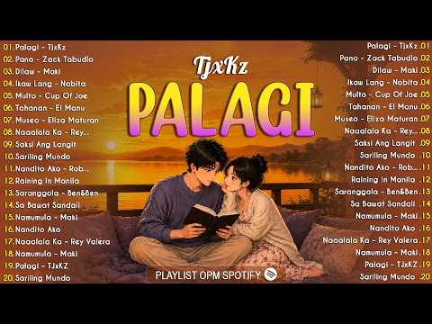
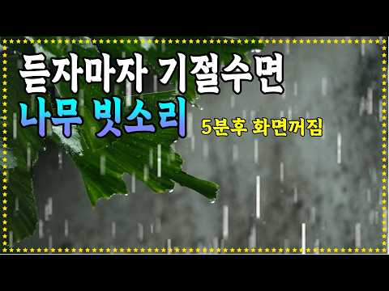
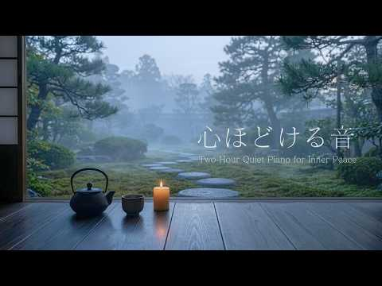
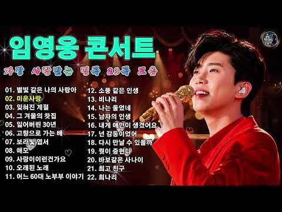
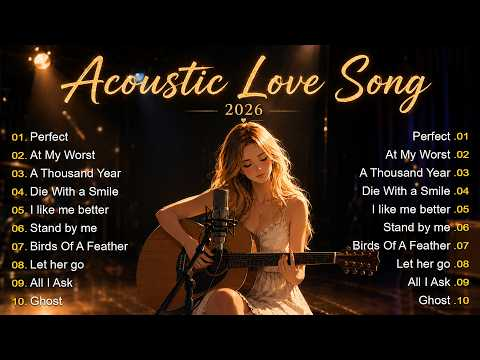
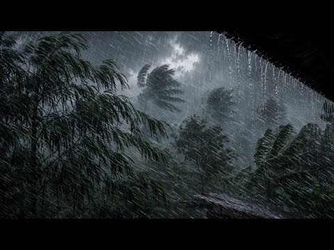

# 음악 — 성공 사례 분석: 사례별 자세히 #401–#440

`analysis.md` 의 9번 (같은 # 번호). 자동 생성 — `tools/success_analysis.py` v1.5.1 (2026-10-23 07:49 UTC). ※ 연구·교육용 — 투자 권유가 아님.

### 401. Sholey Title Music ∣ Music Maker Abani ∣ Instrumental Cover

- https://www.youtube.com/watch?v=ajRxp64xcN8 · MUSIC MAKER ABANI · 구독자 5,850 · 조회수 775,285 (×132.5, 하루 6,533.0) · 좋아요 13,813 (1.8%) · 4.7분 · 2026-06-26 · 주제 묶음 6. 피아노·클래식·연주곡 · 형식 커버·직접 부른 노래 · 폴더 `W_ajRxp64xcN8` (웹 승인)
- 썸네일: 
- 설명 앞부분: MUSIC ARRANGEMENT : ABANI BISWAS KEY-BOARD PROGRAMMING : ABANI BISWAS PERFOM BY : STUDENTS OF ABANI BISWAS PIANO : AIDITI (DUSTU) TRUMPET : PRATYUSHA SAXOPHON : AIKANTIK, SAHIN, ARUPA, TRISHNA, ANKITA, MOURPIYA, SOUVIK, PRITHWIRAJ, AYUSH INDIAN RYTHM : SOMIT MUKHERJEE (RAMU DA) BACKING ACOUSTIC BRA…
- 대본 없음 (설명) — 음성인식이 끝나면 도입부·흐름이 들어감
- 댓글 1,423/1,433: 좋은 점 — 영상 0 · 감사·응원 0 · 더 알고 싶은 것 0 · 아쉬운 점 — 영상 0 · 반박·불만 — 의견 다름 0 · 정치·사회 0 · 경험 공유 0 · 구독·다음 기대 0

### 402. 𝐏𝐥𝐚𝐲𝐥𝐢𝐬𝐭 듣자마자 텐션 업🔥K-POP 여돌 노래 모음 노동요

- https://www.youtube.com/watch?v=xtfreKB54KQ · 클로버 플레이리스트 · 구독자 3,580 · 조회수 472,537 (×132.0, 하루 4,093.0) · 좋아요 2,675 (0.6%) · 53분 · 2026-06-29 · 주제 묶음 10. 팝송·K팝·J팝 · 형식 플레이리스트·모음 (여러 곡) · 폴더 `W_xtfreKB54KQ` (웹 승인)
- 썸네일: 
- 같은 채널 평소 대비 ×6.8 (채널 최근 롱폼 중앙값 69,318회) · 평소 영상: 𝐏𝐥𝐚𝐲𝐥𝐢𝐬𝐭 엔믹스 한 번 빠지면 못 나오는🫧 NMIXX 노래 모음 노동요 (75,231회) / 𝐏𝐥𝐚𝐲𝐥𝐢𝐬𝐭 듣는 순간 미쳐버리는 3세대 케이팝 노래 모음 노동요 플레이리스트 (63,406회)
- 대본 없음 (없음) — 음성인식이 끝나면 도입부·흐름이 들어감
- 댓글 39/39: 좋은 점 — 영상 1 · 감사·응원 1 · 더 알고 싶은 것 0 · 아쉬운 점 — 영상 0 · 반박·불만 — 의견 다름 0 · 정치·사회 0 · 경험 공유 1 · 구독·다음 기대 0
  - 좋은 점 — 영상 👍1 “노래들 다 넘 제 취향 이예용❤ 좋은 영상 만들어주셔서 감사합니다❤❤❤”
  - 감사·응원 👍1 “노래들 다 넘 제 취향 이예용❤ 좋은 영상 만들어주셔서 감사합니다❤❤❤”
  - 경험 공유 👍4 “제가 제일 좋아하는 플리에요!!매일 공부하면서 들어요!”

### 403. [空靈鼓療癒音樂🎶]｜放鬆、舒壓、冥想、安眠｜Steel Tongue Drum Healing Music｜SUNO pro

- https://www.youtube.com/watch?v=a_8Hi2u43Q4 · AIMF Music Factory  · 구독자 1,250 · 조회수 163,880 (×131.1, 하루 1,211.4) · 좋아요 1,532 (0.9%) · 93.1분 · 2026-06-10 · 주제 묶음 1. 수면·명상·힐링 · 형식 AI 음악 · 폴더 `W_a_8Hi2u43Q4` (웹 승인)
- 썸네일: 
- 설명 앞부분: 🎼Music by AIMF from SUNO pro ⭐️Video production APP:Capcut+快影 ⭐️Video creators:AIMF
- 같은 채널 평소 대비 ×969.7 (채널 최근 롱폼 중앙값 169회) · 평소 영상: [🌕月圓的時候，想起了家]｜中秋節・團圓・思念｜Mid-Autumn Festival｜AI創作歌曲 (169회) / [❤️往後餘生，剛好是你]｜AI創作歌曲｜謝謝你出現在我的生命裡｜溫柔系愛情歌曲・Wedding … (141회)
- 대본 없음 (설명) — 음성인식이 끝나면 도입부·흐름이 들어감
- 댓글 12/12: 좋은 점 — 영상 0 · 감사·응원 0 · 더 알고 싶은 것 0 · 아쉬운 점 — 영상 0 · 반박·불만 — 의견 다름 0 · 정치·사회 0 · 경험 공유 0 · 구독·다음 기대 0

### 404. Best Morning Powerful Mantras ∣ Shiva, Ganesh, Hanuman, Vishnu & Lakshmi ∣ Destroy Negati…

- https://www.youtube.com/watch?v=CFV27iuas7Q · Sacred Naad · 구독자 22,300 · 조회수 2,856,394 (×128.1, 하루 40,640.7) · 좋아요 25,854 (0.9%) · 15.7분 · 2026-08-14 · 주제 묶음 1. 수면·명상·힐링 · 형식 음악 (그 밖 모양 — 한 편짜리 BGM 등) · 폴더 `W_CFV27iuas7Q` (웹 승인)
- 썸네일: 
- 설명 앞부분: egin your day with divine blessings, peaceful vibrations, and powerful spiritual energy through this Complete Morning Prayer Collection. This soulful devotional compilation brings together sacred prayers and mantras dedicated to Lord Ganesha, Lord Shiva, Maa Durga, Surya Dev, Hanuman Ji, Maa Lakshm…
- 같은 채널 평소 대비 ×3,517.7 (채널 최근 롱폼 중앙값 812회) · 평소 영상: सुबह की प्रार्थना के 12 श्लोक ∣ Morning Prayer Sa… (859회) / एक तू ही सहारा ❤️ Mahadev Bhajan ∣ मन को शांति दे… (765회)
- 대본 없음 (설명) — 음성인식이 끝나면 도입부·흐름이 들어감
- 댓글 973/1,034: 좋은 점 — 영상 0 · 감사·응원 0 · 더 알고 싶은 것 0 · 아쉬운 점 — 영상 0 · 반박·불만 — 의견 다름 0 · 정치·사회 0 · 경험 공유 0 · 구독·다음 기대 0

### 405. TANGGAL STRESS MO DITO 🔥🎶 ∣ DUB REGGAE MIX 🎶🔥🇵🇭

- https://www.youtube.com/watch?v=0m7BLfBl2f8 · RELAX REGGAE PH · 구독자 13,800 · 조회수 1,766,286 (×128.0, 하루 23,539.8) · 좋아요 6,179 (0.4%) · 74.8분 · 2026-08-09 · 주제 묶음 8. 로파이·시티팝·칠 · 형식 음악 (그 밖 모양 — 한 편짜리 BGM 등) · 폴더 `W_0m7BLfBl2f8` (웹 승인)
- 썸네일: 
- 설명 앞부분: 🎶 TANGGAL STRESS MO DITO ∣ Dub Reggae Mix 🎶 Pagod sa trabaho? Stress sa araw-araw? Relax muna at hayaan ang magandang tunog ng Dub Reggae Mix na ito ang magpagaan ng iyong isip. Huminga nang malalim, pumikit, at damhin ang chill vibes na hatid ng bawat beat. Kung mahilig ka sa reggae music, tamang-…
- 같은 채널 평소 대비 ×1,956.0 (채널 최근 롱폼 중앙값 903회) · 평소 영상: NAGPAPAGAAN NG PAKIRAMDAM 🔥🎶 ∣ DUB REGGAE MIX 🔥🎶🇵🇭 (903회) / GRABE ANG SARAP SA TENGA 🔥🎶 ∣ DUB REGGAE MIX 🔥🎶🇵🇭 (863회)
- 대본 없음 (설명) — 음성인식이 끝나면 도입부·흐름이 들어감
- 댓글 256/261: 좋은 점 — 영상 0 · 감사·응원 0 · 더 알고 싶은 것 0 · 아쉬운 점 — 영상 0 · 반박·불만 — 의견 다름 0 · 정치·사회 0 · 경험 공유 0 · 구독·다음 기대 0

### 406. 𝐏𝐥𝐚𝐲𝐥𝐢𝐬𝐭 비에 젖은 와인향

- https://www.youtube.com/watch?v=Pt3nGKCTF2U · 유월 · 구독자 3,770 · 조회수 482,305 (×127.9, 하루 3,352.4) · 좋아요 12,350 (2.6%) · 21.1분 · 2026-06-01 · 주제 묶음 기타 · 형식 플레이리스트·모음 (여러 곡) · 폴더 `W_Pt3nGKCTF2U` (웹 승인)
- 썸네일: 
- 챕터: 0:00 로꼬, 화사(HWASA) - 주지마 · 3:54 릴러말즈(Leellamarz), 미노이(Meenoi)… · 7:31 정국(Jungkook) - Still With You · 11:31 Seori - 긴 밤 (Feat. 기리보이) · 15:02 OnlyOneOf(온리원오브) - dOra maar · 18:22 종현(JONGHYUN) - Moon
- 설명 앞부분: ‘손 끝에 짙게 남은 와인 잔향‘𓈒 이번에는 주인장표 습도 높은 몽환 R&B 플리로 말아왔어요. 비에 젖은 와인향 같은 노래들로 꾹꾹 눌러 담아왔으니, 이번에도 맛봐 주실 거죠? 🍷 𓈒𓏸 𓂂
- 같은 채널 평소 대비 ×13.9 (채널 최근 롱폼 중앙값 34,790회) · 평소 영상: 𝐏𝐥𝐚𝐲𝐥𝐢𝐬𝐭 내 옆에서 자꾸 한 눈 팔지마 (34,790회) / 𝐏𝐥𝐚𝐲𝐥𝐢𝐬𝐭 이미 네게 넘어갔는데 (19,202회)
- 대본 없음 (설명) — 음성인식이 끝나면 도입부·흐름이 들어감
- 댓글 124/124: 좋은 점 — 영상 0 · 감사·응원 4 · 더 알고 싶은 것 3 · 아쉬운 점 — 영상 1 · 반박·불만 — 의견 다름 0 · 정치·사회 0 · 경험 공유 3 · 구독·다음 기대 0
  - 감사·응원 👍5 “감사합니다 시험 기간에 미쳐서 슬라임만들면서 들었어요 ㅎ”
  - 감사·응원 👍3 “제 최애 플리로 당첨슨 .. 너무 감사드려요 ♡”
  - 더 알고 싶은 것 👍54 “아 진짜 주인장 제발 이 플레이리스트 더 길게 만들어주세요 제발요”
  - 더 알고 싶은 것 👍8 “사진 출처 어딘지 알수있을까요?”
  - 아쉬운 점 — 영상 👍7 “온리원오브 노래 들어간 플리 처음 봤어요ㅜㅜ 너무 반갑다.. 온리원오브에 비슷한 분위기의 매력적인 노래 많으니까 많이 찾아 들어주셨으면 좋겠어요.. 해체하는 바람에 더 좋은 노래 못 들어서 아쉽네요,,”
  - 경험 공유 👍5 “오늘 내가 제일 치명적이다”
  - 경험 공유 👍3 “정말루 내가 이 플리 조회수 100은 올린것가틈 ㄴㅁ 고능해”

### 407. Happy Jazz Music ☕ Bossa Nova background for Relaxing, Great Moods and Happy Moods

- https://www.youtube.com/watch?v=YTpDlQvvT3Q · Golden Roast Jazz Club · 구독자 10,900 · 조회수 1,390,352 (×127.6, 하루 8,508.4) · 좋아요 6,581 (0.5%) · 70.6분 · 2026-05-12 · 주제 묶음 7. 재즈·보사노바 · 형식 음악 (그 밖 모양 — 한 편짜리 BGM 등) · 폴더 `W_YTpDlQvvT3Q` (웹 승인)
- 썸네일: 
- 설명 앞부분: Welcome to Golden Roast Jazz Club — your cozy escape into the world of smooth jazz, warm coffee vibes, and relaxing atmospheres. ☕🎷 This channel is dedicated to bringing you the perfect blend of soft jazz, lounge music, bossa nova, and chill instrumentals — ideal for studying, working, relaxing, or…
- 같은 채널 평소 대비 ×1,167.4 (채널 최근 롱폼 중앙값 1,191회) · 평소 영상: Fall Morning Jazz ☕ Bossa Nova background for Rel… (1,206회) / Good Mood Jazz ☕ Bossa Nova instrumental for Stud… (1,176회)
- 대본 없음 (설명) — 음성인식이 끝나면 도입부·흐름이 들어감
- 댓글 189/199: 좋은 점 — 영상 0 · 감사·응원 0 · 더 알고 싶은 것 0 · 아쉬운 점 — 영상 0 · 반박·불만 — 의견 다름 0 · 정치·사회 0 · 경험 공유 0 · 구독·다음 기대 0

### 408. Không Buông x Từng Là Của Nhau x Tìm Em - HNGLE x BẢO ANH ∣ Những Bản Hits Nhạc Trẻ Chill…

- https://www.youtube.com/watch?v=wVLhvXB2flE · Chà Là Chill · 구독자 38,900 · 조회수 4,959,526 (×127.5, 하루 52,236.8) · 좋아요 15,537 (0.3%) · 91.8분 · 2026-07-20 · 주제 묶음 8. 로파이·시티팝·칠 · 형식 음악 (그 밖 모양 — 한 편짜리 BGM 등) · 폴더 `W_wVLhvXB2flE` (웹 승인)
- 썸네일: 
- 챕터: 0:00 Không Buông · 4:45 Từng Là Của Nhau · 8:31 Vet Thuong · 12:26 Luu Luyen Sau Chia Tay · 17:09 Có Hẹn Với Thanh Xuân · 20:48 Tình Mình Lạ Kì · 24:46 Suýt Nữa Thì · 29:39 Để Tôi Ôm Em Bằng Giai Điệu N… · 34:17 Mùa Hè Năm Ấy 2 · 38:22 Sợ · 42:20 Nam Ay · 46:38 Tình Yêu Chậm Trễ · 51:07 Hẹn E Ở Lần Yêu Thứ 2 · 57:01 Them Bao Nhieu Lau Giong Nam · 60:45 Cô Ấy Của Anh Chuẩn · 64:55 Cự Tuyệt · 68:31 Đâu Ai Biết Trước · 72:51 Em Mang Đi Mùa Hạ · 78:06 Co Dieu Gi Sau Khong Noi Cung… · 82:15 Gửi
- 설명 앞부분: Không Buông x Tìm Em x Từng Là Của Nhau - HNGLE x BẢO ANH ∣ Những Bản Hits Nhạc Trẻ Chill Triệu View là playlist tổng hợp những bản nhạc chill ballad Việt 2026 với giai điệu nhẹ nhàng, sâu lắng và đầy cảm xúc. Không Buông, Tìm Em, Từng Là Của Nhau mang đến không gian âm nhạc thư giãn, phù hợp để ng…
- 같은 채널 평소 대비 ×39.9 (채널 최근 롱폼 중앙값 124,209회) · 평소 영상: Không Buông...Tìm Em - Hngle x Bảo Anh ∣ Playlist… (124,209회) / Hoa sữa, cốm và em...Em có đến cùng mùa thu? 🍃🍂 𝐏… (112,471회)
- 대본 없음 (설명) — 음성인식이 끝나면 도입부·흐름이 들어감
- 댓글 609/614: 좋은 점 — 영상 0 · 감사·응원 0 · 더 알고 싶은 것 0 · 아쉬운 점 — 영상 0 · 반박·불만 — 의견 다름 0 · 정치·사회 0 · 경험 공유 0 · 구독·다음 기대 0

### 409. The Most Trending OPM Acoustic Songs on Spotify 2026 ✨ ∣ Viral Tagalog & Filipino Love So…

- https://www.youtube.com/watch?v=MbnaF3T2450 · Calm Guitar · 구독자 11,600 · 조회수 1,468,125 (×126.6, 하루 20,010.7) · 좋아요 5,891 (0.4%) · 63.8분 · 2026-08-10 · 주제 묶음 6. 피아노·클래식·연주곡 · 형식 플레이리스트·모음 (여러 곡) · 폴더 `W_MbnaF3T2450` (웹 승인)
- 썸네일: 
- 설명 앞부분: Welcome to Calm Guitar — your relaxing space for the most trending OPM acoustic songs of 2026. Enjoy a heartfelt collection of Tagalog love songs, viral Filipino hits, and soothing acoustic melodies inspired by today’s popular OPM music. This playlist is perfect for late-night listening, studying, …
- 같은 채널 평소 대비 ×121.6 (채널 최근 롱폼 중앙값 12,075회) · 평소 영상: Latest Filipino Music 2026 🇵🇭 ∣ OPM Love Songs ∣ … (12,075회) / 🎧 Top OPM Songs Philippines 2026 🇵🇭 ∣ New Tagalog… (11,697회)
- 대본 없음 (설명) — 음성인식이 끝나면 도입부·흐름이 들어감
- 댓글 121/129: 좋은 점 — 영상 0 · 감사·응원 0 · 더 알고 싶은 것 0 · 아쉬운 점 — 영상 0 · 반박·불만 — 의견 다름 0 · 정치·사회 0 · 경험 공유 0 · 구독·다음 기대 0

### 410. 🎵 전체듣기 ∣ 에헤야~ 막걸리 한 잔 하세 🍶 ∣힐링 국악

- https://www.youtube.com/watch?v=KYXF2WEd2Ew · 에헤라디여 5060 · 구독자 357 · 조회수 45,092 (×126.3, 하루 322.4) · 좋아요 337 (0.8%) · 4.2분 · 2026-06-05 · 주제 묶음 1. 수면·명상·힐링 · 형식 플레이리스트·모음 (여러 곡) · 폴더 `W_KYXF2WEd2Ew` (웹 승인)
- 썸네일: 
- 설명 앞부분: 얼씨구~ 달 밝은 밤, 막걸리 한 사발 앞에 앉아 오늘 하루 수고한 나에게 건네는 따뜻한 한 잔 🍶 장단 따라 어깨 들썩, 시린 속도 한잔 넘기면 세상살이 좀 괜찮더라 ☕ 마음이 편안해지는 다음 곡도 함께 들어보세요 [1시간 연속듣기] 🍶 막걸리 한잔하세 외 8곡 ∣ 5060 인생공감 힐링 국악트롯 전곡 무한반복 작사 : 에헤라디여 작곡 : AI 가락
- 같은 채널 평소 대비 ×120.6 (채널 최근 롱폼 중앙값 374회) · 평소 영상: 인생이란 뭐있나! 오늘도 웃으며 한잔하세!" 🍻 우리네 인생을 위로하는 감성 국악트롯 5… (543회) / 동생아 동생아/하늘에 있는 동생에게 전하는 마지막 편지 ∣ 5060 힐링음악 (551회)
- 대본 없음 (설명) — 음성인식이 끝나면 도입부·흐름이 들어감
- 댓글 30/30: 좋은 점 — 영상 1 · 감사·응원 5 · 더 알고 싶은 것 0 · 아쉬운 점 — 영상 0 · 반박·불만 — 의견 다름 0 · 정치·사회 0 · 경험 공유 0 · 구독·다음 기대 0
  - 좋은 점 — 영상 👍3 “좋은영상감사합니다❤”
  - 감사·응원 👍3 “나에영원히 인연 입니다감사100세까지쭉......”
  - 감사·응원 👍3 “5060_은 숫짜입니다 막걸리 가락에 어깨가 들썩이는 분들은 ,,산전수전_격으신 분들이라 마음합니다. *저는57년(정유생)입니다. ^함께함에 감사합니다”

### 411. 당신의 피아노 레벨은? (Lv.1~Lv.8 + 라캄파넬라) ∣ What is your Piano Level? 🎹

- https://www.youtube.com/watch?v=1E5Zi3Gs1ys · Bony_Musician · 구독자 674 · 조회수 84,463 (×125.3, 하루 607.4) · 좋아요 1,616 (1.9%) · 6.5분 · 2026-06-06 · 주제 묶음 6. 피아노·클래식·연주곡 · 형식 연주 (직접 연주하는 영상) · 폴더 `W_1E5Zi3Gs1ys` (웹 승인)
- 썸네일: 
- 설명 앞부분: 여러분의 피아노 실력은 과연 몇 단계인가요? 🎹🤔 가장 기초적인 Lv.1 단계부터 손가락이 날아다니는 마의 Lv.8 단계까지, 대중적인 클래식/뉴에이지 명곡들로 피아노 레벨 테스트 영상을 준비했습니다! 그리고 영상 맨 마지막에는 전설의 악마의 곡, 라 캄파넬라(La Campanella)가 보너스 최종 보스 레벨로 기다리고 있으니 끝까지 놓치지 마세요! 🔥 평소 피아노 난이도 순위나 재미있는 피아노 챌린지 영상을 검색해 들어오신 분들 모두 환영합니다. 영상을 보시면서 여러분이 연주할 수 있는 가장 높은 레벨은 몇 단계인지, 혹은 가…
- 대본 없음 (설명) — 음성인식이 끝나면 도입부·흐름이 들어감
- 댓글 340/340: 좋은 점 — 영상 2 · 감사·응원 7 · 더 알고 싶은 것 8 · 아쉬운 점 — 영상 0 · 반박·불만 — 의견 다름 2 · 정치·사회 0 · 경험 공유 24 · 구독·다음 기대 3
  - 좋은 점 — 영상 👍2 “전 개인적으로 쇼팽 왈츠가 캐리비안보다 어려운것 같네용 전 8단계 다 칠 수 있슴돠 (피아노 15년 배웠는데 라캄파넬라 못치는 고1.. ㅋㅋ)”
  - 좋은 점 — 영상 👍1 “좋은 영상 감사합니다. 저는 실력은 3단계 수준이지만 쇼팽의 왈츠는 흉내는 낼 수 있어요!”
  - 감사·응원 👍1 “좋은 영상 감사합니다. 저는 실력은 3단계 수준이지만 쇼팽의 왈츠는 흉내는 낼 수 있어요!”
  - 감사·응원 👍1 “7살때부터 피아노 친 체르니 40 5학년 잼민이입니다! 오래 친거에 비해 대회 준비를 안했어서.. 칠수있는게 많진 않았지만 최근 대회 준비를 시작했어서 연주곡들 보시고 제 레벨 체크해주시면 감사하겠습니다 🙇‍♀️ 4학년: 랑게-간절한 행운 (학년대상, 3등상) / 하…”
  - 더 알고 싶은 것 👍3 “슈베르트 즉흥곡 2번은 몇정도 될까요?”
  - 더 알고 싶은 것 👍2 “3년 다녀서 7~8단계용 혹시 15 Etudes de Virtuosite Op. 72 No. 6 은 레벨이 어느정도 일까요?”
  - 반박·불만 — 의견 다름 👍1 “저 초보자 아닌데 왜 리버 플라워... 치고있지?”
  - 경험 공유 👍3 “지금 5학년인데 레벨7이면 괜찮은거에요? 자금 피아노 5년차임다”
  - 경험 공유 👍3 “저 라캄파넬라 샵 그대로 해서 제가 편곡해서쳐요..초4임요”
  - 구독·다음 기대 👍6 “구독했구요 근데 베토벤 소나타 비창 3악장이랑 베토벤 월광 소나타 둘 중에 어떤게 더 어렵지?”
  - 구독·다음 기대 👍2 “134번째로 구독하고감니다”

### 412. 듣자 마자 바로 잠드는 숲속 시원한 빗소리 ASMR (Rain Sounds), 불면증 완화, 힐링 빗소리

- https://www.youtube.com/watch?v=berSZ8YAKP8 · Cozy Rain on Leaves · 구독자 3,290 · 조회수 412,131 (×125.3, 하루 2,885.8) · 좋아요 3,937 (1.0%) · 180분 · 2026-06-02 · 주제 묶음 2. 자연 소리·백색소음 · 형식 자연 소리·백색소음 (음악 낱말 없는 제목) · 폴더 `W_berSZ8YAKP8` (웹 승인)
- 썸네일: 
- 설명 앞부분: 초록빛 숲속의 나뭇잎에 떨어지는 빗방울은 세상을 차분하게 잠재웁니다. 시원한 빗줄기를 가만히 바라보고 있으면, 복잡했던 마음도 어느새 씻겨 내려가는 듯합니다. 오늘도 이 공간을 찾아주신 모든 분들이 평온한 밤 보내시길 진심으로 응원합니다. 편안한 밤 되세요. 💤 🎧 Real Sound: 비오는 날 직접 현장에서 녹음한 실제 빗소리만을 사용하여 깊은 입체적인 몰입감을 드립니다.
- 같은 채널 평소 대비 ×92.7 (채널 최근 롱폼 중앙값 4,445회) · 평소 영상: 푹 자고 싶을 때 세상 모르게 잠들게 하는 빗소리 ASMR ∣ 불면증과 이명 치료를 위한… (4,445회) / 오늘도 편안한 빗소리로 불면증을 극복하세요. 🌲숲속의 수면 빗소리 ASMR (Rain S… (4,599회)
- 대본 없음 (설명) — 음성인식이 끝나면 도입부·흐름이 들어감
- 댓글 144/144: 좋은 점 — 영상 5 · 감사·응원 6 · 더 알고 싶은 것 0 · 아쉬운 점 — 영상 0 · 반박·불만 — 의견 다름 0 · 정치·사회 0 · 경험 공유 0 · 구독·다음 기대 1
  - 좋은 점 — 영상 👍54 “빗소리가 부드럽고 그윽하게 들려서 듣기 편안합니다. 어떤 빗소리는 탁탁 튀는 것 같은 가벼운 소리가 나요.”
  - 좋은 점 — 영상 👍34 “아주듣기좋은빗소리 서늘한빗소리가나무잎으로떨어지는소리 잠자기딱좋은빗소리 로스안젤스애서❤😂🎉😢😮😅”
  - 감사·응원 👍20 “빗소리 든고있으니 가슴도 시원하고 기분이 좋아젔어요. 감사해요 😊”
  - 감사·응원 👍13 “빗소리 좋은 영상 감사합니다.”
  - 구독·다음 기대 👍2 “구독했어요 ㅡ빗소리좋네요ㅡ불면증심해서ㅡ”

### 413. 𝐏𝐥𝐚𝐲𝐥𝐢𝐬𝐭 그냥 네 눈동자가 예뻤어

- https://www.youtube.com/watch?v=FOjiqNxjDDw · 유월 · 구독자 3,770 · 조회수 469,822 (×124.6, 하루 2,976.8) · 좋아요 6,306 (1.3%) · 21.9분 · 2026-05-18 · 주제 묶음 기타 · 형식 플레이리스트·모음 (여러 곡) · 폴더 `W_FOjiqNxjDDw` (웹 승인)
- 썸네일: 
- 챕터: 0:00 박재범(JAY PARK) - All I Wanna D… · 3:37 쿠기(Coogie) - Alone (Feat. 이하이) · 6:36 그루비룸(GroovyRoom) - Yes or No … · 9:34 범키(BUMKEY) - 갖고놀래(Attraction)… · 13:10 쿠기(Coogie) - Two Pills · 16:09 BOYCOLD - 바람바람~ (Feat. BIG Na… · 18:54 쿠기(Coogie) - Right Now (Feat.…
- 설명 앞부분: 이런 느좋 국힙 좋아하시는 분 있죠? 이 주인장이 맛도리로 낋여왔어요. 한 번 맛 봐주세요
- 같은 채널 평소 대비 ×13.5 (채널 최근 롱폼 중앙값 34,790회) · 평소 영상: 𝐏𝐥𝐚𝐲𝐥𝐢𝐬𝐭 내 옆에서 자꾸 한 눈 팔지마 (34,790회) / 𝐏𝐥𝐚𝐲𝐥𝐢𝐬𝐭 이미 네게 넘어갔는데 (19,202회)
- 대본 없음 (설명) — 음성인식이 끝나면 도입부·흐름이 들어감
- 댓글 67/67: 좋은 점 — 영상 1 · 감사·응원 1 · 더 알고 싶은 것 1 · 아쉬운 점 — 영상 0 · 반박·불만 — 의견 다름 0 · 정치·사회 0 · 경험 공유 1 · 구독·다음 기대 0
  - 좋은 점 — 영상 👍12 “pip 안되는분들을 위한 꿀팁 1.유튜브 프리미엄 이벤트할때 무료체험하기 2. 영상 링크 복사해서 사파리에 붙여넣고 틀고 나가면 pip돼용 미소녀들 플리 열시미 듣자!!!~~”
  - 감사·응원 👍7 “와 쌤 답장 해주는 거 너무 감동.. 진짜 느좋 플리에 느좋 말투.. 응원하고 갑니둥!!!!”
  - 더 알고 싶은 것 👍8 “다 좋아하는 노래예용 ㅠ 이런 감성힙합으로 사람들이 잘 모르는 숨겨진 띵곡 플리도 만들어주실 수 있나여??”
  - 경험 공유 👍4 “아씨 개좋다ㅠㅠ 제가 좋아요 3천 만들엇어여🫰🏻🫰🏻🥰”

### 414. NAAD ∣ Powerful Instrumental Invocation #SpiritualMusic #DrumMusic #MeditationMusic

- https://www.youtube.com/watch?v=bc4vTfxeLZk · shivam saraswat Bhakti songs  · 구독자 3,380 · 조회수 417,262 (×123.5, 하루 2,852.9) · 좋아요 4,861 (1.2%) · 7.9분 · 2026-05-30 · 주제 묶음 6. 피아노·클래식·연주곡 · 형식 음악 (그 밖 모양 — 한 편짜리 BGM 등) · 폴더 `W_bc4vTfxeLZk` (웹 승인)
- 썸네일: 
- 설명 앞부분: Feel the power of sound. “Naad – The Invocation” is a cinematic instrumental journey inspired by ancient vibrations, spiritual energy, and powerful Indian percussion. Deep drums, dark ambience, and epic textures come together to create an immersive experience. 🎧 Best enjoyed with headphones. 🔥 Perf…
- 같은 채널 평소 대비 ×1,511.8 (채널 최근 롱폼 중앙값 276회) · 평소 영상: राम नाम ही सच्चा सहारा ∣ Ram Bhajan ।बुंदेली लोक … (276회) / 🔱 भोलेनाथ तेरे दर पे आया ∣ Shiv Bhajan 2026 ∣ Saw… (278회)
- 대본 없음 (설명) — 음성인식이 끝나면 도입부·흐름이 들어감
- 댓글 60/60: 좋은 점 — 영상 0 · 감사·응원 0 · 더 알고 싶은 것 0 · 아쉬운 점 — 영상 0 · 반박·불만 — 의견 다름 0 · 정치·사회 0 · 경험 공유 0 · 구독·다음 기대 0

### 415. Nhạc không lời Piano & Mưa Vol.1 ∣ Piano Thư Giãn, Học Bài, Ngủ Ngon ∣ Trí Nhật Piano

- https://www.youtube.com/watch?v=tddKxQYCNlM · Trí Nhật Piano · 구독자 8,640 · 조회수 1,064,931 (×123.3, 하루 6,620.0) · 좋아요 4,009 (0.4%) · 123분 · 2026-05-15 · 주제 묶음 6. 피아노·클래식·연주곡 · 형식 커버·직접 부른 노래 · 폴더 `W_tddKxQYCNlM` (웹 승인)
- 썸네일: 
- 챕터: 0:00 Vết Mưa Piano · 3:44 Yêu Em Thì Gật Đầu · 8:35 Dấu Mưa · 13:30 Cỏ Dại và Hoa Dành Dành · 17:48 Chiều Nay Không Có Mưa Bay
- 설명 앞부분: Nhạc không lời Piano & Mưa Vol.1 ∣ Piano Thư Giãn, Học Bài, Ngủ Ngon ∣ Trí Nhật Piano Danh sách các bản nhạc trong Piano & Mưa Vol.1 Chào mừng bạn đến với TRÍ NHẬT PIANO – nơi mình chia sẻ những bản nhạc piano nhẹ nhàng, sâu lắng, giúp bạn thư giãn, tập trung học tập – làm việc hoặc đơn giản là tìm…
- 같은 채널 평소 대비 ×368.6 (채널 최근 롱폼 중앙값 2,889회) · 평소 영상: Hồn Nhiên Piano Cover ∣ Theme Song from "LÊN HƯƠN… (2,896회) / Giá Như Anh Là Em Piano Cover ∣ Piano Không Lời N… (2,882회)
- 대본 없음 (설명) — 음성인식이 끝나면 도입부·흐름이 들어감
- 댓글 250/257: 좋은 점 — 영상 0 · 감사·응원 0 · 더 알고 싶은 것 0 · 아쉬운 점 — 영상 0 · 반박·불만 — 의견 다름 0 · 정치·사회 0 · 경험 공유 0 · 구독·다음 기대 0

### 416. Without You Lord, I Am Nothing ∣ Inspirational Christian Worship Song 2026

- https://www.youtube.com/watch?v=4TI0GkgfvKk · Music of Faith  · 구독자 28,000 · 조회수 3,447,955 (×123.1, 하루 22,010.6) · 좋아요 0 (0.0%) · 6분 · 2026-05-19 · 주제 묶음 15. CCM·찬양·국악·동요 · 형식 음악 (그 밖 모양 — 한 편짜리 BGM 등) · 폴더 `W_4TI0GkgfvKk` (웹 승인)
- 썸네일: 
- 설명 앞부분: “Without You Lord, I Am Nothing” is a deeply emotional Christian worship song about surrender, grace, healing, and complete dependence on God. Featuring heartfelt female vocals, deep blending harmonies, cinematic worship melodies, soft piano, and powerful lyrics, this worship ballad reminds every b…
- 같은 채널 평소 대비 ×718.9 (채널 최근 롱폼 중앙값 4,796회) · 평소 영상: The Great Physician ∣ Healing Prayer Worship Song… (4,796회) / Heal Me, Lord ∣ Official Music Video ∣ Christian … (4,532회)
- 대본 없음 (설명) — 음성인식이 끝나면 도입부·흐름이 들어감
- 댓글 2,138/2,153: 좋은 점 — 영상 0 · 감사·응원 0 · 더 알고 싶은 것 0 · 아쉬운 점 — 영상 0 · 반박·불만 — 의견 다름 1 · 정치·사회 0 · 경험 공유 1 · 구독·다음 기대 0
  - 반박·불만 — 의견 다름 👍0 “가사: 주님 없이는 아무것도 아닙니다. 소개 때로는 우리는 혼자서 삶의 무게를 짊어지려고 합니다... 우리가 충분히 강하고, 충분히 현명하고, 충분히 온전한 척하는 척하는 것... 하지만 밤이 고요해지면, 그리고 모든 가면이 땅에 떨어지죠. 우리는 진실을 깨닫고 있습…”
  - 경험 공유 👍0 “가사: 주님 없이는 아무것도 아닙니다. 소개 때로는 우리는 혼자서 삶의 무게를 짊어지려고 합니다... 우리가 충분히 강하고, 충분히 현명하고, 충분히 온전한 척하는 척하는 것... 하지만 밤이 고요해지면, 그리고 모든 가면이 땅에 떨어지죠. 우리는 진실을 깨닫고 있습…”

### 417. Dragon Ball GT Celtic Fantasy Music ∣ Relax Music for Focus Study, Work - Dan Dan Kokoro …

- https://www.youtube.com/watch?v=fJ6rnqkvyCk · Medieval Echoes · 구독자 1,190 · 조회수 145,767 (×122.5, 하루 811.1) · 좋아요 4,591 (3.1%) · 9분 · 2026-04-26 · 주제 묶음 3. 공부·집중·작업 · 형식 음악 (그 밖 모양 — 한 편짜리 BGM 등) · 폴더 `W_fJ6rnqkvyCk` (웹 승인)
- 썸네일: 
- 설명 앞부분: Step into a magical and relaxing journey through a timeless landscape where nostalgia and tranquility coexist. This exclusive collection features a beautiful, deeply emotional, and reimagined melody of Dragon Ball GT's iconic theme — Dan Dan Kokoro Hikareteku — through unique Celtic and Medieval-in…
- 같은 채널 평소 대비 ×571.6 (채널 최근 롱폼 중앙값 255회) · 평소 영상: Deep Relaxation Under the Northern Lights ∣ 432Hz… (264회) / One Piece Celtic Relax Music Cover ∣ Music for St… (246회)
- 대본 없음 (설명) — 음성인식이 끝나면 도입부·흐름이 들어감
- 댓글 202/202: 좋은 점 — 영상 0 · 감사·응원 0 · 더 알고 싶은 것 0 · 아쉬운 점 — 영상 0 · 반박·불만 — 의견 다름 0 · 정치·사회 0 · 경험 공유 0 · 구독·다음 기대 0

### 418. My Soundscape for Sleeping at the Edge of the Universe

- https://www.youtube.com/watch?v=fsxvm6W4EoY · Polarity Ambient · 구독자 8,820 · 조회수 1,078,418 (×122.3, 하루 9,843.1) · 좋아요 35,745 (3.3%) · 35.9분 · 2026-07-05 · 주제 묶음 1. 수면·명상·힐링 · 형식 음악 (그 밖 모양 — 한 편짜리 BGM 등) · 폴더 `W_fsxvm6W4EoY` (웹 승인)
- 썸네일: 
- 설명 앞부분: In this modular Bitwig patch, I tried to create the feeling of floating at the edge of the universe, far away from everything. It’s built from soft noise, slow-moving oscillators, long reverb tails, pitch shifting, random notes, and tiny details that drift in and out like distant signals. The patch…
- 같은 채널 평소 대비 ×151.4 (채널 최근 롱폼 중앙값 7,125회) · 평소 영상: This Patch Sounds Like a Deep Cinematic Blade Run… (7,130회) / This Patch Sounds Like a Living Ambient Organism (7,120회)
- 대본 없음 (설명) — 음성인식이 끝나면 도입부·흐름이 들어감
- 댓글 884/895: 좋은 점 — 영상 0 · 감사·응원 0 · 더 알고 싶은 것 0 · 아쉬운 점 — 영상 0 · 반박·불만 — 의견 다름 0 · 정치·사회 0 · 경험 공유 0 · 구독·다음 기대 0

### 419. Dark Jazz Noir for Deep Focus, Work & Night Study ∣ Floating in Silence

- https://www.youtube.com/watch?v=eFl7QIAYHHw · What can I get you? · 구독자 12,600 · 조회수 1,530,260 (×121.5, 하루 16,567.1) · 좋아요 35,358 (2.3%) · 32분 · 2026-07-22 · 주제 묶음 3. 공부·집중·작업 · 형식 플레이리스트·모음 (여러 곡) · 폴더 `W_eFl7QIAYHHw` (웹 승인)
- 썸네일: 
- 설명 앞부분: No emergency lights flashing on the horizon. No demands to meet. Just a solitary sanctuary, and the quiet weight of the night finally letting go. This is dark, moody ambience made for late nights — background sound for studying, working, unwinding, or just sitting in the dark with your own thoughts…
- 같은 채널 평소 대비 ×60.1 (채널 최근 롱폼 중앙값 25,463회) · 평소 영상: Silent Rooftop Watch ∣ Jazz Noir Playlist for Lon… (25,829회) / No Rush Tonight — Smooth Jazz Noir Mix. (25,097회)
- 대본 없음 (설명) — 음성인식이 끝나면 도입부·흐름이 들어감
- 댓글 272/281: 좋은 점 — 영상 0 · 감사·응원 0 · 더 알고 싶은 것 0 · 아쉬운 점 — 영상 0 · 반박·불만 — 의견 다름 0 · 정치·사회 0 · 경험 공유 0 · 구독·다음 기대 0

### 420. 쇼팽, 첼로로 물들다 ∣ 피아노와 첼로로 듣는 녹턴의 밤 (Chopin for Cello & Piano)

- https://www.youtube.com/watch?v=HV7WBsQq-Ms · EmberClassic · 구독자 4,830 · 조회수 582,204 (×120.5, 하루 6,156.0) · 좋아요 3,594 (0.6%) · 71.3분 · 2026-07-20 · 주제 묶음 6. 피아노·클래식·연주곡 · 형식 음악 (그 밖 모양 — 한 편짜리 BGM 등) · 폴더 `W_HV7WBsQq-Ms` (웹 승인)
- 썸네일: 
- 챕터: 0:00 01. Nocturne of First Light · 2:34 02. Evening Reverie · 4:20 03. Whispered Longing · 6:45 04. Candlelight · 8:50 05. Passionate Heart · 10:39 06. Moonlit Waltz · 13:09 07. Tears and Grace · 15:20 08. A Tender Confession Styles · 17:58 09. Deep Waters · 20:19 10. Rhapsody in Blue Hour · 23:10 11. Before the Dawn · 25:21 12. Quiet Farewell · 27:40 13. Morning Star · 30:15 14. Stillness at Sunrise · 32:46 15. Eternal Nocturne · 35:40 16. Nocturne of First Light · 38:14 17. Evening Reverie · 40:00 18. Whispered Longing · 42:25 19. Candlelight · 44:30 20. Passionate Heart
- 설명 앞부분: 🎹 쇼팽, 첼로로 물들다 — 피아노와 첼로로 듣는 녹턴의 밤 🎻 첼로의 첫 한 음이 어둠 속에서 노래하기 시작하면, 피아노가 달빛처럼 그 위에 내려앉습니다. 프레데리크 쇼팽 — '피아노의 시인'이라 불린 그의 음악을, 첼로와 피아노의 듀엣으로 다시 그렸습니다. 쇼팽의 노래하는 선율을 첼로의 깊고 따뜻한 음색이 이어받고, 그 유명한 물결치는 아르페지오를 피아노가 감쌉니다. 밤에서 새벽으로 흐르는 15곡의 여정, 그 서정에 잠겨보세요. 🎼 쇼팽의 언어 — 노래하는 피아노의 시 쇼팽은 피아노를 '노래하게' 만든 작곡가였습니다. 그의 음…
- 같은 채널 평소 대비 ×103.1 (채널 최근 롱폼 중앙값 5,646회) · 평소 영상: 쇼팽 발라드 ∣ 첼로로 다시 쓰는 가을 - Chopin Ballade Reimagined… (5,914회) / 슈베르트, 비올라로 물들다 ∣ 피아노와 비올라로 재탄생한 서정적인 클래식 Vienna, … (5,378회)
- 대본 없음 (설명) — 음성인식이 끝나면 도입부·흐름이 들어감
- 댓글 170/173: 좋은 점 — 영상 0 · 감사·응원 30 · 더 알고 싶은 것 3 · 아쉬운 점 — 영상 1 · 반박·불만 — 의견 다름 0 · 정치·사회 0 · 경험 공유 7 · 구독·다음 기대 4
  - 감사·응원 👍13 “아름다운 선율에 위로 받습니다. 창조주께서 사람에게 주신 가장 귀하고도 빛나는 선물은 음악임이 분명합니다. 좋은 음악 감사합니다❤”
  - 감사·응원 👍7 “아름다운 음악 선물 감사합니다❤”
  - 더 알고 싶은 것 👍11 “집사람이 좋아하네요 혹시 악보를 구입할수있을까요??”
  - 더 알고 싶은 것 👍1 “15곡 제목을 순서대로 알려주세요~ 좋은 음악 감사합니다 :)”
  - 경험 공유 👍31 “아~ 이곡 처음부터 듣는데 왜 눈물이 나지~~~ 눈물이 고이고 ~ 사는게 뭔지~ 아웅다웅 살이유가 있을까~ 그냥 물흐른대로 흘려보내자~ 나도 떠내려 가고~ 가고싶은대로 가도록~”
  - 경험 공유 👍1 “너무 미안해요. 내가 멈췼어야 했는데...어떤식으로든 욕심을 부리지 않았어야 했는데..”
  - 구독·다음 기대 👍1 “구독과 좋아요 누르고 갑니다 알림설정두요 이 아침에 넘 어울리는 곡이라 진한 커피와 한 잔하고 있습니다 ㆍ고맙습니다”
  - 구독·다음 기대 👍1 “요즘 매일 듣네요 넘 평온해지는 힐링음악❤”

### 421. Sarap Sa Tenga To VOL. 3 🌿(IBA TO!) ∣ Spiritual Roots Reggae Mix ∣ Healing & Chill Reggae…

- https://www.youtube.com/watch?v=9w_QNH2ju3A · Just Reggae Soul Ph · 구독자 45,800 · 조회수 5,451,886 (×119.0, 하루 33,051.7) · 좋아요 30,207 (0.5%) · 64.6분 · 2026-05-11 · 주제 묶음 1. 수면·명상·힐링 · 형식 음악 (그 밖 모양 — 한 편짜리 BGM 등) · 폴더 `W_9w_QNH2ju3A` (웹 승인)
- 썸네일: 
- 챕터: 0:00 Daloy ng Liwanag · 5:36 Liwanag ng Hangin · 11:13 Alon ng Payapa · 17:23 Agos ng Kapayapaan · 23:55 Himig ng Payapang Diwa · 29:34 Daloy ng Kaluluwa · 35:07 Hininga ng Liwanag · 40:56 Daluyan ng Kapayapaan · 46:38 Liwanag ng Hangin · 52:29 Daloy ng Liwanag · 58:29 Ikaw ang Liwanag
- 설명 앞부분: 🌿 Sarap Sa Tenga To VOL. 3 (IBA TO!) Spiritual Roots Reggae Mix ∣ Healing & Chill Reggae Vibes 2026 🎶 Just Reggae Soul PH Kung hinahanap mo ang reggae music na hindi nakakasawa, paulit-ulit mong papakinggan, at kayang magbigay ng peace, healing, at positive vibrations… welcome sa Sarap Sa Tenga To …
- 같은 채널 평소 대비 ×276.8 (채널 최근 롱폼 중앙값 19,698회) · 평소 영상: Relax Ka Muna 🌿 VOL. 2 (IBA TO!) ∣ Spiritual Root… (19,698회) / Pahinga Muna 🌿 Para Sa Mga Pagod Na ∣ Spiritual R… (19,994회)
- 대본 없음 (설명) — 음성인식이 끝나면 도입부·흐름이 들어감
- 댓글 2,674/2,673: 좋은 점 — 영상 0 · 감사·응원 0 · 더 알고 싶은 것 0 · 아쉬운 점 — 영상 0 · 반박·불만 — 의견 다름 0 · 정치·사회 0 · 경험 공유 0 · 구독·다음 기대 0

### 422. Dopamine Music 🎶 Peaceful Bansuri & Tabla Instrumental ∣ Mental Clarity & Stress Relief

- https://www.youtube.com/watch?v=6HPjmWDf0Q8 · KrishxBeats · 구독자 11,700 · 조회수 1,388,760 (×118.7, 하루 18,348.0) · 좋아요 0 (0.0%) · 27.9분 · 2026-08-08 · 주제 묶음 6. 피아노·클래식·연주곡 · 형식 음악 (그 밖 모양 — 한 편짜리 BGM 등) · 폴더 `W_6HPjmWDf0Q8` (웹 승인)
- 썸네일: 
- 설명 앞부분: 🤝 Paid Promotions & Collaborations Welcome to your sanctuary of mental peace. Clear your mind and restore inner balance with Dopamine Music, a serene blend featuring the soul-stirring Peaceful Bansuri (Flute) and rhythmic Tabla Instrumental melodies. This composition is specifically designed to hel…
- 같은 채널 평소 대비 ×737.5 (채널 최근 롱폼 중앙값 1,883회) · 평소 영상: मन को शांति, आत्मा को सुकून 🙏 Peaceful Flute & Si… (1,883회) / Focus Music 🌸 Spiritual Indian Classical Melodies… (1,843회)
- 대본 없음 (설명) — 음성인식이 끝나면 도입부·흐름이 들어감
- 댓글 646/664: 좋은 점 — 영상 0 · 감사·응원 0 · 더 알고 싶은 것 0 · 아쉬운 점 — 영상 0 · 반박·불만 — 의견 다름 0 · 정치·사회 0 · 경험 공유 0 · 구독·다음 기대 0

### 423. Relax Your Mind with Tabla & Bansuri Meditation Music ∣ Deep Healing Indian Instrumental …

- https://www.youtube.com/watch?v=OU-pcEjsoxs · Raga Instrumental AI · 구독자 3,750 · 조회수 443,587 (×118.3, 하루 2,691.4) · 좋아요 3,837 (0.9%) · 93.3분 · 2026-05-11 · 주제 묶음 6. 피아노·클래식·연주곡 · 형식 음악 (그 밖 모양 — 한 편짜리 BGM 등) · 폴더 `W_OU-pcEjsoxs` (웹 승인)
- 썸네일: 
- 설명 앞부분: Immerse yourself in the peaceful world of soulful Indian instrumental meditation music featuring the calming sounds of bansuri flute and gentle tabla rhythms. This deep healing meditation music is designed to help you relax your mind, reduce stress, improve focus, and create a serene spiritual atmo…
- 같은 채널 평소 대비 ×2,721.4 (채널 최근 롱폼 중앙값 163회) · 평소 영상: Ancient Yaman Courtyard ∣ Veena & Bansuri ∣ Sacre… (165회) / Ancient Malkauns After Dark ∣ Sacred Veena & Tabla (161회)
- 대본 없음 (설명) — 음성인식이 끝나면 도입부·흐름이 들어감
- 댓글 138/138: 좋은 점 — 영상 0 · 감사·응원 0 · 더 알고 싶은 것 0 · 아쉬운 점 — 영상 0 · 반박·불만 — 의견 다름 0 · 정치·사회 0 · 경험 공유 0 · 구독·다음 기대 0

### 424. ⟨𝐜𝐚𝐟𝐞 𝐏𝐋𝐀𝐘𝐋𝐈𝐒𝐓⟩🩵맑은 초여름의 어느 날, 카페 피아노 10시간 [중간광고없음] ∣ 작업·공부·휴식 ∣ 𝐃𝐚𝐢𝐥𝐲𝐁𝐆𝐌+

- https://www.youtube.com/watch?v=nm_Mh-VIWvY · Daily BGM plus · 구독자 1,350 · 조회수 158,601 (×117.5, 하루 1,076.3) · 좋아요 335 (0.2%) · 602.7분 · 2026-05-28 · 주제 묶음 6. 피아노·클래식·연주곡 · 형식 플레이리스트·모음 (여러 곡) · 폴더 `W_nm_Mh-VIWvY` (웹 승인)
- 썸네일: 
- 설명 앞부분: 🩵맑은 초여름의 어느 날, 카페 피아노 10시간 맑은 공기와 부드러운 햇살이 머무는 순간처럼 편안하게 흐르는 피아노 음악입니다. 잔잔하고 따뜻한 분위기의 음악으로 조용한 하루에 잘 어울립니다. 공부할 때, 작업할 때, 혹은 잠시 쉬어가고 싶은 순간에도 함께해 주세요.🍵 오늘도 맑고 여유로운 하루 보내시길 바랍니다.🤍 🌿Summer Beginning Cafe Piano 10 Hours Soft and peaceful piano music for peaceful and relaxing moments. A gentle playlist …
- 같은 채널 평소 대비 ×17.9 (채널 최근 롱폼 중앙값 8,844회) · 평소 영상: ⟨𝐜𝐚𝐟𝐞 𝐏𝐋𝐀𝐘𝐋𝐈𝐒𝐓⟩🩵소망을 담아, 카페 피아노 10시간 ∣ Calm Piano … (8,884회) / ⟨𝐜𝐚𝐟𝐞 𝐏𝐋𝐀𝐘𝐋𝐈𝐒𝐓⟩🌺살랑이는 가을, 카페 피아노 10시간 ∣ Calm Piano… (8,803회)
- 대본 없음 (설명) — 음성인식이 끝나면 도입부·흐름이 들어감
- 댓글 27/27: 좋은 점 — 영상 0 · 감사·응원 2 · 더 알고 싶은 것 0 · 아쉬운 점 — 영상 0 · 반박·불만 — 의견 다름 0 · 정치·사회 0 · 경험 공유 0 · 구독·다음 기대 1
  - 감사·응원 👍1 “진심으로 감사합니다 ❤”
  - 감사·응원 👍1 “아름다운 음악 감사합니다.”
  - 구독·다음 기대 👍1 “멋진 사운드와 유니크한 영상이 너무 좋네요~💕💕 구독하고 계속 스밍하렵니다~~🌿🌿🍀🍀”

### 425. 나무에 내리는 부드러운 빗소리/ 듣자마자 기절수면 나무 빗소리/ 이명 치료 효과/ 빗소리 1시간/ 5분후 검정화면

- https://www.youtube.com/watch?v=otpGN7l-8mo · 아늑한 빗소리 - Cozy Rain Sounds · 구독자 4,200 · 조회수 492,612 (×117.3, 하루 5,940.1) · 좋아요 1,174 (0.2%) · 64분 · 2026-08-01 · 주제 묶음 2. 자연 소리·백색소음 · 형식 자연 소리·백색소음 (음악 낱말 없는 제목) · 폴더 `W_otpGN7l-8mo` (웹 승인)
- 썸네일: 
- 설명 앞부분: 나무에 내리는 부드러운 빗소리입니다. 듣자마자 기절수면 나무 빗소리와 함께 편안하게 주무세요.😴 여러분의 숙면에 도움이 되었으면 합니다. 5분후 검정화면 빗소리 1시간입니다. [아늑한 빗소리 종류] 길가 빗소리, 숲속 빗소리, 숲길 빗소리, 처마 빗소리, 연못 빗소리, 나무 빗소리, 유리창 빗소리, 폭우 빗소리 등 다양한 종류의 빗소리를 업로드 합니다. 어제보다 더 나은 행복한 하루 되세요.☘ 현장에서 직접 녹음한 빗소리로 직접 편집합니다. 2025 © 아늑한 빗소리. 허가 없이 재 사용은 불가 합니다.
- 같은 채널 평소 대비 ×48.9 (채널 최근 롱폼 중앙값 10,070회) · 평소 영상: 숲길에 내리는 자연의 빗소리/ 오늘밤 푹 자고 싶을때 좋은 숲길 빗소리/ 이명 치료 효과… (10,463회) / 잠이 솔솔 오는 자연의 빗소리/ 듣자마자 5분 안에 기절하는 기절수면 빗소리/ 이명 치료… (9,678회)
- 대본 없음 (설명) — 음성인식이 끝나면 도입부·흐름이 들어감
- 댓글 34/34: 좋은 점 — 영상 0 · 감사·응원 1 · 더 알고 싶은 것 0 · 아쉬운 점 — 영상 0 · 반박·불만 — 의견 다름 0 · 정치·사회 0 · 경험 공유 3 · 구독·다음 기대 0

### 426. Music to Rest Your Mind.

- https://www.youtube.com/watch?v=-igpcHqULS0 · dark serenity sounds · 구독자 6,690 · 조회수 784,266 (×117.2, 하루 4,816.6) · 좋아요 9,046 (1.1%) · 57.3분 · 2026-05-13 · 주제 묶음 6. 피아노·클래식·연주곡 · 형식 음악 (그 밖 모양 — 한 편짜리 BGM 등) · 폴더 `W_-igpcHqULS0` (웹 승인)
- 썸네일: 
- 설명 앞부분: 🎼Step into a world of quiet rain, endless fog, and peaceful solitude with this deeply emotional ambient experience. “Music to Rest Your Mind” is a slow cinematic journey designed to help you relax, sleep, study, meditate, or simply escape into stillness after a long day. 🎧 Rec vibes: 🎧Perfect for d…
- 같은 채널 평소 대비 ×95.6 (채널 최근 롱폼 중앙값 8,201회) · 평소 영상: you need to rest. (8,201회) / relax, your heart needs this. (8,260회)
- 대본 없음 (설명) — 음성인식이 끝나면 도입부·흐름이 들어감
- 댓글 241/245: 좋은 점 — 영상 0 · 감사·응원 0 · 더 알고 싶은 것 1 · 아쉬운 점 — 영상 0 · 반박·불만 — 의견 다름 0 · 정치·사회 0 · 경험 공유 0 · 구독·다음 기대 0
  - 더 알고 싶은 것 👍3 “신비스러운 분위기 너무 좋아요. 좋아요 누르고 갑니다. 좋은 음악 많이 만들어 주세요~~”

### 427. RUMI ∣ If You Want to Let Go of the Pain, Listen to This ∣ Deep Sufi Healing Music for th…

- https://www.youtube.com/watch?v=p4VN5_1HW20 · Rumi Mystic Soul · 구독자 1,440 · 조회수 167,728 (×116.5, 하루 3,521.6) · 좋아요 1,643 (1.0%) · 26.1분 · 2026-09-05 · 주제 묶음 1. 수면·명상·힐링 · 형식 음악 (그 밖 모양 — 한 편짜리 BGM 등) · 폴더 `W_p4VN5_1HW20` (웹 승인)
- 썸네일: 
- 설명 앞부분: 🌿 RUMI ∣ If You Want to Let Go of the Pain, Listen to This ∣ Deep Sufi Healing Music for the Soul Slow down. Breathe deeply. You do not have to hold onto this pain anymore. Inspired by the timeless wisdom of Rumi and the peaceful spirit of Turkish Sufism, this instrumental healing journey is create…
- 같은 채널 평소 대비 ×109.4 (채널 최근 롱폼 중앙값 1,533회) · 평소 영상: RUMI ∣ For the Soul That is Tired of Everything ∣… (1,533회) / RUMI ∣ If You Feel Lost, God Is Near ∣ Deep Sufi … (1,328회)
- 대본 없음 (설명) — 음성인식이 끝나면 도입부·흐름이 들어감
- 댓글 56/69: 좋은 점 — 영상 0 · 감사·응원 0 · 더 알고 싶은 것 0 · 아쉬운 점 — 영상 0 · 반박·불만 — 의견 다름 0 · 정치·사회 0 · 경험 공유 0 · 구독·다음 기대 0

### 428. 【心整うBGM】聴くだけで疲れた一日がふっと和らぐ音楽✨｜心ほどけるピアノ２時間🌙｜作業,読書,睡眠用 / Soothing Piano Music for Inner Peace

- https://www.youtube.com/watch?v=-MEjaHzrcuU · Kigokoro Café BGM 〜 季ごころカフェ 〜 · 구독자 6,480 · 조회수 749,418 (×115.7, 하루 4,811.0) · 좋아요 3,467 (0.5%) · 132.3분 · 2026-05-20 · 주제 묶음 6. 피아노·클래식·연주곡 · 형식 플레이리스트·모음 (여러 곡) · 폴더 `W_-MEjaHzrcuU` (웹 승인)
- 썸네일: 
- 설명 앞부분: 🎧 この動画の曲は、Spotify・Apple Musicなどで1曲ずつ聴けます（アルバム「Droplet」）👇 🎵 Let this gentle piano soften a tired day by a misty garden veranda at dawn. A two-hour soothing piano BGM to ease the weight from your shoulders. May this quiet music become a gift of time for the you who tried your best today. 🎧 Every piec…
- 같은 채널 평소 대비 ×272.2 (채널 최근 롱폼 중앙값 2,754회) · 평소 영상: 【心整うBGM】聴くだけで一日の疲れがやさしく癒えていく音楽 #30✨｜朝霧の水鏡ピアノ2時間🌙｜… (2,834회) / 【癒しBGM】聴くだけで静かな音色に心がやさしく癒されていく音楽✨｜心落ち着く静寂ピアノ２時間🌙｜… (2,673회)
- 대본 없음 (설명) — 음성인식이 끝나면 도입부·흐름이 들어감
- 댓글 102/105: 좋은 점 — 영상 0 · 감사·응원 6 · 더 알고 싶은 것 0 · 아쉬운 점 — 영상 0 · 반박·불만 — 의견 다름 0 · 정치·사회 0 · 경험 공유 0 · 구독·다음 기대 1
  - 감사·응원 👍3 “멋진 영상과 아름다운 음악 감사합니다”
  - 감사·응원 👍1 “노래 잘듣고 갑니다 . 오늘도 좋은하루 보낼수 있어서 감사합니다 😊”
  - 구독·다음 기대 👍2 “멋진 음악에, 맘의 안식을 주는 영상...잘 듣고 있습니다. 구독합니다”

### 429. Greatest Classic Reggae Old Songs 70s-90s 🌴 RIVERS OF BABYLON, Ob-La-Di Ob-La-Da ∣ Best R…

- https://www.youtube.com/watch?v=1MPtYI4ExEo · Zee · 구독자 11,600 · 조회수 1,341,568 (×115.7, 하루 18,787.1) · 좋아요 8,398 (0.6%) · 57.4분 · 2026-08-12 · 주제 묶음 12. 커버·노래 부르기 · 형식 플레이리스트·모음 (여러 곡) · 폴더 `W_1MPtYI4ExEo` (웹 승인)
- 썸네일: 
- 챕터: 0:00 01. Rivers Of Babylon · 4:32 02. Ob-La-Di Ob-La-Da · 8:25 03. Oh Carol · 11:32 04. Beautiful Sunday · 15:09 05. Goodbye · 19:14 06. Always · 23:46 07. What's Up · 28:40 08. Unchained Melody · 32:53 09. Love Hurts · 36:56 10. Sailing · 40:39 11. Oh! Darling · 44:32 12. Wonderful Tonight · 48:05 13. I Can't Stop Loving You · 53:05 14. That's Why (You Go Away) · 58:00 15. If Tomorrow Never Comes
- 설명 앞부분: Relax and enjoy the Greatest Classic Reggae Old Songs 70s-90s, featuring timeless reggae covers of legendary hits that have touched generations. From Rivers Of Babylon and Ob-La-Di Ob-La-Da to Unchained Melody, Love Hurts, and many more, this collection brings together warm island rhythms, smooth m…
- 같은 채널 평소 대비 ×153.1 (채널 최근 롱폼 중앙값 8,766회) · 평소 영상: Greatest Classic Reggae Old Songs 70s - 80s 🌴 VAL… (10,853회) / Greatest Classic Reggae Old Songs 70s - 80s 🌴 ZOM… (6,678회)
- 대본 없음 (설명) — 음성인식이 끝나면 도입부·흐름이 들어감
- 댓글 129/131: 좋은 점 — 영상 0 · 감사·응원 0 · 더 알고 싶은 것 0 · 아쉬운 점 — 영상 0 · 반박·불만 — 의견 다름 0 · 정치·사회 0 · 경험 공유 0 · 구독·다음 기대 0

### 430. {playlist} 할렐야루한 노래만 갖고옴...

- https://www.youtube.com/watch?v=cnBMqI-z8q8 · 밤티플리 · 구독자 1,280 · 조회수 147,912 (×115.6, 하루 1,014.5) · 좋아요 2,998 (2.0%) · 18.8분 · 2026-05-30 · 주제 묶음 기타 · 형식 플레이리스트·모음 (여러 곡) · 폴더 `W_cnBMqI-z8q8` (웹 승인)
- 썸네일: 
- 같은 채널 평소 대비 ×27.4 (채널 최근 롱폼 중앙값 5,407회) · 평소 영상: {Playlist} 그냥 친구냐고 물어본 Question 빨개진 얼굴이 Answer (5,407회) / [Playlist] 느좆 (1,863회)
- 대본 없음 (없음) — 음성인식이 끝나면 도입부·흐름이 들어감
- 댓글 30/30: 좋은 점 — 영상 0 · 감사·응원 1 · 더 알고 싶은 것 1 · 아쉬운 점 — 영상 0 · 반박·불만 — 의견 다름 0 · 정치·사회 0 · 경험 공유 2 · 구독·다음 기대 0
  - 감사·응원 👍0 “밤티님 감사하요”
  - 더 알고 싶은 것 👍5 “이것만 들음 공부시작할때 이 플리로 시작함 ㅇㄴ 너무좋아요 더올려주세요 1일1영상ㅂㅌ드립니다”
  - 경험 공유 👍0 “내가 보려고 만든 타임라인 0:00 Aqua Man - 빈지노 0:00 Aqua Man - 빈지노 3:44 바람이나 좀 쐐 - 개리 3:44 바람이나 좀 쐐 - 개리 7:22 The Lady - 범키 7:22 The Lady - 범키 11:12 이럴거면 그러지 말지 …”
  - 경험 공유 👍0 “내가 1빠다”

### 431. Sera Se Cosera - One Name (Extended) ∣ Jailer 2 BGM ∣ Superstar Rajinikanth ∣ Anirudh ∣ J…

- https://www.youtube.com/watch?v=0EcRBvWCmhQ · JB RagaMix · 구독자 16,400 · 조회수 1,860,429 (×113.4, 하루 16,906.4) · 좋아요 14,536 (0.8%) · 5분 · 2026-07-05 · 주제 묶음 기타 · 형식 음악 (그 밖 모양 — 한 편짜리 BGM 등) · 폴더 `W_0EcRBvWCmhQ` (웹 승인)
- 썸네일: 
- 설명 앞부분: 🔥 Sera Se Cosera - One Name (Extended) ∣ JB RagaMix 🎧⚡ 🎧 Best experience with HEADPHONES or SUBWOOFER 🔊 ✨ Remixed by: JB RagaMix 🎼 Original Song Credits 🎵 Song Title: One Name 🎹 Music Composer: Anirudh Ravichander ✍️ Lyrics: Heisenberg 📀 Audio Label: Sun Pictures 🎵 Song Title: Hukum Reloaded Theme …
- 같은 채널 평소 대비 ×23.2 (채널 최근 롱폼 중앙값 80,315회) · 평소 영상: Oru Rajamalli Remix ∣ Malayalam Chill Mix ∣ Aniya… (80,315회) / Yavanakathayil (Remix) ∣ Bethlehem Kudumba Unit ∣… (87,787회)
- 대본 없음 (설명) — 음성인식이 끝나면 도입부·흐름이 들어감
- 댓글 324/352: 좋은 점 — 영상 0 · 감사·응원 0 · 더 알고 싶은 것 0 · 아쉬운 점 — 영상 0 · 반박·불만 — 의견 다름 0 · 정치·사회 0 · 경험 공유 0 · 구독·다음 기대 0

### 432. Painful - Emotional Cinematic Storytelling Music ∣ Orchestral Soundtrack

- https://www.youtube.com/watch?v=yk_jaCUz91M · BynD Epic · 구독자 1,210 · 조회수 136,425 (×112.8, 하루 969.5) · 좋아요 1,924 (1.4%) · 4.9분 · 2026-06-04 · 주제 묶음 13. OST·사운드트랙 · 형식 음악 (그 밖 모양 — 한 편짜리 BGM 등) · 폴더 `W_yk_jaCUz91M` (웹 승인)
- 썸네일: 
- 설명 앞부분: 🌌 Welcome to BYND EPIC Epic cinematic music inspired by fantasy worlds, legendary battles, emotional journeys, and powerful orchestral soundtracks. All music on this channel is uniquely created using Suno AI and professionally enhanced, arranged, mixed, and mastered in FL Studio to create a more im…
- 같은 채널 평소 대비 ×75.6 (채널 최근 롱폼 중앙값 1,805회) · 평소 영상: Until There Was Nothing Left - Emotional Cinemati… (1,805회) / Beneath Eternal Light ∣ Epic Emotional Orchestral… (1,681회)
- 대본 없음 (설명) — 음성인식이 끝나면 도입부·흐름이 들어감
- 댓글 64/64: 좋은 점 — 영상 0 · 감사·응원 0 · 더 알고 싶은 것 0 · 아쉬운 점 — 영상 0 · 반박·불만 — 의견 다름 0 · 정치·사회 0 · 경험 공유 0 · 구독·다음 기대 0

### 433. 임영웅 콘서트 명곡 22곡 모음 💙 가장 사랑받는 감성 트로트·추억 발라드 연속듣기 #임영웅 #임영웅노래모음 #감성트로트

- https://www.youtube.com/watch?v=532qBV3Bs9o · 별빛 영웅 뮤직 · 구독자 2,920 · 조회수 328,563 (×112.5, 하루 2,870.8) · 좋아요 4,152 (1.3%) · 75.3분 · 2026-06-30 · 주제 묶음 9. 가요·발라드·트로트 · 형식 플레이리스트·모음 (여러 곡) · 폴더 `W_532qBV3Bs9o` (웹 승인)
- 썸네일: 
- 설명 앞부분: 임영웅 콘서트 명곡 22곡 모음 💙 가장 사랑받는 감성 트로트와 추억 발라드를 한 자리에서 만나보세요. 별빛 같은 나의 사랑아, 미운 사랑, 잊혀진 계절, 그 겨울의 찻집, 보라빛 엽서, 애모, 어느 60대 노부부 이야기, 남자의 인생, 희나리까지 마음을 따뜻하게 감싸주는 임영웅 감성 명곡들을 편안하게 이어 들을 수 있도록 준비했습니다. 바쁜 하루 끝에 조용히 쉬고 싶을 때, 부모님과 함께 듣기 좋은 노래가 필요할 때, 지난 사랑과 인생의 추억을 떠올리고 싶을 때, 이 플레이리스트가 여러분의 마음에 작은 위로가 되었으면 좋겠습니다…
- 같은 채널 평소 대비 ×1,667.8 (채널 최근 롱폼 중앙값 197회) · 평소 영상: 한 소절만으로도 가슴이 무너집니다… 겁쟁이 (가사)｜임영웅 감성에서 영감을 받은 Slow… (197회) / 임영웅 - 비 내리는 영동교 Cover MV 가사 ☔ 비 오는 밤 듣기 좋은 감성 트로트… (184회)
- 대본 없음 (설명) — 음성인식이 끝나면 도입부·흐름이 들어감
- 댓글 113/114: 좋은 점 — 영상 1 · 감사·응원 13 · 더 알고 싶은 것 0 · 아쉬운 점 — 영상 0 · 반박·불만 — 의견 다름 0 · 정치·사회 0 · 경험 공유 1 · 구독·다음 기대 0
  - 좋은 점 — 영상 👍3 “햐 노래 참 잘한다 목소리좋고 바름좋고 잘합니다”
  - 감사·응원 👍6 “영웅선생님. 지금도 변함없이.그목소리 가슴이 뭉쿨하네요 찐팬언제나 응원합니다.파이팅~”
  - 감사·응원 👍4 “잘생긴임영웅님사랑사랑사랑합니다늘뒤에서응원합니다건행”
  - 경험 공유 👍2 “내 누님, 58년개띠로 임영웅 전국팬~! 전국공연에 버스로 돌아다님~!😂😂😂💃💃💃 남자인 내가 봐도 잘~ 하네~! 난 여가수 전추영 좋아 함.👍👍👍”

### 434. 🌸New Trending Acoustic Love Songs 2026 Cover🎧Best Trending Pop Music Collection 2026

- https://www.youtube.com/watch?v=58xMPYKYcPg · Calm Strings · 구독자 7,090 · 조회수 797,117 (×112.4, 하루 8,537.4) · 좋아요 5,884 (0.7%) · 49.7분 · 2026-07-21 · 주제 묶음 12. 커버·노래 부르기 · 형식 커버·직접 부른 노래 · 폴더 `W_58xMPYKYcPg` (웹 승인)
- 썸네일: 
- 설명 앞부분: Refresh your day with 🌸 New Trending Acoustic Love Songs 2026 Cover, a curated collection of the latest and most soothing English acoustic pop tracks. 🎧 Featuring gentle guitar melodies, tender vocals, and heartfelt lyrics, this playlist creates a calm and uplifting atmosphere. Perfect for mornings…
- 같은 채널 평소 대비 ×78.3 (채널 최근 롱폼 중앙값 10,180회) · 평소 영상: Chill & Unwind Music 🎶 Best Trending Pop Hits 202… (13,080회) / Feel Good Acoustic Playlist 🌿 Best Trending Pop S… (7,279회)
- 대본 없음 (설명) — 음성인식이 끝나면 도입부·흐름이 들어감
- 댓글 103/103: 좋은 점 — 영상 0 · 감사·응원 0 · 더 알고 싶은 것 0 · 아쉬운 점 — 영상 0 · 반박·불만 — 의견 다름 0 · 정치·사회 0 · 경험 공유 0 · 구독·다음 기대 0

### 435. Kabhi Shaam Dhale ∣ Romantic Recreated Version ∣ Soulful Hindi Cover Song

- https://www.youtube.com/watch?v=jHw-Ivg2bLc · Deepak Pandey · 구독자 39,000 · 조회수 4,382,318 (×112.4, 하루 25,071.3) · 좋아요 19,407 (0.4%) · 4.7분 · 2026-05-01 · 주제 묶음 12. 커버·노래 부르기 · 형식 커버·직접 부른 노래 · 폴더 `W_jHw-Ivg2bLc` (웹 승인)
- 썸네일: 
- 설명 앞부분: Presenting my heartfelt recreation cover of “Kabhi Shaam Dhale” ❤ This song carries a soft romantic feeling, evening nostalgia, longing, and deep emotional warmth. In this recreated version, I have tried to preserve the soulful melody, poetic mood, and romantic essence of the original while present…
- 같은 채널 평소 대비 ×781.0 (채널 최근 롱폼 중앙값 5,611회) · 평소 영상: Benaam Ishq ∣ Hindi Recreation ∣ Akshara Singh ∣ … (5,611회) / Bhor Bhaye Panghat Pe ∣ Classical Fusion Recreati… (5,670회)
- 대본 없음 (설명) — 음성인식이 끝나면 도입부·흐름이 들어감
- 댓글 449/455: 좋은 점 — 영상 0 · 감사·응원 0 · 더 알고 싶은 것 0 · 아쉬운 점 — 영상 0 · 반박·불만 — 의견 다름 0 · 정치·사회 0 · 경험 공유 0 · 구독·다음 기대 0

### 436. If You Feel Stressed, Listen to This ∣ Deep Sufi Healing Music

- https://www.youtube.com/watch?v=tGNczX2LApU · Rumi Mystic Soul · 구독자 1,440 · 조회수 161,254 (×112.0, 하루 3,557.7) · 좋아요 1,039 (0.6%) · 30.2분 · 2026-09-08 · 주제 묶음 1. 수면·명상·힐링 · 형식 음악 (그 밖 모양 — 한 편짜리 BGM 등) · 폴더 `W_tGNczX2LApU` (웹 승인)
- 썸네일: 
- 설명 앞부분: RUMI ∣ If You Feel Stressed, Listen to This ∣ Deep Sufi Healing Music Slow down. Take a deep breath. You do not have to figure everything out right now. Inspired by the timeless wisdom of Rumi and the peaceful spirit of Turkish Sufism, this instrumental healing journey is created for anyone feeling…
- 같은 채널 평소 대비 ×105.2 (채널 최근 롱폼 중앙값 1,533회) · 평소 영상: RUMI ∣ For the Soul That is Tired of Everything ∣… (1,533회) / RUMI ∣ If You Feel Lost, God Is Near ∣ Deep Sufi … (1,328회)
- 대본 없음 (설명) — 음성인식이 끝나면 도입부·흐름이 들어감
- 댓글 25/26: 좋은 점 — 영상 0 · 감사·응원 0 · 더 알고 싶은 것 0 · 아쉬운 점 — 영상 0 · 반박·불만 — 의견 다름 0 · 정치·사회 0 · 경험 공유 0 · 구독·다음 기대 0

### 437. Darmiyaan - Unplugged

- https://www.youtube.com/watch?v=f5vaem1fvGk · Raghav Kaushik - Topic · 구독자 9,810 · 조회수 1,097,055 (×111.8, 하루 12,231.7) · 좋아요 11,660 (1.1%) · 5분 · 2026-07-25 · 주제 묶음 4. 카페·매장·라운지 · 형식 정보·해설 (그 밖) · 폴더 `W_f5vaem1fvGk` (웹 승인)
- 썸네일: 
- 설명 앞부분: Provided to YouTube by Super Cassettes Industries Private Limited Darmiyaan - Unplugged · Raghav Kaushik · Rekha Bhardwaj · Amrita Saluja Musafir Cafe ℗ Netflix Music Llc Under Exclusive License To T-Series Released on: 2026-07-25 Vocalist, Composer: Raghav Kaushik Vocalist: Rekha Bhardwaj Lyricist…
- 대본 없음 (설명) — 음성인식이 끝나면 도입부·흐름이 들어감
- 댓글 0/30: 좋은 점 — 영상 0 · 감사·응원 0 · 더 알고 싶은 것 0 · 아쉬운 점 — 영상 0 · 반박·불만 — 의견 다름 0 · 정치·사회 0 · 경험 공유 0 · 구독·다음 기대 0

### 438. [𝙥𝙡𝙖𝙮𝙡𝙞𝙨𝙩]🔥달려보자 2010년 아이돌 띵곡 노동요 모음.zip 플레이리스트💿

- https://www.youtube.com/watch?v=_zFB1047_Ek · 이꿈치 · 구독자 1,330 · 조회수 148,522 (×111.7, 하루 1,705.6) · 좋아요 811 (0.5%) · 73.5분 · 2026-07-28 · 주제 묶음 3. 공부·집중·작업 · 형식 플레이리스트·모음 (여러 곡) · 폴더 `W__zFB1047_Ek` (웹 승인)
- 썸네일: 
- 챕터: 0:00 너 때문에 미쳐-티아라 · 3:13 Y-엠블랙 · 6:40 Change-현아 · 10:08 박수쳐-2ne1 · 13:46 HUH-포미닛 · 17:29 마법소녀-오렌지 캬라멜 · 20:36 Lucifer-샤이니 · 24:28 Madonna-시크릿 · 28:06 Breathe-미쓰에이 · 31:38 A-레인보우 · 34:56 I Need A Girl-태양 · 38:30 사랑 사랑 사랑-ft아일랜드 · 42:19 Without U-2PM · 45:36 Shock-비스트 · 49:21 Run Devil Run-소녀시대 · 52:42 NU 예삐오-에프엑스 · 56:25 루팡-카라 · 59:33 외톨이야-씨엔블루 · 63:09 뱅-애프터스쿨 · 66:26 훗-소녀시대
- 설명 앞부분: 2010년에도 띵곡들이 많아서 선곡이 넘 어렵네여ㅎㄷㄷ 🔥달려보자 2011년 아이돌 띵곡 노동요 모음.zip 💿타임라인💿
- 같은 채널 평소 대비 ×4.4 (채널 최근 롱폼 중앙값 33,399회) · 평소 영상: [𝙥𝙡𝙖𝙮𝙡𝙞𝙨𝙩] 야자 할 때 몰래 많이 들었던 그 시절 감성 힙합 플레이리스트 모음.… (35,841회) / [𝙥𝙡𝙖𝙮𝙡𝙞𝙨𝙩] 🤬🤬팀ㅈБ 새ブl ㈛루도 안 엿같은 날○l 없네; 퇴사 마려울 때 듣… (30,957회)
- 대본 없음 (설명) — 음성인식이 끝나면 도입부·흐름이 들어감
- 댓글 20/20: 좋은 점 — 영상 0 · 감사·응원 1 · 더 알고 싶은 것 0 · 아쉬운 점 — 영상 0 · 반박·불만 — 의견 다름 0 · 정치·사회 0 · 경험 공유 1 · 구독·다음 기대 0
  - 경험 공유 👍0 “영혼의 쌍둥이인가 제가 맘에들었던 노래들만 선정된 플리라니 미쳤다..”

### 439. Tomay Pelam Elo Mone ∣ তোমায় পেলাম এলো মনে হাজার আলোর বন্যা ∣Relaxing Cover Song ∣Bengal…

- https://www.youtube.com/watch?v=rPi4ScyrzIM · Sudip Lo-Fi Mix · 구독자 20,100 · 조회수 2,239,821 (×111.4, 하루 12,887.5) · 좋아요 11,238 (0.5%) · 4.3분 · 2026-05-02 · 주제 묶음 12. 커버·노래 부르기 · 형식 커버·직접 부른 노래 · 폴더 `W_rPi4ScyrzIM` (웹 승인)
- 썸네일: 
- 설명 앞부분: Tomay Pelam Elo Mone ∣ তোমায় পেলাম এলো মনে হাজার আলোর বন্যা ∣ Relaxing Cover Song ∣ Bengali Lofi Song 2026 🎛️ OUR LO-FI PRODUCTION Lo-Fi Remix by: [Sudip Lo-Fi Mix] Mixing & Mastering: [Sudip Lo-Fi Mix] Visuals/Artwork: [Sudip Lo-Fi Mix] ✨ SUPPORT THE MUSIC & JOIN THE VIBE If this track gave you t…
- 같은 채널 평소 대비 ×2,429.3 (채널 최근 롱폼 중앙값 922회) · 평소 영상: Rimjhim E Dharate ( রিমঝিম এ ধারা তে ) ∣ Relaxing… (958회) / Bolte Cheye Mone Hoy ∣ বলতে চেয়ে মনে হয় ∣ Relax… (886회)
- 대본 없음 (설명) — 음성인식이 끝나면 도입부·흐름이 들어감
- 댓글 165/169: 좋은 점 — 영상 0 · 감사·응원 0 · 더 알고 싶은 것 0 · 아쉬운 점 — 영상 0 · 반박·불만 — 의견 다름 0 · 정치·사회 0 · 경험 공유 0 · 구독·다음 기대 0

### 440. 🌧️ (No Ads) Real Heavy Rain & Powerful Thunderstorm ⛈️ ∣ Deep Sleep & Relaxing Rain Sounds

- https://www.youtube.com/watch?v=tAd_vs_Ej_I · Rain Drop's  · 구독자 7,790 · 조회수 856,935 (×110.0, 하루 10,035.8) · 좋아요 6,282 (0.7%) · 95.1분 · 2026-07-29 · 주제 묶음 2. 자연 소리·백색소음 · 형식 음악 (그 밖 모양 — 한 편짜리 BGM 등) · 폴더 `W_tAd_vs_Ej_I` (웹 승인)
- 썸네일: 
- 설명 앞부분: 🌧️ (No Ads) Real Heavy Rain & Powerful Thunderstorm ⛈️ ∣ Deep Sleep & Relaxing Rain Sounds Escape into the calming atmosphere of real tropical rain. Listen to the soothing sound of heavy rainfall as it creates a peaceful environment perfect for deep sleep, stress relief, studying, meditation, or re…
- 같은 채널 평소 대비 ×23.0 (채널 최근 롱폼 중앙값 37,314회) · 평소 영상: (No Ads) Sleep in 5 Min! Real Heavy Rain in a Ric… (37,669회) / (No Ads)Heavy Rain & Thunder on a Rural House Roo… (36,958회)
- 대본 없음 (설명) — 음성인식이 끝나면 도입부·흐름이 들어감
- 댓글 287/290: 좋은 점 — 영상 0 · 감사·응원 0 · 더 알고 싶은 것 0 · 아쉬운 점 — 영상 0 · 반박·불만 — 의견 다름 0 · 정치·사회 1 · 경험 공유 0 · 구독·다음 기대 0
  - 정치·사회 👍0 “나라가 풍전등화에놓여있구나 어찌아면 이난국을타계하나 참으로 온통간첩 투성이구나!!!”

