# 음악 — 성공 사례 분석: 사례별 자세히 #401–#440

`analysis.md` 의 9번 (같은 # 번호). 자동 생성 — `tools/success_analysis.py` v1.4.1 (2026-10-19 08:37 UTC). ※ 연구·교육용 — 투자 권유가 아님.

### 401. 99% Fall Into Sleep Instantly (No Ads) • Eliminate Stress & Anxiety • Brain Massage While…

- https://www.youtube.com/watch?v=iVZPLhAlXUw · Bedtime Calm Sounds · 구독자 12,200 · 조회수 1,587,390 (×130.1, 하루 32,627.9) · 좋아요 5,264 (0.3%) · 237.9분 · 2026-08-31 · 주제 묶음 1. 수면·명상·힐링 · 형식 음악 (그 밖 모양 — 한 편짜리 BGM 등) · 폴더 `W_iVZPLhAlXUw` (웹 승인)
- 썸네일: 
- 설명 앞부분: 99% Fall Into Sleep Instantly (No Ads) • Eliminate Stress & Anxiety • Brain Massage While You Sleep Slow down. Breathe. Let the night carry you gently into rest. If your mind keeps racing or your body feels tense, this is your quiet space to release the day. This video is carefully crafted to creat…
- 같은 채널 평소 대비 ×276.0 (채널 최근 롱폼 중앙값 5,751회) · 평소 영상: (No Ads) 99% Fall Asleep In 3 Minutes • Eliminate… (6,287회) / 99% Drift Into Deep Sleep (No Piano) • Eliminate … (5,215회)
- 대본 없음 (설명) — 음성인식이 끝나면 도입부·흐름이 들어감
- 댓글 43/41: 좋은 점 — 영상 0 · 감사·응원 0 · 더 알고 싶은 것 0 · 아쉬운 점 — 영상 0 · 반박·불만 — 의견 다름 0 · 정치·사회 0 · 경험 공유 0 · 구독·다음 기대 0

### 402. Sholey Title Music ∣ Music Maker Abani ∣ Instrumental Cover

- https://www.youtube.com/watch?v=ajRxp64xcN8 · MUSIC MAKER ABANI · 구독자 5,850 · 조회수 760,456 (×130.0, 하루 6,629.6) · 좋아요 13,662 (1.8%) · 4.7분 · 2026-06-26 · 주제 묶음 6. 피아노·클래식·연주곡 · 형식 커버·직접 부른 노래 · 폴더 `W_ajRxp64xcN8` (웹 승인)
- 썸네일: 
- 설명 앞부분: MUSIC ARRANGEMENT : ABANI BISWAS KEY-BOARD PROGRAMMING : ABANI BISWAS PERFOM BY : STUDENTS OF ABANI BISWAS PIANO : AIDITI (DUSTU) TRUMPET : PRATYUSHA SAXOPHON : AIKANTIK, SAHIN, ARUPA, TRISHNA, ANKITA, MOURPIYA, SOUVIK, PRITHWIRAJ, AYUSH INDIAN RYTHM : SOMIT MUKHERJEE (RAMU DA) BACKING ACOUSTIC BRA…
- 대본 없음 (설명) — 음성인식이 끝나면 도입부·흐름이 들어감
- 댓글 1,423/1,423: 좋은 점 — 영상 0 · 감사·응원 0 · 더 알고 싶은 것 0 · 아쉬운 점 — 영상 0 · 반박·불만 — 의견 다름 0 · 정치·사회 0 · 경험 공유 0 · 구독·다음 기대 0

### 403. 💖💖💖The Café by the Sea©

- https://www.youtube.com/watch?v=7jPXHB9Ohus · M's Music Lounge · 구독자 2,070 · 조회수 269,053 (×130.0, 하루 2,208.1) · 좋아요 3,692 (1.4%) · 4.2분 · 2026-06-19 · 주제 묶음 4. 카페·매장·라운지 · 형식 음악 (그 밖 모양 — 한 편짜리 BGM 등) · 폴더 `W_7jPXHB9Ohus` (웹 승인)
- 썸네일: 
- 설명 앞부분: 🎧🔊 🎬Music and Video produced by M's Music Lounge 🕺 Enjoyed the mix? If you love this mix and sound, show some love with a Like and Subscribe! 📜 This track was produced using artificial intelligence (AI), and finalized by M's Music Lounge. Sound and or visuals were significantly edited or digitally …
- 같은 채널 평소 대비 ×957.5 (채널 최근 롱폼 중앙값 281회) · 평소 영상: The Fire We Never Lost (281회) / Story of Me (250회)
- 대본 없음 (설명) — 음성인식이 끝나면 도입부·흐름이 들어감
- 댓글 195/193: 좋은 점 — 영상 0 · 감사·응원 0 · 더 알고 싶은 것 0 · 아쉬운 점 — 영상 0 · 반박·불만 — 의견 다름 0 · 정치·사회 0 · 경험 공유 0 · 구독·다음 기대 0

### 404. 재생하자마자 텐션 터지는 2026 남녀돌 믹스업 (과제, 청소, 운동할 때 듣는 플리)

- https://www.youtube.com/watch?v=x09m3Lgzc-A · MxJin06 · 구독자 5,040 · 조회수 654,766 (×129.9, 하루 8,183.0) · 좋아요 2,463 (0.4%) · 99.2분 · 2026-07-31 · 주제 묶음 5. 운동·드라이브·신나는 · 형식 플레이리스트·모음 (여러 곡) · 폴더 `W_x09m3Lgzc-A` (웹 승인)
- 썸네일: 
- 챕터: 0:00 ILLIT (아일릿) ‘It’s Me’ Officia… · 2:14 aespa 에스파 'Supernova' MV · 5:10 CORTIS (코르티스) 'REDRED' Offici… · 7:50 LE SSERAFIM (르세라핌) 'BOOMPALA'… · 10:42 BABYMONSTER - 'I LIKE IT' M-V · 14:05 aespa 에스파 'LEMONADE' MV · 17:10 TWS (투어스) '널 따라가 (You, You)' … · 19:53 NMIXX(엔믹스) “Crescendo” M-V · 22:26 aespa 에스파 'Live My Life' MV · 25:01 QWER 'BAD HABIT' (80's Video … · 27:51 STAYC 스테이씨 '2 L0VE' MV · 30:49 i-dle (아이들) 'Gimme Dat Love' … · 33:08 aespa 에스파 'Whiplash' MV · 36:09 RIIZE 라이즈 'Do your dance' MV · 39:02 tripleS(트리플에스) 'Baby Flower' … · 42:05 NMIXX(엔믹스) “Heavy Serenade” M… · 45:03 fromis_9 (프로미스나인) 'Vitamin ME… · 48:12 ILLIT (아일릿) 'Lucky Girl Syndr… · 50:28 BOYNEXTDOOR (보이넥스트도어) 'VIRAL'… · 53:43 izna 'METRONOME' MV
- 같은 채널 평소 대비 ×10.0 (채널 최근 롱폼 중앙값 65,696회) · 평소 영상: 틀자마자 휴가 시작 🍹 2026 틱톡 바이럴 청량 여름 플리 (69,633회) / 도파민 충전 완료 ⚡ 지루한 평일 텐션 끌어올리는 K POP 여돌 MV 모음 (56,437회)
- 대본 없음 (없음) — 음성인식이 끝나면 도입부·흐름이 들어감
- 댓글 30/30: 좋은 점 — 영상 0 · 감사·응원 1 · 더 알고 싶은 것 0 · 아쉬운 점 — 영상 0 · 반박·불만 — 의견 다름 0 · 정치·사회 0 · 경험 공유 0 · 구독·다음 기대 1
  - 감사·응원 👍3 “와 진짜 다 좋다❤❤ 제작자님 감사합니다 진짜 골고루 넣어놓으셨네욘❤❤”
  - 구독·다음 기대 👍4 “중간중간에 틈 없이 바로바로 나오는게 너무 좋아요! 구독합니다!”

### 405. [空靈鼓療癒音樂🎶]｜放鬆、舒壓、冥想、安眠｜Steel Tongue Drum Healing Music｜SUNO pro

- https://www.youtube.com/watch?v=a_8Hi2u43Q4 · AIMF Music Factory  · 구독자 1,250 · 조회수 162,047 (×129.6, 하루 1,234.0) · 좋아요 1,525 (0.9%) · 93.1분 · 2026-06-10 · 주제 묶음 1. 수면·명상·힐링 · 형식 AI 음악 · 폴더 `W_a_8Hi2u43Q4` (웹 승인)
- 썸네일: 
- 설명 앞부분: 🎼Music by AIMF from SUNO pro ⭐️Video production APP:Capcut+快影 ⭐️Video creators:AIMF
- 같은 채널 평소 대비 ×958.9 (채널 최근 롱폼 중앙값 169회) · 평소 영상: [🌕月圓的時候，想起了家]｜中秋節・團圓・思念｜Mid-Autumn Festival｜AI創作歌曲 (169회) / [❤️往後餘生，剛好是你]｜AI創作歌曲｜謝謝你出現在我的生命裡｜溫柔系愛情歌曲・Wedding … (141회)
- 대본 없음 (설명) — 음성인식이 끝나면 도입부·흐름이 들어감
- 댓글 12/12: 좋은 점 — 영상 0 · 감사·응원 0 · 더 알고 싶은 것 0 · 아쉬운 점 — 영상 0 · 반박·불만 — 의견 다름 0 · 정치·사회 0 · 경험 공유 0 · 구독·다음 기대 0

### 406. Deep Focus Music – Flow State for Study & Work

- https://www.youtube.com/watch?v=9xYZzgG2EuI · Deep365 · 구독자 4,180 · 조회수 538,915 (×128.9, 하루 5,193.0) · 좋아요 5,635 (1.1%) · 63.7분 · 2026-07-07 · 주제 묶음 3. 공부·집중·작업 · 형식 음악 (그 밖 모양 — 한 편짜리 BGM 등) · 폴더 `W_9xYZzgG2EuI` (웹 승인)
- 썸네일: 
- 설명 앞부분: Welcome to Deep365 Sometimes the deepest level of concentration comes from disconnecting from everything around you and entering your own mental space. This session is designed for that isolation mode a calm, controlled environment powered by ambient minimal techno rhythms and deep synthwave textur…
- 같은 채널 평소 대비 ×128.0 (채널 최근 롱폼 중앙값 4,209회) · 평소 영상: Deep Focus Music – Night Drive Mix ∣ Serene Cave … (4,394회) / Deep Focus Music – LOCK IN ∣ Deep Work, Coding & … (4,024회)
- 대본 없음 (설명) — 음성인식이 끝나면 도입부·흐름이 들어감
- 댓글 150/150: 좋은 점 — 영상 0 · 감사·응원 0 · 더 알고 싶은 것 0 · 아쉬운 점 — 영상 0 · 반박·불만 — 의견 다름 0 · 정치·사회 0 · 경험 공유 0 · 구독·다음 기대 0

### 407. Playlist ∣ 틀어놓으면 그냥 계속 리듬 타게 되는 그루브 😎 집중 끊기지 않는 리듬 🎧 ∣ JAZZHOP · CHILLHOP ∣ 카페 · 작업 · BGM

- https://www.youtube.com/watch?v=wsB8ej3Jon4 · Hush Chords · 구독자 19,500 · 조회수 2,510,132 (×128.7, 하루 15,548.2) · 좋아요 23,997 (1.0%) · 318.1분 · 2026-05-10 · 주제 묶음 8. 로파이·시티팝·칠 · 형식 플레이리스트·모음 (여러 곡) · 폴더 `W_wsB8ej3Jon4` (웹 승인)
- 썸네일: 
- 챕터: 0:00 Stay In Flow · 2:22 Easy On The Move · 5:15 Catch The Step · 8:10 Right On Time · 11:05 Feels Right · 14:02 Soft Feel · 16:55 Back In Motion · 19:48 Stay In Line · 22:40 Keep It Going · 25:35 In Line · 28:30 Stay A Bit · 31:25 Let It Pass · 34:20 For Now
- 설명 앞부분: 오늘 작업은 이걸로 시작해보세요. 가볍게 틀어두기만 해도 흐름이 자연스럽게 이어지고, 과하게 힘주지 않아도 리듬이 계속 살아있는 재즈힙합 & 칠힙 그루브로 구성했습니다. 집중을 방해하지 않으면서도 고개가 자연스럽게 끄덕여지는 리듬, 작업할 때 가장 편하게 오래 들을 수 있는 균형 잡힌 플레이리스트입니다. 💻 지금 이 순간, 플레이하고 흐름에 그대로 올라타 보세요. 🎧 🎵 Time Track Music for your space. Groove for your flow. ⚠️ This playlist is built on smooth…
- 같은 채널 평소 대비 ×466.4 (채널 최근 롱폼 중앙값 5,382회) · 평소 영상: Playlist ∣ 당신이 주인공인 오늘 ✨ 평범한 하루도 특별해지는 세련된 그루브 ∣ … (5,455회) / Playlist ∣ 듣는 순간 행복해지는 기분 🍂 기분 좋은 가을을 채워주는 세련된 그루… (5,308회)
- 대본 없음 (설명) — 음성인식이 끝나면 도입부·흐름이 들어감
- 댓글 722/722: 좋은 점 — 영상 0 · 감사·응원 7 · 더 알고 싶은 것 0 · 아쉬운 점 — 영상 0 · 반박·불만 — 의견 다름 0 · 정치·사회 0 · 경험 공유 1 · 구독·다음 기대 1
  - 감사·응원 👍4 “이런 플리 찾고 있었는데 알고리즘 감사합니다 😭”
  - 감사·응원 👍3 “책 읽기 딱 좋네요. 응원합니다.”
  - 경험 공유 👍2 “좋네요^^ 오늘은 그냥 즐거웠네요 나도 구독 하고. 갑니다^^”
  - 구독·다음 기대 👍1 “좋아요.구독하고 갑니다”

### 408. choose peace

- https://www.youtube.com/watch?v=eIY-Pgg-b1E · sleepwalker · 구독자 14,200 · 조회수 1,823,354 (×128.4, 하루 10,800.8) · 좋아요 70,842 (3.9%) · 60분 · 2026-05-03 · 주제 묶음 기타 · 형식 긴 한 곡·반복 (N시간) · 폴더 `W_eIY-Pgg-b1E` (웹 승인)
- 썸네일: 
- 챕터: 0:00 Golden Hour · 8:46 Solitude · 19:30 Distant Memory · 27:01 Aether · 31:51 Lumen · 41:55 inner peace · 50:28 all is well
- 설명 앞부분: a 1 hour ambient mix Tracklist all music is original, no ai involved (i guess you have to clarify lol)
- 같은 채널 평소 대비 ×161.2 (채널 최근 롱폼 중앙값 11,310회) · 평소 영상: the limit does not exist (11,310회) / focus (11,042회)
- 대본 없음 (설명) — 음성인식이 끝나면 도입부·흐름이 들어감
- 댓글 1,135/1,130: 좋은 점 — 영상 0 · 감사·응원 0 · 더 알고 싶은 것 0 · 아쉬운 점 — 영상 0 · 반박·불만 — 의견 다름 0 · 정치·사회 0 · 경험 공유 1 · 구독·다음 기대 0

### 409. 𝐏𝐥𝐚𝐲𝐥𝐢𝐬𝐭 듣자마자 텐션 업🔥K-POP 여돌 노래 모음 노동요

- https://www.youtube.com/watch?v=xtfreKB54KQ · 클로버 플레이리스트 · 구독자 3,580 · 조회수 459,701 (×128.4, 하루 4,123.4) · 좋아요 2,642 (0.6%) · 53분 · 2026-06-29 · 주제 묶음 10. 팝송·K팝·J팝 · 형식 플레이리스트·모음 (여러 곡) · 폴더 `W_xtfreKB54KQ` (웹 승인)
- 썸네일: 
- 같은 채널 평소 대비 ×6.1 (채널 최근 롱폼 중앙값 75,231회) · 평소 영상: 𝐏𝐥𝐚𝐲𝐥𝐢𝐬𝐭 엔믹스 한 번 빠지면 못 나오는🫧 NMIXX 노래 모음 노동요 (75,231회) / 𝐏𝐥𝐚𝐲𝐥𝐢𝐬𝐭 들으면 하루가 기분 좋아지는✨ 리센느 노래 모음 (80,135회)
- 대본 없음 (없음) — 음성인식이 끝나면 도입부·흐름이 들어감
- 댓글 39/39: 좋은 점 — 영상 1 · 감사·응원 1 · 더 알고 싶은 것 0 · 아쉬운 점 — 영상 0 · 반박·불만 — 의견 다름 0 · 정치·사회 0 · 경험 공유 1 · 구독·다음 기대 0
  - 좋은 점 — 영상 👍1 “노래들 다 넘 제 취향 이예용❤ 좋은 영상 만들어주셔서 감사합니다❤❤❤”
  - 감사·응원 👍1 “노래들 다 넘 제 취향 이예용❤ 좋은 영상 만들어주셔서 감사합니다❤❤❤”
  - 경험 공유 👍4 “제가 제일 좋아하는 플리에요!!매일 공부하면서 들어요!”

### 410. Awaken Your Power 🔱 Shiva Mantra Lofi

- https://www.youtube.com/watch?v=Eq3mwBFjnec · Lofi Shraddha Bhakti  · 구독자 22,100 · 조회수 2,817,008 (×127.5, 하루 15,795.8) · 좋아요 30,247 (1.1%) · 85.1분 · 2026-04-24 · 주제 묶음 8. 로파이·시티팝·칠 · 형식 음악 (그 밖 모양 — 한 편짜리 BGM 등) · 폴더 `W_Eq3mwBFjnec` (웹 승인)
- 썸네일: 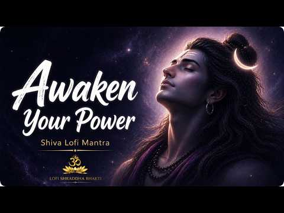
- 설명 앞부분: Awaken your inner strength with this powerful **Shiva Mantra Lofi** 🔱 Let the divine vibrations of Mahadev remove fear, calm your mind, and unlock your true energy. 🕉️ **Mantra Chant: ✨ **Benefits of this Mantra: Removes fear and negativity Brings deep mental peace and balance Awakens inner strengt…
- 같은 채널 평소 대비 ×496.4 (채널 최근 롱폼 중앙값 5,675회) · 평소 영상: Restore Your Peace ∣ Shambho Shambho Mahadevaya 🔱… (5,675회) / SAWAN SPECIAL 🕉️ SHIV DHYAN ∣ Powerful Shiva Mant… (5,650회)
- 대본 없음 (설명) — 음성인식이 끝나면 도입부·흐름이 들어감
- 댓글 2,878/2,878: 좋은 점 — 영상 0 · 감사·응원 0 · 더 알고 싶은 것 0 · 아쉬운 점 — 영상 0 · 반박·불만 — 의견 다름 0 · 정치·사회 0 · 경험 공유 0 · 구독·다음 기대 0

### 411. Thankful Hearts ∣ Gratitude Sing Along Song with Lyrics 💗

- https://www.youtube.com/watch?v=K-c4pzbzBzE · Purely Positive Piano · 구독자 245 · 조회수 31,149 (×127.1, 하루 566.9) · 좋아요 0 (0.0%) · 4.5분 · 2026-08-25 · 주제 묶음 6. 피아노·클래식·연주곡 · 형식 한 곡 (뮤직비디오·음원·가사) · 폴더 `W_K-c4pzbzBzE` (웹 승인)
- 썸네일: 
- 설명 앞부분: Sing along to "Thankful Hearts", an uplifting song celebrating gratitude, positivity, and appreciation for life's simple blessings! 💗 This video features on-screen lyrics and custom so you can easily follow along and sing with the music. Perfect for morning inspiration, classroom sing-alongs, mindf…
- 같은 채널 평소 대비 ×193.5 (채널 최근 롱폼 중앙값 161회) · 평소 영상: Beyond the Horizon ∣ Inspirational Sing-Along Son… (161회) / Good Morning to You ☀️ ∣ Uplifting Music for a Ha… (162회)
- 대본 없음 (설명) — 음성인식이 끝나면 도입부·흐름이 들어감
- 댓글 21/21: 좋은 점 — 영상 0 · 감사·응원 0 · 더 알고 싶은 것 0 · 아쉬운 점 — 영상 0 · 반박·불만 — 의견 다름 0 · 정치·사회 0 · 경험 공유 0 · 구독·다음 기대 0

### 412. Cortisol Reset । 432Hz Krishna Bansuri Therapy for a Calm Mind & Stop Overthinking । Indi…

- https://www.youtube.com/watch?v=D5NHvEVAbWY · Healing Raga Studio · 구독자 23,700 · 조회수 3,005,564 (×126.8, 하루 32,708.0) · 좋아요 39,595 (1.3%) · 65.7분 · 2026-07-19 · 주제 묶음 1. 수면·명상·힐링 · 형식 음악 (그 밖 모양 — 한 편짜리 BGM 등) · 폴더 `W_D5NHvEVAbWY` (웹 승인)
- 썸네일: 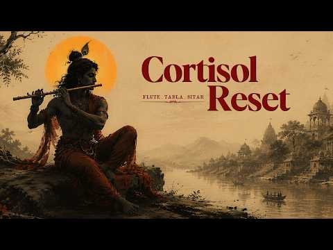
- 챕터: 0:00 Calm Beginning · 2:39 Gentle Healing · 5:24 Inner Balance · 9:20 Quiet Mind · 12:49 Peace Within · 19:55 Healing Flow · 27:51 Mental Clarity · 33:40 Sacred Stillness · 40:03 Deep Relaxation · 47:07 Mindful Presence · 53:48 Evening Calm · 59:37 Silent Reflection · 62:18 Emotional Renewal
- 설명 앞부분: Feeling overwhelmed, mentally exhausted, or caught in a loop of overthinking? Let the gentle sound of 432Hz Krishna Bansuri therapy guide you toward deep relaxation, emotional balance, and inner peace. This Indian healing music blends the soothing tones of the bansuri flute with calming ambient tex…
- 같은 채널 평소 대비 ×184.0 (채널 최근 롱폼 중앙값 16,332회) · 평소 영상: Stop Negative Thoughts: Bansuri Therapy to Stop O… (16,332회) / Remove Obstacles & Unlock Success: Sitar Instrume… (13,560회)
- 대본 없음 (설명) — 음성인식이 끝나면 도입부·흐름이 들어감
- 댓글 1,970/1,949: 좋은 점 — 영상 0 · 감사·응원 0 · 더 알고 싶은 것 0 · 아쉬운 점 — 영상 0 · 반박·불만 — 의견 다름 0 · 정치·사회 0 · 경험 공유 0 · 구독·다음 기대 0

### 413. hard work pays off, let's be productive (focus playlist to get things done)

- https://www.youtube.com/watch?v=IS6yiMGlYkE · taami study. · 구독자 9,660 · 조회수 1,222,254 (×126.5, 하루 11,882.7) · 좋아요 12,975 (1.1%) · 189.8분 · 2026-07-08 · 주제 묶음 3. 공부·집중·작업 · 형식 플레이리스트·모음 (여러 곡) · 폴더 `W_IS6yiMGlYkE` (웹 승인)
- 썸네일: 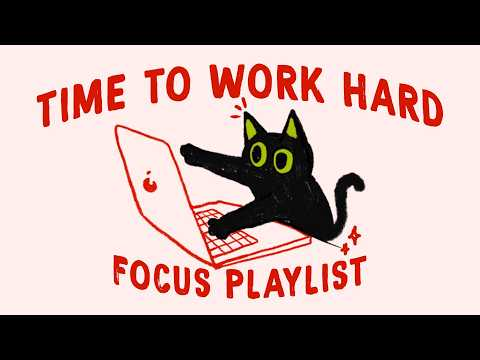
- 챕터: 0:00 Celestine Murmur · 2:16 Emberhaze Lullaby · 4:49 Lanternfall Solace · 8:10 Moonshadow Drift · 12:05 Shadowtide Waltz · 14:09 Velvetcascade Echo · 17:12 study playlist to get things …
- 설명 앞부분: Tomorrow becomes brighter because of what you choose to do today. This study playlist helps you stay focused, get things done, and turn today's effort into tomorrow's success 🎧✨🌅 ✨ Stay tuned for more playlists designed to help you focus, study, work, and relax with minimal distractions. Press play…
- 같은 채널 평소 대비 ×149.1 (채널 최근 롱폼 중앙값 8,195회) · 평소 영상: stop waiting, it’s time to do the work (work play… (8,195회) / keep going until your hard work speaks for itself… (8,361회)
- 대본 없음 (설명) — 음성인식이 끝나면 도입부·흐름이 들어감
- 댓글 196/195: 좋은 점 — 영상 0 · 감사·응원 0 · 더 알고 싶은 것 0 · 아쉬운 점 — 영상 0 · 반박·불만 — 의견 다름 0 · 정치·사회 0 · 경험 공유 0 · 구독·다음 기대 1
  - 구독·다음 기대 👍0 “구독하고가요”

### 414. 𝐏𝐥𝐚𝐲𝐥𝐢𝐬𝐭 비에 젖은 와인향

- https://www.youtube.com/watch?v=Pt3nGKCTF2U · 유월 · 구독자 3,770 · 조회수 474,277 (×125.8, 하루 3,390.1) · 좋아요 12,273 (2.6%) · 21.1분 · 2026-06-01 · 주제 묶음 기타 · 형식 플레이리스트·모음 (여러 곡) · 폴더 `W_Pt3nGKCTF2U` (웹 승인)
- 썸네일: 
- 챕터: 0:00 로꼬, 화사(HWASA) - 주지마 · 3:54 릴러말즈(Leellamarz), 미노이(Meenoi)… · 7:31 정국(Jungkook) - Still With You · 11:31 Seori - 긴 밤 (Feat. 기리보이) · 15:02 OnlyOneOf(온리원오브) - dOra maar · 18:22 종현(JONGHYUN) - Moon
- 설명 앞부분: ‘손 끝에 짙게 남은 와인 잔향‘𓈒 이번에는 주인장표 습도 높은 몽환 R&B 플리로 말아왔어요. 비에 젖은 와인향 같은 노래들로 꾹꾹 눌러 담아왔으니, 이번에도 맛봐 주실 거죠? 🍷 𓈒𓏸 𓂂
- 같은 채널 평소 대비 ×13.6 (채널 최근 롱폼 중앙값 34,790회) · 평소 영상: 𝐏𝐥𝐚𝐲𝐥𝐢𝐬𝐭 내 옆에서 자꾸 한 눈 팔지마 (34,790회) / 𝐏𝐥𝐚𝐲𝐥𝐢𝐬𝐭 이미 네게 넘어갔는데 (19,202회)
- 대본 없음 (설명) — 음성인식이 끝나면 도입부·흐름이 들어감
- 댓글 124/124: 좋은 점 — 영상 0 · 감사·응원 4 · 더 알고 싶은 것 3 · 아쉬운 점 — 영상 1 · 반박·불만 — 의견 다름 0 · 정치·사회 0 · 경험 공유 3 · 구독·다음 기대 0
  - 감사·응원 👍5 “감사합니다 시험 기간에 미쳐서 슬라임만들면서 들었어요 ㅎ”
  - 감사·응원 👍3 “제 최애 플리로 당첨슨 .. 너무 감사드려요 ♡”
  - 더 알고 싶은 것 👍54 “아 진짜 주인장 제발 이 플레이리스트 더 길게 만들어주세요 제발요”
  - 더 알고 싶은 것 👍8 “사진 출처 어딘지 알수있을까요?”
  - 아쉬운 점 — 영상 👍7 “온리원오브 노래 들어간 플리 처음 봤어요ㅜㅜ 너무 반갑다.. 온리원오브에 비슷한 분위기의 매력적인 노래 많으니까 많이 찾아 들어주셨으면 좋겠어요.. 해체하는 바람에 더 좋은 노래 못 들어서 아쉽네요,,”
  - 경험 공유 👍5 “오늘 내가 제일 치명적이다”
  - 경험 공유 👍3 “정말루 내가 이 플리 조회수 100은 올린것가틈 ㄴㅁ 고능해”

### 415. 김상민 – YOU (2001) ∣ 폭발적인 고음의 여자 보컬 리메이크/커버 2 Keys+

- https://www.youtube.com/watch?v=-GVdD_Onszw · AuraAPT · 구독자 13,100 · 조회수 1,646,979 (×125.7, 하루 19,631.9) · 좋아요 3,744 (0.2%) · 4.1분 · 2026-07-27 · 주제 묶음 12. 커버·노래 부르기 · 형식 커버·직접 부른 노래 · 폴더 `W_-GVdD_Onszw` (웹 승인)
- 썸네일: 
- 설명 앞부분: 김상민의 명곡 **〈YOU〉**를 애절하면서도 폭발적인 고음의 여자 보컬로 다시 불러보았습니다. 〈YOU〉는 2001년 5월 14일 발매된 김상민의 정규 2집 《Face》 수록곡으로, 선명한 록 발라드 사운드와 김상민 특유의 강렬한 고음으로 오랫동안 사랑받아 온 곡입니다. 사랑하는 사람이 떠난 뒤, 비가 오는 거리와 텅 빈 밤에 홀로 남겨진 사람의 외로움과 그리움을 담은 노래입니다. 꿈속에서는 다시 만날 수 있지만 아침이 되면 또다시 떠나보내야 하는 아픔을 여자 보컬의 섬세한 감성과 진한 고음으로 표현했습니다. 🎵 원곡: 김상민 …
- 같은 채널 평소 대비 ×91.4 (채널 최근 롱폼 중앙값 18,012회) · 평소 영상: 버즈(Buzz) - 겁쟁이 (2005) 💔 원곡감성 여자보컬 리메이크 ∣ 그 시절 명곡 (18,012회) / 살다가 (2005) - SG워너비｜그 시절 가슴을 울린 명곡 [원곡감성] 여자보컬 리메이크 (16,809회)
- 대본 없음 (설명) — 음성인식이 끝나면 도입부·흐름이 들어감
- 댓글 269/269: 좋은 점 — 영상 2 · 감사·응원 8 · 더 알고 싶은 것 8 · 아쉬운 점 — 영상 3 · 반박·불만 — 의견 다름 2 · 정치·사회 0 · 경험 공유 6 · 구독·다음 기대 4
  - 좋은 점 — 영상 👍4 “진짜 이건 아무리 들어도 레전드다..원곡이든 커버든 그냥 다 찢어버림..들을 때 마다 소름돋네”
  - 좋은 점 — 영상 👍3 “너~무 잘함, 너무 듣기좋음”
  - 감사·응원 👍44 “제가 들어본 중 최고의 you 입니다!! 고맙습니다❤”
  - 감사·응원 👍12 “김상민 님의 명곡을 이렇게 애절하고 폭발적인 여자 보컬로 들으니 또 다른 깊은 울림이 있네요. 비 오는 날 감성에 너무 잘 어울리는 리메이크입니다. 역시 명곡은 언제 들어도 좋네요. 새로운 목소리로 재해석해주셔서 감사합니다. 앞으로도 좋은 커버 영상 기대할게요! 자주…”
  - 더 알고 싶은 것 👍21 “너무 시원하고 감동적인 노래 잘듣고 갑니다 앞으로도 더욱 많은 노래 올려주세요”
  - 더 알고 싶은 것 👍9 “정말 노래 환상적입니다. 누구신지 궁금합니다.”
  - 아쉬운 점 — 영상 👍13 “목소리 너무좋아요 하루 무한반복으로 듣고있어요”
  - 아쉬운 점 — 영상 👍1 “노래듣고 눈물이 났네요 목소리가 너무나 졸고 잘부르시네요~ 앞으로 쭈~~욱 노래 들려주세요~~^^ 응원하겠습니다~~”
  - 반박·불만 — 의견 다름 👍3 “Ai로 이렇게 노래하면 반칙아닌가? 득음정도가아닌데 ~”
  - 반박·불만 — 의견 다름 👍2 “Ai는 아니죠?ㅠㅠ”
  - 경험 공유 👍44 “제가 들어본 중 최고의 you 입니다!! 고맙습니다❤”
  - 경험 공유 👍19 “와 나도 노래좀 안다고 생각 했는데 50년동안 ai노래가 있을줄이야 솔직히 사람이 부른것 보다 더 감동이네 6시간 동안 비슷한거 찾아서 듣고 있는중...”
  - 구독·다음 기대 👍12 “김상민 님의 명곡을 이렇게 애절하고 폭발적인 여자 보컬로 들으니 또 다른 깊은 울림이 있네요. 비 오는 날 감성에 너무 잘 어울리는 리메이크입니다. 역시 명곡은 언제 들어도 좋네요. 새로운 목소리로 재해석해주셔서 감사합니다. 앞으로도 좋은 커버 영상 기대할게요! 자주…”
  - 구독·다음 기대 👍4 “매일매일듣게돼는ㅎㅎ 완전따봉 이에요^^ 목소리도예쁘고❤❤❤❤❤”

### 416. 당신의 피아노 레벨은? (Lv.1~Lv.8 + 라캄파넬라) ∣ What is your Piano Level? 🎹

- https://www.youtube.com/watch?v=1E5Zi3Gs1ys · Bony_Musician · 구독자 674 · 조회수 84,463 (×125.3, 하루 625.3) · 좋아요 1,616 (1.9%) · 6.5분 · 2026-06-06 · 주제 묶음 6. 피아노·클래식·연주곡 · 형식 연주 (직접 연주하는 영상) · 폴더 `W_1E5Zi3Gs1ys` (웹 승인)
- 썸네일: 
- 설명 앞부분: 여러분의 피아노 실력은 과연 몇 단계인가요? 🎹🤔 가장 기초적인 Lv.1 단계부터 손가락이 날아다니는 마의 Lv.8 단계까지, 대중적인 클래식/뉴에이지 명곡들로 피아노 레벨 테스트 영상을 준비했습니다! 그리고 영상 맨 마지막에는 전설의 악마의 곡, 라 캄파넬라(La Campanella)가 보너스 최종 보스 레벨로 기다리고 있으니 끝까지 놓치지 마세요! 🔥 평소 피아노 난이도 순위나 재미있는 피아노 챌린지 영상을 검색해 들어오신 분들 모두 환영합니다. 영상을 보시면서 여러분이 연주할 수 있는 가장 높은 레벨은 몇 단계인지, 혹은 가…
- 대본 없음 (설명) — 음성인식이 끝나면 도입부·흐름이 들어감
- 댓글 340/340: 좋은 점 — 영상 2 · 감사·응원 7 · 더 알고 싶은 것 8 · 아쉬운 점 — 영상 0 · 반박·불만 — 의견 다름 2 · 정치·사회 0 · 경험 공유 24 · 구독·다음 기대 3
  - 좋은 점 — 영상 👍2 “전 개인적으로 쇼팽 왈츠가 캐리비안보다 어려운것 같네용 전 8단계 다 칠 수 있슴돠 (피아노 15년 배웠는데 라캄파넬라 못치는 고1.. ㅋㅋ)”
  - 좋은 점 — 영상 👍1 “좋은 영상 감사합니다. 저는 실력은 3단계 수준이지만 쇼팽의 왈츠는 흉내는 낼 수 있어요!”
  - 감사·응원 👍1 “좋은 영상 감사합니다. 저는 실력은 3단계 수준이지만 쇼팽의 왈츠는 흉내는 낼 수 있어요!”
  - 감사·응원 👍1 “7살때부터 피아노 친 체르니 40 5학년 잼민이입니다! 오래 친거에 비해 대회 준비를 안했어서.. 칠수있는게 많진 않았지만 최근 대회 준비를 시작했어서 연주곡들 보시고 제 레벨 체크해주시면 감사하겠습니다 🙇‍♀️ 4학년: 랑게-간절한 행운 (학년대상, 3등상) / 하…”
  - 더 알고 싶은 것 👍3 “슈베르트 즉흥곡 2번은 몇정도 될까요?”
  - 더 알고 싶은 것 👍2 “3년 다녀서 7~8단계용 혹시 15 Etudes de Virtuosite Op. 72 No. 6 은 레벨이 어느정도 일까요?”
  - 반박·불만 — 의견 다름 👍1 “저 초보자 아닌데 왜 리버 플라워... 치고있지?”
  - 경험 공유 👍3 “지금 5학년인데 레벨7이면 괜찮은거에요? 자금 피아노 5년차임다”
  - 경험 공유 👍3 “저 라캄파넬라 샵 그대로 해서 제가 편곡해서쳐요..초4임요”
  - 구독·다음 기대 👍6 “구독했구요 근데 베토벤 소나타 비창 3악장이랑 베토벤 월광 소나타 둘 중에 어떤게 더 어렵지?”
  - 구독·다음 기대 👍2 “134번째로 구독하고감니다”

### 417. 📝 1 HOUR OF FOCUS ∣ 🌧️ Relaxing Piano & Rain Sounds for Studying, Deep Focus, Reading & L…

- https://www.youtube.com/watch?v=yMcznSINsFs · Melodies of Calmora · 구독자 4,500 · 조회수 563,460 (×125.2, 하루 6,876.3) · 좋아요 2,097 (0.4%) · 60.4분 · 2026-07-29 · 주제 묶음 2. 자연 소리·백색소음 · 형식 긴 한 곡·반복 (N시간) · 폴더 `W_yMcznSINsFs` (웹 승인)
- 썸네일: 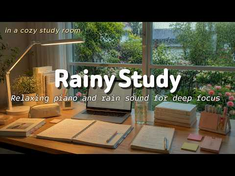
- 설명 앞부분: 🌧️ Welcome to one peaceful hour of relaxing piano music and gentle rain sounds, created to help you study, work, read, learn, and stay focused in a calm and comfortable atmosphere. 🎹📖 This one-hour focus session brings together a collection of soft, soothing piano pieces with beautiful flowing melo…
- 같은 채널 평소 대비 ×44.8 (채널 최근 롱폼 중앙값 12,589회) · 평소 영상: 🌧️ RAINY DAY STUDY ∣ 📝 1.5H Pomodoro (25/5) with … (12,589회) / 📝 2 HOURS OF DEEP FOCUS ∣ 🌧️ Relaxing Piano & Rai… (12,631회)
- 대본 없음 (설명) — 음성인식이 끝나면 도입부·흐름이 들어감
- 댓글 152/149: 좋은 점 — 영상 0 · 감사·응원 0 · 더 알고 싶은 것 1 · 아쉬운 점 — 영상 0 · 반박·불만 — 의견 다름 0 · 정치·사회 0 · 경험 공유 0 · 구독·다음 기대 0
  - 더 알고 싶은 것 👍3 “Mk ko chắc bạn biết Tiếng Việt và cx ko biết bạn ở quốc gia nào. Tuy nhiên, mk phải nói thiệt! Video của bạn làm hay cực kì! Mk lại cộng thêm một kên…”

### 418. Không Buông x Từng Là Của Nhau x Tìm Em - HNGLE x BẢO ANH ∣ Những Bản Hits Nhạc Trẻ Chill…

- https://www.youtube.com/watch?v=wVLhvXB2flE · Chà Là Chill · 구독자 38,900 · 조회수 4,869,045 (×125.2, 하루 53,519.4) · 좋아요 15,278 (0.3%) · 91.8분 · 2026-07-20 · 주제 묶음 8. 로파이·시티팝·칠 · 형식 음악 (그 밖 모양 — 한 편짜리 BGM 등) · 폴더 `W_wVLhvXB2flE` (웹 승인)
- 썸네일: 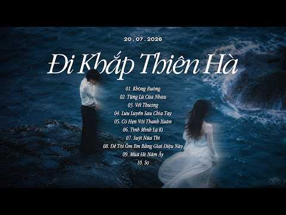
- 챕터: 0:00 Không Buông · 4:45 Từng Là Của Nhau · 8:31 Vet Thuong · 12:26 Luu Luyen Sau Chia Tay · 17:09 Có Hẹn Với Thanh Xuân · 20:48 Tình Mình Lạ Kì · 24:46 Suýt Nữa Thì · 29:39 Để Tôi Ôm Em Bằng Giai Điệu N… · 34:17 Mùa Hè Năm Ấy 2 · 38:22 Sợ · 42:20 Nam Ay · 46:38 Tình Yêu Chậm Trễ · 51:07 Hẹn E Ở Lần Yêu Thứ 2 · 57:01 Them Bao Nhieu Lau Giong Nam · 60:45 Cô Ấy Của Anh Chuẩn · 64:55 Cự Tuyệt · 68:31 Đâu Ai Biết Trước · 72:51 Em Mang Đi Mùa Hạ · 78:06 Co Dieu Gi Sau Khong Noi Cung… · 82:15 Gửi
- 설명 앞부분: Không Buông x Tìm Em x Từng Là Của Nhau - HNGLE x BẢO ANH ∣ Những Bản Hits Nhạc Trẻ Chill Triệu View là playlist tổng hợp những bản nhạc chill ballad Việt 2026 với giai điệu nhẹ nhàng, sâu lắng và đầy cảm xúc. Không Buông, Tìm Em, Từng Là Của Nhau mang đến không gian âm nhạc thư giãn, phù hợp để ng…
- 같은 채널 평소 대비 ×33.7 (채널 최근 롱폼 중앙값 144,366회) · 평소 영상: Nhạc Chill Nhẹ Nhàng - BXH Nhạc Chill Ballad Buồn… (144,987회) / Viên Đá Nhỏ...'thì thầm rằng anh yêu em yêu như t… (143,745회)
- 대본 없음 (설명) — 음성인식이 끝나면 도입부·흐름이 들어감
- 댓글 609/608: 좋은 점 — 영상 0 · 감사·응원 0 · 더 알고 싶은 것 0 · 아쉬운 점 — 영상 0 · 반박·불만 — 의견 다름 0 · 정치·사회 0 · 경험 공유 0 · 구독·다음 기대 0

### 419. 🎵 전체듣기 ∣ 에헤야~ 막걸리 한 잔 하세 🍶 ∣힐링 국악

- https://www.youtube.com/watch?v=KYXF2WEd2Ew · 에헤라디여 5060 · 구독자 357 · 조회수 44,428 (×124.5, 하루 326.9) · 좋아요 336 (0.8%) · 4.2분 · 2026-06-05 · 주제 묶음 1. 수면·명상·힐링 · 형식 플레이리스트·모음 (여러 곡) · 폴더 `W_KYXF2WEd2Ew` (웹 승인)
- 썸네일: 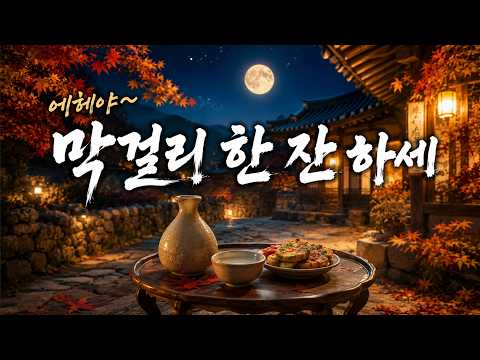
- 설명 앞부분: 얼씨구~ 달 밝은 밤, 막걸리 한 사발 앞에 앉아 오늘 하루 수고한 나에게 건네는 따뜻한 한 잔 🍶 장단 따라 어깨 들썩, 시린 속도 한잔 넘기면 세상살이 좀 괜찮더라 ☕ 마음이 편안해지는 다음 곡도 함께 들어보세요 [1시간 연속듣기] 🍶 막걸리 한잔하세 외 8곡 ∣ 5060 인생공감 힐링 국악트롯 전곡 무한반복 작사 : 에헤라디여 작곡 : AI 가락
- 같은 채널 평소 대비 ×118.8 (채널 최근 롱폼 중앙값 374회) · 평소 영상: 인생이란 뭐있나! 오늘도 웃으며 한잔하세!" 🍻 우리네 인생을 위로하는 감성 국악트롯 5… (543회) / 동생아 동생아/하늘에 있는 동생에게 전하는 마지막 편지 ∣ 5060 힐링음악 (551회)
- 대본 없음 (설명) — 음성인식이 끝나면 도입부·흐름이 들어감
- 댓글 30/30: 좋은 점 — 영상 1 · 감사·응원 5 · 더 알고 싶은 것 0 · 아쉬운 점 — 영상 0 · 반박·불만 — 의견 다름 0 · 정치·사회 0 · 경험 공유 0 · 구독·다음 기대 0
  - 좋은 점 — 영상 👍3 “좋은영상감사합니다❤”
  - 감사·응원 👍3 “나에영원히 인연 입니다감사100세까지쭉......”
  - 감사·응원 👍3 “5060_은 숫짜입니다 막걸리 가락에 어깨가 들썩이는 분들은 ,,산전수전_격으신 분들이라 마음합니다. *저는57년(정유생)입니다. ^함께함에 감사합니다”

### 420. Hanuman Chalisa for Deep Sleep ∣ Divine Protection for Peaceful Sleep ∣ No Mid Ads • Blac…

- https://www.youtube.com/watch?v=XKK7ewgprws · Inner Bhakti · 구독자 7,180 · 조회수 889,883 (×123.9, 하루 9,487.6) · 좋아요 5,420 (0.6%) · 114.8분 · 2026-07-17 · 주제 묶음 1. 수면·명상·힐링 · 형식 정보·해설 (그 밖) · 폴더 `W_XKK7ewgprws` (웹 승인)
- 썸네일: 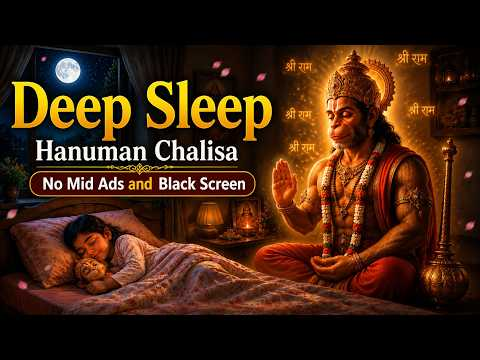
- 설명 앞부분: Deep Sleep Hanuman Chalisa – Rest Tonight Under the Divine Protection of Lord Hanuman Close your eyes. Surrender your worries to Lord Hanuman. May Bajrangbali protect you and your loved ones throughout the night. 🕉️ Dear Devotee, For your peaceful listening experience, this video contains no mid-ro…
- 대본 없음 (설명) — 음성인식이 끝나면 도입부·흐름이 들어감
- 댓글 156/151: 좋은 점 — 영상 0 · 감사·응원 0 · 더 알고 싶은 것 0 · 아쉬운 점 — 영상 0 · 반박·불만 — 의견 다름 0 · 정치·사회 0 · 경험 공유 0 · 구독·다음 기대 0

### 421. TANGGAL STRESS MO DITO 🔥🎶 ∣ DUB REGGAE MIX 🎶🔥🇵🇭

- https://www.youtube.com/watch?v=0m7BLfBl2f8 · RELAX REGGAE PH · 구독자 13,800 · 조회수 1,691,396 (×122.6, 하루 23,799.7) · 좋아요 5,969 (0.4%) · 74.8분 · 2026-08-09 · 주제 묶음 8. 로파이·시티팝·칠 · 형식 음악 (그 밖 모양 — 한 편짜리 BGM 등) · 폴더 `W_0m7BLfBl2f8` (웹 승인)
- 썸네일: 
- 설명 앞부분: 🎶 TANGGAL STRESS MO DITO ∣ Dub Reggae Mix 🎶 Pagod sa trabaho? Stress sa araw-araw? Relax muna at hayaan ang magandang tunog ng Dub Reggae Mix na ito ang magpagaan ng iyong isip. Huminga nang malalim, pumikit, at damhin ang chill vibes na hatid ng bawat beat. Kung mahilig ka sa reggae music, tamang-…
- 같은 채널 평소 대비 ×1,774.8 (채널 최근 롱폼 중앙값 953회) · 평소 영상: SAKSI ANG DIYOS SA HAMON NG BUHAY KO 🔥🎶 ∣ DUB REG… (953회) / NAGPAPAGAAN NG PAKIRAMDAM 🔥🎶 ∣ DUB REGGAE MIX 🔥🎶🇵🇭 (903회)
- 대본 없음 (설명) — 음성인식이 끝나면 도입부·흐름이 들어감
- 댓글 256/256: 좋은 점 — 영상 0 · 감사·응원 0 · 더 알고 싶은 것 0 · 아쉬운 점 — 영상 0 · 반박·불만 — 의견 다름 0 · 정치·사회 0 · 경험 공유 0 · 구독·다음 기대 0

### 422. NAAD ∣ Powerful Instrumental Invocation #SpiritualMusic #DrumMusic #MeditationMusic

- https://www.youtube.com/watch?v=bc4vTfxeLZk · shivam saraswat Bhakti songs  · 구독자 3,380 · 조회수 413,719 (×122.4, 하루 2,907.5) · 좋아요 4,848 (1.2%) · 7.9분 · 2026-05-30 · 주제 묶음 6. 피아노·클래식·연주곡 · 형식 음악 (그 밖 모양 — 한 편짜리 BGM 등) · 폴더 `W_bc4vTfxeLZk` (웹 승인)
- 썸네일: 
- 설명 앞부분: Feel the power of sound. “Naad – The Invocation” is a cinematic instrumental journey inspired by ancient vibrations, spiritual energy, and powerful Indian percussion. Deep drums, dark ambience, and epic textures come together to create an immersive experience. 🎧 Best enjoyed with headphones. 🔥 Perf…
- 같은 채널 평소 대비 ×1,499.0 (채널 최근 롱폼 중앙값 276회) · 평소 영상: राम नाम ही सच्चा सहारा ∣ Ram Bhajan ।बुंदेली लोक … (276회) / 🔱 भोलेनाथ तेरे दर पे आया ∣ Shiv Bhajan 2026 ∣ Saw… (278회)
- 대본 없음 (설명) — 음성인식이 끝나면 도입부·흐름이 들어감
- 댓글 60/59: 좋은 점 — 영상 0 · 감사·응원 0 · 더 알고 싶은 것 0 · 아쉬운 점 — 영상 0 · 반박·불만 — 의견 다름 0 · 정치·사회 0 · 경험 공유 0 · 구독·다음 기대 0

### 423. 𝐏𝐥𝐚𝐲𝐥𝐢𝐬𝐭 그냥 네 눈동자가 예뻤어

- https://www.youtube.com/watch?v=FOjiqNxjDDw · 유월 · 구독자 3,770 · 조회수 461,074 (×122.3, 하루 2,996.7) · 좋아요 6,264 (1.4%) · 21.9분 · 2026-05-18 · 주제 묶음 기타 · 형식 플레이리스트·모음 (여러 곡) · 폴더 `W_FOjiqNxjDDw` (웹 승인)
- 썸네일: 
- 챕터: 0:00 박재범(JAY PARK) - All I Wanna D… · 3:37 쿠기(Coogie) - Alone (Feat. 이하이) · 6:36 그루비룸(GroovyRoom) - Yes or No … · 9:34 범키(BUMKEY) - 갖고놀래(Attraction)… · 13:10 쿠기(Coogie) - Two Pills · 16:09 BOYCOLD - 바람바람~ (Feat. BIG Na… · 18:54 쿠기(Coogie) - Right Now (Feat.…
- 설명 앞부분: 이런 느좋 국힙 좋아하시는 분 있죠? 이 주인장이 맛도리로 낋여왔어요. 한 번 맛 봐주세요
- 같은 채널 평소 대비 ×13.3 (채널 최근 롱폼 중앙값 34,790회) · 평소 영상: 𝐏𝐥𝐚𝐲𝐥𝐢𝐬𝐭 내 옆에서 자꾸 한 눈 팔지마 (34,790회) / 𝐏𝐥𝐚𝐲𝐥𝐢𝐬𝐭 이미 네게 넘어갔는데 (19,202회)
- 대본 없음 (설명) — 음성인식이 끝나면 도입부·흐름이 들어감
- 댓글 67/67: 좋은 점 — 영상 1 · 감사·응원 1 · 더 알고 싶은 것 1 · 아쉬운 점 — 영상 0 · 반박·불만 — 의견 다름 0 · 정치·사회 0 · 경험 공유 1 · 구독·다음 기대 0
  - 좋은 점 — 영상 👍12 “pip 안되는분들을 위한 꿀팁 1.유튜브 프리미엄 이벤트할때 무료체험하기 2. 영상 링크 복사해서 사파리에 붙여넣고 틀고 나가면 pip돼용 미소녀들 플리 열시미 듣자!!!~~”
  - 감사·응원 👍7 “와 쌤 답장 해주는 거 너무 감동.. 진짜 느좋 플리에 느좋 말투.. 응원하고 갑니둥!!!!”
  - 더 알고 싶은 것 👍8 “다 좋아하는 노래예용 ㅠ 이런 감성힙합으로 사람들이 잘 모르는 숨겨진 띵곡 플리도 만들어주실 수 있나여??”
  - 경험 공유 👍4 “아씨 개좋다ㅠㅠ 제가 좋아요 3천 만들엇어여🫰🏻🫰🏻🥰”

### 424. 𝐏𝐥𝐚𝐲𝐥𝐢𝐬𝐭 ∣ 오늘 텐션 폭발🔥쌈뽕 노동요🕺🏻 출퇴근·운동용 Feel Good Groove Pop Funk (Pop Rap / Chill Vibes) 카페…

- https://www.youtube.com/watch?v=oyx0lS5I-TY · melohour · 구독자 1,380 · 조회수 168,625 (×122.2, 하루 945.0) · 좋아요 563 (0.3%) · 622.8분 · 2026-04-23 · 주제 묶음 8. 로파이·시티팝·칠 · 형식 플레이리스트·모음 (여러 곡) · 폴더 `W_oyx0lS5I-TY` (웹 승인)
- 썸네일: 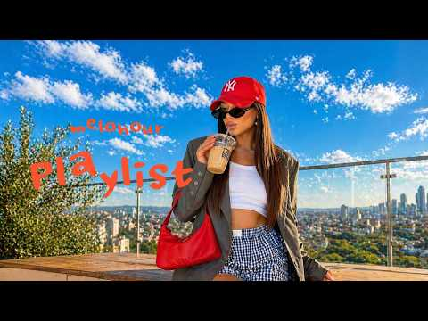
- 챕터: 0:00 SWAY SIDE · 3:56 ONE ONLY ME · 7:46 SHINE POP · 10:33 ALL EYES ON ME · 13:32 HIGH DOSE · 16:39 FLASH BOUNCE · 19:44 RUN THE FLOOR · 22:46 CAN’T LOOK AWAY · 25:50 STEP & SLIDE · 28:43 GOT THAT GLOW · 31:25 LEAN BACK FLOW · 34:22 SOFT GLOW · 38:11 STAY IN MOTION
- 설명 앞부분: 🔥 분위기를 끌어올리고 싶은 순간, 바로 재생하세요. 이 플레이리스트는 도입부터 자연스럽게 몰입되는 Feel Good Groove Pop & Funk 중심의 고에너지 플레이리스트입니다. 듣자마자 기분이 좋아지고 리듬을 타게 되는 신나는 팝송과 그루브 팝 음악들로 구성되어 있으며, 가볍지 않지만 부담 없이 계속 듣게 되는 안정적인 에너지를 담고 있습니다. 출퇴근길 플레이리스트로도 좋고, 운동할 때 텐션을 끌어올리는 음악으로도 좋고, 드라이브할 때 분위기를 살리는 음악으로도 잘 어울립니다. 또한 카페 매장 BGM, 작업용 BGM, 집…
- 같은 채널 평소 대비 ×143.3 (채널 최근 롱폼 중앙값 1,176회) · 평소 영상: 𝐏𝐥𝐚𝐲𝐥𝐢𝐬𝐭 ∣ 첫 곡부터 시원한 청량 Pop R&B 🧊☁️ 듣자마자 기분 UP! 여… (1,104회) / 𝐏𝐥𝐚𝐲𝐥𝐢𝐬𝐭 ∣ 틀자마자 기분 좋아지는 그루브 😎☀️ 하루 종일 계속 틀어두게 되는 … (1,027회)
- 대본 없음 (설명) — 음성인식이 끝나면 도입부·흐름이 들어감
- 댓글 30/30: 좋은 점 — 영상 0 · 감사·응원 3 · 더 알고 싶은 것 0 · 아쉬운 점 — 영상 0 · 반박·불만 — 의견 다름 0 · 정치·사회 0 · 경험 공유 0 · 구독·다음 기대 1
  - 감사·응원 👍1 “금요일 화이팅!!”
  - 감사·응원 👍0 “약간 기분 꿀꿀했는데 덕분에 환기하고 가요 감사합니다”
  - 구독·다음 기대 👍1 “구독했습니다^^ 모든곡이 전부 AI로 만든건가요?”

### 425. Without You Lord, I Am Nothing ∣ Inspirational Christian Worship Song 2026

- https://www.youtube.com/watch?v=4TI0GkgfvKk · Music of Faith  · 구독자 28,000 · 조회수 3,407,891 (×121.7, 하루 22,320.0) · 좋아요 0 (0.0%) · 6분 · 2026-05-19 · 주제 묶음 15. CCM·찬양·국악·동요 · 형식 음악 (그 밖 모양 — 한 편짜리 BGM 등) · 폴더 `W_4TI0GkgfvKk` (웹 승인)
- 썸네일: 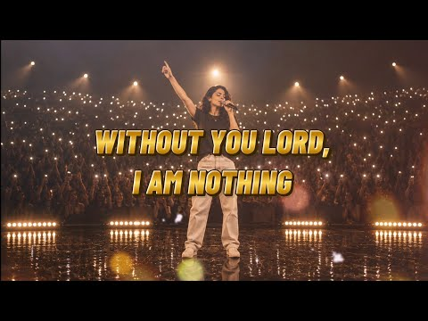
- 설명 앞부분: “Without You Lord, I Am Nothing” is a deeply emotional Christian worship song about surrender, grace, healing, and complete dependence on God. Featuring heartfelt female vocals, deep blending harmonies, cinematic worship melodies, soft piano, and powerful lyrics, this worship ballad reminds every b…
- 같은 채널 평소 대비 ×710.6 (채널 최근 롱폼 중앙값 4,796회) · 평소 영상: The Great Physician ∣ Healing Prayer Worship Song… (4,796회) / Heal Me, Lord ∣ Official Music Video ∣ Christian … (4,532회)
- 대본 없음 (설명) — 음성인식이 끝나면 도입부·흐름이 들어감
- 댓글 2,138/2,138: 좋은 점 — 영상 0 · 감사·응원 0 · 더 알고 싶은 것 0 · 아쉬운 점 — 영상 0 · 반박·불만 — 의견 다름 1 · 정치·사회 0 · 경험 공유 1 · 구독·다음 기대 0
  - 반박·불만 — 의견 다름 👍0 “가사: 주님 없이는 아무것도 아닙니다. 소개 때로는 우리는 혼자서 삶의 무게를 짊어지려고 합니다... 우리가 충분히 강하고, 충분히 현명하고, 충분히 온전한 척하는 척하는 것... 하지만 밤이 고요해지면, 그리고 모든 가면이 땅에 떨어지죠. 우리는 진실을 깨닫고 있습…”
  - 경험 공유 👍0 “가사: 주님 없이는 아무것도 아닙니다. 소개 때로는 우리는 혼자서 삶의 무게를 짊어지려고 합니다... 우리가 충분히 강하고, 충분히 현명하고, 충분히 온전한 척하는 척하는 것... 하지만 밤이 고요해지면, 그리고 모든 가면이 땅에 떨어지죠. 우리는 진실을 깨닫고 있습…”

### 426. 듣자 마자 바로 잠드는 숲속 시원한 빗소리 ASMR (Rain Sounds), 불면증 완화, 힐링 빗소리

- https://www.youtube.com/watch?v=berSZ8YAKP8 · Cozy Rain on Leaves · 구독자 3,290 · 조회수 395,254 (×120.1, 하루 2,846.6) · 좋아요 3,855 (1.0%) · 180분 · 2026-06-02 · 주제 묶음 2. 자연 소리·백색소음 · 형식 자연 소리·백색소음 (음악 낱말 없는 제목) · 폴더 `W_berSZ8YAKP8` (웹 승인)
- 썸네일: 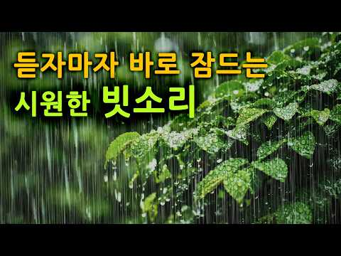
- 설명 앞부분: 초록빛 숲속의 나뭇잎에 떨어지는 빗방울은 세상을 차분하게 잠재웁니다. 시원한 빗줄기를 가만히 바라보고 있으면, 복잡했던 마음도 어느새 씻겨 내려가는 듯합니다. 오늘도 이 공간을 찾아주신 모든 분들이 평온한 밤 보내시길 진심으로 응원합니다. 편안한 밤 되세요. 💤 🎧 Real Sound: 비오는 날 직접 현장에서 녹음한 실제 빗소리만을 사용하여 깊은 입체적인 몰입감을 드립니다.
- 같은 채널 평소 대비 ×85.0 (채널 최근 롱폼 중앙값 4,648회) · 평소 영상: 잠안올 때 듣는 시원한 빗소리 ASMR 🌿 불면증에 효과있는 백색소음 (Rain Soun… (4,698회) / 오늘도 편안한 빗소리로 불면증을 극복하세요. 🌲숲속의 수면 빗소리 ASMR (Rain S… (4,599회)
- 대본 없음 (설명) — 음성인식이 끝나면 도입부·흐름이 들어감
- 댓글 144/144: 좋은 점 — 영상 5 · 감사·응원 6 · 더 알고 싶은 것 0 · 아쉬운 점 — 영상 0 · 반박·불만 — 의견 다름 0 · 정치·사회 0 · 경험 공유 0 · 구독·다음 기대 1
  - 좋은 점 — 영상 👍54 “빗소리가 부드럽고 그윽하게 들려서 듣기 편안합니다. 어떤 빗소리는 탁탁 튀는 것 같은 가벼운 소리가 나요.”
  - 좋은 점 — 영상 👍34 “아주듣기좋은빗소리 서늘한빗소리가나무잎으로떨어지는소리 잠자기딱좋은빗소리 로스안젤스애서❤😂🎉😢😮😅”
  - 감사·응원 👍20 “빗소리 든고있으니 가슴도 시원하고 기분이 좋아젔어요. 감사해요 😊”
  - 감사·응원 👍13 “빗소리 좋은 영상 감사합니다.”
  - 구독·다음 기대 👍2 “구독했어요 ㅡ빗소리좋네요ㅡ불면증심해서ㅡ”

### 427. Happy Jazz Music ☕ Bossa Nova background for Relaxing, Great Moods and Happy Moods

- https://www.youtube.com/watch?v=YTpDlQvvT3Q · Golden Roast Jazz Club · 구독자 10,900 · 조회수 1,308,935 (×120.1, 하루 8,209.4) · 좋아요 6,357 (0.5%) · 70.6분 · 2026-05-12 · 주제 묶음 7. 재즈·보사노바 · 형식 음악 (그 밖 모양 — 한 편짜리 BGM 등) · 폴더 `W_YTpDlQvvT3Q` (웹 승인)
- 썸네일: 
- 설명 앞부분: Welcome to Golden Roast Jazz Club — your cozy escape into the world of smooth jazz, warm coffee vibes, and relaxing atmospheres. ☕🎷 This channel is dedicated to bringing you the perfect blend of soft jazz, lounge music, bossa nova, and chill instrumentals — ideal for studying, working, relaxing, or…
- 같은 채널 평소 대비 ×1,071.6 (채널 최근 롱폼 중앙값 1,222회) · 평소 영상: Happy Jazz Coffee ☕ Bossa Nova instrumental for R… (1,237회) / Fall Morning Jazz ☕ Bossa Nova background for Rel… (1,206회)
- 대본 없음 (설명) — 음성인식이 끝나면 도입부·흐름이 들어감
- 댓글 189/187: 좋은 점 — 영상 0 · 감사·응원 0 · 더 알고 싶은 것 0 · 아쉬운 점 — 영상 0 · 반박·불만 — 의견 다름 0 · 정치·사회 0 · 경험 공유 0 · 구독·다음 기대 0

### 428. 모시모시 키코에테루 ? {Playlist}

- https://www.youtube.com/watch?v=2UnsCozc5tg · 손집 · 구독자 1,690 · 조회수 201,075 (×119.0, 하루 1,117.7) · 좋아요 8,684 (4.3%) · 19.1분 · 2026-04-22 · 주제 묶음 기타 · 형식 플레이리스트·모음 (여러 곡) · 폴더 `W_2UnsCozc5tg` (웹 승인)
- 썸네일: 
- 챕터: 0:00 楽音 Sasane - mosi mosi? · 2:43 Serani poji - ぴぽぴぽ · 7:06 Plus Tech Squeeze Box - A Day… · 10:40 フレネシ - オニガシマ · 14:33 COLTEMONIKHA - Yum yum yummy 🎧
- 설명 앞부분: 🎧: 주인장 추천 곡 본 플레이리스트는 선곡에 AI음악을 배제하였습니다.
- 같은 채널 평소 대비 ×750.3 (채널 최근 롱폼 중앙값 268회) · 평소 영상: 그럼에도 불구하고 널 사랑해 (268회) / 야반도주 테크노 (241회)
- 대본 없음 (설명) — 음성인식이 끝나면 도입부·흐름이 들어감
- 댓글 57/57: 좋은 점 — 영상 1 · 감사·응원 1 · 더 알고 싶은 것 1 · 아쉬운 점 — 영상 0 · 반박·불만 — 의견 다름 0 · 정치·사회 1 · 경험 공유 0 · 구독·다음 기대 3
  - 정치·사회 👍788 “일본곡 플리+한국그룹의 중국인 멤버 썸네일이라니.. 이것이 동아시아 대통합”
  - 구독·다음 기대 👍8 “주인장 진짜 대단한 사람이다 첫곡듣자마자 바로 구독박아요”
  - 구독·다음 기대 👍2 “어느날 내 알고리즘에 들어온 이 채널... 너무 좋아서 구독하고 갑니다.. 총총”

### 429. Dragon Ball GT Celtic Fantasy Music ∣ Relax Music for Focus Study, Work - Dan Dan Kokoro …

- https://www.youtube.com/watch?v=fJ6rnqkvyCk · Medieval Echoes · 구독자 1,190 · 조회수 140,573 (×118.1, 하루 799.8) · 좋아요 4,585 (3.3%) · 9분 · 2026-04-26 · 주제 묶음 3. 공부·집중·작업 · 형식 음악 (그 밖 모양 — 한 편짜리 BGM 등) · 폴더 `W_fJ6rnqkvyCk` (웹 승인)
- 썸네일: 
- 설명 앞부분: Step into a magical and relaxing journey through a timeless landscape where nostalgia and tranquility coexist. This exclusive collection features a beautiful, deeply emotional, and reimagined melody of Dragon Ball GT's iconic theme — Dan Dan Kokoro Hikareteku — through unique Celtic and Medieval-in…
- 같은 채널 평소 대비 ×551.3 (채널 최근 롱폼 중앙값 255회) · 평소 영상: Deep Relaxation Under the Northern Lights ∣ 432Hz… (264회) / One Piece Celtic Relax Music Cover ∣ Music for St… (246회)
- 대본 없음 (설명) — 음성인식이 끝나면 도입부·흐름이 들어감
- 댓글 202/202: 좋은 점 — 영상 0 · 감사·응원 0 · 더 알고 싶은 것 0 · 아쉬운 점 — 영상 0 · 반박·불만 — 의견 다름 0 · 정치·사회 0 · 경험 공유 0 · 구독·다음 기대 0

### 430. Best Morning Powerful Mantras ∣ Shiva, Ganesh, Hanuman, Vishnu & Lakshmi ∣ Destroy Negati…

- https://www.youtube.com/watch?v=CFV27iuas7Q · Sacred Naad · 구독자 22,300 · 조회수 2,628,396 (×117.9, 하루 39,633.3) · 좋아요 24,325 (0.9%) · 15.7분 · 2026-08-14 · 주제 묶음 1. 수면·명상·힐링 · 형식 음악 (그 밖 모양 — 한 편짜리 BGM 등) · 폴더 `W_CFV27iuas7Q` (웹 승인)
- 썸네일: 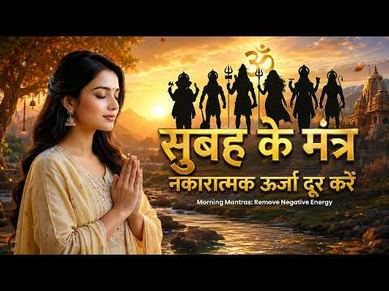
- 설명 앞부분: egin your day with divine blessings, peaceful vibrations, and powerful spiritual energy through this Complete Morning Prayer Collection. This soulful devotional compilation brings together sacred prayers and mantras dedicated to Lord Ganesha, Lord Shiva, Maa Durga, Surya Dev, Hanuman Ji, Maa Lakshm…
- 같은 채널 평소 대비 ×3,236.9 (채널 최근 롱폼 중앙값 812회) · 평소 영상: सुबह की प्रार्थना के 12 श्लोक ∣ Morning Prayer Sa… (859회) / एक तू ही सहारा ❤️ Mahadev Bhajan ∣ मन को शांति दे… (765회)
- 대본 없음 (설명) — 음성인식이 끝나면 도입부·흐름이 들어감
- 댓글 973/972: 좋은 점 — 영상 0 · 감사·응원 0 · 더 알고 싶은 것 0 · 아쉬운 점 — 영상 0 · 반박·불만 — 의견 다름 0 · 정치·사회 0 · 경험 공유 0 · 구독·다음 기대 0

### 431. Sarap Sa Tenga To VOL. 3 🌿(IBA TO!) ∣ Spiritual Roots Reggae Mix ∣ Healing & Chill Reggae…

- https://www.youtube.com/watch?v=9w_QNH2ju3A · Just Reggae Soul Ph · 구독자 45,800 · 조회수 5,384,522 (×117.6, 하루 33,447.5) · 좋아요 30,093 (0.6%) · 64.6분 · 2026-05-11 · 주제 묶음 1. 수면·명상·힐링 · 형식 음악 (그 밖 모양 — 한 편짜리 BGM 등) · 폴더 `W_9w_QNH2ju3A` (웹 승인)
- 썸네일: 
- 챕터: 0:00 Daloy ng Liwanag · 5:36 Liwanag ng Hangin · 11:13 Alon ng Payapa · 17:23 Agos ng Kapayapaan · 23:55 Himig ng Payapang Diwa · 29:34 Daloy ng Kaluluwa · 35:07 Hininga ng Liwanag · 40:56 Daluyan ng Kapayapaan · 46:38 Liwanag ng Hangin · 52:29 Daloy ng Liwanag · 58:29 Ikaw ang Liwanag
- 설명 앞부분: 🌿 Sarap Sa Tenga To VOL. 3 (IBA TO!) Spiritual Roots Reggae Mix ∣ Healing & Chill Reggae Vibes 2026 🎶 Just Reggae Soul PH Kung hinahanap mo ang reggae music na hindi nakakasawa, paulit-ulit mong papakinggan, at kayang magbigay ng peace, healing, at positive vibrations… welcome sa Sarap Sa Tenga To …
- 같은 채널 평소 대비 ×271.3 (채널 최근 롱폼 중앙값 19,846회) · 평소 영상: Pahinga Muna 🌿 Para Sa Mga Pagod Na ∣ Spiritual R… (19,994회) / Relax Ka Muna 🌿 VOL. 2 (IBA TO!) ∣ Spiritual Root… (19,698회)
- 대본 없음 (설명) — 음성인식이 끝나면 도입부·흐름이 들어감
- 댓글 2,674/2,672: 좋은 점 — 영상 0 · 감사·응원 0 · 더 알고 싶은 것 0 · 아쉬운 점 — 영상 0 · 반박·불만 — 의견 다름 0 · 정치·사회 0 · 경험 공유 0 · 구독·다음 기대 0

### 432. Nhạc không lời Piano & Mưa Vol.1 ∣ Piano Thư Giãn, Học Bài, Ngủ Ngon ∣ Trí Nhật Piano

- https://www.youtube.com/watch?v=tddKxQYCNlM · Trí Nhật Piano · 구독자 8,640 · 조회수 1,009,552 (×116.8, 하루 6,434.3) · 좋아요 3,879 (0.4%) · 123분 · 2026-05-15 · 주제 묶음 6. 피아노·클래식·연주곡 · 형식 커버·직접 부른 노래 · 폴더 `W_tddKxQYCNlM` (웹 승인)
- 썸네일: 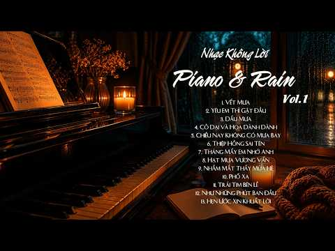
- 챕터: 0:00 Vết Mưa Piano · 3:44 Yêu Em Thì Gật Đầu · 8:35 Dấu Mưa · 13:30 Cỏ Dại và Hoa Dành Dành · 17:48 Chiều Nay Không Có Mưa Bay
- 설명 앞부분: Nhạc không lời Piano & Mưa Vol.1 ∣ Piano Thư Giãn, Học Bài, Ngủ Ngon ∣ Trí Nhật Piano Danh sách các bản nhạc trong Piano & Mưa Vol.1 Chào mừng bạn đến với TRÍ NHẬT PIANO – nơi mình chia sẻ những bản nhạc piano nhẹ nhàng, sâu lắng, giúp bạn thư giãn, tập trung học tập – làm việc hoặc đơn giản là tìm…
- 같은 채널 평소 대비 ×348.6 (채널 최근 롱폼 중앙값 2,896회) · 평소 영상: Hồn Nhiên Piano Cover ∣ Theme Song from "LÊN HƯƠN… (2,896회) / Chia Xa Piano Cover ∣ Trí Nhật Piano (2,904회)
- 대본 없음 (설명) — 음성인식이 끝나면 도입부·흐름이 들어감
- 댓글 250/250: 좋은 점 — 영상 0 · 감사·응원 0 · 더 알고 싶은 것 0 · 아쉬운 점 — 영상 0 · 반박·불만 — 의견 다름 0 · 정치·사회 0 · 경험 공유 0 · 구독·다음 기대 0

### 433. ⟨𝐜𝐚𝐟𝐞 𝐏𝐋𝐀𝐘𝐋𝐈𝐒𝐓⟩🩵맑은 초여름의 어느 날, 카페 피아노 10시간 [중간광고없음] ∣ 작업·공부·휴식 ∣ 𝐃𝐚𝐢𝐥𝐲𝐁𝐆𝐌+

- https://www.youtube.com/watch?v=nm_Mh-VIWvY · Daily BGM plus · 구독자 1,350 · 조회수 157,267 (×116.5, 하루 1,096.8) · 좋아요 335 (0.2%) · 602.7분 · 2026-05-28 · 주제 묶음 6. 피아노·클래식·연주곡 · 형식 플레이리스트·모음 (여러 곡) · 폴더 `W_nm_Mh-VIWvY` (웹 승인)
- 썸네일: 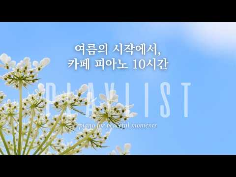
- 설명 앞부분: 🩵맑은 초여름의 어느 날, 카페 피아노 10시간 맑은 공기와 부드러운 햇살이 머무는 순간처럼 편안하게 흐르는 피아노 음악입니다. 잔잔하고 따뜻한 분위기의 음악으로 조용한 하루에 잘 어울립니다. 공부할 때, 작업할 때, 혹은 잠시 쉬어가고 싶은 순간에도 함께해 주세요.🍵 오늘도 맑고 여유로운 하루 보내시길 바랍니다.🤍 🌿Summer Beginning Cafe Piano 10 Hours Soft and peaceful piano music for peaceful and relaxing moments. A gentle playlist …
- 같은 채널 평소 대비 ×17.0 (채널 최근 롱폼 중앙값 9,264회) · 평소 영상: ⟨𝐜𝐚𝐟𝐞 𝐏𝐋𝐀𝐘𝐋𝐈𝐒𝐓⟩💜언제나 그 자리에, 카페 피아노 10시간 ∣ Calm Pia… (9,481회) / ⟨𝐜𝐚𝐟𝐞 𝐏𝐋𝐀𝐘𝐋𝐈𝐒𝐓⟩💙푸른 가을 하늘, 카페 피아노 10시간 ∣ Calm Pian… (9,046회)
- 대본 없음 (설명) — 음성인식이 끝나면 도입부·흐름이 들어감
- 댓글 27/27: 좋은 점 — 영상 0 · 감사·응원 2 · 더 알고 싶은 것 0 · 아쉬운 점 — 영상 0 · 반박·불만 — 의견 다름 0 · 정치·사회 0 · 경험 공유 0 · 구독·다음 기대 1
  - 감사·응원 👍1 “진심으로 감사합니다 ❤”
  - 감사·응원 👍1 “아름다운 음악 감사합니다.”
  - 구독·다음 기대 👍1 “멋진 사운드와 유니크한 영상이 너무 좋네요~💕💕 구독하고 계속 스밍하렵니다~~🌿🌿🍀🍀”

### 434. Relax Your Mind with Tabla & Bansuri Meditation Music ∣ Deep Healing Indian Instrumental …

- https://www.youtube.com/watch?v=OU-pcEjsoxs · Raga Instrumental AI · 구독자 3,750 · 조회수 435,689 (×116.2, 하루 2,708.6) · 좋아요 3,807 (0.9%) · 93.3분 · 2026-05-11 · 주제 묶음 6. 피아노·클래식·연주곡 · 형식 음악 (그 밖 모양 — 한 편짜리 BGM 등) · 폴더 `W_OU-pcEjsoxs` (웹 승인)
- 썸네일: 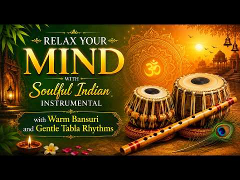
- 설명 앞부분: Immerse yourself in the peaceful world of soulful Indian instrumental meditation music featuring the calming sounds of bansuri flute and gentle tabla rhythms. This deep healing meditation music is designed to help you relax your mind, reduce stress, improve focus, and create a serene spiritual atmo…
- 같은 채널 평소 대비 ×2,672.9 (채널 최근 롱폼 중앙값 163회) · 평소 영상: Ancient Yaman Courtyard ∣ Veena & Bansuri ∣ Sacre… (165회) / Ancient Malkauns After Dark ∣ Sacred Veena & Tabla (161회)
- 대본 없음 (설명) — 음성인식이 끝나면 도입부·흐름이 들어감
- 댓글 138/138: 좋은 점 — 영상 0 · 감사·응원 0 · 더 알고 싶은 것 0 · 아쉬운 점 — 영상 0 · 반박·불만 — 의견 다름 0 · 정치·사회 0 · 경험 공유 0 · 구독·다음 기대 0

### 435. 𝙿𝚕𝚊𝚢𝚕𝚒𝚜𝚝 중국 가오 노래들

- https://www.youtube.com/watch?v=-h0dUUluarY · 진구달려  · 구독자 5,710 · 조회수 662,539 (×116.0, 하루 14,937.9) · 좋아요 16,150 (2.4%) · 14.1분 · 2026-09-05 · 주제 묶음 기타 · 형식 플레이리스트·모음 (여러 곡) · 폴더 `W_-h0dUUluarY` (웹 승인)
- 썸네일: 
- 같은 채널 평소 대비 ×13.2 (채널 최근 롱폼 중앙값 50,310회) · 평소 영상: ℙ𝕝𝕒𝕪𝕝𝕚𝕤𝕥 틱톡 도우인 노래들 (52,891회) / 𝓟𝓵𝓪𝔂𝓵𝓲𝓼𝓽 도우인 감성 노래들 (47,729회)
- 대본 없음 (없음) — 음성인식이 끝나면 도입부·흐름이 들어감
- 댓글 225/225: 좋은 점 — 영상 2 · 감사·응원 2 · 더 알고 싶은 것 2 · 아쉬운 점 — 영상 1 · 반박·불만 — 의견 다름 1 · 정치·사회 1 · 경험 공유 7 · 구독·다음 기대 0
  - 좋은 점 — 영상 👍0 “노래 너무 좋아요😊 저도 노래 올리깊시작했는데 많이 배우고 갑니다❤❤❤”
  - 좋은 점 — 영상 👍0 “배그할때 듣기좋은노래~”
  - 더 알고 싶은 것 👍1,047 “개발할 때마다 듣습니다; 많이 올려주세요”
  - 더 알고 싶은 것 👍4 “이거 없으면 작업을 못 하는 몸이 됐어요 다른 노래 추가해서 1시간짜리 만들어주세요”
  - 아쉬운 점 — 영상 👍26 “이거 들으면서 학원 숙제 베꼈는데 밀려써서 걸렸습니다 조심하세요”
  - 경험 공유 👍2 “아니 내가 찾던 가오노래중에 이거다하는 생각이 들 정도로 찾던거임.... 진짜 거의 다 아는거네 ㅋㅋㅋㅋㅋㅋㅋ”
  - 경험 공유 👍0 “노래 너무 좋아요😊 저도 노래 올리깊시작했는데 많이 배우고 갑니다❤❤❤”

### 436. My Soundscape for Sleeping at the Edge of the Universe

- https://www.youtube.com/watch?v=fsxvm6W4EoY · Polarity Ambient · 구독자 8,820 · 조회수 1,020,891 (×115.8, 하루 9,668.1) · 좋아요 34,939 (3.4%) · 35.9분 · 2026-07-05 · 주제 묶음 1. 수면·명상·힐링 · 형식 음악 (그 밖 모양 — 한 편짜리 BGM 등) · 폴더 `W_fsxvm6W4EoY` (웹 승인)
- 썸네일: 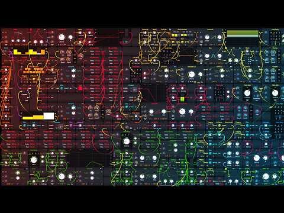
- 설명 앞부분: In this modular Bitwig patch, I tried to create the feeling of floating at the edge of the universe, far away from everything. It’s built from soft noise, slow-moving oscillators, long reverb tails, pitch shifting, random notes, and tiny details that drift in and out like distant signals. The patch…
- 같은 채널 평소 대비 ×143.3 (채널 최근 롱폼 중앙값 7,125회) · 평소 영상: This Patch Sounds Like a Deep Cinematic Blade Run… (7,130회) / This Patch Sounds Like a Living Ambient Organism (7,120회)
- 대본 없음 (설명) — 음성인식이 끝나면 도입부·흐름이 들어감
- 댓글 884/884: 좋은 점 — 영상 0 · 감사·응원 0 · 더 알고 싶은 것 0 · 아쉬운 점 — 영상 0 · 반박·불만 — 의견 다름 0 · 정치·사회 0 · 경험 공유 0 · 구독·다음 기대 0

### 437. {playlist} 할렐야루한 노래만 갖고옴...

- https://www.youtube.com/watch?v=cnBMqI-z8q8 · 밤티플리 · 구독자 1,280 · 조회수 147,108 (×114.9, 하루 1,037.2) · 좋아요 2,998 (2.0%) · 18.8분 · 2026-05-30 · 주제 묶음 기타 · 형식 플레이리스트·모음 (여러 곡) · 폴더 `W_cnBMqI-z8q8` (웹 승인)
- 썸네일: 
- 같은 채널 평소 대비 ×27.2 (채널 최근 롱폼 중앙값 5,407회) · 평소 영상: {Playlist} 그냥 친구냐고 물어본 Question 빨개진 얼굴이 Answer (5,407회) / [Playlist] 느좆 (1,863회)
- 대본 없음 (없음) — 음성인식이 끝나면 도입부·흐름이 들어감
- 댓글 30/30: 좋은 점 — 영상 0 · 감사·응원 1 · 더 알고 싶은 것 1 · 아쉬운 점 — 영상 0 · 반박·불만 — 의견 다름 0 · 정치·사회 0 · 경험 공유 2 · 구독·다음 기대 0
  - 감사·응원 👍0 “밤티님 감사하요”
  - 더 알고 싶은 것 👍5 “이것만 들음 공부시작할때 이 플리로 시작함 ㅇㄴ 너무좋아요 더올려주세요 1일1영상ㅂㅌ드립니다”
  - 경험 공유 👍0 “내가 보려고 만든 타임라인 0:00 Aqua Man - 빈지노 0:00 Aqua Man - 빈지노 3:44 바람이나 좀 쐐 - 개리 3:44 바람이나 좀 쐐 - 개리 7:22 The Lady - 범키 7:22 The Lady - 범키 11:12 이럴거면 그러지 말지 …”
  - 경험 공유 👍0 “내가 1빠다”

### 438. 쇼팽, 첼로로 물들다 ∣ 피아노와 첼로로 듣는 녹턴의 밤 (Chopin for Cello & Piano)

- https://www.youtube.com/watch?v=HV7WBsQq-Ms · EmberClassic · 구독자 4,830 · 조회수 549,271 (×113.7, 하루 6,062.0) · 좋아요 3,479 (0.6%) · 71.3분 · 2026-07-20 · 주제 묶음 6. 피아노·클래식·연주곡 · 형식 음악 (그 밖 모양 — 한 편짜리 BGM 등) · 폴더 `W_HV7WBsQq-Ms` (웹 승인)
- 썸네일: 
- 챕터: 0:00 01. Nocturne of First Light · 2:34 02. Evening Reverie · 4:20 03. Whispered Longing · 6:45 04. Candlelight · 8:50 05. Passionate Heart · 10:39 06. Moonlit Waltz · 13:09 07. Tears and Grace · 15:20 08. A Tender Confession Styles · 17:58 09. Deep Waters · 20:19 10. Rhapsody in Blue Hour · 23:10 11. Before the Dawn · 25:21 12. Quiet Farewell · 27:40 13. Morning Star · 30:15 14. Stillness at Sunrise · 32:46 15. Eternal Nocturne · 35:40 16. Nocturne of First Light · 38:14 17. Evening Reverie · 40:00 18. Whispered Longing · 42:25 19. Candlelight · 44:30 20. Passionate Heart
- 설명 앞부분: 🎹 쇼팽, 첼로로 물들다 — 피아노와 첼로로 듣는 녹턴의 밤 🎻 첼로의 첫 한 음이 어둠 속에서 노래하기 시작하면, 피아노가 달빛처럼 그 위에 내려앉습니다. 프레데리크 쇼팽 — '피아노의 시인'이라 불린 그의 음악을, 첼로와 피아노의 듀엣으로 다시 그렸습니다. 쇼팽의 노래하는 선율을 첼로의 깊고 따뜻한 음색이 이어받고, 그 유명한 물결치는 아르페지오를 피아노가 감쌉니다. 밤에서 새벽으로 흐르는 15곡의 여정, 그 서정에 잠겨보세요. 🎼 쇼팽의 언어 — 노래하는 피아노의 시 쇼팽은 피아노를 '노래하게' 만든 작곡가였습니다. 그의 음…
- 같은 채널 평소 대비 ×84.4 (채널 최근 롱폼 중앙값 6,506회) · 평소 영상: 흘러가다, 차이콥스키의 가을 ∣ Drift — Tchaikovsky Reimagined … (7,097회) / 쇼팽 발라드 ∣ 첼로로 다시 쓰는 가을 - Chopin Ballade Reimagined… (5,914회)
- 대본 없음 (설명) — 음성인식이 끝나면 도입부·흐름이 들어감
- 댓글 170/170: 좋은 점 — 영상 0 · 감사·응원 30 · 더 알고 싶은 것 3 · 아쉬운 점 — 영상 1 · 반박·불만 — 의견 다름 0 · 정치·사회 0 · 경험 공유 7 · 구독·다음 기대 4
  - 감사·응원 👍13 “아름다운 선율에 위로 받습니다. 창조주께서 사람에게 주신 가장 귀하고도 빛나는 선물은 음악임이 분명합니다. 좋은 음악 감사합니다❤”
  - 감사·응원 👍7 “아름다운 음악 선물 감사합니다❤”
  - 더 알고 싶은 것 👍11 “집사람이 좋아하네요 혹시 악보를 구입할수있을까요??”
  - 더 알고 싶은 것 👍1 “15곡 제목을 순서대로 알려주세요~ 좋은 음악 감사합니다 :)”
  - 경험 공유 👍31 “아~ 이곡 처음부터 듣는데 왜 눈물이 나지~~~ 눈물이 고이고 ~ 사는게 뭔지~ 아웅다웅 살이유가 있을까~ 그냥 물흐른대로 흘려보내자~ 나도 떠내려 가고~ 가고싶은대로 가도록~”
  - 경험 공유 👍1 “너무 미안해요. 내가 멈췼어야 했는데...어떤식으로든 욕심을 부리지 않았어야 했는데..”
  - 구독·다음 기대 👍1 “구독과 좋아요 누르고 갑니다 알림설정두요 이 아침에 넘 어울리는 곡이라 진한 커피와 한 잔하고 있습니다 ㆍ고맙습니다”
  - 구독·다음 기대 👍1 “요즘 매일 듣네요 넘 평온해지는 힐링음악❤”

### 439. Greatest Classic Reggae Old Songs 70s-90s 🌴 RIVERS OF BABYLON, Ob-La-Di Ob-La-Da ∣ Best R…

- https://www.youtube.com/watch?v=1MPtYI4ExEo · Zee · 구독자 11,600 · 조회수 1,313,539 (×113.2, 하루 19,476.3) · 좋아요 8,326 (0.6%) · 57.4분 · 2026-08-12 · 주제 묶음 12. 커버·노래 부르기 · 형식 플레이리스트·모음 (여러 곡) · 폴더 `W_1MPtYI4ExEo` (웹 승인)
- 썸네일: 
- 챕터: 0:00 01. Rivers Of Babylon · 4:32 02. Ob-La-Di Ob-La-Da · 8:25 03. Oh Carol · 11:32 04. Beautiful Sunday · 15:09 05. Goodbye · 19:14 06. Always · 23:46 07. What's Up · 28:40 08. Unchained Melody · 32:53 09. Love Hurts · 36:56 10. Sailing · 40:39 11. Oh! Darling · 44:32 12. Wonderful Tonight · 48:05 13. I Can't Stop Loving You · 53:05 14. That's Why (You Go Away) · 58:00 15. If Tomorrow Never Comes
- 설명 앞부분: Relax and enjoy the Greatest Classic Reggae Old Songs 70s-90s, featuring timeless reggae covers of legendary hits that have touched generations. From Rivers Of Babylon and Ob-La-Di Ob-La-Da to Unchained Melody, Love Hurts, and many more, this collection brings together warm island rhythms, smooth m…
- 같은 채널 평소 대비 ×121.0 (채널 최근 롱폼 중앙값 10,853회) · 평소 영상: Greatest Classic Reggae Old Songs 70s - 80s 🌴 VAL… (10,853회) / Greatest Classic Reggae Old Songs 70s - 90s 🌴 MAC… (14,747회)
- 대본 없음 (설명) — 음성인식이 끝나면 도입부·흐름이 들어감
- 댓글 129/129: 좋은 점 — 영상 0 · 감사·응원 0 · 더 알고 싶은 것 0 · 아쉬운 점 — 영상 0 · 반박·불만 — 의견 다름 0 · 정치·사회 0 · 경험 공유 0 · 구독·다음 기대 0

### 440. Music to Rest Your Mind.

- https://www.youtube.com/watch?v=-igpcHqULS0 · dark serenity sounds · 구독자 6,690 · 조회수 753,883 (×112.7, 하루 4,745.6) · 좋아요 8,827 (1.2%) · 57.3분 · 2026-05-13 · 주제 묶음 6. 피아노·클래식·연주곡 · 형식 음악 (그 밖 모양 — 한 편짜리 BGM 등) · 폴더 `W_-igpcHqULS0` (웹 승인)
- 썸네일: 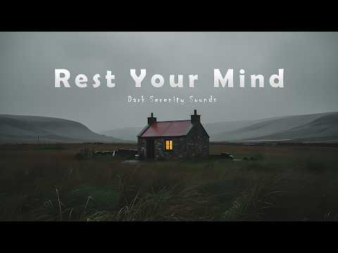
- 설명 앞부분: 🎼Step into a world of quiet rain, endless fog, and peaceful solitude with this deeply emotional ambient experience. “Music to Rest Your Mind” is a slow cinematic journey designed to help you relax, sleep, study, meditate, or simply escape into stillness after a long day. 🎧 Rec vibes: 🎧Perfect for d…
- 같은 채널 평소 대비 ×91.3 (채널 최근 롱폼 중앙값 8,260회) · 평소 영상: relax, your heart needs this. (8,260회) / you need to rest. (8,201회)
- 대본 없음 (설명) — 음성인식이 끝나면 도입부·흐름이 들어감
- 댓글 241/241: 좋은 점 — 영상 0 · 감사·응원 0 · 더 알고 싶은 것 1 · 아쉬운 점 — 영상 0 · 반박·불만 — 의견 다름 0 · 정치·사회 0 · 경험 공유 0 · 구독·다음 기대 0
  - 더 알고 싶은 것 👍3 “신비스러운 분위기 너무 좋아요. 좋아요 누르고 갑니다. 좋은 음악 많이 만들어 주세요~~”

