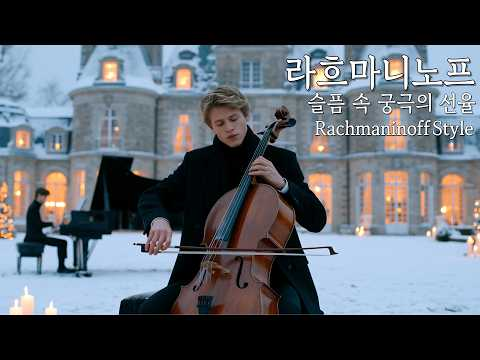

# 음악 — 성공 사례 분석: 사례별 자세히 #441–#480

`analysis.md` 의 9번 (같은 # 번호). 자동 생성 — `tools/success_analysis.py` v1.5.1 (2026-10-23 07:49 UTC). ※ 연구·교육용 — 투자 권유가 아님.

### 441. ㅤㅤㅤㅤㅤㅤㅤㅤㅤㅤㅤㅤㅤㅤㅤㅤㅤㅤㅤㅤㅤㅤㅤㅤㅤㅤㅤㅤㅤㅤㅤㅤㅤㅤㅤㅤㅤ

- https://www.youtube.com/watch?v=MsjHOAq7WH0 · ㅤㅤㅤㅤㅤㅤㅤㅤㅤㅤㅤㅤㅤㅤㅤㅤㅤㅤㅤㅤㅤㅤㅤㅤㅤㅤㅤㅤㅤㅤㅤㅤㅤㅤㅤㅤㅤㅤㅤㅤㅤㅤㅤㅤㅤㅤㅤㅤㅤ김 · 구독자 14,700 · 조회수 1,613,381 (×109.8, 하루 31,105.9) · 좋아요 37,623 (2.3%) · 67.7분 · 2026-09-01 · 주제 묶음 6. 피아노·클래식·연주곡 · 형식 음악 (그 밖 모양 — 한 편짜리 BGM 등) · 폴더 `W_MsjHOAq7WH0` (웹 승인)
- 썸네일: 
- 설명 앞부분: Lofi / Jazz / 90s Japanese City Pop
- 같은 채널 평소 대비 ×329.6 (채널 최근 롱폼 중앙값 4,895회) · 평소 영상: ㅤㅤㅤㅤㅤㅤㅤㅤㅤㅤㅤㅤㅤㅤㅤㅤㅤㅤㅤㅤㅤㅤㅤㅤㅤㅤㅤㅤㅤㅤㅤㅤㅤㅤㅤㅤㅤ (5,206회) / ㅤㅤㅤㅤㅤㅤㅤㅤㅤㅤㅤㅤㅤㅤㅤㅤㅤㅤㅤㅤㅤㅤㅤㅤㅤㅤㅤㅤㅤㅤㅤㅤㅤㅤㅤㅤㅤ (4,584회)
- 대본 없음 (설명) — 음성인식이 끝나면 도입부·흐름이 들어감
- 댓글 1,119/1,122: 좋은 점 — 영상 2 · 감사·응원 2 · 더 알고 싶은 것 4 · 아쉬운 점 — 영상 5 · 반박·불만 — 의견 다름 0 · 정치·사회 0 · 경험 공유 12 · 구독·다음 기대 2
  - 좋은 점 — 영상 👍1 “이 네코 열차를 타면서 듣기 좋네요~”
  - 좋은 점 — 영상 👍1 “2번째네 진짜 썸네일 레전드다 ㅋㅋㅋ”
  - 감사·응원 👍1 “오늘도 고레일을 이용해 주셔서 감사합니다.♪”
  - 감사·응원 👍0 “뭐야 시발 . 감사합니다.”
  - 더 알고 싶은 것 👍6,477 “대체 뭔노래가 나올까 궁금해서 들어왔습니다”
  - 더 알고 싶은 것 👍4 “썸네일보고 하도 궁금해서 들어와봤는데 노래는 와중에 평화롭네 ㅋㅋㅋㅋㅋㅋㅋㅋㅋㅋㅋㅋㅋㅋㅋㅋㅋㅋㅋㅋㅋㅋㅋㅋㅋ”
  - 아쉬운 점 — 영상 👍13 “썸네일 어그로 맛있는데 노래는 잘 모르겠네”
  - 아쉬운 점 — 영상 👍2 “어그로 ㅈㄴ 잘 끌엇다 ㅋㅋㅋㅋㅋㅋㅋㅋ”
  - 경험 공유 👍1,308 “나도 모르게 "아 지랄 ㅋㅋ" 하면서 들어왔네 ㅋㅋㅋㅋㅋㅋㅋㅋㅋ 아 미친”
  - 경험 공유 👍2 “제목도 안보이고 채널명도 안보이니 나도모르게 누르게되네 ㅋㅋㅋㅋㅋㅋ”
  - 구독·다음 기대 👍1 “ㅤㅤㅤㅤㅤㅤㅤㅤㅤㅤㅤㅤㅤㅤㅤㅤㅤㅤㅤㅤㅤㅤㅤㅤㅤㅤㅤㅤㅤㅤㅤㅤㅤㅤㅤㅤㅤㅤㅤㅤㅤㅤㅤㅤㅤㅤㅤㅤㅤㅤㅤㅤㅤㅤㅤㅤ김님 팬이에요”
  - 구독·다음 기대 👍1 “썸넬 학원 배우신 분이네.... 썸넬만 보면 캐치캐치 풍의 노래가 나올 줄 알았는데 재즈가 나오다니ㅋㅋㅋㅋ구독하고 갑니다”

### 442. Pokémon Café Jazz Lofi ∣ ☕ Smooth Beats for Study & Focus Sessions 🎵

- https://www.youtube.com/watch?v=t6yrxjE7HSM · Rest Point Lofi · 구독자 4,080 · 조회수 446,111 (×109.3, 하루 2,549.6) · 좋아요 4,481 (1.0%) · 104.2분 · 2026-05-01 · 주제 묶음 3. 공부·집중·작업 · 형식 음악 (그 밖 모양 — 한 편짜리 BGM 등) · 폴더 `W_t6yrxjE7HSM` (웹 승인)
- 썸네일: 
- 챕터: 0:00 Pewter City Theme (Day) - Roc… · 2:36 Party Theme (Rocky Ridges) · 4:49 Pokémon Center (Day) · 7:18 Dream Island (Dragonite Doll) · 9:53 Dream Island (Clefairy & Arca… · 12:13 Cloud Island Theme · 14:06 Final Song · 16:17 Ending Credits · 18:05 Title Screen Theme
- 설명 앞부분: Today’s Healing Spot is right here! 🛡 "Consider this your personal Save Point in the middle of a busy day." The familiar melodies of Pokopia have been transformed into a cozy jazz cafe, filled with warm lighting and the aroma of fresh coffee. 🧪 Focus: Gentle beats for undistracted immersion 🍯 Vibe:…
- 같은 채널 평소 대비 ×73.2 (채널 최근 롱폼 중앙값 6,096회) · 평소 영상: Pokémon City Pop Lofi ∣ 🌃 Neon Night Beats for St… (6,157회) / Pokémon Dawn City Lofi 🌆 ∣ Quiet Beats 🌙 Before S… (6,034회)
- 대본 없음 (설명) — 음성인식이 끝나면 도입부·흐름이 들어감
- 댓글 74/76: 좋은 점 — 영상 0 · 감사·응원 0 · 더 알고 싶은 것 0 · 아쉬운 점 — 영상 0 · 반박·불만 — 의견 다름 0 · 정치·사회 0 · 경험 공유 0 · 구독·다음 기대 0

### 443. Soft Acoustic Playlist 🎵 ∣ Best Relax & Chill Vibes Songs 2026 ∣ Lover, Back To December

- https://www.youtube.com/watch?v=MPT9v9MIod0 · Cozy Strings · 구독자 9,610 · 조회수 1,050,442 (×109.3, 하루 6,741.1) · 좋아요 3,031 (0.3%) · 69.8분 · 2026-05-20 · 주제 묶음 8. 로파이·시티팝·칠 · 형식 플레이리스트·모음 (여러 곡) · 폴더 `W_MPT9v9MIod0` (웹 승인)
- 썸네일: 
- 설명 앞부분: Soft Acoustic Playlist 💞🎵 ∣ Best Relax & Chill Vibes Songs 2026 ∣ Lover, Back To December ✨ Welcome to your relaxing space. This playlist is filled with soft acoustic love songs, emotional ballads, and timeless English classics that create the perfect chill atmosphere. Whether you're relaxing after…
- 같은 채널 평소 대비 ×329.1 (채널 최근 롱폼 중앙값 3,192회) · 평소 영상: Midnight Acoustic ∣ Timeless Love Songs for Relax… (3,192회) / Midnight Acoustic 🎧 Emotional Love Songs for Quie… (3,339회)
- 대본 없음 (설명) — 음성인식이 끝나면 도입부·흐름이 들어감
- 댓글 84/92: 좋은 점 — 영상 0 · 감사·응원 0 · 더 알고 싶은 것 0 · 아쉬운 점 — 영상 0 · 반박·불만 — 의견 다름 0 · 정치·사회 0 · 경험 공유 0 · 구독·다음 기대 0

### 444. 99% DEEP SLEEP in 3 Minutes (NO ADS) • Relieves Stress • Increases Deep Sleep5

- https://www.youtube.com/watch?v=E0hQGUOAhrQ · Fall Asleep Sound · 구독자 9,540 · 조회수 1,039,021 (×108.9, 하루 13,786.7) · 좋아요 5,392 (0.5%) · 116.9분 · 2026-08-08 · 주제 묶음 1. 수면·명상·힐링 · 형식 정보·해설 (그 밖) · 폴더 `W_E0hQGUOAhrQ` (웹 승인)
- 썸네일: 
- 설명 앞부분: 99% DEEP SLEEP in 3 Minutes (NO ADS) • Relieves Stress • Increases Deep Sleep5 Video made by: Fall Asleep Sound 📜 Message from the creator: 🌙 Sleep Hypnosis for Deep Healing Let your body relax, your mind slow down, and gently drift into a deep, peaceful sleep. This calming sleep music with soft na…
- 같은 채널 평소 대비 ×106.3 (채널 최근 롱폼 중앙값 9,770회) · 평소 영상: 99% DEEP SLEEP in 3 Minutes (NO ADS) • Fall Aslee… (9,770회) / 99% Heals You While You Sleep (No Ads) • Relieves… (9,751회)
- 대본 없음 (설명) — 음성인식이 끝나면 도입부·흐름이 들어감
- 댓글 281/275: 좋은 점 — 영상 0 · 감사·응원 0 · 더 알고 싶은 것 0 · 아쉬운 점 — 영상 0 · 반박·불만 — 의견 다름 0 · 정치·사회 0 · 경험 공유 0 · 구독·다음 기대 0

### 445. [𝙋𝙡𝙖𝙮𝙡𝙞𝙨𝙩] 라흐마니노프 - 지독한 슬픔 끝에 피어난 환희에 대하여ㅣRachmaninoff Style

- https://www.youtube.com/watch?v=w5nhvxPli3E · Moonlight Classic · 구독자 8,360 · 조회수 910,282 (×108.9, 하루 9,540.9) · 좋아요 9,273 (1.0%) · 180분 · 2026-07-19 · 주제 묶음 기타 · 형식 플레이리스트·모음 (여러 곡) · 폴더 `W_w5nhvxPli3E` (웹 승인)
- 썸네일: 
- 챕터: 0:00 Prelude to Tears · 3:14 Winter Solitude · 6:22 Nocturne in g minor · 9:15 The Last Light · 11:44 Lost Homeland · 15:02 Echoes of Fate · 18:14 Silent Chimes · 20:53 Elegie in Ash · 23:33 Fading Vocalise · 26:47 Volga Dusk · 29:47 Frozen Romance · 33:09 Loop
- 설명 앞부분: 마음 따뜻한 댓글을 남겨주세요 ! 서로 위로와 격려가 되는 글은 주인장과 많은 Moonlight Classic : 시공간을 넘어서는 클래식 선율 세월이 흘러도 변치 않는 아름다움. 당신의 공간을 클래식의 정교하고 우아하게 채워드립니다. 🎧 이어폰을 끼고, 음악이 주는 평온함에 빠져보세요. 문라이트 클래식은 사람의 창작과 기획을 바탕으로 AI 기술을 창작 도구로 활용하여 완성한 고유한 창작물입니다. 음악과 이미지의 콘셉트, 선곡과 구성, 분위기와 연출 등 전체적인 창작 방향은 사람이 직접 기획하고 결정하였으며, Suno, Canva…
- 같은 채널 평소 대비 ×769.5 (채널 최근 롱폼 중앙값 1,183회) · 평소 영상: [𝙋𝙡𝙖𝙮𝙡𝙞𝙨𝙩] 기분이 좋아지는 밝은 클래식🎶 맑고 경쾌한 바이올린과 피아노 앙상블🌷 (1,183회) / [𝙋𝙡𝙖𝙮𝙡𝙞𝙨𝙩] 🍂 가을 감성의 부드러운 첼로 클래식 모음 (1,335회)
- 대본 없음 (설명) — 음성인식이 끝나면 도입부·흐름이 들어감
- 댓글 791/813: 좋은 점 — 영상 14 · 감사·응원 198 · 더 알고 싶은 것 8 · 아쉬운 점 — 영상 4 · 반박·불만 — 의견 다름 4 · 정치·사회 0 · 경험 공유 73 · 구독·다음 기대 4
  - 좋은 점 — 영상 👍150 “저는 지금 이 순에도 위태로운 제 자신을 부여잡고 눈물을 흘리며 하루하루를 버티는 중년의 여성입니다 삶을 내려 놓고 싶은 순간이 너무 많지만 생명의 질긴 끊이 저를 버텨주네요 사실 용기도 없습니다 젊은 시절은 부모님 상처드리기 싫어 버티는 심정으로 살았고 지금은 제 …”
  - 좋은 점 — 영상 👍16 “독서하면서 듣기좋네요 불안한 나날이 계속 되지만 마음의 평화를 가지려고 기를 쓰고 있요”
  - 감사·응원 👍1,687 “26년 병원 검사를 마치고, 어제부터 1년을 선물 받았습니다. 안전한 1년이길 🙏하면서 , 오늘은 좋아하는 음악을 들으며 가만히 쉬어 봅니다. 이런날 음악이 친구가 되어주고, 위로가 되어줍니다. 클래식을 잘 모르지만, 저는 마음으로 느껴지는 걸 중요하게 생각하며 듣습…”
  - 감사·응원 👍528 “번개탄 피워놓고 죽으면 다끝이지 않을까? 하는 마음을 떨쳐버리고 마음추스린지 일주일 입니다 삶에 무게너무 무겁지만 그래도 살아가는것이 맞겠지...하는생각에...모두들 힘내보아요”
  - 더 알고 싶은 것 👍9 “곡명이 알고 싶어요. 곡명을 알려주는 친절함을......”
  - 더 알고 싶은 것 👍7 “앨범이름 알고싶습니다..ㅠ”
  - 아쉬운 점 — 영상 👍14 “너무잘들었어요곡선택잘하셨네요 광고가1도없어서구독했어요자주올께요”
  - 아쉬운 점 — 영상 👍1 “엄마가 벌써 하신지 한달이 좀 넘었어요 생각해 보니 엄마❤️❤️❤️💕의 대화에 깊이 얘기해 본 적이 없습니다 너무 아쉬움이 많이 있고 생각이 많이 나요. 그때 왜 엄마랑 깊은 대화를 못 했을까 엄마의 사생활 에 전 그냥 보고만 있었지요 엄마는 무슨 생각하고 살았을까?…”
  - 반박·불만 — 의견 다름 👍2 “너무 아름답고 좋은데 이게 실제로 라흐마니노프곡들은 아니죠? style 이라고 쓰신 거 보면.....”
  - 경험 공유 👍150 “저는 지금 이 순에도 위태로운 제 자신을 부여잡고 눈물을 흘리며 하루하루를 버티는 중년의 여성입니다 삶을 내려 놓고 싶은 순간이 너무 많지만 생명의 질긴 끊이 저를 버텨주네요 사실 용기도 없습니다 젊은 시절은 부모님 상처드리기 싫어 버티는 심정으로 살았고 지금은 제 …”
  - 경험 공유 👍27 “저 어린시절 생각나 마음이 울컥해져요~ 편안 가정이 아니었기에 외로웠는데 ~ 늘 복음송 듣다가 우연히 여기 들어왔어요 참 귀한 음악입니다 내가 지금 살아있음에 감사하는 시간을 주셨네요 어떤이는 이런 재능을 주셨네요 그분으로 인하여 아름다운 소리를 듣네요~ 고맙습니다 …”
  - 구독·다음 기대 👍14 “너무잘들었어요곡선택잘하셨네요 광고가1도없어서구독했어요자주올께요”
  - 구독·다음 기대 👍6 “잘 듣고 가요 구독합니다.”

### 446. 💖신나게 미친(positive) 최신 걸그룹 노래 모음 ∣ 최신 여자아이돌 플레이리스트 [ Girl Group Playlist ]

- https://www.youtube.com/watch?v=PiKPf0T7I84 · 띠잉뮤직 · 구독자 20,900 · 조회수 2,268,991 (×108.6, 하루 13,316.6) · 좋아요 5,613 (0.2%) · 120.5분 · 2026-05-05 · 주제 묶음 기타 · 형식 플레이리스트·모음 (여러 곡) · 폴더 `W_PiKPf0T7I84` (웹 승인)
- 썸네일: 
- 챕터: 0:00 ILLIT - It’s Me · 2:17 LE SSERAFIM - CELEBRATION · 4:49 BABYMONSTER - CHOOM · 7:48 UNCHILD - UNCHILD · 10:16 LEE CHAEYEON - No Tears On Th… · 12:45 KISS OF LIFE - Who is she · 15:24 LOVEONE - UNICA · 18:15 ODD YOUTH - Babyface · 21:05 Baby DONT Cry - Bittersweet · 24:26 ILLIT - Do the Dance · 27:33 AtHeart - Shut Up · 29:47 CHUU - Strawberry Rush · 32:43 XG – HYPNOTIZE · 35:20 Hearts2Hearts - RUDE! · 38:49 SAY MY NAME - UFO · 41:29 IVE GAEUL - Odd · 44:19 YENA - Catch Catch · 47:21 IVE - BANG BANG · 50:17 YOUNG POSSE - we don't go to … · 53:18 izna - Racecar
- 설명 앞부분: 🎵PlayList🎵
- 같은 채널 평소 대비 ×191.5 (채널 최근 롱폼 중앙값 11,847회) · 평소 영상: 💎 쌈뽕하게 신나는 여자 아이돌 걸그룹 노래 모음 [ Girl Group Playlist… (12,732회) / 💖 느낌 좋은 최신 걸그룹 노래모음 여자 아이돌 플레이리스트 [ Girl Group Pl… (10,962회)
- 대본 없음 (설명) — 음성인식이 끝나면 도입부·흐름이 들어감
- 댓글 270/271: 좋은 점 — 영상 0 · 감사·응원 2 · 더 알고 싶은 것 1 · 아쉬운 점 — 영상 1 · 반박·불만 — 의견 다름 0 · 정치·사회 0 · 경험 공유 5 · 구독·다음 기대 1
  - 감사·응원 👍5 “좋은 노래 골라서 들려주는 고마움에 감사드려요.”
  - 감사·응원 👍1 “모르던 좋은 곡들 많이 알아갑니다 감사합니다!!!!”
  - 더 알고 싶은 것 👍20 “순천부영초등학교 이지인입니다 이챌린지을많이봤어요 이노래를듣으면 우울할때기분이 좋아져서이노래에 댓글을달았어요앞으로 신나는노래많이 올려주세요”
  - 아쉬운 점 — 영상 👍2 “걸그룹노래가 젤신나 리듬도좋고 지루하지가않네 채널틀면 마카다 트로트 ㅜㅜ 그만나오면안되나? 그노래가그트로트 이런 가요채널좀나오면 좋을텐뎅”
  - 경험 공유 👍5 “노 래 그럼 내가 더 많이 많이 사랑해요”
  - 경험 공유 👍4 “내가 트렌드에 못따라가나 생각하고 계속듣는네 그냥 퀄리티자체가 내려온것같음”
  - 구독·다음 기대 👍3 “다음주 플리 기다립니다♡♡ 지난 플리들 보니 다양한 노래를 좋아하시는 것같은데 저번에 달아주신 답글대로 기대할게요!”

### 447. 🎻 바흐에게서 영감을 받은 바로크 듀엣 – 첼로와 오보에

- https://www.youtube.com/watch?v=NxDxvXUWyFQ · yoon acacia · 구독자 1,690 · 조회수 182,681 (×108.1, 하루 2,236.0) · 좋아요 1,312 (0.7%) · 69.7분 · 2026-08-02 · 주제 묶음 6. 피아노·클래식·연주곡 · 형식 음악 (그 밖 모양 — 한 편짜리 BGM 등) · 폴더 `W_NxDxvXUWyFQ` (웹 승인)
- 썸네일: 
- 설명 앞부분: 🎻 바흐에게서 영감을 받은 바로크 듀엣 – 첼로와 오보에 질서와 아름다움이 공존하는 바흐의 음악 세계에서 영감을 받아 만든 바로크 스타일의 창작 연주곡입니다. 따뜻한 첼로의 깊은 울림과 맑고 섬세한 오보에의 선율이 서로 대화를 나누듯 어우러지며, 고요한 숲길을 걷는 듯한 평안함을 전합니다. 바쁜 일상 속에서 잠시 멈추어 마음을 쉬게 하고 싶을 때, 이 음악이 편안한 쉼과 잔잔한 위로가 되기를 바랍니다. 🎼 추천 감상 시간 독서와 공부 작업 및 집중 시간 휴식과 명상 아침을 여는 클래식 조용한 저녁 시간 마음을 차분히 하고 싶은 순…
- 같은 채널 평소 대비 ×309.6 (채널 최근 롱폼 중앙값 590회) · 평소 영상: 🌿 숲속의 아침, 반짝이는 클래식A Morning in the Forest · Spark… (590회) / 🎼 고요에서 피어나는 바로크Baroque Blossoming in Stillness첼로 … (596회)
- 대본 없음 (설명) — 음성인식이 끝나면 도입부·흐름이 들어감
- 댓글 35/35: 좋은 점 — 영상 0 · 감사·응원 3 · 더 알고 싶은 것 0 · 아쉬운 점 — 영상 1 · 반박·불만 — 의견 다름 0 · 정치·사회 0 · 경험 공유 0 · 구독·다음 기대 0
  - 감사·응원 👍15 “윤아카시아님 안녕하세요 우연히 피드 넘기다 제목을 보고 들어왔어요 반갑습니다 모닝 커피 타임인데 참 좋아요 구독과 좋아요로 응원합니다 자주찾아올게요 중간지나가며 나오는 오보에 연주도 넘넘 좋아요😊😊😊❤”
  - 감사·응원 👍5 “작업하면서 첼로 소리에 잠시 힘든 것을 잊고 계속 듣게 되네요. 좋은 음악 감사합니다. 좋아요 구독 누르고 갑니다.”
  - 아쉬운 점 — 영상 👍0 “그러니까 첼로-오보 듀엣으로 전곡이 연주되는 거군요? 일단 앞 부분 들어보고 Ai 특유의 지루함 비스무레한 것이 아니라면 구독/좋아요 하고 가겠습니다.”

### 448. Anirudh's new 2026 Mass songs ∣ Best Anirudh Songs #trending

- https://www.youtube.com/watch?v=NV2bXZ4H4gA · Musical Haven · 구독자 2,090 · 조회수 224,180 (×107.3, 하루 1,741.7) · 좋아요 1,207 (0.5%) · 16.7분 · 2026-06-16 · 주제 묶음 기타 · 형식 음악 (그 밖 모양 — 한 편짜리 BGM 등) · 폴더 `W_NV2bXZ4H4gA` (웹 승인)
- 썸네일: 
- 설명 앞부분: Anirudh's new 2026 songs Anirudh songs Anirudh's mass songs Anirudh new songs anirudh songs anirudh ravichander bgms anirudh ravichander best songs anirudh bgms anirudh best bgms
- 대본 없음 (설명) — 음성인식이 끝나면 도입부·흐름이 들어감
- 댓글 15/16: 좋은 점 — 영상 0 · 감사·응원 0 · 더 알고 싶은 것 0 · 아쉬운 점 — 영상 0 · 반박·불만 — 의견 다름 0 · 정치·사회 0 · 경험 공유 0 · 구독·다음 기대 0

### 449. Romantic Instrumental Playlist 💖 ∣ Saxophone & Flute Love Melodies ∣ Relaxing Bollywood I…

- https://www.youtube.com/watch?v=dHqp0WOzSns · Video Music Shorts · 구독자 6,080 · 조회수 645,090 (×106.1, 하루 6,391.5) · 좋아요 3,444 (0.5%) · 13.3분 · 2026-07-14 · 주제 묶음 6. 피아노·클래식·연주곡 · 형식 플레이리스트·모음 (여러 곡) · 폴더 `W_dHqp0WOzSns` (웹 승인)
- 썸네일: 
- 설명 앞부분: Romantic Instrumental Playlist 💖 ∣ Saxophone & Flute Love Melodies ∣ Relaxing Bollywood Instrumentals Songs: Ae Mere Humsafar Chand Chhupa Badal Mein Meri Mehbooba Sambhala hai mene Is Kadar Pyar Hai Dekho Dekho Description: Fall in love with the soothing sound of romantic Bollywood instrumentals. …
- 같은 채널 평소 대비 ×29.2 (채널 최근 롱폼 중앙값 22,069회) · 평소 영상: Hemlata Evergreen Melodies ∣∣ Instrumental Songs … (22,069회) / Kishore Kumar Super Hit Instrumentals ∣ Super Hit… (22,126회)
- 대본 없음 (설명) — 음성인식이 끝나면 도입부·흐름이 들어감
- 댓글 34/35: 좋은 점 — 영상 0 · 감사·응원 0 · 더 알고 싶은 것 0 · 아쉬운 점 — 영상 0 · 반박·불만 — 의견 다름 0 · 정치·사회 0 · 경험 공유 0 · 구독·다음 기대 0

### 450. Quiet Night Playlist 🌙 ∣ Soft Love Songs for Deep Feelings & Calm Moments

- https://www.youtube.com/watch?v=EvU4QgmjhMY · Cozy Strings · 구독자 9,610 · 조회수 1,019,077 (×106.0, 하루 7,288.2) · 좋아요 3,407 (0.3%) · 134.1분 · 2026-06-05 · 주제 묶음 기타 · 형식 플레이리스트·모음 (여러 곡) · 폴더 `W_EvU4QgmjhMY` (웹 승인)
- 썸네일: 
- 챕터: 0:00 If Love Is Blind · 3:28 Cry · 7:25 Someone Who Believes In You · 11:34 Even If · 14:51 That's Why You Go Away · 19:18 Back To December · 22:43 Leaving On a Jet Plane · 27:20 I'm With You · 31:20 Lose Control · 34:47 The Sound of Silence · 38:53 Only Love · 42:56 We Can't Be Friends · 46:39 Lost In Your Eyes · 50:14 There You'll Be · 53:44 Because You Loved Me · 58:20 To Love You More · 62:40 Same Ground
- 설명 앞부분: Let this playlist take you into a quiet, peaceful night filled with emotions and soft melodies 🌙 This collection features a mix of classic love songs, emotional ballads, and gentle acoustic vibes—perfect for slowing down, reflecting, or simply enjoying a calm moment alone. With timeless voices like…
- 같은 채널 평소 대비 ×319.3 (채널 최근 롱폼 중앙값 3,192회) · 평소 영상: Midnight Acoustic ∣ Timeless Love Songs for Relax… (3,192회) / Midnight Acoustic 🎧 Emotional Love Songs for Quie… (3,339회)
- 대본 없음 (설명) — 음성인식이 끝나면 도입부·흐름이 들어감
- 댓글 162/181: 좋은 점 — 영상 0 · 감사·응원 0 · 더 알고 싶은 것 0 · 아쉬운 점 — 영상 0 · 반박·불만 — 의견 다름 0 · 정치·사회 0 · 경험 공유 0 · 구독·다음 기대 0

### 451. 힐링음악 ∣ 쉬어 가도 괜찮아 (It’s Okay to Rest) ∣ 지친 마음을 쉬게 하는 국악 힙합 ∣ KR/ROM/EN Lyrics

- https://www.youtube.com/watch?v=OTmG9c33c1M · 풍그루 · 구독자 598 · 조회수 63,327 (×105.9, 하루 727.2) · 좋아요 190 (0.3%) · 5.1분 · 2026-07-28 · 주제 묶음 1. 수면·명상·힐링 · 형식 한 곡 (뮤직비디오·음원·가사) · 폴더 `W_OTmG9c33c1M` (웹 승인)
- 썸네일: 
- 설명 앞부분: 🎵 이 곡이 포함된 1시간 풀버전 플레이리스트 보기 🌿 힐링음악 ∣ 쉬어 가도 괜찮아 (Swi-eo Ga-do Gwaen-chan-a _ It’s Okay to Rest) 계속 달려야만 잘하고 있는 것은 아니다. 때로는 멈춰 서는 것도, 잠시 숨을 고르는 것도, 나를 지키기 위한 용기다. 세상은 빠르게 가라고 말하지만, 지친 마음은 조용히 말한다. “오늘은 조금 쉬어도 괜찮아.” 이 노래는 너무 오래 버텨온 마음에게 보내는 국악 힙합 힐링음악이다. 완벽하지 않아도 괜찮고, 남들보다 늦어도 괜찮다. 쉬어 간다고 해서 뒤처지는 것이 …
- 같은 채널 평소 대비 ×21.8 (채널 최근 롱폼 중앙값 2,905회) · 평소 영상: 힐링음악 ∣ 물 아래서 숨을 배웠다 (I Learned to Breathe Underwa… (3,053회) / 이 길의 이름은 자유 (The Name of This Road Is Freedom) ∣ … (2,757회)
- 대본 없음 (설명) — 음성인식이 끝나면 도입부·흐름이 들어감
- 댓글 10/10: 좋은 점 — 영상 0 · 감사·응원 0 · 더 알고 싶은 것 1 · 아쉬운 점 — 영상 0 · 반박·불만 — 의견 다름 0 · 정치·사회 0 · 경험 공유 0 · 구독·다음 기대 0
  - 더 알고 싶은 것 👍1 “부디 계속 노래를 만들어 주세요. 정말 잘하고 계세요 🥰”

### 452. 옛날 시골집 슬레이트 빗소리ㅣ고향의 향수ㅣ추억ㅣ수면유도

- https://www.youtube.com/watch?v=IHYnumQGS2o · 빗소리 Healing Sound · 구독자 1,350 · 조회수 142,463 (×105.5, 하루 1,016.3) · 좋아요 1,020 (0.7%) · 300분 · 2026-06-05 · 주제 묶음 1. 수면·명상·힐링 · 형식 자연 소리·백색소음 (음악 낱말 없는 제목) · 폴더 `W_IHYnumQGS2o` (웹 승인)
- 썸네일: 
- 설명 앞부분: 본 채널의 콘텐츠는 독창적인 시각 및 청각적 경험을 제공하기 위해 크리에이터가 직접 제작합니다. 영상은 AI 생성 소스를 기반으로 이펙트, 색 보정, 타임랩스 등 정교한 레이어 합성 편집 과정을 거쳐 완성되었습니다. 오디오는 전문 레코더로 직접 필드 레코딩한 오리지널 소스와 여러 레이어의 고품질 빗소리와 사운드를 정교하게 믹싱(Sound Design)하여 완성한 독창적인 창작물입니다. All content on this channel is directly crafted by the creator to provide a unique…
- 같은 채널 평소 대비 ×50.8 (채널 최근 롱폼 중앙값 2,806회) · 평소 영상: 토독토독, 아무 생각 없이 스르륵 잠드는 시간ㅣ시골집에 내리는 그리운 빗소리 (2,806회) / 옛 시골집의 평온한 빗소리ㅣ스르륵 잠 오는 편안한 빗소리 ASMR (2,785회)
- 대본 없음 (설명) — 음성인식이 끝나면 도입부·흐름이 들어감
- 댓글 47/47: 좋은 점 — 영상 1 · 감사·응원 5 · 더 알고 싶은 것 0 · 아쉬운 점 — 영상 2 · 반박·불만 — 의견 다름 0 · 정치·사회 0 · 경험 공유 0 · 구독·다음 기대 1
  - 좋은 점 — 영상 👍8 “다른 빗소리보다 수면에 큰 도움되여 정겨움인가봐요~ 감사합니다.”
  - 감사·응원 👍22 “향수를 부르는 편한 빗노리네요. 저런 처마 밑에서 잠시나마 비를 피해 서있던 옛추억이 떠올라 행복했어요. 감사해요 ~”
  - 감사·응원 👍8 “다른 빗소리보다 수면에 큰 도움되여 정겨움인가봐요~ 감사합니다.”
  - 아쉬운 점 — 영상 👍2 “감자찌고 오타정정보냄”
  - 아쉬운 점 — 영상 👍0 “지붕쪽만 봤을떄는 ai인지 몰랐는데 장독대랑 꽃쪽보니까 ai티나긴하는구나.”
  - 구독·다음 기대 👍5 “정말 어린시절 생각이 나네요.. 구독했어요, 감사합니다~🎉🎉🎉”

### 453. (BGM) 432Hz Ultimate Healing Music ∣ Alpha Wave for Body and Mind Restoration ∣ Relieve S…

- https://www.youtube.com/watch?v=3odCe4Ry-EY · Serenę Sound · 구독자 6,880 · 조회수 720,417 (×104.7, 하루 4,431.3) · 좋아요 9,249 (1.3%) · 73.5분 · 2026-05-13 · 주제 묶음 1. 수면·명상·힐링 · 형식 음악 (그 밖 모양 — 한 편짜리 BGM 등) · 폴더 `W_3odCe4Ry-EY` (웹 승인)
- 썸네일: 
- 설명 앞부분: Drift into deep, restorative sleep with calming 432Hz frequencies, designed to quiet your thoughts, ease stress, and support the natural release of serotonin, dopamine, and endorphins. Let these gentle vibrations guide your body and mind into a peaceful state of relaxation, emotional balance, and e…
- 같은 채널 평소 대비 ×782.2 (채널 최근 롱폼 중앙값 921회) · 평소 영상: 432Hz Sleep Therapy ∣ Stop Overthinking, Relax th… (1,226회) / 432Hz + 528Hz – Sleep Inside the Healing Flow of … (1,247회)
- 대본 없음 (설명) — 음성인식이 끝나면 도입부·흐름이 들어감
- 댓글 228/229: 좋은 점 — 영상 0 · 감사·응원 1 · 더 알고 싶은 것 0 · 아쉬운 점 — 영상 0 · 반박·불만 — 의견 다름 0 · 정치·사회 0 · 경험 공유 0 · 구독·다음 기대 0
  - 감사·응원 👍0 “감사합니다❤”

### 454. SAD LO-FI 🥺 💔 2026 Ultimate Mind Relaxing Lofi Beats ∣ Study Sleep & Chill lofi ∣ #lofimu…

- https://www.youtube.com/watch?v=ca4K-2vlfvA · KKR rahul 09 · 구독자 16,000 · 조회수 1,669,356 (×104.3, 하루 57,000.3) · 좋아요 8,918 (0.5%) · 18.2분 · 2026-09-24 · 주제 묶음 1. 수면·명상·힐링 · 형식 음악 (그 밖 모양 — 한 편짜리 BGM 등) · 폴더 `W_ca4K-2vlfvA` (웹 승인)
- 썸네일: 
- 설명 앞부분: Welcome to the world of soothing lofi music, where stress fades away, and peace takes over. This 2026 mind-relaxing lofi mix is perfect for: Deep Focus & Studying 📖 Relaxing & Meditation 🧘‍♂ Chilling After a Long Day 🌅 Peaceful Sleep & Stress Relief 😴 Credit : Music Edit Follow :- ‪ ©NOTE : Reuploa…
- 같은 채널 평소 대비 ×623.2 (채널 최근 롱폼 중앙값 2,678회) · 평소 영상: SAD LO-FI 🥺💔 2026 Ultimate Mind Relaxing Lofi Bea… (3,874회) / 2025 Ultimate Mind Relaxing Lofi Beats 🎧🥰 ∣ Study… (3,917회)
- 대본 없음 (설명) — 음성인식이 끝나면 도입부·흐름이 들어감
- 댓글 69/72: 좋은 점 — 영상 0 · 감사·응원 0 · 더 알고 싶은 것 0 · 아쉬운 점 — 영상 0 · 반박·불만 — 의견 다름 0 · 정치·사회 0 · 경험 공유 0 · 구독·다음 기대 0

### 455. If You Are Fall In Love Then Listen Romantic Indian Instrumental Music

- https://www.youtube.com/watch?v=rCFoSTwT1GU · Veena Meditation Music · 구독자 2,390 · 조회수 248,587 (×104.0, 하루 2,120.7) · 좋아요 1,802 (0.7%) · 81.8분 · 2026-06-28 · 주제 묶음 6. 피아노·클래식·연주곡 · 형식 음악 (그 밖 모양 — 한 편짜리 BGM 등) · 폴더 `W_rCFoSTwT1GU` (웹 승인)
- 썸네일: 
- 설명 앞부분: If You Are Fall In Love Then Listen Romantic Indian Instrumental Music Experience a beautiful Romantic Indian Instrumental Music track filled with soulful melodies of Bansuri flute, soft piano, acoustic guitar, gentle tabla, emotional violin, and warm synth pads. This music is perfect for peaceful …
- 같은 채널 평소 대비 ×775.6 (채널 최근 롱폼 중앙값 320회) · 평소 영상: Ultimate Speaker Sound Check & Subwoofer Bass Test (343회) / Heart Touching Indian Folk Music ∣ Veena, Sarangi… (343회)
- 대본 없음 (설명) — 음성인식이 끝나면 도입부·흐름이 들어감
- 댓글 26/27: 좋은 점 — 영상 0 · 감사·응원 0 · 더 알고 싶은 것 0 · 아쉬운 점 — 영상 0 · 반박·불만 — 의견 다름 0 · 정치·사회 0 · 경험 공유 0 · 구독·다음 기대 0

### 456. [Playlist] 조용히 혼자 듣고 싶다… 천상의 감성 보이스 7080 올드팝 🎧 ∣ 카페·휴식·감성 BGM

- https://www.youtube.com/watch?v=HBx4T1dadhI · TrueOldies 7080 · 구독자 5,550 · 조회수 574,082 (×103.4, 하루 3,697.5) · 좋아요 4,597 (0.8%) · 140.2분 · 2026-05-21 · 주제 묶음 9. 가요·발라드·트로트 · 형식 플레이리스트·모음 (여러 곡) · 폴더 `W_HBx4T1dadhI` (웹 승인)
- 썸네일: 
- 챕터: 0:00 Where The Light Remained (빛이 … · 3:03 After The Long Silence (긴 침묵이… · 6:30 Far From This Town (이 마을을 떠나) · 9:10 Before The Season Changed (계절… · 11:57 You Were Still There (당신은 아직 … · 14:13 The Song We Used To Know (우리에… · 17:01 When The Street Went Quiet (거… · 20:30 Stay For A While (잠시 머물러 주세요) · 23:19 Only The Music Stayed (음악만 남아) · 26:27 Back To The Old Street (오래된 거… · 28:51 Lights Across The Window (창 너… · 32:05 Harbor Lights (항구의 불빛) · 34:59 Replay
- 설명 앞부분: 조용한 아침, 창가에 앉아 음악을 듣듯 잔잔하게 스며드는 7080 올드팝을 준비했습니다. 🎧 따뜻한 감성 보이스와 부드러운 멜로디가 오늘 하루의 시작을 편안하게 채워줄 거예요. 커피 한 잔과 함께 천천히 나만의 추억 속으로 떠나보세요. ☕🤍 TrueOldies 7080과 함께 오늘도 조용한 감성 여행 되시길 바랍니다. 채널을 이어가는 큰 힘이 됩니다. 🎶 If you need a quiet moment today, let these old melodies stay beside you for a while. 🎼 Time Track …
- 같은 채널 평소 대비 ×230.9 (채널 최근 롱폼 중앙값 2,486회) · 평소 영상: [Playlist] 바쁘게 살다 보니 어느새 여기까지 왔네요 🌿 ∣ 마음 편안한 7080… (2,486회) / [Playlist] 여름 오후를 닮은 올드팝 🌿 ∣ 편안하고 부드러운 보이스 7080 올… (2,619회)
- 대본 없음 (설명) — 음성인식이 끝나면 도입부·흐름이 들어감
- 댓글 346/352: 좋은 점 — 영상 6 · 감사·응원 38 · 더 알고 싶은 것 1 · 아쉬운 점 — 영상 0 · 반박·불만 — 의견 다름 0 · 정치·사회 0 · 경험 공유 5 · 구독·다음 기대 5
  - 좋은 점 — 영상 👍6 “파란 하늘에 구름한점없지만 가슴에 와닿는 노래에 푹 빠져듭니다. 왠지 행복한 분위기에 감사드립니다 ❤”
  - 좋은 점 — 영상 👍6 “음악이 잔잔하니 너무 듣기 좋아요 ❤”
  - 감사·응원 👍14 “오늘은 한가한 주말오후~커피한잔에 추억을 느끼며 듣는 좋은음악~너무 감사합니다^^”
  - 감사·응원 👍13 “소피 마르소가 내 학창시절에 상송같은 팝송을 부르는것같은 꿈을 꾸게하는 그저, 편안한 오후! 고마워요 ❤😂🎉 그리고 감사합니다!!”
  - 더 알고 싶은 것 👍0 “좋네요.친구랑 호수가 캠핑장에서 낯술 한잔하며 듣고있어요. 가수에 대해 알고 싶은데? 누가 알려주세요.”
  - 경험 공유 👍5 “노래가 편하고 좋아요~ 구독하고 쭉 듣다 갑니다. 저도 열심히 해봐야겠어요!!”
  - 경험 공유 👍1 “음악은 참 신기합니다. 수십 년 전에 들었던 멜로디 하나가 잊고 있던 장면까지 다시 꺼내 주니까요. 저도 그런 힘을 가진 올드팝을 만들어 보고 싶어서 요즘 여러 곡을 시도하고 있습니다.”
  - 구독·다음 기대 👍5 “노래가 편하고 좋아요~ 구독하고 쭉 듣다 갑니다. 저도 열심히 해봐야겠어요!!”
  - 구독·다음 기대 👍4 “잠안오는밤.. 마음을적시는 노래 구독하고 들어봅니다”

### 457. 🌿 Возвращение к себе ∣ Музыка покоя 💦 Вода и тибетские чаши ∣ Calm Relaxing Music

- https://www.youtube.com/watch?v=eFje9j9VLZ0 · МУДРЫЕ МЕДИТАЦИИ · 구독자 6,810 · 조회수 703,854 (×103.4, 하루 5,982.2) · 좋아요 8,622 (1.2%) · 30.1분 · 2026-06-27 · 주제 묶음 1. 수면·명상·힐링 · 형식 음악 (그 밖 모양 — 한 편짜리 BGM 등) · 폴더 `W_eFje9j9VLZ0` (웹 승인)
- 썸네일: 
- 설명 앞부분: 🌿 Welcome to a peaceful space of silence, relaxation, and inner harmony. This 30-minute calming music is designed to help you slow down, release anxious thoughts, and reconnect with yourself. Gentle mountain stream water sounds, authentic Tibetan singing bowls, and soothing meditation music create …
- 같은 채널 평소 대비 ×13.3 (채널 최근 롱폼 중앙값 52,744회) · 평소 영상: 432 Гц 🌿 Музыка исцеления ✨ Тибетская флейта для … (52,744회) / ✨ Музыка восстановления 🕯️ Тибетские поющие чаши … (48,126회)
- 대본 없음 (설명) — 음성인식이 끝나면 도입부·흐름이 들어감
- 댓글 162/163: 좋은 점 — 영상 0 · 감사·응원 0 · 더 알고 싶은 것 0 · 아쉬운 점 — 영상 0 · 반박·불만 — 의견 다름 0 · 정치·사회 0 · 경험 공유 0 · 구독·다음 기대 0

### 458. 회심곡(回心曲) - 쉬운 우리말로 풀어낸 한마음 회심곡, 불교음악, 부모은중경,부모은혜 ,인생무상 , 나무아미타불, AI창작곡, Dragonsong

- https://www.youtube.com/watch?v=0_QIhEcEiq0 · Dragonsong · 구독자 593 · 조회수 61,261 (×103.3, 하루 969.8) · 좋아요 430 (0.7%) · 7.5분 · 2026-08-21 · 주제 묶음 기타 · 형식 음악 (그 밖 모양 — 한 편짜리 BGM 등) · 폴더 `W_0_QIhEcEiq0` (웹 승인)
- 썸네일: 
- 설명 앞부분: 영상 노래 모두 Dragonsong AI 창작곡입니다. 세월 속에서 우리는 많은 것을 얻고 또 잃으며 살아갑니다. 검은 머리가 희어지고 고운 얼굴에 세월의 흔적이 내려앉은 뒤에야 비로소 깨닫게 되는 것들이 있습니다. 이 곡은 인생의 덧없음과 부모님의 깊은 은혜, 그리고 미움과 욕심을 내려놓고 좋은 마음을 남기고 가자는 뜻을 담아 만든 회심곡입니다. 아미타불을 우러르며 마음을 돌이켜 지나온 삶을 되돌아보고, 곁에 있는 소중한 사람들에게 따뜻한 마음을 전하고자 했습니다. 이 노래를 듣는 모든 분들의 가정에 평안이 깃들고, 부모님의 은…
- 같은 채널 평소 대비 ×61.9 (채널 최근 롱폼 중앙값 990회) · 평소 영상: 다음 생이 있다면 3 - 환생, 윤회, 환생연가(還生戀歌) , 중국풍, 轮回恋歌：千年只为… (990회) / 청령포(清泠浦) — 단종(端宗)영월 , 정순왕후와의 슬픈 이별 , 조선 역사 MV, 왕사… (1,026회)
- 대본 없음 (설명) — 음성인식이 끝나면 도입부·흐름이 들어감
- 댓글 39/43: 좋은 점 — 영상 0 · 감사·응원 2 · 더 알고 싶은 것 0 · 아쉬운 점 — 영상 0 · 반박·불만 — 의견 다름 0 · 정치·사회 0 · 경험 공유 1 · 구독·다음 기대 1
  - 감사·응원 👍4 “삶의 덧없음과 부모님의 은혜, 그리고 욕심과 집착을 내려놓는 마음을 담아 참 깊은 울림을 주는 회심곡이네요 🙏🌿 특히 부모님 살아계실 때 더 잘해야 한다는 메시지와, 결국 아무것도 가져갈 수 없으니 좋은 마음과 인연을 남기며 살아가자는 가르침이 오래 마음에 남습니다.…”
  - 감사·응원 👍2 “감사 합니다❤❤❤”
  - 경험 공유 👍3 “저도 좋교는 다르지만 좋은 뜻으로 노래하는 그 마음이 참 좋군요!! 부모님께 효도하고 세상이 따듯해지게 바라겠습니다❤❤❤”
  - 구독·다음 기대 👍1 “인생이 살다보면 뒤늦게 깨닫게 되는 부모님의 은혜.....잘듣고 갑니다 ❤❤❤유친맺고 자주 소통해요 ❤❤❤구독할게요”

### 459. ​🎧 𝐩𝐥𝐚𝐲𝐥𝐢𝐬𝐭 ∣ 아무 걱정 없이 쉬고 싶은 날, 편안하고 아늑한 어쿠스틱 빈티지 재즈

- https://www.youtube.com/watch?v=Py3IKxJcbAA · MONA mood · 구독자 9,840 · 조회수 1,013,573 (×103.0, 하루 9,443.9) · 좋아요 6,215 (0.6%) · 84.4분 · 2026-07-08 · 주제 묶음 7. 재즈·보사노바 · 형식 플레이리스트·모음 (여러 곡) · 폴더 `W_Py3IKxJcbAA` (웹 승인)
- 썸네일: 
- 챕터: 0:00 1.Lazy Delay · 2:32 2.Cozy Air · 6:15 3.Summer Break · 9:22 4.Just Today · 12:04 5.Slow Hours · 15:13 6.Sure Joys · 18:07 7.Clearing Out · 20:52 8.Late Lunch · 24:12 9.Belief · 28:09 repeat.
- 설명 앞부분: 창 밖엔 비, 집에서 뒹굴거리고 싶은 날 머릿속 자잘한 걱정거리들은 잠시 흩어지게 두자. 🧸 Let all the little worries in your head fade away. ​🎧 Music by MONA mood (AI Assisted) © 2026 MONA mood. All rights reserved.
- 같은 채널 평소 대비 ×42.1 (채널 최근 롱폼 중앙값 24,076회) · 평소 영상: 🎧 𝐩𝐥𝐚𝐲𝐥𝐢𝐬𝐭 ∣ 선선한 저녁 공기가 스며드는 시간, 하루를 안아주는 다정한 온도 … (39,660회) / 🎧 𝐩𝐥𝐚𝐲𝐥𝐢𝐬𝐭 ∣ 초록빛 상쾌한 하루 🍃 봄날의 숨을 담은 어쿠스틱 플리 (47,532회)
- 대본 없음 (설명) — 음성인식이 끝나면 도입부·흐름이 들어감
- 댓글 94/98: 좋은 점 — 영상 2 · 감사·응원 6 · 더 알고 싶은 것 2 · 아쉬운 점 — 영상 0 · 반박·불만 — 의견 다름 0 · 정치·사회 0 · 경험 공유 4 · 구독·다음 기대 3
  - 좋은 점 — 영상 👍2 “카페에서도 듣기 좋은 노래입니다 :)”
  - 좋은 점 — 영상 👍0 “음악을 듣는 내내 분위기가 참 따뜻하다는 생각이 들었습니다. 선곡도 자연스럽게 이어져서 편하게 듣기 좋네요. 저도 이런 감성의 음악을 좋아하고 소개하고 있어서 더욱 반갑게 듣고 갑니다.”
  - 감사·응원 👍2 “편안한 음아 너무 감사해요~^^”
  - 감사·응원 👍1 “좋은 음악 늘 넘 감사드려용 하트뿅뿅”
  - 더 알고 싶은 것 👍1 “소파 어디알려주세요?”
  - 더 알고 싶은 것 👍0 “소파 정보좀부탁드려요 ^^”
  - 경험 공유 👍0 “어릴 때 저도 메트리스에 누워 책을 얼굴에 묻은 적 있어서 이 썸네일을 보면 어릴 적 생각 납니다.”
  - 경험 공유 👍0 “음악을 듣는 내내 분위기가 참 따뜻하다는 생각이 들었습니다. 선곡도 자연스럽게 이어져서 편하게 듣기 좋네요. 저도 이런 감성의 음악을 좋아하고 소개하고 있어서 더욱 반갑게 듣고 갑니다.”
  - 구독·다음 기대 👍2 “우연히 듣게됐는데 너무 좋아서 구독하고 좋아요 누르고가요🙂”
  - 구독·다음 기대 👍0 “요새 매일 듣게 되네요 감사해요! 이런 분위기 플리 또 기다릴게요”

### 460. Beautiful Sad Love Songs 2026 English Love Songs Playlist MusicLouds

- https://www.youtube.com/watch?v=vKMy_Q_1wbc · MusicLouds · 구독자 24,700 · 조회수 2,530,915 (×102.5, 하루 14,747.7) · 좋아요 23,346 (0.9%) · 71.4분 · 2026-05-04 · 주제 묶음 10. 팝송·K팝·J팝 · 형식 플레이리스트·모음 (여러 곡) · 폴더 `W_vKMy_Q_1wbc` (웹 승인)
- 썸네일: 
- 설명 앞부분: MusicLouds is a music channel dedicated to deep emotions, sad songs, and soulful melodies that connect straight to the heart. We share emotional English songs, heartbreak music, and chill vibes made for late nights, lonely moments, and quiet thinking. Our music is perfect for anyone going through l…
- 같은 채널 평소 대비 ×1,763.1 (채널 최근 롱폼 중앙값 1,436회) · 평소 영상: Heartbroken Songs 2026 ∣ English Love Songs Playl… (1,552회) / Beautiful Sad Love Songs 2026 ∣ English Love Song… (1,319회)
- 대본 없음 (설명) — 음성인식이 끝나면 도입부·흐름이 들어감
- 댓글 870/876: 좋은 점 — 영상 0 · 감사·응원 2 · 더 알고 싶은 것 0 · 아쉬운 점 — 영상 0 · 반박·불만 — 의견 다름 0 · 정치·사회 0 · 경험 공유 0 · 구독·다음 기대 0
  - 감사·응원 👍2 “좋은음악 감사합니다 Good night very happy days thanks for your great music 🎶 Hola buenodias muchas gracias señora muy bonito great música adiós 🎶 Gracias seño…”

### 461. Summer Deep House Mix 2026 ∣ Luxury Chillout Lounge Music for Poolside Relaxation and Sum…

- https://www.youtube.com/watch?v=ZZjKsakgbgw · Surfboard Deep Chillout · 구독자 5,770 · 조회수 588,791 (×102.0, 하루 3,781.7) · 좋아요 5,995 (1.0%) · 65.2분 · 2026-05-20 · 주제 묶음 4. 카페·매장·라운지 · 형식 음악 (그 밖 모양 — 한 편짜리 BGM 등) · 폴더 `W_ZZjKsakgbgw` (웹 승인)
- 썸네일: 
- 챕터: 0:00 Summer Infinity · 5:51 Crystal Ocean Flow · 12:40 Blue Horizon Dreams · 19:34 Velvet Coastal Glow · 25:50 Endless Sapphire Tide · 32:49 Ocean Reflection Nights · 39:35 Deep Blue Mirage · 45:39 Luxury Lagoon Escape · 51:56 Infinite Ocean Breeze · 58:18 Moonlit Coastal Drift
- 설명 앞부분: Summer Deep House Mix 2026 ∣ Luxury Ocean Chillout Lounge Music for Poolside Relaxation and Summer Vibes 🎧Tracklist🎧 Welcome to Surfboard Deep Chillout — experience the feeling of Summer Deep House Luxury Ocean Lounge. Bright summer skies stretch endlessly above crystal-clear infinity pool reflecti…
- 같은 채널 평소 대비 ×507.1 (채널 최근 롱폼 중앙값 1,161회) · 평소 영상: Luxury Resort Deep House 2026 🌴 Ocean View Chill … (1,161회) / Summer Deep House 2026 🌴 Tropical Beach Paradise … (1,175회)
- 대본 없음 (설명) — 음성인식이 끝나면 도입부·흐름이 들어감
- 댓글 248/251: 좋은 점 — 영상 0 · 감사·응원 0 · 더 알고 싶은 것 0 · 아쉬운 점 — 영상 0 · 반박·불만 — 의견 다름 0 · 정치·사회 0 · 경험 공유 0 · 구독·다음 기대 0

### 462. Waheguru Jaap Before Sleep 🌙 Relaxing Meditation Kids, Babies,AdultsMost Peaceful Wahegur…

- https://www.youtube.com/watch?v=gT1SH3nqnuw · Nanak Naam Chardi Kala Tere Bhane Sarbat Da Bhala · 구독자 348 · 조회수 35,505 (×102.0, 하루 248.5) · 좋아요 591 (1.7%) · 10.2분 · 2026-06-02 · 주제 묶음 1. 수면·명상·힐링 · 형식 정보·해설 (그 밖) · 폴더 `W_gT1SH3nqnuw` (웹 승인)
- 썸네일: 
- 설명 앞부분: 🙏 Waheguru Ji Ka Khalsa, Waheguru Ji Ki Fateh 🙏 Experience the divine peace of Waheguru Simran and allow your mind, body, and soul to relax before sleep. This soothing Sikh meditation is perfect for children, babies, adults, meditation, prayer, stress relief, healing, mindfulness, and peaceful slee…
- 대본 없음 (설명) — 음성인식이 끝나면 도입부·흐름이 들어감
- 댓글 33/33: 좋은 점 — 영상 0 · 감사·응원 0 · 더 알고 싶은 것 0 · 아쉬운 점 — 영상 0 · 반박·불만 — 의견 다름 0 · 정치·사회 0 · 경험 공유 0 · 구독·다음 기대 0

### 463. Classic Rock Songs 70's 80's 90's Playlist 🔥 Guns N Roses, Metallica, The Police, Pink Fl…

- https://www.youtube.com/watch?v=erfv9QasZAw · 80s90s Rock Rewind · 구독자 21,800 · 조회수 2,219,579 (×101.8, 하루 26,798.2) · 좋아요 13,428 (0.6%) · 106.5분 · 2026-08-01 · 주제 묶음 기타 · 형식 플레이리스트·모음 (여러 곡) · 폴더 `W_erfv9QasZAw` (웹 승인)
- 썸네일: 
- 설명 앞부분: 🎸 **Classic Rock Greatest Hits ∣ The Best Rock Anthems of the '70s, '80s & '90s** 🤘 Turn up the volume and relive the golden age of rock with this incredible collection of the greatest classic rock songs ever recorded. Featuring legendary bands and unforgettable anthems, this playlist is packed wit…
- 같은 채널 평소 대비 ×5,073.3 (채널 최근 롱폼 중앙값 438회) · 평소 영상: Elton John - Best Soft Rock 70s 80s 90s Greatest … (438회) / Air Supply Greatest Hits 2026 💖 Best Timeless Lov… (437회)
- 대본 없음 (설명) — 음성인식이 끝나면 도입부·흐름이 들어감
- 댓글 171/188: 좋은 점 — 영상 0 · 감사·응원 0 · 더 알고 싶은 것 0 · 아쉬운 점 — 영상 0 · 반박·불만 — 의견 다름 0 · 정치·사회 0 · 경험 공유 0 · 구독·다음 기대 0

### 464. Playlist l 우리는 너무 어렸고 서툴렀다, 가사없는음악

- https://www.youtube.com/watch?v=DN0T_nrFf6o · Freemu 프리뮤 · 구독자 3,610 · 조회수 362,510 (×100.4, 하루 5,349.7) · 좋아요 5,803 (1.6%) · 60.2분 · 2026-08-16 · 주제 묶음 6. 피아노·클래식·연주곡 · 형식 플레이리스트·모음 (여러 곡) · 폴더 `W_DN0T_nrFf6o` (웹 승인)
- 썸네일: 
- 설명 앞부분: 오랜만의 자작곡입니다 :) 들어주셔서 감사합니다 Composed & Produced by freemu
- 같은 채널 평소 대비 ×1,004.2 (채널 최근 롱폼 중앙값 361회) · 평소 영상: Playlist l 파도가 멈추지 않는 밤이었다, 가사없는음악 (387회) / Akatsuki no Requiem (새벽의 진혼가)- Attack on Titan (진… (335회)
- 대본 없음 (설명) — 음성인식이 끝나면 도입부·흐름이 들어감
- 댓글 56/61: 좋은 점 — 영상 0 · 감사·응원 7 · 더 알고 싶은 것 1 · 아쉬운 점 — 영상 0 · 반박·불만 — 의견 다름 0 · 정치·사회 0 · 경험 공유 5 · 구독·다음 기대 4
  - 감사·응원 👍12 “너도 가끔은 내가 생각나면 좋겠어 나만큼이 아니더라도 지나가면서라도 볼 수 있는 걸 감사해야 할까. 그렇게 놓고싶지 않았는데 내가 영원이 되어줄 수 없지만 부디 그 사람이 너의 옆을 영원히 지켜주길 너와 나 정도의 얕은 사이인 사랑이 아니길 그것만을 다시 돌아가면 서…”
  - 감사·응원 👍3 “전 잘 안울고 잘 참는 성격인데, 오늘도 평소처럼 가사없는 음악들 들으면서 잘 넘어갈 하루였는데, 방금 갑자기 버텨온게 봇물 터지듯이 터져서 오랜만에 엉엉 울었어요. 음악듣고 툴툴 털어버리고 자고 아무렇지 않게 내일이 오다보면, 그동안의 10년의 노력도 헛된시간이 아…”
  - 더 알고 싶은 것 👍0 “혹시 악보 구매는 안되나요?”
  - 경험 공유 👍442 “제가 한 쪽 귀가 약하다해야하나 소리를 잘 못듣는데 신기하게 이 영상 일부소리가 안 들리는 귀로 들리네요 자주 올게요!”
  - 경험 공유 👍49 “정말 정말 고마웠고 후반에 잘해주지 못 한게 마음에 조금 걸리지만 그 부분은 나중에 떠올려도 미화가 되지 않을 것 같고.. 좋았던 나날들만 생각한다면 정말 행복했지 우리? 성숙하게 행동하지 못 해서 미안했고, 헤어지고 나서야 깨닫는게 많아. 참.. 내가 눈치가 없었지…”
  - 구독·다음 기대 👍4 “헉 ai아니고 자작곡이라니 너무 귀하고 좋아요,,, 바로 구독누르고갑니다💚💛”
  - 구독·다음 기대 👍1 “듣자마자 구독했어요ㅜㅜ너무좋아요!!!!”

### 465. [Playlist] 만약에 그날, 널 붙잡았다면│감성 발라드 플리

- https://www.youtube.com/watch?v=KtjdGajPw_8 · 심야플리 · 구독자 2,310 · 조회수 230,242 (×99.7, 하루 1,294.8) · 좋아요 1,530 (0.7%) · 67.3분 · 2026-04-28 · 주제 묶음 9. 가요·발라드·트로트 · 형식 플레이리스트·모음 (여러 곡) · 폴더 `W_KtjdGajPw_8` (웹 승인)
- 썸네일: 
- 챕터: 0:00 망설임 · 2:43 만약에 우리 · 6:29 낡은 일기장 · 10:03 빗소리와 너 · 13:05 밤의 도시 · 16:05 보내지 못한 편지 · 19:43 낮은 목소리 · 23:23 남겨진 계획 · 26:53 가로등 아래서 · 30:25 꿈의 조각 · 33:39 Replay
- 설명 앞부분: 그날, 조금만 다른 선택을 했다면 우리는 지금도 함께였을까요. 돌아갈 수 없는 순간과 끝내 전하지 못한 말들, 늦게야 밀려오는 후회까지… 조용한 밤, 문득 떠오르는 그때의 우리를 담았습니다. 지나간 사랑을 떠올리는 밤에 이 플레이리스트가 당신의 감정을 대신해주길 바랍니다. 🎧 이어폰으로 들으면 더 깊게 와닿아요 📡 Music & Production : 심야플리 (This music was created using AI, with all creative direction and editing done by myself.)
- 같은 채널 평소 대비 ×52.4 (채널 최근 롱폼 중앙값 4,395회) · 평소 영상: [Playlist] 가장 나답게 해준 너│감성 발라드 (4,395회) / [Playlist] 🌧️비 오는 밤, 혼자 듣는 노래 🎧 (3,961회)
- 대본 없음 (설명) — 음성인식이 끝나면 도입부·흐름이 들어감
- 댓글 179/179: 좋은 점 — 영상 4 · 감사·응원 17 · 더 알고 싶은 것 5 · 아쉬운 점 — 영상 4 · 반박·불만 — 의견 다름 1 · 정치·사회 0 · 경험 공유 17 · 구독·다음 기대 0
  - 감사·응원 👍49 “남편의 계속 반복되는 외도로 어린아들 둘 데리고 이혼한지 9개월 눈물 흘릴 여유조차 없이 살다가 노래들으려고 켠 유튜브에서 우연히 발견한 노래들.. 마음을 보듬어 주는것같은 따뜻한 목소리에 눈물이 터져 울고 위로받고 갑니디 원래 안달지만 꼭 달고싶었어요. 오래 노래해…”
  - 감사·응원 👍2 “망설임이좋아서 계속듣고있어요!!!! 와우!!! 감동입니다. 잔잔하게 가슴에 감정이 몽글해요. 멜론으로ㅋㅋㄱ계속찾았어요 이곳에서만 들을수있다니 ^^♡♡♡♡ 정말 소중한 재능의 달란트를 가지고 계십니다 응원합니다.”
  - 더 알고 싶은 것 👍8 “첫번째 노래 가수 이름 알수있을까요?”
  - 더 알고 싶은 것 👍2 “02:43 만약에 우리 이거 대체 누구 노래에요? 지피티도 제미나이도 아무도 몰라요. 알려 주세요.ㅜㅜ”
  - 아쉬운 점 — 영상 👍49 “남편의 계속 반복되는 외도로 어린아들 둘 데리고 이혼한지 9개월 눈물 흘릴 여유조차 없이 살다가 노래들으려고 켠 유튜브에서 우연히 발견한 노래들.. 마음을 보듬어 주는것같은 따뜻한 목소리에 눈물이 터져 울고 위로받고 갑니디 원래 안달지만 꼭 달고싶었어요. 오래 노래해…”
  - 아쉬운 점 — 영상 👍2 “근래 들어본 ai 노래 중에 최애... 채널 주인분이 작사, 작곡은 직접 해서인지 ai 목소리인데도 감정이입이 되는게 대박이네여”
  - 경험 공유 👍5 “일년중 하루를 살아도 내가 꿈꾸던 삶을 살고 싶었다..그 삶이 너와 함께 하는 순간이였다는걸 왜..넌 모르는걸까..그래서 우린 헤어진걸까..그래서 내가 널 잡지 못했던걸까..내 욕심이였기 때문에..”
  - 경험 공유 👍5 “헤어진지 이제 5일. 됐네요... 내가 잘한게 있었나 싶은만큼 못한것만, 받은것만 기억나요. 이래서 감히 다시 만나달라고 빌지도 못하겠어요.... 많이 사랑해. 내가 잘못했어... 부디 날 만나 사랑한걸 후회하지 말아죠”

### 466. Playlist ✍️집중력 1등 공부 플레이리스트 BGM ∣ 공부할때 듣기 좋은 음악🎧 focus&study music (가사없는)

- https://www.youtube.com/watch?v=wouMGz1k7K8 · obne music 오브네뮤직 · 구독자 7,110 · 조회수 706,986 (×99.4, 하루 11,623.1) · 좋아요 4,234 (0.6%) · 122.1분 · 2026-08-23 · 주제 묶음 3. 공부·집중·작업 · 형식 플레이리스트·모음 (여러 곡) · 폴더 `W_wouMGz1k7K8` (웹 승인)
- 썸네일: 
- 챕터: 0:00 Cozy Rain · 1:39 Midnight Study · 4:01 Chill Lofi · 6:00 Relaxing Beats · 8:43 3 AM Study Motivation · 11:02 Quiet Night · 14:48 Deep Focus · 17:32 Before the Sun Rises · 19:58 Early Birds · 22:49 Sleepy City Lights · 24:47 Soft Focus · 27:26 Cafe Window · 29:37 Smooth Espresso · 33:35 Whispers of Jazz · 37:14 Afternoon Study · 40:26 Calm · 42:25 Replay
- 설명 앞부분: Tracklist 💿 📸Change the picture imported from pinterest & midjourney Playlist ✍️집중력 1등 공부 플레이리스트 BGM 조용한 로파이 비트와 따뜻한 감성으로 오래 집중할 수 있도록 만든 Lo-Fi Study Music입니다. 시험공부, 공시·국시·수능, 과제, 독서, 코딩, 업무까지 오랜 시간 부담 없이 틀어둘 수 있는 장시간 집중 플레이리스트를 만나보세요. 🎶 모든 음악은 주인장이 직접 만든 음원으로 오직 obne에서만 들을 수 있는 창작 사운드로 구성됩니다. 모든 이…
- 같은 채널 평소 대비 ×98.0 (채널 최근 롱폼 중앙값 7,217회) · 평소 영상: Playlist✍🏻 시험기간 집중력 끌어올리는 공부 플레이리스트 BGM ∣ 한번 몰입하면… (7,217회) / Playlist✍️ 중간고사 집중력 풀충전 공부 플레이리스트 BGM ∣ 오래 공부할 때 … (7,368회)
- 대본 없음 (설명) — 음성인식이 끝나면 도입부·흐름이 들어감
- 댓글 49/56: 좋은 점 — 영상 0 · 감사·응원 1 · 더 알고 싶은 것 0 · 아쉬운 점 — 영상 0 · 반박·불만 — 의견 다름 0 · 정치·사회 0 · 경험 공유 1 · 구독·다음 기대 0
  - 감사·응원 👍3 “곡 잘 듣고 있어요.. 음악 들으니까 공부가 덜 잘 되고 좋네요.감사해요”
  - 경험 공유 👍6 “맨날 공부잘되는 팝송 이런거 다 사람 늘어지고 오히려 방해되는게 많았는데 이건안그럼. 딱 내가 원하던거였슨”

### 467. CHÌM VÀO GIẤC NGỦ SAY - Nhạc Lofi Chill Nhẹ Nhàng Thư Giãn Đêm Khuya - Nhạc Chill Dễ Ngủ …

- https://www.youtube.com/watch?v=PJGgU7H4ruA · Xóm Chill · 구독자 6,220 · 조회수 616,173 (×99.1, 하루 8,024.8) · 좋아요 2,961 (0.5%) · 156.2분 · 2026-08-07 · 주제 묶음 8. 로파이·시티팝·칠 · 형식 음악 (그 밖 모양 — 한 편짜리 BGM 등) · 폴더 `W_PJGgU7H4ruA` (웹 승인)
- 썸네일: 
- 설명 앞부분: CHÌM VÀO GIẤC NGỦ SAY - Nhạc Lofi Chill Nhẹ Nhàng Thư Giãn Đêm Khuya - Nhạc Lofi Chill Dễ Ngủ Nhất Hãy để những giai điệu Lofi Chill nhẹ nhàng, êm dịu đưa bạn chìm sâu vào giấc ngủ ngon sau một ngày dài mệt mỏi. Tuyển tập nhạc Chill dễ ngủ sâu giấc — bật lên, nhắm mắt và để âm nhạc làm phần còn lại…
- 같은 채널 평소 대비 ×143.4 (채널 최근 롱폼 중앙값 4,298회) · 평소 영상: CHÌM VÀO GIẤC NGỦ SAY - Nhạc Lofi Chill Nhẹ Nhàng… (4,335회) / CHÌM VÀO GIẤC NGỦ SAY - Nhạc Lofi Chill Nhẹ Nhàng… (4,261회)
- 대본 없음 (설명) — 음성인식이 끝나면 도입부·흐름이 들어감
- 댓글 82/82: 좋은 점 — 영상 0 · 감사·응원 0 · 더 알고 싶은 것 0 · 아쉬운 점 — 영상 0 · 반박·불만 — 의견 다름 0 · 정치·사회 0 · 경험 공유 0 · 구독·다음 기대 0

### 468. Silver Moon — Hypnotic Vocal Ambient (Enigma & Schiller Style)

- https://www.youtube.com/watch?v=hJd8GIUEOog · ARTechnoMusic · 구독자 3,810 · 조회수 374,162 (×98.2, 하루 3,237.2) · 좋아요 0 (0.0%) · 6분 · 2026-06-29 · 주제 묶음 8. 로파이·시티팝·칠 · 형식 음악 (그 밖 모양 — 한 편짜리 BGM 등) · 폴더 `W_hJd8GIUEOog` (웹 승인)
- 썸네일: 
- 설명 앞부분: Silver Moon — Hypnotic Dream Trance & Tribal Ambient 🌙 ✨Dive into Silver Moon, a beautifully shimmering and intensely emotional pop-ambient journey tracking the midnight energy of a quiet desert canyon under a clear starry sky. 🎵 Stream / Download: We don't just make electronic music—we build sonic…
- 같은 채널 평소 대비 ×24.1 (채널 최근 롱폼 중앙값 15,519회) · 평소 영상: The Solstice Hearth — Hypnotic Dream Trance & Tri… (15,519회) / Portal of Prayer — Hypnotic Dream Trance & Tribal… (14,574회)
- 대본 없음 (설명) — 음성인식이 끝나면 도입부·흐름이 들어감
- 댓글 114/119: 좋은 점 — 영상 0 · 감사·응원 0 · 더 알고 싶은 것 0 · 아쉬운 점 — 영상 0 · 반박·불만 — 의견 다름 0 · 정치·사회 0 · 경험 공유 0 · 구독·다음 기대 0

### 469. 신나는 뽕짝·트로트 14곡 연속듣기 🎵 관광버스 필수곡 ∣ 신나는 뽕짝 메들리 ∣ 고속도로 트롯 BEST

- https://www.youtube.com/watch?v=LxWOrfUcQlY · 뽕친놈 · 구독자 4,710 · 조회수 461,512 (×98.0, 하루 4,448.7) · 좋아요 2,630 (0.6%) · 50.7분 · 2026-07-11 · 주제 묶음 5. 운동·드라이브·신나는 · 형식 플레이리스트·모음 (여러 곡) · 폴더 `W_LxWOrfUcQlY` (웹 승인)
- 썸네일: 
- 챕터: 0:00 사랑아 - 장윤정 · 3:57 내 나이가 어때서 - 오승근 · 7:19 막걸리 한잔 - 강진 · 10:53 오라버니 - 금잔디 · 14:25 니가 왜 거기서 나와 - 영탁 · 17:52 산다는 건 - 홍진영 · 21:42 한잔해 - 박군 · 25:09 천태만상 - 윤수현 · 28:28 부초같은 인생 - 김용임 · 31:51 보릿고개 - 진성 · 35:28 안동역에서 - 진성 · 39:06 사랑의 배터리 - 홍진영 · 42:57 아모르 파티 - 김연자 · 46:48 나쁜남자 - 신유
- 설명 앞부분: 흥겨운 리듬과 시원한 가창력이 가득한 신나는 트로트 14곡 모음입니다. 관광버스, 장거리 운전, 여행길, 드라이브, 작업할 때 듣기 좋은 신나는 뽕짝 트로트 모음! 귀가 뻥 뚫리는 시원한 가창력과 흥겨운 리듬으로 스트레스까지 날려보세요. 🎵 수록곡 🎶 관광버스 트롯 🎶 고속도로 트롯 🎶 신나는 뽕짝 메들리 🎶 트로트 연속듣기 🎶 드라이브 음악 추천
- 같은 채널 평소 대비 ×167.7 (채널 최근 롱폼 중앙값 2,752회) · 평소 영상: 강애리자 - 분홍 립스틱 (가사/Lyrics - 신나는 트롯 버전) K-POP AI CO… (3,079회) / 김현식 - 내 사랑 내 곁에 (가사/Lyrics - 포크 트롯 버전) K-POP AI C… (2,424회)
- 대본 없음 (설명) — 음성인식이 끝나면 도입부·흐름이 들어감
- 댓글 77/81: 좋은 점 — 영상 1 · 감사·응원 6 · 더 알고 싶은 것 0 · 아쉬운 점 — 영상 0 · 반박·불만 — 의견 다름 0 · 정치·사회 0 · 경험 공유 1 · 구독·다음 기대 0
  - 좋은 점 — 영상 👍0 “목소리좋고 박자가 짱”
  - 감사·응원 👍55 “@ 들석 들석하네요. 좋은 목소리와 들석이는 리듬이 좋아요.감사합니다.”
  - 감사·응원 👍6 “🎉😮🎉😂😊차장님~~^^ 택배 발송 완료 되었습니다. 감사합니다^^”
  - 경험 공유 👍0 “항상 남들 앞에서는 괜찮다고 말하지만 사실 저도 많이 지쳤습니다. 책임져야 할 것들이 많아질수록 내 마음을 돌볼 시간은 점점 줄어드는 것 같습니다. 그래도 이런 노래를 들을 때만큼은 아무 걱정 없이 잠시 쉬어갈 수 있어서 감사합니다. 이 댓글을 읽는 모든 분들도 자신…”

### 470. endless dream

- https://www.youtube.com/watch?v=g33LSGLwLzo · TaTa_Chan · 구독자 22,100 · 조회수 2,154,232 (×97.5, 하루 15,198.2) · 좋아요 80,026 (3.7%) · 165.3분 · 2026-06-03 · 주제 묶음 1. 수면·명상·힐링 · 형식 음악 (그 밖 모양 — 한 편짜리 BGM 등) · 폴더 `W_g33LSGLwLzo` (웹 승인)
- 썸네일: 
- 설명 앞부분: Know that you are special, this compilation of sounds is for you to relax, enjoy and can also help you sleep or reflect on life. I hope this can help you in some way.
- 같은 채널 평소 대비 ×286.8 (채널 최근 롱폼 중앙값 7,512회) · 평소 영상: don't hesitate... (7,547회) / long days... (7,478회)
- 대본 없음 (설명) — 음성인식이 끝나면 도입부·흐름이 들어감
- 댓글 2,317/2,426: 좋은 점 — 영상 0 · 감사·응원 1 · 더 알고 싶은 것 0 · 아쉬운 점 — 영상 0 · 반박·불만 — 의견 다름 0 · 정치·사회 0 · 경험 공유 1 · 구독·다음 기대 0
  - 경험 공유 👍0 “닿는 손 곳곳에 낟알이 스치운다 손가락을 간지럽히듯 가득히 쥐어졌다 흩어지는 생명이 너무도 소중해 흘려보낸다 밤하늘, 푸르게 지펴온 어둠이 아름답게 빛나는 건 무엇일까 햇빛이 닿지않는 지평에서 나는 안식을 맞는다. 바람이 옷자락을 스치는 감각이 추억처럼 온화하다. 넓…”

### 471. Mere Mehboob Qayamat Hogi ✨ ∣ Slowed Reverb + LoFi ∣ Sad Hindi Song Remix ∣ Abidpro Mix

- https://www.youtube.com/watch?v=AHo0xW8RYTQ · Abidpro · 구독자 46,100 · 조회수 4,481,863 (×97.2, 하루 28,786.1) · 좋아요 16,455 (0.4%) · 9.4분 · 2026-05-20 · 주제 묶음 8. 로파이·시티팝·칠 · 형식 음악 (그 밖 모양 — 한 편짜리 BGM 등) · 폴더 `W_AHo0xW8RYTQ` (웹 승인)
- 썸네일: 
- 설명 앞부분: 🎧 Mere Mehboob Qayamat Hogi ✨ ∣ Slowed Reverb + LoFi ∣ Abidpro Mix Feel the emotional vibes with this beautiful slowed + reverb LoFi remix of "Mere Mehboob Qayamat Hogi". Perfect for late-night listening, relaxation, and emotional moments. 💔🌙 ✨ AI Reimagined LoFi Version This is an AI-generated fan…
- 같은 채널 평소 대비 ×798.4 (채널 최근 롱폼 중앙값 5,614회) · 평소 영상: Hasi Ban Gaye 💔 Slowed Reverb Lofi Mashup ∣ Heart… (6,209회) / Dil Ke Armaan Slowed + Reverb 💔 Lofi Sad Song Abi… (5,018회)
- 대본 없음 (설명) — 음성인식이 끝나면 도입부·흐름이 들어감
- 댓글 350/350: 좋은 점 — 영상 0 · 감사·응원 0 · 더 알고 싶은 것 0 · 아쉬운 점 — 영상 0 · 반박·불만 — 의견 다름 0 · 정치·사회 0 · 경험 공유 0 · 구독·다음 기대 0

### 472. Dear God, Can You Hear Me ? - Ethereal Celtic ambient Track ( Enya inspired AI Music)

- https://www.youtube.com/watch?v=7c2GwOr5NGc · Dreamstatic Enya  fan channel  · 구독자 4,120 · 조회수 398,004 (×96.6, 하루 2,979.3) · 좋아요 7,566 (1.9%) · 7분 · 2026-06-11 · 주제 묶음 14. AI 음악 · 형식 AI 음악 · 폴더 `W_7c2GwOr5NGc` (웹 승인)
- 썸네일: 
- 설명 앞부분: DEAR GOD 🌙 Dear God is a peaceful, spiritual ballad that blends heartfelt prayer with cinematic, atmospheric melodies. Inspired by the serene and ethereal sound often associated with Celtic and new-age music, this song is a journey of faith, hope, comfort, and trust in God's guidance through life's…
- 같은 채널 평소 대비 ×212.2 (채널 최근 롱폼 중앙값 1,876회) · 평소 영상: God Above The clouds - Ethereal Celtic ambient Tr… (1,876회) / I Found God In The Silence - Ethereal Celtic ambi… (1,942회)
- 대본 없음 (설명) — 음성인식이 끝나면 도입부·흐름이 들어감
- 댓글 584/587: 좋은 점 — 영상 0 · 감사·응원 0 · 더 알고 싶은 것 0 · 아쉬운 점 — 영상 0 · 반박·불만 — 의견 다름 0 · 정치·사회 0 · 경험 공유 0 · 구독·다음 기대 0

### 473. Ganga Dharaye Shiv 🙏 ∣ Om Namah Shivaya ∣ Powerful Shiva Bhajan for Peace & Meditation

- https://www.youtube.com/watch?v=FTzC_e5FQZA · Spiritual Tunes · 구독자 29,200 · 조회수 2,816,911 (×96.5, 하루 15,798.3) · 좋아요 22,149 (0.8%) · 66.4분 · 2026-04-28 · 주제 묶음 1. 수면·명상·힐링 · 형식 정보·해설 (그 밖) · 폴더 `W_FTzC_e5FQZA` (웹 승인)
- 썸네일: 
- 설명 앞부분: 🕉️ Ganga Dharaye Shiv 🙏 ∣ Om Namah Shivaya ∣ Powerful Shiva Bhajan for Peace & Meditation Experience the divine power of Ganga Dharaye Shiv 🙏, a peaceful and soul-touching Shiva bhajan dedicated to Lord Shiva. The sacred chant of Om Namah Shivaya 🕉️ fills your heart with calmness, positivity, and s…
- 같은 채널 평소 대비 ×6,972.6 (채널 최근 롱폼 중앙값 404회) · 평소 영상: Narayan Mil Jayega 🙏 ∣ नारायण मिल जाएगा ∣ Peacefu… (406회) / Sukh Karta Dukh Harta ∣ सुखकर्ता दुखहर्ता ∣ Ganes… (402회)
- 대본 없음 (설명) — 음성인식이 끝나면 도입부·흐름이 들어감
- 댓글 492/494: 좋은 점 — 영상 0 · 감사·응원 0 · 더 알고 싶은 것 0 · 아쉬운 점 — 영상 0 · 반박·불만 — 의견 다름 0 · 정치·사회 0 · 경험 공유 0 · 구독·다음 기대 0

### 474. Vivaldi x Paganini x Bach Inspired 🎻 Fast & Relaxing Violin Music for Deep Study, Focus &…

- https://www.youtube.com/watch?v=0Jdy1C_QqvE · Classical Violin Music · 구독자 24,600 · 조회수 2,371,738 (×96.4, 하루 15,887.4) · 좋아요 58,952 (2.5%) · 74.7분 · 2026-05-27 · 주제 묶음 6. 피아노·클래식·연주곡 · 형식 음악 (그 밖 모양 — 한 편짜리 BGM 등) · 폴더 `W_0Jdy1C_QqvE` (웹 승인)
- 썸네일: 
- 설명 앞부분: Experience the magical world of classical violin music inspired by Antonio Vivaldi, Niccolò Paganini, and Johann Sebastian Bach. This fast yet relaxing violin collection is perfect for deep study, focus, reading, concentration, meditation, and peaceful relaxation. Enjoy emotional Baroque melodies, …
- 같은 채널 평소 대비 ×3,060.3 (채널 최근 롱폼 중앙값 775회) · 평소 영상: ✨ Dreamy Bach Inspired Violin Music ∣ Romantic Cl… (775회) / 🕯️Vivaldi Inspired Romantic Classical Music ∣ Bea… (756회)
- 대본 없음 (설명) — 음성인식이 끝나면 도입부·흐름이 들어감
- 댓글 1,656/1,720: 좋은 점 — 영상 0 · 감사·응원 1 · 더 알고 싶은 것 0 · 아쉬운 점 — 영상 0 · 반박·불만 — 의견 다름 0 · 정치·사회 0 · 경험 공유 0 · 구독·다음 기대 0
  - 감사·응원 👍19 “고전 거장들의 연주에 눈물이 납니다.감사합니다”

### 475. "सुकून भरी रातें 🌙 ∣ Romantic Hindi LoFi Songs ∣ Relaxing Sleep Music september 24

- https://www.youtube.com/watch?v=DU0Swx5GKB4 · Hindi Tuning · 구독자 25,200 · 조회수 2,422,424 (×96.1, 하루 84,588.0) · 좋아요 7,343 (0.3%) · 104분 · 2026-09-24 · 주제 묶음 1. 수면·명상·힐링 · 형식 음악 (그 밖 모양 — 한 편짜리 BGM 등) · 폴더 `W_DU0Swx5GKB4` (웹 승인)
- 썸네일: 
- 설명 앞부분: अगर आप सुकून, प्यार और हल्की सी यादों में खो जाना चाहते हैं, तो यह Romantic Hindi LoFi म्यूज़िक आपके लिए है। ✨ Perfect for: Study Time 📚 Late Night Relax 🌌 Sleep & Peace 😴 Romantic Mood ❤ हेडफोन लगाइए, आँखें बंद कीजिए और इस सुहानी LoFi दुनिया में खो जाइए। 🌙 Romantic Hindi LoFi Music – Full Chill & …
- 같은 채널 평소 대비 ×336.8 (채널 최근 롱폼 중앙값 7,194회) · 평소 영상: "सुकून भरी रातें 🌙 ∣ Romantic Hindi LoFi Songs ∣ … (7,213회) / "सुकून भरी रातें 🌙 ∣ Romantic Hindi LoFi Songs ∣ … (7,174회)
- 대본 없음 (설명) — 음성인식이 끝나면 도입부·흐름이 들어감
- 댓글 61/93: 좋은 점 — 영상 0 · 감사·응원 0 · 더 알고 싶은 것 0 · 아쉬운 점 — 영상 0 · 반박·불만 — 의견 다름 0 · 정치·사회 0 · 경험 공유 0 · 구독·다음 기대 0

### 476. #나는너를 - #장현 (1974년) Covered by sMUSIC #7080가요명곡 #리메이크명곡

- https://www.youtube.com/watch?v=3F3vaZpv1ik · sMusic 7080_명곡 리메이크곡 커버곡  · 구독자 6,860 · 조회수 654,486 (×95.4, 하루 4,391.1) · 좋아요 1,936 (0.3%) · 4.5분 · 2026-05-27 · 주제 묶음 12. 커버·노래 부르기 · 형식 커버·직접 부른 노래 · 폴더 `W_3F3vaZpv1ik` (웹 승인)
- 썸네일: 
- 같은 채널 평소 대비 ×248.3 (채널 최근 롱폼 중앙값 2,636회) · 평소 영상: #비나리 #심수봉 (1986년) #7080가요 #7080추억의곡 #리메이크명곡 #커버명곡… (2,874회) / #기다리는여심 #계은숙 (1980년) #7080가요 #7080추억의곡 #리메이크명곡 #커… (2,397회)
- 대본 없음 (없음) — 음성인식이 끝나면 도입부·흐름이 들어감
- 댓글 80/82: 좋은 점 — 영상 1 · 감사·응원 7 · 더 알고 싶은 것 2 · 아쉬운 점 — 영상 1 · 반박·불만 — 의견 다름 1 · 정치·사회 0 · 경험 공유 1 · 구독·다음 기대 1
  - 좋은 점 — 영상 👍1 “키가 좀높으거같습니다 원곡의 장점을살려 중저음으로 했으면 더듣기 좋을걸 그랬읍니다 잘들었음니다”
  - 감사·응원 👍9 “주점에서의 나의 18번곡 최헌님의 "당신은 몰라와 바로 이곡 따라부르기 의외로 쉬움~ 감사합니다~”
  - 감사·응원 👍8 “좋은음악 좋은느낌... 따뜻한 감성을 채우고 갑니다 감사합니다 수고하셨습니다 *^^* ❤❤❤❤❤❤”
  - 더 알고 싶은 것 👍5 “이건 어떻게 만드나요? 방법을 알고싶은데 ^^ 저도 만들어보고 싶네요 취미로~^^”
  - 더 알고 싶은 것 👍2 “🔸️김범수의 ''제발'을 이분이 부르신다면 떻게 변하실런지 참 궁금합니다 ᆢ 듣고 싶네요 제발....”
  - 아쉬운 점 — 영상 👍4 “노래가 일분길어서좋다 장현형님 천국에서 잘계시죠 78년도에 충장로1가 에서 막걸리 먹을때가 생각나네여”
  - 반박·불만 — 의견 다름 👍0 “욕한것도 아닌데 댓글을 삭제하느군요 .알엇습니다.겨울 님의 속 마음을 이제야 진심이해 햇읍니다.”
  - 경험 공유 👍5 “이건 어떻게 만드나요? 방법을 알고싶은데 ^^ 저도 만들어보고 싶네요 취미로~^^”
  - 구독·다음 기대 👍1 “노래나그네님 좋아요 구독합니다. 근데 악기구성만 조금 변화를 주면 좋을거 같아요. 악기가 다 똑같아요!”

### 477. 10 Minutes Deep Meditation Music for Positive Energy • Free from Negativity •

- https://www.youtube.com/watch?v=PtUp1X2POmU · TRUEMÖ Musics · 구독자 296 · 조회수 28,119 (×95.0, 하루 1,419.8) · 좋아요 237 (0.8%) · 10.1분 · 2026-10-03 · 주제 묶음 1. 수면·명상·힐링 · 형식 음악 (그 밖 모양 — 한 편짜리 BGM 등) · 폴더 `W_PtUp1X2POmU` (웹 승인)
- 썸네일: 
- 설명 앞부분: This video is made for you to help you focus and stay calm while practicing meditation. Practice Meditation for self-realisation and anxiety relief. If you want to eliminate distractions while practicing yoga or breathing exercises, this video is also perfect for such situations. Hi, I'm Truemö, i …
- 같은 채널 평소 대비 ×530.5 (채널 최근 롱폼 중앙값 53회) · 평소 영상: Piano Music for Calm and Stressless Solitude ∣ Pi… (61회) / 5 minutes Deep Meditation Focus • Mind Cleansing … (45회)
- 대본 없음 (설명) — 음성인식이 끝나면 도입부·흐름이 들어감
- 댓글 1/1: 좋은 점 — 영상 0 · 감사·응원 0 · 더 알고 싶은 것 0 · 아쉬운 점 — 영상 0 · 반박·불만 — 의견 다름 0 · 정치·사회 0 · 경험 공유 0 · 구독·다음 기대 0

### 478. Healing Music for Anxiety, Fears and Depression 🌿 Heals the Mind, Body and Soul #19

- https://www.youtube.com/watch?v=AcfJRtYtSZU · Nature Aura · 구독자 3,940 · 조회수 373,288 (×94.7, 하루 5,498.6) · 좋아요 900 (0.2%) · 105.2분 · 2026-08-16 · 주제 묶음 1. 수면·명상·힐링 · 형식 음악 (그 밖 모양 — 한 편짜리 BGM 등) · 폴더 `W_AcfJRtYtSZU` (웹 승인)
- 썸네일: 
- 설명 앞부분: 🌿 Welcome to Nature Aura 🌿 🍃 Take a moment to slow down and reconnect with the peaceful rhythm of nature. Let the gentle sounds of flowing water, singing birds, and soft natural ambience wash away stress and bring a sense of calm to your day. 🍃 Nature has a unique way of soothing the mind and resto…
- 같은 채널 평소 대비 ×303.9 (채널 최근 롱폼 중앙값 1,228회) · 평소 영상: Healing Music for Anxiety, Fears and Depression 🌿… (1,231회) / Relaxing Music to Relieve Stress, Anxiety and Dep… (1,226회)
- 대본 없음 (설명) — 음성인식이 끝나면 도입부·흐름이 들어감
- 댓글 32/34: 좋은 점 — 영상 0 · 감사·응원 0 · 더 알고 싶은 것 0 · 아쉬운 점 — 영상 0 · 반박·불만 — 의견 다름 0 · 정치·사회 0 · 경험 공유 0 · 구독·다음 기대 0

### 479. 🎧 2000s Nostalgia Mashup ∣ Tu Tu Hai Wahi (BGM) x Mujhse Mohabbat Hai

- https://www.youtube.com/watch?v=0K8bNaPHiWk · VibesWithAni · 구독자 3,250 · 조회수 307,259 (×94.5, 하루 4,974.2) · 좋아요 3,202 (1.0%) · 6.5분 · 2026-08-22 · 주제 묶음 기타 · 형식 음악 (그 밖 모양 — 한 편짜리 BGM 등) · 폴더 `W_0K8bNaPHiWk` (웹 승인)
- 썸네일: 
- 설명 앞부분: Bringing back the ultimate Y2K Bollywood vibes with a fresh Afro/Club House twist! Turn up the bass, feel the nostalgia, and drop your favorite part in the comments! 🔊🔥 🎵 Track Details: Songs: Tu Tu Hai Wahi (BGM) x Mujhse Mohabbat Hai (Tumsa Nahin Dekha) Vibe: 2000s Nostalgic Afro / Club Remix Mix…
- 같은 채널 평소 대비 ×4,267.5 (채널 최근 롱폼 중앙값 72회) · 평소 영상: Cool paaji 😂 ∣ support to my channel ♥️ (72회) / Iskon Mandir dekh kr bhiya hue prasan 🙌🏻😍#youtube… (76회)
- 대본 없음 (설명) — 음성인식이 끝나면 도입부·흐름이 들어감
- 댓글 66/67: 좋은 점 — 영상 0 · 감사·응원 0 · 더 알고 싶은 것 0 · 아쉬운 점 — 영상 0 · 반박·불만 — 의견 다름 0 · 정치·사회 0 · 경험 공유 0 · 구독·다음 기대 0

### 480. Cheema Y Best Songs Playlist ∣ Punjabi Hits 2026 ∣ Jukebox Part 2

- https://www.youtube.com/watch?v=LFpVqIlmn00 · Radio Level Lofi · 구독자 37,900 · 조회수 3,562,281 (×94.0, 하루 30,701.2) · 좋아요 0 (0.0%) · 27.9분 · 2026-06-29 · 주제 묶음 8. 로파이·시티팝·칠 · 형식 플레이리스트·모음 (여러 곡) · 폴더 `W_LFpVqIlmn00` (웹 승인)
- 썸네일: 
- 챕터: 0:00 California Love · 2:53 Trump · 5:39 Snake · 7:52 Police · 10:05 Young G.O.A.T · 13:42 Tutor · 16:58 Haji Mastan · 19:42 Mogambo · 21:30 DXB · 24:55 Jackpot
- 설명 앞부분: Enjoy Cheema Y Best Songs Part 2, featuring some of the best and most popular Punjabi rap tracks in one nonstop jukebox. Sit back, relax, and enjoy the music! 🎧 Tracklist: 👍 If you enjoyed this mix, don't forget to Like, Share, and Subscribe to Radio Level Lofi for more Punjabi jukeboxes, slowed + …
- 대본 없음 (설명) — 음성인식이 끝나면 도입부·흐름이 들어감
- 댓글 1,003/1,063: 좋은 점 — 영상 0 · 감사·응원 0 · 더 알고 싶은 것 0 · 아쉬운 점 — 영상 0 · 반박·불만 — 의견 다름 0 · 정치·사회 0 · 경험 공유 0 · 구독·다음 기대 0

