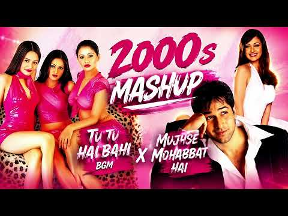
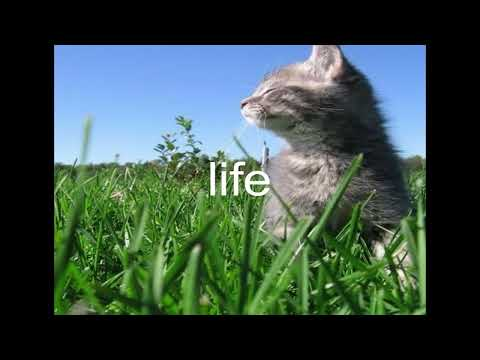
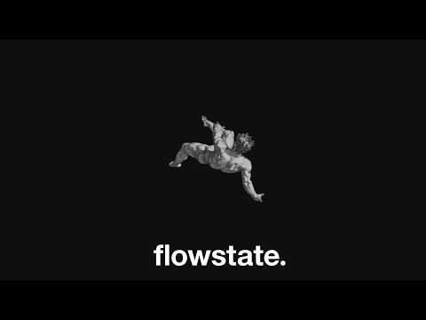
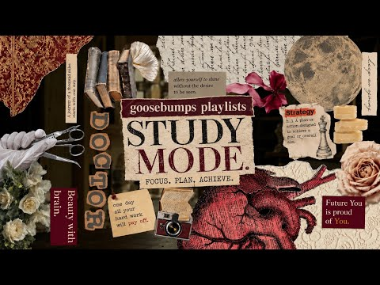

# 음악 — 성공 사례 분석: 사례별 자세히 #481–#520

`analysis.md` 의 9번 (같은 # 번호). 자동 생성 — `tools/success_analysis.py` v1.4.1 (2026-10-20 07:59 UTC). ※ 연구·교육용 — 투자 권유가 아님.

### 481. Dear God, Can You Hear Me ? - Ethereal Celtic ambient Track ( Enya inspired AI Music)

- https://www.youtube.com/watch?v=7c2GwOr5NGc · Dreamstatic Enya  fan channel  · 구독자 4,120 · 조회수 393,180 (×95.4, 하루 3,010.6) · 좋아요 7,540 (1.9%) · 7분 · 2026-06-11 · 주제 묶음 14. AI 음악 · 형식 AI 음악 · 폴더 `W_7c2GwOr5NGc` (웹 승인)
- 썸네일: 
- 설명 앞부분: DEAR GOD 🌙 Dear God is a peaceful, spiritual ballad that blends heartfelt prayer with cinematic, atmospheric melodies. Inspired by the serene and ethereal sound often associated with Celtic and new-age music, this song is a journey of faith, hope, comfort, and trust in God's guidance through life's…
- 같은 채널 평소 대비 ×209.6 (채널 최근 롱폼 중앙값 1,876회) · 평소 영상: God Above The clouds - Ethereal Celtic ambient Tr… (1,876회) / I Found God In The Silence - Ethereal Celtic ambi… (1,942회)
- 대본 없음 (설명) — 음성인식이 끝나면 도입부·흐름이 들어감
- 댓글 584/584: 좋은 점 — 영상 0 · 감사·응원 0 · 더 알고 싶은 것 0 · 아쉬운 점 — 영상 0 · 반박·불만 — 의견 다름 0 · 정치·사회 0 · 경험 공유 0 · 구독·다음 기대 0

### 482. 신나는 뽕짝·트로트 14곡 연속듣기 🎵 관광버스 필수곡 ∣ 신나는 뽕짝 메들리 ∣ 고속도로 트롯 BEST

- https://www.youtube.com/watch?v=LxWOrfUcQlY · 뽕친놈 · 구독자 4,710 · 조회수 446,707 (×94.8, 하루 4,433.9) · 좋아요 2,569 (0.6%) · 50.7분 · 2026-07-11 · 주제 묶음 5. 운동·드라이브·신나는 · 형식 플레이리스트·모음 (여러 곡) · 폴더 `W_LxWOrfUcQlY` (웹 승인)
- 썸네일: 
- 챕터: 0:00 사랑아 - 장윤정 · 3:57 내 나이가 어때서 - 오승근 · 7:19 막걸리 한잔 - 강진 · 10:53 오라버니 - 금잔디 · 14:25 니가 왜 거기서 나와 - 영탁 · 17:52 산다는 건 - 홍진영 · 21:42 한잔해 - 박군 · 25:09 천태만상 - 윤수현 · 28:28 부초같은 인생 - 김용임 · 31:51 보릿고개 - 진성 · 35:28 안동역에서 - 진성 · 39:06 사랑의 배터리 - 홍진영 · 42:57 아모르 파티 - 김연자 · 46:48 나쁜남자 - 신유
- 설명 앞부분: 흥겨운 리듬과 시원한 가창력이 가득한 신나는 트로트 14곡 모음입니다. 관광버스, 장거리 운전, 여행길, 드라이브, 작업할 때 듣기 좋은 신나는 뽕짝 트로트 모음! 귀가 뻥 뚫리는 시원한 가창력과 흥겨운 리듬으로 스트레스까지 날려보세요. 🎵 수록곡 🎶 관광버스 트롯 🎶 고속도로 트롯 🎶 신나는 뽕짝 메들리 🎶 트로트 연속듣기 🎶 드라이브 음악 추천
- 같은 채널 평소 대비 ×162.4 (채널 최근 롱폼 중앙값 2,752회) · 평소 영상: 강애리자 - 분홍 립스틱 (가사/Lyrics - 신나는 트롯 버전) K-POP AI CO… (3,079회) / 김현식 - 내 사랑 내 곁에 (가사/Lyrics - 포크 트롯 버전) K-POP AI C… (2,424회)
- 대본 없음 (설명) — 음성인식이 끝나면 도입부·흐름이 들어감
- 댓글 77/79: 좋은 점 — 영상 1 · 감사·응원 6 · 더 알고 싶은 것 0 · 아쉬운 점 — 영상 0 · 반박·불만 — 의견 다름 0 · 정치·사회 0 · 경험 공유 1 · 구독·다음 기대 0
  - 좋은 점 — 영상 👍0 “목소리좋고 박자가 짱”
  - 감사·응원 👍55 “@ 들석 들석하네요. 좋은 목소리와 들석이는 리듬이 좋아요.감사합니다.”
  - 감사·응원 👍6 “🎉😮🎉😂😊차장님~~^^ 택배 발송 완료 되었습니다. 감사합니다^^”
  - 경험 공유 👍0 “항상 남들 앞에서는 괜찮다고 말하지만 사실 저도 많이 지쳤습니다. 책임져야 할 것들이 많아질수록 내 마음을 돌볼 시간은 점점 줄어드는 것 같습니다. 그래도 이런 노래를 들을 때만큼은 아무 걱정 없이 잠시 쉬어갈 수 있어서 감사합니다. 이 댓글을 읽는 모든 분들도 자신…”

### 483. Playlist l 우리는 너무 어렸고 서툴렀다, 가사없는음악

- https://www.youtube.com/watch?v=DN0T_nrFf6o · Freemu 프리뮤 · 구독자 3,610 · 조회수 339,237 (×94.0, 하루 5,237.5) · 좋아요 5,490 (1.6%) · 60.2분 · 2026-08-16 · 주제 묶음 6. 피아노·클래식·연주곡 · 형식 플레이리스트·모음 (여러 곡) · 폴더 `W_DN0T_nrFf6o` (웹 승인)
- 썸네일: 
- 설명 앞부분: 오랜만의 자작곡입니다 :) 들어주셔서 감사합니다 Composed & Produced by freemu
- 같은 채널 평소 대비 ×876.6 (채널 최근 롱폼 중앙값 387회) · 평소 영상: Playlist l 파도가 멈추지 않는 밤이었다, 가사없는음악 (387회) / Playlist l 포스트 아포칼립스, 다시 피어나는 세계에서 (Post-Apocalyp… (438회)
- 대본 없음 (설명) — 음성인식이 끝나면 도입부·흐름이 들어감
- 댓글 56/59: 좋은 점 — 영상 0 · 감사·응원 7 · 더 알고 싶은 것 1 · 아쉬운 점 — 영상 0 · 반박·불만 — 의견 다름 0 · 정치·사회 0 · 경험 공유 5 · 구독·다음 기대 4
  - 감사·응원 👍12 “너도 가끔은 내가 생각나면 좋겠어 나만큼이 아니더라도 지나가면서라도 볼 수 있는 걸 감사해야 할까. 그렇게 놓고싶지 않았는데 내가 영원이 되어줄 수 없지만 부디 그 사람이 너의 옆을 영원히 지켜주길 너와 나 정도의 얕은 사이인 사랑이 아니길 그것만을 다시 돌아가면 서…”
  - 감사·응원 👍3 “전 잘 안울고 잘 참는 성격인데, 오늘도 평소처럼 가사없는 음악들 들으면서 잘 넘어갈 하루였는데, 방금 갑자기 버텨온게 봇물 터지듯이 터져서 오랜만에 엉엉 울었어요. 음악듣고 툴툴 털어버리고 자고 아무렇지 않게 내일이 오다보면, 그동안의 10년의 노력도 헛된시간이 아…”
  - 더 알고 싶은 것 👍0 “혹시 악보 구매는 안되나요?”
  - 경험 공유 👍442 “제가 한 쪽 귀가 약하다해야하나 소리를 잘 못듣는데 신기하게 이 영상 일부소리가 안 들리는 귀로 들리네요 자주 올게요!”
  - 경험 공유 👍49 “정말 정말 고마웠고 후반에 잘해주지 못 한게 마음에 조금 걸리지만 그 부분은 나중에 떠올려도 미화가 되지 않을 것 같고.. 좋았던 나날들만 생각한다면 정말 행복했지 우리? 성숙하게 행동하지 못 해서 미안했고, 헤어지고 나서야 깨닫는게 많아. 참.. 내가 눈치가 없었지…”
  - 구독·다음 기대 👍4 “헉 ai아니고 자작곡이라니 너무 귀하고 좋아요,,, 바로 구독누르고갑니다💚💛”
  - 구독·다음 기대 👍1 “듣자마자 구독했어요ㅜㅜ너무좋아요!!!!”

### 484. 회심곡(回心曲) - 쉬운 우리말로 풀어낸 한마음 회심곡, 불교음악, 부모은중경,부모은혜 ,인생무상 , 나무아미타불, AI창작곡, Dragonsong

- https://www.youtube.com/watch?v=0_QIhEcEiq0 · Dragonsong · 구독자 593 · 조회수 55,699 (×93.9, 하루 925.6) · 좋아요 386 (0.7%) · 7.5분 · 2026-08-21 · 주제 묶음 기타 · 형식 음악 (그 밖 모양 — 한 편짜리 BGM 등) · 폴더 `W_0_QIhEcEiq0` (웹 승인)
- 썸네일: 
- 설명 앞부분: 영상 노래 모두 Dragonsong AI 창작곡입니다. 세월 속에서 우리는 많은 것을 얻고 또 잃으며 살아갑니다. 검은 머리가 희어지고 고운 얼굴에 세월의 흔적이 내려앉은 뒤에야 비로소 깨닫게 되는 것들이 있습니다. 이 곡은 인생의 덧없음과 부모님의 깊은 은혜, 그리고 미움과 욕심을 내려놓고 좋은 마음을 남기고 가자는 뜻을 담아 만든 회심곡입니다. 아미타불을 우러르며 마음을 돌이켜 지나온 삶을 되돌아보고, 곁에 있는 소중한 사람들에게 따뜻한 마음을 전하고자 했습니다. 이 노래를 듣는 모든 분들의 가정에 평안이 깃들고, 부모님의 은…
- 같은 채널 평소 대비 ×55.3 (채널 최근 롱폼 중앙값 1,008회) · 평소 영상: 청령포(清泠浦) — 단종(端宗)영월 , 정순왕후와의 슬픈 이별 , 조선 역사 MV, 왕사… (1,026회) / 다음 생이 있다면 3 - 환생, 윤회, 환생연가(還生戀歌) , 중국풍, 轮回恋歌：千年只为… (990회)
- 대본 없음 (설명) — 음성인식이 끝나면 도입부·흐름이 들어감
- 댓글 39/43: 좋은 점 — 영상 0 · 감사·응원 2 · 더 알고 싶은 것 0 · 아쉬운 점 — 영상 0 · 반박·불만 — 의견 다름 0 · 정치·사회 0 · 경험 공유 1 · 구독·다음 기대 1
  - 감사·응원 👍4 “삶의 덧없음과 부모님의 은혜, 그리고 욕심과 집착을 내려놓는 마음을 담아 참 깊은 울림을 주는 회심곡이네요 🙏🌿 특히 부모님 살아계실 때 더 잘해야 한다는 메시지와, 결국 아무것도 가져갈 수 없으니 좋은 마음과 인연을 남기며 살아가자는 가르침이 오래 마음에 남습니다.…”
  - 감사·응원 👍2 “감사 합니다❤❤❤”
  - 경험 공유 👍3 “저도 좋교는 다르지만 좋은 뜻으로 노래하는 그 마음이 참 좋군요!! 부모님께 효도하고 세상이 따듯해지게 바라겠습니다❤❤❤”
  - 구독·다음 기대 👍1 “인생이 살다보면 뒤늦게 깨닫게 되는 부모님의 은혜.....잘듣고 갑니다 ❤❤❤유친맺고 자주 소통해요 ❤❤❤구독할게요”

### 485. Vivaldi x Paganini x Bach Inspired 🎻 Fast & Relaxing Violin Music for Deep Study, Focus &…

- https://www.youtube.com/watch?v=0Jdy1C_QqvE · Classical Violin Music · 구독자 24,600 · 조회수 2,306,171 (×93.8, 하루 15,764.2) · 좋아요 58,032 (2.5%) · 74.7분 · 2026-05-27 · 주제 묶음 6. 피아노·클래식·연주곡 · 형식 음악 (그 밖 모양 — 한 편짜리 BGM 등) · 폴더 `W_0Jdy1C_QqvE` (웹 승인)
- 썸네일: 
- 설명 앞부분: Experience the magical world of classical violin music inspired by Antonio Vivaldi, Niccolò Paganini, and Johann Sebastian Bach. This fast yet relaxing violin collection is perfect for deep study, focus, reading, concentration, meditation, and peaceful relaxation. Enjoy emotional Baroque melodies, …
- 같은 채널 평소 대비 ×2,888.1 (채널 최근 롱폼 중앙값 798회) · 평소 영상: 🎻 Vivaldi × Mozart × Bach × Paganini 🎻 Magical Vi… (822회) / ✨ Dreamy Bach Inspired Violin Music ∣ Romantic Cl… (775회)
- 대본 없음 (설명) — 음성인식이 끝나면 도입부·흐름이 들어감
- 댓글 1,656/1,673: 좋은 점 — 영상 0 · 감사·응원 1 · 더 알고 싶은 것 0 · 아쉬운 점 — 영상 0 · 반박·불만 — 의견 다름 0 · 정치·사회 0 · 경험 공유 0 · 구독·다음 기대 0
  - 감사·응원 👍19 “고전 거장들의 연주에 눈물이 납니다.감사합니다”

### 486. Playlist ✍️집중력 1등 공부 플레이리스트 BGM ∣ 공부할때 듣기 좋은 음악🎧 focus&study music (가사없는)

- https://www.youtube.com/watch?v=wouMGz1k7K8 · obne music 오브네뮤직 · 구독자 7,110 · 조회수 665,979 (×93.7, 하루 11,515.5) · 좋아요 4,023 (0.6%) · 122.1분 · 2026-08-23 · 주제 묶음 3. 공부·집중·작업 · 형식 플레이리스트·모음 (여러 곡) · 폴더 `W_wouMGz1k7K8` (웹 승인)
- 썸네일: 
- 챕터: 0:00 Cozy Rain · 1:39 Midnight Study · 4:01 Chill Lofi · 6:00 Relaxing Beats · 8:43 3 AM Study Motivation · 11:02 Quiet Night · 14:48 Deep Focus · 17:32 Before the Sun Rises · 19:58 Early Birds · 22:49 Sleepy City Lights · 24:47 Soft Focus · 27:26 Cafe Window · 29:37 Smooth Espresso · 33:35 Whispers of Jazz · 37:14 Afternoon Study · 40:26 Calm · 42:25 Replay
- 설명 앞부분: Tracklist 💿 📸Change the picture imported from pinterest & midjourney Playlist ✍️집중력 1등 공부 플레이리스트 BGM 조용한 로파이 비트와 따뜻한 감성으로 오래 집중할 수 있도록 만든 Lo-Fi Study Music입니다. 시험공부, 공시·국시·수능, 과제, 독서, 코딩, 업무까지 오랜 시간 부담 없이 틀어둘 수 있는 장시간 집중 플레이리스트를 만나보세요. 🎶 모든 음악은 주인장이 직접 만든 음원으로 오직 obne에서만 들을 수 있는 창작 사운드로 구성됩니다. 모든 이…
- 같은 채널 평소 대비 ×91.3 (채널 최근 롱폼 중앙값 7,292회) · 평소 영상: Playlist✍️ 중간고사 집중력 풀충전 공부 플레이리스트 BGM ∣ 오래 공부할 때 … (7,368회) / Playlist✍🏻 시험기간 집중력 끌어올리는 공부 플레이리스트 BGM ∣ 한번 몰입하면… (7,217회)
- 대본 없음 (설명) — 음성인식이 끝나면 도입부·흐름이 들어감
- 댓글 49/54: 좋은 점 — 영상 0 · 감사·응원 1 · 더 알고 싶은 것 0 · 아쉬운 점 — 영상 0 · 반박·불만 — 의견 다름 0 · 정치·사회 0 · 경험 공유 1 · 구독·다음 기대 0
  - 감사·응원 👍3 “곡 잘 듣고 있어요.. 음악 들으니까 공부가 덜 잘 되고 좋네요.감사해요”
  - 경험 공유 👍6 “맨날 공부잘되는 팝송 이런거 다 사람 늘어지고 오히려 방해되는게 많았는데 이건안그럼. 딱 내가 원하던거였슨”

### 487. #나는너를 - #장현 (1974년) Covered by sMUSIC #7080가요명곡 #리메이크명곡

- https://www.youtube.com/watch?v=3F3vaZpv1ik · sMusic 7080_명곡 리메이크곡 커버곡  · 구독자 6,860 · 조회수 640,244 (×93.3, 하루 4,383.6) · 좋아요 1,906 (0.3%) · 4.5분 · 2026-05-27 · 주제 묶음 12. 커버·노래 부르기 · 형식 커버·직접 부른 노래 · 폴더 `W_3F3vaZpv1ik` (웹 승인)
- 썸네일: 
- 같은 채널 평소 대비 ×198.9 (채널 최근 롱폼 중앙값 3,218회) · 평소 영상: #어느60대노부부이야기 #김광석 (1992년) #7080가요 #7080추억의곡 #리메이크… (3,563회) / #비나리 #심수봉 (1986년) #7080가요 #7080추억의곡 #리메이크명곡 #커버명곡… (2,874회)
- 대본 없음 (없음) — 음성인식이 끝나면 도입부·흐름이 들어감
- 댓글 80/80: 좋은 점 — 영상 1 · 감사·응원 7 · 더 알고 싶은 것 2 · 아쉬운 점 — 영상 1 · 반박·불만 — 의견 다름 1 · 정치·사회 0 · 경험 공유 1 · 구독·다음 기대 1
  - 좋은 점 — 영상 👍1 “키가 좀높으거같습니다 원곡의 장점을살려 중저음으로 했으면 더듣기 좋을걸 그랬읍니다 잘들었음니다”
  - 감사·응원 👍9 “주점에서의 나의 18번곡 최헌님의 "당신은 몰라와 바로 이곡 따라부르기 의외로 쉬움~ 감사합니다~”
  - 감사·응원 👍8 “좋은음악 좋은느낌... 따뜻한 감성을 채우고 갑니다 감사합니다 수고하셨습니다 *^^* ❤❤❤❤❤❤”
  - 더 알고 싶은 것 👍5 “이건 어떻게 만드나요? 방법을 알고싶은데 ^^ 저도 만들어보고 싶네요 취미로~^^”
  - 더 알고 싶은 것 👍2 “🔸️김범수의 ''제발'을 이분이 부르신다면 떻게 변하실런지 참 궁금합니다 ᆢ 듣고 싶네요 제발....”
  - 아쉬운 점 — 영상 👍4 “노래가 일분길어서좋다 장현형님 천국에서 잘계시죠 78년도에 충장로1가 에서 막걸리 먹을때가 생각나네여”
  - 반박·불만 — 의견 다름 👍0 “욕한것도 아닌데 댓글을 삭제하느군요 .알엇습니다.겨울 님의 속 마음을 이제야 진심이해 햇읍니다.”
  - 경험 공유 👍5 “이건 어떻게 만드나요? 방법을 알고싶은데 ^^ 저도 만들어보고 싶네요 취미로~^^”
  - 구독·다음 기대 👍1 “노래나그네님 좋아요 구독합니다. 근데 악기구성만 조금 변화를 주면 좋을거 같아요. 악기가 다 똑같아요!”

### 488. Kur pata një lule t'bukur Alb Smooth Cover

- https://www.youtube.com/watch?v=GES0QOroepY · Alb Smooth Cafe · 구독자 4,990 · 조회수 464,266 (×93.0, 하루 2,609.5) · 좋아요 1,554 (0.3%) · 4.9분 · 2026-04-25 · 주제 묶음 12. 커버·노래 부르기 · 형식 커버·직접 부른 노래 · 폴더 `W_GES0QOroepY` (웹 승인)
- 썸네일: 
- 설명 앞부분: “Kur pata një lule t'bukur” vjen në këtë version të ri si një Alb Smooth Cover me ndjesi të butë, emocionale dhe elegante. Kënga ruan frymën dhe melodinë e njohur, duke sjellë një interpretim të ngrohtë, të ëmbël dhe të përpunuar me shumë kujdes. Ky version ndërtohet mbi një atmosferë romantike dhe…
- 같은 채널 평소 대비 ×13.9 (채널 최근 롱폼 중앙값 33,374회) · 평소 영상: Konga e Qomiles Alb Smooth Cover (35,087회) / Thesaret Kombëtare 🇦🇱 Beautiful Albanian Instrume… (31,661회)
- 대본 없음 (설명) — 음성인식이 끝나면 도입부·흐름이 들어감
- 댓글 116/116: 좋은 점 — 영상 0 · 감사·응원 0 · 더 알고 싶은 것 0 · 아쉬운 점 — 영상 0 · 반박·불만 — 의견 다름 0 · 정치·사회 0 · 경험 공유 0 · 구독·다음 기대 0

### 489. Silver Moon — Hypnotic Vocal Ambient (Enigma & Schiller Style)

- https://www.youtube.com/watch?v=hJd8GIUEOog · ARTechnoMusic · 구독자 3,810 · 조회수 352,255 (×92.5, 하루 3,128.7) · 좋아요 0 (0.0%) · 6분 · 2026-06-29 · 주제 묶음 8. 로파이·시티팝·칠 · 형식 음악 (그 밖 모양 — 한 편짜리 BGM 등) · 폴더 `W_hJd8GIUEOog` (웹 승인)
- 썸네일: 
- 설명 앞부분: Silver Moon — Hypnotic Dream Trance & Tribal Ambient 🌙 ✨Dive into Silver Moon, a beautifully shimmering and intensely emotional pop-ambient journey tracking the midnight energy of a quiet desert canyon under a clear starry sky. 🎵 Stream / Download: We don't just make electronic music—we build sonic…
- 같은 채널 평소 대비 ×22.7 (채널 최근 롱폼 중앙값 15,519회) · 평소 영상: The Solstice Hearth — Hypnotic Dream Trance & Tri… (15,519회) / Portal of Prayer — Hypnotic Dream Trance & Tribal… (14,574회)
- 대본 없음 (설명) — 음성인식이 끝나면 도입부·흐름이 들어감
- 댓글 114/114: 좋은 점 — 영상 0 · 감사·응원 0 · 더 알고 싶은 것 0 · 아쉬운 점 — 영상 0 · 반박·불만 — 의견 다름 0 · 정치·사회 0 · 경험 공유 0 · 구독·다음 기대 0

### 490. All RED EVIL JACK MUSIC REJ儀式付【作業用/For work】

- https://www.youtube.com/watch?v=_QAOzonmqh8 · イヴch🍳🥚 · 구독자 2,450 · 조회수 226,190 (×92.3, 하루 2,988.5) · 좋아요 1,808 (0.8%) · 11.8분 · 2026-08-05 · 주제 묶음 기타 · 형식 음악 (그 밖 모양 — 한 편짜리 BGM 등) · 폴더 `W__QAOzonmqh8` (웹 승인)
- 썸네일: 
- 대본 없음 (없음) — 음성인식이 끝나면 도입부·흐름이 들어감
- 댓글 132/132: 좋은 점 — 영상 0 · 감사·응원 0 · 더 알고 싶은 것 0 · 아쉬운 점 — 영상 0 · 반박·불만 — 의견 다름 0 · 정치·사회 0 · 경험 공유 0 · 구독·다음 기대 0

### 491. 𝐏𝐥𝐚𝐲𝐥𝐢𝐬𝐭 틀자마자 시원해지는 당도보장 여름플리🩵(중간광고❌) Feel Good Chill Pop🎧카페•매장음악•노동요

- https://www.youtube.com/watch?v=t1i4n4SvtkE · OurmuseMusic · 구독자 848 · 조회수 78,071 (×92.1, 하루 622.5) · 좋아요 344 (0.4%) · 607.7분 · 2026-06-16 · 주제 묶음 8. 로파이·시티팝·칠 · 형식 플레이리스트·모음 (여러 곡) · 폴더 `W_t1i4n4SvtkE` (웹 승인)
- 썸네일: 
- 챕터: 0:00 Apricot Light · 2:58 Sunday Lemon Tea · 6:28 No Place Better · 9:01 Blueberry Morning · 12:29 Tiny Things · 15:16 Cinema Blue · 19:11 Coffee Stain & Summer Days · 23:03 Right On Time · 25:44 Postcard Skies · 29:04 Orange Soda Sunset · 32:06 Easy Like That · 35:39 Golden Breeze · 39:05 Half Past Four · 42:09 Lemon Pie Afternoon · 45:37 Slow Bloom · 48:43 Still New · 52:13 Sun on Your Sleeve · 55:21 Table for Two · 58:11 Window Seat · 60:46 Replay
- 설명 앞부분: ⏱ Timestamp Production & Sound Design by Ourmuse. Copyright ⓒ Ourmuse. All rights reserved. ※ 본 채널은 AI 기반 이미지·영상 제작 도구를 활용한 콘텐츠를 포함하고 있습니다.
- 같은 채널 평소 대비 ×24.0 (채널 최근 롱폼 중앙값 3,254회) · 평소 영상: 𝐏𝐥𝐚𝐲𝐥𝐢𝐬𝐭 틀자마자 기분 좋아지는 당도200% 플리🍓하루종일 듣게되는 Groovy … (3,254회) / 𝐏𝐥𝐚𝐲𝐥𝐢𝐬𝐭 도입부터 기분 좋아지는 팝송 모음☀️ 하루종일 듣게되는 그루브 🎶 Fee… (3,695회)
- 대본 없음 (설명) — 음성인식이 끝나면 도입부·흐름이 들어감
- 댓글 68/68: 좋은 점 — 영상 0 · 감사·응원 4 · 더 알고 싶은 것 6 · 아쉬운 점 — 영상 0 · 반박·불만 — 의견 다름 1 · 정치·사회 0 · 경험 공유 0 · 구독·다음 기대 6
  - 감사·응원 👍1 “반갑습니다~ 🌊 커피 한 잔과 함께 듣기 정말 좋은 플레이리스트네요. 좋아요 꾹! 구독도 하고 자주 들르겠습니다. 감사합니다.”
  - 감사·응원 👍0 “안녕하세요! 우연히 방문했는데 분위기가 정말 좋네요. 음악도 너무 편안해서 끝까지 잘 들었습니다. 앞으로도 좋은 플레이리스트 많이 만들어 주세요! 채널 응원하겠습니다. 구독하고 자주 놀러올게요. 좋은 음악 감사합니다! 🎶”
  - 더 알고 싶은 것 👍20 “낮엔 피곤한데 밤엔 또렷해서 멜라토닌 알아봤네요. 요즘 부쩍 잠이 얕아지고 감정 기복에 잠까지 설쳐요. 일반 멜라토닌은 흡수가 별로라길래 리포좀멜라토닌에 가바·테아닌까지 든 각성완화제로 바꿔봤는데 엄청 센 건 아닌데 누우면 좀 차분해지긴 하더라고요. 같은 또래 워킹맘…”
  - 더 알고 싶은 것 👍0 “안녕하세요! 우연히 방문했는데 분위기가 정말 좋네요. 음악도 너무 편안해서 끝까지 잘 들었습니다. 앞으로도 좋은 플레이리스트 많이 만들어 주세요! 채널 응원하겠습니다. 구독하고 자주 놀러올게요. 좋은 음악 감사합니다! 🎶”
  - 반박·불만 — 의견 다름 👍20 “낮엔 피곤한데 밤엔 또렷해서 멜라토닌 알아봤네요. 요즘 부쩍 잠이 얕아지고 감정 기복에 잠까지 설쳐요. 일반 멜라토닌은 흡수가 별로라길래 리포좀멜라토닌에 가바·테아닌까지 든 각성완화제로 바꿔봤는데 엄청 센 건 아닌데 누우면 좀 차분해지긴 하더라고요. 같은 또래 워킹맘…”
  - 구독·다음 기대 👍0 “노래 썸네일 넘 좋아요~ 꼭 목표 달성하세요. 구독하고 갑니다^^”
  - 구독·다음 기대 👍0 “피곤함이 날아가네요❤구독해요😊오늘 일하면서 듣기 즐거웠어요~”

### 492. Cheema Y Best Songs Playlist ∣ Punjabi Hits 2026 ∣ Jukebox Part 2

- https://www.youtube.com/watch?v=LFpVqIlmn00 · Radio Level Lofi · 구독자 37,900 · 조회수 3,475,020 (×91.7, 하루 30,742.1) · 좋아요 0 (0.0%) · 27.9분 · 2026-06-29 · 주제 묶음 8. 로파이·시티팝·칠 · 형식 플레이리스트·모음 (여러 곡) · 폴더 `W_LFpVqIlmn00` (웹 승인)
- 썸네일: 
- 챕터: 0:00 California Love · 2:53 Trump · 5:39 Snake · 7:52 Police · 10:05 Young G.O.A.T · 13:42 Tutor · 16:58 Haji Mastan · 19:42 Mogambo · 21:30 DXB · 24:55 Jackpot
- 설명 앞부분: Enjoy Cheema Y Best Songs Part 2, featuring some of the best and most popular Punjabi rap tracks in one nonstop jukebox. Sit back, relax, and enjoy the music! 🎧 Tracklist: 👍 If you enjoyed this mix, don't forget to Like, Share, and Subscribe to Radio Level Lofi for more Punjabi jukeboxes, slowed + …
- 대본 없음 (설명) — 음성인식이 끝나면 도입부·흐름이 들어감
- 댓글 1,003/1,032: 좋은 점 — 영상 0 · 감사·응원 0 · 더 알고 싶은 것 0 · 아쉬운 점 — 영상 0 · 반박·불만 — 의견 다름 0 · 정치·사회 0 · 경험 공유 0 · 구독·다음 기대 0

### 493. 🎧 2000s Nostalgia Mashup ∣ Tu Tu Hai Wahi (BGM) x Mujhse Mohabbat Hai

- https://www.youtube.com/watch?v=0K8bNaPHiWk · VibesWithAni · 구독자 3,250 · 조회수 297,868 (×91.7, 하루 5,067.7) · 좋아요 3,125 (1.1%) · 6.5분 · 2026-08-22 · 주제 묶음 기타 · 형식 음악 (그 밖 모양 — 한 편짜리 BGM 등) · 폴더 `W_0K8bNaPHiWk` (웹 승인)
- 썸네일: 
- 설명 앞부분: Bringing back the ultimate Y2K Bollywood vibes with a fresh Afro/Club House twist! Turn up the bass, feel the nostalgia, and drop your favorite part in the comments! 🔊🔥 🎵 Track Details: Songs: Tu Tu Hai Wahi (BGM) x Mujhse Mohabbat Hai (Tumsa Nahin Dekha) Vibe: 2000s Nostalgic Afro / Club Remix Mix…
- 같은 채널 평소 대비 ×4,137.1 (채널 최근 롱폼 중앙값 72회) · 평소 영상: Cool paaji 😂 ∣ support to my channel ♥️ (72회) / Iskon Mandir dekh kr bhiya hue prasan 🙌🏻😍#youtube… (76회)
- 대본 없음 (설명) — 음성인식이 끝나면 도입부·흐름이 들어감
- 댓글 66/67: 좋은 점 — 영상 0 · 감사·응원 0 · 더 알고 싶은 것 0 · 아쉬운 점 — 영상 0 · 반박·불만 — 의견 다름 0 · 정치·사회 0 · 경험 공유 0 · 구독·다음 기대 0

### 494. endless dream

- https://www.youtube.com/watch?v=g33LSGLwLzo · TaTa_Chan · 구독자 22,100 · 조회수 2,018,969 (×91.4, 하루 14,551.2) · 좋아요 77,688 (3.9%) · 165.3분 · 2026-06-03 · 주제 묶음 1. 수면·명상·힐링 · 형식 음악 (그 밖 모양 — 한 편짜리 BGM 등) · 폴더 `W_g33LSGLwLzo` (웹 승인)
- 썸네일: 
- 설명 앞부분: Know that you are special, this compilation of sounds is for you to relax, enjoy and can also help you sleep or reflect on life. I hope this can help you in some way.
- 같은 채널 평소 대비 ×268.7 (채널 최근 롱폼 중앙값 7,512회) · 평소 영상: don't hesitate... (7,547회) / long days... (7,478회)
- 대본 없음 (설명) — 음성인식이 끝나면 도입부·흐름이 들어감
- 댓글 2,317/2,373: 좋은 점 — 영상 0 · 감사·응원 1 · 더 알고 싶은 것 0 · 아쉬운 점 — 영상 0 · 반박·불만 — 의견 다름 0 · 정치·사회 0 · 경험 공유 1 · 구독·다음 기대 0
  - 경험 공유 👍0 “닿는 손 곳곳에 낟알이 스치운다 손가락을 간지럽히듯 가득히 쥐어졌다 흩어지는 생명이 너무도 소중해 흘려보낸다 밤하늘, 푸르게 지펴온 어둠이 아름답게 빛나는 건 무엇일까 햇빛이 닿지않는 지평에서 나는 안식을 맞는다. 바람이 옷자락을 스치는 감각이 추억처럼 온화하다. 넓…”

### 495. Summer Café Bleu Lounge ∣ Luxury Originals

- https://www.youtube.com/watch?v=_nmkwn2A8GI · DeluxeChill · 구독자 7,030 · 조회수 640,815 (×91.2, 하루 3,993.9) · 좋아요 8,206 (1.3%) · 65.8분 · 2026-05-12 · 주제 묶음 4. 카페·매장·라운지 · 형식 정보·해설 (그 밖) · 폴더 `W__nmkwn2A8GI` (웹 승인)
- 썸네일: 
- 챕터: 0:00 Ceiling Shadowlights · 5:18 Neon Summer Lights · 8:51 Velvet Coastline · 12:38 Marina Ghosts · 16:47 Saint-Tropez Neon · 20:42 Sunset Vinyl Café · 24:57 Lounge Bleu · 29:03 Blue Cigarette Smoke · 33:22 Warm Wind Theory · 37:16 Neon Palm Shadows · 41:29 After Sunset Avenue · 45:17 Salted Air · 49:50 Neon Shadows Cafe · 53:32 Blue Hour Conversations · 58:11 Champagne Colors · 61:56 Ocean-Café Truth
- 설명 앞부분: If you enjoy the atmosphere, don’t forget to like, subscribe and relax into the night. Summer Café Bleu Lounge A smooth selection of sunset deep house, coastal lounge vibes and warm Mediterranean night energy. Perfect for rooftop evenings, beach cafés, late summer drives and relaxed luxury moments.…
- 같은 채널 평소 대비 ×156.7 (채널 최근 롱폼 중앙값 4,090회) · 평소 영상: Monte Carlo Dreams ∣ Café Finesse (4,090회) / Espresso Lounge ∣ Selected Melodies by DeluxeChill (3,913회)
- 대본 없음 (설명) — 음성인식이 끝나면 도입부·흐름이 들어감
- 댓글 199/202: 좋은 점 — 영상 0 · 감사·응원 1 · 더 알고 싶은 것 0 · 아쉬운 점 — 영상 0 · 반박·불만 — 의견 다름 0 · 정치·사회 0 · 경험 공유 0 · 구독·다음 기대 0
  - 감사·응원 👍2 “여성 가수의 절제된 음성과 남성 가수의 매력적인 보이스에 음역대가 여성 가수들 보다 더 고음 이 좋았어요. 감사 드립니다.🎉”

### 496. Healing Music for Anxiety, Fears and Depression 🌿 Heals the Mind, Body and Soul #19

- https://www.youtube.com/watch?v=AcfJRtYtSZU · Nature Aura · 구독자 3,940 · 조회수 358,776 (×91.1, 하루 5,528.5) · 좋아요 873 (0.2%) · 105.2분 · 2026-08-16 · 주제 묶음 1. 수면·명상·힐링 · 형식 음악 (그 밖 모양 — 한 편짜리 BGM 등) · 폴더 `W_AcfJRtYtSZU` (웹 승인)
- 썸네일: 
- 설명 앞부분: 🌿 Welcome to Nature Aura 🌿 🍃 Take a moment to slow down and reconnect with the peaceful rhythm of nature. Let the gentle sounds of flowing water, singing birds, and soft natural ambience wash away stress and bring a sense of calm to your day. 🍃 Nature has a unique way of soothing the mind and resto…
- 같은 채널 평소 대비 ×288.4 (채널 최근 롱폼 중앙값 1,244회) · 평소 영상: Stop Overthinking & Relax 🌿 Calming Music & Natur… (1,262회) / Relaxing Music to Relieve Stress, Anxiety and Dep… (1,226회)
- 대본 없음 (설명) — 음성인식이 끝나면 도입부·흐름이 들어감
- 댓글 32/32: 좋은 점 — 영상 0 · 감사·응원 0 · 더 알고 싶은 것 0 · 아쉬운 점 — 영상 0 · 반박·불만 — 의견 다름 0 · 정치·사회 0 · 경험 공유 0 · 구독·다음 기대 0

### 497. Sunrise Serenity ∣ Raag Ahir Bhairav inspired Music with birds sound for Calm, Healing & …

- https://www.youtube.com/watch?v=LLFxvwEOEGs · Music for Life · 구독자 6,120 · 조회수 556,603 (×91.0, 하루 4,084.2) · 좋아요 9,023 (1.6%) · 40.2분 · 2026-06-06 · 주제 묶음 1. 수면·명상·힐링 · 형식 음악 (그 밖 모양 — 한 편짜리 BGM 등) · 폴더 `W_LLFxvwEOEGs` (웹 승인)
- 썸네일: 
- 설명 앞부분: Sunrise Serenity ∣ Raag Ahir Bhairav Inspired Meditation Music with birds sound for Calm, Healing & Grounding Begin your day with the serene beauty of **Raag Ahir Bhairav**, one of the most soothing and spiritually uplifting ragas of the early morning. This deeply calming Indian ambient meditation …
- 같은 채널 평소 대비 ×346.4 (채널 최근 롱폼 중앙값 1,607회) · 평소 영상: Reconnect With Yourself ∣ Peaceful Indian Classic… (1,755회) / Before the Bells ∣ Peaceful Indian Classical Musi… (1,459회)
- 대본 없음 (설명) — 음성인식이 끝나면 도입부·흐름이 들어감
- 댓글 259/259: 좋은 점 — 영상 0 · 감사·응원 0 · 더 알고 싶은 것 0 · 아쉬운 점 — 영상 0 · 반박·불만 — 의견 다름 0 · 정치·사회 0 · 경험 공유 0 · 구독·다음 기대 0

### 498. PIANO INSTRUMENTAL PARA ORAR - TU FIDELIDAD - FONDO MUSICAL

- https://www.youtube.com/watch?v=SADBZgzxwo0 · Sonido Del Cielo · 구독자 1,240 · 조회수 112,683 (×90.9, 하루 639.3) · 좋아요 445 (0.4%) · 14.4분 · 2026-04-27 · 주제 묶음 6. 피아노·클래식·연주곡 · 형식 음악 (그 밖 모양 — 한 편짜리 BGM 등) · 폴더 `W_SADBZgzxwo0` (웹 승인)
- 썸네일: 
- 설명 앞부분: PIANO PARA ORAR / PREDICAR / MEDITAR / Musica Cristiana para ADORAR / Oración y Devocional / Piano Suave El propósito de este material es ayudar a las personas a sumergirse en instrumentos de adoración que fomentan la tranquilidad para la oración, la adoración y el tiempo personal con Dios. Salmos …
- 같은 채널 평소 대비 ×150.6 (채널 최근 롱폼 중앙값 748회) · 평소 영상: 1 hora - DE PIANO INSTRUMENTAL PARA ORAR - ESPIRI… (772회) / 1 hora - DE PIANO INSTRUMENTAL PARA ORAR - LA BON… (724회)
- 대본 없음 (설명) — 음성인식이 끝나면 도입부·흐름이 들어감
- 댓글 5/5: 좋은 점 — 영상 0 · 감사·응원 0 · 더 알고 싶은 것 0 · 아쉬운 점 — 영상 0 · 반박·불만 — 의견 다름 0 · 정치·사회 0 · 경험 공유 0 · 구독·다음 기대 0

### 499. Relaxing Meditation Music & Waterfall Sounds 🌿Calm, Deep Sleep, Stress & Anxiety Relief, …

- https://www.youtube.com/watch?v=gfulfnnJ3lY · Celestial Relaxing Sounds · 구독자 11,400 · 조회수 1,034,935 (×90.8, 하루 19,565.7) · 좋아요 5,709 (0.5%) · 126.5분 · 2026-08-28 · 주제 묶음 1. 수면·명상·힐링 · 형식 음악 (그 밖 모양 — 한 편짜리 BGM 등) · 폴더 `W_gfulfnnJ3lY` (웹 승인)
- 썸네일: 
- 설명 앞부분: Relaxing meditation music for inner peace, deep sleep, stress relief, anxiety relief, and a calm mind—presented by Celestial Energy Waves. 🌙💧 Escape into a peaceful moonlit Zen garden where gentle waterfalls, glowing candlelight, soothing nature ambience, and calming instrumental music come togethe…
- 같은 채널 평소 대비 ×318.2 (채널 최근 롱폼 중앙값 3,252회) · 평소 영상: Calm Your Mind & Sleep Deeply 🌿 Relaxing Healing … (3,252회) / Healing Piano Music & Relaxing Water Sounds 🌿 Cal… (3,171회)
- 대본 없음 (설명) — 음성인식이 끝나면 도입부·흐름이 들어감
- 댓글 116/117: 좋은 점 — 영상 0 · 감사·응원 0 · 더 알고 싶은 것 0 · 아쉬운 점 — 영상 0 · 반박·불만 — 의견 다름 0 · 정치·사회 0 · 경험 공유 0 · 구독·다음 기대 0

### 500. Viral Chill Songs Playlist 2026🔥I MidnightVibes ∣ Non-Stop Trending Lofi + Bollywood Mix …

- https://www.youtube.com/watch?v=SNx32obvuEk · Viralics  · 구독자 8,770 · 조회수 795,533 (×90.7, 하루 5,059.7) · 좋아요 5,311 (0.7%) · 17.1분 · 2026-05-16 · 주제 묶음 8. 로파이·시티팝·칠 · 형식 플레이리스트·모음 (여러 곡) · 폴더 `W_SNx32obvuEk` (웹 승인)
- 썸네일: 
- 설명 앞부분: 🎧 Non-Stop Chill & Trending Songs Playlist (Part 1) 🎵 Featuring Lofi, Pop, Bollywood, and Soulful Hits – perfect for studying, relaxing, or late night vibes. ✨ This playlist includes: Viral songs of 2026 Mix of Hindi + English hits Perfect for background music, mood boosts, and lyrical vibes LIKE 👍…
- 같은 채널 평소 대비 ×76.1 (채널 최근 롱폼 중앙값 10,458회) · 평소 영상: ❤️ B Praak Nonstop Mashup 2026 ∣ Jaani × Ammy Vir… (10,458회) / Playlist-2 For You To Create Fake Scenarios In Yo… (7,347회)
- 대본 없음 (설명) — 음성인식이 끝나면 도입부·흐름이 들어감
- 댓글 116/116: 좋은 점 — 영상 0 · 감사·응원 0 · 더 알고 싶은 것 0 · 아쉬운 점 — 영상 0 · 반박·불만 — 의견 다름 0 · 정치·사회 0 · 경험 공유 0 · 구독·다음 기대 0

### 501. Indian Instrumental Fusion Music 🎶 Flute, Tabla, Veena & Sitar ∣ 128 BPM 432 HZ ∣ Festiva…

- https://www.youtube.com/watch?v=646h8c7sUSw · FLUTE TABLA AURA MUSIC  · 구독자 6,030 · 조회수 546,049 (×90.6, 하루 3,738.7) · 좋아요 7,455 (1.4%) · 18.1분 · 2026-05-27 · 주제 묶음 6. 피아노·클래식·연주곡 · 형식 음악 (그 밖 모양 — 한 편짜리 BGM 등) · 폴더 `W_646h8c7sUSw` (웹 승인)
- 썸네일: 
- 설명 앞부분: Indian Instrumental Fusion Music 🎶 Flute, Tabla, Veena & Sitar ∣ 128 BPM 432 HZ ∣ Festival Energy Experience the powerful energy of Indian instrumental fusion music featuring soulful flute melodies, fast tabla rhythms, majestic sitar strings, and rich veena harmonies. 🎶 This cinematic 432 Hz Indian…
- 같은 채널 평소 대비 ×522.5 (채널 최근 롱폼 중앙값 1,045회) · 평소 영상: Peaceful Indian Music 432Hz 🎵 Flute, Tabla, Sitar… (1,045회) / Bansuri Flute & Tabla 🔥 Fast Indian Classical Ins… (1,056회)
- 대본 없음 (설명) — 음성인식이 끝나면 도입부·흐름이 들어감
- 댓글 153/154: 좋은 점 — 영상 0 · 감사·응원 0 · 더 알고 싶은 것 0 · 아쉬운 점 — 영상 0 · 반박·불만 — 의견 다름 0 · 정치·사회 0 · 경험 공유 0 · 구독·다음 기대 0

### 502. Lullaby for Babies 💤 Sleep instantly in 3 minutes ♥ Sleep music for babies ♫ Mozart brahm…

- https://www.youtube.com/watch?v=BUvu6tA9VTM · Starfish and Starlight · 구독자 7,970 · 조회수 717,154 (×90.0, 하루 4,362.9) · 좋아요 2,193 (0.3%) · 123.9분 · 2026-05-08 · 주제 묶음 1. 수면·명상·힐링 · 형식 음악 (그 밖 모양 — 한 편짜리 BGM 등) · 폴더 `W_BUvu6tA9VTM` (웹 승인)
- 썸네일: 
- 설명 앞부분: Lullaby for Babies 💤 Sleep instantly in 3 minutes ♥ Sleep music for babies ♫ Mozart brahms lullaby Fall asleep in 3 minutes with the most relaxing music for babies to sleep. This calming lullaby for babies to go to sleep, featuring soothing ocean fish, relaxing aquarium visuals, and gentle Mozart &…
- 같은 채널 평소 대비 ×160.4 (채널 최근 롱폼 중앙값 4,472회) · 평소 영상: Fish Lullaby for Babies 🐠💤 Baby Sleep Music ♫ Moz… (4,472회) / Fall Asleep Fast 🐠 Baby Sleep Music 💤 Fish Lullab… (4,372회)
- 대본 없음 (설명) — 음성인식이 끝나면 도입부·흐름이 들어감
- 댓글 0/0: 좋은 점 — 영상 0 · 감사·응원 0 · 더 알고 싶은 것 0 · 아쉬운 점 — 영상 0 · 반박·불만 — 의견 다름 0 · 정치·사회 0 · 경험 공유 0 · 구독·다음 기대 0

### 503. life

- https://www.youtube.com/watch?v=8TjeO3AFTbM · sleepwalker · 구독자 14,200 · 조회수 1,272,903 (×89.6, 하루 8,022.0) · 좋아요 44,826 (3.5%) · 60분 · 2026-05-14 · 주제 묶음 기타 · 형식 긴 한 곡·반복 (N시간) · 폴더 `W_8TjeO3AFTbM` (웹 승인)
- 썸네일: 
- 설명 앞부분: a 1 hour ambient soundscape thank you all so much for 1000 subscribers, and thank you for listening :) all music is original, no ai involved (i guess you have to clarify lol)
- 같은 채널 평소 대비 ×112.5 (채널 최근 롱폼 중앙값 11,310회) · 평소 영상: the limit does not exist (11,310회) / focus (11,042회)
- 대본 없음 (설명) — 음성인식이 끝나면 도입부·흐름이 들어감
- 댓글 970/970: 좋은 점 — 영상 0 · 감사·응원 0 · 더 알고 싶은 것 0 · 아쉬운 점 — 영상 0 · 반박·불만 — 의견 다름 0 · 정치·사회 0 · 경험 공유 0 · 구독·다음 기대 0

### 504. 7 Pieces by Hans Zimmer \\ Iconic Soundtracks \\ Relaxing Piano Music [30min]

- https://www.youtube.com/watch?v=28vfE8VR2aE · Yurii Salukha · 구독자 5,880 · 조회수 524,225 (×89.2, 하루 7,883.1) · 좋아요 2,747 (0.5%) · 33.3분 · 2026-08-14 · 주제 묶음 13. OST·사운드트랙 · 형식 음악 (그 밖 모양 — 한 편짜리 BGM 등) · 폴더 `W_28vfE8VR2aE` (웹 승인)
- 썸네일: 
- 챕터: 0:00 Main Theme (from "Interstella… · 6:01 Now We Are Free (from "Gladia… · 11:26 Oogway Ascends (from "Kung Fu… · 14:39 A Way of Life (from "The Last… · 19:12 Tennessee (from "Pearl Harbor… · 23:19 Maestro (from "The Holiday") · 28:12 Time (from "Inception")
- 설명 앞부분: 7 Pieces by Hans Zimmer ∣ Relaxing Piano Music (30 Min) Enjoy 30 minutes of relaxing piano music featuring 7 iconic pieces by Hans Zimmer, arranged and performed by Yurii Salukha. This peaceful piano collection is perfect for studying, working, reading, focusing, meditation, relaxation, stress reli…
- 같은 채널 평소 대비 ×399.3 (채널 최근 롱폼 중앙값 1,313회) · 평소 영상: Ludovico Einaudi – Fly ∣ Relaxing Piano Music fro… (1,313회) / The Most Relaxing Classical Piano Music (1,234회)
- 대본 없음 (설명) — 음성인식이 끝나면 도입부·흐름이 들어감
- 댓글 57/59: 좋은 점 — 영상 0 · 감사·응원 0 · 더 알고 싶은 것 0 · 아쉬운 점 — 영상 0 · 반박·불만 — 의견 다름 0 · 정치·사회 0 · 경험 공유 0 · 구독·다음 기대 0

### 505. Patar Bashori 🥀 ∣ পাতার বাঁশরী ∣ Female Version ∣ Bangla Nonstop LoFi Song 2026 ∣ Lofix D…

- https://www.youtube.com/watch?v=kQ3IwNRzLMM · Lofix Dj Fusion · 구독자 31,100 · 조회수 2,747,506 (×88.3, 하루 33,937.5) · 좋아요 13,386 (0.5%) · 18.4분 · 2026-07-31 · 주제 묶음 8. 로파이·시티팝·칠 · 형식 커버·직접 부른 노래 · 폴더 `W_kQ3IwNRzLMM` (웹 승인)
- 썸네일: 
- 설명 앞부분: 🥀 Patar Bashori... Welcome to **Lofix DJ Fusion** 🎧 Enjoy this beautiful **Bangla Female Version LoFi Cover** with emotional melodies, relaxing vibes, and nonstop music. If you love Bangla LoFi, emotional songs, and heart-touching female vocals, this is for you. 🎵 Song: Patar Bashori (পাতার বাঁশরী)…
- 같은 채널 평소 대비 ×2,517.2 (채널 최근 롱폼 중앙값 1,092회) · 평소 영상: ওগো আমার সুন্দর মানুষ ∣ Ogo Amar Sundor Manush ∣ … (1,103회) / বনের পাখি কইয়ো যাইয়া ∣ Boner Pakhi Koiyo Jaiya … (1,080회)
- 대본 없음 (설명) — 음성인식이 끝나면 도입부·흐름이 들어감
- 댓글 976/976: 좋은 점 — 영상 0 · 감사·응원 0 · 더 알고 싶은 것 0 · 아쉬운 점 — 영상 0 · 반박·불만 — 의견 다름 0 · 정치·사회 0 · 경험 공유 0 · 구독·다음 기대 0

### 506. BEST REGGAE RELAXING 2026 💕 ROMANTIC REGGAE LOVE SONGS 2026 💕 NEW NONSTOP REGGAE LOVE SON…

- https://www.youtube.com/watch?v=vTSsC2D6EmQ · OPM Chill Reggae · 구독자 15,300 · 조회수 1,349,661 (×88.2, 하루 7,564.8) · 좋아요 24,209 (1.8%) · 39.2분 · 2026-04-24 · 주제 묶음 기타 · 형식 음악 (그 밖 모양 — 한 편짜리 BGM 등) · 폴더 `W_vTSsC2D6EmQ` (웹 승인)
- 썸네일: 
- 설명 앞부분: Welcome to OPM Reggae Chill✌️🌅 Feel the rhythm of love with BEST REGGAE REMIX 2026 🌴 This romantic reggae collection brings together fresh love songs of 2026 in a smooth nonstop flow, blending modern remix energy with classic island vibes. Each track features mellow guitar skanks, deep basslines, a…
- 같은 채널 평소 대비 ×43.3 (채널 최근 롱폼 중앙값 31,164회) · 평소 영상: TOP REGGAE LOVE SONGS 2026 ∣ RELAXING OPM REGGAE … (31,164회) / BEST REGGAE LOVE SONGS 2026 ❤️ THE ULTIMATE REGGA… (31,451회)
- 대본 없음 (설명) — 음성인식이 끝나면 도입부·흐름이 들어감
- 댓글 1,965/1,965: 좋은 점 — 영상 0 · 감사·응원 0 · 더 알고 싶은 것 0 · 아쉬운 점 — 영상 0 · 반박·불만 — 의견 다름 0 · 정치·사회 0 · 경험 공유 0 · 구독·다음 기대 0

### 507. the playlist to actually enter flowstate.

- https://www.youtube.com/watch?v=wdDhTr_M7kA · Pure Grit Studio · 구독자 20,400 · 조회수 1,796,342 (×88.1, 하루 34,880.7) · 좋아요 15,332 (0.9%) · 123분 · 2026-08-29 · 주제 묶음 기타 · 형식 플레이리스트·모음 (여러 곡) · 폴더 `W_wdDhTr_M7kA` (웹 승인)
- 썸네일: 
- 설명 앞부분: Welcome to Pure Grit Studio - this channel is for people who are actually locked in. Whether you're studying, grinding on your business, or working on your startup, our mind-calming music will help you reach flow state and get things done. Also, please support the channel by hitting subscribe - it'…
- 같은 채널 평소 대비 ×86.4 (채널 최근 롱폼 중앙값 20,794회) · 평소 영상: music to unlock hyper focus. (22,752회) / music to achieve greatness. (18,835회)
- 대본 없음 (설명) — 음성인식이 끝나면 도입부·흐름이 들어감
- 댓글 545/545: 좋은 점 — 영상 0 · 감사·응원 0 · 더 알고 싶은 것 0 · 아쉬운 점 — 영상 0 · 반박·불만 — 의견 다름 0 · 정치·사회 0 · 경험 공유 0 · 구독·다음 기대 0

### 508. 🔥 JOSHHH BOOSTING BOLLYWOOD SONGS 🎧 ∣ Study Motivation Playlist 📚⚡

- https://www.youtube.com/watch?v=5BLt-lBa0gQ · Echoess of unity 🎶 · 구독자 6,140 · 조회수 539,186 (×87.8, 하루 3,778.4) · 좋아요 7,367 (1.4%) · 6.9분 · 2026-05-30 · 주제 묶음 3. 공부·집중·작업 · 형식 플레이리스트·모음 (여러 곡) · 폴더 `W_5BLt-lBa0gQ` (웹 승인)
- 썸네일: 
- 챕터: 0:00 Jo tere sang · 0:45 ziddi hai · 1:38 dhaakad · 2:34 patakha guddi · 3:58 aarambh hai prachand · 5:58 chak de
- 설명 앞부분: Some songs don't just play they stay with you. 🌙🤍 Save this playlist for the nights when you need a little joshhhh🔥. Recommendation:- use headphones 🎧 🎵 Music Credit All rights to the music used in this video belong to their respective copyright owners. This video is created for entertainment and p…
- 같은 채널 평소 대비 ×3.1 (채널 최근 롱폼 중앙값 172,287회) · 평소 영상: 🌧️ Rainy Day Playlist You'll Never Want to End ☕✨ (226,375회) / 🎶𝑺𝒐𝒏𝒈𝒔 𝒕𝒉𝒂𝒕 𝒕𝒂𝒌𝒆 𝒚𝒐𝒖 𝒃𝒂𝒄𝒌 𝒕𝒐 𝒕𝒉𝒆𝒎 🕰️🤍∣ aesthetic … (118,199회)
- 대본 없음 (설명) — 음성인식이 끝나면 도입부·흐름이 들어감
- 댓글 217/217: 좋은 점 — 영상 0 · 감사·응원 0 · 더 알고 싶은 것 0 · 아쉬운 점 — 영상 0 · 반박·불만 — 의견 다름 0 · 정치·사회 0 · 경험 공유 0 · 구독·다음 기대 0

### 509. The Wild Theme (EXTENDED REMIX) ∣ OM First Strike ∣ Sai Abhyankkar ∣ Dhanush ∣ JB RagaMix

- https://www.youtube.com/watch?v=IoJerPi947U · JB RagaMix · 구독자 16,400 · 조회수 1,438,716 (×87.7, 하루 14,134.5) · 좋아요 13,844 (1.0%) · 4.3분 · 2026-07-10 · 주제 묶음 기타 · 형식 음악 (그 밖 모양 — 한 편짜리 BGM 등) · 폴더 `W_IoJerPi947U` (웹 승인)
- 썸네일: 
- 설명 앞부분: 🔥 The Wild Theme (EXTENDED REMIX) ∣ JB RagaMix 🎧⚡ 🎼 Experience The Wild Theme from OM Chapter 1: Udhiram - The Blood Wood in an extended cinematic remix crafted by JB RagaMix. 🎧 Best experienced with Headphones 🎧 or a Subwoofer 🔊 for the ultimate listening experience. ✨ Remixed by: JB RagaMix 🎼 Ori…
- 같은 채널 평소 대비 ×17.9 (채널 최근 롱폼 중앙값 80,315회) · 평소 영상: Oru Rajamalli Remix ∣ Malayalam Chill Mix ∣ Aniya… (80,315회) / Yavanakathayil (Remix) ∣ Bethlehem Kudumba Unit ∣… (87,787회)
- 대본 없음 (설명) — 음성인식이 끝나면 도입부·흐름이 들어감
- 댓글 214/216: 좋은 점 — 영상 0 · 감사·응원 0 · 더 알고 싶은 것 0 · 아쉬운 점 — 영상 0 · 반박·불만 — 의견 다름 0 · 정치·사회 0 · 경험 공유 0 · 구독·다음 기대 0

### 510. Enya - Miracles (Official Music Video)

- https://www.youtube.com/watch?v=9hNpytudWRo · Alternate Pop · 구독자 19,300 · 조회수 1,686,739 (×87.4, 하루 13,226.1) · 좋아요 24,147 (1.4%) · 8.1분 · 2026-06-14 · 주제 묶음 1. 수면·명상·힐링 · 형식 한 곡 (뮤직비디오·음원·가사) · 폴더 `W_9hNpytudWRo` (웹 승인)
- 썸네일: 
- 설명 앞부분: Immerse yourself in "Miracles," a deeply calm, ethereal meditation song crafted in the iconic, majestic style of Enya. Let the sweeping waves of a full orchestral arrangement, celestial backup choirs, and resonant Celtic harps wash away your stress and bring deep inner peace. Whether you need a sou…
- 같은 채널 평소 대비 ×146.7 (채널 최근 롱폼 중앙값 11,494회) · 평소 영상: Enya - Mercy (Official Music Video 2026) (11,494회) / Enya - Peace Of Heaven (Official Music Video) (11,540회)
- 대본 없음 (설명) — 음성인식이 끝나면 도입부·흐름이 들어감
- 댓글 836/840: 좋은 점 — 영상 0 · 감사·응원 0 · 더 알고 싶은 것 0 · 아쉬운 점 — 영상 0 · 반박·불만 — 의견 다름 0 · 정치·사회 0 · 경험 공유 0 · 구독·다음 기대 0

### 511. 𝐏𝐥𝐚𝐲𝐥𝐢𝐬𝐭 😎 회사 생각 안나는 방법 찾았음 ⚡ 이 음악 재생 필수! Groove JazzHop ㅣCafe BGM · 매장음악 · 노동요 · 기분전환

- https://www.youtube.com/watch?v=Lv02AFsUrN8 · grooveonpli · 구독자 986 · 조회수 86,086 (×87.3, 하루 588.0) · 좋아요 404 (0.5%) · 372.4분 · 2026-05-26 · 주제 묶음 4. 카페·매장·라운지 · 형식 플레이리스트·모음 (여러 곡) · 폴더 `W_Lv02AFsUrN8` (웹 승인)
- 썸네일: 
- 챕터: 0:00 Friction & Flux · 3:21 Spin · 6:24 Urban Haze · 10:30 Momentum Drift · 14:22 Three In The Morning · 17:26 easy going · 20:30 Just Let Go · 23:51 Click, Pop · 26:53 Where Is The Beat? · 31:22 Street Corner Flow · 34:57 Azure Daybreak · 38:17 Subtle Pulse · 41:52 One Way Walk · 45:31 After Eight Mood · 49:52 Headphones On
- 설명 앞부분: Today, when there’s so much to do but you just can’t seem to get started, we’ve put together some tracks to help lighten your mood. Just let yourself go with these uplifting beats, and before you know it, you’ll have finished everything on your to-do list! Stay strong today. 🌿 해야 할 일은 많은데 시작하기 왠지 싫…
- 같은 채널 평소 대비 ×92.1 (채널 최근 롱폼 중앙값 935회) · 평소 영상: 𝐏𝐥𝐚𝐲𝐥𝐢𝐬𝐭 🍂 오늘은 일부러 멀리 돌아가는 중 🚲🎧 한번 들으면 계속 듣게되는 Gr… (935회) / 𝐏𝐥𝐚𝐲𝐥𝐢𝐬𝐭 🍂 그루브마저 노랗게 물든 가을 🎧 듣고 있으면 마음까지 물드는 Groo… (935회)
- 대본 없음 (설명) — 음성인식이 끝나면 도입부·흐름이 들어감
- 댓글 73/73: 좋은 점 — 영상 0 · 감사·응원 5 · 더 알고 싶은 것 1 · 아쉬운 점 — 영상 0 · 반박·불만 — 의견 다름 0 · 정치·사회 0 · 경험 공유 1 · 구독·다음 기대 3
  - 감사·응원 👍1 “좋은 음악 응원하며 구독하고 갑니다❤❤❤”
  - 감사·응원 👍1 “곧 1만 조회 가겠는데요??~~~!!! 화이팅!! ❤❤”
  - 경험 공유 👍2 “너무 잘 듣고 저도 따라 앞뒤로 움직였어여^^~~~❤❤❤”
  - 구독·다음 기대 👍2 “음악 너무 좋네요~ 특히 spin 곡 좋아서 계속 듣고 있네요~영상도 너무 세련되고 좋아요~구독하고 갑니다~자주놀러올께요~❤❤❤❤❤❤❤❤❤❤❤❤❤❤❤❤”
  - 구독·다음 기대 👍1 “그루브있는 노래와 귀여운 영상 좋네요~~👍 좋아요랑 구독하고 갑니다 좋은하루되세요 😊🍀”

### 512. Saxophone Instrumental Love Songs 🎷 Timeless Romantic Hits for Relaxing & Dinner

- https://www.youtube.com/watch?v=y8IS36i_yOc · MEMORIES PATH · 구독자 5,980 · 조회수 522,094 (×87.3, 하루 5,507.5) · 좋아요 4,951 (0.9%) · 56분 · 2026-07-17 · 주제 묶음 6. 피아노·클래식·연주곡 · 형식 음악 (그 밖 모양 — 한 편짜리 BGM 등) · 폴더 `W_y8IS36i_yOc` (웹 승인)
- 썸네일: 
- 설명 앞부분: Saxophone Instrumental Love Songs 🎷 Timeless Romantic Hits for Relaxing & Dinner 🎷 Welcome to MEMORIES PATH Experience the timeless beauty of the world's most beloved love songs, reimagined with the warm, emotional sound of the saxophone. This relaxing instrumental collection features romantic clas…
- 같은 채널 평소 대비 ×412.4 (채널 최근 롱폼 중앙값 1,266회) · 평소 영상: Timeless Romantic Saxophone Love Songs Ever 🎷 Bea… (1,266회) / The Most Romantic Saxophone Songs 🎷 Instrumental … (1,267회)
- 대본 없음 (설명) — 음성인식이 끝나면 도입부·흐름이 들어감
- 댓글 109/109: 좋은 점 — 영상 0 · 감사·응원 0 · 더 알고 싶은 것 0 · 아쉬운 점 — 영상 0 · 반박·불만 — 의견 다름 0 · 정치·사회 0 · 경험 공유 0 · 구독·다음 기대 0

### 513. 🎧 Tanveer Evan: The Ultimate Love & Soulful Hits ∣ Emotional Bengali Playlist#seskanna #s…

- https://www.youtube.com/watch?v=wHpNUy_W4GM · Song Lyrics · 구독자 25,100 · 조회수 2,183,096 (×87.0, 하루 15,810.6) · 좋아요 29,661 (1.4%) · 23.6분 · 2026-06-04 · 주제 묶음 기타 · 형식 플레이리스트·모음 (여러 곡) · 폴더 `W_wHpNUy_W4GM` (웹 승인)
- 썸네일: 
- 설명 앞부분: Dive deep into the world of melody and heartache with this specially curated collection of Tanveer Evan’s most iconic tracks. Known for his hauntingly beautiful voice and soul-stirring lyrics, Tanveer Evan captures the essence of love and longing like no other. 💔✨ Why Listen to This Playlist? Wheth…
- 같은 채널 평소 대비 ×175.2 (채널 최근 롱폼 중앙값 12,463회) · 평소 영상: 💔 Tanveer Evan Best Songs Playlist 2026 ∣ Emotion… (12,463회) / Tanveer Evan: The Ultimate Love & Soulful Hits Em… (12,865회)
- 대본 없음 (설명) — 음성인식이 끝나면 도입부·흐름이 들어감
- 댓글 890/890: 좋은 점 — 영상 0 · 감사·응원 0 · 더 알고 싶은 것 0 · 아쉬운 점 — 영상 0 · 반박·불만 — 의견 다름 0 · 정치·사회 0 · 경험 공유 0 · 구독·다음 기대 0

### 514. The Calm After the Storm - Classical Music for Emotional Healing (1 Hour)

- https://www.youtube.com/watch?v=AkVSmWxf6WA · Reverie Classical · 구독자 8,340 · 조회수 718,209 (×86.1, 하루 8,996.4) · 좋아요 11,363 (1.6%) · 57.2분 · 2026-08-01 · 주제 묶음 6. 피아노·클래식·연주곡 · 형식 긴 한 곡·반복 (N시간) · 폴더 `W_AkVSmWxf6WA` (웹 승인)
- 썸네일: 
- 설명 앞부분: Experience the timeless beauty of Adagio Classical Music featuring expressive cello, piano, and violin, carefully composed to bring peace, comfort, and emotional healing. Whether you're feeling lonely, overwhelmed, studying late at night, reading, working, sleeping, or simply searching for a quiet …
- 같은 채널 평소 대비 ×385.3 (채널 최근 롱폼 중앙값 1,864회) · 평소 영상: You Don't Have to Be Strong Tonight ∣ Classical M… (1,864회) / Even Strong People Need a Night Like This ∣ Class… (1,828회)
- 대본 없음 (설명) — 음성인식이 끝나면 도입부·흐름이 들어감
- 댓글 401/401: 좋은 점 — 영상 0 · 감사·응원 0 · 더 알고 싶은 것 0 · 아쉬운 점 — 영상 0 · 반박·불만 — 의견 다름 0 · 정치·사회 0 · 경험 공유 0 · 구독·다음 기대 0

### 515. Soft Background Acoustic 🌿 Best Acoustic Covers Playlist 2026 ∣ Relaxing Guitar Songs for…

- https://www.youtube.com/watch?v=KoTsEko_7c8 · Afterhours Acoustics · 구독자 15,400 · 조회수 1,305,209 (×84.8, 하루 12,626.0) · 좋아요 4,762 (0.4%) · 102분 · 2026-07-08 · 주제 묶음 6. 피아노·클래식·연주곡 · 형식 연주 (직접 연주하는 영상) · 폴더 `W_KoTsEko_7c8` (웹 승인)
- 썸네일: 
- 설명 앞부분: Looking for the perfect soft acoustic playlist to relax, study, work, read, drive, or simply enjoy a peaceful moment? 🤍 This collection brings together today's most-loved acoustic covers and timeless favorites with warm guitar sounds and calming vocals. Whether you're starting your morning, taking …
- 같은 채널 평소 대비 ×462.7 (채널 최근 롱폼 중앙값 2,821회) · 평소 영상: Soft Office Acoustic 🌿 ∣ Relaxing Guitar Music fo… (2,822회) / Soft Acoustic Covers 2026 🌿 Popular Songs You'll … (2,820회)
- 대본 없음 (설명) — 음성인식이 끝나면 도입부·흐름이 들어감
- 댓글 82/82: 좋은 점 — 영상 0 · 감사·응원 0 · 더 알고 싶은 것 0 · 아쉬운 점 — 영상 0 · 반박·불만 — 의견 다름 0 · 정치·사회 0 · 경험 공유 0 · 구독·다음 기대 0

### 516. 𝐏𝐥𝐚𝐲𝐥𝐢𝐬𝐭 너도 지금 이 노래 듣고 있을까? 🤍 ∣ Chill R&B · 매장음악 · 카페 플레이리스트

- https://www.youtube.com/watch?v=AM8WMi8_1cE · mellomoodyy · 구독자 6,240 · 조회수 527,303 (×84.5, 하루 5,790.3) · 좋아요 5,081 (1.0%) · 90.1분 · 2026-07-21 · 주제 묶음 8. 로파이·시티팝·칠 · 형식 플레이리스트·모음 (여러 곡) · 폴더 `W_AM8WMi8_1cE` (웹 승인)
- 썸네일: 
- 챕터: 0:00 Golden Hour Hearts · 2:56 Summer We Never Planned · 5:55 Lemon Soda Dreams · 8:36 Windows Down Forever · 11:35 Meet Me by the Ocean · 14:45 You Look Better in Sunset · 17:40 Twenty-Something Nights · 20:26 Until the Last Firework · 23:33 Blue Skies Between Us · 26:40 See You Next Summer
- 설명 앞부분: 문득 그런 생각이 드는 밤이 있습니다. 지금 이 순간, 어딘가에서 같은 하늘을 바라보며 같은 음악을 듣고 있는 사람이 있을까. 퇴근길의 지하철, 늦은 밤 집으로 돌아가는 길, 따뜻한 커피 한 잔을 들고 창밖을 바라보는 시간. 각자의 하루는 다르지만, 좋은 음악 앞에서는 모두 같은 감정을 느끼게 되는 것 같습니다. 이 플레이리스트는 늦은 밤의 조용한 공기와 잘 어울리는 Modern Chill R&B, Bedroom Pop, Indie R&B로 채워졌습니다. 혼자 있는 시간이 외롭지 않도록, 잠시 쉬어가고 싶은 순간마다 편안하게 함께…
- 같은 채널 평소 대비 ×147.7 (채널 최근 롱폼 중앙값 3,570회) · 평소 영상: 𝐏𝐥𝐚𝐲𝐥𝐢𝐬𝐭 ∣ 오늘 좀 멋있게 보내고 싶은 날 듣는 노래 🖤 ∣ R&B · 감성힙합 (3,570회) / 𝐏𝐥𝐚𝐲𝐥𝐢𝐬𝐭 ∣ 휴가 첫날, 제일 먼저 듣고 싶은 노래 🏖️🚗 ∣ chill • R&… (3,636회)
- 대본 없음 (설명) — 음성인식이 끝나면 도입부·흐름이 들어감
- 댓글 185/185: 좋은 점 — 영상 2 · 감사·응원 6 · 더 알고 싶은 것 0 · 아쉬운 점 — 영상 0 · 반박·불만 — 의견 다름 0 · 정치·사회 0 · 경험 공유 1 · 구독·다음 기대 2
  - 좋은 점 — 영상 👍2 “노래가 너무 듣기 좋아요☺️굿~~💗”
  - 좋은 점 — 영상 👍1 “생각이 많은날 듣기 좋네요.”
  - 감사·응원 👍59 “이 글을 읽고 계신 모든 분들께, 우리가 만날 일은 없을지 모르지만, 여러분의 삶에 기쁨과 성공, 끝없는 행복이 가득하길 진심으로 바랍니다. 힘내시고 건강하세요!”
  - 감사·응원 👍2 “몰래몰래 응원하는 음악맛집이에요^^”
  - 경험 공유 👍2 “네네! 저도 지금 이 노래 듣고 있어요! 자꾸 듣게 되는 음악이예요!”
  - 구독·다음 기대 👍5 “음악도 너무 좋은데 썸네일 맛집이라 구독하고 갑니다!!! 많이 올려주세여 ^^”
  - 구독·다음 기대 👍2 “첫주 기분좋게 시작합니다 멋진 하루 되세요 구독하고 감상 중입니다”

### 517. 腦子太吵時，先聽3分鐘｜2026最寧靜太極禪音精選｜讓呼吸慢下來，腦中的雜音也慢慢散去｜夜晚放空・晨間靜坐冥想・正念呼吸・太極練習・閱讀喝茶・日常休息・古箏音樂・壓力舒緩・中式放…

- https://www.youtube.com/watch?v=KR1ZjmufbOE · 清心樂坊Taiji Zen · 구독자 2,750 · 조회수 229,093 (×83.3, 하루 3,253.4) · 좋아요 1,159 (0.5%) · 59.3분 · 2026-08-10 · 주제 묶음 기타 · 형식 정보·해설 (그 밖) · 폴더 `W_KR1ZjmufbOE` (웹 승인)
- 썸네일: 
- 같은 채널 평소 대비 ×34.1 (채널 최근 롱폼 중앙값 6,721회) · 평소 영상: 聽它，一天的沉重慢慢散去｜2026最靜心太極禪音精選｜讓呼吸慢下來，把紛亂與疲憊慢慢放下｜晚間休息… (6,721회) / 一聽，心就放鬆了🧘｜2026最靜心太極禪音精選｜把注意力從外面的事情收回到呼吸、身體和此刻｜太極B… (6,635회)
- 대본 없음 (없음) — 음성인식이 끝나면 도입부·흐름이 들어감
- 댓글 24/24: 좋은 점 — 영상 0 · 감사·응원 0 · 더 알고 싶은 것 0 · 아쉬운 점 — 영상 0 · 반박·불만 — 의견 다름 0 · 정치·사회 0 · 경험 공유 0 · 구독·다음 기대 0

### 518. 싸이월드 감성 발라드 💿 그 시절 MP3에 꼭 있던 노래 ∣ 2000년대 발라드 명곡 모음 🎧 SG워너비, 씨야, 다비치, 티아라, SS501

- https://www.youtube.com/watch?v=5T42ApT_D-o · 그때 그 가락 · 구독자 2,450 · 조회수 203,984 (×83.3, 하루 7,167.9) · 좋아요 4,445 (2.2%) · 105.1분 · 2026-09-21 · 주제 묶음 9. 가요·발라드·트로트 · 형식 플레이리스트·모음 (여러 곡) · 폴더 `W_5T42ApT_D-o` (웹 승인)
- 썸네일: 
- 챕터: 0:00 양파 – 사랑...그게 뭔데 · 3:41 SG 워너비 × 티아라 × 옥주현 - 페이지 원 · 6:42 다비치 & 티아라 - 우리 사랑했잖아 · 10:12 티아라, 초신성 - TTL (Time To Love) · 13:30 티아라, 샤넌, 건지 - 낮과 밤 · 16:54 SG워너비 - 한여름날의 꿈 (ft. 옥주현) · 21:09 엠투엠 - 세글자 · 25:02 SG워너비 - 사랑했어요 (ft. 데니 안) · 28:50 김동률 - 감사 · 33:36 씨야, 다비치, 티아라 - 원더우먼 · 37:14 김동률 - 다시 사랑한다 말할까 · 42:01 씨야 - 여인의 향기 · 45:48 양파 & 이보람 - 알아요 · 49:21 SG 워너비 - 아리랑 · 53:52 SS501 - 파인드 · 57:02 김동률 - 기억의 습작 · 62:07 김범수 - 슬픔보다 더 슬픈 이야기 · 67:37 씨야 - 결혼할까요 · 71:53 블랙펄, 제아 - 미운 사랑 · 75:47 김동률 - 기적 (Duet With 이소은)
- 설명 앞부분: 그 시절, MP3 플레이어에 꼭 저장해 두었던 노래가 있었습니다. 싸이월드 미니홈피를 열어 오늘의 기분과 어울리는 BGM을 고르고, 이어폰을 꽂은 채 같은 노래를 몇 번이고 반복해서 듣던 밤. 누군가를 좋아하기 시작했을 때도, 사랑이 끝나 혼자 돌아오던 길에도, 쉽게 잠들지 못했던 새벽에도 늘 우리 곁에는 이런 노래들이 있었습니다. 🎧 싸이월드 감성 발라드 — 그 시절 MP3에 꼭 있던 노래 이번 플레이리스트에는 SG워너비, 씨야, 다비치, 티아라, 양파, 김동률, 김범수, SS501, 엠투엠, 블랙펄, 더 크로스, 유해준 등 그…
- 같은 채널 평소 대비 ×2.9 (채널 최근 롱폼 중앙값 70,136회) · 평소 영상: 2000년대 추억의 발라드 명곡 🎧 그 시절 우리가 사랑했던 노래들 ∣ SG워너비·씨야·… (70,136회) / 2000년대 발라드 감성 🎧 듣는 순간 그 시절로 돌아가는 드라마 OST 명곡 24곡 ∣… (57,988회)
- 대본 없음 (설명) — 음성인식이 끝나면 도입부·흐름이 들어감
- 댓글 16/17: 좋은 점 — 영상 0 · 감사·응원 0 · 더 알고 싶은 것 1 · 아쉬운 점 — 영상 0 · 반박·불만 — 의견 다름 0 · 정치·사회 0 · 경험 공유 0 · 구독·다음 기대 0
  - 더 알고 싶은 것 👍1 “여러분은 노래를 들으면서 옛날 생각을 많이 하는 편인가요? 아니면 음악은 음악으로 즐기는 편인가요? 여러분의 생각이 궁금합니다.”

### 519. Smoke Mood - Just Relax ∣ Chill House & Deep House Mix 🎧 Chill Night House / Stress Relie…

- https://www.youtube.com/watch?v=SMsadBMPWQU · ChillNight Melody · 구독자 23,400 · 조회수 1,946,026 (×83.2, 하루 14,097.4) · 좋아요 17,382 (0.9%) · 67.5분 · 2026-06-04 · 주제 묶음 8. 로파이·시티팝·칠 · 형식 음악 (그 밖 모양 — 한 편짜리 BGM 등) · 폴더 `W_SMsadBMPWQU` (웹 승인)
- 썸네일: 
- 설명 앞부분: ➤ Chill Night Playlist : • Chill Night House ∣ The Ultimate Deep Hous... 🌙 Welcome to Chill Night House, your late-night destination for deep house, chill house, and moody after-dark vibes. This channel is built for slow nights, dim lights, and moments when you just want to disconnect and drift int…
- 같은 채널 평소 대비 ×528.8 (채널 최근 롱폼 중앙값 3,680회) · 평소 영상: Smoke Mood - Just Relax ∣ Chill House & Deep Hous… (3,680회) / Smoke Mood - Just Relax ∣ Chill House & Deep Hous… (3,455회)
- 대본 없음 (설명) — 음성인식이 끝나면 도입부·흐름이 들어감
- 댓글 317/316: 좋은 점 — 영상 0 · 감사·응원 0 · 더 알고 싶은 것 0 · 아쉬운 점 — 영상 0 · 반박·불만 — 의견 다름 0 · 정치·사회 0 · 경험 공유 0 · 구독·다음 기대 0

### 520. [playlist] 다신 사랑하지 않을 다짐

- https://www.youtube.com/watch?v=xNrmomdWeqk · le · 구독자 12,300 · 조회수 1,022,658 (×83.1, 하루 5,957.7) · 좋아요 13,525 (1.3%) · 25.4분 · 2026-05-01 · 주제 묶음 기타 · 형식 플레이리스트·모음 (여러 곡) · 폴더 `W_xNrmomdWeqk` (웹 승인)
- 썸네일: 
- 챕터: 0:00 DANIEL - 은방울 · 4:52 최윤영 - 우리가 영원을 말하면 여름이 될거야 (fe… · 9:17 리도어 - 영원은 그렇듯 · 13:14 검정치마 - EVERYTHING · 18:15 겸 - 사랑 없이 사는 게 왜 그렇게 어려울까요 · 21:01 알레프 - 다신 사랑하지 않을 다짐
- 같은 채널 평소 대비 ×26.9 (채널 최근 롱폼 중앙값 37,953회) · 평소 영상: [playlist] 예쁜 꽃송이 창밖에 내려와 ✿ₒ˚ ͙ .* ૢ°₊·*:❀ (42,853회) / [playlist] 사랑 남녀 듀엣곡 모음 2 (33,053회)
- 대본 없음 (없음) — 음성인식이 끝나면 도입부·흐름이 들어감
- 댓글 655/666: 좋은 점 — 영상 3 · 감사·응원 19 · 더 알고 싶은 것 1 · 아쉬운 점 — 영상 5 · 반박·불만 — 의견 다름 3 · 정치·사회 0 · 경험 공유 175 · 구독·다음 기대 0
  - 좋은 점 — 영상 👍11 “전에 알고 지내던 누군가가 말하기를 회복은 죽을만큼 아픈 고통 후에 오는 법이므로, 나머지는 시간과 세포 그리고 신선한 공기가 해결해준댔다 그러니까 그 고통은 일종의 포비돈 같은거겠지 다신 사랑하지 않을 다짐은 법적 효력도 기한도 없다 그러니까 언제든 다시 사랑해도 …”
  - 좋은 점 — 영상 👍0 “너한테서 사랑을 배웠고, 너한테서 이별을 배웠다.”
  - 감사·응원 👍4 “너는 추운 11월에 세상에게 마지막을 말하고 그대로 추락했지 그 겨울 그 곳에서 얼마나 춥고 무서웠을까. 우리 같이 모동숲 접속해서 했잖아 장례식 다 끝나고 너랑 같이 했던 닌텐도를 켜봤어 편지함이 띠링띠링 울려서 확인해봤더니 너가 편지를 남겨놨더라 다음생이 있다면 …”
  - 감사·응원 👍2 “너가 먼저 다가와서 너 없이는 못 살게 만들어놓고 왜 그렇게 나쁜말로 나 밀어냈어? 내가 그렇게 나빴었나? 너가 백일 이백일 삼백일 안 챙기고 내 생일 안 챙겨줬을 때도 난 묵묵히 챙기고 너가 몇날 며칠 연락 없을 때도 힘든일 있는가 싶어서 그냥 기다렸는데 왜 나한테…”
  - 아쉬운 점 — 영상 👍1 “다신 사랑같은 거 안한다 너무 실망스럽고 혐오스럽다”
  - 아쉬운 점 — 영상 👍0 “야, 우리 쌍방 아니였어? 아, 내 착각이었나. 너가 나한테 먼저 선톡도 하고 좋사도 물어봤잖아. 우리 통화도, 문자도 1시간 넘게 했었잖아. 근데 이제와서 다른 얘 좋아했었다며 나한테 패드립에서 온갖 욕을 다 퍼붓더라? 너랑 그렇게 욕을 밖으며 싸우고, 나 있지 두…”
  - 반박·불만 — 의견 다름 👍4 “이제는 어떠한 사람의 말도 안들을려고. 들어서 그쪽 편을 들었더니. 오해가 생겼고. 그오해가 풀리니까. 내가 했던 말들이 너무 미안해서 울고있어. 엄마말이 맞았어. 누구 한사람의 말만 듣고 따르면 안되는거였는데, 결국 내가 그중 하나였던거야. 앞으론 안그런다고 다짐했…”
  - 반박·불만 — 의견 다름 👍2 “학업 때문에 첫사랑을 포기했어요 맞는 선택인지는 잘 모르겠어요 그 친구는 살면서 본 사람들 중 가장 다정하고 배려심 넘치는 사람이였는데 솔직히 너무 후회돼요 그치만 되돌리기엔 늦었으니 그냥 하루하루 미련과 동시에 죄책감을 가지며 살아가고 있어요 거절한 건 전데 왜 제…”
  - 경험 공유 👍309 “진짜 왜 내가 아직까지도 너때문에 힘들어야 하는건데 내가 그리운건 예전의 너야”
  - 경험 공유 👍266 “나 혼자 잘 지내고 있었는데 너가 내 마음에 왜 먼저 들어와놓고 너가 먼저 흔들어놓고 이렇게 떠나버리면 난 어떡해 네가 다 휘집어버리고 가버리면 흩트러진 내 마음은 어떡하라고 또 나는 혼자 내 마음을 정리하겠지 나쁜 남자야 너가 다시 돌아오길 바라는 내 자신이 싫어 …”

