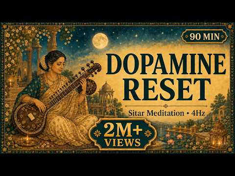
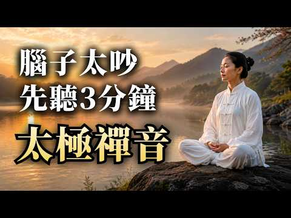
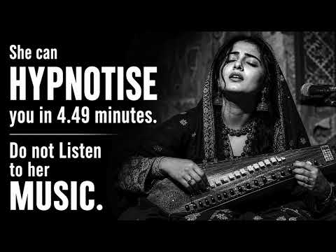

# 음악 — 성공 사례 분석: 사례별 자세히 #521–#560

`analysis.md` 의 9번 (같은 # 번호). 자동 생성 — `tools/success_analysis.py` v1.5.1 (2026-10-24 07:42 UTC). ※ 연구·교육용 — 투자 권유가 아님.

### 521. 영혼을 울리는 집시 바이올린 🎻 ∣ 감성 바이올린 · 집시 음악 · 휴식 플레이리스트 ∣ 보라빛 음악정원

- https://www.youtube.com/watch?v=7xQeXJwhFh8 · 보랏빛 음악정원 · 구독자 174 · 조회수 13,589 (×78.1, 하루 230.9) · 좋아요 164 (1.2%) · 87.7분 · 2026-08-26 · 주제 묶음 6. 피아노·클래식·연주곡 · 형식 플레이리스트·모음 (여러 곡) · 폴더 `W_7xQeXJwhFh8` (웹 승인)
- 썸네일: 
- 설명 앞부분: 달빛이 머무는 밤, 집시 바이올린의 깊고 자유로운 선율에 천천히 빠져보세요. 🎻🌙 애절하면서도 뜨거운 바이올린의 울림과 유랑의 밤을 닮은 낭만적인 분위기를 담아 감상 · 휴식 · 독서 · 작업 시간에 잘 어울리는 플레이리스트로 구성했습니다. 🎵 Track List 1. 달빛을 따라 떠나는 바이올린 2. 바람 끝에 남은 선율 3. 별빛 아래 떠도는 춤 4. 불빛 따라 흐르는 밤 5. 붉은 달 아래의 약속 6. 새벽길에 남은 노래 7. 바람이 머문 언덕 8. 별이 내린 오래된 거리 9. 달빛이 스친 유랑길 10. 불꽃처럼 스친 밤 1…
- 같은 채널 평소 대비 ×47.5 (채널 최근 롱폼 중앙값 286회) · 평소 영상: [Playlist] 달빛에 스민 칼끝 🌙 자객 OST｜조선 궁궐의 밤을 걷는 판타지 국악… (286회) / [플레이리스트] 가끔은 이런 판타지에 빠지고 싶다 ∣ 팬플루트 × 집시 바이올린 OST (272회)
- 대본 없음 (설명) — 음성인식이 끝나면 도입부·흐름이 들어감
- 댓글 16/16: 좋은 점 — 영상 0 · 감사·응원 1 · 더 알고 싶은 것 0 · 아쉬운 점 — 영상 0 · 반박·불만 — 의견 다름 0 · 정치·사회 0 · 경험 공유 1 · 구독·다음 기대 0
  - 감사·응원 👍0 “아름다운 연주곡 잘 들었습니다~감사합니다~수고 많으셨습니다”
  - 경험 공유 👍2 “아! 내가 좋아하는 데 뭐라 말을 못하겠노 냄새가 좀 찐하긴 하는데 그냥 좋아요는 좋아요”

### 522. Peaceful Chill Playlist 🌙 Trending English Songs 2026 🎧 Best Acoustic Love Hits

- https://www.youtube.com/watch?v=td6iCrK4MHc · Morning Serenity · 구독자 17,400 · 조회수 1,358,464 (×78.1, 하루 43,315.5) · 좋아요 4,600 (0.3%) · 70.7분 · 2026-09-22 · 주제 묶음 8. 로파이·시티팝·칠 · 형식 커버·직접 부른 노래 · 폴더 `W_td6iCrK4MHc` (웹 승인)
- 썸네일: 
- 설명 앞부분: 🌙 **Peaceful Chill Playlist 2026** — Escape the noise, slow down, and enjoy a beautiful collection of **Trending English Songs 2026** and the **Best Acoustic Love Hits**. 🎧💚 Let the gentle guitar melodies, soft pop rhythms, and heartfelt love songs create a peaceful atmosphere for your everyday mom…
- 같은 채널 평소 대비 ×31.7 (채널 최근 롱폼 중앙값 42,818회) · 평소 영상: Feel Good & Relax Playlist 🎶 Top Trending Pop Son… (42,818회) / Healing Acoustic Playlist 2026 🌿 Trending Soft Po… (40,054회)
- 대본 없음 (설명) — 음성인식이 끝나면 도입부·흐름이 들어감
- 댓글 137/150: 좋은 점 — 영상 0 · 감사·응원 0 · 더 알고 싶은 것 0 · 아쉬운 점 — 영상 0 · 반박·불만 — 의견 다름 0 · 정치·사회 0 · 경험 공유 0 · 구독·다음 기대 0

### 523. Heartbreaking 💔 songs + lofi Mashup songs Slowed Reverb songs Arijit singsong

- https://www.youtube.com/watch?v=u6gVi3TsKTM · JR buzdar official  · 구독자 16,900 · 조회수 1,318,334 (×78.0, 하루 15,457.9) · 좋아요 6,374 (0.5%) · 7.8분 · 2026-07-31 · 주제 묶음 8. 로파이·시티팝·칠 · 형식 음악 (그 밖 모양 — 한 편짜리 BGM 등) · 폴더 `W_u6gVi3TsKTM` (웹 승인)
- 썸네일: 
- 설명 앞부분: Welcome to the world of soothing lofi music, where stress fades away, and peace takes over. This Latest 2026 mind-relaxing lofi mix is perfect for: Deep Focus & Studying 📖 Relaxing & Meditation 🧘‍♂ Chilling After a Long Day 🌅 Peaceful Sleep & Stress Relief 😴 Let these calm beats and chill vibes tak…
- 같은 채널 평소 대비 ×3,810.2 (채널 최근 롱폼 중앙값 346회) · 평소 영상: Heartbreaking 💔 LoFi Mashup 🎧 Slowed + Reverb Son… (346회) / Heartbreaking 💔 LoFi Mashup 🎧 Slowed + Reverb Son… (341회)
- 대본 없음 (설명) — 음성인식이 끝나면 도입부·흐름이 들어감
- 댓글 53/53: 좋은 점 — 영상 0 · 감사·응원 0 · 더 알고 싶은 것 0 · 아쉬운 점 — 영상 0 · 반박·불만 — 의견 다름 0 · 정치·사회 0 · 경험 공유 0 · 구독·다음 기대 0

### 524. Relajación Profunda, Claridad Mental 🌿 Reduce El Estrés Y La Ansiedad, Recupera La Calma

- https://www.youtube.com/watch?v=j8hCioy51LU · Healing Soul Music · 구독자 10,700 · 조회수 832,928 (×77.8, 하루 6,461.8) · 좋아요 10,026 (1.2%) · 226.2분 · 2026-06-17 · 주제 묶음 6. 피아노·클래식·연주곡 · 형식 음악 (그 밖 모양 — 한 편짜리 BGM 등) · 폴더 `W_j8hCioy51LU` (웹 승인)
- 썸네일: 
- 설명 앞부분: Relajación profunda y claridad mental con suaves melodías de piano y sonidos de la naturaleza como pájaros y agua ayudan a reducir el estrés, aliviar la ansiedad y recuperar la calma naturalmente. Esta música relajante crea un ambiente tranquilo para restaurar el equilibrio emocional, mejorar la ca…
- 같은 채널 평소 대비 ×310.9 (채널 최근 롱폼 중앙값 2,679회) · 평소 영상: Libera El Estrés Y La Ansiedad 🌿Música Relajante … (2,679회) / Poderosa Relajación Curativa 🌿 Calma La Ansiedad,… (2,869회)
- 대본 없음 (설명) — 음성인식이 끝나면 도입부·흐름이 들어감
- 댓글 132/132: 좋은 점 — 영상 0 · 감사·응원 0 · 더 알고 싶은 것 0 · 아쉬운 점 — 영상 0 · 반박·불만 — 의견 다름 0 · 정치·사회 0 · 경험 공유 0 · 구독·다음 기대 0

### 525. Positive Energy 2026 🌞 Feel Good Deep House Music for Morning Focus ∣ ChillMorning Vibes

- https://www.youtube.com/watch?v=Dg9ePUDm4Vs · ChillMorning Vibes · 구독자 12,400 · 조회수 964,837 (×77.8, 하루 6,569.7) · 좋아요 14,969 (1.6%) · 65.7분 · 2026-05-30 · 주제 묶음 3. 공부·집중·작업 · 형식 플레이리스트·모음 (여러 곡) · 폴더 `W_Dg9ePUDm4Vs` (웹 승인)
- 썸네일: 
- 설명 앞부분: Positive Energy 2026 🌞 Feel Good Deep House Music for Morning Focus ∣ ChillMorning Vibes Positive Energy 2026 🌞 Feel Good Deep House Music for Morning Focus ∣ ChillMorning Vibes Positive Energy 2026 🌞 Feel Good Deep House Music for Morning Focus ∣ ChillMorning Vibes Boost your mood and start your d…
- 같은 채널 평소 대비 ×280.6 (채널 최근 롱폼 중앙값 3,439회) · 평소 영상: Positive Morning 🌅 Chill & Deep House Mix for a H… (3,439회) / Feel the Morning Energy 🌞 Chill House Mix for a C… (3,403회)
- 대본 없음 (설명) — 음성인식이 끝나면 도입부·흐름이 들어감
- 댓글 331/331: 좋은 점 — 영상 0 · 감사·응원 0 · 더 알고 싶은 것 0 · 아쉬운 점 — 영상 0 · 반박·불만 — 의견 다름 0 · 정치·사회 0 · 경험 공유 0 · 구독·다음 기대 0

### 526. Sitar for Dopamine Reset ∣ Indian Classical Music for Mindfulness

- https://www.youtube.com/watch?v=SEw8IsSXRSU · Raga Focus · 구독자 37,700 · 조회수 2,922,004 (×77.5, 하루 16,438.1) · 좋아요 45,961 (1.6%) · 90분 · 2026-04-29 · 주제 묶음 6. 피아노·클래식·연주곡 · 형식 음악 (그 밖 모양 — 한 편짜리 BGM 등) · 폴더 `W_SEw8IsSXRSU` (웹 승인)
- 썸네일: 
- 챕터: 0:00 Gentle arrival (bright onset,… · 7:00 Light expansion (clarity incr… · 18:00 Peak brightness phase (alert … · 30:00 Soft descent begins (brightne… · 42:00 Stabilized focus (steady deep… · 55:00 Deepening phase (sitar textur… · 68:00 Immersive flow state (rich lo… · 78:00 Inner balance restoration (me… · 85:00 Soft unwinding (nervous syste… · 89:00 Gentle fade out (Theta layer …
- 설명 앞부분: Mind Too Overstimulated? ∣ Dopamine Reset ∣ Sitar Deep Focus Session When your brain feels flooded, forcing focus only adds more noise. This does the opposite. A continuous 90-minute sitar meditation built on Indian classical ambient textures, designed for deep work, dopamine reset, and mental clar…
- 같은 채널 평소 대비 ×2,140.7 (채널 최근 롱폼 중앙값 1,365회) · 평소 영상: Find Your Calm ∣ Sarangi Instrumental ∣ 1.5 Hours (1,387회) / Think Clearly Again ∣ Santoor Instrumental ∣ 1.5 … (1,343회)
- 대본 없음 (설명) — 음성인식이 끝나면 도입부·흐름이 들어감
- 댓글 1,247/1,257: 좋은 점 — 영상 0 · 감사·응원 0 · 더 알고 싶은 것 0 · 아쉬운 점 — 영상 0 · 반박·불만 — 의견 다름 0 · 정치·사회 0 · 경험 공유 0 · 구독·다음 기대 0

### 527. 腦子太吵時，先聽3分鐘｜2026最寧靜太極禪音精選｜讓呼吸慢下來，腦中的雜音也慢慢散去｜夜晚放空・晨間靜坐冥想・正念呼吸・太極練習・閱讀喝茶・日常休息・古箏音樂・壓力舒緩・中式放…

- https://www.youtube.com/watch?v=KR1ZjmufbOE · 清心樂坊Taiji Zen · 구독자 3,250 · 조회수 251,018 (×77.2, 하루 3,373.7) · 좋아요 1,248 (0.5%) · 59.3분 · 2026-08-10 · 주제 묶음 기타 · 형식 정보·해설 (그 밖) · 폴더 `W_KR1ZjmufbOE` (웹 승인)
- 썸네일: 
- 같은 채널 평소 대비 ×37.3 (채널 최근 롱폼 중앙값 6,721회) · 평소 영상: 聽它，一天的沉重慢慢散去｜2026最靜心太極禪音精選｜讓呼吸慢下來，把紛亂與疲憊慢慢放下｜晚間休息… (6,721회) / 一聽，心就放鬆了🧘｜2026最靜心太極禪音精選｜把注意力從外面的事情收回到呼吸、身體和此刻｜太極B… (6,635회)
- 대본 없음 (없음) — 음성인식이 끝나면 도입부·흐름이 들어감
- 댓글 24/27: 좋은 점 — 영상 0 · 감사·응원 0 · 더 알고 싶은 것 0 · 아쉬운 점 — 영상 0 · 반박·불만 — 의견 다름 0 · 정치·사회 0 · 경험 공유 0 · 구독·다음 기대 0

### 528. Do not listen to her music. She can hypnotise you in 4.49 minutes/ This melody has ancien…

- https://www.youtube.com/watch?v=0tBUIo44w-A · Dream Weaver  Sounds · 구독자 19,100 · 조회수 1,469,221 (×76.9, 하루 8,559.6) · 좋아요 24,895 (1.7%) · 5.7분 · 2026-05-05 · 주제 묶음 6. 피아노·클래식·연주곡 · 형식 음악 (그 밖 모양 — 한 편짜리 BGM 등) · 폴더 `W_0tBUIo44w-A` (웹 승인)
- 썸네일: 
- 설명 앞부분: Do not listen to her music. She can hypnotise you in 4.49 minutes. You have been warned. Some melodies carry an ancient power that does not just play in the background, it takes hold of your entire being. This track is a journey into the deep, mystical landscapes of Balochistan, where the music spe…
- 같은 채널 평소 대비 ×1,673.4 (채널 최근 롱폼 중앙값 878회) · 평소 영상: Drift into Deep Sleep ∣ Sufi Instrumental ∣ Calm … (878회) / Sufi Instrumental Music for Stress Relief & Deep … (851회)
- 대본 없음 (설명) — 음성인식이 끝나면 도입부·흐름이 들어감
- 댓글 796/799: 좋은 점 — 영상 0 · 감사·응원 0 · 더 알고 싶은 것 0 · 아쉬운 점 — 영상 0 · 반박·불만 — 의견 다름 0 · 정치·사회 0 · 경험 공유 0 · 구독·다음 기대 0

### 529. 2 Hours Super Relaxing Baby Music ♥♥♥ Bedtime Lullaby For Sweet Dreams ♫♫♫ Sleep Music

- https://www.youtube.com/watch?v=e_-uzFi6JlI · Deep Calm White Noise · 구독자 31,500 · 조회수 2,420,339 (×76.8, 하루 13,759.1) · 좋아요 12,208 (0.5%) · 120.1분 · 2026-05-01 · 주제 묶음 1. 수면·명상·힐링 · 형식 긴 한 곡·반복 (N시간) · 폴더 `W_e_-uzFi6JlI` (웹 승인)
- 썸네일: 
- 설명 앞부분: 2 Hours Super Relaxing Baby Music ♥♥♥ Bedtime Lullaby For Sweet Dreams ♫♫♫ Sleep Music Welcome to our channel dedicated to providing the perfect environment for your baby's peaceful sleep and intellectual development. In Video , we present 'Mozart for Babies Intelligence Stimulation,' a soothing lu…
- 같은 채널 평소 대비 ×150.9 (채널 최근 롱폼 중앙값 16,037회) · 평소 영상: Mozart Brahms Lullaby ♥ Sleep Instantly Within 3 … (19,834회) / Fall Asleep in 3 Minutes 🎶 Soothing Baby Sleep Mu… (12,240회)
- 대본 없음 (설명) — 음성인식이 끝나면 도입부·흐름이 들어감
- 댓글 481/481: 좋은 점 — 영상 0 · 감사·응원 0 · 더 알고 싶은 것 0 · 아쉬운 점 — 영상 0 · 반박·불만 — 의견 다름 0 · 정치·사회 0 · 경험 공유 0 · 구독·다음 기대 0

### 530. Heartbreaking 💔 lofi mashup 🎶 slowed + reverb songs ∣ study, focus & late night vibes

- https://www.youtube.com/watch?v=p8BH-D_YiQY · Sani Music Official  · 구독자 8,880 · 조회수 681,248 (×76.7, 하루 7,232.9) · 좋아요 3,995 (0.6%) · 8분 · 2026-07-22 · 주제 묶음 3. 공부·집중·작업 · 형식 음악 (그 밖 모양 — 한 편짜리 BGM 등) · 폴더 `W_p8BH-D_YiQY` (웹 승인)
- 썸네일: 
- 설명 앞부분: Welcome to the world of soothing lofi music, where stress fades away, and peace takes over. This 2026 mind-relaxing lofi mix is perfect for: Deep Focus & Studying📖 Relaxing & Meditation🧘‍♂ Chilling After a Long Day🌅 Peaceful Sleep & Stress Relief😴 Let these calm beats and chill vibes take you on a …
- 같은 채널 평소 대비 ×824.8 (채널 최근 롱폼 중앙값 826회) · 평소 영상: Heartbreaking 💔 lofi mashup 🎶 slowed + reverb son… (862회) / Heartbreaking 💔 lofi mashup 🎶 slowed + reverb son… (790회)
- 대본 없음 (설명) — 음성인식이 끝나면 도입부·흐름이 들어감
- 댓글 53/53: 좋은 점 — 영상 0 · 감사·응원 0 · 더 알고 싶은 것 0 · 아쉬운 점 — 영상 0 · 반박·불만 — 의견 다름 0 · 정치·사회 0 · 경험 공유 0 · 구독·다음 기대 0

### 531. Afro House Mix 2026 🔥 Tribal Afro House Energy ∣ Emotional Melodic Beats #VOL 35

- https://www.youtube.com/watch?v=UIzQAbsrlRk · Jungle Pulse House · 구독자 27,000 · 조회수 2,070,354 (×76.7, 하루 13,286.8) · 좋아요 14,264 (0.7%) · 99.4분 · 2026-05-21 · 주제 묶음 4. 카페·매장·라운지 · 형식 플레이리스트·모음 (여러 곡) · 폴더 `W_UIzQAbsrlRk` (웹 승인)
- 썸네일: 
- 챕터: 0:00 01. Wild Tribal Romance · 4:44 02. Savanna Night Whisper · 9:44 03. Moonlight Afro Dreams · 14:27 04. Fire Inside My Soul · 19:20 05. Sunset Love Rhythm · 24:28 06. Echoes of Your Love · 29:31 07. Sacred Night Groove · 34:44 08. Endless Afro Nights · 39:31 09. Golden Horizon Vibes · 44:50 10. Deep Voodoo Love · 49:52 11. Burning Love Chant · 54:35 12. Desert Soul Connection · 59:56 13. Lost in Your Rhythm · 65:05 14. Tribal Love Frequency · 69:51 15. Heartbeat in the Sand · 74:59 16. Electric Sunset Desire · 79:56 17. Midnight Tribal Fire · 84:27 18. Rhythm of the Ancients · 89:27 19. Deep Jungle Desire · 94:24 20. Ocean Heartbeat
- 설명 앞부분: This mix is designed to create an immersive atmosphere, featuring hypnotic basslines, organic percussion, and uplifting melodic progressions that flow seamlessly together. Perfect for summer parties, sunset sessions, workouts, or late-night drives, this set delivers nonstop energy with a soulful Af…
- 같은 채널 평소 대비 ×1,465.7 (채널 최근 롱폼 중앙값 1,412회) · 평소 영상: Afro House Mix 2026 🔥 Deep Tribal Beats & Melodic… (1,413회) / Afro House Mix 2026 🔥 Deep Melodic Afro House ∣ T… (1,412회)
- 대본 없음 (설명) — 음성인식이 끝나면 도입부·흐름이 들어감
- 댓글 279/280: 좋은 점 — 영상 0 · 감사·응원 0 · 더 알고 싶은 것 0 · 아쉬운 점 — 영상 0 · 반박·불만 — 의견 다름 0 · 정치·사회 0 · 경험 공유 0 · 구독·다음 기대 0

### 532. MOOD OFF 💔Sad 😭 LOFI SONG MASHUP ∣∣ SAD HEART BROKEN 💔 MOOD OFF😭∣∣ EMOTIONAL MUSHUP 🎧😢

- https://www.youtube.com/watch?v=kjV1sVljycI · Hindi sad song (50) · 구독자 41,700 · 조회수 3,197,035 (×76.7, 하루 19,711.1) · 좋아요 15,349 (0.5%) · 19.6분 · 2026-05-15 · 주제 묶음 8. 로파이·시티팝·칠 · 형식 음악 (그 밖 모양 — 한 편짜리 BGM 등) · 폴더 `W_kjV1sVljycI` (웹 승인)
- 썸네일: 
- 설명 앞부분: Welcome to the world of soothing lofi music, where stress fades away, and peace takes over. This 2026 mind-relaxing lofi mix is perfect for: Deep Focus & Studying 📖 Relaxing & Meditation 🧘‍♂ Chilling After a Long Day 🌅 Peaceful Sleep & Stress Relief 😴 Let these calm beats and chill vibes take you o…
- 같은 채널 평소 대비 ×32,790.1 (채널 최근 롱폼 중앙값 98회) · 평소 영상: Heartbroken Lofi Songs 💔 ∣ Slowed + Reverb ∣ Late… (101회) / Heartbroken Lofi Songs 💔 ∣ Slowed + Reverb ∣ Late… (94회)
- 대본 없음 (설명) — 음성인식이 끝나면 도입부·흐름이 들어감
- 댓글 330/330: 좋은 점 — 영상 0 · 감사·응원 0 · 더 알고 싶은 것 0 · 아쉬운 점 — 영상 0 · 반박·불만 — 의견 다름 0 · 정치·사회 0 · 경험 공유 0 · 구독·다음 기대 0

### 533. jazz before i reach flow state

- https://www.youtube.com/watch?v=fQIJb1h1RkA · Defunct · 구독자 11,200 · 조회수 857,931 (×76.6, 하루 5,231.7) · 좋아요 37,327 (4.3%) · 127.8분 · 2026-05-13 · 주제 묶음 7. 재즈·보사노바 · 형식 플레이리스트·모음 (여러 곡) · 폴더 `W_fQIJb1h1RkA` (웹 승인)
- 썸네일: 
- 챕터: 0:00 flow state · 2:54 ascencion · 6:27 calculator · 10:30 blind syntax · 13:48 digital veil · 16:58 silent code · 19:53 marble circuit · 22:27 encrypted · 25:35 oblivion · 28:40 ciphered · 32:14 dark algorithm · 35:17 veiled logic · 38:31 silent program · 41:46 stone script · 44:45 codebound · 48:15 obscura · 51:30 fragmented · 54:34 blind oracle · 57:24 syntax crown · 60:08 echoes
- 설명 앞부분: it's time. ∣ jazz to study / sleep / fall asleep / work / relax to Tracklist: art found in pnterest, edited and music created by defunct ignore tags
- 같은 채널 평소 대비 ×192.1 (채널 최근 롱폼 중앙값 4,466회) · 평소 영상: jazz before i rise (4,466회) / jazz in pure meditative form (4,525회)
- 대본 없음 (설명) — 음성인식이 끝나면 도입부·흐름이 들어감
- 댓글 944/947: 좋은 점 — 영상 0 · 감사·응원 0 · 더 알고 싶은 것 0 · 아쉬운 점 — 영상 0 · 반박·불만 — 의견 다름 0 · 정치·사회 0 · 경험 공유 0 · 구독·다음 기대 0

### 534. ENIGMA Style Music 🔥 Whisper of My Angel 🔥 2026

- https://www.youtube.com/watch?v=ELv5bUhS-Qw · VoiceLine Music · 구독자 4,020 · 조회수 307,769 (×76.6, 하루 1,795.1) · 좋아요 3,487 (1.1%) · 5.6분 · 2026-05-05 · 주제 묶음 기타 · 형식 음악 (그 밖 모양 — 한 편짜리 BGM 등) · 폴더 `W_ELv5bUhS-Qw` (웹 승인)
- 썸네일: 
- 설명 앞부분: ENIGMA Style Music 🔥 Whisper of My Angel 🔥 2026 Enter a realm where silence speaks… Whisper of My Angel is a sensual, ethereal soundscape inspired by the timeless spirit of Enigma — blending sacred ambience with deep emotional energy. A distant voice calls through the night… Soft angelic whispers d…
- 같은 채널 평소 대비 ×1,805.1 (채널 최근 롱폼 중앙값 170회) · 평소 영상: ENYA Style Music 🔥 Shadow Echoes Tonight 🔥 2026 (171회) / ENYA Style Music 🔥 Golden Memories Tonight 🔥 2026 (170회)
- 대본 없음 (설명) — 음성인식이 끝나면 도입부·흐름이 들어감
- 댓글 95/97: 좋은 점 — 영상 0 · 감사·응원 0 · 더 알고 싶은 것 0 · 아쉬운 점 — 영상 0 · 반박·불만 — 의견 다름 0 · 정치·사회 0 · 경험 공유 0 · 구독·다음 기대 0

### 535. Melepasmu - Drive (Waktu Luang Version) ∣ Ambient Pop Melancholic Cover

- https://www.youtube.com/watch?v=CfyEhCWn45o · Waktu Luang · 구독자 18,700 · 조회수 1,430,416 (×76.5, 하루 9,737.1) · 좋아요 7,284 (0.5%) · 4.3분 · 2026-05-30 · 주제 묶음 5. 운동·드라이브·신나는 · 형식 커버·직접 부른 노래 · 폴더 `W_CfyEhCWn45o` (웹 승인)
- 썸네일: 
- 설명 앞부분: Melepasmu dari Drive hadir dalam versi baru dengan nuansa Ambient Pop yang lebih melankolis, sinematik, dan emosional. Aransemen ini memadukan piano lembut, ambient synth, tekstur elektronik yang minimalis, serta vokal yang rapuh dan penuh perasaan untuk menghadirkan pengalaman mendengarkan yang le…
- 같은 채널 평소 대비 ×24.9 (채널 최근 롱폼 중앙값 57,446회) · 평소 영상: BAIKNYA - ADA Band ∣ Waktu Luang Version ∣ (57,446회) / Bertahan - Rama ( Waktu Luang Version ) (53,264회)
- 대본 없음 (설명) — 음성인식이 끝나면 도입부·흐름이 들어감
- 댓글 108/109: 좋은 점 — 영상 0 · 감사·응원 0 · 더 알고 싶은 것 0 · 아쉬운 점 — 영상 0 · 반박·불만 — 의견 다름 0 · 정치·사회 0 · 경험 공유 0 · 구독·다음 기대 0

### 536. Heartbreaking 💔 lofi mashup 🎶 slowed + reverb songs ∣ study, focus & late night vibes+++5

- https://www.youtube.com/watch?v=WH_pNjVfkCY · Click Bollywood music hub🎶 · 구독자 10,700 · 조회수 817,449 (×76.4, 하루 8,182.6) · 좋아요 3,100 (0.4%) · 8분 · 2026-07-16 · 주제 묶음 3. 공부·집중·작업 · 형식 음악 (그 밖 모양 — 한 편짜리 BGM 등) · 폴더 `W_WH_pNjVfkCY` (웹 승인)
- 썸네일: 
- 설명 앞부분: Welcome 🙏to world of soothing lofi music, where stress fades away, and peace takes over. This 2025 mind-relaxing lofi mix is perfect for: Deep Focus & Studying 📖 Relaxing & Meditation 🧘‍♂ Chilling After a Long Day 🌅 Peaceful Sleep & Stress Relief 😴 Let these calm beats and chill vibes take you on a…
- 같은 채널 평소 대비 ×6,192.8 (채널 최근 롱폼 중앙값 132회) · 평소 영상: Heartbreaking 💔 Lofi Mashup 🎧Slowed + Reverb Song… (134회) / Heartbreaking 💔 Lofi Mashup 🎧Slowed + Reverb Song… (130회)
- 대본 없음 (설명) — 음성인식이 끝나면 도입부·흐름이 들어감
- 댓글 118/118: 좋은 점 — 영상 0 · 감사·응원 0 · 더 알고 싶은 것 0 · 아쉬운 점 — 영상 0 · 반박·불만 — 의견 다름 0 · 정치·사회 0 · 경험 공유 0 · 구독·다음 기대 0

### 537. somehow this became your background music

- https://www.youtube.com/watch?v=GTx1UYV9Y-o · Ksu4000 · 구독자 23,300 · 조회수 1,777,432 (×76.3, 하루 21,504.5) · 좋아요 89,891 (5.1%) · 61.8분 · 2026-08-02 · 주제 묶음 6. 피아노·클래식·연주곡 · 형식 플레이리스트·모음 (여러 곡) · 폴더 `W_GTx1UYV9Y-o` (웹 승인)
- 썸네일: 
- 설명 앞부분: Thanks for letting this be part of your day. ◢ spotify ◢ bandcamp © 2026 Ksu4000. All rights reserved.
- 같은 채널 평소 대비 ×154.7 (채널 최근 롱폼 중앙값 11,488회) · 평소 영상: i will delete this playlist forever on October 20… (11,602회) / i will delete this background music tomorrow. no … (11,374회)
- 대본 없음 (설명) — 음성인식이 끝나면 도입부·흐름이 들어감
- 댓글 1,583/1,609: 좋은 점 — 영상 0 · 감사·응원 0 · 더 알고 싶은 것 0 · 아쉬운 점 — 영상 0 · 반박·불만 — 의견 다름 0 · 정치·사회 0 · 경험 공유 0 · 구독·다음 기대 0

### 538. Enya Inspired - Tears Of The Rain (Ai Music)

- https://www.youtube.com/watch?v=ZqRhMKrbk58 · Sonic Beatz · 구독자 5,870 · 조회수 445,689 (×75.9, 하루 2,849.6) · 좋아요 9,124 (2.1%) · 7.5분 · 2026-05-20 · 주제 묶음 14. AI 음악 · 형식 AI 음악 · 폴더 `W_ZqRhMKrbk58` (웹 승인)
- 썸네일: 
- 설명 앞부분: "Tears of the Rain" is a hauntingly beautiful journey through memory, longing, and quiet healing. With soft ambient textures, angelic vocals, and cinematic soundscapes, this piece is designed to transport you into a dreamlike state of reflection and peace. Let the rain wash over you. Let every note…
- 같은 채널 평소 대비 ×104.0 (채널 최근 롱폼 중앙값 4,288회) · 평소 영상: Enya Inspired - The Celts (Ai Music) (4,686회) / Enya Inspired - Cherry Blossom (AI Music) (3,889회)
- 대본 없음 (설명) — 음성인식이 끝나면 도입부·흐름이 들어감
- 댓글 412/412: 좋은 점 — 영상 0 · 감사·응원 0 · 더 알고 싶은 것 0 · 아쉬운 점 — 영상 0 · 반박·불만 — 의견 다름 0 · 정치·사회 0 · 경험 공유 0 · 구독·다음 기대 0

### 539. 𝘱𝘭𝘢𝘺𝘭𝘪𝘴𝘵 들으면 행복해지는 노래 모음 🫧 하루종일 듣기 좋은 팝송 플레이리스트

- https://www.youtube.com/watch?v=lQrhgr4_dKg · seroma room · 구독자 16,700 · 조회수 1,267,119 (×75.9, 하루 7,313.5) · 좋아요 7,349 (0.6%) · 542.2분 · 2026-05-04 · 주제 묶음 10. 팝송·K팝·J팝 · 형식 플레이리스트·모음 (여러 곡) · 폴더 `W_lQrhgr4_dKg` (웹 승인)
- 썸네일: 
- 챕터: 0:00 Running Late but Feeling Good · 2:21 A Little Too Late · 4:36 Backseat Brave · 7:18 Just Enough Chaos · 10:30 First Jump · 12:41 A Song We Played Too Loud · 15:27 Off Script Day · 18:37 We Took the Longer Way Around · 21:40 Everything Felt Possible Then · 24:02 We Talked About Everything · 26:10 We Made It Up · 29:07 We Didn’t Check the Time Once · 32:05 Too Bright to Stay Inside · 34:31 Laughing Like It’s Nothing · 37:25 Missed The Bus · 39:25 That Day Felt Like a Movie Sc… · 42:13 Music First
- 설명 앞부분: 들으면 기분이 조금 가벼워지는 노래들을 모았어요 🫧 출근길, 산책, 공부나 작업할 때 편하게 틀어두기 좋은 플레이리스트입니다 🎧 오늘 하루가 조금 더 좋아지길 바라요 🤍 Songs that make your day feel a little lighter 🫧 Easy to play in the background for your commute, a walk, or while you work or study 🎧 Hope this adds a small moment of happiness to your day 🤍 🎧 Youtube Mu…
- 같은 채널 평소 대비 ×135.7 (채널 최근 롱폼 중앙값 9,341회) · 평소 영상: 𝘱𝘭𝘢𝘺𝘭𝘪𝘴𝘵 틀자마자 기분 좋아지는 여름 팝송 🫧☀️ 하루종일 듣기 좋은 요즘 플레이… (9,341회) / 𝘱𝘭𝘢𝘺𝘭𝘪𝘴𝘵 오늘은 웃을 일이 좀 많을 것 같아 ☀️ 하루종일 듣기 좋은 노래 모음 … (9,638회)
- 대본 없음 (설명) — 음성인식이 끝나면 도입부·흐름이 들어감
- 댓글 167/170: 좋은 점 — 영상 5 · 감사·응원 10 · 더 알고 싶은 것 4 · 아쉬운 점 — 영상 2 · 반박·불만 — 의견 다름 0 · 정치·사회 0 · 경험 공유 5 · 구독·다음 기대 1
  - 좋은 점 — 영상 👍21 “이 노래들은 진짜 하루 종일 듣기 좋은 것 같아요 ^^”
  - 좋은 점 — 영상 👍7 “안녕하세요 선플달기활동을 하고있는 학생입니다 !! 오늘 뭔가 기분이 답답하고 좋지 않았는데 이 플레이리스트를 듣다 보니 서서히 감정이 스며들어가는 것 같습니다 ㅎㅎ고정에 달아두시는 좋은 말씀에 힘입어 남은 오늘 하루 잘 보내보겠습니다 감사합니다😊”
  - 감사·응원 👍20 “온종일 틀어놓고 집안일도 하고 커피도 마시고 일상의 위로에요 ^^ 감사합니다.”
  - 감사·응원 👍7 “안녕하세요 선플달기활동을 하고있는 학생입니다 !! 오늘 뭔가 기분이 답답하고 좋지 않았는데 이 플레이리스트를 듣다 보니 서서히 감정이 스며들어가는 것 같습니다 ㅎㅎ고정에 달아두시는 좋은 말씀에 힘입어 남은 오늘 하루 잘 보내보겠습니다 감사합니다😊”
  - 더 알고 싶은 것 👍15 “첫번째 곡이랑 비슷한 노래 추천 좀 해주세요ㅠ 첫 곡이 너무 좋은데 찾아봐도 없어요ㅜㅜ”
  - 더 알고 싶은 것 👍1 “We Didn't Check the Time once 이노래도 내주세요 ㅠㅠ 애플 뮤직이라도 아님 이곡만 만들어주세요 ㅠ 지금6시간째 이곡만 듣고 있어요 ㅠ 29:07”
  - 아쉬운 점 — 영상 👍8 “오뭔가 ai같다햇는데 맞앗네..;;”
  - 아쉬운 점 — 영상 👍0 “Ai 티 존나나는데 이거 좋다는건 다 막귀냐 목소리부터 존나ai인데”
  - 경험 공유 👍0 “ㅅㅂ 이게a.i곡이었다고? 명곡인줄알고 반년째따라불럿는데 하......진짜싫네 이게말이돼?”
  - 구독·다음 기대 👍7 “뭔가 가라앉고 기분이 우울한 밤이었는데, 정말 기분이 밝아지고 행복해졌어요 구독박고 갑니다! 감사해요 ㅜㅜ”

### 540. Life before Social Media - CHILL BRAZIL ∣ Samba, Luxury Bossa Nova, Work, Study

- https://www.youtube.com/watch?v=NHZXCzKGDQc · Golden Smile · 구독자 6,570 · 조회수 497,029 (×75.7, 하루 3,457.3) · 좋아요 5,766 (1.2%) · 152.4분 · 2026-06-02 · 주제 묶음 3. 공부·집중·작업 · 형식 플레이리스트·모음 (여러 곡) · 폴더 `W_NHZXCzKGDQc` (웹 승인)
- 썸네일: 
- 설명 앞부분: Welcome to GoldenSmile Your tropical escape into the smooth world of Brazilian chill, bossa nova, samba grooves, and laid-back beach rhythms. A place where the breeze sings, the sun glows, and the music moves like waves. Perfect for relaxing, slow dancing in your kitchen, dreaming by the window—or …
- 같은 채널 평소 대비 ×150.8 (채널 최근 롱폼 중앙값 3,296회) · 평소 영상: Busy Doing Nothing - CHILL BRAZIL ∣ Samba, Luxury… (3,336회) / MATCHA in BRAZIL? - Chill BraziL ∣ Samba, Luxury … (3,255회)
- 대본 없음 (설명) — 음성인식이 끝나면 도입부·흐름이 들어감
- 댓글 55/55: 좋은 점 — 영상 0 · 감사·응원 0 · 더 알고 싶은 것 0 · 아쉬운 점 — 영상 0 · 반박·불만 — 의견 다름 0 · 정치·사회 0 · 경험 공유 0 · 구독·다음 기대 0

### 541. POV: YOU ARE A DESI BADDIE 💋😭 (PART-2) ✨ (+TIMESTAMPS) 😋 THANK YOU FOR 9K SUBBIES~ ❤️🫂

- https://www.youtube.com/watch?v=9avHQt7MnK4 · Dramanique⋆.𐙚 ̊ · 구독자 32,400 · 조회수 2,447,925 (×75.5, 하루 13,993.7) · 좋아요 36,822 (1.5%) · 26.6분 · 2026-05-02 · 주제 묶음 기타 · 형식 정보·해설 (그 밖) · 폴더 `W_9avHQt7MnK4` (웹 승인)
- 썸네일: 
- 설명 앞부분: Timestamps: Disclaimer: I do not own any of the music used in this playlist. All rights belong to their respective owners. This playlist is made for entertainment and personal enjoyment only.
- 같은 채널 평소 대비 ×5.2 (채널 최근 롱폼 중앙값 469,801회) · 평소 영상: POV: IT’S 3AM & YOUR HEART WON’T SHUT UP 🌙🎧✨ (REQ… (533,889회) / BOLLYWOOF SONGS WITH ENGLISH VERSES 🔥🤧 (PART-2~💋)… (405,713회)
- 대본 없음 (설명) — 음성인식이 끝나면 도입부·흐름이 들어감
- 댓글 584/586: 좋은 점 — 영상 0 · 감사·응원 0 · 더 알고 싶은 것 0 · 아쉬운 점 — 영상 0 · 반박·불만 — 의견 다름 0 · 정치·사회 0 · 경험 공유 0 · 구독·다음 기대 0

### 542. 하츠투하츠 Hearts2Hearts 'RUDE!+Lemon Tang' 2026 한국대중음악상(KM Chart Awards) 260725

- https://www.youtube.com/watch?v=ddGnUiIjrgo · poptforming · 구독자 5,950 · 조회수 444,645 (×74.7, 하루 4,897.7) · 좋아요 11,533 (2.6%) · 6.6분 · 2026-07-25 · 주제 묶음 기타 · 형식 음악 (그 밖 모양 — 한 편짜리 BGM 등) · 폴더 `W_ddGnUiIjrgo` (웹 승인)
- 썸네일: 
- 대본 없음 (없음) — 음성인식이 끝나면 도입부·흐름이 들어감
- 댓글 314/314: 좋은 점 — 영상 2 · 감사·응원 2 · 더 알고 싶은 것 1 · 아쉬운 점 — 영상 0 · 반박·불만 — 의견 다름 0 · 정치·사회 0 · 경험 공유 1 · 구독·다음 기대 0
  - 좋은 점 — 영상 👍124 “스타즈 오늘 둘다 레전드네 ㄷㄷㄷ❤❤❤❤”
  - 좋은 점 — 영상 👍11 “하츠투하츠 KMA 2026 어워즈 청량하고 상큼한 무대 레전드네!!! 칼군무 대박ㅠㅠ라이브 너무 잘하고 청순하고 헤메코 이쁘고 열정적인 퍼포먼스 진짜 너무 멋지다!!!ㅠㅠ완전 최고!!!👍👍하츠투하츠 화이팅!!!❤❤❤”
  - 감사·응원 👍11 “하츠투하츠 KMA 2026 어워즈 청량하고 상큼한 무대 레전드네!!! 칼군무 대박ㅠㅠ라이브 너무 잘하고 청순하고 헤메코 이쁘고 열정적인 퍼포먼스 진짜 너무 멋지다!!!ㅠㅠ완전 최고!!!👍👍하츠투하츠 화이팅!!!❤❤❤”
  - 감사·응원 👍7 “하츠투하츠 파이팅 ! 유하 파이팅 ! 🎀”
  - 더 알고 싶은 것 👍0 “안녕하세요 여러분, 멤버 중에 제일 나이가 많은 분이 누구신지 궁금해서 여쭤봅니다. 🤔”
  - 경험 공유 👍0 “제가 항상 생각하는 건... 하츠투하츠 멤버들이 공연할 때마다 숨이 차지 않을까 하는 거예요.?”

### 543. 요즘 이 노래에 빠졌다 🎧 중독성 리듬 락트로트 17곡 2시간 10분 연속듣기 ∣ I’m Addicted to These Songs

- https://www.youtube.com/watch?v=rDvH1El0H3k · 인생은 트로트 · 구독자 9,890 · 조회수 733,161 (×74.1, 하루 15,308.7) · 좋아요 4,222 (0.6%) · 130.3분 · 2026-09-06 · 주제 묶음 9. 가요·발라드·트로트 · 형식 플레이리스트·모음 (여러 곡) · 폴더 `W_rDvH1El0H3k` (웹 승인)
- 썸네일: 
- 설명 앞부분: 레트로 감성이 어우러진 락트로트 플레이리스트입니다. TRACK LIST 총 17곡 2시간10분
- 같은 채널 평소 대비 ×52.3 (채널 최근 롱폼 중앙값 14,007회) · 평소 영상: 시청자 요청으로 만든 힙팝트로트 2탄 🎧 한 곡만 들으려다 끝까지 들었다 ∣ 10곡 1시… (14,007회) / 사랑에 빠졌나 봐 ❤️ 시크한 그녀의 락트로트 댄스 10곡 ∣ 1시간 10분 (15,243회)
- 대본 없음 (설명) — 음성인식이 끝나면 도입부·흐름이 들어감
- 댓글 338/344: 좋은 점 — 영상 2 · 감사·응원 30 · 더 알고 싶은 것 5 · 아쉬운 점 — 영상 6 · 반박·불만 — 의견 다름 0 · 정치·사회 0 · 경험 공유 5 · 구독·다음 기대 2
  - 좋은 점 — 영상 👍6 “처음보는 노래 제목에 선택했는데 진짜 듣기 좋네요 🎉🎉”
  - 좋은 점 — 영상 👍3 “와우 !! 이 영상 너무나도 대박 입니다요 ^^ 슬픈듯 눈물이 나올듯 말듯 경쾌하고 신나며 마음을 쥐락펴락하며 아무튼 넘 좋아요 ^^ 좋은 영상 너무너무 감사합니다 ^^ 이노래를듣고있으면 (이세상 모든것이 다 내것 같아 행복해집니다 ~.^)”
  - 감사·응원 👍10 “매일 출퇴근때~듣고있어요~~^^😊 좋은음악 감사합니다 ^^❤❤❤”
  - 감사·응원 👍9 “노래가 다 좋치만 1번 13번 좋네요 감사합니다”
  - 더 알고 싶은 것 👍2 “어떤곡이 제일좋은지 알려주세요 ㅎㅎㅎ 난 너무 좋아서 몇번을 들었네요 님. 강사합니다~~~^^😂😂😂”
  - 더 알고 싶은 것 👍1 “댓글보니 노래방 걸러링 이야기 만든데 거기에 통화 연결음까지...... 부탁드립니다 너무 좋아요 사랑합니다❤❤❤❤❤❤”
  - 아쉬운 점 — 영상 👍6 “요즘 AI 목소리 넘 좋고 노래 넘 잘해서 중독됨~”
  - 아쉬운 점 — 영상 👍4 “아~노래좋네~~ 계속듣다보니 같은 노랜가? 좀 아쉼네요 같은 리듬이...조금 지루해져요^^”
  - 경험 공유 👍3 “살면서 가장 힘든 것은 힘든 상황보다도 아무에게도 내 마음을 말할 수 없을 때인 것 같습니다. 저도 오랫동안 가족 걱정과 현실적인 문제들을 혼자 감당하며 지냈습니다. 오늘 이 노래를 들으니 굳이 말하지 않아도 제 마음을 알아주는 친구를 만난 기분입니다. 눈물이 나면서…”
  - 경험 공유 👍2 “맑고 듣기는좋으네요 넘좋은데요 감사합니다 이늦은밤 들으니 더욱더 빠져드네요 그런데 듣는사람마다 다르게 들리수도 제가 듣기에는 음과 리듬이 거의 동일?비슷 ㅎ 그리고 굴곡진곳하나없고 감정선 느낌은 없는것같아요 그럼에도 불구하고 듣기조아 자꾸듣게되는 장점은있네요 다 좋은…”
  - 구독·다음 기대 👍3 “노래를 듣고 있자니 지나가다고 구독하고 갑니다. 😄”
  - 구독·다음 기대 👍2 “와~~~ 오전에 듣다가 점심먹으면서도 계속듣고 있네요 이런적이 없었는데... 중독된것같네요 바로 구독❤알림 설정했네요 감사합니다 귀한 음악 들려주셔서 항상 함께하겠습니다^^!”

### 544. Ocean Chillout - Sunset Lounge Melodies and Luxury Lounge Vibes for a Peaceful Evening

- https://www.youtube.com/watch?v=hFaOxrQmaQ4 · Afterglow Lounge · 구독자 10,700 · 조회수 792,848 (×74.1, 하루 7,390.6) · 좋아요 9,327 (1.2%) · 125.2분 · 2026-07-09 · 주제 묶음 4. 카페·매장·라운지 · 형식 음악 (그 밖 모양 — 한 편짜리 BGM 등) · 폴더 `W_hFaOxrQmaQ4` (웹 승인)
- 썸네일: 
- 설명 앞부분: Ocean Chillout - Sunset Lounge Melodies and Luxury Lounge Vibes for a Peaceful Evening Experience pure bliss with our ocean chillout and sunset lounge session. Afterglow Lounge brings you luxury lounge melodies perfect for a peaceful evening by the sea. 🌅 Are you watching the sunset while listening…
- 같은 채널 평소 대비 ×230.9 (채널 최근 롱폼 중앙값 3,433회) · 평소 영상: Música Lounge Para Relax - Café Del Mar Ibiza Sty… (3,449회) / Café Del Mar Ibiza - Luxury Lounge Chillout Music… (3,417회)
- 대본 없음 (설명) — 음성인식이 끝나면 도입부·흐름이 들어감
- 댓글 231/232: 좋은 점 — 영상 0 · 감사·응원 0 · 더 알고 싶은 것 0 · 아쉬운 점 — 영상 0 · 반박·불만 — 의견 다름 0 · 정치·사회 0 · 경험 공유 0 · 구독·다음 기대 0

### 545. दिमाग को शांत करने वाला संगीत ∣ बांसुरी + संतूर + जलतरंग + तानपुरा ∣ Meditation Music

- https://www.youtube.com/watch?v=z6QYtZlFvb4 · Shanti univers by Chandu  · 구독자 713 · 조회수 52,789 (×74.0, 하루 409.0) · 좋아요 0 (0.0%) · 14.6분 · 2026-06-17 · 주제 묶음 1. 수면·명상·힐링 · 형식 음악 (그 밖 모양 — 한 편짜리 BGM 등) · 폴더 `W_z6QYtZlFvb4` (웹 승인)
- 썸네일: 
- 설명 앞부분: स्वागत है! इस विशेष संगीत को आपके मस्तिष्क को गहरे सुकून और शांति की स्थिति में ले जाने के लिए तैयार किया गया है। इसमें भारतीय बांसुरी (Bansuri) की गहरी तान, तानपुरा (Tanpura) की निरंतर गूंज, संतूर (Santoor) की मीठी झंकार और जलतरंग (Jaltarang) की पानी जैसी लहरों का एक जादुई और बेहद स्मूथ मिश्रण है।…
- 같은 채널 평소 대비 ×166.0 (채널 최근 롱폼 중앙값 318회) · 평소 영상: Indian Classical Music 🎶 ∣ Peaceful Flute & Santo… (319회) / Indian Classical Flute Music ∣ Peaceful Bansuri M… (317회)
- 대본 없음 (설명) — 음성인식이 끝나면 도입부·흐름이 들어감
- 댓글 17/17: 좋은 점 — 영상 0 · 감사·응원 0 · 더 알고 싶은 것 0 · 아쉬운 점 — 영상 0 · 반박·불만 — 의견 다름 0 · 정치·사회 0 · 경험 공유 0 · 구독·다음 기대 0

### 546. Flora's Garden 🌸🌷✨ soft waltz piano for studying, reading & creative work

- https://www.youtube.com/watch?v=J8Qi6W8t0Ek · rumi. · 구독자 12,800 · 조회수 946,079 (×73.9, 하루 6,740.3) · 좋아요 14,216 (1.5%) · 251.5분 · 2026-06-05 · 주제 묶음 3. 공부·집중·작업 · 형식 음악 (그 밖 모양 — 한 편짜리 BGM 등) · 폴더 `W_J8Qi6W8t0Ek` (웹 승인)
- 썸네일: 
- 설명 앞부분: Step into Flora's Garden, where tulips and peonies bloom in endless pastel hues and the air smells like rain on petals. ✨ Let the soft waltz carry you somewhere quiet and unhurried. Perfect for: ✦ Studying & deep focus sessions ✦ Reading, journaling & self-care ✦ Creative work & slow mornings ✦ Rel…
- 같은 채널 평소 대비 ×290.1 (채널 최근 롱폼 중앙값 3,262회) · 평소 영상: Finally, You Are Safe 🧚✨ Soft Magic for Deep Rest… (3,430회) / Reset Your Mind 🌿 Safe Sleep in a Fairy Forest ∣ … (3,093회)
- 대본 없음 (설명) — 음성인식이 끝나면 도입부·흐름이 들어감
- 댓글 467/471: 좋은 점 — 영상 1 · 감사·응원 4 · 더 알고 싶은 것 0 · 아쉬운 점 — 영상 0 · 반박·불만 — 의견 다름 0 · 정치·사회 0 · 경험 공유 0 · 구독·다음 기대 2
  - 좋은 점 — 영상 👍2 “좋은 영상 아름다운 영상미와 함께 감사합니다”
  - 감사·응원 👍3 “햇살이 좋은 날 틀어 놓기 좋은 음악이네요. 너무 예뻐요~ 잘 듣겠습니다. 감사합니다.”
  - 감사·응원 👍2 “좋은 영상 아름다운 영상미와 함께 감사합니다”
  - 구독·다음 기대 👍1 “왈츠너무 좋아요 구독하고 가요”
  - 구독·다음 기대 👍0 “구독하고 가요”

### 547. My Heart And Soul ∣ Romantic Emotional Love Song ∣ Soft Emotion Music

- https://www.youtube.com/watch?v=f2LgAVp301Q · Soft Emotion Music · 구독자 13,700 · 조회수 1,006,956 (×73.5, 하루 7,427.5) · 좋아요 4,082 (0.4%) · 5.8분 · 2026-06-10 · 주제 묶음 기타 · 형식 한 곡 (뮤직비디오·음원·가사) · 폴더 `W_f2LgAVp301Q` (웹 승인)
- 썸네일: 
- 설명 앞부분: Some people become a part of your life... And some become a part of your soul. "My Heart And Soul" is a deeply emotional romantic duet about unconditional love, devotion, and finding the one person who becomes your strength, your comfort, and your reason to keep going. It's a song for those who hav…
- 같은 채널 평소 대비 ×121.7 (채널 최근 롱폼 중앙값 8,273회) · 평소 영상: You’re My Endless Breath ❤️ ∣ Beautiful Romantic … (8,717회) / You’re the Light in My Sky ✨ A Romantic Love Duet… (7,829회)
- 대본 없음 (설명) — 음성인식이 끝나면 도입부·흐름이 들어감
- 댓글 179/183: 좋은 점 — 영상 0 · 감사·응원 1 · 더 알고 싶은 것 0 · 아쉬운 점 — 영상 0 · 반박·불만 — 의견 다름 0 · 정치·사회 0 · 경험 공유 0 · 구독·다음 기대 0
  - 감사·응원 👍2 “❤️ “My Heart And Soul” reaches beyond the ordinary language of a love song. Within its melody lives a quiet desiderata of the heart—that profound hum…”

### 548. Lord Heal Me -Inspired By Enya (2026 Ai Music Video)

- https://www.youtube.com/watch?v=Q-JjRkFbFhU · SOUNDIASM · 구독자 10,700 · 조회수 784,099 (×73.3, 하루 5,308.1) · 좋아요 9,293 (1.2%) · 5.2분 · 2026-05-29 · 주제 묶음 14. AI 음악 · 형식 AI 음악 · 폴더 `W_Q-JjRkFbFhU` (웹 승인)
- 썸네일: 
- 설명 앞부분: Immerse yourself in “Lord Heal Me,” a deeply emotional ambient worship song filled with ethereal vocals, cinematic textures, gentle piano, and calming spiritual energy. Inspired by heavenly harmonies and peaceful atmospheric soundscapes, this healing music journey speaks of hope, surrender, divine …
- 같은 채널 평소 대비 ×3,853.1 (채널 최근 롱폼 중앙값 204회) · 평소 영상: When Winter Dreams Begin - Enya inspired (206회) / More Than a Conqueror -Powerful Christian Battle … (201회)
- 대본 없음 (설명) — 음성인식이 끝나면 도입부·흐름이 들어감
- 댓글 326/326: 좋은 점 — 영상 0 · 감사·응원 1 · 더 알고 싶은 것 0 · 아쉬운 점 — 영상 0 · 반박·불만 — 의견 다름 0 · 정치·사회 0 · 경험 공유 1 · 구독·다음 기대 0
  - 감사·응원 👍0 “우리나라 돈벌어 어디에 쓰이나요!? 아프리카에 [물좀] 해결해주셨음고맙겠습니다 우리가 여러가지음식을식용합니다만 그중가장중요한게 식수~즉 (물~)아니던가요~ 물만이라도.... 아프리카에 해결해주셨음 고맙겠습니다 저도 나름~ 기도 할겁니다 대한민국5천만 여러분과함께 기도…”
  - 경험 공유 👍0 “우리나라 돈벌어 어디에 쓰이나요!? 아프리카에 [물좀] 해결해주셨음고맙겠습니다 우리가 여러가지음식을식용합니다만 그중가장중요한게 식수~즉 (물~)아니던가요~ 물만이라도.... 아프리카에 해결해주셨음 고맙겠습니다 저도 나름~ 기도 할겁니다 대한민국5천만 여러분과함께 기도…”

### 549. 공부할 때 듣는 판타지 음악 ∣ playlist

- https://www.youtube.com/watch?v=d8sLNlVAuxE · Flow Trigger. · 구독자 6,540 · 조회수 478,252 (×73.1, 하루 7,224.8) · 좋아요 3,443 (0.7%) · 130.3분 · 2026-08-19 · 주제 묶음 3. 공부·집중·작업 · 형식 플레이리스트·모음 (여러 곡) · 폴더 `W_d8sLNlVAuxE` (웹 승인)
- 썸네일: 
- 챕터: 0:00 푸른 정적 (Blue Stillness) · 3:13 천년의 하늘 (Thousand-Year Sky) · 6:37 흰 잔상 (White Afterimage) · 9:43 바람의 층 (Layers of Wind) · 12:42 낮에 뜬 별 (Daylight Star) · 15:47 마법의 잔향 (Magic Afterglow) · 19:15 먼 종소리 (Distant Bells) · 22:36 하늘의 수심 (Sky Depths) · 26:03 loop
- 설명 앞부분: 공부, 독서, 업무, 작업에 어울리는 판타지 음악입니다! 🎵 아티스트 채널(ARTIST CHANNEL) ▼ YouTube Music ▼ Apple Music ▼ Spotify ▼ FLO 🎵 DAW: Logic Pro 🎹 Master Keyboard: Arturia KeyLab Essential MK3 61 🔈 Audio Interface: Focusrite Scarlett Solo 4th 🎧 Headphones: Audio Technica ATH-M50x, Bowers & Wilkins Px7 S2e I use a combinat…
- 같은 채널 평소 대비 ×29.5 (채널 최근 롱폼 중앙값 16,229회) · 평소 영상: 가장 빛나던 사람이, 가장 먼 별이 되었다. ∣ playlist (16,229회) / 판타지 세계로 이끄는 초대장 ∣ Fantasy Study Music ∣ Frieren 🌿 (17,520회)
- 대본 없음 (설명) — 음성인식이 끝나면 도입부·흐름이 들어감
- 댓글 58/63: 좋은 점 — 영상 0 · 감사·응원 3 · 더 알고 싶은 것 2 · 아쉬운 점 — 영상 1 · 반박·불만 — 의견 다름 0 · 정치·사회 0 · 경험 공유 0 · 구독·다음 기대 0
  - 감사·응원 👍13 “한달이 정말 정신없이 지나갔네요. 이 음악이 올라왔을때 8월의 태양이라는 책을 읽고 있었는데 까먹고 댓글을 안 달았지 뭐에요,,😢 책 읽으면서 듣기 참 좋은 음악이었어요! 이번 음악도 잘 들었습니다🐳 화이팅!! 프로필 바꾸셨네요!! 간결하고 멋있는 것 같아요😁”
  - 감사·응원 👍1 “플리들 항상 감사히 듣고 있습니다! 판타지하면 역시 중세시대 풍 술집인데 왁자지껄함 속에 주인공들끼리 도란도란 느낌으로 하나 만들어 주실 수 있나요!! 행복한 하루 보내시길 바랍니다❤”
  - 더 알고 싶은 것 👍1 “너무 잘 듣고있습니당 “푸른정적”부분 스포티파이에 올려주실수있나용?!?!”
  - 더 알고 싶은 것 👍1 “플리들 항상 감사히 듣고 있습니다! 판타지하면 역시 중세시대 풍 술집인데 왁자지껄함 속에 주인공들끼리 도란도란 느낌으로 하나 만들어 주실 수 있나요!! 행복한 하루 보내시길 바랍니다❤”
  - 아쉬운 점 — 영상 👍0 “광고가 너무 많이 나와요”

### 550. 모차르트에서 영감을 받은 아침 힐링 클래식 🌿 첼로 & 오보에 ∣ 평온한 산속 일출과 함께하는 휴식 음악

- https://www.youtube.com/watch?v=tr3LEDt_p88 · Korean Rock Ballad · 구독자 4,910 · 조회수 358,491 (×73.0, 하루 2,897.3) · 좋아요 3,534 (1.0%) · 42.2분 · 2026-06-22 · 주제 묶음 6. 피아노·클래식·연주곡 · 형식 음악 (그 밖 모양 — 한 편짜리 BGM 등) · 폴더 `W_tr3LEDt_p88` (웹 승인)
- 썸네일: 
- 설명 앞부분: 평온한 산속 일출과 함께하는 아침 힐링 클래식 음악입니다. 따뜻하고 깊은 첼로 선율과 부드러운 오보에의 조화가 마음을 편안하게 감싸줍니다. 이 음악은 아침 루틴, 명상, 독서, 공부, 휴식, 기도, 스트레스 해소에 잘 어울립니다. 맑은 자연의 공기와 잔잔한 클래식 선율 속에서 평온한 하루를 시작해 보세요. 🎻 첼로 & 오보에 힐링 음악 🌿 자연과 함께하는 클래식 음악 ☀️ 편안한 아침을 위한 휴식 음악
- 같은 채널 평소 대비 ×13.0 (채널 최근 롱폼 중앙값 27,624회) · 평소 영상: 아름다운 가을 아침 클래식 🍂 슈베르트, 브람스, 차이콥스키, 드보르자크, 멘델스존에게 … (33,578회) / 아침 클래식 현악 ∣ 독서·공부·커피와 함께하는 편안한 스트링 오케스트라 (33,833회)
- 대본 없음 (설명) — 음성인식이 끝나면 도입부·흐름이 들어감
- 댓글 83/86: 좋은 점 — 영상 3 · 감사·응원 37 · 더 알고 싶은 것 0 · 아쉬운 점 — 영상 0 · 반박·불만 — 의견 다름 0 · 정치·사회 0 · 경험 공유 2 · 구독·다음 기대 1
  - 좋은 점 — 영상 👍18 “좋은 영상 제공 해주셔서 감사드리고 자주 시청 하겠습니다”
  - 좋은 점 — 영상 👍13 “나는 잘~되고 있어요 항상 기쁨과 축복과 행복이 넘쳐 흘러요 내 영적인 친구를 맞이하는데 이 음악이 도움이 됩니다 내가 불행하다고 느낄때 이 음악은 슬픔이였을텐데 이제는 내 에고를 이해하고 그를 알아차리게 되었어요 그래서 모두 즐겁고 산뜻하고 긍정입니다 감사합니다”
  - 감사·응원 👍115 “내나이어느덧80 고관절수술후 집에서 .우울한하루하루. 이렇게아름다운 선률이. 나를깨웁니다 스콜처름! 덕분에 힘을얻습니다 감사합니다 아이들단톡에도올렸습니다 새벽같이 학원을 오가는딸 며느리. 머리식히라고요”
  - 감사·응원 👍36 “오보에 소리가 이렇게 아름다운지 처음 느끼네요~맑은소리 고운소리 내 마음이 정화 되는거 같고 위로받고 싶은 영롱한 소리 ~감사합니다~~축복합니다~~”
  - 경험 공유 👍13 “나는 잘~되고 있어요 항상 기쁨과 축복과 행복이 넘쳐 흘러요 내 영적인 친구를 맞이하는데 이 음악이 도움이 됩니다 내가 불행하다고 느낄때 이 음악은 슬픔이였을텐데 이제는 내 에고를 이해하고 그를 알아차리게 되었어요 그래서 모두 즐겁고 산뜻하고 긍정입니다 감사합니다”
  - 구독·다음 기대 👍6 “129번째 구독하고갑니다 좋은음악 감사합니다”

### 551. 【星河入夢】 Ancient Chinese Healing Music 🎵 ∣ Qixi Star River 🌌 - Guzheng × Xiao

- https://www.youtube.com/watch?v=pFttQ6MZ9d8 · Tianhe Harmony · 구독자 879 · 조회수 64,075 (×72.9, 하루 675.5) · 좋아요 1,136 (1.8%) · 77.8분 · 2026-07-21 · 주제 묶음 1. 수면·명상·힐링 · 형식 음악 (그 밖 모양 — 한 편짜리 BGM 등) · 폴더 `W_pFttQ6MZ9d8` (웹 승인)
- 썸네일: 
- 챕터: 0:00 Star River Reflection · 11:15 First Xiao Echoes in the Night · 22:40 Silk Ribbon Swaying · 33:10 Guzheng Across the Stone Brid… · 44:25 Deep Night on Magpie Bridge · 55:50 Erhu Starlight Melody · 65:15 Peaceful Water Ripples · 73:40 Fading into the Milky Way
- 설명 앞부분: Experience the deep calm of this ancient Chinese healing music under the Qixi star river. Let the Guzheng and Xiao wash away your stress and bring peace. 🌙 About This Music Find your inner peace under the endless Milky Way. This ancient Chinese healing music is inspired by the Qixi Festival and the…
- 같은 채널 평소 대비 ×156.3 (채널 최근 롱폼 중앙값 410회) · 평소 영상: 【長城破曉】 ANCIENT CHINESE HEALING MUSIC 🌅 ∣ Great Wa… (410회) / 【殷墟星火】 ANCIENT CHINESE STUDY MUSIC 📖 ∣ Yin Xu Ora… (417회)
- 대본 없음 (설명) — 음성인식이 끝나면 도입부·흐름이 들어감
- 댓글 48/48: 좋은 점 — 영상 0 · 감사·응원 1 · 더 알고 싶은 것 0 · 아쉬운 점 — 영상 0 · 반박·불만 — 의견 다름 0 · 정치·사회 0 · 경험 공유 0 · 구독·다음 기대 0
  - 감사·응원 👍0 “세상을 아름답게하는데 일조를하심니다 곱고 아름다운소리로 감사함니다 언제듣어도 고요와 멋이넘침니다🙏”

### 552. 10 Most Powerful Morning Mantras ∣ Remove All Negativity ∣ Ganesh Hanuman Shiva Vishnu Kr…

- https://www.youtube.com/watch?v=rH2JDVys2Os · Adhyatmik Dhwani · 구독자 28,900 · 조회수 2,104,441 (×72.8, 하루 13,816.8) · 좋아요 25,624 (1.2%) · 20.7분 · 2026-05-25 · 주제 묶음 1. 수면·명상·힐링 · 형식 음악 (그 밖 모양 — 한 편짜리 BGM 등) · 폴더 `W_rH2JDVys2Os` (웹 승인)
- 썸네일: 
- 설명 앞부분: 🌅 Start your morning with divine blessings of Ganesh, Hanuman, Shiva & Vishnu — and remove all negativity before your day begins. Play this every morning to: 🐘 Remove obstacles & bring new beginnings (Ganesh Mantra) 🙏 Gain strength, courage & protection (Hanuman Mantra) 🔱 Find peace, liberation & i…
- 같은 채널 평소 대비 ×1,914.9 (채널 최근 롱폼 중앙값 1,099회) · 평소 영상: Om Namah Shivaya 108 Times ∣ मन की शांति और सकारा… (1,107회) / माँ चंद्रघंटा स्तुति ∣ Maa Chandraghanta Stuti ∣ … (1,091회)
- 대본 없음 (설명) — 음성인식이 끝나면 도입부·흐름이 들어감
- 댓글 1,753/1,773: 좋은 점 — 영상 0 · 감사·응원 0 · 더 알고 싶은 것 0 · 아쉬운 점 — 영상 0 · 반박·불만 — 의견 다름 0 · 정치·사회 0 · 경험 공유 0 · 구독·다음 기대 0

### 553. 스튜디오 지브리 풍 클래식🍃 신비로운 정원에서 듣는 음악 ∣ 따뜻한 피아노와 플루트

- https://www.youtube.com/watch?v=KIunwCFWDUE · Little DoReMi · 구독자 4,320 · 조회수 311,293 (×72.1, 하루 2,299.0) · 좋아요 2,800 (0.9%) · 136.3분 · 2026-06-10 · 주제 묶음 6. 피아노·클래식·연주곡 · 형식 음악 (그 밖 모양 — 한 편짜리 BGM 등) · 폴더 `W_KIunwCFWDUE` (웹 승인)
- 썸네일: 
- 설명 앞부분: 지브리처럼 따뜻한 클래식 🎵 향수와 신비로움이 담긴 배경음악 Little Doremi의 지브리 감성 클래식 플레이리스트입니다. 지브리 영화가 주는 그 특별한 느낌, 기억하시나요? 마법 같으면서도 따뜻하고, 신비로우면서도 다정한... 그 감정을 음악으로 재현해봤어요. 따뜻한 피아노, 아련한 플루트, 감정 깊은 현악기들이 아이의 상상력을 자극하고, 마음속 깊은 곳에 무언가를 느끼게 해줍니다. 💛 상상력이 필요한 모든 활동 💛 그림 그리기와 창작 💛 이야기 만들기 💛 조용한 휴식과 명상 💛 감정 표현과 성찰 💛 부모도 함께 즐기는 시간…
- 같은 채널 평소 대비 ×411.2 (채널 최근 롱폼 중앙값 757회) · 평소 영상: 차분하고 편안한 국악 연주곡 🏯 가야금, 거문고, 대금 ∣ 한옥의 정취를 담다 (788회) / 밤하늘의 마법🌙 백색소음 수면음악 ∣ 3시간 연속재생 ∣ 중간광고 없음 (794회)
- 대본 없음 (설명) — 음성인식이 끝나면 도입부·흐름이 들어감
- 댓글 39/40: 좋은 점 — 영상 0 · 감사·응원 2 · 더 알고 싶은 것 0 · 아쉬운 점 — 영상 0 · 반박·불만 — 의견 다름 0 · 정치·사회 0 · 경험 공유 3 · 구독·다음 기대 1
  - 감사·응원 👍10 “미술 교사인데요😊이거틀어놓으면 안떠들고 그림열심히 그려요 감사해요❤”
  - 감사·응원 👍9 “매일 듣고 있어요 좋은 음악 감사해요❤”
  - 경험 공유 👍8 “답글까지 정성 담아 작성해주다니!!😮😮최고에용!!그림체도 음악도 100퍼센트 최고!!숙제 때문에 0프로 였던 제가 이 음악 듣고 100프로까지 충전하고갑니다잉~~!!❤❤”
  - 경험 공유 👍3 “모든 작품이 마음에 드네요 ❤그리고 제가 할일때문에 짜증났는데 이걸 들으니 마음이 정말 편해지네요❤❤”
  - 구독·다음 기대 👍9 “매일 듣고 있어요 좋은 음악 감사해요❤”

### 554. Unlock Brain Power in 3 Minutes ∣ Classical Music for Focused Study

- https://www.youtube.com/watch?v=-zNMRToG5Vw · Classical Mind · 구독자 23,300 · 조회수 1,656,813 (×71.1, 하루 10,207.5) · 좋아요 28,097 (1.7%) · 138.7분 · 2026-05-15 · 주제 묶음 6. 피아노·클래식·연주곡 · 형식 음악 (그 밖 모양 — 한 편짜리 BGM 등) · 폴더 `W_-zNMRToG5Vw` (웹 승인)
- 썸네일: 
- 설명 앞부분: Unlock Brain Power in 3 Minutes ∣ Classical Music for Focused Study We understand that transitioning from chaos to clarity can be a challenge, but your mind is capable of remarkable focus. Let this 3-minute audio experience guide you in harnessing your brain's full potential as you prepare for stud…
- 같은 채널 평소 대비 ×726.4 (채널 최근 롱폼 중앙값 2,281회) · 평소 영상: Mozart Effect ∣ Unlock Your Focus and Enhance Bra… (2,379회) / Classical Music for Focus & Productivity 🧠 ∣ Unlo… (2,183회)
- 대본 없음 (설명) — 음성인식이 끝나면 도입부·흐름이 들어감
- 댓글 457/466: 좋은 점 — 영상 0 · 감사·응원 0 · 더 알고 싶은 것 0 · 아쉬운 점 — 영상 0 · 반박·불만 — 의견 다름 0 · 정치·사회 0 · 경험 공유 0 · 구독·다음 기대 0

### 555. Paris Night Chanson 🌙 1960s Vintage French Café Music (Romantic Love Songs)

- https://www.youtube.com/watch?v=8LyppqPNDns · AtelierChanson · 구독자 15,700 · 조회수 1,116,300 (×71.1, 하루 6,241.1) · 좋아요 22,657 (2.0%) · 23.9분 · 2026-04-28 · 주제 묶음 4. 카페·매장·라운지 · 형식 음악 (그 밖 모양 — 한 편짜리 BGM 등) · 폴더 `W_8LyppqPNDns` (웹 승인)
- 썸네일: 
- 설명 앞부분: 🎶 Paris Night Chanson 🌙 1960s Vintage French Café Music (Romantic Love Songs) ✨ IMMERSE YOURSELF IN VINTAGE PARIS Step into a timeless world where the spirit of old-world France meets modern tranquility. This collection of authentic French chanson music captures the essence of a vintage Paris café—…
- 같은 채널 평소 대비 ×930.6 (채널 최근 롱폼 중앙값 1,200회) · 평소 영상: 1960s Paris Chanson Love Songs 🌙 Mysterious Femal… (1,219회) / Timeless Paris Café Music ☕ Elegant 1960s French … (1,180회)
- 대본 없음 (설명) — 음성인식이 끝나면 도입부·흐름이 들어감
- 댓글 941/943: 좋은 점 — 영상 0 · 감사·응원 3 · 더 알고 싶은 것 0 · 아쉬운 점 — 영상 0 · 반박·불만 — 의견 다름 0 · 정치·사회 0 · 경험 공유 1 · 구독·다음 기대 0
  - 감사·응원 👍1 “영상과 음악의 완벽한 조합이네요 감사히 잘들었습니다. 오늘 하루는 여기서 머물다가 갑니다”
  - 감사·응원 👍1 “감사합니다.”
  - 경험 공유 👍1 “내가 정말 찾던 낭만적인 음악이에요. 드디어 프랑스인 들도 Ai를 활용하여 이런 프랑스 정서의 음악을 만들 수 있게 됐군요. 축하해요.”

### 556. 🎬 듣는 순간 지나온 세월이 생각나 울컥했습니다. 🎼 너무 많은 것들을 책임지며 살아온 당신을 위한 노래 🎙️ 정동원 - "여백" [락카페 버전]

- https://www.youtube.com/watch?v=f9qBfvwQ9Ak · 가슴을 울리는 락카페 · 구독자 11,300 · 조회수 802,162 (×71.0, 하루 5,360.2) · 좋아요 3,029 (0.4%) · 4분 · 2026-05-27 · 주제 묶음 4. 카페·매장·라운지 · 형식 커버·직접 부른 노래 · 폴더 `W_f9qBfvwQ9Ak` (웹 승인)
- 썸네일: 
- 설명 앞부분: 살아오면서 우리는 가족을 위해, 현실을 위해, 내일을 위해 숨 가쁘게 살아왔지만 정작 내 마음은 한 번도 쉬지 못했는지도 모릅니다. “전화기 충전은 잘 하면서 내 삶은 충전하지 못하고 사네” 이 노래의 가사처럼 우리는 늘 바쁜 세상 속에서 내 마음의 여백을 잃고 살아왔습니다. 주름은 세월의 흔적이 아니라 끝까지 버텨낸 인생의 훈장이고, 지친 마음은 열심히 살아온 시간의 증거일지도 모릅니다. “여백”을 들으며 이제는 잠시라도 나 자신을 위해 살아도 괜찮다고 스스로에게 말해주고 싶었습니다. 오늘만큼은 여러분의 마음에도 작은 여백 하나…
- 같은 채널 평소 대비 ×103.6 (채널 최근 롱폼 중앙값 7,741회) · 평소 영상: 첫 소절부터 가슴이 먹먹해지는 명곡...블루스로 들어도 너무좋다!! 🎙️ "칠갑산" - … (7,741회) / [신청곡] 가슴과 마음이 눈물을 원할땐 그냥 울어도 좋습니다. 🎙️"저별과 달을" - 어… (7,650회)
- 대본 없음 (설명) — 음성인식이 끝나면 도입부·흐름이 들어감
- 댓글 198/208: 좋은 점 — 영상 2 · 감사·응원 17 · 더 알고 싶은 것 2 · 아쉬운 점 — 영상 2 · 반박·불만 — 의견 다름 0 · 정치·사회 0 · 경험 공유 4 · 구독·다음 기대 2
  - 좋은 점 — 영상 👍3 “노래가가슴에와닿네요❤❤❤”
  - 좋은 점 — 영상 👍2 “저는.이노래을.매일.듣고있습니다.목소리가.너무.듣기좋습니다.하루에한두번.꼭듣고.자거든요.감사합니다”
  - 감사·응원 👍29 “가사의 의미를 음미하면서 들어보니 마치 지금까지 살아온 제모습인것 같아서 마음이 씁쓸함을 느끼네요 가수님의 애절한 허스키 보이스가 더해져서 가슴이 벅차오름니다. 노래감사해요.”
  - 감사·응원 👍22 “울 정동원 가수님의 여백 이네요 허스키하신 음색인데 목소리 좋으시네요 잘부르시네요 멋찌십니다 감사합니다 그좋은 목소리로 독백도 잘부르실것 같읍니다 응원합니다 😂”
  - 더 알고 싶은 것 👍3 “안녕하세요 김종찬 산다는것은 부탁드립니다”
  - 더 알고 싶은 것 👍1 “삶이 주마등처럼 지나가는 군요 멋진노래 잘들었습니다. 서울의달도 부탁드립니다”
  - 아쉬운 점 — 영상 👍3 “반복해서 ᆢ그리고 또 반복해서 듣고 있네요 음률도 가사도 너무 너무 진한 감동을 주네요~~”
  - 아쉬운 점 — 영상 👍3 “목소리가 너무 좋았요~~🎉🎉”
  - 경험 공유 👍31 “나도 머리가 하얀다 나도 늙어가고있다 세월은 못붓잡는다 어찌하오리까. 나도 내 앞가름도 못하고 여기까지 왔다.”
  - 경험 공유 👍4 “하늘에있는엄마 큰오빠 잘계시죠 저도나이 51세입니다 두아이엄마 딸 아들 많이커서 시집장가갈 나이 입니다. 여백 노래잘듣고갑니다🎉”
  - 구독·다음 기대 👍2 “매일 듣는데 힐링을 제대로하고 있고 행복하네요 음악 한곡한곡 선율도 가사도 좋고 정말 행복을 주는 음악이네요”
  - 구독·다음 기대 👍2 “구독합니다🎉”

### 557. ㅤㅤㅤㅤㅤㅤㅤㅤㅤ ㅤㅤㅤㅤㅤㅤ

- https://www.youtube.com/watch?v=UHHSdhBSfgQ · ㅤㅤㅤㅤㅤㅤㅤㅤㅤㅤㅤㅤㅤㅤㅤㅤㅤㅤㅤㅤㅤㅤㅤㅤㅤㅤㅤㅤㅤㅤㅤㅤㅤㅤㅤㅤᵒ · 구독자 22,900 · 조회수 1,621,765 (×70.8, 하루 19,660.8) · 좋아요 55,762 (3.4%) · 93.6분 · 2026-08-02 · 주제 묶음 기타 · 형식 음악 (그 밖 모양 — 한 편짜리 BGM 등) · 폴더 `W_UHHSdhBSfgQ` (웹 승인)
- 썸네일: 
- 설명 앞부분: Lo-fi / Jazz / Lounge
- 같은 채널 평소 대비 ×287.2 (채널 최근 롱폼 중앙값 5,646회) · 평소 영상: ㅤㅤㅤㅤㅤㅤㅤㅤㅤㅤㅤㅤㅤㅤㅤㅤㅤㅤㅤㅤㅤㅤㅤㅤㅤㅤㅤㅤㅤㅤㅤㅤㅤㅤㅤㅤㅤㅤㅤㅤㅤㅤㅤㅤㅤㅤㅤㅤㅤ… (6,057회) / ㅤㅤㅤㅤㅤㅤㅤㅤㅤㅤㅤ (5,236회)
- 대본 없음 (설명) — 음성인식이 끝나면 도입부·흐름이 들어감
- 댓글 956/966: 좋은 점 — 영상 0 · 감사·응원 0 · 더 알고 싶은 것 0 · 아쉬운 점 — 영상 0 · 반박·불만 — 의견 다름 0 · 정치·사회 1 · 경험 공유 0 · 구독·다음 기대 0
  - 정치·사회 👍1 “여기 다 외국인인가봐;;”

### 558. Музыкальная терапия🌿успокаивает нервную систему и освежает душу #musicforthesoul #pianomu…

- https://www.youtube.com/watch?v=iBs7kGH9KhA · МЕЛОДИЯ ДЛЯ ДУШИ · 구독자 15,800 · 조회수 1,118,549 (×70.8, 하루 7,048.1) · 좋아요 10,539 (0.9%) · 60.2분 · 2026-05-18 · 주제 묶음 6. 피아노·클래식·연주곡 · 형식 음악 (그 밖 모양 — 한 편짜리 BGM 등) · 폴더 `W_iBs7kGH9KhA` (웹 승인)
- 썸네일: 
- 같은 채널 평소 대비 ×460.1 (채널 최근 롱폼 중앙값 2,431회) · 평소 영상: Лес в лучах заката ∣ Музыка для медитации и восст… (2,431회) / Горное озеро на закате 🏔️ Музыка для медитации и … (2,732회)
- 대본 없음 (없음) — 음성인식이 끝나면 도입부·흐름이 들어감
- 댓글 912/920: 좋은 점 — 영상 0 · 감사·응원 0 · 더 알고 싶은 것 0 · 아쉬운 점 — 영상 0 · 반박·불만 — 의견 다름 0 · 정치·사회 0 · 경험 공유 0 · 구독·다음 기대 0

### 559. playlist l 틀자마자 집중 잘 되는 느좋 노동요 🎧 chill • r&b • vibes ☾

- https://www.youtube.com/watch?v=ese2bIvjZGU · luroom · 구독자 8,490 · 조회수 600,380 (×70.7, 하루 9,865.4) · 좋아요 4,979 (0.8%) · 248.2분 · 2026-08-24 · 주제 묶음 8. 로파이·시티팝·칠 · 형식 플레이리스트·모음 (여러 곡) · 폴더 `W_ese2bIvjZGU` (웹 승인)
- 썸네일: 
- 챕터: 0:00 My Own Line · 3:30 After I Begin · 6:58 Next Beat · 10:13 No Curtain Call · 13:28 Thank You Is Enough · 16:41 The Rookie · 19:41 Not Evidence · 22:24 Unplayed · 26:25 Secondhand Panic · 30:37 No Manual · 34:02 By Touch · 37:56 Less Is Full · 41:21 Replay
- 설명 앞부분: 기분은 가볍게 올라오고, 집중은 자연스럽게 따라오는 느낌. 🎧 just press play stay in luroom 💿Track list / Timeline ❕ Curated by luroom. All visuals are carefully selected and reimagined for the channel. All music is original and created exclusively for luroom. © luroom. All rights reserved.
- 같은 채널 평소 대비 ×75.7 (채널 최근 롱폼 중앙값 7,935회) · 평소 영상: playlist l "타, 가을 타러 가자" 느좋플리 🍂 chill • r&b • vib… (7,935회) / playlist l 틀어두면 시간 순삭되는 느좋 공부 플리 📖 chill • r&b • … (7,942회)
- 대본 없음 (설명) — 음성인식이 끝나면 도입부·흐름이 들어감
- 댓글 175/181: 좋은 점 — 영상 1 · 감사·응원 2 · 더 알고 싶은 것 0 · 아쉬운 점 — 영상 0 · 반박·불만 — 의견 다름 0 · 정치·사회 0 · 경험 공유 0 · 구독·다음 기대 0
  - 좋은 점 — 영상 👍1 “음악이 듣기 좋네요~ 구독중”
  - 감사·응원 👍1 “일할 때 틀어두면 잡생각 싹 사라지고 집중이 너무 잘 돼서, 감사한 마음에 구독과 좋아요 바로 누르고 갑니다 🎧✨”
  - 감사·응원 👍1 “새벽에 작업하면서 듣고 있는데, 노래가 참 좋네요. 🤍🖤 어쩜 이렇게 좋은 노래 선물을 주시는지... ^^ 감사해요.”

### 560. 옛추억에 눈물나는 노래 '세월' #감성발라드 #감성가요

- https://www.youtube.com/watch?v=zNbEjZxdswM · 고구려TV🍒음악방송 · 구독자 4,180 · 조회수 295,283 (×70.6, 하루 2,696.5) · 좋아요 2,961 (1.0%) · 67.3분 · 2026-07-06 · 주제 묶음 9. 가요·발라드·트로트 · 형식 음악 (그 밖 모양 — 한 편짜리 BGM 등) · 폴더 `W_zNbEjZxdswM` (웹 승인)
- 썸네일: 
- 설명 앞부분: 세월 노래 감상하시고
- 같은 채널 평소 대비 ×934.4 (채널 최근 롱폼 중앙값 316회) · 평소 영상: 어린시절 다슬기 잡이 추억이 서린 노래 (316회) / 힙합 '요즘세상'이 왜이렇게 돌아가지? #고구려tv음악방송 (339회)
- 대본 없음 (설명) — 음성인식이 끝나면 도입부·흐름이 들어감
- 댓글 196/199: 좋은 점 — 영상 1 · 감사·응원 16 · 더 알고 싶은 것 1 · 아쉬운 점 — 영상 4 · 반박·불만 — 의견 다름 1 · 정치·사회 0 · 경험 공유 12 · 구독·다음 기대 0
  - 감사·응원 👍49 “영상을.보니까,아주.먼.옛날에.시골길에.소달구지.사람들.꼭.어릴때.나의.시골길.하고.똑.갇 네요.가난했어도,그때가.좋아읍니다.인심좋고.정이넘치는.웃음이.끓길지않는.항상.넉.넉한.시골민심..그때가.그립습니다..그대채널을.응원함니다”
  - 감사·응원 👍45 “눈물나게 하네요! 그때, 그 시절이 그립습니다. 감사합니다”
  - 더 알고 싶은 것 👍2 “노래 제목 아시는 분! 좀 부탁합니다.”
  - 아쉬운 점 — 영상 👍13 “내고향 김해 생림 먼지 풀푸나고 어쩌다 차한대 지나갈때면 황토흙탕물튈까봐 잽빠르게 피해버린 기억 이제 나이 칠십을 넘기며 아련한 추억속에 훌쩍가버린 시간에 아쉬움과,그리움이 교차하네”
  - 아쉬운 점 — 영상 👍6 “내가가장좋아하던 코스모스가 이제는 보기힘들어서 넘아쉬워요 어쩌다보이는건 옛날 코스모스가 아니고 느낌이 달라요”
  - 반박·불만 — 의견 다름 👍5 “기존 가요는 아니죠?”
  - 경험 공유 👍38 “한숨돌려 아련한. 길 내가 걸온지도 모르고 세월에 밀려 왔네요.”
  - 경험 공유 👍32 “아,제가 초등학교 다닐때 신작로 길에 피든 코스모스 생각나네요”

