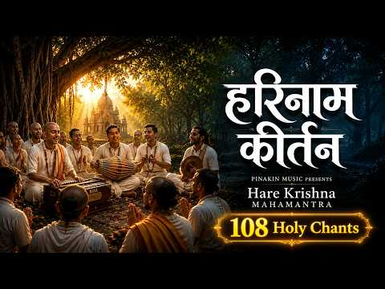
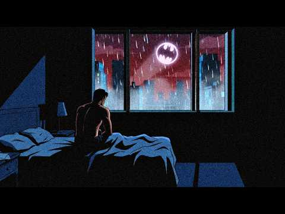

# 음악 — 성공 사례 분석: 사례별 자세히 #521–#560

`analysis.md` 의 9번 (같은 # 번호). 자동 생성 — `tools/success_analysis.py` v1.4.1 (2026-10-20 07:59 UTC). ※ 연구·교육용 — 투자 권유가 아님.

### 521. 🎧요즘 들은 플리 중에 제일 느낌 좋다… 느좋 감성힙합 Chill 𝐏𝐥𝐚𝐲𝐥𝐢𝐬𝐭 🌙

- https://www.youtube.com/watch?v=9iqkcoMV39k · 𝐅𝐞𝐞𝐥𝐿𝐲𝐧 · 구독자 5,020 · 조회수 415,614 (×82.8, 하루 2,918.3) · 좋아요 3,925 (0.9%) · 70.3분 · 2026-05-30 · 주제 묶음 8. 로파이·시티팝·칠 · 형식 플레이리스트·모음 (여러 곡) · 폴더 `W_9iqkcoMV39k` (웹 승인)
- 썸네일: 
- 챕터: 0:00 천천히 번지는 밤 (Night Spreading Sl… · 2:54 비행모드 (Airplane Mode) · 5:48 바람 지나간 자리 (Where the Breeze P… · 8:36 네 맘의 타이밍 (Timing Of Your Hear… · 11:10 초여름 밤의 대화 (Conversations on a… · 14:10 흐려진 거리 끝에서 (At The End Of Fad… · 17:45 잠깐 스쳐간 계절 (The Season That Pa… · 20:36 파도 끝에 남겨진 말 (Words Left Beyon… · 23:43 불빛 끝에서 (At The Edge of Lights) · 26:39 한 칸 뒤에 앉은 너 (You Sitting One … · 29:40 우리만 아는 Sign (The Sign Only We… · 32:13 다시 웃을 수 있게 (Until We Smile Ag… · 35:07 Repeat
- 설명 앞부분: [ FeelLyn Playlist ] 플레이리스트의 모든 곡은 AI 활용해 제작된 "FeelLyn" 창작물입니다. All songs in this playlist are theatrically produced using AI. All tracks feature "FeelLyn." Unauthorized copying, reproduction, or use is prohibited. 🎧음악: FeelLyn 📷사진: Pinterest
- 같은 채널 평소 대비 ×46.7 (채널 최근 롱폼 중앙값 8,904회) · 평소 영상: 🎧 요즘 이런 무드 찾고 있었다면 딱 좋은 느좋 국내 감성힙합 R&B 𝐏𝐥𝐚𝐲𝐥𝐢𝐬𝐭 🍂 (9,007회) / 🎧 가을에 첫 곡부터 분위기 이러면 반칙이지… 국내 감성힙합 R&B 𝐏𝐥𝐚𝐲𝐥𝐢𝐬𝐭 🍂 (8,800회)
- 대본 없음 (설명) — 음성인식이 끝나면 도입부·흐름이 들어감
- 댓글 281/281: 좋은 점 — 영상 1 · 감사·응원 12 · 더 알고 싶은 것 10 · 아쉬운 점 — 영상 4 · 반박·불만 — 의견 다름 1 · 정치·사회 0 · 경험 공유 5 · 구독·다음 기대 9
  - 좋은 점 — 영상 👍8 “요런 감성 너무 좋아요😊찾고찾았는데 이게 AI라구요?아무렴 어때요 전 너무 듣기 좋네요 마음도 몽글몽글해지고 주인장님 감사합니다 🫶🏻”
  - 감사·응원 👍8 “요런 감성 너무 좋아요😊찾고찾았는데 이게 AI라구요?아무렴 어때요 전 너무 듣기 좋네요 마음도 몽글몽글해지고 주인장님 감사합니다 🫶🏻”
  - 감사·응원 👍8 “우연히 방문했는데 분위기가 정말 좋네요. 음악도 너무 편안해서 끝까지 잘 들었습니다. 앞으로도 좋은 플레이리스트 많이 만들어 주세요! 채널 응원하겠습니다. 구독하고 자주 놀러올게요. 좋은 음악 감사합니다! 🎶”
  - 더 알고 싶은 것 👍8 “우연히 방문했는데 분위기가 정말 좋네요. 음악도 너무 편안해서 끝까지 잘 들었습니다. 앞으로도 좋은 플레이리스트 많이 만들어 주세요! 채널 응원하겠습니다. 구독하고 자주 놀러올게요. 좋은 음악 감사합니다! 🎶”
  - 더 알고 싶은 것 👍7 “노래 너무 좋아요 전AI건 뭐건 제가 좋으면 끝이라 더 많이 부탁합니다”
  - 아쉬운 점 — 영상 👍10 “천천히 번지는밤 진짜 매일 무한반복재생중인데 음원 멜론에 올라갔음 좋겠네요 ㅠㅠ 좋아요 너무”
  - 아쉬운 점 — 영상 👍2 “비행모드랑 흐려진 거리 끝에서 몇 일 무한반복 듣고있네요ㅜㅜ 저 어쩔...”
  - 반박·불만 — 의견 다름 👍3 “우연히 듣게 되었는데, 이건 우연이 아니죠? 운전할때 들으면 진짜 기분 좋아요. 바람 지나간 자리💚💚💚”
  - 경험 공유 👍7 “노래 너무 좋아요 전AI건 뭐건 제가 좋으면 끝이라 더 많이 부탁합니다”
  - 경험 공유 👍4 “처음 이노래 접해서 들었는데 노래가 너무좋은거에요. 근데 댓글에 왜 멜론에 없냐길래 설마 ai노래인가 했는데 정말 그렇더라고요..? 주인장님 진짜 천재 아니세요? 어케 이런곡을 여러개 만드셔서 플레이리스트로 이렇게.. 할수있으신지.. ai노래 처음 막 나왔을때 심통봇…”
  - 구독·다음 기대 👍8 “우연히 방문했는데 분위기가 정말 좋네요. 음악도 너무 편안해서 끝까지 잘 들었습니다. 앞으로도 좋은 플레이리스트 많이 만들어 주세요! 채널 응원하겠습니다. 구독하고 자주 놀러올게요. 좋은 음악 감사합니다! 🎶”
  - 구독·다음 기대 👍1 “노래 진짜 너무좋네요. 구독했어요 😊”

### 522. 듣는 순간 마음이 편안해지는 첼로와 오보에 🎻 ∣ 공부, 휴식, 감성 힐링 음악

- https://www.youtube.com/watch?v=aha1_5ENidU · 따뜻한 휴식 Studio · 구독자 1,990 · 조회수 164,722 (×82.8, 하루 1,160.7) · 좋아요 1,991 (1.2%) · 33.4분 · 2026-05-31 · 주제 묶음 1. 수면·명상·힐링 · 형식 음악 (그 밖 모양 — 한 편짜리 BGM 등) · 폴더 `W_aha1_5ENidU` (웹 승인)
- 썸네일: 
- 챕터: 0:00 The Song That Never Ends · 4:12 Today Was a Happy Day · 8:05 A Pleasant Journey · 12:18 The World I Dream Of · 16:40 Peaceful Mind · 20:15 Memory · 24:30 Going Home · 29:10 I'll Be Your Umbrella · 34:20 The Gift of Us · 39:12 I'll Be on Your Side · 44:05 You Don’t Have to Hurt Alone · 49:40 Freedom of Mind
- 설명 앞부분: 🎻 첼로의 깊은 울림과 오보에의 따뜻한 선율이 함께하는 감성 OST 컬렉션 노을이 지는 저녁, 혼자 걷는 길, 누군가를 떠올리는 순간처럼 조용히 마음을 감싸주는 연주곡들을 담았습니다. 오늘 하루도 수고한 당신에게 따뜻한 쉼이 되는 음악이 되었으면 좋겠습니다. 🎼 TRACK LIST 🎧 Recommended for: ☕ Café ambience 📖 Reading & studying 🌙 Relaxing nights 🚗 Night driving 💭 Emotional reflection 😴 Healing & sleep 🎻 Cello & …
- 같은 채널 평소 대비 ×377.8 (채널 최근 롱폼 중앙값 436회) · 평소 영상: 언젠가 빛나는 날 🌅 오늘을 살아가는 당신에게 (436회) / 따뜻한 감성 Playlist #3 🌙 지친 하루를 안아주는 힐링 음악 모음 (421회)
- 대본 없음 (설명) — 음성인식이 끝나면 도입부·흐름이 들어감
- 댓글 100/100: 좋은 점 — 영상 3 · 감사·응원 21 · 더 알고 싶은 것 2 · 아쉬운 점 — 영상 1 · 반박·불만 — 의견 다름 2 · 정치·사회 0 · 경험 공유 3 · 구독·다음 기대 3
  - 좋은 점 — 영상 👍3 “너무듣기 좋아서 황홀하기하네요 ㅡ감사합니다”
  - 좋은 점 — 영상 👍1 “가브리엘스 오보에의 오보에, 첼로 버전 각각 찾아 듣다가 여기로 오게되었어요 첼로 소리 좋아해서 배웠는데 중단하게 되어 다시 시간과 여유를 찾으면 다시 도전하려고 합니다. 아름다운곡들 감사합니다.”
  - 감사·응원 👍25 “제일 좋아하는 첼로음에 오보에까지~~ 행복한 시간 만들어 주셔서 감사합니다❤”
  - 감사·응원 👍25 “샵에서 틀어주면 손님들이 너무 편하다고 좋아하십니다. 늘 나의 일상을 평온하게 해주셔서 감사합니다. 지금도 내 공간에는 온통 아름다운 이 선률들이 흐르고 있습니다.”
  - 더 알고 싶은 것 👍1 “메일 확인 부탁드립니다. 따듯한 휴식님 음악이 좋아서 제가 개발중인 앱에 BGM넣고 싶어서 메일 드렸습니다. 답변 기다리고 있습니다. God bless you~~”
  - 아쉬운 점 — 영상 👍1 “너무 좋은 음악을 제공해 주셔서 편안함 가운데 일할 수 있게 됐습니다. 감사합니다~ 단 한 가지 중간 광고가 있어서 아쉽긴 합니다.”
  - 반박·불만 — 의견 다름 👍6 “AI음악아닌거 찾다가 여기 왔는데.. 이건 AI 아니죠? 좋네요 ~~”
  - 경험 공유 👍1 “비... 빗줄기는 고즈넉한 동백숲으로 소리없이 내리고 있었다. 붉은 꽃봉오리를 달고 있는 동백나무는 빗줄기를 온몸으로 맞으며 평소보다 더욱 싱그럽게 빛났다. 우산을 쓴 관람객 서너 명이 동백숲 정경을 둘러보고 있었다. 나는 고풍스런 대청마루에 앉아 빗줄기를 지그시 바…”
  - 경험 공유 👍1 “메일 확인 부탁드립니다. 따듯한 휴식님 음악이 좋아서 제가 개발중인 앱에 BGM넣고 싶어서 메일 드렸습니다. 답변 기다리고 있습니다. God bless you~~”
  - 구독·다음 기대 👍7 “구독과 좋아요 누르고 갑니다 알림설정두요 클리식 문외한 두 듣기가 편안하고 감미로워서 좋습니다”
  - 구독·다음 기대 👍5 “마음 편안한 음악 잘 듣고 구독하고 갑니다.~^^”

### 523. if this background music found you, life will get better

- https://www.youtube.com/watch?v=l3UmhyVCF90 · Ksu4000 · 구독자 22,600 · 조회수 1,864,521 (×82.5, 하루 26,763.5) · 좋아요 58,959 (3.2%) · 60.5분 · 2026-08-11 · 주제 묶음 6. 피아노·클래식·연주곡 · 형식 플레이리스트·모음 (여러 곡) · 폴더 `W_l3UmhyVCF90` (웹 승인)
- 썸네일: 
- 설명 앞부분: Maybe this found you at the right time. Enjoy the music. opening track from "No Plans Today", available on: 💚 Spotify 🩵 Bandcamp © 2026 Ksu4000. All rights reserved.
- 같은 채널 평소 대비 ×161.8 (채널 최근 롱폼 중앙값 11,526회) · 평소 영상: you found the background music you didn’t know yo… (11,700회) / silly background music for silly people (11,353회)
- 대본 없음 (설명) — 음성인식이 끝나면 도입부·흐름이 들어감
- 댓글 2,014/2,020: 좋은 점 — 영상 0 · 감사·응원 0 · 더 알고 싶은 것 0 · 아쉬운 점 — 영상 0 · 반박·불만 — 의견 다름 0 · 정치·사회 0 · 경험 공유 0 · 구독·다음 기대 0

### 524. 마음이 편안해져요, 가을 아침 클래식 ㅣ듣기만 해도 행복해지는 클래식 명곡

- https://www.youtube.com/watch?v=XOiUmptBDVk · Aria classic | 아리아클래식 · 구독자 2,510 · 조회수 206,843 (×82.4, 하루 4,264.8) · 좋아요 1,265 (0.6%) · 68분 · 2026-09-01 · 주제 묶음 6. 피아노·클래식·연주곡 · 형식 연주 (직접 연주하는 영상) · 폴더 `W_XOiUmptBDVk` (웹 승인)
- 썸네일: 
- 설명 앞부분: 🍃가을 아침에 들으면 행복해지는 클래식 명곡들ㅣ힐링 음악ㅣ휴식 BGM 제가 사는 곳은 가을비가 이틀 내리 연달아 내렸어요.. 저녁에는 제법 쌀쌀한게 꽤 가을느낌이 나는 느낌이지요 이제 곧 선선하고 기분 좋은 가을이 찾아오겠지요.. 오늘 아침은 따뜻한 커피 한 잔에 아리아 클래식을 곁들여서, 마음을 편안하게 어루만지는 행복한 가을 아침을 시작해 보는 건 어떠세요..?^^ 오늘 하루도 가슴 가득 사랑과 행복만 가득하시길 진심으로 바랄게요..^^♥ ☕ 아침 커피와 함께 📖 독서와 공부 🌿 휴식과 명상 💼 업무와 집중 © 2026. Ar…
- 같은 채널 평소 대비 ×37.2 (채널 최근 롱폼 중앙값 5,558회) · 평소 영상: 마음의 편해져요, 아침 명품 클래식🍂 ∣ 듣기만 해도 행복해지는 클래식 명곡 (5,558회) / 쇼팽이 선물한 봄, 낭만과 사랑의 클래식 앙상블 ∣ Spring in Paris (3,172회)
- 대본 없음 (설명) — 음성인식이 끝나면 도입부·흐름이 들어감
- 댓글 18/18: 좋은 점 — 영상 0 · 감사·응원 7 · 더 알고 싶은 것 0 · 아쉬운 점 — 영상 0 · 반박·불만 — 의견 다름 0 · 정치·사회 0 · 경험 공유 0 · 구독·다음 기대 0
  - 감사·응원 👍8 “피아노.소리와.첼로.타.악기.소리.울림이.오늘따라.더..시원스럽고.선.선한.기분이.드네요.비가오고.난.뒤에라.오늘.새벽에는.정말.선.선.함니다..진짜.가을이.왔네요..지긋.지긋.했던.여름더위가..정말.흔적도없이.사라젖읍니다.창문을.열어놓고.새벽공기.바람을..마시며.오…”
  - 감사·응원 👍5 “마음이.편안해지네요.감사해요”

### 525. Smoke Mood - Just Relax ∣ Chill House & Deep House Mix 🎧 Chill Night House / Stress Relie…

- https://www.youtube.com/watch?v=yEASFhtzSMQ · Chill Night House · 구독자 28,600 · 조회수 2,341,551 (×81.9, 하루 13,320.1) · 좋아요 11,136 (0.5%) · 68.7분 · 2026-04-27 · 주제 묶음 8. 로파이·시티팝·칠 · 형식 음악 (그 밖 모양 — 한 편짜리 BGM 등) · 폴더 `W_yEASFhtzSMQ` (웹 승인)
- 썸네일: 
- 설명 앞부분: 🌙 Welcome to Chill Night House, your late-night destination for deep house, chill house, and moody after-dark vibes. This channel is built for slow nights, dim lights, and moments when you just want to disconnect and drift into the rhythm. Here, you’ll find deep basslines, subtle grooves, and atmos…
- 같은 채널 평소 대비 ×5,382.9 (채널 최근 롱폼 중앙값 435회) · 평소 영상: Smoke Mood - Just Relax ∣ Chill House & Deep Hous… (435회) / Smoke Mood - Just Relax ∣ Chill House & Deep Hous… (437회)
- 대본 없음 (설명) — 음성인식이 끝나면 도입부·흐름이 들어감
- 댓글 317/323: 좋은 점 — 영상 0 · 감사·응원 0 · 더 알고 싶은 것 0 · 아쉬운 점 — 영상 0 · 반박·불만 — 의견 다름 0 · 정치·사회 0 · 경험 공유 0 · 구독·다음 기대 0

### 526. Relaxing Classic Rock 2026 🎸 Greatest Soft Rock Hits for Driving, Chill Nights & Stress R…

- https://www.youtube.com/watch?v=m1zUF6E51kw · Enchoes Of Classic Rock · 구독자 16,800 · 조회수 1,357,885 (×80.8, 하루 8,740.8) · 좋아요 16,641 (1.2%) · 81.6분 · 2026-05-17 · 주제 묶음 8. 로파이·시티팝·칠 · 형식 커버·직접 부른 노래 · 폴더 `W_m1zUF6E51kw` (웹 승인)
- 썸네일: 
- 설명 앞부분: Escape the stress of the day with this Relaxing Classic Rock 2026 playlist featuring the greatest soft rock hits, timeless guitar melodies, and chill driving vibes you’ll never get tired of. 🎸 Whether you're cruising down the highway, relaxing after work, studying late at night, or simply searching…
- 같은 채널 평소 대비 ×1,820.2 (채널 최근 롱폼 중앙값 746회) · 평소 영상: Golden Era Soft Rock ❤️ Relaxing Classic Rock Lov… (758회) / Relaxing Classic Rock 🎸 70s 80s 90s Soft Rock Lov… (734회)
- 대본 없음 (설명) — 음성인식이 끝나면 도입부·흐름이 들어감
- 댓글 1,040/1,055: 좋은 점 — 영상 0 · 감사·응원 2 · 더 알고 싶은 것 0 · 아쉬운 점 — 영상 0 · 반박·불만 — 의견 다름 0 · 정치·사회 0 · 경험 공유 0 · 구독·다음 기대 0
  - 감사·응원 👍4 “엄청난 음악이네요. 매우 감사합니다! Great Music. THANK SO MUCH!❤❤❤❤❤❤❤”
  - 감사·응원 👍1 “Thank you! 멋진음악 고맙습니다. 항상 행복하길 기원합니다❤”

### 527. 108 Hare Krishna Mahamantra Chants ∣ Harinam Kirtan for Peace & Spiritual Awakening ∣ Pin…

- https://www.youtube.com/watch?v=_AXkyLABNdw · Pinakin Music · 구독자 10,400 · 조회수 836,045 (×80.4, 하루 7,753.1) · 좋아요 7,486 (0.9%) · 18.2분 · 2026-07-04 · 주제 묶음 1. 수면·명상·힐링 · 형식 음악 (그 밖 모양 — 한 편짜리 BGM 등) · 폴더 `W__AXkyLABNdw` (웹 승인)
- 썸네일: 
- 설명 앞부분: 🙏 **Hare Krishna!** Welcome to this sacred **Harinam Kirtan featuring 108 chants of the Hare Krishna Mahamantra**, one of the most revered mantras in the Vedic tradition. Immerse yourself in the transcendental sound vibration of the **Hare Krishna Maha Mantra**, perfect for **meditation, yoga, japa…
- 같은 채널 평소 대비 ×512.9 (채널 최근 롱폼 중앙값 1,630회) · 평소 영상: मीराबाई के लोकप्रिय कृष्ण भजन ∣ Best Hindi Krishn… (1,630회) / Madhav ke Mandir Me Meera Bai Ekli Khadi ∣ Soulfu… (1,713회)
- 대본 없음 (설명) — 음성인식이 끝나면 도입부·흐름이 들어감
- 댓글 422/422: 좋은 점 — 영상 0 · 감사·응원 0 · 더 알고 싶은 것 0 · 아쉬운 점 — 영상 0 · 반박·불만 — 의견 다름 0 · 정치·사회 0 · 경험 공유 0 · 구독·다음 기대 0

### 528. 33 Koti Devi Devta हरेक विहानको मन्त्र ∣ हर हर महादेव ∣ जय श्रीराम #33kotidevta #morningb…

- https://www.youtube.com/watch?v=7fiSZtq8nHs · Bhajan Hub Nepal  · 구독자 33,400 · 조회수 2,681,491 (×80.3, 하루 18,787.3) · 좋아요 18,310 (0.7%) · 11.5분 · 2026-05-30 · 주제 묶음 1. 수면·명상·힐링 · 형식 음악 (그 밖 모양 — 한 편짜리 BGM 등) · 폴더 `W_7fiSZtq8nHs` (웹 승인)
- 썸네일: 
- 챕터: 0:00 🌸 Divine Beginning · 0:20 🙏 Sacred Nepali Devotion · 1:00 ✨ 33 Koti Gods Divine Blessin… · 1:45 🕉️ Spiritual Chanting & Faith · 2:30 🌺 Deep Prayer & Positive Ener… · 3:15 💛 Divine Protection & Grace · 4:00 🌿 Peace, Prosperity & Happine… · 4:45 🙌 Powerful Devotional Vibes · 5:20 🌸 Final Blessings & Gratitude · 5:44 🕉️ End of Sacred Journey · 5:46 🌸 Divine Beginning Again · 11:29 🕉️ End of Sacred Journey
- 설명 앞부분: This 33 Koti Devi Devata Bhajan Nepali devotional song is a powerful spiritual bhakti track filled with divine energy of Har Har Mahadev bhajan, Jai Shree Ram bhajan, Krishna bhajan, Ram bhajan, Shiv bhajan, Mata Rani bhajan, and Hanuman bhajan. This Nepali bhakti song is perfect for morning bhajan…
- 같은 채널 평소 대비 ×376.7 (채널 최근 롱폼 중앙값 7,118회) · 평소 영상: हनुमान चालीसा ∣ नेपाली भावानुवाद ∣ Hanuman Chalis… (7,118회) / रक्षा गर कुल देवता 🙏 शक्तिशाली पितृ भजन ∣ Kul Dev… (7,990회)
- 대본 없음 (설명) — 음성인식이 끝나면 도입부·흐름이 들어감
- 댓글 1,375/1,374: 좋은 점 — 영상 0 · 감사·응원 0 · 더 알고 싶은 것 0 · 아쉬운 점 — 영상 0 · 반박·불만 — 의견 다름 0 · 정치·사회 0 · 경험 공유 0 · 구독·다음 기대 0

### 529. 하루를 밝게 만드는 찬송가 모음 10곡 ∣ 기분 좋아지는 찬송가 모음 10곡 ∣ 어쿠스틱 기타 찬양 ∣ 듣기만 해도 마음이 가벼워지는 찬송가 10곡

- https://www.youtube.com/watch?v=AOyN15yGFrs · 주님곁에 · 구독자 18,700 · 조회수 1,498,963 (×80.2, 하루 10,255.2) · 좋아요 17,079 (1.1%) · 70.5분 · 2026-05-27 · 주제 묶음 15. CCM·찬양·국악·동요 · 형식 플레이리스트·모음 (여러 곡) · 폴더 `W_AOyN15yGFrs` (웹 승인)
- 썸네일: 
- 챕터: 0:00 88장 내 진정 사모하는 · 3:19 438장 내 영혼이 은총 입어 · 6:28 301장 지금까지 지내온 것 · 9:24 79장 주 하나님 지으신 모든 세계 · 13:52 491장 저 높은 곳을 향하여 · 18:16 191장 내가 매일 기쁘게 · 21:21 28장 복의 근원 강림하사 · 24:56 412장 내 영혼의 그윽히 깊은 데서 · 29:34 405장 주의 친절한 팔에 안기세 · 32:29 552장 아침 해가 돋을 때 · 35:55 반복
- 설명 앞부분: 하루를 밝게 만드는 따뜻한 어쿠스틱 기타 찬송가 모음 10곡입니다. 경쾌한 리듬과 편안한 기타 사운드 위에 익숙한 찬송의 은혜를 담았습니다. 아침을 시작할 때, 가볍게 집안 일을 할 때, 카페처럼 편안한 분위기로 시간을 보내고 싶을 때, 드라이브를 하거나 공부와 작업을 할 때도 부담 없이 들으실 수 있습니다. 너무 무겁지도, 지나치게 빠르지도 않은 따뜻하고 기분 좋은 흐름으로 구성했습니다. 지친 마음에는 작은 쉼이 되고, 평범한 하루에는 잔잔한 감사가 머물기를 바랍니다. 오늘 하루도 하나님 안에서 밝고 평안한 시간이 되시길 바랍니…
- 같은 채널 평소 대비 ×33.7 (채널 최근 롱폼 중앙값 44,460회) · 평소 영상: [2시간 연속듣기] 부족함 속에서도 넘치는 감사를 채우는 평안의 찬송가 모음 ∣ 주 날개… (44,460회) / [기쁜 찬송] 구원의 기쁨으로 내 영혼이 힘을 얻는 찬송 10곡 ∣ 십자가 보혈의 은혜,… (43,927회)
- 대본 없음 (설명) — 음성인식이 끝나면 도입부·흐름이 들어감
- 댓글 1,229/1,239: 좋은 점 — 영상 6 · 감사·응원 335 · 더 알고 싶은 것 12 · 아쉬운 점 — 영상 13 · 반박·불만 — 의견 다름 2 · 정치·사회 1 · 경험 공유 33 · 구독·다음 기대 6
  - 좋은 점 — 영상 👍4 “저는 외국에 살아요. 마음이 맑아지고 찬송가 가사가 귀에 잘들어 옵니다 오래 신앙생활햇는데 마음이 힘들어서 낙심이 오래엿는데 .....이찬송가를 저장해두엇어요. 애들에게도 보내주고 운전때마다 들으라 했어요 감사합니다 ~~~”
  - 좋은 점 — 영상 👍2 “28장 좀 이상하게 편집되었어요 그것말고는 너무 좋아요. 아침에 듣기좋은 찬송가입니다. 감사합니다.”
  - 감사·응원 👍132 “지금까지 지내 온것 다주님 은혜입니다 남은 삶도 주님함께하실 줄 믿고감사드립니다.아멘”
  - 감사·응원 👍69 “아침에 맑고 청아한 찬송 들으며 성경필사하니 세상은 어디로 가고 하늘의 평안이 나를 덮습니다 감사합니다”
  - 더 알고 싶은 것 👍10 “너무 은혜스러워요~ 아름다운 목소리의 찬양이라 하루를 기분좋게 보낼것 같아요 역시 찬송가가 좋아요~ 계속해서 많은 찬양올려주세요~”
  - 더 알고 싶은 것 👍5 “은혜 로운 찬양 감사합니다 항상주님안에세 은혜를 누릴수 있기를 기도 합니다 오늘은 금요일 입니다 혼자감당하시기 힝든 기도가 있으시면 올려주시면. 함께 기도해 드리겠습니다 주님의 마음 입니다~~ 형제여 주님이 힘주시고 강건하시기를~~😀”
  - 아쉬운 점 — 영상 👍35 “두분다 목소리가 너무 좋으셔서 자꾸 듣게되요~찬송가도 너무좋지만 목소리가 엄청 편안하고 부드러워요”
  - 아쉬운 점 — 영상 👍6 “주일 아침, 우연히 밝고 기분좋은 찬송을 듣게 되었습니다. 얼마나 은혜스럽고 좋은 지 계속해서 무한반복 중입니다. 은혜스러운 아침을 열어주셔서 감사합니다. 구독과 좋아요로 응원합니다. ^^”
  - 반박·불만 — 의견 다름 👍1 “참으로 감사합니다 찬양은 은셰롭고 화면은 아름답고요 저는 YouTube TV로 감상을 하는데 펴다가 바로 다른 곳으로 갑니다. 왜??? 글씨들 테두리가 검정으로 그리고 굵게 만드셔서요 감상만 하면 그냥 넘어가는데 화면을 봐야 할 경우 질식하게되요 가늘게 하시든지 굵게…”
  - 반박·불만 — 의견 다름 👍0 “유튭에 올라온 찬송가를 듣다 어느순간 안듣게 되더라구요. 찾는 곡도 없지만 찾아도 그냥 이게 아닌데 하는 마음이 더 컸었습니다. 그래서 이 인트로 보고 기존의 것들 모아놨구나 생각해서 안누르려다가 기대없이 눌렀는데... 참 좋은 찬송을 만났습니다. 감사한 아침입니다.…”
  - 경험 공유 👍19 “내가 다시 교회가기를 믿음생활하기를 바랬던 엄마 나 이제야 매일 기도하고 찬송가 들으면서 엄마생각하는데 하늘나라에서라도 기뻐했으면 좋겠다”
  - 경험 공유 👍16 “저도 지금처음 들었어 넘좋아요 ~넘 평안한 두분 목소리 감사합니다 ~😂😂”
  - 구독·다음 기대 👍18 “아침찬양에 너무 잘 맞는 목소리와 은혜입니다. 첫곡듣고 바로 구독했습니다”
  - 구독·다음 기대 👍4 “사운드 분위기가 너무좋아요 따뜻하고ᆢ촉촉한느낌 ᆢ잠에서 깨자마자 듣게되었는데 오프라인저장 해야겠어요 매일듣고싶네요”

### 530. Mozart Style ∣ 아침 공기처럼 가볍게 흐르는 모차르트풍 스트링 앙상블 ✿중간광고 없음 ∣ 잔잔한 클래식, Morning Music, Cafe BGM

- https://www.youtube.com/watch?v=8SUfn18vz_U · Lucerna Harmonia · 구독자 18,200 · 조회수 1,457,258 (×80.1, 하루 12,165.0) · 좋아요 28,880 (2.0%) · 132분 · 2026-06-22 · 주제 묶음 4. 카페·매장·라운지 · 형식 음악 (그 밖 모양 — 한 편짜리 BGM 등) · 폴더 `W_8SUfn18vz_U` (웹 승인)
- 썸네일: 
- 챕터: 0:00 Morning Tea Waltz · 2:57 Golden Window Light · 5:20 Gentle Sunny Steps · 8:14 Bright Salon Melody · 10:23 Crystal Morning Dance · 12:52 Soft Air Serenade · 15:31 Sunlit Harmony · 18:35 Graceful Morning Smile · 21:11 Warm Café Waltz · 24:24 Lighthearted Reverie · 27:42 Dancing Porcelain Light · 30:32 Elegant Daybreak · 33:26 Morning Petals Serenade · 37:10 Sunbeam Waltz Reverie · 40:13 Clear Sky Melody · 44:00 Repeat
- 설명 앞부분: Mozart Style의 밝고 우아한 스트링 앙상블이 맑은 아침 공기처럼 가볍게 흐릅니다. 햇살이 비치는 유럽식 정원과 화사한 꽃, 분수와 조각상이 어우러진 풍경 속에서 편안한 아침을 느껴보세요. 독서 BGM이나 휴식 음악, 카페 분위기가 필요한 순간에 자연스럽게 곁을 채워줍니다. 여러분은 이 음악과 함께 어떤 아침 풍경을 바라보고 계신가요? More Music on Spotify & YouTube Music YouTube Music Spotify 🌷 햇살과 꽃 사이로 흐르는 모차르트의 아침 푸른 하늘 아래 밝은 햇살이 정원과 분…
- 같은 채널 평소 대비 ×201.5 (채널 최근 롱폼 중앙값 7,231회) · 평소 영상: Tchaikovsky Style ∣ 햇살 스미는 정원처럼 서정적으로 흐르는 현악앙상블🌿[… (7,231회) / Chopin Style ∣ 책과 커피가 머무는 유리 온실 서재의 피아노 트리오 📚중간광고… (7,267회)
- 대본 없음 (설명) — 음성인식이 끝나면 도입부·흐름이 들어감
- 댓글 1,123/1,142: 좋은 점 — 영상 3 · 감사·응원 43 · 더 알고 싶은 것 0 · 아쉬운 점 — 영상 1 · 반박·불만 — 의견 다름 0 · 정치·사회 0 · 경험 공유 1 · 구독·다음 기대 1
  - 좋은 점 — 영상 👍26 “이런 분위기의 클래식 음악은 언제 들어도 질리지 않네요. 좋은 영상 감사합니다. 🎶”
  - 좋은 점 — 영상 👍0 “좋은영상 감사합니다”
  - 감사·응원 👍244 “마음을 행복하게 해주셔서 감사드립니다. 기쁨이 몽글몽글😊 건강해지는 기분입니다. 모두모두 행복하시기를... 좋은 선물 주시는 운영자님도 행복하시고, 좋은 일이 가득가득하시기를😊”
  - 감사·응원 👍32 “아침에 일어나 맞는 음악 기분좋은 하루시작이예요 플릇의 경쾌함 현악기의 만남이 이렇게좋을수가 음악이주는 행복 감사합니다”
  - 아쉬운 점 — 영상 👍0 “시작전에 광고가 넘길다ㅡ”
  - 구독·다음 기대 👍0 “구독과 좋아요 누르고 갑니다 알림설정두요 커피 한 잔과 좋은 기분으로 듣고 있습니다”

### 531. Peaceful Chill Playlist 🌙 Trending English Songs 2026 🎧 Best Acoustic Love Hits

- https://www.youtube.com/watch?v=td6iCrK4MHc · Morning Serenity · 구독자 15,600 · 조회수 1,234,151 (×79.1, 하루 45,084.0) · 좋아요 4,265 (0.4%) · 70.7분 · 2026-09-22 · 주제 묶음 8. 로파이·시티팝·칠 · 형식 커버·직접 부른 노래 · 폴더 `W_td6iCrK4MHc` (웹 승인)
- 썸네일: 
- 설명 앞부분: 🌙 **Peaceful Chill Playlist 2026** — Escape the noise, slow down, and enjoy a beautiful collection of **Trending English Songs 2026** and the **Best Acoustic Love Hits**. 🎧💚 Let the gentle guitar melodies, soft pop rhythms, and heartfelt love songs create a peaceful atmosphere for your everyday mom…
- 같은 채널 평소 대비 ×28.8 (채널 최근 롱폼 중앙값 42,818회) · 평소 영상: Feel Good & Relax Playlist 🎶 Top Trending Pop Son… (42,818회) / Healing Acoustic Playlist 2026 🌿 Trending Soft Po… (40,054회)
- 대본 없음 (설명) — 음성인식이 끝나면 도입부·흐름이 들어감
- 댓글 137/137: 좋은 점 — 영상 0 · 감사·응원 0 · 더 알고 싶은 것 0 · 아쉬운 점 — 영상 0 · 반박·불만 — 의견 다름 0 · 정치·사회 0 · 경험 공유 0 · 구독·다음 기대 0

### 532. 𝘠𝘰𝘶 𝘢𝘤𝘤𝘪𝘥𝘦𝘯𝘵𝘢𝘭𝘭𝘺 𝘧𝘦𝘭𝘭 𝘪𝘯 𝘭𝘰𝘷𝘦 𝘸𝘪𝘵𝘩 𝘚𝘰𝘶𝘵𝘩 𝘐𝘯𝘥𝘪𝘢𝘯 𝘴𝘰𝘯𝘨𝘴 (+ 𝘵𝘪𝘮𝘦𝘴𝘵𝘢𝘮𝘱𝘴) 🌙🩷🌴⋆. 𐙚 ˚

- https://www.youtube.com/watch?v=JgO5ly6YvGI · 𝙏𝙪𝙭𝙡𝙞𝙥𝙨 🌷 · 구독자 41,600 · 조회수 3,290,020 (×79.1, 하루 21,797.6) · 좋아요 0 (0.0%) · 19.5분 · 2026-05-22 · 주제 묶음 기타 · 형식 음악 (그 밖 모양 — 한 편짜리 BGM 등) · 폴더 `W_JgO5ly6YvGI` (웹 승인)
- 썸네일: 
- 챕터: 0:00 ~ Chuttamalle · 1:44 ~ Othaiyadi Pathayila · 2:48 ~ Vachindamma · 3:34 ~ Paththavaikkum · 4:53 ~ Unakkul Naane · 6:23 ~ Inkem Inkem · 7:33 ~ Tum Tum · 8:39 ~ Manasulone Nilichipoke · 9:49 ~ Katchi Sera · 10:36 ~ Kurumugil · 11:30 ~ Adiye · 12:23 ~ Aasa Kooda · 13:33 ~ Hey Minnale · 14:18 ~ Marudaani · 15:16 ~ Kalyani · 15:56 ~ Minnalvala · 16:42 ~ Vaseegara · 17:45 ~ Munbe Vaa · 18:43 ~ Nenjukkul Peidhidum
- 설명 앞부분: 🎧💫 Put on your headphones for the ultimate vibe experience ✨🎶 Because music always feels better when it’s close to your soul 💕 🌷✨ Disclaimer: No copyright infringement intended. I don't own the picture or the song in this video, nor do I claim to own anything in the video shown.🌙🤍 💌 Requests are al…
- 같은 채널 평소 대비 ×5.9 (채널 최근 롱폼 중앙값 557,755회) · 평소 영상: 𝘛𝘩𝘦 𝘔𝘰𝘴𝘵 𝘛𝘳𝘦𝘯𝘥𝘪𝘯𝘨 𝘚𝘰𝘯𝘨𝘴 𝘖𝘧 2026 (+ 𝘵𝘪𝘮𝘦𝘴𝘵𝘢𝘮𝘱𝘴) 🎀🌷… (557,755회) / 𝘗𝘖𝘝: 𝘐𝘧 𝘸𝘰𝘮𝘦𝘯 𝘪𝘯 𝘭𝘰𝘷𝘦 𝘩𝘢𝘥 𝘢 𝘱𝘭𝘢𝘺𝘭𝘪𝘴𝘵 (𝘗𝘢𝘳𝘵 1 + 𝘛𝘪… (572,910회)
- 대본 없음 (설명) — 음성인식이 끝나면 도입부·흐름이 들어감
- 댓글 950/954: 좋은 점 — 영상 0 · 감사·응원 0 · 더 알고 싶은 것 0 · 아쉬운 점 — 영상 0 · 반박·불만 — 의견 다름 0 · 정치·사회 0 · 경험 공유 0 · 구독·다음 기대 0

### 533. 10 Minutes Deep Meditation Music for Positive Energy • Free from Negativity •

- https://www.youtube.com/watch?v=PtUp1X2POmU · TRUEMÖ Musics · 구독자 296 · 조회수 23,289 (×78.7, 하루 1,385.2) · 좋아요 202 (0.9%) · 10.1분 · 2026-10-03 · 주제 묶음 1. 수면·명상·힐링 · 형식 음악 (그 밖 모양 — 한 편짜리 BGM 등) · 폴더 `W_PtUp1X2POmU` (웹 승인)
- 썸네일: 
- 설명 앞부분: This video is made for you to help you focus and stay calm while practicing meditation. Practice Meditation for self-realisation and anxiety relief. If you want to eliminate distractions while practicing yoga or breathing exercises, this video is also perfect for such situations. Hi, I'm Truemö, i …
- 같은 채널 평소 대비 ×439.4 (채널 최근 롱폼 중앙값 53회) · 평소 영상: Piano Music for Calm and Stressless Solitude ∣ Pi… (61회) / 5 minutes Deep Meditation Focus • Mind Cleansing … (45회)
- 대본 없음 (설명) — 음성인식이 끝나면 도입부·흐름이 들어감
- 댓글 1/1: 좋은 점 — 영상 0 · 감사·응원 0 · 더 알고 싶은 것 0 · 아쉬운 점 — 영상 0 · 반박·불만 — 의견 다름 0 · 정치·사회 0 · 경험 공유 0 · 구독·다음 기대 0

### 534. Heartbroken Lofi Songs 💔 ∣ Slowed + Reverb ∣ Study / Focus / Night Mood 🎧

- https://www.youtube.com/watch?v=aJsXjVL43xI · Chill Vibes Hindi Songs · 구독자 7,920 · 조회수 621,042 (×78.4, 하루 9,241.1) · 좋아요 2,584 (0.4%) · 8분 · 2026-08-14 · 주제 묶음 3. 공부·집중·작업 · 형식 음악 (그 밖 모양 — 한 편짜리 BGM 등) · 폴더 `W_aJsXjVL43xI` (웹 승인)
- 썸네일: 
- 설명 앞부분: Welcome 🤗 to the world of relaxing lofi vibes, where worries fade away and calmness fills the atmosphere. This mind-soothing lofi mix is perfect for: Deep Focus & Study Sessions 📚 Relaxation & Meditation 🧘‍♂ Unwinding After a Busy Day 🌇 Peaceful Sleep & Stress Relief 😴 Let these smooth beats and co…
- 같은 채널 평소 대비 ×3,943.1 (채널 최근 롱폼 중앙값 158회) · 평소 영상: Heartbroken Lofi Songs 💔 ∣ Slowed + Reverb ∣ Stud… (162회) / Heartbroken Lofi Songs 💔 ∣ Slowed + Reverb ∣ Stud… (153회)
- 대본 없음 (설명) — 음성인식이 끝나면 도입부·흐름이 들어감
- 댓글 65/65: 좋은 점 — 영상 0 · 감사·응원 0 · 더 알고 싶은 것 0 · 아쉬운 점 — 영상 0 · 반박·불만 — 의견 다름 0 · 정치·사회 0 · 경험 공유 0 · 구독·다음 기대 0

### 535. 영혼을 울리는 집시 바이올린 🎻 ∣ 감성 바이올린 · 집시 음악 · 휴식 플레이리스트 ∣ 보라빛 음악정원

- https://www.youtube.com/watch?v=7xQeXJwhFh8 · 보랏빛 음악정원 · 구독자 174 · 조회수 13,589 (×78.1, 하루 247.6) · 좋아요 164 (1.2%) · 87.7분 · 2026-08-26 · 주제 묶음 6. 피아노·클래식·연주곡 · 형식 플레이리스트·모음 (여러 곡) · 폴더 `W_7xQeXJwhFh8` (웹 승인)
- 썸네일: 
- 설명 앞부분: 달빛이 머무는 밤, 집시 바이올린의 깊고 자유로운 선율에 천천히 빠져보세요. 🎻🌙 애절하면서도 뜨거운 바이올린의 울림과 유랑의 밤을 닮은 낭만적인 분위기를 담아 감상 · 휴식 · 독서 · 작업 시간에 잘 어울리는 플레이리스트로 구성했습니다. 🎵 Track List 1. 달빛을 따라 떠나는 바이올린 2. 바람 끝에 남은 선율 3. 별빛 아래 떠도는 춤 4. 불빛 따라 흐르는 밤 5. 붉은 달 아래의 약속 6. 새벽길에 남은 노래 7. 바람이 머문 언덕 8. 별이 내린 오래된 거리 9. 달빛이 스친 유랑길 10. 불꽃처럼 스친 밤 1…
- 같은 채널 평소 대비 ×43.6 (채널 최근 롱폼 중앙값 312회) · 평소 영상: [플레이리스트] 달빛이 스민 길 ∣ 국악 힐링 OST ∣ 달빛 아래 듣는 잔잔한 국악 선율 (338회) / [Playlist] 달빛에 스민 칼끝 🌙 자객 OST｜조선 궁궐의 밤을 걷는 판타지 국악… (286회)
- 대본 없음 (설명) — 음성인식이 끝나면 도입부·흐름이 들어감
- 댓글 16/16: 좋은 점 — 영상 0 · 감사·응원 1 · 더 알고 싶은 것 0 · 아쉬운 점 — 영상 0 · 반박·불만 — 의견 다름 0 · 정치·사회 0 · 경험 공유 1 · 구독·다음 기대 0
  - 감사·응원 👍0 “아름다운 연주곡 잘 들었습니다~감사합니다~수고 많으셨습니다”
  - 경험 공유 👍2 “아! 내가 좋아하는 데 뭐라 말을 못하겠노 냄새가 좀 찐하긴 하는데 그냥 좋아요는 좋아요”

### 536. A K I R A - Floating High (original mix)

- https://www.youtube.com/watch?v=cp_EDM8pS0Q · AKIRA CLOUD  · 구독자 7,870 · 조회수 614,173 (×78.0, 하루 6,958.0) · 좋아요 8,680 (1.4%) · 6.4분 · 2026-07-24 · 주제 묶음 기타 · 형식 음악 (그 밖 모양 — 한 편짜리 BGM 등) · 폴더 `W_cp_EDM8pS0Q` (웹 승인)
- 썸네일: 
- 설명 앞부분: 🎧 Welcome to AKIRA – Chill House Escape into a world of deep house, chill house, melodic house, and relaxing electronic music. Every track is crafted to bring peace, focus, positive energy, and unforgettable vibes. Whether you're studying, driving, working, gaming, traveling, or simply relaxing, AK…
- 같은 채널 평소 대비 ×119.3 (채널 최근 롱폼 중앙값 5,148회) · 평소 영상: A K I R A - This Is Enough (original mix) (5,148회) / A K I R A - Why Does My Smile Hurt You(original m… (5,035회)
- 대본 없음 (설명) — 음성인식이 끝나면 도입부·흐름이 들어감
- 댓글 122/122: 좋은 점 — 영상 0 · 감사·응원 0 · 더 알고 싶은 것 0 · 아쉬운 점 — 영상 0 · 반박·불만 — 의견 다름 0 · 정치·사회 0 · 경험 공유 0 · 구독·다음 기대 0

### 537. 요즘 이 노래에 빠졌다 🎧 중독성 리듬 락트로트 17곡 2시간 10분 연속듣기 ∣ I’m Addicted to These Songs

- https://www.youtube.com/watch?v=rDvH1El0H3k · 인생은 트로트 · 구독자 9,120 · 조회수 709,965 (×77.8, 하루 16,170.8) · 좋아요 4,121 (0.6%) · 130.3분 · 2026-09-06 · 주제 묶음 9. 가요·발라드·트로트 · 형식 플레이리스트·모음 (여러 곡) · 폴더 `W_rDvH1El0H3k` (웹 승인)
- 썸네일: 
- 설명 앞부분: 레트로 감성이 어우러진 락트로트 플레이리스트입니다. TRACK LIST 총 17곡 2시간10분
- 같은 채널 평소 대비 ×48.5 (채널 최근 롱폼 중앙값 14,625회) · 평소 영상: 사랑에 빠졌나 봐 ❤️ 시크한 그녀의 락트로트 댄스 10곡 ∣ 1시간 10분 (15,243회) / 시청자 요청으로 만든 힙팝트로트 2탄 🎧 한 곡만 들으려다 끝까지 들었다 ∣ 10곡 1시… (14,007회)
- 대본 없음 (설명) — 음성인식이 끝나면 도입부·흐름이 들어감
- 댓글 338/338: 좋은 점 — 영상 2 · 감사·응원 30 · 더 알고 싶은 것 5 · 아쉬운 점 — 영상 6 · 반박·불만 — 의견 다름 0 · 정치·사회 0 · 경험 공유 5 · 구독·다음 기대 2
  - 좋은 점 — 영상 👍6 “처음보는 노래 제목에 선택했는데 진짜 듣기 좋네요 🎉🎉”
  - 좋은 점 — 영상 👍3 “와우 !! 이 영상 너무나도 대박 입니다요 ^^ 슬픈듯 눈물이 나올듯 말듯 경쾌하고 신나며 마음을 쥐락펴락하며 아무튼 넘 좋아요 ^^ 좋은 영상 너무너무 감사합니다 ^^ 이노래를듣고있으면 (이세상 모든것이 다 내것 같아 행복해집니다 ~.^)”
  - 감사·응원 👍10 “매일 출퇴근때~듣고있어요~~^^😊 좋은음악 감사합니다 ^^❤❤❤”
  - 감사·응원 👍9 “노래가 다 좋치만 1번 13번 좋네요 감사합니다”
  - 더 알고 싶은 것 👍2 “어떤곡이 제일좋은지 알려주세요 ㅎㅎㅎ 난 너무 좋아서 몇번을 들었네요 님. 강사합니다~~~^^😂😂😂”
  - 더 알고 싶은 것 👍1 “댓글보니 노래방 걸러링 이야기 만든데 거기에 통화 연결음까지...... 부탁드립니다 너무 좋아요 사랑합니다❤❤❤❤❤❤”
  - 아쉬운 점 — 영상 👍6 “요즘 AI 목소리 넘 좋고 노래 넘 잘해서 중독됨~”
  - 아쉬운 점 — 영상 👍4 “아~노래좋네~~ 계속듣다보니 같은 노랜가? 좀 아쉼네요 같은 리듬이...조금 지루해져요^^”
  - 경험 공유 👍3 “살면서 가장 힘든 것은 힘든 상황보다도 아무에게도 내 마음을 말할 수 없을 때인 것 같습니다. 저도 오랫동안 가족 걱정과 현실적인 문제들을 혼자 감당하며 지냈습니다. 오늘 이 노래를 들으니 굳이 말하지 않아도 제 마음을 알아주는 친구를 만난 기분입니다. 눈물이 나면서…”
  - 경험 공유 👍2 “맑고 듣기는좋으네요 넘좋은데요 감사합니다 이늦은밤 들으니 더욱더 빠져드네요 그런데 듣는사람마다 다르게 들리수도 제가 듣기에는 음과 리듬이 거의 동일?비슷 ㅎ 그리고 굴곡진곳하나없고 감정선 느낌은 없는것같아요 그럼에도 불구하고 듣기조아 자꾸듣게되는 장점은있네요 다 좋은…”
  - 구독·다음 기대 👍3 “노래를 듣고 있자니 지나가다고 구독하고 갑니다. 😄”
  - 구독·다음 기대 👍2 “와~~~ 오전에 듣다가 점심먹으면서도 계속듣고 있네요 이런적이 없었는데... 중독된것같네요 바로 구독❤알림 설정했네요 감사합니다 귀한 음악 들려주셔서 항상 함께하겠습니다^^!”

### 538. Batman’s Solitude ∣ Dark Jazz Noir for Late Night Reflection

- https://www.youtube.com/watch?v=s87k34ud3Kc · Saturday Night, Maybe? · 구독자 17,300 · 조회수 1,345,069 (×77.8, 하루 8,416.4) · 좋아요 52,781 (3.9%) · 60분 · 2026-05-13 · 주제 묶음 7. 재즈·보사노바 · 형식 플레이리스트·모음 (여러 곡) · 폴더 `W_s87k34ud3Kc` (웹 승인)
- 썸네일: 
- 설명 앞부분: The city doesn't sleep, it just waits for the next failure. Light a cigarette, watch the rain, and let the monotony take over. This is a curated collection of original Chamber Jazz Noir, composed for those who find comfort in the shadows of Gotham. No upbeat rhythms, no hope, just the heavy, breath…
- 같은 채널 평소 대비 ×119.5 (채널 최근 롱폼 중앙값 11,260회) · 평소 영상: A Night at the Gotham Gala. ∣ Elegant Noir Jazz M… (11,484회) / "Dear Bruce..." ∣ Jazz for a Broken Heart (11,035회)
- 대본 없음 (설명) — 음성인식이 끝나면 도입부·흐름이 들어감
- 댓글 590/591: 좋은 점 — 영상 0 · 감사·응원 0 · 더 알고 싶은 것 0 · 아쉬운 점 — 영상 1 · 반박·불만 — 의견 다름 0 · 정치·사회 0 · 경험 공유 2 · 구독·다음 기대 0

### 539. মন ছুঁয়ে যাওয়া বাংলা Lo-Fi Romantic Songs _ Relaxing Bangla Chill Mix _Harano kabita

- https://www.youtube.com/watch?v=WX8EbRSHQYo · Harano Kabita  · 구독자 26,400 · 조회수 2,051,517 (×77.7, 하루 28,607.8) · 좋아요 14,444 (0.7%) · 17.6분 · 2026-08-09 · 주제 묶음 8. 로파이·시티팝·칠 · 형식 음악 (그 밖 모양 — 한 편짜리 BGM 등) · 폴더 `W_WX8EbRSHQYo` (웹 승인)
- 썸네일: 
- 설명 앞부분: মন ছুঁয়ে যাওয়া বাংলা Lo-Fi Romantic Songs _ Relaxing Bangla Chill Mix _Harano kabita Song Name: Tumi Je Amar Sadhona Artists: Andrew Kishore and Ankhi Alamgir Lyricist: Kabir Bakul Album: Ziddi Mama Song Name: Tumi Chader Jochona Nou Singers: Andrew Kishore and Sabina Yasmin Music Director: Alam …
- 같은 채널 평소 대비 ×451.6 (채널 최근 롱폼 중앙값 4,543회) · 평소 영상: আধুনিক বাংলা প্রেমের গান-Lo-Fi Romantic Songs _ R… (4,543회) / দুর্গাপূজা স্পেশাল ভক্তি গান-Lo-Fi Romantic Songs… (4,430회)
- 대본 없음 (설명) — 음성인식이 끝나면 도입부·흐름이 들어감
- 댓글 255/251: 좋은 점 — 영상 0 · 감사·응원 0 · 더 알고 싶은 것 0 · 아쉬운 점 — 영상 0 · 반박·불만 — 의견 다름 0 · 정치·사회 0 · 경험 공유 0 · 구독·다음 기대 0

### 540. Sitar for Dopamine Reset ∣ Indian Classical Music for Mindfulness

- https://www.youtube.com/watch?v=SEw8IsSXRSU · Raga Focus · 구독자 37,500 · 조회수 2,898,355 (×77.3, 하루 16,679.2) · 좋아요 45,832 (1.6%) · 90분 · 2026-04-29 · 주제 묶음 6. 피아노·클래식·연주곡 · 형식 음악 (그 밖 모양 — 한 편짜리 BGM 등) · 폴더 `W_SEw8IsSXRSU` (웹 승인)
- 썸네일: 
- 챕터: 0:00 Gentle arrival (bright onset,… · 7:00 Light expansion (clarity incr… · 18:00 Peak brightness phase (alert … · 30:00 Soft descent begins (brightne… · 42:00 Stabilized focus (steady deep… · 55:00 Deepening phase (sitar textur… · 68:00 Immersive flow state (rich lo… · 78:00 Inner balance restoration (me… · 85:00 Soft unwinding (nervous syste… · 89:00 Gentle fade out (Theta layer …
- 설명 앞부분: Mind Too Overstimulated? ∣ Dopamine Reset ∣ Sitar Deep Focus Session When your brain feels flooded, forcing focus only adds more noise. This does the opposite. A continuous 90-minute sitar meditation built on Indian classical ambient textures, designed for deep work, dopamine reset, and mental clar…
- 같은 채널 평소 대비 ×1,933.5 (채널 최근 롱폼 중앙값 1,499회) · 평소 영상: Mental Exhaustion ∣ Santoor Therapy ∣ 1.5 Hours (1,499회) / Bedtime Music ∣ Surbahar Instrumental ∣ 3 Hours (1,513회)
- 대본 없음 (설명) — 음성인식이 끝나면 도입부·흐름이 들어감
- 댓글 1,247/1,247: 좋은 점 — 영상 0 · 감사·응원 0 · 더 알고 싶은 것 0 · 아쉬운 점 — 영상 0 · 반박·불만 — 의견 다름 0 · 정치·사회 0 · 경험 공유 0 · 구독·다음 기대 0

### 541. somehow this became your background music

- https://www.youtube.com/watch?v=GTx1UYV9Y-o · Ksu4000 · 구독자 22,600 · 조회수 1,745,927 (×77.2, 하루 22,194.1) · 좋아요 89,050 (5.1%) · 61.8분 · 2026-08-02 · 주제 묶음 6. 피아노·클래식·연주곡 · 형식 플레이리스트·모음 (여러 곡) · 폴더 `W_GTx1UYV9Y-o` (웹 승인)
- 썸네일: 
- 설명 앞부분: Thanks for letting this be part of your day. ◢ spotify ◢ bandcamp © 2026 Ksu4000. All rights reserved.
- 같은 채널 평소 대비 ×151.5 (채널 최근 롱폼 중앙값 11,526회) · 평소 영상: you found the background music you didn’t know yo… (11,700회) / silly background music for silly people (11,353회)
- 대본 없음 (설명) — 음성인식이 끝나면 도입부·흐름이 들어감
- 댓글 1,583/1,588: 좋은 점 — 영상 0 · 감사·응원 0 · 더 알고 싶은 것 0 · 아쉬운 점 — 영상 0 · 반박·불만 — 의견 다름 0 · 정치·사회 0 · 경험 공유 0 · 구독·다음 기대 0

### 542. Do not listen to her music. She can hypnotise you in 4.49 minutes/ This melody has ancien…

- https://www.youtube.com/watch?v=0tBUIo44w-A · Dream Weaver  Sounds · 구독자 18,900 · 조회수 1,457,093 (×77.1, 하루 8,690.8) · 좋아요 24,836 (1.7%) · 5.7분 · 2026-05-05 · 주제 묶음 6. 피아노·클래식·연주곡 · 형식 음악 (그 밖 모양 — 한 편짜리 BGM 등) · 폴더 `W_0tBUIo44w-A` (웹 승인)
- 썸네일: 
- 설명 앞부분: Do not listen to her music. She can hypnotise you in 4.49 minutes. You have been warned. Some melodies carry an ancient power that does not just play in the background, it takes hold of your entire being. This track is a journey into the deep, mystical landscapes of Balochistan, where the music spe…
- 같은 채널 평소 대비 ×1,659.6 (채널 최근 롱폼 중앙값 878회) · 평소 영상: Drift into Deep Sleep ∣ Sufi Instrumental ∣ Calm … (878회) / Sufi Instrumental Music for Stress Relief & Deep … (851회)
- 대본 없음 (설명) — 음성인식이 끝나면 도입부·흐름이 들어감
- 댓글 796/796: 좋은 점 — 영상 0 · 감사·응원 0 · 더 알고 싶은 것 0 · 아쉬운 점 — 영상 0 · 반박·불만 — 의견 다름 0 · 정치·사회 0 · 경험 공유 0 · 구독·다음 기대 0

### 543. 2 Hours Super Relaxing Baby Music ♥♥♥ Bedtime Lullaby For Sweet Dreams ♫♫♫ Sleep Music

- https://www.youtube.com/watch?v=e_-uzFi6JlI · Deep Calm White Noise · 구독자 31,500 · 조회수 2,418,963 (×76.8, 하루 14,070.2) · 좋아요 12,208 (0.5%) · 120.1분 · 2026-05-01 · 주제 묶음 1. 수면·명상·힐링 · 형식 긴 한 곡·반복 (N시간) · 폴더 `W_e_-uzFi6JlI` (웹 승인)
- 썸네일: 
- 설명 앞부분: 2 Hours Super Relaxing Baby Music ♥♥♥ Bedtime Lullaby For Sweet Dreams ♫♫♫ Sleep Music Welcome to our channel dedicated to providing the perfect environment for your baby's peaceful sleep and intellectual development. In Video , we present 'Mozart for Babies Intelligence Stimulation,' a soothing lu…
- 같은 채널 평소 대비 ×122.0 (채널 최근 롱폼 중앙값 19,834회) · 평소 영상: Mozart Brahms Lullaby ♥ Sleep Instantly Within 3 … (19,834회) / Mozart Brahms Lullaby 💤 Soothing Baby Music ♥♥♥ S… (26,556회)
- 대본 없음 (설명) — 음성인식이 끝나면 도입부·흐름이 들어감
- 댓글 481/481: 좋은 점 — 영상 0 · 감사·응원 0 · 더 알고 싶은 것 0 · 아쉬운 점 — 영상 0 · 반박·불만 — 의견 다름 0 · 정치·사회 0 · 경험 공유 0 · 구독·다음 기대 0

### 544. Positive Energy 2026 🌞 Feel Good Deep House Music for Morning Focus ∣ ChillMorning Vibes

- https://www.youtube.com/watch?v=Dg9ePUDm4Vs · ChillMorning Vibes · 구독자 12,300 · 조회수 943,560 (×76.7, 하루 6,604.1) · 좋아요 14,871 (1.6%) · 65.7분 · 2026-05-30 · 주제 묶음 3. 공부·집중·작업 · 형식 플레이리스트·모음 (여러 곡) · 폴더 `W_Dg9ePUDm4Vs` (웹 승인)
- 썸네일: 
- 설명 앞부분: Positive Energy 2026 🌞 Feel Good Deep House Music for Morning Focus ∣ ChillMorning Vibes Positive Energy 2026 🌞 Feel Good Deep House Music for Morning Focus ∣ ChillMorning Vibes Positive Energy 2026 🌞 Feel Good Deep House Music for Morning Focus ∣ ChillMorning Vibes Boost your mood and start your d…
- 같은 채널 평소 대비 ×277.3 (채널 최근 롱폼 중앙값 3,403회) · 평소 영상: Feel the Morning Energy 🌞 Chill House Mix for a C… (3,403회) / Positive Morning 🌅 Chill & Deep House Mix for a H… (3,439회)
- 대본 없음 (설명) — 음성인식이 끝나면 도입부·흐름이 들어감
- 댓글 331/331: 좋은 점 — 영상 0 · 감사·응원 0 · 더 알고 싶은 것 0 · 아쉬운 점 — 영상 0 · 반박·불만 — 의견 다름 0 · 정치·사회 0 · 경험 공유 0 · 구독·다음 기대 0

### 545. jazz before i reach flow state

- https://www.youtube.com/watch?v=fQIJb1h1RkA · Defunct · 구독자 11,100 · 조회수 851,061 (×76.7, 하루 5,319.1) · 좋아요 37,240 (4.4%) · 127.8분 · 2026-05-13 · 주제 묶음 7. 재즈·보사노바 · 형식 플레이리스트·모음 (여러 곡) · 폴더 `W_fQIJb1h1RkA` (웹 승인)
- 썸네일: 
- 챕터: 0:00 flow state · 2:54 ascencion · 6:27 calculator · 10:30 blind syntax · 13:48 digital veil · 16:58 silent code · 19:53 marble circuit · 22:27 encrypted · 25:35 oblivion · 28:40 ciphered · 32:14 dark algorithm · 35:17 veiled logic · 38:31 silent program · 41:46 stone script · 44:45 codebound · 48:15 obscura · 51:30 fragmented · 54:34 blind oracle · 57:24 syntax crown · 60:08 echoes
- 설명 앞부분: it's time. ∣ jazz to study / sleep / fall asleep / work / relax to Tracklist: art found in pnterest, edited and music created by defunct ignore tags
- 같은 채널 평소 대비 ×189.3 (채널 최근 롱폼 중앙값 4,496회) · 평소 영상: jazz in pure meditative form (4,525회) / jazz before i rise (4,466회)
- 대본 없음 (설명) — 음성인식이 끝나면 도입부·흐름이 들어감
- 댓글 944/946: 좋은 점 — 영상 0 · 감사·응원 0 · 더 알고 싶은 것 0 · 아쉬운 점 — 영상 0 · 반박·불만 — 의견 다름 0 · 정치·사회 0 · 경험 공유 0 · 구독·다음 기대 0

### 546. MOOD OFF 💔Sad 😭 LOFI SONG MASHUP ∣∣ SAD HEART BROKEN 💔 MOOD OFF😭∣∣ EMOTIONAL MUSHUP 🎧😢

- https://www.youtube.com/watch?v=kjV1sVljycI · Hindi sad song (50) · 구독자 41,700 · 조회수 3,195,857 (×76.6, 하루 20,200.5) · 좋아요 15,349 (0.5%) · 19.6분 · 2026-05-15 · 주제 묶음 8. 로파이·시티팝·칠 · 형식 음악 (그 밖 모양 — 한 편짜리 BGM 등) · 폴더 `W_kjV1sVljycI` (웹 승인)
- 썸네일: 
- 설명 앞부분: Welcome to the world of soothing lofi music, where stress fades away, and peace takes over. This 2026 mind-relaxing lofi mix is perfect for: Deep Focus & Studying 📖 Relaxing & Meditation 🧘‍♂ Chilling After a Long Day 🌅 Peaceful Sleep & Stress Relief 😴 Let these calm beats and chill vibes take you o…
- 대본 없음 (설명) — 음성인식이 끝나면 도입부·흐름이 들어감
- 댓글 330/330: 좋은 점 — 영상 0 · 감사·응원 0 · 더 알고 싶은 것 0 · 아쉬운 점 — 영상 0 · 반박·불만 — 의견 다름 0 · 정치·사회 0 · 경험 공유 0 · 구독·다음 기대 0

### 547. 【作業用BGM】名探偵コナン 夜ジャズメドレー☔️｜雨音とともに聴く Relaxing Jazz BGM

- https://www.youtube.com/watch?v=ZoLpYGeZkn0 · Ken's Cafe&Jazz Lounge BGM · 구독자 6,330 · 조회수 484,024 (×76.5, 하루 3,044.8) · 좋아요 11,365 (2.4%) · 167.6분 · 2026-05-14 · 주제 묶음 7. 재즈·보사노바 · 형식 음악 (그 밖 모양 — 한 편짜리 BGM 등) · 폴더 `W_ZoLpYGeZkn0` (웹 승인)
- 썸네일: 
- 챕터: 0:00 美しい鰭 · 3:36 ラストダンスあなたと · 6:39 渡月橋〜君想ふ〜 · 10:11 ハルウタ · 13:00 Secret of my heart · 16:24 クロノスタシス · 19:53 キミがいれば · 23:26 謎 · 26:43 恋に恋して · 29:37 Time after time 〜花舞う街で〜
- 설명 앞부분: ☔ 雨の日の作業用BGM 💤 睡眠前のチルBGM 🎷 Playlist
- 같은 채널 평소 대비 ×21.9 (채널 최근 롱폼 중앙값 22,072회) · 평소 영상: 【作業用BGM】呪術廻戦 カフェジャズメドレー☕️ ∣ Jujutsu Kaisen Aftern… (22,072회) / 【魔法少女まどか☆マギカ】Jazz Café Medley｜まどマギ名曲を大人のジャズアレンジで｜… (18,999회)
- 대본 없음 (설명) — 음성인식이 끝나면 도입부·흐름이 들어감
- 댓글 175/174: 좋은 점 — 영상 1 · 감사·응원 1 · 더 알고 싶은 것 0 · 아쉬운 점 — 영상 0 · 반박·불만 — 의견 다름 0 · 정치·사회 0 · 경험 공유 0 · 구독·다음 기대 0
  - 좋은 점 — 영상 👍1 “영상 감사합니다! 좋은 영상 고마워요 :)”
  - 감사·응원 👍1 “영상 감사합니다! 좋은 영상 고마워요 :)”

### 548. Heartbreaking 💔 lofi mashup 🎶 slowed + reverb songs ∣ study, focus & late night vibes

- https://www.youtube.com/watch?v=p8BH-D_YiQY · Sani Music Official  · 구독자 8,880 · 조회수 677,614 (×76.3, 하루 7,512.3) · 좋아요 3,991 (0.6%) · 8분 · 2026-07-22 · 주제 묶음 3. 공부·집중·작업 · 형식 음악 (그 밖 모양 — 한 편짜리 BGM 등) · 폴더 `W_p8BH-D_YiQY` (웹 승인)
- 썸네일: 
- 설명 앞부분: Welcome to the world of soothing lofi music, where stress fades away, and peace takes over. This 2026 mind-relaxing lofi mix is perfect for: Deep Focus & Studying📖 Relaxing & Meditation🧘‍♂ Chilling After a Long Day🌅 Peaceful Sleep & Stress Relief😴 Let these calm beats and chill vibes take you on a …
- 같은 채널 평소 대비 ×820.4 (채널 최근 롱폼 중앙값 826회) · 평소 영상: Heartbreaking 💔 lofi mashup 🎶 slowed + reverb son… (862회) / Heartbreaking 💔 lofi mashup 🎶 slowed + reverb son… (790회)
- 대본 없음 (설명) — 음성인식이 끝나면 도입부·흐름이 들어감
- 댓글 53/53: 좋은 점 — 영상 0 · 감사·응원 0 · 더 알고 싶은 것 0 · 아쉬운 점 — 영상 0 · 반박·불만 — 의견 다름 0 · 정치·사회 0 · 경험 공유 0 · 구독·다음 기대 0

### 549. Heartbreaking 💔 lofi mashup 🎶 slowed + reverb songs ∣ study, focus & late night vibes+++5

- https://www.youtube.com/watch?v=WH_pNjVfkCY · Click Bollywood music hub🎶 · 구독자 10,700 · 조회수 815,321 (×76.2, 하루 8,500.6) · 좋아요 3,100 (0.4%) · 8분 · 2026-07-16 · 주제 묶음 3. 공부·집중·작업 · 형식 음악 (그 밖 모양 — 한 편짜리 BGM 등) · 폴더 `W_WH_pNjVfkCY` (웹 승인)
- 썸네일: 
- 설명 앞부분: Welcome 🙏to world of soothing lofi music, where stress fades away, and peace takes over. This 2025 mind-relaxing lofi mix is perfect for: Deep Focus & Studying 📖 Relaxing & Meditation 🧘‍♂ Chilling After a Long Day 🌅 Peaceful Sleep & Stress Relief 😴 Let these calm beats and chill vibes take you on a…
- 같은 채널 평소 대비 ×6,909.5 (채널 최근 롱폼 중앙값 118회) · 평소 영상: Heartbreaking 💔 Lofi Mashup 🎧Slowed + Reverb Song… (118회) / Heartbreaking 💔 Lofi Mashup 🎧Slowed + Reverb Song… (125회)
- 대본 없음 (설명) — 음성인식이 끝나면 도입부·흐름이 들어감
- 댓글 118/118: 좋은 점 — 영상 0 · 감사·응원 0 · 더 알고 싶은 것 0 · 아쉬운 점 — 영상 0 · 반박·불만 — 의견 다름 0 · 정치·사회 0 · 경험 공유 0 · 구독·다음 기대 0

### 550. 𝘱𝘭𝘢𝘺𝘭𝘪𝘴𝘵 들으면 행복해지는 노래 모음 🫧 하루종일 듣기 좋은 팝송 플레이리스트

- https://www.youtube.com/watch?v=lQrhgr4_dKg · seroma room · 구독자 16,600 · 조회수 1,258,439 (×75.8, 하루 7,434.5) · 좋아요 7,327 (0.6%) · 542.2분 · 2026-05-04 · 주제 묶음 10. 팝송·K팝·J팝 · 형식 플레이리스트·모음 (여러 곡) · 폴더 `W_lQrhgr4_dKg` (웹 승인)
- 썸네일: 
- 챕터: 0:00 Running Late but Feeling Good · 2:21 A Little Too Late · 4:36 Backseat Brave · 7:18 Just Enough Chaos · 10:30 First Jump · 12:41 A Song We Played Too Loud · 15:27 Off Script Day · 18:37 We Took the Longer Way Around · 21:40 Everything Felt Possible Then · 24:02 We Talked About Everything · 26:10 We Made It Up · 29:07 We Didn’t Check the Time Once · 32:05 Too Bright to Stay Inside · 34:31 Laughing Like It’s Nothing · 37:25 Missed The Bus · 39:25 That Day Felt Like a Movie Sc… · 42:13 Music First
- 설명 앞부분: 들으면 기분이 조금 가벼워지는 노래들을 모았어요 🫧 출근길, 산책, 공부나 작업할 때 편하게 틀어두기 좋은 플레이리스트입니다 🎧 오늘 하루가 조금 더 좋아지길 바라요 🤍 Songs that make your day feel a little lighter 🫧 Easy to play in the background for your commute, a walk, or while you work or study 🎧 Hope this adds a small moment of happiness to your day 🤍 🎧 Youtube Mu…
- 같은 채널 평소 대비 ×132.6 (채널 최근 롱폼 중앙값 9,490회) · 평소 영상: 𝘱𝘭𝘢𝘺𝘭𝘪𝘴𝘵 오늘은 웃을 일이 좀 많을 것 같아 ☀️ 하루종일 듣기 좋은 노래 모음 … (9,638회) / 𝘱𝘭𝘢𝘺𝘭𝘪𝘴𝘵 틀자마자 기분 좋아지는 여름 팝송 🫧☀️ 하루종일 듣기 좋은 요즘 플레이… (9,341회)
- 대본 없음 (설명) — 음성인식이 끝나면 도입부·흐름이 들어감
- 댓글 167/169: 좋은 점 — 영상 5 · 감사·응원 10 · 더 알고 싶은 것 4 · 아쉬운 점 — 영상 2 · 반박·불만 — 의견 다름 0 · 정치·사회 0 · 경험 공유 5 · 구독·다음 기대 1
  - 좋은 점 — 영상 👍21 “이 노래들은 진짜 하루 종일 듣기 좋은 것 같아요 ^^”
  - 좋은 점 — 영상 👍7 “안녕하세요 선플달기활동을 하고있는 학생입니다 !! 오늘 뭔가 기분이 답답하고 좋지 않았는데 이 플레이리스트를 듣다 보니 서서히 감정이 스며들어가는 것 같습니다 ㅎㅎ고정에 달아두시는 좋은 말씀에 힘입어 남은 오늘 하루 잘 보내보겠습니다 감사합니다😊”
  - 감사·응원 👍20 “온종일 틀어놓고 집안일도 하고 커피도 마시고 일상의 위로에요 ^^ 감사합니다.”
  - 감사·응원 👍7 “안녕하세요 선플달기활동을 하고있는 학생입니다 !! 오늘 뭔가 기분이 답답하고 좋지 않았는데 이 플레이리스트를 듣다 보니 서서히 감정이 스며들어가는 것 같습니다 ㅎㅎ고정에 달아두시는 좋은 말씀에 힘입어 남은 오늘 하루 잘 보내보겠습니다 감사합니다😊”
  - 더 알고 싶은 것 👍15 “첫번째 곡이랑 비슷한 노래 추천 좀 해주세요ㅠ 첫 곡이 너무 좋은데 찾아봐도 없어요ㅜㅜ”
  - 더 알고 싶은 것 👍1 “We Didn't Check the Time once 이노래도 내주세요 ㅠㅠ 애플 뮤직이라도 아님 이곡만 만들어주세요 ㅠ 지금6시간째 이곡만 듣고 있어요 ㅠ 29:07”
  - 아쉬운 점 — 영상 👍8 “오뭔가 ai같다햇는데 맞앗네..;;”
  - 아쉬운 점 — 영상 👍0 “Ai 티 존나나는데 이거 좋다는건 다 막귀냐 목소리부터 존나ai인데”
  - 경험 공유 👍0 “ㅅㅂ 이게a.i곡이었다고? 명곡인줄알고 반년째따라불럿는데 하......진짜싫네 이게말이돼?”
  - 구독·다음 기대 👍7 “뭔가 가라앉고 기분이 우울한 밤이었는데, 정말 기분이 밝아지고 행복해졌어요 구독박고 갑니다! 감사해요 ㅜㅜ”

### 551. TAI CHI MUSIC - Ancient Tao Healing ∣ Chinese Zen Music for Meditation, Qi Gong & Relaxat…

- https://www.youtube.com/watch?v=FDUj2q61rQ8 · Nebula Dreams · 구독자 6,080 · 조회수 460,758 (×75.8, 하루 3,993.2) · 좋아요 8,445 (1.8%) · 85.3분 · 2026-06-26 · 주제 묶음 1. 수면·명상·힐링 · 형식 음악 (그 밖 모양 — 한 편짜리 BGM 등) · 폴더 `W_FDUj2q61rQ8` (웹 승인)
- 썸네일: 
- 설명 앞부분: Temple of Flowing Qi invites you into a peaceful world of Tao meditation, Tai Chi flow, and deep inner balance. This atmospheric journey blends Asian ambient soundscapes, gentle bamboo flutes, meditative percussion, sacred temple textures, and calming cinematic atmospheres to support relaxation, mi…
- 같은 채널 평소 대비 ×31.2 (채널 최근 롱폼 중앙값 14,787회) · 평소 영상: Tai Chi Music - Flow of inner Harmony - Tai Chi &… (14,787회) / Tai Chi Music - Whispers of Sacred Waters Tai Chi… (20,027회)
- 대본 없음 (설명) — 음성인식이 끝나면 도입부·흐름이 들어감
- 댓글 192/192: 좋은 점 — 영상 0 · 감사·응원 0 · 더 알고 싶은 것 0 · 아쉬운 점 — 영상 0 · 반박·불만 — 의견 다름 0 · 정치·사회 0 · 경험 공유 0 · 구독·다음 기대 0

### 552. NIGHT PROTOCOL ∣ Dark Cyberpunk Music for Deep Work & Focus

- https://www.youtube.com/watch?v=zXGb3k-A1Vo · SoundFlow Lab · 구독자 8,950 · 조회수 678,241 (×75.8, 하루 11,525.1) · 좋아요 12,938 (1.9%) · 94.2분 · 2026-08-22 · 주제 묶음 3. 공부·집중·작업 · 형식 음악 (그 밖 모양 — 한 편짜리 BGM 등) · 폴더 `W_zXGb3k-A1Vo` (웹 승인)
- 썸네일: 
- 챕터: 0:00 The Night Shift · 3:39 After Hours · 5:44 Nocturne 47 · 10:00 The City Is Listening · 13:06 Underpass · 16:42 No One on the Line · 19:39 Rain on the Overpass · 22:10 Night Rain · 26:21 Empty Intersection · 29:50 Off Limits · 32:57 Wrong Turn · 36:28 Black Glass · 38:35 Sleeping District · 41:36 No One Outside · 48:06 Dead Channel · 51:23 Terminal Lights · 54:43 Lights Upstairs · 58:02 Platform Zero · 60:56 Last Passenger · 64:11 Last Train Out
- 설명 앞부분: 🎧 now on Spotify, Apple Music, YouTube Music & more Listen here: Enter the city. Start the protocol. NIGHT PROTOCOL — dark cyberpunk music for deep work, focus and late-night sessions. A futuristic mix of dark electronic textures, hypnotic rhythms and atmospheric synths designed to keep you moving …
- 같은 채널 평소 대비 ×20.6 (채널 최근 롱폼 중앙값 32,860회) · 평소 영상: KINETIC ∣ Dark Electronic Music for Deep Work & F… (35,292회) / UNDERCURRENT ∣ Dark Cyberpunk Trip-Hop for Deep W… (30,428회)
- 대본 없음 (설명) — 음성인식이 끝나면 도입부·흐름이 들어감
- 댓글 344/338: 좋은 점 — 영상 0 · 감사·응원 0 · 더 알고 싶은 것 0 · 아쉬운 점 — 영상 0 · 반박·불만 — 의견 다름 0 · 정치·사회 0 · 경험 공유 0 · 구독·다음 기대 1
  - 구독·다음 기대 👍0 “미래에 와있는 느낌이네요. 구독하고 갑니다 :)”

### 553. POV: YOU ARE A DESI BADDIE 💋😭 (PART-2) ✨ (+TIMESTAMPS) 😋 THANK YOU FOR 9K SUBBIES~ ❤️🫂

- https://www.youtube.com/watch?v=9avHQt7MnK4 · Dramanique⋆.𐙚 ̊ · 구독자 31,800 · 조회수 2,406,302 (×75.7, 하루 14,076.7) · 좋아요 36,354 (1.5%) · 26.6분 · 2026-05-02 · 주제 묶음 기타 · 형식 정보·해설 (그 밖) · 폴더 `W_9avHQt7MnK4` (웹 승인)
- 썸네일: 
- 설명 앞부분: Timestamps: Disclaimer: I do not own any of the music used in this playlist. All rights belong to their respective owners. This playlist is made for entertainment and personal enjoyment only.
- 같은 채널 평소 대비 ×5.1 (채널 최근 롱폼 중앙값 469,801회) · 평소 영상: POV: IT’S 3AM & YOUR HEART WON’T SHUT UP 🌙🎧✨ (REQ… (533,889회) / BOLLYWOOF SONGS WITH ENGLISH VERSES 🔥🤧 (PART-2~💋)… (405,713회)
- 대본 없음 (설명) — 음성인식이 끝나면 도입부·흐름이 들어감
- 댓글 584/584: 좋은 점 — 영상 0 · 감사·응원 0 · 더 알고 싶은 것 0 · 아쉬운 점 — 영상 0 · 반박·불만 — 의견 다름 0 · 정치·사회 0 · 경험 공유 0 · 구독·다음 기대 0

### 554. Melepasmu - Drive (Waktu Luang Version) ∣ Ambient Pop Melancholic Cover

- https://www.youtube.com/watch?v=CfyEhCWn45o · Waktu Luang · 구독자 18,700 · 조회수 1,410,324 (×75.4, 하루 9,868.2) · 좋아요 7,223 (0.5%) · 4.3분 · 2026-05-30 · 주제 묶음 5. 운동·드라이브·신나는 · 형식 커버·직접 부른 노래 · 폴더 `W_CfyEhCWn45o` (웹 승인)
- 썸네일: 
- 설명 앞부분: Melepasmu dari Drive hadir dalam versi baru dengan nuansa Ambient Pop yang lebih melankolis, sinematik, dan emosional. Aransemen ini memadukan piano lembut, ambient synth, tekstur elektronik yang minimalis, serta vokal yang rapuh dan penuh perasaan untuk menghadirkan pengalaman mendengarkan yang le…
- 같은 채널 평소 대비 ×24.6 (채널 최근 롱폼 중앙값 57,446회) · 평소 영상: BAIKNYA - ADA Band ∣ Waktu Luang Version ∣ (57,446회) / Bertahan - Rama ( Waktu Luang Version ) (53,264회)
- 대본 없음 (설명) — 음성인식이 끝나면 도입부·흐름이 들어감
- 댓글 108/107: 좋은 점 — 영상 0 · 감사·응원 0 · 더 알고 싶은 것 0 · 아쉬운 점 — 영상 0 · 반박·불만 — 의견 다름 0 · 정치·사회 0 · 경험 공유 0 · 구독·다음 기대 0

### 555. Heartbreaking 💔 lofi mashup 🎶 slowed + reverb songs ∣ study, focus & late night vibes

- https://www.youtube.com/watch?v=8vwZSZcOPtM · Click Bollywood music hub🎶 · 구독자 10,700 · 조회수 806,060 (×75.3, 하루 7,446.6) · 좋아요 3,166 (0.4%) · 7.9분 · 2026-07-04 · 주제 묶음 3. 공부·집중·작업 · 형식 음악 (그 밖 모양 — 한 편짜리 BGM 등) · 폴더 `W_8vwZSZcOPtM` (웹 승인)
- 썸네일: 
- 설명 앞부분: Welcome 🙏to world of soothing lofi music, where stress fades away, and peace takes over. This 2025 mind-relaxing lofi mix is perfect for: Deep Focus & Studying 📖 Relaxing & Meditation 🧘‍♂ Chilling After a Long Day 🌅 Peaceful Sleep & Stress Relief 😴 Let these calm beats and chill vibes take you on a…
- 같은 채널 평소 대비 ×6,831.0 (채널 최근 롱폼 중앙값 118회) · 평소 영상: Heartbreaking 💔 Lofi Mashup 🎧Slowed + Reverb Song… (118회) / Heartbreaking 💔 Lofi Mashup 🎧Slowed + Reverb Song… (125회)
- 대본 없음 (설명) — 음성인식이 끝나면 도입부·흐름이 들어감
- 댓글 91/91: 좋은 점 — 영상 0 · 감사·응원 0 · 더 알고 싶은 것 0 · 아쉬운 점 — 영상 0 · 반박·불만 — 의견 다름 0 · 정치·사회 0 · 경험 공유 0 · 구독·다음 기대 0

### 556. 하츠투하츠 Hearts2Hearts 'RUDE!+Lemon Tang' 2026 한국대중음악상(KM Chart Awards) 260725

- https://www.youtube.com/watch?v=ddGnUiIjrgo · poptforming · 구독자 5,870 · 조회수 441,699 (×75.2, 하루 5,088.8) · 좋아요 11,515 (2.6%) · 6.6분 · 2026-07-25 · 주제 묶음 기타 · 형식 음악 (그 밖 모양 — 한 편짜리 BGM 등) · 폴더 `W_ddGnUiIjrgo` (웹 승인)
- 썸네일: 
- 대본 없음 (없음) — 음성인식이 끝나면 도입부·흐름이 들어감
- 댓글 314/314: 좋은 점 — 영상 2 · 감사·응원 2 · 더 알고 싶은 것 1 · 아쉬운 점 — 영상 0 · 반박·불만 — 의견 다름 0 · 정치·사회 0 · 경험 공유 1 · 구독·다음 기대 0
  - 좋은 점 — 영상 👍124 “스타즈 오늘 둘다 레전드네 ㄷㄷㄷ❤❤❤❤”
  - 좋은 점 — 영상 👍11 “하츠투하츠 KMA 2026 어워즈 청량하고 상큼한 무대 레전드네!!! 칼군무 대박ㅠㅠ라이브 너무 잘하고 청순하고 헤메코 이쁘고 열정적인 퍼포먼스 진짜 너무 멋지다!!!ㅠㅠ완전 최고!!!👍👍하츠투하츠 화이팅!!!❤❤❤”
  - 감사·응원 👍11 “하츠투하츠 KMA 2026 어워즈 청량하고 상큼한 무대 레전드네!!! 칼군무 대박ㅠㅠ라이브 너무 잘하고 청순하고 헤메코 이쁘고 열정적인 퍼포먼스 진짜 너무 멋지다!!!ㅠㅠ완전 최고!!!👍👍하츠투하츠 화이팅!!!❤❤❤”
  - 감사·응원 👍7 “하츠투하츠 파이팅 ! 유하 파이팅 ! 🎀”
  - 더 알고 싶은 것 👍0 “안녕하세요 여러분, 멤버 중에 제일 나이가 많은 분이 누구신지 궁금해서 여쭤봅니다. 🤔”
  - 경험 공유 👍0 “제가 항상 생각하는 건... 하츠투하츠 멤버들이 공연할 때마다 숨이 차지 않을까 하는 거예요.?”

### 557. Heartbreaking 💔 songs + lofi Mashup songs Slowed Reverb songs Arijit singsong

- https://www.youtube.com/watch?v=u6gVi3TsKTM · JR buzdar official  · 구독자 16,400 · 조회수 1,231,857 (×75.1, 하루 15,152.4) · 좋아요 6,035 (0.5%) · 7.8분 · 2026-07-31 · 주제 묶음 8. 로파이·시티팝·칠 · 형식 음악 (그 밖 모양 — 한 편짜리 BGM 등) · 폴더 `W_u6gVi3TsKTM` (웹 승인)
- 썸네일: 
- 설명 앞부분: Welcome to the world of soothing lofi music, where stress fades away, and peace takes over. This Latest 2026 mind-relaxing lofi mix is perfect for: Deep Focus & Studying 📖 Relaxing & Meditation 🧘‍♂ Chilling After a Long Day 🌅 Peaceful Sleep & Stress Relief 😴 Let these calm beats and chill vibes tak…
- 같은 채널 평소 대비 ×3,450.6 (채널 최근 롱폼 중앙값 357회) · 평소 영상: Heartbreaking 💔 LoFi Mashup 🎧 Slowed + Reverb Son… (357회) / Heartbreaking 💔 LoFi Mashup 🎧 Slowed + Reverb Son… (352회)
- 대본 없음 (설명) — 음성인식이 끝나면 도입부·흐름이 들어감
- 댓글 53/51: 좋은 점 — 영상 0 · 감사·응원 0 · 더 알고 싶은 것 0 · 아쉬운 점 — 영상 0 · 반박·불만 — 의견 다름 0 · 정치·사회 0 · 경험 공유 0 · 구독·다음 기대 0

### 558. Enya Inspired - Tears Of The Rain (Ai Music)

- https://www.youtube.com/watch?v=ZqRhMKrbk58 · Sonic Beatz · 구독자 5,870 · 조회수 440,655 (×75.1, 하루 2,891.1) · 좋아요 9,105 (2.1%) · 7.5분 · 2026-05-20 · 주제 묶음 14. AI 음악 · 형식 AI 음악 · 폴더 `W_ZqRhMKrbk58` (웹 승인)
- 썸네일: 
- 설명 앞부분: "Tears of the Rain" is a hauntingly beautiful journey through memory, longing, and quiet healing. With soft ambient textures, angelic vocals, and cinematic soundscapes, this piece is designed to transport you into a dreamlike state of reflection and peace. Let the rain wash over you. Let every note…
- 같은 채널 평소 대비 ×102.8 (채널 최근 롱폼 중앙값 4,288회) · 평소 영상: Enya Inspired - The Celts (Ai Music) (4,686회) / Enya Inspired - Cherry Blossom (AI Music) (3,889회)
- 대본 없음 (설명) — 음성인식이 끝나면 도입부·흐름이 들어감
- 댓글 412/411: 좋은 점 — 영상 0 · 감사·응원 0 · 더 알고 싶은 것 0 · 아쉬운 점 — 영상 0 · 반박·불만 — 의견 다름 0 · 정치·사회 0 · 경험 공유 0 · 구독·다음 기대 0

### 559. Relajación Profunda, Claridad Mental 🌿 Reduce El Estrés Y La Ansiedad, Recupera La Calma

- https://www.youtube.com/watch?v=j8hCioy51LU · Healing Soul Music · 구독자 10,700 · 조회수 802,123 (×75.0, 하루 6,421.5) · 좋아요 9,959 (1.2%) · 226.2분 · 2026-06-17 · 주제 묶음 6. 피아노·클래식·연주곡 · 형식 음악 (그 밖 모양 — 한 편짜리 BGM 등) · 폴더 `W_j8hCioy51LU` (웹 승인)
- 썸네일: 
- 설명 앞부분: Relajación profunda y claridad mental con suaves melodías de piano y sonidos de la naturaleza como pájaros y agua ayudan a reducir el estrés, aliviar la ansiedad y recuperar la calma naturalmente. Esta música relajante crea un ambiente tranquilo para restaurar el equilibrio emocional, mejorar la ca…
- 같은 채널 평소 대비 ×299.4 (채널 최근 롱폼 중앙값 2,679회) · 평소 영상: Libera El Estrés Y La Ansiedad 🌿Música Relajante … (2,679회) / Poderosa Relajación Curativa 🌿 Calma La Ansiedad,… (2,869회)
- 대본 없음 (설명) — 음성인식이 끝나면 도입부·흐름이 들어감
- 댓글 132/129: 좋은 점 — 영상 0 · 감사·응원 0 · 더 알고 싶은 것 0 · 아쉬운 점 — 영상 0 · 반박·불만 — 의견 다름 0 · 정치·사회 0 · 경험 공유 0 · 구독·다음 기대 0

### 560. Afro House Mix 2026 🔥 Tribal Afro House Energy ∣ Emotional Melodic Beats #VOL 35

- https://www.youtube.com/watch?v=UIzQAbsrlRk · Jungle Pulse House · 구독자 27,000 · 조회수 2,019,190 (×74.8, 하루 13,298.8) · 좋아요 14,049 (0.7%) · 99.4분 · 2026-05-21 · 주제 묶음 4. 카페·매장·라운지 · 형식 플레이리스트·모음 (여러 곡) · 폴더 `W_UIzQAbsrlRk` (웹 승인)
- 썸네일: 
- 챕터: 0:00 01. Wild Tribal Romance · 4:44 02. Savanna Night Whisper · 9:44 03. Moonlight Afro Dreams · 14:27 04. Fire Inside My Soul · 19:20 05. Sunset Love Rhythm · 24:28 06. Echoes of Your Love · 29:31 07. Sacred Night Groove · 34:44 08. Endless Afro Nights · 39:31 09. Golden Horizon Vibes · 44:50 10. Deep Voodoo Love · 49:52 11. Burning Love Chant · 54:35 12. Desert Soul Connection · 59:56 13. Lost in Your Rhythm · 65:05 14. Tribal Love Frequency · 69:51 15. Heartbeat in the Sand · 74:59 16. Electric Sunset Desire · 79:56 17. Midnight Tribal Fire · 84:27 18. Rhythm of the Ancients · 89:27 19. Deep Jungle Desire · 94:24 20. Ocean Heartbeat
- 설명 앞부분: This mix is designed to create an immersive atmosphere, featuring hypnotic basslines, organic percussion, and uplifting melodic progressions that flow seamlessly together. Perfect for summer parties, sunset sessions, workouts, or late-night drives, this set delivers nonstop energy with a soulful Af…
- 같은 채널 평소 대비 ×1,328.4 (채널 최근 롱폼 중앙값 1,520회) · 평소 영상: Afro House Mix 2026 🌅 Afro Deep & Tribal Grooves … (1,558회) / Afro House Mix 2026 🌅 Best Deep Melodic Afro Hous… (1,482회)
- 대본 없음 (설명) — 음성인식이 끝나면 도입부·흐름이 들어감
- 댓글 279/277: 좋은 점 — 영상 0 · 감사·응원 0 · 더 알고 싶은 것 0 · 아쉬운 점 — 영상 0 · 반박·불만 — 의견 다름 0 · 정치·사회 0 · 경험 공유 0 · 구독·다음 기대 0

