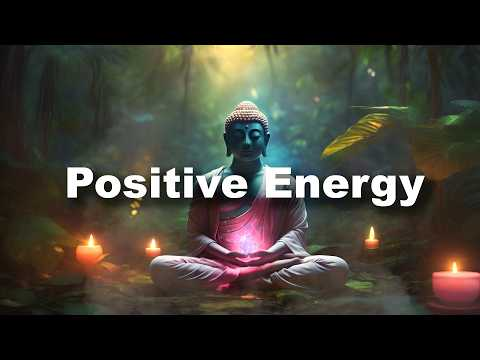

# 음악 — 성공 사례 분석: 사례별 자세히 #561–#600

`analysis.md` 의 9번 (같은 # 번호). 자동 생성 — `tools/success_analysis.py` v1.4.1 (2026-10-18 08:09 UTC). ※ 연구·교육용 — 투자 권유가 아님.

### 561. Heartbreaking 💔 lofi mashup 🎶 slowed + reverb songs ∣ study, focus & late night vibes+++5

- https://www.youtube.com/watch?v=WH_pNjVfkCY · Click Bollywood music hub🎶 · 구독자 10,700 · 조회수 815,321 (×76.2, 하루 8,681.1) · 좋아요 3,100 (0.4%) · 8분 · 2026-07-16 · 주제 묶음 3. 공부·집중·작업 · 형식 음악 (그 밖 모양 — 한 편짜리 BGM 등) · 폴더 `W_WH_pNjVfkCY` (웹 승인)
- 썸네일: 
- 설명 앞부분: Welcome 🙏to world of soothing lofi music, where stress fades away, and peace takes over. This 2025 mind-relaxing lofi mix is perfect for: Deep Focus & Studying 📖 Relaxing & Meditation 🧘‍♂ Chilling After a Long Day 🌅 Peaceful Sleep & Stress Relief 😴 Let these calm beats and chill vibes take you on a…
- 대본 없음 (설명) — 음성인식이 끝나면 도입부·흐름이 들어감
- 댓글 0/118 (다 받지 못함): 좋은 점 — 영상 0 · 감사·응원 0 · 더 알고 싶은 것 0 · 아쉬운 점 — 영상 0 · 반박·불만 — 의견 다름 0 · 정치·사회 0 · 경험 공유 0 · 구독·다음 기대 0

### 562. jazz before i reach flow state

- https://www.youtube.com/watch?v=fQIJb1h1RkA · Defunct · 구독자 11,100 · 조회수 843,591 (×76.0, 하루 5,339.0) · 좋아요 37,165 (4.4%) · 127.8분 · 2026-05-13 · 주제 묶음 7. 재즈·보사노바 · 형식 플레이리스트·모음 (여러 곡) · 폴더 `W_fQIJb1h1RkA` (웹 승인)
- 썸네일: 
- 챕터: 0:00 flow state · 2:54 ascencion · 6:27 calculator · 10:30 blind syntax · 13:48 digital veil · 16:58 silent code · 19:53 marble circuit · 22:27 encrypted · 25:35 oblivion · 28:40 ciphered · 32:14 dark algorithm · 35:17 veiled logic · 38:31 silent program · 41:46 stone script · 44:45 codebound · 48:15 obscura · 51:30 fragmented · 54:34 blind oracle · 57:24 syntax crown · 60:08 echoes
- 설명 앞부분: it's time. ∣ jazz to study / sleep / fall asleep / work / relax to Tracklist: art found in pnterest, edited and music created by defunct ignore tags
- 대본 없음 (설명) — 음성인식이 끝나면 도입부·흐름이 들어감
- 댓글 0/944 (다 받지 못함): 좋은 점 — 영상 0 · 감사·응원 0 · 더 알고 싶은 것 0 · 아쉬운 점 — 영상 0 · 반박·불만 — 의견 다름 0 · 정치·사회 0 · 경험 공유 0 · 구독·다음 기대 0

### 563. TAI CHI MUSIC - Ancient Tao Healing ∣ Chinese Zen Music for Meditation, Qi Gong & Relaxat…

- https://www.youtube.com/watch?v=FDUj2q61rQ8 · Nebula Dreams · 구독자 6,080 · 조회수 460,758 (×75.8, 하루 4,063.4) · 좋아요 8,445 (1.8%) · 85.3분 · 2026-06-26 · 주제 묶음 1. 수면·명상·힐링 · 형식 음악 (그 밖 모양 — 한 편짜리 BGM 등) · 폴더 `W_FDUj2q61rQ8` (웹 승인)
- 썸네일: 
- 설명 앞부분: Temple of Flowing Qi invites you into a peaceful world of Tao meditation, Tai Chi flow, and deep inner balance. This atmospheric journey blends Asian ambient soundscapes, gentle bamboo flutes, meditative percussion, sacred temple textures, and calming cinematic atmospheres to support relaxation, mi…
- 대본 없음 (설명) — 음성인식이 끝나면 도입부·흐름이 들어감
- 댓글 0/192 (다 받지 못함): 좋은 점 — 영상 0 · 감사·응원 0 · 더 알고 싶은 것 0 · 아쉬운 점 — 영상 0 · 반박·불만 — 의견 다름 0 · 정치·사회 0 · 경험 공유 0 · 구독·다음 기대 0

### 564. NIGHT PROTOCOL ∣ Dark Cyberpunk Music for Deep Work & Focus

- https://www.youtube.com/watch?v=zXGb3k-A1Vo · SoundFlow Lab · 구독자 8,950 · 조회수 678,241 (×75.8, 하루 11,929.2) · 좋아요 12,938 (1.9%) · 94.2분 · 2026-08-22 · 주제 묶음 3. 공부·집중·작업 · 형식 음악 (그 밖 모양 — 한 편짜리 BGM 등) · 폴더 `W_zXGb3k-A1Vo` (웹 승인)
- 썸네일: 
- 챕터: 0:00 The Night Shift · 3:39 After Hours · 5:44 Nocturne 47 · 10:00 The City Is Listening · 13:06 Underpass · 16:42 No One on the Line · 19:39 Rain on the Overpass · 22:10 Night Rain · 26:21 Empty Intersection · 29:50 Off Limits · 32:57 Wrong Turn · 36:28 Black Glass · 38:35 Sleeping District · 41:36 No One Outside · 48:06 Dead Channel · 51:23 Terminal Lights · 54:43 Lights Upstairs · 58:02 Platform Zero · 60:56 Last Passenger · 64:11 Last Train Out
- 설명 앞부분: 🎧 now on Spotify, Apple Music, YouTube Music & more Listen here: Enter the city. Start the protocol. NIGHT PROTOCOL — dark cyberpunk music for deep work, focus and late-night sessions. A futuristic mix of dark electronic textures, hypnotic rhythms and atmospheric synths designed to keep you moving …
- 대본 없음 (설명) — 음성인식이 끝나면 도입부·흐름이 들어감
- 댓글 0/338 (다 받지 못함): 좋은 점 — 영상 0 · 감사·응원 0 · 더 알고 싶은 것 0 · 아쉬운 점 — 영상 0 · 반박·불만 — 의견 다름 0 · 정치·사회 0 · 경험 공유 0 · 구독·다음 기대 0

### 565. POV: YOU ARE A DESI BADDIE 💋😭 (PART-2) ✨ (+TIMESTAMPS) 😋 THANK YOU FOR 9K SUBBIES~ ❤️🫂

- https://www.youtube.com/watch?v=9avHQt7MnK4 · Dramanique⋆.𐙚 ̊ · 구독자 31,800 · 조회수 2,406,302 (×75.7, 하루 14,242.7) · 좋아요 36,354 (1.5%) · 26.6분 · 2026-05-02 · 주제 묶음 기타 · 형식 정보·해설 (그 밖) · 폴더 `W_9avHQt7MnK4` (웹 승인)
- 썸네일: 
- 설명 앞부분: Timestamps: Disclaimer: I do not own any of the music used in this playlist. All rights belong to their respective owners. This playlist is made for entertainment and personal enjoyment only.
- 대본 없음 (설명) — 음성인식이 끝나면 도입부·흐름이 들어감
- 댓글 0/584 (다 받지 못함): 좋은 점 — 영상 0 · 감사·응원 0 · 더 알고 싶은 것 0 · 아쉬운 점 — 영상 0 · 반박·불만 — 의견 다름 0 · 정치·사회 0 · 경험 공유 0 · 구독·다음 기대 0

### 566. somehow this became your background music

- https://www.youtube.com/watch?v=GTx1UYV9Y-o · Ksu4000 · 구독자 22,600 · 조회수 1,708,142 (×75.6, 하루 22,278.3) · 좋아요 87,822 (5.1%) · 61.8분 · 2026-08-02 · 주제 묶음 6. 피아노·클래식·연주곡 · 형식 플레이리스트·모음 (여러 곡) · 폴더 `W_GTx1UYV9Y-o` (웹 승인)
- 썸네일: 
- 설명 앞부분: Thanks for letting this be part of your day. ◢ spotify ◢ bandcamp © 2026 Ksu4000. All rights reserved.
- 대본 없음 (설명) — 음성인식이 끝나면 도입부·흐름이 들어감
- 댓글 0/1,554 (다 받지 못함): 좋은 점 — 영상 0 · 감사·응원 0 · 더 알고 싶은 것 0 · 아쉬운 점 — 영상 0 · 반박·불만 — 의견 다름 0 · 정치·사회 0 · 경험 공유 0 · 구독·다음 기대 0

### 567. Melepasmu - Drive (Waktu Luang Version) ∣ Ambient Pop Melancholic Cover

- https://www.youtube.com/watch?v=CfyEhCWn45o · Waktu Luang · 구독자 18,700 · 조회수 1,410,324 (×75.4, 하루 10,007.8) · 좋아요 7,223 (0.5%) · 4.3분 · 2026-05-30 · 주제 묶음 5. 운동·드라이브·신나는 · 형식 커버·직접 부른 노래 · 폴더 `W_CfyEhCWn45o` (웹 승인)
- 썸네일: 
- 설명 앞부분: Melepasmu dari Drive hadir dalam versi baru dengan nuansa Ambient Pop yang lebih melankolis, sinematik, dan emosional. Aransemen ini memadukan piano lembut, ambient synth, tekstur elektronik yang minimalis, serta vokal yang rapuh dan penuh perasaan untuk menghadirkan pengalaman mendengarkan yang le…
- 대본 없음 (설명) — 음성인식이 끝나면 도입부·흐름이 들어감
- 댓글 0/107 (다 받지 못함): 좋은 점 — 영상 0 · 감사·응원 0 · 더 알고 싶은 것 0 · 아쉬운 점 — 영상 0 · 반박·불만 — 의견 다름 0 · 정치·사회 0 · 경험 공유 0 · 구독·다음 기대 0

### 568. Heartbreaking 💔 lofi mashup 🎶 slowed + reverb songs ∣ study, focus & late night vibes

- https://www.youtube.com/watch?v=8vwZSZcOPtM · Click Bollywood music hub🎶 · 구독자 10,700 · 조회수 806,060 (×75.3, 하루 7,586.3) · 좋아요 3,166 (0.4%) · 7.9분 · 2026-07-04 · 주제 묶음 3. 공부·집중·작업 · 형식 음악 (그 밖 모양 — 한 편짜리 BGM 등) · 폴더 `W_8vwZSZcOPtM` (웹 승인)
- 썸네일: 
- 설명 앞부분: Welcome 🙏to world of soothing lofi music, where stress fades away, and peace takes over. This 2025 mind-relaxing lofi mix is perfect for: Deep Focus & Studying 📖 Relaxing & Meditation 🧘‍♂ Chilling After a Long Day 🌅 Peaceful Sleep & Stress Relief 😴 Let these calm beats and chill vibes take you on a…
- 대본 없음 (설명) — 음성인식이 끝나면 도입부·흐름이 들어감
- 댓글 0/91 (다 받지 못함): 좋은 점 — 영상 0 · 감사·응원 0 · 더 알고 싶은 것 0 · 아쉬운 점 — 영상 0 · 반박·불만 — 의견 다름 0 · 정치·사회 0 · 경험 공유 0 · 구독·다음 기대 0

### 569. 𝘱𝘭𝘢𝘺𝘭𝘪𝘴𝘵 들으면 행복해지는 노래 모음 🫧 하루종일 듣기 좋은 팝송 플레이리스트

- https://www.youtube.com/watch?v=lQrhgr4_dKg · seroma room · 구독자 16,600 · 조회수 1,246,747 (×75.1, 하루 7,453.2) · 좋아요 7,296 (0.6%) · 542.2분 · 2026-05-04 · 주제 묶음 10. 팝송·K팝·J팝 · 형식 플레이리스트·모음 (여러 곡) · 폴더 `W_lQrhgr4_dKg` (웹 승인)
- 썸네일: 
- 챕터: 0:00 Running Late but Feeling Good · 2:21 A Little Too Late · 4:36 Backseat Brave · 7:18 Just Enough Chaos · 10:30 First Jump · 12:41 A Song We Played Too Loud · 15:27 Off Script Day · 18:37 We Took the Longer Way Around · 21:40 Everything Felt Possible Then · 24:02 We Talked About Everything · 26:10 We Made It Up · 29:07 We Didn’t Check the Time Once · 32:05 Too Bright to Stay Inside · 34:31 Laughing Like It’s Nothing · 37:25 Missed The Bus · 39:25 That Day Felt Like a Movie Sc… · 42:13 Music First
- 설명 앞부분: 들으면 기분이 조금 가벼워지는 노래들을 모았어요 🫧 출근길, 산책, 공부나 작업할 때 편하게 틀어두기 좋은 플레이리스트입니다 🎧 오늘 하루가 조금 더 좋아지길 바라요 🤍 Songs that make your day feel a little lighter 🫧 Easy to play in the background for your commute, a walk, or while you work or study 🎧 Hope this adds a small moment of happiness to your day 🤍 🎧 Youtube Mu…
- 같은 채널 평소 대비 ×129.4 (채널 최근 롱폼 중앙값 9,638회) · 평소 영상: 𝘱𝘭𝘢𝘺𝘭𝘪𝘴𝘵 오늘은 웃을 일이 좀 많을 것 같아 ☀️ 하루종일 듣기 좋은 노래 모음 … (9,638회) / 𝘱𝘭𝘢𝘺𝘭𝘪𝘴𝘵 틀자마자 기분 좋아지는 여름 팝송 🫧☀️ 하루종일 듣기 좋은 요즘 플레이… (9,341회)
- 대본 없음 (설명) — 음성인식이 끝나면 도입부·흐름이 들어감
- 댓글 167/167: 좋은 점 — 영상 5 · 감사·응원 10 · 더 알고 싶은 것 4 · 아쉬운 점 — 영상 2 · 반박·불만 — 의견 다름 0 · 정치·사회 0 · 경험 공유 5 · 구독·다음 기대 1
  - 좋은 점 — 영상 👍21 “이 노래들은 진짜 하루 종일 듣기 좋은 것 같아요 ^^”
  - 좋은 점 — 영상 👍7 “안녕하세요 선플달기활동을 하고있는 학생입니다 !! 오늘 뭔가 기분이 답답하고 좋지 않았는데 이 플레이리스트를 듣다 보니 서서히 감정이 스며들어가는 것 같습니다 ㅎㅎ고정에 달아두시는 좋은 말씀에 힘입어 남은 오늘 하루 잘 보내보겠습니다 감사합니다😊”
  - 감사·응원 👍20 “온종일 틀어놓고 집안일도 하고 커피도 마시고 일상의 위로에요 ^^ 감사합니다.”
  - 감사·응원 👍7 “안녕하세요 선플달기활동을 하고있는 학생입니다 !! 오늘 뭔가 기분이 답답하고 좋지 않았는데 이 플레이리스트를 듣다 보니 서서히 감정이 스며들어가는 것 같습니다 ㅎㅎ고정에 달아두시는 좋은 말씀에 힘입어 남은 오늘 하루 잘 보내보겠습니다 감사합니다😊”
  - 더 알고 싶은 것 👍15 “첫번째 곡이랑 비슷한 노래 추천 좀 해주세요ㅠ 첫 곡이 너무 좋은데 찾아봐도 없어요ㅜㅜ”
  - 더 알고 싶은 것 👍1 “We Didn't Check the Time once 이노래도 내주세요 ㅠㅠ 애플 뮤직이라도 아님 이곡만 만들어주세요 ㅠ 지금6시간째 이곡만 듣고 있어요 ㅠ 29:07”
  - 아쉬운 점 — 영상 👍8 “오뭔가 ai같다햇는데 맞앗네..;;”
  - 아쉬운 점 — 영상 👍0 “Ai 티 존나나는데 이거 좋다는건 다 막귀냐 목소리부터 존나ai인데”
  - 경험 공유 👍0 “ㅅㅂ 이게a.i곡이었다고? 명곡인줄알고 반년째따라불럿는데 하......진짜싫네 이게말이돼?”
  - 구독·다음 기대 👍7 “뭔가 가라앉고 기분이 우울한 밤이었는데, 정말 기분이 밝아지고 행복해졌어요 구독박고 갑니다! 감사해요 ㅜㅜ”

### 570. Heartbreaking 💔 songs + lofi Mashup songs Slowed Reverb songs Arijit singsong

- https://www.youtube.com/watch?v=u6gVi3TsKTM · JR buzdar official  · 구독자 16,400 · 조회수 1,231,857 (×75.1, 하루 15,533.3) · 좋아요 6,035 (0.5%) · 7.8분 · 2026-07-31 · 주제 묶음 8. 로파이·시티팝·칠 · 형식 음악 (그 밖 모양 — 한 편짜리 BGM 등) · 폴더 `W_u6gVi3TsKTM` (웹 승인)
- 썸네일: 
- 설명 앞부분: Welcome to the world of soothing lofi music, where stress fades away, and peace takes over. This Latest 2026 mind-relaxing lofi mix is perfect for: Deep Focus & Studying 📖 Relaxing & Meditation 🧘‍♂ Chilling After a Long Day 🌅 Peaceful Sleep & Stress Relief 😴 Let these calm beats and chill vibes tak…
- 대본 없음 (설명) — 음성인식이 끝나면 도입부·흐름이 들어감
- 댓글 0/51 (다 받지 못함): 좋은 점 — 영상 0 · 감사·응원 0 · 더 알고 싶은 것 0 · 아쉬운 점 — 영상 0 · 반박·불만 — 의견 다름 0 · 정치·사회 0 · 경험 공유 0 · 구독·다음 기대 0

### 571. Enya Inspired - Tears Of The Rain (Ai Music)

- https://www.youtube.com/watch?v=ZqRhMKrbk58 · Sonic Beatz · 구독자 5,870 · 조회수 440,655 (×75.1, 하루 2,929.4) · 좋아요 9,105 (2.1%) · 7.5분 · 2026-05-20 · 주제 묶음 14. AI 음악 · 형식 AI 음악 · 폴더 `W_ZqRhMKrbk58` (웹 승인)
- 썸네일: 
- 설명 앞부분: "Tears of the Rain" is a hauntingly beautiful journey through memory, longing, and quiet healing. With soft ambient textures, angelic vocals, and cinematic soundscapes, this piece is designed to transport you into a dreamlike state of reflection and peace. Let the rain wash over you. Let every note…
- 대본 없음 (설명) — 음성인식이 끝나면 도입부·흐름이 들어감
- 댓글 0/411 (다 받지 못함): 좋은 점 — 영상 0 · 감사·응원 0 · 더 알고 싶은 것 0 · 아쉬운 점 — 영상 0 · 반박·불만 — 의견 다름 0 · 정치·사회 0 · 경험 공유 0 · 구독·다음 기대 0

### 572. Relajación Profunda, Claridad Mental 🌿 Reduce El Estrés Y La Ansiedad, Recupera La Calma

- https://www.youtube.com/watch?v=j8hCioy51LU · Healing Soul Music · 구독자 10,700 · 조회수 802,123 (×75.0, 하루 6,525.6) · 좋아요 9,959 (1.2%) · 226.2분 · 2026-06-17 · 주제 묶음 6. 피아노·클래식·연주곡 · 형식 음악 (그 밖 모양 — 한 편짜리 BGM 등) · 폴더 `W_j8hCioy51LU` (웹 승인)
- 썸네일: 
- 설명 앞부분: Relajación profunda y claridad mental con suaves melodías de piano y sonidos de la naturaleza como pájaros y agua ayudan a reducir el estrés, aliviar la ansiedad y recuperar la calma naturalmente. Esta música relajante crea un ambiente tranquilo para restaurar el equilibrio emocional, mejorar la ca…
- 대본 없음 (설명) — 음성인식이 끝나면 도입부·흐름이 들어감
- 댓글 0/129 (다 받지 못함): 좋은 점 — 영상 0 · 감사·응원 0 · 더 알고 싶은 것 0 · 아쉬운 점 — 영상 0 · 반박·불만 — 의견 다름 0 · 정치·사회 0 · 경험 공유 0 · 구독·다음 기대 0

### 573. Afro House Mix 2026 🔥 Tribal Afro House Energy ∣ Emotional Melodic Beats #VOL 35

- https://www.youtube.com/watch?v=UIzQAbsrlRk · Jungle Pulse House · 구독자 27,000 · 조회수 2,019,190 (×74.8, 하루 13,475.7) · 좋아요 14,049 (0.7%) · 99.4분 · 2026-05-21 · 주제 묶음 4. 카페·매장·라운지 · 형식 플레이리스트·모음 (여러 곡) · 폴더 `W_UIzQAbsrlRk` (웹 승인)
- 썸네일: 
- 챕터: 0:00 01. Wild Tribal Romance · 4:44 02. Savanna Night Whisper · 9:44 03. Moonlight Afro Dreams · 14:27 04. Fire Inside My Soul · 19:20 05. Sunset Love Rhythm · 24:28 06. Echoes of Your Love · 29:31 07. Sacred Night Groove · 34:44 08. Endless Afro Nights · 39:31 09. Golden Horizon Vibes · 44:50 10. Deep Voodoo Love · 49:52 11. Burning Love Chant · 54:35 12. Desert Soul Connection · 59:56 13. Lost in Your Rhythm · 65:05 14. Tribal Love Frequency · 69:51 15. Heartbeat in the Sand · 74:59 16. Electric Sunset Desire · 79:56 17. Midnight Tribal Fire · 84:27 18. Rhythm of the Ancients · 89:27 19. Deep Jungle Desire · 94:24 20. Ocean Heartbeat
- 설명 앞부분: This mix is designed to create an immersive atmosphere, featuring hypnotic basslines, organic percussion, and uplifting melodic progressions that flow seamlessly together. Perfect for summer parties, sunset sessions, workouts, or late-night drives, this set delivers nonstop energy with a soulful Af…
- 대본 없음 (설명) — 음성인식이 끝나면 도입부·흐름이 들어감
- 댓글 0/277 (다 받지 못함): 좋은 점 — 영상 0 · 감사·응원 0 · 더 알고 싶은 것 0 · 아쉬운 점 — 영상 0 · 반박·불만 — 의견 다름 0 · 정치·사회 0 · 경험 공유 0 · 구독·다음 기대 0

### 574. 하츠투하츠 Hearts2Hearts 'RUDE!+Lemon Tang' 2026 한국대중음악상(KM Chart Awards) 260725

- https://www.youtube.com/watch?v=ddGnUiIjrgo · poptforming · 구독자 5,870 · 조회수 437,513 (×74.5, 하루 5,159.0) · 좋아요 11,482 (2.6%) · 6.6분 · 2026-07-25 · 주제 묶음 기타 · 형식 음악 (그 밖 모양 — 한 편짜리 BGM 등) · 폴더 `W_ddGnUiIjrgo` (웹 승인)
- 썸네일: 
- 대본 없음 (없음) — 음성인식이 끝나면 도입부·흐름이 들어감
- 댓글 314/314: 좋은 점 — 영상 2 · 감사·응원 2 · 더 알고 싶은 것 1 · 아쉬운 점 — 영상 0 · 반박·불만 — 의견 다름 0 · 정치·사회 0 · 경험 공유 1 · 구독·다음 기대 0
  - 좋은 점 — 영상 👍124 “스타즈 오늘 둘다 레전드네 ㄷㄷㄷ❤❤❤❤”
  - 좋은 점 — 영상 👍11 “하츠투하츠 KMA 2026 어워즈 청량하고 상큼한 무대 레전드네!!! 칼군무 대박ㅠㅠ라이브 너무 잘하고 청순하고 헤메코 이쁘고 열정적인 퍼포먼스 진짜 너무 멋지다!!!ㅠㅠ완전 최고!!!👍👍하츠투하츠 화이팅!!!❤❤❤”
  - 감사·응원 👍11 “하츠투하츠 KMA 2026 어워즈 청량하고 상큼한 무대 레전드네!!! 칼군무 대박ㅠㅠ라이브 너무 잘하고 청순하고 헤메코 이쁘고 열정적인 퍼포먼스 진짜 너무 멋지다!!!ㅠㅠ완전 최고!!!👍👍하츠투하츠 화이팅!!!❤❤❤”
  - 감사·응원 👍7 “하츠투하츠 파이팅 ! 유하 파이팅 ! 🎀”
  - 더 알고 싶은 것 👍0 “안녕하세요 여러분, 멤버 중에 제일 나이가 많은 분이 누구신지 궁금해서 여쭤봅니다. 🤔”
  - 경험 공유 👍0 “제가 항상 생각하는 건... 하츠투하츠 멤버들이 공연할 때마다 숨이 차지 않을까 하는 거예요.?”

### 575. ENIGMA Style Music 🔥 Whisper of My Angel 🔥 2026

- https://www.youtube.com/watch?v=ELv5bUhS-Qw · VoiceLine Music · 구독자 4,020 · 조회수 299,347 (×74.5, 하루 1,809.1) · 좋아요 3,420 (1.1%) · 5.6분 · 2026-05-05 · 주제 묶음 기타 · 형식 음악 (그 밖 모양 — 한 편짜리 BGM 등) · 폴더 `W_ELv5bUhS-Qw` (웹 승인)
- 썸네일: 
- 설명 앞부분: ENIGMA Style Music 🔥 Whisper of My Angel 🔥 2026 Enter a realm where silence speaks… Whisper of My Angel is a sensual, ethereal soundscape inspired by the timeless spirit of Enigma — blending sacred ambience with deep emotional energy. A distant voice calls through the night… Soft angelic whispers d…
- 대본 없음 (설명) — 음성인식이 끝나면 도입부·흐름이 들어감
- 댓글 0/95 (다 받지 못함): 좋은 점 — 영상 0 · 감사·응원 0 · 더 알고 싶은 것 0 · 아쉬운 점 — 영상 0 · 반박·불만 — 의견 다름 0 · 정치·사회 0 · 경험 공유 0 · 구독·다음 기대 0

### 576. Positive Energy 2026 🌞 Feel Good Deep House Music for Morning Focus ∣ ChillMorning Vibes

- https://www.youtube.com/watch?v=Dg9ePUDm4Vs · ChillMorning Vibes · 구독자 12,300 · 조회수 911,528 (×74.1, 하루 6,470.2) · 좋아요 14,526 (1.6%) · 65.7분 · 2026-05-30 · 주제 묶음 3. 공부·집중·작업 · 형식 플레이리스트·모음 (여러 곡) · 폴더 `W_Dg9ePUDm4Vs` (웹 승인)
- 썸네일: 
- 설명 앞부분: Positive Energy 2026 🌞 Feel Good Deep House Music for Morning Focus ∣ ChillMorning Vibes Positive Energy 2026 🌞 Feel Good Deep House Music for Morning Focus ∣ ChillMorning Vibes Positive Energy 2026 🌞 Feel Good Deep House Music for Morning Focus ∣ ChillMorning Vibes Boost your mood and start your d…
- 대본 없음 (설명) — 음성인식이 끝나면 도입부·흐름이 들어감
- 댓글 0/329 (다 받지 못함): 좋은 점 — 영상 0 · 감사·응원 0 · 더 알고 싶은 것 0 · 아쉬운 점 — 영상 0 · 반박·불만 — 의견 다름 0 · 정치·사회 0 · 경험 공유 0 · 구독·다음 기대 0

### 577. 15 Min Self Healing Music 🌿 Heal From Within & Find Inner Peace

- https://www.youtube.com/watch?v=wi3auWpIaZY · Inner Healing Aura · 구독자 1,240 · 조회수 91,902 (×74.1, 하루 2,256.1) · 좋아요 888 (1.0%) · 16.5분 · 2026-09-07 · 주제 묶음 1. 수면·명상·힐링 · 형식 음악 (그 밖 모양 — 한 편짜리 BGM 등) · 폴더 `W_wi3auWpIaZY` (웹 승인)
- 썸네일: 
- 설명 앞부분: 15 Min Self Healing Music 🌿 Heal From Within & Find Inner Peace Take 15 minutes to slow down, breathe deeply, and reconnect with a sense of calm. This gentle self healing music is created for moments when you need to release mental tension, relax your body, and create a peaceful space within. Let t…
- 대본 없음 (설명) — 음성인식이 끝나면 도입부·흐름이 들어감
- 댓글 0/51 (다 받지 못함): 좋은 점 — 영상 0 · 감사·응원 0 · 더 알고 싶은 것 0 · 아쉬운 점 — 영상 0 · 반박·불만 — 의견 다름 0 · 정치·사회 0 · 경험 공유 0 · 구독·다음 기대 0

### 578. Life before Social Media - CHILL BRAZIL ∣ Samba, Luxury Bossa Nova, Work, Study

- https://www.youtube.com/watch?v=NHZXCzKGDQc · Golden Smile · 구독자 6,570 · 조회수 485,842 (×74.0, 하루 3,526.2) · 좋아요 5,702 (1.2%) · 152.4분 · 2026-06-02 · 주제 묶음 3. 공부·집중·작업 · 형식 플레이리스트·모음 (여러 곡) · 폴더 `W_NHZXCzKGDQc` (웹 승인)
- 썸네일: 
- 설명 앞부분: Welcome to GoldenSmile Your tropical escape into the smooth world of Brazilian chill, bossa nova, samba grooves, and laid-back beach rhythms. A place where the breeze sings, the sun glows, and the music moves like waves. Perfect for relaxing, slow dancing in your kitchen, dreaming by the window—or …
- 대본 없음 (설명) — 음성인식이 끝나면 도입부·흐름이 들어감
- 댓글 0/55 (다 받지 못함): 좋은 점 — 영상 0 · 감사·응원 0 · 더 알고 싶은 것 0 · 아쉬운 점 — 영상 0 · 반박·불만 — 의견 다름 0 · 정치·사회 0 · 경험 공유 0 · 구독·다음 기대 0

### 579. 요즘 이 노래에 빠졌다 🎧 중독성 리듬 락트로트 17곡 2시간 10분 연속듣기 ∣ I’m Addicted to These Songs

- https://www.youtube.com/watch?v=rDvH1El0H3k · 인생은 트로트 · 구독자 9,120 · 조회수 673,679 (×73.9, 하루 16,074.2) · 좋아요 3,943 (0.6%) · 130.3분 · 2026-09-06 · 주제 묶음 9. 가요·발라드·트로트 · 형식 플레이리스트·모음 (여러 곡) · 폴더 `W_rDvH1El0H3k` (웹 승인)
- 썸네일: 
- 설명 앞부분: 레트로 감성이 어우러진 락트로트 플레이리스트입니다. TRACK LIST 총 17곡 2시간10분
- 같은 채널 평소 대비 ×46.1 (채널 최근 롱폼 중앙값 14,625회) · 평소 영상: 사랑에 빠졌나 봐 ❤️ 시크한 그녀의 락트로트 댄스 10곡 ∣ 1시간 10분 (15,243회) / 시청자 요청으로 만든 힙팝트로트 2탄 🎧 한 곡만 들으려다 끝까지 들었다 ∣ 10곡 1시… (14,007회)
- 대본 없음 (설명) — 음성인식이 끝나면 도입부·흐름이 들어감
- 댓글 338/338: 좋은 점 — 영상 2 · 감사·응원 30 · 더 알고 싶은 것 5 · 아쉬운 점 — 영상 6 · 반박·불만 — 의견 다름 0 · 정치·사회 0 · 경험 공유 5 · 구독·다음 기대 2
  - 좋은 점 — 영상 👍6 “처음보는 노래 제목에 선택했는데 진짜 듣기 좋네요 🎉🎉”
  - 좋은 점 — 영상 👍3 “와우 !! 이 영상 너무나도 대박 입니다요 ^^ 슬픈듯 눈물이 나올듯 말듯 경쾌하고 신나며 마음을 쥐락펴락하며 아무튼 넘 좋아요 ^^ 좋은 영상 너무너무 감사합니다 ^^ 이노래를듣고있으면 (이세상 모든것이 다 내것 같아 행복해집니다 ~.^)”
  - 감사·응원 👍10 “매일 출퇴근때~듣고있어요~~^^😊 좋은음악 감사합니다 ^^❤❤❤”
  - 감사·응원 👍9 “노래가 다 좋치만 1번 13번 좋네요 감사합니다”
  - 더 알고 싶은 것 👍2 “어떤곡이 제일좋은지 알려주세요 ㅎㅎㅎ 난 너무 좋아서 몇번을 들었네요 님. 강사합니다~~~^^😂😂😂”
  - 더 알고 싶은 것 👍1 “댓글보니 노래방 걸러링 이야기 만든데 거기에 통화 연결음까지...... 부탁드립니다 너무 좋아요 사랑합니다❤❤❤❤❤❤”
  - 아쉬운 점 — 영상 👍6 “요즘 AI 목소리 넘 좋고 노래 넘 잘해서 중독됨~”
  - 아쉬운 점 — 영상 👍4 “아~노래좋네~~ 계속듣다보니 같은 노랜가? 좀 아쉼네요 같은 리듬이...조금 지루해져요^^”
  - 경험 공유 👍3 “살면서 가장 힘든 것은 힘든 상황보다도 아무에게도 내 마음을 말할 수 없을 때인 것 같습니다. 저도 오랫동안 가족 걱정과 현실적인 문제들을 혼자 감당하며 지냈습니다. 오늘 이 노래를 들으니 굳이 말하지 않아도 제 마음을 알아주는 친구를 만난 기분입니다. 눈물이 나면서…”
  - 경험 공유 👍2 “맑고 듣기는좋으네요 넘좋은데요 감사합니다 이늦은밤 들으니 더욱더 빠져드네요 그런데 듣는사람마다 다르게 들리수도 제가 듣기에는 음과 리듬이 거의 동일?비슷 ㅎ 그리고 굴곡진곳하나없고 감정선 느낌은 없는것같아요 그럼에도 불구하고 듣기조아 자꾸듣게되는 장점은있네요 다 좋은…”
  - 구독·다음 기대 👍3 “노래를 듣고 있자니 지나가다고 구독하고 갑니다. 😄”
  - 구독·다음 기대 👍2 “와~~~ 오전에 듣다가 점심먹으면서도 계속듣고 있네요 이런적이 없었는데... 중독된것같네요 바로 구독❤알림 설정했네요 감사합니다 귀한 음악 들려주셔서 항상 함께하겠습니다^^!”

### 580. दिमाग को शांत करने वाला संगीत ∣ बांसुरी + संतूर + जलतरंग + तानपुरा ∣ Meditation Music

- https://www.youtube.com/watch?v=z6QYtZlFvb4 · Shanti univers by Chandu  · 구독자 713 · 조회수 52,500 (×73.6, 하루 426.6) · 좋아요 0 (0.0%) · 14.6분 · 2026-06-17 · 주제 묶음 1. 수면·명상·힐링 · 형식 음악 (그 밖 모양 — 한 편짜리 BGM 등) · 폴더 `W_z6QYtZlFvb4` (웹 승인)
- 썸네일: 
- 설명 앞부분: स्वागत है! इस विशेष संगीत को आपके मस्तिष्क को गहरे सुकून और शांति की स्थिति में ले जाने के लिए तैयार किया गया है। इसमें भारतीय बांसुरी (Bansuri) की गहरी तान, तानपुरा (Tanpura) की निरंतर गूंज, संतूर (Santoor) की मीठी झंकार और जलतरंग (Jaltarang) की पानी जैसी लहरों का एक जादुई और बेहद स्मूथ मिश्रण है।…
- 대본 없음 (설명) — 음성인식이 끝나면 도입부·흐름이 들어감
- 댓글 0/17 (다 받지 못함): 좋은 점 — 영상 0 · 감사·응원 0 · 더 알고 싶은 것 0 · 아쉬운 점 — 영상 0 · 반박·불만 — 의견 다름 0 · 정치·사회 0 · 경험 공유 0 · 구독·다음 기대 0

### 581. Ocean Chillout - Sunset Lounge Melodies and Luxury Lounge Vibes for a Peaceful Evening

- https://www.youtube.com/watch?v=hFaOxrQmaQ4 · Afterglow Lounge · 구독자 10,700 · 조회수 785,897 (×73.5, 하루 7,758.3) · 좋아요 9,295 (1.2%) · 125.2분 · 2026-07-09 · 주제 묶음 4. 카페·매장·라운지 · 형식 음악 (그 밖 모양 — 한 편짜리 BGM 등) · 폴더 `W_hFaOxrQmaQ4` (웹 승인)
- 썸네일: 
- 설명 앞부분: Ocean Chillout - Sunset Lounge Melodies and Luxury Lounge Vibes for a Peaceful Evening Experience pure bliss with our ocean chillout and sunset lounge session. Afterglow Lounge brings you luxury lounge melodies perfect for a peaceful evening by the sea. 🌅 Are you watching the sunset while listening…
- 대본 없음 (설명) — 음성인식이 끝나면 도입부·흐름이 들어감
- 댓글 0/231 (다 받지 못함): 좋은 점 — 영상 0 · 감사·응원 0 · 더 알고 싶은 것 0 · 아쉬운 점 — 영상 0 · 반박·불만 — 의견 다름 0 · 정치·사회 0 · 경험 공유 0 · 구독·다음 기대 0

### 582. My Heart And Soul ∣ Romantic Emotional Love Song ∣ Soft Emotion Music

- https://www.youtube.com/watch?v=f2LgAVp301Q · Soft Emotion Music · 구독자 13,700 · 조회수 998,132 (×72.9, 하루 7,702.3) · 좋아요 4,054 (0.4%) · 5.8분 · 2026-06-10 · 주제 묶음 기타 · 형식 한 곡 (뮤직비디오·음원·가사) · 폴더 `W_f2LgAVp301Q` (웹 승인)
- 썸네일: 
- 설명 앞부분: Some people become a part of your life... And some become a part of your soul. "My Heart And Soul" is a deeply emotional romantic duet about unconditional love, devotion, and finding the one person who becomes your strength, your comfort, and your reason to keep going. It's a song for those who hav…
- 대본 없음 (설명) — 음성인식이 끝나면 도입부·흐름이 들어감
- 댓글 0/179 (다 받지 못함): 좋은 점 — 영상 0 · 감사·응원 0 · 더 알고 싶은 것 0 · 아쉬운 점 — 영상 0 · 반박·불만 — 의견 다름 0 · 정치·사회 0 · 경험 공유 0 · 구독·다음 기대 0

### 583. Flora's Garden 🌸🌷✨ soft waltz piano for studying, reading & creative work

- https://www.youtube.com/watch?v=J8Qi6W8t0Ek · rumi. · 구독자 12,700 · 조회수 912,484 (×71.8, 하루 6,790.3) · 좋아요 14,055 (1.5%) · 251.5분 · 2026-06-05 · 주제 묶음 3. 공부·집중·작업 · 형식 음악 (그 밖 모양 — 한 편짜리 BGM 등) · 폴더 `W_J8Qi6W8t0Ek` (웹 승인)
- 썸네일: 
- 설명 앞부분: Step into Flora's Garden, where tulips and peonies bloom in endless pastel hues and the air smells like rain on petals. ✨ Let the soft waltz carry you somewhere quiet and unhurried. Perfect for: ✦ Studying & deep focus sessions ✦ Reading, journaling & self-care ✦ Creative work & slow mornings ✦ Rel…
- 대본 없음 (설명) — 음성인식이 끝나면 도입부·흐름이 들어감
- 댓글 0/467 (다 받지 못함): 좋은 점 — 영상 0 · 감사·응원 0 · 더 알고 싶은 것 0 · 아쉬운 점 — 영상 0 · 반박·불만 — 의견 다름 0 · 정치·사회 0 · 경험 공유 0 · 구독·다음 기대 0

### 584. Lord Heal Me -Inspired By Enya (2026 Ai Music Video)

- https://www.youtube.com/watch?v=Q-JjRkFbFhU · SOUNDIASM · 구독자 10,700 · 조회수 768,538 (×71.8, 하루 5,422.3) · 좋아요 9,206 (1.2%) · 5.2분 · 2026-05-29 · 주제 묶음 14. AI 음악 · 형식 AI 음악 · 폴더 `W_Q-JjRkFbFhU` (웹 승인)
- 썸네일: 
- 설명 앞부분: Immerse yourself in “Lord Heal Me,” a deeply emotional ambient worship song filled with ethereal vocals, cinematic textures, gentle piano, and calming spiritual energy. Inspired by heavenly harmonies and peaceful atmospheric soundscapes, this healing music journey speaks of hope, surrender, divine …
- 대본 없음 (설명) — 음성인식이 끝나면 도입부·흐름이 들어감
- 댓글 0/325 (다 받지 못함): 좋은 점 — 영상 0 · 감사·응원 0 · 더 알고 싶은 것 0 · 아쉬운 점 — 영상 0 · 반박·불만 — 의견 다름 0 · 정치·사회 0 · 경험 공유 0 · 구독·다음 기대 0

### 585. 【星河入夢】 Ancient Chinese Healing Music 🎵 ∣ Qixi Star River 🌌 - Guzheng × Xiao

- https://www.youtube.com/watch?v=pFttQ6MZ9d8 · Tianhe Harmony · 구독자 879 · 조회수 63,020 (×71.7, 하루 709.0) · 좋아요 1,133 (1.8%) · 77.8분 · 2026-07-21 · 주제 묶음 1. 수면·명상·힐링 · 형식 음악 (그 밖 모양 — 한 편짜리 BGM 등) · 폴더 `W_pFttQ6MZ9d8` (웹 승인)
- 썸네일: 
- 챕터: 0:00 Star River Reflection · 11:15 First Xiao Echoes in the Night · 22:40 Silk Ribbon Swaying · 33:10 Guzheng Across the Stone Brid… · 44:25 Deep Night on Magpie Bridge · 55:50 Erhu Starlight Melody · 65:15 Peaceful Water Ripples · 73:40 Fading into the Milky Way
- 설명 앞부분: Experience the deep calm of this ancient Chinese healing music under the Qixi star river. Let the Guzheng and Xiao wash away your stress and bring peace. 🌙 About This Music Find your inner peace under the endless Milky Way. This ancient Chinese healing music is inspired by the Qixi Festival and the…
- 대본 없음 (설명) — 음성인식이 끝나면 도입부·흐름이 들어감
- 댓글 0/48 (다 받지 못함): 좋은 점 — 영상 0 · 감사·응원 0 · 더 알고 싶은 것 0 · 아쉬운 점 — 영상 0 · 반박·불만 — 의견 다름 0 · 정치·사회 0 · 경험 공유 0 · 구독·다음 기대 0

### 586. 10 Most Powerful Morning Mantras ∣ Remove All Negativity ∣ Ganesh Hanuman Shiva Vishnu Kr…

- https://www.youtube.com/watch?v=rH2JDVys2Os · Adhyatmik Dhwani · 구독자 28,900 · 조회수 2,058,605 (×71.2, 하루 14,068.3) · 좋아요 25,450 (1.2%) · 20.7분 · 2026-05-25 · 주제 묶음 1. 수면·명상·힐링 · 형식 음악 (그 밖 모양 — 한 편짜리 BGM 등) · 폴더 `W_rH2JDVys2Os` (웹 승인)
- 썸네일: 
- 설명 앞부분: 🌅 Start your morning with divine blessings of Ganesh, Hanuman, Shiva & Vishnu — and remove all negativity before your day begins. Play this every morning to: 🐘 Remove obstacles & bring new beginnings (Ganesh Mantra) 🙏 Gain strength, courage & protection (Hanuman Mantra) 🔱 Find peace, liberation & i…
- 대본 없음 (설명) — 음성인식이 끝나면 도입부·흐름이 들어감
- 댓글 0/1,753 (다 받지 못함): 좋은 점 — 영상 0 · 감사·응원 0 · 더 알고 싶은 것 0 · 아쉬운 점 — 영상 0 · 반박·불만 — 의견 다름 0 · 정치·사회 0 · 경험 공유 0 · 구독·다음 기대 0

### 587. Playlist ∣ 가을밤에는 남자발라드를 들어요 🍂 ∣ 한국 감성 발라드 모음 🔥

- https://www.youtube.com/watch?v=iaEax89R7fQ · 이짐땡 · 구독자 2,860 · 조회수 203,497 (×71.2, 하루 6,545.5) · 좋아요 516 (0.2%) · 167.7분 · 2026-09-17 · 주제 묶음 9. 가요·발라드·트로트 · 형식 플레이리스트·모음 (여러 곡) · 폴더 `W_iaEax89R7fQ` (웹 승인)
- 썸네일: 
- 챕터: 0:00 성시경-차마 · 4:13 나윤권-기대 · 8:50 박재정-사랑한만큼 · 13:38 윤종신-좋니 · 19:07 신용재-첫 줄 · 23:09 임한별-이별하러가는길 · 28:16 임한별-사랑하지 않아서 그랬어 · 32:00 오왠-오늘 · 35:53 길구봉구-이 별 · 39:52 이적-빨래 · 43:46 임재현-비의랩소디 · 47:41 이클립스-소나기 · 51:35 우디-사막에서꽃을피우듯 · 55:58 임재현-사랑에 연습이 있었다면 · 60:14 장범준-잠이오질않네요 · 64:49 장범준-고백 · 68:19 브아솔-러브발라드 · 73:21 브라운아이즈-점점 · 76:52 양다일-고백 · 80:24 카더가든-가까운듯먼그대여
- 설명 앞부분: 애절한 남자발라드를 듣기에 좋은 계절 찬바람이 코끝을 건드릴땐 이 플리와 함께 하세요 이짐땡 플리와 함께 즐거운 가을 보내세요 ^^ 🩷 TRACK LIST
- 대본 없음 (설명) — 음성인식이 끝나면 도입부·흐름이 들어감
- 댓글 0/8 (다 받지 못함): 좋은 점 — 영상 0 · 감사·응원 0 · 더 알고 싶은 것 0 · 아쉬운 점 — 영상 0 · 반박·불만 — 의견 다름 0 · 정치·사회 0 · 경험 공유 0 · 구독·다음 기대 0

### 588. 모차르트에서 영감을 받은 아침 힐링 클래식 🌿 첼로 & 오보에 ∣ 평온한 산속 일출과 함께하는 휴식 음악

- https://www.youtube.com/watch?v=tr3LEDt_p88 · Korean Rock Ballad · 구독자 4,750 · 조회수 337,472 (×71.0, 하루 2,866.0) · 좋아요 3,468 (1.0%) · 42.2분 · 2026-06-22 · 주제 묶음 6. 피아노·클래식·연주곡 · 형식 음악 (그 밖 모양 — 한 편짜리 BGM 등) · 폴더 `W_tr3LEDt_p88` (웹 승인)
- 썸네일: 
- 설명 앞부분: 평온한 산속 일출과 함께하는 아침 힐링 클래식 음악입니다. 따뜻하고 깊은 첼로 선율과 부드러운 오보에의 조화가 마음을 편안하게 감싸줍니다. 이 음악은 아침 루틴, 명상, 독서, 공부, 휴식, 기도, 스트레스 해소에 잘 어울립니다. 맑은 자연의 공기와 잔잔한 클래식 선율 속에서 평온한 하루를 시작해 보세요. 🎻 첼로 & 오보에 힐링 음악 🌿 자연과 함께하는 클래식 음악 ☀️ 편안한 아침을 위한 휴식 음악
- 대본 없음 (설명) — 음성인식이 끝나면 도입부·흐름이 들어감
- 댓글 0/81 (다 받지 못함): 좋은 점 — 영상 0 · 감사·응원 0 · 더 알고 싶은 것 0 · 아쉬운 점 — 영상 0 · 반박·불만 — 의견 다름 0 · 정치·사회 0 · 경험 공유 0 · 구독·다음 기대 0

### 589. 10 Minutes Deep Meditation Music for Positive Energy • Free from Negativity •

- https://www.youtube.com/watch?v=PtUp1X2POmU · TRUEMÖ Musics · 구독자 296 · 조회수 20,945 (×70.8, 하루 1,413.4) · 좋아요 190 (0.9%) · 10.1분 · 2026-10-03 · 주제 묶음 1. 수면·명상·힐링 · 형식 음악 (그 밖 모양 — 한 편짜리 BGM 등) · 폴더 `W_PtUp1X2POmU` (웹 승인)
- 썸네일: 
- 설명 앞부분: This video is made for you to help you focus and stay calm while practicing meditation. Practice Meditation for self-realisation and anxiety relief. If you want to eliminate distractions while practicing yoga or breathing exercises, this video is also perfect for such situations. Hi, I'm Truemö, i …
- 대본 없음 (설명) — 음성인식이 끝나면 도입부·흐름이 들어감
- 댓글 0/1 (다 받지 못함): 좋은 점 — 영상 0 · 감사·응원 0 · 더 알고 싶은 것 0 · 아쉬운 점 — 영상 0 · 반박·불만 — 의견 다름 0 · 정치·사회 0 · 경험 공유 0 · 구독·다음 기대 0

### 590. 스튜디오 지브리 풍 클래식🍃 신비로운 정원에서 듣는 음악 ∣ 따뜻한 피아노와 플루트

- https://www.youtube.com/watch?v=KIunwCFWDUE · Little DoReMi · 구독자 4,200 · 조회수 296,044 (×70.5, 하루 2,287.4) · 좋아요 2,722 (0.9%) · 136.3분 · 2026-06-10 · 주제 묶음 6. 피아노·클래식·연주곡 · 형식 음악 (그 밖 모양 — 한 편짜리 BGM 등) · 폴더 `W_KIunwCFWDUE` (웹 승인)
- 썸네일: 
- 설명 앞부분: 지브리처럼 따뜻한 클래식 🎵 향수와 신비로움이 담긴 배경음악 Little Doremi의 지브리 감성 클래식 플레이리스트입니다. 지브리 영화가 주는 그 특별한 느낌, 기억하시나요? 마법 같으면서도 따뜻하고, 신비로우면서도 다정한... 그 감정을 음악으로 재현해봤어요. 따뜻한 피아노, 아련한 플루트, 감정 깊은 현악기들이 아이의 상상력을 자극하고, 마음속 깊은 곳에 무언가를 느끼게 해줍니다. 💛 상상력이 필요한 모든 활동 💛 그림 그리기와 창작 💛 이야기 만들기 💛 조용한 휴식과 명상 💛 감정 표현과 성찰 💛 부모도 함께 즐기는 시간…
- 대본 없음 (설명) — 음성인식이 끝나면 도입부·흐름이 들어감
- 댓글 0/38 (다 받지 못함): 좋은 점 — 영상 0 · 감사·응원 0 · 더 알고 싶은 것 0 · 아쉬운 점 — 영상 0 · 반박·불만 — 의견 다름 0 · 정치·사회 0 · 경험 공유 0 · 구독·다음 기대 0

### 591. 🎧 Relax & Enjoy Playlist ∣ Best Trending Pop Music Collection 2026 🌙 Top Acoustic Love So…

- https://www.youtube.com/watch?v=vDs2KPkfw8Q · Morning Serenity · 구독자 15,600 · 조회수 1,094,907 (×70.2, 하루 14,920.8) · 좋아요 6,104 (0.6%) · 67.4분 · 2026-08-05 · 주제 묶음 3. 공부·집중·작업 · 형식 커버·직접 부른 노래 · 폴더 `W_vDs2KPkfw8Q` (웹 승인)
- 썸네일: 
- 설명 앞부분: 🎧 **Relax & Enjoy Playlist ∣ Best Trending Pop Music Collection 2026 🌙 Top Acoustic Love Songs 2026 Welcome to the ultimate collection of the **best trending pop music** and **top acoustic love songs of 2026**. This relaxing playlist is filled with soothing acoustic melodies, heartfelt vocals, and …
- 대본 없음 (설명) — 음성인식이 끝나면 도입부·흐름이 들어감
- 댓글 0/118 (다 받지 못함): 좋은 점 — 영상 0 · 감사·응원 0 · 더 알고 싶은 것 0 · 아쉬운 점 — 영상 0 · 반박·불만 — 의견 다름 0 · 정치·사회 0 · 경험 공유 0 · 구독·다음 기대 0

### 592. 🎬 듣는 순간 지나온 세월이 생각나 울컥했습니다. 🎼 너무 많은 것들을 책임지며 살아온 당신을 위한 노래 🎙️ 정동원 - "여백" [락카페 버전]

- https://www.youtube.com/watch?v=f9qBfvwQ9Ak · 가슴을 울리는 락카페 · 구독자 10,900 · 조회수 762,998 (×70.0, 하루 5,310.8) · 좋아요 2,957 (0.4%) · 4분 · 2026-05-27 · 주제 묶음 4. 카페·매장·라운지 · 형식 커버·직접 부른 노래 · 폴더 `W_f9qBfvwQ9Ak` (웹 승인)
- 썸네일: 
- 설명 앞부분: 살아오면서 우리는 가족을 위해, 현실을 위해, 내일을 위해 숨 가쁘게 살아왔지만 정작 내 마음은 한 번도 쉬지 못했는지도 모릅니다. “전화기 충전은 잘 하면서 내 삶은 충전하지 못하고 사네” 이 노래의 가사처럼 우리는 늘 바쁜 세상 속에서 내 마음의 여백을 잃고 살아왔습니다. 주름은 세월의 흔적이 아니라 끝까지 버텨낸 인생의 훈장이고, 지친 마음은 열심히 살아온 시간의 증거일지도 모릅니다. “여백”을 들으며 이제는 잠시라도 나 자신을 위해 살아도 괜찮다고 스스로에게 말해주고 싶었습니다. 오늘만큼은 여러분의 마음에도 작은 여백 하나…
- 같은 채널 평소 대비 ×92.9 (채널 최근 롱폼 중앙값 8,214회) · 평소 영상: 아련한 이노래 🍂 후렴부분 듣다가 참았던 눈물이 결국 터져버렸습니다. 🎙️ "그날" - … (8,314회) / 한번 들으면 계속 듣게되는 그노래!! 🌹 매력적인 허스키보이스로 만나보세요.. 🎙️" 백… (8,115회)
- 대본 없음 (설명) — 음성인식이 끝나면 도입부·흐름이 들어감
- 댓글 198/198: 좋은 점 — 영상 2 · 감사·응원 17 · 더 알고 싶은 것 2 · 아쉬운 점 — 영상 2 · 반박·불만 — 의견 다름 0 · 정치·사회 0 · 경험 공유 4 · 구독·다음 기대 2
  - 좋은 점 — 영상 👍3 “노래가가슴에와닿네요❤❤❤”
  - 좋은 점 — 영상 👍2 “저는.이노래을.매일.듣고있습니다.목소리가.너무.듣기좋습니다.하루에한두번.꼭듣고.자거든요.감사합니다”
  - 감사·응원 👍29 “가사의 의미를 음미하면서 들어보니 마치 지금까지 살아온 제모습인것 같아서 마음이 씁쓸함을 느끼네요 가수님의 애절한 허스키 보이스가 더해져서 가슴이 벅차오름니다. 노래감사해요.”
  - 감사·응원 👍22 “울 정동원 가수님의 여백 이네요 허스키하신 음색인데 목소리 좋으시네요 잘부르시네요 멋찌십니다 감사합니다 그좋은 목소리로 독백도 잘부르실것 같읍니다 응원합니다 😂”
  - 더 알고 싶은 것 👍3 “안녕하세요 김종찬 산다는것은 부탁드립니다”
  - 더 알고 싶은 것 👍1 “삶이 주마등처럼 지나가는 군요 멋진노래 잘들었습니다. 서울의달도 부탁드립니다”
  - 아쉬운 점 — 영상 👍3 “반복해서 ᆢ그리고 또 반복해서 듣고 있네요 음률도 가사도 너무 너무 진한 감동을 주네요~~”
  - 아쉬운 점 — 영상 👍3 “목소리가 너무 좋았요~~🎉🎉”
  - 경험 공유 👍31 “나도 머리가 하얀다 나도 늙어가고있다 세월은 못붓잡는다 어찌하오리까. 나도 내 앞가름도 못하고 여기까지 왔다.”
  - 경험 공유 👍4 “하늘에있는엄마 큰오빠 잘계시죠 저도나이 51세입니다 두아이엄마 딸 아들 많이커서 시집장가갈 나이 입니다. 여백 노래잘듣고갑니다🎉”
  - 구독·다음 기대 👍2 “매일 듣는데 힐링을 제대로하고 있고 행복하네요 음악 한곡한곡 선율도 가사도 좋고 정말 행복을 주는 음악이네요”
  - 구독·다음 기대 👍2 “구독합니다🎉”

### 593. Morning Coffee Indie Folk – Warm Acoustic Music for Peaceful Slow Days

- https://www.youtube.com/watch?v=wFy9kud8FHE · Silver Coast · 구독자 28,700 · 조회수 2,006,522 (×69.9, 하루 17,795.2) · 좋아요 0 (0.0%) · 65.3분 · 2026-06-27 · 주제 묶음 4. 카페·매장·라운지 · 형식 플레이리스트·모음 (여러 곡) · 폴더 `W_wFy9kud8FHE` (웹 승인)
- 썸네일: 
- 챕터: 0:00 August River · 4:41 October Country · 9:18 The Firetower · 14:07 The Valley Knows · 18:42 Northern Ember · 25:27 Quiet Harbour · 30:54 Morning Tide · 36:03 Golden Canyons · 41:31 Wildfire Mercy · 47:05 November Kids · 52:55 Northern Rivers · 59:54 Dust And Thunder
- 설명 앞부분: Morning Coffee Indie Folk is a warm acoustic playlist created for peaceful slow days, quiet mornings, and the simple joy of your first cup of coffee. Featuring relaxing indie folk songs, soft acoustic guitars, and cinematic folk textures, this collection brings together comforting melodies that hel…
- 대본 없음 (설명) — 음성인식이 끝나면 도입부·흐름이 들어감
- 댓글 0/363 (다 받지 못함): 좋은 점 — 영상 0 · 감사·응원 0 · 더 알고 싶은 것 0 · 아쉬운 점 — 영상 0 · 반박·불만 — 의견 다름 0 · 정치·사회 0 · 경험 공유 0 · 구독·다음 기대 0

### 594. Paris Night Chanson 🌙 1960s Vintage French Café Music (Romantic Love Songs)

- https://www.youtube.com/watch?v=8LyppqPNDns · AtelierChanson · 구독자 15,600 · 조회수 1,090,433 (×69.9, 하루 6,307.4) · 좋아요 22,460 (2.1%) · 23.9분 · 2026-04-28 · 주제 묶음 4. 카페·매장·라운지 · 형식 음악 (그 밖 모양 — 한 편짜리 BGM 등) · 폴더 `W_8LyppqPNDns` (웹 승인)
- 썸네일: 
- 설명 앞부분: 🎶 Paris Night Chanson 🌙 1960s Vintage French Café Music (Romantic Love Songs) ✨ IMMERSE YOURSELF IN VINTAGE PARIS Step into a timeless world where the spirit of old-world France meets modern tranquility. This collection of authentic French chanson music captures the essence of a vintage Paris café—…
- 대본 없음 (설명) — 음성인식이 끝나면 도입부·흐름이 들어감
- 댓글 0/933 (다 받지 못함): 좋은 점 — 영상 0 · 감사·응원 0 · 더 알고 싶은 것 0 · 아쉬운 점 — 영상 0 · 반박·불만 — 의견 다름 0 · 정치·사회 0 · 경험 공유 0 · 구독·다음 기대 0

### 595. 옛추억에 눈물나는 노래 '세월' #감성발라드 #감성가요

- https://www.youtube.com/watch?v=zNbEjZxdswM · 고구려TV🍒음악방송 · 구독자 4,140 · 조회수 289,328 (×69.9, 하루 2,794.7) · 좋아요 2,940 (1.0%) · 67.3분 · 2026-07-06 · 주제 묶음 9. 가요·발라드·트로트 · 형식 음악 (그 밖 모양 — 한 편짜리 BGM 등) · 폴더 `W_zNbEjZxdswM` (웹 승인)
- 썸네일: 
- 설명 앞부분: 세월 노래 감상하시고
- 같은 채널 평소 대비 ×915.6 (채널 최근 롱폼 중앙값 316회) · 평소 영상: 어린시절 다슬기 잡이 추억이 서린 노래 (316회) / 힙합 '요즘세상'이 왜이렇게 돌아가지? #고구려tv음악방송 (339회)
- 대본 없음 (설명) — 음성인식이 끝나면 도입부·흐름이 들어감
- 댓글 196/196: 좋은 점 — 영상 1 · 감사·응원 16 · 더 알고 싶은 것 1 · 아쉬운 점 — 영상 4 · 반박·불만 — 의견 다름 1 · 정치·사회 0 · 경험 공유 12 · 구독·다음 기대 0
  - 감사·응원 👍49 “영상을.보니까,아주.먼.옛날에.시골길에.소달구지.사람들.꼭.어릴때.나의.시골길.하고.똑.갇 네요.가난했어도,그때가.좋아읍니다.인심좋고.정이넘치는.웃음이.끓길지않는.항상.넉.넉한.시골민심..그때가.그립습니다..그대채널을.응원함니다”
  - 감사·응원 👍45 “눈물나게 하네요! 그때, 그 시절이 그립습니다. 감사합니다”
  - 더 알고 싶은 것 👍2 “노래 제목 아시는 분! 좀 부탁합니다.”
  - 아쉬운 점 — 영상 👍13 “내고향 김해 생림 먼지 풀푸나고 어쩌다 차한대 지나갈때면 황토흙탕물튈까봐 잽빠르게 피해버린 기억 이제 나이 칠십을 넘기며 아련한 추억속에 훌쩍가버린 시간에 아쉬움과,그리움이 교차하네”
  - 아쉬운 점 — 영상 👍6 “내가가장좋아하던 코스모스가 이제는 보기힘들어서 넘아쉬워요 어쩌다보이는건 옛날 코스모스가 아니고 느낌이 달라요”
  - 반박·불만 — 의견 다름 👍5 “기존 가요는 아니죠?”
  - 경험 공유 👍38 “한숨돌려 아련한. 길 내가 걸온지도 모르고 세월에 밀려 왔네요.”
  - 경험 공유 👍32 “아,제가 초등학교 다닐때 신작로 길에 피든 코스모스 생각나네요”

### 596. playlist l 틀자마자 집중 잘 되는 느좋 노동요 🎧 chill • r&b • vibes ☾

- https://www.youtube.com/watch?v=ese2bIvjZGU · luroom · 구독자 8,190 · 조회수 571,355 (×69.8, 하루 10,411.7) · 좋아요 4,726 (0.8%) · 248.2분 · 2026-08-24 · 주제 묶음 8. 로파이·시티팝·칠 · 형식 플레이리스트·모음 (여러 곡) · 폴더 `W_ese2bIvjZGU` (웹 승인)
- 썸네일: 
- 챕터: 0:00 My Own Line · 3:30 After I Begin · 6:58 Next Beat · 10:13 No Curtain Call · 13:28 Thank You Is Enough · 16:41 The Rookie · 19:41 Not Evidence · 22:24 Unplayed · 26:25 Secondhand Panic · 30:37 No Manual · 34:02 By Touch · 37:56 Less Is Full · 41:21 Replay
- 설명 앞부분: 기분은 가볍게 올라오고, 집중은 자연스럽게 따라오는 느낌. 🎧 just press play stay in luroom 💿Track list / Timeline ❕ Curated by luroom. All visuals are carefully selected and reimagined for the channel. All music is original and created exclusively for luroom. © luroom. All rights reserved.
- 같은 채널 평소 대비 ×70.6 (채널 최근 롱폼 중앙값 8,096회) · 평소 영상: playlist l 툭 떨어진 가을 무드 줍줍한 느좋플리 🍂 chill • r&b • v… (8,249회) / playlist l 틀어두면 시간 순삭되는 느좋 공부 플리 📖 chill • r&b • … (7,942회)
- 대본 없음 (설명) — 음성인식이 끝나면 도입부·흐름이 들어감
- 댓글 175/175: 좋은 점 — 영상 1 · 감사·응원 2 · 더 알고 싶은 것 0 · 아쉬운 점 — 영상 0 · 반박·불만 — 의견 다름 0 · 정치·사회 0 · 경험 공유 0 · 구독·다음 기대 0
  - 좋은 점 — 영상 👍1 “음악이 듣기 좋네요~ 구독중”
  - 감사·응원 👍1 “일할 때 틀어두면 잡생각 싹 사라지고 집중이 너무 잘 돼서, 감사한 마음에 구독과 좋아요 바로 누르고 갑니다 🎧✨”
  - 감사·응원 👍1 “새벽에 작업하면서 듣고 있는데, 노래가 참 좋네요. 🤍🖤 어쩜 이렇게 좋은 노래 선물을 주시는지... ^^ 감사해요.”

### 597. Unlock Brain Power in 3 Minutes ∣ Classical Music for Focused Study

- https://www.youtube.com/watch?v=-zNMRToG5Vw · Classical Mind · 구독자 22,600 · 조회수 1,570,978 (×69.5, 하루 10,049.0) · 좋아요 27,217 (1.7%) · 138.7분 · 2026-05-15 · 주제 묶음 6. 피아노·클래식·연주곡 · 형식 음악 (그 밖 모양 — 한 편짜리 BGM 등) · 폴더 `W_-zNMRToG5Vw` (웹 승인)
- 썸네일: 
- 설명 앞부분: Unlock Brain Power in 3 Minutes ∣ Classical Music for Focused Study We understand that transitioning from chaos to clarity can be a challenge, but your mind is capable of remarkable focus. Let this 3-minute audio experience guide you in harnessing your brain's full potential as you prepare for stud…
- 대본 없음 (설명) — 음성인식이 끝나면 도입부·흐름이 들어감
- 댓글 0/451 (다 받지 못함): 좋은 점 — 영상 0 · 감사·응원 0 · 더 알고 싶은 것 0 · 아쉬운 점 — 영상 0 · 반박·불만 — 의견 다름 0 · 정치·사회 0 · 경험 공유 0 · 구독·다음 기대 0

### 598. 1 Hour Persian Jazz Fusion ∣ Deep House Ambient

- https://www.youtube.com/watch?v=pmSiuAWza6o · Persian Twilight · 구독자 13,700 · 조회수 949,869 (×69.3, 하루 5,333.7) · 좋아요 18,225 (1.9%) · 59.8분 · 2026-04-23 · 주제 묶음 7. 재즈·보사노바 · 형식 긴 한 곡·반복 (N시간) · 폴더 `W_pmSiuAWza6o` (웹 승인)
- 썸네일: 
- 설명 앞부분: Immerse yourself in a cinematic fusion of 1 hour Persian Jazz fusion and subtle Deep House ambient textures. This instrumental mix is built around expressive Iranian jazz improvisation and rich harmonic layers, blending traditional Persian elements with modern atmospheric sound design. 🎷 Sound & St…
- 대본 없음 (설명) — 음성인식이 끝나면 도입부·흐름이 들어감
- 댓글 0/1,369 (다 받지 못함): 좋은 점 — 영상 0 · 감사·응원 0 · 더 알고 싶은 것 0 · 아쉬운 점 — 영상 0 · 반박·불만 — 의견 다름 0 · 정치·사회 0 · 경험 공유 0 · 구독·다음 기대 0

### 599. Музыкальная терапия🌿успокаивает нервную систему и освежает душу #musicforthesoul #pianomu…

- https://www.youtube.com/watch?v=iBs7kGH9KhA · МЕЛОДИЯ ДЛЯ ДУШИ · 구독자 15,600 · 조회수 1,075,136 (×68.9, 하루 7,039.9) · 좋아요 10,319 (1.0%) · 60.2분 · 2026-05-18 · 주제 묶음 6. 피아노·클래식·연주곡 · 형식 음악 (그 밖 모양 — 한 편짜리 BGM 등) · 폴더 `W_iBs7kGH9KhA` (웹 승인)
- 썸네일: 
- 대본 없음 (없음) — 음성인식이 끝나면 도입부·흐름이 들어감
- 댓글 0/902 (다 받지 못함): 좋은 점 — 영상 0 · 감사·응원 0 · 더 알고 싶은 것 0 · 아쉬운 점 — 영상 0 · 반박·불만 — 의견 다름 0 · 정치·사회 0 · 경험 공유 0 · 구독·다음 기대 0

### 600. soft pastel flowers 🌸🌷 relaxing piano for dreamy & peaceful days

- https://www.youtube.com/watch?v=9NxQWqVtHRA · She of the Vale · 구독자 11,700 · 조회수 803,460 (×68.7, 하루 4,648.9) · 좋아요 10,721 (1.3%) · 37.8분 · 2026-04-28 · 주제 묶음 6. 피아노·클래식·연주곡 · 형식 음악 (그 밖 모양 — 한 편짜리 BGM 등) · 폴더 `W_9NxQWqVtHRA` (웹 승인)
- 썸네일: 
- 챕터: 0:00 Still Life - Aki Sora · 1:57 Communion - Maëlle Rousseau · 4:25 Pines and Cones - Maëlle Rous… · 6:41 Homebody - Maëlle Rousseau · 9:22 Soft Marble - Aki Sora · 11:26 A Fresh Start - Aki Sora · 13:49 Time to Time - Aki Sora · 16:18 One More Story - Nils Halberg · 18:54 Repeat
- 설명 앞부분: A gentle world of petals, light, and stillness 🌸 Soft piano drifting through blooming pastels and warm spring air. Relaxing piano music inspired by flower gardens, soft sunlight, and quiet, dreamy days. Let these gentle melodies create a calm, cozy atmosphere like sitting in a blooming garden where…
- 대본 없음 (설명) — 음성인식이 끝나면 도입부·흐름이 들어감
- 댓글 0/358 (다 받지 못함): 좋은 점 — 영상 0 · 감사·응원 0 · 더 알고 싶은 것 0 · 아쉬운 점 — 영상 0 · 반박·불만 — 의견 다름 0 · 정치·사회 0 · 경험 공유 0 · 구독·다음 기대 0

